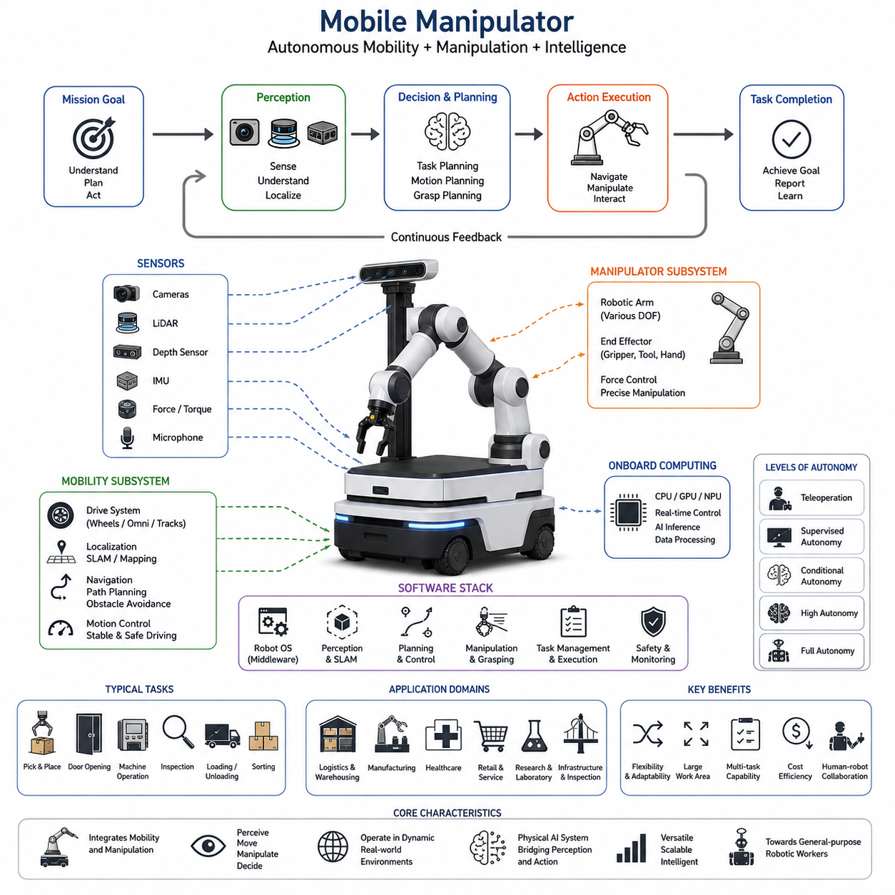
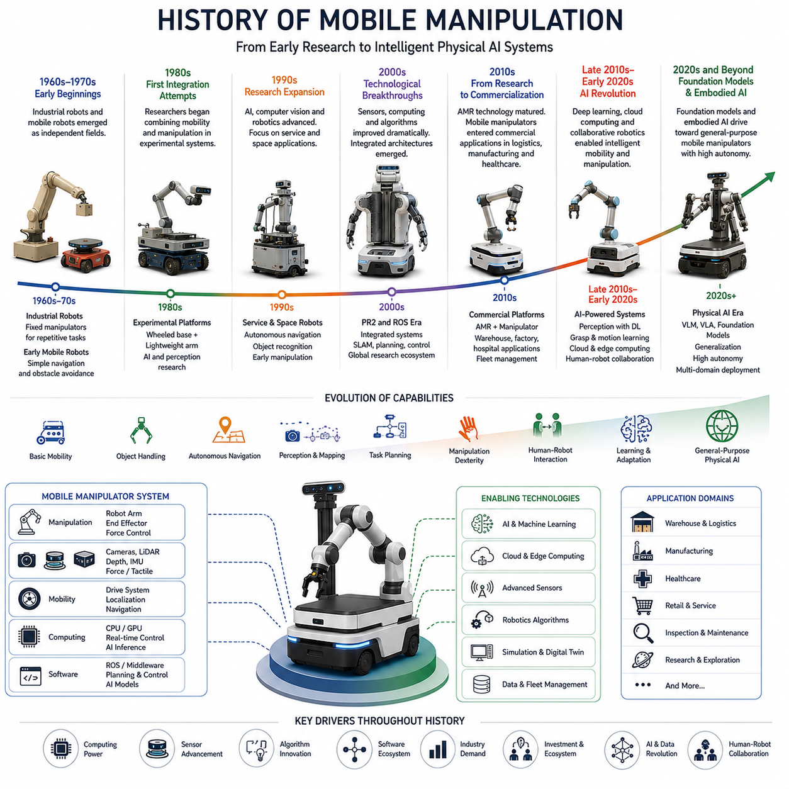
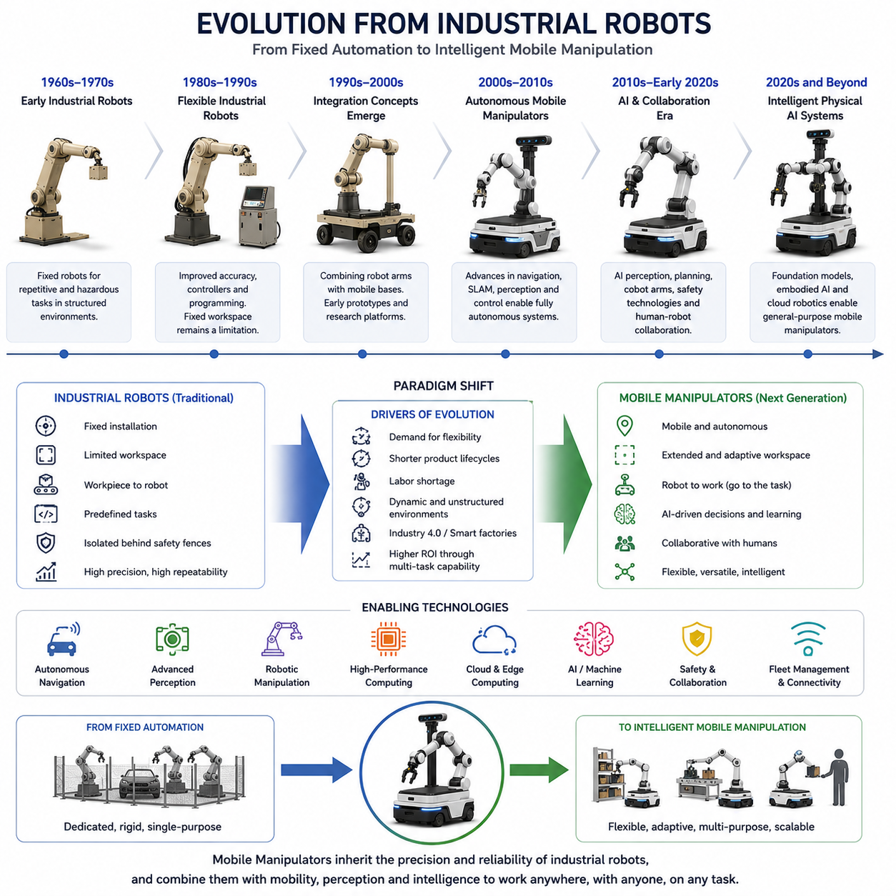
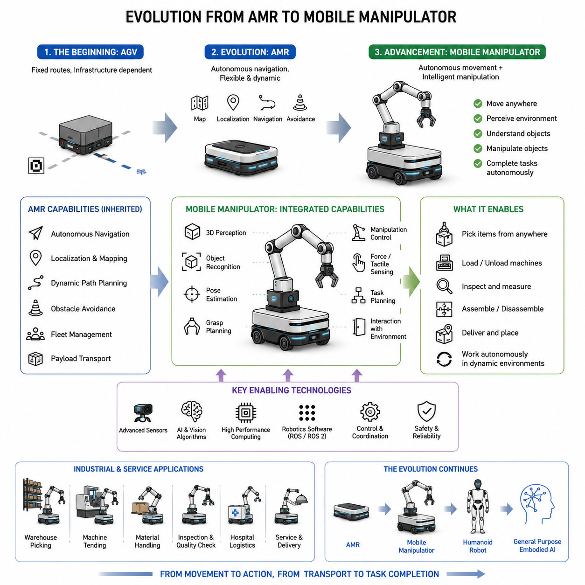
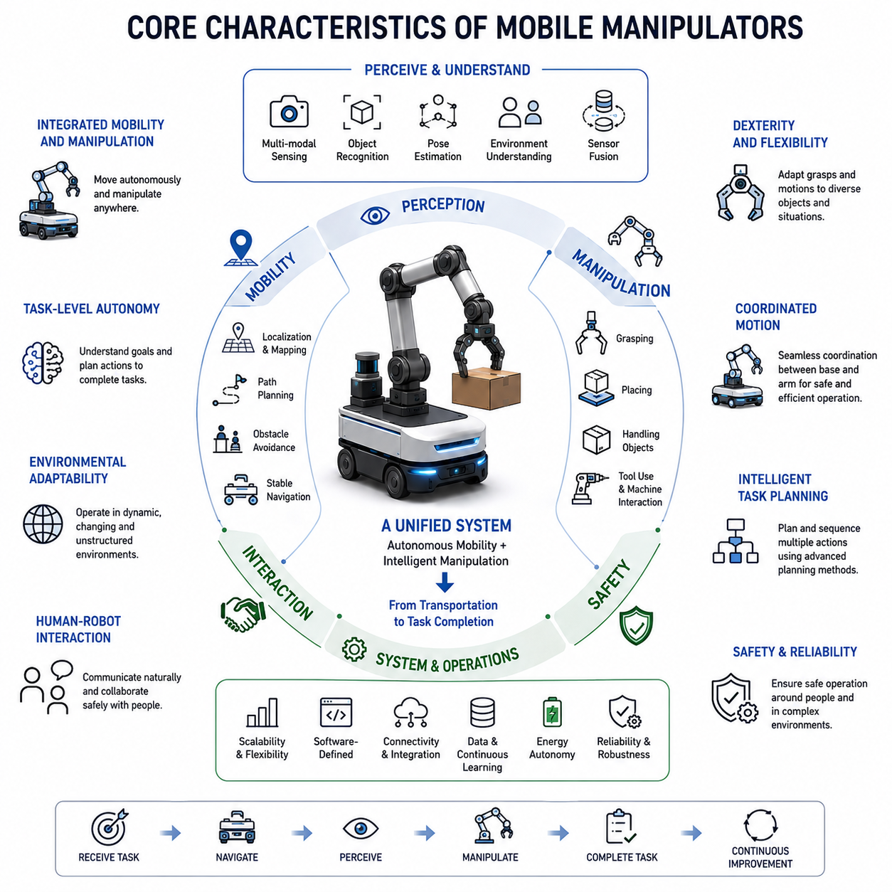
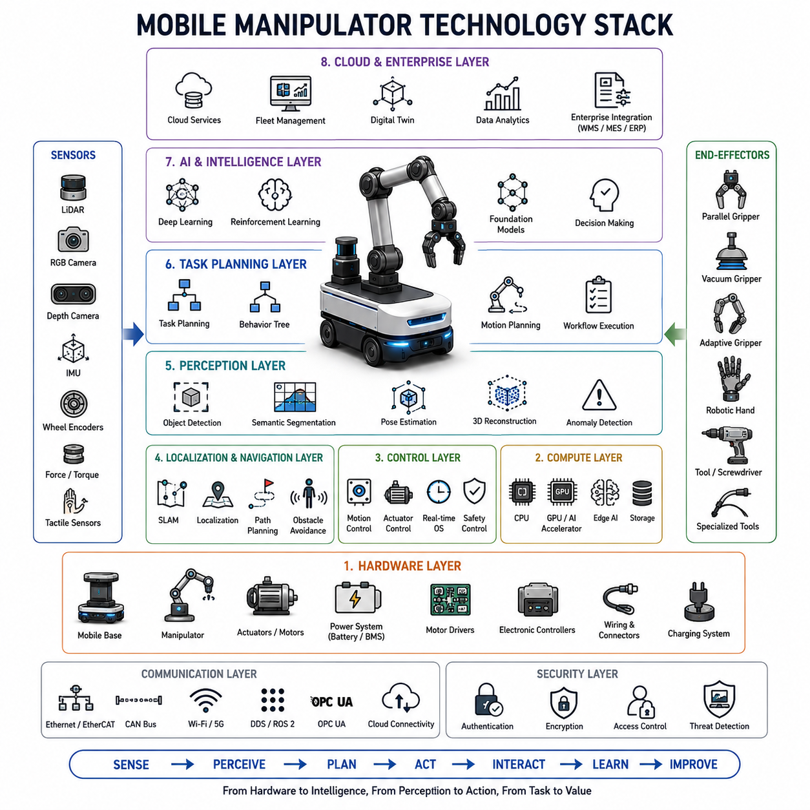
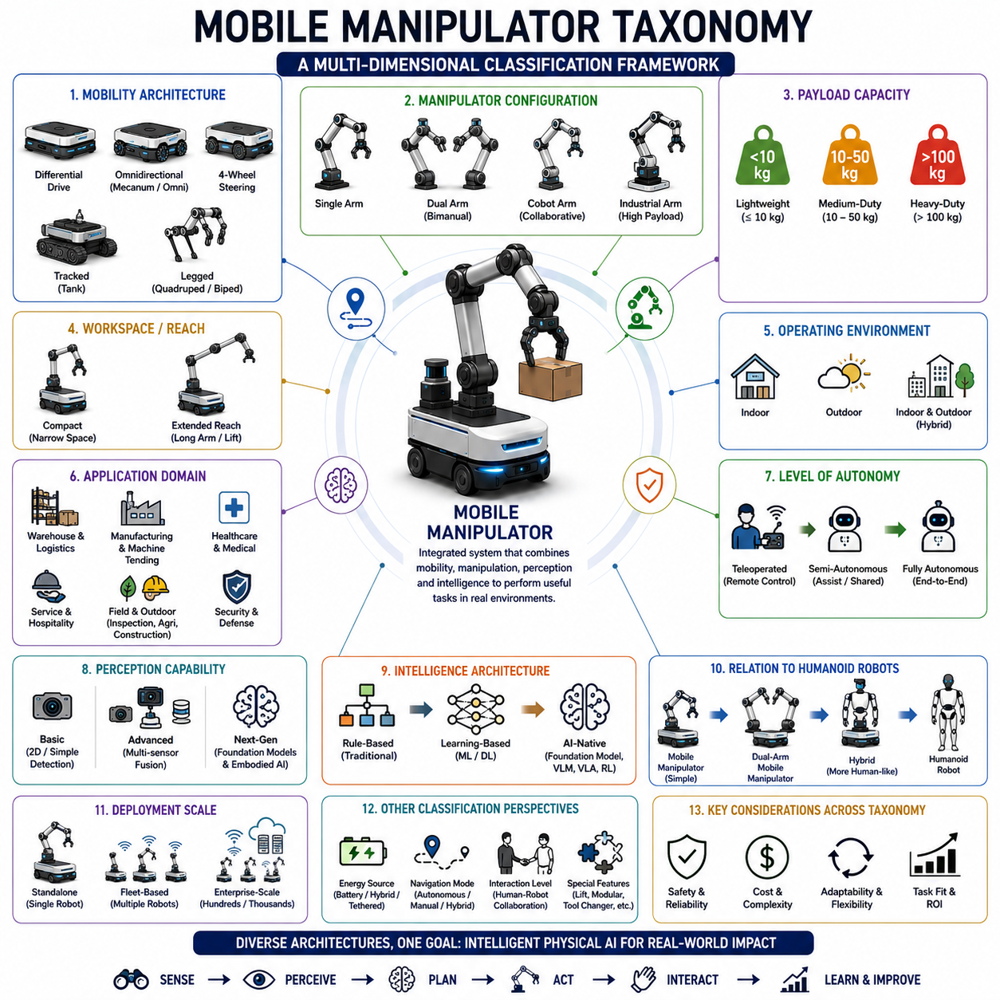
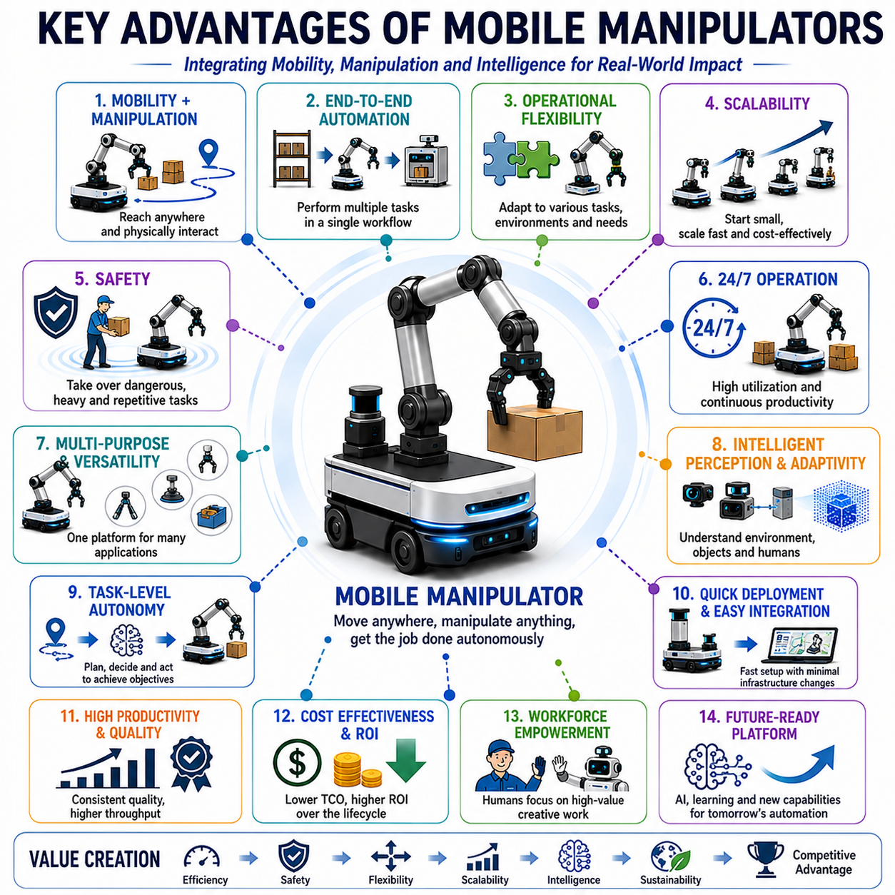
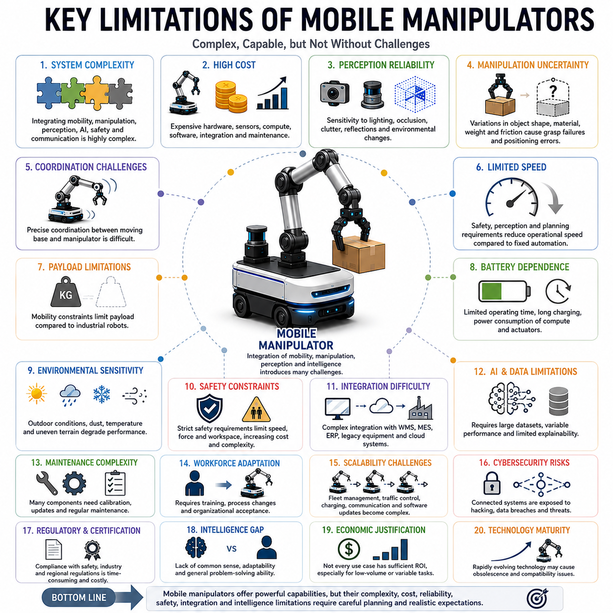
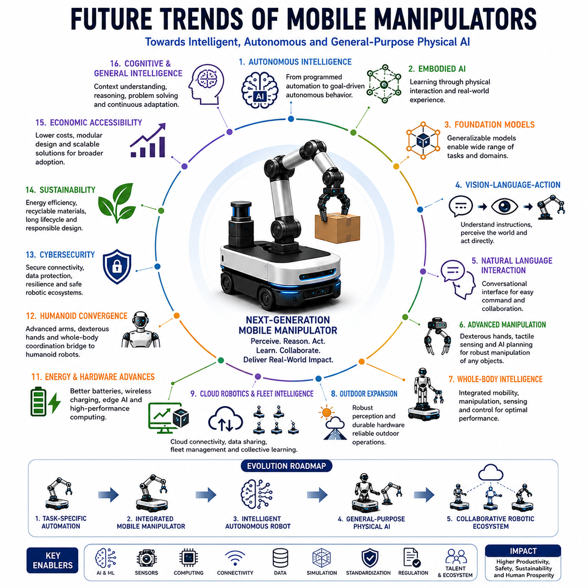

**Volume 01. Mobile Manipulator Foundations and System Architecture**

# Chapter 01. What is Mobile Manipulator

A mobile manipulator is a robotic system that combines the mobility of an autonomous mobile robot (AMR) with the dexterous manipulation capabilities of a robotic arm. Traditionally, mobile robots and industrial manipulators evolved as separate domains. Mobile robots focused on navigation and transportation, while industrial robot arms concentrated on precise and repetitive operations within fixed workspaces. The emergence of mobile manipulators represents the convergence of these two technological streams, enabling robots to move freely through environments while simultaneously interacting with objects, tools, equipment, and infrastructure.

The concept of mobile manipulation has become increasingly important as industries seek higher levels of automation beyond simple transportation tasks. In modern warehouses, factories, hospitals, airports, and service environments, robots are no longer expected to merely move materials from one location to another. They are expected to perform meaningful physical work such as picking items, loading machines, opening doors, operating equipment, delivering supplies, and collaborating with humans. These requirements demand a combination of perception, mobility, manipulation, and intelligence, all integrated into a single robotic platform. Mobile manipulators are designed specifically to address this challenge.

The history of mobile manipulation can be traced back to early research robots developed in academic laboratories. Initial systems were often experimental platforms that combined wheeled bases with lightweight robotic arms. Advances in computing power, sensing technologies, robotics software, and artificial intelligence gradually transformed these research systems into commercially viable products. Today, mobile manipulators are deployed in logistics centers, manufacturing facilities, healthcare institutions, and research laboratories around the world. Companies such as Boston Dynamics, Fetch Robotics, Mobile Industrial Robots, and Amazon Robotics have demonstrated the growing importance of mobile manipulation technologies in real-world applications.

A defining characteristic of mobile manipulators is the integration of multiple subsystems into a unified architecture. A typical platform includes a mobile base, robotic arm, end effector, sensor suite, onboard computing system, communication infrastructure, and intelligent software stack. The mobile base provides navigation and transportation capabilities. The robotic arm performs manipulation tasks. End effectors enable interaction with diverse objects. Sensors such as cameras, LiDARs, depth sensors, force sensors, and inertial measurement units provide environmental awareness. Computing systems execute perception, planning, control, and AI algorithms. Together, these components create a robotic system capable of autonomous decision-making and physical interaction.

The technology stack of a mobile manipulator spans numerous disciplines. Mechanical engineering contributes structural design and actuation systems. Electrical engineering provides power distribution and control electronics. Computer science supplies software frameworks, perception algorithms, and AI models. Robotics integrates kinematics, dynamics, motion planning, and control. Cloud computing and edge computing support fleet management and large-scale deployment. As a result, mobile manipulators represent one of the most interdisciplinary fields in modern robotics.

Mobile manipulators can be categorized according to their mobility mechanisms, manipulation capabilities, autonomy levels, and application domains. Some systems utilize differential-drive AMR platforms, while others employ omnidirectional, legged, or hybrid mobility systems. Manipulators may range from lightweight collaborative arms to industrial-grade high-payload systems. Autonomy levels vary from teleoperated robots to fully autonomous agents capable of task planning and execution. Application areas include warehouse automation, manufacturing, healthcare, logistics, retail, hospitality, and emerging service robotics sectors.

The advantages of mobile manipulators are substantial. They provide flexibility, scalability, and operational efficiency that fixed automation systems cannot easily achieve. Unlike stationary industrial robots, mobile manipulators can serve multiple workstations, adapt to changing environments, and support dynamic workflows. They reduce infrastructure requirements while increasing utilization rates. In many scenarios, they enable automation where fixed robotic cells would be impractical or prohibitively expensive.

Despite their benefits, mobile manipulators face significant challenges. Coordinating mobility and manipulation introduces complex control problems. Localization errors can affect manipulation accuracy. Dynamic environments require robust perception systems. Safety remains a critical concern when robots operate near humans. System integration, reliability, maintenance, and regulatory compliance further increase development complexity. Achieving high levels of autonomy requires sophisticated AI systems capable of understanding environments, planning actions, and adapting to unexpected situations.

The future of mobile manipulators is closely linked to advances in artificial intelligence, foundation models, embodied AI, and cloud robotics. Vision-Language Models (VLMs), Vision-Language-Action (VLA) models, and robot foundation models are enabling robots to understand instructions, reason about tasks, and perform increasingly complex operations. As hardware costs decrease and AI capabilities improve, mobile manipulators are expected to become general-purpose robotic workers capable of supporting a wide range of industries and applications.

Ultimately, mobile manipulators represent a critical step toward the realization of intelligent physical AI systems. They bridge the gap between perception and action, digital intelligence and physical work, autonomy and collaboration. Understanding what mobile manipulators are, how they evolved, and why they matter is essential for anyone seeking to understand the future of robotics, automation, and intelligent machines. This chapter provides the foundation for the remainder of this book and establishes the conceptual framework needed to explore the technologies, architectures, applications, and future developments of mobile manipulation systems.

## 01 Definition of Mobile Manipulator

{width="7.268055555555556in" height="7.268055555555556in"}

A mobile manipulator is a robotic system that integrates autonomous mobility and physical manipulation into a single coordinated platform. Unlike traditional industrial robots that are fixed to a specific location or autonomous mobile robots that are primarily designed for transportation, a mobile manipulator possesses the ability to move through an environment and physically interact with objects within that environment. This combination fundamentally expands the operational capabilities of robots by allowing them to perform tasks that require both navigation and manipulation. As industries increasingly seek flexible automation solutions capable of operating in dynamic and unstructured environments, mobile manipulators have emerged as one of the most important categories of modern robotic systems.

At its core, a mobile manipulator consists of two major subsystems. The first is a mobile platform responsible for locomotion and navigation. The second is a manipulator subsystem, typically a robotic arm equipped with an end effector capable of grasping, holding, moving, or operating objects. While each subsystem can function independently, the true value of a mobile manipulator arises from the tight integration between mobility and manipulation. The robot does not simply move and then manipulate. Instead, it continuously coordinates movement, perception, planning, and control to accomplish complex tasks efficiently and safely.

The definition of a mobile manipulator extends beyond hardware integration. Modern mobile manipulators are cyber-physical systems that combine mechanical structures, electrical systems, sensors, computing platforms, software frameworks, artificial intelligence models, and communication networks into a unified architecture. They represent a convergence of robotics disciplines that were historically treated separately. Mobility requires expertise in localization, mapping, navigation, obstacle avoidance, and motion control. Manipulation requires knowledge of kinematics, dynamics, grasping, force control, and task execution. A true mobile manipulator must successfully integrate all of these domains into a coherent operational framework.

From a systems engineering perspective, a mobile manipulator can be defined as an autonomous robotic platform capable of perceiving its environment, navigating within that environment, interacting physically with objects, and executing goal-oriented tasks through coordinated mobility and manipulation. This definition highlights four essential capabilities. The robot must be able to perceive, move, manipulate, and decide. Removing any one of these capabilities significantly reduces the system's effectiveness and limits its applicability in real-world environments.

Perception forms the foundation of mobile manipulation. A mobile manipulator must understand its surroundings in sufficient detail to navigate safely and manipulate objects accurately. Cameras, depth sensors, LiDAR systems, inertial measurement units, force sensors, and other sensing devices provide the information necessary to build a representation of the environment. The robot continuously observes the world around it, detects relevant objects, estimates their locations, predicts environmental changes, and updates its internal models accordingly. Without robust perception, mobility becomes unreliable and manipulation becomes inaccurate.

Mobility enables the robot to extend its operational workspace beyond a fixed location. Traditional industrial robots are constrained by the reach of their manipulators. Their work envelope is determined by the geometry of the robotic arm and the position of the robot base. A mobile manipulator overcomes this limitation by moving the entire robotic platform to locations where manipulation is required. This capability dramatically increases workspace coverage and allows a single robot to service multiple stations, rooms, production lines, storage areas, or operational zones. Mobility transforms the manipulator from a stationary automation device into a flexible and adaptive robotic worker.

Manipulation provides the capability to physically affect the environment. The manipulator subsystem may consist of a simple collaborative robot arm, a high-payload industrial manipulator, a dual-arm configuration, or even a humanoid upper body. End effectors vary from parallel grippers and vacuum systems to specialized tools and multi-fingered robotic hands. Through manipulation, the robot can grasp objects, operate machinery, open doors, push carts, sort packages, load equipment, perform inspections, and complete countless other physical tasks. Manipulation transforms perception into action and allows robots to create tangible value in operational environments.

Decision-making represents the intelligence layer of the mobile manipulator. Modern systems increasingly rely on advanced planning algorithms, machine learning models, foundation models, and embodied AI frameworks to determine what actions should be performed and how those actions should be executed. The robot must decide where to move, how to approach an object, which grasp strategy to use, how to avoid obstacles, and how to recover from failures. As artificial intelligence technologies continue to advance, mobile manipulators are becoming increasingly capable of autonomous reasoning and adaptive behavior.

One of the defining characteristics of mobile manipulators is the coupling between navigation and manipulation. In traditional robotic systems, navigation and manipulation are often treated as separate processes. A mobile manipulator, however, must continuously coordinate both activities. The position of the mobile base directly affects the reachability of objects. Manipulation actions may alter the robot's center of gravity and influence navigation performance. Environmental constraints may require simultaneous adjustments to both mobility and manipulation strategies. Consequently, mobile manipulation introduces a level of system complexity that exceeds the sum of its individual components.

The concept of workspace is particularly important when defining mobile manipulators. A conventional industrial robot operates within a fixed workspace determined by its kinematic structure. A mobile manipulator effectively combines the workspace of the robotic arm with the reachable area of the mobile platform. This creates an extended operational workspace that can span entire facilities rather than a single workstation. Such capability enables new automation scenarios that were previously difficult or economically impractical to implement.

Mobile manipulators can be classified according to several dimensions. Based on mobility systems, they may utilize differential-drive platforms, omnidirectional platforms, tracked vehicles, legged robots, or hybrid locomotion systems. Based on manipulation capabilities, they may employ collaborative robot arms, industrial manipulators, dual-arm systems, or anthropomorphic manipulators. Based on autonomy levels, they range from teleoperated systems to fully autonomous robots capable of long-term independent operation. Based on application domains, they may be designed for logistics, manufacturing, healthcare, service robotics, defense, agriculture, infrastructure inspection, or research.

The distinction between a mobile manipulator and an autonomous mobile robot is particularly important. An AMR primarily focuses on transportation tasks. Its objective is to move itself or a payload from one location to another. While some AMRs may include lifting mechanisms or simple interaction devices, they generally lack sophisticated manipulation capabilities. A mobile manipulator extends the AMR concept by adding advanced robotic manipulation functions. This transformation changes the robot from a transportation platform into a multifunctional automation system capable of performing complex physical work.

Similarly, the distinction between a mobile manipulator and a traditional industrial robot is equally significant. Industrial robots excel at high-speed, high-precision repetitive operations within structured environments. Their performance is optimized for fixed workspaces and predictable conditions. Mobile manipulators prioritize flexibility, adaptability, and environmental interaction. Although they may not always match the precision or speed of dedicated industrial robots, they provide significantly greater operational versatility.

The economic importance of mobile manipulators is driven by the need for flexible automation. Many industrial and service environments experience frequent changes in layouts, workflows, products, and operational requirements. Fixed automation systems often struggle to adapt to these changes without substantial engineering effort and infrastructure modification. Mobile manipulators provide a more flexible alternative because they can be redeployed, reprogrammed, and reconfigured with relatively low cost. This flexibility is becoming increasingly valuable as industries move toward mass customization, shorter product lifecycles, and highly dynamic operations.

The emergence of collaborative robotics has further expanded the relevance of mobile manipulators. Modern robots are increasingly expected to work alongside humans rather than in isolated safety cages. Mobile manipulators operating in warehouses, hospitals, laboratories, and service environments must interact safely with people while maintaining productivity. This requirement drives the development of advanced sensing systems, safety architectures, force-limited control strategies, and human-aware planning algorithms. As a result, safety has become a defining component of modern mobile manipulator design.

Recent advances in artificial intelligence are transforming the very definition of mobile manipulators. Traditionally, these systems relied heavily on rule-based programming and manually engineered workflows. Today, Vision-Language Models, Vision-Language-Action Models, Robot Foundation Models, and Embodied AI frameworks enable robots to understand instructions, interpret scenes, reason about tasks, and generalize knowledge across different environments. The mobile manipulator is evolving from a specialized automation machine into a general-purpose physical AI platform capable of learning, adapting, and performing increasingly sophisticated tasks.

In many ways, mobile manipulators represent the convergence of decades of progress in robotics, artificial intelligence, sensing, control, and computing. They bridge the gap between digital intelligence and physical action. They transform robotic systems from stationary machines into autonomous agents capable of operating throughout entire facilities and interacting meaningfully with the physical world. As technology continues to advance, mobile manipulators are expected to become one of the dominant robotic platforms across manufacturing, logistics, healthcare, infrastructure, service industries, and eventually everyday human environments.

Therefore, a mobile manipulator should not simply be viewed as an AMR with a robotic arm attached. It is a highly integrated intelligent robotic system that combines perception, mobility, manipulation, decision-making, and autonomy into a unified operational architecture. This integration enables robots to move beyond isolated automation tasks and participate directly in complex real-world workflows. Understanding this definition is essential because it provides the conceptual foundation for all subsequent discussions regarding mobile manipulator architectures, technologies, applications, deployment strategies, and future developments throughout this book.

## 02 History of Mobile Manipulation

{width="7.268055555555556in" height="7.268055555555556in"}

The history of mobile manipulation is a story of convergence between two major branches of robotics that developed largely independently for several decades. One branch focused on robotic mobility, seeking to create machines capable of navigating through the physical world. The other focused on robotic manipulation, aiming to develop machines capable of interacting with objects through grasping, handling, assembly, and tool use. Mobile manipulation emerged when researchers recognized that true robotic autonomy requires both capabilities working together. The resulting field has evolved from experimental laboratory prototypes into one of the most important technological foundations for modern physical AI systems.

The origins of mobile manipulation can be traced back to the earliest years of robotics research. During the 1950s and 1960s, robotics was primarily concerned with industrial automation. Early industrial robots such as programmable manipulators were designed to perform repetitive tasks in highly structured environments. These machines were typically fixed to the floor and operated within tightly constrained workspaces. Their strength lay in precision, repeatability, and productivity. However, they lacked mobility and could only function within a limited operational area.

At the same time, separate research efforts were exploring autonomous mobility. Researchers working in artificial intelligence and cybernetics sought to develop machines capable of moving through unknown environments. Early mobile robots relied on simple sensing systems and limited computational resources. Their capabilities were rudimentary by modern standards, but they demonstrated the possibility of autonomous navigation. Mobility and manipulation remained largely separate research disciplines because the technological challenges associated with each were already substantial.

During the 1970s, advances in computer technology enabled more sophisticated robotic systems. Industrial robotics experienced rapid growth as manufacturing companies adopted robotic arms for welding, painting, assembly, and material handling applications. Meanwhile, mobile robotics research began exploring navigation, obstacle avoidance, and environmental mapping. Researchers gradually realized that many practical tasks required both movement and manipulation. A robot that could navigate but could not interact with objects had limited utility. Similarly, a robot arm that could manipulate objects but could not move remained constrained by its fixed workspace.

One of the earliest influential mobile manipulation systems emerged from research laboratories investigating intelligent robotics. Experimental platforms combined wheeled mobile bases with lightweight robotic arms. These systems were often developed as testbeds for artificial intelligence research rather than commercial products. The primary objective was to study how perception, planning, navigation, and manipulation could be integrated into a single autonomous system. Although these early robots were slow, expensive, and computationally limited, they established many of the fundamental concepts that continue to influence mobile manipulation today.

The 1980s marked a significant period in robotics research. Computing power increased steadily, allowing more sophisticated algorithms to be implemented. Researchers began exploring robot architectures capable of coordinating multiple subsystems simultaneously. Mobile robots became more capable of localization and navigation, while robotic manipulators achieved greater precision and flexibility. Universities and research institutions around the world developed experimental mobile manipulators for applications such as autonomous service robots, warehouse automation, and planetary exploration.

The space industry played an important role in advancing mobile manipulation technologies. Space agencies recognized that future missions would require robots capable of both movement and manipulation in hazardous environments. Research into planetary rovers, space manipulators, and autonomous servicing systems contributed significantly to the development of integrated robotic architectures. Many of the concepts used in modern mobile manipulators, including autonomous perception, remote operation, and task planning, were influenced by challenges encountered in space robotics.

During the 1990s, mobile manipulation research accelerated as artificial intelligence, robotics, and computer vision matured. Significant attention was devoted to service robotics applications. Researchers envisioned robots capable of operating in homes, offices, hospitals, and public spaces. Such environments presented challenges far more complex than structured factory settings. Robots needed to navigate among people, recognize objects, manipulate diverse items, and adapt to changing conditions. These requirements encouraged the development of increasingly sophisticated mobile manipulation systems.

One of the most influential developments during this period was the growing emphasis on integrated robot architectures. Rather than treating mobility and manipulation as separate functions, researchers began designing systems in which navigation, perception, manipulation, and decision-making operated within a unified framework. This systems-oriented approach laid the foundation for modern mobile manipulators and influenced future research directions.

The early 2000s witnessed major breakthroughs driven by improvements in sensors, computing hardware, and software frameworks. Laser scanners became more affordable and reliable. Cameras improved dramatically in quality and cost-effectiveness. Simultaneous Localization and Mapping (SLAM) algorithms matured and enabled robots to create maps while navigating through unknown environments. Advances in embedded computing allowed more processing power to be integrated directly onto robotic platforms.

At the same time, robotics software frameworks began to standardize development practices. Researchers could increasingly focus on higher-level capabilities rather than building every component from scratch. Mobile manipulators became more practical, more reliable, and more capable of operating outside research laboratories. The concept of service robots capable of performing useful work in human environments gained increasing attention from both academia and industry.

A landmark achievement in the history of mobile manipulation was the development of advanced research platforms such as PR2. Introduced in the late 2000s, PR2 demonstrated an unprecedented level of integration between mobility, perception, manipulation, and software intelligence. Equipped with a mobile base, dual robotic arms, advanced sensors, and powerful onboard computing, PR2 became a reference platform for robotics research worldwide. Thousands of researchers used it to develop algorithms for navigation, manipulation, human-robot interaction, and autonomous task execution. The influence of PR2 on modern mobile manipulation cannot be overstated. Many concepts, software tools, and architectural principles used today originated from research conducted on this platform.

The introduction of the Robot Operating System (ROS) further accelerated progress. ROS provided a common software infrastructure that enabled researchers and developers to share algorithms, tools, and system architectures. Mobile manipulation research benefited enormously from this ecosystem. Capabilities such as motion planning, perception, mapping, localization, and manipulation could now be developed collaboratively and integrated more efficiently. ROS helped transform mobile manipulation from an isolated research topic into a rapidly growing global research community.

The 2010s marked the transition from research platforms to commercial systems. E-commerce growth created unprecedented demand for warehouse automation. Logistics companies required robots capable of handling diverse products in large-scale fulfillment centers. Traditional fixed automation systems lacked the flexibility needed to manage constantly changing inventories and workflows. Mobile manipulators emerged as a promising solution.

During this period, numerous companies began developing commercial mobile manipulation platforms. Warehouse automation became one of the primary drivers of adoption. Robots capable of transporting inventory, picking items, loading equipment, and supporting order fulfillment demonstrated significant economic value. At the same time, manufacturing industries explored mobile manipulators as flexible alternatives to fixed robotic cells. Healthcare institutions investigated robots capable of transporting medical supplies, handling laboratory materials, and assisting clinical operations.

The emergence of Autonomous Mobile Robots (AMRs) played a critical role in commercializing mobile manipulation. Advances in navigation technologies made mobile platforms safer, more reliable, and easier to deploy. As AMRs became commercially successful, integrating robotic arms onto these platforms became a natural progression. The combination of AMR mobility and robotic manipulation created a new generation of automation systems capable of performing tasks that previously required human workers.

The late 2010s and early 2020s saw the rapid rise of artificial intelligence in robotics. Deep learning revolutionized computer vision, enabling robots to recognize objects, estimate poses, understand scenes, and perform perception tasks with unprecedented accuracy. Machine learning techniques improved grasp detection, manipulation planning, and autonomous decision-making. Mobile manipulators increasingly relied on AI-driven perception systems rather than manually engineered algorithms.

At the same time, cloud computing, edge computing, and fleet management technologies enabled large-scale deployment of robotic systems. Mobile manipulators could now operate as part of coordinated fleets, sharing information and receiving updates from centralized management systems. This shift transformed mobile manipulators from isolated robots into connected intelligent agents operating within broader robotic ecosystems.

The emergence of collaborative robotics further expanded the role of mobile manipulation. Collaborative robot arms provided safer interaction with humans and simplified deployment in shared workspaces. Combining collaborative manipulators with autonomous mobile platforms enabled robots to work directly alongside human operators in warehouses, factories, hospitals, and service environments. Human-robot collaboration became a major focus of both research and commercialization efforts.

The most recent phase in the evolution of mobile manipulation has been driven by foundation models and embodied AI. Traditional robotic systems relied heavily on predefined workflows and carefully engineered task descriptions. Modern AI technologies enable robots to learn from large datasets, interpret natural language instructions, reason about tasks, and generalize knowledge across different environments. Vision-Language Models, Vision-Language-Action Models, and Robot Foundation Models are beginning to transform mobile manipulators into adaptive physical AI systems capable of handling increasingly complex and diverse tasks.

Today, mobile manipulators occupy a central position in the robotics industry. They are used in warehouse automation, manufacturing, healthcare, logistics, infrastructure inspection, retail, hospitality, and research. They represent the convergence of robotics, artificial intelligence, perception systems, cloud computing, and advanced software architectures. The field continues to evolve rapidly as new technologies emerge and deployment scales increase.

Looking forward, the history of mobile manipulation appears to be entering a new phase characterized by increasing autonomy, intelligence, and versatility. Future systems are expected to possess stronger reasoning capabilities, greater adaptability, improved human collaboration, and broader operational scope. The distinction between mobile manipulators, service robots, industrial robots, and humanoid robots may gradually become less significant as these platforms converge toward common architectures based on embodied intelligence.

The evolution of mobile manipulation reflects a broader trend in robotics: the movement from isolated automation toward integrated intelligent systems capable of operating in complex real-world environments. What began as experimental research combining wheels and robotic arms has grown into a foundational technology for the future of physical AI. Understanding this historical progression provides critical insight into why mobile manipulators have become such an important focus of modern robotics and why they are expected to play a central role in the next generation of intelligent machines.

## 03 Evolution from Industrial Robots

{width="7.268055555555556in" height="7.268055555555556in"}

The evolution of mobile manipulators cannot be fully understood without examining the history and development of industrial robots. Mobile manipulators did not emerge as an entirely new category of robotics. Instead, they represent the natural evolution of industrial robotic systems as the limitations of fixed automation became increasingly apparent. For more than half a century, industrial robots have transformed manufacturing by providing high levels of precision, repeatability, productivity, and reliability. However, as industries evolved toward greater flexibility, shorter product lifecycles, mass customization, and dynamic operational environments, the traditional industrial robot paradigm faced significant challenges. The mobile manipulator emerged as a response to these challenges, combining the proven strengths of industrial robotics with the flexibility of autonomous mobility.

The origins of industrial robotics can be traced back to the late 1950s and early 1960s. Early industrial robots were developed to automate repetitive and hazardous manufacturing tasks. These systems were typically fixed robotic arms mounted to factory floors, designed to perform specific operations such as welding, painting, machine tending, and material handling. One of the defining characteristics of these robots was their operation within highly structured and predictable environments. The robot's workspace was carefully designed, and all surrounding equipment, tooling, and fixtures were positioned precisely to support repeatable operations.

This design philosophy delivered remarkable success. Industrial robots became essential components of automotive manufacturing, electronics production, metal fabrication, and countless other industries. Their ability to operate continuously with high accuracy and consistency enabled unprecedented levels of productivity. Over several decades, industrial robotics matured into one of the most successful automation technologies ever developed.

Despite these achievements, traditional industrial robots possessed a fundamental limitation. They were fixed in place. The reach of the robot was constrained by the length of its links and the geometry of its kinematic chain. Any task located outside the robot's workspace required either repositioning the workpiece, installing additional robots, or redesigning the production process. As a result, factory layouts were often designed around the limitations of robotic work envelopes rather than the requirements of optimal operational efficiency.

During the early phases of industrial automation, this limitation was acceptable because manufacturing environments were relatively stable. Production lines were optimized for high-volume manufacturing of standardized products. Product designs changed slowly, and production processes remained consistent for extended periods. Fixed robotic cells provided excellent economic value under these conditions because the cost of infrastructure could be amortized over large production volumes.

However, global manufacturing trends began to shift. Markets became increasingly competitive, product lifecycles shortened, and customer demand for customization grew rapidly. Manufacturers were forced to introduce new products more frequently and adapt production systems to changing requirements. Traditional fixed automation systems struggled to keep pace with these changes. Reconfiguring robotic cells often required significant engineering effort, physical modifications, and production downtime.

The concept of flexible automation emerged as a response to these challenges. Instead of designing production systems around fixed machines, manufacturers sought automation solutions capable of adapting to changing workflows and operational requirements. Industrial robots themselves evolved during this period. Improvements in controllers, sensors, programming tools, and software architectures increased their flexibility. Robots became easier to program and integrate. Nevertheless, their fundamental limitation remained unchanged: they could not move themselves to where work was needed.

At the same time, developments in mobile robotics were creating new opportunities. Advances in navigation technologies, localization algorithms, mapping systems, and onboard computing enabled autonomous mobile robots to operate safely within industrial facilities. Initially, these robots focused primarily on transportation tasks. Automated Guided Vehicles (AGVs) moved materials along predefined routes, while later Autonomous Mobile Robots (AMRs) navigated dynamically through changing environments. These systems solved many internal logistics challenges but lacked the ability to manipulate objects independently.

As industries sought more comprehensive automation solutions, the idea of combining industrial robot arms with mobile platforms gained increasing attention. The concept was deceptively simple but technologically challenging. By mounting a robotic arm on a mobile base, the robot's operational workspace could be expanded dramatically. Instead of bringing workpieces to the robot, the robot could travel to the workpiece. This represented a fundamental shift in automation philosophy.

The transition from industrial robots to mobile manipulators required overcoming numerous technical obstacles. Traditional industrial robots assumed fixed reference frames and highly predictable operating conditions. Mobile manipulators introduced dynamic positioning, changing environmental conditions, and continuous interaction between mobility and manipulation subsystems. Maintaining manipulation accuracy while operating on a mobile platform became a major engineering challenge.

One of the first evolutionary steps involved integrating industrial robotic arms with manually positioned mobile platforms. In these systems, operators moved robotic platforms to required locations and then activated manipulation tasks. While not fully autonomous, these systems demonstrated the potential benefits of mobile manipulation and highlighted the economic advantages of increased flexibility.

As mobile navigation technologies improved, researchers and engineers began developing fully autonomous mobile manipulators. Advances in localization and mapping enabled robots to determine their position accurately within industrial facilities. Motion planning algorithms coordinated base movement and arm motion. Improved sensing technologies allowed robots to perceive objects and environmental features with increasing precision. These developments gradually reduced the performance gap between fixed industrial robots and mobile manipulation systems.

The evolution was also influenced by changes in manufacturing philosophy. Lean manufacturing emphasized flexibility, responsiveness, and efficient resource utilization. Industry 4.0 introduced concepts such as cyber-physical systems, smart factories, digital twins, and connected production systems. Mobile manipulators aligned naturally with these trends because they could move between workstations, adapt to changing workflows, and integrate with broader digital ecosystems.

One of the most significant technological transitions involved the relationship between precision and flexibility. Traditional industrial robots prioritized precision above all else. Their rigid mounting structures and carefully controlled environments enabled sub-millimeter accuracy. Mobile manipulators initially struggled to achieve similar performance because navigation errors and platform movement introduced additional uncertainty. Over time, however, advances in sensing, calibration, control algorithms, and force feedback systems enabled mobile manipulators to achieve increasingly high levels of accuracy while maintaining flexibility.

Another major factor driving evolution was labor availability. Many industries began experiencing labor shortages, particularly for repetitive, physically demanding, or ergonomically challenging tasks. Fixed automation could address some of these challenges but often lacked the flexibility needed for diverse operational environments. Mobile manipulators offered a more adaptable solution because they could perform multiple tasks across multiple locations. This capability increased asset utilization and improved return on investment.

The growth of warehouse automation further accelerated the transition from industrial robots to mobile manipulators. Traditional industrial robots excelled at repetitive manufacturing operations but were less suitable for dynamic logistics environments. E-commerce growth created demand for robots capable of navigating large facilities, locating inventory, handling diverse products, and supporting order fulfillment operations. Mobile manipulators were uniquely positioned to address these requirements because they combined mobility, perception, and manipulation within a single platform.

Advances in collaborative robotics also contributed significantly to this evolution. Traditional industrial robots were typically separated from human workers by safety barriers. Mobile manipulators, however, often operate in shared environments where humans and robots coexist. This requirement led to the development of collaborative robot arms with integrated force sensing, compliant control, and advanced safety mechanisms. These technologies made mobile manipulators safer and more practical for deployment in real-world environments.

Artificial intelligence has become another transformative force in the evolution from industrial robots to mobile manipulators. Traditional industrial robots relied heavily on deterministic programming and predefined workflows. Every motion, task, and sequence was explicitly specified by engineers. Mobile manipulators increasingly utilize AI-based perception, planning, and decision-making systems. Machine learning algorithms enable robots to recognize objects, estimate poses, plan grasps, adapt to environmental changes, and recover from unexpected situations. This shift from programmed automation to intelligent autonomy represents one of the most significant developments in robotics history.

The emergence of Vision-Language Models, Vision-Language-Action Models, and Robot Foundation Models is accelerating this transformation further. Mobile manipulators are beginning to acquire capabilities that extend beyond traditional industrial automation. They can interpret natural language instructions, understand high-level goals, reason about tasks, and generalize learned behaviors across different environments. These capabilities move robotics closer to the long-standing vision of general-purpose robotic workers.

The evolution from industrial robots to mobile manipulators can also be viewed as a transition from workspace-centric automation to task-centric automation. Traditional industrial robots were designed around fixed workspaces. Tasks had to be adapted to the robot's physical constraints. Mobile manipulators reverse this relationship by adapting themselves to the task environment. The robot moves where work exists, adjusts its behavior according to environmental conditions, and performs operations within dynamic settings. This shift significantly expands the range of tasks that can be automated.

Today's mobile manipulators inherit many characteristics from industrial robots, including robust mechanical design, precise motion control, advanced kinematics, sophisticated safety systems, and high reliability. At the same time, they incorporate technologies from autonomous navigation, artificial intelligence, cloud computing, and embodied intelligence. They represent not a replacement for industrial robots but an extension of industrial robotics into new operational domains.

Looking toward the future, the distinction between industrial robots and mobile manipulators may continue to diminish. Advances in autonomy, perception, manipulation, and AI are creating robotic systems capable of operating across increasingly diverse environments. Future factories may consist of networks of intelligent mobile manipulators that dynamically allocate tasks, collaborate with humans, and adapt continuously to changing production requirements. In such environments, mobility will become a standard capability rather than a specialized feature.

The evolution from industrial robots to mobile manipulators reflects the broader evolution of automation itself. Automation is moving away from rigid, isolated, task-specific systems toward intelligent, adaptive, and interconnected robotic platforms. Mobile manipulators embody this transformation by combining the precision and reliability of industrial robots with the flexibility, autonomy, and intelligence required for modern industrial operations. They represent a critical bridge between traditional factory automation and the future vision of intelligent physical AI systems capable of performing meaningful work throughout the physical world.

## 04 Evolution from AMR

{width="7.268055555555556in" height="7.268055555555556in"}

The emergence of the Mobile Manipulator represents one of the most important evolutionary steps in modern robotics. While Autonomous Mobile Robots (AMRs) transformed material transportation and logistics automation by enabling robots to navigate dynamically in human environments, they remained fundamentally limited in their ability to physically interact with the world. The evolution from AMR to Mobile Manipulator can therefore be understood as the transition from autonomous movement to autonomous action. This transformation is similar to the difference between a vehicle that can drive itself and a worker who can both move and perform tasks. Mobile Manipulators inherit all the mobility capabilities of AMRs while adding manipulation capabilities through robotic arms, end-effectors, advanced perception systems, and intelligent task planning. As a result, they are capable of performing complete workflows rather than merely transporting items between locations. This evolution has become one of the key milestones toward general-purpose robotics and embodied intelligence.

The first generation of mobile robots focused primarily on navigation. Early Automated Guided Vehicles (AGVs) relied on magnetic strips, fixed markers, or predefined routes. These systems were highly effective in structured environments but lacked flexibility. Any change in factory layouts or operational requirements often required significant reconfiguration. As industries demanded greater adaptability, Autonomous Mobile Robots emerged. AMRs introduced localization, mapping, obstacle avoidance, dynamic path planning, and autonomous decision-making capabilities. Unlike AGVs, AMRs could operate in changing environments and collaborate more naturally with human workers.

The rapid adoption of AMRs was driven largely by the explosive growth of e-commerce, warehouse automation, manufacturing flexibility, and labor shortages. Organizations required robotic systems capable of transporting materials efficiently without expensive infrastructure modifications. AMRs successfully addressed these needs by providing flexible transportation platforms that could be deployed quickly and scaled across facilities. Companies around the world implemented AMR fleets to move shelves, totes, pallets, packages, medical supplies, and production materials. These systems significantly improved productivity while reducing operational costs.

Despite their success, AMRs exposed an important limitation. They could move objects only if those objects were already positioned on a cart, pallet, shelf, or conveyor system. In most real-world operations, transportation is only one part of a larger workflow. Human workers typically perform multiple interconnected actions including locating items, identifying targets, picking objects, manipulating tools, loading machines, transferring materials, organizing inventory, and delivering products. AMRs could automate transportation but could not automate the physical interactions that occurred before and after transportation. This gap became increasingly apparent as organizations pursued higher levels of automation.

Warehouse environments provide a clear example of this limitation. An AMR can travel autonomously to a storage location and position itself near a shelf. However, the robot cannot retrieve an item from the shelf without additional manipulation capabilities. Human workers still need to perform the picking operation. Similarly, in manufacturing environments, an AMR can transport parts to a CNC machine but cannot load the machine, remove finished components, or perform quality inspection. In hospitals, an AMR can deliver medical supplies to a department but cannot organize supplies, open cabinets, or interact with equipment. These remaining manual tasks prevented organizations from achieving full workflow automation.

As a result, robotics developers began exploring ways to integrate robotic manipulation with mobile platforms. The idea was straightforward but technically challenging. By mounting a robotic arm on an autonomous mobile base, a robot could combine navigation and manipulation within a single system. Instead of merely moving between locations, the robot could interact with objects and perform useful work wherever it traveled. This concept became known as the Mobile Manipulator.

The evolution from AMR to Mobile Manipulator required advances across multiple technological domains. Navigation systems had to become more precise because manipulation tasks often require centimeter-level positioning accuracy. Perception systems needed to recognize objects, estimate poses, identify grasp points, and understand complex environments. Control systems had to coordinate the motion of the mobile base and robotic arm simultaneously. Safety systems needed to account for both vehicle movement and manipulator motion. Computing platforms had to process significantly larger amounts of sensor data while supporting real-time decision-making.

One of the earliest forms of mobile manipulation appeared in research laboratories, where robotic arms were mounted on mobile platforms for experimentation. These systems demonstrated the potential advantages of combining mobility and manipulation but were often expensive, slow, and difficult to deploy. Industrial adoption remained limited due to challenges in perception, control, reliability, and cost. However, advances in sensors, computing hardware, artificial intelligence, and robotics software gradually made practical deployment possible.

The development of affordable depth cameras, LiDAR sensors, high-performance GPUs, and AI-based perception algorithms significantly accelerated the evolution of mobile manipulators. Robots could now identify objects more accurately, understand three-dimensional environments, and generate robust grasping strategies. Simultaneously, software frameworks such as ROS and ROS2 provided standardized architectures for integrating navigation, perception, manipulation, and task planning. These developments reduced technical barriers and enabled commercial mobile manipulation systems to emerge.

The transition from AMR to Mobile Manipulator can also be viewed as the convergence of two previously separate robotics industries. On one side were mobile robotics companies specializing in navigation, fleet management, localization, and transportation. On the other side were industrial robot manufacturers specializing in precision manipulation, force control, and automation. Mobile Manipulators emerged at the intersection of these domains, combining the strengths of both technologies into a unified platform.

This convergence fundamentally changes the role of robots within industrial operations. Traditional AMRs function primarily as transportation assets. Mobile Manipulators function as autonomous workers capable of executing complete tasks. For example, instead of merely transporting a container, a Mobile Manipulator can locate the container, grasp it, transport it, place it at a destination, verify placement, and continue to the next assignment. The robot becomes responsible for the entire workflow rather than a single transportation step.

The benefits of this evolution are particularly significant in environments characterized by variability and complexity. Fixed automation systems excel in highly structured settings but struggle when products, layouts, or operational requirements change frequently. Mobile Manipulators provide a flexible alternative because they can move to different locations and adapt to different tasks. A single platform may perform warehouse picking in the morning, machine tending in the afternoon, and inventory inspection in the evening. This versatility improves asset utilization and enhances return on investment.

Another important driver of mobile manipulation is labor availability. Many industries face persistent labor shortages, particularly for repetitive, physically demanding, or undesirable tasks. Transportation alone does not eliminate the need for human workers because manipulation activities remain manual. Mobile Manipulators address a broader range of labor challenges by automating both movement and physical interaction. As a result, they can reduce labor dependency more effectively than AMRs alone.

The rise of artificial intelligence has further accelerated the evolution from AMR to Mobile Manipulator. Modern AI systems enable robots to understand unstructured environments, recognize diverse objects, learn from demonstrations, and adapt to changing conditions. Vision-Language Models, Vision-Language-Action architectures, and foundation models are increasingly being integrated into robotic systems. These technologies allow robots to interpret natural language instructions, reason about tasks, and generate complex action sequences. Such capabilities move Mobile Manipulators beyond traditional automation toward intelligent autonomy.

From a system architecture perspective, the evolution from AMR to Mobile Manipulator introduces several additional layers of complexity. The mobile base remains responsible for localization, navigation, obstacle avoidance, and fleet coordination. The manipulator subsystem handles kinematics, dynamics, grasping, and force control. Perception systems provide environmental understanding and object recognition. Task planning systems coordinate actions across all subsystems. Cloud and edge computing infrastructures support data processing, model updates, fleet optimization, and operational monitoring. Together, these components form an integrated robotic platform capable of autonomous operation in dynamic environments.

The economic implications of this evolution are substantial. Organizations increasingly evaluate automation based on workflow automation rather than task automation. An AMR may automate transportation, but a Mobile Manipulator can automate transportation, picking, placement, inspection, and interaction within a single platform. This broader automation scope often generates higher productivity gains and stronger business value. Consequently, many analysts view Mobile Manipulators as the next major growth segment within the robotics industry.

Several real-world applications illustrate this transition. In warehouses, Mobile Manipulators perform item picking, shelf replenishment, order fulfillment, and inventory management. In manufacturing, they load machines, transport materials, conduct inspections, and support assembly operations. In hospitals, they handle medical logistics, pharmacy operations, laboratory transport, and supply management. In service environments, they assist with delivery, cleaning, customer interaction, and facility maintenance. Each application demonstrates how the addition of manipulation capabilities transforms a transportation robot into a task-performing autonomous system.

The evolution from AMR to Mobile Manipulator also represents a critical step toward humanoid robotics. Humanoid robots combine mobility, manipulation, perception, and intelligence within a human-like form factor. However, many of the core technologies required for humanoids are already being developed and validated within Mobile Manipulators. Navigation, perception, grasping, task planning, fleet management, and AI reasoning capabilities can all be developed using mobile manipulation platforms before being transferred to humanoid systems. In this sense, Mobile Manipulators serve as an important bridge between AMRs and future general-purpose robots.

Looking ahead, the distinction between AMRs and Mobile Manipulators is likely to become increasingly blurred. Many future AMRs will include lightweight manipulation capabilities, while many Mobile Manipulators will incorporate advanced AI and autonomous decision-making functions. The robotics industry is moving toward platforms capable of both mobility and interaction by default. Organizations no longer seek robots that merely move through environments; they seek robots that can accomplish meaningful work within those environments.

Ultimately, the evolution from AMR to Mobile Manipulator reflects a broader trend in robotics: the transition from movement-centric automation to task-centric autonomy. AMRs demonstrated that robots could navigate complex environments safely and efficiently. Mobile Manipulators build upon that foundation by enabling robots to act upon the world around them. This progression transforms robots from transportation tools into autonomous workers and lays the groundwork for the next generation of intelligent robotic systems. As perception, manipulation, artificial intelligence, and embodied reasoning continue to advance, Mobile Manipulators will become a central platform in the journey toward fully autonomous physical intelligence and the realization of general-purpose robotics.

## 05 Core Characteristics

{width="7.268055555555556in" height="7.268055555555556in"}

Mobile Manipulators represent one of the most significant developments in modern robotics because they combine autonomous mobility and robotic manipulation into a single intelligent system. Unlike traditional industrial robots that operate within fixed workcells or Autonomous Mobile Robots (AMRs) that primarily transport materials, Mobile Manipulators are designed to move through dynamic environments while physically interacting with objects, equipment, and infrastructure. This combination fundamentally changes the role of robots in industrial, logistics, healthcare, service, and public environments. The defining characteristics of Mobile Manipulators extend far beyond the simple integration of a robot arm and a mobile platform. They embody a new generation of robotic systems capable of perception, decision-making, manipulation, adaptation, and autonomous task execution.

The first core characteristic of a Mobile Manipulator is the integration of mobility and manipulation. Historically, robotic mobility and robotic manipulation evolved as separate disciplines. Mobile robots focused on navigation, localization, mapping, and transportation, while industrial robot arms focused on precision, repeatability, force control, and assembly operations. Mobile Manipulators merge these previously independent capabilities into a unified robotic platform. The robot is capable of navigating autonomously to a target location, positioning itself appropriately, manipulating objects, and then continuing to the next task without human intervention. This integration enables robots to perform complete workflows rather than isolated actions.

Another defining characteristic is task-level autonomy. Traditional automation systems often execute pre-programmed motions within highly structured environments. Mobile Manipulators operate at a much higher level of abstraction. Instead of receiving detailed motion commands, they can receive task-oriented objectives such as retrieving an item, loading a machine, organizing inventory, delivering supplies, or performing inspections. The robot must determine how to accomplish these objectives by combining navigation, perception, planning, and manipulation capabilities. This shift from motion-level control to task-level autonomy is one of the most important distinctions between Mobile Manipulators and earlier robotic systems.

Environmental adaptability is another fundamental characteristic. Industrial robots traditionally operate within fenced workspaces where environmental conditions are carefully controlled. Mobile Manipulators must function in dynamic environments where layouts change, obstacles appear unexpectedly, and humans move continuously throughout the workspace. The robot must perceive and interpret environmental changes in real time while maintaining safe and efficient operation. This adaptability allows Mobile Manipulators to function effectively in warehouses, factories, hospitals, airports, retail stores, laboratories, office buildings, and public facilities.

A Mobile Manipulator must possess advanced perception capabilities. Navigation alone requires an understanding of the surrounding environment, but manipulation requires a much deeper level of perception. The robot must identify objects, estimate object poses, recognize grasp points, understand spatial relationships, detect obstacles, monitor human activities, and interpret task-relevant information. Modern Mobile Manipulators often combine multiple sensor modalities including LiDAR, RGB cameras, depth cameras, stereo vision systems, force sensors, tactile sensors, inertial measurement units, and proximity sensors. Through sensor fusion, the robot creates a comprehensive representation of the environment that supports intelligent decision-making.

The ability to perform object manipulation is perhaps the most visible characteristic of a Mobile Manipulator. The robotic arm provides the capability to interact physically with the environment. Depending on the application, manipulation tasks may include picking, placing, sorting, loading, unloading, assembling, disassembling, opening doors, pressing buttons, operating tools, handling containers, or interacting with machinery. The manipulator effectively transforms a transportation robot into a task-performing robotic worker. The complexity of manipulation varies significantly depending on the application, but the underlying capability remains central to the definition of a Mobile Manipulator.

Closely related to manipulation is dexterity. While early robotic systems excelled at repetitive motions in structured environments, Mobile Manipulators increasingly operate in semi-structured or unstructured environments. This requires a higher degree of dexterity and flexibility. The robot must adapt its grasping strategy based on object shape, orientation, weight, fragility, and accessibility. It must compensate for positioning errors, environmental uncertainty, and object variability. As robotic hands, adaptive grippers, and tactile sensing technologies continue to improve, dexterity is becoming one of the defining competitive advantages of advanced Mobile Manipulators.

A further characteristic is coordinated motion. In a Mobile Manipulator, the mobile base and robotic arm must operate as a unified system. The robot cannot treat navigation and manipulation as completely separate functions. The position of the base affects the reachable workspace of the arm, while arm movements influence system stability and collision risks. Effective operation requires coordinated planning and control across multiple degrees of freedom. This whole-body coordination enables efficient and natural task execution while maximizing productivity and minimizing energy consumption.

Mobile Manipulators are also characterized by intelligent task planning. Task execution often requires multiple sequential actions that must be coordinated logically. For example, retrieving a box from a shelf may involve navigating to a location, identifying the target object, positioning the base, adjusting the manipulator, grasping the object, verifying successful acquisition, transporting the object, and placing it at a destination. Each step depends on successful completion of previous actions. Modern Mobile Manipulators use planning algorithms, behavior trees, finite state machines, task graphs, and increasingly AI-driven planners to manage these complex workflows.

Safety is another core characteristic. Mobile Manipulators frequently operate in environments shared with humans. Unlike industrial robots confined within safety cages, these systems must coexist safely with workers, patients, customers, and visitors. Safety therefore extends beyond emergency stops and collision detection. The robot must continuously monitor its surroundings, predict potential conflicts, adjust behavior proactively, and maintain safe operating conditions. Advanced safety architectures integrate perception, motion planning, speed regulation, force limitation, protective zones, and functional safety systems to achieve human-robot collaboration.

Human-Robot Interaction is becoming an increasingly important characteristic of Mobile Manipulators. In many applications, robots are not isolated automation tools but active participants within human workflows. Workers may assign tasks, supervise operations, share workspaces, or collaborate directly with the robot. Effective interaction requires intuitive communication mechanisms such as touchscreens, voice interfaces, gesture recognition, mobile applications, augmented reality interfaces, and natural language understanding. The ability to communicate naturally with humans significantly improves usability and acceptance.

Scalability distinguishes Mobile Manipulators from many traditional automation systems. Fixed automation often requires substantial redesign when production volumes, layouts, or operational requirements change. Mobile Manipulators can be deployed incrementally and reconfigured dynamically. Organizations can start with a small number of robots and expand deployments as requirements grow. The same robotic platform may be adapted to different workflows through software updates, end-effector changes, or AI model enhancements. This flexibility provides significant economic advantages and reduces long-term automation risks.

Another important characteristic is software-defined functionality. Increasingly, the capabilities of Mobile Manipulators are determined by software rather than hardware alone. Navigation algorithms, perception models, grasp planning systems, AI reasoning engines, fleet management platforms, and cloud services define much of the robot\'s operational capability. New features can often be introduced through software updates without requiring significant hardware modifications. This software-centric architecture accelerates innovation and enables continuous performance improvement throughout the robot's operational lifecycle.

Connectivity and integration represent additional core characteristics. Modern Mobile Manipulators are rarely standalone devices. They are typically integrated into larger digital ecosystems that include Warehouse Management Systems (WMS), Manufacturing Execution Systems (MES), Enterprise Resource Planning (ERP) systems, Hospital Information Systems (HIS), Fleet Management Systems (FMS), Digital Twins, cloud platforms, and industrial IoT infrastructures. These integrations allow robots to receive tasks automatically, exchange operational data, participate in enterprise workflows, and support real-time decision-making.

Data generation and continuous learning are increasingly important characteristics. Every movement, sensor reading, manipulation action, success, and failure generates valuable data. This information can be used for performance optimization, predictive maintenance, AI model training, process improvement, and operational analytics. Future Mobile Manipulators will increasingly leverage machine learning to improve performance over time. Rather than remaining static automation systems, they will evolve continuously through experience and accumulated operational knowledge.

Operational flexibility is one of the strongest advantages of Mobile Manipulators. A single platform may perform multiple functions across different locations. In a warehouse, the robot may perform picking operations, inventory checks, and material transport. In a factory, it may alternate between machine tending, quality inspection, and assembly support. In a hospital, it may deliver medical supplies, transport laboratory samples, and assist with inventory management. This multi-purpose capability significantly increases asset utilization and improves return on investment.

Energy autonomy also plays a critical role. Mobile Manipulators must operate for extended periods without human intervention. Efficient power management, intelligent charging strategies, battery monitoring, and autonomous docking systems are therefore essential. The robot must balance mobility, perception, computation, and manipulation demands while maintaining acceptable operational endurance. Advances in battery technology and energy-efficient computing continue to expand the practical deployment range of Mobile Manipulators.

Reliability and robustness are fundamental characteristics for commercial deployment. Unlike laboratory prototypes, production systems must operate continuously under real-world conditions. They must tolerate environmental variability, sensor noise, communication disruptions, mechanical wear, and unexpected situations. High availability, fault tolerance, recovery mechanisms, and predictive maintenance capabilities are critical requirements for successful deployment at scale.

A distinguishing characteristic of next-generation Mobile Manipulators is the incorporation of artificial intelligence. Traditional robotic systems rely heavily on deterministic programming and predefined rules. Modern systems increasingly leverage AI for perception, planning, reasoning, anomaly detection, grasp generation, task optimization, and human interaction. Vision-Language Models, Vision-Language-Action architectures, foundation models, and embodied AI systems are enabling robots to understand more complex instructions and adapt to a wider range of operational scenarios.

Another emerging characteristic is contextual awareness. Mobile Manipulators are gradually evolving from reactive systems into context-aware systems. Rather than responding solely to sensor inputs, they increasingly understand operational goals, environmental constraints, workflow priorities, and human intentions. This broader understanding enables more intelligent decision-making and more effective collaboration with human workers.

The long-term trajectory of Mobile Manipulators points toward general-purpose robotic systems. Today's Mobile Manipulators are often designed for specific applications, but their underlying architecture supports increasing levels of versatility. As perception, manipulation, reasoning, and learning capabilities continue to improve, Mobile Manipulators are expected to perform a broader range of tasks with minimal reconfiguration. This evolution mirrors the progression from specialized industrial machinery toward adaptable robotic workers capable of operating across diverse industries and environments.

Ultimately, the core characteristics of Mobile Manipulators can be summarized as the convergence of autonomous mobility, intelligent manipulation, advanced perception, task-level autonomy, environmental adaptability, human collaboration, software-defined intelligence, and continuous learning. Together, these characteristics distinguish Mobile Manipulators from previous generations of robots and establish them as one of the most important platforms in the future of robotics. They represent a critical step toward embodied intelligence, general-purpose automation, and the realization of robots capable of performing meaningful work in the complex environments of the real world.

## 06 Technology Stack

{width="7.268055555555556in" height="7.268055555555556in"}

The Mobile Manipulator is one of the most complex robotic systems developed in modern robotics because it combines autonomous mobility, robotic manipulation, perception, intelligence, communication, and operational management within a single integrated platform. Unlike traditional industrial robots that operate in fixed and predictable environments, Mobile Manipulators must function in dynamic real-world settings where navigation, object interaction, decision-making, and human collaboration occur simultaneously. As a result, the technology stack of a Mobile Manipulator extends across multiple engineering disciplines, including mechanical engineering, electrical engineering, robotics, artificial intelligence, computer vision, embedded systems, cloud computing, cybersecurity, and enterprise software integration.

A Mobile Manipulator technology stack can be viewed as a layered architecture in which each layer provides capabilities that support higher-level robotic intelligence and autonomy. At the lowest level are the physical hardware systems responsible for sensing, motion generation, computation, and power management. Above the hardware layer are control systems that coordinate robot behavior and execute real-time commands. Higher layers incorporate perception, planning, artificial intelligence, and decision-making. At the highest level are operational management systems, cloud services, fleet coordination platforms, and enterprise integrations that connect robots to business processes.

The foundation of the technology stack begins with the mechanical platform. This layer includes the mobile base, robotic manipulator, end-effectors, structural frame, suspension systems, wheels, drive mechanisms, actuators, and mechanical interfaces. The mobile base provides locomotion and determines the robot's ability to navigate through various environments. Depending on application requirements, the base may utilize differential drive, omnidirectional wheels, mecanum wheels, skid steering, four-wheel steering, articulated steering, tracked mobility, or hybrid mobility systems. The choice of mobility architecture directly influences maneuverability, stability, payload capacity, energy consumption, and operational efficiency.

Mounted on the mobile platform is the robotic manipulator. The manipulator provides the ability to interact physically with objects and environments. Mobile Manipulators may employ lightweight collaborative robot arms, industrial robotic arms, heavy-duty manipulators, dual-arm configurations, or custom-designed systems optimized for specific applications. The arm architecture typically consists of multiple degrees of freedom that enable positioning and orientation of the end-effector within a three-dimensional workspace. The manipulator determines reachability, dexterity, payload handling capability, and task execution flexibility.

Attached to the manipulator is the end-effector system, which represents the robot's primary interface with the physical world. End-effectors vary widely depending on application requirements. Common examples include parallel grippers, adaptive grippers, vacuum grippers, magnetic grippers, multi-finger robotic hands, force-controlled tools, screwdrivers, welding tools, inspection probes, and specialized industrial tools. The end-effector often determines the range of tasks that the Mobile Manipulator can perform and therefore plays a critical role in overall system capability.

Supporting the mechanical architecture is the electrical system layer. This layer includes batteries, power distribution units, motor drivers, embedded controllers, safety relays, electrical protection systems, communication buses, wiring harnesses, and charging systems. Modern Mobile Manipulators typically utilize lithium-ion or lithium iron phosphate battery systems to provide extended operational endurance. Intelligent power management systems continuously monitor energy consumption, battery health, charging status, and operational efficiency. Reliable electrical architecture is essential because every subsystem within the robot depends upon stable and uninterrupted power delivery.

The sensing layer forms one of the most important components of the technology stack. Mobile Manipulators require extensive environmental awareness to operate autonomously. Unlike fixed industrial robots that rely on highly structured workspaces, Mobile Manipulators must continuously perceive changing environments. To achieve this capability, they employ multiple sensor technologies simultaneously.

LiDAR sensors provide high-precision environmental mapping and obstacle detection. These sensors generate three-dimensional point clouds that support localization, navigation, obstacle avoidance, and environmental understanding. Two-dimensional LiDARs remain common in indoor environments, while three-dimensional LiDAR systems are increasingly used in complex industrial and outdoor applications.

Vision systems represent another critical component of the sensing stack. RGB cameras provide color imagery for object recognition, scene understanding, and visual inspection. Stereo cameras enable depth estimation through binocular vision. Depth cameras generate three-dimensional information that supports object localization and grasp planning. Thermal cameras may be incorporated for equipment inspection, predictive maintenance, and environmental monitoring. Multispectral and hyperspectral cameras are increasingly used in specialized industrial applications.

Inertial sensing systems contribute additional environmental awareness. Inertial Measurement Units (IMUs) provide acceleration, angular velocity, and orientation information that supports localization and motion control. Wheel encoders measure wheel rotation and support odometry estimation. Force-torque sensors provide feedback during manipulation tasks and enable compliant interaction with objects and environments. Tactile sensors allow the robot to detect contact forces, slippage, object properties, and grasp quality.

The compute layer serves as the robot's computational foundation. Modern Mobile Manipulators process enormous quantities of sensor data in real time while simultaneously executing perception, planning, control, and AI algorithms. To support these workloads, robots employ heterogeneous computing architectures that combine CPUs, GPUs, microcontrollers, and specialized AI accelerators.

Industrial-grade x86 computing platforms frequently provide high-performance processing capabilities for navigation, perception, and task planning. Edge AI systems based on NVIDIA Jetson platforms enable deployment of advanced neural network models directly on the robot. High-end systems may incorporate workstation-class GPUs such as NVIDIA RTX series accelerators for large-scale perception and AI workloads. Distributed computing architectures increasingly separate safety-critical control functions from computationally intensive AI tasks.

Above the hardware layer lies the real-time control architecture. This layer manages motion execution, actuator control, sensor synchronization, safety functions, and low-level decision-making. Real-time operating systems ensure deterministic execution of critical tasks and maintain system responsiveness. Control loops operate at frequencies ranging from hundreds to thousands of Hertz to achieve stable and precise robot behavior.

Motion control systems coordinate the movement of the mobile base and manipulator. Kinematic models calculate joint positions, velocities, and trajectories. Dynamic models estimate forces, torques, and system behavior. Advanced control strategies such as PID control, model predictive control, adaptive control, impedance control, and force control enable precise and stable operation under varying conditions.

Localization and navigation technologies form another essential layer within the technology stack. A Mobile Manipulator must know its position within the environment at all times. Simultaneous Localization and Mapping (SLAM) algorithms allow robots to construct maps while estimating their own locations. Visual SLAM, LiDAR SLAM, Visual-Inertial SLAM, and multi-sensor fusion approaches are commonly used depending on environmental conditions and operational requirements.

Path planning systems determine how the robot moves through the environment. Global planners generate optimal routes between destinations, while local planners continuously adapt trajectories in response to obstacles and dynamic changes. Obstacle avoidance systems ensure safe navigation around people, equipment, vehicles, and infrastructure. Navigation systems must balance efficiency, safety, stability, and task requirements.

The perception layer represents one of the most sophisticated elements of the Mobile Manipulator technology stack. Perception transforms raw sensor data into actionable information. Computer vision algorithms identify objects, estimate object poses, classify environments, detect anomalies, and interpret human activities. Three-dimensional perception systems generate environmental models that support manipulation planning and task execution.

Object detection technologies based on deep learning enable identification of thousands of object categories. Semantic segmentation systems classify every pixel within an image and provide detailed scene understanding. Instance segmentation algorithms distinguish individual objects even when multiple objects belong to the same category. Pose estimation systems determine precise object orientation and position, enabling reliable grasp planning and manipulation.

Manipulation technologies form a specialized layer within the stack. Grasp detection algorithms identify feasible grasp points on target objects. Grasp planning systems evaluate alternative grasp strategies and select optimal approaches based on object geometry, task requirements, and environmental constraints. Motion planning algorithms generate collision-free arm trajectories that satisfy kinematic and dynamic limitations. Whole-body planning systems coordinate both the mobile base and robotic arm to maximize efficiency and task success rates.

Artificial intelligence represents an increasingly important layer within the Mobile Manipulator technology stack. Traditional robotic systems relied heavily on rule-based programming and deterministic algorithms. Modern systems increasingly incorporate machine learning models that enable adaptation, prediction, and reasoning.

Deep learning supports object recognition, anomaly detection, semantic understanding, and environmental interpretation. Reinforcement learning enables optimization of complex behaviors through experience. Learning-from-Demonstration techniques allow robots to acquire skills by observing human operators. Foundation models provide generalized representations that can be adapted across multiple tasks and domains.

Vision-Language Models introduce a new level of intelligence by enabling robots to interpret natural language instructions in conjunction with visual observations. Vision-Language-Action architectures extend this capability further by directly generating robot actions from multimodal inputs. These technologies represent important steps toward embodied intelligence and general-purpose robotics.

Task planning and decision-making systems operate above perception and AI layers. These systems translate business objectives into executable robotic workflows. Task planners coordinate navigation, perception, manipulation, and interaction activities to achieve desired outcomes. Behavior Trees, Finite State Machines, Hierarchical Task Networks, and AI-based planning architectures are commonly used to manage complex robotic operations.

Communication infrastructure forms another essential layer. Mobile Manipulators rely on internal communication networks to exchange data among sensors, controllers, computing modules, and safety systems. Common protocols include Ethernet, EtherCAT, CAN Bus, Modbus, OPC UA, DDS, and industrial fieldbus technologies. Reliable communication is essential for synchronized operation and system stability.

External communication systems connect robots to broader operational ecosystems. Wi-Fi, private 5G networks, LTE, industrial wireless networks, and edge-cloud architectures enable remote monitoring, fleet coordination, software updates, and operational analytics. Increasingly, Mobile Manipulators participate as intelligent nodes within larger industrial digital infrastructures.

The software framework layer provides the integration environment for robotic applications. ROS and ROS 2 have emerged as dominant middleware platforms for Mobile Manipulator development. These frameworks provide standardized communication mechanisms, software modularity, hardware abstraction, and extensive open-source ecosystems. MoveIt supports manipulation planning and motion execution. Navigation frameworks provide localization and path planning capabilities. Simulation environments enable virtual testing and validation before deployment.

Cloud and edge computing technologies extend robotic capabilities beyond onboard resources. Edge computing supports low-latency processing close to operational environments, while cloud platforms provide large-scale computation, AI model training, data storage, and fleet management services. Digital Twin technologies create virtual representations of robotic systems that support simulation, optimization, predictive maintenance, and operational analysis.

Fleet Management Systems coordinate multiple Mobile Manipulators operating simultaneously within shared environments. These systems allocate tasks, optimize traffic flow, monitor robot status, balance workloads, and maximize operational efficiency. As deployments scale from individual robots to fleets containing hundreds or thousands of units, fleet management becomes increasingly critical.

Cybersecurity has emerged as a fundamental component of the technology stack. Mobile Manipulators are increasingly connected to enterprise networks, cloud platforms, and external systems. Consequently, they must be protected against unauthorized access, cyberattacks, data breaches, and operational disruptions. Secure communication protocols, authentication mechanisms, encryption technologies, intrusion detection systems, and security monitoring frameworks are becoming standard components of modern robotic architectures.

At the highest level of the technology stack lies enterprise integration. Mobile Manipulators are increasingly connected to Warehouse Management Systems, Manufacturing Execution Systems, Enterprise Resource Planning platforms, Product Lifecycle Management systems, Asset Management systems, and business intelligence tools. Through these integrations, robots become active participants in organizational workflows rather than isolated automation devices.

The future evolution of the Mobile Manipulator technology stack is expected to move toward increasing levels of autonomy, intelligence, adaptability, and generalization. Foundation models, embodied AI, multimodal reasoning systems, cloud robotics, digital twins, advanced simulation environments, and large-scale robot learning infrastructures will play increasingly important roles. The boundaries between robotics, artificial intelligence, cloud computing, and enterprise software will continue to blur as Mobile Manipulators evolve into intelligent physical agents capable of performing complex tasks across diverse environments.

Ultimately, the Mobile Manipulator technology stack represents the convergence of mechanical systems, electrical systems, sensing technologies, computing platforms, robotics software, artificial intelligence, communication infrastructure, cloud services, and enterprise integration. Each layer contributes essential capabilities, and only through the seamless interaction of all layers can a Mobile Manipulator achieve the levels of autonomy, flexibility, intelligence, and operational effectiveness required for next-generation robotic applications.

## 07 Mobile Manipulator Taxonomy

{width="7.268055555555556in" height="7.268055555555556in"}

The rapid growth of Mobile Manipulator technologies has created a diverse ecosystem of robotic platforms designed to address a wide range of industrial, logistics, healthcare, service, and research applications. Unlike traditional industrial robots, which are often categorized primarily by payload capacity or kinematic structure, Mobile Manipulators must be classified according to multiple dimensions because they combine mobility, manipulation, perception, intelligence, and operational autonomy within a single system. As a result, the taxonomy of Mobile Manipulators is significantly more complex than the taxonomy of either industrial robot arms or autonomous mobile robots alone. Understanding this taxonomy is essential for researchers, system integrators, manufacturers, and end users because it provides a framework for comparing technologies, selecting appropriate solutions, identifying market opportunities, and forecasting future developments.

At the highest level, Mobile Manipulators can be viewed as robotic systems that integrate a mobile platform with one or more manipulators. However, this broad definition encompasses an extremely wide variety of designs and capabilities. Some systems are designed for lightweight indoor logistics operations, while others perform heavy industrial manipulation. Some operate autonomously within structured warehouses, while others function in complex outdoor environments. Consequently, meaningful classification requires examination across multiple categories rather than reliance on a single defining characteristic.

One of the most fundamental classification dimensions is mobility architecture. The mobility subsystem determines how the robot moves through its environment and significantly influences operational capability. Differential-drive Mobile Manipulators represent one of the most common categories. These systems utilize independently driven wheels on opposite sides of the robot and provide a balance between simplicity, reliability, and maneuverability. Differential-drive platforms are widely deployed in warehouses, factories, hospitals, and service environments because they offer efficient navigation in relatively structured spaces.

Omnidirectional Mobile Manipulators form another major category. These robots utilize mecanum wheels, omni wheels, or other specialized drive mechanisms that allow movement in any direction without changing orientation. Omnidirectional mobility provides exceptional flexibility in confined spaces and is particularly advantageous for manipulation tasks requiring precise positioning. Such systems are frequently used in manufacturing environments, assembly operations, and research applications where accurate alignment with workstations is critical.

Four-wheel steering and all-wheel steering Mobile Manipulators occupy an intermediate position between conventional differential-drive systems and more complex omnidirectional platforms. These robots provide enhanced maneuverability while maintaining high stability and payload capacity. They are increasingly adopted in industrial applications requiring operation across larger facilities or semi-structured outdoor environments.

Tracked Mobile Manipulators represent a specialized category designed for challenging terrain conditions. By utilizing continuous tracks instead of wheels, these robots achieve superior traction and obstacle negotiation capabilities. Tracked systems are commonly used in defense, inspection, mining, construction, disaster response, and field robotics applications. While they typically sacrifice maneuverability and energy efficiency compared to wheeled systems, their environmental robustness makes them valuable in demanding operational contexts.

Legged Mobile Manipulators constitute an emerging category that combines robotic manipulation with walking mobility. Quadruped robots equipped with robotic arms have gained significant attention in recent years due to their ability to navigate stairs, uneven terrain, industrial facilities, and outdoor environments. These systems extend mobile manipulation capabilities into locations that remain inaccessible to conventional wheeled robots. Although still relatively expensive and technically complex, legged Mobile Manipulators are expected to become increasingly important in field robotics and infrastructure inspection.

Another important classification dimension is manipulator configuration. Single-arm Mobile Manipulators represent the most common category in commercial deployments. These systems balance cost, complexity, payload capacity, and operational flexibility. A single manipulator can perform a wide variety of tasks including picking, placing, loading, unloading, inspection, and material handling. For many industrial applications, single-arm architectures provide sufficient functionality while maintaining manageable system complexity.

Dual-arm Mobile Manipulators constitute a more advanced category. By incorporating two robotic arms, these systems can perform bimanual manipulation tasks similar to those performed by human workers. Examples include assembly operations, tool handling, packaging, cooperative object manipulation, and complex maintenance procedures. Dual-arm systems provide increased dexterity and flexibility but require significantly more sophisticated perception, planning, and control capabilities.

Some Mobile Manipulators utilize collaborative robot arms, commonly known as cobots. These systems prioritize safe human-robot interaction and are designed to operate in shared workspaces without extensive safety fencing. Collaborative Mobile Manipulators are increasingly deployed in manufacturing, logistics, healthcare, and service environments where robots must work alongside human operators.

Industrial Mobile Manipulators represent another major category. These systems utilize high-performance industrial robot arms capable of greater payloads, higher speeds, and enhanced precision. Industrial Mobile Manipulators are typically deployed in machine tending, manufacturing automation, palletizing, and material handling applications where productivity and repeatability are critical requirements.

Classification by payload capacity provides another useful perspective. Lightweight Mobile Manipulators generally handle payloads below ten kilograms and are commonly used in service robotics, healthcare, laboratory automation, and light logistics. Medium-duty systems typically support payloads ranging from ten to fifty kilograms and address a broad range of industrial and warehouse applications. Heavy-duty Mobile Manipulators may handle payloads exceeding one hundred kilograms and are deployed in manufacturing, automotive production, heavy logistics, and infrastructure maintenance.

Workspace configuration offers another important classification criterion. Compact Mobile Manipulators are optimized for operation in narrow corridors, crowded facilities, and confined indoor environments. These systems prioritize maneuverability and accessibility. Extended-reach Mobile Manipulators focus on maximizing manipulator workspace and are often deployed in warehouse picking, shelf access, and industrial servicing applications. Some specialized systems incorporate telescopic mechanisms or vertical lift modules to further expand operational reach.

Mobile Manipulators can also be classified according to their operating environments. Indoor Mobile Manipulators represent the largest commercial category. These systems operate within factories, warehouses, hospitals, laboratories, retail stores, airports, and office buildings. Indoor environments generally provide controlled conditions that simplify navigation, perception, and communication.

Outdoor Mobile Manipulators form a rapidly growing category. These systems must operate under variable weather conditions, changing lighting environments, uneven terrain, and dynamic obstacles. Outdoor platforms are increasingly used in infrastructure inspection, agriculture, security, mining, construction, utility maintenance, and environmental monitoring. Outdoor operation introduces significantly greater challenges in localization, perception, environmental robustness, and system reliability.

Hybrid indoor-outdoor Mobile Manipulators represent an emerging category designed to transition seamlessly between environments. Such systems are particularly valuable in logistics facilities, industrial campuses, hospitals, transportation hubs, and smart city applications where robots may operate across both indoor and outdoor spaces.

Application-based taxonomy provides another valuable perspective. Warehouse Mobile Manipulators focus on picking, order fulfillment, inventory management, and material transportation. These systems often emphasize high throughput, efficient navigation, and robust object recognition capabilities.

Manufacturing Mobile Manipulators are optimized for machine tending, assembly assistance, quality inspection, and material handling. Precision, reliability, and integration with manufacturing execution systems are particularly important in this category.

Healthcare Mobile Manipulators support hospital logistics, pharmacy automation, laboratory operations, patient support services, and medical supply distribution. These systems prioritize safety, hygiene, reliability, and interaction with human staff.

Service Mobile Manipulators operate in hotels, airports, retail environments, office buildings, restaurants, and public facilities. Human interaction capabilities play a central role in their design. Natural language communication, customer assistance, and adaptive behavior become increasingly important requirements.

Field Mobile Manipulators support agriculture, mining, energy infrastructure, environmental monitoring, defense, and disaster response applications. Robustness, mobility, and environmental adaptability dominate system requirements in these domains.

The degree of autonomy represents another important classification dimension. Teleoperated Mobile Manipulators remain under continuous human control and are often used in hazardous environments where remote operation enhances safety. Examples include bomb disposal, nuclear inspection, underwater operations, and disaster response.

Semi-autonomous Mobile Manipulators combine autonomous navigation with human-supervised manipulation or vice versa. These systems often serve as transitional solutions where full autonomy remains technically challenging or economically unjustified.

Fully autonomous Mobile Manipulators represent the long-term objective of the industry. These systems perform navigation, perception, planning, manipulation, and task execution without continuous human supervision. Advances in artificial intelligence, perception, and robotic learning are steadily expanding the range of applications suitable for full autonomy.

Perception capability provides another meaningful classification criterion. Basic Mobile Manipulators rely primarily on localization sensors and relatively simple object detection systems. Advanced systems incorporate multi-modal perception combining LiDAR, RGB cameras, depth sensors, thermal imaging, force sensing, and semantic understanding. Next-generation platforms increasingly integrate foundation models and embodied AI architectures that enable contextual reasoning and environmental understanding.

Mobile Manipulators can also be categorized according to their intelligence architecture. Traditional systems rely primarily on deterministic programming and rule-based behaviors. Learning-enabled systems incorporate machine learning for perception and optimization. AI-native Mobile Manipulators increasingly utilize foundation models, Vision-Language Models, Vision-Language-Action systems, reinforcement learning, and large-scale robotic reasoning architectures. These platforms represent the transition from task-specific automation toward general-purpose robotic intelligence.

A particularly important emerging taxonomy concerns the relationship between Mobile Manipulators and humanoid robots. Many researchers view Mobile Manipulators as the immediate predecessor to practical humanoid systems. In this framework, conventional Mobile Manipulators occupy one end of the spectrum, humanoid robots occupy the other, and a range of hybrid systems exist between them. Mobile manipulators with dual arms, anthropomorphic grippers, whole-body control, and advanced AI increasingly blur the distinction between traditional mobile robotics and humanoid robotics.

From a market perspective, Mobile Manipulators can also be categorized according to deployment scale. Standalone systems operate independently and address localized automation needs. Fleet-based systems coordinate multiple robots through centralized management platforms. Enterprise-scale robotic ecosystems integrate hundreds or thousands of robots across multiple facilities and geographic locations. As robotic deployments continue to expand, fleet intelligence and cloud robotics become increasingly important differentiators.

Future Mobile Manipulator taxonomy is expected to evolve significantly as artificial intelligence advances. Historically, classifications have been based primarily on hardware characteristics such as mobility type, manipulator configuration, and payload capacity. In the future, intelligence level, learning capability, autonomy, adaptability, and reasoning performance may become equally important classification criteria. Robots may increasingly be categorized according to cognitive capabilities rather than purely mechanical specifications.

Ultimately, Mobile Manipulator taxonomy reflects the remarkable diversity of robotic systems emerging across modern industries. No single architecture can satisfy all operational requirements, and different applications demand different combinations of mobility, manipulation, perception, autonomy, and intelligence. By organizing these systems into meaningful categories, taxonomy provides a common language for understanding technological evolution, evaluating solutions, and guiding future development. As Mobile Manipulators continue to evolve toward embodied intelligence and general-purpose robotics, their taxonomy will likewise expand, reflecting the growing complexity and capability of robotic systems operating in the physical world.

## 08 Key Advantages

{width="7.268055555555556in" height="7.268055555555556in"}

Mobile Manipulators represent one of the most significant advancements in modern robotics because they combine autonomous mobility, intelligent manipulation, advanced perception, and task-level autonomy within a single robotic platform. While traditional industrial robots excel at repetitive operations within fixed workspaces and Autonomous Mobile Robots (AMRs) excel at transportation tasks, Mobile Manipulators bridge the gap between movement and physical interaction. This integration enables robots to perform complete workflows rather than isolated tasks. As industries continue to pursue higher levels of automation, operational flexibility, and labor efficiency, Mobile Manipulators offer a unique set of advantages that distinguish them from previous generations of robotic systems. These advantages span technical, operational, economic, and strategic dimensions, making Mobile Manipulators one of the most promising platforms for the future of automation.

The most fundamental advantage of Mobile Manipulators is the combination of mobility and manipulation within a unified system. Traditional industrial robots remain confined to fixed workcells, limiting their operational range. AMRs can move freely throughout facilities but lack the ability to physically interact with objects. Mobile Manipulators overcome both limitations by integrating autonomous navigation and robotic manipulation into a single platform. The robot can travel to a location, identify a target object, manipulate the object, complete the assigned task, and continue to another location without requiring human intervention. This capability dramatically expands the range of processes that can be automated.

Another major advantage is end-to-end workflow automation. Many industrial processes consist of multiple interconnected activities including transportation, picking, loading, unloading, inspection, sorting, and placement. Traditional automation systems typically address only individual segments of these workflows. Mobile Manipulators can automate entire process chains by performing multiple tasks within a single operational sequence. For example, a Mobile Manipulator can retrieve components from storage, transport them to a machine, load the machine, remove finished products, and return materials to inventory. This integrated capability significantly reduces process complexity and increases overall operational efficiency.

Operational flexibility represents one of the strongest advantages of Mobile Manipulators. Fixed automation systems are highly optimized for specific tasks but often require costly modifications when production requirements change. Mobile Manipulators can adapt to different environments, workflows, and operational objectives through software updates, task reconfiguration, and end-effector replacement. The same robot may perform warehouse picking in one deployment and machine tending in another. This flexibility allows organizations to respond quickly to changing business requirements without extensive infrastructure modifications.

Mobile Manipulators also provide exceptional scalability. Traditional automation projects often require large capital investments and significant facility redesign. Mobile Manipulators can be introduced incrementally. Organizations may begin with a small number of robots and gradually expand deployments as operational requirements increase. Because the robots operate within existing environments, scaling often requires far less disruption than installing conventional automation systems. This scalability reduces investment risk and supports phased automation strategies.

The ability to operate in dynamic environments is another critical advantage. Traditional industrial robots perform best in highly structured settings where environmental conditions remain predictable. Mobile Manipulators are specifically designed for environments where layouts change, objects move, and humans work alongside robots. Advanced perception systems, obstacle avoidance algorithms, and adaptive planning capabilities enable safe and effective operation under dynamic conditions. This makes Mobile Manipulators suitable for warehouses, hospitals, airports, retail facilities, logistics centers, factories, and public environments where traditional automation would be impractical.

Improved labor productivity is a major driver behind Mobile Manipulator adoption. Many industries face increasing labor shortages, rising labor costs, and difficulties recruiting workers for repetitive or physically demanding tasks. Mobile Manipulators can automate activities that traditionally require significant human effort. By handling transportation, lifting, picking, sorting, inspection, and routine operational tasks, robots allow human workers to focus on higher-value activities requiring judgment, creativity, and problem-solving. This redistribution of labor resources improves overall workforce productivity.

Mobile Manipulators also contribute significantly to workplace safety. Many industrial tasks involve repetitive motions, heavy lifting, hazardous environments, or exposure to dangerous materials. These conditions increase the risk of injuries and occupational health problems. Mobile Manipulators can perform such tasks without fatigue and with consistent safety performance. In manufacturing facilities, warehouses, healthcare environments, and industrial plants, robots reduce human exposure to physical risks while improving compliance with safety standards.

The reduction of repetitive work represents another important advantage. Repetitive tasks often lead to fatigue, reduced attention, and lower job satisfaction among workers. Mobile Manipulators excel at executing repetitive operations with consistent quality and precision. Unlike humans, robots do not experience boredom, fatigue, or performance degradation during extended operations. This consistency contributes to improved operational reliability and predictable performance.

A key advantage of Mobile Manipulators is their ability to provide twenty-four-hour operational capability. Human workforces require shifts, breaks, and rest periods. Mobile Manipulators can operate continuously with only brief interruptions for charging, maintenance, or system updates. Around-the-clock operation significantly increases asset utilization and enables organizations to maximize facility throughput without proportional increases in labor costs.

Enhanced utilization of existing infrastructure is another significant benefit. Many traditional automation solutions require dedicated conveyors, fixed workstations, safety barriers, and customized facility layouts. Mobile Manipulators can often operate within existing environments with minimal modifications. Their ability to navigate freely and perform multiple functions reduces dependence on specialized infrastructure and lowers deployment barriers.

Versatility is one of the defining strengths of Mobile Manipulators. A single robotic platform can perform a wide variety of tasks depending on software configuration and end-effector selection. In a warehouse, the robot may perform picking, replenishment, and inventory management. In a factory, it may support machine tending, inspection, and material transport. In a hospital, it may deliver supplies, transport samples, and assist with logistics operations. This multi-purpose capability improves return on investment by maximizing robot utilization across different workflows.

The integration of advanced perception systems provides another important advantage. Modern Mobile Manipulators combine LiDAR, RGB cameras, depth sensors, force sensors, and AI-based perception algorithms to understand their environments. This rich situational awareness allows robots to recognize objects, estimate poses, identify obstacles, monitor human activities, and adapt behavior dynamically. Enhanced perception expands operational capability and improves reliability under real-world conditions.

Task-level autonomy significantly differentiates Mobile Manipulators from conventional automation systems. Instead of following fixed motion sequences, Mobile Manipulators can interpret objectives and determine how to achieve them. The robot can plan routes, identify required actions, adjust strategies based on environmental conditions, and recover from unexpected situations. This higher level of autonomy reduces programming effort and increases operational flexibility.

Mobile Manipulators also support more efficient space utilization. Traditional industrial automation often requires dedicated workcells, safety zones, and fixed equipment layouts. Mobile Manipulators can share workspaces, move between tasks, and dynamically allocate resources. This reduces the need for large dedicated automation footprints and enables more efficient facility design.

Another major advantage is compatibility with digital transformation initiatives. Mobile Manipulators generate extensive operational data related to navigation, manipulation, productivity, system health, and environmental conditions. This data can be integrated with Manufacturing Execution Systems, Warehouse Management Systems, Enterprise Resource Planning platforms, Digital Twins, and Industrial IoT infrastructures. As a result, Mobile Manipulators become active participants in data-driven operations and Industry 4.0 initiatives.

The ability to leverage artificial intelligence provides a significant long-term advantage. AI technologies enable Mobile Manipulators to improve object recognition, optimize task execution, adapt to changing conditions, and learn from experience. Vision-Language Models, Vision-Language-Action systems, reinforcement learning, and foundation models are increasingly expanding robotic capabilities. These technologies allow Mobile Manipulators to handle greater variability and perform more complex tasks than traditional automation systems.

Another important advantage is rapid deployment. Fixed automation projects often require months or years of planning, installation, and commissioning. Mobile Manipulators can frequently be deployed much faster because they rely less on customized infrastructure. Modern simulation tools, Digital Twin technologies, and modular software architectures further accelerate deployment and validation processes.

Economic efficiency is a critical consideration for organizations evaluating automation investments. Mobile Manipulators often provide favorable total cost of ownership compared to traditional automation systems when flexibility, scalability, and multi-functionality are considered. Although the initial purchase cost may be significant, the ability to perform multiple tasks, reduce labor requirements, operate continuously, and adapt to future needs can generate strong long-term returns.

Mobile Manipulators are also highly suitable for environments characterized by product diversity and operational variability. Modern manufacturing increasingly emphasizes mass customization, small production batches, and rapid product changes. Fixed automation systems often struggle under such conditions. Mobile Manipulators can adapt more easily to changing products, workflows, and operational priorities, making them valuable assets in flexible production environments.

An additional advantage lies in their role as a bridge toward future robotic systems. Many of the technologies required for advanced embodied AI, humanoid robots, and general-purpose automation are already being developed and validated within Mobile Manipulators. Navigation, perception, manipulation, task planning, learning, and human-robot collaboration capabilities all contribute to broader robotics advancement. Organizations adopting Mobile Manipulators today gain experience and infrastructure that support future generations of intelligent robotic systems.

The strategic value of Mobile Manipulators extends beyond immediate productivity improvements. They enable organizations to build automation expertise, collect operational data, standardize digital workflows, and prepare for increasingly autonomous operations. As artificial intelligence continues to advance, Mobile Manipulators provide a scalable platform capable of incorporating future technologies without requiring complete system replacement.

Ultimately, the key advantages of Mobile Manipulators stem from their unique ability to combine autonomous movement, intelligent manipulation, environmental understanding, operational flexibility, and task-level autonomy within a single platform. They eliminate the traditional separation between transportation and physical work, enabling robots to execute complete workflows across diverse environments. Their scalability, adaptability, productivity benefits, safety improvements, AI integration potential, and alignment with digital transformation strategies make them one of the most powerful automation technologies available today. As industries continue to pursue greater efficiency and resilience, Mobile Manipulators are expected to become a foundational element of next-generation robotic ecosystems and a critical stepping stone toward fully autonomous intelligent physical systems.

## 09 Key Limitations

{width="7.268055555555556in" height="7.268055555555556in"}

While Mobile Manipulators are widely regarded as one of the most promising robotic platforms for the future of automation, they are not without limitations. In fact, many of the same characteristics that make Mobile Manipulators powerful---such as the integration of mobility, manipulation, perception, and intelligence---also introduce significant technical and operational challenges. Compared with traditional industrial robots or Autonomous Mobile Robots (AMRs), Mobile Manipulators are substantially more complex systems. They must simultaneously solve navigation, environmental perception, task planning, manipulation, human interaction, and safety problems in dynamic real-world environments. As a result, organizations considering Mobile Manipulator deployments must understand not only their advantages but also their limitations. These limitations influence system design, deployment strategy, operational performance, economic viability, and future scalability. Understanding them is essential for realistic expectations and successful implementation.

One of the most significant limitations of Mobile Manipulators is system complexity. Traditional industrial robots operate within fixed and highly structured environments. Their tasks are well defined, their workspaces are constrained, and environmental variability is minimized. Mobile Manipulators must integrate multiple subsystems including mobility, manipulation, perception, safety, communication, and artificial intelligence. Each subsystem is complex on its own, but combining them into a unified platform creates a significant engineering challenge. Integration, testing, debugging, validation, and maintenance become substantially more difficult than with single-purpose robotic systems.

Another major limitation is cost. Mobile Manipulators require a combination of expensive technologies including mobile platforms, robotic arms, advanced sensors, high-performance computing systems, safety hardware, batteries, and software infrastructure. Unlike conventional AMRs that primarily focus on navigation, Mobile Manipulators require significantly more sensing and computational resources. Their acquisition cost can be several times higher than equivalent transportation robots. Furthermore, integration, deployment, customization, and maintenance costs must also be considered when evaluating total cost of ownership.

Perception reliability remains a persistent challenge. Mobile Manipulators depend heavily on environmental understanding. They must recognize objects, estimate object poses, identify grasp points, detect obstacles, understand workspace conditions, and monitor human activities. Real-world environments are highly variable. Changes in lighting, object appearance, clutter, occlusion, reflections, dust, weather conditions, and sensor noise can significantly impact perception performance. While artificial intelligence has dramatically improved robot perception, achieving human-level robustness remains a difficult problem.

Manipulation uncertainty is another important limitation. Humans possess extraordinary dexterity and adaptability when interacting with physical objects. People can grasp unfamiliar objects, compensate for uncertainty, recover from failures, and adapt to changing conditions with remarkable ease. Mobile Manipulators continue to struggle with many of these challenges. Variations in object geometry, material properties, weight distribution, surface friction, deformability, and environmental constraints can complicate manipulation tasks. Grasp failures, dropped objects, positioning errors, and unexpected interactions remain common operational challenges.

The coordination between mobility and manipulation introduces additional complexity. In theory, combining navigation and manipulation creates tremendous flexibility. In practice, achieving seamless coordination between a moving base and a robotic arm is difficult. Small positioning errors in navigation can significantly affect manipulation success. Dynamic movements of the arm may influence system stability. Whole-body planning and coordinated control require sophisticated algorithms and extensive computational resources. These challenges become even more significant when operating in crowded or dynamic environments.

Limited operational speed is another constraint. Mobile Manipulators often operate more slowly than specialized automation systems. Industrial robot arms can achieve extremely high speeds because they operate within controlled environments. Mobile Manipulators must balance speed with safety, stability, perception requirements, and environmental uncertainty. When humans are present, additional safety restrictions often reduce operating speed. Consequently, Mobile Manipulators may not always match the throughput of highly optimized fixed automation systems.

Payload limitations can also restrict applicability. While industrial robot arms may handle hundreds or even thousands of kilograms, many Mobile Manipulators are designed for lighter payloads due to mobility constraints. Increasing payload capacity typically requires larger platforms, stronger manipulators, more powerful actuators, larger batteries, and enhanced structural designs. These modifications increase cost, weight, complexity, and energy consumption. As a result, heavy-duty applications often remain challenging for mobile manipulation platforms.

Battery dependence represents another operational limitation. Mobile Manipulators rely on onboard energy storage systems for mobility, computation, sensing, communication, and manipulation. These subsystems collectively consume significant power. Extended operating periods may require large battery packs, opportunity charging, battery swapping systems, or frequent charging cycles. Energy management becomes particularly challenging in demanding applications involving continuous movement, heavy manipulation, or intensive AI processing.

Environmental sensitivity remains a concern, particularly for outdoor applications. Many Mobile Manipulators perform well in controlled indoor environments but face challenges when exposed to rain, snow, dust, mud, extreme temperatures, variable lighting, and uneven terrain. Outdoor operation requires enhanced environmental protection, robust localization systems, weather-resistant hardware, and advanced perception algorithms. These requirements increase both system complexity and cost.

Safety requirements introduce additional constraints. Because Mobile Manipulators operate in shared human environments, they must satisfy stringent safety requirements. Collision avoidance, force limitation, speed monitoring, emergency stop systems, safety certification, and risk assessment procedures all contribute to operational complexity. Safety measures are essential but can reduce performance, increase development costs, and complicate deployment processes.

Another significant limitation is the need for extensive integration. Mobile Manipulators rarely operate as isolated systems. They must interact with Warehouse Management Systems, Manufacturing Execution Systems, Enterprise Resource Planning platforms, Fleet Management Systems, Digital Twins, cloud services, and industrial equipment. Integration projects can be time-consuming and resource-intensive. Differences in communication protocols, data formats, operational procedures, and legacy infrastructure often create additional implementation challenges.

Artificial intelligence, while powerful, introduces its own limitations. AI-based perception and decision-making systems often require large amounts of training data. Their performance may vary depending on environmental conditions, object diversity, and task complexity. Many AI models operate as probabilistic systems rather than deterministic systems, making behavior less predictable than traditional automation. Validation, explainability, and regulatory acceptance remain ongoing challenges for AI-driven robotics.

Maintenance complexity is another important consideration. Mobile Manipulators contain numerous mechanical, electrical, and software components. Sensors require calibration, batteries require monitoring, manipulators require maintenance, and software systems require updates. The interaction among subsystems creates additional maintenance requirements compared with simpler robotic systems. Predictive maintenance technologies can mitigate some challenges, but lifecycle management remains a significant operational responsibility.

Workforce adaptation presents both a technical and organizational challenge. Deploying Mobile Manipulators often requires changes to workflows, employee roles, operational procedures, and facility layouts. Workers may require training to interact effectively with robotic systems. Resistance to organizational change, concerns about job displacement, and insufficient technical expertise can slow adoption. Successful deployment therefore depends not only on technology but also on effective change management strategies.

Standardization remains relatively immature compared with traditional industrial automation. While significant progress has been made in robotics standards, Mobile Manipulators combine technologies from multiple domains including industrial robotics, AMRs, collaborative robots, AI systems, and cloud computing. The lack of universally adopted standards for some aspects of mobile manipulation can create interoperability challenges and increase integration complexity.

Scalability can also become challenging at larger deployment levels. A single Mobile Manipulator may operate effectively within a facility, but managing fleets of dozens or hundreds of robots introduces new problems. Traffic management, task allocation, communication reliability, charging coordination, software updates, cybersecurity, and operational optimization become increasingly complex as fleet size grows. Organizations must invest in sophisticated fleet management infrastructure to achieve large-scale deployments.

Cybersecurity is an emerging limitation that continues to grow in importance. Modern Mobile Manipulators are highly connected systems. They communicate with cloud platforms, enterprise networks, remote operators, and other robotic systems. These connections create potential attack surfaces that can be exploited by malicious actors. Protecting robotic systems from unauthorized access, data breaches, malware, and operational disruption requires ongoing investment in cybersecurity technologies and practices.

Regulatory and certification challenges can further slow deployment. Mobile Manipulators operating in healthcare, transportation, public environments, and safety-critical industries may require compliance with numerous regulations and standards. Certification processes can be lengthy and expensive. Regulatory frameworks often evolve more slowly than technological innovation, creating uncertainty for developers and adopters.

One of the most important long-term limitations is the gap between robotic intelligence and human intelligence. Despite remarkable advances in artificial intelligence, Mobile Manipulators still lack the common-sense reasoning, contextual understanding, adaptability, creativity, and general problem-solving capabilities that humans possess. Robots perform well in defined tasks but often struggle with unexpected situations, ambiguous instructions, and highly variable environments. This limitation restricts the range of applications that can currently be automated.

Economic justification can also be difficult in certain scenarios. While Mobile Manipulators provide significant value in many applications, not every workflow benefits equally from automation. Low-volume operations, highly variable tasks, temporary projects, or environments with abundant low-cost labor may not generate sufficient return on investment. Careful economic analysis is therefore essential before deployment.

Another limitation involves deployment maturity. Many Mobile Manipulator technologies are still evolving rapidly. Hardware platforms, AI models, software frameworks, and operational methodologies continue to improve. Early adopters may face technology obsolescence, vendor instability, compatibility issues, and evolving best practices. Organizations must be prepared to manage technological change throughout the system lifecycle.

From a strategic perspective, Mobile Manipulators occupy an intermediate stage in the broader evolution of robotics. They are significantly more capable than conventional AMRs but have not yet achieved the versatility of true general-purpose robots. Their capabilities remain constrained by current limitations in perception, manipulation, reasoning, and learning. As a result, organizations must carefully match robotic capabilities to application requirements rather than assuming universal applicability.

Despite these limitations, Mobile Manipulators remain one of the most promising technologies in modern robotics. Importantly, many of their limitations are not permanent barriers but active areas of research and development. Advances in artificial intelligence, sensor technology, computing power, battery systems, cloud robotics, simulation environments, and embodied AI continue to reduce existing constraints. The limitations observed today often define the innovation opportunities of tomorrow.

Ultimately, the key limitations of Mobile Manipulators arise from the complexity of combining mobility, manipulation, perception, intelligence, and human interaction within a single autonomous system. Challenges related to cost, reliability, perception, manipulation, safety, integration, scalability, and intelligence remain significant. However, these limitations must be evaluated alongside the substantial advantages that Mobile Manipulators provide. Understanding both sides of the equation enables organizations to make informed decisions, design realistic deployment strategies, and maximize the long-term value of robotic automation investments.

## 10 Future Trends

{width="7.268055555555556in" height="7.268055555555556in"}

The evolution of Mobile Manipulators is entering a transformative period driven by advances in artificial intelligence, robotics, computing infrastructure, sensing technologies, and digital ecosystems. While current Mobile Manipulators have already demonstrated their value in logistics, manufacturing, healthcare, and service industries, the next decade is expected to fundamentally redefine what these systems are capable of achieving. Future Mobile Manipulators will move beyond task-specific automation toward highly adaptive, intelligent, and autonomous robotic systems capable of operating in complex real-world environments with minimal human supervision. This transformation will not be driven by a single technological breakthrough but rather by the convergence of multiple innovations that collectively expand robotic capabilities.

One of the most important future trends is the transition from programmed automation to autonomous intelligence. Traditional robotic systems rely heavily on predefined workflows, explicit programming, and carefully engineered environments. Future Mobile Manipulators will increasingly utilize artificial intelligence to interpret goals, understand environments, reason about tasks, and generate actions autonomously. Rather than executing fixed sequences, robots will dynamically adapt their behavior based on changing conditions and operational objectives. This shift represents a transition from automation systems that follow instructions to intelligent systems that understand intentions.

The emergence of Embodied AI is expected to become one of the defining trends in Mobile Manipulator development. Embodied AI refers to artificial intelligence systems that learn and interact through physical experience in the real world. Unlike traditional AI systems that operate primarily in digital environments, embodied AI integrates perception, action, reasoning, and learning within a physical body. Mobile Manipulators provide an ideal platform for embodied intelligence because they combine mobility, manipulation, sensing, and environmental interaction. Future systems will continuously learn from experience, improve performance over time, and adapt to new tasks without requiring extensive reprogramming.

Foundation Models are likely to become a core component of future Mobile Manipulator architectures. Just as large language models transformed natural language processing, foundation models are beginning to transform robotics. These models are trained on massive datasets containing images, videos, text, sensor data, robot actions, and environmental interactions. Once trained, they can generalize across many different tasks and domains. Future Mobile Manipulators will increasingly rely on robotic foundation models to provide broad capabilities such as object recognition, task planning, manipulation reasoning, navigation understanding, and natural language interaction. Instead of developing separate AI systems for every application, organizations will deploy adaptable foundation models that can be fine-tuned for specific operational needs.

Vision-Language-Action architectures represent another major trend. Current robots often separate perception, language understanding, and control systems into independent modules. Future Mobile Manipulators will increasingly integrate these capabilities into unified architectures capable of directly transforming multimodal inputs into robotic actions. A robot may receive instructions such as "collect all damaged packages from aisle three and bring them to inspection," interpret the request, identify relevant objects, plan a strategy, and execute the task autonomously. This capability will significantly simplify robot programming and dramatically expand operational flexibility.

Natural language interaction is expected to become a standard feature of future Mobile Manipulators. Today, many robotic systems require specialized interfaces, predefined workflows, or technical expertise for operation. Advances in language models will enable robots to communicate with humans using natural conversational language. Workers will be able to assign tasks, request information, modify priorities, and supervise robotic operations through speech or text. This development will reduce training requirements and make robotic systems more accessible across diverse industries.

A major trend involves the progression from task-specific robots toward general-purpose robotic systems. Most current Mobile Manipulators are optimized for specific applications such as warehouse picking, machine tending, or hospital logistics. Future systems will increasingly perform a wide variety of tasks using common hardware and software platforms. A single robot may transport materials, inspect equipment, perform inventory audits, assist workers, operate machinery, and respond to unexpected operational requests. This versatility will significantly improve return on investment and accelerate adoption across industries.

Advances in robotic manipulation will play a critical role in future development. Current Mobile Manipulators often perform best when handling known objects under controlled conditions. Future systems will demonstrate significantly greater dexterity, adaptability, and robustness. Improved robotic hands, adaptive grippers, tactile sensing systems, force control algorithms, and AI-driven manipulation planning will allow robots to handle unfamiliar objects, deformable materials, fragile components, and complex assembly tasks. As manipulation capabilities approach human-level performance, the range of automatable tasks will expand dramatically.

Whole-body intelligence is expected to become increasingly important. Today, many Mobile Manipulators treat navigation and manipulation as separate subsystems. Future robots will coordinate all degrees of freedom simultaneously through integrated whole-body planning and control. The robot will continuously optimize base movement, arm positioning, sensor orientation, and task execution to maximize efficiency and success rates. This holistic approach will improve productivity, energy efficiency, and operational robustness.

Another important trend is the expansion of outdoor Mobile Manipulators. Historically, robotic deployment has concentrated primarily on indoor environments because they provide greater predictability and control. However, advances in perception, localization, sensing, weather resistance, and AI are enabling reliable outdoor operation. Future Mobile Manipulators will increasingly perform infrastructure inspection, agricultural operations, security patrols, utility maintenance, environmental monitoring, mining support, and construction assistance. Outdoor robotics represents one of the largest untapped opportunities in the robotics industry.

Cloud Robotics is expected to become a foundational technology. Future Mobile Manipulators will increasingly leverage cloud infrastructure for model training, knowledge sharing, fleet optimization, simulation, and large-scale data processing. Rather than operating as isolated machines, robots will participate in connected ecosystems where information learned by one robot can be shared with others. This collective learning capability will accelerate performance improvements and reduce deployment costs.

Closely related is the concept of Robot Learning at Scale. Future robotic systems will continuously accumulate operational experience across thousands or even millions of deployments. Data collected from diverse environments will be used to improve perception models, manipulation strategies, navigation policies, and decision-making algorithms. As robotic learning infrastructure matures, Mobile Manipulators will improve collectively in a manner similar to how internet-scale AI systems improve through large-scale data collection.

Digital Twins will become increasingly important throughout the robotic lifecycle. Future Mobile Manipulators will be accompanied by high-fidelity virtual replicas that mirror physical operations in real time. Digital Twins will support simulation, performance optimization, predictive maintenance, safety validation, workforce training, and operational planning. Organizations will use digital environments to evaluate new workflows before deployment, reducing risk and accelerating innovation.

Advances in simulation technologies are expected to dramatically improve robot development. Synthetic data generation, physics-based simulation, virtual testing environments, and AI-driven scenario generation will reduce dependence on expensive real-world data collection. Future Mobile Manipulators will undergo extensive training and validation in simulation before deployment. This approach will accelerate development cycles and improve system reliability.

Energy systems will also evolve significantly. Battery technology continues to improve in terms of energy density, charging speed, lifespan, and safety. Future Mobile Manipulators may utilize advanced lithium chemistries, solid-state batteries, hydrogen fuel cells, hybrid power systems, or wireless charging technologies. Improved energy autonomy will enable longer operational durations and expand deployment opportunities.

Another trend is the integration of edge AI and high-performance computing. Advances in processors, GPUs, AI accelerators, and specialized robotics chips will provide dramatically greater computational capabilities within compact robotic platforms. Future Mobile Manipulators will execute increasingly sophisticated AI models directly on-board, reducing latency and improving operational independence from external infrastructure.

Human-Robot Collaboration will continue to evolve beyond simple coexistence. Future Mobile Manipulators will function as intelligent teammates rather than automation tools. They will understand human intentions, predict worker needs, coordinate activities, and dynamically adapt behavior to support collaborative workflows. Enhanced safety systems, contextual awareness, and natural communication capabilities will enable more seamless cooperation between humans and robots.

Multi-Robot Collaboration represents another important trend. Future deployments will increasingly involve teams of Mobile Manipulators working together to accomplish shared objectives. Robots will coordinate navigation, task allocation, object handling, and information sharing. Fleet intelligence systems will optimize operations across entire robotic ecosystems rather than individual units. This capability will be particularly important in large warehouses, factories, airports, hospitals, and smart cities.

The convergence of Mobile Manipulators and humanoid robotics is expected to accelerate. Many of the technologies required for humanoid robots are already being developed within Mobile Manipulator platforms, including perception, manipulation, navigation, AI reasoning, and human interaction. Future systems may incorporate anthropomorphic arms, advanced robotic hands, whole-body coordination, and increasingly human-like capabilities. The distinction between Mobile Manipulators and practical humanoid robots may gradually become less significant.

Cybersecurity and resilience will receive greater attention as robots become more connected and autonomous. Future Mobile Manipulators will require sophisticated security architectures capable of protecting operational data, AI models, communication channels, and physical infrastructure. Secure robotic ecosystems will become essential components of critical industrial and public infrastructure.

Sustainability is emerging as an increasingly important design objective. Future Mobile Manipulators will emphasize energy efficiency, recyclable materials, modular hardware, extended product lifecycles, and environmentally responsible manufacturing processes. Organizations will increasingly evaluate robotic systems not only on performance but also on environmental impact and sustainability metrics.

Economic accessibility is expected to improve substantially. As component costs decline and production volumes increase, Mobile Manipulators will become available to a broader range of organizations. Small and medium-sized enterprises that previously lacked access to advanced automation technologies will increasingly deploy robotic systems. This democratization of robotics may become one of the most significant drivers of future market growth.

The development of cognitive robotics will further expand capabilities. Future Mobile Manipulators will incorporate advanced reasoning systems capable of understanding context, interpreting ambiguous instructions, making strategic decisions, and adapting to unforeseen situations. While current robots excel primarily at structured tasks, future systems will increasingly operate in environments characterized by uncertainty and variability.

Perhaps the most significant long-term trend is the progression toward General-Purpose Physical AI. Mobile Manipulators are gradually evolving from specialized automation machines into intelligent physical agents capable of performing a wide range of useful work. They will combine mobility, manipulation, perception, reasoning, learning, communication, and collaboration within unified architectures. This transformation parallels the evolution of computers from specialized machines into general-purpose computing platforms.

Ultimately, the future of Mobile Manipulators will be defined by increasing intelligence, autonomy, adaptability, and versatility. Advances in embodied AI, foundation models, robotic learning, cloud robotics, simulation technologies, human-robot collaboration, and general-purpose intelligence will continuously expand robotic capabilities. Mobile Manipulators are likely to become central components of future industrial, commercial, healthcare, and public infrastructures. As these technologies mature, the distinction between robots as tools and robots as intelligent collaborators will gradually diminish, marking a fundamental transformation in the relationship between humans, machines, and the physical world.
