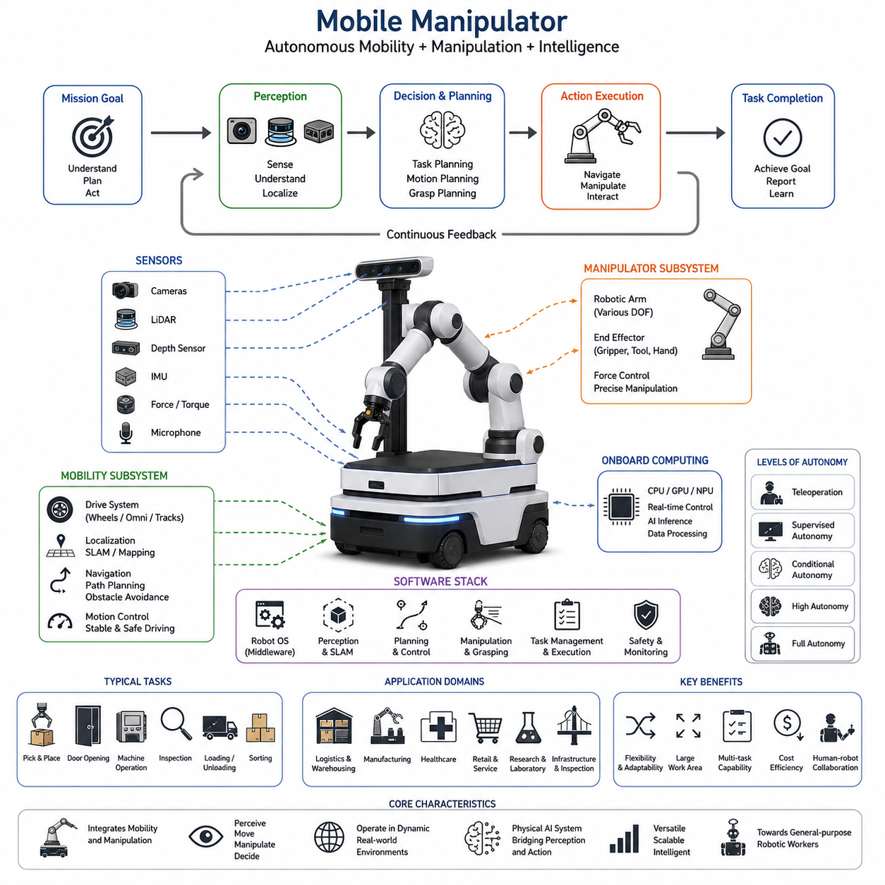
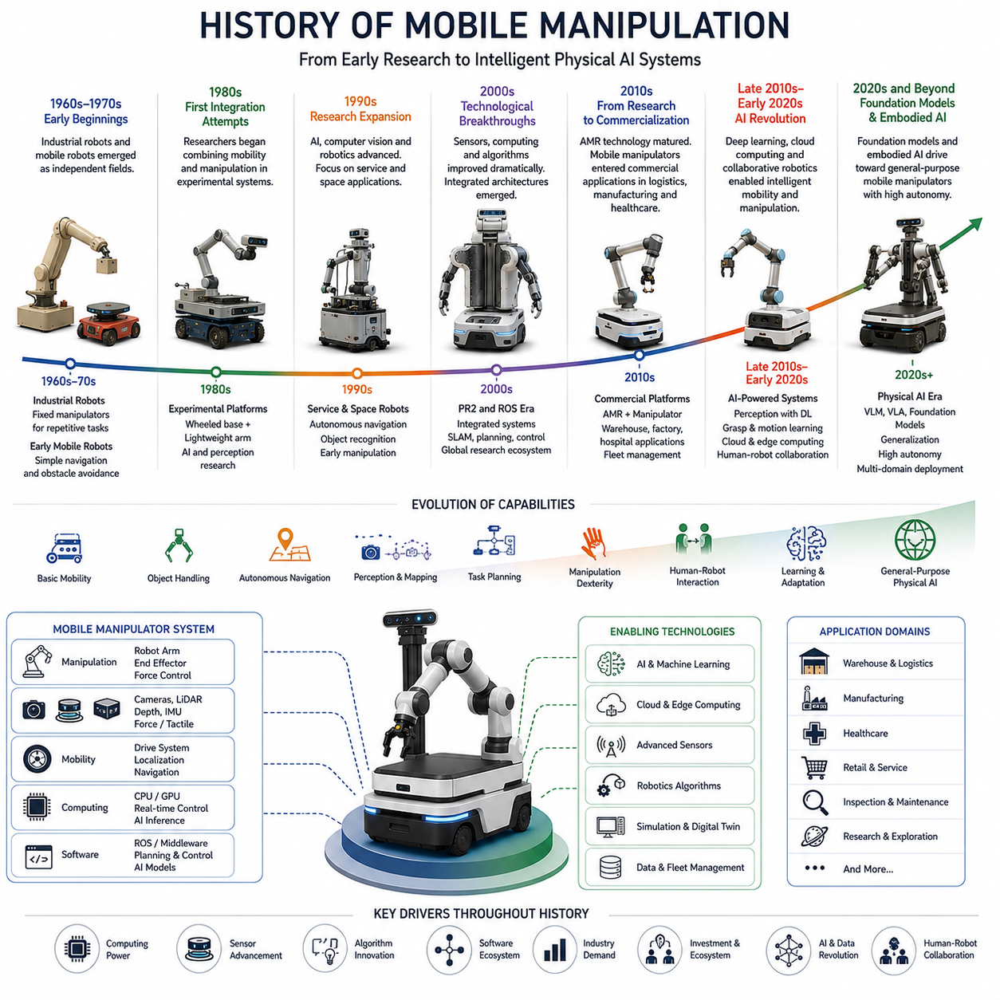
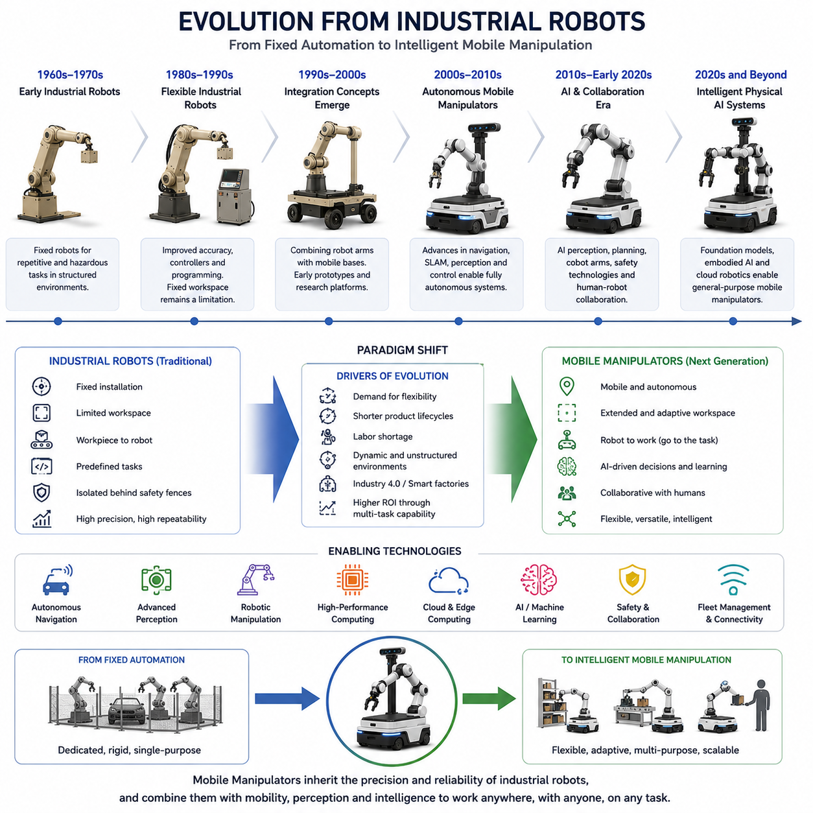
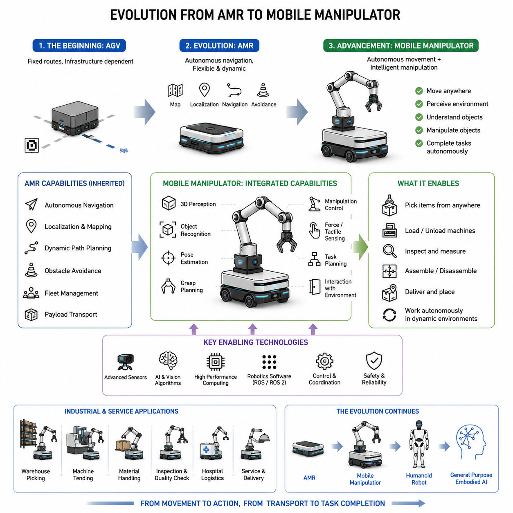
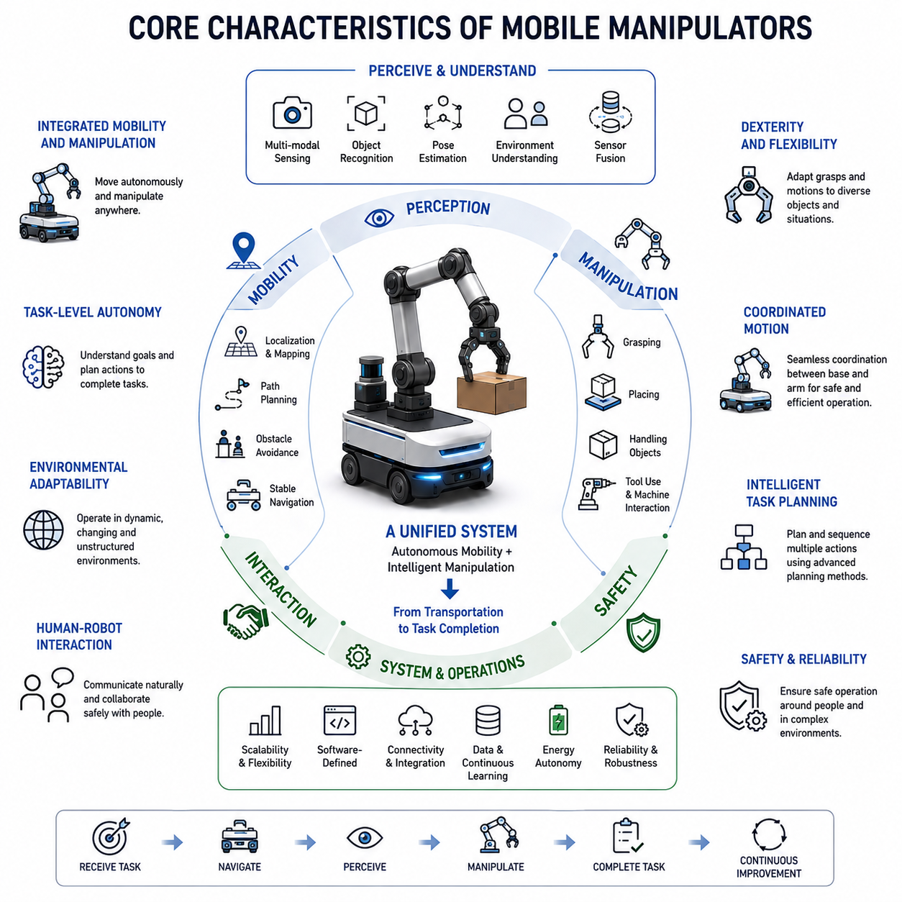
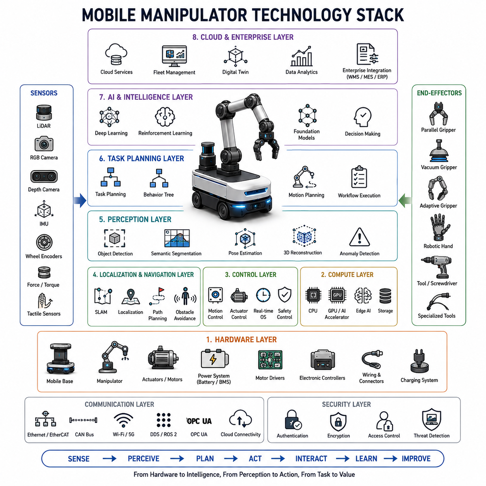
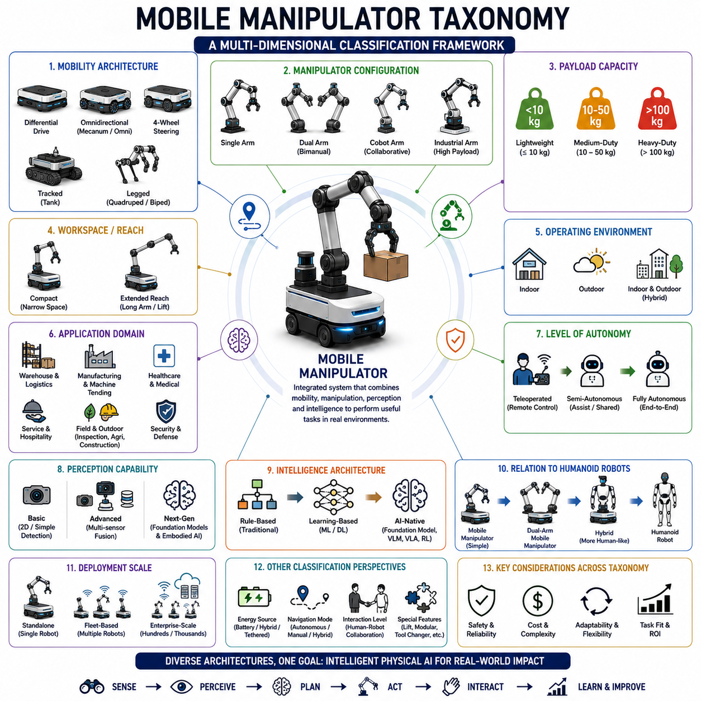
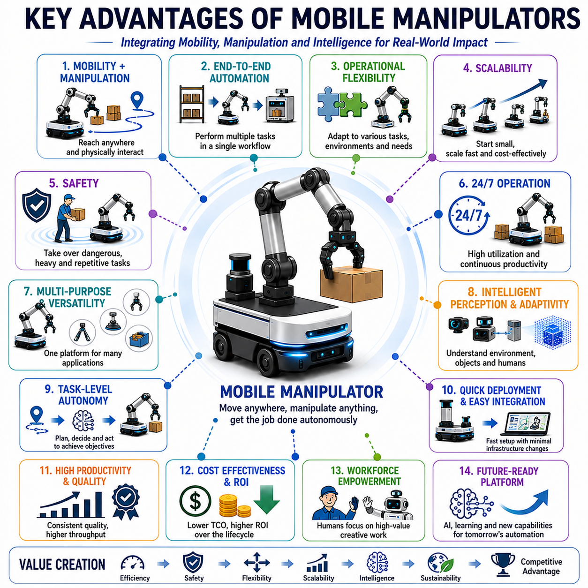
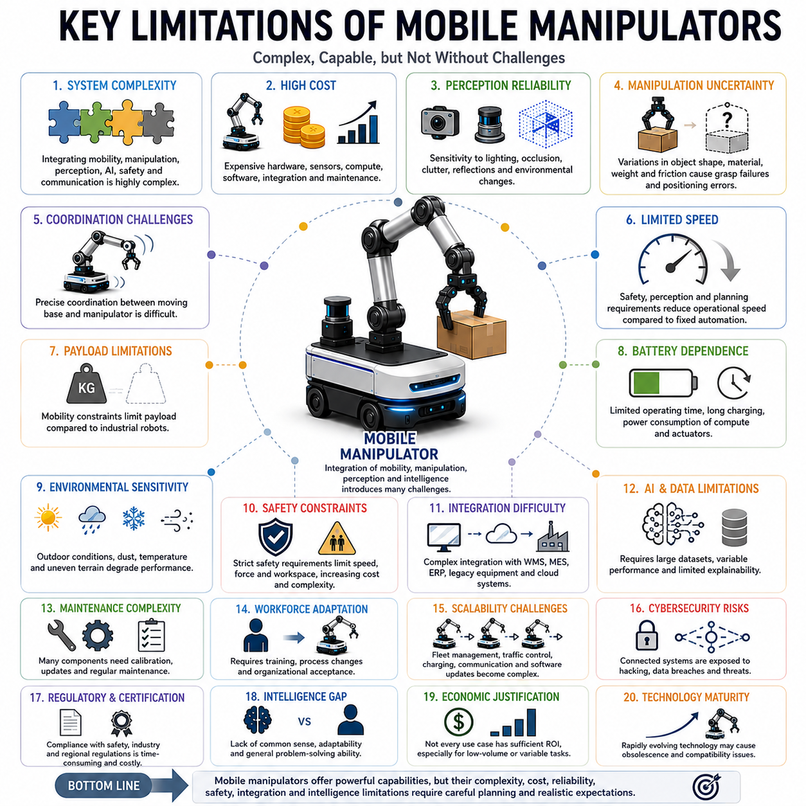
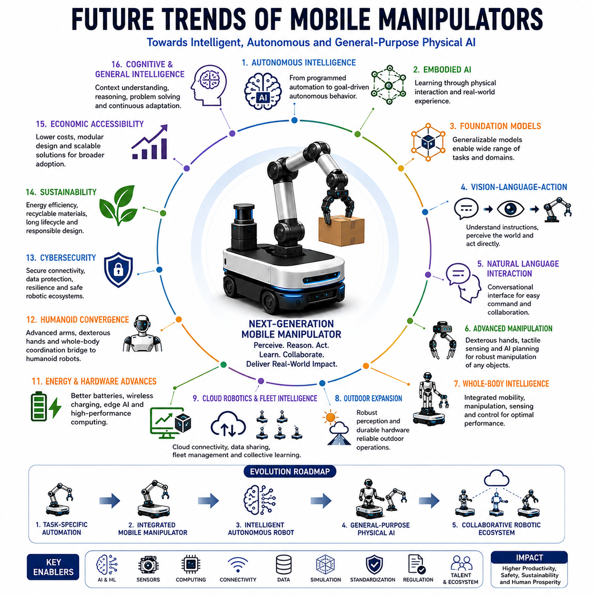

# Chapter 01. What is Mobile Manipulator

모바일 매니퓰레이터(Mobile Manipulator)는 자율주행 이동로봇(AMR)의 이동 능력과 로봇 암(Robot Arm)의 정교한 조작 능력을 결합한 로봇 시스템이다. 전통적으로 이동로봇과 산업용 로봇은 서로 다른 분야로 발전해 왔다. 이동로봇은 주로 위치 이동과 운송에 초점을 맞추었고, 산업용 로봇 암은 고정된 작업 공간에서 반복적이고 정밀한 작업을 수행하는 데 집중하였다. 모바일 매니퓰레이터는 이러한 두 기술의 융합을 통해 탄생한 새로운 형태의 로봇으로, 자유롭게 이동하면서 동시에 물체를 조작하고 환경과 상호작용할 수 있는 능력을 제공한다.

최근 산업 현장에서는 단순한 물류 이송을 넘어 보다 높은 수준의 자동화가 요구되고 있다. 현대의 물류창고, 제조공장, 병원, 공항, 서비스 환경에서는 로봇이 단순히 물건을 옮기는 수준을 넘어 물체를 집고, 장비를 조작하며, 문을 열고, 자재를 공급하고, 사람과 협력하여 작업을 수행해야 한다. 이러한 요구사항을 충족하기 위해서는 이동성, 조작성, 지능, 인지 능력이 하나의 시스템 안에 통합되어야 하며, 모바일 매니퓰레이터는 이러한 문제를 해결하기 위해 개발된 플랫폼이다.

모바일 매니퓰레이션의 역사는 대학과 연구기관에서 개발된 초기 연구용 로봇 시스템에서 시작된다. 초기 시스템은 이동 플랫폼 위에 소형 로봇 암을 탑재한 실험용 플랫폼에 불과했지만, 컴퓨팅 성능의 향상과 센서 기술의 발전, 로봇 소프트웨어 프레임워크의 성숙, 그리고 인공지능 기술의 발전에 힘입어 점차 상용화 단계로 발전하였다. 오늘날 모바일 매니퓰레이터는 물류센터, 제조공장, 병원, 연구소 등 다양한 분야에서 실제로 활용되고 있으며, 미래 자동화 시스템의 핵심 플랫폼으로 자리 잡고 있다.

모바일 매니퓰레이터의 가장 큰 특징은 다양한 하위 시스템이 하나의 통합 아키텍처로 구성된다는 점이다. 일반적인 모바일 매니퓰레이터는 이동 베이스, 로봇 암, 엔드이펙터, 센서 시스템, 온보드 컴퓨팅 시스템, 통신 인프라, 그리고 지능형 소프트웨어 스택으로 구성된다. 이동 베이스는 자율주행과 위치 이동을 담당하며, 로봇 암은 물체를 조작하는 역할을 수행한다. 엔드이펙터는 다양한 물체를 파지하고 조작할 수 있도록 지원한다. 카메라, LiDAR, 깊이 센서, 힘 센서, IMU 등의 센서는 환경을 인식하는 역할을 담당한다. 컴퓨팅 시스템은 인식, 계획, 제어, AI 알고리즘을 실행하며, 전체 시스템의 지능을 구현한다.

기술적으로 모바일 매니퓰레이터는 기계공학, 전기전자공학, 컴퓨터공학, 인공지능, 제어공학, 네트워크 기술 등 다양한 분야의 융합체이다. 기계공학은 구조 설계와 구동 시스템을 제공하며, 전기전자공학은 전력 시스템과 제어 회로를 제공한다. 컴퓨터공학은 소프트웨어 프레임워크와 인식 알고리즘을 지원하며, 로봇공학은 운동학, 동역학, 모션 플래닝 및 제어 기술을 제공한다. 또한 클라우드 컴퓨팅과 엣지 컴퓨팅은 다수의 로봇을 효율적으로 운영할 수 있는 기반을 제공한다.

모바일 매니퓰레이터는 이동 방식, 조작 능력, 자율성 수준, 적용 분야에 따라 다양한 형태로 분류될 수 있다. 일부 시스템은 차동 구동 방식의 AMR을 기반으로 하며, 다른 시스템은 전방향 이동 플랫폼이나 다족보행 시스템을 활용한다. 매니퓰레이터는 협동로봇 수준의 경량 암부터 고하중 산업용 로봇 암까지 다양하다. 자율성 수준 또한 원격조작형 로봇부터 완전 자율형 작업 수행 로봇까지 폭넓게 존재한다.

모바일 매니퓰레이터의 가장 큰 장점은 유연성과 확장성이다. 기존의 고정형 자동화 설비와 달리 여러 작업 공간을 이동하며 활용될 수 있고, 환경 변화에 적응하며 다양한 작업을 수행할 수 있다. 따라서 설비 투자 비용을 줄이고 운영 효율을 높일 수 있으며, 고정형 자동화가 어려운 환경에서도 자동화를 가능하게 만든다.

반면 모바일 매니퓰레이터는 다양한 기술적 도전 과제를 안고 있다. 이동과 조작을 동시에 수행하기 위한 복합 제어 문제, 위치 오차가 조작 정확도에 미치는 영향, 동적 환경에서의 안정적인 인식 문제, 사람과 함께 작업하기 위한 안전성 확보 등이 대표적이다. 또한 시스템 통합, 유지보수, 신뢰성 확보, 인증 및 규제 대응 역시 중요한 과제로 남아 있다.

향후 모바일 매니퓰레이터는 인공지능과 피지컬 AI의 발전과 함께 더욱 강력한 플랫폼으로 진화할 것으로 예상된다. Vision-Language Model(VLM), Vision-Language-Action(VLA), Foundation Model, Embodied AI 기술은 로봇이 자연어를 이해하고 환경을 해석하며 복잡한 작업을 수행할 수 있도록 지원하고 있다. 이러한 기술 발전은 모바일 매니퓰레이터를 특정 작업 전용 장비에서 범용 지능형 작업 로봇으로 변화시키고 있다.

궁극적으로 모바일 매니퓰레이터는 디지털 지능과 물리적 행동을 연결하는 핵심 플랫폼이며, 미래의 피지컬 AI 시대를 실현하기 위한 중요한 단계라고 할 수 있다. 이 장에서는 모바일 매니퓰레이터의 정의와 역사, 핵심 특성, 기술 구성 요소, 장점과 한계, 그리고 미래 발전 방향을 살펴봄으로써 이후 장에서 다루게 될 기술적 세부 내용에 대한 기초를 제공한다. 이는 모바일 매니퓰레이션 기술을 이해하기 위한 가장 중요한 출발점이 될 것이다.

## 01 Definition of Mobile Manipulator

{width="7.268055555555556in" height="7.268055555555556in"}

모바일 매니퓰레이터(Mobile Manipulator)는 자율 이동 능력과 물리적 조작 능력을 하나의 통합 플랫폼으로 결합한 로봇 시스템이다. 전통적인 산업용 로봇이 특정 위치에 고정되어 작업을 수행하거나, 자율주행 이동로봇(AMR)이 주로 물류 이송에 집중하는 것과 달리, 모바일 매니퓰레이터는 환경 내를 자유롭게 이동하면서 동시에 물체와 직접 상호작용할 수 있는 능력을 갖추고 있다. 이러한 특성은 로봇의 활용 범위를 획기적으로 확장시킨다. 로봇은 단순히 이동하거나 단순히 조작하는 수준을 넘어, 이동과 조작이 동시에 요구되는 복잡한 작업을 수행할 수 있게 된다. 산업계가 점점 더 유연하고 지능적인 자동화를 요구함에 따라 모바일 매니퓰레이터는 현대 로봇공학에서 가장 중요한 로봇 플랫폼 중 하나로 자리 잡고 있다.

모바일 매니퓰레이터는 기본적으로 두 개의 핵심 하위 시스템으로 구성된다. 첫 번째는 이동을 담당하는 모바일 플랫폼이며, 두 번째는 물체를 조작하는 로봇 암이다. 모바일 플랫폼은 자율주행과 위치 이동을 담당하고, 로봇 암은 물체를 집고 옮기며 조작하는 역할을 수행한다. 그러나 모바일 매니퓰레이터의 가치는 단순히 이동로봇과 로봇 암을 결합한 데 있지 않다. 진정한 가치는 이동성과 조작성의 긴밀한 통합에 있다. 로봇은 이동한 후 조작하는 것이 아니라, 이동과 조작을 지속적으로 연계하고 조정하면서 작업을 수행한다. 이를 통해 더욱 효율적이고 안전하며 지능적인 작업 수행이 가능해진다.

모바일 매니퓰레이터의 정의는 단순한 하드웨어 조합을 넘어선다. 현대의 모바일 매니퓰레이터는 기계 구조물, 전기 시스템, 센서, 컴퓨팅 플랫폼, 소프트웨어 프레임워크, 인공지능 모델, 통신 네트워크가 통합된 사이버-물리 시스템(Cyber-Physical System)이다. 이동 기술은 위치추정, 지도작성, 경로계획, 장애물 회피, 주행 제어를 필요로 하며, 조작 기술은 운동학, 동역학, 파지 기술, 힘 제어, 작업 실행 기술을 요구한다. 진정한 모바일 매니퓰레이터는 이러한 모든 기술 요소를 하나의 일관된 시스템으로 통합해야 한다.

시스템 엔지니어링 관점에서 모바일 매니퓰레이터는 환경을 인식하고, 그 환경 내에서 이동하며, 물체와 물리적으로 상호작용하고, 목표 지향적인 작업을 수행할 수 있는 자율 로봇 플랫폼으로 정의할 수 있다. 이 정의에는 네 가지 핵심 능력이 포함된다. 환경을 인식하는 능력, 이동하는 능력, 조작하는 능력, 그리고 의사결정을 수행하는 능력이다. 이 중 어느 하나라도 부족하면 실제 환경에서의 활용 가능성은 크게 제한된다.

인지(Perception)는 모바일 매니퓰레이션의 기초를 형성한다. 로봇은 안전하게 이동하고 정확하게 조작하기 위해 주변 환경을 충분히 이해해야 한다. 이를 위해 카메라, 깊이 센서, LiDAR, IMU, 힘 센서 등 다양한 센서가 사용된다. 로봇은 주변 환경을 지속적으로 관찰하며 물체를 인식하고 위치를 추정하며 환경 변화를 예측하고 내부 모델을 갱신한다. 안정적인 인지가 없다면 이동은 불안정해지고 조작은 부정확해질 수밖에 없다.

이동성(Mobility)은 로봇의 작업 공간을 획기적으로 확장시킨다. 전통적인 산업용 로봇은 로봇 암의 길이에 의해 작업 공간이 제한된다. 반면 모바일 매니퓰레이터는 필요한 위치로 직접 이동할 수 있기 때문에 작업 공간이 시설 전체로 확장된다. 하나의 로봇이 여러 작업장, 창고 구역, 생산라인, 병실 또는 서비스 공간을 담당할 수 있게 된다. 이동성은 로봇을 고정형 자동화 설비에서 유연한 작업자로 변화시키는 핵심 요소이다.

조작 능력(Manipulation)은 로봇이 환경에 물리적인 영향을 미칠 수 있도록 한다. 조작 시스템은 협동로봇 암, 산업용 로봇 암, 양팔 로봇 시스템, 심지어 휴머노이드 상체 구조까지 다양한 형태를 가질 수 있다. 엔드이펙터 역시 평행 그리퍼, 진공 흡착기, 다관절 손, 특수 공구 등 매우 다양하다. 조작 기능을 통해 로봇은 물건을 집고, 문을 열고, 기계를 조작하며, 장비를 적재하고, 검사를 수행하는 등 실제 가치가 있는 작업을 수행할 수 있다. 조작은 인지를 행동으로 연결하는 핵심 역할을 담당한다.

의사결정 능력은 모바일 매니퓰레이터의 지능을 구성하는 요소이다. 최신 시스템은 고급 계획 알고리즘, 머신러닝 모델, 파운데이션 모델, 그리고 Embodied AI 기술을 활용하여 어떤 작업을 수행해야 하는지, 그리고 어떻게 수행해야 하는지를 결정한다. 로봇은 어디로 이동해야 하는지, 어떤 경로를 선택해야 하는지, 어떤 파지 전략을 사용할지, 장애물을 어떻게 회피할지, 실패 상황에서 어떻게 복구할지를 판단해야 한다. 인공지능 기술이 발전함에 따라 모바일 매니퓰레이터는 점점 더 높은 수준의 자율성과 적응성을 갖추게 되고 있다.

모바일 매니퓰레이터의 가장 중요한 특징 중 하나는 이동과 조작이 서로 밀접하게 연결되어 있다는 점이다. 전통적인 시스템에서는 이동과 조작이 독립적으로 취급되지만, 모바일 매니퓰레이터에서는 두 기능이 지속적으로 상호작용한다. 이동 베이스의 위치는 조작 가능 영역에 직접적인 영향을 미치며, 물체를 집는 행위는 무게중심 변화를 유발하여 이동 성능에 영향을 줄 수 있다. 또한 환경 제약 조건에 따라 이동 전략과 조작 전략을 동시에 조정해야 하는 경우도 많다. 따라서 모바일 매니퓰레이션은 단순한 기능의 결합이 아니라 높은 수준의 시스템 통합 기술을 요구한다.

작업 공간(Workspace)의 개념 역시 모바일 매니퓰레이터를 정의하는 중요한 요소이다. 산업용 로봇은 고정된 작업 영역 내에서만 작업할 수 있지만, 모바일 매니퓰레이터는 이동 플랫폼의 활동 범위와 로봇 암의 작업 범위를 결합하여 훨씬 넓은 작업 공간을 제공한다. 이로 인해 시설 전체를 대상으로 자동화를 구현할 수 있으며, 기존의 고정형 자동화 설비가 수행할 수 없었던 새로운 작업 시나리오가 가능해진다.

모바일 매니퓰레이터는 다양한 기준에 따라 분류될 수 있다. 이동 방식에 따라 차동 구동형, 전방향 이동형, 궤도형, 다족보행형, 하이브리드형으로 나눌 수 있다. 조작 능력에 따라 협동로봇형, 산업용 로봇형, 양팔 로봇형, 휴머노이드형으로 구분할 수 있다. 자율성 수준에 따라 원격조작형에서 완전 자율형까지 다양한 형태가 존재한다. 또한 물류, 제조, 의료, 서비스, 국방, 농업, 인프라 점검 등 다양한 산업 분야에 적용될 수 있다.

AMR과 모바일 매니퓰레이터의 차이도 중요하다. AMR은 기본적으로 물체나 화물을 한 장소에서 다른 장소로 운반하는 데 초점을 맞춘다. 반면 모바일 매니퓰레이터는 물체를 직접 인식하고 파지하며 조작할 수 있다. 즉, 단순한 이동 플랫폼이 아니라 실제 작업을 수행하는 자동화 시스템으로 진화한 형태라고 볼 수 있다.

산업용 로봇과의 차이 역시 분명하다. 산업용 로봇은 구조화된 환경에서 높은 정밀도와 생산성을 제공하는 반면, 모바일 매니퓰레이터는 변화하는 환경에 적응하고 다양한 작업을 수행할 수 있는 유연성을 제공한다. 비록 모든 상황에서 산업용 로봇 수준의 속도와 정밀도를 제공하지는 못하더라도, 훨씬 넓은 활용성과 적응성을 제공한다는 장점을 가진다.

모바일 매니퓰레이터의 경제적 가치는 유연한 자동화에 있다. 오늘날의 산업 현장은 제품 종류와 생산 방식이 지속적으로 변화하고 있으며, 이에 따라 자동화 시스템 역시 변화에 적응할 수 있어야 한다. 모바일 매니퓰레이터는 재배치와 재구성이 비교적 용이하기 때문에 변화하는 생산 환경에 효과적으로 대응할 수 있다. 이는 대량 맞춤형 생산과 짧아진 제품 수명주기가 특징인 현대 산업에서 매우 중요한 경쟁력이 된다.

협동로봇 기술의 발전 역시 모바일 매니퓰레이터의 중요성을 더욱 높이고 있다. 현대의 로봇은 안전 펜스 안에서 고립되어 작업하는 것이 아니라 사람과 함께 협력하여 작업하는 방향으로 발전하고 있다. 이를 위해서는 사람을 인식하고 안전하게 상호작용할 수 있는 센서와 제어 기술이 필요하다. 따라서 안전성은 모바일 매니퓰레이터 설계의 핵심 요소로 자리 잡고 있다.

최근의 인공지능 기술 발전은 모바일 매니퓰레이터의 정의 자체를 변화시키고 있다. 과거에는 규칙 기반 프로그램과 사전에 정의된 절차에 의존했지만, 오늘날에는 Vision-Language Model(VLM), Vision-Language-Action(VLA), Robot Foundation Model, Embodied AI 기술을 통해 자연어를 이해하고 환경을 해석하며 새로운 작업을 학습할 수 있게 되었다. 이는 모바일 매니퓰레이터를 단순한 자동화 장비가 아니라 범용 지능형 로봇 플랫폼으로 진화시키고 있다.

결국 모바일 매니퓰레이터는 이동, 조작, 인지, 의사결정, 자율성을 하나의 시스템 안에 통합한 지능형 로봇 플랫폼이다. 이는 단순히 AMR 위에 로봇 암을 장착한 기계가 아니라, 디지털 지능과 물리적 행동을 연결하는 차세대 피지컬 AI 시스템이다. 모바일 매니퓰레이터의 정의를 정확히 이해하는 것은 이후에 다루게 될 시스템 아키텍처, 핵심 기술, 응용 사례, 제품 개발 전략, 그리고 미래 발전 방향을 이해하기 위한 가장 중요한 출발점이 된다.

## 02 History of Mobile Manipulation

{width="7.268055555555556in" height="7.268055555555556in"}

모바일 매니퓰레이션(Mobile Manipulation)의 역사는 오랫동안 독립적으로 발전해 온 두 개의 주요 로봇공학 분야가 융합되는 과정이라고 할 수 있다. 하나는 물리적 환경 속에서 이동할 수 있는 기계를 개발하는 이동로봇(Mobile Robotics) 분야이며, 다른 하나는 물체를 집고, 조작하고, 조립하고, 도구를 사용할 수 있는 기계를 개발하는 매니퓰레이션(Manipulation) 분야이다. 모바일 매니퓰레이션은 연구자들이 진정한 로봇 자율성을 실현하기 위해서는 이동 능력과 조작 능력이 동시에 필요하다는 사실을 깨닫게 되면서 탄생하였다. 그 결과 모바일 매니퓰레이터는 실험실 수준의 연구용 플랫폼에서 출발하여 오늘날 피지컬 AI(Physical AI)를 구현하는 핵심 기술 중 하나로 발전하게 되었다.

모바일 매니퓰레이션의 기원은 로봇공학이 처음 등장한 시기까지 거슬러 올라간다. 1950년대와 1960년대의 로봇 연구는 주로 산업 자동화에 집중되어 있었다. 당시의 산업용 로봇은 반복적인 생산 작업을 수행하기 위해 개발되었으며, 대부분 공장 바닥에 고정된 상태에서 제한된 작업 공간 내에서만 움직일 수 있었다. 이러한 로봇은 높은 정밀도와 반복성을 제공했지만 이동 능력은 전혀 갖추고 있지 않았다.

동시에 또 다른 연구 분야에서는 자율적으로 이동하는 기계를 개발하기 위한 노력이 진행되고 있었다. 초기 이동로봇은 매우 제한된 센서와 계산 능력을 사용하였지만, 환경을 탐색하고 장애물을 회피하는 기본적인 기능을 보여주었다. 그러나 이동과 조작은 서로 다른 연구 영역으로 취급되었으며, 두 기술을 하나의 시스템으로 통합하는 것은 당시의 기술 수준으로는 매우 어려운 과제였다.

1970년대에 들어 컴퓨터 기술이 발전하면서 보다 복잡한 로봇 시스템의 개발이 가능해졌다. 산업 현장에서는 용접, 도장, 조립, 자재 운반 등의 작업에 산업용 로봇이 널리 사용되기 시작하였다. 반면 이동로봇 연구에서는 위치추정, 경로계획, 장애물 회피 기술이 발전하였다. 연구자들은 점차 실제 환경에서 의미 있는 작업을 수행하기 위해서는 이동 능력과 조작 능력이 모두 필요하다는 사실을 인식하게 되었다. 단순히 이동만 할 수 있는 로봇은 실제 작업 수행 능력이 제한적이었고, 반대로 이동하지 못하는 로봇 암 역시 작업 공간의 제약을 벗어날 수 없었다.

이 시기에 연구기관들은 이동 플랫폼 위에 소형 로봇 암을 장착한 실험용 시스템을 개발하기 시작하였다. 이러한 초기 모바일 매니퓰레이터는 상용 제품이라기보다는 인공지능과 로봇공학 연구를 위한 실험 플랫폼이었다. 연구의 목표는 인식, 계획, 이동, 조작을 하나의 통합 시스템으로 구현하는 것이었다. 비록 당시의 시스템은 느리고 비싸며 성능도 제한적이었지만, 오늘날 모바일 매니퓰레이션 분야의 핵심 개념들이 이 시기에 정립되기 시작하였다.

1980년대는 모바일 매니퓰레이션 연구가 본격적으로 성장하기 시작한 시기였다. 컴퓨팅 성능이 향상되면서 보다 정교한 알고리즘을 적용할 수 있게 되었고, 이동로봇은 위치추정과 주행 성능을 개선하였으며, 로봇 암은 더욱 높은 정밀도와 자유도를 확보하게 되었다. 전 세계의 대학과 연구기관들은 물류, 서비스 로봇, 우주 탐사 등을 위한 다양한 모바일 매니퓰레이터 연구를 수행하였다.

특히 우주산업은 모바일 매니퓰레이션 기술 발전에 중요한 영향을 미쳤다. 우주 환경에서는 사람이 직접 접근하기 어렵기 때문에 이동과 조작을 동시에 수행할 수 있는 로봇이 필요했다. 우주 로봇, 탐사 로버, 궤도 유지보수 시스템 등의 개발 과정에서 자율 인식, 원격 조작, 작업 계획과 같은 기술들이 발전하였으며, 이는 이후 모바일 매니퓰레이터 기술에 큰 영향을 미쳤다.

1990년대에 들어 인공지능, 컴퓨터 비전, 로봇공학 기술이 빠르게 발전하면서 모바일 매니퓰레이션 연구는 새로운 전환점을 맞이하였다. 연구자들은 공장뿐만 아니라 가정, 병원, 사무실, 공공시설 등 사람이 생활하는 공간에서 활용 가능한 서비스 로봇을 개발하기 시작하였다. 이러한 환경은 제조공장보다 훨씬 복잡하고 예측하기 어려웠기 때문에 로봇은 사람을 인식하고, 물체를 찾고, 환경 변화에 적응하며, 다양한 작업을 수행할 수 있어야 했다.

이 시기의 가장 중요한 변화 중 하나는 이동과 조작을 독립적인 기능으로 보지 않고 하나의 통합 시스템으로 설계하기 시작했다는 점이다. 연구자들은 인식, 이동, 조작, 의사결정이 하나의 아키텍처 안에서 유기적으로 동작해야 한다는 사실을 인식하게 되었으며, 이러한 접근 방식은 현대 모바일 매니퓰레이터의 기본 철학이 되었다.

2000년대 초반에는 센서와 컴퓨팅 기술의 발전이 모바일 매니퓰레이션을 크게 발전시켰다. LiDAR와 카메라의 성능이 향상되었고 가격은 낮아졌다. SLAM(Simultaneous Localization and Mapping) 기술이 성숙하면서 로봇은 미지의 환경에서도 지도를 생성하며 이동할 수 있게 되었다. 또한 임베디드 컴퓨팅 기술의 발전으로 강력한 연산 능력을 로봇 내부에 탑재할 수 있게 되었다.

이와 함께 로봇 소프트웨어 프레임워크가 등장하면서 개발 효율성이 크게 향상되었다. 연구자들은 더 이상 모든 기능을 처음부터 개발할 필요가 없었으며, 보다 높은 수준의 문제 해결에 집중할 수 있게 되었다. 모바일 매니퓰레이터는 연구실을 벗어나 실제 응용 환경으로 진출하기 시작하였다.

모바일 매니퓰레이션 역사에서 가장 중요한 전환점 중 하나는 PR2의 등장이다. 2000년대 후반에 개발된 PR2는 이동 플랫폼, 양팔 로봇 암, 다양한 센서, 강력한 컴퓨팅 시스템을 통합한 연구용 모바일 매니퓰레이터였다. PR2는 전 세계 수많은 연구자들에게 표준 연구 플랫폼으로 활용되었으며, 자율주행, 조작, 인간-로봇 상호작용, 작업 계획 등 다양한 연구의 기반이 되었다. 오늘날 모바일 매니퓰레이터에 적용되는 많은 기술과 소프트웨어 구조는 PR2 연구에서 출발했다고 해도 과언이 아니다.

또한 ROS(Robot Operating System)의 등장은 모바일 매니퓰레이션 연구를 가속화하였다. ROS는 연구자와 개발자가 알고리즘과 소프트웨어를 공유할 수 있는 공통 플랫폼을 제공하였다. 이동, 인식, 조작, 경로계획, 제어 기능을 보다 쉽게 통합할 수 있게 되었으며, 모바일 매니퓰레이션은 글로벌 연구 생태계로 성장하게 되었다.

2010년대는 모바일 매니퓰레이션이 연구 단계를 넘어 상용화 단계로 진입한 시기였다. 전자상거래의 급성장은 대규모 물류 자동화에 대한 수요를 폭발적으로 증가시켰다. 물류센터에서는 다양한 상품을 처리할 수 있는 유연한 자동화 시스템이 필요했으며, 모바일 매니퓰레이터는 이러한 요구를 충족할 수 있는 유력한 솔루션으로 주목받기 시작하였다.

이 시기에는 다양한 기업들이 상용 모바일 매니퓰레이터를 개발하였다. 물류센터에서는 상품 피킹과 주문 처리 자동화를 위해 활용되었고, 제조업에서는 유연한 생산 자동화를 위한 솔루션으로 검토되었다. 병원에서는 의료 물품 운반과 검사 지원 업무에 적용되기 시작하였다.

특히 AMR 기술의 발전은 모바일 매니퓰레이션 상용화를 촉진하는 중요한 역할을 하였다. 자율주행 기술이 성숙하면서 이동 플랫폼의 신뢰성이 크게 향상되었고, 여기에 로봇 암을 결합함으로써 보다 높은 수준의 자동화가 가능해졌다. 이는 단순한 운반 로봇을 실제 작업 수행 로봇으로 진화시키는 계기가 되었다.

2010년대 후반과 2020년대 초반에는 인공지능 기술이 모바일 매니퓰레이션을 다시 한번 변화시켰다. 딥러닝은 컴퓨터 비전 분야를 혁신적으로 발전시켰으며, 로봇은 물체를 인식하고 자세를 추정하며 장면을 이해할 수 있게 되었다. 머신러닝은 파지 계획, 조작 전략, 의사결정 능력을 크게 향상시켰다. 모바일 매니퓰레이터는 규칙 기반 시스템에서 AI 기반 시스템으로 빠르게 진화하였다.

동시에 클라우드 컴퓨팅, 엣지 컴퓨팅, 플릿 관리 기술이 발전하면서 다수의 모바일 매니퓰레이터를 통합 운영하는 것이 가능해졌다. 로봇은 개별 장비가 아니라 네트워크로 연결된 지능형 에이전트로 변화하기 시작하였다.

협동로봇 기술 역시 모바일 매니퓰레이션의 발전을 촉진하였다. 사람과 안전하게 협업할 수 있는 협동로봇 암이 등장하면서 모바일 매니퓰레이터는 물류창고, 병원, 공장, 서비스 환경에서 사람과 함께 작업할 수 있게 되었다. 인간-로봇 협업은 현재 모바일 매니퓰레이션 연구와 상용화의 중요한 주제 중 하나가 되었다.

최근에는 Foundation Model과 Embodied AI 기술이 모바일 매니퓰레이션의 새로운 시대를 열고 있다. 과거의 로봇은 미리 정의된 절차와 규칙에 따라 동작했지만, 이제는 대규모 데이터를 학습하고 자연어를 이해하며 새로운 작업에 적응할 수 있는 능력을 갖추기 시작하였다. Vision-Language Model(VLM), Vision-Language-Action(VLA), Robot Foundation Model은 모바일 매니퓰레이터를 범용 지능형 로봇으로 발전시키고 있다.

오늘날 모바일 매니퓰레이터는 물류, 제조, 의료, 서비스, 인프라 점검, 연구 분야 등 다양한 산업에서 핵심 로봇 플랫폼으로 활용되고 있다. 이는 로봇공학, 인공지능, 컴퓨터 비전, 클라우드 컴퓨팅, 소프트웨어 아키텍처의 발전이 결합된 결과라고 할 수 있다.

앞으로 모바일 매니퓰레이션은 더욱 높은 수준의 자율성, 지능성, 적응성을 갖춘 방향으로 발전할 것으로 예상된다. 미래의 로봇은 보다 강력한 추론 능력을 바탕으로 사람과 협력하며 복잡한 작업을 수행할 수 있을 것이다. 또한 모바일 매니퓰레이터, 서비스 로봇, 산업용 로봇, 휴머노이드 로봇 간의 경계는 점차 희미해질 가능성이 높다.

모바일 매니퓰레이션의 역사는 단순히 이동 플랫폼 위에 로봇 암을 장착하는 기술의 발전 과정이 아니다. 이는 로봇이 고정된 자동화 장비에서 벗어나 실제 환경 속에서 지능적으로 행동할 수 있는 존재로 진화해 온 과정이다. 바퀴와 로봇 암을 결합한 실험실 연구에서 시작된 기술은 이제 피지컬 AI 시대를 이끌 핵심 플랫폼으로 성장하고 있으며, 앞으로의 로봇 산업과 지능형 기계의 미래를 이해하는 데 매우 중요한 의미를 가진다.

## 03 Evolution from Industrial Robots

{width="7.268055555555556in" height="7.268055555555556in"}

모바일 매니퓰레이터의 발전 과정을 이해하기 위해서는 산업용 로봇의 역사와 발전 과정을 먼저 살펴볼 필요가 있다. 모바일 매니퓰레이터는 기존에 존재하지 않던 완전히 새로운 로봇의 형태라기보다는 산업용 로봇이 가진 한계를 극복하기 위해 자연스럽게 진화한 결과물이라고 할 수 있다. 지난 50여 년 동안 산업용 로봇은 높은 정밀도와 반복성, 생산성, 신뢰성을 바탕으로 제조업 혁신을 이끌어 왔다. 그러나 산업 환경이 점차 유연성 중심으로 변화하고 제품 수명주기가 짧아지며 다품종 소량생산과 대량 맞춤형 생산이 확대되면서 기존의 고정형 자동화 시스템은 새로운 도전에 직면하게 되었다. 모바일 매니퓰레이터는 이러한 변화에 대응하기 위해 산업용 로봇의 장점과 자율 이동 기술의 유연성을 결합하여 등장한 차세대 로봇 플랫폼이다.

산업용 로봇의 기원은 1950년대 후반과 1960년대 초반으로 거슬러 올라간다. 초기 산업용 로봇은 반복적이고 위험한 작업을 자동화하기 위해 개발되었다. 이들 시스템은 대부분 공장 바닥에 고정된 로봇 암 형태였으며 용접, 도장, 조립, 공작기계 로딩, 자재 이송과 같은 특정 작업을 수행하도록 설계되었다. 산업용 로봇의 가장 큰 특징은 구조화된 환경에서 동작한다는 점이었다. 작업 대상, 공구, 설비, 작업 순서는 모두 미리 정해져 있었으며 로봇은 반복적으로 동일한 동작을 수행하였다.

이러한 설계 철학은 제조업에서 큰 성공을 거두었다. 자동차 산업, 전자 산업, 금속 가공 산업 등 다양한 분야에서 산업용 로봇은 핵심 생산 설비로 자리 잡았다. 높은 정밀도와 반복성을 기반으로 생산 품질을 향상시키고 생산성을 극대화하였다. 수십 년에 걸친 발전을 통해 산업용 로봇은 인류가 개발한 가장 성공적인 자동화 기술 중 하나가 되었다.

그러나 전통적인 산업용 로봇에는 근본적인 한계가 존재하였다. 바로 이동할 수 없다는 점이다. 산업용 로봇의 작업 범위는 로봇 암의 길이와 운동학 구조에 의해 결정된다. 작업 대상이 로봇의 작업 공간을 벗어나면 별도의 이송 장치가 필요하거나 추가 로봇을 설치해야 했다. 결과적으로 공장의 레이아웃은 작업 효율성보다는 로봇의 작업 범위에 맞추어 설계되는 경우가 많았다.

초기의 대량생산 환경에서는 이러한 제약이 큰 문제가 되지 않았다. 제품 종류가 적고 생산량이 많았으며 생산 공정이 장기간 유지되었기 때문이다. 고정형 로봇 셀은 대규모 생산량을 통해 투자비를 회수할 수 있었고 매우 높은 경제성을 제공하였다.

그러나 글로벌 제조 환경은 점차 변화하기 시작하였다. 시장 경쟁이 심화되고 제품 수명주기가 짧아지면서 기업들은 더욱 다양한 제품을 더 빠르게 생산해야 했다. 고객 요구사항도 빠르게 변화하였으며 대량 맞춤형 생산이 중요해졌다. 기존의 고정형 자동화 시스템은 이러한 변화에 유연하게 대응하기 어려웠다. 생산 라인을 변경하거나 새로운 제품에 맞추어 로봇 셀을 재구성하는 데에는 많은 시간과 비용이 필요하였다.

이러한 문제를 해결하기 위해 등장한 개념이 유연 자동화(Flexible Automation)이다. 유연 자동화는 특정 작업만 수행하는 고정형 설비 대신 변화하는 작업 환경에 적응할 수 있는 자동화 시스템을 추구한다. 산업용 로봇 역시 컨트롤러, 센서, 소프트웨어의 발전을 통해 점점 더 유연한 시스템으로 발전하였지만, 스스로 이동할 수 없다는 근본적인 제약은 여전히 존재하였다.

한편 이동로봇 분야에서는 자율주행 기술이 빠르게 발전하고 있었다. 위치추정, 지도작성, 경로계획, 장애물 회피 기술이 발전하면서 이동로봇은 실제 산업 환경에서도 활용되기 시작하였다. 초기의 AGV(Automated Guided Vehicle)는 고정된 경로를 따라 이동하였고, 이후 등장한 AMR(Autonomous Mobile Robot)은 변화하는 환경 속에서도 자율적으로 이동할 수 있게 되었다. 그러나 이러한 이동로봇은 주로 물류 이송에 집중되어 있었으며 물체를 직접 조작하는 능력은 부족하였다.

산업계는 점차 이동 능력과 조작 능력을 동시에 갖춘 로봇을 필요로 하게 되었다. 그 결과 산업용 로봇 암을 이동 플랫폼 위에 탑재하는 개념이 등장하였다. 이는 매우 단순해 보이지만 실제로는 자동화의 패러다임을 변화시키는 혁신적인 발상이었다. 기존에는 작업물을 로봇 앞으로 가져와야 했지만, 이제는 로봇이 작업물이 있는 위치로 직접 이동할 수 있게 된 것이다.

산업용 로봇에서 모바일 매니퓰레이터로 진화하는 과정에서는 다양한 기술적 문제를 해결해야 했다. 산업용 로봇은 고정된 좌표계와 안정적인 환경을 전제로 설계되었다. 반면 모바일 매니퓰레이터는 지속적으로 위치가 변하는 이동 플랫폼 위에서 정밀한 조작을 수행해야 한다. 따라서 이동과 조작을 동시에 제어하는 기술이 필요하게 되었으며, 이는 기존 산업용 로봇보다 훨씬 복잡한 시스템 통합 문제를 야기하였다.

초기의 모바일 매니퓰레이터는 수동으로 이동되는 플랫폼 위에 산업용 로봇 암을 탑재한 형태였다. 작업자가 원하는 위치로 이동시킨 후 로봇이 작업을 수행하는 방식이었다. 비록 완전 자율형은 아니었지만 이러한 시스템은 이동성과 조작성 결합의 가능성을 보여주었다.

이후 자율주행 기술이 발전하면서 완전 자율형 모바일 매니퓰레이터가 등장하기 시작하였다. 위치추정과 SLAM 기술은 로봇이 스스로 자신의 위치를 파악할 수 있도록 하였으며, 모션 플래닝 기술은 이동과 조작을 통합적으로 계획할 수 있도록 만들었다. 또한 카메라와 LiDAR를 포함한 다양한 센서 기술은 환경 인식 능력을 크게 향상시켰다.

산업 철학의 변화 역시 이러한 진화를 가속화하였다. 린 생산(Lean Manufacturing)은 유연성과 효율성을 강조하였으며, Industry 4.0은 스마트 팩토리, 디지털 트윈, 사이버-물리 시스템과 같은 개념을 도입하였다. 모바일 매니퓰레이터는 이러한 새로운 생산 패러다임에 매우 잘 부합하였다. 하나의 로봇이 여러 작업장을 이동하며 작업을 수행할 수 있었고, 디지털 시스템과 연계하여 실시간으로 운영될 수 있었기 때문이다.

산업용 로봇에서 모바일 매니퓰레이터로 진화하는 과정에서 가장 중요한 변화 중 하나는 정밀도와 유연성 사이의 균형이었다. 전통적인 산업용 로봇은 최고 수준의 정밀도를 목표로 설계되었다. 반면 모바일 매니퓰레이터는 이동 과정에서 발생하는 위치 오차와 환경 변화로 인해 동일한 수준의 정밀도를 확보하기 어려웠다. 그러나 센서 기술, 캘리브레이션 기술, 힘 제어 기술, 비전 시스템의 발전을 통해 모바일 매니퓰레이터 역시 높은 수준의 정밀도를 확보하게 되었다.

노동력 부족 문제도 모바일 매니퓰레이터의 발전을 촉진하였다. 많은 산업 분야에서 반복적이고 힘든 작업을 수행할 인력을 확보하기 어려워졌다. 고정형 자동화는 일부 문제를 해결할 수 있었지만 다양한 작업과 환경에 대응하기에는 한계가 있었다. 모바일 매니퓰레이터는 여러 작업을 하나의 플랫폼으로 수행할 수 있기 때문에 보다 높은 투자 효율성을 제공하였다.

전자상거래 산업의 급성장은 모바일 매니퓰레이터 발전의 또 다른 전환점이 되었다. 전통적인 산업용 로봇은 제조 공정에는 적합했지만 물류 환경에는 적합하지 않았다. 물류센터는 수많은 상품과 다양한 작업이 혼재하는 동적인 환경이다. 모바일 매니퓰레이터는 이동과 조작 능력을 동시에 제공함으로써 이러한 환경에 최적화된 자동화 솔루션으로 주목받게 되었다.

협동로봇(Cobot)의 등장은 모바일 매니퓰레이터 진화에 또 다른 영향을 미쳤다. 기존 산업용 로봇은 안전 펜스 내부에서 사람과 분리된 상태로 동작하였다. 그러나 모바일 매니퓰레이터는 사람과 같은 공간에서 작업해야 하는 경우가 많다. 이를 위해 힘 센서, 충돌 감지, 컴플라이언스 제어, 인간 인식 기술이 발전하였으며, 모바일 매니퓰레이터는 사람과 안전하게 협업할 수 있는 플랫폼으로 발전하였다.

인공지능은 산업용 로봇에서 모바일 매니퓰레이터로의 진화를 결정적으로 가속화한 요소이다. 전통적인 산업용 로봇은 대부분 결정론적 프로그램에 의해 동작하였다. 모든 동작과 작업 절차가 사전에 정의되어 있었다. 반면 현대의 모바일 매니퓰레이터는 AI 기반 인식, 계획, 의사결정 시스템을 활용한다. 딥러닝과 머신러닝 기술은 물체 인식, 자세 추정, 파지 계획, 경로 생성, 상황 대응 능력을 크게 향상시켰다.

최근에는 Vision-Language Model(VLM), Vision-Language-Action(VLA), Robot Foundation Model과 같은 기술이 등장하면서 모바일 매니퓰레이터는 새로운 진화 단계에 진입하고 있다. 이제 로봇은 자연어 명령을 이해하고, 환경을 해석하며, 복잡한 작업을 스스로 계획할 수 있게 되고 있다. 이는 산업용 자동화에서 범용 지능형 로봇으로의 전환을 의미한다.

산업용 로봇에서 모바일 매니퓰레이터로의 진화는 작업 공간 중심 자동화에서 작업 중심 자동화로의 전환이라고도 볼 수 있다. 과거에는 작업을 로봇에게 맞추어야 했다. 하지만 모바일 매니퓰레이터는 스스로 작업이 필요한 위치로 이동하여 환경에 적응하며 작업을 수행한다. 이는 자동화 가능한 작업의 범위를 획기적으로 확장시켰다.

오늘날의 모바일 매니퓰레이터는 산업용 로봇이 수십 년 동안 축적해 온 기계 설계 기술, 정밀 제어 기술, 운동학 및 동역학 기술, 안전 기술, 신뢰성 기술을 그대로 계승하고 있다. 동시에 자율주행, 인공지능, 클라우드 컴퓨팅, 엣지 컴퓨팅, Embodied AI 기술을 융합하여 새로운 차원의 로봇 플랫폼으로 발전하고 있다.

미래에는 산업용 로봇과 모바일 매니퓰레이터의 경계가 점차 사라질 가능성이 높다. 더욱 강력한 자율성과 지능을 갖춘 로봇이 등장하면서 공장 전체를 이동하며 작업을 수행하는 지능형 로봇 네트워크가 일반화될 수 있다. 이러한 환경에서는 이동 능력이 특별한 기능이 아니라 로봇의 기본 기능이 될 가능성이 높다.

결국 산업용 로봇에서 모바일 매니퓰레이터로의 진화는 자동화 기술 자체의 진화를 의미한다. 자동화는 더 이상 고정되고 제한된 시스템이 아니라, 스스로 이동하고 판단하며 환경에 적응하는 지능형 플랫폼으로 발전하고 있다. 모바일 매니퓰레이터는 산업용 로봇의 정밀성과 신뢰성, 그리고 자율 이동 기술의 유연성과 적응성을 결합한 결과물이며, 미래 피지컬 AI 시대를 연결하는 핵심 기술 플랫폼으로 자리매김하고 있다.

## 04 Evolution from AMR

{width="7.268055555555556in" height="7.268055555555556in"}

모바일 매니퓰레이터(Mobile Manipulator)의 등장은 현대 로보틱스에서 가장 중요한 진화 단계 중 하나로 평가된다. 자율주행 이동로봇(AMR, Autonomous Mobile Robot)은 동적인 환경에서 자율적으로 이동할 수 있는 능력을 제공함으로써 물류 및 자동화 산업에 혁신을 가져왔다. 그러나 AMR은 물리적으로 환경과 상호작용하는 능력이 제한되어 있었다. 따라서 AMR에서 모바일 매니퓰레이터로의 진화는 단순한 "자율 이동"에서 "자율 작업"으로의 전환이라고 볼 수 있다. 이는 스스로 운전할 수 있는 차량과 이동뿐 아니라 실제 작업까지 수행할 수 있는 작업자의 차이와 유사하다. 모바일 매니퓰레이터는 AMR의 이동 능력을 그대로 계승하면서 로봇 암, 엔드이펙터, 고도화된 인지 시스템, 지능형 작업 계획 기능을 추가함으로써 단순 운송이 아닌 완전한 작업 프로세스를 수행할 수 있게 되었다. 이러한 진화는 범용 로봇(General-Purpose Robot)과 체화지능(Embodied Intelligence)으로 가는 중요한 이정표가 되고 있다.

초기의 이동 로봇은 주로 주행 기능에 초점을 맞추었다. 초기 AGV(Automated Guided Vehicle)는 자기 테이프, 마커, 고정 경로를 따라 이동하는 방식으로 동작하였다. 이러한 시스템은 구조화된 환경에서는 매우 효율적이었지만 유연성이 부족했다. 생산 라인이나 공장 레이아웃이 변경되면 시스템 전체를 다시 구성해야 하는 경우가 많았다. 산업 현장에서 더 높은 유연성이 요구되면서 AMR이 등장하게 되었다. AMR은 위치추정(Localization), 지도작성(Mapping), 장애물 회피, 동적 경로계획, 자율 의사결정 기능을 제공함으로써 변화하는 환경에서도 안정적으로 운용될 수 있었다.

AMR의 급속한 확산은 전자상거래의 성장, 물류 자동화 확대, 제조 유연성 확보, 그리고 노동력 부족 문제와 밀접한 관련이 있다. 기업들은 고정 인프라 구축 없이 빠르게 도입할 수 있는 이동형 자동화 솔루션을 필요로 하였고, AMR은 이러한 요구를 충족시켰다. 전 세계의 물류센터와 제조공장은 AMR을 활용하여 선반, 박스, 팔레트, 의료 물품, 생산 자재 등을 운반하기 시작하였다. 이를 통해 생산성과 운영 효율성이 크게 향상되었다.

그러나 AMR의 성공과 함께 중요한 한계도 드러났다. AMR은 물체를 운반할 수는 있었지만 직접 집거나 조작할 수는 없었다. 실제 산업 현장에서 운송은 전체 작업의 일부에 불과하다. 사람은 물건을 찾고, 인식하고, 집고, 이동시키고, 장비를 조작하며, 작업을 완료한다. AMR은 이러한 과정 중 이동 단계만 자동화할 수 있었고, 이동 전후에 필요한 작업은 여전히 사람이 수행해야 했다. 이 한계는 보다 높은 수준의 자동화를 추구하는 기업들에게 중요한 과제로 인식되었다.

창고 환경을 예로 들면, AMR은 선반 앞까지 이동할 수 있지만 선반에서 상품을 꺼낼 수는 없다. 결국 피킹 작업은 사람이 해야 한다. 제조 현장에서도 AMR은 부품을 CNC 장비까지 운반할 수 있지만 기계에 부품을 장착하거나 가공 완료 후 제품을 회수할 수는 없다. 병원에서는 의료 물품을 특정 병동까지 배송할 수 있지만 캐비닛을 열거나 물품을 정리하는 작업은 수행할 수 없다. 이러한 이유로 AMR만으로는 전체 업무 프로세스 자동화가 어려웠다.

이러한 문제를 해결하기 위해 로봇 개발자들은 이동 플랫폼과 로봇 암을 결합하는 방안을 연구하기 시작했다. 개념은 단순했다. AMR 위에 로봇 암을 탑재하면 이동과 조작을 동시에 수행할 수 있는 로봇이 된다. 로봇은 단순히 장소를 이동하는 것이 아니라 이동한 위치에서 실제 작업을 수행할 수 있게 된다. 이것이 바로 모바일 매니퓰레이터의 시작이다.

AMR에서 모바일 매니퓰레이터로의 진화는 다양한 기술 분야의 발전을 필요로 했다. 이동 플랫폼은 더욱 정밀한 위치 제어 능력을 갖추어야 했으며, 인지 시스템은 물체 인식, 자세 추정, 파지점 탐색 등의 기능을 수행해야 했다. 제어 시스템은 이동 플랫폼과 로봇 암을 동시에 제어해야 했고, 안전 시스템은 차량 이동과 로봇 암 동작을 모두 고려해야 했다. 또한 컴퓨팅 플랫폼은 대량의 센서 데이터를 실시간으로 처리할 수 있어야 했다.

초기 모바일 매니퓰레이터는 주로 연구실 환경에서 개발되었다. 연구자들은 이동 플랫폼 위에 로봇 암을 장착하여 다양한 실험을 수행하였다. 이러한 시스템은 가능성을 보여주었지만 비용이 높고 신뢰성이 낮으며 실제 산업 현장에 적용하기 어려웠다. 그러나 센서 기술, GPU 연산 성능, AI 알고리즘, 로봇 소프트웨어가 발전하면서 상용화 가능성이 점차 높아지기 시작했다.

특히 저가형 깊이 카메라, LiDAR, 고성능 GPU, AI 기반 비전 기술의 발전은 모바일 매니퓰레이터의 성장을 가속화하였다. 로봇은 주변 환경을 3차원으로 인식하고, 물체를 식별하며, 최적의 파지 전략을 생성할 수 있게 되었다. 동시에 ROS와 ROS2 같은 표준화된 로봇 소프트웨어 프레임워크가 등장하면서 이동, 인지, 조작, 작업 계획 기능을 하나의 시스템으로 통합하는 것이 가능해졌다.

AMR에서 모바일 매니퓰레이터로의 진화는 서로 다른 두 로봇 산업의 융합 과정으로도 볼 수 있다. 한쪽에는 자율주행과 물류 자동화에 특화된 모바일 로봇 산업이 있었고, 다른 한쪽에는 정밀 조작과 생산 자동화에 특화된 산업용 로봇 산업이 있었다. 모바일 매니퓰레이터는 이 두 분야의 기술을 결합하여 새로운 형태의 로봇 플랫폼을 만들어냈다.

이러한 융합은 로봇의 역할 자체를 변화시키고 있다. 기존 AMR은 주로 물류 운송 장비로 활용되었다. 반면 모바일 매니퓰레이터는 작업 수행 주체로 기능한다. 예를 들어 단순 운반이 아니라 물체를 찾고, 집고, 이동시키고, 배치하고, 결과를 확인하는 전체 작업 흐름을 수행할 수 있다. 즉 로봇이 단일 공정이 아닌 전체 프로세스를 책임질 수 있게 된 것이다.

특히 변화가 많고 복잡한 환경에서는 모바일 매니퓰레이터의 장점이 더욱 크다. 고정형 자동화 설비는 특정 작업에는 매우 효율적이지만 환경 변화에 취약하다. 반면 모바일 매니퓰레이터는 다양한 위치로 이동하며 여러 작업을 수행할 수 있다. 하나의 로봇이 오전에는 창고 피킹을 수행하고, 오후에는 기계 로딩 작업을 수행하며, 저녁에는 재고 점검을 수행할 수도 있다. 이러한 다목적성은 투자 효율성을 크게 향상시킨다.

노동력 부족 문제 역시 모바일 매니퓰레이터의 성장을 촉진하는 요인이다. 많은 산업 분야에서 반복적이고 힘든 작업을 수행할 인력을 확보하기 어려워지고 있다. AMR은 운송 작업만 자동화할 수 있었지만 모바일 매니퓰레이터는 실제 물리적 작업까지 자동화할 수 있기 때문에 노동력 의존도를 더욱 크게 줄일 수 있다.

인공지능 기술의 발전은 이러한 진화를 더욱 가속화하고 있다. 최신 AI 시스템은 비정형 환경을 이해하고, 다양한 물체를 인식하며, 시범 데이터를 학습하고, 변화하는 상황에 적응할 수 있다. Vision-Language Model(VLM), Vision-Language-Action(VLA), Foundation Model과 같은 기술은 자연어 명령을 이해하고 복잡한 작업 계획을 생성할 수 있게 해준다. 이는 모바일 매니퓰레이터를 단순 자동화 장비에서 지능형 자율 시스템으로 발전시키고 있다.

시스템 아키텍처 관점에서 모바일 매니퓰레이터는 AMR보다 훨씬 복잡한 구조를 가진다. 이동 플랫폼은 위치추정, 경로계획, 장애물 회피, 플릿 관리 기능을 담당한다. 매니퓰레이터는 운동학, 동역학, 파지 제어, 힘 제어를 수행한다. 인지 시스템은 환경과 물체를 이해하고, 작업 계획 시스템은 전체 작업 흐름을 조정한다. 또한 클라우드 및 엣지 컴퓨팅은 데이터 처리, AI 모델 관리, 플릿 최적화, 원격 운영을 지원한다. 이러한 요소들이 결합되어 완전한 모바일 매니퓰레이터 플랫폼을 구성한다.

경제적 측면에서도 이러한 진화는 매우 중요한 의미를 가진다. 기업들은 이제 단순 작업 자동화가 아니라 전체 업무 프로세스 자동화를 원하고 있다. AMR은 운송만 자동화하지만 모바일 매니퓰레이터는 운송, 피킹, 적재, 검사, 조립 등 다양한 작업을 통합적으로 자동화할 수 있다. 따라서 생산성 향상 효과와 투자 수익률이 훨씬 높아질 수 있다.

현재 모바일 매니퓰레이터는 창고 피킹, 주문 처리, 선반 보충, 기계 로딩, 품질 검사, 병원 물류, 약국 자동화, 서비스 로봇 등 다양한 분야에 적용되고 있다. 이러한 사례들은 이동 능력에 조작 능력이 추가될 때 로봇이 단순 운송 장비에서 실제 작업 수행 시스템으로 변화할 수 있음을 보여준다.

AMR에서 모바일 매니퓰레이터로의 진화는 휴머노이드 로봇으로 가는 중요한 중간 단계이기도 하다. 휴머노이드 로봇은 이동, 조작, 인지, 지능을 모두 통합한 시스템이다. 그러나 휴머노이드에 필요한 핵심 기술 대부분은 이미 모바일 매니퓰레이터를 통해 개발되고 검증되고 있다. 자율주행, 물체 인식, 파지 기술, 작업 계획, 플릿 관리, AI 추론 기술은 모두 모바일 매니퓰레이터에서 먼저 성숙한 후 휴머노이드로 확장될 수 있다. 따라서 모바일 매니퓰레이터는 AMR과 휴머노이드 사이를 연결하는 중요한 기술적 교량이라고 할 수 있다.

향후에는 AMR과 모바일 매니퓰레이터의 경계가 점차 사라질 가능성이 높다. 많은 AMR이 기본적인 조작 기능을 갖추게 될 것이며, 모바일 매니퓰레이터는 더욱 강력한 AI와 자율 의사결정 기능을 통합하게 될 것이다. 산업계는 단순히 이동하는 로봇이 아니라 실제 작업을 수행할 수 있는 로봇을 요구하고 있기 때문이다.

결국 AMR에서 모바일 매니퓰레이터로의 진화는 이동 중심 자동화에서 작업 중심 자율화로의 전환을 의미한다. AMR은 로봇이 복잡한 환경 속에서 스스로 이동할 수 있음을 증명했다. 모바일 매니퓰레이터는 그 위에 물리적 작업 수행 능력을 추가함으로써 로봇을 단순한 운송 수단에서 자율 작업자로 발전시키고 있다. 이러한 흐름은 범용 로봇, 체화지능, 그리고 궁극적으로 인간 수준의 물리적 지능을 가진 차세대 로봇으로 이어지는 중요한 진화 경로가 될 것이다.

## 05 Core Characteristics

{width="7.268055555555556in" height="7.268055555555556in"}

모바일 매니퓰레이터(Mobile Manipulator)는 현대 로보틱스의 가장 중요한 발전 중 하나로 평가된다. 이는 자율주행 이동 능력과 로봇 조작 능력을 하나의 시스템으로 통합한 로봇이기 때문이다. 전통적인 산업용 로봇이 고정된 작업 공간에서만 동작하고, 자율주행 이동로봇(AMR)이 주로 물류 운반에 집중하는 것과 달리, 모바일 매니퓰레이터는 동적인 환경 속을 자유롭게 이동하면서 주변 사물과 물리적으로 상호작용할 수 있다. 이러한 특징은 로봇의 역할을 단순한 자동화 장비에서 실제 작업을 수행하는 자율 작업자로 변화시키고 있으며, 제조, 물류, 의료, 서비스, 공공시설 등 다양한 산업에서 새로운 자동화 패러다임을 만들어 가고 있다.

모바일 매니퓰레이터의 가장 중요한 특성은 이동성과 조작 능력의 통합이다. 과거에는 이동 로봇과 산업용 로봇이 서로 다른 기술 영역으로 발전해 왔다. 이동 로봇은 위치추정, 지도작성, 경로계획, 장애물 회피에 집중하였고, 산업용 로봇은 정밀한 조작과 반복 작업 수행에 초점을 맞추었다. 모바일 매니퓰레이터는 이 두 기술을 하나의 플랫폼으로 결합한다. 따라서 로봇은 특정 위치까지 자율적으로 이동한 후, 물체를 집거나 옮기고, 필요한 작업을 수행한 뒤 다음 작업 장소로 이동할 수 있다. 즉, 단순히 이동만 하는 로봇이 아니라 전체 작업 프로세스를 수행하는 로봇으로 진화한 것이다.

또 다른 핵심 특성은 작업 수준의 자율성(Task-Level Autonomy)이다. 기존 자동화 시스템은 대부분 미리 정의된 동작을 반복적으로 수행하는 방식이었다. 반면 모바일 매니퓰레이터는 "상자를 가져와라", "기계에 부품을 장착하라", "재고를 정리하라"와 같은 작업 목표를 부여받고 스스로 수행 방법을 결정할 수 있다. 이를 위해 이동, 인식, 조작, 계획 기능을 통합적으로 활용하며, 사람의 개입 없이 작업을 완료한다. 이러한 작업 중심 자율성은 모바일 매니퓰레이터를 기존 로봇과 구별하는 중요한 요소이다.

환경 적응성 또한 중요한 특성이다. 산업용 로봇은 일반적으로 정해진 작업 공간에서 운영되지만, 모바일 매니퓰레이터는 사람과 차량, 장비가 끊임없이 움직이는 동적 환경에서 동작해야 한다. 창고, 공장, 병원, 공항, 사무실, 쇼핑몰과 같은 공간은 항상 변화하기 때문에 로봇은 주변 상황을 실시간으로 인식하고 적응해야 한다. 이러한 적응 능력은 모바일 매니퓰레이터를 실제 산업 현장에서 활용할 수 있게 만드는 핵심 요소이다.

모바일 매니퓰레이터는 고도화된 인지 능력을 갖추어야 한다. 단순 이동만을 위해서는 주변 환경을 인식하는 정도면 충분하지만, 조작 작업을 수행하려면 훨씬 더 높은 수준의 인지가 필요하다. 로봇은 물체를 인식하고, 자세를 추정하며, 최적의 파지점을 찾아야 한다. 또한 사람의 위치와 행동을 파악하고, 작업에 필요한 공간적 관계를 이해해야 한다. 이를 위해 LiDAR, RGB 카메라, 깊이 카메라, 스테레오 비전, IMU, 힘 센서, 촉각 센서 등 다양한 센서를 활용한다. 이러한 센서 융합을 통해 로봇은 주변 환경에 대한 종합적인 이해를 구축할 수 있다.

물체 조작 능력은 모바일 매니퓰레이터를 정의하는 가장 직관적인 특성이다. 로봇 암은 물리적인 상호작용을 가능하게 하는 핵심 장치이다. 물체를 집고 놓는 작업뿐 아니라 분류, 적재, 조립, 분해, 문 열기, 버튼 조작, 장비 운용, 검사 작업 등 다양한 작업을 수행할 수 있다. 로봇 암은 단순 운반 로봇을 실제 작업 수행 시스템으로 변화시키는 핵심 구성 요소이다.

조작성(Dexterity) 역시 중요한 특성이다. 초기 로봇은 정해진 위치와 정해진 물체를 반복적으로 다루는 데 최적화되어 있었다. 그러나 모바일 매니퓰레이터는 다양한 크기와 형태의 물체를 다루어야 하며, 환경 변화에도 대응해야 한다. 따라서 물체의 형상, 무게, 재질, 위치에 따라 적절한 파지 전략을 선택해야 한다. 적응형 그리퍼와 촉각 센서 기술이 발전함에 따라 모바일 매니퓰레이터의 조작성은 점점 향상되고 있으며, 향후 경쟁력을 결정하는 핵심 요소가 될 것으로 예상된다.

모바일 매니퓰레이터는 이동 플랫폼과 로봇 암의 협조 제어(Coordinated Motion)를 수행해야 한다. 이동과 조작을 완전히 분리된 기능으로 처리할 수 없기 때문이다. 이동 플랫폼의 위치는 로봇 암의 작업 가능 영역을 결정하며, 로봇 암의 움직임은 시스템의 안정성과 충돌 가능성에 영향을 미친다. 따라서 전체 시스템을 하나의 통합된 기구학 체계로 제어해야 하며, 이를 통해 효율적인 작업 수행과 에너지 절감이 가능해진다.

지능형 작업 계획(Intelligent Task Planning) 역시 모바일 매니퓰레이터의 중요한 특성이다. 예를 들어 선반에서 상자를 가져오는 작업은 단순히 물체를 집는 것으로 끝나지 않는다. 목표 위치까지 이동하고, 물체를 찾고, 적절한 위치에 정렬한 후, 파지하고, 운반하고, 목적지에 배치하는 일련의 과정이 필요하다. 각 단계는 이전 단계의 성공 여부에 의존하며, 전체 과정은 체계적으로 계획되어야 한다. 이를 위해 행동 트리(Behavior Tree), 상태 기계(State Machine), 작업 그래프(Task Graph), AI 기반 계획 기술이 활용된다.

안전성은 모바일 매니퓰레이터의 필수 특성이다. 이 로봇은 사람과 동일한 공간에서 작업하기 때문에 산업용 로봇보다 훨씬 높은 수준의 안전성이 요구된다. 안전은 단순한 비상정지 기능을 넘어선다. 로봇은 사람의 접근을 감지하고, 위험 상황을 예측하며, 속도를 조절하고, 충돌을 회피해야 한다. 이를 위해 기능 안전(Functional Safety), 안전 영역 설정, 힘 제한 제어, 충돌 감지 기술 등이 통합적으로 적용된다.

인간-로봇 상호작용(Human-Robot Interaction)도 점점 중요해지고 있다. 모바일 매니퓰레이터는 사람과 협력하여 작업을 수행하는 경우가 많다. 작업자는 로봇에게 업무를 지시하거나 상태를 확인하며, 경우에 따라 같은 공간에서 함께 작업한다. 따라서 음성 인터페이스, 터치스크린, 모바일 앱, 제스처 인식, 자연어 이해 기능 등이 중요해지고 있다. 이러한 인터페이스는 사용성을 향상시키고 로봇에 대한 수용성을 높여준다.

확장성(Scalability)은 모바일 매니퓰레이터가 기존 자동화 설비보다 유리한 점 중 하나이다. 고정형 자동화 설비는 생산량이나 레이아웃이 변경되면 재구성이 필요하지만, 모바일 매니퓰레이터는 소프트웨어 기반으로 재설정할 수 있다. 기업은 소수의 로봇으로 시작한 후 필요에 따라 규모를 확대할 수 있으며, 동일한 플랫폼을 여러 작업에 활용할 수 있다.

소프트웨어 중심 구조(Software-Defined Functionality) 역시 중요한 특성이다. 모바일 매니퓰레이터의 성능은 하드웨어뿐 아니라 소프트웨어에 의해 결정된다. 자율주행 알고리즘, 비전 AI, 작업 계획 시스템, 플릿 관리 시스템, 클라우드 플랫폼 등이 로봇의 기능을 정의한다. 새로운 기능은 소프트웨어 업데이트만으로도 추가될 수 있기 때문에 지속적인 성능 향상이 가능하다.

연결성과 통합성 또한 핵심 특성이다. 모바일 매니퓰레이터는 독립적으로 동작하는 장비가 아니라 창고관리시스템(WMS), 제조실행시스템(MES), ERP, 병원정보시스템(HIS), 플릿관리시스템(FMS), 디지털 트윈, 산업용 IoT와 연동된다. 이를 통해 작업 지시를 자동으로 수신하고, 운영 데이터를 실시간으로 공유하며, 전체 업무 프로세스의 일부로 동작할 수 있다.

데이터 생성과 지속적 학습 역시 점차 중요한 특성이 되고 있다. 로봇은 이동 경로, 작업 성공률, 센서 데이터, 장애 상황 등 방대한 양의 데이터를 생성한다. 이러한 데이터는 AI 모델 학습, 운영 최적화, 예지보전, 성능 향상에 활용될 수 있다. 미래의 모바일 매니퓰레이터는 경험을 통해 스스로 성능을 개선하는 방향으로 발전할 것이다.

운영 유연성 또한 매우 큰 장점이다. 하나의 로봇이 다양한 역할을 수행할 수 있기 때문이다. 창고에서는 피킹과 재고조사를 수행하고, 제조 현장에서는 기계 적재와 품질 검사를 수행하며, 병원에서는 물품 배송과 샘플 운반을 담당할 수 있다. 이러한 다목적 활용성은 투자 대비 효율을 크게 향상시킨다.

에너지 자율성도 중요한 요소이다. 모바일 매니퓰레이터는 장시간 무인 운용이 가능해야 한다. 따라서 배터리 관리, 전력 최적화, 자동 충전, 도킹 시스템이 필수적이다. 이동, 인식, 연산, 조작에 필요한 전력을 효율적으로 관리해야 안정적인 운영이 가능하다.

신뢰성과 견고성은 상용화의 기본 조건이다. 실제 현장에서는 센서 오류, 통신 장애, 환경 변화, 기계 마모 등이 발생한다. 모바일 매니퓰레이터는 이러한 문제를 견딜 수 있어야 하며, 장애 발생 시 스스로 복구하거나 안전하게 대처할 수 있어야 한다.

최근 모바일 매니퓰레이터의 가장 큰 변화는 인공지능의 통합이다. 기존 로봇이 규칙 기반으로 동작했다면, 최신 시스템은 AI를 활용하여 물체 인식, 작업 계획, 이상 탐지, 자연어 이해, 인간과의 협업을 수행한다. Vision-Language Model(VLM), Vision-Language-Action(VLA), Foundation Model, Embodied AI 기술은 로봇이 보다 복잡한 작업을 수행할 수 있도록 지원한다.

또한 모바일 매니퓰레이터는 점차 상황 인지(Context Awareness) 능력을 갖추고 있다. 단순히 센서 정보를 처리하는 수준을 넘어 작업 목적, 운영 우선순위, 환경 조건, 인간의 의도까지 이해하려는 방향으로 발전하고 있다. 이는 보다 지능적인 의사결정을 가능하게 한다.

장기적으로 모바일 매니퓰레이터는 범용 로봇(General-Purpose Robot)으로 발전할 것으로 예상된다. 현재는 특정 작업에 최적화되어 있지만, 인식, 조작, 추론, 학습 능력이 향상되면서 다양한 산업과 환경에서 활용 가능한 범용 플랫폼으로 진화하고 있다.

결국 모바일 매니퓰레이터의 핵심 특성은 자율 이동성, 지능형 조작, 고도화된 인지, 작업 수준 자율성, 환경 적응성, 인간 협업, 소프트웨어 기반 지능, 지속적 학습의 융합이라고 요약할 수 있다. 이러한 특성들은 모바일 매니퓰레이터를 기존 로봇과 차별화하며, 체화지능과 범용 자동화를 실현하기 위한 가장 중요한 로봇 플랫폼으로 자리매김하게 만들고 있다. 미래의 모바일 매니퓰레이터는 단순한 자동화 장비를 넘어 실제 세계에서 의미 있는 작업을 수행하는 지능형 물리 AI 시스템의 핵심이 될 것이다.

## 06 Technology Stack

{width="7.268055555555556in" height="7.268055555555556in"}

모바일 매니퓰레이터(Mobile Manipulator)는 현대 로보틱스에서 가장 복잡한 시스템 중 하나로 평가된다. 이는 자율주행 이동, 로봇 조작, 환경 인식, 인공지능, 통신, 운영 관리 기능을 하나의 통합 플랫폼 안에 포함하고 있기 때문이다. 고정된 작업 공간에서 반복 작업을 수행하는 산업용 로봇과 달리, 모바일 매니퓰레이터는 실제 환경 속에서 이동하고, 물체를 조작하며, 주변 상황을 이해하고, 인간과 협력하면서 작업을 수행해야 한다. 따라서 모바일 매니퓰레이터의 기술 스택은 기계공학, 전기전자공학, 제어공학, 컴퓨터 비전, 인공지능, 임베디드 시스템, 클라우드 컴퓨팅, 사이버보안, 기업 시스템 통합 등 다양한 기술 분야가 융합된 형태를 가진다.

모바일 매니퓰레이터의 기술 스택은 일반적으로 계층형 구조로 이해할 수 있다. 가장 아래에는 실제 물리적 동작을 담당하는 하드웨어 계층이 존재하며, 그 위에 제어 계층, 인식 계층, 계획 계층, 인공지능 계층, 운영 관리 계층이 순차적으로 구성된다. 각 계층은 상위 계층에 필요한 기능을 제공하며, 모든 계층이 유기적으로 결합될 때 비로소 완전한 자율 작업 시스템이 구현된다.

기술 스택의 가장 기초는 기계 구조(Mechanical Platform)이다. 이 계층에는 이동 플랫폼, 로봇 암, 엔드이펙터, 프레임 구조물, 서스펜션, 구동 장치, 액추에이터 등이 포함된다. 이동 플랫폼은 로봇이 환경 속을 이동할 수 있도록 하며, 차륜형, 전방향 이동형, 메카넘 휠, 스키드 스티어링, 4륜 조향, 트랙형 등 다양한 형태가 존재한다. 플랫폼 구조는 기동성, 안정성, 적재 능력, 에너지 효율성에 직접적인 영향을 미친다.

이동 플랫폼 위에는 로봇 암이 장착된다. 로봇 암은 환경과 물리적으로 상호작용하는 역할을 담당한다. 협동로봇(Cobot) 기반 암, 산업용 로봇 암, 중량물 취급용 암, 양팔(Dual Arm) 시스템 등 다양한 형태가 사용된다. 로봇 암은 작업 반경, 자유도, 정밀도, 적재 능력을 결정하며, 모바일 매니퓰레이터의 작업 범위를 정의하는 핵심 요소이다.

로봇 암의 끝에는 엔드이펙터(End-Effector)가 장착된다. 엔드이펙터는 로봇이 실제로 물체를 다루는 인터페이스이다. 평행 그리퍼, 적응형 그리퍼, 진공 그리퍼, 자석 그리퍼, 다지형 로봇 손, 드라이버, 용접 토치, 검사 센서 등 다양한 형태가 존재한다. 엔드이펙터의 종류에 따라 수행 가능한 작업이 결정되기 때문에 모바일 매니퓰레이터의 활용 범위에 큰 영향을 미친다.

기계 구조를 지원하는 계층은 전기 시스템(Electrical System)이다. 여기에는 배터리, 전력 분배 장치, 모터 드라이버, 임베디드 컨트롤러, 안전 릴레이, 통신 버스, 충전 시스템 등이 포함된다. 최근에는 리튬이온 배터리와 LFP(Lithium Iron Phosphate) 배터리가 주로 사용되며, 배터리 관리 시스템(BMS)을 통해 충전 상태, 수명, 온도, 전력 소비를 실시간으로 모니터링한다. 안정적인 전력 공급은 모든 하위 시스템의 정상 동작을 보장하는 필수 조건이다.

그 위에는 센서 계층(Sensing Layer)이 위치한다. 모바일 매니퓰레이터는 주변 환경을 이해해야 하기 때문에 다양한 센서를 활용한다. 센서 계층은 자율주행과 조작 작업의 기반이 되는 환경 인지 기능을 제공한다.

LiDAR는 위치추정, 지도작성, 장애물 탐지, 경로계획을 위한 핵심 센서이다. 2D LiDAR는 주로 실내 환경에서 사용되며, 3D LiDAR는 복잡한 산업 환경과 실외 환경에서 더욱 풍부한 공간 정보를 제공한다.

비전 시스템도 매우 중요한 역할을 수행한다. RGB 카메라는 물체 인식과 장면 이해를 담당하며, 스테레오 카메라는 깊이 정보를 생성한다. Depth Camera는 3차원 환경 정보를 제공하여 물체 위치 추정과 파지 계획을 지원한다. 또한 열화상 카메라는 설비 점검과 상태 모니터링에 활용되며, 특수 산업에서는 멀티스펙트럼 카메라와 하이퍼스펙트럼 카메라가 사용되기도 한다.

관성 센서(IMU)는 가속도와 각속도를 측정하여 자세 추정과 위치추정을 지원한다. 휠 엔코더는 주행 거리를 계산하며, 힘·토크 센서는 조작 과정에서 발생하는 힘을 측정한다. 촉각 센서는 물체 접촉, 미끄러짐, 파지 품질 등을 감지하여 보다 정교한 조작을 가능하게 한다.

컴퓨팅 계층(Compute Layer)은 로봇의 두뇌 역할을 수행한다. 모바일 매니퓰레이터는 대량의 센서 데이터를 실시간으로 처리해야 하므로 강력한 연산 자원이 필요하다. 이를 위해 CPU, GPU, MCU, AI 가속기를 조합한 이기종 컴퓨팅(Heterogeneous Computing) 구조가 일반적으로 사용된다.

산업용 x86 컴퓨터는 자율주행과 작업 계획을 수행하며, NVIDIA Jetson 계열은 AI 추론을 담당한다. 고성능 시스템에서는 RTX GPU가 사용되어 비전 AI, 대규모 딥러닝 모델, 실시간 인식 알고리즘을 실행한다. 최근에는 안전 제어 시스템과 AI 시스템을 분리하는 구조가 점점 보편화되고 있다.

하드웨어 위에는 실시간 제어 계층(Control Layer)이 존재한다. 이 계층은 모터 제어, 센서 동기화, 안전 기능, 저수준 의사결정을 담당한다. 제어 주기는 수백\~수천 Hz 수준으로 동작하며, 안정적인 로봇 동작을 보장한다.

운동 제어 시스템은 이동 플랫폼과 로봇 암을 동시에 제어한다. 운동학(Kinematics)은 자세와 위치를 계산하고, 동역학(Dynamics)은 힘과 토크를 계산한다. PID 제어, 모델 예측 제어(MPC), 적응 제어, 임피던스 제어, 힘 제어 등의 기법이 적용되어 정밀한 작업 수행을 가능하게 한다.

위치추정 및 자율주행 계층(Localization & Navigation Layer)은 모바일 매니퓰레이터의 핵심 기술 중 하나이다. 로봇은 항상 자신의 위치를 정확히 알아야 한다. 이를 위해 SLAM(Simultaneous Localization and Mapping) 기술이 사용된다. Visual SLAM, LiDAR SLAM, Visual-Inertial SLAM, 멀티센서 융합 기반 SLAM 등이 대표적인 기술이다.

경로계획(Path Planning)은 목적지까지의 최적 경로를 계산한다. 글로벌 플래너는 전체 경로를 생성하고, 로컬 플래너는 실시간 장애물에 대응한다. 장애물 회피 시스템은 사람, 차량, 설비와의 충돌을 방지하며, 안전하고 효율적인 이동을 지원한다.

인식 계층(Perception Layer)은 센서 데이터를 의미 있는 정보로 변환한다. 컴퓨터 비전 기술은 물체 인식, 환경 분류, 자세 추정, 이상 탐지 등을 수행한다. 3차원 인식 시스템은 환경 모델을 생성하여 조작 작업을 지원한다.

딥러닝 기반 객체 검출(Object Detection)은 다양한 물체를 식별할 수 있으며, Semantic Segmentation은 장면 전체를 이해할 수 있도록 돕는다. Instance Segmentation은 개별 물체를 구분하고, Pose Estimation은 물체의 정확한 위치와 자세를 계산한다. 이러한 기술은 안정적인 파지 계획의 기반이 된다.

조작 계층(Manipulation Layer)은 모바일 매니퓰레이터의 핵심 차별화 요소이다. 파지 검출(Grasp Detection)은 물체를 잡을 수 있는 위치를 찾고, 파지 계획(Grasp Planning)은 가장 적절한 파지 방법을 선택한다. 모션 플래닝(Motion Planning)은 충돌 없는 경로를 생성하며, 전신 계획(Whole-Body Planning)은 이동 플랫폼과 로봇 암을 동시에 최적화한다.

인공지능 계층(AI Layer)은 최근 모바일 매니퓰레이터 기술 스택에서 가장 빠르게 발전하는 영역이다. 기존의 규칙 기반 시스템과 달리 AI는 학습과 적응을 가능하게 한다.

딥러닝은 객체 인식, 이상 탐지, 환경 이해를 지원하며, 강화학습(Reinforcement Learning)은 경험을 통해 최적 행동을 학습한다. Learning from Demonstration은 인간의 시범을 통해 작업을 습득하게 하며, Foundation Model은 다양한 작업에 적용 가능한 범용 지식 표현을 제공한다.

Vision-Language Model(VLM)은 이미지와 자연어를 동시에 이해할 수 있도록 하며, Vision-Language-Action(VLA)은 시각 정보와 언어 명령을 기반으로 직접 행동을 생성할 수 있다. 이러한 기술은 체화지능(Embodied AI)과 범용 로봇 실현의 핵심 기술로 주목받고 있다.

작업 계획 계층(Task Planning Layer)은 비즈니스 목표를 실제 로봇 작업으로 변환한다. 행동 트리(Behavior Tree), 상태 기계(State Machine), 계층형 작업 네트워크(HTN), AI 기반 계획 시스템이 활용된다. 이를 통해 이동, 인식, 조작 작업을 체계적으로 조정할 수 있다.

통신 계층(Communication Layer)은 내부 통신과 외부 통신으로 구분된다. 내부 통신은 EtherCAT, CAN Bus, Ethernet, DDS 등을 사용하여 센서와 컨트롤러를 연결한다. 외부 통신은 Wi-Fi, LTE, 5G, 산업용 무선 네트워크를 활용하여 클라우드와 연동된다.

소프트웨어 프레임워크 계층에서는 ROS2가 사실상 표준 플랫폼으로 자리잡고 있다. ROS2는 모듈형 구조, 하드웨어 추상화, 분산 통신 기능을 제공한다. MoveIt은 조작 계획을 담당하고, Navigation Stack은 자율주행 기능을 제공한다. 시뮬레이션 환경은 실제 배포 전에 가상 검증을 가능하게 한다.

클라우드 및 엣지 컴퓨팅 계층은 로봇의 연산 능력을 확장한다. 엣지는 저지연 처리를 담당하며, 클라우드는 AI 모델 학습, 데이터 저장, 운영 분석을 수행한다. 디지털 트윈은 실제 로봇의 가상 복제본을 구축하여 시뮬레이션, 최적화, 예지보전을 지원한다.

플릿 관리 시스템(FMS)은 다수의 모바일 매니퓰레이터를 통합 관리한다. 작업 할당, 교통 흐름 최적화, 충돌 방지, 상태 모니터링을 수행하며, 대규모 로봇 운영 환경에서는 필수적인 기술이 된다.

사이버보안 계층은 최근 더욱 중요해지고 있다. 모바일 매니퓰레이터는 기업 네트워크와 클라우드에 연결되기 때문에 해킹, 데이터 유출, 시스템 침입에 대한 보호가 필요하다. 이를 위해 암호화, 인증, 접근 제어, 침입 탐지 기술이 적용된다.

가장 상위 계층은 기업 시스템 통합(Enterprise Integration)이다. 모바일 매니퓰레이터는 WMS, MES, ERP, PLM, 자산관리 시스템과 연동되어 기업 업무 프로세스의 일부로 동작한다. 이를 통해 로봇은 단순 자동화 장비가 아니라 디지털 운영 체계의 핵심 구성 요소가 된다.

향후 모바일 매니퓰레이터의 기술 스택은 더욱 높은 수준의 자율성, 지능성, 적응성, 범용성을 향해 발전할 것이다. Foundation Model, Embodied AI, 멀티모달 추론, 클라우드 로보틱스, 디지털 트윈, 대규모 로봇 학습 인프라가 핵심 기술로 자리잡을 것으로 예상된다.

결국 모바일 매니퓰레이터의 기술 스택은 기계 시스템, 전기 시스템, 센서 기술, 컴퓨팅 플랫폼, 제어 기술, 인식 기술, 인공지능, 통신 인프라, 클라우드 서비스, 기업 시스템 통합이 하나로 융합된 구조라고 할 수 있다. 이러한 계층들이 유기적으로 결합될 때 비로소 차세대 모바일 매니퓰레이터가 요구하는 자율성, 유연성, 지능성, 생산성을 실현할 수 있으며, 미래의 범용 로봇과 체화지능 시스템의 기반이 될 것이다.

## 07 Mobile Manipulator Taxonomy

{width="7.268055555555556in" height="7.268055555555556in"}

모바일 매니퓰레이터 기술의 급속한 발전은 다양한 산업과 응용 분야를 위한 수많은 로봇 플랫폼을 탄생시켰다. 전통적인 산업용 로봇이 주로 적재하중(Payload)이나 기구학적 구조에 따라 분류되는 것과 달리, 모바일 매니퓰레이터는 이동성, 조작성, 인지능력, 자율성, 인공지능, 운영 환경 등 여러 요소를 동시에 고려해야 한다. 이는 모바일 매니퓰레이터가 단순한 로봇 암도 아니고 단순한 AMR도 아닌, 두 기술이 융합된 복합 시스템이기 때문이다. 따라서 모바일 매니퓰레이터를 이해하고 적절한 시스템을 선택하기 위해서는 체계적인 분류체계(Taxonomy)가 필요하다.

가장 기본적인 관점에서 모바일 매니퓰레이터는 이동 플랫폼과 하나 이상의 로봇 암을 결합한 시스템으로 정의할 수 있다. 그러나 실제 시장에 존재하는 제품들은 구조와 기능이 매우 다양하다. 어떤 시스템은 창고 피킹 작업을 위해 설계되었고, 어떤 시스템은 중공업 분야의 대형 부품 취급을 위해 개발되었다. 또한 일부는 실내 환경에서만 운영되지만, 다른 일부는 실외 환경에서도 작업이 가능하다. 이러한 차이 때문에 모바일 매니퓰레이터는 여러 기준을 통해 다차원적으로 분류할 필요가 있다.

가장 대표적인 분류 기준은 이동 플랫폼 구조(Mobility Architecture)이다. 이동 플랫폼은 로봇의 주행 방식과 작업 환경 적응성을 결정한다.

차동구동(Differential Drive) 기반 모바일 매니퓰레이터는 가장 널리 사용되는 형태이다. 좌우 바퀴를 독립적으로 제어하여 회전과 이동을 수행하며 구조가 단순하고 신뢰성이 높다. 창고, 공장, 병원, 물류센터 등 비교적 정형화된 환경에서 널리 활용된다.

전방향 이동(Omnidirectional) 모바일 매니퓰레이터는 메카넘 휠(Mecanum Wheel)이나 옴니휠을 사용하여 모든 방향으로 이동할 수 있다. 방향 전환 없이 측면 이동이 가능하기 때문에 좁은 공간에서 높은 기동성을 제공한다. 제조 공정, 조립 작업, 연구용 플랫폼 등 정밀 위치 제어가 필요한 환경에서 많이 사용된다.

4륜 조향(Four-Wheel Steering) 또는 전륜·후륜 조향(All-Wheel Steering) 시스템은 차동구동과 전방향 이동 시스템의 중간 형태라고 볼 수 있다. 높은 안정성과 적재 능력을 유지하면서도 우수한 기동성을 제공하여 산업용 및 실외 응용 분야에서 점점 활용이 증가하고 있다.

트랙형(Tracked) 모바일 매니퓰레이터는 바퀴 대신 무한궤도를 사용한다. 험지 주행 능력이 뛰어나고 장애물 극복 능력이 우수하여 광산, 건설, 국방, 재난 대응, 플랜트 점검 등 거친 환경에서 활용된다. 에너지 효율성과 기동성은 다소 떨어지지만 높은 환경 적응성을 제공한다.

보행형(Legged) 모바일 매니퓰레이터는 최근 가장 주목받는 분야 중 하나이다. 사족보행 로봇이나 휴머노이드 플랫폼에 로봇 암을 결합하여 계단, 경사면, 불규칙 지형을 이동할 수 있다. 기존 바퀴형 로봇이 접근할 수 없는 환경에서도 작업이 가능하며, 향후 필드 로보틱스와 인프라 점검 분야에서 중요한 역할을 할 것으로 예상된다.

또 다른 중요한 분류 기준은 로봇 암 구성(Manipulator Configuration)이다.

단일 암(Single Arm) 모바일 매니퓰레이터는 가장 일반적인 형태이다. 비용과 복잡성을 최소화하면서도 대부분의 물류, 제조, 검사 작업을 수행할 수 있다. 창고 피킹, 자재 운반, 기계 적재, 검사 작업 등에 널리 활용된다.

양팔(Dual Arm) 모바일 매니퓰레이터는 두 개의 로봇 암을 사용하여 인간과 유사한 양손 작업을 수행할 수 있다. 조립 작업, 포장 작업, 복합 물체 취급, 유지보수 작업 등에 적합하다. 높은 유연성과 조작 능력을 제공하지만 인식과 제어 기술의 복잡성이 크게 증가한다.

협동로봇(Cobot) 기반 모바일 매니퓰레이터는 사람과 같은 공간에서 안전하게 작업할 수 있도록 설계된 시스템이다. 안전 기능이 강화되어 제조 현장, 병원, 서비스 환경 등에서 활용된다.

산업용 로봇 암 기반 모바일 매니퓰레이터는 높은 속도와 정밀도, 큰 적재 능력을 제공한다. 기계 적재(Machine Tending), 팔레타이징(Palletizing), 중량물 운반 등 생산성 중심의 산업 환경에 적합하다.

적재하중(Payload Capacity)에 따라 분류할 수도 있다.

경량형(Lightweight) 모바일 매니퓰레이터는 일반적으로 10kg 이하의 물체를 취급하며 병원, 연구실, 서비스 로봇 분야에서 사용된다.

중형(Medium-Duty) 시스템은 10kg에서 50kg 수준의 적재 능력을 제공하며 창고 자동화와 제조 자동화 분야에서 가장 많이 사용된다.

중량형(Heavy-Duty) 시스템은 100kg 이상의 물체를 취급할 수 있으며 자동차 제조, 중공업, 플랜트 유지보수 등에서 활용된다.

작업 공간(Workspace)에 따른 분류도 중요하다.

소형(Compact) 모바일 매니퓰레이터는 좁은 통로와 밀집된 환경에서 작업할 수 있도록 설계된다. 병원, 물류센터, 사무실 환경에서 주로 활용된다.

장거리 작업형(Extended Reach) 시스템은 긴 로봇 암이나 리프트 구조를 통해 높은 선반이나 넓은 작업 공간에 접근할 수 있다. 창고 피킹과 산업 설비 유지보수 분야에서 많이 사용된다.

운영 환경(Operation Environment)에 따라 분류하는 방법도 널리 사용된다.

실내용(Indoor) 모바일 매니퓰레이터는 공장, 물류센터, 병원, 공항, 연구소 등 통제된 환경에서 운영된다. 현재 시장의 대부분을 차지하는 분야이다.

실외용(Outdoor) 모바일 매니퓰레이터는 날씨 변화, 조도 변화, 비포장 도로, 경사면 등을 고려하여 설계된다. 인프라 점검, 농업, 보안 순찰, 광산, 건설 현장 등에서 활용된다.

실내·실외 겸용(Hybrid Indoor-Outdoor) 시스템은 두 환경을 모두 지원하며, 스마트시티, 병원 캠퍼스, 산업단지, 물류 허브 등에서 활용 가능성이 높다.

응용 분야(Application)에 따라 분류할 수도 있다.

창고형(Warehouse Mobile Manipulator)은 피킹, 주문 처리, 재고 관리, 물류 자동화에 특화되어 있다.

제조형(Manufacturing Mobile Manipulator)은 기계 적재, 조립 보조, 품질 검사, 생산 지원에 최적화되어 있다.

의료형(Healthcare Mobile Manipulator)은 병원 물류, 약국 자동화, 검사실 물류, 환자 지원 서비스를 수행한다.

서비스형(Service Mobile Manipulator)은 호텔, 공항, 레스토랑, 쇼핑몰, 사무실 등에서 사람과 직접 상호작용하며 서비스를 제공한다.

필드형(Field Mobile Manipulator)은 농업, 광산, 건설, 국방, 에너지 설비 점검, 재난 대응 등 극한 환경을 대상으로 한다.

자율성 수준(Autonomy Level)에 따른 분류도 중요하다.

원격조작형(Teleoperated Mobile Manipulator)은 사람이 모든 작업을 원격으로 제어한다. 위험한 환경에서 주로 사용된다.

반자율형(Semi-Autonomous Mobile Manipulator)은 이동은 자율적으로 수행하지만 조작은 사람이 담당하거나, 반대로 조작은 자동화하고 작업 지시는 사람이 수행하는 형태이다.

완전자율형(Fully Autonomous Mobile Manipulator)은 이동, 인식, 계획, 조작, 작업 수행을 모두 스스로 수행한다. 현재 로봇 산업이 궁극적으로 추구하는 방향이다.

인지 능력(Perception Capability)에 따라서도 구분할 수 있다.

기본형 시스템은 단순한 위치추정과 물체 인식 기능을 제공한다.

고급형 시스템은 LiDAR, RGB 카메라, Depth Camera, Force Sensor, Thermal Camera 등을 통합하여 고도화된 환경 이해 기능을 제공한다.

차세대 시스템은 Foundation Model, Vision-Language Model(VLM), Embodied AI 기술을 활용하여 상황 이해와 추론 능력을 갖추고 있다.

인공지능 수준(Intelligence Architecture)도 중요한 분류 기준이 되고 있다.

전통적인 시스템은 규칙 기반(Rule-Based) 구조를 사용한다.

학습 기반 시스템은 머신러닝을 통해 성능을 개선한다.

AI 네이티브(AI-Native) 모바일 매니퓰레이터는 Foundation Model, VLM, VLA(Vision-Language-Action), 강화학습 등을 활용하여 인간 수준의 유연성과 적응성을 목표로 한다.

최근에는 모바일 매니퓰레이터와 휴머노이드 로봇의 관계를 기준으로 한 분류도 등장하고 있다. 많은 연구자들은 모바일 매니퓰레이터를 휴머노이드로 가기 위한 중간 단계로 보고 있다. 단일 암 모바일 매니퓰레이터에서 시작하여 양팔 시스템, 인간형 손, 전신 제어 기술이 추가되면 점차 휴머노이드와 유사한 형태로 발전하게 된다. 따라서 모바일 매니퓰레이터와 휴머노이드 사이의 경계는 점점 모호해지고 있다.

시장 관점에서는 독립형(Standalone), 플릿형(Fleet-Based), 엔터프라이즈형(Enterprise-Scale)으로 분류할 수도 있다. 독립형은 단일 로봇 운영을 의미하며, 플릿형은 여러 대의 로봇을 통합 관리하는 형태이다. 엔터프라이즈형은 여러 지역과 공장에 걸쳐 수백\~수천 대의 로봇을 운영하는 대규모 시스템을 의미한다.

향후 모바일 매니퓰레이터 분류체계는 더욱 변화할 것으로 예상된다. 지금까지는 이동 구조, 로봇 암 구조, 적재 능력과 같은 하드웨어 중심의 분류가 주를 이루었다. 그러나 미래에는 자율성 수준, 학습 능력, 추론 능력, 적응성, 범용성 등 지능 중심의 분류 기준이 더욱 중요해질 것이다.

결국 모바일 매니퓰레이터 분류체계는 다양한 산업과 응용 분야에서 등장하는 로봇 시스템의 특성을 체계적으로 이해하기 위한 공통 언어라고 할 수 있다. 이동성, 조작성, 인지능력, 자율성, 인공지능 수준, 운영 환경 등 다양한 기준을 통해 로봇을 분류함으로써 기술 발전 방향을 파악하고 적합한 솔루션을 선택할 수 있다. 앞으로 모바일 매니퓰레이터가 체화지능과 범용 로봇으로 발전함에 따라 분류체계 역시 더욱 복잡하고 정교하게 발전하게 될 것이며, 이는 미래 로봇 산업의 진화를 이해하는 중요한 기준이 될 것이다.

## 08 Key Advantages

{width="7.268055555555556in" height="7.268055555555556in"}

모바일 매니퓰레이터(Mobile Manipulator)는 자율주행 이동, 지능형 조작, 환경 인식, 작업 수준 자율성을 하나의 플랫폼에 통합한 차세대 로봇 시스템이다. 전통적인 산업용 로봇이 고정된 작업 공간에서 반복 작업에 특화되어 있고, AMR(Autonomous Mobile Robot)이 물류 운반에 집중되어 있는 반면, 모바일 매니퓰레이터는 이동과 작업을 동시에 수행할 수 있다. 이러한 특성은 단순한 공정 자동화를 넘어 전체 업무 프로세스의 자동화를 가능하게 하며, 제조업, 물류, 의료, 서비스 산업 전반에서 새로운 자동화 패러다임을 만들어가고 있다. 모바일 매니퓰레이터의 장점은 기술적 측면뿐 아니라 운영 효율성, 경제성, 확장성, 미래 경쟁력 측면에서도 매우 큰 의미를 가진다.

모바일 매니퓰레이터의 가장 큰 장점은 이동성과 조작성의 통합이다. 기존 산업용 로봇은 작업 셀 내부에 고정되어 있어 작업 범위가 제한적이다. 반면 AMR은 자유롭게 이동할 수 있지만 물체를 직접 다룰 수 없다. 모바일 매니퓰레이터는 이러한 두 시스템의 한계를 동시에 극복한다. 로봇은 원하는 위치로 이동한 후 대상 물체를 인식하고 조작하며, 작업을 완료한 뒤 다음 작업 장소로 이동할 수 있다. 따라서 단순 운반이나 단순 조작이 아니라 실제 업무 프로세스 전체를 수행할 수 있는 자율 작업자로 기능한다.

또 다른 중요한 장점은 End-to-End Workflow Automation이다. 실제 산업 현장의 작업은 이동, 적재, 하역, 피킹, 검사, 분류, 조립 등 여러 단계가 연결되어 있다. 기존 자동화 시스템은 특정 단계만 자동화하는 경우가 많았지만, 모바일 매니퓰레이터는 여러 단계를 하나의 연속된 작업 흐름으로 수행할 수 있다. 예를 들어 창고에서 물품을 꺼내어 운반하고, 생산 장비에 적재한 후, 완성품을 회수하여 지정된 장소에 배치하는 전체 과정을 하나의 로봇이 처리할 수 있다. 이는 운영 효율성을 크게 향상시킨다.

운영 유연성(Operational Flexibility)은 모바일 매니퓰레이터의 가장 강력한 경쟁력 중 하나이다. 기존 자동화 설비는 특정 작업에 최적화되어 있기 때문에 생산 품목이나 공정이 변경되면 대규모 재설계가 필요하다. 반면 모바일 매니퓰레이터는 소프트웨어 설정 변경과 엔드이펙터 교체만으로 다양한 작업을 수행할 수 있다. 같은 로봇이 창고에서는 피킹 작업을 수행하고, 공장에서는 기계 적재 작업을 수행하며, 병원에서는 물품 배송 업무를 담당할 수 있다. 이러한 유연성은 급변하는 산업 환경에서 매우 큰 장점으로 작용한다.

확장성(Scalability) 또한 중요한 장점이다. 기존 자동화 프로젝트는 초기 투자 비용이 크고 시설 구조 변경이 필요한 경우가 많다. 모바일 매니퓰레이터는 소수의 로봇으로 시작한 후 점진적으로 확대할 수 있다. 필요에 따라 로봇 수를 늘리고, 새로운 작업을 추가하며, 운영 범위를 확장할 수 있다. 이러한 단계적 확장은 투자 위험을 줄이고 자동화 도입 장벽을 낮춘다.

동적인 환경에서 작업할 수 있다는 점도 큰 장점이다. 산업용 로봇은 정형화된 환경에서 가장 높은 성능을 발휘하지만, 모바일 매니퓰레이터는 변화하는 환경을 전제로 설계된다. 사람, 차량, 물체가 계속 움직이는 창고나 병원에서도 안정적으로 동작할 수 있다. 고도화된 인지 시스템과 경로 계획 알고리즘은 실시간으로 환경 변화를 감지하고 대응할 수 있도록 지원한다.

노동 생산성 향상 역시 모바일 매니퓰레이터 도입의 주요 목적 중 하나이다. 많은 산업이 노동력 부족과 인건비 상승 문제를 겪고 있다. 특히 반복적이고 힘든 작업은 인력 확보가 점점 어려워지고 있다. 모바일 매니퓰레이터는 물류 운반, 물품 적재, 피킹, 검사, 정리 작업 등을 자동화함으로써 인간 작업자의 부담을 줄여준다. 이를 통해 사람은 보다 창의적이고 고부가가치 업무에 집중할 수 있다.

안전성 향상도 중요한 장점이다. 산업 현장에는 무거운 물체를 다루거나 위험 물질에 노출되는 작업이 많다. 이러한 작업은 산업재해의 주요 원인이 된다. 모바일 매니퓰레이터는 반복적이고 위험한 작업을 대신 수행함으로써 작업자의 안전을 향상시킨다. 특히 제조업, 물류센터, 플랜트, 병원 등에서는 안전사고 감소 효과가 매우 크다.

반복 작업 제거 역시 중요한 가치이다. 사람은 반복적인 작업을 장시간 수행할 경우 피로가 누적되고 집중력이 저하된다. 반면 로봇은 동일한 작업을 지속적으로 수행하더라도 성능이 저하되지 않는다. 따라서 품질 일관성과 생산 안정성을 확보할 수 있다.

24시간 연속 운영이 가능하다는 점도 큰 장점이다. 인간은 교대 근무와 휴식이 필요하지만 모바일 매니퓰레이터는 충전 시간과 정비 시간을 제외하면 지속적으로 운영할 수 있다. 이를 통해 설비 가동률을 극대화하고 생산성을 높일 수 있다.

기존 인프라를 효율적으로 활용할 수 있다는 점도 중요하다. 많은 자동화 시스템은 컨베이어, 고정 설비, 안전 펜스 등의 추가 인프라를 요구한다. 반면 모바일 매니퓰레이터는 기존 환경을 활용하면서도 다양한 작업을 수행할 수 있다. 따라서 초기 구축 비용을 줄이고 시설 변경을 최소화할 수 있다.

다목적성(Versatility)은 모바일 매니퓰레이터의 가장 큰 특징 중 하나이다. 하나의 플랫폼이 다양한 역할을 수행할 수 있기 때문이다. 창고에서는 재고 관리와 피킹을 수행하고, 제조 현장에서는 기계 적재와 검사 작업을 수행하며, 병원에서는 물품 배송과 샘플 운반을 담당할 수 있다. 이러한 다기능성은 투자 대비 활용도를 극대화한다.

고도화된 인지 능력도 중요한 장점이다. 최신 모바일 매니퓰레이터는 LiDAR, RGB 카메라, Depth Camera, Force Sensor 등을 통합하여 환경을 이해한다. 물체를 인식하고, 자세를 추정하며, 장애물을 감지하고, 사람의 위치를 파악할 수 있다. 이러한 인지 능력은 다양한 환경에서 안정적인 작업 수행을 가능하게 한다.

작업 수준 자율성(Task-Level Autonomy)은 기존 자동화 시스템과의 가장 큰 차별점 중 하나이다. 기존 로봇은 미리 정의된 경로와 동작만 수행할 수 있었지만, 모바일 매니퓰레이터는 작업 목표를 이해하고 이를 달성하기 위한 계획을 스스로 수립할 수 있다. 이는 프로그래밍 부담을 줄이고 활용 범위를 크게 확대한다.

공간 활용 효율성도 높다. 산업용 로봇은 별도의 작업 공간과 안전 구역이 필요하지만, 모바일 매니퓰레이터는 작업 공간을 공유하면서 이동할 수 있다. 따라서 공장이나 창고 공간을 보다 효율적으로 사용할 수 있다.

디지털 전환(Digital Transformation)과의 연계성도 큰 장점이다. 모바일 매니퓰레이터는 작업 데이터, 이동 경로, 생산성 정보, 설비 상태 정보를 지속적으로 생성한다. 이러한 데이터는 MES, WMS, ERP, 디지털 트윈, 산업용 IoT 시스템과 연동되어 데이터 기반 의사결정을 지원한다.

인공지능 활용 가능성 역시 매우 중요하다. 최신 모바일 매니퓰레이터는 AI 기반 객체 인식, 작업 계획, 이상 탐지, 자연어 이해 기능을 통합하고 있다. Vision-Language Model(VLM), Vision-Language-Action(VLA), 강화학습, Foundation Model 등의 기술은 로봇이 보다 복잡한 작업을 수행할 수 있도록 지원한다. 이는 모바일 매니퓰레이터를 단순 자동화 장비에서 지능형 작업 시스템으로 발전시키고 있다.

신속한 구축(Rapid Deployment) 또한 장점으로 꼽힌다. 기존 자동화 프로젝트는 설계와 설치에 수개월에서 수년이 소요될 수 있지만, 모바일 매니퓰레이터는 기존 환경에 비교적 빠르게 배치할 수 있다. 또한 시뮬레이션과 디지털 트윈 기술을 활용하여 사전 검증이 가능하므로 구축 기간을 단축할 수 있다.

경제성 측면에서도 높은 경쟁력을 가진다. 초기 투자 비용은 존재하지만, 다목적 활용, 노동력 절감, 24시간 운영, 높은 유연성 등을 고려하면 총소유비용(TCO)과 투자수익률(ROI) 측면에서 매우 유리한 경우가 많다.

특히 제품 종류가 다양하고 생산 방식이 자주 변경되는 환경에서 강점을 가진다. 소량 다품종 생산과 맞춤형 생산이 확대되는 현대 제조업에서는 고정형 자동화보다 모바일 매니퓰레이터가 더욱 적합한 경우가 많다. 작업 대상과 공정 변화에 유연하게 대응할 수 있기 때문이다.

또한 모바일 매니퓰레이터는 미래 로봇 기술로 가는 중요한 교량 역할을 한다. 현재 개발되고 있는 체화지능(Embodied AI), 범용 로봇(General-Purpose Robot), 휴머노이드(Humanoid Robot)에 필요한 핵심 기술 대부분이 모바일 매니퓰레이터에서 검증되고 있다. 자율주행, 인식, 조작, 학습, 인간-로봇 협업 기술은 모두 미래 로봇의 핵심 구성 요소이다.

전략적 관점에서도 모바일 매니퓰레이터는 단순 생산성 향상 이상의 의미를 가진다. 기업은 모바일 매니퓰레이터를 통해 자동화 경험을 축적하고, 데이터 기반 운영 체계를 구축하며, 미래 AI 기반 자동화 환경에 대비할 수 있다. 향후 AI 기술이 발전하더라도 기존 플랫폼 위에 새로운 기능을 추가할 수 있기 때문에 장기적인 기술 투자 가치가 높다.

결국 모바일 매니퓰레이터의 핵심 장점은 자율 이동, 지능형 조작, 환경 이해, 운영 유연성, 작업 수준 자율성을 하나의 플랫폼에 통합했다는 점에 있다. 이는 이동과 작업을 분리하던 기존 자동화의 한계를 극복하고, 실제 업무 프로세스를 전체적으로 자동화할 수 있는 새로운 가능성을 제공한다. 높은 생산성, 안전성, 확장성, 유연성, AI 확장 가능성, 디지털 전환 적합성은 모바일 매니퓰레이터를 차세대 자동화의 핵심 플랫폼으로 만들고 있으며, 향후 범용 로봇과 체화지능 시대를 여는 가장 중요한 기술 중 하나로 자리잡게 될 것이다.

## 09 Key Limitations

{width="7.268055555555556in" height="7.268055555555556in"}

모바일 매니퓰레이터(Mobile Manipulator)는 미래 자동화의 핵심 플랫폼으로 평가받고 있지만, 동시에 다양한 한계점도 가지고 있다. 사실 모바일 매니퓰레이터의 강점으로 여겨지는 이동성, 조작성, 인지능력, 자율성의 통합 자체가 새로운 기술적·운영적 과제를 만들어낸다. 기존 산업용 로봇이나 AMR(Autonomous Mobile Robot)과 비교할 때 모바일 매니퓰레이터는 훨씬 복잡한 시스템이다. 이동, 환경 인식, 작업 계획, 물체 조작, 인간과의 상호작용, 안전 관리 등을 동시에 수행해야 하기 때문이다. 따라서 모바일 매니퓰레이터를 도입하려는 기업은 장점뿐만 아니라 한계점도 충분히 이해해야 하며, 이를 바탕으로 현실적인 기대 수준과 도입 전략을 수립해야 한다.

가장 큰 한계 중 하나는 시스템 복잡성(System Complexity)이다. 전통적인 산업용 로봇은 고정된 환경에서 정해진 작업만 수행하기 때문에 구조가 비교적 단순하다. 반면 모바일 매니퓰레이터는 이동 플랫폼, 로봇 암, 센서 시스템, 안전 시스템, 통신 시스템, 인공지능 시스템이 하나로 통합되어야 한다. 각각의 구성 요소만으로도 복잡한 기술 영역인데, 이를 하나의 시스템으로 안정적으로 동작하게 만드는 것은 매우 어려운 과제이다. 설계, 통합, 시험, 검증, 유지보수의 난이도가 크게 증가한다.

비용(Cost) 역시 중요한 한계점이다. 모바일 매니퓰레이터는 이동 플랫폼, 로봇 암, LiDAR, 카메라, GPU 기반 컴퓨팅 시스템, 배터리, 안전 장치 등을 모두 포함해야 한다. 따라서 단순 AMR이나 산업용 로봇보다 초기 도입 비용이 훨씬 높다. 또한 소프트웨어 통합, AI 모델 개발, 현장 구축, 유지보수 비용까지 고려하면 총소유비용(TCO)이 상당히 커질 수 있다.

환경 인식의 신뢰성(Perception Reliability)도 여전히 해결해야 할 과제이다. 모바일 매니퓰레이터는 주변 환경을 정확하게 이해해야만 작업을 수행할 수 있다. 물체를 인식하고, 자세를 추정하며, 장애물을 감지하고, 사람의 위치를 파악해야 한다. 그러나 실제 환경은 매우 복잡하다. 조명 변화, 그림자, 반사, 먼지, 비, 눈, 물체 가림(Occlusion), 센서 노이즈 등은 인식 정확도를 떨어뜨릴 수 있다. 최근 AI 기술이 크게 발전했지만 인간 수준의 환경 이해 능력에는 아직 도달하지 못하고 있다.

물체 조작의 불확실성(Manipulation Uncertainty)도 중요한 문제이다. 인간은 처음 보는 물체도 쉽게 집고 조작할 수 있지만, 로봇은 그렇지 못하다. 물체의 형상, 재질, 무게중심, 마찰계수, 변형 특성 등이 조금만 달라져도 파지 실패가 발생할 수 있다. 물체를 떨어뜨리거나 잘못 잡는 문제는 여전히 모바일 매니퓰레이터가 해결해야 할 과제이다.

이동과 조작의 협조 제어(Coordinated Control) 역시 기술적으로 매우 어렵다. 이동 플랫폼이 약간만 오차를 가지더라도 로봇 암의 작업 성공률은 크게 감소할 수 있다. 반대로 로봇 암의 움직임은 플랫폼의 안정성에 영향을 줄 수 있다. 따라서 이동과 조작을 동시에 고려하는 전신 제어(Whole-Body Control)가 필요하며, 이는 매우 복잡한 계산과 제어 기술을 요구한다.

작업 속도(Operational Speed) 또한 한계가 될 수 있다. 산업용 로봇은 고정된 환경에서 매우 빠르게 움직일 수 있다. 그러나 모바일 매니퓰레이터는 안전성, 환경 인식, 경로 계획, 장애물 회피 등을 동시에 고려해야 한다. 특히 사람이 함께 작업하는 환경에서는 속도 제한이 필수적이다. 따라서 특정 작업에서는 고정형 자동화 설비보다 생산성이 낮을 수 있다.

적재 능력(Payload Capacity)의 제한도 존재한다. 산업용 로봇은 수백 kg에서 수 톤까지 취급할 수 있지만, 모바일 매니퓰레이터는 이동성과 안정성 때문에 적재 능력에 제약이 있다. 더 무거운 물체를 다루기 위해서는 더 큰 플랫폼과 강력한 로봇 암, 더 큰 배터리가 필요하며, 이는 비용과 복잡성을 증가시킨다.

배터리 의존성(Battery Dependency)도 중요한 제약 요소이다. 모바일 매니퓰레이터는 이동, 인식, 연산, 조작, 통신에 모두 전력을 사용한다. 특히 GPU 기반 AI 시스템은 상당한 전력을 소비한다. 장시간 운영을 위해서는 대용량 배터리가 필요하며, 충전 시간과 운영 시간의 균형을 맞추는 것이 중요하다. 대규모 운영 환경에서는 자동 충전 시스템이나 배터리 교체 시스템이 필수적일 수 있다.

환경 민감성(Environmental Sensitivity)은 특히 실외 환경에서 두드러진다. 많은 모바일 매니퓰레이터는 실내 환경에서는 안정적으로 동작하지만, 비, 눈, 먼지, 진흙, 강한 햇빛, 극한 온도와 같은 조건에서는 성능이 저하될 수 있다. 실외 환경에서의 안정적인 운영은 여전히 어려운 과제로 남아 있다.

안전성 요구사항(Safety Requirements)은 성능과 비용에 직접적인 영향을 미친다. 모바일 매니퓰레이터는 사람과 같은 공간에서 작업하기 때문에 충돌 방지, 힘 제한, 비상 정지, 안전 인증 등 다양한 안전 기능이 필요하다. 이러한 기능은 필수적이지만 시스템 복잡성과 개발 비용을 증가시키며, 경우에 따라 작업 속도를 제한하기도 한다.

시스템 통합(System Integration)의 어려움도 무시할 수 없다. 모바일 매니퓰레이터는 WMS, MES, ERP, FMS, 디지털 트윈, 클라우드 시스템 등과 연동되어야 한다. 기존 설비와 소프트웨어 환경은 기업마다 다르기 때문에 통합 작업이 예상보다 훨씬 복잡해질 수 있다.

인공지능의 한계도 존재한다. AI는 강력한 기술이지만 대량의 학습 데이터가 필요하며, 환경 변화에 따라 성능이 달라질 수 있다. 또한 AI는 확률 기반 시스템이기 때문에 전통적인 규칙 기반 시스템보다 예측 가능성이 낮을 수 있다. 설명 가능성(Explainability)과 검증 문제도 여전히 중요한 과제이다.

유지보수(Maintenance Complexity) 역시 복잡하다. 모바일 매니퓰레이터는 센서, 로봇 암, 이동 플랫폼, 배터리, 컴퓨팅 장치 등 수많은 구성 요소를 포함한다. 센서 보정, 소프트웨어 업데이트, 배터리 관리, 기계적 유지보수 등이 지속적으로 필요하다. 따라서 운영 조직은 상당한 수준의 기술 역량을 보유해야 한다.

조직 변화(Workforce Adaptation)도 중요한 과제이다. 모바일 매니퓰레이터를 도입하면 업무 프로세스가 바뀌고 작업자의 역할도 변화한다. 직원 교육이 필요하며, 일부 현장에서는 자동화에 대한 거부감이 발생할 수 있다. 따라서 성공적인 도입을 위해서는 기술뿐 아니라 조직 변화 관리(Change Management)가 필수적이다.

표준화(Standardization)의 부족도 문제이다. 산업용 로봇은 오랜 기간 동안 발전하면서 다양한 표준이 정립되었지만, 모바일 매니퓰레이터는 비교적 새로운 분야이다. 이동 로봇, 협동로봇, AI, 클라우드 기술이 결합되어 있기 때문에 통합 표준이 아직 충분히 성숙하지 않았다.

대규모 운영 시 확장성 문제도 발생할 수 있다. 한 대의 로봇을 운영하는 것은 상대적으로 쉽지만, 수십 대 또는 수백 대의 로봇을 동시에 운영하려면 플릿 관리(Fleet Management)가 필요하다. 작업 할당, 충전 관리, 충돌 방지, 네트워크 안정성 확보 등이 새로운 과제로 등장한다.

사이버보안(Cybersecurity)은 점점 더 중요한 이슈가 되고 있다. 모바일 매니퓰레이터는 클라우드와 기업 네트워크에 연결되기 때문에 해킹이나 데이터 유출의 위험에 노출될 수 있다. 따라서 암호화, 인증, 접근 제어, 침입 탐지 시스템이 필수적으로 요구된다.

규제 및 인증(Regulation and Certification)도 도입 속도를 늦출 수 있다. 의료, 공공시설, 물류, 제조업 등에서는 다양한 안전 규제와 인증 절차를 충족해야 한다. 이러한 과정은 시간과 비용을 증가시킨다.

무엇보다 중요한 한계는 인간 수준의 지능과 여전히 큰 차이가 있다는 점이다. 현재의 모바일 매니퓰레이터는 특정 작업에서는 뛰어난 성능을 보이지만, 인간이 가진 상식(Common Sense), 상황 이해, 창의성, 추론 능력, 문제 해결 능력에는 아직 도달하지 못했다. 예상하지 못한 상황이나 모호한 지시가 주어질 경우 성능이 크게 저하될 수 있다.

경제성 측면에서도 모든 경우에 적합한 것은 아니다. 작업량이 적거나 작업 조건이 매우 자주 변하는 경우, 또는 인건비가 낮은 지역에서는 투자 대비 수익률(ROI)이 충분히 나오지 않을 수 있다. 따라서 도입 전에 철저한 경제성 분석이 필요하다.

또한 모바일 매니퓰레이터 기술은 아직 발전 과정에 있다. 하드웨어, AI 모델, 소프트웨어 플랫폼이 빠르게 변화하고 있기 때문에 기술 노후화, 공급업체 변경, 호환성 문제 등이 발생할 수 있다. 초기 도입 기업은 이러한 기술 변화에 대응할 준비가 필요하다.

전략적 관점에서 모바일 매니퓰레이터는 범용 로봇으로 가는 중간 단계에 위치한다. AMR보다는 훨씬 강력하지만, 아직 인간 수준의 범용성을 가진 로봇은 아니다. 인식, 조작, 추론, 학습 능력의 한계 때문에 적용 가능한 작업 범위가 제한된다. 따라서 기업은 로봇이 모든 문제를 해결할 것이라고 기대하기보다는, 현재 가능한 영역에 집중하여 활용해야 한다.

그럼에도 불구하고 이러한 한계들은 대부분 영구적인 문제가 아니라 현재 활발히 연구되고 있는 분야이다. 인공지능, 센서 기술, 배터리 기술, 클라우드 로보틱스, 디지털 트윈, 체화지능 기술이 발전하면서 많은 제약이 점차 해결되고 있다. 오늘날의 한계는 미래 혁신의 출발점이라고 볼 수 있다.

결국 모바일 매니퓰레이터의 핵심 한계는 이동성, 조작성, 인지능력, 인공지능, 인간 협업을 하나의 시스템에 통합하면서 발생하는 복잡성에서 비롯된다. 비용, 신뢰성, 인식 성능, 조작 성능, 안전성, 통합성, 확장성, 지능 수준 등의 과제가 존재하지만, 이러한 한계는 동시에 미래 기술 발전의 방향을 제시하고 있다. 모바일 매니퓰레이터를 성공적으로 활용하기 위해서는 장점과 한계를 균형 있게 이해하고, 적절한 적용 분야를 선정하며, 현실적인 운영 전략을 수립하는 것이 무엇보다 중요하다.

## 10 Future Trends

{width="7.268055555555556in" height="7.268055555555556in"}

모바일 매니퓰레이터(Mobile Manipulator)는 현재 물류, 제조, 의료, 서비스 산업에서 이미 높은 가치를 입증하고 있지만, 앞으로의 10년은 이 기술의 역할과 가능성을 근본적으로 변화시키는 시기가 될 것으로 예상된다. 인공지능, 로보틱스, 컴퓨팅, 센서, 클라우드 인프라, 디지털 전환 기술의 발전이 동시에 이루어지면서 모바일 매니퓰레이터는 단순한 자동화 장비를 넘어 고도의 자율성과 지능을 갖춘 범용 물리 AI 플랫폼으로 진화할 것이다. 미래의 모바일 매니퓰레이터는 특정 작업만 수행하는 기계가 아니라, 복잡한 현실 환경 속에서 스스로 학습하고 적응하며 다양한 작업을 수행하는 지능형 시스템으로 발전하게 될 것이다.

가장 중요한 변화는 프로그래밍 기반 자동화에서 자율 지능(Autonomous Intelligence) 기반 시스템으로의 전환이다. 현재의 로봇은 주로 사전에 정의된 규칙과 작업 흐름을 따른다. 그러나 미래의 모바일 매니퓰레이터는 목표를 이해하고, 환경을 분석하며, 최적의 실행 전략을 스스로 수립하게 된다. 인간이 세부적인 동작을 정의하는 것이 아니라 작업 목표만 제시하면 로봇이 스스로 방법을 결정하는 방향으로 발전할 것이다. 이는 "명령을 수행하는 기계"에서 "의도를 이해하는 지능형 작업자"로의 전환을 의미한다.

체화지능(Embodied AI)의 등장은 모바일 매니퓰레이터 발전의 핵심 트렌드가 될 것이다. 체화지능은 물리적 환경 속에서 직접 경험하고 학습하는 인공지능을 의미한다. 기존 AI가 디지털 데이터 처리에 집중했다면, 체화지능은 실제 세계와 상호작용하면서 지식을 습득한다. 모바일 매니퓰레이터는 이동, 조작, 인식 기능을 모두 갖추고 있기 때문에 체화지능을 구현하기에 가장 적합한 플랫폼으로 평가받고 있다. 미래의 로봇은 반복적인 프로그래밍 없이도 경험을 통해 성능을 향상시키고 새로운 작업을 학습할 수 있게 될 것이다.

Foundation Model 역시 모바일 매니퓰레이터의 핵심 기술로 자리잡을 전망이다. 대규모 언어모델이 자연어 처리 분야를 혁신한 것처럼, 로봇용 Foundation Model은 다양한 센서 데이터와 로봇 행동 데이터를 학습하여 범용적인 로봇 지능을 제공하게 된다. 이러한 모델은 물체 인식, 작업 계획, 환경 이해, 조작 전략 수립, 인간과의 상호작용 등 다양한 기능을 통합적으로 지원할 수 있다. 기업은 작업마다 새로운 AI를 개발하는 대신, 하나의 Foundation Model을 특정 환경에 맞게 조정하여 사용할 수 있게 될 것이다.

Vision-Language-Action(VLA) 아키텍처도 중요한 발전 방향이다. 현재 로봇은 인식, 언어 처리, 제어 기능이 별도의 시스템으로 운영되는 경우가 많다. 그러나 미래에는 시각 정보, 언어 정보, 행동 생성이 하나의 통합 모델 안에서 처리될 것이다. 예를 들어 "3번 통로의 손상된 박스를 모두 수거하여 검사 구역으로 옮겨라"라는 명령을 로봇이 이해하고, 대상 물체를 찾고, 작업 계획을 수립하며, 실제 행동까지 수행할 수 있게 된다. 이는 로봇 활용성을 획기적으로 향상시킬 것이다.

자연어 기반 상호작용도 일반화될 것으로 예상된다. 현재 로봇은 전용 인터페이스나 복잡한 설정이 필요한 경우가 많다. 그러나 미래의 모바일 매니퓰레이터는 인간과 자연스럽게 대화할 수 있게 된다. 작업자는 음성이나 텍스트를 통해 로봇에게 업무를 지시하고, 상태를 확인하며, 우선순위를 변경할 수 있다. 이러한 변화는 로봇 사용의 진입 장벽을 크게 낮출 것이다.

모바일 매니퓰레이터는 특정 작업용 로봇에서 범용 로봇(General-Purpose Robot)으로 발전할 가능성이 높다. 현재 대부분의 시스템은 창고 피킹, 기계 적재, 병원 물류 등 특정 목적에 최적화되어 있다. 그러나 미래에는 하나의 플랫폼이 다양한 업무를 수행할 수 있게 된다. 같은 로봇이 물류 운반, 설비 점검, 재고 조사, 작업 지원, 품질 검사, 고객 서비스까지 담당하는 시대가 열릴 것이다.

조작 기술(Manipulation Technology)의 발전도 매우 중요하다. 현재 로봇은 정형화된 물체를 다루는 데는 강하지만, 예상하지 못한 물체나 변형되는 물체를 다루는 능력은 제한적이다. 미래에는 고성능 로봇 손, 촉각 센서, 적응형 그리퍼, AI 기반 파지 계획 기술이 발전하면서 인간 수준에 가까운 조작 능력을 갖추게 될 것이다. 이를 통해 복잡한 조립 작업, 정밀 작업, 비정형 물체 취급도 가능해질 것이다.

전신 지능(Whole-Body Intelligence)도 중요한 발전 방향이다. 현재는 이동 플랫폼과 로봇 암이 비교적 독립적으로 동작하지만, 미래에는 전체 시스템이 하나의 유기체처럼 움직이게 된다. 이동, 자세 제어, 센서 방향, 조작 동작이 통합적으로 최적화되어 작업 효율성과 성공률이 크게 향상될 것이다.

실외 모바일 매니퓰레이터의 확대도 중요한 트렌드이다. 지금까지 로봇은 주로 실내 환경에서 활용되었지만, 센서와 AI 기술의 발전으로 실외 환경에서도 안정적인 운영이 가능해지고 있다. 미래에는 인프라 점검, 농업, 순찰, 건설, 광산, 에너지 설비 관리 등 다양한 분야에서 모바일 매니퓰레이터가 활용될 것이다. 이는 현재 로봇 시장보다 훨씬 큰 성장 기회를 제공할 것으로 예상된다.

클라우드 로보틱스(Cloud Robotics)는 미래 모바일 매니퓰레이터의 핵심 인프라가 될 것이다. 로봇은 더 이상 독립적으로 동작하지 않고 클라우드와 연결된 지능형 네트워크의 일부가 된다. AI 모델 학습, 데이터 분석, 플릿 최적화, 시뮬레이션 등이 클라우드에서 수행되며, 하나의 로봇이 학습한 경험을 전체 로봇 플릿이 공유할 수 있게 된다.

대규모 로봇 학습(Robot Learning at Scale)도 중요한 변화이다. 수천 대, 수만 대의 로봇이 축적한 데이터를 활용하여 AI 모델을 지속적으로 개선할 수 있다. 이는 인터넷 규모의 데이터 학습이 가능했던 생성형 AI와 유사한 방식으로 로봇 지능을 발전시키게 된다.

디지털 트윈(Digital Twin)은 로봇 운영의 필수 요소가 될 것이다. 미래에는 모든 모바일 매니퓰레이터가 가상 공간에 실시간으로 복제된 디지털 트윈을 가지게 된다. 이를 통해 시뮬레이션, 성능 최적화, 예지보전, 운영 계획 수립이 가능해진다. 기업은 실제 현장에 적용하기 전에 가상 환경에서 새로운 작업 흐름을 검증할 수 있게 된다.

시뮬레이션 기술도 크게 발전할 것이다. 물리 기반 시뮬레이션, 합성 데이터(Synthetic Data), AI 기반 환경 생성 기술은 실제 데이터를 수집하는 비용을 줄이고 개발 속도를 향상시킨다. 미래의 로봇은 실제 배포 전에 대부분의 학습과 검증을 가상 환경에서 완료하게 될 것이다.

에너지 시스템 역시 변화가 예상된다. 배터리 에너지 밀도는 지속적으로 향상되고 있으며, 향후에는 전고체 배터리, 수소 연료전지, 하이브리드 전력 시스템, 무선 충전 기술 등이 도입될 가능성이 있다. 이는 로봇의 운영 시간을 크게 늘리고 활용 범위를 확대할 것이다.

엣지 AI와 고성능 컴퓨팅도 중요한 트렌드이다. 차세대 GPU, AI 가속기, 로봇 전용 프로세서는 더욱 강력한 연산 능력을 제공한다. 미래의 모바일 매니퓰레이터는 대규모 AI 모델을 로봇 내부에서 직접 실행할 수 있게 되며, 네트워크 의존도를 줄이고 실시간성을 향상시킬 수 있다.

인간-로봇 협업(Human-Robot Collaboration)은 단순 공존 수준을 넘어설 것이다. 미래의 모바일 매니퓰레이터는 인간의 의도를 이해하고, 필요한 작업을 예측하며, 작업 흐름을 지원하는 협업 파트너로 발전한다. 자연어 이해, 상황 인지, 행동 예측 기술은 인간과 로봇의 협력을 더욱 자연스럽게 만들 것이다.

다중 로봇 협업(Multi-Robot Collaboration)도 확대될 것이다. 여러 대의 모바일 매니퓰레이터가 서로 정보를 공유하고 작업을 분담하며 공동 목표를 달성하게 된다. 창고, 공장, 공항, 병원, 스마트시티 환경에서는 수백 대 이상의 로봇이 하나의 지능형 시스템처럼 운영될 가능성이 높다.

휴머노이드 로봇과의 융합도 가속화될 전망이다. 모바일 매니퓰레이터는 이미 이동, 조작, 인식, AI 기능을 통합하고 있다. 향후 인간형 손, 양팔 구조, 전신 제어 기술이 발전하면서 모바일 매니퓰레이터와 휴머노이드의 경계는 점점 모호해질 것이다.

사이버보안 역시 더욱 중요해질 것이다. 로봇이 기업 네트워크와 클라우드에 깊이 연결될수록 데이터 보호와 시스템 보안이 필수 요소가 된다. 미래에는 AI 모델 보호, 통신 보안, 운영 안전성을 포함하는 통합 보안 체계가 요구될 것이다.

지속가능성(Sustainability)도 주요 설계 목표가 될 것이다. 에너지 효율, 재활용 소재 사용, 모듈형 설계, 장수명 제품 구조 등이 중요해지며, 기업은 성능뿐 아니라 환경 영향까지 고려하여 로봇을 평가하게 될 것이다.

경제성 향상도 중요한 변화이다. 부품 가격 하락과 생산량 증가에 따라 모바일 매니퓰레이터는 중소기업도 도입할 수 있는 수준으로 점차 대중화될 것이다. 이는 로봇 시장 확대의 가장 강력한 동력 중 하나가 될 것으로 예상된다.

인지 로보틱스(Cognitive Robotics)의 발전은 로봇의 활용 범위를 더욱 넓힐 것이다. 미래의 모바일 매니퓰레이터는 상황을 이해하고, 모호한 지시를 해석하며, 예상치 못한 문제를 해결할 수 있는 수준의 추론 능력을 갖추게 될 것이다.

장기적으로 가장 중요한 변화는 범용 물리 AI(General-Purpose Physical AI)로의 진화이다. 모바일 매니퓰레이터는 단순한 자동화 장비가 아니라 이동, 조작, 인식, 추론, 학습, 협업 능력을 모두 갖춘 지능형 물리 에이전트로 발전하게 된다. 이는 컴퓨터가 특수 목적 장비에서 범용 컴퓨팅 플랫폼으로 발전한 과정과 유사하다.

결국 모바일 매니퓰레이터의 미래는 더욱 높은 지능성, 자율성, 적응성, 범용성으로 요약할 수 있다. 체화지능, Foundation Model, 클라우드 로보틱스, 디지털 트윈, 대규모 로봇 학습, 인간-로봇 협업 기술은 모바일 매니퓰레이터를 차세대 산업과 사회 인프라의 핵심 요소로 만들 것이다. 시간이 지날수록 로봇은 단순한 도구가 아니라 인간과 함께 일하는 지능형 협업 파트너로 자리잡게 될 것이며, 이는 인간과 기계의 관계를 근본적으로 변화시키는 새로운 시대를 열게 될 것이다.
