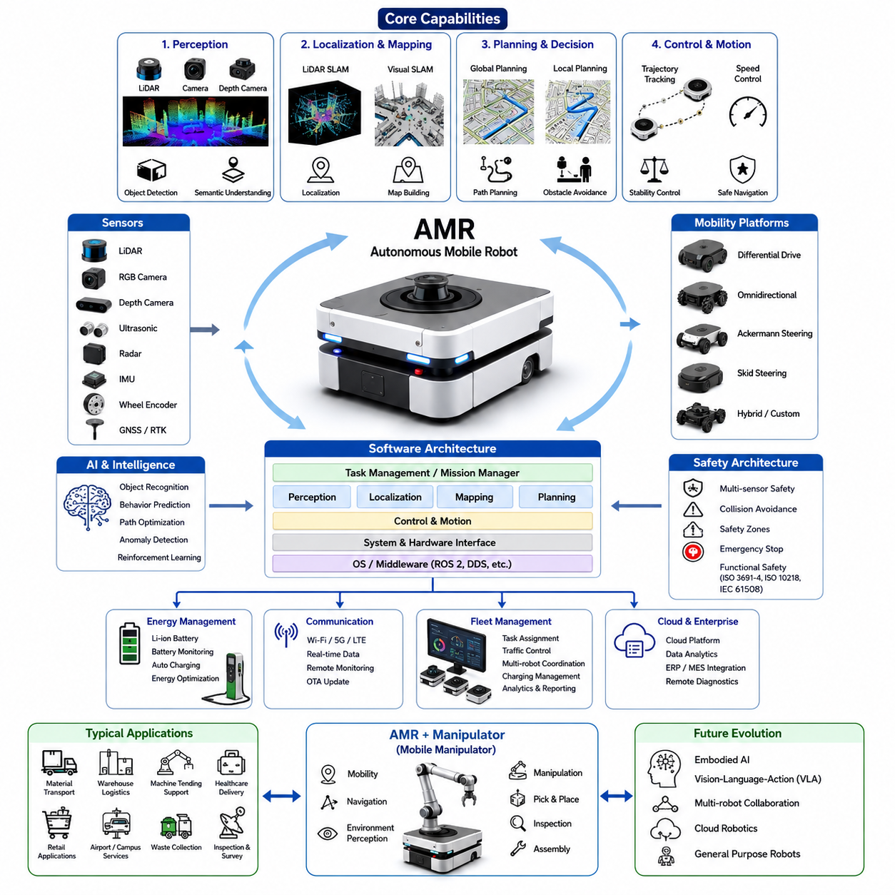
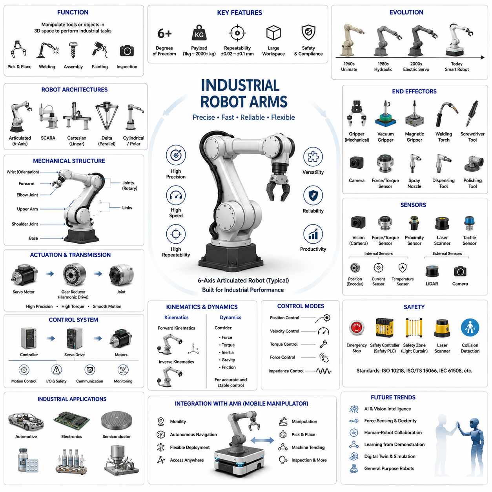
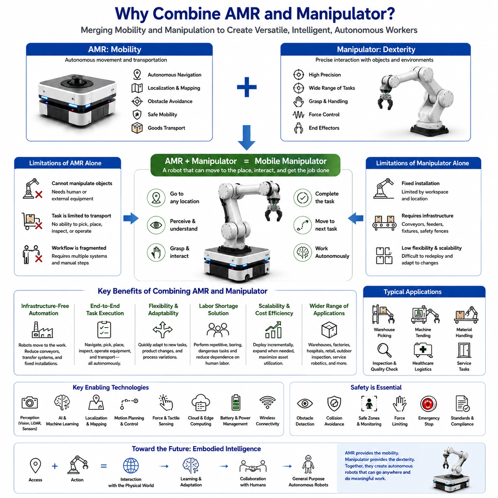
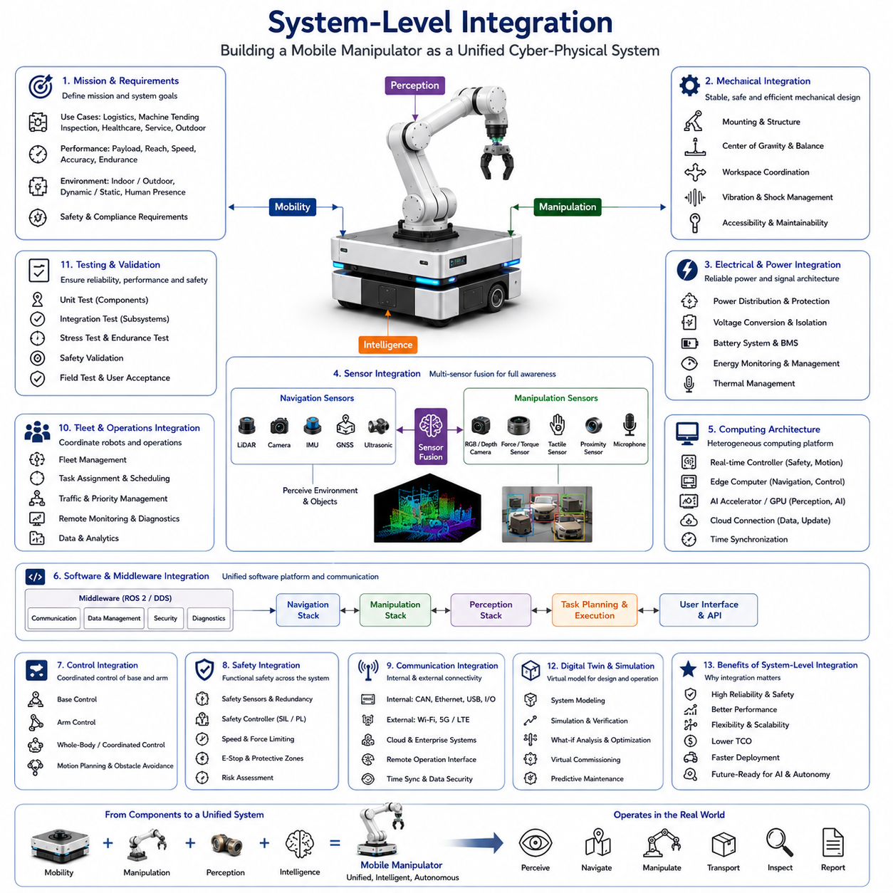
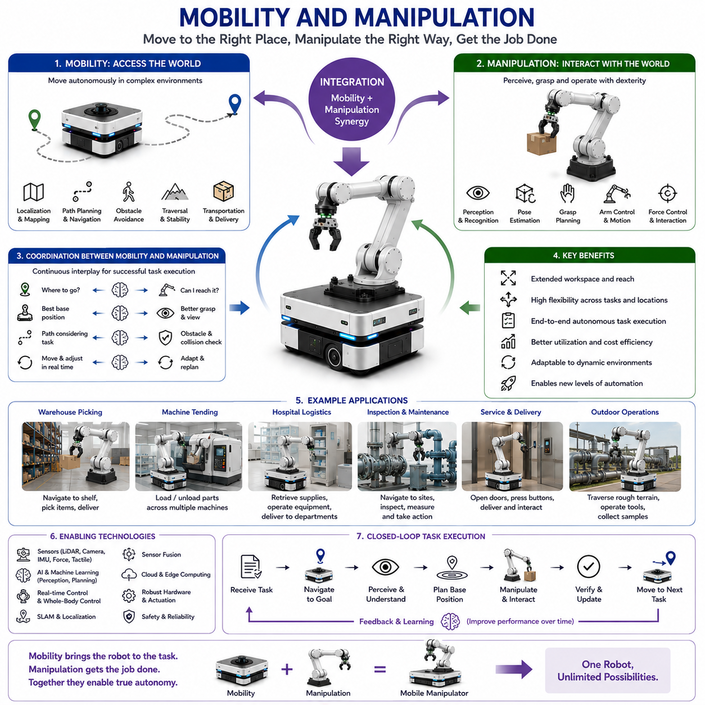
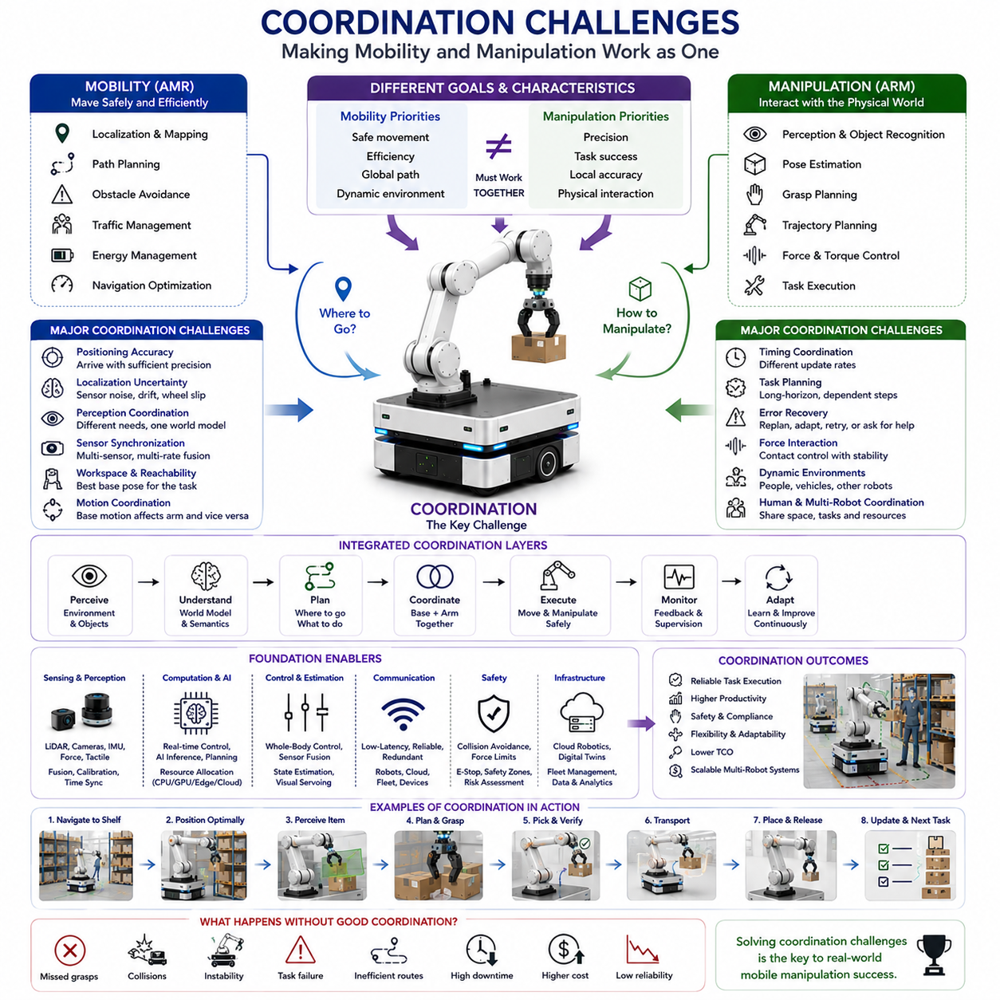
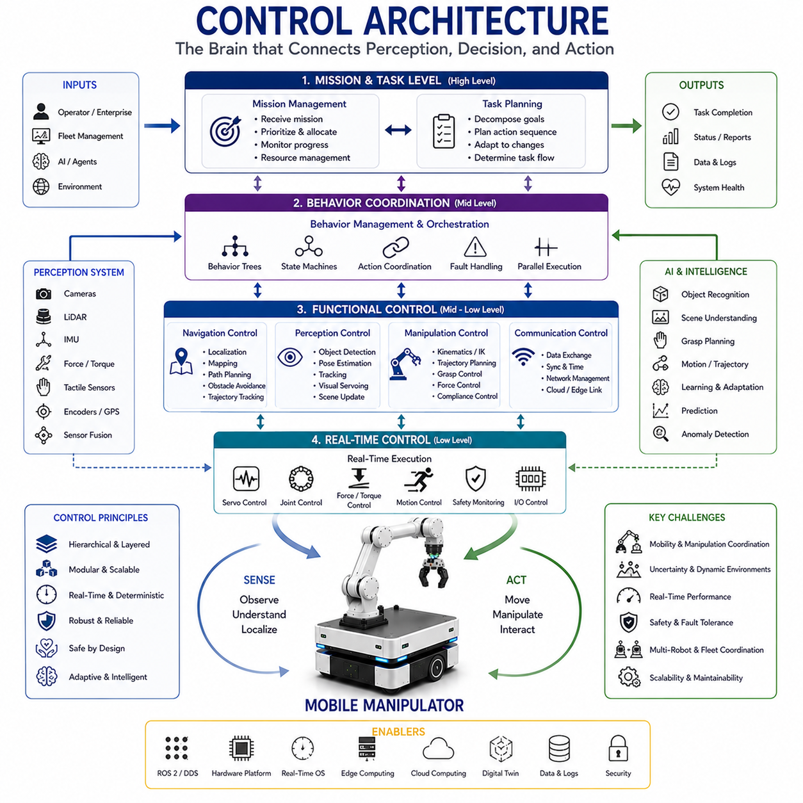
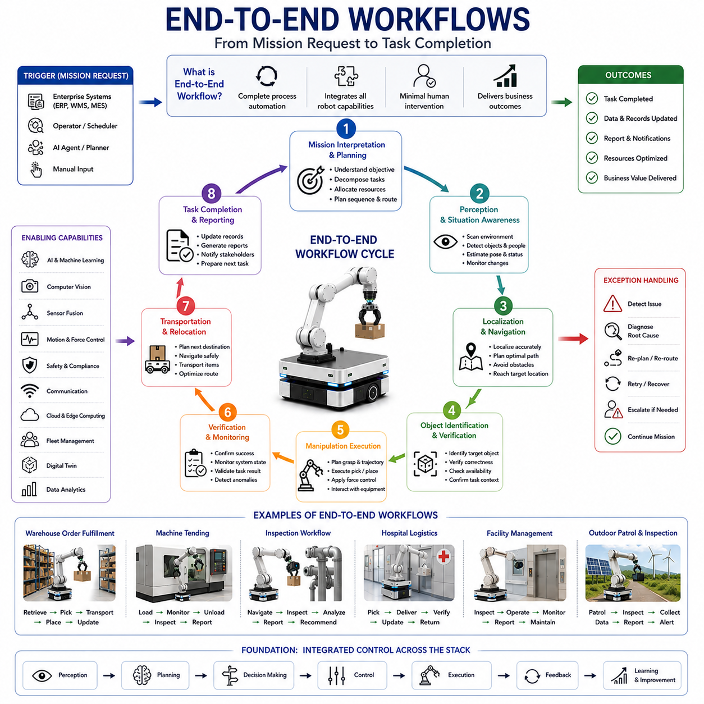
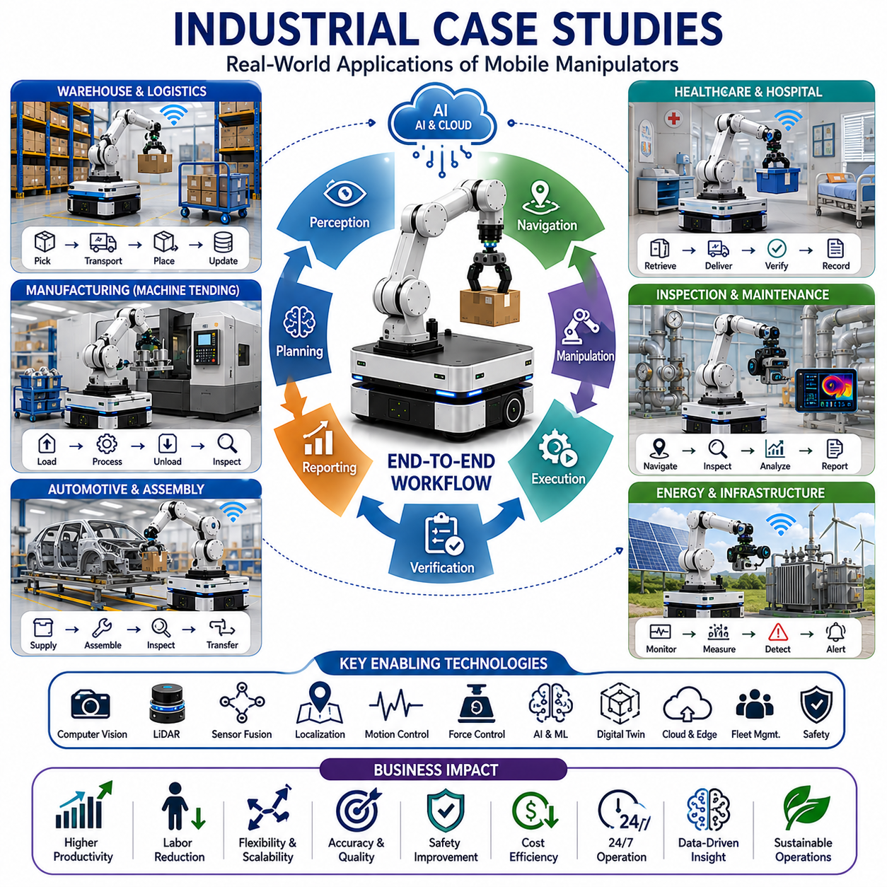

**Volume 01. Mobile Manipulator Foundations and System Architecture**


# Chapter 02. AMR plus Robot Arm

The combination of an Autonomous Mobile Robot (AMR) and an industrial robot arm represents one of the most important developments in modern robotics. Traditionally, mobile robots and industrial manipulators evolved as separate technologies. AMRs were designed to transport materials and navigate dynamic environments, while robot arms were developed to perform precise manipulation tasks within fixed workspaces. As industries increasingly demand flexible automation capable of adapting to changing environments, these two technologies have converged to form a new class of robotic systems known as Mobile Manipulators.

A mobile manipulator combines the mobility of an AMR with the dexterity of a robotic arm, creating a system that can travel autonomously to a task location, interact with objects, and perform complex operations without requiring fixed infrastructure. This integration fundamentally changes the automation paradigm. Instead of bringing materials to a stationary robot, the robot can now travel to the materials, machines, shelves, workstations, or people that require service. The result is a highly flexible automation platform capable of supporting a wide variety of industrial, logistics, healthcare, and service applications.

The AMR serves as the mobility platform and provides autonomous navigation capabilities. Equipped with sensors such as LiDAR, depth cameras, ultrasonic sensors, inertial measurement units, and localization systems, the AMR continuously perceives its environment and determines safe paths through dynamic spaces. Modern AMRs employ technologies such as SLAM, path planning, obstacle avoidance, and fleet management to operate efficiently in warehouses, factories, hospitals, and commercial facilities.

The robot arm contributes manipulation capabilities that enable interaction with the physical world. Industrial robot arms provide multiple degrees of freedom, allowing the system to reach, grasp, lift, position, inspect, assemble, or manipulate objects. The end-effector attached to the arm can take many forms, including parallel grippers, vacuum grippers, adaptive grippers, force-controlled tools, inspection sensors, and specialized application tools. Through advanced motion planning and control algorithms, the robot arm can perform tasks that traditionally required human intervention.

The true value of a mobile manipulator emerges when mobility and manipulation are tightly integrated. Navigation and manipulation can no longer be treated as independent subsystems. The robot must coordinate its base position, arm trajectory, sensor observations, and task objectives simultaneously. For example, when picking an object from a shelf, the AMR must first navigate to the correct location, position itself precisely relative to the shelf, and then coordinate arm motion to grasp the object. Small localization errors in the mobile base can directly affect manipulation success rates, making system-level integration critical.

One of the major challenges in mobile manipulation is the coordination between mobility and manipulation. Traditional industrial robots operate in highly structured environments where object locations are known with high precision. Mobile manipulators operate in semi-structured or unstructured environments where uncertainty is significantly higher. Variations in floor conditions, object placement, lighting, human activity, and environmental changes introduce complexity that must be managed through perception, planning, and adaptive control technologies.

Control architecture plays a central role in enabling successful mobile manipulation. A typical system includes multiple layers of control, including navigation control, manipulation control, perception processing, task planning, safety management, and mission execution. These layers must exchange information in real time to ensure smooth and reliable operation. ROS2, MoveIt2, Behavior Trees, and AI-based task planners have become common software frameworks for implementing such architectures.

The emergence of artificial intelligence is further expanding the capabilities of mobile manipulators. Computer vision systems can recognize objects, estimate poses, and identify task-relevant features. Foundation models, Vision-Language Models (VLMs), and Vision-Language-Action (VLA) models are enabling robots to interpret natural language instructions and perform increasingly complex tasks. Instead of relying solely on pre-programmed workflows, future mobile manipulators will be capable of understanding goals, reasoning about actions, and adapting their behavior dynamically.

Applications for mobile manipulators continue to expand across multiple industries. In warehouses, they perform order picking, shelf replenishment, and inventory handling. In manufacturing, they support machine tending, assembly operations, quality inspection, and material transport. In hospitals, they deliver medical supplies, laboratory samples, pharmaceuticals, and sterile equipment. In service environments, they assist customers, transport goods, and perform routine operational tasks. These applications demonstrate the growing importance of mobile manipulation as a foundational technology for next-generation automation.

As robotic systems continue to evolve toward greater autonomy, intelligence, and flexibility, the integration of AMRs and robot arms is expected to become the dominant architecture for many real-world robotic applications. Mobile manipulators bridge the gap between transportation and physical interaction, creating robots that can move, perceive, decide, and act within complex environments. Understanding how AMRs and robot arms are combined at the mechanical, electrical, software, and operational levels provides the foundation for designing, deploying, and scaling future mobile manipulation systems.

AMR(Autonomous Mobile Robot, 자율이동로봇)과 산업용 로봇암의 결합은 현대 로보틱스 분야에서 가장 중요한 기술적 발전 중 하나로 평가된다. 전통적으로 이동로봇과 산업용 매니퓰레이터는 서로 독립적인 기술 영역으로 발전해 왔다. AMR은 자재를 운반하고 동적인 환경을 자율적으로 이동하기 위해 개발되었으며, 로봇암은 고정된 작업 공간에서 정밀한 조작 작업을 수행하기 위해 개발되었다. 그러나 산업 현장에서 더욱 유연하고 적응력이 높은 자동화에 대한 요구가 증가하면서 두 기술은 하나의 통합 시스템으로 융합되기 시작했고, 그 결과 모바일 매니퓰레이터(Mobile Manipulator)라는 새로운 로봇 형태가 등장하게 되었다.

모바일 매니퓰레이터는 AMR의 이동 능력과 로봇암의 조작 능력을 결합한 시스템이다. 이를 통해 로봇은 작업 위치까지 자율적으로 이동한 후 대상 물체와 상호작용하며 다양한 작업을 수행할 수 있다. 이러한 개념은 기존 자동화 방식에 큰 변화를 가져왔다. 과거에는 작업 대상이나 자재를 고정형 로봇에게 이동시켜야 했지만, 이제는 로봇이 직접 자재, 설비, 선반, 작업장 또는 작업자를 찾아갈 수 있게 되었다. 그 결과 물류, 제조, 의료, 서비스 산업 등 다양한 분야에서 활용 가능한 고유연성 자동화 플랫폼이 탄생하게 되었다.

AMR은 시스템의 이동 플랫폼 역할을 수행한다. LiDAR, Depth Camera, 초음파 센서, IMU, 위치추정 시스템 등의 다양한 센서를 활용하여 주변 환경을 인식하고 안전한 이동 경로를 생성한다. 현대의 AMR은 SLAM, 경로계획(Path Planning), 장애물 회피(Obstacle Avoidance), Fleet Management 등의 기술을 활용하여 공장, 물류창고, 병원, 공공시설과 같은 복잡한 환경에서 안정적으로 운용된다.

반면 로봇암은 물리적 환경과의 상호작용을 담당한다. 다수의 자유도를 가진 로봇암은 물체를 집고, 옮기고, 배치하고, 검사하고, 조립하는 다양한 작업을 수행할 수 있다. 또한 엔드이펙터는 평행 그리퍼, 진공 그리퍼, 적응형 그리퍼, 힘 제어 공구, 검사 센서 등 다양한 형태로 구성될 수 있으며, 이를 통해 응용 분야에 최적화된 작업 수행이 가능하다.

모바일 매니퓰레이터의 핵심 가치는 이동성과 조작성의 긴밀한 통합에서 발생한다. 이동 기능과 조작 기능은 독립적으로 동작하는 것이 아니라 하나의 시스템으로 협조적으로 동작해야 한다. 예를 들어 선반에서 특정 물품을 집는 작업을 수행할 경우, AMR은 먼저 목표 위치까지 이동하고, 선반과의 상대 위치를 정확하게 맞춘 후, 로봇암이 물체를 인식하고 집을 수 있도록 지원해야 한다. 이 과정에서 모바일 플랫폼의 위치 오차는 곧바로 조작 성공률에 영향을 미치기 때문에 시스템 수준의 통합 설계가 매우 중요하다.

모바일 매니퓰레이션의 가장 큰 기술적 과제 중 하나는 이동과 조작의 협조 제어이다. 기존 산업용 로봇은 매우 정형화된 환경에서 동작하므로 물체 위치를 높은 정밀도로 예측할 수 있다. 반면 모바일 매니퓰레이터는 반정형 또는 비정형 환경에서 운용되기 때문에 불확실성이 훨씬 크다. 바닥 상태 변화, 물체 위치 편차, 조명 변화, 사람의 이동, 환경 변화 등 다양한 요인이 작업 성공률에 영향을 미친다. 따라서 고도화된 인지, 계획, 적응 제어 기술이 필수적으로 요구된다.

이러한 시스템을 구현하기 위해서는 계층형 제어 아키텍처가 필요하다. 일반적으로 모바일 매니퓰레이터는 이동 제어, 조작 제어, 인지 처리, 작업 계획, 안전 관리, 임무 수행 계층으로 구성된다. 각 계층은 실시간으로 정보를 교환하며 전체 시스템의 안정성과 효율성을 보장한다. ROS2, MoveIt2, Behavior Tree, AI 기반 Task Planner는 이러한 아키텍처를 구현하는 대표적인 소프트웨어 프레임워크로 활용되고 있다.

최근 인공지능 기술의 발전은 모바일 매니퓰레이터의 능력을 더욱 확장시키고 있다. 컴퓨터 비전 기술은 물체를 인식하고 자세를 추정하며 작업에 필요한 특징 정보를 추출할 수 있다. 또한 Foundation Model, VLM(Vision-Language Model), VLA(Vision-Language-Action) 기술은 로봇이 자연어 명령을 이해하고 복잡한 작업을 수행할 수 있도록 지원한다. 미래의 모바일 매니퓰레이터는 단순히 사전 정의된 프로그램을 실행하는 수준을 넘어 목표를 이해하고 행동을 계획하며 환경 변화에 적응하는 지능형 시스템으로 발전할 것이다.

현재 모바일 매니퓰레이터는 다양한 산업 분야에서 빠르게 적용되고 있다. 물류창고에서는 주문 피킹과 재고 관리, 제조 공장에서는 머신 텐딩과 조립 작업, 병원에서는 의약품과 의료물품 배송, 서비스 환경에서는 고객 지원과 물품 운반 업무를 수행하고 있다. 이러한 사례들은 모바일 매니퓰레이션 기술이 차세대 자동화 시스템의 핵심 기반 기술로 자리 잡고 있음을 보여준다.

향후 로봇 기술이 더욱 자율화되고 지능화됨에 따라 AMR과 로봇암의 결합은 실세계 로봇 시스템의 표준 아키텍처로 발전할 가능성이 높다. 모바일 매니퓰레이터는 이동, 인식, 판단, 조작을 하나의 플랫폼에서 수행할 수 있는 통합 로봇 시스템으로서 인간이 수행하던 다양한 작업을 자동화할 수 있는 잠재력을 가지고 있다. 따라서 AMR과 로봇암이 기계적, 전기적, 소프트웨어적, 운영적 측면에서 어떻게 통합되는지를 이해하는 것은 미래 모바일 매니퓰레이터 시스템을 설계하고 구축하는 데 있어 가장 중요한 기초가 된다.

##  

## 01 AMR Fundamentals

{width="7.268055555555556in" height="7.268055555555556in"}

Autonomous Mobile Robots (AMRs) represent one of the most important technological developments in modern robotics. They are intelligent robotic systems capable of moving through dynamic environments without requiring fixed physical guidance such as magnetic tapes, predefined tracks, or manually controlled navigation systems. Unlike traditional Automated Guided Vehicles (AGVs), which depend heavily on structured infrastructure and predetermined routes, AMRs utilize advanced sensing, perception, localization, mapping, planning, and control technologies to make real-time decisions while operating in complex and changing environments. As a result, AMRs have become foundational technologies in modern logistics, manufacturing, healthcare, retail, service robotics, and increasingly in outdoor autonomous operations. AMR technology forms the mobility foundation of mobile manipulators and future embodied AI systems, making a deep understanding of AMR fundamentals essential for anyone involved in next-generation robotics development. The topic is positioned as a core component within the "AMR plus Robot Arm" architecture that ultimately evolves into mobile manipulation systems.

The concept of autonomous mobility emerged from decades of research in robotics, artificial intelligence, computer vision, control theory, and autonomous vehicle technologies. Early mobile robots were often limited to highly controlled laboratory environments where navigation relied on predefined markers, reflective targets, or external positioning systems. As computational power increased and sensor technologies matured, robots gained the ability to perceive their surroundings and estimate their own positions with greater accuracy. This transition enabled robots to move beyond fixed paths and adapt dynamically to environmental changes. The evolution from AGVs to AMRs can be viewed as a shift from deterministic transportation systems toward intelligent autonomous agents capable of understanding and interacting with their surroundings.

At the heart of every AMR lies the ability to answer three fundamental questions continuously during operation. The first question is "Where am I?" which relates to localization. The second question is "What is around me?" which relates to perception and environment understanding. The third question is "Where should I go next?" which relates to path planning and decision-making. Together, these capabilities create the foundation for autonomous navigation. An AMR continuously senses the environment, updates its internal representation of the world, calculates safe and efficient routes, and executes motion commands while adapting to new information in real time.

Localization is one of the most critical technologies in AMR systems. A robot must estimate its position and orientation within an environment accurately enough to perform its assigned tasks. Various localization techniques are used depending on the operational environment. Indoor AMRs often rely on LiDAR-based localization, visual localization, SLAM technologies, fiducial markers, or sensor fusion approaches. Outdoor AMRs frequently combine GNSS, RTK-GNSS, inertial navigation systems, wheel odometry, and LiDAR-based localization. Modern AMRs rarely depend on a single positioning technology. Instead, they integrate multiple sensor sources to achieve robustness against environmental uncertainty, temporary signal loss, or sensor degradation.

Simultaneous Localization and Mapping, commonly known as SLAM, is a foundational technology that enables AMRs to create maps while simultaneously estimating their own position within those maps. SLAM allows robots to operate in environments where no prior map exists or where environments change over time. Various forms of SLAM have emerged, including LiDAR SLAM, Visual SLAM, Visual-Inertial SLAM, RGB-D SLAM, and multi-sensor fusion SLAM. The choice of SLAM technology depends on factors such as environmental complexity, computational resources, lighting conditions, operational speed, and accuracy requirements. SLAM technologies have become increasingly sophisticated, enabling robots to navigate warehouses, hospitals, factories, campuses, airports, and urban environments with high reliability.

Perception systems provide AMRs with the ability to observe and interpret their surroundings. Perception typically involves a combination of sensors such as LiDARs, stereo cameras, depth cameras, RGB cameras, ultrasonic sensors, radars, inertial measurement units, wheel encoders, and GNSS receivers. Raw sensor data alone is insufficient for autonomous operation. Advanced perception algorithms transform sensor measurements into meaningful information about obstacles, free space, dynamic objects, humans, vehicles, infrastructure, and environmental conditions. Modern AMRs increasingly employ deep learning and AI-based perception systems capable of semantic understanding, object recognition, anomaly detection, and contextual reasoning.

Obstacle detection and avoidance are among the most visible features of AMRs. Unlike AGVs that often stop when encountering unexpected obstacles, AMRs can evaluate alternative routes and dynamically adjust their trajectories. This capability significantly improves operational efficiency in environments where humans, vehicles, and other robots frequently interact. Dynamic obstacle avoidance requires continuous environmental monitoring, predictive modeling of object motion, collision risk assessment, and real-time trajectory replanning. Safe navigation in shared environments depends heavily on the quality of obstacle detection and avoidance algorithms.

Path planning is another fundamental capability of AMRs. Once the robot understands its position and the surrounding environment, it must determine how to move toward its destination. Path planning is typically divided into global planning and local planning. Global planning determines an overall route from the current position to the target location using a map of the environment. Local planning continuously adjusts the robot's trajectory based on nearby obstacles and changing conditions. Algorithms such as A\*, Dijkstra, Hybrid A\*, RRT, RRT\*, DWA, MPC, and optimization-based planners are commonly used depending on system requirements. Effective path planning balances efficiency, safety, energy consumption, travel time, and operational constraints.

Motion control transforms planned trajectories into physical movement. The control system calculates steering angles, wheel velocities, acceleration profiles, and braking commands while ensuring stability and precision. AMRs may use differential drive, skid steering, omnidirectional wheels, mecanum wheels, Ackermann steering, articulated steering, or hybrid mobility configurations. Each mobility architecture presents unique advantages and limitations. Differential drive systems are widely used in indoor environments because of their simplicity and maneuverability. Omnidirectional systems offer superior flexibility in confined spaces. Ackermann steering systems are commonly used in outdoor autonomous vehicles due to their efficiency at higher speeds.

The software architecture of an AMR is typically organized into multiple layers. The perception layer collects and processes sensor information. The localization layer estimates robot position. The mapping layer maintains environmental representations. The planning layer generates navigation strategies. The control layer executes motion commands. Above these layers, task management systems coordinate operational workflows and mission execution. Cloud-based management systems may provide fleet coordination, monitoring, analytics, and software updates. This layered architecture allows developers to build scalable and modular robotic systems.

Artificial intelligence increasingly plays a significant role in AMR systems. Traditional navigation relied heavily on deterministic algorithms and manually engineered rules. Modern AMRs incorporate machine learning models that improve perception accuracy, predict human behavior, optimize routes, estimate system health, and support adaptive decision-making. Deep neural networks enable object detection, semantic segmentation, activity recognition, and anomaly detection. Reinforcement learning techniques are being explored for navigation optimization and autonomous decision-making in complex environments. The integration of AI transforms AMRs from reactive machines into intelligent autonomous agents.

Safety remains a primary consideration in AMR design and deployment. Autonomous robots frequently operate in environments shared with humans, making functional safety essential. Safety architectures typically include redundant sensing systems, emergency stop circuits, safety controllers, speed monitoring mechanisms, protective zones, collision avoidance algorithms, and fail-safe operating modes. International standards such as ISO 3691-4, ISO 10218, IEC 61508, and related safety regulations provide guidance for designing safe robotic systems. Compliance with these standards is critical for commercial deployment.

Energy management is another important aspect of AMR operation. Most AMRs rely on lithium-ion battery systems that provide several hours of continuous operation. Battery capacity, charging strategies, power distribution, and energy efficiency significantly influence robot productivity. Advanced fleet systems may coordinate charging schedules, monitor battery health, and optimize mission assignments based on available energy resources. Some industrial deployments employ autonomous charging stations that allow robots to recharge without human intervention, enabling near-continuous operation.

Communication systems enable AMRs to interact with enterprise infrastructure, cloud platforms, and other robots. Wireless technologies such as Wi-Fi, private LTE, 5G, and industrial communication protocols facilitate data exchange and remote management. Connectivity supports fleet management, real-time monitoring, software updates, diagnostics, predictive maintenance, and integration with enterprise resource planning systems. As robot deployments scale from individual units to large fleets, communication architecture becomes increasingly important.

Fleet management systems coordinate multiple AMRs operating within a shared environment. These systems assign tasks, optimize traffic flow, manage charging schedules, balance workloads, and prevent conflicts between robots. Fleet intelligence enables organizations to maximize resource utilization and achieve higher levels of automation. As robotic deployments continue to expand, fleet management increasingly resembles air traffic control systems, orchestrating hundreds or even thousands of autonomous agents simultaneously.

The economic value of AMRs stems from their flexibility and scalability. Traditional automation often requires extensive infrastructure modifications, making deployment expensive and inflexible. AMRs can be introduced incrementally, allowing organizations to automate operations without significant facility redesign. This flexibility reduces deployment costs and shortens return-on-investment periods. AMRs also support changing workflows, seasonal demand fluctuations, and facility reconfiguration, making them particularly attractive in dynamic industries.

Industrial applications represent one of the largest markets for AMRs. Manufacturing facilities use AMRs for material transportation, work-in-progress movement, line-side delivery, machine tending support, and inventory management. Warehouses employ AMRs for order fulfillment, goods-to-person operations, pallet transport, and inventory tracking. Hospitals use AMRs for pharmaceutical delivery, laboratory specimen transport, linen distribution, and waste collection. Retail environments leverage AMRs for inventory auditing, shelf monitoring, and customer assistance. Airports, hotels, campuses, and public facilities increasingly adopt AMR technologies to improve operational efficiency.

The convergence of AMRs with robotic manipulation represents a major milestone in robotics evolution. An AMR equipped with a robotic arm becomes a mobile manipulator capable of both transportation and physical interaction. This combination significantly expands the range of tasks that robots can perform. Instead of simply moving items between locations, mobile manipulators can pick, place, sort, inspect, assemble, and interact with objects autonomously. The AMR provides mobility while the manipulator provides dexterity, creating a unified robotic system with enhanced versatility. This integration forms the conceptual foundation for mobile manipulation architectures described throughout the broader system framework.

Future AMRs will continue evolving toward greater autonomy, intelligence, and adaptability. Advances in embodied AI, foundation models, vision-language-action systems, cloud robotics, edge computing, and multi-agent coordination will enable robots to understand complex environments more deeply and perform increasingly sophisticated tasks. Future robots will not merely navigate predefined spaces but will reason about goals, collaborate with humans, learn continuously from experience, and adapt to novel situations. In this context, AMRs represent far more than transportation platforms. They are becoming intelligent physical agents that bridge the digital and physical worlds. As the foundation of mobile manipulators, service robots, industrial automation systems, and future general-purpose robots, AMR technology will remain one of the most influential pillars of robotics innovation for decades to come.

자율이동로봇(AMR, Autonomous Mobile Robot)은 현대 로봇공학에서 가장 중요한 기술 발전 중 하나로 평가된다. AMR은 자기테이프, 유도선, 고정된 경로와 같은 물리적 안내 장치 없이도 스스로 주변 환경을 인식하고 이동할 수 있는 지능형 로봇 시스템이다. 기존의 AGV(Automated Guided Vehicle)가 사전에 정의된 경로와 인프라에 크게 의존하는 반면, AMR은 센서, 인지(Perception), 위치추정(Localization), 지도작성(Mapping), 경로계획(Planning), 제어(Control) 기술을 활용하여 실시간으로 상황을 판단하고 의사결정을 수행한다. 이러한 특성 덕분에 AMR은 물류, 제조, 의료, 리테일, 서비스 로봇, 그리고 최근에는 실외 자율주행 로봇 분야까지 폭넓게 활용되고 있다. 특히 AMR은 모바일 매니퓰레이터(Mobile Manipulator)와 미래의 Embodied AI 로봇을 구성하는 이동성(Mobility)의 핵심 기반 기술이기 때문에, 차세대 로봇 시스템을 이해하기 위해 반드시 학습해야 하는 기초 기술이다.

자율 이동 개념은 로봇공학, 인공지능, 컴퓨터 비전, 제어공학, 자율주행 차량 기술이 수십 년 동안 발전하면서 형성되었다. 초기 이동 로봇은 실험실과 같은 통제된 환경에서만 운용되었으며, 반사 마커나 외부 위치 시스템에 의존하는 경우가 많았다. 그러나 컴퓨팅 성능이 향상되고 센서 기술이 발전하면서 로봇은 스스로 주변 환경을 이해하고 자신의 위치를 추정할 수 있게 되었다. 이러한 변화는 로봇이 고정된 경로를 벗어나 환경 변화에 적응하며 움직일 수 있도록 만들었으며, AGV에서 AMR로의 진화는 단순 운송 장치에서 지능형 자율 에이전트로의 전환이라고 볼 수 있다.

모든 AMR은 운행 중에 세 가지 핵심 질문에 지속적으로 답해야 한다. 첫 번째는 "나는 어디에 있는가?"이며 이는 위치추정 기술과 관련된다. 두 번째는 "내 주변에는 무엇이 있는가?"이며 이는 환경 인지 기술과 연결된다. 세 번째는 "다음에는 어디로 가야 하는가?"이며 이는 경로 계획과 의사결정 기술을 의미한다. 이러한 능력이 결합되어 자율주행의 기본 구조를 형성한다. AMR은 끊임없이 환경을 감지하고, 내부 지도 정보를 갱신하며, 목적지까지의 최적 경로를 계산하고, 실시간으로 움직임을 제어한다.

위치추정(Localization)은 AMR 기술의 핵심 요소 중 하나이다. 로봇은 자신이 환경 내에서 어느 위치에 있으며 어떤 방향을 향하고 있는지를 정확하게 알아야 한다. 실내 환경에서는 LiDAR 기반 위치추정, 비전 기반 위치추정, SLAM, 마커 기반 위치추정 등이 활용된다. 실외 환경에서는 GNSS, RTK-GNSS, IMU, 휠 오도메트리, LiDAR 기반 위치추정이 함께 사용된다. 실제 산업 현장에서는 하나의 기술에만 의존하지 않고 여러 센서 정보를 융합하여 보다 안정적이고 정확한 위치 정보를 생성하는 경우가 대부분이다.

SLAM(Simultaneous Localization and Mapping)은 AMR의 핵심 기술로서 로봇이 자신의 위치를 추정하는 동시에 지도를 생성할 수 있도록 한다. 이를 통해 사전에 지도 정보가 없는 환경에서도 자율주행이 가능해진다. 현재는 LiDAR SLAM, Visual SLAM, Visual-Inertial SLAM, RGB-D SLAM, 다중 센서 융합 SLAM 등 다양한 형태가 존재한다. 어떤 SLAM 기술을 사용할지는 환경의 복잡성, 요구 정확도, 조명 조건, 계산 자원, 운행 속도 등에 따라 달라진다. 최근의 SLAM 기술은 물류창고, 병원, 공장, 캠퍼스, 공항, 도시 환경 등 다양한 공간에서 높은 신뢰도로 활용되고 있다.

인지(Perception) 시스템은 AMR이 주변 환경을 이해하는 능력을 제공한다. 이를 위해 LiDAR, RGB 카메라, 스테레오 카메라, Depth 카메라, 초음파 센서, 레이더, IMU, 엔코더, GNSS 등 다양한 센서가 사용된다. 그러나 센서 데이터 자체만으로는 의미가 없으며, 이를 처리하여 장애물, 사람, 차량, 통행 가능 공간, 위험 요소 등을 인식해야 한다. 최근에는 딥러닝 기반 인지 기술이 도입되면서 객체 인식, 의미 기반 환경 분석, 이상 상황 탐지, 상황 이해 능력이 크게 향상되고 있다.

장애물 탐지와 회피는 AMR의 가장 중요한 기능 중 하나이다. 기존 AGV가 장애물을 만나면 정지하는 경우가 많았던 반면, AMR은 대체 경로를 계산하여 우회할 수 있다. 이를 위해 주변 환경을 지속적으로 감시하고, 객체의 움직임을 예측하며, 충돌 위험을 평가한 후 새로운 경로를 생성해야 한다. 특히 사람과 로봇이 함께 작업하는 환경에서는 이러한 동적 장애물 회피 기능이 필수적이다.

경로 계획(Path Planning)은 로봇이 목적지까지 이동하는 방법을 결정하는 기술이다. 일반적으로 전역 경로 계획(Global Planning)과 지역 경로 계획(Local Planning)으로 구분된다. 전역 계획은 지도 기반으로 전체 이동 경로를 생성하며, 지역 계획은 실시간 장애물 정보를 반영하여 경로를 수정한다. A\*, Dijkstra, Hybrid A\*, RRT, RRT\*, DWA, MPC 등 다양한 알고리즘이 사용되며, 목적은 안전성과 효율성을 동시에 확보하는 것이다.

모션 제어(Motion Control)는 계획된 경로를 실제 움직임으로 변환하는 역할을 수행한다. 제어기는 휠 속도, 조향각, 가속도, 감속도 등을 계산하여 로봇을 원하는 위치로 이동시킨다. AMR은 차동구동(Differential Drive), 스키드 스티어링(Skid Steering), 메카넘 휠(Mecanum Wheel), 전방향 구동(Omnidirectional Drive), Ackermann 조향 등 다양한 이동 구조를 사용할 수 있다. 실내 환경에서는 기동성이 높은 차동구동과 전방향 구동이 많이 사용되며, 실외 환경에서는 고속 주행에 유리한 Ackermann 방식이 주로 사용된다.

AMR의 소프트웨어 구조는 일반적으로 계층형 아키텍처로 구성된다. 가장 아래에는 센서 데이터를 처리하는 인지 계층이 있으며, 그 위에 위치추정 계층, 지도 계층, 경로계획 계층, 제어 계층이 위치한다. 최상위에는 임무 관리(Task Management) 계층이 존재하며 로봇의 업무를 관리한다. 최근에는 클라우드 기반 관제 시스템이 추가되어 원격 모니터링, 데이터 분석, OTA 업데이트, 원격 진단 기능까지 제공하고 있다.

인공지능(AI)은 AMR의 성능을 크게 향상시키고 있다. 과거의 자율주행은 규칙 기반 알고리즘 중심이었지만, 최근에는 머신러닝과 딥러닝 기술이 적극 활용되고 있다. AI는 객체 인식 정확도를 향상시키고, 사람의 행동을 예측하며, 경로를 최적화하고, 시스템 이상을 조기에 탐지할 수 있다. 또한 강화학습 기술은 복잡한 환경에서 보다 효율적인 이동 전략을 학습하는 데 활용되고 있다. 이러한 발전은 AMR을 단순한 이동 장치가 아닌 지능형 자율 시스템으로 변화시키고 있다.

안전성은 AMR 설계에서 가장 중요한 요소 중 하나이다. 자율주행 로봇은 사람과 같은 공간에서 동작하기 때문에 기능 안전(Functional Safety)이 필수적이다. 이를 위해 다중 센서 기반 안전 감지, 비상 정지 시스템, 안전 컨트롤러, 속도 제한, 안전 구역 관리, 충돌 방지 알고리즘 등이 적용된다. 또한 ISO 3691-4, ISO 10218, IEC 61508 등의 국제 표준을 준수해야 상용화가 가능하다.

에너지 관리 역시 중요한 기술 요소이다. 대부분의 AMR은 리튬이온 배터리를 사용하며, 배터리 용량과 전력 효율이 운영 시간에 직접적인 영향을 미친다. 최근에는 자동 충전 시스템이 도입되어 로봇이 스스로 충전 스테이션으로 이동해 충전한 후 작업을 재개할 수 있다. 이를 통해 사실상 24시간 운영이 가능한 시스템도 구현되고 있다.

통신 기술은 AMR과 외부 시스템을 연결하는 역할을 수행한다. Wi-Fi, LTE, 5G, 산업용 통신 네트워크 등을 통해 로봇은 관제 시스템과 데이터를 주고받는다. 이를 통해 원격 모니터링, 실시간 상태 확인, 소프트웨어 업데이트, 예지보전, ERP 및 MES 연동 등이 가능해진다. 대규모 로봇 운영 환경에서는 안정적이고 확장 가능한 통신 아키텍처가 매우 중요하다.

다수의 로봇이 동시에 운영되는 환경에서는 플릿 관리(Fleet Management) 시스템이 필요하다. 플릿 시스템은 작업 할당, 교통 흐름 제어, 충전 스케줄 관리, 작업 우선순위 결정 등을 수행한다. 이를 통해 수십 대에서 수백 대의 로봇을 효율적으로 운영할 수 있으며, 전체 생산성과 자원 활용도를 극대화할 수 있다.

AMR의 경제적 가치는 유연성과 확장성에서 비롯된다. 기존 자동화 시스템은 설비 변경 비용이 높고 유연성이 부족한 경우가 많지만, AMR은 시설 구조를 크게 변경하지 않고도 단계적으로 도입할 수 있다. 또한 작업 환경 변화에 유연하게 대응할 수 있어 투자 회수 기간(ROI)을 단축할 수 있다. 이러한 장점 때문에 제조, 물류, 의료, 서비스 산업 전반에서 AMR 도입이 빠르게 증가하고 있다.

산업 현장에서 AMR은 자재 운반, 생산라인 공급, 창고 물류, 주문 처리, 재고 관리, 병원 물품 배송, 폐기물 수거, 서비스 지원 등 다양한 업무를 수행한다. 공장에서는 생산 효율을 높이고, 물류센터에서는 주문 처리 속도를 향상시키며, 병원에서는 의료진의 단순 반복 업무를 줄여준다. 공항, 호텔, 쇼핑몰, 캠퍼스 등에서도 AMR 활용 사례가 빠르게 증가하고 있다.

AMR과 로봇 팔(Manipulator)의 결합은 로봇 기술 발전의 중요한 전환점이다. 이동 능력을 가진 AMR 위에 로봇 팔이 탑재되면 모바일 매니퓰레이터가 된다. 이는 단순히 물건을 운반하는 수준을 넘어 물체를 집고, 옮기고, 분류하고, 조립하고, 검사할 수 있는 능력을 제공한다. AMR이 이동성을 담당하고 로봇 팔이 작업성을 담당함으로써 훨씬 더 다양한 산업 자동화 작업을 수행할 수 있게 된다. 이러한 구조는 향후 범용 로봇과 Embodied AI 시스템의 핵심 형태로 발전할 것으로 예상된다.

미래의 AMR은 더욱 높은 수준의 자율성과 지능을 갖추게 될 것이다. Embodied AI, Foundation Model, Vision-Language-Action(VLA), 클라우드 로보틱스, 엣지 AI, 멀티에이전트 협업 기술이 발전하면서 로봇은 단순히 경로를 따라 이동하는 기계를 넘어 목표를 이해하고, 상황을 추론하며, 인간과 협력하는 지능형 에이전트로 진화할 것이다. 결국 AMR은 단순한 이동 플랫폼이 아니라 디지털 세계와 물리적 세계를 연결하는 핵심 기술로 자리잡을 것이며, 모바일 매니퓰레이터, 서비스 로봇, 산업용 로봇, 미래 범용 로봇의 기반 기술로서 앞으로도 로봇 산업 발전의 중심 역할을 수행하게 될 것이다.

##  

## 02 Industrial Robot Arms

{width="7.268055555555556in" height="7.268055555555556in"}

Industrial robot arms are among the most influential technologies in the history of automation. For more than five decades, they have transformed manufacturing, logistics, electronics production, automotive assembly, semiconductor fabrication, food processing, pharmaceutical operations, and countless other industrial sectors. These robotic systems were originally developed to automate repetitive, dangerous, and physically demanding tasks, but they have gradually evolved into highly sophisticated machines capable of performing complex operations with exceptional precision, speed, repeatability, and reliability. Today, industrial robot arms serve as one of the fundamental building blocks of modern robotics and provide the manipulation capability that complements the mobility of Autonomous Mobile Robots (AMRs) in mobile manipulation systems. Within the context of mobile manipulators, understanding industrial robot arms is essential because they provide the dexterity, reach, force control, and object interaction capabilities required to transform a mobile platform into a fully functional autonomous worker.

An industrial robot arm is a programmable mechanical system designed to move objects, tools, or end effectors through a defined workspace. The structure of a robot arm is inspired by the kinematic principles of the human arm, although industrial robots are optimized for precision, durability, and productivity rather than biological similarity. A typical robot arm consists of multiple rigid links connected by joints that provide controlled motion. By coordinating the movement of these joints, the robot can position and orient its end effector anywhere within its reachable workspace. This capability allows the robot to perform a wide range of industrial tasks including assembly, welding, painting, machine tending, material handling, packaging, inspection, and precision manufacturing.

The history of industrial robot arms dates back to the early 1960s when the first commercially successful industrial robot, Unimate, was introduced into automotive manufacturing. Unimate demonstrated that programmable machines could perform repetitive industrial tasks more consistently and safely than human workers in hazardous environments. Over the following decades, advances in electronics, control systems, servo motors, sensors, and computing technologies dramatically expanded the capabilities of robotic manipulators. Industrial robots evolved from simple repetitive automation devices into highly flexible systems capable of adapting to diverse manufacturing requirements. As industries pursued greater efficiency, quality, and scalability, robot arms became indispensable components of modern production systems.

The fundamental purpose of an industrial robot arm is to manipulate objects in three-dimensional space. To achieve this objective, the robot must control both position and orientation. Position refers to the location of the robot\'s tool center point within the workspace, while orientation describes the angular alignment of the tool relative to the environment. The ability to simultaneously control position and orientation enables robots to perform tasks such as inserting components, tightening fasteners, welding seams, applying adhesives, picking products from shelves, and conducting precision inspections. The combination of translational and rotational motion forms the basis of robotic manipulation.

Degrees of Freedom (DOF) are one of the most important concepts in industrial robotics. A degree of freedom represents an independent axis of motion that can be controlled by the robot. Most industrial robot arms employ six degrees of freedom because six independent motions are required to achieve arbitrary positioning and orientation in three-dimensional space. The first three joints generally control the position of the end effector, while the remaining three joints control its orientation. Some robots incorporate seven or more degrees of freedom to increase flexibility and improve obstacle avoidance. Additional degrees of freedom provide redundancy, allowing the robot to reach the same target position using multiple configurations.

Robot joints are responsible for generating motion. Most industrial manipulators use rotary joints driven by electric servo motors, although hydraulic and pneumatic systems are occasionally used for specialized applications. Rotary joints offer high precision, excellent controllability, and long operational life. Each joint contributes to the overall motion of the robot, and coordinated control of all joints enables complex movement patterns. The arrangement of joints determines the robot\'s kinematic structure and influences its workspace, reachability, payload capacity, and motion characteristics.

Several robot arm architectures have emerged over time, each optimized for specific industrial applications. Articulated robots are the most common industrial manipulators and typically feature six rotary joints arranged in a serial chain. Their flexibility allows them to perform a wide variety of tasks across many industries. SCARA robots provide high-speed horizontal motion and are widely used in electronics assembly and pick-and-place applications. Cartesian robots operate along orthogonal linear axes and offer excellent accuracy for tasks requiring rectangular workspaces. Delta robots excel at ultra-fast picking operations in packaging and food industries. Cylindrical and polar robots represent earlier architectures that are less common today but remain relevant in certain niche applications.

The mechanical structure of an industrial robot arm consists of links, joints, bearings, transmissions, and supporting frames. Links provide structural rigidity while minimizing weight. Joints generate controlled motion and transmit forces throughout the robot. Bearings reduce friction and ensure smooth movement. Transmission systems, including harmonic drives, cycloidal reducers, planetary gearboxes, and belt mechanisms, convert motor output into usable torque. The design of these components directly affects the robot\'s performance, precision, durability, and cost. Modern robot manufacturers invest significant engineering effort in optimizing mechanical structures to maximize stiffness while minimizing mass.

Servo motors serve as the primary actuation technology in most industrial robots. These motors provide precise control of position, velocity, and torque. High-resolution encoders continuously measure joint positions and enable closed-loop control systems to maintain accuracy under varying load conditions. Advanced servo systems can achieve positioning accuracy measured in fractions of a millimeter while maintaining smooth motion profiles and rapid response times. The performance of servo technology has been a major factor in the increasing capabilities of industrial robotics over recent decades.

Robot kinematics describes the mathematical relationship between joint movements and end-effector motion. Forward kinematics calculates the position and orientation of the end effector based on known joint angles. Inverse kinematics determines the joint angles required to achieve a desired end-effector position and orientation. These calculations form the foundation of robot motion planning and control. Efficient kinematic algorithms enable robots to execute complex trajectories while maintaining precision and avoiding undesirable configurations.

Dynamics extends kinematic analysis by considering forces, torques, inertia, gravity, friction, and external loads. Dynamic modeling becomes particularly important when robots move rapidly, handle heavy payloads, or interact physically with their environments. Understanding robot dynamics allows engineers to design controllers that achieve stable and efficient motion. Advanced dynamic compensation techniques improve accuracy, reduce vibration, and increase operational speed.

The workspace of a robot arm defines the region of space that can be reached by the end effector. Workspace characteristics are determined by link lengths, joint limits, mechanical constraints, and kinematic structure. Different industrial applications require different workspace configurations. Large automotive welding robots may have reaches exceeding three meters, while compact electronics assembly robots operate within much smaller workspaces. Engineers must carefully evaluate workspace requirements when selecting robots for specific tasks.

Payload capacity is another critical performance parameter. Payload refers to the maximum weight that a robot can safely manipulate while maintaining specified performance levels. Industrial robot payloads range from less than one kilogram for precision electronics applications to more than two thousand kilograms for heavy manufacturing operations. Payload capacity influences motor sizing, structural design, gearbox selection, and overall system cost. Selecting the appropriate payload class is essential for achieving optimal productivity and economic efficiency.

Repeatability is often considered more important than absolute accuracy in industrial automation. Repeatability measures a robot\'s ability to return consistently to the same position over multiple cycles. Many industrial applications rely on highly repeatable motion because calibration procedures can compensate for systematic positioning errors. Modern industrial robots commonly achieve repeatability levels between ±0.02 mm and ±0.1 mm, enabling highly precise manufacturing operations.

End effectors represent the interface between the robot and the physical world. While the robot arm provides motion, the end effector performs the actual task. Common end effectors include mechanical grippers, vacuum grippers, magnetic grippers, welding torches, painting nozzles, dispensing systems, screwdrivers, cutting tools, polishing tools, and inspection sensors. End-effector design plays a crucial role in determining the overall effectiveness of a robotic system. In many applications, the end effector is as important as the robot arm itself.

Grippers are among the most widely used end effectors in industrial robotics. Mechanical grippers use fingers or jaws to grasp objects physically. Vacuum grippers employ suction cups to handle flat or lightweight items. Soft robotic grippers utilize compliant materials to manipulate fragile products safely. Adaptive grippers can accommodate variations in object shape and size, increasing operational flexibility. The selection of gripper technology depends on object characteristics, handling requirements, cycle time constraints, and environmental conditions.

Industrial robot control systems coordinate all aspects of robot operation. Controllers interpret programmed instructions, execute motion trajectories, monitor sensor inputs, enforce safety constraints, and communicate with external systems. Modern controllers incorporate powerful processors capable of real-time computation and advanced motion planning. They support programming languages, graphical interfaces, simulation tools, and integration frameworks that simplify deployment and maintenance.

Programming methods have evolved significantly over time. Traditional robot programming relied on teach pendants and point-to-point motion commands. Contemporary systems support offline programming, digital twins, simulation-based development, graphical workflow creation, and AI-assisted programming. These advancements reduce deployment time and make robotics accessible to a broader range of users. Future systems may allow robots to learn tasks through demonstration, natural language instructions, and foundation-model-based reasoning.

Sensors enhance robot capabilities by providing awareness of internal and external conditions. Internal sensors monitor joint positions, motor currents, temperatures, and system health. External sensors such as cameras, force-torque sensors, proximity sensors, LiDARs, and tactile sensors provide environmental information. Sensor integration enables adaptive behavior, quality inspection, object recognition, force-controlled assembly, and safe human-robot interaction.

Force control represents a major advancement beyond traditional position control. Many industrial tasks require robots to regulate contact forces rather than simply following predefined trajectories. Examples include assembly, polishing, deburring, grinding, surface finishing, and human collaboration. Force sensors and advanced control algorithms enable robots to interact safely and effectively with physical environments. Impedance control and admittance control are widely used approaches for managing force interactions.

Collaborative robots, commonly known as cobots, have expanded the role of industrial robot arms beyond isolated automation cells. Unlike traditional industrial robots that operate behind safety barriers, cobots are designed to work safely alongside human operators. They incorporate force-limited joints, collision detection systems, speed monitoring functions, and advanced safety mechanisms. Cobots enable flexible automation in environments where close human-robot interaction is required. Although cobots generally operate at lower speeds and payload capacities than traditional industrial robots, they offer significant advantages in adaptability and ease of deployment.

Safety remains a fundamental requirement in industrial robotics. Robot systems must protect workers, equipment, and products from harm. Safety measures include emergency stop systems, safety-rated controllers, protective barriers, light curtains, laser scanners, safety zones, collision detection systems, and risk assessment procedures. International standards such as ISO 10218, ISO/TS 15066, IEC 61508, and related regulations provide guidance for safe robot deployment. Compliance with these standards is essential for industrial acceptance.

Industrial robot arms have become indispensable across numerous sectors. Automotive manufacturers rely on robots for welding, painting, assembly, and material handling. Electronics manufacturers use robots for component placement, soldering, and testing. Semiconductor facilities employ robotic systems for wafer handling and precision processing. Pharmaceutical companies utilize robots for packaging, laboratory automation, and sterile manufacturing. Food and beverage producers implement robots for packaging, sorting, and palletizing. The diversity of applications continues to expand as technology advances.

The integration of industrial robot arms with AMRs represents one of the most significant trends in modern robotics. Traditionally, robot arms were fixed installations limited to specific workstations. By mounting a robot arm on an autonomous mobile platform, engineers create a mobile manipulator capable of traveling throughout a facility and performing tasks wherever needed. This combination merges mobility and manipulation into a single intelligent system. Mobile manipulators can transport materials, operate machinery, perform inspections, fulfill orders, and execute complex workflows without requiring fixed infrastructure. This convergence is transforming industrial automation and laying the foundation for future embodied AI systems.

Future industrial robot arms will become increasingly intelligent, adaptable, and autonomous. Advances in artificial intelligence, computer vision, force sensing, foundation models, reinforcement learning, and embodied AI will enable robots to perform tasks that previously required human judgment and dexterity. Future systems will understand instructions expressed in natural language, learn from demonstrations, adapt to changing environments, and collaborate seamlessly with humans and other robots. Rather than functioning solely as programmable machines, industrial robot arms will evolve into versatile physical agents capable of understanding goals, reasoning about actions, and executing complex manipulation tasks autonomously. As the manipulation component of mobile manipulators and future general-purpose robots, industrial robot arms will continue to play a central role in the evolution of intelligent automation and robotics throughout the coming decades.

산업용 로봇 팔(Industrial Robot Arm)은 자동화 역사에서 가장 영향력이 큰 기술 중 하나이다. 지난 50여 년 동안 산업용 로봇은 제조업, 물류, 전자산업, 자동차 생산, 반도체 공정, 식품 가공, 제약 산업 등 다양한 분야를 혁신적으로 변화시켜 왔다. 초기에는 반복적이고 위험하며 육체적으로 힘든 작업을 자동화하기 위해 개발되었지만, 현재는 높은 정밀도와 속도, 반복정확도, 신뢰성을 갖춘 고도화된 시스템으로 발전하였다. 오늘날 산업용 로봇 팔은 현대 로봇 기술의 핵심 구성 요소이며, 모바일 매니퓰레이터(Mobile Manipulator)에서는 AMR이 이동성을 담당하고 로봇 팔이 작업성을 담당하는 구조를 형성한다. 따라서 산업용 로봇 팔에 대한 이해는 차세대 로봇 시스템을 이해하기 위한 필수적인 기반 지식이라고 할 수 있다.

산업용 로봇 팔은 물체, 공구 또는 작업 장치를 원하는 위치로 이동시키기 위해 설계된 프로그래밍 가능한 기계 시스템이다. 기본 구조는 인간의 팔에서 영감을 받았지만, 생체 구조를 모방하기보다는 생산성과 정밀도, 내구성을 극대화하는 방향으로 발전하였다. 일반적으로 여러 개의 링크(Link)와 관절(Joint)로 구성되며, 각 관절이 독립적으로 움직여 전체 시스템이 다양한 위치와 자세를 구현할 수 있도록 한다. 이를 통해 조립, 용접, 도장, 검사, 적재, 포장, 물류 이송 등 다양한 산업 작업을 수행할 수 있다.

산업용 로봇의 역사는 1960년대 초 세계 최초의 상용 산업용 로봇인 유니메이트(Unimate)에서 시작되었다. 유니메이트는 자동차 공장에서 위험한 작업을 대신 수행하며 로봇 자동화의 가능성을 입증하였다. 이후 전자기술, 센서, 서보모터, 제어기, 컴퓨터 기술이 발전하면서 산업용 로봇은 더욱 정교하고 유연한 시스템으로 발전하였다. 오늘날 로봇은 단순 반복 장비를 넘어 다양한 작업을 수행할 수 있는 범용 자동화 플랫폼으로 활용되고 있다.

산업용 로봇 팔의 가장 기본적인 목적은 3차원 공간에서 물체를 조작하는 것이다. 이를 위해 로봇은 위치(Position)와 자세(Orientation)를 동시에 제어해야 한다. 위치는 로봇 끝단이 공간상 어디에 있는지를 의미하며, 자세는 어떤 방향으로 향하고 있는지를 의미한다. 이 두 가지를 정확히 제어할 수 있기 때문에 로봇은 부품 조립, 나사 체결, 용접, 접착제 도포, 부품 적재, 검사 작업 등을 수행할 수 있다.

산업용 로봇에서 가장 중요한 개념 중 하나는 자유도(Degree of Freedom, DOF)이다. 자유도는 독립적으로 제어 가능한 움직임의 축을 의미한다. 대부분의 산업용 로봇은 6자유도 구조를 채택하고 있는데, 이는 3차원 공간에서 위치와 자세를 완전히 제어하기 위해 최소 6개의 독립 운동이 필요하기 때문이다. 일반적으로 첫 세 개의 관절은 위치를 제어하고, 나머지 세 개는 자세를 제어한다. 일부 로봇은 7자유도 이상을 제공하여 장애물 회피 능력과 유연성을 향상시키기도 한다.

관절(Joint)은 로봇의 움직임을 생성하는 핵심 요소이다. 대부분의 산업용 로봇은 전기 서보모터 기반의 회전 관절을 사용한다. 특정 산업에서는 유압 또는 공압 시스템도 활용되지만, 현재는 정밀성과 유지보수 측면에서 전기식이 주류를 이루고 있다. 각 관절은 독립적으로 움직이지만, 전체 관절이 협력하여 복잡한 경로와 동작을 수행하게 된다.

산업용 로봇은 구조에 따라 여러 종류로 구분된다. 가장 널리 사용되는 형태는 다관절 로봇(Articulated Robot)으로, 6개 이상의 회전 관절을 이용해 높은 자유도와 유연성을 제공한다. SCARA 로봇은 고속 수평 이동에 최적화되어 전자부품 조립에 많이 사용된다. 직교좌표형(Cartesian Robot)은 선형 축을 따라 움직이며 높은 정밀도를 제공한다. 델타 로봇(Delta Robot)은 초고속 피킹 작업에 적합하며 식품 및 포장 산업에서 널리 활용된다. 이 외에도 원통좌표형과 극좌표형 로봇 등이 특정 분야에서 사용되고 있다.

산업용 로봇의 기계 구조는 링크, 관절, 베어링, 감속기, 프레임 등으로 구성된다. 링크는 구조 강성을 제공하며 무게를 최소화하도록 설계된다. 관절은 운동을 생성하며, 베어링은 마찰을 줄이고 부드러운 움직임을 제공한다. 감속기는 모터의 회전력을 증폭하여 실제 작업에 필요한 토크를 생성한다. 하모닉 드라이브, 사이클로이드 감속기, 유성기어 감속기 등이 대표적으로 사용된다.

서보모터는 산업용 로봇의 핵심 구동 장치이다. 서보모터는 위치, 속도, 토크를 정밀하게 제어할 수 있으며, 엔코더를 통해 현재 상태를 실시간으로 측정한다. 이를 기반으로 폐루프 제어가 이루어지며, 산업용 로봇은 매우 높은 위치 정밀도와 반복성을 달성할 수 있다.

로봇 운동학(Kinematics)은 관절 움직임과 로봇 끝단 움직임 사이의 관계를 수학적으로 설명한다. 순기구학(Forward Kinematics)은 관절 각도로부터 끝단 위치를 계산하며, 역기구학(Inverse Kinematics)은 목표 위치를 달성하기 위한 관절 각도를 계산한다. 이러한 계산은 모든 로봇 경로 계획과 제어의 기초가 된다.

동역학(Dynamics)은 단순한 위치 계산을 넘어 힘, 토크, 관성, 중력, 마찰 등의 물리적 요소를 고려한다. 특히 고속 동작이나 중량물 취급 시에는 동역학 해석이 필수적이다. 동역학 모델은 제어 성능을 향상시키고 진동을 줄이며 에너지 효율을 높이는 데 중요한 역할을 한다.

작업공간(Workspace)은 로봇 끝단이 도달할 수 있는 공간 영역을 의미한다. 링크 길이, 관절 제한, 기구학 구조 등에 따라 작업공간이 결정된다. 자동차 차체 용접 로봇은 3m 이상의 넓은 작업공간을 가지는 반면, 전자 조립용 로봇은 상대적으로 작은 작업공간을 가진다.

가반하중(Payload)은 로봇이 안전하게 취급할 수 있는 최대 하중을 의미한다. 소형 전자 조립 로봇은 수백 그램에서 수 킬로그램 수준의 하중을 다루는 반면, 대형 산업용 로봇은 수백 킬로그램에서 수 톤의 물체를 다룰 수 있다. 가반하중은 모터 크기, 구조 설계, 감속기 선정 등 전체 시스템 설계에 큰 영향을 미친다.

산업 자동화에서는 절대 정확도보다 반복정확도(Repeatability)가 더욱 중요하게 평가되는 경우가 많다. 반복정확도는 동일한 위치로 반복적으로 이동했을 때 얼마나 일관되게 재현할 수 있는지를 의미한다. 현대 산업용 로봇은 일반적으로 ±0.02mm에서 ±0.1mm 수준의 매우 높은 반복정확도를 제공한다.

엔드이펙터(End Effector)는 로봇과 실제 작업 대상 사이를 연결하는 장치이다. 로봇 팔이 움직임을 제공한다면, 엔드이펙터는 실제 작업을 수행한다. 대표적인 예로는 그리퍼, 진공 흡착기, 용접 토치, 도장 장치, 나사 체결기, 절단 장치, 연마 장치, 검사 센서 등이 있다. 실제 현장에서는 로봇 자체보다 엔드이펙터 설계가 더 중요한 경우도 많다.

그리퍼는 가장 널리 사용되는 엔드이펙터이다. 기계식 그리퍼는 손가락 형태의 구조로 물체를 집으며, 진공 그리퍼는 흡착력을 이용한다. 소프트 그리퍼는 유연한 재질을 사용하여 깨지기 쉬운 물체를 안전하게 취급할 수 있다. 최근에는 다양한 형태의 물체를 자동으로 파지할 수 있는 적응형 그리퍼도 개발되고 있다.

산업용 로봇 제어기는 로봇의 모든 동작을 관리하는 두뇌 역할을 수행한다. 제어기는 경로를 계산하고, 센서 데이터를 처리하며, 안전 기능을 관리하고, 외부 장비와 통신한다. 최신 제어기는 고성능 프로세서를 탑재하여 실시간 연산과 복잡한 모션 계획을 수행할 수 있다.

프로그래밍 방식도 크게 발전하였다. 과거에는 티치 펜던트(Teach Pendant)를 이용하여 직접 위치를 지정하는 방식이 주류였다. 최근에는 디지털 트윈, 오프라인 프로그래밍, 그래픽 기반 워크플로우, AI 기반 프로그래밍 등이 활용되고 있다. 앞으로는 자연어 지시와 시연 기반 학습을 통해 프로그래밍이 더욱 쉬워질 것으로 예상된다.

센서는 로봇의 인지 능력을 향상시킨다. 내부 센서는 관절 위치와 모터 상태를 측정하며, 외부 센서는 카메라, 힘/토크 센서, 근접 센서, LiDAR 등을 활용하여 환경 정보를 수집한다. 이를 통해 로봇은 객체 인식, 품질 검사, 적응형 조립, 안전한 인간-로봇 협업 등을 수행할 수 있다.

힘 제어(Force Control)는 산업용 로봇의 중요한 발전 분야이다. 단순히 위치를 따라 움직이는 것이 아니라, 특정 힘을 유지하면서 작업을 수행할 수 있게 한다. 연마, 조립, 디버링, 표면 처리와 같은 작업에서는 힘 제어가 필수적이다. 임피던스 제어(Impedance Control)와 어드미턴스 제어(Admittance Control)가 대표적인 방식이다.

협동로봇(Cobot)은 산업용 로봇의 활용 범위를 크게 확장시켰다. 기존 산업용 로봇이 안전 펜스 내부에서만 운영되었다면, 협동로봇은 사람과 같은 공간에서 작업할 수 있도록 설계되었다. 충돌 감지, 힘 제한, 속도 제한 등의 기능을 통해 안전성을 확보한다. 비록 속도와 가반하중은 전통적인 산업용 로봇보다 낮은 경우가 많지만, 유연성과 설치 편의성 측면에서 큰 장점을 가진다.

안전성은 산업용 로봇 시스템의 핵심 요구사항이다. 비상정지 장치, 안전 제어기, 라이트 커튼, 레이저 스캐너, 충돌 감지 시스템, 위험도 평가 절차 등이 적용된다. 또한 ISO 10218, ISO/TS 15066, IEC 61508 등의 국제 표준을 준수해야 한다.

산업용 로봇은 자동차 산업에서 용접, 도장, 조립 작업에 활용되며, 전자산업에서는 부품 조립과 검사에 사용된다. 반도체 산업에서는 웨이퍼 이송과 정밀 공정에 활용되고, 제약 산업에서는 포장과 실험실 자동화에 적용된다. 식품 산업에서는 포장, 분류, 적재 작업을 수행한다. 활용 범위는 계속 확대되고 있으며, 산업 자동화의 핵심 장비로 자리 잡고 있다.

최근 가장 중요한 기술 트렌드 중 하나는 산업용 로봇 팔과 AMR의 결합이다. 전통적인 산업용 로봇은 특정 위치에 고정되어 작업했지만, AMR 위에 로봇 팔을 탑재하면 모바일 매니퓰레이터가 된다. 이러한 시스템은 공장이나 물류센터 전체를 이동하면서 필요한 위치에서 작업을 수행할 수 있다. 이동성과 작업성이 결합됨으로써 기존 고정형 자동화의 한계를 극복할 수 있으며, 이는 미래 지능형 자동화의 핵심 방향으로 평가된다.

미래의 산업용 로봇 팔은 더욱 지능적이고 자율적인 방향으로 발전할 것이다. 인공지능, 컴퓨터 비전, 힘 제어, Foundation Model, 강화학습, Embodied AI 기술이 결합되면서 로봇은 단순한 프로그래밍 기계를 넘어 목표를 이해하고 스스로 작업 방법을 결정할 수 있는 수준으로 진화하고 있다. 앞으로의 산업용 로봇은 자연어 명령을 이해하고, 인간의 시범을 학습하며, 변화하는 환경에 적응하고, 다른 로봇 및 인간과 협력하는 지능형 물리 에이전트가 될 것이다. 이러한 산업용 로봇 팔은 모바일 매니퓰레이터와 미래 범용 로봇의 핵심 조작 기술로서 앞으로도 로봇 산업 발전의 중심 역할을 수행할 것으로 전망된다.

##  

## 03 Why Combine AMR and Manipulator

{width="7.268055555555556in" height="7.268055555555556in"}

The convergence of Autonomous Mobile Robots (AMRs) and industrial robot manipulators represents one of the most significant developments in modern robotics. For many years, autonomous mobility and robotic manipulation evolved as separate technological domains. AMRs focused on moving through environments autonomously, transporting materials, and navigating safely among people and infrastructure. Industrial robot arms, on the other hand, concentrated on precise object handling, assembly, welding, inspection, packaging, and manufacturing tasks within fixed workspaces. While both technologies achieved remarkable success independently, each possessed inherent limitations that restricted the scope of automation. The integration of AMRs and robot manipulators into a unified mobile manipulator architecture addresses these limitations and creates a new generation of robotic systems capable of both movement and physical interaction. This combination is increasingly viewed as a critical step toward embodied intelligence and future general-purpose robotic systems.

Traditional industrial robot arms are typically installed in fixed locations. They are highly efficient within their designated work envelopes and can execute tasks with extraordinary precision and repeatability. However, their operational capability is constrained by the physical boundaries of their workspaces. If an object lies outside the robot's reach, the robot cannot interact with it unless additional equipment such as conveyors, transfer systems, or human operators reposition the object. This limitation often results in complex automation infrastructure, increased capital costs, and reduced operational flexibility. While fixed robotic cells have proven effective in high-volume manufacturing environments, they are less suitable for dynamic operations where work locations frequently change.

AMRs solve a different problem. They provide mobility and autonomous transportation capabilities. An AMR can navigate through warehouses, factories, hospitals, airports, retail environments, and outdoor facilities without requiring fixed guidance infrastructure. By leveraging technologies such as localization, mapping, obstacle avoidance, and path planning, AMRs can transport goods between locations efficiently and safely. However, AMRs typically lack sophisticated manipulation capabilities. Most AMRs can move objects only if those objects are already loaded onto their platforms or transferred through external mechanisms. As a result, AMRs often require human assistance or dedicated automation systems to complete tasks involving physical interaction with the environment.

The combination of AMRs and robot manipulators creates a system that can both move and work. This capability fundamentally changes the role of robotics in industrial and service environments. Instead of merely transporting materials or performing isolated manipulation tasks, a mobile manipulator can travel to a work location, identify objects, interact with them, complete assigned tasks, and then move to the next location autonomously. The integration transforms robots from specialized automation tools into versatile operational agents capable of executing end-to-end workflows.

One of the primary motivations for combining AMRs and manipulators is the elimination of fixed infrastructure. Traditional automation systems frequently rely on conveyors, lifts, dedicated transfer stations, and specialized work cells. These systems can be expensive to install, difficult to modify, and challenging to scale. Mobile manipulators reduce dependence on fixed infrastructure by bringing robotic capability directly to the task location. Instead of moving products to robots, robots move to products. This paradigm shift enables significantly greater flexibility and supports rapidly changing operational requirements.

Manufacturing environments increasingly demand flexible automation solutions. Product lifecycles are becoming shorter, customization requirements are increasing, and production volumes fluctuate more frequently than in the past. Fixed automation systems often struggle to adapt to these changing conditions. Mobile manipulators provide a flexible alternative because they can be reprogrammed, redeployed, and reassigned to different tasks without requiring substantial facility modifications. This adaptability is particularly valuable in high-mix, low-volume manufacturing environments where traditional automation may not be economically viable.

Labor shortages represent another major driver behind mobile manipulator development. Many industries face increasing difficulties recruiting and retaining workers for repetitive, physically demanding, or undesirable tasks. Warehousing, logistics, manufacturing, healthcare, and service industries are particularly affected. Mobile manipulators can perform material handling, picking, transportation, inspection, machine tending, and support operations with minimal human intervention. By automating these activities, organizations can improve productivity while reducing dependence on scarce labor resources.

The ability to perform end-to-end task execution is one of the most powerful advantages of mobile manipulators. Consider a traditional warehouse workflow. An AMR may transport inventory between locations, but human workers are often required to pick items from shelves, load containers, verify products, and prepare shipments. A mobile manipulator can potentially perform all these functions autonomously. The robot can navigate to a storage location, identify the required item using computer vision, grasp it using an appropriate end effector, place it into a container, and transport it to the next destination. By integrating mobility and manipulation, previously fragmented workflows become unified autonomous processes.

Machine tending provides another compelling example. In conventional industrial settings, robot arms are frequently installed next to CNC machines, injection molding machines, or manufacturing equipment. These robots load raw materials, unload finished products, and perform repetitive handling operations. However, each robot is dedicated to a specific machine or group of machines. A mobile manipulator can service multiple machines across an entire facility. The robot can travel between workstations, load and unload parts, conduct inspections, and coordinate production activities dynamically. This approach increases equipment utilization and reduces automation costs.

The integration of AMRs and manipulators also enhances scalability. Traditional automation often requires significant upfront investment and long implementation cycles. Mobile manipulators can be deployed incrementally, allowing organizations to expand automation capacity as operational demands grow. Additional robots can be added to the fleet without extensive facility redesign. This scalability supports gradual adoption strategies and reduces financial risk.

Technological convergence has made mobile manipulators increasingly feasible. Advances in sensors, computing hardware, artificial intelligence, robotics middleware, battery technology, and wireless communication have significantly reduced the barriers to integration. Modern mobile manipulators can leverage high-performance processors, GPU acceleration, advanced perception systems, and sophisticated control architectures. These technologies enable real-time coordination between navigation and manipulation subsystems, allowing robots to operate effectively in dynamic environments.

Perception plays a central role in mobile manipulation. A mobile manipulator must understand both its environment and the objects with which it interacts. This requires integrating multiple sensing modalities, including cameras, LiDARs, depth sensors, force sensors, tactile sensors, and inertial measurement units. The robot must simultaneously localize itself within the environment, detect obstacles, identify target objects, estimate object poses, and monitor manipulation activities. This level of environmental awareness exceeds the requirements of traditional fixed industrial robots and represents a key challenge in mobile manipulator development.

Artificial intelligence significantly enhances the capabilities of mobile manipulators. Machine learning models improve object detection, semantic understanding, grasp planning, motion prediction, and task execution. Vision-language models enable robots to interpret high-level instructions and reason about complex tasks. Reinforcement learning supports adaptive behaviors in uncertain environments. As AI technologies continue to advance, mobile manipulators are becoming increasingly capable of handling diverse and previously unseen situations.

The economic justification for combining AMRs and manipulators extends beyond labor replacement. Mobile manipulators can improve asset utilization, reduce infrastructure costs, increase operational flexibility, shorten deployment timelines, and enhance overall productivity. Organizations can automate tasks that were previously considered impractical due to variability, complexity, or economic constraints. This broader automation potential often produces substantial return on investment.

Safety considerations are especially important when integrating mobility and manipulation. A mobile manipulator introduces additional complexity because it combines navigation hazards with manipulation hazards. The system must avoid collisions while moving, maintain stable operation during manipulation, and ensure safe interaction with humans. Advanced safety architectures typically include redundant sensing systems, dynamic safety zones, collision detection mechanisms, force monitoring capabilities, emergency stop functions, and comprehensive risk assessment procedures. The integration of mobility and manipulation requires a holistic safety strategy that addresses the combined operational risks.

Healthcare environments illustrate the unique advantages of mobile manipulators. Hospitals contain numerous repetitive logistics activities involving medical supplies, pharmaceuticals, laboratory samples, linens, meals, and waste materials. Traditional AMRs can transport these items, but loading and unloading often require human intervention. Mobile manipulators can autonomously retrieve items from shelves, interact with storage systems, operate equipment, and deliver materials directly to their destinations. This capability reduces staff workload and improves operational efficiency.

Service robotics represents another promising application area. Hotels, airports, office buildings, shopping centers, and public facilities require robots capable of interacting with diverse environments and performing varied tasks. Mobility alone is insufficient because many service activities involve manipulating objects, opening doors, pressing buttons, operating equipment, or handling packages. Mobile manipulators provide the physical interaction capabilities necessary to perform these functions autonomously.

Outdoor robotics further expands the importance of mobile manipulation. Infrastructure inspection, utility maintenance, security patrols, agricultural operations, construction support, and environmental monitoring often require robots to travel across large areas while interacting with physical assets. A mobile manipulator can navigate outdoor environments, inspect equipment, operate instruments, collect samples, manipulate tools, and perform maintenance activities. The combination of mobility and manipulation is particularly valuable in these distributed operational scenarios.

From a systems engineering perspective, mobile manipulators represent the integration of two highly complex subsystems. The AMR component provides localization, mapping, navigation, obstacle avoidance, fleet management, and mobility control. The manipulator component provides kinematics, dynamics, grasping, force control, motion planning, and object interaction capabilities. Successful integration requires coordinated architecture across mechanical design, electrical systems, sensors, computing platforms, software frameworks, communications infrastructure, and safety systems. This multidisciplinary complexity explains why mobile manipulators are often considered among the most advanced robotic systems currently deployed in industry.

The evolution toward embodied AI further strengthens the rationale for combining AMRs and manipulators. Embodied intelligence requires robots to perceive, move, interact, and learn within the physical world. Mobility enables exploration and access to distributed environments, while manipulation enables meaningful interaction with objects and infrastructure. Neither capability alone is sufficient for general-purpose autonomy. Together, they form the physical foundation upon which embodied AI systems can be built.

Future robotic systems will increasingly blur the distinction between transportation and manipulation. Mobile manipulators will become more autonomous, more intelligent, and more adaptable. They will leverage foundation models, vision-language-action architectures, cloud robotics, digital twins, and multi-agent coordination systems to execute increasingly complex workflows. Robots will move beyond predefined task sequences and become capable of understanding objectives, planning actions, collaborating with humans, and adapting to changing environments.

Ultimately, the reason for combining AMRs and manipulators is simple yet profound. Mobility provides access, while manipulation provides action. An AMR can reach the location where work must be performed, and a manipulator can perform the work itself. Individually, each technology addresses only part of the automation challenge. Together, they create a unified robotic platform capable of sensing, moving, interacting, and acting within the physical world. This integration represents a natural evolution in robotics and serves as a critical foundation for the next generation of intelligent autonomous systems, mobile manipulators, and future general-purpose robots.

자율이동로봇(AMR)과 산업용 로봇 매니퓰레이터의 결합은 현대 로봇 기술 발전에서 가장 중요한 변화 중 하나로 평가된다. 오랜 기간 동안 이동 로봇과 산업용 로봇 팔은 서로 독립적으로 발전해 왔다. AMR은 자율주행, 물류 운송, 경로 계획, 장애물 회피와 같은 이동성(Mobility)에 초점을 맞추었으며, 산업용 로봇 팔은 조립, 용접, 검사, 포장, 가공과 같은 작업성(Manipulation)에 집중해 왔다. 두 기술 모두 각각의 분야에서 큰 성공을 거두었지만, 각각 분명한 한계를 가지고 있었다. 모바일 매니퓰레이터는 이러한 한계를 극복하기 위해 등장한 개념으로, 이동성과 작업성을 하나의 플랫폼에 통합함으로써 새로운 수준의 자동화를 가능하게 한다. 이는 미래 Embodied AI와 범용 로봇으로 가기 위한 핵심 단계로 평가된다.

전통적인 산업용 로봇 팔은 대부분 고정된 위치에 설치된다. 이들은 매우 높은 정밀도와 반복정확도를 제공하지만, 작업 범위는 로봇이 도달할 수 있는 작업공간(Workspace) 내부로 제한된다. 만약 작업 대상이 로봇의 작업 범위를 벗어나면 컨베이어, 이송 장치 또는 사람이 물체를 이동시켜야 한다. 이러한 구조는 복잡한 자동화 설비를 필요로 하며 설치 비용과 운영 비용을 증가시키는 원인이 된다. 또한 생산 공정이 변경될 경우 전체 시스템을 다시 설계해야 하는 문제도 발생한다.

반면 AMR은 이러한 문제를 해결하는 이동 플랫폼이다. AMR은 공장, 물류센터, 병원, 공항, 캠퍼스 등 다양한 환경에서 자율적으로 이동할 수 있다. LiDAR, 카메라, SLAM, 위치추정, 경로 계획 기술을 활용하여 목적지까지 스스로 이동하며 물품을 운반한다. 그러나 대부분의 AMR은 스스로 물체를 집거나 조작할 수 없다. 물건을 운반하기 위해서는 사람이 물건을 올려주거나 별도의 자동화 장비가 필요하다. 즉, AMR은 이동은 가능하지만 작업은 수행할 수 없는 한계를 가진다.

AMR과 로봇 팔을 결합하면 이동과 작업을 동시에 수행할 수 있는 모바일 매니퓰레이터가 된다. 이는 로봇의 역할을 근본적으로 변화시킨다. 기존에는 물건을 운반하거나 특정 위치에서만 작업할 수 있었던 로봇이 이제는 작업 위치까지 이동하고, 필요한 물체를 인식하며, 직접 조작하고, 작업을 완료한 뒤 다음 작업 장소로 이동할 수 있게 된다. 다시 말해, 로봇이 단순한 자동화 장비에서 자율적인 작업 수행 주체로 발전하게 되는 것이다.

AMR과 매니퓰레이터를 결합하는 가장 중요한 이유 중 하나는 고정형 인프라를 최소화할 수 있기 때문이다. 기존 자동화 시스템은 컨베이어, 리프트, 이송 설비, 자동 창고와 같은 고정 설비에 크게 의존한다. 이러한 설비는 구축 비용이 높고 변경이 어렵다. 모바일 매니퓰레이터는 작업 대상이 있는 곳으로 직접 이동하기 때문에 별도의 이송 설비를 줄일 수 있다. 즉, 제품을 로봇에게 가져오는 방식에서 로봇이 제품에게 가는 방식으로 자동화 패러다임이 전환된다.

현대 제조업은 점점 더 유연한 생산 체계를 요구하고 있다. 제품 수명주기는 짧아지고 고객 맞춤형 생산 요구는 증가하고 있으며 생산량 변화도 더욱 빈번해지고 있다. 고정형 자동화 시스템은 이러한 변화에 신속하게 대응하기 어렵다. 반면 모바일 매니퓰레이터는 소프트웨어 변경만으로도 새로운 작업을 수행할 수 있으며, 필요에 따라 다른 공정으로 쉽게 이동할 수 있다. 따라서 다품종 소량생산 환경에서 특히 큰 가치를 제공한다.

노동력 부족 문제 역시 모바일 매니퓰레이터의 필요성을 증가시키고 있다. 제조업, 물류, 병원, 서비스 산업 등에서는 반복적이고 힘든 작업을 수행할 인력을 확보하기가 점점 어려워지고 있다. 모바일 매니퓰레이터는 자재 운반, 부품 공급, 물류 처리, 검사, 기계 조작 등의 업무를 자율적으로 수행할 수 있기 때문에 인력 부족 문제를 완화하는 중요한 솔루션으로 주목받고 있다.

모바일 매니퓰레이터의 가장 강력한 장점 중 하나는 End-to-End 자동화이다. 예를 들어 기존 물류센터에서는 AMR이 상품을 운반하더라도 선반에서 상품을 꺼내고 상자에 넣는 작업은 사람이 수행해야 하는 경우가 많다. 그러나 모바일 매니퓰레이터는 선반까지 이동하여 카메라로 상품을 인식하고, 그리퍼로 집어 올린 후, 지정된 컨테이너에 적재하고, 목적지까지 운반할 수 있다. 여러 단계로 나뉘어 있던 작업이 하나의 자율 프로세스로 통합되는 것이다.

기계 가공(Machine Tending) 분야에서도 모바일 매니퓰레이터의 장점은 매우 크다. 기존에는 CNC 장비마다 로봇이 고정 설치되어 원자재를 공급하고 가공품을 회수하였다. 그러나 모바일 매니퓰레이터는 여러 대의 장비를 순회하면서 필요한 작업을 수행할 수 있다. 하나의 로봇이 여러 장비를 지원할 수 있기 때문에 투자 비용을 절감하고 설비 활용도를 높일 수 있다.

확장성 측면에서도 모바일 매니퓰레이터는 유리하다. 기존 자동화 설비는 구축 시 대규모 투자가 필요하며, 생산량 증가에 대응하기 위해 추가 설비 구축이 필요하다. 모바일 매니퓰레이터는 필요할 때 로봇 수만 추가하면 되므로 단계적 확장이 가능하다. 이는 기업이 자동화를 보다 낮은 위험으로 도입할 수 있도록 해준다.

최근 센서, 컴퓨팅, AI, 배터리, 무선통신 기술의 발전은 모바일 매니퓰레이터 구현을 현실적으로 만들었다. 고성능 GPU와 엣지 컴퓨팅 플랫폼은 실시간 인공지능 연산을 가능하게 하며, 최신 LiDAR와 카메라는 환경 인식 능력을 크게 향상시켰다. 이러한 기술 발전 덕분에 이동성과 작업성을 하나의 시스템으로 통합할 수 있게 되었다.

모바일 매니퓰레이터에서 인지(Perception)는 매우 중요한 역할을 수행한다. 로봇은 단순히 자신의 위치를 아는 것뿐만 아니라 주변 환경과 작업 대상 물체를 동시에 이해해야 한다. 이를 위해 카메라, LiDAR, Depth 센서, 힘 센서, 촉각 센서 등이 활용된다. 로봇은 주변 환경을 지도화하고, 장애물을 회피하며, 대상 물체를 인식하고, 물체의 위치와 자세를 계산하여 작업을 수행해야 한다.

인공지능 기술은 모바일 매니퓰레이터의 성능을 크게 향상시키고 있다. 머신러닝과 딥러닝은 객체 인식, 의미 이해, 파지 계획, 행동 예측을 가능하게 한다. Vision-Language Model(VLM)은 자연어 명령을 이해할 수 있도록 하며, 강화학습은 복잡한 환경에서 최적의 행동을 학습할 수 있도록 한다. 이러한 AI 기술은 모바일 매니퓰레이터를 보다 지능적인 시스템으로 발전시키고 있다.

경제적 관점에서도 모바일 매니퓰레이터는 큰 장점을 가진다. 단순히 인건비 절감 효과뿐만 아니라 설비 활용도 향상, 인프라 비용 절감, 생산성 향상, 공정 유연성 확보 등의 효과를 제공한다. 기존에는 자동화가 어려웠던 다양한 작업을 자동화할 수 있기 때문에 새로운 투자 수익 기회를 창출한다.

안전성은 모바일 매니퓰레이터 개발에서 매우 중요한 요소이다. 이동 중에는 충돌을 방지해야 하며, 작업 중에는 사람과 장비를 보호해야 한다. 따라서 다중 센서 기반 안전 시스템, 동적 안전 영역, 충돌 감지, 힘 제한, 비상 정지 기능 등이 통합적으로 적용된다. 이동성과 작업성이 결합된 만큼 안전 설계 역시 통합적인 접근이 필요하다.

병원 환경은 모바일 매니퓰레이터의 대표적인 활용 사례 중 하나이다. 의료 물품, 약품, 검체, 린넨, 폐기물 등을 운반하는 업무는 매우 반복적이다. 기존 AMR은 물품 운반은 가능하지만 선반에서 물건을 꺼내거나 장비를 조작할 수는 없다. 모바일 매니퓰레이터는 이러한 작업까지 수행할 수 있기 때문에 병원 운영 효율성을 크게 향상시킬 수 있다.

서비스 로봇 분야에서도 모바일 매니퓰레이터의 중요성은 높다. 호텔, 공항, 쇼핑몰, 오피스 건물에서는 단순 이동뿐 아니라 문 열기, 버튼 누르기, 물건 전달하기, 장비 조작하기와 같은 작업이 필요하다. 이러한 작업은 이동성과 조작 능력이 모두 있어야 가능하다.

실외 자율주행 로봇 분야에서는 모바일 매니퓰레이터의 가치가 더욱 커진다. 인프라 점검, 보안 순찰, 시설 유지보수, 농업 작업, 건설 지원, 환경 모니터링과 같은 작업은 넓은 지역을 이동하면서 다양한 물리적 작업을 수행해야 한다. 따라서 이동성과 작업성을 동시에 제공하는 모바일 매니퓰레이터가 매우 적합한 솔루션이 된다.

시스템 공학 관점에서 모바일 매니퓰레이터는 매우 복잡한 통합 시스템이다. AMR은 위치추정, 지도작성, 경로 계획, 장애물 회피, 플릿 관리 기능을 제공하며, 매니퓰레이터는 기구학, 동역학, 파지, 힘 제어, 작업 계획 기능을 제공한다. 이를 기계, 전기, 센서, 컴퓨팅, 소프트웨어, 통신, 안전 시스템 수준에서 통합해야 한다. 이러한 이유로 모바일 매니퓰레이터는 현재 산업계에서 가장 복잡하고 진보된 로봇 시스템 중 하나로 평가된다.

Embodied AI의 발전은 AMR과 매니퓰레이터 결합의 필요성을 더욱 강화하고 있다. Embodied AI는 로봇이 실제 물리 세계에서 인식하고, 이동하고, 상호작용하며 학습하는 것을 목표로 한다. 이동성은 환경에 접근할 수 있는 능력을 제공하며, 작업성은 환경과 상호작용할 수 있는 능력을 제공한다. 두 능력 중 하나만으로는 범용 지능형 로봇을 구현할 수 없다.

미래의 로봇은 이동과 작업의 경계를 점점 더 없애게 될 것이다. 모바일 매니퓰레이터는 Foundation Model, Vision-Language-Action(VLA), 클라우드 로보틱스, 디지털 트윈, 멀티로봇 협업 기술과 결합하여 더욱 높은 수준의 자율성을 갖추게 될 것이다. 로봇은 단순히 프로그래밍된 작업을 반복하는 것이 아니라 목표를 이해하고 계획을 수립하며 인간과 협력하는 지능형 에이전트로 발전할 것이다.

결국 AMR과 매니퓰레이터를 결합하는 이유는 매우 명확하다. 이동성은 작업 장소에 접근할 수 있는 능력을 제공하고, 작업성은 실제 작업을 수행할 수 있는 능력을 제공한다. AMR만으로는 작업을 할 수 없고, 로봇 팔만으로는 작업 장소에 갈 수 없다. 두 기술이 결합될 때 비로소 로봇은 물리 세계를 인식하고, 이동하며, 상호작용하고, 작업을 수행할 수 있는 완전한 자율 시스템이 된다. 이러한 통합은 모바일 매니퓰레이터, Embodied AI, 그리고 미래 범용 로봇 시대를 여는 핵심 기술적 기반이라고 할 수 있다.

##  

## 04 System Level Integration

{width="7.268055555555556in" height="7.268055555555556in"}

System-Level Integration is one of the most critical disciplines in the development of mobile manipulators. While Autonomous Mobile Robots (AMRs) and industrial robot arms are individually mature technologies, combining them into a single operational platform introduces significant engineering challenges. A mobile manipulator is not merely an AMR carrying a robot arm. It is a tightly integrated cyber-physical system in which mobility, manipulation, perception, computing, communication, power management, safety, and artificial intelligence must function as a unified architecture. The effectiveness of a mobile manipulator depends not only on the performance of individual subsystems but also on how successfully those subsystems interact with one another. System-level integration therefore becomes the foundation upon which reliability, safety, productivity, scalability, and commercial viability are built.

Historically, mobility and manipulation were developed as independent domains. Mobile robots focused on navigation, localization, mapping, obstacle avoidance, and transportation tasks. Industrial robot arms concentrated on precision positioning, force control, assembly, welding, machine tending, and object handling. When these technologies are merged, new challenges emerge because the behavior of one subsystem directly influences the performance of the other. The robot arm changes the center of gravity of the mobile platform. Vehicle movement introduces vibrations that affect manipulation accuracy. Battery consumption increases due to additional payload and computational requirements. Sensor placement becomes more complex because navigation and manipulation systems often compete for optimal mounting locations. Successful integration requires a holistic engineering approach rather than treating each subsystem independently.

The first aspect of system-level integration involves defining the overall mission architecture. Every mobile manipulator is developed to perform specific operational objectives. These objectives may include warehouse picking, machine tending, hospital logistics, industrial inspection, retail automation, laboratory support, service operations, or outdoor maintenance. System architecture begins by analyzing mission requirements and translating them into technical specifications. Engineers must determine mobility requirements, payload capacities, manipulation capabilities, sensing needs, computational demands, communication requirements, environmental constraints, safety objectives, and operational performance targets. A clear understanding of mission requirements serves as the foundation for all subsequent integration decisions.

Mechanical integration is often the most visible component of system-level architecture. The robot arm must be physically mounted onto the mobile platform in a manner that ensures structural rigidity, operational stability, and safety. The placement of the manipulator significantly influences system performance. A forward-mounted arm may maximize reach but can create balance issues. A centrally mounted arm improves stability but may reduce accessible workspace. Engineers must evaluate center of gravity, payload distribution, structural stress, vibration characteristics, accessibility, maintenance requirements, and collision risks when designing the mechanical architecture.

Center-of-gravity management represents one of the most important mechanical integration challenges. Industrial robot arms can generate substantial dynamic forces during acceleration, deceleration, and manipulation operations. These forces can destabilize the mobile platform, particularly when the arm is extended or carrying heavy payloads. System designers must carefully calculate static and dynamic load conditions across all anticipated operating scenarios. Counterweights, wider wheelbases, lower battery placement, reinforced chassis structures, and advanced motion planning algorithms are frequently employed to maintain stability.

Workspace integration is another critical consideration. The manipulator workspace and vehicle mobility workspace must complement one another. Engineers seek to maximize the effective operational envelope of the entire system while minimizing blind spots and unreachable regions. Mobile manipulators often rely on coordinated motion strategies where the AMR repositions itself to optimize manipulator access to target objects. This approach effectively combines large-scale mobility with local dexterity and significantly expands operational capabilities beyond those of fixed robotic systems.

Electrical integration forms the backbone of system connectivity. Mobile manipulators contain numerous electrical subsystems including drive motors, robot joints, sensors, computing platforms, communication devices, safety controllers, battery systems, and peripheral equipment. These components require coordinated power distribution, signal routing, grounding strategies, electromagnetic compatibility management, and fault protection mechanisms. Poor electrical integration can result in communication failures, sensor interference, reduced reliability, and safety risks.

Power architecture becomes increasingly important as system complexity grows. AMRs and robot manipulators often have different voltage requirements, power consumption profiles, and operational priorities. High-power computing systems, advanced sensors, robotic arms, and mobility platforms may collectively consume several hundred watts or even kilowatts of power. System designers must develop efficient power distribution architectures that support peak loads while maintaining operational endurance. Battery selection, DC-DC conversion, energy monitoring, charging systems, and thermal management all play critical roles in achieving reliable operation.

Battery management represents a major design consideration. Mobile manipulators often require significantly larger battery capacities than standard AMRs because they must power both locomotion and manipulation systems. The robot arm may consume substantial energy during continuous operation, particularly when handling heavy objects or performing force-controlled tasks. Effective energy management strategies monitor power consumption, estimate remaining runtime, optimize mission assignments, and schedule autonomous charging activities. Advanced fleet management systems may incorporate energy-aware task allocation algorithms to maximize operational efficiency.

Sensor integration is among the most challenging aspects of mobile manipulator development. Navigation and manipulation systems require overlapping but distinct sensor capabilities. AMRs typically depend on LiDARs, cameras, IMUs, GNSS receivers, and obstacle detection sensors for navigation. Manipulators require cameras, force-torque sensors, depth sensors, tactile sensors, and object recognition systems for interaction tasks. Integrating these sensors into a coherent perception architecture requires careful consideration of field-of-view coverage, sensor redundancy, calibration procedures, synchronization requirements, and environmental robustness.

Perception integration enables the robot to understand both the environment and the objects within it. A mobile manipulator must simultaneously answer multiple questions. It must know where it is, understand what surrounds it, identify target objects, estimate object poses, predict environmental changes, and monitor manipulation outcomes. Achieving this level of situational awareness requires sophisticated sensor fusion techniques that combine information from multiple sensing modalities into a unified representation of the world.

Computing architecture serves as the central nervous system of the mobile manipulator. Modern systems often employ heterogeneous computing platforms consisting of real-time controllers, embedded processors, industrial computers, GPUs, AI accelerators, and cloud-based resources. Different computational tasks have different requirements. Safety functions require deterministic real-time execution. Navigation algorithms require continuous sensor processing. AI workloads demand high-performance parallel computing. Manipulation planning may require complex optimization calculations. System architects must allocate workloads appropriately across available computing resources while minimizing latency and maximizing reliability.

Software integration is perhaps the most complex aspect of system-level engineering. A mobile manipulator may contain dozens or even hundreds of software components developed by different vendors, teams, and organizations. Navigation software, manipulation software, perception systems, AI models, communication frameworks, diagnostics tools, safety modules, fleet management platforms, and user interfaces must all work together seamlessly. Middleware platforms such as ROS 2 have become widely adopted because they provide standardized communication mechanisms that simplify integration across heterogeneous subsystems.

Communication architecture enables coordination among distributed system components. Internal communication networks connect sensors, controllers, computing modules, and actuators. External communication links connect robots to fleet management systems, cloud platforms, enterprise software, and remote operators. Ethernet, CAN bus, DDS, Wi-Fi, LTE, 5G, and industrial communication protocols are commonly used depending on application requirements. Reliable communication is essential because failures can affect navigation, manipulation, safety, and mission execution.

Control architecture must coordinate mobility and manipulation activities simultaneously. Traditional industrial robots assume a fixed base, while AMRs assume a static payload. Mobile manipulators violate both assumptions. The control system must account for interactions between vehicle movement and arm motion. Whole-body control approaches increasingly treat the mobile base and manipulator as a single kinematic system. This enables coordinated motion planning, improved efficiency, enhanced dexterity, and more natural task execution.

Task-level integration connects low-level robotic capabilities to operational objectives. A mobile manipulator must execute complex workflows that involve navigation, perception, object recognition, grasp planning, manipulation, transportation, inspection, and reporting. Task planning systems decompose high-level goals into executable sequences of actions. For example, fulfilling a warehouse order may require navigating to a shelf, identifying a product, grasping the item, transporting it to a packing station, and updating inventory records. Effective task integration enables autonomous execution of complete business processes.

Artificial intelligence increasingly plays a central role in system-level integration. AI technologies provide object recognition, semantic understanding, anomaly detection, predictive maintenance, grasp planning, route optimization, and adaptive decision-making capabilities. Vision-language models allow robots to interpret natural language instructions. Foundation models support generalization across diverse tasks and environments. Reinforcement learning enables adaptive behavior under uncertainty. As AI becomes more deeply integrated into robotics, system architecture must support efficient deployment and continuous updating of AI models.

Safety integration is a fundamental requirement that spans every subsystem. Mobile manipulators combine the hazards associated with autonomous vehicles and robotic arms, creating unique safety challenges. Navigation systems must prevent collisions during movement. Manipulation systems must avoid harmful contact during object handling. Safety architectures typically include redundant sensors, emergency stop systems, safety-rated controllers, speed monitoring functions, force limitations, protective zones, and risk assessment procedures. Safety functions must operate independently of higher-level software systems and remain effective even under fault conditions.

Cybersecurity is becoming increasingly important as robots become more connected. Mobile manipulators often communicate with cloud services, fleet management systems, enterprise platforms, and remote operators. These connections create potential attack surfaces that must be protected through authentication mechanisms, encryption protocols, secure software updates, network segmentation, and intrusion detection systems. Cybersecurity must be treated as an integral part of system architecture rather than an afterthought.

Human-robot interaction introduces additional integration requirements. Mobile manipulators frequently operate in environments shared with people. The system must communicate intentions clearly, respond predictably, and maintain safe behavior under all operating conditions. User interfaces, visual indicators, audio notifications, gesture recognition, natural language interaction, and collaborative behaviors all contribute to effective human-robot collaboration. Integration of these capabilities enhances usability and promotes user trust.

Fleet integration extends system architecture beyond individual robots. Many real-world deployments involve multiple mobile manipulators operating simultaneously. Fleet management systems coordinate task assignments, traffic control, charging schedules, software updates, diagnostics, and operational analytics. Multi-robot coordination requires consistent communication architectures, standardized interfaces, and centralized or distributed decision-making frameworks.

Digital twin technology is increasingly used to support system integration activities. Virtual models allow engineers to simulate robot behavior, evaluate design alternatives, validate workflows, optimize performance, and identify integration issues before physical deployment. Digital twins reduce development costs, accelerate testing, and improve overall system quality. They also support predictive maintenance and continuous operational optimization after deployment.

Testing and validation represent the final stage of system-level integration. Every subsystem may function correctly in isolation while the overall system fails due to integration issues. Comprehensive testing therefore includes component testing, subsystem testing, integration testing, stress testing, safety validation, environmental testing, user acceptance testing, and long-duration operational trials. Validation ensures that the integrated system satisfies mission requirements under realistic operating conditions.

As robotics continues to evolve toward embodied intelligence, the importance of system-level integration will only increase. Future robots will incorporate more sensors, more AI capabilities, more autonomy, and more complex interactions with humans and environments. Success will depend not on the excellence of individual components but on the effectiveness of the overall system architecture. Mobile manipulators represent one of the most advanced examples of integrated robotics systems today because they combine mobility, manipulation, perception, intelligence, communication, safety, and operational workflows into a single autonomous platform. System-level integration transforms these individual technologies into a cohesive robotic worker capable of delivering real-world value. In many ways, integration is not merely one aspect of mobile manipulator development---it is the discipline that ultimately determines whether a robot becomes a successful product or remains a collection of disconnected technologies.

시스템 수준 통합(System-Level Integration)은 모바일 매니퓰레이터 개발에서 가장 중요한 분야 중 하나이다. AMR(Autonomous Mobile Robot)과 산업용 로봇 팔은 각각 독립적으로는 이미 성숙한 기술이지만, 이를 하나의 시스템으로 결합하는 과정에서는 매우 복잡한 공학적 문제가 발생한다. 모바일 매니퓰레이터는 단순히 AMR 위에 로봇 팔을 올려놓은 장비가 아니다. 이동성, 조작 능력, 인지, 컴퓨팅, 통신, 전력 관리, 안전성, 인공지능이 하나의 통합된 구조 안에서 유기적으로 작동해야 하는 복합적인 사이버-물리 시스템(Cyber-Physical System)이다. 따라서 시스템의 성공 여부는 개별 부품의 성능보다 이들 요소가 얼마나 효과적으로 통합되는지에 의해 결정된다. 시스템 수준 통합은 결국 신뢰성, 안전성, 생산성, 확장성, 그리고 사업적 성공을 결정하는 핵심 요소이다.

과거에는 이동성과 작업성이 별개의 기술 영역으로 발전해 왔다. 이동 로봇은 위치추정, 지도작성, 경로계획, 장애물 회피, 물류 이송에 집중했고, 산업용 로봇은 정밀 제어, 조립, 용접, 검사, 물체 조작에 집중하였다. 그러나 두 기술을 결합하면 새로운 문제가 발생한다. 로봇 팔은 차량의 무게중심을 변화시키고, 차량의 움직임은 로봇 팔의 정밀도에 영향을 준다. 또한 배터리 사용량은 증가하며, 센서 배치와 컴퓨팅 자원도 더욱 복잡해진다. 따라서 모바일 매니퓰레이터 개발에서는 각 기술을 독립적으로 최적화하는 것이 아니라 전체 시스템 관점에서 설계하는 접근이 필요하다.

시스템 통합의 첫 단계는 전체 임무 구조(Mission Architecture)를 정의하는 것이다. 모바일 매니퓰레이터는 물류 피킹, 머신 텐딩, 병원 물류, 산업 점검, 서비스 로봇, 실외 유지보수 등 다양한 목적을 위해 개발된다. 따라서 설계 초기 단계에서 이동 성능, 가반하중, 작업 범위, 센서 구성, 연산 능력, 통신 방식, 환경 조건, 안전 요구사항 등을 명확하게 정의해야 한다. 이러한 요구사항 분석은 모든 후속 설계의 기준이 된다.

기계적 통합(Mechanical Integration)은 시스템 수준 통합에서 가장 눈에 띄는 부분이다. 로봇 팔을 AMR 위에 장착할 때는 구조 강성, 안정성, 작업 효율성, 안전성을 모두 고려해야 한다. 전방 장착 방식은 작업 범위를 넓힐 수 있지만 무게중심 문제를 유발할 수 있다. 중앙 장착 방식은 안정성을 높일 수 있지만 작업 범위가 제한될 수 있다. 따라서 구조 설계 시 무게 분포, 진동 특성, 유지보수 접근성, 충돌 가능성 등을 종합적으로 검토해야 한다.

무게중심(Center of Gravity) 관리는 매우 중요한 설계 요소이다. 산업용 로봇 팔은 가속과 감속 과정에서 큰 동적 하중을 발생시킨다. 특히 로봇 팔이 길게 뻗거나 무거운 물체를 들고 있을 때는 차량의 안정성이 크게 저하될 수 있다. 따라서 설계자는 모든 작업 조건에 대해 정적 및 동적 안정성을 분석해야 한다. 이를 위해 넓은 휠베이스, 낮은 위치의 배터리 배치, 강화된 섀시 구조, 안정화 제어 알고리즘 등이 적용된다.

작업공간 통합(Workspace Integration)도 중요한 요소이다. 로봇 팔의 작업 공간과 AMR의 이동 범위가 서로 보완적으로 설계되어야 한다. 모바일 매니퓰레이터는 필요할 경우 차량 자체를 이동시켜 로봇 팔의 접근성을 높일 수 있다. 이러한 방식은 고정형 로봇보다 훨씬 넓은 작업 범위를 제공하며, 이동성과 작업성을 결합한 모바일 매니퓰레이터의 가장 큰 장점 중 하나이다.

전기적 통합(Electrical Integration)은 전체 시스템의 신경망 역할을 한다. 모바일 매니퓰레이터에는 구동 모터, 로봇 관절, 센서, 컴퓨터, 통신 장비, 안전 컨트롤러, 배터리 시스템 등이 포함된다. 이들 장치는 안정적인 전력 공급과 신호 전달이 이루어져야 하며, 전자파 간섭과 접지 문제도 고려해야 한다. 전기 설계가 미흡하면 통신 장애, 센서 오동작, 시스템 불안정성이 발생할 수 있다.

전력 아키텍처(Power Architecture)는 시스템 복잡성이 증가할수록 중요해진다. AMR과 로봇 팔은 서로 다른 전압과 전력 특성을 요구하는 경우가 많다. 여기에 GPU 기반 AI 컴퓨팅 장치와 다양한 센서까지 포함되면 전체 소비전력은 수백 와트에서 수 킬로와트 수준까지 증가할 수 있다. 따라서 효율적인 전력 분배 구조와 배터리 설계가 필수적이다.

배터리 관리(Battery Management)는 모바일 매니퓰레이터 운영 시간을 결정하는 핵심 요소이다. 로봇 팔은 무거운 물체를 반복적으로 들어 올릴 경우 상당한 전력을 소비한다. 따라서 시스템은 실시간 전력 사용량을 모니터링하고, 잔여 운용 시간을 예측하며, 자동 충전 스케줄을 계획해야 한다. 최신 플릿 관리 시스템은 에너지 기반 작업 할당 기능까지 제공하여 전체 운영 효율을 높이고 있다.

센서 통합(Sensor Integration)은 모바일 매니퓰레이터 개발에서 가장 어려운 영역 중 하나이다. AMR은 LiDAR, 카메라, IMU, GNSS 등을 활용하여 이동성을 확보하고, 로봇 팔은 카메라, 힘/토크 센서, 촉각 센서, 깊이 카메라 등을 활용하여 작업성을 확보한다. 이러한 다양한 센서를 통합하기 위해서는 시야각 확보, 데이터 동기화, 센서 보정, 환경 적응성 등을 고려해야 한다.

인지 통합(Perception Integration)은 로봇이 환경과 작업 대상을 동시에 이해할 수 있도록 한다. 모바일 매니퓰레이터는 자신의 위치를 알아야 하고, 주변 환경을 인식해야 하며, 작업 대상 물체를 식별하고, 물체의 위치와 자세를 추정해야 한다. 이를 위해 다양한 센서 데이터를 융합하여 통합된 환경 모델을 생성한다.

컴퓨팅 아키텍처(Compute Architecture)는 모바일 매니퓰레이터의 두뇌 역할을 수행한다. 최신 시스템은 실시간 제어기, 임베디드 프로세서, 산업용 PC, GPU, AI 가속기, 클라우드 컴퓨팅 자원을 함께 활용한다. 안전 기능은 실시간 제어기에서 수행되고, 자율주행은 엣지 컴퓨터에서 실행되며, AI 모델은 GPU에서 처리되는 경우가 일반적이다. 이러한 연산 자원의 적절한 분배는 시스템 성능을 결정하는 중요한 요소이다.

소프트웨어 통합(Software Integration)은 시스템 수준 통합에서 가장 복잡한 영역이다. 모바일 매니퓰레이터는 자율주행 소프트웨어, 조작 제어 소프트웨어, 인공지능 모델, 통신 모듈, 안전 기능, 플릿 관리 시스템 등 수많은 소프트웨어 구성요소로 이루어진다. ROS 2와 같은 미들웨어는 이러한 다양한 소프트웨어를 연결하는 표준 플랫폼으로 널리 사용되고 있다.

통신 아키텍처(Communication Architecture)는 시스템 구성 요소 간의 협력을 가능하게 한다. 내부적으로는 센서, 제어기, 컴퓨터, 액추에이터를 연결하며, 외부적으로는 플릿 관리 시스템, 클라우드, ERP/MES, 원격 운영 시스템과 연결된다. Ethernet, CAN, DDS, Wi-Fi, LTE, 5G 등이 주요 통신 기술로 활용된다.

제어 아키텍처(Control Architecture)는 이동성과 작업성을 동시에 제어하는 역할을 수행한다. 기존 산업용 로봇은 고정된 베이스를 가정하고 설계되었으며, AMR은 정적인 적재물을 가정하고 설계되었다. 모바일 매니퓰레이터는 두 가정을 모두 깨뜨리는 시스템이다. 따라서 차량과 로봇 팔을 하나의 기구학 시스템으로 보고 제어하는 Whole-Body Control 기법이 점점 중요해지고 있다.

작업 수준 통합(Task-Level Integration)은 로봇의 기술적 능력을 실제 업무와 연결하는 역할을 수행한다. 예를 들어 물류센터에서 주문 처리를 수행할 경우, 로봇은 선반까지 이동하고, 상품을 인식하며, 파지하고, 운반하고, 재고를 업데이트해야 한다. 이러한 일련의 과정을 자동으로 수행하기 위해서는 상위 수준의 작업 계획(Task Planning)이 필요하다.

인공지능은 시스템 수준 통합의 핵심 요소로 자리 잡고 있다. AI는 객체 인식, 의미 이해, 이상 탐지, 예지보전, 파지 계획, 경로 최적화 기능을 제공한다. Vision-Language Model은 자연어 명령을 이해할 수 있도록 하며, Foundation Model은 다양한 작업 환경에 대한 일반화 능력을 제공한다. 앞으로 AI는 모바일 매니퓰레이터의 통합 수준을 더욱 높이는 역할을 수행할 것이다.

안전성 통합(Safety Integration)은 모든 시스템에 걸쳐 적용되어야 한다. 모바일 매니퓰레이터는 자율주행 차량의 위험성과 로봇 팔의 위험성을 동시에 가지고 있기 때문이다. 이동 중 충돌 방지, 작업 중 힘 제한, 비상 정지, 안전 영역 관리, 위험도 평가 등이 모두 통합적으로 구현되어야 한다. 또한 안전 기능은 상위 소프트웨어와 독립적으로 동작해야 하며, 장애 발생 시에도 안전 상태를 유지할 수 있어야 한다.

사이버보안(Cybersecurity)도 중요성이 증가하고 있다. 모바일 매니퓰레이터는 클라우드, 플릿 관리 시스템, 기업 시스템과 연결되기 때문에 다양한 보안 위협에 노출될 수 있다. 이를 방지하기 위해 인증, 암호화, 보안 업데이트, 네트워크 분리, 침입 탐지 기술이 적용된다.

인간-로봇 상호작용(HRI) 역시 중요한 통합 요소이다. 모바일 매니퓰레이터는 사람과 같은 공간에서 작업하기 때문에 자신의 의도를 명확히 전달하고 예측 가능한 행동을 보여야 한다. 이를 위해 디스플레이, 음성 인터페이스, 상태 표시등, 제스처 인식, 자연어 인터페이스 등이 활용된다.

플릿 통합(Fleet Integration)은 여러 대의 모바일 매니퓰레이터를 하나의 시스템으로 운영하기 위한 구조이다. 플릿 시스템은 작업 할당, 교통 제어, 충전 관리, 소프트웨어 배포, 운영 분석을 수행한다. 다수의 로봇이 협력하여 작업하기 위해서는 표준화된 인터페이스와 안정적인 통신 구조가 필요하다.

디지털 트윈(Digital Twin)은 시스템 통합을 지원하는 중요한 기술이다. 가상 환경에서 로봇을 시뮬레이션함으로써 설계 검증, 성능 최적화, 문제 분석을 수행할 수 있다. 이는 개발 비용을 절감하고 통합 품질을 향상시키는 데 큰 도움을 준다.

시험 및 검증(Test and Validation)은 시스템 수준 통합의 마지막 단계이다. 각 부품이 정상적으로 동작하더라도 전체 시스템이 올바르게 작동한다는 보장은 없다. 따라서 단위 시험, 통합 시험, 스트레스 시험, 안전 시험, 환경 시험, 장기 운용 시험 등을 수행해야 한다. 이러한 과정을 통해 시스템이 실제 환경에서도 요구 성능을 만족하는지 확인하게 된다.

로봇 기술이 Embodied AI 방향으로 발전할수록 시스템 수준 통합의 중요성은 더욱 커질 것이다. 미래의 로봇은 더 많은 센서, 더 강력한 AI, 더 높은 자율성을 갖추게 될 것이며, 성공 여부는 개별 부품의 성능이 아니라 전체 시스템이 얼마나 유기적으로 통합되어 있는지에 의해 결정될 것이다. 모바일 매니퓰레이터는 현재 존재하는 로봇 중 가장 복잡한 통합 시스템 중 하나이며, 이동성, 작업성, 인지, 지능, 통신, 안전, 업무 프로세스를 하나로 결합한 대표적인 사례이다. 결국 시스템 수준 통합은 단순한 개발 단계가 아니라, 로봇을 실제 산업 현장에서 가치 있는 제품으로 만드는 핵심 기술 분야라고 할 수 있다.

##  

## 05 Mobility and Manipulation

{width="7.268055555555556in" height="7.268055555555556in"}

Mobility and manipulation are the two fundamental capabilities that define the functionality of a mobile manipulator. Individually, each capability provides significant value. Mobility enables a robot to move through its environment, access different locations, transport materials, and navigate complex spaces. Manipulation enables a robot to physically interact with objects, perform work, operate tools, and modify the surrounding environment. When combined, these capabilities create a robotic system that can not only reach a location but also accomplish meaningful tasks once it arrives. This integration transforms a robot from a transportation platform or a stationary automation device into a versatile autonomous worker capable of executing complex end-to-end operations. The synergy between mobility and manipulation is therefore one of the most important concepts in modern robotics and serves as the foundation of mobile manipulation systems.

Historically, mobility and manipulation developed as separate branches of robotics. Mobile robots focused on navigation, localization, path planning, obstacle avoidance, and autonomous transportation. Industrial manipulators concentrated on precision positioning, force control, assembly operations, machine tending, welding, inspection, and material handling. Each technology evolved independently because the engineering challenges associated with movement and object interaction were fundamentally different. However, many real-world tasks require both capabilities simultaneously. Humans naturally combine movement and manipulation when performing daily activities. A worker walks to a shelf, reaches for a tool, carries an object, operates equipment, and moves to another location. To achieve similar versatility, robots must integrate mobility and manipulation into a unified operational framework.

Mobility provides access to distributed environments. In warehouses, factories, hospitals, airports, and outdoor facilities, tasks are rarely concentrated in a single location. Objects, tools, equipment, and workstations are often spread across large areas. A robot limited to a fixed position can only interact with objects within its immediate workspace. Mobility removes this limitation by allowing the robot to reposition itself dynamically. Through autonomous navigation, a robot can travel throughout an environment, access multiple work areas, and respond to changing operational demands. Mobility effectively expands the reach of robotic automation beyond the physical boundaries of a stationary workspace.

Manipulation provides the ability to interact with the physical world. While mobility allows a robot to arrive at a location, manipulation enables it to perform useful work once there. Manipulation involves grasping, lifting, carrying, positioning, assembling, inspecting, operating tools, opening doors, pressing buttons, loading machines, unloading materials, and countless other physical actions. These capabilities require sophisticated control of robot arms, grippers, end effectors, force sensors, vision systems, and planning algorithms. Manipulation transforms a robot from a mobile observer into an active participant in its environment.

The relationship between mobility and manipulation is highly interdependent. Effective manipulation often depends on accurate positioning of the mobile base. Likewise, navigation decisions may depend on manipulation requirements. For example, a robot approaching a storage rack must position itself in a location that enables successful object retrieval. If the robot stops too far away, the manipulator may not reach the target. If it stops too close, collisions may occur. The navigation system and manipulation system must therefore coordinate continuously to achieve successful task execution.

One of the most important concepts in mobile manipulation is workspace extension. A fixed industrial robot is limited to the physical reach of its arm. In contrast, a mobile manipulator combines arm reach with vehicle mobility. When an object lies outside the arm\'s workspace, the robot can simply reposition its base and continue the task. This creates an effectively unlimited operational workspace constrained only by the robot\'s ability to navigate through the environment. Workspace extension dramatically increases flexibility and enables automation of tasks that would otherwise require multiple robots or extensive infrastructure.

Reachability analysis plays a crucial role in coordinating mobility and manipulation. Reachability refers to whether a target object can be accessed by the manipulator from a particular robot position. Mobile manipulators continuously evaluate reachable regions and determine optimal base positions that maximize manipulation success. Advanced planning algorithms calculate where the robot should stand before attempting a grasp, inspection, assembly operation, or tool interaction. These calculations consider arm kinematics, joint limits, obstacle locations, collision risks, visibility constraints, and task requirements.

Navigation and manipulation planning are increasingly integrated into a single decision-making process. Traditional AMRs focus on minimizing travel distance, avoiding obstacles, and reaching destinations efficiently. Mobile manipulators must consider additional factors related to object access and manipulation feasibility. The best navigation path may not always lead directly to the target object. Instead, the robot may select a position that provides optimal viewing angles, improved grasping opportunities, safer manipulation conditions, or better force application capabilities. Task-oriented navigation therefore becomes an essential aspect of mobile manipulation.

Kinematic coordination is another critical component of mobility and manipulation integration. The mobile base and robot arm together form a single kinematic system with multiple degrees of freedom. Traditional robot arms typically have six or seven degrees of freedom, while mobile bases add additional translational and rotational motion capabilities. When treated as a unified system, the combined robot may possess eight, nine, ten, or even more controllable degrees of freedom. This redundancy provides increased flexibility but also introduces greater planning complexity. Coordinated kinematic control enables smoother motion, better obstacle avoidance, improved reachability, and more efficient task execution.

Whole-body control has emerged as a powerful approach for managing this complexity. Rather than controlling the mobile base and manipulator independently, whole-body control treats the entire robot as a single coordinated mechanism. The controller simultaneously optimizes base motion and arm motion to achieve desired objectives. This approach improves performance in constrained environments, enables more natural movement patterns, and increases overall task efficiency. Whole-body control is particularly important for future embodied AI systems where seamless coordination between movement and interaction is required.

Stability becomes a major consideration when mobility and manipulation are combined. Robot arms generate dynamic forces during acceleration, deceleration, and object handling operations. These forces can affect vehicle stability, especially when carrying heavy payloads or operating at extended arm configurations. System designers must carefully manage center of gravity, weight distribution, chassis geometry, suspension characteristics, and motion planning strategies. Stability analysis often includes both static and dynamic conditions to ensure safe operation throughout all phases of task execution.

Payload management illustrates the close relationship between mobility and manipulation. The payload capacity of a mobile manipulator depends not only on the robot arm but also on the mobile platform. A manipulator may theoretically lift a heavy object, but the mobile base must remain stable while supporting the combined load. Engineers must consider arm payload ratings, vehicle load capacities, structural strength, battery performance, and stability margins when designing integrated systems. Effective payload management ensures safe and reliable operation under varying load conditions.

Perception plays a central role in coordinating mobility and manipulation. A mobile manipulator must perceive both the environment and target objects simultaneously. Environmental perception supports localization, mapping, navigation, and obstacle avoidance. Object perception supports recognition, pose estimation, grasp planning, and manipulation execution. These perception tasks often share sensors such as RGB cameras, depth cameras, LiDARs, and force sensors. Sensor fusion techniques combine information from multiple sources to create a comprehensive understanding of both the environment and the objects within it.

Object pose estimation is particularly important for mobile manipulation. Before a robot can interact with an object, it must determine the object\'s position and orientation accurately. Vision systems identify target objects and estimate their six-degree-of-freedom poses. These estimates guide both navigation decisions and manipulation actions. If object positions change, the robot must adapt its plans dynamically. Accurate pose estimation therefore serves as a bridge between perception, mobility, and manipulation.

Grasp planning represents another area where mobility and manipulation intersect. The robot must identify feasible grasp locations while considering its current position, arm configuration, obstacle constraints, and task objectives. In some situations, the robot may need to reposition itself before a feasible grasp becomes possible. Grasp quality, reachability, stability, and collision avoidance all influence decision-making. Modern grasp planning systems increasingly leverage artificial intelligence and machine learning to improve robustness in unstructured environments.

Force interaction introduces additional complexity. Many tasks require physical contact with objects, equipment, or infrastructure. Opening a door, operating a machine, inserting a component, or pressing a button involves controlled force application. The robot must maintain positional accuracy while regulating contact forces appropriately. Mobility and manipulation systems must coordinate carefully because vehicle motion can influence force control performance. Advanced force-control algorithms help compensate for these interactions and enable reliable physical operation.

Task execution workflows illustrate the practical value of integrating mobility and manipulation. Consider a warehouse order fulfillment scenario. A mobile manipulator receives a picking request, navigates to a storage location, identifies the target item, positions itself optimally, grasps the object, verifies successful retrieval, transports the item to a packing station, and updates inventory records. Each step requires coordination between navigation, perception, manipulation, and decision-making systems. The seamless integration of these capabilities enables complete automation of complex operational processes.

Machine tending provides another important example. A mobile manipulator can travel between multiple CNC machines, load raw materials, unload finished products, perform inspections, and coordinate production activities. Traditional automation would require dedicated robots at each machine. Mobile manipulation enables flexible resource sharing across multiple workstations, improving equipment utilization and reducing capital costs.

Healthcare logistics demonstrates the advantages of mobility and manipulation in service environments. A mobile manipulator can retrieve medications from storage cabinets, transport supplies between departments, interact with automated dispensing systems, collect laboratory samples, and deliver materials to healthcare personnel. The ability to both move and manipulate objects significantly expands the range of tasks that can be automated within hospitals and healthcare facilities.

Outdoor mobile manipulation introduces additional challenges and opportunities. Infrastructure inspection, utility maintenance, agriculture, security patrols, construction support, and environmental monitoring often require robots to operate across large areas while interacting with diverse objects and equipment. Uneven terrain, weather conditions, variable lighting, and environmental uncertainty increase system complexity. Nevertheless, the combination of mobility and manipulation enables autonomous execution of tasks that would otherwise require substantial human labor.

Artificial intelligence is becoming increasingly important in coordinating mobility and manipulation. Traditional robotics relied heavily on predefined rules and deterministic planning algorithms. Modern AI techniques enable adaptive behavior, semantic understanding, predictive decision-making, and generalized task execution. Vision-language-action models allow robots to interpret natural language instructions and translate them into coordinated navigation and manipulation behaviors. Reinforcement learning enables optimization of complex motion strategies through experience. Foundation models support generalization across different environments, objects, and tasks.

Cloud robotics further enhances mobile manipulation capabilities. Cloud-based systems provide access to large-scale computation, shared knowledge databases, fleet coordination services, and remote monitoring platforms. Robots can leverage cloud resources to improve perception, planning, learning, and operational efficiency. Edge computing complements cloud resources by supporting low-latency decision-making and real-time control. Together, cloud and edge architectures enable increasingly sophisticated mobile manipulation systems.

Human-robot collaboration represents a growing application area for mobile manipulators. In many environments, robots and humans work together to achieve shared objectives. Mobile manipulators can deliver materials, assist with assembly tasks, transport equipment, perform inspections, and provide physical support while remaining responsive to human instructions. Safe and effective collaboration requires advanced perception, communication, planning, and safety systems. Mobility and manipulation must be coordinated not only with each other but also with human activities occurring in the surrounding environment.

The future of mobile manipulation lies in deeper integration between movement, perception, intelligence, and physical interaction. Future robots will no longer treat navigation and manipulation as separate functions. Instead, they will reason about goals holistically and determine how best to combine movement and action to achieve desired outcomes. A robot may decide where to stand, what object to manipulate, how to grasp it, how to transport it, and how to complete subsequent tasks as part of a unified decision-making process.

As embodied AI continues to advance, mobility and manipulation will become increasingly inseparable. Intelligent robots must be able to explore their environments, interact with objects, learn from experience, and adapt to changing conditions. Mobility provides access to the world, while manipulation provides the ability to influence it. Together, these capabilities form the foundation of autonomous physical intelligence. Mobile manipulators represent the earliest large-scale realization of this vision, combining movement and action into a single integrated robotic platform capable of performing meaningful work across diverse environments. The ongoing convergence of mobility and manipulation will play a central role in shaping the future of robotics, automation, and intelligent autonomous systems.

이동성(Mobility)과 조작 능력(Manipulation)은 모바일 매니퓰레이터를 구성하는 두 가지 핵심 기능이다. 각각의 기능만으로도 상당한 가치를 제공하지만, 두 기술이 결합될 때 비로소 진정한 의미의 지능형 로봇 시스템이 탄생한다. 이동성은 로봇이 환경 속에서 자유롭게 이동하고 다양한 장소에 접근하며 물체를 운반할 수 있도록 해준다. 조작 능력은 로봇이 물체를 집고, 옮기고, 조립하고, 검사하며, 주변 환경과 물리적으로 상호작용할 수 있도록 한다. 이 두 가지가 결합되면 로봇은 단순히 특정 위치에 도달하는 것을 넘어 실제 업무를 수행할 수 있는 자율 작업자로 발전하게 된다. 이러한 이동성과 조작 능력의 결합은 현대 모바일 매니퓰레이터의 핵심 개념이며, 미래 Embodied AI의 물리적 기반이 된다.

역사적으로 이동성과 조작 능력은 서로 다른 분야에서 발전해 왔다. 이동 로봇은 위치추정, 지도작성, 경로 계획, 장애물 회피, 자율주행 기술을 중심으로 발전하였고, 산업용 로봇은 정밀 제어, 파지, 조립, 용접, 검사, 물체 조작 기술을 중심으로 발전하였다. 그러나 실제 현실 세계의 작업은 대부분 이동과 조작을 동시에 필요로 한다. 사람은 물건을 집기 위해 이동하고, 장비를 조작하기 위해 위치를 변경하며, 작업 후 다시 다른 장소로 이동한다. 로봇이 인간 수준의 유연성을 확보하기 위해서는 이동성과 조작 능력을 하나의 시스템으로 통합해야 한다.

이동성은 분산된 환경에 접근할 수 있는 능력을 제공한다. 물류센터, 공장, 병원, 공항, 캠퍼스와 같은 환경에서는 작업 대상이 넓은 공간에 분산되어 있다. 고정형 로봇은 자신의 작업공간 내에서만 작업할 수 있지만, 이동성을 갖춘 로봇은 필요한 장소로 이동하여 작업을 수행할 수 있다. 이는 자동화의 범위를 크게 확장시키며, 기존 고정형 로봇이 접근할 수 없었던 영역까지 자동화할 수 있게 만든다.

반면 조작 능력은 물리 세계와 상호작용할 수 있는 능력을 제공한다. 이동성만으로는 실제 업무를 수행할 수 없다. 로봇이 물건을 집고, 들어 올리고, 옮기고, 조립하고, 버튼을 누르고, 문을 열고, 장비를 조작할 수 있어야 비로소 유용한 작업을 수행할 수 있다. 이를 위해서는 로봇 팔, 그리퍼, 엔드이펙터, 힘 센서, 비전 시스템, 작업 계획 알고리즘 등이 필요하다. 조작 능력은 로봇을 단순한 이동 플랫폼에서 실제 작업자로 변화시키는 핵심 요소이다.

이동성과 조작 능력은 서로 강하게 연결되어 있다. 효과적인 조작 작업을 위해서는 차량이 적절한 위치에 정밀하게 정차해야 한다. 반대로 차량의 이동 경로는 이후 수행할 조작 작업의 성공 여부에 영향을 준다. 예를 들어 선반에 있는 물건을 집기 위해서는 로봇이 단순히 선반 근처에 도착하는 것만으로는 충분하지 않다. 로봇 팔이 물체에 접근할 수 있는 최적의 위치에 정차해야 한다. 너무 멀리 서면 물체에 도달할 수 없고, 너무 가까우면 충돌 위험이 발생한다. 따라서 이동성과 조작 능력은 항상 협력적으로 계획되어야 한다.

모바일 매니퓰레이터의 가장 중요한 특징 중 하나는 작업공간 확장(Workspace Extension)이다. 고정형 산업용 로봇은 로봇 팔 길이만큼의 작업공간만 사용할 수 있다. 그러나 모바일 매니퓰레이터는 필요할 경우 차량 자체를 이동시켜 작업 위치를 변경할 수 있다. 따라서 이론적으로는 이동 가능한 모든 공간이 작업공간이 된다. 이러한 작업공간 확장은 모바일 매니퓰레이터가 다양한 환경에서 활용될 수 있는 가장 큰 이유 중 하나이다.

도달 가능성 분석(Reachability Analysis)은 이동성과 조작 능력을 연결하는 중요한 기술이다. 특정 물체가 로봇 팔로 접근 가능한 위치에 있는지 판단하고, 그렇지 않을 경우 차량이 어디로 이동해야 하는지를 계산한다. 이러한 계산은 로봇 팔의 기구학, 관절 제한, 장애물 위치, 충돌 가능성, 카메라 시야 등을 모두 고려하여 수행된다. 결과적으로 모바일 매니퓰레이터는 물체를 집기 전에 가장 적절한 위치로 이동할 수 있다.

자율주행과 조작 계획은 점점 더 통합되고 있다. 기존 AMR은 최단 거리 이동과 장애물 회피에 집중하였다. 그러나 모바일 매니퓰레이터는 작업 성공률까지 고려해야 한다. 가장 짧은 경로가 반드시 가장 좋은 경로는 아니다. 로봇은 물체를 가장 잘 볼 수 있는 위치, 가장 안정적으로 파지할 수 있는 위치, 가장 안전하게 작업할 수 있는 위치를 고려하여 이동 경로를 선택해야 한다. 이를 작업 중심 내비게이션(Task-Oriented Navigation)이라고 한다.

기구학적 협조(Kinematic Coordination) 역시 매우 중요하다. 모바일 베이스와 로봇 팔은 하나의 통합된 기구학 시스템으로 볼 수 있다. 일반적인 로봇 팔은 6\~7 자유도를 가지며, 이동 플랫폼은 추가적인 이동 자유도를 제공한다. 결과적으로 모바일 매니퓰레이터는 8\~10개 이상의 자유도를 갖는 복잡한 시스템이 된다. 이러한 중복 자유도는 유연성을 제공하지만 동시에 제어와 계획의 복잡성을 증가시킨다.

이러한 문제를 해결하기 위해 Whole-Body Control 기술이 사용된다. 기존에는 차량과 로봇 팔을 별도로 제어하였지만, Whole-Body Control은 전체 시스템을 하나의 로봇으로 간주한다. 제어기는 차량 이동과 로봇 팔 움직임을 동시에 최적화하여 작업 목표를 달성한다. 이는 협소한 공간에서의 작업 능력을 향상시키고, 보다 자연스럽고 효율적인 움직임을 가능하게 한다.

안정성(Stability)은 이동성과 조작 능력을 결합할 때 반드시 고려해야 하는 요소이다. 로봇 팔이 움직이거나 무거운 물체를 들면 차량에 큰 동적 하중이 발생한다. 특히 로봇 팔이 길게 뻗은 상태에서는 전복 위험이 증가할 수 있다. 따라서 무게중심, 차체 구조, 휠베이스, 서스펜션, 경로 계획 등을 종합적으로 고려하여 안정성을 확보해야 한다.

가반하중(Payload Management)은 이동성과 조작 능력의 상호작용을 잘 보여주는 사례이다. 로봇 팔이 들어 올릴 수 있는 무게와 차량이 안정적으로 지탱할 수 있는 무게는 서로 다를 수 있다. 따라서 로봇 설계 시에는 로봇 팔의 가반 능력뿐 아니라 차량의 구조 강도, 배터리 성능, 안정성 한계까지 함께 고려해야 한다.

인지(Perception)는 이동성과 조작 능력을 연결하는 핵심 기술이다. 모바일 매니퓰레이터는 환경과 물체를 동시에 이해해야 한다. 환경 인지는 위치추정, 지도작성, 장애물 회피를 지원하며, 물체 인지는 객체 인식, 자세 추정, 파지 계획을 지원한다. 카메라, Depth 센서, LiDAR, 힘 센서 등 다양한 센서가 사용되며, 이들의 데이터를 융합하여 통합된 환경 모델을 생성한다.

물체 자세 추정(Object Pose Estimation)은 특히 중요하다. 로봇이 물체를 집기 위해서는 물체의 위치와 방향을 정확히 알아야 한다. 비전 시스템은 물체를 인식하고 6자유도 자세를 추정한다. 이러한 정보는 차량 위치 조정과 로봇 팔 경로 계획에 모두 사용된다.

파지 계획(Grasp Planning) 또한 이동성과 조작 능력의 연결 지점이다. 로봇은 물체를 어디에서 어떻게 잡을지 결정해야 한다. 경우에 따라서는 현재 위치에서 파지가 불가능하기 때문에 차량을 이동하여 더 좋은 위치를 확보해야 한다. 파지 품질, 접근 가능성, 충돌 위험, 안정성 등이 모두 고려된다.

힘 제어(Force Interaction)는 더욱 복잡한 상호작용을 요구한다. 문 열기, 기계 조작, 부품 삽입, 버튼 누르기와 같은 작업은 단순 위치 제어만으로 수행할 수 없다. 적절한 힘을 유지하면서 작업해야 하며, 차량의 움직임이 힘 제어에 영향을 주지 않도록 정밀한 협조 제어가 필요하다.

물류센터의 주문 처리 작업은 이동성과 조작 능력의 통합 가치를 잘 보여준다. 로봇은 주문을 수신하고, 선반까지 이동하고, 상품을 인식하며, 최적 위치로 접근한 후, 상품을 집고, 포장 구역으로 운반하며, 재고 정보를 업데이트한다. 이러한 전체 과정은 이동, 인지, 조작, 의사결정 기술이 긴밀하게 통합되어야만 가능하다.

머신 텐딩(Machine Tending) 역시 대표적인 사례이다. 모바일 매니퓰레이터는 여러 대의 CNC 장비를 순회하면서 원자재를 공급하고 가공품을 회수할 수 있다. 이는 각 장비마다 로봇을 설치할 필요를 없애고 설비 활용도를 높인다.

병원 물류 환경에서는 약품, 검체, 의료 물품을 운반하고, 저장 장치에서 꺼내고, 자동화 장비와 상호작용하는 작업을 수행할 수 있다. 이동성과 조작 능력이 결합될 때 기존 AMR보다 훨씬 다양한 업무를 자동화할 수 있다.

실외 환경에서는 이동성과 조작 능력의 중요성이 더욱 커진다. 인프라 점검, 보안 순찰, 농업 작업, 시설 유지보수, 환경 모니터링 등은 넓은 공간을 이동하면서 다양한 물리적 작업을 수행해야 한다. 따라서 모바일 매니퓰레이터는 실외 자율주행 로봇의 핵심 형태로 주목받고 있다.

인공지능은 이동성과 조작 능력의 통합을 더욱 발전시키고 있다. 과거에는 규칙 기반 제어가 주류였지만, 최근에는 머신러닝, 강화학습, Vision-Language-Action(VLA), Foundation Model이 활용되고 있다. 이러한 기술은 로봇이 자연어 명령을 이해하고, 환경을 해석하며, 이동과 조작을 통합적으로 계획할 수 있도록 해준다.

클라우드 로보틱스는 모바일 매니퓰레이터의 능력을 더욱 확장시킨다. 클라우드 기반 AI 모델, 디지털 트윈, 플릿 관리 시스템은 로봇이 더 많은 데이터를 활용하고 더 복잡한 작업을 수행할 수 있도록 지원한다. 엣지 컴퓨팅과 클라우드 컴퓨팅의 결합은 실시간성과 확장성을 동시에 제공한다.

인간과 로봇의 협업 또한 중요한 응용 분야이다. 모바일 매니퓰레이터는 자재를 전달하고, 조립을 지원하며, 장비를 운반하고, 검사 업무를 수행하면서 인간 작업자를 보조할 수 있다. 이를 위해서는 이동성과 조작 능력뿐 아니라 안전성, 의사소통 능력, 상황 인식 능력이 함께 통합되어야 한다.

미래의 모바일 매니퓰레이터는 이동과 조작을 별개의 기능으로 보지 않을 것이다. 로봇은 목표를 이해하고, 어디로 이동해야 하는지, 무엇을 조작해야 하는지, 어떻게 작업을 수행해야 하는지를 하나의 통합된 의사결정 과정에서 판단하게 될 것이다.

Embodied AI 시대에는 이동성과 조작 능력이 더욱 밀접하게 결합될 것이다. 지능형 로봇은 환경을 탐색하고, 물체와 상호작용하며, 경험을 통해 학습하고, 변화하는 상황에 적응해야 한다. 이동성은 세상에 접근할 수 있는 능력을 제공하고, 조작 능력은 세상에 영향을 줄 수 있는 능력을 제공한다. 이 두 가지가 결합될 때 비로소 물리적 세계에서 의미 있는 작업을 수행하는 자율 지능이 가능해진다.

결국 모바일 매니퓰레이터는 이동성과 조작 능력이 통합된 최초의 대규모 실용 시스템이라고 할 수 있다. 그리고 이러한 융합은 미래 로봇, 자동화 시스템, Embodied AI의 발전 방향을 결정하는 가장 중요한 기술적 기반 중 하나가 될 것이다.

##  

## 06 Coordination Challenges

{width="7.268055555555556in" height="7.268055555555556in"}

Coordination is one of the most difficult and important challenges in mobile manipulator development. A mobile manipulator combines two highly complex robotic subsystems: an Autonomous Mobile Robot (AMR) responsible for mobility and a robotic manipulator responsible for physical interaction with objects. Individually, both technologies have matured significantly over the past several decades. However, when they are integrated into a single autonomous platform, new challenges emerge that do not exist in either subsystem alone. The difficulty lies not only in making the robot move or manipulate objects, but in ensuring that mobility, perception, planning, control, sensing, safety, and intelligence operate together as a coherent system. Coordination therefore becomes the key factor that determines whether a mobile manipulator can successfully perform real-world tasks. This topic occupies a central position within the mobile manipulator architecture because nearly every operational capability depends on effective coordination among multiple subsystems.

The fundamental challenge arises because mobility and manipulation have inherently different objectives and operational characteristics. The mobility subsystem is primarily concerned with navigation, localization, obstacle avoidance, path planning, traffic management, and movement efficiency. The manipulation subsystem focuses on object recognition, pose estimation, grasp planning, force control, trajectory generation, and physical interaction. These two systems often operate at different timescales, use different sensing modalities, and optimize different performance metrics. Mobility prioritizes safe and efficient movement through the environment, while manipulation prioritizes precision and successful object interaction. Coordinating these competing objectives is a central engineering challenge.

One of the earliest coordination problems encountered in mobile manipulation is positioning accuracy. An industrial robot arm assumes that its base position is known and stable. In contrast, an AMR operates in dynamic environments where localization uncertainty is unavoidable. Even small positioning errors can significantly affect manipulation success. A robot may arrive at the correct shelf location according to its navigation system, but if the actual position differs by only a few centimeters, a grasping operation may fail. This issue becomes particularly severe in tasks requiring high precision, such as machine tending, assembly, laboratory automation, and semiconductor handling. The challenge is therefore not merely reaching a destination but arriving with sufficient positional accuracy to support manipulation activities.

Localization uncertainty introduces additional complexities. Mobile robots continuously estimate their positions using sensors such as LiDARs, cameras, IMUs, wheel encoders, and GNSS receivers. These estimates inevitably contain errors caused by sensor noise, wheel slip, environmental changes, and measurement uncertainty. Manipulation systems require highly accurate object-relative positioning. Bridging the gap between global navigation accuracy and local manipulation accuracy requires sophisticated sensor fusion, visual servoing, adaptive calibration, and real-time correction mechanisms.

Perception coordination presents another major challenge. Navigation systems and manipulation systems often require different types of environmental information. The navigation subsystem focuses on obstacles, free space, traversability, and route planning. The manipulation subsystem focuses on object geometry, pose estimation, graspable surfaces, and interaction constraints. These perception requirements frequently overlap but are not identical. The robot must maintain a unified environmental understanding that simultaneously supports navigation and manipulation objectives. Inconsistent or conflicting environmental representations can lead to operational failures.

Sensor coordination becomes increasingly difficult as system complexity grows. Mobile manipulators often incorporate multiple LiDARs, RGB cameras, depth cameras, force sensors, tactile sensors, IMUs, GNSS receivers, wheel encoders, and safety sensors. Each sensor generates data at different frequencies and with different levels of uncertainty. Accurate coordination requires synchronization, calibration, timestamp alignment, coordinate transformation management, and sensor fusion. Failure to coordinate sensor information properly can result in degraded perception accuracy and poor system performance.

Workspace coordination represents a unique challenge that does not exist in fixed industrial robots. A robot arm has a limited workspace determined by its kinematic structure and joint limits. Mobile bases extend this workspace by repositioning the robot. However, determining the optimal base position is not always straightforward. The robot must evaluate reachability, visibility, collision risks, grasp quality, force requirements, and future task demands. A position that appears optimal for navigation may be unsuitable for manipulation. Conversely, a position ideal for manipulation may require inefficient navigation. Coordinating these competing requirements is a complex optimization problem.

Reachability analysis plays a central role in workspace coordination. Before attempting a task, the robot must determine whether the target object can be reached safely and effectively. Reachability depends on arm kinematics, object location, environmental constraints, obstacle locations, and desired manipulation actions. Dynamic environments make this problem even more challenging because reachable regions may change continuously. Advanced mobile manipulators perform reachability analysis in real time and adjust their positions dynamically as conditions evolve.

Motion coordination between the mobile base and manipulator introduces another layer of complexity. Traditional industrial robots assume a stationary base, while AMRs assume static payloads. Mobile manipulators violate both assumptions simultaneously. Movement of the vehicle influences arm stability, while arm motion affects vehicle dynamics. Coordinated motion planning must account for these interactions. If the arm moves aggressively while the robot is in motion, vibrations and stability issues may occur. If the vehicle moves unexpectedly during manipulation, precision can be compromised. Effective coordination requires integrated planning and control strategies.

Whole-body coordination has emerged as a promising solution to these challenges. Instead of treating the mobile base and manipulator as separate systems, whole-body control considers them as components of a unified kinematic structure. This approach enables coordinated optimization of all available degrees of freedom. The robot can simultaneously adjust its base position and arm configuration to achieve task objectives. Whole-body coordination improves flexibility, enhances reachability, and enables more efficient operation in constrained environments.

Timing coordination is another significant challenge. Different subsystems operate at different update rates. Low-level motor controllers may operate at kilohertz frequencies. Navigation systems often update at tens of hertz. Vision systems may process images at varying frame rates depending on computational requirements. High-level planning systems may operate at even lower frequencies. Coordinating these diverse timing requirements while maintaining consistent system behavior requires careful architectural design and robust middleware frameworks.

Task planning introduces additional coordination complexity. Mobile manipulation tasks often involve long sequences of interdependent actions. Consider a warehouse picking scenario. The robot must navigate to a storage location, identify the correct item, position itself appropriately, perform a grasp, verify success, transport the item, and place it at a destination. Each step depends on the successful completion of previous actions. Errors or uncertainties encountered during execution may require replanning. Task planners must coordinate navigation, perception, manipulation, and recovery behaviors to ensure successful mission completion.

Error recovery coordination is particularly important in real-world deployments. No robotic system operates perfectly under all conditions. Objects may be misplaced, sensors may fail temporarily, localization errors may accumulate, and environmental conditions may change unexpectedly. Mobile manipulators require sophisticated recovery mechanisms that coordinate multiple subsystems to address failures. A failed grasp may require repositioning the vehicle, adjusting perception parameters, selecting an alternative grasp strategy, or requesting human assistance. Effective recovery coordination significantly improves system robustness.

Force coordination becomes critical whenever physical interaction occurs. Manipulation tasks frequently involve contact forces between the robot and its environment. Opening doors, inserting components, operating equipment, and handling fragile objects all require careful force management. Vehicle motion can influence force control performance, while manipulation forces can affect vehicle stability. Coordinating mobility and force control requires advanced dynamic models and real-time feedback mechanisms.

Dynamic environment coordination presents one of the greatest challenges for mobile manipulation. Warehouses, hospitals, factories, airports, and public facilities are populated by people, vehicles, and other robots. These entities move unpredictably and continuously alter environmental conditions. The robot must coordinate navigation and manipulation activities while responding to changing circumstances. Environmental uncertainty requires continuous monitoring, prediction, adaptation, and replanning.

Human-robot coordination introduces additional complexity. Mobile manipulators increasingly operate alongside human workers rather than in isolated automation cells. Humans may provide instructions, share workspaces, modify task priorities, or intervene during execution. The robot must coordinate its behavior with human activities while maintaining safety, predictability, and efficiency. Effective human-robot coordination requires perception, communication, intention recognition, and adaptive planning capabilities.

Multi-robot coordination further expands the challenge. In large-scale deployments, multiple mobile manipulators may operate simultaneously within shared environments. Robots must coordinate navigation paths, task assignments, charging schedules, resource utilization, and physical interactions. Traffic management becomes particularly important when robots share narrow corridors, loading zones, workstations, or storage areas. Fleet-level coordination requires centralized or distributed decision-making architectures capable of managing complex operational interactions.

Communication coordination underpins all distributed robotic systems. Mobile manipulators rely on communication networks to exchange information among sensors, controllers, edge computers, cloud services, fleet managers, and external systems. Communication delays, packet loss, bandwidth limitations, and network failures can affect coordination quality. Robust communication architectures must support real-time control while accommodating the realities of industrial networking environments.

Computational coordination is becoming increasingly challenging as artificial intelligence capabilities expand. Modern mobile manipulators execute localization algorithms, navigation planners, perception models, grasp planners, force controllers, safety systems, and AI inference workloads simultaneously. These processes compete for computational resources. System architects must coordinate workload allocation across CPUs, GPUs, AI accelerators, and cloud resources while ensuring predictable real-time performance.

Safety coordination is perhaps the most critical aspect of all. Mobile manipulators combine the hazards associated with autonomous vehicles and robotic arms. The system must coordinate navigation safety, manipulation safety, collision avoidance, force limitations, emergency responses, and human protection mechanisms. Safety cannot be treated as an independent subsystem. Instead, safety functions must be integrated across all layers of the architecture. A navigation decision may affect manipulation safety, while a manipulation action may influence mobility safety. Coordinated safety management is therefore essential.

Artificial intelligence is increasingly being used to address coordination challenges. Machine learning models improve perception consistency, object recognition, grasp planning, and environmental understanding. Reinforcement learning supports adaptive behavior in uncertain environments. Foundation models and Vision-Language-Action architectures enable higher-level reasoning about task execution. AI allows robots to coordinate increasingly complex activities without relying solely on manually programmed rules.

Cloud robotics offers additional opportunities for coordination enhancement. Cloud platforms can provide global situational awareness, fleet coordination services, shared knowledge repositories, simulation environments, and large-scale AI capabilities. Mobile manipulators can leverage cloud resources to improve decision-making and coordinate activities across distributed deployments. Edge computing complements cloud services by providing low-latency local processing for time-critical operations.

The transition toward embodied AI further elevates the importance of coordination. Embodied intelligence requires robots to perceive, move, manipulate, reason, learn, and interact simultaneously. Coordination is the mechanism that binds these capabilities together into coherent behavior. Without effective coordination, even the most advanced mobility, manipulation, or AI technologies cannot produce intelligent autonomous action.

Future mobile manipulators will likely employ increasingly sophisticated coordination architectures. Hierarchical planners, behavior trees, cognitive architectures, digital twins, foundation models, and multi-agent coordination systems will work together to manage growing levels of complexity. Robots will become capable of coordinating actions across longer time horizons, larger environments, more diverse tasks, and greater numbers of interacting entities.

Ultimately, coordination challenges arise because mobile manipulators must function as unified robotic organisms rather than collections of independent components. Navigation, manipulation, perception, planning, control, safety, communication, and intelligence must operate in harmony to achieve meaningful outcomes. Solving coordination challenges is therefore not merely a technical requirement but the defining challenge of mobile manipulation itself. As mobile manipulators evolve toward embodied intelligence and general-purpose autonomy, coordination will remain the central capability that determines whether robotic systems can successfully operate in the complexity of the real world.

협조(Coordinaton)는 모바일 매니퓰레이터 개발에서 가장 어렵고도 중요한 과제 중 하나이다. 모바일 매니퓰레이터는 이동성을 담당하는 AMR(Autonomous Mobile Robot)과 물리적 작업을 담당하는 로봇 매니퓰레이터라는 두 개의 매우 복잡한 시스템을 결합한 형태이다. 각각의 기술은 수십 년 동안 독립적으로 발전하며 높은 수준의 성숙도를 확보했지만, 이를 하나의 자율 시스템으로 통합하는 순간 새로운 문제들이 발생한다. 문제는 단순히 로봇이 이동하거나 물체를 조작하는 것이 아니라, 이동성, 인지, 계획, 제어, 센서, 안전, 인공지능이 하나의 통합된 시스템으로 동작하도록 만드는 데 있다. 따라서 협조는 모바일 매니퓰레이터가 실제 환경에서 성공적으로 임무를 수행할 수 있는지를 결정하는 핵심 요소가 된다. 모바일 매니퓰레이터의 거의 모든 기능은 다양한 하위 시스템 간의 효과적인 협조에 의존하고 있다.

협조 문제가 발생하는 근본적인 이유는 이동성과 조작 능력이 서로 다른 목표와 특성을 가지고 있기 때문이다. 이동 시스템은 위치추정, 경로 계획, 장애물 회피, 교통 관리, 이동 효율성에 집중한다. 반면 조작 시스템은 객체 인식, 자세 추정, 파지 계획, 힘 제어, 작업 경로 생성, 물리적 상호작용에 집중한다. 두 시스템은 사용하는 센서도 다르고, 동작 주기도 다르며, 최적화 목표도 다르다. 이동 시스템은 안전하고 효율적인 이동을 우선시하는 반면, 조작 시스템은 정밀성과 작업 성공률을 우선시한다. 이러한 상충되는 목표를 조화롭게 통합하는 것이 가장 중요한 과제이다.

가장 먼저 나타나는 협조 문제는 위치 정밀도이다. 산업용 로봇 팔은 자신의 베이스 위치가 정확하고 안정적으로 고정되어 있다고 가정한다. 그러나 AMR은 항상 위치 오차를 포함하는 동적인 환경에서 움직인다. 수 센티미터 수준의 작은 오차만 발생해도 파지 작업이 실패할 수 있다. 특히 기계 가공 지원, 조립, 실험실 자동화, 반도체 공정과 같이 높은 정밀도가 요구되는 분야에서는 더욱 큰 문제가 된다. 따라서 모바일 매니퓰레이터는 단순히 목적지에 도착하는 것이 아니라, 작업을 수행할 수 있을 정도의 정밀도로 도착해야 한다.

위치추정 오차(Localization Uncertainty)는 더욱 복잡한 문제를 만든다. 모바일 로봇은 LiDAR, 카메라, IMU, 휠 엔코더, GNSS 등을 활용하여 자신의 위치를 계산하지만, 센서 노이즈, 바퀴 미끄러짐, 환경 변화 등으로 인해 항상 오차가 존재한다. 반면 조작 작업은 물체와의 상대 위치를 매우 정확하게 알아야 한다. 따라서 전역 위치추정과 국부 작업 정밀도 사이의 차이를 극복하기 위해 센서 융합, 비주얼 서보잉(Visual Servoing), 자동 보정, 실시간 위치 수정 기술이 필요하다.

인지 협조(Perception Coordination) 역시 매우 중요한 문제이다. 자율주행 시스템은 장애물, 주행 가능 영역, 경로 정보를 필요로 한다. 반면 조작 시스템은 물체의 형태, 위치, 자세, 파지 가능한 영역에 대한 정보를 필요로 한다. 두 시스템이 요구하는 환경 정보는 일부 중복되지만 완전히 같지는 않다. 따라서 모바일 매니퓰레이터는 이동과 작업을 동시에 지원할 수 있는 통합 환경 모델을 유지해야 한다. 만약 이동 시스템과 조작 시스템이 서로 다른 환경 정보를 사용한다면 작업 실패나 안전 문제가 발생할 수 있다.

센서 협조(Sensor Coordination)는 시스템이 복잡해질수록 더욱 어려워진다. 모바일 매니퓰레이터에는 LiDAR, RGB 카메라, Depth 카메라, 힘 센서, 촉각 센서, IMU, GNSS, 엔코더, 안전 센서 등이 동시에 사용된다. 각 센서는 다른 주기로 데이터를 생성하며 정확도와 불확실성도 다르다. 따라서 시간 동기화, 좌표계 변환, 센서 보정, 데이터 융합이 필수적이다. 이러한 과정이 제대로 이루어지지 않으면 인지 정확도가 크게 저하될 수 있다.

작업공간 협조(Workspace Coordination)는 고정형 산업용 로봇에서는 존재하지 않는 문제이다. 로봇 팔은 제한된 작업공간을 가지지만 모바일 베이스는 그 작업공간을 확장할 수 있다. 문제는 어느 위치가 최적의 작업 위치인지를 결정하는 것이다. 로봇은 도달 가능성, 시야 확보, 충돌 위험, 파지 품질, 힘 제어 조건, 이후 작업 계획 등을 동시에 고려해야 한다. 이동에 최적인 위치가 작업에는 적합하지 않을 수 있으며, 반대로 작업에 최적인 위치가 이동 효율성을 떨어뜨릴 수도 있다.

도달 가능성 분석(Reachability Analysis)은 이러한 문제를 해결하는 핵심 기술이다. 로봇은 특정 물체에 안전하게 접근할 수 있는지를 판단하고, 필요할 경우 차량 위치를 변경해야 한다. 도달 가능성은 로봇 팔의 기구학 구조, 물체 위치, 장애물, 환경 조건 등에 따라 결정된다. 특히 동적인 환경에서는 도달 가능 영역이 지속적으로 변하기 때문에 실시간 분석이 필요하다.

이동과 조작의 동작 협조(Motion Coordination) 역시 중요한 과제이다. 기존 산업용 로봇은 고정된 베이스를 가정하고 설계되었으며, AMR은 정적인 적재물을 가정한다. 모바일 매니퓰레이터는 두 가정을 모두 깨뜨린다. 차량의 움직임은 로봇 팔의 안정성에 영향을 주고, 로봇 팔의 움직임은 차량의 동역학에 영향을 준다. 로봇 팔이 이동 중에 급격히 움직이면 진동과 전복 위험이 증가할 수 있으며, 차량이 예상치 못하게 움직이면 조작 정밀도가 떨어질 수 있다.

이러한 문제를 해결하기 위해 Whole-Body Coordination 기술이 등장하였다. 이 방식은 차량과 로봇 팔을 독립적인 시스템으로 보지 않고 하나의 통합된 기구학 시스템으로 취급한다. 이를 통해 차량 위치와 로봇 팔 자세를 동시에 최적화할 수 있으며, 협소한 공간에서도 보다 유연하게 작업을 수행할 수 있다.

시간 협조(Timing Coordination)도 중요한 문제이다. 저수준 모터 제어기는 수 kHz 단위로 동작하는 반면, 자율주행 시스템은 수십 Hz 수준에서 동작한다. 비전 시스템은 카메라 프레임 속도에 따라 동작하며, 상위 계획기는 더 느린 주기로 실행될 수 있다. 이러한 서로 다른 시간 체계를 가진 시스템들이 일관성 있게 동작하도록 만드는 것은 매우 어려운 과제이다.

작업 계획(Task Planning)은 또 다른 협조 문제를 만든다. 모바일 매니퓰레이터의 작업은 일반적으로 여러 단계로 구성된다. 예를 들어 물류센터에서 상품을 집는 작업은 이동, 물체 인식, 위치 조정, 파지, 운반, 배치 작업이 순차적으로 연결된다. 각 단계는 이전 단계의 성공에 의존하며, 중간에 오류가 발생하면 전체 계획을 수정해야 한다. 따라서 이동, 인지, 조작, 복구 행동을 통합적으로 관리하는 계획 시스템이 필요하다.

오류 복구(Error Recovery)는 실제 환경에서 매우 중요한 요소이다. 물체가 예상 위치에 없거나, 센서가 일시적으로 오류를 발생시키거나, 파지가 실패할 수 있다. 이러한 상황에서는 차량 위치를 다시 조정하거나, 다른 파지 전략을 선택하거나, 인간의 도움을 요청해야 할 수도 있다. 효과적인 오류 복구 전략은 전체 시스템의 신뢰성을 크게 향상시킨다.

힘 제어 협조(Force Coordination)는 물리적 상호작용이 필요한 작업에서 필수적이다. 문 열기, 부품 삽입, 기계 조작, 버튼 누르기 등의 작업은 적절한 힘을 유지해야 한다. 그러나 차량의 미세한 움직임도 힘 제어 성능에 영향을 줄 수 있으며, 반대로 작업 중 발생하는 힘은 차량 안정성에 영향을 줄 수 있다. 따라서 이동성과 힘 제어를 동시에 고려하는 정교한 제어 기법이 필요하다.

동적 환경 협조(Dynamic Environment Coordination)는 가장 어려운 문제 중 하나이다. 창고, 병원, 공장, 공항 등에는 사람, 차량, 다른 로봇들이 끊임없이 움직인다. 이러한 환경에서는 이동 계획과 조작 계획이 지속적으로 수정되어야 한다. 로봇은 환경 변화를 감지하고, 미래 상황을 예측하며, 필요할 경우 즉시 계획을 변경할 수 있어야 한다.

인간-로봇 협조(Human-Robot Coordination)는 더욱 복잡하다. 모바일 매니퓰레이터는 사람과 같은 공간에서 작업하며, 인간은 작업 우선순위를 변경하거나 새로운 지시를 제공할 수 있다. 따라서 로봇은 인간의 의도를 이해하고, 안전하게 협력하며, 예측 가능한 행동을 보여야 한다.

다중 로봇 협조(Multi-Robot Coordination)는 대규모 운영 환경에서 필수적이다. 여러 대의 모바일 매니퓰레이터가 동시에 운영될 경우 이동 경로, 작업 분배, 충전 일정, 자원 사용 등을 조정해야 한다. 특히 좁은 통로와 작업 구역에서는 교통 관리가 매우 중요해진다.

통신 협조(Communication Coordination)는 모든 분산 시스템의 기반이 된다. 모바일 매니퓰레이터는 센서, 제어기, 엣지 컴퓨터, 클라우드, 플릿 관리 시스템과 지속적으로 데이터를 교환한다. 네트워크 지연, 패킷 손실, 대역폭 제한은 협조 품질에 직접적인 영향을 준다. 따라서 안정적인 통신 구조가 필수적이다.

연산 협조(Computational Coordination)도 점점 중요해지고 있다. 최신 모바일 매니퓰레이터는 위치추정, 자율주행, 객체 인식, 파지 계획, 안전 감시, AI 추론을 동시에 수행한다. 이러한 작업은 CPU, GPU, AI 가속기 자원을 공유하기 때문에 효율적인 자원 분배가 필요하다.

안전 협조(Safety Coordination)는 가장 중요한 요소이다. 모바일 매니퓰레이터는 이동 로봇의 위험성과 로봇 팔의 위험성을 동시에 가진다. 이동 안전, 작업 안전, 충돌 방지, 힘 제한, 비상 정지 기능이 모두 통합적으로 관리되어야 한다. 안전은 별도의 기능이 아니라 전체 시스템에 걸쳐 구현되어야 하는 공통 기능이다.

최근에는 인공지능이 협조 문제 해결에 적극 활용되고 있다. 머신러닝은 객체 인식과 환경 이해를 향상시키고, 강화학습은 복잡한 행동 전략을 학습하며, Foundation Model과 Vision-Language-Action(VLA)은 보다 높은 수준의 의사결정을 가능하게 한다. AI는 기존 규칙 기반 시스템이 해결하기 어려운 복잡한 협조 문제를 해결하는 새로운 방법을 제공하고 있다.

클라우드 로보틱스 역시 협조 능력을 향상시키고 있다. 클라우드는 플릿 관리, 글로벌 환경 정보, 공유 지식 데이터베이스, 시뮬레이션, 대규모 AI 모델을 제공할 수 있다. 모바일 매니퓰레이터는 이를 활용하여 더욱 지능적인 협조를 수행할 수 있다.

Embodied AI 시대로 갈수록 협조의 중요성은 더욱 커질 것이다. 지능형 로봇은 이동, 조작, 인지, 학습, 추론, 상호작용을 동시에 수행해야 한다. 협조는 이러한 다양한 능력을 하나의 지능적 행동으로 결합하는 핵심 메커니즘이다. 아무리 뛰어난 이동 기술과 조작 기술, AI 기술이 존재하더라도 효과적인 협조가 없다면 진정한 자율 지능은 실현될 수 없다.

미래의 모바일 매니퓰레이터는 계층형 계획기, 행동 트리, 인지 아키텍처, 디지털 트윈, Foundation Model, 멀티에이전트 협조 시스템 등을 활용하여 더욱 복잡한 환경을 처리하게 될 것이다. 로봇은 더 긴 시간 범위와 더 넓은 공간, 더 많은 작업, 더 많은 협력 대상을 고려하며 행동하게 될 것이다.

결국 협조 문제는 모바일 매니퓰레이터가 단순한 부품의 집합이 아니라 하나의 통합된 로봇 생명체처럼 동작해야 하기 때문에 발생한다. 이동, 조작, 인지, 계획, 제어, 안전, 통신, 지능이 하나로 조화롭게 작동해야만 실제 환경에서 의미 있는 결과를 만들어낼 수 있다. 따라서 협조는 모바일 매니퓰레이터 개발의 단순한 기술적 과제가 아니라, 모바일 매니퓰레이션 그 자체를 정의하는 핵심 도전 과제라고 할 수 있다. 미래의 Embodied AI와 범용 로봇 시대에도 협조 능력은 가장 중요한 경쟁력이 될 것이다.

##  

## 07 Control Architecture

{width="7.268055555555556in" height="7.268055555555556in"}

Control Architecture is the central nervous system of a mobile manipulator. While mechanical structures provide physical capability and sensors provide environmental awareness, the control architecture determines how the robot behaves, responds, adapts, and executes tasks. In a mobile manipulator, control architecture serves as the bridge between perception, decision-making, planning, and physical action. It coordinates the Autonomous Mobile Robot (AMR), robotic manipulator, sensors, computing systems, communication networks, safety mechanisms, and artificial intelligence components into a single operational framework. Without an effective control architecture, even the most advanced hardware components cannot function as a coherent robotic system. As mobile manipulators evolve toward embodied intelligence and autonomous decision-making, control architecture becomes one of the most important determinants of system performance, reliability, safety, and scalability.

Traditional industrial robots and mobile robots have historically employed different control paradigms. Industrial robot arms typically operate within structured environments where tasks, object locations, and operational sequences are predefined. Their controllers focus on trajectory generation, servo control, force regulation, and precision positioning. Mobile robots, on the other hand, operate within larger and more dynamic environments. Their control systems emphasize localization, navigation, obstacle avoidance, path planning, and environmental adaptation. When mobility and manipulation are combined into a single platform, these previously independent control architectures must be integrated into a unified framework. This integration introduces new challenges because movement and manipulation are no longer isolated activities but interconnected behaviors that influence one another continuously.

The primary objective of a control architecture is to transform high-level goals into low-level physical actions. A human operator may specify a task such as retrieving a package from a shelf, loading a machine, inspecting equipment, or delivering supplies to a destination. The control architecture decomposes this objective into a sequence of actions that involve navigation, perception, object recognition, manipulation planning, motion execution, and task verification. Each subsystem contributes specific capabilities, but the control architecture coordinates their operation to achieve the desired outcome. This hierarchical decomposition of goals into executable actions forms the foundation of modern robotic control systems.

Most mobile manipulator control architectures employ a layered design. Layered architectures divide functionality into hierarchical levels with different responsibilities and time scales. The highest layer typically handles mission planning and task management. The intermediate layers perform navigation planning, manipulation planning, perception processing, and behavior coordination. The lowest layers execute real-time control of motors, actuators, sensors, and safety systems. This separation of responsibilities improves modularity, scalability, maintainability, and system robustness.

At the highest level, mission management systems define operational objectives and overall robot behavior. Mission-level controllers receive tasks from operators, enterprise systems, fleet management platforms, or autonomous decision-making modules. They determine priorities, allocate resources, monitor progress, and coordinate long-term activities. Examples include warehouse order fulfillment, hospital delivery missions, machine tending operations, security patrols, and inspection workflows. Mission-level control focuses on what the robot should accomplish rather than how individual actions are executed.

Below the mission layer lies the task planning layer. Task planners translate high-level goals into executable sequences of actions. A task planner determines the order of operations required to complete a mission. For example, retrieving an object may require navigating to a location, identifying the target item, positioning the robot, performing a grasp, transporting the object, and placing it at a destination. Task planning involves decision-making under uncertainty and often requires adapting plans dynamically as environmental conditions change.

Behavior coordination serves as the bridge between planning and execution. Mobile manipulators frequently perform complex activities that require multiple subsystems to operate simultaneously. Navigation, perception, manipulation, communication, and safety monitoring must be coordinated continuously. Behavior coordination frameworks manage these interactions and ensure consistent system behavior. Behavior Trees, Finite State Machines, Hierarchical State Machines, and hybrid planning architectures are commonly used to implement behavior coordination. These frameworks enable structured management of complex robotic workflows while supporting flexibility and fault recovery.

Navigation control is responsible for autonomous movement through the environment. Navigation controllers integrate localization, mapping, path planning, obstacle avoidance, and trajectory tracking functions. The navigation subsystem continuously estimates the robot's position, updates environmental representations, generates routes toward target locations, and adjusts movement in response to obstacles or environmental changes. Navigation control operates over multiple timescales, ranging from long-term route planning to millisecond-level motor commands.

Manipulation control governs the operation of the robot arm and end effector. Manipulation controllers calculate joint trajectories, coordinate arm movements, regulate forces, manage grasping operations, and execute physical interactions with objects and equipment. Manipulation control often involves solving inverse kinematics, trajectory optimization, collision avoidance, force regulation, and compliance control problems. High-performance manipulation requires accurate coordination among multiple robot joints while maintaining stability and safety.

One of the most important challenges in mobile manipulator control architecture is coordination between navigation and manipulation. Traditional industrial robot controllers assume fixed bases, while mobile robot controllers assume static payloads. Mobile manipulators violate both assumptions. The control architecture must coordinate vehicle movement and arm motion in a manner that optimizes overall task performance. Navigation decisions affect manipulation feasibility, while manipulation requirements influence navigation strategies. Effective coordination requires integrated planning and control across both domains.

Whole-body control has emerged as a powerful approach for addressing this challenge. Instead of controlling the mobile base and manipulator independently, whole-body control treats the entire robot as a single kinematic and dynamic system. The controller simultaneously optimizes all available degrees of freedom to achieve task objectives. This approach improves reachability, increases flexibility, enhances obstacle avoidance capabilities, and enables more natural robotic behavior. Whole-body control is particularly important in constrained environments where coordinated motion is required.

Real-time control forms the foundation of all robotic behavior. Mobile manipulators rely on servo loops operating at high frequencies to maintain stability, accuracy, and responsiveness. Real-time controllers process sensor inputs, calculate control outputs, and update actuator commands within strict timing constraints. Motion control loops often operate at frequencies ranging from hundreds to thousands of hertz. Deterministic execution is essential because delays or timing inconsistencies can degrade performance or compromise safety.

Motion control itself consists of multiple layers. Trajectory generators produce desired motion paths. Kinematic controllers convert trajectories into joint commands. Dynamic controllers compensate for inertia, gravity, friction, and external forces. Motor controllers regulate torque, velocity, and position at the actuator level. Each layer contributes to overall motion quality and system stability. Advanced control architectures coordinate these layers to achieve smooth, efficient, and precise robotic movement.

Force control represents an increasingly important component of modern robotic systems. Many tasks involve physical contact with the environment. Assembly, machine operation, door opening, surface finishing, and collaborative interactions all require controlled force application. Force controllers regulate contact forces while maintaining stability and task effectiveness. Common approaches include impedance control, admittance control, hybrid position-force control, and model-based force regulation. Integrating force control with mobility introduces additional challenges because vehicle movement can influence contact dynamics.

Perception-driven control enables robots to respond dynamically to environmental conditions. Traditional industrial automation relied heavily on predefined motions and fixed assumptions. Modern mobile manipulators use vision systems, LiDARs, depth sensors, tactile sensors, and AI-based perception models to guide behavior. Visual servoing techniques continuously adjust robot motion based on real-time sensor feedback. Perception-driven control enables adaptive behavior in unstructured and changing environments.

Sensor fusion plays a critical role in control architecture. No individual sensor provides complete environmental information. Mobile manipulators combine data from multiple sensing modalities to improve accuracy, robustness, and reliability. Sensor fusion algorithms integrate information from cameras, LiDARs, IMUs, force sensors, wheel encoders, GNSS receivers, and other devices. The resulting unified representation supports localization, perception, navigation, manipulation, and safety functions.

Artificial intelligence is becoming deeply integrated into control architectures. Traditional control systems relied primarily on deterministic algorithms and manually designed behaviors. AI introduces adaptive capabilities that improve performance in uncertain environments. Machine learning models support object recognition, semantic understanding, grasp planning, anomaly detection, predictive maintenance, and behavioral optimization. Reinforcement learning enables robots to improve decision-making through experience. Foundation models provide generalized reasoning capabilities that support increasingly sophisticated autonomous behavior.

Decision-making architectures determine how robots select actions in complex situations. Reactive control systems respond immediately to sensor inputs. Deliberative systems evaluate alternatives and optimize long-term outcomes. Hybrid architectures combine reactive responsiveness with strategic planning. Mobile manipulators frequently employ hybrid approaches because they must balance immediate safety requirements with longer-term mission objectives. Decision-making systems increasingly incorporate probabilistic reasoning and uncertainty management techniques.

Safety control is a fundamental component of control architecture. Mobile manipulators combine the hazards associated with autonomous vehicles and robotic manipulators. Safety controllers operate independently of higher-level software systems and continuously monitor system conditions. Emergency stop mechanisms, collision avoidance systems, speed limitations, force restrictions, safety zones, and fault-detection algorithms all contribute to safe operation. Safety functions must remain effective even when other system components fail.

Fault management and recovery capabilities are essential for robust operation. Real-world environments are unpredictable, and failures are inevitable. Sensors may become obstructed, objects may move unexpectedly, communication links may fail, and environmental conditions may change. Control architectures must detect failures, diagnose problems, and execute recovery strategies. Effective fault management improves reliability and reduces the need for human intervention.

Communication architecture influences control system performance significantly. Mobile manipulators often employ distributed computing architectures with multiple processors, controllers, and communication networks. Real-time communication protocols ensure timely data exchange among subsystems. Middleware frameworks such as ROS 2 and DDS facilitate communication while supporting modularity and scalability. Communication architecture must balance bandwidth, latency, reliability, and fault tolerance requirements.

Cloud and edge computing are increasingly incorporated into control architectures. Edge computing supports low-latency perception, planning, and control functions. Cloud platforms provide large-scale computational resources, shared knowledge repositories, fleet coordination services, and AI model deployment capabilities. Hybrid cloud-edge architectures enable robots to leverage both local responsiveness and global intelligence. This combination supports increasingly sophisticated autonomous behavior.

Fleet control extends control architecture beyond individual robots. In many deployments, multiple mobile manipulators operate simultaneously. Fleet controllers coordinate task assignments, traffic management, charging schedules, software updates, and resource allocation. Multi-robot control architectures must manage interactions among robots while optimizing overall system performance. Fleet-level intelligence becomes increasingly important as robotic deployments scale.

Digital twin technology is increasingly used to support control architecture development and optimization. Virtual representations of robots and environments allow engineers to test control strategies, validate algorithms, analyze performance, and identify potential issues before deployment. Digital twins also support predictive maintenance, operational monitoring, and continuous improvement throughout the robot lifecycle.

The emergence of embodied AI is driving a fundamental transformation in control architecture design. Traditional control systems focused primarily on executing predefined behaviors. Embodied intelligence requires robots to reason, learn, adapt, and interact with complex environments autonomously. Future control architectures will increasingly integrate perception, cognition, planning, learning, and action into unified frameworks capable of supporting general-purpose robotic behavior.

Vision-Language-Action architectures represent an important step in this direction. These systems combine visual understanding, language comprehension, and action generation within a single model. Rather than relying entirely on manually programmed task sequences, robots can interpret natural language instructions, understand environmental context, and generate appropriate behaviors dynamically. Such capabilities require new control architectures capable of integrating AI reasoning with traditional robotic control mechanisms.

Ultimately, control architecture is the discipline that transforms hardware and software components into an intelligent robotic system. Sensors provide information, actuators provide physical capability, and AI provides reasoning, but control architecture determines how these elements work together to achieve meaningful goals. In mobile manipulators, control architecture must coordinate mobility, manipulation, perception, communication, safety, and intelligence across multiple layers of abstraction and timescales. As robotics continues to advance toward embodied intelligence and general-purpose autonomy, control architecture will remain one of the most critical technologies enabling robots to operate effectively in the complexity of the real world.

제어 아키텍처(Control Architecture)는 모바일 매니퓰레이터의 중추신경계와 같은 역할을 수행한다. 기계 구조가 물리적 능력을 제공하고 센서가 환경 정보를 수집한다면, 제어 아키텍처는 로봇이 어떻게 행동하고, 반응하며, 적응하고, 작업을 수행할지를 결정한다. 모바일 매니퓰레이터에서 제어 아키텍처는 인지, 의사결정, 계획, 그리고 실제 행동을 연결하는 핵심 구조이다. 또한 AMR, 로봇 팔, 센서, 컴퓨팅 시스템, 통신 네트워크, 안전 시스템, 인공지능을 하나의 통합된 프레임워크로 연결한다. 아무리 뛰어난 하드웨어를 갖추고 있더라도 효과적인 제어 아키텍처가 없다면 로봇은 하나의 유기적인 시스템으로 동작할 수 없다. Embodied AI와 범용 자율 로봇 시대로 발전할수록 제어 아키텍처는 성능, 신뢰성, 안전성, 확장성을 결정하는 가장 중요한 기술 요소 중 하나가 되고 있다.

전통적으로 산업용 로봇과 이동 로봇은 서로 다른 제어 체계를 발전시켜 왔다. 산업용 로봇은 구조화된 환경에서 정해진 작업을 수행하기 때문에 경로 생성, 서보 제어, 힘 제어, 정밀 위치 제어에 집중한다. 반면 이동 로봇은 넓고 동적인 환경에서 동작하기 때문에 위치추정, 자율주행, 장애물 회피, 환경 적응에 초점을 둔다. 모바일 매니퓰레이터는 이 두 가지 세계를 하나의 플랫폼 안에서 통합해야 한다. 따라서 이동과 조작이 서로 독립적인 기능이 아니라 상호 영향을 주고받는 하나의 행동 체계로 설계되어야 한다.

제어 아키텍처의 가장 중요한 목적은 상위 수준의 목표를 실제 물리적 행동으로 변환하는 것이다. 예를 들어 작업자가 "선반에서 물품을 가져와 지정된 위치에 배치하라"는 명령을 내리면, 제어 시스템은 이를 이동, 물체 인식, 위치 조정, 파지, 운반, 배치와 같은 세부 행동으로 분해한다. 그리고 각각의 행동을 적절한 하위 시스템에 전달하여 실행한다. 이러한 목표 분해와 실행 과정은 현대 로봇 제어 시스템의 핵심 원리이다.

대부분의 모바일 매니퓰레이터는 계층형 제어 구조(Layered Architecture)를 사용한다. 계층형 구조는 서로 다른 기능을 여러 수준으로 나누어 관리한다. 최상위 계층은 임무 관리와 작업 계획을 담당하며, 중간 계층은 자율주행, 조작 계획, 인지 처리, 행동 조정을 담당한다. 최하위 계층은 모터, 액추에이터, 센서, 안전 기능을 실시간으로 제어한다. 이러한 구조는 모듈화와 유지보수성을 향상시키고 시스템 확장을 쉽게 만든다.

가장 상위에 위치한 임무 관리(Mission Management) 계층은 로봇이 수행해야 할 전체 목표를 관리한다. 작업자, ERP, MES, 플릿 관리 시스템, 또는 AI 에이전트로부터 작업을 수신하고 우선순위를 결정한다. 예를 들어 물류센터 주문 처리, 병원 배송, 보안 순찰, 기계 가공 지원 등의 임무를 계획하고 관리한다. 이 계층은 "무엇을 해야 하는가"를 결정하는 역할을 수행한다.

그 아래의 작업 계획(Task Planning) 계층은 상위 목표를 실제 작업 절차로 변환한다. 예를 들어 물건을 가져오는 작업은 특정 위치로 이동하고, 물체를 인식하고, 집고, 운반하고, 지정된 장소에 내려놓는 여러 단계로 구성된다. 작업 계획기는 이러한 절차를 생성하고 환경 변화에 따라 수정한다.

행동 조정(Behavior Coordination)은 계획과 실행을 연결하는 역할을 수행한다. 모바일 매니퓰레이터는 이동, 인지, 조작, 통신, 안전 기능이 동시에 동작해야 하기 때문에 각 기능을 조화롭게 운영해야 한다. 이를 위해 Behavior Tree, Finite State Machine(FSM), Hierarchical State Machine(HSM)과 같은 구조가 활용된다. 이러한 구조는 복잡한 로봇 행동을 체계적으로 관리할 수 있도록 지원한다.

자율주행 제어(Navigation Control)는 환경 내에서의 이동을 담당한다. 위치추정, 지도작성, 경로 계획, 장애물 회피, 경로 추종 기능이 모두 포함된다. 자율주행 시스템은 현재 위치를 지속적으로 추정하고, 주변 환경을 이해하며, 목적지까지의 최적 경로를 생성하고 실행한다.

조작 제어(Manipulation Control)는 로봇 팔과 엔드이펙터를 제어하는 역할을 수행한다. 관절 경로 생성, 파지 제어, 힘 제어, 물체 조작, 기계 조작 등이 포함된다. 이를 위해 역기구학(Inverse Kinematics), 경로 최적화, 충돌 회피, 힘 제어 알고리즘이 사용된다.

모바일 매니퓰레이터에서 가장 중요한 제어 문제 중 하나는 이동과 조작의 협조 제어이다. 기존 산업용 로봇은 고정된 베이스를 가정하며, 기존 AMR은 정적인 적재물을 가정한다. 모바일 매니퓰레이터는 이 두 가정을 동시에 깨뜨리는 시스템이다. 따라서 차량의 움직임과 로봇 팔의 움직임을 통합적으로 최적화해야 한다. 이동 계획은 작업 가능성에 영향을 주고, 작업 계획은 이동 전략에 영향을 준다.

이 문제를 해결하기 위해 Whole-Body Control이 활용된다. Whole-Body Control은 차량과 로봇 팔을 별개의 시스템이 아니라 하나의 기구학적·동역학적 시스템으로 취급한다. 제어기는 모든 자유도를 동시에 최적화하여 작업을 수행한다. 이를 통해 협소한 공간에서도 높은 유연성과 효율성을 확보할 수 있다.

실시간 제어(Real-Time Control)는 모든 로봇 행동의 기반이다. 모바일 매니퓰레이터는 수백 Hz에서 수 kHz 수준의 제어 주기를 사용하여 모터와 액추에이터를 제어한다. 실시간성이 확보되지 않으면 로봇은 불안정해지거나 정밀도를 잃게 된다. 따라서 결정론적 실행(Deterministic Execution)이 매우 중요하다.

모션 제어(Motion Control)는 여러 계층으로 구성된다. 상위 계층은 경로를 생성하고, 중간 계층은 이를 관절 명령으로 변환하며, 하위 계층은 실제 모터를 제어한다. 또한 동역학 보상, 중력 보상, 마찰 보상 등이 적용되어 부드럽고 정확한 움직임을 제공한다.

힘 제어(Force Control)는 최근 중요성이 크게 증가하고 있다. 조립, 기계 조작, 문 열기, 연마, 협동 작업과 같은 응용에서는 단순 위치 제어만으로는 충분하지 않다. 적절한 힘을 유지하면서 작업을 수행해야 한다. 이를 위해 임피던스 제어(Impedance Control), 어드미턴스 제어(Admittance Control), 하이브리드 위치-힘 제어 등이 사용된다.

인지 기반 제어(Perception-Driven Control)는 환경 변화에 적응할 수 있도록 한다. 과거 산업용 로봇은 고정된 환경을 가정했지만, 모바일 매니퓰레이터는 동적인 환경에서 동작해야 한다. 따라서 카메라, LiDAR, Depth 센서, 촉각 센서 등의 정보를 활용하여 실시간으로 행동을 수정한다. 대표적인 예가 Visual Servoing이다. 이는 카메라 영상을 기반으로 로봇 움직임을 실시간으로 조정하는 기술이다.

센서 융합(Sensor Fusion)은 제어 아키텍처의 핵심 기술 중 하나이다. 하나의 센서만으로는 충분한 정보를 얻을 수 없기 때문에 카메라, LiDAR, IMU, 힘 센서, GNSS 등을 결합하여 보다 정확한 환경 모델을 생성한다. 이러한 통합 정보는 위치추정, 자율주행, 조작, 안전 기능에 모두 활용된다.

인공지능은 제어 아키텍처에 깊이 통합되고 있다. 과거의 제어 시스템은 규칙 기반 알고리즘 중심이었지만, 현재는 AI가 객체 인식, 의미 이해, 파지 계획, 이상 탐지, 예지보전, 행동 최적화에 활용된다. 강화학습은 경험을 통해 행동을 개선하며, Foundation Model은 보다 일반화된 의사결정을 가능하게 한다.

의사결정 아키텍처(Decision-Making Architecture)는 복잡한 상황에서 어떤 행동을 선택할 것인지를 결정한다. 반응형(Reactive) 시스템은 센서 입력에 즉각 반응하고, 계획형(Deliberative) 시스템은 장기 목표를 고려한다. 최근에는 두 방식을 결합한 하이브리드 구조가 주류가 되고 있다.

안전 제어(Safety Control)는 제어 아키텍처의 필수 요소이다. 모바일 매니퓰레이터는 이동 로봇과 로봇 팔의 위험성을 동시에 가지고 있기 때문에 더욱 높은 수준의 안전 관리가 필요하다. 비상 정지, 충돌 회피, 속도 제한, 힘 제한, 안전 구역 관리 등이 독립적으로 동작해야 하며, 다른 소프트웨어가 실패하더라도 안전 기능은 유지되어야 한다.

장애 관리(Fault Management)와 복구 기능도 중요하다. 센서 고장, 통신 장애, 환경 변화, 물체 이동 등의 문제는 실제 운영 환경에서 빈번하게 발생한다. 따라서 제어 시스템은 오류를 탐지하고 진단하며 적절한 복구 전략을 수행해야 한다.

통신 아키텍처는 제어 성능에 직접적인 영향을 준다. 모바일 매니퓰레이터는 여러 개의 제어기와 컴퓨팅 장치를 사용하기 때문에 실시간 데이터 교환이 필요하다. ROS 2, DDS, Ethernet, CAN 등의 기술이 널리 사용되며, 지연 시간과 신뢰성을 모두 고려해야 한다.

최근에는 클라우드와 엣지 컴퓨팅이 제어 아키텍처에 통합되고 있다. 엣지 컴퓨팅은 실시간 제어와 AI 추론을 수행하며, 클라우드는 대규모 데이터 처리, AI 모델 관리, 플릿 운영, 디지털 트윈 서비스를 제공한다. 이러한 하이브리드 구조는 로봇의 자율성과 지능을 크게 향상시킨다.

플릿 제어(Fleet Control)는 다수의 모바일 매니퓰레이터를 관리하기 위한 구조이다. 작업 할당, 교통 관리, 충전 스케줄, 소프트웨어 배포, 운영 최적화를 수행한다. 로봇 수가 증가할수록 플릿 수준의 지능이 중요해진다.

디지털 트윈(Digital Twin)은 제어 아키텍처 개발과 최적화에 적극 활용되고 있다. 가상 환경에서 제어 알고리즘을 검증하고 성능을 분석할 수 있으며, 실제 운영 중에도 예지보전과 운영 최적화에 활용할 수 있다.

Embodied AI의 등장은 제어 아키텍처에 근본적인 변화를 요구하고 있다. 기존 제어 시스템이 정해진 행동을 실행하는 데 집중했다면, Embodied AI는 추론, 학습, 적응, 상호작용을 통합적으로 수행해야 한다. 따라서 미래의 제어 아키텍처는 인지, 계획, 학습, 행동이 하나로 결합된 형태로 발전하게 될 것이다.

Vision-Language-Action(VLA) 아키텍처는 이러한 방향을 잘 보여준다. 로봇은 카메라를 통해 환경을 이해하고, 자연어 명령을 해석하며, 적절한 행동을 생성할 수 있게 된다. 이는 기존의 규칙 기반 제어를 넘어 보다 인간과 유사한 의사결정 방식을 가능하게 한다.

결국 제어 아키텍처는 센서, 액추에이터, AI, 소프트웨어를 하나의 지능형 시스템으로 통합하는 핵심 기술이다. 모바일 매니퓰레이터에서는 이동성, 조작성, 인지, 통신, 안전, 지능을 여러 계층과 시간 스케일에 걸쳐 조화롭게 연결해야 한다. 로봇 기술이 Embodied AI와 범용 자율 로봇으로 발전할수록 제어 아키텍처의 중요성은 더욱 커질 것이며, 실제 환경에서 의미 있는 작업을 수행하는 지능형 로봇의 핵심 기반 기술로 자리잡게 될 것이다.

##  

## 08 End to End Workflows

{width="7.268055555555556in" height="7.268055555555556in"}

End-to-End Workflows represent one of the most important concepts in mobile manipulation and autonomous robotics. While individual robotic capabilities such as navigation, object recognition, grasping, transportation, inspection, and communication are valuable on their own, true automation is achieved only when these capabilities are connected into a complete operational process. An End-to-End Workflow describes the entire sequence of activities required to accomplish a meaningful business objective from beginning to end without requiring continuous human intervention. Rather than focusing on isolated robotic actions, End-to-End Workflows focus on complete task execution, integrating mobility, manipulation, perception, planning, decision-making, communication, safety, and intelligence into a unified operational framework. In many ways, the evolution from isolated robotic functions toward End-to-End autonomous workflows represents the transition from automation tools to autonomous robotic workers.

Historically, industrial automation was largely task-centric. A robot might weld a component, move a pallet, inspect a product, or transport a container. While these tasks provided significant productivity improvements, they often represented only one step within a larger process. Human workers remained responsible for coordinating activities between automated systems. For example, an industrial robot could load a machine, but a worker might still be required to transport materials, verify production status, inspect outputs, and update operational records. This fragmented approach limited overall automation efficiency because human intervention remained necessary at critical transition points.

The concept of End-to-End Workflows emerged from the recognition that productivity gains are maximized when entire processes become autonomous. Instead of optimizing individual tasks, organizations increasingly seek to automate complete operational chains. Mobile manipulators are uniquely positioned to enable this transition because they combine mobility and manipulation within a single platform. They can travel to work locations, interact with objects, operate equipment, perform inspections, transport materials, and communicate results. This versatility allows robots to execute entire workflows that previously required multiple systems and human coordination.

An End-to-End Workflow typically begins with a mission request or operational objective. This objective may originate from an enterprise system, warehouse management platform, manufacturing execution system, hospital logistics scheduler, facility management platform, human operator, or AI planning system. The objective defines the desired outcome rather than specifying detailed actions. For example, the objective may be to fulfill a customer order, replenish inventory, inspect equipment, deliver medical supplies, collect laboratory samples, or service a production machine. The robot must determine how to achieve the objective through a sequence of coordinated actions.

Mission interpretation is the first stage of workflow execution. The robotic system analyzes the task requirements, identifies relevant resources, evaluates environmental conditions, and generates an execution plan. This stage involves task decomposition, resource allocation, route planning, object identification, scheduling, and prioritization. The robot must understand not only what needs to be accomplished but also the sequence of actions required to achieve the desired outcome efficiently and safely.

Perception serves as the foundation of workflow execution. Before any physical action can occur, the robot must understand its environment. Sensors such as LiDARs, cameras, depth sensors, force sensors, IMUs, GNSS receivers, and tactile sensors provide environmental information. Perception systems identify obstacles, detect objects, estimate object poses, recognize operational conditions, and monitor environmental changes. This information enables the robot to make informed decisions throughout workflow execution.

Localization and navigation represent the next critical stage. The robot must determine its position within the environment and travel to the appropriate work location. Autonomous navigation involves mapping, localization, path planning, obstacle avoidance, traffic management, and trajectory execution. The robot continuously monitors environmental conditions and adapts its movement in response to dynamic changes. Effective navigation ensures that the robot can access distributed work areas efficiently while maintaining safety.

Upon arriving at the target location, the robot transitions from mobility-focused operations to manipulation-focused activities. This transition illustrates one of the defining characteristics of mobile manipulation workflows. Unlike traditional AMRs that stop once transportation is complete, mobile manipulators continue executing tasks through physical interaction with objects and infrastructure. The ability to perform meaningful work after arriving at a destination significantly expands automation capabilities.

Object identification and verification are essential workflow components. The robot must confirm that the correct object, machine, component, or resource has been located. Computer vision systems, AI models, barcode readers, RFID systems, and semantic perception technologies support this process. Verification mechanisms reduce operational errors and improve workflow reliability. Accurate object identification is particularly important in applications involving inventory management, healthcare logistics, manufacturing, and quality assurance.

Manipulation execution transforms perception and planning into physical action. The robot calculates grasp strategies, generates arm trajectories, controls end effectors, regulates forces, and performs required interactions. Tasks may include picking products, placing components, operating machinery, opening doors, pressing buttons, loading materials, unloading containers, or collecting samples. Manipulation capabilities determine the robot's ability to influence its environment and achieve operational objectives.

Verification continues throughout workflow execution. Successful automation requires continuous monitoring of outcomes rather than assuming that actions have been completed correctly. Sensors confirm whether objects have been grasped successfully, tasks have been completed properly, equipment has responded as expected, and mission objectives remain achievable. Verification loops improve robustness and enable early detection of failures or unexpected conditions.

Transportation workflows provide a simple but important example of End-to-End automation. Consider a warehouse operation. A mission request may instruct the robot to retrieve inventory from a storage location and deliver it to a packing station. The robot navigates to the storage area, identifies the target item, grasps the object, verifies successful retrieval, transports it to the destination, places it appropriately, updates inventory records, and reports mission completion. Every stage of the workflow is coordinated automatically without requiring continuous human supervision.

Order fulfillment workflows demonstrate the scalability of End-to-End automation. Modern e-commerce operations involve thousands of inventory movements, product selections, packaging activities, and shipping processes each day. Mobile manipulators can participate in these workflows by integrating navigation, perception, manipulation, inventory management, and communication systems. End-to-End workflow automation improves operational efficiency, reduces labor requirements, and increases scalability.

Machine tending workflows illustrate another important application domain. In manufacturing environments, robots can autonomously service production equipment throughout complete operational cycles. The workflow may include collecting raw materials, transporting them to a machine, loading the machine, monitoring processing status, unloading finished products, performing inspections, transferring outputs to storage, and updating production records. By automating the entire workflow rather than individual tasks, manufacturers achieve higher equipment utilization and greater operational flexibility.

Inspection workflows represent a growing application area for mobile manipulators. Industrial facilities, energy infrastructure, transportation systems, utilities, and public facilities require regular inspections. End-to-End inspection workflows involve mission planning, navigation, sensor deployment, data collection, anomaly detection, report generation, and maintenance recommendations. Advanced AI systems increasingly support automated interpretation of inspection results, enabling more autonomous decision-making.

Healthcare environments benefit significantly from End-to-End workflow automation. Hospitals contain numerous repetitive logistics processes involving medications, laboratory samples, medical supplies, linens, meals, and waste management. Mobile manipulators can retrieve items from storage, transport materials between departments, interact with equipment, verify deliveries, update records, and report status information. Automating these workflows reduces staff workload and improves operational efficiency.

Facility management workflows provide another example of integrated robotic operations. A mobile manipulator may perform routine inspections, monitor environmental conditions, operate equipment, collect sensor readings, identify maintenance needs, and communicate findings to facility management systems. End-to-End workflow execution enables proactive maintenance and continuous operational monitoring.

Outdoor robotic applications further highlight the importance of workflow integration. Infrastructure inspection, security patrols, environmental monitoring, utility maintenance, agricultural operations, and construction support all require complex sequences of actions performed across large geographic areas. Mobile manipulators combine navigation and manipulation capabilities to execute complete workflows autonomously. The robot can travel to inspection sites, collect data, operate instruments, perform interventions, document results, and communicate findings without requiring human accompaniment.

Workflow orchestration becomes increasingly important as operational complexity grows. Individual robotic actions must be coordinated within larger business processes. Workflow orchestration systems manage dependencies, priorities, schedules, resource allocation, exception handling, and multi-system interactions. They ensure that robotic activities remain aligned with organizational objectives and operational requirements.

Artificial intelligence is transforming workflow execution capabilities. Traditional automation systems relied heavily on predefined rules and deterministic sequences. Modern AI systems enable adaptive workflows that respond dynamically to environmental conditions, operational changes, and unexpected events. Machine learning models support perception, planning, prediction, optimization, and decision-making throughout workflow execution. AI allows robots to handle increasing levels of complexity while reducing the need for manual programming.

Vision-Language-Action architectures further expand workflow flexibility. Instead of relying solely on predefined task definitions, robots can interpret natural language instructions and generate appropriate workflows dynamically. An operator may specify a goal in natural language, and the robot can determine the necessary sequence of navigation, perception, manipulation, and verification actions required to achieve the objective. This capability significantly reduces workflow development effort and increases operational adaptability.

Cloud robotics provides additional support for End-to-End workflow execution. Cloud platforms offer centralized planning, shared knowledge repositories, fleet coordination services, large-scale AI models, operational analytics, and enterprise system integration. Mobile manipulators can leverage cloud resources to improve decision-making, coordinate activities across multiple robots, and optimize workflow performance.

Multi-robot workflows introduce additional opportunities for efficiency. Large-scale operations often require collaboration among multiple robots. One robot may transport materials while another performs manipulation tasks. Fleet management systems coordinate responsibilities, schedule activities, and optimize resource utilization across the robotic workforce. Multi-robot workflow execution enables scalability beyond the capabilities of individual robots.

Safety remains a critical component of workflow design. End-to-End automation must maintain safe operation throughout every stage of execution. Navigation safety, manipulation safety, communication reliability, fault management, human interaction, and emergency response mechanisms must be integrated into workflow logic. Safe workflow execution is essential for deployment in industrial, healthcare, logistics, and public environments.

Error recovery and exception handling are equally important. Real-world environments are inherently unpredictable. Objects may be missing, pathways may become blocked, equipment may malfunction, and environmental conditions may change unexpectedly. Robust workflows incorporate monitoring, diagnosis, replanning, and recovery mechanisms that enable continued operation despite disruptions. These capabilities significantly improve system reliability and operational resilience.

Digital twins increasingly support workflow development and optimization. Virtual environments allow engineers to simulate workflows, evaluate performance, identify bottlenecks, validate safety strategies, and optimize operational efficiency before deployment. Continuous synchronization between physical robots and digital twins supports ongoing workflow improvement throughout the robot lifecycle.

The evolution toward embodied intelligence places End-to-End Workflows at the center of robotic autonomy. Embodied AI is not simply about movement, perception, or manipulation in isolation. It is about achieving meaningful objectives through coordinated sequences of actions in the physical world. End-to-End Workflows provide the operational structure through which embodied intelligence manifests as productive behavior.

Future mobile manipulators will execute increasingly sophisticated workflows that integrate perception, reasoning, planning, learning, communication, and physical interaction. Robots will move beyond task execution and become autonomous operational agents capable of understanding goals, generating plans, adapting to uncertainty, collaborating with humans, and continuously improving performance through experience. The ability to execute complete End-to-End Workflows will become one of the defining characteristics of next-generation intelligent robotic systems.

Ultimately, End-to-End Workflows represent the transition from isolated robotic functions to autonomous operational processes. They connect mobility, manipulation, perception, control, communication, safety, and intelligence into a unified framework capable of delivering measurable business value. As robotics continues to evolve toward general-purpose autonomy and embodied intelligence, End-to-End Workflows will remain a foundational concept that defines how intelligent robots create real-world impact across industries and applications.

End-to-End Workflow는 모바일 매니퓰레이션과 자율 로봇 시스템에서 가장 중요한 개념 중 하나이다. 이동, 객체 인식, 파지, 운반, 검사, 통신과 같은 개별 기능은 각각 의미 있는 가치를 제공하지만, 진정한 자동화는 이러한 기능들이 하나의 완전한 업무 프로세스로 연결될 때 비로소 실현된다. End-to-End Workflow는 사람이 지속적으로 개입하지 않아도 특정 비즈니스 목표를 처음부터 끝까지 수행할 수 있는 전체 작업 흐름을 의미한다. 즉, 개별 기능이 아니라 목표 달성을 위한 전체 과정에 초점을 둔다. 이러한 개념은 이동성, 조작 능력, 인지, 계획, 의사결정, 통신, 안전성, 인공지능을 하나의 운영 체계로 통합한다. 결국 End-to-End Workflow는 로봇을 단순한 자동화 장비에서 자율적인 작업 수행 주체로 발전시키는 핵심 개념이라고 할 수 있다.

과거의 산업 자동화는 주로 개별 작업(Task) 중심으로 설계되었다. 예를 들어 로봇은 용접만 수행하거나, 팔레트만 이동하거나, 검사만 수행하거나, 특정 물품만 운반하였다. 이러한 자동화는 생산성을 향상시켰지만 전체 업무 과정의 일부만 담당했다. 따라서 공정 사이를 연결하는 역할은 여전히 사람이 수행해야 했다. 예를 들어 로봇이 기계를 가공하기 위한 소재를 투입할 수는 있었지만, 소재를 가져오고, 가공 상태를 확인하고, 결과를 기록하는 작업은 사람이 수행하는 경우가 많았다. 이처럼 자동화가 단편적으로 이루어지면 전체 생산성 향상에는 한계가 존재한다.

End-to-End Workflow 개념은 개별 작업이 아니라 전체 프로세스를 자동화해야 한다는 요구에서 등장하였다. 기업은 이제 특정 작업만 자동화하는 것이 아니라 업무 전체를 자율적으로 수행할 수 있는 시스템을 원하고 있다. 모바일 매니퓰레이터는 이동성과 조작 능력을 동시에 갖추고 있기 때문에 이러한 요구를 충족할 수 있는 가장 적합한 플랫폼이다. 로봇은 작업 장소까지 이동하고, 물체와 상호작용하며, 장비를 조작하고, 물품을 운반하고, 결과를 보고할 수 있다. 이러한 능력은 기존에 여러 시스템과 인력이 필요했던 업무를 하나의 자율 시스템으로 수행할 수 있게 만든다.

End-to-End Workflow는 일반적으로 임무 요청(Mission Request)으로부터 시작된다. 이 요청은 ERP, MES, WMS, 병원 물류 시스템, 시설 관리 시스템, 작업자 또는 AI 에이전트로부터 전달될 수 있다. 요청은 구체적인 행동이 아니라 최종 목표를 정의한다. 예를 들어 고객 주문 처리, 재고 보충, 설비 점검, 의료 물품 배송, 검체 수거, 생산 설비 지원과 같은 목표가 될 수 있다. 로봇은 이러한 목표를 달성하기 위해 필요한 작업 절차를 스스로 계획해야 한다.

첫 번째 단계는 임무 해석(Mission Interpretation)이다. 로봇은 주어진 목표를 분석하고 필요한 자원을 확인하며 환경 상태를 평가한 후 실행 계획을 수립한다. 이 과정에는 작업 분해, 자원 할당, 경로 계획, 대상 물체 식별, 일정 관리, 우선순위 결정 등이 포함된다. 로봇은 무엇을 해야 하는지뿐만 아니라 어떤 순서로 수행해야 하는지도 이해해야 한다.

인지(Perception)는 전체 워크플로우의 기반이 된다. 로봇은 행동을 수행하기 전에 환경을 이해해야 한다. LiDAR, 카메라, Depth 센서, 힘 센서, IMU, GNSS, 촉각 센서 등을 활용하여 주변 환경을 인식한다. 이를 통해 장애물을 파악하고, 물체를 식별하며, 위치와 자세를 추정하고, 환경 변화를 감지할 수 있다. 이러한 정보는 이후의 모든 의사결정에 활용된다.

위치추정과 자율주행(Localization and Navigation)은 다음 단계이다. 로봇은 현재 위치를 파악하고 목표 지점까지 이동해야 한다. 이 과정에는 지도작성, 위치추정, 경로 계획, 장애물 회피, 교통 관리, 경로 추종 기능이 포함된다. 로봇은 이동 중에도 환경 변화를 지속적으로 감시하며 필요에 따라 계획을 수정한다.

목표 위치에 도착하면 이동 중심의 작업에서 조작 중심의 작업으로 전환된다. 이것이 모바일 매니퓰레이터의 가장 큰 특징이다. 기존 AMR은 목적지에 도착하면 역할이 끝나는 경우가 많지만, 모바일 매니퓰레이터는 도착 이후에도 실제 물리적 작업을 수행한다. 이러한 능력은 자동화 범위를 크게 확장시킨다.

객체 식별(Object Identification)과 검증(Verification)은 매우 중요한 단계이다. 로봇은 올바른 물체나 장비를 찾았는지 확인해야 한다. 이를 위해 컴퓨터 비전, AI 모델, 바코드, RFID, 의미 기반 인식 기술이 활용된다. 정확한 검증은 작업 오류를 줄이고 전체 시스템의 신뢰성을 높인다.

조작 실행(Manipulation Execution)은 계획된 작업을 실제 물리적 행동으로 변환하는 과정이다. 로봇은 파지 전략을 계산하고, 로봇 팔 경로를 생성하며, 엔드이펙터를 제어하고, 필요한 힘을 적용한다. 작업은 상품 집기, 부품 배치, 기계 조작, 문 열기, 버튼 누르기, 컨테이너 적재, 검체 수집 등 매우 다양할 수 있다.

검증 과정은 작업 전반에 걸쳐 지속적으로 수행된다. 물체를 성공적으로 집었는지, 작업이 정상적으로 수행되었는지, 장비가 예상대로 반응했는지, 목표가 여전히 유효한지를 확인해야 한다. 이러한 검증 루프는 시스템의 안정성과 신뢰성을 향상시킨다.

물류 운반 작업은 가장 대표적인 End-to-End Workflow 사례이다. 예를 들어 물류센터에서 특정 상품을 포장 구역으로 운반하는 업무를 생각해 볼 수 있다. 로봇은 저장 위치까지 이동하고, 상품을 인식하고, 파지하고, 성공 여부를 확인한 뒤, 포장 구역으로 운반하고, 상품을 배치하며, 재고 정보를 업데이트한 후 작업 완료를 보고한다. 전체 과정이 사람의 지속적인 개입 없이 수행될 수 있다.

주문 처리(Order Fulfillment)는 End-to-End 자동화의 대표적인 응용 분야이다. 전자상거래 환경에서는 매일 수천 건의 주문이 발생한다. 모바일 매니퓰레이터는 자율주행, 객체 인식, 파지, 재고 관리, 통신 기능을 통합하여 주문 처리 업무를 자동으로 수행할 수 있다. 이는 생산성과 확장성을 크게 향상시킨다.

Machine Tending 역시 중요한 응용 분야이다. 제조 환경에서 모바일 매니퓰레이터는 원자재를 가져오고, 기계에 투입하고, 가공 상태를 모니터링하고, 완성품을 회수하고, 품질 검사를 수행한 후, 결과를 기록할 수 있다. 기존에는 여러 장비와 작업자가 필요했던 공정을 하나의 End-to-End Workflow로 통합할 수 있다.

산업 점검(Inspection) 분야에서도 End-to-End Workflow의 중요성은 매우 크다. 로봇은 점검 계획을 수립하고, 대상 설비까지 이동하며, 센서를 활용해 데이터를 수집하고, 이상 여부를 분석하며, 보고서를 생성하고, 유지보수 권고사항을 제공할 수 있다. AI 기술은 이러한 과정을 더욱 자동화하고 있다.

병원 환경은 End-to-End Workflow가 큰 효과를 발휘하는 대표적인 분야이다. 약품, 검체, 의료 물품, 린넨, 식사, 폐기물 관리 등 다양한 물류 업무가 존재한다. 모바일 매니퓰레이터는 물품을 꺼내고, 운반하고, 장비와 상호작용하며, 기록을 갱신하고, 상태를 보고할 수 있다. 이를 통해 의료진의 부담을 줄이고 운영 효율을 높일 수 있다.

시설 관리(Facility Management) 분야에서도 모바일 매니퓰레이터는 점검, 환경 모니터링, 설비 조작, 센서 데이터 수집, 유지보수 지원 등의 작업을 End-to-End 방식으로 수행할 수 있다. 이는 예방 정비와 운영 최적화에 큰 도움이 된다.

실외 자율주행 로봇 분야에서는 End-to-End Workflow의 가치가 더욱 커진다. 인프라 점검, 보안 순찰, 환경 모니터링, 전력 시설 점검, 농업 작업, 건설 지원 등은 넓은 지역에서 다양한 작업을 수행해야 한다. 모바일 매니퓰레이터는 이동과 조작을 결합하여 이러한 복잡한 업무를 자율적으로 수행할 수 있다.

워크플로우 오케스트레이션(Workflow Orchestration)은 업무 복잡성이 증가할수록 중요해진다. 개별 작업들은 더 큰 비즈니스 프로세스 안에서 조정되어야 한다. 이를 위해 일정 관리, 우선순위 관리, 자원 할당, 예외 처리, 다중 시스템 연계 기능이 필요하다. 오케스트레이션은 로봇 활동이 조직의 목표와 일치하도록 보장한다.

인공지능은 End-to-End Workflow를 근본적으로 변화시키고 있다. 과거에는 사전에 정의된 규칙에 의존했지만, 현재는 AI가 환경 변화와 예외 상황에 적응할 수 있도록 지원한다. 머신러닝은 인지, 예측, 최적화, 의사결정 기능을 제공하며, 더욱 복잡한 업무를 자동화할 수 있게 한다.

Vision-Language-Action(VLA) 기술은 워크플로우 유연성을 크게 향상시키고 있다. 작업자는 자연어로 목표를 전달할 수 있으며, 로봇은 이를 이해하고 필요한 이동, 인지, 조작, 검증 과정을 스스로 생성할 수 있다. 이는 워크플로우 개발 비용을 줄이고 적용 범위를 넓혀준다.

클라우드 로보틱스는 End-to-End Workflow를 더욱 강력하게 만든다. 클라우드는 중앙 집중식 계획, 지식 데이터베이스, 플릿 관리, 대규모 AI 모델, 운영 분석 기능을 제공한다. 이를 통해 여러 로봇이 협력하여 더욱 복잡한 업무를 수행할 수 있다.

다중 로봇(Multi-Robot) 워크플로우는 대규모 운영 환경에서 매우 중요하다. 한 로봇은 물품을 운반하고, 다른 로봇은 조작 작업을 수행할 수 있다. 플릿 관리 시스템은 작업 분배와 일정 관리를 통해 전체 운영 효율을 극대화한다.

안전성은 모든 워크플로우 설계의 핵심 요소이다. 이동 안전, 작업 안전, 통신 신뢰성, 장애 관리, 인간과의 상호작용, 비상 대응 절차가 워크플로우 전반에 통합되어야 한다. 안전이 확보되지 않으면 실제 운영 환경에 적용될 수 없다.

오류 복구(Error Recovery)와 예외 처리(Exception Handling)도 중요하다. 실제 환경에서는 물체가 없거나, 통로가 막히거나, 장비가 고장 나거나, 환경이 예상과 다를 수 있다. 따라서 워크플로우는 모니터링, 진단, 재계획, 복구 기능을 포함해야 한다. 이러한 기능은 시스템의 신뢰성과 회복력을 크게 향상시킨다.

디지털 트윈(Digital Twin)은 워크플로우 개발과 최적화를 지원한다. 가상 환경에서 작업 흐름을 시뮬레이션하고 병목 현상을 분석하며 성능을 개선할 수 있다. 또한 실제 운영 데이터와 연동하여 지속적인 개선도 가능하다.

Embodied AI 시대에는 End-to-End Workflow가 자율성의 핵심이 된다. Embodied AI는 단순히 이동하거나 인식하는 것이 아니라, 물리 세계에서 의미 있는 목표를 달성하는 것이다. End-to-End Workflow는 이러한 목표 달성을 위한 실제 실행 구조를 제공한다.

미래의 모바일 매니퓰레이터는 인지, 추론, 계획, 학습, 통신, 물리적 상호작용을 통합한 더욱 복잡한 워크플로우를 수행하게 될 것이다. 로봇은 단순한 작업 수행자가 아니라 목표를 이해하고 계획을 생성하며, 환경 변화에 적응하고, 인간과 협력하며, 경험을 통해 스스로 성능을 향상시키는 자율 운영 에이전트로 발전하게 될 것이다.

결국 End-to-End Workflow는 개별 기능 중심의 자동화에서 완전한 자율 운영 프로세스로의 전환을 의미한다. 이는 이동성, 조작성, 인지, 제어, 통신, 안전성, 지능을 하나의 통합된 체계로 연결하여 실제 비즈니스 가치를 창출한다. 미래의 Embodied AI와 범용 자율 로봇 시대에서도 End-to-End Workflow는 지능형 로봇이 실제 세상에 가치를 제공하는 가장 핵심적인 개념으로 자리잡게 될 것이다.

##  

## 09 Industrial Case Studies

{width="7.268055555555556in" height="7.268055555555556in"}

Industrial Case Studies play a critical role in understanding the practical value of mobile manipulators and autonomous robotic systems. While theoretical concepts, control architectures, perception algorithms, and planning frameworks provide the technical foundation of robotics, real-world deployments demonstrate how these technologies generate measurable business outcomes. Industrial case studies bridge the gap between laboratory research and operational reality. They reveal the challenges encountered during deployment, the engineering solutions developed to overcome those challenges, and the performance improvements achieved through successful implementation. As mobile manipulators continue to evolve toward embodied intelligence, industrial case studies provide valuable insights into how autonomous systems transform manufacturing, logistics, healthcare, infrastructure management, energy, agriculture, and service industries.

The history of industrial robotics has traditionally been dominated by fixed automation systems. Industrial robot arms revolutionized automotive manufacturing, electronics assembly, welding, painting, machine tending, and material handling. However, these systems were designed for highly structured environments where products, equipment, and workflows remained relatively stable. Although fixed automation delivered impressive productivity gains, its flexibility was limited. Modern industries increasingly require adaptable systems capable of operating across multiple locations, handling varying products, and responding dynamically to changing operational conditions. Mobile manipulators emerged as a response to these evolving requirements.

One of the most influential application areas for mobile manipulation is warehouse automation. Modern distribution centers operate under intense pressure to process large volumes of inventory while maintaining speed, accuracy, and cost efficiency. Traditional warehouse automation relies heavily on conveyors, fixed robotic cells, automated storage systems, and human workers. Mobile manipulators introduce a new level of flexibility by combining autonomous transportation with object handling capabilities. In a typical warehouse deployment, robots navigate through storage aisles, identify target inventory items, retrieve products from shelves, transport them to fulfillment stations, and update inventory records automatically. These systems significantly reduce manual labor requirements while improving throughput and inventory accuracy.

Large-scale e-commerce operations provide some of the most compelling warehouse case studies. Distribution centers handling thousands of daily orders face challenges associated with labor shortages, seasonal demand fluctuations, and increasing customer expectations. Mobile manipulators enable dynamic task allocation and scalable automation. Instead of relying on fixed infrastructure, robotic systems can be deployed across different warehouse zones and reassigned as operational needs change. The ability to combine navigation, perception, grasping, transportation, and verification within a single platform allows warehouses to automate increasingly complex workflows that previously required extensive human involvement.

Machine tending represents another highly successful industrial application. Manufacturing facilities frequently operate multiple CNC machines, injection molding systems, presses, and processing equipment. Traditionally, workers transport materials between machines, load raw components, unload finished products, perform inspections, and manage production flow. Mobile manipulators can automate these tasks by traveling between workstations and servicing multiple machines autonomously. A robot may collect raw materials from storage, deliver them to a machine, load the workpiece, monitor production progress, remove finished parts, perform quality checks, and transport outputs to the next stage of production. This approach increases equipment utilization while reducing labor requirements and production delays.

Automotive manufacturing provides several notable examples of mobile manipulation deployment. Automotive factories are among the most automated production environments in the world, yet many logistics and material handling processes remain labor-intensive. Mobile manipulators are increasingly used to support assembly operations by delivering components to workstations, replenishing inventory, transporting tools, handling subassemblies, and performing inspection tasks. Their ability to navigate dynamic factory environments while interacting physically with production resources enables greater flexibility than traditional conveyor-based systems.

Electronics manufacturing presents unique challenges due to high product variability and precision requirements. Consumer electronics, semiconductor equipment, telecommunications hardware, and industrial electronics frequently require small-batch production and rapid product transitions. Fixed automation systems can become difficult to reconfigure under these conditions. Mobile manipulators provide greater adaptability by supporting flexible material handling, machine tending, testing operations, and component transportation. Advanced vision systems and precision manipulation capabilities allow robots to operate effectively even when product configurations change frequently.

Pharmaceutical manufacturing represents another area where mobile manipulators are creating significant value. Pharmaceutical facilities require strict quality control, traceability, contamination prevention, and regulatory compliance. Mobile manipulators can transport materials, load processing equipment, handle laboratory samples, manage inventory, and support packaging operations while minimizing human contact with sensitive products. Automation improves consistency and reduces contamination risks, particularly in sterile production environments.

Healthcare logistics has emerged as one of the fastest-growing application areas for mobile robotic systems. Hospitals contain complex logistics networks involving medications, laboratory samples, medical supplies, sterile instruments, meals, linens, and waste materials. Human staff spend significant amounts of time performing transportation and inventory management tasks that do not directly contribute to patient care. Mobile manipulators can automate many of these activities. A robot may retrieve medications from storage cabinets, transport supplies between departments, interact with automated dispensing systems, collect laboratory samples, verify deliveries, and update digital records. These capabilities allow healthcare professionals to focus more attention on patient care while improving operational efficiency.

Hospital pharmacy automation provides a particularly compelling case study. Medication distribution requires high levels of accuracy and traceability. Mobile manipulators equipped with vision systems, barcode readers, RFID technologies, and secure storage compartments can manage medication workflows with minimal human intervention. The robot can receive a medication request, retrieve the required items, verify their identity, transport them to the correct location, and document the transaction automatically. Such systems reduce errors and improve inventory management.

Laboratory automation demonstrates another important healthcare application. Research laboratories, diagnostic facilities, and pharmaceutical testing environments often involve repetitive sample handling procedures. Mobile manipulators can transport samples, load instruments, collect results, and support automated testing workflows. Their ability to move between workstations while performing precise manipulation tasks increases laboratory throughput and reduces operational bottlenecks.

Industrial inspection has become a major growth area for mobile robotics. Manufacturing facilities, power plants, chemical processing sites, transportation systems, and utility networks require continuous monitoring and maintenance. Traditional inspection methods are labor-intensive, time-consuming, and sometimes hazardous. Mobile manipulators equipped with cameras, thermal sensors, LiDARs, ultrasonic devices, acoustic sensors, and specialized inspection tools can perform routine inspections autonomously. These robots collect operational data, identify anomalies, generate reports, and recommend maintenance actions. Continuous inspection improves asset reliability and supports predictive maintenance strategies.

Energy infrastructure provides numerous examples of successful inspection deployments. Electrical substations, solar farms, wind farms, oil and gas facilities, and utility networks often cover large geographic areas. Mobile manipulators can travel between inspection points, collect measurements, operate monitoring equipment, and interact with infrastructure components. Their ability to combine mobility and manipulation enables more comprehensive inspection workflows than systems limited to observation alone.

The oil and gas industry presents particularly challenging operating environments. Facilities often contain hazardous conditions, extreme temperatures, corrosive substances, and restricted-access areas. Mobile manipulators reduce human exposure to risk by performing inspection, monitoring, and maintenance support activities autonomously. Advanced sensors enable detection of leaks, equipment degradation, thermal anomalies, vibration patterns, and structural defects. These capabilities improve safety while reducing operational costs.

Mining operations have also begun adopting mobile manipulation technologies. Mines require transportation, inspection, equipment servicing, environmental monitoring, and safety management across extensive operational areas. Mobile manipulators can support autonomous material handling, equipment inspection, and infrastructure monitoring while operating in challenging underground or surface environments. Their ability to navigate difficult terrain and perform physical tasks provides significant operational advantages.

Agriculture represents an increasingly important application domain for mobile manipulation. Modern agricultural operations face labor shortages, rising production costs, and increasing demands for sustainability. Mobile manipulators support harvesting, crop monitoring, precision agriculture, equipment maintenance, and greenhouse operations. Vision systems identify crops, evaluate maturity levels, detect diseases, and guide manipulation activities. Autonomous workflows improve productivity while reducing dependence on seasonal labor.

Greenhouse automation illustrates the potential of mobile manipulation in controlled agricultural environments. Robots can monitor plant health, collect environmental data, transport materials, perform harvesting tasks, and support cultivation activities. The combination of mobility and manipulation enables automation across large greenhouse facilities without requiring extensive fixed infrastructure.

Retail environments have begun exploring mobile manipulation for inventory management, shelf replenishment, customer assistance, and order fulfillment. Retail operations require continuous monitoring of product availability and store conditions. Mobile manipulators can identify out-of-stock items, replenish shelves, transport inventory, and support omnichannel fulfillment processes. Their flexibility allows adaptation to changing store layouts and product assortments.

Airport and transportation facilities provide another emerging application area. Large transportation hubs involve complex logistics activities including baggage handling, equipment transportation, facility inspection, and maintenance operations. Mobile manipulators can automate repetitive support tasks while operating safely in environments shared with passengers and personnel. Their ability to navigate large facilities and interact physically with equipment enhances operational efficiency.

Security and surveillance applications increasingly leverage mobile manipulation capabilities. Traditional security robots focus primarily on monitoring and observation. Mobile manipulators extend these capabilities by enabling physical interaction with infrastructure. A security robot may inspect access control systems, operate doors, collect evidence, deploy sensors, or support emergency response activities. Integration of mobility, perception, and manipulation creates more versatile security solutions.

Construction and infrastructure maintenance represent promising future markets. Construction sites are dynamic, unstructured environments requiring transportation, material handling, inspection, measurement, and equipment operation. Mobile manipulators have the potential to support construction workflows by automating repetitive and physically demanding tasks. Although this application area remains relatively early in development, advances in perception, planning, and control technologies continue to expand its feasibility.

Several common themes emerge across these industrial case studies. First, successful deployments rarely focus on isolated robotic capabilities. Instead, they emphasize complete operational workflows that integrate navigation, perception, manipulation, communication, and decision-making. Second, flexibility consistently emerges as a major advantage over traditional fixed automation. Mobile manipulators can adapt to changing environments, variable tasks, and evolving business requirements. Third, integration with enterprise systems is essential. Robots create the greatest value when connected to inventory systems, manufacturing execution systems, facility management platforms, maintenance databases, and operational analytics tools.

Artificial intelligence is increasingly enhancing industrial deployments. AI improves object recognition, anomaly detection, task planning, predictive maintenance, workflow optimization, and decision-making. Machine learning enables robots to adapt to environmental changes and operational variability. Vision-Language-Action architectures further increase flexibility by allowing robots to interpret high-level instructions and generate appropriate actions dynamically.

Cloud robotics also plays an important role in many case studies. Cloud platforms provide centralized fleet management, large-scale data analytics, AI model deployment, digital twin integration, and remote monitoring capabilities. Cloud-enabled robots can share knowledge, coordinate activities, and continuously improve performance through collective learning. These capabilities become increasingly valuable as robotic deployments scale across multiple facilities and geographic locations.

Digital twins frequently support industrial deployments throughout the robot lifecycle. Simulation environments allow organizations to validate workflows, optimize performance, evaluate safety strategies, and train AI models before deployment. Continuous synchronization between physical robots and digital twins supports predictive maintenance, operational analysis, and ongoing system improvement.

The transition toward embodied intelligence is accelerating the adoption of mobile manipulators across industries. Traditional automation focused on executing predefined actions within highly structured environments. Embodied AI seeks to create systems capable of perceiving, reasoning, moving, manipulating, learning, and adapting within complex real-world environments. Industrial case studies demonstrate that this transition is already underway. Robots are increasingly moving beyond isolated automation tasks and becoming autonomous operational agents capable of executing complete workflows.

Future industrial deployments will likely involve deeper integration of mobility, manipulation, AI, cloud computing, digital twins, and multi-robot coordination. Mobile manipulators will become more autonomous, more adaptive, and more capable of handling diverse operational scenarios. Rather than serving as specialized automation tools, they will function as intelligent robotic workers capable of supporting a wide range of industrial processes.

Ultimately, industrial case studies demonstrate that the true value of mobile manipulation lies not in any single technology but in the integration of multiple capabilities into complete operational solutions. The most successful deployments combine mobility, manipulation, perception, intelligence, communication, and workflow automation to solve real business problems. As industries continue pursuing greater efficiency, flexibility, safety, and scalability, mobile manipulators will play an increasingly important role in transforming how work is performed across the global economy.

산업 사례 연구(Industrial Case Studies)는 모바일 매니퓰레이터와 자율 로봇 시스템의 실제 가치를 이해하는 데 매우 중요한 역할을 한다. 제어 아키텍처, 인지 알고리즘, 계획 기술과 같은 이론적 개념은 로봇 기술의 기반을 제공하지만, 실제 산업 현장에 적용된 사례들은 이러한 기술이 어떻게 구체적인 비즈니스 성과를 창출하는지를 보여준다. 산업 사례 연구는 연구실 수준의 기술과 실제 운영 환경 사이를 연결하는 다리 역할을 한다. 또한 실제 적용 과정에서 발생하는 문제점, 이를 해결하기 위해 개발된 기술적 접근 방법, 그리고 최종적으로 얻어진 성과를 보여준다. 모바일 매니퓰레이터가 Embodied AI 방향으로 발전할수록 산업 사례 연구는 제조, 물류, 의료, 에너지, 농업, 인프라 관리, 서비스 산업 등 다양한 분야에서 자율 시스템이 어떻게 혁신을 만들어내고 있는지를 이해하는 중요한 자료가 된다.

산업용 로봇의 역사는 오랫동안 고정형 자동화 시스템 중심으로 발전해 왔다. 산업용 로봇 팔은 자동차 생산, 전자제품 조립, 용접, 도장, 기계 가공 지원, 물류 처리 분야에서 생산성을 크게 향상시켰다. 그러나 이러한 시스템은 제품과 공정이 비교적 고정된 구조화된 환경을 전제로 설계되었다. 따라서 유연성이 제한적이라는 한계가 있었다. 반면 현대 산업은 다품종 소량생산, 빠른 제품 변경, 유연한 생산 체계를 요구하고 있다. 모바일 매니퓰레이터는 이러한 요구에 대응하기 위해 등장했으며, 이동성과 조작 능력을 결합함으로써 기존 고정형 자동화의 한계를 극복하고 있다.

물류센터와 창고 자동화는 모바일 매니퓰레이터가 가장 활발하게 활용되는 분야 중 하나이다. 현대 물류센터는 방대한 재고를 빠르고 정확하게 처리해야 하며, 인력 부족과 운영 비용 증가라는 문제도 동시에 해결해야 한다. 기존 자동화는 컨베이어, 자동창고, 고정형 로봇 셀에 의존했지만, 모바일 매니퓰레이터는 자율주행과 물체 조작을 동시에 수행할 수 있다. 로봇은 창고 통로를 이동하며 특정 상품을 찾고, 선반에서 상품을 꺼내고, 포장 구역으로 운반하며, 재고 정보를 자동으로 업데이트할 수 있다. 이러한 방식은 인력 의존도를 줄이고 물류 처리 효율을 크게 향상시킨다.

대규모 전자상거래 물류센터는 모바일 매니퓰레이터의 대표적인 성공 사례이다. 하루 수천 건에서 수만 건의 주문을 처리해야 하는 환경에서는 계절별 수요 변화와 인력 수급 문제가 항상 존재한다. 모바일 매니퓰레이터는 작업량 변화에 따라 유연하게 배치될 수 있으며, 필요에 따라 다른 작업 구역으로 이동할 수 있다. 이동, 인식, 파지, 운반, 검증 기능을 하나의 플랫폼에서 수행할 수 있기 때문에 기존 방식보다 훨씬 높은 유연성과 확장성을 제공한다.

기계 가공 지원(Machine Tending)은 또 다른 대표적인 산업 사례이다. 제조 공장에는 CNC 장비, 사출성형기, 프레스, 가공 설비 등이 다수 존재한다. 전통적으로 작업자는 원자재를 공급하고, 완성품을 회수하며, 장비 상태를 확인하는 업무를 수행하였다. 모바일 매니퓰레이터는 이러한 작업을 자율적으로 수행할 수 있다. 로봇은 창고에서 원자재를 가져와 장비에 투입하고, 가공 완료 후 제품을 회수하며, 품질 검사를 수행한 뒤 다음 공정으로 운반할 수 있다. 이러한 자동화는 장비 가동률을 높이고 생산 효율을 향상시킨다.

자동차 산업은 세계에서 가장 자동화 수준이 높은 분야 중 하나이다. 그러나 여전히 부품 공급, 자재 운반, 검사, 공정 지원과 같은 작업은 많은 인력을 필요로 한다. 모바일 매니퓰레이터는 조립 라인에 필요한 부품을 공급하고, 공구를 운반하며, 하위 조립품을 이동시키고, 품질 검사를 수행할 수 있다. 특히 변화하는 생산 라인에 유연하게 대응할 수 있다는 점에서 기존 컨베이어 기반 시스템보다 큰 장점을 제공한다.

전자제품 제조 산업 역시 모바일 매니퓰레이터의 활용 가능성이 높은 분야이다. 전자제품은 제품 수명이 짧고 모델 변경이 빈번하기 때문에 고정형 자동화 시스템의 재구성이 자주 필요하다. 모바일 매니퓰레이터는 물류 처리, 장비 지원, 검사, 시험 장비 운영 등의 작업을 수행할 수 있으며, 제품 변경에도 유연하게 대응할 수 있다. 고성능 비전 시스템과 정밀 조작 기능은 다양한 제품을 처리할 수 있도록 지원한다.

제약 산업은 높은 품질 관리와 추적성이 요구되는 대표적인 산업이다. 제약 공장에서는 오염 방지와 규제 준수가 매우 중요하다. 모바일 매니퓰레이터는 원료 운반, 장비 로딩, 샘플 관리, 포장 지원, 재고 관리 등의 업무를 수행하면서 사람의 직접적인 접촉을 최소화할 수 있다. 이는 품질 향상과 오염 위험 감소에 크게 기여한다.

의료 물류는 모바일 로봇이 가장 빠르게 성장하고 있는 응용 분야 중 하나이다. 병원에서는 약품, 검체, 의료 물품, 린넨, 식사, 폐기물 등이 지속적으로 이동한다. 의료진은 환자 진료 외에도 상당한 시간을 물류 업무에 사용한다. 모바일 매니퓰레이터는 약품을 가져오고, 의료 물품을 배송하며, 검체를 수거하고, 자동화 장비와 상호작용할 수 있다. 이를 통해 의료진은 환자 치료에 더 많은 시간을 집중할 수 있다.

병원 약국 자동화는 특히 중요한 사례이다. 약품 관리에는 높은 정확성과 추적성이 요구된다. 모바일 매니퓰레이터는 약품 요청을 수신하고, 저장 위치에서 약품을 꺼내며, 바코드나 RFID를 통해 확인한 후, 지정된 병동으로 운반하고 기록을 자동으로 갱신할 수 있다. 이러한 시스템은 약품 관리의 정확성을 높이고 운영 효율을 향상시킨다.

실험실 자동화 역시 중요한 사례이다. 연구소와 진단 센터에서는 수많은 샘플을 반복적으로 처리해야 한다. 모바일 매니퓰레이터는 샘플을 운반하고, 분석 장비에 투입하며, 결과를 수집하는 작업을 수행할 수 있다. 이를 통해 실험실의 생산성을 향상시키고 작업 병목 현상을 줄일 수 있다.

산업 설비 점검은 모바일 로봇이 빠르게 확산되고 있는 분야이다. 공장, 발전소, 화학 플랜트, 교통 시설, 공공 인프라 등은 지속적인 점검이 필요하다. 기존 방식은 많은 인력과 시간이 필요하며 위험한 환경에 작업자가 직접 들어가야 하는 경우도 많다. 모바일 매니퓰레이터는 카메라, 열화상 센서, LiDAR, 초음파 센서, 음향 센서 등을 활용하여 점검 작업을 수행할 수 있다. 수집된 데이터를 분석하여 이상 상태를 탐지하고 유지보수 계획 수립을 지원한다.

에너지 인프라 분야에서는 모바일 매니퓰레이터의 활용 가치가 매우 높다. 변전소, 태양광 발전소, 풍력 발전소, 석유 및 가스 시설은 넓은 지역에 분산되어 있다. 로봇은 점검 지점을 이동하며 데이터를 수집하고, 계측 장비를 조작하며, 시설 상태를 확인할 수 있다. 이동성과 조작 능력을 동시에 활용할 수 있기 때문에 단순 감시 시스템보다 훨씬 강력한 기능을 제공한다.

석유 및 가스 산업은 위험한 작업 환경으로 유명하다. 고온, 고압, 유독성 물질, 폭발 위험이 존재하는 환경에서 사람의 작업은 매우 위험하다. 모바일 매니퓰레이터는 누출 감지, 열 이상 탐지, 진동 분석, 구조물 점검 등의 작업을 수행하여 사람의 위험 노출을 줄이고 안전성을 향상시킬 수 있다.

광산 산업에서도 모바일 매니퓰레이터의 도입이 증가하고 있다. 광산은 넓은 작업 구역과 열악한 환경 조건을 가진다. 로봇은 장비 점검, 환경 모니터링, 자재 운반, 인프라 관리 등의 작업을 수행할 수 있다. 특히 위험 지역에서의 점검 작업은 작업자의 안전성을 크게 향상시킨다.

농업 분야 역시 중요한 응용 분야이다. 농업은 노동력 부족과 생산 비용 증가라는 문제를 겪고 있다. 모바일 매니퓰레이터는 수확, 작물 모니터링, 정밀 농업, 시설 관리, 온실 운영에 활용될 수 있다. 카메라와 AI는 작물 상태를 분석하고 수확 시기를 판단하며, 로봇은 실제 수확 작업을 수행할 수 있다.

온실 자동화는 농업 분야의 대표적인 사례이다. 로봇은 작물 상태를 점검하고, 환경 데이터를 수집하며, 물류 작업을 수행하고, 수확 작업을 지원할 수 있다. 이동성과 조작 능력이 결합되면서 대규모 온실의 자동화 수준이 크게 향상되고 있다.

소매 유통 환경에서도 모바일 매니퓰레이터 활용이 증가하고 있다. 재고 관리, 상품 진열, 고객 지원, 온라인 주문 처리 업무를 자동화할 수 있다. 로봇은 품절 상품을 확인하고, 창고에서 상품을 가져와 진열하며, 재고 데이터를 갱신할 수 있다.

공항과 교통 시설 역시 중요한 응용 분야이다. 수하물 처리, 장비 운반, 시설 점검, 유지보수 지원 등의 업무를 자동화할 수 있다. 넓은 시설 내에서 이동성과 조작 능력을 동시에 활용할 수 있다는 점이 큰 장점이다.

보안 및 감시 분야에서도 모바일 매니퓰레이터의 역할이 확대되고 있다. 기존 보안 로봇은 감시 기능에 집중했지만, 모바일 매니퓰레이터는 문을 열고, 접근 통제 장비를 조작하며, 센서를 배치하고, 비상 상황에 대응할 수 있다. 이러한 기능은 보안 업무의 범위를 크게 확장시킨다.

건설 및 인프라 유지보수는 미래 성장 가능성이 높은 분야이다. 건설 현장은 매우 동적이고 비정형적인 환경이다. 모바일 매니퓰레이터는 자재 운반, 측정, 검사, 장비 조작과 같은 반복적이고 위험한 작업을 지원할 수 있다. 현재는 초기 단계이지만 기술 발전에 따라 적용 범위가 빠르게 확대될 것으로 예상된다.

이러한 산업 사례들을 종합적으로 살펴보면 몇 가지 공통점을 발견할 수 있다. 첫째, 성공적인 시스템은 단순한 기능이 아니라 전체 워크플로우를 자동화한다. 둘째, 유연성이 기존 고정형 자동화보다 큰 장점으로 작용한다. 셋째, ERP, MES, WMS, FMS와 같은 기업 시스템과의 연계가 매우 중요하다. 로봇은 단독으로 동작하는 것이 아니라 기업의 전체 운영 체계 속에서 가치를 창출한다.

인공지능은 산업 적용 사례의 성능을 더욱 향상시키고 있다. AI는 객체 인식, 이상 탐지, 작업 계획, 예지보전, 의사결정을 지원한다. 머신러닝은 변화하는 환경에 적응할 수 있게 하며, Vision-Language-Action(VLA)은 자연어 기반 작업 수행을 가능하게 한다.

클라우드 로보틱스 역시 중요한 역할을 수행한다. 중앙 집중형 플릿 관리, 대규모 데이터 분석, AI 모델 운영, 디지털 트윈 연계가 가능해진다. 여러 대의 로봇이 경험을 공유하고 집단적으로 학습할 수 있다는 점도 큰 장점이다.

디지털 트윈은 산업 적용 전 과정에서 활용된다. 시뮬레이션 환경을 통해 작업 흐름을 검증하고, 안전성을 평가하며, AI 모델을 학습시킬 수 있다. 실제 운영 이후에도 성능 최적화와 예지보전에 활용될 수 있다.

Embodied AI 시대의 도래는 모바일 매니퓰레이터의 산업 적용을 더욱 가속화하고 있다. 과거 자동화가 정해진 작업을 반복 수행하는 데 집중했다면, Embodied AI는 환경을 인식하고, 추론하고, 이동하고, 조작하며, 학습할 수 있는 시스템을 목표로 한다. 현재의 산업 사례들은 이러한 미래가 이미 현실화되기 시작했음을 보여주고 있다.

미래의 산업 현장은 이동성, 조작 능력, AI, 클라우드, 디지털 트윈, 멀티로봇 협업이 더욱 긴밀하게 통합될 것이다. 모바일 매니퓰레이터는 특정 작업만 수행하는 장비가 아니라 다양한 업무를 지원하는 지능형 작업자로 발전하게 될 것이다.

결국 산업 사례 연구가 보여주는 가장 중요한 교훈은 모바일 매니퓰레이터의 가치는 특정 기술 하나에 있는 것이 아니라는 점이다. 이동성, 조작성, 인지, 지능, 통신, 워크플로우 자동화가 하나로 통합될 때 비로소 실질적인 비즈니스 가치를 창출할 수 있다. 앞으로 산업계가 더 높은 생산성, 유연성, 안전성, 확장성을 추구할수록 모바일 매니퓰레이터는 글로벌 산업 현장에서 점점 더 중요한 역할을 담당하게 될 것이다.
