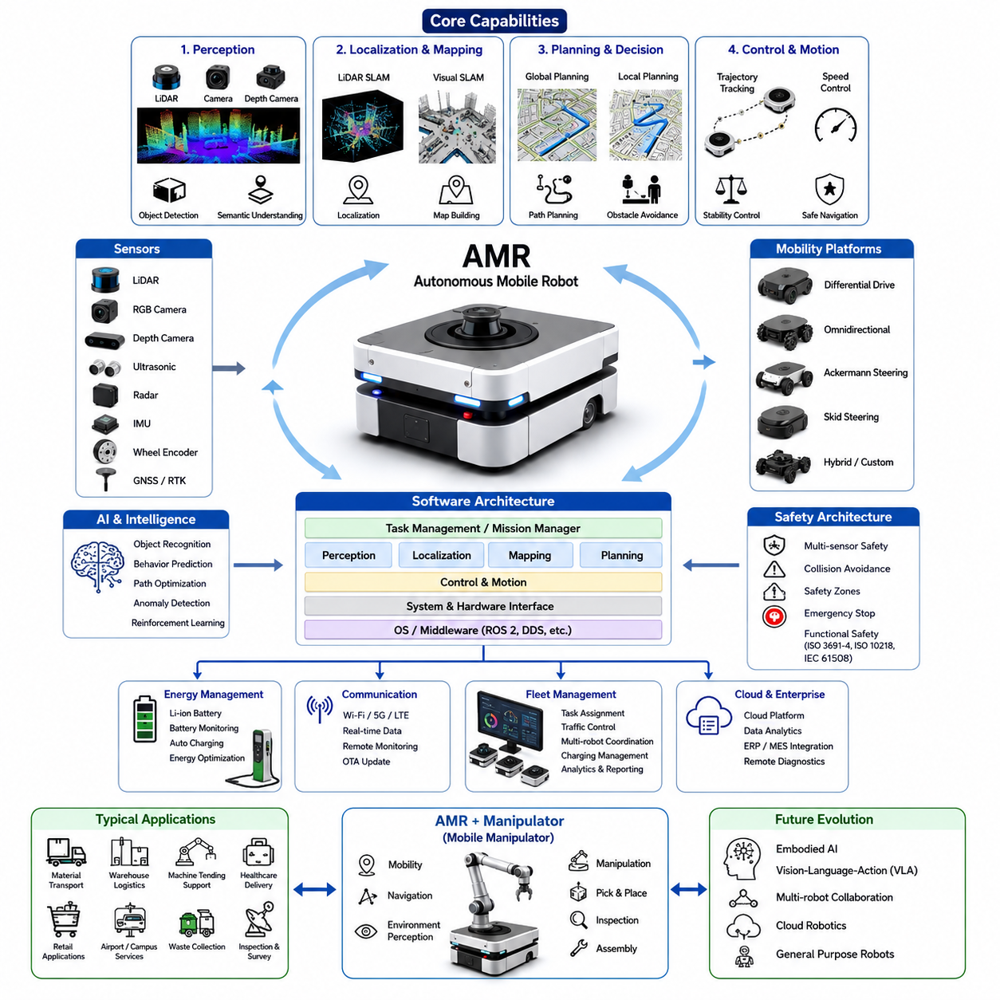
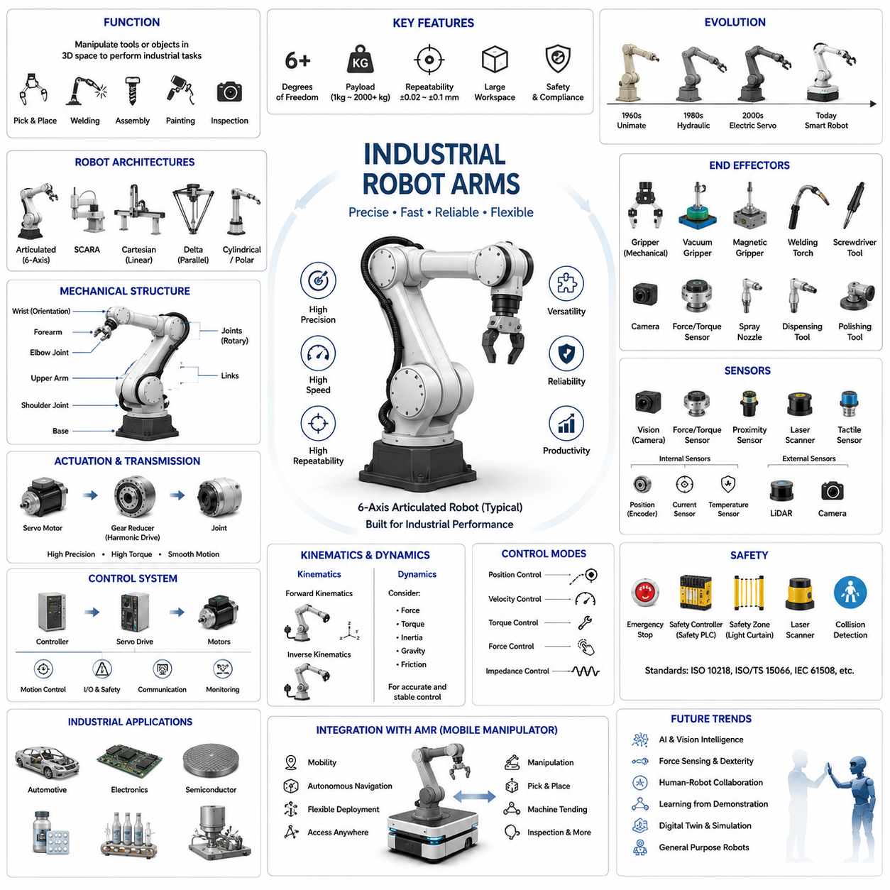
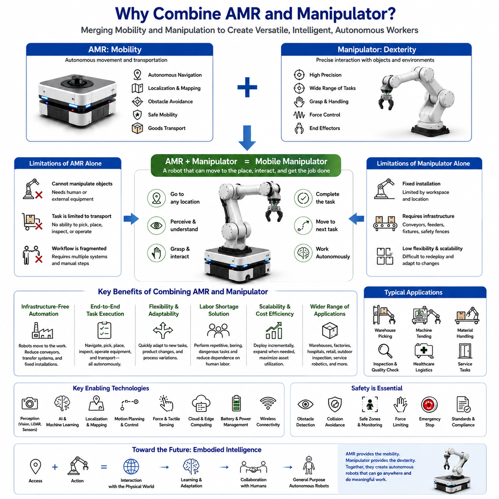
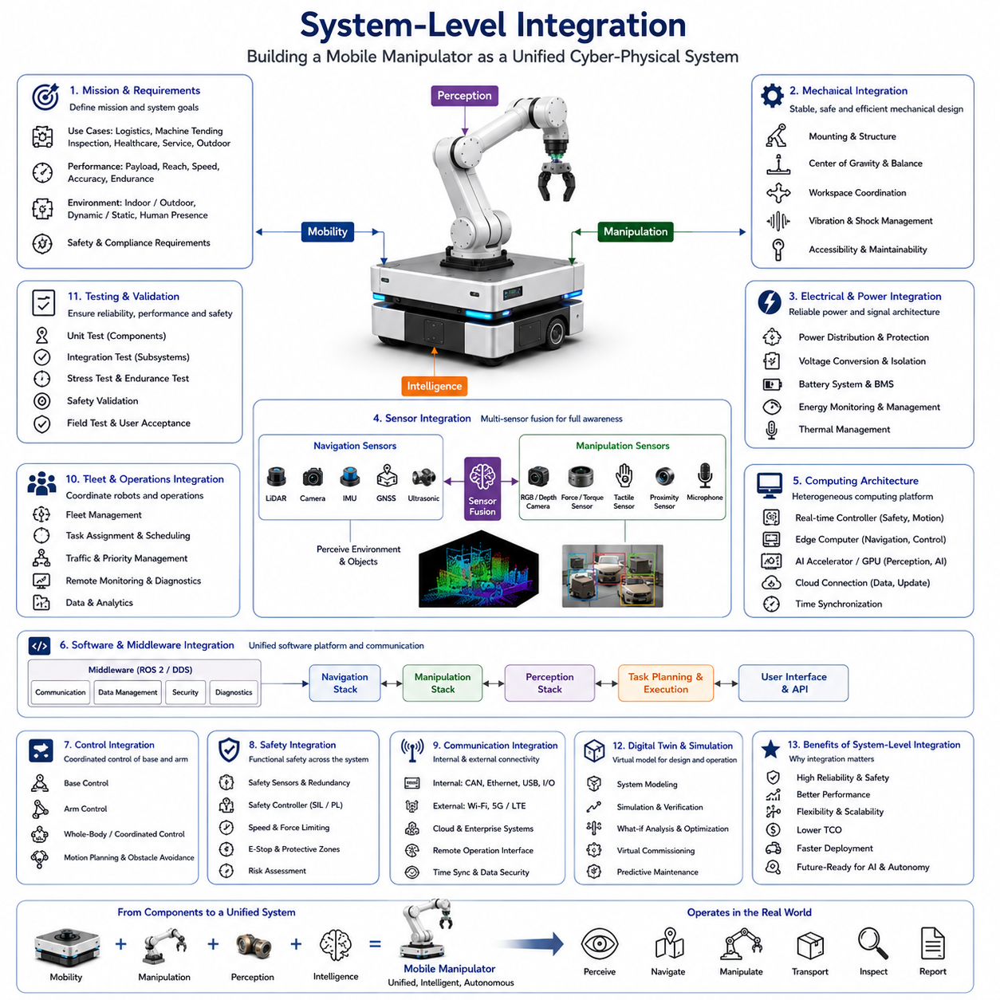
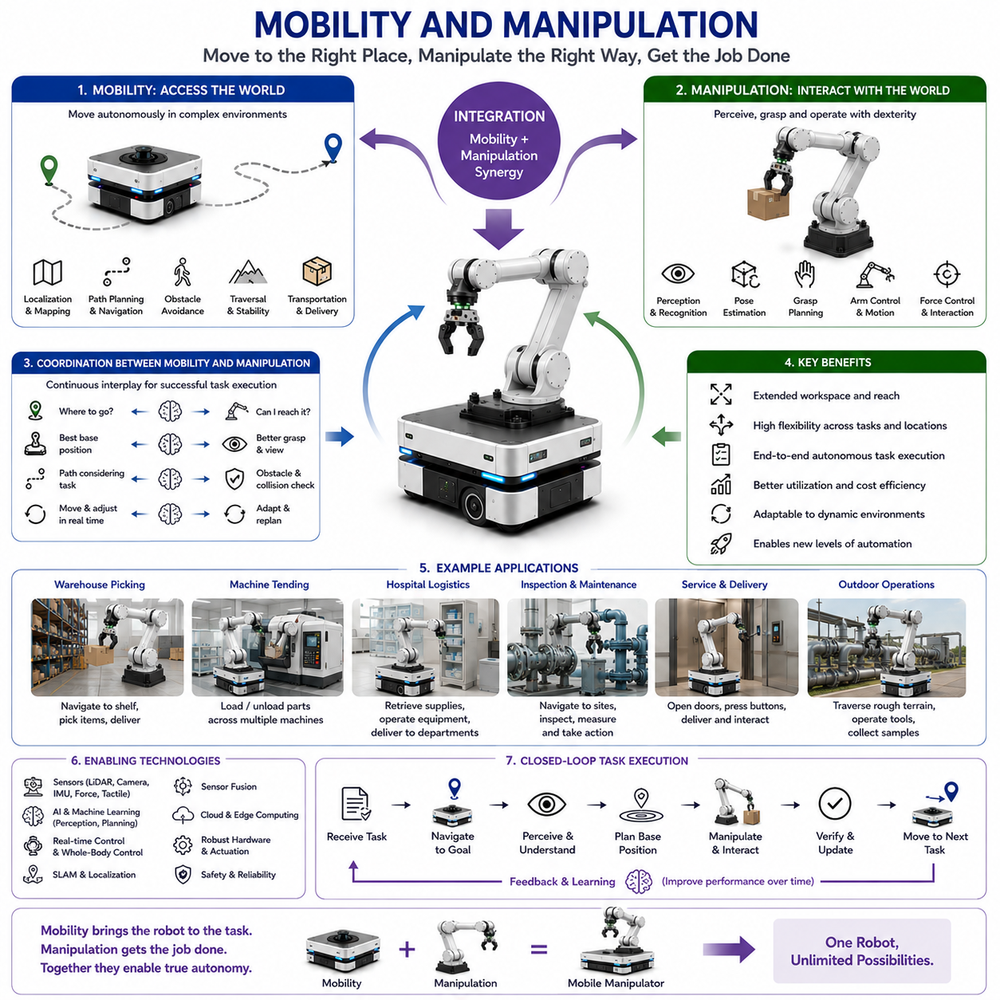
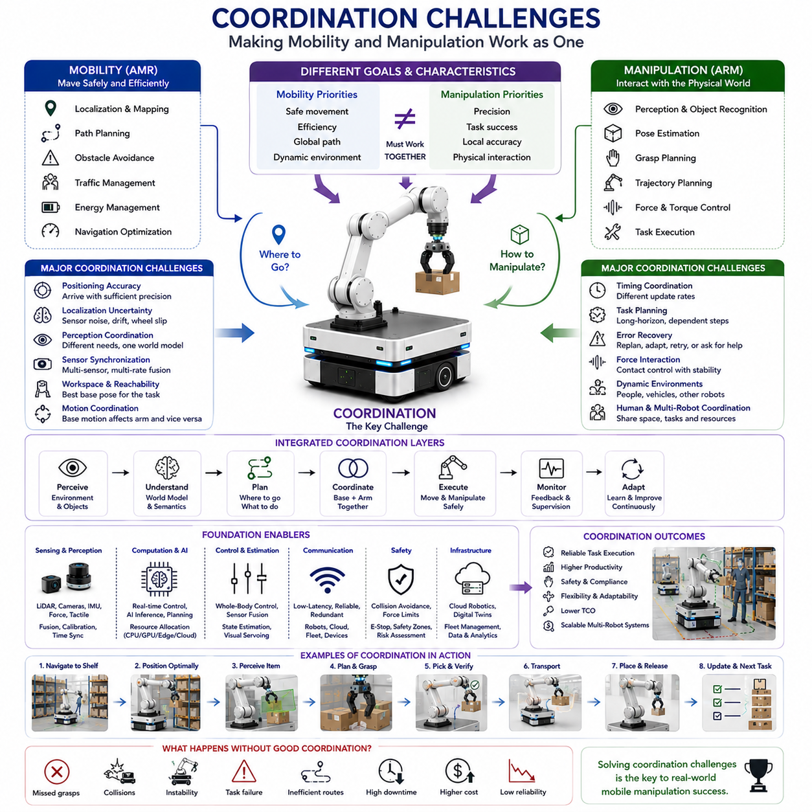
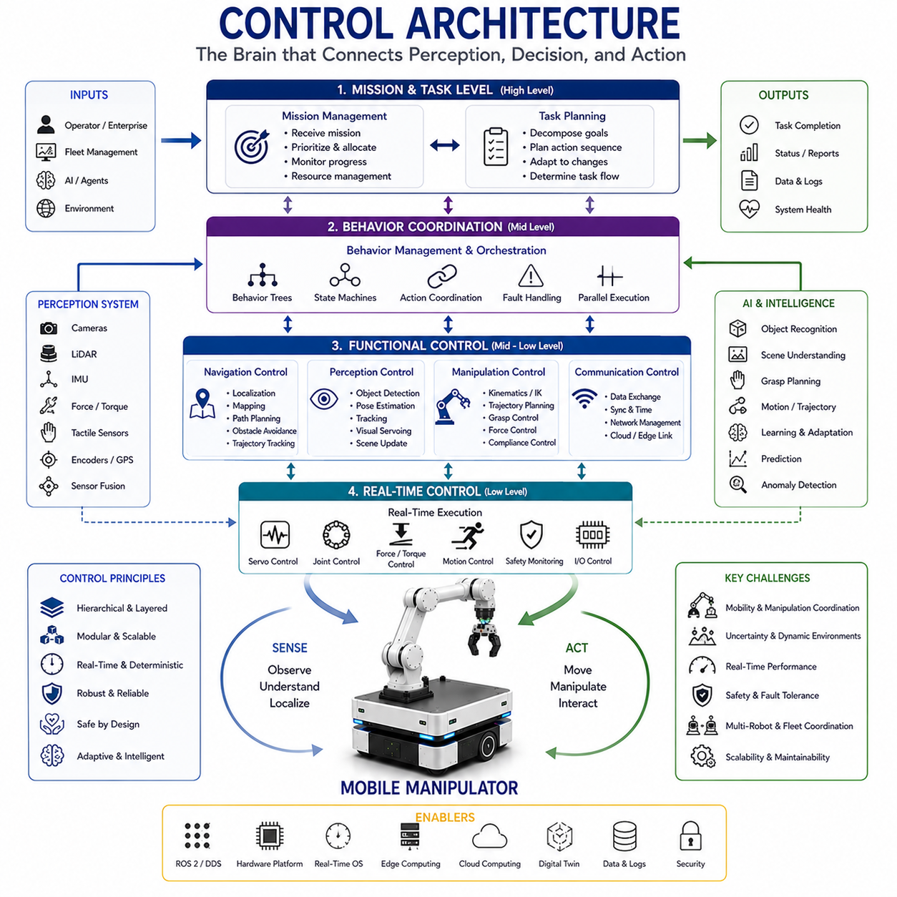
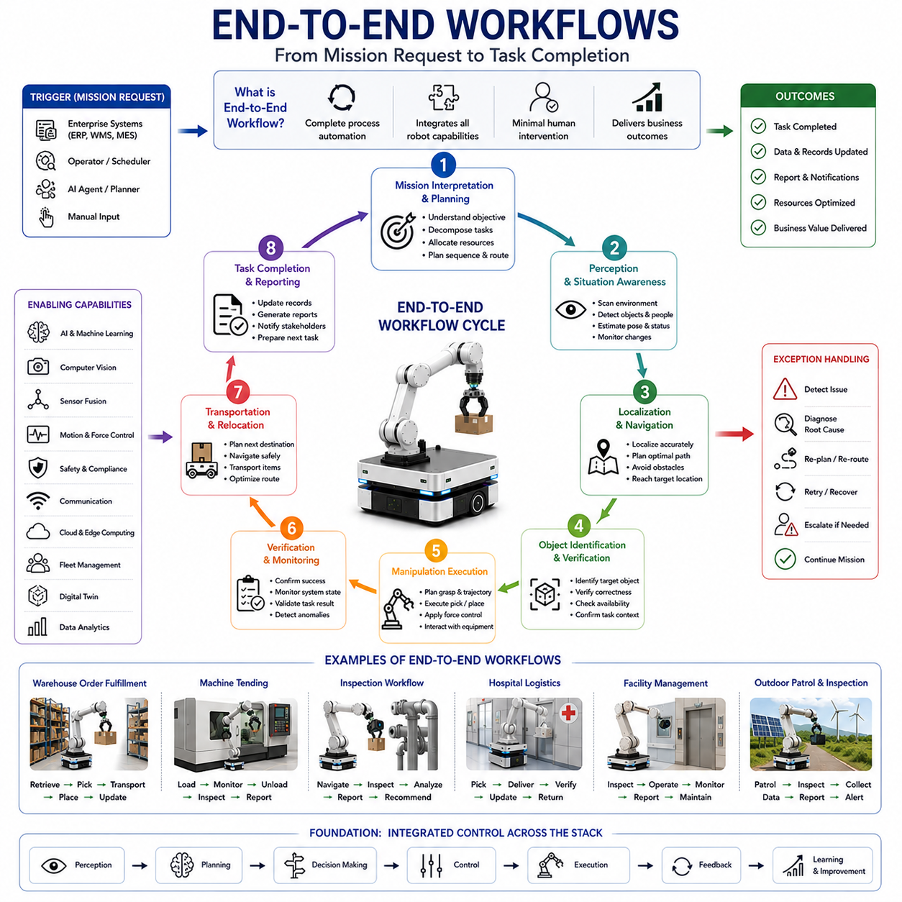
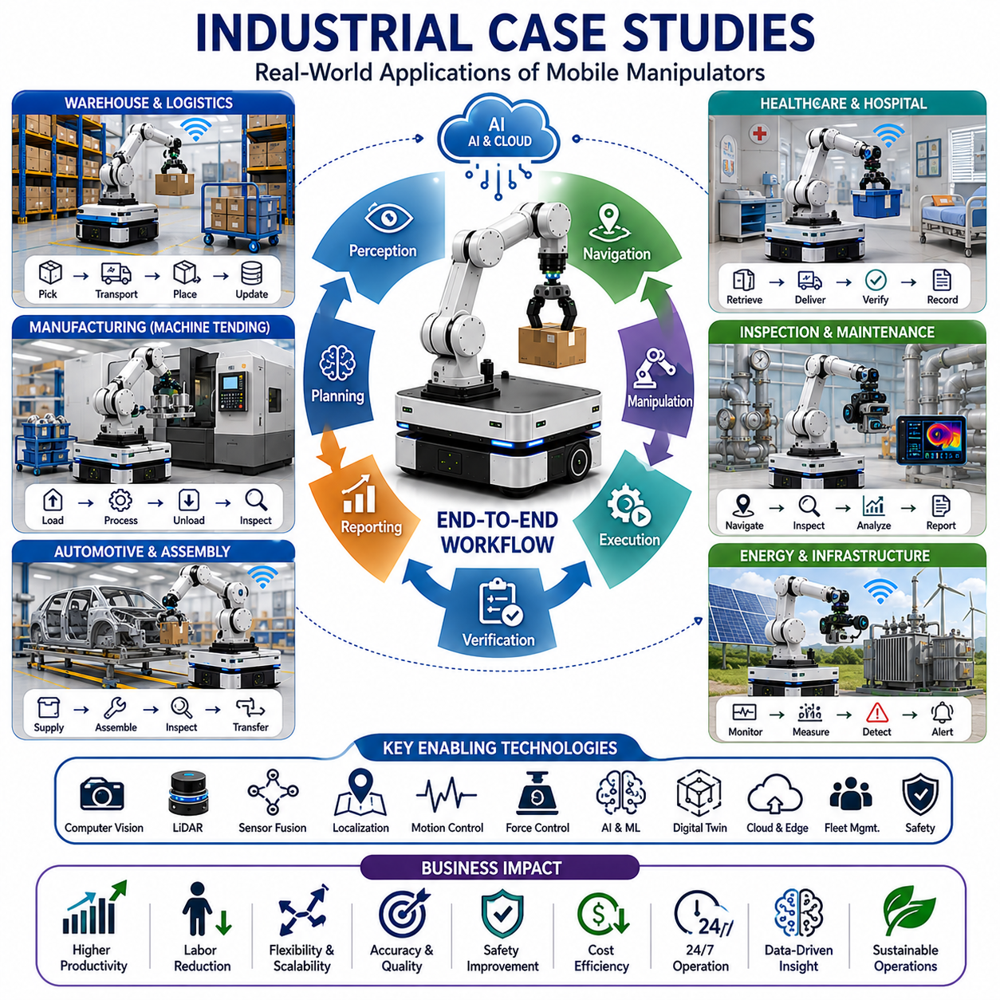

**Volume 01. Mobile Manipulator Foundations and System Architecture**

# Chapter 02. AMR plus Robot Arm

The combination of an Autonomous Mobile Robot (AMR) and an industrial robot arm represents one of the most important developments in modern robotics. Traditionally, mobile robots and industrial manipulators evolved as separate technologies. AMRs were designed to transport materials and navigate dynamic environments, while robot arms were developed to perform precise manipulation tasks within fixed workspaces. As industries increasingly demand flexible automation capable of adapting to changing environments, these two technologies have converged to form a new class of robotic systems known as Mobile Manipulators.

A mobile manipulator combines the mobility of an AMR with the dexterity of a robotic arm, creating a system that can travel autonomously to a task location, interact with objects, and perform complex operations without requiring fixed infrastructure. This integration fundamentally changes the automation paradigm. Instead of bringing materials to a stationary robot, the robot can now travel to the materials, machines, shelves, workstations, or people that require service. The result is a highly flexible automation platform capable of supporting a wide variety of industrial, logistics, healthcare, and service applications.

The AMR serves as the mobility platform and provides autonomous navigation capabilities. Equipped with sensors such as LiDAR, depth cameras, ultrasonic sensors, inertial measurement units, and localization systems, the AMR continuously perceives its environment and determines safe paths through dynamic spaces. Modern AMRs employ technologies such as SLAM, path planning, obstacle avoidance, and fleet management to operate efficiently in warehouses, factories, hospitals, and commercial facilities.

The robot arm contributes manipulation capabilities that enable interaction with the physical world. Industrial robot arms provide multiple degrees of freedom, allowing the system to reach, grasp, lift, position, inspect, assemble, or manipulate objects. The end-effector attached to the arm can take many forms, including parallel grippers, vacuum grippers, adaptive grippers, force-controlled tools, inspection sensors, and specialized application tools. Through advanced motion planning and control algorithms, the robot arm can perform tasks that traditionally required human intervention.

The true value of a mobile manipulator emerges when mobility and manipulation are tightly integrated. Navigation and manipulation can no longer be treated as independent subsystems. The robot must coordinate its base position, arm trajectory, sensor observations, and task objectives simultaneously. For example, when picking an object from a shelf, the AMR must first navigate to the correct location, position itself precisely relative to the shelf, and then coordinate arm motion to grasp the object. Small localization errors in the mobile base can directly affect manipulation success rates, making system-level integration critical.

One of the major challenges in mobile manipulation is the coordination between mobility and manipulation. Traditional industrial robots operate in highly structured environments where object locations are known with high precision. Mobile manipulators operate in semi-structured or unstructured environments where uncertainty is significantly higher. Variations in floor conditions, object placement, lighting, human activity, and environmental changes introduce complexity that must be managed through perception, planning, and adaptive control technologies.

Control architecture plays a central role in enabling successful mobile manipulation. A typical system includes multiple layers of control, including navigation control, manipulation control, perception processing, task planning, safety management, and mission execution. These layers must exchange information in real time to ensure smooth and reliable operation. ROS2, MoveIt2, Behavior Trees, and AI-based task planners have become common software frameworks for implementing such architectures.

The emergence of artificial intelligence is further expanding the capabilities of mobile manipulators. Computer vision systems can recognize objects, estimate poses, and identify task-relevant features. Foundation models, Vision-Language Models (VLMs), and Vision-Language-Action (VLA) models are enabling robots to interpret natural language instructions and perform increasingly complex tasks. Instead of relying solely on pre-programmed workflows, future mobile manipulators will be capable of understanding goals, reasoning about actions, and adapting their behavior dynamically.

Applications for mobile manipulators continue to expand across multiple industries. In warehouses, they perform order picking, shelf replenishment, and inventory handling. In manufacturing, they support machine tending, assembly operations, quality inspection, and material transport. In hospitals, they deliver medical supplies, laboratory samples, pharmaceuticals, and sterile equipment. In service environments, they assist customers, transport goods, and perform routine operational tasks. These applications demonstrate the growing importance of mobile manipulation as a foundational technology for next-generation automation.

As robotic systems continue to evolve toward greater autonomy, intelligence, and flexibility, the integration of AMRs and robot arms is expected to become the dominant architecture for many real-world robotic applications. Mobile manipulators bridge the gap between transportation and physical interaction, creating robots that can move, perceive, decide, and act within complex environments. Understanding how AMRs and robot arms are combined at the mechanical, electrical, software, and operational levels provides the foundation for designing, deploying, and scaling future mobile manipulation systems.

## 01 AMR Fundamentals

{width="7.268055555555556in" height="7.268055555555556in"}

Autonomous Mobile Robots (AMRs) represent one of the most important technological developments in modern robotics. They are intelligent robotic systems capable of moving through dynamic environments without requiring fixed physical guidance such as magnetic tapes, predefined tracks, or manually controlled navigation systems. Unlike traditional Automated Guided Vehicles (AGVs), which depend heavily on structured infrastructure and predetermined routes, AMRs utilize advanced sensing, perception, localization, mapping, planning, and control technologies to make real-time decisions while operating in complex and changing environments. As a result, AMRs have become foundational technologies in modern logistics, manufacturing, healthcare, retail, service robotics, and increasingly in outdoor autonomous operations. AMR technology forms the mobility foundation of mobile manipulators and future embodied AI systems, making a deep understanding of AMR fundamentals essential for anyone involved in next-generation robotics development. The topic is positioned as a core component within the "AMR plus Robot Arm" architecture that ultimately evolves into mobile manipulation systems.

The concept of autonomous mobility emerged from decades of research in robotics, artificial intelligence, computer vision, control theory, and autonomous vehicle technologies. Early mobile robots were often limited to highly controlled laboratory environments where navigation relied on predefined markers, reflective targets, or external positioning systems. As computational power increased and sensor technologies matured, robots gained the ability to perceive their surroundings and estimate their own positions with greater accuracy. This transition enabled robots to move beyond fixed paths and adapt dynamically to environmental changes. The evolution from AGVs to AMRs can be viewed as a shift from deterministic transportation systems toward intelligent autonomous agents capable of understanding and interacting with their surroundings.

At the heart of every AMR lies the ability to answer three fundamental questions continuously during operation. The first question is "Where am I?" which relates to localization. The second question is "What is around me?" which relates to perception and environment understanding. The third question is "Where should I go next?" which relates to path planning and decision-making. Together, these capabilities create the foundation for autonomous navigation. An AMR continuously senses the environment, updates its internal representation of the world, calculates safe and efficient routes, and executes motion commands while adapting to new information in real time.

Localization is one of the most critical technologies in AMR systems. A robot must estimate its position and orientation within an environment accurately enough to perform its assigned tasks. Various localization techniques are used depending on the operational environment. Indoor AMRs often rely on LiDAR-based localization, visual localization, SLAM technologies, fiducial markers, or sensor fusion approaches. Outdoor AMRs frequently combine GNSS, RTK-GNSS, inertial navigation systems, wheel odometry, and LiDAR-based localization. Modern AMRs rarely depend on a single positioning technology. Instead, they integrate multiple sensor sources to achieve robustness against environmental uncertainty, temporary signal loss, or sensor degradation.

Simultaneous Localization and Mapping, commonly known as SLAM, is a foundational technology that enables AMRs to create maps while simultaneously estimating their own position within those maps. SLAM allows robots to operate in environments where no prior map exists or where environments change over time. Various forms of SLAM have emerged, including LiDAR SLAM, Visual SLAM, Visual-Inertial SLAM, RGB-D SLAM, and multi-sensor fusion SLAM. The choice of SLAM technology depends on factors such as environmental complexity, computational resources, lighting conditions, operational speed, and accuracy requirements. SLAM technologies have become increasingly sophisticated, enabling robots to navigate warehouses, hospitals, factories, campuses, airports, and urban environments with high reliability.

Perception systems provide AMRs with the ability to observe and interpret their surroundings. Perception typically involves a combination of sensors such as LiDARs, stereo cameras, depth cameras, RGB cameras, ultrasonic sensors, radars, inertial measurement units, wheel encoders, and GNSS receivers. Raw sensor data alone is insufficient for autonomous operation. Advanced perception algorithms transform sensor measurements into meaningful information about obstacles, free space, dynamic objects, humans, vehicles, infrastructure, and environmental conditions. Modern AMRs increasingly employ deep learning and AI-based perception systems capable of semantic understanding, object recognition, anomaly detection, and contextual reasoning.

Obstacle detection and avoidance are among the most visible features of AMRs. Unlike AGVs that often stop when encountering unexpected obstacles, AMRs can evaluate alternative routes and dynamically adjust their trajectories. This capability significantly improves operational efficiency in environments where humans, vehicles, and other robots frequently interact. Dynamic obstacle avoidance requires continuous environmental monitoring, predictive modeling of object motion, collision risk assessment, and real-time trajectory replanning. Safe navigation in shared environments depends heavily on the quality of obstacle detection and avoidance algorithms.

Path planning is another fundamental capability of AMRs. Once the robot understands its position and the surrounding environment, it must determine how to move toward its destination. Path planning is typically divided into global planning and local planning. Global planning determines an overall route from the current position to the target location using a map of the environment. Local planning continuously adjusts the robot's trajectory based on nearby obstacles and changing conditions. Algorithms such as A\*, Dijkstra, Hybrid A\*, RRT, RRT\*, DWA, MPC, and optimization-based planners are commonly used depending on system requirements. Effective path planning balances efficiency, safety, energy consumption, travel time, and operational constraints.

Motion control transforms planned trajectories into physical movement. The control system calculates steering angles, wheel velocities, acceleration profiles, and braking commands while ensuring stability and precision. AMRs may use differential drive, skid steering, omnidirectional wheels, mecanum wheels, Ackermann steering, articulated steering, or hybrid mobility configurations. Each mobility architecture presents unique advantages and limitations. Differential drive systems are widely used in indoor environments because of their simplicity and maneuverability. Omnidirectional systems offer superior flexibility in confined spaces. Ackermann steering systems are commonly used in outdoor autonomous vehicles due to their efficiency at higher speeds.

The software architecture of an AMR is typically organized into multiple layers. The perception layer collects and processes sensor information. The localization layer estimates robot position. The mapping layer maintains environmental representations. The planning layer generates navigation strategies. The control layer executes motion commands. Above these layers, task management systems coordinate operational workflows and mission execution. Cloud-based management systems may provide fleet coordination, monitoring, analytics, and software updates. This layered architecture allows developers to build scalable and modular robotic systems.

Artificial intelligence increasingly plays a significant role in AMR systems. Traditional navigation relied heavily on deterministic algorithms and manually engineered rules. Modern AMRs incorporate machine learning models that improve perception accuracy, predict human behavior, optimize routes, estimate system health, and support adaptive decision-making. Deep neural networks enable object detection, semantic segmentation, activity recognition, and anomaly detection. Reinforcement learning techniques are being explored for navigation optimization and autonomous decision-making in complex environments. The integration of AI transforms AMRs from reactive machines into intelligent autonomous agents.

Safety remains a primary consideration in AMR design and deployment. Autonomous robots frequently operate in environments shared with humans, making functional safety essential. Safety architectures typically include redundant sensing systems, emergency stop circuits, safety controllers, speed monitoring mechanisms, protective zones, collision avoidance algorithms, and fail-safe operating modes. International standards such as ISO 3691-4, ISO 10218, IEC 61508, and related safety regulations provide guidance for designing safe robotic systems. Compliance with these standards is critical for commercial deployment.

Energy management is another important aspect of AMR operation. Most AMRs rely on lithium-ion battery systems that provide several hours of continuous operation. Battery capacity, charging strategies, power distribution, and energy efficiency significantly influence robot productivity. Advanced fleet systems may coordinate charging schedules, monitor battery health, and optimize mission assignments based on available energy resources. Some industrial deployments employ autonomous charging stations that allow robots to recharge without human intervention, enabling near-continuous operation.

Communication systems enable AMRs to interact with enterprise infrastructure, cloud platforms, and other robots. Wireless technologies such as Wi-Fi, private LTE, 5G, and industrial communication protocols facilitate data exchange and remote management. Connectivity supports fleet management, real-time monitoring, software updates, diagnostics, predictive maintenance, and integration with enterprise resource planning systems. As robot deployments scale from individual units to large fleets, communication architecture becomes increasingly important.

Fleet management systems coordinate multiple AMRs operating within a shared environment. These systems assign tasks, optimize traffic flow, manage charging schedules, balance workloads, and prevent conflicts between robots. Fleet intelligence enables organizations to maximize resource utilization and achieve higher levels of automation. As robotic deployments continue to expand, fleet management increasingly resembles air traffic control systems, orchestrating hundreds or even thousands of autonomous agents simultaneously.

The economic value of AMRs stems from their flexibility and scalability. Traditional automation often requires extensive infrastructure modifications, making deployment expensive and inflexible. AMRs can be introduced incrementally, allowing organizations to automate operations without significant facility redesign. This flexibility reduces deployment costs and shortens return-on-investment periods. AMRs also support changing workflows, seasonal demand fluctuations, and facility reconfiguration, making them particularly attractive in dynamic industries.

Industrial applications represent one of the largest markets for AMRs. Manufacturing facilities use AMRs for material transportation, work-in-progress movement, line-side delivery, machine tending support, and inventory management. Warehouses employ AMRs for order fulfillment, goods-to-person operations, pallet transport, and inventory tracking. Hospitals use AMRs for pharmaceutical delivery, laboratory specimen transport, linen distribution, and waste collection. Retail environments leverage AMRs for inventory auditing, shelf monitoring, and customer assistance. Airports, hotels, campuses, and public facilities increasingly adopt AMR technologies to improve operational efficiency.

The convergence of AMRs with robotic manipulation represents a major milestone in robotics evolution. An AMR equipped with a robotic arm becomes a mobile manipulator capable of both transportation and physical interaction. This combination significantly expands the range of tasks that robots can perform. Instead of simply moving items between locations, mobile manipulators can pick, place, sort, inspect, assemble, and interact with objects autonomously. The AMR provides mobility while the manipulator provides dexterity, creating a unified robotic system with enhanced versatility. This integration forms the conceptual foundation for mobile manipulation architectures described throughout the broader system framework.

Future AMRs will continue evolving toward greater autonomy, intelligence, and adaptability. Advances in embodied AI, foundation models, vision-language-action systems, cloud robotics, edge computing, and multi-agent coordination will enable robots to understand complex environments more deeply and perform increasingly sophisticated tasks. Future robots will not merely navigate predefined spaces but will reason about goals, collaborate with humans, learn continuously from experience, and adapt to novel situations. In this context, AMRs represent far more than transportation platforms. They are becoming intelligent physical agents that bridge the digital and physical worlds. As the foundation of mobile manipulators, service robots, industrial automation systems, and future general-purpose robots, AMR technology will remain one of the most influential pillars of robotics innovation for decades to come.

## 02 Industrial Robot Arms

{width="7.268055555555556in" height="7.268055555555556in"}

Industrial robot arms are among the most influential technologies in the history of automation. For more than five decades, they have transformed manufacturing, logistics, electronics production, automotive assembly, semiconductor fabrication, food processing, pharmaceutical operations, and countless other industrial sectors. These robotic systems were originally developed to automate repetitive, dangerous, and physically demanding tasks, but they have gradually evolved into highly sophisticated machines capable of performing complex operations with exceptional precision, speed, repeatability, and reliability. Today, industrial robot arms serve as one of the fundamental building blocks of modern robotics and provide the manipulation capability that complements the mobility of Autonomous Mobile Robots (AMRs) in mobile manipulation systems. Within the context of mobile manipulators, understanding industrial robot arms is essential because they provide the dexterity, reach, force control, and object interaction capabilities required to transform a mobile platform into a fully functional autonomous worker.

An industrial robot arm is a programmable mechanical system designed to move objects, tools, or end effectors through a defined workspace. The structure of a robot arm is inspired by the kinematic principles of the human arm, although industrial robots are optimized for precision, durability, and productivity rather than biological similarity. A typical robot arm consists of multiple rigid links connected by joints that provide controlled motion. By coordinating the movement of these joints, the robot can position and orient its end effector anywhere within its reachable workspace. This capability allows the robot to perform a wide range of industrial tasks including assembly, welding, painting, machine tending, material handling, packaging, inspection, and precision manufacturing.

The history of industrial robot arms dates back to the early 1960s when the first commercially successful industrial robot, Unimate, was introduced into automotive manufacturing. Unimate demonstrated that programmable machines could perform repetitive industrial tasks more consistently and safely than human workers in hazardous environments. Over the following decades, advances in electronics, control systems, servo motors, sensors, and computing technologies dramatically expanded the capabilities of robotic manipulators. Industrial robots evolved from simple repetitive automation devices into highly flexible systems capable of adapting to diverse manufacturing requirements. As industries pursued greater efficiency, quality, and scalability, robot arms became indispensable components of modern production systems.

The fundamental purpose of an industrial robot arm is to manipulate objects in three-dimensional space. To achieve this objective, the robot must control both position and orientation. Position refers to the location of the robot\'s tool center point within the workspace, while orientation describes the angular alignment of the tool relative to the environment. The ability to simultaneously control position and orientation enables robots to perform tasks such as inserting components, tightening fasteners, welding seams, applying adhesives, picking products from shelves, and conducting precision inspections. The combination of translational and rotational motion forms the basis of robotic manipulation.

Degrees of Freedom (DOF) are one of the most important concepts in industrial robotics. A degree of freedom represents an independent axis of motion that can be controlled by the robot. Most industrial robot arms employ six degrees of freedom because six independent motions are required to achieve arbitrary positioning and orientation in three-dimensional space. The first three joints generally control the position of the end effector, while the remaining three joints control its orientation. Some robots incorporate seven or more degrees of freedom to increase flexibility and improve obstacle avoidance. Additional degrees of freedom provide redundancy, allowing the robot to reach the same target position using multiple configurations.

Robot joints are responsible for generating motion. Most industrial manipulators use rotary joints driven by electric servo motors, although hydraulic and pneumatic systems are occasionally used for specialized applications. Rotary joints offer high precision, excellent controllability, and long operational life. Each joint contributes to the overall motion of the robot, and coordinated control of all joints enables complex movement patterns. The arrangement of joints determines the robot\'s kinematic structure and influences its workspace, reachability, payload capacity, and motion characteristics.

Several robot arm architectures have emerged over time, each optimized for specific industrial applications. Articulated robots are the most common industrial manipulators and typically feature six rotary joints arranged in a serial chain. Their flexibility allows them to perform a wide variety of tasks across many industries. SCARA robots provide high-speed horizontal motion and are widely used in electronics assembly and pick-and-place applications. Cartesian robots operate along orthogonal linear axes and offer excellent accuracy for tasks requiring rectangular workspaces. Delta robots excel at ultra-fast picking operations in packaging and food industries. Cylindrical and polar robots represent earlier architectures that are less common today but remain relevant in certain niche applications.

The mechanical structure of an industrial robot arm consists of links, joints, bearings, transmissions, and supporting frames. Links provide structural rigidity while minimizing weight. Joints generate controlled motion and transmit forces throughout the robot. Bearings reduce friction and ensure smooth movement. Transmission systems, including harmonic drives, cycloidal reducers, planetary gearboxes, and belt mechanisms, convert motor output into usable torque. The design of these components directly affects the robot\'s performance, precision, durability, and cost. Modern robot manufacturers invest significant engineering effort in optimizing mechanical structures to maximize stiffness while minimizing mass.

Servo motors serve as the primary actuation technology in most industrial robots. These motors provide precise control of position, velocity, and torque. High-resolution encoders continuously measure joint positions and enable closed-loop control systems to maintain accuracy under varying load conditions. Advanced servo systems can achieve positioning accuracy measured in fractions of a millimeter while maintaining smooth motion profiles and rapid response times. The performance of servo technology has been a major factor in the increasing capabilities of industrial robotics over recent decades.

Robot kinematics describes the mathematical relationship between joint movements and end-effector motion. Forward kinematics calculates the position and orientation of the end effector based on known joint angles. Inverse kinematics determines the joint angles required to achieve a desired end-effector position and orientation. These calculations form the foundation of robot motion planning and control. Efficient kinematic algorithms enable robots to execute complex trajectories while maintaining precision and avoiding undesirable configurations.

Dynamics extends kinematic analysis by considering forces, torques, inertia, gravity, friction, and external loads. Dynamic modeling becomes particularly important when robots move rapidly, handle heavy payloads, or interact physically with their environments. Understanding robot dynamics allows engineers to design controllers that achieve stable and efficient motion. Advanced dynamic compensation techniques improve accuracy, reduce vibration, and increase operational speed.

The workspace of a robot arm defines the region of space that can be reached by the end effector. Workspace characteristics are determined by link lengths, joint limits, mechanical constraints, and kinematic structure. Different industrial applications require different workspace configurations. Large automotive welding robots may have reaches exceeding three meters, while compact electronics assembly robots operate within much smaller workspaces. Engineers must carefully evaluate workspace requirements when selecting robots for specific tasks.

Payload capacity is another critical performance parameter. Payload refers to the maximum weight that a robot can safely manipulate while maintaining specified performance levels. Industrial robot payloads range from less than one kilogram for precision electronics applications to more than two thousand kilograms for heavy manufacturing operations. Payload capacity influences motor sizing, structural design, gearbox selection, and overall system cost. Selecting the appropriate payload class is essential for achieving optimal productivity and economic efficiency.

Repeatability is often considered more important than absolute accuracy in industrial automation. Repeatability measures a robot\'s ability to return consistently to the same position over multiple cycles. Many industrial applications rely on highly repeatable motion because calibration procedures can compensate for systematic positioning errors. Modern industrial robots commonly achieve repeatability levels between ±0.02 mm and ±0.1 mm, enabling highly precise manufacturing operations.

End effectors represent the interface between the robot and the physical world. While the robot arm provides motion, the end effector performs the actual task. Common end effectors include mechanical grippers, vacuum grippers, magnetic grippers, welding torches, painting nozzles, dispensing systems, screwdrivers, cutting tools, polishing tools, and inspection sensors. End-effector design plays a crucial role in determining the overall effectiveness of a robotic system. In many applications, the end effector is as important as the robot arm itself.

Grippers are among the most widely used end effectors in industrial robotics. Mechanical grippers use fingers or jaws to grasp objects physically. Vacuum grippers employ suction cups to handle flat or lightweight items. Soft robotic grippers utilize compliant materials to manipulate fragile products safely. Adaptive grippers can accommodate variations in object shape and size, increasing operational flexibility. The selection of gripper technology depends on object characteristics, handling requirements, cycle time constraints, and environmental conditions.

Industrial robot control systems coordinate all aspects of robot operation. Controllers interpret programmed instructions, execute motion trajectories, monitor sensor inputs, enforce safety constraints, and communicate with external systems. Modern controllers incorporate powerful processors capable of real-time computation and advanced motion planning. They support programming languages, graphical interfaces, simulation tools, and integration frameworks that simplify deployment and maintenance.

Programming methods have evolved significantly over time. Traditional robot programming relied on teach pendants and point-to-point motion commands. Contemporary systems support offline programming, digital twins, simulation-based development, graphical workflow creation, and AI-assisted programming. These advancements reduce deployment time and make robotics accessible to a broader range of users. Future systems may allow robots to learn tasks through demonstration, natural language instructions, and foundation-model-based reasoning.

Sensors enhance robot capabilities by providing awareness of internal and external conditions. Internal sensors monitor joint positions, motor currents, temperatures, and system health. External sensors such as cameras, force-torque sensors, proximity sensors, LiDARs, and tactile sensors provide environmental information. Sensor integration enables adaptive behavior, quality inspection, object recognition, force-controlled assembly, and safe human-robot interaction.

Force control represents a major advancement beyond traditional position control. Many industrial tasks require robots to regulate contact forces rather than simply following predefined trajectories. Examples include assembly, polishing, deburring, grinding, surface finishing, and human collaboration. Force sensors and advanced control algorithms enable robots to interact safely and effectively with physical environments. Impedance control and admittance control are widely used approaches for managing force interactions.

Collaborative robots, commonly known as cobots, have expanded the role of industrial robot arms beyond isolated automation cells. Unlike traditional industrial robots that operate behind safety barriers, cobots are designed to work safely alongside human operators. They incorporate force-limited joints, collision detection systems, speed monitoring functions, and advanced safety mechanisms. Cobots enable flexible automation in environments where close human-robot interaction is required. Although cobots generally operate at lower speeds and payload capacities than traditional industrial robots, they offer significant advantages in adaptability and ease of deployment.

Safety remains a fundamental requirement in industrial robotics. Robot systems must protect workers, equipment, and products from harm. Safety measures include emergency stop systems, safety-rated controllers, protective barriers, light curtains, laser scanners, safety zones, collision detection systems, and risk assessment procedures. International standards such as ISO 10218, ISO/TS 15066, IEC 61508, and related regulations provide guidance for safe robot deployment. Compliance with these standards is essential for industrial acceptance.

Industrial robot arms have become indispensable across numerous sectors. Automotive manufacturers rely on robots for welding, painting, assembly, and material handling. Electronics manufacturers use robots for component placement, soldering, and testing. Semiconductor facilities employ robotic systems for wafer handling and precision processing. Pharmaceutical companies utilize robots for packaging, laboratory automation, and sterile manufacturing. Food and beverage producers implement robots for packaging, sorting, and palletizing. The diversity of applications continues to expand as technology advances.

The integration of industrial robot arms with AMRs represents one of the most significant trends in modern robotics. Traditionally, robot arms were fixed installations limited to specific workstations. By mounting a robot arm on an autonomous mobile platform, engineers create a mobile manipulator capable of traveling throughout a facility and performing tasks wherever needed. This combination merges mobility and manipulation into a single intelligent system. Mobile manipulators can transport materials, operate machinery, perform inspections, fulfill orders, and execute complex workflows without requiring fixed infrastructure. This convergence is transforming industrial automation and laying the foundation for future embodied AI systems.

Future industrial robot arms will become increasingly intelligent, adaptable, and autonomous. Advances in artificial intelligence, computer vision, force sensing, foundation models, reinforcement learning, and embodied AI will enable robots to perform tasks that previously required human judgment and dexterity. Future systems will understand instructions expressed in natural language, learn from demonstrations, adapt to changing environments, and collaborate seamlessly with humans and other robots. Rather than functioning solely as programmable machines, industrial robot arms will evolve into versatile physical agents capable of understanding goals, reasoning about actions, and executing complex manipulation tasks autonomously. As the manipulation component of mobile manipulators and future general-purpose robots, industrial robot arms will continue to play a central role in the evolution of intelligent automation and robotics throughout the coming decades.

## 03 Why Combine AMR and Manipulator

{width="7.268055555555556in" height="7.268055555555556in"}

The convergence of Autonomous Mobile Robots (AMRs) and industrial robot manipulators represents one of the most significant developments in modern robotics. For many years, autonomous mobility and robotic manipulation evolved as separate technological domains. AMRs focused on moving through environments autonomously, transporting materials, and navigating safely among people and infrastructure. Industrial robot arms, on the other hand, concentrated on precise object handling, assembly, welding, inspection, packaging, and manufacturing tasks within fixed workspaces. While both technologies achieved remarkable success independently, each possessed inherent limitations that restricted the scope of automation. The integration of AMRs and robot manipulators into a unified mobile manipulator architecture addresses these limitations and creates a new generation of robotic systems capable of both movement and physical interaction. This combination is increasingly viewed as a critical step toward embodied intelligence and future general-purpose robotic systems.

Traditional industrial robot arms are typically installed in fixed locations. They are highly efficient within their designated work envelopes and can execute tasks with extraordinary precision and repeatability. However, their operational capability is constrained by the physical boundaries of their workspaces. If an object lies outside the robot's reach, the robot cannot interact with it unless additional equipment such as conveyors, transfer systems, or human operators reposition the object. This limitation often results in complex automation infrastructure, increased capital costs, and reduced operational flexibility. While fixed robotic cells have proven effective in high-volume manufacturing environments, they are less suitable for dynamic operations where work locations frequently change.

AMRs solve a different problem. They provide mobility and autonomous transportation capabilities. An AMR can navigate through warehouses, factories, hospitals, airports, retail environments, and outdoor facilities without requiring fixed guidance infrastructure. By leveraging technologies such as localization, mapping, obstacle avoidance, and path planning, AMRs can transport goods between locations efficiently and safely. However, AMRs typically lack sophisticated manipulation capabilities. Most AMRs can move objects only if those objects are already loaded onto their platforms or transferred through external mechanisms. As a result, AMRs often require human assistance or dedicated automation systems to complete tasks involving physical interaction with the environment.

The combination of AMRs and robot manipulators creates a system that can both move and work. This capability fundamentally changes the role of robotics in industrial and service environments. Instead of merely transporting materials or performing isolated manipulation tasks, a mobile manipulator can travel to a work location, identify objects, interact with them, complete assigned tasks, and then move to the next location autonomously. The integration transforms robots from specialized automation tools into versatile operational agents capable of executing end-to-end workflows.

One of the primary motivations for combining AMRs and manipulators is the elimination of fixed infrastructure. Traditional automation systems frequently rely on conveyors, lifts, dedicated transfer stations, and specialized work cells. These systems can be expensive to install, difficult to modify, and challenging to scale. Mobile manipulators reduce dependence on fixed infrastructure by bringing robotic capability directly to the task location. Instead of moving products to robots, robots move to products. This paradigm shift enables significantly greater flexibility and supports rapidly changing operational requirements.

Manufacturing environments increasingly demand flexible automation solutions. Product lifecycles are becoming shorter, customization requirements are increasing, and production volumes fluctuate more frequently than in the past. Fixed automation systems often struggle to adapt to these changing conditions. Mobile manipulators provide a flexible alternative because they can be reprogrammed, redeployed, and reassigned to different tasks without requiring substantial facility modifications. This adaptability is particularly valuable in high-mix, low-volume manufacturing environments where traditional automation may not be economically viable.

Labor shortages represent another major driver behind mobile manipulator development. Many industries face increasing difficulties recruiting and retaining workers for repetitive, physically demanding, or undesirable tasks. Warehousing, logistics, manufacturing, healthcare, and service industries are particularly affected. Mobile manipulators can perform material handling, picking, transportation, inspection, machine tending, and support operations with minimal human intervention. By automating these activities, organizations can improve productivity while reducing dependence on scarce labor resources.

The ability to perform end-to-end task execution is one of the most powerful advantages of mobile manipulators. Consider a traditional warehouse workflow. An AMR may transport inventory between locations, but human workers are often required to pick items from shelves, load containers, verify products, and prepare shipments. A mobile manipulator can potentially perform all these functions autonomously. The robot can navigate to a storage location, identify the required item using computer vision, grasp it using an appropriate end effector, place it into a container, and transport it to the next destination. By integrating mobility and manipulation, previously fragmented workflows become unified autonomous processes.

Machine tending provides another compelling example. In conventional industrial settings, robot arms are frequently installed next to CNC machines, injection molding machines, or manufacturing equipment. These robots load raw materials, unload finished products, and perform repetitive handling operations. However, each robot is dedicated to a specific machine or group of machines. A mobile manipulator can service multiple machines across an entire facility. The robot can travel between workstations, load and unload parts, conduct inspections, and coordinate production activities dynamically. This approach increases equipment utilization and reduces automation costs.

The integration of AMRs and manipulators also enhances scalability. Traditional automation often requires significant upfront investment and long implementation cycles. Mobile manipulators can be deployed incrementally, allowing organizations to expand automation capacity as operational demands grow. Additional robots can be added to the fleet without extensive facility redesign. This scalability supports gradual adoption strategies and reduces financial risk.

Technological convergence has made mobile manipulators increasingly feasible. Advances in sensors, computing hardware, artificial intelligence, robotics middleware, battery technology, and wireless communication have significantly reduced the barriers to integration. Modern mobile manipulators can leverage high-performance processors, GPU acceleration, advanced perception systems, and sophisticated control architectures. These technologies enable real-time coordination between navigation and manipulation subsystems, allowing robots to operate effectively in dynamic environments.

Perception plays a central role in mobile manipulation. A mobile manipulator must understand both its environment and the objects with which it interacts. This requires integrating multiple sensing modalities, including cameras, LiDARs, depth sensors, force sensors, tactile sensors, and inertial measurement units. The robot must simultaneously localize itself within the environment, detect obstacles, identify target objects, estimate object poses, and monitor manipulation activities. This level of environmental awareness exceeds the requirements of traditional fixed industrial robots and represents a key challenge in mobile manipulator development.

Artificial intelligence significantly enhances the capabilities of mobile manipulators. Machine learning models improve object detection, semantic understanding, grasp planning, motion prediction, and task execution. Vision-language models enable robots to interpret high-level instructions and reason about complex tasks. Reinforcement learning supports adaptive behaviors in uncertain environments. As AI technologies continue to advance, mobile manipulators are becoming increasingly capable of handling diverse and previously unseen situations.

The economic justification for combining AMRs and manipulators extends beyond labor replacement. Mobile manipulators can improve asset utilization, reduce infrastructure costs, increase operational flexibility, shorten deployment timelines, and enhance overall productivity. Organizations can automate tasks that were previously considered impractical due to variability, complexity, or economic constraints. This broader automation potential often produces substantial return on investment.

Safety considerations are especially important when integrating mobility and manipulation. A mobile manipulator introduces additional complexity because it combines navigation hazards with manipulation hazards. The system must avoid collisions while moving, maintain stable operation during manipulation, and ensure safe interaction with humans. Advanced safety architectures typically include redundant sensing systems, dynamic safety zones, collision detection mechanisms, force monitoring capabilities, emergency stop functions, and comprehensive risk assessment procedures. The integration of mobility and manipulation requires a holistic safety strategy that addresses the combined operational risks.

Healthcare environments illustrate the unique advantages of mobile manipulators. Hospitals contain numerous repetitive logistics activities involving medical supplies, pharmaceuticals, laboratory samples, linens, meals, and waste materials. Traditional AMRs can transport these items, but loading and unloading often require human intervention. Mobile manipulators can autonomously retrieve items from shelves, interact with storage systems, operate equipment, and deliver materials directly to their destinations. This capability reduces staff workload and improves operational efficiency.

Service robotics represents another promising application area. Hotels, airports, office buildings, shopping centers, and public facilities require robots capable of interacting with diverse environments and performing varied tasks. Mobility alone is insufficient because many service activities involve manipulating objects, opening doors, pressing buttons, operating equipment, or handling packages. Mobile manipulators provide the physical interaction capabilities necessary to perform these functions autonomously.

Outdoor robotics further expands the importance of mobile manipulation. Infrastructure inspection, utility maintenance, security patrols, agricultural operations, construction support, and environmental monitoring often require robots to travel across large areas while interacting with physical assets. A mobile manipulator can navigate outdoor environments, inspect equipment, operate instruments, collect samples, manipulate tools, and perform maintenance activities. The combination of mobility and manipulation is particularly valuable in these distributed operational scenarios.

From a systems engineering perspective, mobile manipulators represent the integration of two highly complex subsystems. The AMR component provides localization, mapping, navigation, obstacle avoidance, fleet management, and mobility control. The manipulator component provides kinematics, dynamics, grasping, force control, motion planning, and object interaction capabilities. Successful integration requires coordinated architecture across mechanical design, electrical systems, sensors, computing platforms, software frameworks, communications infrastructure, and safety systems. This multidisciplinary complexity explains why mobile manipulators are often considered among the most advanced robotic systems currently deployed in industry.

The evolution toward embodied AI further strengthens the rationale for combining AMRs and manipulators. Embodied intelligence requires robots to perceive, move, interact, and learn within the physical world. Mobility enables exploration and access to distributed environments, while manipulation enables meaningful interaction with objects and infrastructure. Neither capability alone is sufficient for general-purpose autonomy. Together, they form the physical foundation upon which embodied AI systems can be built.

Future robotic systems will increasingly blur the distinction between transportation and manipulation. Mobile manipulators will become more autonomous, more intelligent, and more adaptable. They will leverage foundation models, vision-language-action architectures, cloud robotics, digital twins, and multi-agent coordination systems to execute increasingly complex workflows. Robots will move beyond predefined task sequences and become capable of understanding objectives, planning actions, collaborating with humans, and adapting to changing environments.

Ultimately, the reason for combining AMRs and manipulators is simple yet profound. Mobility provides access, while manipulation provides action. An AMR can reach the location where work must be performed, and a manipulator can perform the work itself. Individually, each technology addresses only part of the automation challenge. Together, they create a unified robotic platform capable of sensing, moving, interacting, and acting within the physical world. This integration represents a natural evolution in robotics and serves as a critical foundation for the next generation of intelligent autonomous systems, mobile manipulators, and future general-purpose robots.

## 04 System Level Integration

{width="7.268055555555556in" height="7.268055555555556in"}

System-Level Integration is one of the most critical disciplines in the development of mobile manipulators. While Autonomous Mobile Robots (AMRs) and industrial robot arms are individually mature technologies, combining them into a single operational platform introduces significant engineering challenges. A mobile manipulator is not merely an AMR carrying a robot arm. It is a tightly integrated cyber-physical system in which mobility, manipulation, perception, computing, communication, power management, safety, and artificial intelligence must function as a unified architecture. The effectiveness of a mobile manipulator depends not only on the performance of individual subsystems but also on how successfully those subsystems interact with one another. System-level integration therefore becomes the foundation upon which reliability, safety, productivity, scalability, and commercial viability are built.

Historically, mobility and manipulation were developed as independent domains. Mobile robots focused on navigation, localization, mapping, obstacle avoidance, and transportation tasks. Industrial robot arms concentrated on precision positioning, force control, assembly, welding, machine tending, and object handling. When these technologies are merged, new challenges emerge because the behavior of one subsystem directly influences the performance of the other. The robot arm changes the center of gravity of the mobile platform. Vehicle movement introduces vibrations that affect manipulation accuracy. Battery consumption increases due to additional payload and computational requirements. Sensor placement becomes more complex because navigation and manipulation systems often compete for optimal mounting locations. Successful integration requires a holistic engineering approach rather than treating each subsystem independently.

The first aspect of system-level integration involves defining the overall mission architecture. Every mobile manipulator is developed to perform specific operational objectives. These objectives may include warehouse picking, machine tending, hospital logistics, industrial inspection, retail automation, laboratory support, service operations, or outdoor maintenance. System architecture begins by analyzing mission requirements and translating them into technical specifications. Engineers must determine mobility requirements, payload capacities, manipulation capabilities, sensing needs, computational demands, communication requirements, environmental constraints, safety objectives, and operational performance targets. A clear understanding of mission requirements serves as the foundation for all subsequent integration decisions.

Mechanical integration is often the most visible component of system-level architecture. The robot arm must be physically mounted onto the mobile platform in a manner that ensures structural rigidity, operational stability, and safety. The placement of the manipulator significantly influences system performance. A forward-mounted arm may maximize reach but can create balance issues. A centrally mounted arm improves stability but may reduce accessible workspace. Engineers must evaluate center of gravity, payload distribution, structural stress, vibration characteristics, accessibility, maintenance requirements, and collision risks when designing the mechanical architecture.

Center-of-gravity management represents one of the most important mechanical integration challenges. Industrial robot arms can generate substantial dynamic forces during acceleration, deceleration, and manipulation operations. These forces can destabilize the mobile platform, particularly when the arm is extended or carrying heavy payloads. System designers must carefully calculate static and dynamic load conditions across all anticipated operating scenarios. Counterweights, wider wheelbases, lower battery placement, reinforced chassis structures, and advanced motion planning algorithms are frequently employed to maintain stability.

Workspace integration is another critical consideration. The manipulator workspace and vehicle mobility workspace must complement one another. Engineers seek to maximize the effective operational envelope of the entire system while minimizing blind spots and unreachable regions. Mobile manipulators often rely on coordinated motion strategies where the AMR repositions itself to optimize manipulator access to target objects. This approach effectively combines large-scale mobility with local dexterity and significantly expands operational capabilities beyond those of fixed robotic systems.

Electrical integration forms the backbone of system connectivity. Mobile manipulators contain numerous electrical subsystems including drive motors, robot joints, sensors, computing platforms, communication devices, safety controllers, battery systems, and peripheral equipment. These components require coordinated power distribution, signal routing, grounding strategies, electromagnetic compatibility management, and fault protection mechanisms. Poor electrical integration can result in communication failures, sensor interference, reduced reliability, and safety risks.

Power architecture becomes increasingly important as system complexity grows. AMRs and robot manipulators often have different voltage requirements, power consumption profiles, and operational priorities. High-power computing systems, advanced sensors, robotic arms, and mobility platforms may collectively consume several hundred watts or even kilowatts of power. System designers must develop efficient power distribution architectures that support peak loads while maintaining operational endurance. Battery selection, DC-DC conversion, energy monitoring, charging systems, and thermal management all play critical roles in achieving reliable operation.

Battery management represents a major design consideration. Mobile manipulators often require significantly larger battery capacities than standard AMRs because they must power both locomotion and manipulation systems. The robot arm may consume substantial energy during continuous operation, particularly when handling heavy objects or performing force-controlled tasks. Effective energy management strategies monitor power consumption, estimate remaining runtime, optimize mission assignments, and schedule autonomous charging activities. Advanced fleet management systems may incorporate energy-aware task allocation algorithms to maximize operational efficiency.

Sensor integration is among the most challenging aspects of mobile manipulator development. Navigation and manipulation systems require overlapping but distinct sensor capabilities. AMRs typically depend on LiDARs, cameras, IMUs, GNSS receivers, and obstacle detection sensors for navigation. Manipulators require cameras, force-torque sensors, depth sensors, tactile sensors, and object recognition systems for interaction tasks. Integrating these sensors into a coherent perception architecture requires careful consideration of field-of-view coverage, sensor redundancy, calibration procedures, synchronization requirements, and environmental robustness.

Perception integration enables the robot to understand both the environment and the objects within it. A mobile manipulator must simultaneously answer multiple questions. It must know where it is, understand what surrounds it, identify target objects, estimate object poses, predict environmental changes, and monitor manipulation outcomes. Achieving this level of situational awareness requires sophisticated sensor fusion techniques that combine information from multiple sensing modalities into a unified representation of the world.

Computing architecture serves as the central nervous system of the mobile manipulator. Modern systems often employ heterogeneous computing platforms consisting of real-time controllers, embedded processors, industrial computers, GPUs, AI accelerators, and cloud-based resources. Different computational tasks have different requirements. Safety functions require deterministic real-time execution. Navigation algorithms require continuous sensor processing. AI workloads demand high-performance parallel computing. Manipulation planning may require complex optimization calculations. System architects must allocate workloads appropriately across available computing resources while minimizing latency and maximizing reliability.

Software integration is perhaps the most complex aspect of system-level engineering. A mobile manipulator may contain dozens or even hundreds of software components developed by different vendors, teams, and organizations. Navigation software, manipulation software, perception systems, AI models, communication frameworks, diagnostics tools, safety modules, fleet management platforms, and user interfaces must all work together seamlessly. Middleware platforms such as ROS 2 have become widely adopted because they provide standardized communication mechanisms that simplify integration across heterogeneous subsystems.

Communication architecture enables coordination among distributed system components. Internal communication networks connect sensors, controllers, computing modules, and actuators. External communication links connect robots to fleet management systems, cloud platforms, enterprise software, and remote operators. Ethernet, CAN bus, DDS, Wi-Fi, LTE, 5G, and industrial communication protocols are commonly used depending on application requirements. Reliable communication is essential because failures can affect navigation, manipulation, safety, and mission execution.

Control architecture must coordinate mobility and manipulation activities simultaneously. Traditional industrial robots assume a fixed base, while AMRs assume a static payload. Mobile manipulators violate both assumptions. The control system must account for interactions between vehicle movement and arm motion. Whole-body control approaches increasingly treat the mobile base and manipulator as a single kinematic system. This enables coordinated motion planning, improved efficiency, enhanced dexterity, and more natural task execution.

Task-level integration connects low-level robotic capabilities to operational objectives. A mobile manipulator must execute complex workflows that involve navigation, perception, object recognition, grasp planning, manipulation, transportation, inspection, and reporting. Task planning systems decompose high-level goals into executable sequences of actions. For example, fulfilling a warehouse order may require navigating to a shelf, identifying a product, grasping the item, transporting it to a packing station, and updating inventory records. Effective task integration enables autonomous execution of complete business processes.

Artificial intelligence increasingly plays a central role in system-level integration. AI technologies provide object recognition, semantic understanding, anomaly detection, predictive maintenance, grasp planning, route optimization, and adaptive decision-making capabilities. Vision-language models allow robots to interpret natural language instructions. Foundation models support generalization across diverse tasks and environments. Reinforcement learning enables adaptive behavior under uncertainty. As AI becomes more deeply integrated into robotics, system architecture must support efficient deployment and continuous updating of AI models.

Safety integration is a fundamental requirement that spans every subsystem. Mobile manipulators combine the hazards associated with autonomous vehicles and robotic arms, creating unique safety challenges. Navigation systems must prevent collisions during movement. Manipulation systems must avoid harmful contact during object handling. Safety architectures typically include redundant sensors, emergency stop systems, safety-rated controllers, speed monitoring functions, force limitations, protective zones, and risk assessment procedures. Safety functions must operate independently of higher-level software systems and remain effective even under fault conditions.

Cybersecurity is becoming increasingly important as robots become more connected. Mobile manipulators often communicate with cloud services, fleet management systems, enterprise platforms, and remote operators. These connections create potential attack surfaces that must be protected through authentication mechanisms, encryption protocols, secure software updates, network segmentation, and intrusion detection systems. Cybersecurity must be treated as an integral part of system architecture rather than an afterthought.

Human-robot interaction introduces additional integration requirements. Mobile manipulators frequently operate in environments shared with people. The system must communicate intentions clearly, respond predictably, and maintain safe behavior under all operating conditions. User interfaces, visual indicators, audio notifications, gesture recognition, natural language interaction, and collaborative behaviors all contribute to effective human-robot collaboration. Integration of these capabilities enhances usability and promotes user trust.

Fleet integration extends system architecture beyond individual robots. Many real-world deployments involve multiple mobile manipulators operating simultaneously. Fleet management systems coordinate task assignments, traffic control, charging schedules, software updates, diagnostics, and operational analytics. Multi-robot coordination requires consistent communication architectures, standardized interfaces, and centralized or distributed decision-making frameworks.

Digital twin technology is increasingly used to support system integration activities. Virtual models allow engineers to simulate robot behavior, evaluate design alternatives, validate workflows, optimize performance, and identify integration issues before physical deployment. Digital twins reduce development costs, accelerate testing, and improve overall system quality. They also support predictive maintenance and continuous operational optimization after deployment.

Testing and validation represent the final stage of system-level integration. Every subsystem may function correctly in isolation while the overall system fails due to integration issues. Comprehensive testing therefore includes component testing, subsystem testing, integration testing, stress testing, safety validation, environmental testing, user acceptance testing, and long-duration operational trials. Validation ensures that the integrated system satisfies mission requirements under realistic operating conditions.

As robotics continues to evolve toward embodied intelligence, the importance of system-level integration will only increase. Future robots will incorporate more sensors, more AI capabilities, more autonomy, and more complex interactions with humans and environments. Success will depend not on the excellence of individual components but on the effectiveness of the overall system architecture. Mobile manipulators represent one of the most advanced examples of integrated robotics systems today because they combine mobility, manipulation, perception, intelligence, communication, safety, and operational workflows into a single autonomous platform. System-level integration transforms these individual technologies into a cohesive robotic worker capable of delivering real-world value. In many ways, integration is not merely one aspect of mobile manipulator development---it is the discipline that ultimately determines whether a robot becomes a successful product or remains a collection of disconnected technologies.

## 05 Mobility and Manipulation

{width="7.268055555555556in" height="7.268055555555556in"}

Mobility and manipulation are the two fundamental capabilities that define the functionality of a mobile manipulator. Individually, each capability provides significant value. Mobility enables a robot to move through its environment, access different locations, transport materials, and navigate complex spaces. Manipulation enables a robot to physically interact with objects, perform work, operate tools, and modify the surrounding environment. When combined, these capabilities create a robotic system that can not only reach a location but also accomplish meaningful tasks once it arrives. This integration transforms a robot from a transportation platform or a stationary automation device into a versatile autonomous worker capable of executing complex end-to-end operations. The synergy between mobility and manipulation is therefore one of the most important concepts in modern robotics and serves as the foundation of mobile manipulation systems.

Historically, mobility and manipulation developed as separate branches of robotics. Mobile robots focused on navigation, localization, path planning, obstacle avoidance, and autonomous transportation. Industrial manipulators concentrated on precision positioning, force control, assembly operations, machine tending, welding, inspection, and material handling. Each technology evolved independently because the engineering challenges associated with movement and object interaction were fundamentally different. However, many real-world tasks require both capabilities simultaneously. Humans naturally combine movement and manipulation when performing daily activities. A worker walks to a shelf, reaches for a tool, carries an object, operates equipment, and moves to another location. To achieve similar versatility, robots must integrate mobility and manipulation into a unified operational framework.

Mobility provides access to distributed environments. In warehouses, factories, hospitals, airports, and outdoor facilities, tasks are rarely concentrated in a single location. Objects, tools, equipment, and workstations are often spread across large areas. A robot limited to a fixed position can only interact with objects within its immediate workspace. Mobility removes this limitation by allowing the robot to reposition itself dynamically. Through autonomous navigation, a robot can travel throughout an environment, access multiple work areas, and respond to changing operational demands. Mobility effectively expands the reach of robotic automation beyond the physical boundaries of a stationary workspace.

Manipulation provides the ability to interact with the physical world. While mobility allows a robot to arrive at a location, manipulation enables it to perform useful work once there. Manipulation involves grasping, lifting, carrying, positioning, assembling, inspecting, operating tools, opening doors, pressing buttons, loading machines, unloading materials, and countless other physical actions. These capabilities require sophisticated control of robot arms, grippers, end effectors, force sensors, vision systems, and planning algorithms. Manipulation transforms a robot from a mobile observer into an active participant in its environment.

The relationship between mobility and manipulation is highly interdependent. Effective manipulation often depends on accurate positioning of the mobile base. Likewise, navigation decisions may depend on manipulation requirements. For example, a robot approaching a storage rack must position itself in a location that enables successful object retrieval. If the robot stops too far away, the manipulator may not reach the target. If it stops too close, collisions may occur. The navigation system and manipulation system must therefore coordinate continuously to achieve successful task execution.

One of the most important concepts in mobile manipulation is workspace extension. A fixed industrial robot is limited to the physical reach of its arm. In contrast, a mobile manipulator combines arm reach with vehicle mobility. When an object lies outside the arm\'s workspace, the robot can simply reposition its base and continue the task. This creates an effectively unlimited operational workspace constrained only by the robot\'s ability to navigate through the environment. Workspace extension dramatically increases flexibility and enables automation of tasks that would otherwise require multiple robots or extensive infrastructure.

Reachability analysis plays a crucial role in coordinating mobility and manipulation. Reachability refers to whether a target object can be accessed by the manipulator from a particular robot position. Mobile manipulators continuously evaluate reachable regions and determine optimal base positions that maximize manipulation success. Advanced planning algorithms calculate where the robot should stand before attempting a grasp, inspection, assembly operation, or tool interaction. These calculations consider arm kinematics, joint limits, obstacle locations, collision risks, visibility constraints, and task requirements.

Navigation and manipulation planning are increasingly integrated into a single decision-making process. Traditional AMRs focus on minimizing travel distance, avoiding obstacles, and reaching destinations efficiently. Mobile manipulators must consider additional factors related to object access and manipulation feasibility. The best navigation path may not always lead directly to the target object. Instead, the robot may select a position that provides optimal viewing angles, improved grasping opportunities, safer manipulation conditions, or better force application capabilities. Task-oriented navigation therefore becomes an essential aspect of mobile manipulation.

Kinematic coordination is another critical component of mobility and manipulation integration. The mobile base and robot arm together form a single kinematic system with multiple degrees of freedom. Traditional robot arms typically have six or seven degrees of freedom, while mobile bases add additional translational and rotational motion capabilities. When treated as a unified system, the combined robot may possess eight, nine, ten, or even more controllable degrees of freedom. This redundancy provides increased flexibility but also introduces greater planning complexity. Coordinated kinematic control enables smoother motion, better obstacle avoidance, improved reachability, and more efficient task execution.

Whole-body control has emerged as a powerful approach for managing this complexity. Rather than controlling the mobile base and manipulator independently, whole-body control treats the entire robot as a single coordinated mechanism. The controller simultaneously optimizes base motion and arm motion to achieve desired objectives. This approach improves performance in constrained environments, enables more natural movement patterns, and increases overall task efficiency. Whole-body control is particularly important for future embodied AI systems where seamless coordination between movement and interaction is required.

Stability becomes a major consideration when mobility and manipulation are combined. Robot arms generate dynamic forces during acceleration, deceleration, and object handling operations. These forces can affect vehicle stability, especially when carrying heavy payloads or operating at extended arm configurations. System designers must carefully manage center of gravity, weight distribution, chassis geometry, suspension characteristics, and motion planning strategies. Stability analysis often includes both static and dynamic conditions to ensure safe operation throughout all phases of task execution.

Payload management illustrates the close relationship between mobility and manipulation. The payload capacity of a mobile manipulator depends not only on the robot arm but also on the mobile platform. A manipulator may theoretically lift a heavy object, but the mobile base must remain stable while supporting the combined load. Engineers must consider arm payload ratings, vehicle load capacities, structural strength, battery performance, and stability margins when designing integrated systems. Effective payload management ensures safe and reliable operation under varying load conditions.

Perception plays a central role in coordinating mobility and manipulation. A mobile manipulator must perceive both the environment and target objects simultaneously. Environmental perception supports localization, mapping, navigation, and obstacle avoidance. Object perception supports recognition, pose estimation, grasp planning, and manipulation execution. These perception tasks often share sensors such as RGB cameras, depth cameras, LiDARs, and force sensors. Sensor fusion techniques combine information from multiple sources to create a comprehensive understanding of both the environment and the objects within it.

Object pose estimation is particularly important for mobile manipulation. Before a robot can interact with an object, it must determine the object\'s position and orientation accurately. Vision systems identify target objects and estimate their six-degree-of-freedom poses. These estimates guide both navigation decisions and manipulation actions. If object positions change, the robot must adapt its plans dynamically. Accurate pose estimation therefore serves as a bridge between perception, mobility, and manipulation.

Grasp planning represents another area where mobility and manipulation intersect. The robot must identify feasible grasp locations while considering its current position, arm configuration, obstacle constraints, and task objectives. In some situations, the robot may need to reposition itself before a feasible grasp becomes possible. Grasp quality, reachability, stability, and collision avoidance all influence decision-making. Modern grasp planning systems increasingly leverage artificial intelligence and machine learning to improve robustness in unstructured environments.

Force interaction introduces additional complexity. Many tasks require physical contact with objects, equipment, or infrastructure. Opening a door, operating a machine, inserting a component, or pressing a button involves controlled force application. The robot must maintain positional accuracy while regulating contact forces appropriately. Mobility and manipulation systems must coordinate carefully because vehicle motion can influence force control performance. Advanced force-control algorithms help compensate for these interactions and enable reliable physical operation.

Task execution workflows illustrate the practical value of integrating mobility and manipulation. Consider a warehouse order fulfillment scenario. A mobile manipulator receives a picking request, navigates to a storage location, identifies the target item, positions itself optimally, grasps the object, verifies successful retrieval, transports the item to a packing station, and updates inventory records. Each step requires coordination between navigation, perception, manipulation, and decision-making systems. The seamless integration of these capabilities enables complete automation of complex operational processes.

Machine tending provides another important example. A mobile manipulator can travel between multiple CNC machines, load raw materials, unload finished products, perform inspections, and coordinate production activities. Traditional automation would require dedicated robots at each machine. Mobile manipulation enables flexible resource sharing across multiple workstations, improving equipment utilization and reducing capital costs.

Healthcare logistics demonstrates the advantages of mobility and manipulation in service environments. A mobile manipulator can retrieve medications from storage cabinets, transport supplies between departments, interact with automated dispensing systems, collect laboratory samples, and deliver materials to healthcare personnel. The ability to both move and manipulate objects significantly expands the range of tasks that can be automated within hospitals and healthcare facilities.

Outdoor mobile manipulation introduces additional challenges and opportunities. Infrastructure inspection, utility maintenance, agriculture, security patrols, construction support, and environmental monitoring often require robots to operate across large areas while interacting with diverse objects and equipment. Uneven terrain, weather conditions, variable lighting, and environmental uncertainty increase system complexity. Nevertheless, the combination of mobility and manipulation enables autonomous execution of tasks that would otherwise require substantial human labor.

Artificial intelligence is becoming increasingly important in coordinating mobility and manipulation. Traditional robotics relied heavily on predefined rules and deterministic planning algorithms. Modern AI techniques enable adaptive behavior, semantic understanding, predictive decision-making, and generalized task execution. Vision-language-action models allow robots to interpret natural language instructions and translate them into coordinated navigation and manipulation behaviors. Reinforcement learning enables optimization of complex motion strategies through experience. Foundation models support generalization across different environments, objects, and tasks.

Cloud robotics further enhances mobile manipulation capabilities. Cloud-based systems provide access to large-scale computation, shared knowledge databases, fleet coordination services, and remote monitoring platforms. Robots can leverage cloud resources to improve perception, planning, learning, and operational efficiency. Edge computing complements cloud resources by supporting low-latency decision-making and real-time control. Together, cloud and edge architectures enable increasingly sophisticated mobile manipulation systems.

Human-robot collaboration represents a growing application area for mobile manipulators. In many environments, robots and humans work together to achieve shared objectives. Mobile manipulators can deliver materials, assist with assembly tasks, transport equipment, perform inspections, and provide physical support while remaining responsive to human instructions. Safe and effective collaboration requires advanced perception, communication, planning, and safety systems. Mobility and manipulation must be coordinated not only with each other but also with human activities occurring in the surrounding environment.

The future of mobile manipulation lies in deeper integration between movement, perception, intelligence, and physical interaction. Future robots will no longer treat navigation and manipulation as separate functions. Instead, they will reason about goals holistically and determine how best to combine movement and action to achieve desired outcomes. A robot may decide where to stand, what object to manipulate, how to grasp it, how to transport it, and how to complete subsequent tasks as part of a unified decision-making process.

As embodied AI continues to advance, mobility and manipulation will become increasingly inseparable. Intelligent robots must be able to explore their environments, interact with objects, learn from experience, and adapt to changing conditions. Mobility provides access to the world, while manipulation provides the ability to influence it. Together, these capabilities form the foundation of autonomous physical intelligence. Mobile manipulators represent the earliest large-scale realization of this vision, combining movement and action into a single integrated robotic platform capable of performing meaningful work across diverse environments. The ongoing convergence of mobility and manipulation will play a central role in shaping the future of robotics, automation, and intelligent autonomous systems.

## 06 Coordination Challenges

{width="7.268055555555556in" height="7.268055555555556in"}

Coordination is one of the most difficult and important challenges in mobile manipulator development. A mobile manipulator combines two highly complex robotic subsystems: an Autonomous Mobile Robot (AMR) responsible for mobility and a robotic manipulator responsible for physical interaction with objects. Individually, both technologies have matured significantly over the past several decades. However, when they are integrated into a single autonomous platform, new challenges emerge that do not exist in either subsystem alone. The difficulty lies not only in making the robot move or manipulate objects, but in ensuring that mobility, perception, planning, control, sensing, safety, and intelligence operate together as a coherent system. Coordination therefore becomes the key factor that determines whether a mobile manipulator can successfully perform real-world tasks. This topic occupies a central position within the mobile manipulator architecture because nearly every operational capability depends on effective coordination among multiple subsystems.

The fundamental challenge arises because mobility and manipulation have inherently different objectives and operational characteristics. The mobility subsystem is primarily concerned with navigation, localization, obstacle avoidance, path planning, traffic management, and movement efficiency. The manipulation subsystem focuses on object recognition, pose estimation, grasp planning, force control, trajectory generation, and physical interaction. These two systems often operate at different timescales, use different sensing modalities, and optimize different performance metrics. Mobility prioritizes safe and efficient movement through the environment, while manipulation prioritizes precision and successful object interaction. Coordinating these competing objectives is a central engineering challenge.

One of the earliest coordination problems encountered in mobile manipulation is positioning accuracy. An industrial robot arm assumes that its base position is known and stable. In contrast, an AMR operates in dynamic environments where localization uncertainty is unavoidable. Even small positioning errors can significantly affect manipulation success. A robot may arrive at the correct shelf location according to its navigation system, but if the actual position differs by only a few centimeters, a grasping operation may fail. This issue becomes particularly severe in tasks requiring high precision, such as machine tending, assembly, laboratory automation, and semiconductor handling. The challenge is therefore not merely reaching a destination but arriving with sufficient positional accuracy to support manipulation activities.

Localization uncertainty introduces additional complexities. Mobile robots continuously estimate their positions using sensors such as LiDARs, cameras, IMUs, wheel encoders, and GNSS receivers. These estimates inevitably contain errors caused by sensor noise, wheel slip, environmental changes, and measurement uncertainty. Manipulation systems require highly accurate object-relative positioning. Bridging the gap between global navigation accuracy and local manipulation accuracy requires sophisticated sensor fusion, visual servoing, adaptive calibration, and real-time correction mechanisms.

Perception coordination presents another major challenge. Navigation systems and manipulation systems often require different types of environmental information. The navigation subsystem focuses on obstacles, free space, traversability, and route planning. The manipulation subsystem focuses on object geometry, pose estimation, graspable surfaces, and interaction constraints. These perception requirements frequently overlap but are not identical. The robot must maintain a unified environmental understanding that simultaneously supports navigation and manipulation objectives. Inconsistent or conflicting environmental representations can lead to operational failures.

Sensor coordination becomes increasingly difficult as system complexity grows. Mobile manipulators often incorporate multiple LiDARs, RGB cameras, depth cameras, force sensors, tactile sensors, IMUs, GNSS receivers, wheel encoders, and safety sensors. Each sensor generates data at different frequencies and with different levels of uncertainty. Accurate coordination requires synchronization, calibration, timestamp alignment, coordinate transformation management, and sensor fusion. Failure to coordinate sensor information properly can result in degraded perception accuracy and poor system performance.

Workspace coordination represents a unique challenge that does not exist in fixed industrial robots. A robot arm has a limited workspace determined by its kinematic structure and joint limits. Mobile bases extend this workspace by repositioning the robot. However, determining the optimal base position is not always straightforward. The robot must evaluate reachability, visibility, collision risks, grasp quality, force requirements, and future task demands. A position that appears optimal for navigation may be unsuitable for manipulation. Conversely, a position ideal for manipulation may require inefficient navigation. Coordinating these competing requirements is a complex optimization problem.

Reachability analysis plays a central role in workspace coordination. Before attempting a task, the robot must determine whether the target object can be reached safely and effectively. Reachability depends on arm kinematics, object location, environmental constraints, obstacle locations, and desired manipulation actions. Dynamic environments make this problem even more challenging because reachable regions may change continuously. Advanced mobile manipulators perform reachability analysis in real time and adjust their positions dynamically as conditions evolve.

Motion coordination between the mobile base and manipulator introduces another layer of complexity. Traditional industrial robots assume a stationary base, while AMRs assume static payloads. Mobile manipulators violate both assumptions simultaneously. Movement of the vehicle influences arm stability, while arm motion affects vehicle dynamics. Coordinated motion planning must account for these interactions. If the arm moves aggressively while the robot is in motion, vibrations and stability issues may occur. If the vehicle moves unexpectedly during manipulation, precision can be compromised. Effective coordination requires integrated planning and control strategies.

Whole-body coordination has emerged as a promising solution to these challenges. Instead of treating the mobile base and manipulator as separate systems, whole-body control considers them as components of a unified kinematic structure. This approach enables coordinated optimization of all available degrees of freedom. The robot can simultaneously adjust its base position and arm configuration to achieve task objectives. Whole-body coordination improves flexibility, enhances reachability, and enables more efficient operation in constrained environments.

Timing coordination is another significant challenge. Different subsystems operate at different update rates. Low-level motor controllers may operate at kilohertz frequencies. Navigation systems often update at tens of hertz. Vision systems may process images at varying frame rates depending on computational requirements. High-level planning systems may operate at even lower frequencies. Coordinating these diverse timing requirements while maintaining consistent system behavior requires careful architectural design and robust middleware frameworks.

Task planning introduces additional coordination complexity. Mobile manipulation tasks often involve long sequences of interdependent actions. Consider a warehouse picking scenario. The robot must navigate to a storage location, identify the correct item, position itself appropriately, perform a grasp, verify success, transport the item, and place it at a destination. Each step depends on the successful completion of previous actions. Errors or uncertainties encountered during execution may require replanning. Task planners must coordinate navigation, perception, manipulation, and recovery behaviors to ensure successful mission completion.

Error recovery coordination is particularly important in real-world deployments. No robotic system operates perfectly under all conditions. Objects may be misplaced, sensors may fail temporarily, localization errors may accumulate, and environmental conditions may change unexpectedly. Mobile manipulators require sophisticated recovery mechanisms that coordinate multiple subsystems to address failures. A failed grasp may require repositioning the vehicle, adjusting perception parameters, selecting an alternative grasp strategy, or requesting human assistance. Effective recovery coordination significantly improves system robustness.

Force coordination becomes critical whenever physical interaction occurs. Manipulation tasks frequently involve contact forces between the robot and its environment. Opening doors, inserting components, operating equipment, and handling fragile objects all require careful force management. Vehicle motion can influence force control performance, while manipulation forces can affect vehicle stability. Coordinating mobility and force control requires advanced dynamic models and real-time feedback mechanisms.

Dynamic environment coordination presents one of the greatest challenges for mobile manipulation. Warehouses, hospitals, factories, airports, and public facilities are populated by people, vehicles, and other robots. These entities move unpredictably and continuously alter environmental conditions. The robot must coordinate navigation and manipulation activities while responding to changing circumstances. Environmental uncertainty requires continuous monitoring, prediction, adaptation, and replanning.

Human-robot coordination introduces additional complexity. Mobile manipulators increasingly operate alongside human workers rather than in isolated automation cells. Humans may provide instructions, share workspaces, modify task priorities, or intervene during execution. The robot must coordinate its behavior with human activities while maintaining safety, predictability, and efficiency. Effective human-robot coordination requires perception, communication, intention recognition, and adaptive planning capabilities.

Multi-robot coordination further expands the challenge. In large-scale deployments, multiple mobile manipulators may operate simultaneously within shared environments. Robots must coordinate navigation paths, task assignments, charging schedules, resource utilization, and physical interactions. Traffic management becomes particularly important when robots share narrow corridors, loading zones, workstations, or storage areas. Fleet-level coordination requires centralized or distributed decision-making architectures capable of managing complex operational interactions.

Communication coordination underpins all distributed robotic systems. Mobile manipulators rely on communication networks to exchange information among sensors, controllers, edge computers, cloud services, fleet managers, and external systems. Communication delays, packet loss, bandwidth limitations, and network failures can affect coordination quality. Robust communication architectures must support real-time control while accommodating the realities of industrial networking environments.

Computational coordination is becoming increasingly challenging as artificial intelligence capabilities expand. Modern mobile manipulators execute localization algorithms, navigation planners, perception models, grasp planners, force controllers, safety systems, and AI inference workloads simultaneously. These processes compete for computational resources. System architects must coordinate workload allocation across CPUs, GPUs, AI accelerators, and cloud resources while ensuring predictable real-time performance.

Safety coordination is perhaps the most critical aspect of all. Mobile manipulators combine the hazards associated with autonomous vehicles and robotic arms. The system must coordinate navigation safety, manipulation safety, collision avoidance, force limitations, emergency responses, and human protection mechanisms. Safety cannot be treated as an independent subsystem. Instead, safety functions must be integrated across all layers of the architecture. A navigation decision may affect manipulation safety, while a manipulation action may influence mobility safety. Coordinated safety management is therefore essential.

Artificial intelligence is increasingly being used to address coordination challenges. Machine learning models improve perception consistency, object recognition, grasp planning, and environmental understanding. Reinforcement learning supports adaptive behavior in uncertain environments. Foundation models and Vision-Language-Action architectures enable higher-level reasoning about task execution. AI allows robots to coordinate increasingly complex activities without relying solely on manually programmed rules.

Cloud robotics offers additional opportunities for coordination enhancement. Cloud platforms can provide global situational awareness, fleet coordination services, shared knowledge repositories, simulation environments, and large-scale AI capabilities. Mobile manipulators can leverage cloud resources to improve decision-making and coordinate activities across distributed deployments. Edge computing complements cloud services by providing low-latency local processing for time-critical operations.

The transition toward embodied AI further elevates the importance of coordination. Embodied intelligence requires robots to perceive, move, manipulate, reason, learn, and interact simultaneously. Coordination is the mechanism that binds these capabilities together into coherent behavior. Without effective coordination, even the most advanced mobility, manipulation, or AI technologies cannot produce intelligent autonomous action.

Future mobile manipulators will likely employ increasingly sophisticated coordination architectures. Hierarchical planners, behavior trees, cognitive architectures, digital twins, foundation models, and multi-agent coordination systems will work together to manage growing levels of complexity. Robots will become capable of coordinating actions across longer time horizons, larger environments, more diverse tasks, and greater numbers of interacting entities.

Ultimately, coordination challenges arise because mobile manipulators must function as unified robotic organisms rather than collections of independent components. Navigation, manipulation, perception, planning, control, safety, communication, and intelligence must operate in harmony to achieve meaningful outcomes. Solving coordination challenges is therefore not merely a technical requirement but the defining challenge of mobile manipulation itself. As mobile manipulators evolve toward embodied intelligence and general-purpose autonomy, coordination will remain the central capability that determines whether robotic systems can successfully operate in the complexity of the real world.

## 07 Control Architecture

{width="7.268055555555556in" height="7.268055555555556in"}

Control Architecture is the central nervous system of a mobile manipulator. While mechanical structures provide physical capability and sensors provide environmental awareness, the control architecture determines how the robot behaves, responds, adapts, and executes tasks. In a mobile manipulator, control architecture serves as the bridge between perception, decision-making, planning, and physical action. It coordinates the Autonomous Mobile Robot (AMR), robotic manipulator, sensors, computing systems, communication networks, safety mechanisms, and artificial intelligence components into a single operational framework. Without an effective control architecture, even the most advanced hardware components cannot function as a coherent robotic system. As mobile manipulators evolve toward embodied intelligence and autonomous decision-making, control architecture becomes one of the most important determinants of system performance, reliability, safety, and scalability.

Traditional industrial robots and mobile robots have historically employed different control paradigms. Industrial robot arms typically operate within structured environments where tasks, object locations, and operational sequences are predefined. Their controllers focus on trajectory generation, servo control, force regulation, and precision positioning. Mobile robots, on the other hand, operate within larger and more dynamic environments. Their control systems emphasize localization, navigation, obstacle avoidance, path planning, and environmental adaptation. When mobility and manipulation are combined into a single platform, these previously independent control architectures must be integrated into a unified framework. This integration introduces new challenges because movement and manipulation are no longer isolated activities but interconnected behaviors that influence one another continuously.

The primary objective of a control architecture is to transform high-level goals into low-level physical actions. A human operator may specify a task such as retrieving a package from a shelf, loading a machine, inspecting equipment, or delivering supplies to a destination. The control architecture decomposes this objective into a sequence of actions that involve navigation, perception, object recognition, manipulation planning, motion execution, and task verification. Each subsystem contributes specific capabilities, but the control architecture coordinates their operation to achieve the desired outcome. This hierarchical decomposition of goals into executable actions forms the foundation of modern robotic control systems.

Most mobile manipulator control architectures employ a layered design. Layered architectures divide functionality into hierarchical levels with different responsibilities and time scales. The highest layer typically handles mission planning and task management. The intermediate layers perform navigation planning, manipulation planning, perception processing, and behavior coordination. The lowest layers execute real-time control of motors, actuators, sensors, and safety systems. This separation of responsibilities improves modularity, scalability, maintainability, and system robustness.

At the highest level, mission management systems define operational objectives and overall robot behavior. Mission-level controllers receive tasks from operators, enterprise systems, fleet management platforms, or autonomous decision-making modules. They determine priorities, allocate resources, monitor progress, and coordinate long-term activities. Examples include warehouse order fulfillment, hospital delivery missions, machine tending operations, security patrols, and inspection workflows. Mission-level control focuses on what the robot should accomplish rather than how individual actions are executed.

Below the mission layer lies the task planning layer. Task planners translate high-level goals into executable sequences of actions. A task planner determines the order of operations required to complete a mission. For example, retrieving an object may require navigating to a location, identifying the target item, positioning the robot, performing a grasp, transporting the object, and placing it at a destination. Task planning involves decision-making under uncertainty and often requires adapting plans dynamically as environmental conditions change.

Behavior coordination serves as the bridge between planning and execution. Mobile manipulators frequently perform complex activities that require multiple subsystems to operate simultaneously. Navigation, perception, manipulation, communication, and safety monitoring must be coordinated continuously. Behavior coordination frameworks manage these interactions and ensure consistent system behavior. Behavior Trees, Finite State Machines, Hierarchical State Machines, and hybrid planning architectures are commonly used to implement behavior coordination. These frameworks enable structured management of complex robotic workflows while supporting flexibility and fault recovery.

Navigation control is responsible for autonomous movement through the environment. Navigation controllers integrate localization, mapping, path planning, obstacle avoidance, and trajectory tracking functions. The navigation subsystem continuously estimates the robot's position, updates environmental representations, generates routes toward target locations, and adjusts movement in response to obstacles or environmental changes. Navigation control operates over multiple timescales, ranging from long-term route planning to millisecond-level motor commands.

Manipulation control governs the operation of the robot arm and end effector. Manipulation controllers calculate joint trajectories, coordinate arm movements, regulate forces, manage grasping operations, and execute physical interactions with objects and equipment. Manipulation control often involves solving inverse kinematics, trajectory optimization, collision avoidance, force regulation, and compliance control problems. High-performance manipulation requires accurate coordination among multiple robot joints while maintaining stability and safety.

One of the most important challenges in mobile manipulator control architecture is coordination between navigation and manipulation. Traditional industrial robot controllers assume fixed bases, while mobile robot controllers assume static payloads. Mobile manipulators violate both assumptions. The control architecture must coordinate vehicle movement and arm motion in a manner that optimizes overall task performance. Navigation decisions affect manipulation feasibility, while manipulation requirements influence navigation strategies. Effective coordination requires integrated planning and control across both domains.

Whole-body control has emerged as a powerful approach for addressing this challenge. Instead of controlling the mobile base and manipulator independently, whole-body control treats the entire robot as a single kinematic and dynamic system. The controller simultaneously optimizes all available degrees of freedom to achieve task objectives. This approach improves reachability, increases flexibility, enhances obstacle avoidance capabilities, and enables more natural robotic behavior. Whole-body control is particularly important in constrained environments where coordinated motion is required.

Real-time control forms the foundation of all robotic behavior. Mobile manipulators rely on servo loops operating at high frequencies to maintain stability, accuracy, and responsiveness. Real-time controllers process sensor inputs, calculate control outputs, and update actuator commands within strict timing constraints. Motion control loops often operate at frequencies ranging from hundreds to thousands of hertz. Deterministic execution is essential because delays or timing inconsistencies can degrade performance or compromise safety.

Motion control itself consists of multiple layers. Trajectory generators produce desired motion paths. Kinematic controllers convert trajectories into joint commands. Dynamic controllers compensate for inertia, gravity, friction, and external forces. Motor controllers regulate torque, velocity, and position at the actuator level. Each layer contributes to overall motion quality and system stability. Advanced control architectures coordinate these layers to achieve smooth, efficient, and precise robotic movement.

Force control represents an increasingly important component of modern robotic systems. Many tasks involve physical contact with the environment. Assembly, machine operation, door opening, surface finishing, and collaborative interactions all require controlled force application. Force controllers regulate contact forces while maintaining stability and task effectiveness. Common approaches include impedance control, admittance control, hybrid position-force control, and model-based force regulation. Integrating force control with mobility introduces additional challenges because vehicle movement can influence contact dynamics.

Perception-driven control enables robots to respond dynamically to environmental conditions. Traditional industrial automation relied heavily on predefined motions and fixed assumptions. Modern mobile manipulators use vision systems, LiDARs, depth sensors, tactile sensors, and AI-based perception models to guide behavior. Visual servoing techniques continuously adjust robot motion based on real-time sensor feedback. Perception-driven control enables adaptive behavior in unstructured and changing environments.

Sensor fusion plays a critical role in control architecture. No individual sensor provides complete environmental information. Mobile manipulators combine data from multiple sensing modalities to improve accuracy, robustness, and reliability. Sensor fusion algorithms integrate information from cameras, LiDARs, IMUs, force sensors, wheel encoders, GNSS receivers, and other devices. The resulting unified representation supports localization, perception, navigation, manipulation, and safety functions.

Artificial intelligence is becoming deeply integrated into control architectures. Traditional control systems relied primarily on deterministic algorithms and manually designed behaviors. AI introduces adaptive capabilities that improve performance in uncertain environments. Machine learning models support object recognition, semantic understanding, grasp planning, anomaly detection, predictive maintenance, and behavioral optimization. Reinforcement learning enables robots to improve decision-making through experience. Foundation models provide generalized reasoning capabilities that support increasingly sophisticated autonomous behavior.

Decision-making architectures determine how robots select actions in complex situations. Reactive control systems respond immediately to sensor inputs. Deliberative systems evaluate alternatives and optimize long-term outcomes. Hybrid architectures combine reactive responsiveness with strategic planning. Mobile manipulators frequently employ hybrid approaches because they must balance immediate safety requirements with longer-term mission objectives. Decision-making systems increasingly incorporate probabilistic reasoning and uncertainty management techniques.

Safety control is a fundamental component of control architecture. Mobile manipulators combine the hazards associated with autonomous vehicles and robotic manipulators. Safety controllers operate independently of higher-level software systems and continuously monitor system conditions. Emergency stop mechanisms, collision avoidance systems, speed limitations, force restrictions, safety zones, and fault-detection algorithms all contribute to safe operation. Safety functions must remain effective even when other system components fail.

Fault management and recovery capabilities are essential for robust operation. Real-world environments are unpredictable, and failures are inevitable. Sensors may become obstructed, objects may move unexpectedly, communication links may fail, and environmental conditions may change. Control architectures must detect failures, diagnose problems, and execute recovery strategies. Effective fault management improves reliability and reduces the need for human intervention.

Communication architecture influences control system performance significantly. Mobile manipulators often employ distributed computing architectures with multiple processors, controllers, and communication networks. Real-time communication protocols ensure timely data exchange among subsystems. Middleware frameworks such as ROS 2 and DDS facilitate communication while supporting modularity and scalability. Communication architecture must balance bandwidth, latency, reliability, and fault tolerance requirements.

Cloud and edge computing are increasingly incorporated into control architectures. Edge computing supports low-latency perception, planning, and control functions. Cloud platforms provide large-scale computational resources, shared knowledge repositories, fleet coordination services, and AI model deployment capabilities. Hybrid cloud-edge architectures enable robots to leverage both local responsiveness and global intelligence. This combination supports increasingly sophisticated autonomous behavior.

Fleet control extends control architecture beyond individual robots. In many deployments, multiple mobile manipulators operate simultaneously. Fleet controllers coordinate task assignments, traffic management, charging schedules, software updates, and resource allocation. Multi-robot control architectures must manage interactions among robots while optimizing overall system performance. Fleet-level intelligence becomes increasingly important as robotic deployments scale.

Digital twin technology is increasingly used to support control architecture development and optimization. Virtual representations of robots and environments allow engineers to test control strategies, validate algorithms, analyze performance, and identify potential issues before deployment. Digital twins also support predictive maintenance, operational monitoring, and continuous improvement throughout the robot lifecycle.

The emergence of embodied AI is driving a fundamental transformation in control architecture design. Traditional control systems focused primarily on executing predefined behaviors. Embodied intelligence requires robots to reason, learn, adapt, and interact with complex environments autonomously. Future control architectures will increasingly integrate perception, cognition, planning, learning, and action into unified frameworks capable of supporting general-purpose robotic behavior.

Vision-Language-Action architectures represent an important step in this direction. These systems combine visual understanding, language comprehension, and action generation within a single model. Rather than relying entirely on manually programmed task sequences, robots can interpret natural language instructions, understand environmental context, and generate appropriate behaviors dynamically. Such capabilities require new control architectures capable of integrating AI reasoning with traditional robotic control mechanisms.

Ultimately, control architecture is the discipline that transforms hardware and software components into an intelligent robotic system. Sensors provide information, actuators provide physical capability, and AI provides reasoning, but control architecture determines how these elements work together to achieve meaningful goals. In mobile manipulators, control architecture must coordinate mobility, manipulation, perception, communication, safety, and intelligence across multiple layers of abstraction and timescales. As robotics continues to advance toward embodied intelligence and general-purpose autonomy, control architecture will remain one of the most critical technologies enabling robots to operate effectively in the complexity of the real world.

## 08 End to End Workflows

{width="7.268055555555556in" height="7.268055555555556in"}

End-to-End Workflows represent one of the most important concepts in mobile manipulation and autonomous robotics. While individual robotic capabilities such as navigation, object recognition, grasping, transportation, inspection, and communication are valuable on their own, true automation is achieved only when these capabilities are connected into a complete operational process. An End-to-End Workflow describes the entire sequence of activities required to accomplish a meaningful business objective from beginning to end without requiring continuous human intervention. Rather than focusing on isolated robotic actions, End-to-End Workflows focus on complete task execution, integrating mobility, manipulation, perception, planning, decision-making, communication, safety, and intelligence into a unified operational framework. In many ways, the evolution from isolated robotic functions toward End-to-End autonomous workflows represents the transition from automation tools to autonomous robotic workers.

Historically, industrial automation was largely task-centric. A robot might weld a component, move a pallet, inspect a product, or transport a container. While these tasks provided significant productivity improvements, they often represented only one step within a larger process. Human workers remained responsible for coordinating activities between automated systems. For example, an industrial robot could load a machine, but a worker might still be required to transport materials, verify production status, inspect outputs, and update operational records. This fragmented approach limited overall automation efficiency because human intervention remained necessary at critical transition points.

The concept of End-to-End Workflows emerged from the recognition that productivity gains are maximized when entire processes become autonomous. Instead of optimizing individual tasks, organizations increasingly seek to automate complete operational chains. Mobile manipulators are uniquely positioned to enable this transition because they combine mobility and manipulation within a single platform. They can travel to work locations, interact with objects, operate equipment, perform inspections, transport materials, and communicate results. This versatility allows robots to execute entire workflows that previously required multiple systems and human coordination.

An End-to-End Workflow typically begins with a mission request or operational objective. This objective may originate from an enterprise system, warehouse management platform, manufacturing execution system, hospital logistics scheduler, facility management platform, human operator, or AI planning system. The objective defines the desired outcome rather than specifying detailed actions. For example, the objective may be to fulfill a customer order, replenish inventory, inspect equipment, deliver medical supplies, collect laboratory samples, or service a production machine. The robot must determine how to achieve the objective through a sequence of coordinated actions.

Mission interpretation is the first stage of workflow execution. The robotic system analyzes the task requirements, identifies relevant resources, evaluates environmental conditions, and generates an execution plan. This stage involves task decomposition, resource allocation, route planning, object identification, scheduling, and prioritization. The robot must understand not only what needs to be accomplished but also the sequence of actions required to achieve the desired outcome efficiently and safely.

Perception serves as the foundation of workflow execution. Before any physical action can occur, the robot must understand its environment. Sensors such as LiDARs, cameras, depth sensors, force sensors, IMUs, GNSS receivers, and tactile sensors provide environmental information. Perception systems identify obstacles, detect objects, estimate object poses, recognize operational conditions, and monitor environmental changes. This information enables the robot to make informed decisions throughout workflow execution.

Localization and navigation represent the next critical stage. The robot must determine its position within the environment and travel to the appropriate work location. Autonomous navigation involves mapping, localization, path planning, obstacle avoidance, traffic management, and trajectory execution. The robot continuously monitors environmental conditions and adapts its movement in response to dynamic changes. Effective navigation ensures that the robot can access distributed work areas efficiently while maintaining safety.

Upon arriving at the target location, the robot transitions from mobility-focused operations to manipulation-focused activities. This transition illustrates one of the defining characteristics of mobile manipulation workflows. Unlike traditional AMRs that stop once transportation is complete, mobile manipulators continue executing tasks through physical interaction with objects and infrastructure. The ability to perform meaningful work after arriving at a destination significantly expands automation capabilities.

Object identification and verification are essential workflow components. The robot must confirm that the correct object, machine, component, or resource has been located. Computer vision systems, AI models, barcode readers, RFID systems, and semantic perception technologies support this process. Verification mechanisms reduce operational errors and improve workflow reliability. Accurate object identification is particularly important in applications involving inventory management, healthcare logistics, manufacturing, and quality assurance.

Manipulation execution transforms perception and planning into physical action. The robot calculates grasp strategies, generates arm trajectories, controls end effectors, regulates forces, and performs required interactions. Tasks may include picking products, placing components, operating machinery, opening doors, pressing buttons, loading materials, unloading containers, or collecting samples. Manipulation capabilities determine the robot's ability to influence its environment and achieve operational objectives.

Verification continues throughout workflow execution. Successful automation requires continuous monitoring of outcomes rather than assuming that actions have been completed correctly. Sensors confirm whether objects have been grasped successfully, tasks have been completed properly, equipment has responded as expected, and mission objectives remain achievable. Verification loops improve robustness and enable early detection of failures or unexpected conditions.

Transportation workflows provide a simple but important example of End-to-End automation. Consider a warehouse operation. A mission request may instruct the robot to retrieve inventory from a storage location and deliver it to a packing station. The robot navigates to the storage area, identifies the target item, grasps the object, verifies successful retrieval, transports it to the destination, places it appropriately, updates inventory records, and reports mission completion. Every stage of the workflow is coordinated automatically without requiring continuous human supervision.

Order fulfillment workflows demonstrate the scalability of End-to-End automation. Modern e-commerce operations involve thousands of inventory movements, product selections, packaging activities, and shipping processes each day. Mobile manipulators can participate in these workflows by integrating navigation, perception, manipulation, inventory management, and communication systems. End-to-End workflow automation improves operational efficiency, reduces labor requirements, and increases scalability.

Machine tending workflows illustrate another important application domain. In manufacturing environments, robots can autonomously service production equipment throughout complete operational cycles. The workflow may include collecting raw materials, transporting them to a machine, loading the machine, monitoring processing status, unloading finished products, performing inspections, transferring outputs to storage, and updating production records. By automating the entire workflow rather than individual tasks, manufacturers achieve higher equipment utilization and greater operational flexibility.

Inspection workflows represent a growing application area for mobile manipulators. Industrial facilities, energy infrastructure, transportation systems, utilities, and public facilities require regular inspections. End-to-End inspection workflows involve mission planning, navigation, sensor deployment, data collection, anomaly detection, report generation, and maintenance recommendations. Advanced AI systems increasingly support automated interpretation of inspection results, enabling more autonomous decision-making.

Healthcare environments benefit significantly from End-to-End workflow automation. Hospitals contain numerous repetitive logistics processes involving medications, laboratory samples, medical supplies, linens, meals, and waste management. Mobile manipulators can retrieve items from storage, transport materials between departments, interact with equipment, verify deliveries, update records, and report status information. Automating these workflows reduces staff workload and improves operational efficiency.

Facility management workflows provide another example of integrated robotic operations. A mobile manipulator may perform routine inspections, monitor environmental conditions, operate equipment, collect sensor readings, identify maintenance needs, and communicate findings to facility management systems. End-to-End workflow execution enables proactive maintenance and continuous operational monitoring.

Outdoor robotic applications further highlight the importance of workflow integration. Infrastructure inspection, security patrols, environmental monitoring, utility maintenance, agricultural operations, and construction support all require complex sequences of actions performed across large geographic areas. Mobile manipulators combine navigation and manipulation capabilities to execute complete workflows autonomously. The robot can travel to inspection sites, collect data, operate instruments, perform interventions, document results, and communicate findings without requiring human accompaniment.

Workflow orchestration becomes increasingly important as operational complexity grows. Individual robotic actions must be coordinated within larger business processes. Workflow orchestration systems manage dependencies, priorities, schedules, resource allocation, exception handling, and multi-system interactions. They ensure that robotic activities remain aligned with organizational objectives and operational requirements.

Artificial intelligence is transforming workflow execution capabilities. Traditional automation systems relied heavily on predefined rules and deterministic sequences. Modern AI systems enable adaptive workflows that respond dynamically to environmental conditions, operational changes, and unexpected events. Machine learning models support perception, planning, prediction, optimization, and decision-making throughout workflow execution. AI allows robots to handle increasing levels of complexity while reducing the need for manual programming.

Vision-Language-Action architectures further expand workflow flexibility. Instead of relying solely on predefined task definitions, robots can interpret natural language instructions and generate appropriate workflows dynamically. An operator may specify a goal in natural language, and the robot can determine the necessary sequence of navigation, perception, manipulation, and verification actions required to achieve the objective. This capability significantly reduces workflow development effort and increases operational adaptability.

Cloud robotics provides additional support for End-to-End workflow execution. Cloud platforms offer centralized planning, shared knowledge repositories, fleet coordination services, large-scale AI models, operational analytics, and enterprise system integration. Mobile manipulators can leverage cloud resources to improve decision-making, coordinate activities across multiple robots, and optimize workflow performance.

Multi-robot workflows introduce additional opportunities for efficiency. Large-scale operations often require collaboration among multiple robots. One robot may transport materials while another performs manipulation tasks. Fleet management systems coordinate responsibilities, schedule activities, and optimize resource utilization across the robotic workforce. Multi-robot workflow execution enables scalability beyond the capabilities of individual robots.

Safety remains a critical component of workflow design. End-to-End automation must maintain safe operation throughout every stage of execution. Navigation safety, manipulation safety, communication reliability, fault management, human interaction, and emergency response mechanisms must be integrated into workflow logic. Safe workflow execution is essential for deployment in industrial, healthcare, logistics, and public environments.

Error recovery and exception handling are equally important. Real-world environments are inherently unpredictable. Objects may be missing, pathways may become blocked, equipment may malfunction, and environmental conditions may change unexpectedly. Robust workflows incorporate monitoring, diagnosis, replanning, and recovery mechanisms that enable continued operation despite disruptions. These capabilities significantly improve system reliability and operational resilience.

Digital twins increasingly support workflow development and optimization. Virtual environments allow engineers to simulate workflows, evaluate performance, identify bottlenecks, validate safety strategies, and optimize operational efficiency before deployment. Continuous synchronization between physical robots and digital twins supports ongoing workflow improvement throughout the robot lifecycle.

The evolution toward embodied intelligence places End-to-End Workflows at the center of robotic autonomy. Embodied AI is not simply about movement, perception, or manipulation in isolation. It is about achieving meaningful objectives through coordinated sequences of actions in the physical world. End-to-End Workflows provide the operational structure through which embodied intelligence manifests as productive behavior.

Future mobile manipulators will execute increasingly sophisticated workflows that integrate perception, reasoning, planning, learning, communication, and physical interaction. Robots will move beyond task execution and become autonomous operational agents capable of understanding goals, generating plans, adapting to uncertainty, collaborating with humans, and continuously improving performance through experience. The ability to execute complete End-to-End Workflows will become one of the defining characteristics of next-generation intelligent robotic systems.

Ultimately, End-to-End Workflows represent the transition from isolated robotic functions to autonomous operational processes. They connect mobility, manipulation, perception, control, communication, safety, and intelligence into a unified framework capable of delivering measurable business value. As robotics continues to evolve toward general-purpose autonomy and embodied intelligence, End-to-End Workflows will remain a foundational concept that defines how intelligent robots create real-world impact across industries and applications.

## 09 Industrial Case Studies

{width="7.268055555555556in" height="7.268055555555556in"}

Industrial Case Studies play a critical role in understanding the practical value of mobile manipulators and autonomous robotic systems. While theoretical concepts, control architectures, perception algorithms, and planning frameworks provide the technical foundation of robotics, real-world deployments demonstrate how these technologies generate measurable business outcomes. Industrial case studies bridge the gap between laboratory research and operational reality. They reveal the challenges encountered during deployment, the engineering solutions developed to overcome those challenges, and the performance improvements achieved through successful implementation. As mobile manipulators continue to evolve toward embodied intelligence, industrial case studies provide valuable insights into how autonomous systems transform manufacturing, logistics, healthcare, infrastructure management, energy, agriculture, and service industries.

The history of industrial robotics has traditionally been dominated by fixed automation systems. Industrial robot arms revolutionized automotive manufacturing, electronics assembly, welding, painting, machine tending, and material handling. However, these systems were designed for highly structured environments where products, equipment, and workflows remained relatively stable. Although fixed automation delivered impressive productivity gains, its flexibility was limited. Modern industries increasingly require adaptable systems capable of operating across multiple locations, handling varying products, and responding dynamically to changing operational conditions. Mobile manipulators emerged as a response to these evolving requirements.

One of the most influential application areas for mobile manipulation is warehouse automation. Modern distribution centers operate under intense pressure to process large volumes of inventory while maintaining speed, accuracy, and cost efficiency. Traditional warehouse automation relies heavily on conveyors, fixed robotic cells, automated storage systems, and human workers. Mobile manipulators introduce a new level of flexibility by combining autonomous transportation with object handling capabilities. In a typical warehouse deployment, robots navigate through storage aisles, identify target inventory items, retrieve products from shelves, transport them to fulfillment stations, and update inventory records automatically. These systems significantly reduce manual labor requirements while improving throughput and inventory accuracy.

Large-scale e-commerce operations provide some of the most compelling warehouse case studies. Distribution centers handling thousands of daily orders face challenges associated with labor shortages, seasonal demand fluctuations, and increasing customer expectations. Mobile manipulators enable dynamic task allocation and scalable automation. Instead of relying on fixed infrastructure, robotic systems can be deployed across different warehouse zones and reassigned as operational needs change. The ability to combine navigation, perception, grasping, transportation, and verification within a single platform allows warehouses to automate increasingly complex workflows that previously required extensive human involvement.

Machine tending represents another highly successful industrial application. Manufacturing facilities frequently operate multiple CNC machines, injection molding systems, presses, and processing equipment. Traditionally, workers transport materials between machines, load raw components, unload finished products, perform inspections, and manage production flow. Mobile manipulators can automate these tasks by traveling between workstations and servicing multiple machines autonomously. A robot may collect raw materials from storage, deliver them to a machine, load the workpiece, monitor production progress, remove finished parts, perform quality checks, and transport outputs to the next stage of production. This approach increases equipment utilization while reducing labor requirements and production delays.

Automotive manufacturing provides several notable examples of mobile manipulation deployment. Automotive factories are among the most automated production environments in the world, yet many logistics and material handling processes remain labor-intensive. Mobile manipulators are increasingly used to support assembly operations by delivering components to workstations, replenishing inventory, transporting tools, handling subassemblies, and performing inspection tasks. Their ability to navigate dynamic factory environments while interacting physically with production resources enables greater flexibility than traditional conveyor-based systems.

Electronics manufacturing presents unique challenges due to high product variability and precision requirements. Consumer electronics, semiconductor equipment, telecommunications hardware, and industrial electronics frequently require small-batch production and rapid product transitions. Fixed automation systems can become difficult to reconfigure under these conditions. Mobile manipulators provide greater adaptability by supporting flexible material handling, machine tending, testing operations, and component transportation. Advanced vision systems and precision manipulation capabilities allow robots to operate effectively even when product configurations change frequently.

Pharmaceutical manufacturing represents another area where mobile manipulators are creating significant value. Pharmaceutical facilities require strict quality control, traceability, contamination prevention, and regulatory compliance. Mobile manipulators can transport materials, load processing equipment, handle laboratory samples, manage inventory, and support packaging operations while minimizing human contact with sensitive products. Automation improves consistency and reduces contamination risks, particularly in sterile production environments.

Healthcare logistics has emerged as one of the fastest-growing application areas for mobile robotic systems. Hospitals contain complex logistics networks involving medications, laboratory samples, medical supplies, sterile instruments, meals, linens, and waste materials. Human staff spend significant amounts of time performing transportation and inventory management tasks that do not directly contribute to patient care. Mobile manipulators can automate many of these activities. A robot may retrieve medications from storage cabinets, transport supplies between departments, interact with automated dispensing systems, collect laboratory samples, verify deliveries, and update digital records. These capabilities allow healthcare professionals to focus more attention on patient care while improving operational efficiency.

Hospital pharmacy automation provides a particularly compelling case study. Medication distribution requires high levels of accuracy and traceability. Mobile manipulators equipped with vision systems, barcode readers, RFID technologies, and secure storage compartments can manage medication workflows with minimal human intervention. The robot can receive a medication request, retrieve the required items, verify their identity, transport them to the correct location, and document the transaction automatically. Such systems reduce errors and improve inventory management.

Laboratory automation demonstrates another important healthcare application. Research laboratories, diagnostic facilities, and pharmaceutical testing environments often involve repetitive sample handling procedures. Mobile manipulators can transport samples, load instruments, collect results, and support automated testing workflows. Their ability to move between workstations while performing precise manipulation tasks increases laboratory throughput and reduces operational bottlenecks.

Industrial inspection has become a major growth area for mobile robotics. Manufacturing facilities, power plants, chemical processing sites, transportation systems, and utility networks require continuous monitoring and maintenance. Traditional inspection methods are labor-intensive, time-consuming, and sometimes hazardous. Mobile manipulators equipped with cameras, thermal sensors, LiDARs, ultrasonic devices, acoustic sensors, and specialized inspection tools can perform routine inspections autonomously. These robots collect operational data, identify anomalies, generate reports, and recommend maintenance actions. Continuous inspection improves asset reliability and supports predictive maintenance strategies.

Energy infrastructure provides numerous examples of successful inspection deployments. Electrical substations, solar farms, wind farms, oil and gas facilities, and utility networks often cover large geographic areas. Mobile manipulators can travel between inspection points, collect measurements, operate monitoring equipment, and interact with infrastructure components. Their ability to combine mobility and manipulation enables more comprehensive inspection workflows than systems limited to observation alone.

The oil and gas industry presents particularly challenging operating environments. Facilities often contain hazardous conditions, extreme temperatures, corrosive substances, and restricted-access areas. Mobile manipulators reduce human exposure to risk by performing inspection, monitoring, and maintenance support activities autonomously. Advanced sensors enable detection of leaks, equipment degradation, thermal anomalies, vibration patterns, and structural defects. These capabilities improve safety while reducing operational costs.

Mining operations have also begun adopting mobile manipulation technologies. Mines require transportation, inspection, equipment servicing, environmental monitoring, and safety management across extensive operational areas. Mobile manipulators can support autonomous material handling, equipment inspection, and infrastructure monitoring while operating in challenging underground or surface environments. Their ability to navigate difficult terrain and perform physical tasks provides significant operational advantages.

Agriculture represents an increasingly important application domain for mobile manipulation. Modern agricultural operations face labor shortages, rising production costs, and increasing demands for sustainability. Mobile manipulators support harvesting, crop monitoring, precision agriculture, equipment maintenance, and greenhouse operations. Vision systems identify crops, evaluate maturity levels, detect diseases, and guide manipulation activities. Autonomous workflows improve productivity while reducing dependence on seasonal labor.

Greenhouse automation illustrates the potential of mobile manipulation in controlled agricultural environments. Robots can monitor plant health, collect environmental data, transport materials, perform harvesting tasks, and support cultivation activities. The combination of mobility and manipulation enables automation across large greenhouse facilities without requiring extensive fixed infrastructure.

Retail environments have begun exploring mobile manipulation for inventory management, shelf replenishment, customer assistance, and order fulfillment. Retail operations require continuous monitoring of product availability and store conditions. Mobile manipulators can identify out-of-stock items, replenish shelves, transport inventory, and support omnichannel fulfillment processes. Their flexibility allows adaptation to changing store layouts and product assortments.

Airport and transportation facilities provide another emerging application area. Large transportation hubs involve complex logistics activities including baggage handling, equipment transportation, facility inspection, and maintenance operations. Mobile manipulators can automate repetitive support tasks while operating safely in environments shared with passengers and personnel. Their ability to navigate large facilities and interact physically with equipment enhances operational efficiency.

Security and surveillance applications increasingly leverage mobile manipulation capabilities. Traditional security robots focus primarily on monitoring and observation. Mobile manipulators extend these capabilities by enabling physical interaction with infrastructure. A security robot may inspect access control systems, operate doors, collect evidence, deploy sensors, or support emergency response activities. Integration of mobility, perception, and manipulation creates more versatile security solutions.

Construction and infrastructure maintenance represent promising future markets. Construction sites are dynamic, unstructured environments requiring transportation, material handling, inspection, measurement, and equipment operation. Mobile manipulators have the potential to support construction workflows by automating repetitive and physically demanding tasks. Although this application area remains relatively early in development, advances in perception, planning, and control technologies continue to expand its feasibility.

Several common themes emerge across these industrial case studies. First, successful deployments rarely focus on isolated robotic capabilities. Instead, they emphasize complete operational workflows that integrate navigation, perception, manipulation, communication, and decision-making. Second, flexibility consistently emerges as a major advantage over traditional fixed automation. Mobile manipulators can adapt to changing environments, variable tasks, and evolving business requirements. Third, integration with enterprise systems is essential. Robots create the greatest value when connected to inventory systems, manufacturing execution systems, facility management platforms, maintenance databases, and operational analytics tools.

Artificial intelligence is increasingly enhancing industrial deployments. AI improves object recognition, anomaly detection, task planning, predictive maintenance, workflow optimization, and decision-making. Machine learning enables robots to adapt to environmental changes and operational variability. Vision-Language-Action architectures further increase flexibility by allowing robots to interpret high-level instructions and generate appropriate actions dynamically.

Cloud robotics also plays an important role in many case studies. Cloud platforms provide centralized fleet management, large-scale data analytics, AI model deployment, digital twin integration, and remote monitoring capabilities. Cloud-enabled robots can share knowledge, coordinate activities, and continuously improve performance through collective learning. These capabilities become increasingly valuable as robotic deployments scale across multiple facilities and geographic locations.

Digital twins frequently support industrial deployments throughout the robot lifecycle. Simulation environments allow organizations to validate workflows, optimize performance, evaluate safety strategies, and train AI models before deployment. Continuous synchronization between physical robots and digital twins supports predictive maintenance, operational analysis, and ongoing system improvement.

The transition toward embodied intelligence is accelerating the adoption of mobile manipulators across industries. Traditional automation focused on executing predefined actions within highly structured environments. Embodied AI seeks to create systems capable of perceiving, reasoning, moving, manipulating, learning, and adapting within complex real-world environments. Industrial case studies demonstrate that this transition is already underway. Robots are increasingly moving beyond isolated automation tasks and becoming autonomous operational agents capable of executing complete workflows.

Future industrial deployments will likely involve deeper integration of mobility, manipulation, AI, cloud computing, digital twins, and multi-robot coordination. Mobile manipulators will become more autonomous, more adaptive, and more capable of handling diverse operational scenarios. Rather than serving as specialized automation tools, they will function as intelligent robotic workers capable of supporting a wide range of industrial processes.

Ultimately, industrial case studies demonstrate that the true value of mobile manipulation lies not in any single technology but in the integration of multiple capabilities into complete operational solutions. The most successful deployments combine mobility, manipulation, perception, intelligence, communication, and workflow automation to solve real business problems. As industries continue pursuing greater efficiency, flexibility, safety, and scalability, mobile manipulators will play an increasingly important role in transforming how work is performed across the global economy.
