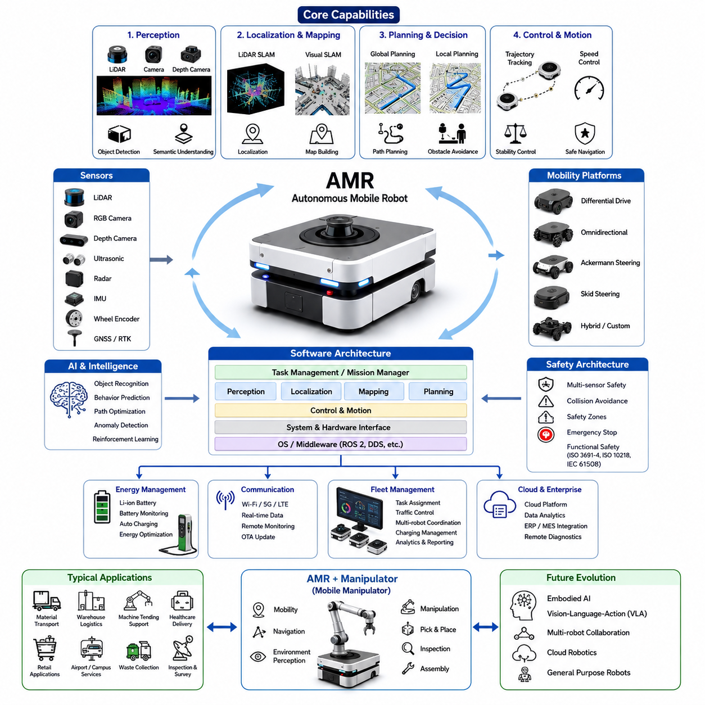
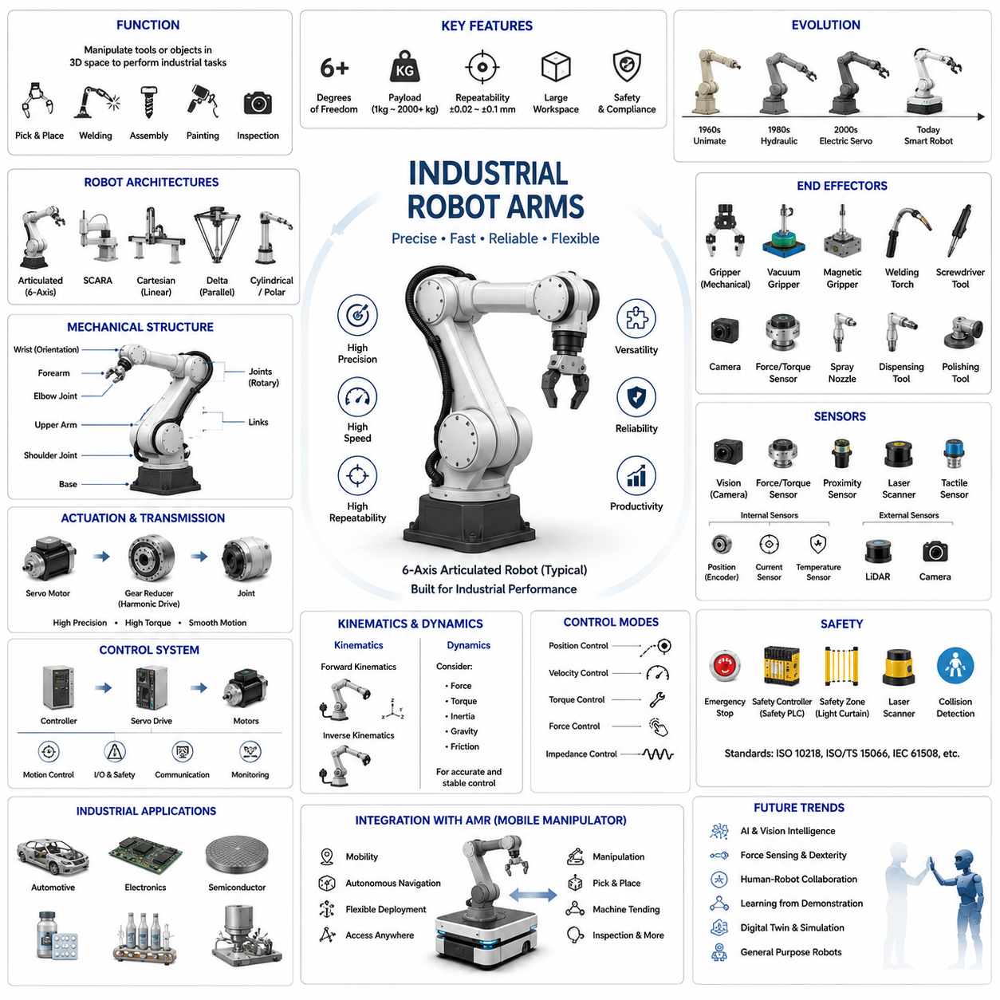
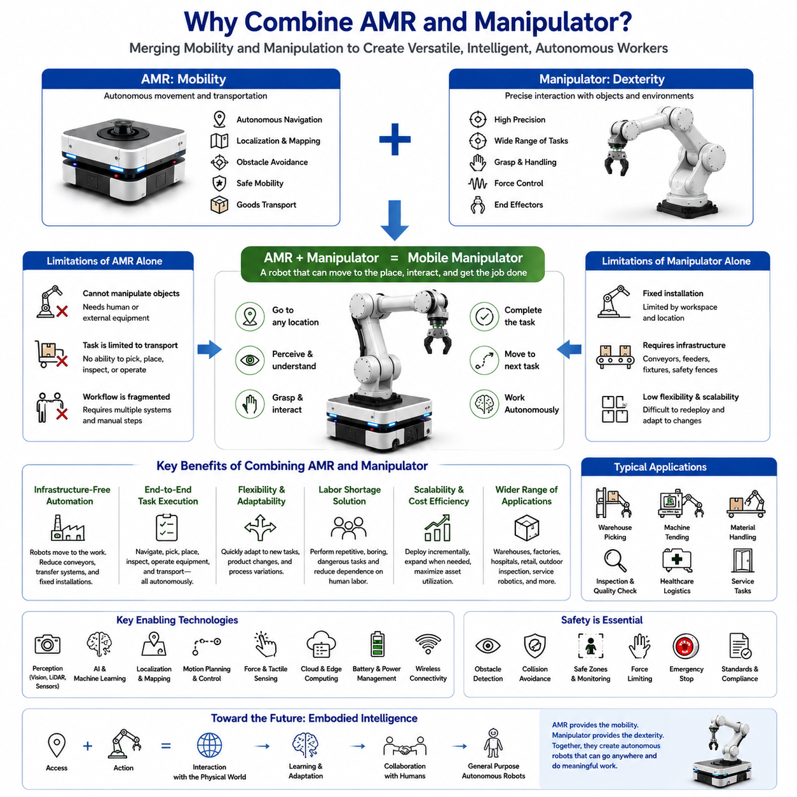
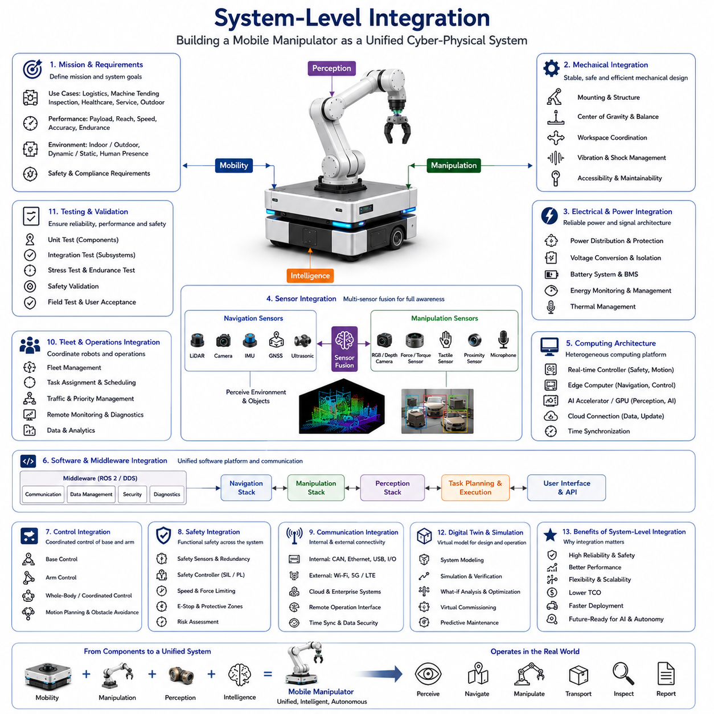
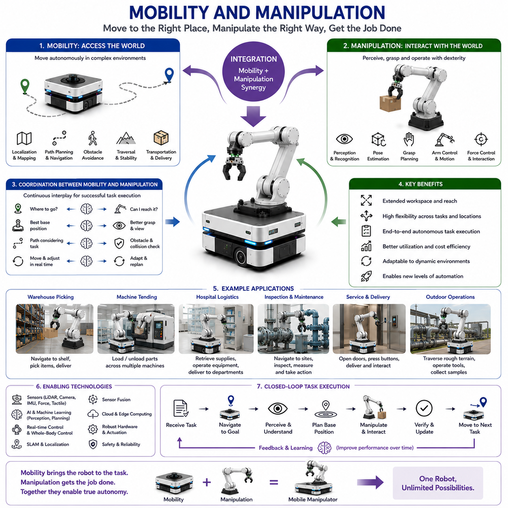
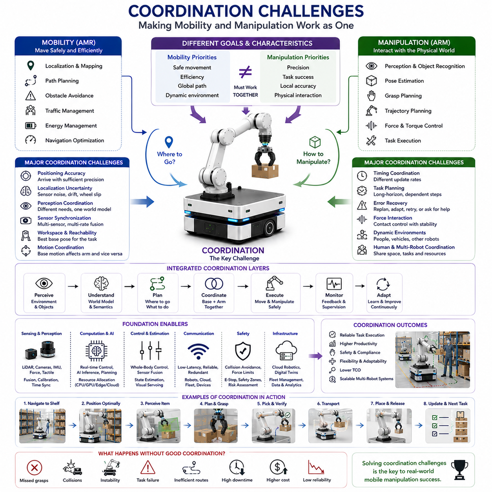
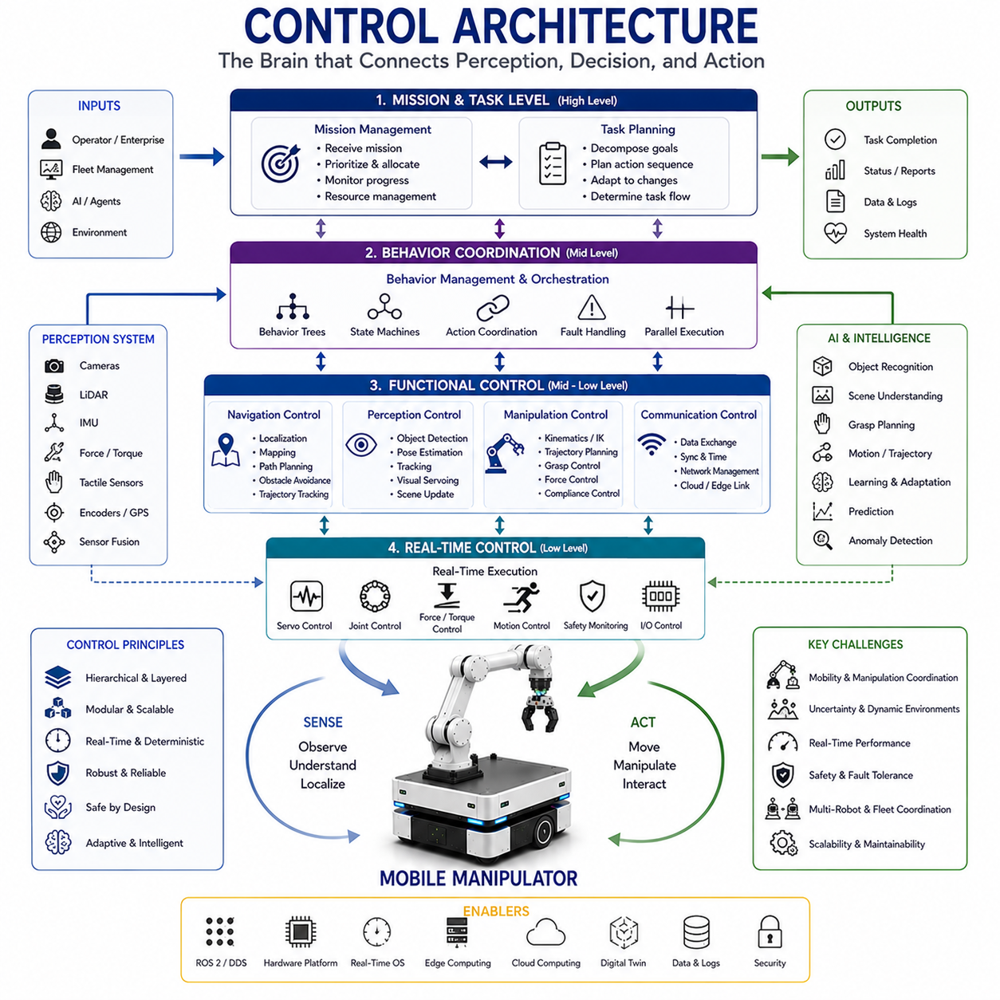
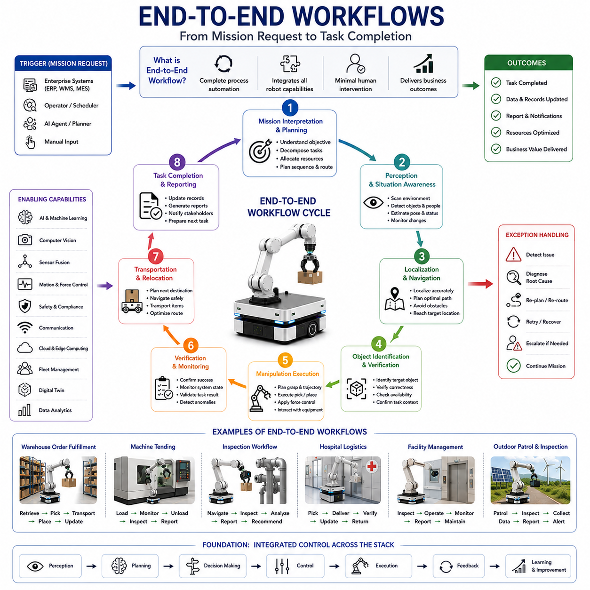
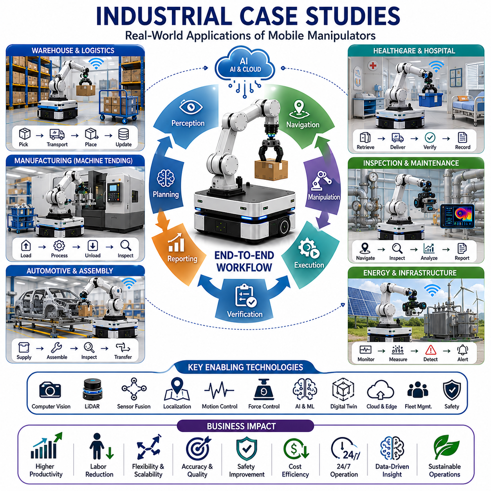

# Chapter 02. AMR plus Robot Arm

AMR(Autonomous Mobile Robot, 자율이동로봇)과 산업용 로봇암의 결합은 현대 로보틱스 분야에서 가장 중요한 기술적 발전 중 하나로 평가된다. 전통적으로 이동로봇과 산업용 매니퓰레이터는 서로 독립적인 기술 영역으로 발전해 왔다. AMR은 자재를 운반하고 동적인 환경을 자율적으로 이동하기 위해 개발되었으며, 로봇암은 고정된 작업 공간에서 정밀한 조작 작업을 수행하기 위해 개발되었다. 그러나 산업 현장에서 더욱 유연하고 적응력이 높은 자동화에 대한 요구가 증가하면서 두 기술은 하나의 통합 시스템으로 융합되기 시작했고, 그 결과 모바일 매니퓰레이터(Mobile Manipulator)라는 새로운 로봇 형태가 등장하게 되었다.

모바일 매니퓰레이터는 AMR의 이동 능력과 로봇암의 조작 능력을 결합한 시스템이다. 이를 통해 로봇은 작업 위치까지 자율적으로 이동한 후 대상 물체와 상호작용하며 다양한 작업을 수행할 수 있다. 이러한 개념은 기존 자동화 방식에 큰 변화를 가져왔다. 과거에는 작업 대상이나 자재를 고정형 로봇에게 이동시켜야 했지만, 이제는 로봇이 직접 자재, 설비, 선반, 작업장 또는 작업자를 찾아갈 수 있게 되었다. 그 결과 물류, 제조, 의료, 서비스 산업 등 다양한 분야에서 활용 가능한 고유연성 자동화 플랫폼이 탄생하게 되었다.

AMR은 시스템의 이동 플랫폼 역할을 수행한다. LiDAR, Depth Camera, 초음파 센서, IMU, 위치추정 시스템 등의 다양한 센서를 활용하여 주변 환경을 인식하고 안전한 이동 경로를 생성한다. 현대의 AMR은 SLAM, 경로계획(Path Planning), 장애물 회피(Obstacle Avoidance), Fleet Management 등의 기술을 활용하여 공장, 물류창고, 병원, 공공시설과 같은 복잡한 환경에서 안정적으로 운용된다.

반면 로봇암은 물리적 환경과의 상호작용을 담당한다. 다수의 자유도를 가진 로봇암은 물체를 집고, 옮기고, 배치하고, 검사하고, 조립하는 다양한 작업을 수행할 수 있다. 또한 엔드이펙터는 평행 그리퍼, 진공 그리퍼, 적응형 그리퍼, 힘 제어 공구, 검사 센서 등 다양한 형태로 구성될 수 있으며, 이를 통해 응용 분야에 최적화된 작업 수행이 가능하다.

모바일 매니퓰레이터의 핵심 가치는 이동성과 조작성의 긴밀한 통합에서 발생한다. 이동 기능과 조작 기능은 독립적으로 동작하는 것이 아니라 하나의 시스템으로 협조적으로 동작해야 한다. 예를 들어 선반에서 특정 물품을 집는 작업을 수행할 경우, AMR은 먼저 목표 위치까지 이동하고, 선반과의 상대 위치를 정확하게 맞춘 후, 로봇암이 물체를 인식하고 집을 수 있도록 지원해야 한다. 이 과정에서 모바일 플랫폼의 위치 오차는 곧바로 조작 성공률에 영향을 미치기 때문에 시스템 수준의 통합 설계가 매우 중요하다.

모바일 매니퓰레이션의 가장 큰 기술적 과제 중 하나는 이동과 조작의 협조 제어이다. 기존 산업용 로봇은 매우 정형화된 환경에서 동작하므로 물체 위치를 높은 정밀도로 예측할 수 있다. 반면 모바일 매니퓰레이터는 반정형 또는 비정형 환경에서 운용되기 때문에 불확실성이 훨씬 크다. 바닥 상태 변화, 물체 위치 편차, 조명 변화, 사람의 이동, 환경 변화 등 다양한 요인이 작업 성공률에 영향을 미친다. 따라서 고도화된 인지, 계획, 적응 제어 기술이 필수적으로 요구된다.

이러한 시스템을 구현하기 위해서는 계층형 제어 아키텍처가 필요하다. 일반적으로 모바일 매니퓰레이터는 이동 제어, 조작 제어, 인지 처리, 작업 계획, 안전 관리, 임무 수행 계층으로 구성된다. 각 계층은 실시간으로 정보를 교환하며 전체 시스템의 안정성과 효율성을 보장한다. ROS2, MoveIt2, Behavior Tree, AI 기반 Task Planner는 이러한 아키텍처를 구현하는 대표적인 소프트웨어 프레임워크로 활용되고 있다.

최근 인공지능 기술의 발전은 모바일 매니퓰레이터의 능력을 더욱 확장시키고 있다. 컴퓨터 비전 기술은 물체를 인식하고 자세를 추정하며 작업에 필요한 특징 정보를 추출할 수 있다. 또한 Foundation Model, VLM(Vision-Language Model), VLA(Vision-Language-Action) 기술은 로봇이 자연어 명령을 이해하고 복잡한 작업을 수행할 수 있도록 지원한다. 미래의 모바일 매니퓰레이터는 단순히 사전 정의된 프로그램을 실행하는 수준을 넘어 목표를 이해하고 행동을 계획하며 환경 변화에 적응하는 지능형 시스템으로 발전할 것이다.

현재 모바일 매니퓰레이터는 다양한 산업 분야에서 빠르게 적용되고 있다. 물류창고에서는 주문 피킹과 재고 관리, 제조 공장에서는 머신 텐딩과 조립 작업, 병원에서는 의약품과 의료물품 배송, 서비스 환경에서는 고객 지원과 물품 운반 업무를 수행하고 있다. 이러한 사례들은 모바일 매니퓰레이션 기술이 차세대 자동화 시스템의 핵심 기반 기술로 자리 잡고 있음을 보여준다.

향후 로봇 기술이 더욱 자율화되고 지능화됨에 따라 AMR과 로봇암의 결합은 실세계 로봇 시스템의 표준 아키텍처로 발전할 가능성이 높다. 모바일 매니퓰레이터는 이동, 인식, 판단, 조작을 하나의 플랫폼에서 수행할 수 있는 통합 로봇 시스템으로서 인간이 수행하던 다양한 작업을 자동화할 수 있는 잠재력을 가지고 있다. 따라서 AMR과 로봇암이 기계적, 전기적, 소프트웨어적, 운영적 측면에서 어떻게 통합되는지를 이해하는 것은 미래 모바일 매니퓰레이터 시스템을 설계하고 구축하는 데 있어 가장 중요한 기초가 된다.

## 01 AMR Fundamentals

{width="7.268055555555556in" height="7.268055555555556in"}

자율이동로봇(AMR, Autonomous Mobile Robot)은 현대 로봇공학에서 가장 중요한 기술 발전 중 하나로 평가된다. AMR은 자기테이프, 유도선, 고정된 경로와 같은 물리적 안내 장치 없이도 스스로 주변 환경을 인식하고 이동할 수 있는 지능형 로봇 시스템이다. 기존의 AGV(Automated Guided Vehicle)가 사전에 정의된 경로와 인프라에 크게 의존하는 반면, AMR은 센서, 인지(Perception), 위치추정(Localization), 지도작성(Mapping), 경로계획(Planning), 제어(Control) 기술을 활용하여 실시간으로 상황을 판단하고 의사결정을 수행한다. 이러한 특성 덕분에 AMR은 물류, 제조, 의료, 리테일, 서비스 로봇, 그리고 최근에는 실외 자율주행 로봇 분야까지 폭넓게 활용되고 있다. 특히 AMR은 모바일 매니퓰레이터(Mobile Manipulator)와 미래의 Embodied AI 로봇을 구성하는 이동성(Mobility)의 핵심 기반 기술이기 때문에, 차세대 로봇 시스템을 이해하기 위해 반드시 학습해야 하는 기초 기술이다.

자율 이동 개념은 로봇공학, 인공지능, 컴퓨터 비전, 제어공학, 자율주행 차량 기술이 수십 년 동안 발전하면서 형성되었다. 초기 이동 로봇은 실험실과 같은 통제된 환경에서만 운용되었으며, 반사 마커나 외부 위치 시스템에 의존하는 경우가 많았다. 그러나 컴퓨팅 성능이 향상되고 센서 기술이 발전하면서 로봇은 스스로 주변 환경을 이해하고 자신의 위치를 추정할 수 있게 되었다. 이러한 변화는 로봇이 고정된 경로를 벗어나 환경 변화에 적응하며 움직일 수 있도록 만들었으며, AGV에서 AMR로의 진화는 단순 운송 장치에서 지능형 자율 에이전트로의 전환이라고 볼 수 있다.

모든 AMR은 운행 중에 세 가지 핵심 질문에 지속적으로 답해야 한다. 첫 번째는 "나는 어디에 있는가?"이며 이는 위치추정 기술과 관련된다. 두 번째는 "내 주변에는 무엇이 있는가?"이며 이는 환경 인지 기술과 연결된다. 세 번째는 "다음에는 어디로 가야 하는가?"이며 이는 경로 계획과 의사결정 기술을 의미한다. 이러한 능력이 결합되어 자율주행의 기본 구조를 형성한다. AMR은 끊임없이 환경을 감지하고, 내부 지도 정보를 갱신하며, 목적지까지의 최적 경로를 계산하고, 실시간으로 움직임을 제어한다.

위치추정(Localization)은 AMR 기술의 핵심 요소 중 하나이다. 로봇은 자신이 환경 내에서 어느 위치에 있으며 어떤 방향을 향하고 있는지를 정확하게 알아야 한다. 실내 환경에서는 LiDAR 기반 위치추정, 비전 기반 위치추정, SLAM, 마커 기반 위치추정 등이 활용된다. 실외 환경에서는 GNSS, RTK-GNSS, IMU, 휠 오도메트리, LiDAR 기반 위치추정이 함께 사용된다. 실제 산업 현장에서는 하나의 기술에만 의존하지 않고 여러 센서 정보를 융합하여 보다 안정적이고 정확한 위치 정보를 생성하는 경우가 대부분이다.

SLAM(Simultaneous Localization and Mapping)은 AMR의 핵심 기술로서 로봇이 자신의 위치를 추정하는 동시에 지도를 생성할 수 있도록 한다. 이를 통해 사전에 지도 정보가 없는 환경에서도 자율주행이 가능해진다. 현재는 LiDAR SLAM, Visual SLAM, Visual-Inertial SLAM, RGB-D SLAM, 다중 센서 융합 SLAM 등 다양한 형태가 존재한다. 어떤 SLAM 기술을 사용할지는 환경의 복잡성, 요구 정확도, 조명 조건, 계산 자원, 운행 속도 등에 따라 달라진다. 최근의 SLAM 기술은 물류창고, 병원, 공장, 캠퍼스, 공항, 도시 환경 등 다양한 공간에서 높은 신뢰도로 활용되고 있다.

인지(Perception) 시스템은 AMR이 주변 환경을 이해하는 능력을 제공한다. 이를 위해 LiDAR, RGB 카메라, 스테레오 카메라, Depth 카메라, 초음파 센서, 레이더, IMU, 엔코더, GNSS 등 다양한 센서가 사용된다. 그러나 센서 데이터 자체만으로는 의미가 없으며, 이를 처리하여 장애물, 사람, 차량, 통행 가능 공간, 위험 요소 등을 인식해야 한다. 최근에는 딥러닝 기반 인지 기술이 도입되면서 객체 인식, 의미 기반 환경 분석, 이상 상황 탐지, 상황 이해 능력이 크게 향상되고 있다.

장애물 탐지와 회피는 AMR의 가장 중요한 기능 중 하나이다. 기존 AGV가 장애물을 만나면 정지하는 경우가 많았던 반면, AMR은 대체 경로를 계산하여 우회할 수 있다. 이를 위해 주변 환경을 지속적으로 감시하고, 객체의 움직임을 예측하며, 충돌 위험을 평가한 후 새로운 경로를 생성해야 한다. 특히 사람과 로봇이 함께 작업하는 환경에서는 이러한 동적 장애물 회피 기능이 필수적이다.

경로 계획(Path Planning)은 로봇이 목적지까지 이동하는 방법을 결정하는 기술이다. 일반적으로 전역 경로 계획(Global Planning)과 지역 경로 계획(Local Planning)으로 구분된다. 전역 계획은 지도 기반으로 전체 이동 경로를 생성하며, 지역 계획은 실시간 장애물 정보를 반영하여 경로를 수정한다. A\*, Dijkstra, Hybrid A\*, RRT, RRT\*, DWA, MPC 등 다양한 알고리즘이 사용되며, 목적은 안전성과 효율성을 동시에 확보하는 것이다.

모션 제어(Motion Control)는 계획된 경로를 실제 움직임으로 변환하는 역할을 수행한다. 제어기는 휠 속도, 조향각, 가속도, 감속도 등을 계산하여 로봇을 원하는 위치로 이동시킨다. AMR은 차동구동(Differential Drive), 스키드 스티어링(Skid Steering), 메카넘 휠(Mecanum Wheel), 전방향 구동(Omnidirectional Drive), Ackermann 조향 등 다양한 이동 구조를 사용할 수 있다. 실내 환경에서는 기동성이 높은 차동구동과 전방향 구동이 많이 사용되며, 실외 환경에서는 고속 주행에 유리한 Ackermann 방식이 주로 사용된다.

AMR의 소프트웨어 구조는 일반적으로 계층형 아키텍처로 구성된다. 가장 아래에는 센서 데이터를 처리하는 인지 계층이 있으며, 그 위에 위치추정 계층, 지도 계층, 경로계획 계층, 제어 계층이 위치한다. 최상위에는 임무 관리(Task Management) 계층이 존재하며 로봇의 업무를 관리한다. 최근에는 클라우드 기반 관제 시스템이 추가되어 원격 모니터링, 데이터 분석, OTA 업데이트, 원격 진단 기능까지 제공하고 있다.

인공지능(AI)은 AMR의 성능을 크게 향상시키고 있다. 과거의 자율주행은 규칙 기반 알고리즘 중심이었지만, 최근에는 머신러닝과 딥러닝 기술이 적극 활용되고 있다. AI는 객체 인식 정확도를 향상시키고, 사람의 행동을 예측하며, 경로를 최적화하고, 시스템 이상을 조기에 탐지할 수 있다. 또한 강화학습 기술은 복잡한 환경에서 보다 효율적인 이동 전략을 학습하는 데 활용되고 있다. 이러한 발전은 AMR을 단순한 이동 장치가 아닌 지능형 자율 시스템으로 변화시키고 있다.

안전성은 AMR 설계에서 가장 중요한 요소 중 하나이다. 자율주행 로봇은 사람과 같은 공간에서 동작하기 때문에 기능 안전(Functional Safety)이 필수적이다. 이를 위해 다중 센서 기반 안전 감지, 비상 정지 시스템, 안전 컨트롤러, 속도 제한, 안전 구역 관리, 충돌 방지 알고리즘 등이 적용된다. 또한 ISO 3691-4, ISO 10218, IEC 61508 등의 국제 표준을 준수해야 상용화가 가능하다.

에너지 관리 역시 중요한 기술 요소이다. 대부분의 AMR은 리튬이온 배터리를 사용하며, 배터리 용량과 전력 효율이 운영 시간에 직접적인 영향을 미친다. 최근에는 자동 충전 시스템이 도입되어 로봇이 스스로 충전 스테이션으로 이동해 충전한 후 작업을 재개할 수 있다. 이를 통해 사실상 24시간 운영이 가능한 시스템도 구현되고 있다.

통신 기술은 AMR과 외부 시스템을 연결하는 역할을 수행한다. Wi-Fi, LTE, 5G, 산업용 통신 네트워크 등을 통해 로봇은 관제 시스템과 데이터를 주고받는다. 이를 통해 원격 모니터링, 실시간 상태 확인, 소프트웨어 업데이트, 예지보전, ERP 및 MES 연동 등이 가능해진다. 대규모 로봇 운영 환경에서는 안정적이고 확장 가능한 통신 아키텍처가 매우 중요하다.

다수의 로봇이 동시에 운영되는 환경에서는 플릿 관리(Fleet Management) 시스템이 필요하다. 플릿 시스템은 작업 할당, 교통 흐름 제어, 충전 스케줄 관리, 작업 우선순위 결정 등을 수행한다. 이를 통해 수십 대에서 수백 대의 로봇을 효율적으로 운영할 수 있으며, 전체 생산성과 자원 활용도를 극대화할 수 있다.

AMR의 경제적 가치는 유연성과 확장성에서 비롯된다. 기존 자동화 시스템은 설비 변경 비용이 높고 유연성이 부족한 경우가 많지만, AMR은 시설 구조를 크게 변경하지 않고도 단계적으로 도입할 수 있다. 또한 작업 환경 변화에 유연하게 대응할 수 있어 투자 회수 기간(ROI)을 단축할 수 있다. 이러한 장점 때문에 제조, 물류, 의료, 서비스 산업 전반에서 AMR 도입이 빠르게 증가하고 있다.

산업 현장에서 AMR은 자재 운반, 생산라인 공급, 창고 물류, 주문 처리, 재고 관리, 병원 물품 배송, 폐기물 수거, 서비스 지원 등 다양한 업무를 수행한다. 공장에서는 생산 효율을 높이고, 물류센터에서는 주문 처리 속도를 향상시키며, 병원에서는 의료진의 단순 반복 업무를 줄여준다. 공항, 호텔, 쇼핑몰, 캠퍼스 등에서도 AMR 활용 사례가 빠르게 증가하고 있다.

AMR과 로봇 팔(Manipulator)의 결합은 로봇 기술 발전의 중요한 전환점이다. 이동 능력을 가진 AMR 위에 로봇 팔이 탑재되면 모바일 매니퓰레이터가 된다. 이는 단순히 물건을 운반하는 수준을 넘어 물체를 집고, 옮기고, 분류하고, 조립하고, 검사할 수 있는 능력을 제공한다. AMR이 이동성을 담당하고 로봇 팔이 작업성을 담당함으로써 훨씬 더 다양한 산업 자동화 작업을 수행할 수 있게 된다. 이러한 구조는 향후 범용 로봇과 Embodied AI 시스템의 핵심 형태로 발전할 것으로 예상된다.

미래의 AMR은 더욱 높은 수준의 자율성과 지능을 갖추게 될 것이다. Embodied AI, Foundation Model, Vision-Language-Action(VLA), 클라우드 로보틱스, 엣지 AI, 멀티에이전트 협업 기술이 발전하면서 로봇은 단순히 경로를 따라 이동하는 기계를 넘어 목표를 이해하고, 상황을 추론하며, 인간과 협력하는 지능형 에이전트로 진화할 것이다. 결국 AMR은 단순한 이동 플랫폼이 아니라 디지털 세계와 물리적 세계를 연결하는 핵심 기술로 자리잡을 것이며, 모바일 매니퓰레이터, 서비스 로봇, 산업용 로봇, 미래 범용 로봇의 기반 기술로서 앞으로도 로봇 산업 발전의 중심 역할을 수행하게 될 것이다.

## 02 Industrial Robot Arms

{width="7.268055555555556in" height="7.268055555555556in"}

산업용 로봇 팔(Industrial Robot Arm)은 자동화 역사에서 가장 영향력이 큰 기술 중 하나이다. 지난 50여 년 동안 산업용 로봇은 제조업, 물류, 전자산업, 자동차 생산, 반도체 공정, 식품 가공, 제약 산업 등 다양한 분야를 혁신적으로 변화시켜 왔다. 초기에는 반복적이고 위험하며 육체적으로 힘든 작업을 자동화하기 위해 개발되었지만, 현재는 높은 정밀도와 속도, 반복정확도, 신뢰성을 갖춘 고도화된 시스템으로 발전하였다. 오늘날 산업용 로봇 팔은 현대 로봇 기술의 핵심 구성 요소이며, 모바일 매니퓰레이터(Mobile Manipulator)에서는 AMR이 이동성을 담당하고 로봇 팔이 작업성을 담당하는 구조를 형성한다. 따라서 산업용 로봇 팔에 대한 이해는 차세대 로봇 시스템을 이해하기 위한 필수적인 기반 지식이라고 할 수 있다.

산업용 로봇 팔은 물체, 공구 또는 작업 장치를 원하는 위치로 이동시키기 위해 설계된 프로그래밍 가능한 기계 시스템이다. 기본 구조는 인간의 팔에서 영감을 받았지만, 생체 구조를 모방하기보다는 생산성과 정밀도, 내구성을 극대화하는 방향으로 발전하였다. 일반적으로 여러 개의 링크(Link)와 관절(Joint)로 구성되며, 각 관절이 독립적으로 움직여 전체 시스템이 다양한 위치와 자세를 구현할 수 있도록 한다. 이를 통해 조립, 용접, 도장, 검사, 적재, 포장, 물류 이송 등 다양한 산업 작업을 수행할 수 있다.

산업용 로봇의 역사는 1960년대 초 세계 최초의 상용 산업용 로봇인 유니메이트(Unimate)에서 시작되었다. 유니메이트는 자동차 공장에서 위험한 작업을 대신 수행하며 로봇 자동화의 가능성을 입증하였다. 이후 전자기술, 센서, 서보모터, 제어기, 컴퓨터 기술이 발전하면서 산업용 로봇은 더욱 정교하고 유연한 시스템으로 발전하였다. 오늘날 로봇은 단순 반복 장비를 넘어 다양한 작업을 수행할 수 있는 범용 자동화 플랫폼으로 활용되고 있다.

산업용 로봇 팔의 가장 기본적인 목적은 3차원 공간에서 물체를 조작하는 것이다. 이를 위해 로봇은 위치(Position)와 자세(Orientation)를 동시에 제어해야 한다. 위치는 로봇 끝단이 공간상 어디에 있는지를 의미하며, 자세는 어떤 방향으로 향하고 있는지를 의미한다. 이 두 가지를 정확히 제어할 수 있기 때문에 로봇은 부품 조립, 나사 체결, 용접, 접착제 도포, 부품 적재, 검사 작업 등을 수행할 수 있다.

산업용 로봇에서 가장 중요한 개념 중 하나는 자유도(Degree of Freedom, DOF)이다. 자유도는 독립적으로 제어 가능한 움직임의 축을 의미한다. 대부분의 산업용 로봇은 6자유도 구조를 채택하고 있는데, 이는 3차원 공간에서 위치와 자세를 완전히 제어하기 위해 최소 6개의 독립 운동이 필요하기 때문이다. 일반적으로 첫 세 개의 관절은 위치를 제어하고, 나머지 세 개는 자세를 제어한다. 일부 로봇은 7자유도 이상을 제공하여 장애물 회피 능력과 유연성을 향상시키기도 한다.

관절(Joint)은 로봇의 움직임을 생성하는 핵심 요소이다. 대부분의 산업용 로봇은 전기 서보모터 기반의 회전 관절을 사용한다. 특정 산업에서는 유압 또는 공압 시스템도 활용되지만, 현재는 정밀성과 유지보수 측면에서 전기식이 주류를 이루고 있다. 각 관절은 독립적으로 움직이지만, 전체 관절이 협력하여 복잡한 경로와 동작을 수행하게 된다.

산업용 로봇은 구조에 따라 여러 종류로 구분된다. 가장 널리 사용되는 형태는 다관절 로봇(Articulated Robot)으로, 6개 이상의 회전 관절을 이용해 높은 자유도와 유연성을 제공한다. SCARA 로봇은 고속 수평 이동에 최적화되어 전자부품 조립에 많이 사용된다. 직교좌표형(Cartesian Robot)은 선형 축을 따라 움직이며 높은 정밀도를 제공한다. 델타 로봇(Delta Robot)은 초고속 피킹 작업에 적합하며 식품 및 포장 산업에서 널리 활용된다. 이 외에도 원통좌표형과 극좌표형 로봇 등이 특정 분야에서 사용되고 있다.

산업용 로봇의 기계 구조는 링크, 관절, 베어링, 감속기, 프레임 등으로 구성된다. 링크는 구조 강성을 제공하며 무게를 최소화하도록 설계된다. 관절은 운동을 생성하며, 베어링은 마찰을 줄이고 부드러운 움직임을 제공한다. 감속기는 모터의 회전력을 증폭하여 실제 작업에 필요한 토크를 생성한다. 하모닉 드라이브, 사이클로이드 감속기, 유성기어 감속기 등이 대표적으로 사용된다.

서보모터는 산업용 로봇의 핵심 구동 장치이다. 서보모터는 위치, 속도, 토크를 정밀하게 제어할 수 있으며, 엔코더를 통해 현재 상태를 실시간으로 측정한다. 이를 기반으로 폐루프 제어가 이루어지며, 산업용 로봇은 매우 높은 위치 정밀도와 반복성을 달성할 수 있다.

로봇 운동학(Kinematics)은 관절 움직임과 로봇 끝단 움직임 사이의 관계를 수학적으로 설명한다. 순기구학(Forward Kinematics)은 관절 각도로부터 끝단 위치를 계산하며, 역기구학(Inverse Kinematics)은 목표 위치를 달성하기 위한 관절 각도를 계산한다. 이러한 계산은 모든 로봇 경로 계획과 제어의 기초가 된다.

동역학(Dynamics)은 단순한 위치 계산을 넘어 힘, 토크, 관성, 중력, 마찰 등의 물리적 요소를 고려한다. 특히 고속 동작이나 중량물 취급 시에는 동역학 해석이 필수적이다. 동역학 모델은 제어 성능을 향상시키고 진동을 줄이며 에너지 효율을 높이는 데 중요한 역할을 한다.

작업공간(Workspace)은 로봇 끝단이 도달할 수 있는 공간 영역을 의미한다. 링크 길이, 관절 제한, 기구학 구조 등에 따라 작업공간이 결정된다. 자동차 차체 용접 로봇은 3m 이상의 넓은 작업공간을 가지는 반면, 전자 조립용 로봇은 상대적으로 작은 작업공간을 가진다.

가반하중(Payload)은 로봇이 안전하게 취급할 수 있는 최대 하중을 의미한다. 소형 전자 조립 로봇은 수백 그램에서 수 킬로그램 수준의 하중을 다루는 반면, 대형 산업용 로봇은 수백 킬로그램에서 수 톤의 물체를 다룰 수 있다. 가반하중은 모터 크기, 구조 설계, 감속기 선정 등 전체 시스템 설계에 큰 영향을 미친다.

산업 자동화에서는 절대 정확도보다 반복정확도(Repeatability)가 더욱 중요하게 평가되는 경우가 많다. 반복정확도는 동일한 위치로 반복적으로 이동했을 때 얼마나 일관되게 재현할 수 있는지를 의미한다. 현대 산업용 로봇은 일반적으로 ±0.02mm에서 ±0.1mm 수준의 매우 높은 반복정확도를 제공한다.

엔드이펙터(End Effector)는 로봇과 실제 작업 대상 사이를 연결하는 장치이다. 로봇 팔이 움직임을 제공한다면, 엔드이펙터는 실제 작업을 수행한다. 대표적인 예로는 그리퍼, 진공 흡착기, 용접 토치, 도장 장치, 나사 체결기, 절단 장치, 연마 장치, 검사 센서 등이 있다. 실제 현장에서는 로봇 자체보다 엔드이펙터 설계가 더 중요한 경우도 많다.

그리퍼는 가장 널리 사용되는 엔드이펙터이다. 기계식 그리퍼는 손가락 형태의 구조로 물체를 집으며, 진공 그리퍼는 흡착력을 이용한다. 소프트 그리퍼는 유연한 재질을 사용하여 깨지기 쉬운 물체를 안전하게 취급할 수 있다. 최근에는 다양한 형태의 물체를 자동으로 파지할 수 있는 적응형 그리퍼도 개발되고 있다.

산업용 로봇 제어기는 로봇의 모든 동작을 관리하는 두뇌 역할을 수행한다. 제어기는 경로를 계산하고, 센서 데이터를 처리하며, 안전 기능을 관리하고, 외부 장비와 통신한다. 최신 제어기는 고성능 프로세서를 탑재하여 실시간 연산과 복잡한 모션 계획을 수행할 수 있다.

프로그래밍 방식도 크게 발전하였다. 과거에는 티치 펜던트(Teach Pendant)를 이용하여 직접 위치를 지정하는 방식이 주류였다. 최근에는 디지털 트윈, 오프라인 프로그래밍, 그래픽 기반 워크플로우, AI 기반 프로그래밍 등이 활용되고 있다. 앞으로는 자연어 지시와 시연 기반 학습을 통해 프로그래밍이 더욱 쉬워질 것으로 예상된다.

센서는 로봇의 인지 능력을 향상시킨다. 내부 센서는 관절 위치와 모터 상태를 측정하며, 외부 센서는 카메라, 힘/토크 센서, 근접 센서, LiDAR 등을 활용하여 환경 정보를 수집한다. 이를 통해 로봇은 객체 인식, 품질 검사, 적응형 조립, 안전한 인간-로봇 협업 등을 수행할 수 있다.

힘 제어(Force Control)는 산업용 로봇의 중요한 발전 분야이다. 단순히 위치를 따라 움직이는 것이 아니라, 특정 힘을 유지하면서 작업을 수행할 수 있게 한다. 연마, 조립, 디버링, 표면 처리와 같은 작업에서는 힘 제어가 필수적이다. 임피던스 제어(Impedance Control)와 어드미턴스 제어(Admittance Control)가 대표적인 방식이다.

협동로봇(Cobot)은 산업용 로봇의 활용 범위를 크게 확장시켰다. 기존 산업용 로봇이 안전 펜스 내부에서만 운영되었다면, 협동로봇은 사람과 같은 공간에서 작업할 수 있도록 설계되었다. 충돌 감지, 힘 제한, 속도 제한 등의 기능을 통해 안전성을 확보한다. 비록 속도와 가반하중은 전통적인 산업용 로봇보다 낮은 경우가 많지만, 유연성과 설치 편의성 측면에서 큰 장점을 가진다.

안전성은 산업용 로봇 시스템의 핵심 요구사항이다. 비상정지 장치, 안전 제어기, 라이트 커튼, 레이저 스캐너, 충돌 감지 시스템, 위험도 평가 절차 등이 적용된다. 또한 ISO 10218, ISO/TS 15066, IEC 61508 등의 국제 표준을 준수해야 한다.

산업용 로봇은 자동차 산업에서 용접, 도장, 조립 작업에 활용되며, 전자산업에서는 부품 조립과 검사에 사용된다. 반도체 산업에서는 웨이퍼 이송과 정밀 공정에 활용되고, 제약 산업에서는 포장과 실험실 자동화에 적용된다. 식품 산업에서는 포장, 분류, 적재 작업을 수행한다. 활용 범위는 계속 확대되고 있으며, 산업 자동화의 핵심 장비로 자리 잡고 있다.

최근 가장 중요한 기술 트렌드 중 하나는 산업용 로봇 팔과 AMR의 결합이다. 전통적인 산업용 로봇은 특정 위치에 고정되어 작업했지만, AMR 위에 로봇 팔을 탑재하면 모바일 매니퓰레이터가 된다. 이러한 시스템은 공장이나 물류센터 전체를 이동하면서 필요한 위치에서 작업을 수행할 수 있다. 이동성과 작업성이 결합됨으로써 기존 고정형 자동화의 한계를 극복할 수 있으며, 이는 미래 지능형 자동화의 핵심 방향으로 평가된다.

미래의 산업용 로봇 팔은 더욱 지능적이고 자율적인 방향으로 발전할 것이다. 인공지능, 컴퓨터 비전, 힘 제어, Foundation Model, 강화학습, Embodied AI 기술이 결합되면서 로봇은 단순한 프로그래밍 기계를 넘어 목표를 이해하고 스스로 작업 방법을 결정할 수 있는 수준으로 진화하고 있다. 앞으로의 산업용 로봇은 자연어 명령을 이해하고, 인간의 시범을 학습하며, 변화하는 환경에 적응하고, 다른 로봇 및 인간과 협력하는 지능형 물리 에이전트가 될 것이다. 이러한 산업용 로봇 팔은 모바일 매니퓰레이터와 미래 범용 로봇의 핵심 조작 기술로서 앞으로도 로봇 산업 발전의 중심 역할을 수행할 것으로 전망된다.

## 03 Why Combine AMR and Manipulator

{width="7.268055555555556in" height="7.268055555555556in"}

자율이동로봇(AMR)과 산업용 로봇 매니퓰레이터의 결합은 현대 로봇 기술 발전에서 가장 중요한 변화 중 하나로 평가된다. 오랜 기간 동안 이동 로봇과 산업용 로봇 팔은 서로 독립적으로 발전해 왔다. AMR은 자율주행, 물류 운송, 경로 계획, 장애물 회피와 같은 이동성(Mobility)에 초점을 맞추었으며, 산업용 로봇 팔은 조립, 용접, 검사, 포장, 가공과 같은 작업성(Manipulation)에 집중해 왔다. 두 기술 모두 각각의 분야에서 큰 성공을 거두었지만, 각각 분명한 한계를 가지고 있었다. 모바일 매니퓰레이터는 이러한 한계를 극복하기 위해 등장한 개념으로, 이동성과 작업성을 하나의 플랫폼에 통합함으로써 새로운 수준의 자동화를 가능하게 한다. 이는 미래 Embodied AI와 범용 로봇으로 가기 위한 핵심 단계로 평가된다.

전통적인 산업용 로봇 팔은 대부분 고정된 위치에 설치된다. 이들은 매우 높은 정밀도와 반복정확도를 제공하지만, 작업 범위는 로봇이 도달할 수 있는 작업공간(Workspace) 내부로 제한된다. 만약 작업 대상이 로봇의 작업 범위를 벗어나면 컨베이어, 이송 장치 또는 사람이 물체를 이동시켜야 한다. 이러한 구조는 복잡한 자동화 설비를 필요로 하며 설치 비용과 운영 비용을 증가시키는 원인이 된다. 또한 생산 공정이 변경될 경우 전체 시스템을 다시 설계해야 하는 문제도 발생한다.

반면 AMR은 이러한 문제를 해결하는 이동 플랫폼이다. AMR은 공장, 물류센터, 병원, 공항, 캠퍼스 등 다양한 환경에서 자율적으로 이동할 수 있다. LiDAR, 카메라, SLAM, 위치추정, 경로 계획 기술을 활용하여 목적지까지 스스로 이동하며 물품을 운반한다. 그러나 대부분의 AMR은 스스로 물체를 집거나 조작할 수 없다. 물건을 운반하기 위해서는 사람이 물건을 올려주거나 별도의 자동화 장비가 필요하다. 즉, AMR은 이동은 가능하지만 작업은 수행할 수 없는 한계를 가진다.

AMR과 로봇 팔을 결합하면 이동과 작업을 동시에 수행할 수 있는 모바일 매니퓰레이터가 된다. 이는 로봇의 역할을 근본적으로 변화시킨다. 기존에는 물건을 운반하거나 특정 위치에서만 작업할 수 있었던 로봇이 이제는 작업 위치까지 이동하고, 필요한 물체를 인식하며, 직접 조작하고, 작업을 완료한 뒤 다음 작업 장소로 이동할 수 있게 된다. 다시 말해, 로봇이 단순한 자동화 장비에서 자율적인 작업 수행 주체로 발전하게 되는 것이다.

AMR과 매니퓰레이터를 결합하는 가장 중요한 이유 중 하나는 고정형 인프라를 최소화할 수 있기 때문이다. 기존 자동화 시스템은 컨베이어, 리프트, 이송 설비, 자동 창고와 같은 고정 설비에 크게 의존한다. 이러한 설비는 구축 비용이 높고 변경이 어렵다. 모바일 매니퓰레이터는 작업 대상이 있는 곳으로 직접 이동하기 때문에 별도의 이송 설비를 줄일 수 있다. 즉, 제품을 로봇에게 가져오는 방식에서 로봇이 제품에게 가는 방식으로 자동화 패러다임이 전환된다.

현대 제조업은 점점 더 유연한 생산 체계를 요구하고 있다. 제품 수명주기는 짧아지고 고객 맞춤형 생산 요구는 증가하고 있으며 생산량 변화도 더욱 빈번해지고 있다. 고정형 자동화 시스템은 이러한 변화에 신속하게 대응하기 어렵다. 반면 모바일 매니퓰레이터는 소프트웨어 변경만으로도 새로운 작업을 수행할 수 있으며, 필요에 따라 다른 공정으로 쉽게 이동할 수 있다. 따라서 다품종 소량생산 환경에서 특히 큰 가치를 제공한다.

노동력 부족 문제 역시 모바일 매니퓰레이터의 필요성을 증가시키고 있다. 제조업, 물류, 병원, 서비스 산업 등에서는 반복적이고 힘든 작업을 수행할 인력을 확보하기가 점점 어려워지고 있다. 모바일 매니퓰레이터는 자재 운반, 부품 공급, 물류 처리, 검사, 기계 조작 등의 업무를 자율적으로 수행할 수 있기 때문에 인력 부족 문제를 완화하는 중요한 솔루션으로 주목받고 있다.

모바일 매니퓰레이터의 가장 강력한 장점 중 하나는 End-to-End 자동화이다. 예를 들어 기존 물류센터에서는 AMR이 상품을 운반하더라도 선반에서 상품을 꺼내고 상자에 넣는 작업은 사람이 수행해야 하는 경우가 많다. 그러나 모바일 매니퓰레이터는 선반까지 이동하여 카메라로 상품을 인식하고, 그리퍼로 집어 올린 후, 지정된 컨테이너에 적재하고, 목적지까지 운반할 수 있다. 여러 단계로 나뉘어 있던 작업이 하나의 자율 프로세스로 통합되는 것이다.

기계 가공(Machine Tending) 분야에서도 모바일 매니퓰레이터의 장점은 매우 크다. 기존에는 CNC 장비마다 로봇이 고정 설치되어 원자재를 공급하고 가공품을 회수하였다. 그러나 모바일 매니퓰레이터는 여러 대의 장비를 순회하면서 필요한 작업을 수행할 수 있다. 하나의 로봇이 여러 장비를 지원할 수 있기 때문에 투자 비용을 절감하고 설비 활용도를 높일 수 있다.

확장성 측면에서도 모바일 매니퓰레이터는 유리하다. 기존 자동화 설비는 구축 시 대규모 투자가 필요하며, 생산량 증가에 대응하기 위해 추가 설비 구축이 필요하다. 모바일 매니퓰레이터는 필요할 때 로봇 수만 추가하면 되므로 단계적 확장이 가능하다. 이는 기업이 자동화를 보다 낮은 위험으로 도입할 수 있도록 해준다.

최근 센서, 컴퓨팅, AI, 배터리, 무선통신 기술의 발전은 모바일 매니퓰레이터 구현을 현실적으로 만들었다. 고성능 GPU와 엣지 컴퓨팅 플랫폼은 실시간 인공지능 연산을 가능하게 하며, 최신 LiDAR와 카메라는 환경 인식 능력을 크게 향상시켰다. 이러한 기술 발전 덕분에 이동성과 작업성을 하나의 시스템으로 통합할 수 있게 되었다.

모바일 매니퓰레이터에서 인지(Perception)는 매우 중요한 역할을 수행한다. 로봇은 단순히 자신의 위치를 아는 것뿐만 아니라 주변 환경과 작업 대상 물체를 동시에 이해해야 한다. 이를 위해 카메라, LiDAR, Depth 센서, 힘 센서, 촉각 센서 등이 활용된다. 로봇은 주변 환경을 지도화하고, 장애물을 회피하며, 대상 물체를 인식하고, 물체의 위치와 자세를 계산하여 작업을 수행해야 한다.

인공지능 기술은 모바일 매니퓰레이터의 성능을 크게 향상시키고 있다. 머신러닝과 딥러닝은 객체 인식, 의미 이해, 파지 계획, 행동 예측을 가능하게 한다. Vision-Language Model(VLM)은 자연어 명령을 이해할 수 있도록 하며, 강화학습은 복잡한 환경에서 최적의 행동을 학습할 수 있도록 한다. 이러한 AI 기술은 모바일 매니퓰레이터를 보다 지능적인 시스템으로 발전시키고 있다.

경제적 관점에서도 모바일 매니퓰레이터는 큰 장점을 가진다. 단순히 인건비 절감 효과뿐만 아니라 설비 활용도 향상, 인프라 비용 절감, 생산성 향상, 공정 유연성 확보 등의 효과를 제공한다. 기존에는 자동화가 어려웠던 다양한 작업을 자동화할 수 있기 때문에 새로운 투자 수익 기회를 창출한다.

안전성은 모바일 매니퓰레이터 개발에서 매우 중요한 요소이다. 이동 중에는 충돌을 방지해야 하며, 작업 중에는 사람과 장비를 보호해야 한다. 따라서 다중 센서 기반 안전 시스템, 동적 안전 영역, 충돌 감지, 힘 제한, 비상 정지 기능 등이 통합적으로 적용된다. 이동성과 작업성이 결합된 만큼 안전 설계 역시 통합적인 접근이 필요하다.

병원 환경은 모바일 매니퓰레이터의 대표적인 활용 사례 중 하나이다. 의료 물품, 약품, 검체, 린넨, 폐기물 등을 운반하는 업무는 매우 반복적이다. 기존 AMR은 물품 운반은 가능하지만 선반에서 물건을 꺼내거나 장비를 조작할 수는 없다. 모바일 매니퓰레이터는 이러한 작업까지 수행할 수 있기 때문에 병원 운영 효율성을 크게 향상시킬 수 있다.

서비스 로봇 분야에서도 모바일 매니퓰레이터의 중요성은 높다. 호텔, 공항, 쇼핑몰, 오피스 건물에서는 단순 이동뿐 아니라 문 열기, 버튼 누르기, 물건 전달하기, 장비 조작하기와 같은 작업이 필요하다. 이러한 작업은 이동성과 조작 능력이 모두 있어야 가능하다.

실외 자율주행 로봇 분야에서는 모바일 매니퓰레이터의 가치가 더욱 커진다. 인프라 점검, 보안 순찰, 시설 유지보수, 농업 작업, 건설 지원, 환경 모니터링과 같은 작업은 넓은 지역을 이동하면서 다양한 물리적 작업을 수행해야 한다. 따라서 이동성과 작업성을 동시에 제공하는 모바일 매니퓰레이터가 매우 적합한 솔루션이 된다.

시스템 공학 관점에서 모바일 매니퓰레이터는 매우 복잡한 통합 시스템이다. AMR은 위치추정, 지도작성, 경로 계획, 장애물 회피, 플릿 관리 기능을 제공하며, 매니퓰레이터는 기구학, 동역학, 파지, 힘 제어, 작업 계획 기능을 제공한다. 이를 기계, 전기, 센서, 컴퓨팅, 소프트웨어, 통신, 안전 시스템 수준에서 통합해야 한다. 이러한 이유로 모바일 매니퓰레이터는 현재 산업계에서 가장 복잡하고 진보된 로봇 시스템 중 하나로 평가된다.

Embodied AI의 발전은 AMR과 매니퓰레이터 결합의 필요성을 더욱 강화하고 있다. Embodied AI는 로봇이 실제 물리 세계에서 인식하고, 이동하고, 상호작용하며 학습하는 것을 목표로 한다. 이동성은 환경에 접근할 수 있는 능력을 제공하며, 작업성은 환경과 상호작용할 수 있는 능력을 제공한다. 두 능력 중 하나만으로는 범용 지능형 로봇을 구현할 수 없다.

미래의 로봇은 이동과 작업의 경계를 점점 더 없애게 될 것이다. 모바일 매니퓰레이터는 Foundation Model, Vision-Language-Action(VLA), 클라우드 로보틱스, 디지털 트윈, 멀티로봇 협업 기술과 결합하여 더욱 높은 수준의 자율성을 갖추게 될 것이다. 로봇은 단순히 프로그래밍된 작업을 반복하는 것이 아니라 목표를 이해하고 계획을 수립하며 인간과 협력하는 지능형 에이전트로 발전할 것이다.

결국 AMR과 매니퓰레이터를 결합하는 이유는 매우 명확하다. 이동성은 작업 장소에 접근할 수 있는 능력을 제공하고, 작업성은 실제 작업을 수행할 수 있는 능력을 제공한다. AMR만으로는 작업을 할 수 없고, 로봇 팔만으로는 작업 장소에 갈 수 없다. 두 기술이 결합될 때 비로소 로봇은 물리 세계를 인식하고, 이동하며, 상호작용하고, 작업을 수행할 수 있는 완전한 자율 시스템이 된다. 이러한 통합은 모바일 매니퓰레이터, Embodied AI, 그리고 미래 범용 로봇 시대를 여는 핵심 기술적 기반이라고 할 수 있다.

## 04 System Level Integration

{width="7.268055555555556in" height="7.268055555555556in"}

시스템 수준 통합(System-Level Integration)은 모바일 매니퓰레이터 개발에서 가장 중요한 분야 중 하나이다. AMR(Autonomous Mobile Robot)과 산업용 로봇 팔은 각각 독립적으로는 이미 성숙한 기술이지만, 이를 하나의 시스템으로 결합하는 과정에서는 매우 복잡한 공학적 문제가 발생한다. 모바일 매니퓰레이터는 단순히 AMR 위에 로봇 팔을 올려놓은 장비가 아니다. 이동성, 조작 능력, 인지, 컴퓨팅, 통신, 전력 관리, 안전성, 인공지능이 하나의 통합된 구조 안에서 유기적으로 작동해야 하는 복합적인 사이버-물리 시스템(Cyber-Physical System)이다. 따라서 시스템의 성공 여부는 개별 부품의 성능보다 이들 요소가 얼마나 효과적으로 통합되는지에 의해 결정된다. 시스템 수준 통합은 결국 신뢰성, 안전성, 생산성, 확장성, 그리고 사업적 성공을 결정하는 핵심 요소이다.

과거에는 이동성과 작업성이 별개의 기술 영역으로 발전해 왔다. 이동 로봇은 위치추정, 지도작성, 경로계획, 장애물 회피, 물류 이송에 집중했고, 산업용 로봇은 정밀 제어, 조립, 용접, 검사, 물체 조작에 집중하였다. 그러나 두 기술을 결합하면 새로운 문제가 발생한다. 로봇 팔은 차량의 무게중심을 변화시키고, 차량의 움직임은 로봇 팔의 정밀도에 영향을 준다. 또한 배터리 사용량은 증가하며, 센서 배치와 컴퓨팅 자원도 더욱 복잡해진다. 따라서 모바일 매니퓰레이터 개발에서는 각 기술을 독립적으로 최적화하는 것이 아니라 전체 시스템 관점에서 설계하는 접근이 필요하다.

시스템 통합의 첫 단계는 전체 임무 구조(Mission Architecture)를 정의하는 것이다. 모바일 매니퓰레이터는 물류 피킹, 머신 텐딩, 병원 물류, 산업 점검, 서비스 로봇, 실외 유지보수 등 다양한 목적을 위해 개발된다. 따라서 설계 초기 단계에서 이동 성능, 가반하중, 작업 범위, 센서 구성, 연산 능력, 통신 방식, 환경 조건, 안전 요구사항 등을 명확하게 정의해야 한다. 이러한 요구사항 분석은 모든 후속 설계의 기준이 된다.

기계적 통합(Mechanical Integration)은 시스템 수준 통합에서 가장 눈에 띄는 부분이다. 로봇 팔을 AMR 위에 장착할 때는 구조 강성, 안정성, 작업 효율성, 안전성을 모두 고려해야 한다. 전방 장착 방식은 작업 범위를 넓힐 수 있지만 무게중심 문제를 유발할 수 있다. 중앙 장착 방식은 안정성을 높일 수 있지만 작업 범위가 제한될 수 있다. 따라서 구조 설계 시 무게 분포, 진동 특성, 유지보수 접근성, 충돌 가능성 등을 종합적으로 검토해야 한다.

무게중심(Center of Gravity) 관리는 매우 중요한 설계 요소이다. 산업용 로봇 팔은 가속과 감속 과정에서 큰 동적 하중을 발생시킨다. 특히 로봇 팔이 길게 뻗거나 무거운 물체를 들고 있을 때는 차량의 안정성이 크게 저하될 수 있다. 따라서 설계자는 모든 작업 조건에 대해 정적 및 동적 안정성을 분석해야 한다. 이를 위해 넓은 휠베이스, 낮은 위치의 배터리 배치, 강화된 섀시 구조, 안정화 제어 알고리즘 등이 적용된다.

작업공간 통합(Workspace Integration)도 중요한 요소이다. 로봇 팔의 작업 공간과 AMR의 이동 범위가 서로 보완적으로 설계되어야 한다. 모바일 매니퓰레이터는 필요할 경우 차량 자체를 이동시켜 로봇 팔의 접근성을 높일 수 있다. 이러한 방식은 고정형 로봇보다 훨씬 넓은 작업 범위를 제공하며, 이동성과 작업성을 결합한 모바일 매니퓰레이터의 가장 큰 장점 중 하나이다.

전기적 통합(Electrical Integration)은 전체 시스템의 신경망 역할을 한다. 모바일 매니퓰레이터에는 구동 모터, 로봇 관절, 센서, 컴퓨터, 통신 장비, 안전 컨트롤러, 배터리 시스템 등이 포함된다. 이들 장치는 안정적인 전력 공급과 신호 전달이 이루어져야 하며, 전자파 간섭과 접지 문제도 고려해야 한다. 전기 설계가 미흡하면 통신 장애, 센서 오동작, 시스템 불안정성이 발생할 수 있다.

전력 아키텍처(Power Architecture)는 시스템 복잡성이 증가할수록 중요해진다. AMR과 로봇 팔은 서로 다른 전압과 전력 특성을 요구하는 경우가 많다. 여기에 GPU 기반 AI 컴퓨팅 장치와 다양한 센서까지 포함되면 전체 소비전력은 수백 와트에서 수 킬로와트 수준까지 증가할 수 있다. 따라서 효율적인 전력 분배 구조와 배터리 설계가 필수적이다.

배터리 관리(Battery Management)는 모바일 매니퓰레이터 운영 시간을 결정하는 핵심 요소이다. 로봇 팔은 무거운 물체를 반복적으로 들어 올릴 경우 상당한 전력을 소비한다. 따라서 시스템은 실시간 전력 사용량을 모니터링하고, 잔여 운용 시간을 예측하며, 자동 충전 스케줄을 계획해야 한다. 최신 플릿 관리 시스템은 에너지 기반 작업 할당 기능까지 제공하여 전체 운영 효율을 높이고 있다.

센서 통합(Sensor Integration)은 모바일 매니퓰레이터 개발에서 가장 어려운 영역 중 하나이다. AMR은 LiDAR, 카메라, IMU, GNSS 등을 활용하여 이동성을 확보하고, 로봇 팔은 카메라, 힘/토크 센서, 촉각 센서, 깊이 카메라 등을 활용하여 작업성을 확보한다. 이러한 다양한 센서를 통합하기 위해서는 시야각 확보, 데이터 동기화, 센서 보정, 환경 적응성 등을 고려해야 한다.

인지 통합(Perception Integration)은 로봇이 환경과 작업 대상을 동시에 이해할 수 있도록 한다. 모바일 매니퓰레이터는 자신의 위치를 알아야 하고, 주변 환경을 인식해야 하며, 작업 대상 물체를 식별하고, 물체의 위치와 자세를 추정해야 한다. 이를 위해 다양한 센서 데이터를 융합하여 통합된 환경 모델을 생성한다.

컴퓨팅 아키텍처(Compute Architecture)는 모바일 매니퓰레이터의 두뇌 역할을 수행한다. 최신 시스템은 실시간 제어기, 임베디드 프로세서, 산업용 PC, GPU, AI 가속기, 클라우드 컴퓨팅 자원을 함께 활용한다. 안전 기능은 실시간 제어기에서 수행되고, 자율주행은 엣지 컴퓨터에서 실행되며, AI 모델은 GPU에서 처리되는 경우가 일반적이다. 이러한 연산 자원의 적절한 분배는 시스템 성능을 결정하는 중요한 요소이다.

소프트웨어 통합(Software Integration)은 시스템 수준 통합에서 가장 복잡한 영역이다. 모바일 매니퓰레이터는 자율주행 소프트웨어, 조작 제어 소프트웨어, 인공지능 모델, 통신 모듈, 안전 기능, 플릿 관리 시스템 등 수많은 소프트웨어 구성요소로 이루어진다. ROS 2와 같은 미들웨어는 이러한 다양한 소프트웨어를 연결하는 표준 플랫폼으로 널리 사용되고 있다.

통신 아키텍처(Communication Architecture)는 시스템 구성 요소 간의 협력을 가능하게 한다. 내부적으로는 센서, 제어기, 컴퓨터, 액추에이터를 연결하며, 외부적으로는 플릿 관리 시스템, 클라우드, ERP/MES, 원격 운영 시스템과 연결된다. Ethernet, CAN, DDS, Wi-Fi, LTE, 5G 등이 주요 통신 기술로 활용된다.

제어 아키텍처(Control Architecture)는 이동성과 작업성을 동시에 제어하는 역할을 수행한다. 기존 산업용 로봇은 고정된 베이스를 가정하고 설계되었으며, AMR은 정적인 적재물을 가정하고 설계되었다. 모바일 매니퓰레이터는 두 가정을 모두 깨뜨리는 시스템이다. 따라서 차량과 로봇 팔을 하나의 기구학 시스템으로 보고 제어하는 Whole-Body Control 기법이 점점 중요해지고 있다.

작업 수준 통합(Task-Level Integration)은 로봇의 기술적 능력을 실제 업무와 연결하는 역할을 수행한다. 예를 들어 물류센터에서 주문 처리를 수행할 경우, 로봇은 선반까지 이동하고, 상품을 인식하며, 파지하고, 운반하고, 재고를 업데이트해야 한다. 이러한 일련의 과정을 자동으로 수행하기 위해서는 상위 수준의 작업 계획(Task Planning)이 필요하다.

인공지능은 시스템 수준 통합의 핵심 요소로 자리 잡고 있다. AI는 객체 인식, 의미 이해, 이상 탐지, 예지보전, 파지 계획, 경로 최적화 기능을 제공한다. Vision-Language Model은 자연어 명령을 이해할 수 있도록 하며, Foundation Model은 다양한 작업 환경에 대한 일반화 능력을 제공한다. 앞으로 AI는 모바일 매니퓰레이터의 통합 수준을 더욱 높이는 역할을 수행할 것이다.

안전성 통합(Safety Integration)은 모든 시스템에 걸쳐 적용되어야 한다. 모바일 매니퓰레이터는 자율주행 차량의 위험성과 로봇 팔의 위험성을 동시에 가지고 있기 때문이다. 이동 중 충돌 방지, 작업 중 힘 제한, 비상 정지, 안전 영역 관리, 위험도 평가 등이 모두 통합적으로 구현되어야 한다. 또한 안전 기능은 상위 소프트웨어와 독립적으로 동작해야 하며, 장애 발생 시에도 안전 상태를 유지할 수 있어야 한다.

사이버보안(Cybersecurity)도 중요성이 증가하고 있다. 모바일 매니퓰레이터는 클라우드, 플릿 관리 시스템, 기업 시스템과 연결되기 때문에 다양한 보안 위협에 노출될 수 있다. 이를 방지하기 위해 인증, 암호화, 보안 업데이트, 네트워크 분리, 침입 탐지 기술이 적용된다.

인간-로봇 상호작용(HRI) 역시 중요한 통합 요소이다. 모바일 매니퓰레이터는 사람과 같은 공간에서 작업하기 때문에 자신의 의도를 명확히 전달하고 예측 가능한 행동을 보여야 한다. 이를 위해 디스플레이, 음성 인터페이스, 상태 표시등, 제스처 인식, 자연어 인터페이스 등이 활용된다.

플릿 통합(Fleet Integration)은 여러 대의 모바일 매니퓰레이터를 하나의 시스템으로 운영하기 위한 구조이다. 플릿 시스템은 작업 할당, 교통 제어, 충전 관리, 소프트웨어 배포, 운영 분석을 수행한다. 다수의 로봇이 협력하여 작업하기 위해서는 표준화된 인터페이스와 안정적인 통신 구조가 필요하다.

디지털 트윈(Digital Twin)은 시스템 통합을 지원하는 중요한 기술이다. 가상 환경에서 로봇을 시뮬레이션함으로써 설계 검증, 성능 최적화, 문제 분석을 수행할 수 있다. 이는 개발 비용을 절감하고 통합 품질을 향상시키는 데 큰 도움을 준다.

시험 및 검증(Test and Validation)은 시스템 수준 통합의 마지막 단계이다. 각 부품이 정상적으로 동작하더라도 전체 시스템이 올바르게 작동한다는 보장은 없다. 따라서 단위 시험, 통합 시험, 스트레스 시험, 안전 시험, 환경 시험, 장기 운용 시험 등을 수행해야 한다. 이러한 과정을 통해 시스템이 실제 환경에서도 요구 성능을 만족하는지 확인하게 된다.

로봇 기술이 Embodied AI 방향으로 발전할수록 시스템 수준 통합의 중요성은 더욱 커질 것이다. 미래의 로봇은 더 많은 센서, 더 강력한 AI, 더 높은 자율성을 갖추게 될 것이며, 성공 여부는 개별 부품의 성능이 아니라 전체 시스템이 얼마나 유기적으로 통합되어 있는지에 의해 결정될 것이다. 모바일 매니퓰레이터는 현재 존재하는 로봇 중 가장 복잡한 통합 시스템 중 하나이며, 이동성, 작업성, 인지, 지능, 통신, 안전, 업무 프로세스를 하나로 결합한 대표적인 사례이다. 결국 시스템 수준 통합은 단순한 개발 단계가 아니라, 로봇을 실제 산업 현장에서 가치 있는 제품으로 만드는 핵심 기술 분야라고 할 수 있다.

## 05 Mobility and Manipulation

{width="7.268055555555556in" height="7.268055555555556in"}

이동성(Mobility)과 조작 능력(Manipulation)은 모바일 매니퓰레이터를 구성하는 두 가지 핵심 기능이다. 각각의 기능만으로도 상당한 가치를 제공하지만, 두 기술이 결합될 때 비로소 진정한 의미의 지능형 로봇 시스템이 탄생한다. 이동성은 로봇이 환경 속에서 자유롭게 이동하고 다양한 장소에 접근하며 물체를 운반할 수 있도록 해준다. 조작 능력은 로봇이 물체를 집고, 옮기고, 조립하고, 검사하며, 주변 환경과 물리적으로 상호작용할 수 있도록 한다. 이 두 가지가 결합되면 로봇은 단순히 특정 위치에 도달하는 것을 넘어 실제 업무를 수행할 수 있는 자율 작업자로 발전하게 된다. 이러한 이동성과 조작 능력의 결합은 현대 모바일 매니퓰레이터의 핵심 개념이며, 미래 Embodied AI의 물리적 기반이 된다.

역사적으로 이동성과 조작 능력은 서로 다른 분야에서 발전해 왔다. 이동 로봇은 위치추정, 지도작성, 경로 계획, 장애물 회피, 자율주행 기술을 중심으로 발전하였고, 산업용 로봇은 정밀 제어, 파지, 조립, 용접, 검사, 물체 조작 기술을 중심으로 발전하였다. 그러나 실제 현실 세계의 작업은 대부분 이동과 조작을 동시에 필요로 한다. 사람은 물건을 집기 위해 이동하고, 장비를 조작하기 위해 위치를 변경하며, 작업 후 다시 다른 장소로 이동한다. 로봇이 인간 수준의 유연성을 확보하기 위해서는 이동성과 조작 능력을 하나의 시스템으로 통합해야 한다.

이동성은 분산된 환경에 접근할 수 있는 능력을 제공한다. 물류센터, 공장, 병원, 공항, 캠퍼스와 같은 환경에서는 작업 대상이 넓은 공간에 분산되어 있다. 고정형 로봇은 자신의 작업공간 내에서만 작업할 수 있지만, 이동성을 갖춘 로봇은 필요한 장소로 이동하여 작업을 수행할 수 있다. 이는 자동화의 범위를 크게 확장시키며, 기존 고정형 로봇이 접근할 수 없었던 영역까지 자동화할 수 있게 만든다.

반면 조작 능력은 물리 세계와 상호작용할 수 있는 능력을 제공한다. 이동성만으로는 실제 업무를 수행할 수 없다. 로봇이 물건을 집고, 들어 올리고, 옮기고, 조립하고, 버튼을 누르고, 문을 열고, 장비를 조작할 수 있어야 비로소 유용한 작업을 수행할 수 있다. 이를 위해서는 로봇 팔, 그리퍼, 엔드이펙터, 힘 센서, 비전 시스템, 작업 계획 알고리즘 등이 필요하다. 조작 능력은 로봇을 단순한 이동 플랫폼에서 실제 작업자로 변화시키는 핵심 요소이다.

이동성과 조작 능력은 서로 강하게 연결되어 있다. 효과적인 조작 작업을 위해서는 차량이 적절한 위치에 정밀하게 정차해야 한다. 반대로 차량의 이동 경로는 이후 수행할 조작 작업의 성공 여부에 영향을 준다. 예를 들어 선반에 있는 물건을 집기 위해서는 로봇이 단순히 선반 근처에 도착하는 것만으로는 충분하지 않다. 로봇 팔이 물체에 접근할 수 있는 최적의 위치에 정차해야 한다. 너무 멀리 서면 물체에 도달할 수 없고, 너무 가까우면 충돌 위험이 발생한다. 따라서 이동성과 조작 능력은 항상 협력적으로 계획되어야 한다.

모바일 매니퓰레이터의 가장 중요한 특징 중 하나는 작업공간 확장(Workspace Extension)이다. 고정형 산업용 로봇은 로봇 팔 길이만큼의 작업공간만 사용할 수 있다. 그러나 모바일 매니퓰레이터는 필요할 경우 차량 자체를 이동시켜 작업 위치를 변경할 수 있다. 따라서 이론적으로는 이동 가능한 모든 공간이 작업공간이 된다. 이러한 작업공간 확장은 모바일 매니퓰레이터가 다양한 환경에서 활용될 수 있는 가장 큰 이유 중 하나이다.

도달 가능성 분석(Reachability Analysis)은 이동성과 조작 능력을 연결하는 중요한 기술이다. 특정 물체가 로봇 팔로 접근 가능한 위치에 있는지 판단하고, 그렇지 않을 경우 차량이 어디로 이동해야 하는지를 계산한다. 이러한 계산은 로봇 팔의 기구학, 관절 제한, 장애물 위치, 충돌 가능성, 카메라 시야 등을 모두 고려하여 수행된다. 결과적으로 모바일 매니퓰레이터는 물체를 집기 전에 가장 적절한 위치로 이동할 수 있다.

자율주행과 조작 계획은 점점 더 통합되고 있다. 기존 AMR은 최단 거리 이동과 장애물 회피에 집중하였다. 그러나 모바일 매니퓰레이터는 작업 성공률까지 고려해야 한다. 가장 짧은 경로가 반드시 가장 좋은 경로는 아니다. 로봇은 물체를 가장 잘 볼 수 있는 위치, 가장 안정적으로 파지할 수 있는 위치, 가장 안전하게 작업할 수 있는 위치를 고려하여 이동 경로를 선택해야 한다. 이를 작업 중심 내비게이션(Task-Oriented Navigation)이라고 한다.

기구학적 협조(Kinematic Coordination) 역시 매우 중요하다. 모바일 베이스와 로봇 팔은 하나의 통합된 기구학 시스템으로 볼 수 있다. 일반적인 로봇 팔은 6\~7 자유도를 가지며, 이동 플랫폼은 추가적인 이동 자유도를 제공한다. 결과적으로 모바일 매니퓰레이터는 8\~10개 이상의 자유도를 갖는 복잡한 시스템이 된다. 이러한 중복 자유도는 유연성을 제공하지만 동시에 제어와 계획의 복잡성을 증가시킨다.

이러한 문제를 해결하기 위해 Whole-Body Control 기술이 사용된다. 기존에는 차량과 로봇 팔을 별도로 제어하였지만, Whole-Body Control은 전체 시스템을 하나의 로봇으로 간주한다. 제어기는 차량 이동과 로봇 팔 움직임을 동시에 최적화하여 작업 목표를 달성한다. 이는 협소한 공간에서의 작업 능력을 향상시키고, 보다 자연스럽고 효율적인 움직임을 가능하게 한다.

안정성(Stability)은 이동성과 조작 능력을 결합할 때 반드시 고려해야 하는 요소이다. 로봇 팔이 움직이거나 무거운 물체를 들면 차량에 큰 동적 하중이 발생한다. 특히 로봇 팔이 길게 뻗은 상태에서는 전복 위험이 증가할 수 있다. 따라서 무게중심, 차체 구조, 휠베이스, 서스펜션, 경로 계획 등을 종합적으로 고려하여 안정성을 확보해야 한다.

가반하중(Payload Management)은 이동성과 조작 능력의 상호작용을 잘 보여주는 사례이다. 로봇 팔이 들어 올릴 수 있는 무게와 차량이 안정적으로 지탱할 수 있는 무게는 서로 다를 수 있다. 따라서 로봇 설계 시에는 로봇 팔의 가반 능력뿐 아니라 차량의 구조 강도, 배터리 성능, 안정성 한계까지 함께 고려해야 한다.

인지(Perception)는 이동성과 조작 능력을 연결하는 핵심 기술이다. 모바일 매니퓰레이터는 환경과 물체를 동시에 이해해야 한다. 환경 인지는 위치추정, 지도작성, 장애물 회피를 지원하며, 물체 인지는 객체 인식, 자세 추정, 파지 계획을 지원한다. 카메라, Depth 센서, LiDAR, 힘 센서 등 다양한 센서가 사용되며, 이들의 데이터를 융합하여 통합된 환경 모델을 생성한다.

물체 자세 추정(Object Pose Estimation)은 특히 중요하다. 로봇이 물체를 집기 위해서는 물체의 위치와 방향을 정확히 알아야 한다. 비전 시스템은 물체를 인식하고 6자유도 자세를 추정한다. 이러한 정보는 차량 위치 조정과 로봇 팔 경로 계획에 모두 사용된다.

파지 계획(Grasp Planning) 또한 이동성과 조작 능력의 연결 지점이다. 로봇은 물체를 어디에서 어떻게 잡을지 결정해야 한다. 경우에 따라서는 현재 위치에서 파지가 불가능하기 때문에 차량을 이동하여 더 좋은 위치를 확보해야 한다. 파지 품질, 접근 가능성, 충돌 위험, 안정성 등이 모두 고려된다.

힘 제어(Force Interaction)는 더욱 복잡한 상호작용을 요구한다. 문 열기, 기계 조작, 부품 삽입, 버튼 누르기와 같은 작업은 단순 위치 제어만으로 수행할 수 없다. 적절한 힘을 유지하면서 작업해야 하며, 차량의 움직임이 힘 제어에 영향을 주지 않도록 정밀한 협조 제어가 필요하다.

물류센터의 주문 처리 작업은 이동성과 조작 능력의 통합 가치를 잘 보여준다. 로봇은 주문을 수신하고, 선반까지 이동하고, 상품을 인식하며, 최적 위치로 접근한 후, 상품을 집고, 포장 구역으로 운반하며, 재고 정보를 업데이트한다. 이러한 전체 과정은 이동, 인지, 조작, 의사결정 기술이 긴밀하게 통합되어야만 가능하다.

머신 텐딩(Machine Tending) 역시 대표적인 사례이다. 모바일 매니퓰레이터는 여러 대의 CNC 장비를 순회하면서 원자재를 공급하고 가공품을 회수할 수 있다. 이는 각 장비마다 로봇을 설치할 필요를 없애고 설비 활용도를 높인다.

병원 물류 환경에서는 약품, 검체, 의료 물품을 운반하고, 저장 장치에서 꺼내고, 자동화 장비와 상호작용하는 작업을 수행할 수 있다. 이동성과 조작 능력이 결합될 때 기존 AMR보다 훨씬 다양한 업무를 자동화할 수 있다.

실외 환경에서는 이동성과 조작 능력의 중요성이 더욱 커진다. 인프라 점검, 보안 순찰, 농업 작업, 시설 유지보수, 환경 모니터링 등은 넓은 공간을 이동하면서 다양한 물리적 작업을 수행해야 한다. 따라서 모바일 매니퓰레이터는 실외 자율주행 로봇의 핵심 형태로 주목받고 있다.

인공지능은 이동성과 조작 능력의 통합을 더욱 발전시키고 있다. 과거에는 규칙 기반 제어가 주류였지만, 최근에는 머신러닝, 강화학습, Vision-Language-Action(VLA), Foundation Model이 활용되고 있다. 이러한 기술은 로봇이 자연어 명령을 이해하고, 환경을 해석하며, 이동과 조작을 통합적으로 계획할 수 있도록 해준다.

클라우드 로보틱스는 모바일 매니퓰레이터의 능력을 더욱 확장시킨다. 클라우드 기반 AI 모델, 디지털 트윈, 플릿 관리 시스템은 로봇이 더 많은 데이터를 활용하고 더 복잡한 작업을 수행할 수 있도록 지원한다. 엣지 컴퓨팅과 클라우드 컴퓨팅의 결합은 실시간성과 확장성을 동시에 제공한다.

인간과 로봇의 협업 또한 중요한 응용 분야이다. 모바일 매니퓰레이터는 자재를 전달하고, 조립을 지원하며, 장비를 운반하고, 검사 업무를 수행하면서 인간 작업자를 보조할 수 있다. 이를 위해서는 이동성과 조작 능력뿐 아니라 안전성, 의사소통 능력, 상황 인식 능력이 함께 통합되어야 한다.

미래의 모바일 매니퓰레이터는 이동과 조작을 별개의 기능으로 보지 않을 것이다. 로봇은 목표를 이해하고, 어디로 이동해야 하는지, 무엇을 조작해야 하는지, 어떻게 작업을 수행해야 하는지를 하나의 통합된 의사결정 과정에서 판단하게 될 것이다.

Embodied AI 시대에는 이동성과 조작 능력이 더욱 밀접하게 결합될 것이다. 지능형 로봇은 환경을 탐색하고, 물체와 상호작용하며, 경험을 통해 학습하고, 변화하는 상황에 적응해야 한다. 이동성은 세상에 접근할 수 있는 능력을 제공하고, 조작 능력은 세상에 영향을 줄 수 있는 능력을 제공한다. 이 두 가지가 결합될 때 비로소 물리적 세계에서 의미 있는 작업을 수행하는 자율 지능이 가능해진다.

결국 모바일 매니퓰레이터는 이동성과 조작 능력이 통합된 최초의 대규모 실용 시스템이라고 할 수 있다. 그리고 이러한 융합은 미래 로봇, 자동화 시스템, Embodied AI의 발전 방향을 결정하는 가장 중요한 기술적 기반 중 하나가 될 것이다.

## 06 Coordination Challenges

{width="7.268055555555556in" height="7.268055555555556in"}

협조(Coordinaton)는 모바일 매니퓰레이터 개발에서 가장 어렵고도 중요한 과제 중 하나이다. 모바일 매니퓰레이터는 이동성을 담당하는 AMR(Autonomous Mobile Robot)과 물리적 작업을 담당하는 로봇 매니퓰레이터라는 두 개의 매우 복잡한 시스템을 결합한 형태이다. 각각의 기술은 수십 년 동안 독립적으로 발전하며 높은 수준의 성숙도를 확보했지만, 이를 하나의 자율 시스템으로 통합하는 순간 새로운 문제들이 발생한다. 문제는 단순히 로봇이 이동하거나 물체를 조작하는 것이 아니라, 이동성, 인지, 계획, 제어, 센서, 안전, 인공지능이 하나의 통합된 시스템으로 동작하도록 만드는 데 있다. 따라서 협조는 모바일 매니퓰레이터가 실제 환경에서 성공적으로 임무를 수행할 수 있는지를 결정하는 핵심 요소가 된다. 모바일 매니퓰레이터의 거의 모든 기능은 다양한 하위 시스템 간의 효과적인 협조에 의존하고 있다.

협조 문제가 발생하는 근본적인 이유는 이동성과 조작 능력이 서로 다른 목표와 특성을 가지고 있기 때문이다. 이동 시스템은 위치추정, 경로 계획, 장애물 회피, 교통 관리, 이동 효율성에 집중한다. 반면 조작 시스템은 객체 인식, 자세 추정, 파지 계획, 힘 제어, 작업 경로 생성, 물리적 상호작용에 집중한다. 두 시스템은 사용하는 센서도 다르고, 동작 주기도 다르며, 최적화 목표도 다르다. 이동 시스템은 안전하고 효율적인 이동을 우선시하는 반면, 조작 시스템은 정밀성과 작업 성공률을 우선시한다. 이러한 상충되는 목표를 조화롭게 통합하는 것이 가장 중요한 과제이다.

가장 먼저 나타나는 협조 문제는 위치 정밀도이다. 산업용 로봇 팔은 자신의 베이스 위치가 정확하고 안정적으로 고정되어 있다고 가정한다. 그러나 AMR은 항상 위치 오차를 포함하는 동적인 환경에서 움직인다. 수 센티미터 수준의 작은 오차만 발생해도 파지 작업이 실패할 수 있다. 특히 기계 가공 지원, 조립, 실험실 자동화, 반도체 공정과 같이 높은 정밀도가 요구되는 분야에서는 더욱 큰 문제가 된다. 따라서 모바일 매니퓰레이터는 단순히 목적지에 도착하는 것이 아니라, 작업을 수행할 수 있을 정도의 정밀도로 도착해야 한다.

위치추정 오차(Localization Uncertainty)는 더욱 복잡한 문제를 만든다. 모바일 로봇은 LiDAR, 카메라, IMU, 휠 엔코더, GNSS 등을 활용하여 자신의 위치를 계산하지만, 센서 노이즈, 바퀴 미끄러짐, 환경 변화 등으로 인해 항상 오차가 존재한다. 반면 조작 작업은 물체와의 상대 위치를 매우 정확하게 알아야 한다. 따라서 전역 위치추정과 국부 작업 정밀도 사이의 차이를 극복하기 위해 센서 융합, 비주얼 서보잉(Visual Servoing), 자동 보정, 실시간 위치 수정 기술이 필요하다.

인지 협조(Perception Coordination) 역시 매우 중요한 문제이다. 자율주행 시스템은 장애물, 주행 가능 영역, 경로 정보를 필요로 한다. 반면 조작 시스템은 물체의 형태, 위치, 자세, 파지 가능한 영역에 대한 정보를 필요로 한다. 두 시스템이 요구하는 환경 정보는 일부 중복되지만 완전히 같지는 않다. 따라서 모바일 매니퓰레이터는 이동과 작업을 동시에 지원할 수 있는 통합 환경 모델을 유지해야 한다. 만약 이동 시스템과 조작 시스템이 서로 다른 환경 정보를 사용한다면 작업 실패나 안전 문제가 발생할 수 있다.

센서 협조(Sensor Coordination)는 시스템이 복잡해질수록 더욱 어려워진다. 모바일 매니퓰레이터에는 LiDAR, RGB 카메라, Depth 카메라, 힘 센서, 촉각 센서, IMU, GNSS, 엔코더, 안전 센서 등이 동시에 사용된다. 각 센서는 다른 주기로 데이터를 생성하며 정확도와 불확실성도 다르다. 따라서 시간 동기화, 좌표계 변환, 센서 보정, 데이터 융합이 필수적이다. 이러한 과정이 제대로 이루어지지 않으면 인지 정확도가 크게 저하될 수 있다.

작업공간 협조(Workspace Coordination)는 고정형 산업용 로봇에서는 존재하지 않는 문제이다. 로봇 팔은 제한된 작업공간을 가지지만 모바일 베이스는 그 작업공간을 확장할 수 있다. 문제는 어느 위치가 최적의 작업 위치인지를 결정하는 것이다. 로봇은 도달 가능성, 시야 확보, 충돌 위험, 파지 품질, 힘 제어 조건, 이후 작업 계획 등을 동시에 고려해야 한다. 이동에 최적인 위치가 작업에는 적합하지 않을 수 있으며, 반대로 작업에 최적인 위치가 이동 효율성을 떨어뜨릴 수도 있다.

도달 가능성 분석(Reachability Analysis)은 이러한 문제를 해결하는 핵심 기술이다. 로봇은 특정 물체에 안전하게 접근할 수 있는지를 판단하고, 필요할 경우 차량 위치를 변경해야 한다. 도달 가능성은 로봇 팔의 기구학 구조, 물체 위치, 장애물, 환경 조건 등에 따라 결정된다. 특히 동적인 환경에서는 도달 가능 영역이 지속적으로 변하기 때문에 실시간 분석이 필요하다.

이동과 조작의 동작 협조(Motion Coordination) 역시 중요한 과제이다. 기존 산업용 로봇은 고정된 베이스를 가정하고 설계되었으며, AMR은 정적인 적재물을 가정한다. 모바일 매니퓰레이터는 두 가정을 모두 깨뜨린다. 차량의 움직임은 로봇 팔의 안정성에 영향을 주고, 로봇 팔의 움직임은 차량의 동역학에 영향을 준다. 로봇 팔이 이동 중에 급격히 움직이면 진동과 전복 위험이 증가할 수 있으며, 차량이 예상치 못하게 움직이면 조작 정밀도가 떨어질 수 있다.

이러한 문제를 해결하기 위해 Whole-Body Coordination 기술이 등장하였다. 이 방식은 차량과 로봇 팔을 독립적인 시스템으로 보지 않고 하나의 통합된 기구학 시스템으로 취급한다. 이를 통해 차량 위치와 로봇 팔 자세를 동시에 최적화할 수 있으며, 협소한 공간에서도 보다 유연하게 작업을 수행할 수 있다.

시간 협조(Timing Coordination)도 중요한 문제이다. 저수준 모터 제어기는 수 kHz 단위로 동작하는 반면, 자율주행 시스템은 수십 Hz 수준에서 동작한다. 비전 시스템은 카메라 프레임 속도에 따라 동작하며, 상위 계획기는 더 느린 주기로 실행될 수 있다. 이러한 서로 다른 시간 체계를 가진 시스템들이 일관성 있게 동작하도록 만드는 것은 매우 어려운 과제이다.

작업 계획(Task Planning)은 또 다른 협조 문제를 만든다. 모바일 매니퓰레이터의 작업은 일반적으로 여러 단계로 구성된다. 예를 들어 물류센터에서 상품을 집는 작업은 이동, 물체 인식, 위치 조정, 파지, 운반, 배치 작업이 순차적으로 연결된다. 각 단계는 이전 단계의 성공에 의존하며, 중간에 오류가 발생하면 전체 계획을 수정해야 한다. 따라서 이동, 인지, 조작, 복구 행동을 통합적으로 관리하는 계획 시스템이 필요하다.

오류 복구(Error Recovery)는 실제 환경에서 매우 중요한 요소이다. 물체가 예상 위치에 없거나, 센서가 일시적으로 오류를 발생시키거나, 파지가 실패할 수 있다. 이러한 상황에서는 차량 위치를 다시 조정하거나, 다른 파지 전략을 선택하거나, 인간의 도움을 요청해야 할 수도 있다. 효과적인 오류 복구 전략은 전체 시스템의 신뢰성을 크게 향상시킨다.

힘 제어 협조(Force Coordination)는 물리적 상호작용이 필요한 작업에서 필수적이다. 문 열기, 부품 삽입, 기계 조작, 버튼 누르기 등의 작업은 적절한 힘을 유지해야 한다. 그러나 차량의 미세한 움직임도 힘 제어 성능에 영향을 줄 수 있으며, 반대로 작업 중 발생하는 힘은 차량 안정성에 영향을 줄 수 있다. 따라서 이동성과 힘 제어를 동시에 고려하는 정교한 제어 기법이 필요하다.

동적 환경 협조(Dynamic Environment Coordination)는 가장 어려운 문제 중 하나이다. 창고, 병원, 공장, 공항 등에는 사람, 차량, 다른 로봇들이 끊임없이 움직인다. 이러한 환경에서는 이동 계획과 조작 계획이 지속적으로 수정되어야 한다. 로봇은 환경 변화를 감지하고, 미래 상황을 예측하며, 필요할 경우 즉시 계획을 변경할 수 있어야 한다.

인간-로봇 협조(Human-Robot Coordination)는 더욱 복잡하다. 모바일 매니퓰레이터는 사람과 같은 공간에서 작업하며, 인간은 작업 우선순위를 변경하거나 새로운 지시를 제공할 수 있다. 따라서 로봇은 인간의 의도를 이해하고, 안전하게 협력하며, 예측 가능한 행동을 보여야 한다.

다중 로봇 협조(Multi-Robot Coordination)는 대규모 운영 환경에서 필수적이다. 여러 대의 모바일 매니퓰레이터가 동시에 운영될 경우 이동 경로, 작업 분배, 충전 일정, 자원 사용 등을 조정해야 한다. 특히 좁은 통로와 작업 구역에서는 교통 관리가 매우 중요해진다.

통신 협조(Communication Coordination)는 모든 분산 시스템의 기반이 된다. 모바일 매니퓰레이터는 센서, 제어기, 엣지 컴퓨터, 클라우드, 플릿 관리 시스템과 지속적으로 데이터를 교환한다. 네트워크 지연, 패킷 손실, 대역폭 제한은 협조 품질에 직접적인 영향을 준다. 따라서 안정적인 통신 구조가 필수적이다.

연산 협조(Computational Coordination)도 점점 중요해지고 있다. 최신 모바일 매니퓰레이터는 위치추정, 자율주행, 객체 인식, 파지 계획, 안전 감시, AI 추론을 동시에 수행한다. 이러한 작업은 CPU, GPU, AI 가속기 자원을 공유하기 때문에 효율적인 자원 분배가 필요하다.

안전 협조(Safety Coordination)는 가장 중요한 요소이다. 모바일 매니퓰레이터는 이동 로봇의 위험성과 로봇 팔의 위험성을 동시에 가진다. 이동 안전, 작업 안전, 충돌 방지, 힘 제한, 비상 정지 기능이 모두 통합적으로 관리되어야 한다. 안전은 별도의 기능이 아니라 전체 시스템에 걸쳐 구현되어야 하는 공통 기능이다.

최근에는 인공지능이 협조 문제 해결에 적극 활용되고 있다. 머신러닝은 객체 인식과 환경 이해를 향상시키고, 강화학습은 복잡한 행동 전략을 학습하며, Foundation Model과 Vision-Language-Action(VLA)은 보다 높은 수준의 의사결정을 가능하게 한다. AI는 기존 규칙 기반 시스템이 해결하기 어려운 복잡한 협조 문제를 해결하는 새로운 방법을 제공하고 있다.

클라우드 로보틱스 역시 협조 능력을 향상시키고 있다. 클라우드는 플릿 관리, 글로벌 환경 정보, 공유 지식 데이터베이스, 시뮬레이션, 대규모 AI 모델을 제공할 수 있다. 모바일 매니퓰레이터는 이를 활용하여 더욱 지능적인 협조를 수행할 수 있다.

Embodied AI 시대로 갈수록 협조의 중요성은 더욱 커질 것이다. 지능형 로봇은 이동, 조작, 인지, 학습, 추론, 상호작용을 동시에 수행해야 한다. 협조는 이러한 다양한 능력을 하나의 지능적 행동으로 결합하는 핵심 메커니즘이다. 아무리 뛰어난 이동 기술과 조작 기술, AI 기술이 존재하더라도 효과적인 협조가 없다면 진정한 자율 지능은 실현될 수 없다.

미래의 모바일 매니퓰레이터는 계층형 계획기, 행동 트리, 인지 아키텍처, 디지털 트윈, Foundation Model, 멀티에이전트 협조 시스템 등을 활용하여 더욱 복잡한 환경을 처리하게 될 것이다. 로봇은 더 긴 시간 범위와 더 넓은 공간, 더 많은 작업, 더 많은 협력 대상을 고려하며 행동하게 될 것이다.

결국 협조 문제는 모바일 매니퓰레이터가 단순한 부품의 집합이 아니라 하나의 통합된 로봇 생명체처럼 동작해야 하기 때문에 발생한다. 이동, 조작, 인지, 계획, 제어, 안전, 통신, 지능이 하나로 조화롭게 작동해야만 실제 환경에서 의미 있는 결과를 만들어낼 수 있다. 따라서 협조는 모바일 매니퓰레이터 개발의 단순한 기술적 과제가 아니라, 모바일 매니퓰레이션 그 자체를 정의하는 핵심 도전 과제라고 할 수 있다. 미래의 Embodied AI와 범용 로봇 시대에도 협조 능력은 가장 중요한 경쟁력이 될 것이다.

## 07 Control Architecture

{width="7.268055555555556in" height="7.268055555555556in"}

제어 아키텍처(Control Architecture)는 모바일 매니퓰레이터의 중추신경계와 같은 역할을 수행한다. 기계 구조가 물리적 능력을 제공하고 센서가 환경 정보를 수집한다면, 제어 아키텍처는 로봇이 어떻게 행동하고, 반응하며, 적응하고, 작업을 수행할지를 결정한다. 모바일 매니퓰레이터에서 제어 아키텍처는 인지, 의사결정, 계획, 그리고 실제 행동을 연결하는 핵심 구조이다. 또한 AMR, 로봇 팔, 센서, 컴퓨팅 시스템, 통신 네트워크, 안전 시스템, 인공지능을 하나의 통합된 프레임워크로 연결한다. 아무리 뛰어난 하드웨어를 갖추고 있더라도 효과적인 제어 아키텍처가 없다면 로봇은 하나의 유기적인 시스템으로 동작할 수 없다. Embodied AI와 범용 자율 로봇 시대로 발전할수록 제어 아키텍처는 성능, 신뢰성, 안전성, 확장성을 결정하는 가장 중요한 기술 요소 중 하나가 되고 있다.

전통적으로 산업용 로봇과 이동 로봇은 서로 다른 제어 체계를 발전시켜 왔다. 산업용 로봇은 구조화된 환경에서 정해진 작업을 수행하기 때문에 경로 생성, 서보 제어, 힘 제어, 정밀 위치 제어에 집중한다. 반면 이동 로봇은 넓고 동적인 환경에서 동작하기 때문에 위치추정, 자율주행, 장애물 회피, 환경 적응에 초점을 둔다. 모바일 매니퓰레이터는 이 두 가지 세계를 하나의 플랫폼 안에서 통합해야 한다. 따라서 이동과 조작이 서로 독립적인 기능이 아니라 상호 영향을 주고받는 하나의 행동 체계로 설계되어야 한다.

제어 아키텍처의 가장 중요한 목적은 상위 수준의 목표를 실제 물리적 행동으로 변환하는 것이다. 예를 들어 작업자가 "선반에서 물품을 가져와 지정된 위치에 배치하라"는 명령을 내리면, 제어 시스템은 이를 이동, 물체 인식, 위치 조정, 파지, 운반, 배치와 같은 세부 행동으로 분해한다. 그리고 각각의 행동을 적절한 하위 시스템에 전달하여 실행한다. 이러한 목표 분해와 실행 과정은 현대 로봇 제어 시스템의 핵심 원리이다.

대부분의 모바일 매니퓰레이터는 계층형 제어 구조(Layered Architecture)를 사용한다. 계층형 구조는 서로 다른 기능을 여러 수준으로 나누어 관리한다. 최상위 계층은 임무 관리와 작업 계획을 담당하며, 중간 계층은 자율주행, 조작 계획, 인지 처리, 행동 조정을 담당한다. 최하위 계층은 모터, 액추에이터, 센서, 안전 기능을 실시간으로 제어한다. 이러한 구조는 모듈화와 유지보수성을 향상시키고 시스템 확장을 쉽게 만든다.

가장 상위에 위치한 임무 관리(Mission Management) 계층은 로봇이 수행해야 할 전체 목표를 관리한다. 작업자, ERP, MES, 플릿 관리 시스템, 또는 AI 에이전트로부터 작업을 수신하고 우선순위를 결정한다. 예를 들어 물류센터 주문 처리, 병원 배송, 보안 순찰, 기계 가공 지원 등의 임무를 계획하고 관리한다. 이 계층은 "무엇을 해야 하는가"를 결정하는 역할을 수행한다.

그 아래의 작업 계획(Task Planning) 계층은 상위 목표를 실제 작업 절차로 변환한다. 예를 들어 물건을 가져오는 작업은 특정 위치로 이동하고, 물체를 인식하고, 집고, 운반하고, 지정된 장소에 내려놓는 여러 단계로 구성된다. 작업 계획기는 이러한 절차를 생성하고 환경 변화에 따라 수정한다.

행동 조정(Behavior Coordination)은 계획과 실행을 연결하는 역할을 수행한다. 모바일 매니퓰레이터는 이동, 인지, 조작, 통신, 안전 기능이 동시에 동작해야 하기 때문에 각 기능을 조화롭게 운영해야 한다. 이를 위해 Behavior Tree, Finite State Machine(FSM), Hierarchical State Machine(HSM)과 같은 구조가 활용된다. 이러한 구조는 복잡한 로봇 행동을 체계적으로 관리할 수 있도록 지원한다.

자율주행 제어(Navigation Control)는 환경 내에서의 이동을 담당한다. 위치추정, 지도작성, 경로 계획, 장애물 회피, 경로 추종 기능이 모두 포함된다. 자율주행 시스템은 현재 위치를 지속적으로 추정하고, 주변 환경을 이해하며, 목적지까지의 최적 경로를 생성하고 실행한다.

조작 제어(Manipulation Control)는 로봇 팔과 엔드이펙터를 제어하는 역할을 수행한다. 관절 경로 생성, 파지 제어, 힘 제어, 물체 조작, 기계 조작 등이 포함된다. 이를 위해 역기구학(Inverse Kinematics), 경로 최적화, 충돌 회피, 힘 제어 알고리즘이 사용된다.

모바일 매니퓰레이터에서 가장 중요한 제어 문제 중 하나는 이동과 조작의 협조 제어이다. 기존 산업용 로봇은 고정된 베이스를 가정하며, 기존 AMR은 정적인 적재물을 가정한다. 모바일 매니퓰레이터는 이 두 가정을 동시에 깨뜨리는 시스템이다. 따라서 차량의 움직임과 로봇 팔의 움직임을 통합적으로 최적화해야 한다. 이동 계획은 작업 가능성에 영향을 주고, 작업 계획은 이동 전략에 영향을 준다.

이 문제를 해결하기 위해 Whole-Body Control이 활용된다. Whole-Body Control은 차량과 로봇 팔을 별개의 시스템이 아니라 하나의 기구학적·동역학적 시스템으로 취급한다. 제어기는 모든 자유도를 동시에 최적화하여 작업을 수행한다. 이를 통해 협소한 공간에서도 높은 유연성과 효율성을 확보할 수 있다.

실시간 제어(Real-Time Control)는 모든 로봇 행동의 기반이다. 모바일 매니퓰레이터는 수백 Hz에서 수 kHz 수준의 제어 주기를 사용하여 모터와 액추에이터를 제어한다. 실시간성이 확보되지 않으면 로봇은 불안정해지거나 정밀도를 잃게 된다. 따라서 결정론적 실행(Deterministic Execution)이 매우 중요하다.

모션 제어(Motion Control)는 여러 계층으로 구성된다. 상위 계층은 경로를 생성하고, 중간 계층은 이를 관절 명령으로 변환하며, 하위 계층은 실제 모터를 제어한다. 또한 동역학 보상, 중력 보상, 마찰 보상 등이 적용되어 부드럽고 정확한 움직임을 제공한다.

힘 제어(Force Control)는 최근 중요성이 크게 증가하고 있다. 조립, 기계 조작, 문 열기, 연마, 협동 작업과 같은 응용에서는 단순 위치 제어만으로는 충분하지 않다. 적절한 힘을 유지하면서 작업을 수행해야 한다. 이를 위해 임피던스 제어(Impedance Control), 어드미턴스 제어(Admittance Control), 하이브리드 위치-힘 제어 등이 사용된다.

인지 기반 제어(Perception-Driven Control)는 환경 변화에 적응할 수 있도록 한다. 과거 산업용 로봇은 고정된 환경을 가정했지만, 모바일 매니퓰레이터는 동적인 환경에서 동작해야 한다. 따라서 카메라, LiDAR, Depth 센서, 촉각 센서 등의 정보를 활용하여 실시간으로 행동을 수정한다. 대표적인 예가 Visual Servoing이다. 이는 카메라 영상을 기반으로 로봇 움직임을 실시간으로 조정하는 기술이다.

센서 융합(Sensor Fusion)은 제어 아키텍처의 핵심 기술 중 하나이다. 하나의 센서만으로는 충분한 정보를 얻을 수 없기 때문에 카메라, LiDAR, IMU, 힘 센서, GNSS 등을 결합하여 보다 정확한 환경 모델을 생성한다. 이러한 통합 정보는 위치추정, 자율주행, 조작, 안전 기능에 모두 활용된다.

인공지능은 제어 아키텍처에 깊이 통합되고 있다. 과거의 제어 시스템은 규칙 기반 알고리즘 중심이었지만, 현재는 AI가 객체 인식, 의미 이해, 파지 계획, 이상 탐지, 예지보전, 행동 최적화에 활용된다. 강화학습은 경험을 통해 행동을 개선하며, Foundation Model은 보다 일반화된 의사결정을 가능하게 한다.

의사결정 아키텍처(Decision-Making Architecture)는 복잡한 상황에서 어떤 행동을 선택할 것인지를 결정한다. 반응형(Reactive) 시스템은 센서 입력에 즉각 반응하고, 계획형(Deliberative) 시스템은 장기 목표를 고려한다. 최근에는 두 방식을 결합한 하이브리드 구조가 주류가 되고 있다.

안전 제어(Safety Control)는 제어 아키텍처의 필수 요소이다. 모바일 매니퓰레이터는 이동 로봇과 로봇 팔의 위험성을 동시에 가지고 있기 때문에 더욱 높은 수준의 안전 관리가 필요하다. 비상 정지, 충돌 회피, 속도 제한, 힘 제한, 안전 구역 관리 등이 독립적으로 동작해야 하며, 다른 소프트웨어가 실패하더라도 안전 기능은 유지되어야 한다.

장애 관리(Fault Management)와 복구 기능도 중요하다. 센서 고장, 통신 장애, 환경 변화, 물체 이동 등의 문제는 실제 운영 환경에서 빈번하게 발생한다. 따라서 제어 시스템은 오류를 탐지하고 진단하며 적절한 복구 전략을 수행해야 한다.

통신 아키텍처는 제어 성능에 직접적인 영향을 준다. 모바일 매니퓰레이터는 여러 개의 제어기와 컴퓨팅 장치를 사용하기 때문에 실시간 데이터 교환이 필요하다. ROS 2, DDS, Ethernet, CAN 등의 기술이 널리 사용되며, 지연 시간과 신뢰성을 모두 고려해야 한다.

최근에는 클라우드와 엣지 컴퓨팅이 제어 아키텍처에 통합되고 있다. 엣지 컴퓨팅은 실시간 제어와 AI 추론을 수행하며, 클라우드는 대규모 데이터 처리, AI 모델 관리, 플릿 운영, 디지털 트윈 서비스를 제공한다. 이러한 하이브리드 구조는 로봇의 자율성과 지능을 크게 향상시킨다.

플릿 제어(Fleet Control)는 다수의 모바일 매니퓰레이터를 관리하기 위한 구조이다. 작업 할당, 교통 관리, 충전 스케줄, 소프트웨어 배포, 운영 최적화를 수행한다. 로봇 수가 증가할수록 플릿 수준의 지능이 중요해진다.

디지털 트윈(Digital Twin)은 제어 아키텍처 개발과 최적화에 적극 활용되고 있다. 가상 환경에서 제어 알고리즘을 검증하고 성능을 분석할 수 있으며, 실제 운영 중에도 예지보전과 운영 최적화에 활용할 수 있다.

Embodied AI의 등장은 제어 아키텍처에 근본적인 변화를 요구하고 있다. 기존 제어 시스템이 정해진 행동을 실행하는 데 집중했다면, Embodied AI는 추론, 학습, 적응, 상호작용을 통합적으로 수행해야 한다. 따라서 미래의 제어 아키텍처는 인지, 계획, 학습, 행동이 하나로 결합된 형태로 발전하게 될 것이다.

Vision-Language-Action(VLA) 아키텍처는 이러한 방향을 잘 보여준다. 로봇은 카메라를 통해 환경을 이해하고, 자연어 명령을 해석하며, 적절한 행동을 생성할 수 있게 된다. 이는 기존의 규칙 기반 제어를 넘어 보다 인간과 유사한 의사결정 방식을 가능하게 한다.

결국 제어 아키텍처는 센서, 액추에이터, AI, 소프트웨어를 하나의 지능형 시스템으로 통합하는 핵심 기술이다. 모바일 매니퓰레이터에서는 이동성, 조작성, 인지, 통신, 안전, 지능을 여러 계층과 시간 스케일에 걸쳐 조화롭게 연결해야 한다. 로봇 기술이 Embodied AI와 범용 자율 로봇으로 발전할수록 제어 아키텍처의 중요성은 더욱 커질 것이며, 실제 환경에서 의미 있는 작업을 수행하는 지능형 로봇의 핵심 기반 기술로 자리잡게 될 것이다.

## 08 End to End Workflows

{width="7.268055555555556in" height="7.268055555555556in"}

End-to-End Workflow는 모바일 매니퓰레이션과 자율 로봇 시스템에서 가장 중요한 개념 중 하나이다. 이동, 객체 인식, 파지, 운반, 검사, 통신과 같은 개별 기능은 각각 의미 있는 가치를 제공하지만, 진정한 자동화는 이러한 기능들이 하나의 완전한 업무 프로세스로 연결될 때 비로소 실현된다. End-to-End Workflow는 사람이 지속적으로 개입하지 않아도 특정 비즈니스 목표를 처음부터 끝까지 수행할 수 있는 전체 작업 흐름을 의미한다. 즉, 개별 기능이 아니라 목표 달성을 위한 전체 과정에 초점을 둔다. 이러한 개념은 이동성, 조작 능력, 인지, 계획, 의사결정, 통신, 안전성, 인공지능을 하나의 운영 체계로 통합한다. 결국 End-to-End Workflow는 로봇을 단순한 자동화 장비에서 자율적인 작업 수행 주체로 발전시키는 핵심 개념이라고 할 수 있다.

과거의 산업 자동화는 주로 개별 작업(Task) 중심으로 설계되었다. 예를 들어 로봇은 용접만 수행하거나, 팔레트만 이동하거나, 검사만 수행하거나, 특정 물품만 운반하였다. 이러한 자동화는 생산성을 향상시켰지만 전체 업무 과정의 일부만 담당했다. 따라서 공정 사이를 연결하는 역할은 여전히 사람이 수행해야 했다. 예를 들어 로봇이 기계를 가공하기 위한 소재를 투입할 수는 있었지만, 소재를 가져오고, 가공 상태를 확인하고, 결과를 기록하는 작업은 사람이 수행하는 경우가 많았다. 이처럼 자동화가 단편적으로 이루어지면 전체 생산성 향상에는 한계가 존재한다.

End-to-End Workflow 개념은 개별 작업이 아니라 전체 프로세스를 자동화해야 한다는 요구에서 등장하였다. 기업은 이제 특정 작업만 자동화하는 것이 아니라 업무 전체를 자율적으로 수행할 수 있는 시스템을 원하고 있다. 모바일 매니퓰레이터는 이동성과 조작 능력을 동시에 갖추고 있기 때문에 이러한 요구를 충족할 수 있는 가장 적합한 플랫폼이다. 로봇은 작업 장소까지 이동하고, 물체와 상호작용하며, 장비를 조작하고, 물품을 운반하고, 결과를 보고할 수 있다. 이러한 능력은 기존에 여러 시스템과 인력이 필요했던 업무를 하나의 자율 시스템으로 수행할 수 있게 만든다.

End-to-End Workflow는 일반적으로 임무 요청(Mission Request)으로부터 시작된다. 이 요청은 ERP, MES, WMS, 병원 물류 시스템, 시설 관리 시스템, 작업자 또는 AI 에이전트로부터 전달될 수 있다. 요청은 구체적인 행동이 아니라 최종 목표를 정의한다. 예를 들어 고객 주문 처리, 재고 보충, 설비 점검, 의료 물품 배송, 검체 수거, 생산 설비 지원과 같은 목표가 될 수 있다. 로봇은 이러한 목표를 달성하기 위해 필요한 작업 절차를 스스로 계획해야 한다.

첫 번째 단계는 임무 해석(Mission Interpretation)이다. 로봇은 주어진 목표를 분석하고 필요한 자원을 확인하며 환경 상태를 평가한 후 실행 계획을 수립한다. 이 과정에는 작업 분해, 자원 할당, 경로 계획, 대상 물체 식별, 일정 관리, 우선순위 결정 등이 포함된다. 로봇은 무엇을 해야 하는지뿐만 아니라 어떤 순서로 수행해야 하는지도 이해해야 한다.

인지(Perception)는 전체 워크플로우의 기반이 된다. 로봇은 행동을 수행하기 전에 환경을 이해해야 한다. LiDAR, 카메라, Depth 센서, 힘 센서, IMU, GNSS, 촉각 센서 등을 활용하여 주변 환경을 인식한다. 이를 통해 장애물을 파악하고, 물체를 식별하며, 위치와 자세를 추정하고, 환경 변화를 감지할 수 있다. 이러한 정보는 이후의 모든 의사결정에 활용된다.

위치추정과 자율주행(Localization and Navigation)은 다음 단계이다. 로봇은 현재 위치를 파악하고 목표 지점까지 이동해야 한다. 이 과정에는 지도작성, 위치추정, 경로 계획, 장애물 회피, 교통 관리, 경로 추종 기능이 포함된다. 로봇은 이동 중에도 환경 변화를 지속적으로 감시하며 필요에 따라 계획을 수정한다.

목표 위치에 도착하면 이동 중심의 작업에서 조작 중심의 작업으로 전환된다. 이것이 모바일 매니퓰레이터의 가장 큰 특징이다. 기존 AMR은 목적지에 도착하면 역할이 끝나는 경우가 많지만, 모바일 매니퓰레이터는 도착 이후에도 실제 물리적 작업을 수행한다. 이러한 능력은 자동화 범위를 크게 확장시킨다.

객체 식별(Object Identification)과 검증(Verification)은 매우 중요한 단계이다. 로봇은 올바른 물체나 장비를 찾았는지 확인해야 한다. 이를 위해 컴퓨터 비전, AI 모델, 바코드, RFID, 의미 기반 인식 기술이 활용된다. 정확한 검증은 작업 오류를 줄이고 전체 시스템의 신뢰성을 높인다.

조작 실행(Manipulation Execution)은 계획된 작업을 실제 물리적 행동으로 변환하는 과정이다. 로봇은 파지 전략을 계산하고, 로봇 팔 경로를 생성하며, 엔드이펙터를 제어하고, 필요한 힘을 적용한다. 작업은 상품 집기, 부품 배치, 기계 조작, 문 열기, 버튼 누르기, 컨테이너 적재, 검체 수집 등 매우 다양할 수 있다.

검증 과정은 작업 전반에 걸쳐 지속적으로 수행된다. 물체를 성공적으로 집었는지, 작업이 정상적으로 수행되었는지, 장비가 예상대로 반응했는지, 목표가 여전히 유효한지를 확인해야 한다. 이러한 검증 루프는 시스템의 안정성과 신뢰성을 향상시킨다.

물류 운반 작업은 가장 대표적인 End-to-End Workflow 사례이다. 예를 들어 물류센터에서 특정 상품을 포장 구역으로 운반하는 업무를 생각해 볼 수 있다. 로봇은 저장 위치까지 이동하고, 상품을 인식하고, 파지하고, 성공 여부를 확인한 뒤, 포장 구역으로 운반하고, 상품을 배치하며, 재고 정보를 업데이트한 후 작업 완료를 보고한다. 전체 과정이 사람의 지속적인 개입 없이 수행될 수 있다.

주문 처리(Order Fulfillment)는 End-to-End 자동화의 대표적인 응용 분야이다. 전자상거래 환경에서는 매일 수천 건의 주문이 발생한다. 모바일 매니퓰레이터는 자율주행, 객체 인식, 파지, 재고 관리, 통신 기능을 통합하여 주문 처리 업무를 자동으로 수행할 수 있다. 이는 생산성과 확장성을 크게 향상시킨다.

Machine Tending 역시 중요한 응용 분야이다. 제조 환경에서 모바일 매니퓰레이터는 원자재를 가져오고, 기계에 투입하고, 가공 상태를 모니터링하고, 완성품을 회수하고, 품질 검사를 수행한 후, 결과를 기록할 수 있다. 기존에는 여러 장비와 작업자가 필요했던 공정을 하나의 End-to-End Workflow로 통합할 수 있다.

산업 점검(Inspection) 분야에서도 End-to-End Workflow의 중요성은 매우 크다. 로봇은 점검 계획을 수립하고, 대상 설비까지 이동하며, 센서를 활용해 데이터를 수집하고, 이상 여부를 분석하며, 보고서를 생성하고, 유지보수 권고사항을 제공할 수 있다. AI 기술은 이러한 과정을 더욱 자동화하고 있다.

병원 환경은 End-to-End Workflow가 큰 효과를 발휘하는 대표적인 분야이다. 약품, 검체, 의료 물품, 린넨, 식사, 폐기물 관리 등 다양한 물류 업무가 존재한다. 모바일 매니퓰레이터는 물품을 꺼내고, 운반하고, 장비와 상호작용하며, 기록을 갱신하고, 상태를 보고할 수 있다. 이를 통해 의료진의 부담을 줄이고 운영 효율을 높일 수 있다.

시설 관리(Facility Management) 분야에서도 모바일 매니퓰레이터는 점검, 환경 모니터링, 설비 조작, 센서 데이터 수집, 유지보수 지원 등의 작업을 End-to-End 방식으로 수행할 수 있다. 이는 예방 정비와 운영 최적화에 큰 도움이 된다.

실외 자율주행 로봇 분야에서는 End-to-End Workflow의 가치가 더욱 커진다. 인프라 점검, 보안 순찰, 환경 모니터링, 전력 시설 점검, 농업 작업, 건설 지원 등은 넓은 지역에서 다양한 작업을 수행해야 한다. 모바일 매니퓰레이터는 이동과 조작을 결합하여 이러한 복잡한 업무를 자율적으로 수행할 수 있다.

워크플로우 오케스트레이션(Workflow Orchestration)은 업무 복잡성이 증가할수록 중요해진다. 개별 작업들은 더 큰 비즈니스 프로세스 안에서 조정되어야 한다. 이를 위해 일정 관리, 우선순위 관리, 자원 할당, 예외 처리, 다중 시스템 연계 기능이 필요하다. 오케스트레이션은 로봇 활동이 조직의 목표와 일치하도록 보장한다.

인공지능은 End-to-End Workflow를 근본적으로 변화시키고 있다. 과거에는 사전에 정의된 규칙에 의존했지만, 현재는 AI가 환경 변화와 예외 상황에 적응할 수 있도록 지원한다. 머신러닝은 인지, 예측, 최적화, 의사결정 기능을 제공하며, 더욱 복잡한 업무를 자동화할 수 있게 한다.

Vision-Language-Action(VLA) 기술은 워크플로우 유연성을 크게 향상시키고 있다. 작업자는 자연어로 목표를 전달할 수 있으며, 로봇은 이를 이해하고 필요한 이동, 인지, 조작, 검증 과정을 스스로 생성할 수 있다. 이는 워크플로우 개발 비용을 줄이고 적용 범위를 넓혀준다.

클라우드 로보틱스는 End-to-End Workflow를 더욱 강력하게 만든다. 클라우드는 중앙 집중식 계획, 지식 데이터베이스, 플릿 관리, 대규모 AI 모델, 운영 분석 기능을 제공한다. 이를 통해 여러 로봇이 협력하여 더욱 복잡한 업무를 수행할 수 있다.

다중 로봇(Multi-Robot) 워크플로우는 대규모 운영 환경에서 매우 중요하다. 한 로봇은 물품을 운반하고, 다른 로봇은 조작 작업을 수행할 수 있다. 플릿 관리 시스템은 작업 분배와 일정 관리를 통해 전체 운영 효율을 극대화한다.

안전성은 모든 워크플로우 설계의 핵심 요소이다. 이동 안전, 작업 안전, 통신 신뢰성, 장애 관리, 인간과의 상호작용, 비상 대응 절차가 워크플로우 전반에 통합되어야 한다. 안전이 확보되지 않으면 실제 운영 환경에 적용될 수 없다.

오류 복구(Error Recovery)와 예외 처리(Exception Handling)도 중요하다. 실제 환경에서는 물체가 없거나, 통로가 막히거나, 장비가 고장 나거나, 환경이 예상과 다를 수 있다. 따라서 워크플로우는 모니터링, 진단, 재계획, 복구 기능을 포함해야 한다. 이러한 기능은 시스템의 신뢰성과 회복력을 크게 향상시킨다.

디지털 트윈(Digital Twin)은 워크플로우 개발과 최적화를 지원한다. 가상 환경에서 작업 흐름을 시뮬레이션하고 병목 현상을 분석하며 성능을 개선할 수 있다. 또한 실제 운영 데이터와 연동하여 지속적인 개선도 가능하다.

Embodied AI 시대에는 End-to-End Workflow가 자율성의 핵심이 된다. Embodied AI는 단순히 이동하거나 인식하는 것이 아니라, 물리 세계에서 의미 있는 목표를 달성하는 것이다. End-to-End Workflow는 이러한 목표 달성을 위한 실제 실행 구조를 제공한다.

미래의 모바일 매니퓰레이터는 인지, 추론, 계획, 학습, 통신, 물리적 상호작용을 통합한 더욱 복잡한 워크플로우를 수행하게 될 것이다. 로봇은 단순한 작업 수행자가 아니라 목표를 이해하고 계획을 생성하며, 환경 변화에 적응하고, 인간과 협력하며, 경험을 통해 스스로 성능을 향상시키는 자율 운영 에이전트로 발전하게 될 것이다.

결국 End-to-End Workflow는 개별 기능 중심의 자동화에서 완전한 자율 운영 프로세스로의 전환을 의미한다. 이는 이동성, 조작성, 인지, 제어, 통신, 안전성, 지능을 하나의 통합된 체계로 연결하여 실제 비즈니스 가치를 창출한다. 미래의 Embodied AI와 범용 자율 로봇 시대에서도 End-to-End Workflow는 지능형 로봇이 실제 세상에 가치를 제공하는 가장 핵심적인 개념으로 자리잡게 될 것이다.

## 09 Industrial Case Studies

{width="7.268055555555556in" height="7.268055555555556in"}

산업 사례 연구(Industrial Case Studies)는 모바일 매니퓰레이터와 자율 로봇 시스템의 실제 가치를 이해하는 데 매우 중요한 역할을 한다. 제어 아키텍처, 인지 알고리즘, 계획 기술과 같은 이론적 개념은 로봇 기술의 기반을 제공하지만, 실제 산업 현장에 적용된 사례들은 이러한 기술이 어떻게 구체적인 비즈니스 성과를 창출하는지를 보여준다. 산업 사례 연구는 연구실 수준의 기술과 실제 운영 환경 사이를 연결하는 다리 역할을 한다. 또한 실제 적용 과정에서 발생하는 문제점, 이를 해결하기 위해 개발된 기술적 접근 방법, 그리고 최종적으로 얻어진 성과를 보여준다. 모바일 매니퓰레이터가 Embodied AI 방향으로 발전할수록 산업 사례 연구는 제조, 물류, 의료, 에너지, 농업, 인프라 관리, 서비스 산업 등 다양한 분야에서 자율 시스템이 어떻게 혁신을 만들어내고 있는지를 이해하는 중요한 자료가 된다.

산업용 로봇의 역사는 오랫동안 고정형 자동화 시스템 중심으로 발전해 왔다. 산업용 로봇 팔은 자동차 생산, 전자제품 조립, 용접, 도장, 기계 가공 지원, 물류 처리 분야에서 생산성을 크게 향상시켰다. 그러나 이러한 시스템은 제품과 공정이 비교적 고정된 구조화된 환경을 전제로 설계되었다. 따라서 유연성이 제한적이라는 한계가 있었다. 반면 현대 산업은 다품종 소량생산, 빠른 제품 변경, 유연한 생산 체계를 요구하고 있다. 모바일 매니퓰레이터는 이러한 요구에 대응하기 위해 등장했으며, 이동성과 조작 능력을 결합함으로써 기존 고정형 자동화의 한계를 극복하고 있다.

물류센터와 창고 자동화는 모바일 매니퓰레이터가 가장 활발하게 활용되는 분야 중 하나이다. 현대 물류센터는 방대한 재고를 빠르고 정확하게 처리해야 하며, 인력 부족과 운영 비용 증가라는 문제도 동시에 해결해야 한다. 기존 자동화는 컨베이어, 자동창고, 고정형 로봇 셀에 의존했지만, 모바일 매니퓰레이터는 자율주행과 물체 조작을 동시에 수행할 수 있다. 로봇은 창고 통로를 이동하며 특정 상품을 찾고, 선반에서 상품을 꺼내고, 포장 구역으로 운반하며, 재고 정보를 자동으로 업데이트할 수 있다. 이러한 방식은 인력 의존도를 줄이고 물류 처리 효율을 크게 향상시킨다.

대규모 전자상거래 물류센터는 모바일 매니퓰레이터의 대표적인 성공 사례이다. 하루 수천 건에서 수만 건의 주문을 처리해야 하는 환경에서는 계절별 수요 변화와 인력 수급 문제가 항상 존재한다. 모바일 매니퓰레이터는 작업량 변화에 따라 유연하게 배치될 수 있으며, 필요에 따라 다른 작업 구역으로 이동할 수 있다. 이동, 인식, 파지, 운반, 검증 기능을 하나의 플랫폼에서 수행할 수 있기 때문에 기존 방식보다 훨씬 높은 유연성과 확장성을 제공한다.

기계 가공 지원(Machine Tending)은 또 다른 대표적인 산업 사례이다. 제조 공장에는 CNC 장비, 사출성형기, 프레스, 가공 설비 등이 다수 존재한다. 전통적으로 작업자는 원자재를 공급하고, 완성품을 회수하며, 장비 상태를 확인하는 업무를 수행하였다. 모바일 매니퓰레이터는 이러한 작업을 자율적으로 수행할 수 있다. 로봇은 창고에서 원자재를 가져와 장비에 투입하고, 가공 완료 후 제품을 회수하며, 품질 검사를 수행한 뒤 다음 공정으로 운반할 수 있다. 이러한 자동화는 장비 가동률을 높이고 생산 효율을 향상시킨다.

자동차 산업은 세계에서 가장 자동화 수준이 높은 분야 중 하나이다. 그러나 여전히 부품 공급, 자재 운반, 검사, 공정 지원과 같은 작업은 많은 인력을 필요로 한다. 모바일 매니퓰레이터는 조립 라인에 필요한 부품을 공급하고, 공구를 운반하며, 하위 조립품을 이동시키고, 품질 검사를 수행할 수 있다. 특히 변화하는 생산 라인에 유연하게 대응할 수 있다는 점에서 기존 컨베이어 기반 시스템보다 큰 장점을 제공한다.

전자제품 제조 산업 역시 모바일 매니퓰레이터의 활용 가능성이 높은 분야이다. 전자제품은 제품 수명이 짧고 모델 변경이 빈번하기 때문에 고정형 자동화 시스템의 재구성이 자주 필요하다. 모바일 매니퓰레이터는 물류 처리, 장비 지원, 검사, 시험 장비 운영 등의 작업을 수행할 수 있으며, 제품 변경에도 유연하게 대응할 수 있다. 고성능 비전 시스템과 정밀 조작 기능은 다양한 제품을 처리할 수 있도록 지원한다.

제약 산업은 높은 품질 관리와 추적성이 요구되는 대표적인 산업이다. 제약 공장에서는 오염 방지와 규제 준수가 매우 중요하다. 모바일 매니퓰레이터는 원료 운반, 장비 로딩, 샘플 관리, 포장 지원, 재고 관리 등의 업무를 수행하면서 사람의 직접적인 접촉을 최소화할 수 있다. 이는 품질 향상과 오염 위험 감소에 크게 기여한다.

의료 물류는 모바일 로봇이 가장 빠르게 성장하고 있는 응용 분야 중 하나이다. 병원에서는 약품, 검체, 의료 물품, 린넨, 식사, 폐기물 등이 지속적으로 이동한다. 의료진은 환자 진료 외에도 상당한 시간을 물류 업무에 사용한다. 모바일 매니퓰레이터는 약품을 가져오고, 의료 물품을 배송하며, 검체를 수거하고, 자동화 장비와 상호작용할 수 있다. 이를 통해 의료진은 환자 치료에 더 많은 시간을 집중할 수 있다.

병원 약국 자동화는 특히 중요한 사례이다. 약품 관리에는 높은 정확성과 추적성이 요구된다. 모바일 매니퓰레이터는 약품 요청을 수신하고, 저장 위치에서 약품을 꺼내며, 바코드나 RFID를 통해 확인한 후, 지정된 병동으로 운반하고 기록을 자동으로 갱신할 수 있다. 이러한 시스템은 약품 관리의 정확성을 높이고 운영 효율을 향상시킨다.

실험실 자동화 역시 중요한 사례이다. 연구소와 진단 센터에서는 수많은 샘플을 반복적으로 처리해야 한다. 모바일 매니퓰레이터는 샘플을 운반하고, 분석 장비에 투입하며, 결과를 수집하는 작업을 수행할 수 있다. 이를 통해 실험실의 생산성을 향상시키고 작업 병목 현상을 줄일 수 있다.

산업 설비 점검은 모바일 로봇이 빠르게 확산되고 있는 분야이다. 공장, 발전소, 화학 플랜트, 교통 시설, 공공 인프라 등은 지속적인 점검이 필요하다. 기존 방식은 많은 인력과 시간이 필요하며 위험한 환경에 작업자가 직접 들어가야 하는 경우도 많다. 모바일 매니퓰레이터는 카메라, 열화상 센서, LiDAR, 초음파 센서, 음향 센서 등을 활용하여 점검 작업을 수행할 수 있다. 수집된 데이터를 분석하여 이상 상태를 탐지하고 유지보수 계획 수립을 지원한다.

에너지 인프라 분야에서는 모바일 매니퓰레이터의 활용 가치가 매우 높다. 변전소, 태양광 발전소, 풍력 발전소, 석유 및 가스 시설은 넓은 지역에 분산되어 있다. 로봇은 점검 지점을 이동하며 데이터를 수집하고, 계측 장비를 조작하며, 시설 상태를 확인할 수 있다. 이동성과 조작 능력을 동시에 활용할 수 있기 때문에 단순 감시 시스템보다 훨씬 강력한 기능을 제공한다.

석유 및 가스 산업은 위험한 작업 환경으로 유명하다. 고온, 고압, 유독성 물질, 폭발 위험이 존재하는 환경에서 사람의 작업은 매우 위험하다. 모바일 매니퓰레이터는 누출 감지, 열 이상 탐지, 진동 분석, 구조물 점검 등의 작업을 수행하여 사람의 위험 노출을 줄이고 안전성을 향상시킬 수 있다.

광산 산업에서도 모바일 매니퓰레이터의 도입이 증가하고 있다. 광산은 넓은 작업 구역과 열악한 환경 조건을 가진다. 로봇은 장비 점검, 환경 모니터링, 자재 운반, 인프라 관리 등의 작업을 수행할 수 있다. 특히 위험 지역에서의 점검 작업은 작업자의 안전성을 크게 향상시킨다.

농업 분야 역시 중요한 응용 분야이다. 농업은 노동력 부족과 생산 비용 증가라는 문제를 겪고 있다. 모바일 매니퓰레이터는 수확, 작물 모니터링, 정밀 농업, 시설 관리, 온실 운영에 활용될 수 있다. 카메라와 AI는 작물 상태를 분석하고 수확 시기를 판단하며, 로봇은 실제 수확 작업을 수행할 수 있다.

온실 자동화는 농업 분야의 대표적인 사례이다. 로봇은 작물 상태를 점검하고, 환경 데이터를 수집하며, 물류 작업을 수행하고, 수확 작업을 지원할 수 있다. 이동성과 조작 능력이 결합되면서 대규모 온실의 자동화 수준이 크게 향상되고 있다.

소매 유통 환경에서도 모바일 매니퓰레이터 활용이 증가하고 있다. 재고 관리, 상품 진열, 고객 지원, 온라인 주문 처리 업무를 자동화할 수 있다. 로봇은 품절 상품을 확인하고, 창고에서 상품을 가져와 진열하며, 재고 데이터를 갱신할 수 있다.

공항과 교통 시설 역시 중요한 응용 분야이다. 수하물 처리, 장비 운반, 시설 점검, 유지보수 지원 등의 업무를 자동화할 수 있다. 넓은 시설 내에서 이동성과 조작 능력을 동시에 활용할 수 있다는 점이 큰 장점이다.

보안 및 감시 분야에서도 모바일 매니퓰레이터의 역할이 확대되고 있다. 기존 보안 로봇은 감시 기능에 집중했지만, 모바일 매니퓰레이터는 문을 열고, 접근 통제 장비를 조작하며, 센서를 배치하고, 비상 상황에 대응할 수 있다. 이러한 기능은 보안 업무의 범위를 크게 확장시킨다.

건설 및 인프라 유지보수는 미래 성장 가능성이 높은 분야이다. 건설 현장은 매우 동적이고 비정형적인 환경이다. 모바일 매니퓰레이터는 자재 운반, 측정, 검사, 장비 조작과 같은 반복적이고 위험한 작업을 지원할 수 있다. 현재는 초기 단계이지만 기술 발전에 따라 적용 범위가 빠르게 확대될 것으로 예상된다.

이러한 산업 사례들을 종합적으로 살펴보면 몇 가지 공통점을 발견할 수 있다. 첫째, 성공적인 시스템은 단순한 기능이 아니라 전체 워크플로우를 자동화한다. 둘째, 유연성이 기존 고정형 자동화보다 큰 장점으로 작용한다. 셋째, ERP, MES, WMS, FMS와 같은 기업 시스템과의 연계가 매우 중요하다. 로봇은 단독으로 동작하는 것이 아니라 기업의 전체 운영 체계 속에서 가치를 창출한다.

인공지능은 산업 적용 사례의 성능을 더욱 향상시키고 있다. AI는 객체 인식, 이상 탐지, 작업 계획, 예지보전, 의사결정을 지원한다. 머신러닝은 변화하는 환경에 적응할 수 있게 하며, Vision-Language-Action(VLA)은 자연어 기반 작업 수행을 가능하게 한다.

클라우드 로보틱스 역시 중요한 역할을 수행한다. 중앙 집중형 플릿 관리, 대규모 데이터 분석, AI 모델 운영, 디지털 트윈 연계가 가능해진다. 여러 대의 로봇이 경험을 공유하고 집단적으로 학습할 수 있다는 점도 큰 장점이다.

디지털 트윈은 산업 적용 전 과정에서 활용된다. 시뮬레이션 환경을 통해 작업 흐름을 검증하고, 안전성을 평가하며, AI 모델을 학습시킬 수 있다. 실제 운영 이후에도 성능 최적화와 예지보전에 활용될 수 있다.

Embodied AI 시대의 도래는 모바일 매니퓰레이터의 산업 적용을 더욱 가속화하고 있다. 과거 자동화가 정해진 작업을 반복 수행하는 데 집중했다면, Embodied AI는 환경을 인식하고, 추론하고, 이동하고, 조작하며, 학습할 수 있는 시스템을 목표로 한다. 현재의 산업 사례들은 이러한 미래가 이미 현실화되기 시작했음을 보여주고 있다.

미래의 산업 현장은 이동성, 조작 능력, AI, 클라우드, 디지털 트윈, 멀티로봇 협업이 더욱 긴밀하게 통합될 것이다. 모바일 매니퓰레이터는 특정 작업만 수행하는 장비가 아니라 다양한 업무를 지원하는 지능형 작업자로 발전하게 될 것이다.

결국 산업 사례 연구가 보여주는 가장 중요한 교훈은 모바일 매니퓰레이터의 가치는 특정 기술 하나에 있는 것이 아니라는 점이다. 이동성, 조작성, 인지, 지능, 통신, 워크플로우 자동화가 하나로 통합될 때 비로소 실질적인 비즈니스 가치를 창출할 수 있다. 앞으로 산업계가 더 높은 생산성, 유연성, 안전성, 확장성을 추구할수록 모바일 매니퓰레이터는 글로벌 산업 현장에서 점점 더 중요한 역할을 담당하게 될 것이다.
