**Volume 01. Mobile Manipulator Foundations and System Architecture**


# Chapter 03. System Architecture

System architecture is the foundation upon which every successful mobile manipulator is built. While a mobile manipulator may appear to be simply an Autonomous Mobile Robot (AMR) carrying a robotic arm, the reality is far more complex. A modern mobile manipulator is a highly integrated cyber-physical system that combines mechanical structures, electrical subsystems, sensing technologies, computing platforms, communication networks, control software, artificial intelligence, and safety mechanisms into a unified operational architecture. Understanding system architecture is therefore essential for designing, developing, deploying, and maintaining reliable mobile manipulation systems.

The primary objective of system architecture is to organize all system components into a coherent structure that enables efficient operation while meeting performance, safety, reliability, and scalability requirements. Unlike traditional industrial robots that operate within fixed work cells, mobile manipulators must function in dynamic and often unpredictable environments. They must simultaneously navigate, perceive, plan, manipulate, communicate, and interact with humans. This creates a level of system complexity that requires a carefully designed architecture spanning multiple engineering domains.

At the mechanical level, the architecture includes the mobile base, robotic arm, end-effector, structural frame, battery enclosure, suspension systems, and payload interfaces. The mechanical architecture determines the robot's physical capabilities, including payload capacity, reach, stability, mobility, and durability. Design decisions such as wheel configuration, arm placement, center of gravity, and chassis geometry directly influence overall system performance. The interaction between the mobile platform and manipulator introduces unique challenges related to vibration, dynamic stability, structural stiffness, and motion coordination.

The electrical architecture serves as the nervous system of the robot. It distributes power throughout the platform while supporting sensors, actuators, computers, communication devices, and safety systems. Typical mobile manipulators employ high-voltage battery systems, power distribution units, motor controllers, DC-DC converters, safety relays, and emergency stop circuits. Proper electrical architecture is critical not only for functionality but also for reliability, maintainability, electromagnetic compatibility, and safety compliance.

The sensor architecture provides the robot with situational awareness. Modern mobile manipulators rely on a diverse set of sensors including LiDARs, RGB cameras, depth cameras, IMUs, force-torque sensors, wheel encoders, GNSS receivers, safety scanners, tactile sensors, and environmental monitoring devices. These sensors generate enormous amounts of data that must be processed and fused in real time. Sensor fusion enables the robot to build accurate world models, localize itself, detect obstacles, recognize objects, estimate poses, and monitor operational conditions.

The computing architecture acts as the robot's brain. Contemporary systems often include multiple processing layers ranging from microcontrollers and real-time controllers to edge computers equipped with GPUs and AI accelerators. Different computing resources are allocated to navigation, perception, manipulation, safety monitoring, mission planning, and AI workloads. Distributed computing architectures are increasingly common because they improve modularity, fault tolerance, and scalability. Edge-cloud hybrid architectures further extend computational capabilities by leveraging cloud-based analytics, digital twins, and fleet management systems.

Control architecture forms the operational core of the mobile manipulator. It coordinates all system components and ensures that individual subsystems function together as a unified robot. Control architectures are typically organized hierarchically. Low-level controllers manage motor drives and joint control loops. Mid-level controllers coordinate navigation, localization, and manipulation. High-level planners handle task execution, mission management, and decision-making. Effective control architecture must support deterministic behavior, real-time responsiveness, and safe interaction with dynamic environments.

Artificial intelligence architecture is becoming increasingly important as robots transition from automation systems to intelligent autonomous agents. AI components enable object recognition, semantic understanding, task planning, anomaly detection, predictive maintenance, and human-robot interaction. Foundation models, Vision-Language Models (VLMs), and Vision-Language-Action (VLA) architectures are beginning to reshape robotic system design by introducing reasoning and adaptive decision-making capabilities. Future mobile manipulators will rely heavily on AI architectures that integrate perception, cognition, and action into a continuous operational loop.

Communication architecture provides connectivity both within the robot and across external systems. Internal communication networks typically utilize Ethernet, CAN, EtherCAT, RS-485, USB, and industrial fieldbus technologies. External communication may involve Wi-Fi, 5G, LTE, private wireless networks, cloud services, and fleet management platforms. Communication architecture must ensure low latency, reliability, cybersecurity, and interoperability between heterogeneous devices and software systems.

Safety architecture is one of the most critical aspects of mobile manipulator design. Because these robots operate in shared environments alongside humans, safety cannot be treated as an afterthought. Safety architecture encompasses functional safety, collision avoidance, safety-rated sensors, emergency stop systems, safe motion control, risk mitigation strategies, and compliance with international standards. The architecture must ensure that failures do not result in unacceptable hazards while maintaining productivity and operational efficiency.

Modern mobile manipulators are increasingly connected to broader digital ecosystems. Cloud robotics, digital twins, simulation environments, remote operations centers, fleet management systems, and MLOps infrastructures are becoming integral parts of the overall architecture. These technologies enable continuous monitoring, software updates, performance optimization, predictive maintenance, and data-driven operational improvements throughout the robot lifecycle.

Ultimately, system architecture serves as the blueprint that transforms a collection of hardware and software components into a coherent robotic system. A well-designed architecture provides scalability, maintainability, reliability, and future extensibility. As mobile manipulators evolve toward higher levels of autonomy, intelligence, and collaboration, system architecture will remain the key discipline that enables successful integration across all technological domains. Understanding the principles and practices of mobile manipulator architecture is therefore essential for engineers, researchers, system integrators, and product developers seeking to build the next generation of intelligent robotic systems.

시스템 아키텍처는 모든 모바일 매니퓰레이터의 기반이 되는 핵심 요소이다. 모바일 매니퓰레이터는 단순히 AMR(Autonomous Mobile Robot) 위에 로봇암을 탑재한 시스템처럼 보일 수 있지만, 실제로는 훨씬 복잡한 구조를 가진다. 현대의 모바일 매니퓰레이터는 기계 구조, 전기 시스템, 센서 기술, 컴퓨팅 플랫폼, 통신 네트워크, 제어 소프트웨어, 인공지능, 안전 시스템이 하나로 통합된 복합적인 사이버-물리 시스템(Cyber-Physical System)이다. 따라서 시스템 아키텍처를 이해하는 것은 모바일 매니퓰레이터를 설계하고 개발하며 운영하는 데 있어 가장 중요한 기초가 된다.

시스템 아키텍처의 주요 목적은 다양한 구성 요소를 하나의 일관된 구조로 통합하여 성능, 안전성, 신뢰성, 확장성을 동시에 만족시키는 것이다. 기존 산업용 로봇이 고정된 작업 셀에서 동작하는 것과 달리 모바일 매니퓰레이터는 끊임없이 변화하는 환경 속에서 이동, 인지, 계획, 조작, 통신, 인간과의 상호작용을 동시에 수행해야 한다. 이러한 특성 때문에 시스템 수준의 통합 설계가 필수적이다.

기계 아키텍처는 모바일 베이스, 로봇암, 엔드이펙터, 프레임 구조물, 배터리 하우징, 서스펜션, 적재 인터페이스 등을 포함한다. 기계 아키텍처는 로봇의 적재 능력, 작업 반경, 안정성, 이동성, 내구성을 결정한다. 휠 구성, 로봇암 위치, 무게중심, 차체 형상 등의 설계 요소는 전체 시스템 성능에 직접적인 영향을 미친다. 특히 이동 플랫폼과 매니퓰레이터가 결합되면서 진동, 구조 강성, 동적 안정성, 협조 운동과 같은 새로운 설계 문제가 발생한다.

전기 아키텍처는 로봇의 신경계 역할을 수행한다. 배터리에서 공급되는 전력을 센서, 액추에이터, 컴퓨터, 통신 장치, 안전 장치에 효율적으로 분배하는 기능을 담당한다. 일반적으로 모바일 매니퓰레이터는 고전압 배터리 시스템, 전력 분배 장치, 모터 드라이버, DC-DC 컨버터, 안전 릴레이, 비상정지 회로 등을 포함한다. 전기 아키텍처는 단순한 전원 공급을 넘어 신뢰성, 유지보수성, EMC 대응, 안전 규격 준수 측면에서도 매우 중요하다.

센서 아키텍처는 로봇에게 환경 인지 능력을 제공한다. LiDAR, RGB 카메라, Depth 카메라, IMU, Force-Torque 센서, 엔코더, GNSS 수신기, 안전 스캐너, 촉각 센서 등 다양한 센서가 사용된다. 이러한 센서들은 방대한 양의 데이터를 생성하며, 이를 실시간으로 처리하고 융합해야 한다. 센서 융합 기술을 통해 로봇은 자신의 위치를 추정하고, 장애물을 탐지하며, 물체를 인식하고, 자세를 추정하며, 주변 환경을 이해할 수 있게 된다.

컴퓨팅 아키텍처는 로봇의 두뇌 역할을 수행한다. 최근의 모바일 매니퓰레이터는 MCU, 실시간 제어기, 산업용 PC, GPU 서버, AI 가속기 등 다양한 연산 장치를 포함한다. 각각의 컴퓨팅 자원은 자율주행, 인지, 조작, 안전 감시, 작업 계획, AI 추론 등의 기능을 담당한다. 분산 컴퓨팅 구조는 모듈성, 확장성, 장애 허용성을 향상시키며, 클라우드와 연계된 엣지-클라우드 구조는 더욱 강력한 계산 능력을 제공한다.

제어 아키텍처는 전체 시스템을 통합적으로 운영하는 핵심 계층이다. 일반적으로 계층형 구조를 가지며, 저수준 제어기는 모터와 관절을 제어하고, 중간 계층은 위치 추정, 경로 계획, 조작 제어를 담당하며, 상위 계층은 작업 계획과 임무 수행을 관리한다. 효과적인 제어 아키텍처는 실시간성, 결정성, 안정성, 안전성을 동시에 만족해야 한다.

AI 아키텍처는 최근 모바일 매니퓰레이터에서 가장 빠르게 발전하고 있는 영역이다. AI는 객체 인식, 장면 이해, 작업 계획, 이상 탐지, 예지 정비, 인간-로봇 상호작용 기능을 지원한다. 특히 Foundation Model, VLM(Vision-Language Model), VLA(Vision-Language-Action) 기술은 로봇이 단순 자동화 장비를 넘어 지능형 에이전트로 발전할 수 있는 기반을 제공한다. 미래의 모바일 매니퓰레이터는 인지와 추론, 행동을 통합하는 AI 중심 아키텍처를 기반으로 동작하게 될 것이다.

통신 아키텍처는 로봇 내부와 외부 시스템 간의 연결성을 제공한다. 내부적으로는 Ethernet, CAN, EtherCAT, RS-485, USB 등이 사용되며, 외부적으로는 Wi-Fi, LTE, 5G, 전용 무선망, 클라우드 서비스, Fleet Management System과 연결된다. 통신 아키텍처는 저지연성, 신뢰성, 사이버 보안, 상호운용성을 보장해야 한다.

안전 아키텍처는 모바일 매니퓰레이터 설계에서 가장 중요한 요소 중 하나이다. 로봇은 사람과 같은 공간에서 동작하기 때문에 기능 안전, 충돌 회피, 안전 센서, 비상정지 시스템, 안전 제어, 위험도 평가 체계를 포함해야 한다. 안전 아키텍처는 생산성을 유지하면서도 위험을 최소화하는 방향으로 설계되어야 하며 국제 안전 규격을 만족해야 한다.

최근에는 클라우드 로보틱스, 디지털 트윈, 시뮬레이션 플랫폼, 원격 운영 센터, Fleet Management System, MLOps 환경 등이 시스템 아키텍처의 일부로 포함되고 있다. 이러한 기술들은 실시간 모니터링, OTA 업데이트, 성능 최적화, 예지 정비, 데이터 기반 운영 개선을 가능하게 한다.

결국 시스템 아키텍처는 개별 하드웨어와 소프트웨어 구성 요소를 하나의 통합된 로봇 시스템으로 연결하는 설계 청사진이다. 우수한 아키텍처는 확장성, 유지보수성, 신뢰성, 미래 대응성을 제공한다. 모바일 매니퓰레이터가 더욱 높은 수준의 자율성, 지능성, 협업 능력을 갖추게 될수록 시스템 아키텍처의 중요성은 더욱 커질 것이다. 따라서 모바일 매니퓰레이터 시스템 아키텍처의 원리와 설계 방법을 이해하는 것은 차세대 지능형 로봇을 개발하는 엔지니어와 연구자, 시스템 통합 기업에게 필수적인 역량이라 할 수 있다.

##  

## 01 System Architecture Overview

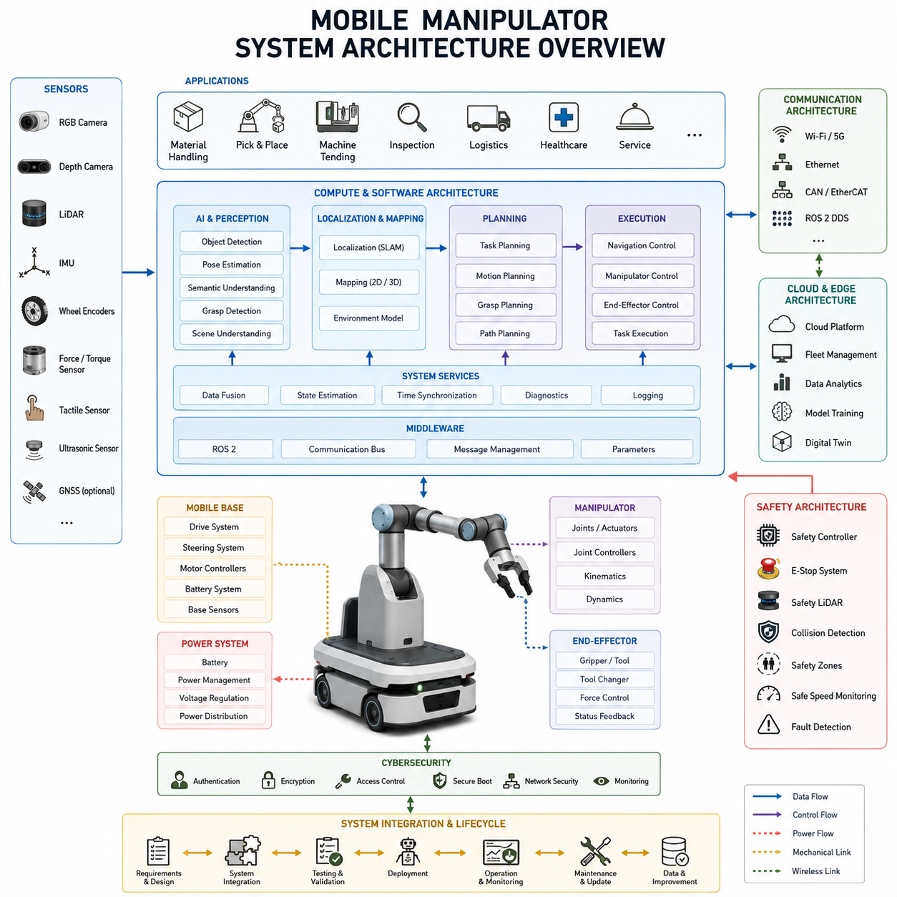{width="7.268055555555556in" height="7.268055555555556in"}

A mobile manipulator is one of the most important developments in modern robotics because it combines autonomous mobility and robotic manipulation into a single integrated system. Traditional industrial robots are highly effective within fixed workspaces, while Autonomous Mobile Robots (AMRs) excel at navigating dynamic environments. However, many real-world tasks require both capabilities simultaneously. A robot may need to travel across a warehouse, identify a target object, approach a shelf, grasp an item, transport it to another location, and place it accurately. Such tasks require the seamless integration of mobility, perception, intelligence, manipulation, communication, and safety. The system architecture of a mobile manipulator provides the framework that enables all of these functions to work together as a unified robotic platform.

The architecture of a mobile manipulator can be understood as a hierarchical structure composed of multiple subsystems. At the highest level, the system includes a mobile base, a robotic manipulator, sensing systems, computing infrastructure, control software, communication networks, safety mechanisms, and application-level intelligence. Each subsystem performs a specialized function, but the overall performance of the robot depends on the degree of integration among these components. The architecture must therefore be designed not only to maximize the performance of individual subsystems but also to ensure efficient coordination between them.

The mobile base serves as the locomotion subsystem of the robot. It enables the robot to move through factories, warehouses, hospitals, offices, airports, and public facilities. Depending on the application, the base may use differential drive, omnidirectional wheels, mecanum wheels, Ackermann steering, tracked mechanisms, or hybrid locomotion systems. The primary responsibility of the mobile platform is to transport the manipulation system to the required work location while maintaining stability, accuracy, and safety. Navigation performance directly affects the effectiveness of the manipulation task because grasping operations often require precise positioning of the robot relative to the target object.

Mounted on the mobile platform is the robotic manipulator. The manipulator may consist of four, six, seven, or more degrees of freedom depending on the required workspace and dexterity. The manipulator extends the capabilities of the mobile platform by enabling interaction with the physical environment. Through coordinated motion of its joints, the robot can pick objects, place components, operate machinery, open doors, press buttons, load materials, and perform many other tasks. The manipulator transforms the robot from a transportation system into an active physical worker capable of performing productive operations.

At the end of the manipulator is the end-effector, which directly interacts with objects and environments. End-effectors may include parallel grippers, adaptive grippers, vacuum suction systems, magnetic grippers, tool changers, specialized industrial tools, or multifunctional robotic hands. The choice of end-effector significantly influences the capabilities of the overall system. Warehouse picking applications may favor vacuum grippers, while industrial assembly tasks may require force-sensitive parallel grippers. Service robots operating in human environments may require dexterous robotic hands capable of handling diverse objects safely.

Perception forms another critical layer within the system architecture. A mobile manipulator must continuously perceive its surroundings to understand the environment, identify objects, detect obstacles, estimate poses, and monitor task execution. Modern robotic systems employ a combination of sensors including RGB cameras, depth cameras, stereo vision systems, LiDAR sensors, ultrasonic sensors, force-torque sensors, tactile sensors, inertial measurement units, wheel encoders, and GNSS receivers when outdoor operation is required. These sensors provide complementary information that enables the robot to build a comprehensive understanding of the world around it.

Sensor fusion is a key architectural concept that combines information from multiple sensing modalities into a unified representation. For example, LiDAR may provide highly accurate geometric measurements, while cameras provide semantic understanding of objects and scenes. IMUs contribute motion estimation, and force sensors provide feedback during physical interactions. Through sensor fusion algorithms, the robot achieves greater robustness, accuracy, and reliability than would be possible using any individual sensor alone.

The computing architecture serves as the brain of the mobile manipulator. Modern robotic systems typically employ heterogeneous computing platforms consisting of CPUs, GPUs, AI accelerators, microcontrollers, and real-time control processors. High-level perception and artificial intelligence algorithms often execute on GPU-equipped edge computers, while real-time motion control functions run on dedicated controllers. This separation ensures that computationally intensive AI workloads do not interfere with safety-critical control loops.

Within the computing layer, software components are organized into functional modules. These modules include localization, mapping, navigation, perception, object recognition, motion planning, manipulation planning, task execution, safety monitoring, fleet management, and system diagnostics. Middleware frameworks such as ROS2 provide communication infrastructure that allows these modules to exchange information efficiently. This modular approach simplifies development, maintenance, scalability, and integration with third-party technologies.

Localization is a foundational capability within the architecture. The robot must continuously estimate its position and orientation within the environment. Localization methods may rely on LiDAR-based SLAM, visual SLAM, GNSS positioning, fiducial markers, or hybrid approaches. Accurate localization is essential because manipulation tasks often require centimeter-level precision. Errors in localization can propagate throughout the system and negatively affect navigation, object acquisition, and task completion.

Mapping capabilities enable the robot to create and maintain digital representations of its environment. Maps may contain geometric information, semantic information, occupancy grids, point clouds, or three-dimensional scene reconstructions. These maps provide the foundation for path planning, obstacle avoidance, task planning, and environmental understanding. As robots increasingly operate in dynamic environments, maps must be continuously updated to reflect changes in surroundings.

Navigation architecture determines how the robot moves from one location to another. Navigation systems generally consist of global planning, local planning, obstacle avoidance, trajectory generation, and motion execution. Global planners determine efficient routes through the environment, while local planners react to immediate obstacles and environmental changes. The navigation subsystem must balance efficiency, safety, smoothness, and task objectives while operating in real time.

Manipulation architecture is responsible for controlling the robotic arm and end-effector. This subsystem includes inverse kinematics, trajectory planning, collision avoidance, grasp planning, force control, and motion execution. Advanced mobile manipulators coordinate the motion of both the base and arm simultaneously, enabling whole-body manipulation. Such coordination expands the reachable workspace and improves task efficiency by allowing the robot to reposition itself dynamically during operations.

Artificial intelligence has become a central element of modern mobile manipulator architectures. AI algorithms support perception, decision-making, manipulation, and autonomous behavior generation. Deep learning models enable object detection, semantic segmentation, pose estimation, grasp prediction, anomaly detection, and scene understanding. Vision-Language Models and Vision-Language-Action models further enhance the robot's ability to understand natural language instructions and translate them into executable actions.

Task planning occupies a higher layer of the architecture. While navigation and manipulation focus on individual motions, task planning determines what actions should be performed and in what sequence. A warehouse robot may receive an order consisting of multiple items located in different storage locations. The task planner decomposes the mission into navigation goals, object retrieval actions, transportation tasks, and delivery operations. Effective task planning improves productivity and resource utilization.

Communication architecture enables information exchange between subsystems and external infrastructure. Internal communication networks often utilize Ethernet, CAN bus, EtherCAT, USB, serial interfaces, and wireless protocols. External communication may involve Wi-Fi, private 5G networks, cloud platforms, enterprise software systems, fleet management servers, and digital twin environments. Reliable communication is essential for coordinated operation and remote supervision.

Cloud and edge computing architectures are increasingly important in large-scale robotic deployments. Edge computing provides low-latency processing for perception and control, while cloud platforms support fleet management, data analytics, machine learning model training, software updates, and long-term storage. The combination of edge and cloud resources enables scalable robotic ecosystems capable of supporting thousands of deployed robots.

Safety architecture is a fundamental requirement throughout the entire system. Safety cannot be treated as an isolated subsystem but must be integrated into every layer of the architecture. Safety mechanisms include emergency stop systems, safety LiDARs, collision detection algorithms, safe speed monitoring, safety zones, redundant sensors, fault detection, and functional safety controllers. These mechanisms ensure that the robot can operate safely in environments shared with humans.

Cybersecurity has also become an essential architectural consideration. As robots become increasingly connected, they become potential targets for cyberattacks. Secure communication protocols, authentication mechanisms, encrypted data transmission, secure boot processes, access control systems, and continuous security monitoring help protect robotic systems from unauthorized access and malicious activities.

System integration represents one of the greatest challenges in mobile manipulator development. Each subsystem may function correctly in isolation, yet overall system performance depends on successful integration. Developers must ensure synchronization among sensors, controllers, planners, AI models, and communication networks. Latency, timing consistency, computational resource allocation, and software compatibility must all be carefully managed.

A well-designed mobile manipulator architecture follows principles of modularity, scalability, maintainability, and extensibility. Modular architectures allow individual components to be upgraded without redesigning the entire system. Scalable architectures support deployment across multiple robot models and application domains. Maintainable architectures simplify troubleshooting and long-term support. Extensible architectures enable future incorporation of emerging technologies such as foundation models, embodied AI systems, advanced manipulation algorithms, and autonomous agent frameworks.

As robotics continues to evolve, system architectures are becoming increasingly intelligent, distributed, and adaptive. Future mobile manipulators will integrate advanced perception, foundation AI models, multi-robot collaboration, cloud-native infrastructure, and autonomous decision-making capabilities into unified robotic ecosystems. Rather than functioning as isolated machines, these robots will operate as interconnected agents capable of understanding complex environments, learning from experience, collaborating with humans, and performing a wide range of physical tasks with minimal supervision.

The system architecture overview therefore serves as the foundation for understanding every other aspect of mobile manipulator technology. Mechanical systems, electrical systems, sensors, computing platforms, control algorithms, artificial intelligence, communication networks, and safety mechanisms all converge within this architecture. Together they create a robotic system capable of combining mobility, perception, cognition, and manipulation into a single intelligent platform that represents one of the most promising directions in the future of robotics.

모바일 매니퓰레이터(Mobile Manipulator)는 현대 로보틱스 분야에서 가장 중요한 발전 중 하나로 평가된다. 이는 자율주행 이동 기능과 로봇 매니퓰레이션 기능을 하나의 통합된 시스템으로 결합하기 때문이다. 기존 산업용 로봇은 고정된 작업 공간에서 매우 높은 생산성을 제공하며, 자율주행이동로봇(AMR)은 동적인 환경에서 효율적으로 이동할 수 있다. 그러나 실제 산업 현장에서는 이 두 가지 기능이 동시에 요구되는 경우가 많다. 예를 들어 로봇이 창고 내부를 이동하여 특정 선반 앞에 도착하고, 목표 물체를 인식한 후 집어 올리고, 다른 위치로 운반하여 정확하게 배치해야 하는 작업은 이동성과 조작 능력을 모두 필요로 한다. 따라서 모바일 매니퓰레이터의 시스템 아키텍처는 이동, 인지, 지능, 조작, 통신 및 안전 기능을 하나의 통합된 플랫폼으로 연결하는 기반 구조라고 할 수 있다.

모바일 매니퓰레이터의 시스템 아키텍처는 여러 계층으로 구성된 계층형 구조로 이해할 수 있다. 일반적으로 이동 플랫폼, 로봇 암, 센서 시스템, 컴퓨팅 인프라, 제어 소프트웨어, 통신 네트워크, 안전 시스템, 그리고 응용 수준의 인공지능 계층으로 구성된다. 각 구성 요소는 독립적인 역할을 수행하지만, 전체 시스템의 성능은 이들 간의 통합 수준에 의해 결정된다. 따라서 아키텍처 설계의 핵심 목표는 개별 구성 요소의 성능 극대화뿐 아니라 상호 협조를 최적화하는 데 있다.

이동 플랫폼은 로봇의 이동 기능을 담당하는 핵심 하부 시스템이다. 이를 통해 로봇은 공장, 물류센터, 병원, 사무실, 공항 및 공공시설과 같은 다양한 환경을 이동할 수 있다. 적용 분야에 따라 차동 구동 방식, 전방향 구동, 메카넘 휠, 아커만 조향, 무한궤도 방식 또는 하이브리드 이동 시스템이 사용될 수 있다. 이동 플랫폼의 주요 역할은 작업 위치까지 로봇을 정확하고 안정적으로 이동시키는 것이며, 이는 이후 수행되는 조작 작업의 정확도에 직접적인 영향을 미친다.

이동 플랫폼 위에는 로봇 매니퓰레이터가 탑재된다. 매니퓰레이터는 일반적으로 4축에서 7축 이상의 자유도를 가지며, 요구되는 작업 범위와 유연성에 따라 설계된다. 매니퓰레이터는 로봇이 환경과 물리적으로 상호작용할 수 있도록 해주는 핵심 장치이다. 이를 통해 물체를 집고, 옮기고, 배치하며, 기계를 조작하거나 버튼을 누르고, 문을 열고 닫는 등의 다양한 작업을 수행할 수 있다. 이동 플랫폼이 로봇을 작업 위치로 운반한다면, 매니퓰레이터는 실제 작업을 수행하는 역할을 담당한다.

매니퓰레이터의 끝단에는 엔드이펙터가 장착된다. 엔드이펙터는 실제 물체와 직접 접촉하는 부분으로, 평행 그리퍼, 적응형 그리퍼, 진공 흡착기, 자기식 그리퍼, 자동 공구 교환 장치, 특수 산업용 툴 또는 다기능 로봇 핸드 등이 사용된다. 어떤 엔드이펙터를 선택하느냐에 따라 시스템의 작업 범위와 활용 가능성이 크게 달라진다. 예를 들어 창고 피킹 작업에서는 진공 흡착 방식이 유리할 수 있으며, 정밀 조립 작업에서는 힘 제어가 가능한 그리퍼가 요구된다.

인지 시스템은 모바일 매니퓰레이터 아키텍처의 또 다른 핵심 계층이다. 로봇은 주변 환경을 지속적으로 인식하여 물체를 식별하고, 장애물을 감지하며, 위치를 추정하고, 작업 상태를 확인해야 한다. 이를 위해 RGB 카메라, 깊이 카메라, 스테레오 카메라, LiDAR, 초음파 센서, 힘·토크 센서, 촉각 센서, IMU, 휠 엔코더, GNSS 수신기 등 다양한 센서가 사용된다. 각각의 센서는 서로 다른 형태의 정보를 제공하며, 이를 종합하여 로봇은 환경을 이해하게 된다.

센서 융합은 이러한 다양한 센서 데이터를 통합하는 핵심 기술이다. LiDAR는 정밀한 거리 정보를 제공하고, 카메라는 물체와 장면에 대한 의미 정보를 제공한다. IMU는 자세와 움직임 정보를 제공하며, 힘 센서는 물체와의 접촉 상태를 알려준다. 이러한 정보를 융합함으로써 단일 센서만 사용할 때보다 더 높은 정확도와 신뢰성을 확보할 수 있다.

컴퓨팅 아키텍처는 모바일 매니퓰레이터의 두뇌 역할을 수행한다. 최근의 로봇 시스템은 CPU, GPU, AI 가속기, 마이크로컨트롤러 및 실시간 제어 프로세서로 구성된 이기종 컴퓨팅 구조를 채택하고 있다. 인공지능 기반 인식과 추론 알고리즘은 GPU 기반 엣지 컴퓨터에서 실행되며, 모터 제어와 같은 실시간 기능은 별도의 제어기에 의해 수행된다. 이러한 구조는 고성능 AI 연산과 안전한 제어 기능을 동시에 보장한다.

소프트웨어 계층에서는 기능별 모듈 구조가 일반적으로 사용된다. 위치 추정, 지도 생성, 자율주행, 객체 인식, 모션 계획, 조작 계획, 작업 실행, 안전 감시, 군집 관리 및 시스템 진단과 같은 기능이 독립된 모듈로 구현된다. ROS2와 같은 미들웨어는 이러한 모듈 간 데이터 교환을 담당하며, 전체 시스템의 확장성과 유지보수성을 향상시킨다.

위치 추정(Localization)은 모바일 매니퓰레이터의 핵심 기능 중 하나이다. 로봇은 자신의 위치와 방향을 지속적으로 계산해야 한다. 이를 위해 LiDAR 기반 SLAM, Visual SLAM, GNSS, 마커 기반 위치 인식 또는 복합 위치 추정 기술이 활용된다. 특히 조작 작업은 센티미터 수준의 정밀도를 요구하므로, 정확한 위치 추정은 전체 시스템 성능에 직접적인 영향을 미친다.

지도 생성(Mapping)은 환경의 디지털 표현을 구축하는 기능이다. 지도는 점유 격자 지도, 포인트 클라우드, 3차원 모델 또는 의미 기반 지도 형태로 표현될 수 있다. 이러한 지도는 경로 계획, 장애물 회피, 작업 계획 및 환경 이해의 기반이 된다. 실제 운영 환경은 지속적으로 변화하기 때문에 지도 역시 실시간으로 업데이트되어야 한다.

자율주행 아키텍처는 로봇이 목적지까지 이동하는 과정을 담당한다. 일반적으로 전역 경로 계획, 지역 경로 계획, 장애물 회피, 궤적 생성 및 이동 제어 기능으로 구성된다. 전역 계획기는 전체 환경에서 최적 경로를 계산하고, 지역 계획기는 동적으로 발생하는 장애물에 대응한다. 이러한 구조를 통해 로봇은 효율성과 안전성을 동시에 확보할 수 있다.

조작 아키텍처는 로봇 암과 엔드이펙터를 제어하는 기능을 수행한다. 여기에는 역기구학, 궤적 계획, 충돌 회피, 파지 계획, 힘 제어 및 작업 실행 기능이 포함된다. 최근의 모바일 매니퓰레이터는 이동 플랫폼과 로봇 암을 동시에 제어하는 전신 제어(Whole-Body Control) 기술을 활용하고 있으며, 이를 통해 작업 공간을 확대하고 생산성을 향상시키고 있다.

인공지능은 현대 모바일 매니퓰레이터 아키텍처의 중심 요소로 자리 잡고 있다. AI는 인식, 의사결정, 조작 및 자율 행동 생성에 활용된다. 딥러닝 기반 모델은 객체 검출, 의미 분할, 자세 추정, 파지 예측, 이상 감지 및 장면 이해 기능을 수행한다. 최근에는 Vision-Language Model(VLM)과 Vision-Language-Action(VLA) 모델이 도입되면서 자연어 명령을 이해하고 이를 실제 행동으로 변환하는 능력이 크게 향상되고 있다.

작업 계획(Task Planning)은 시스템의 상위 계층에 위치한다. 이동과 조작이 개별 동작을 담당한다면, 작업 계획은 무엇을 어떤 순서로 수행할 것인지를 결정한다. 예를 들어 창고 로봇이 여러 주문 품목을 처리해야 하는 경우, 작업 계획기는 각 품목의 위치를 확인하고 이동 경로, 피킹 순서, 운반 및 배송 과정을 종합적으로 최적화한다.

통신 아키텍처는 내부 구성 요소와 외부 인프라 간의 정보 교환을 담당한다. 내부적으로는 Ethernet, CAN, EtherCAT, USB, Serial 통신 등이 사용되며, 외부적으로는 Wi-Fi, 5G, 클라우드 플랫폼, 기업 시스템, FMS(Fleet Management System) 및 디지털 트윈 플랫폼과 연동된다. 안정적인 통신은 대규모 로봇 운영 환경에서 필수적인 요소이다.

클라우드 및 엣지 컴퓨팅 아키텍처는 최근 로봇 시스템에서 점점 더 중요한 역할을 하고 있다. 엣지 컴퓨팅은 저지연 실시간 처리를 담당하며, 클라우드는 데이터 저장, 분석, AI 모델 학습, OTA 업데이트 및 군집 관리 기능을 제공한다. 이러한 구조는 수백 대에서 수천 대 규모의 로봇 운영을 가능하게 한다.

안전 아키텍처는 시스템 전체에 걸쳐 적용되어야 하는 필수 요소이다. 안전은 특정 모듈이 아니라 전체 아키텍처의 기본 설계 원칙이다. 이를 위해 비상정지 장치, 안전 LiDAR, 충돌 감지 알고리즘, 안전 속도 제어, 안전 구역 설정, 이중화 센서, 결함 진단 기능 및 기능 안전 제어기가 사용된다. 이러한 장치는 인간과 로봇이 동일 공간에서 안전하게 협업할 수 있도록 보장한다.

사이버 보안 역시 중요한 설계 요소로 부상하고 있다. 로봇이 네트워크와 클라우드에 연결됨에 따라 해킹과 사이버 공격의 위험이 증가하고 있기 때문이다. 암호화 통신, 인증 시스템, 접근 제어, 보안 부팅 및 지속적인 보안 모니터링은 현대 로봇 시스템의 필수 기능이 되고 있다.

시스템 통합은 모바일 매니퓰레이터 개발 과정에서 가장 어려운 과제 중 하나이다. 각 구성 요소가 개별적으로는 정상 동작하더라도, 전체 시스템이 조화롭게 동작하도록 만드는 것은 매우 복잡한 작업이다. 센서, 제어기, 계획기, AI 모델 및 통신 네트워크 간의 동기화와 지연 시간 관리가 핵심 과제가 된다.

우수한 모바일 매니퓰레이터 아키텍처는 모듈성, 확장성, 유지보수성 및 미래 대응성을 갖추어야 한다. 모듈형 구조는 개별 구성 요소를 독립적으로 업그레이드할 수 있게 하며, 확장 가능한 구조는 다양한 제품군과 산업 분야에 적용될 수 있도록 한다. 또한 유지보수성이 높은 구조는 운영 비용을 절감하며, 미래 기술을 쉽게 수용할 수 있게 해준다.

향후 모바일 매니퓰레이터는 더욱 지능적이고 분산화된 구조로 발전할 것이다. 파운데이션 모델, VLM, VLA, Embodied AI, 멀티로봇 협업, 클라우드 로보틱스 기술이 통합되면서 로봇은 단순한 자동화 장비를 넘어 자율적으로 판단하고 학습하며 협업하는 지능형 에이전트로 진화할 것이다.

결국 시스템 아키텍처는 모바일 매니퓰레이터를 구성하는 모든 기술의 기반이 된다. 기계 구조, 전기 시스템, 센서, 컴퓨팅 플랫폼, 제어 알고리즘, 인공지능, 통신 네트워크 및 안전 기술이 하나의 통합 구조 안에서 유기적으로 연결될 때 비로소 이동성, 인지 능력, 지능, 그리고 물리적 작업 수행 능력을 동시에 갖춘 차세대 로봇 플랫폼이 완성된다.

##  

## 02 Mechanical Architecture

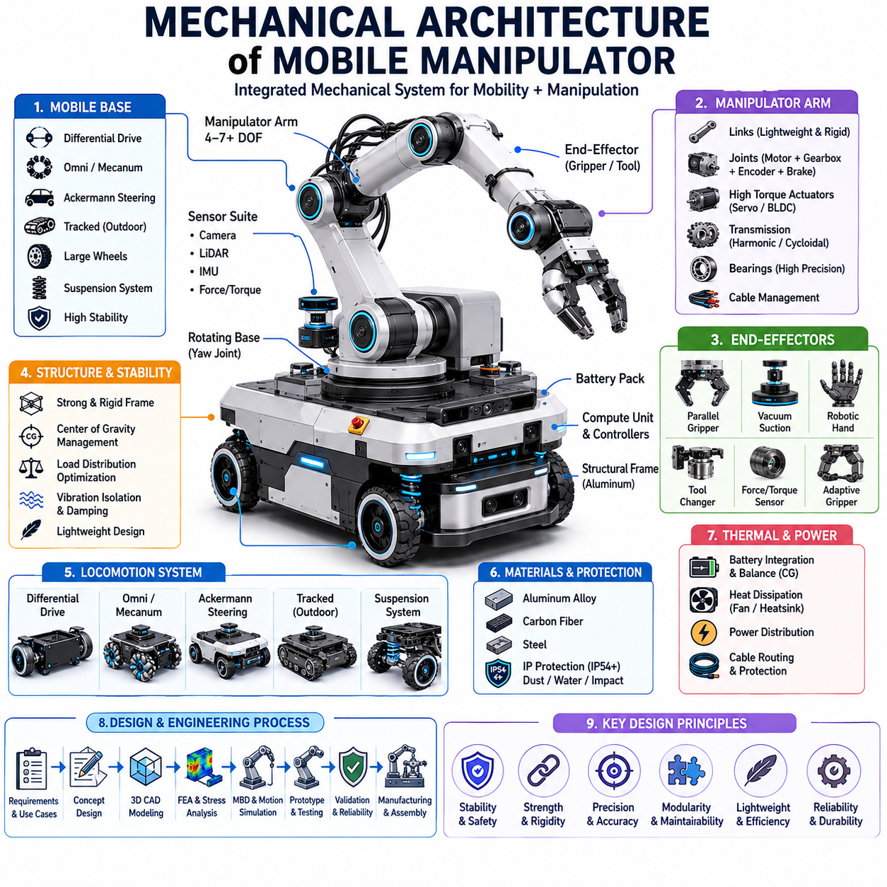{width="7.268055555555556in" height="7.268055555555556in"}

Mechanical architecture is the physical foundation of a mobile manipulator system. While software, artificial intelligence, sensing technologies, and control algorithms often receive significant attention, the mechanical architecture ultimately determines whether the robot can safely, reliably, and efficiently perform real-world tasks. Every movement, manipulation action, navigation behavior, and interaction with the environment depends on the quality of the underlying mechanical design. A mobile manipulator may possess advanced perception and planning capabilities, but without a robust mechanical structure, it cannot effectively translate intelligence into productive physical work.

The mechanical architecture of a mobile manipulator can be viewed as the integration of two traditionally separate robotic domains. The first domain is mobile robotics, which focuses on locomotion, navigation, and transportation. The second domain is robotic manipulation, which focuses on object handling, dexterous motion, and physical interaction. The challenge of mechanical architecture lies in combining these two domains into a unified platform while maintaining stability, payload capacity, maneuverability, safety, and operational efficiency.

At the highest level, a mobile manipulator consists of a mobile base, a manipulator arm, an end-effector, structural support systems, power distribution mechanisms, sensor mounting structures, and protective enclosures. These subsystems must work together as a single integrated mechanical platform capable of performing complex tasks in dynamic environments.

The mobile base serves as the structural and locomotion foundation of the system. It supports all upper-body components, including batteries, controllers, sensors, manipulators, and payloads. The base must provide sufficient rigidity to withstand dynamic loads while maintaining dimensional accuracy during operation. Structural deformation, vibration, and flexing can negatively affect navigation accuracy, manipulation precision, and sensor performance.

The design of the mobile base is heavily influenced by application requirements. Warehouse robots often prioritize compact dimensions and maneuverability to navigate narrow aisles. Industrial robots may emphasize payload capacity and robustness. Hospital service robots require smooth movement and safe human interaction characteristics. Outdoor mobile manipulators must tolerate uneven terrain, weather exposure, vibration, dust, and impact loading.

Locomotion systems represent one of the most critical elements of the mechanical architecture. Various drive mechanisms are employed depending on environmental requirements. Differential drive systems are among the most common due to their simplicity, reliability, and low cost. These systems use independently controlled wheels on each side of the robot to generate motion and steering.

Omnidirectional drive systems provide greater maneuverability by allowing movement in multiple directions without changing orientation. Mecanum wheels and omni wheels enable lateral movement, rotational motion, and complex trajectory execution. Such capabilities are particularly useful in constrained industrial environments where precise positioning is required.

Ackermann steering mechanisms are frequently used in larger outdoor robots. Inspired by automotive steering systems, Ackermann configurations provide stable high-speed operation and efficient navigation over long distances. Outdoor mobile manipulators operating in logistics yards, industrial facilities, campuses, and public infrastructure environments often utilize this approach.

Tracked locomotion systems provide superior terrain adaptability and traction. These systems are suitable for construction sites, agricultural fields, military applications, and disaster response scenarios. Although tracks offer improved mobility on challenging terrain, they typically introduce higher energy consumption, greater mechanical complexity, and increased maintenance requirements.

Wheel selection is a fundamental mechanical design decision. Wheel diameter directly influences obstacle-climbing capability, ground clearance, energy efficiency, and ride comfort. Larger wheels improve terrain adaptability but increase overall robot dimensions and weight. Smaller wheels reduce size and cost but limit performance on uneven surfaces.

Suspension systems play an increasingly important role as mobile manipulators expand into outdoor and semi-structured environments. A well-designed suspension system absorbs shocks, reduces vibration, improves traction, and protects sensitive components. Suspension mechanisms also contribute to maintaining manipulator stability during navigation and manipulation operations.

The structural frame forms the backbone of the entire robot. The frame must support static loads, dynamic loads, shock loads, and fatigue loads throughout the operational life of the system. Structural design requires careful consideration of strength, stiffness, weight, manufacturability, and cost.

Common structural materials include aluminum alloys, steel alloys, stainless steel, carbon fiber composites, and advanced engineering polymers. Aluminum is widely used due to its favorable strength-to-weight ratio and corrosion resistance. Steel provides superior strength and durability but increases weight. Composite materials offer exceptional weight reduction but may increase manufacturing complexity and cost.

Weight optimization is a critical aspect of mechanical architecture. Excessive weight increases power consumption, reduces battery life, limits mobility, and raises manufacturing costs. However, excessive weight reduction may compromise structural integrity and safety. Engineers must therefore balance lightweight design objectives with robustness requirements.

One of the most important considerations in mobile manipulator design is center of gravity management. Unlike stationary industrial robots, mobile manipulators experience continuous changes in mass distribution due to arm motion, payload handling, acceleration, deceleration, and terrain variations. Improper center of gravity positioning can result in instability, wheel slippage, reduced manipulation accuracy, or even tip-over accidents.

Center of gravity analysis must account for multiple operating scenarios. The robot may carry different payloads, extend the manipulator to varying positions, travel at different speeds, and operate on inclined surfaces. Mechanical designers typically evaluate worst-case conditions to ensure adequate stability margins.

The manipulator arm itself represents a highly sophisticated mechanical subsystem. It consists of multiple links connected through rotary or linear joints. The geometry of the manipulator directly determines workspace, reachability, dexterity, payload capacity, and motion efficiency.

Manipulator design begins with determining the required number of degrees of freedom. Four-degree-of-freedom systems may be sufficient for simple pick-and-place operations. Six-degree-of-freedom systems enable full spatial positioning and orientation control. Seven-degree-of-freedom systems introduce kinematic redundancy, allowing greater flexibility in obstacle avoidance and motion optimization.

Link design significantly influences manipulator performance. Longer links increase reachable workspace but also amplify structural deflection and dynamic loading. Shorter links improve rigidity but limit operational flexibility. Designers must optimize link dimensions based on application-specific requirements.

Joint mechanisms are among the most mechanically demanding components in the robot. Joints contain actuators, gearboxes, bearings, encoders, brakes, and transmission systems. These components must deliver sufficient torque, accuracy, repeatability, and reliability throughout the operational lifetime.

Actuator selection depends on performance requirements. Brushless DC motors dominate modern robotic systems due to their efficiency, precision, and reliability. Servo motors provide closed-loop control capabilities that enable accurate position, velocity, and torque regulation.

Transmission systems convert actuator output into usable joint motion. Harmonic drives are widely used because they provide high reduction ratios, compact packaging, and near-zero backlash. Cycloidal drives offer excellent shock resistance and durability. Planetary gearboxes provide a balance between performance, cost, and efficiency.

Bearings are essential for supporting loads and ensuring smooth motion. Proper bearing selection directly affects accuracy, durability, maintenance intervals, and overall system reliability. High-performance manipulators often utilize precision bearings designed specifically for robotic applications.

End-effectors form the interface between the robot and the external environment. Mechanical architecture must support a wide variety of end-effector types depending on the target application. Parallel grippers are commonly used for industrial handling tasks. Adaptive grippers accommodate objects with varying shapes and sizes. Vacuum systems are effective for packaging and logistics applications. Multifinger robotic hands provide human-like dexterity for advanced manipulation tasks.

Tool-changing mechanisms significantly enhance robot versatility. Rather than relying on a single end-effector, the robot can automatically switch between grippers, screwdrivers, inspection tools, welding equipment, or specialized instruments. This capability transforms a mobile manipulator into a multifunctional robotic platform.

Mechanical compliance is becoming increasingly important in collaborative robotics. Traditional industrial robots emphasized maximum rigidity and positional accuracy. However, robots operating alongside humans must safely absorb unexpected impacts and adapt to uncertain environments. Mechanical compliance can be achieved through flexible joints, elastic components, compliant actuators, or specialized transmission mechanisms.

Series Elastic Actuators represent one example of compliant mechanical design. By introducing elastic elements between the motor and load, these actuators improve force control performance and reduce impact forces during collisions. Such designs are particularly valuable in human-robot collaboration scenarios.

Sensor integration is another major aspect of mechanical architecture. Cameras, LiDAR sensors, IMUs, force-torque sensors, tactile arrays, and environmental sensors require carefully designed mounting structures. Sensor placement affects field of view, measurement accuracy, environmental protection, maintenance accessibility, and calibration procedures.

Mechanical architecture must also address environmental protection requirements. Industrial robots may encounter dust, moisture, vibration, chemicals, electromagnetic interference, and extreme temperatures. Appropriate enclosure design is necessary to achieve desired ingress protection ratings and operational reliability.

Thermal management is increasingly important as computational and power densities continue to increase. Batteries, power electronics, motor controllers, GPUs, and AI accelerators generate significant heat during operation. Mechanical architecture must provide effective heat dissipation pathways through conduction, convection, and active cooling systems.

Battery integration introduces additional mechanical design challenges. Batteries are often among the heaviest components in the robot and significantly influence center of gravity location. Mechanical designers must balance accessibility, protection, thermal performance, serviceability, and weight distribution when positioning battery packs.

Maintenance considerations should be incorporated from the earliest stages of mechanical design. Components requiring periodic inspection or replacement should be easily accessible. Modular assemblies simplify maintenance procedures, reduce downtime, and improve overall operational efficiency.

Manufacturing strategy also influences mechanical architecture. Designs intended for low-volume production may prioritize flexibility and rapid prototyping. Mass-production systems require standardized components, simplified assembly procedures, and cost-optimized manufacturing methods. Design for Manufacturing and Design for Assembly principles help ensure successful commercialization.

Reliability engineering plays a critical role in mechanical system development. Fatigue analysis, vibration testing, impact testing, environmental validation, and accelerated life testing are used to verify long-term durability. Mobile manipulators operating continuously in industrial environments may accumulate tens of thousands of operational hours over their service life.

Digital engineering tools have transformed modern mechanical architecture development. Computer-Aided Design, Finite Element Analysis, Multi-Body Dynamics Simulation, Digital Twins, and Virtual Prototyping allow engineers to evaluate performance before physical prototypes are built. These tools reduce development time, lower costs, and improve design quality.

As mobile manipulation technology advances, mechanical architectures are becoming more intelligent, modular, and adaptive. Future systems will incorporate lightweight composite structures, integrated sensing components, variable stiffness mechanisms, self-reconfigurable modules, advanced actuator technologies, and bio-inspired designs. Mechanical systems will increasingly be optimized not only for strength and performance but also for seamless integration with artificial intelligence and autonomous decision-making systems.

Ultimately, the mechanical architecture of a mobile manipulator serves as the physical embodiment of robotic intelligence. It transforms software decisions into real-world actions, enabling robots to navigate, manipulate, interact, and create value within physical environments. A successful mechanical architecture achieves the delicate balance between strength and weight, precision and robustness, flexibility and stability, cost and performance. It provides the foundation upon which all higher-level robotic capabilities are built and remains one of the most critical disciplines in the development of advanced mobile manipulation systems.

기계 아키텍처(Mechanical Architecture)는 모바일 매니퓰레이터 시스템의 물리적 기반이다. 소프트웨어, 인공지능, 센서 기술, 제어 알고리즘이 주목받는 경우가 많지만, 실제 현장에서 로봇이 안전하고 신뢰성 있게 작업을 수행할 수 있는지는 결국 기계 구조에 의해 결정된다. 로봇의 모든 이동, 조작, 자율주행, 그리고 환경과의 상호작용은 기계 아키텍처 위에서 구현된다. 아무리 뛰어난 인공지능과 인지 능력을 갖추고 있더라도 이를 현실 세계의 물리적 행동으로 변환할 수 있는 견고한 기계 구조가 없다면 실제 작업을 수행할 수 없다.

모바일 매니퓰레이터의 기계 아키텍처는 전통적으로 분리되어 있던 두 개의 로봇 분야를 통합한 결과물이다. 하나는 이동성을 담당하는 모바일 로봇 기술이며, 다른 하나는 물체를 다루는 매니퓰레이션 기술이다. 기계 아키텍처의 핵심 과제는 이동성과 조작 능력을 하나의 플랫폼으로 통합하면서 안정성, 적재 능력, 기동성, 안전성, 생산성을 동시에 확보하는 것이다.

일반적으로 모바일 매니퓰레이터는 이동 플랫폼(Mobile Base), 로봇 암(Manipulator), 엔드이펙터(End-Effector), 구조 프레임, 전원 시스템, 센서 장착 구조물, 보호 하우징 등으로 구성된다. 이러한 요소들은 개별 부품이 아니라 하나의 통합된 기계 시스템으로 동작해야 한다.

이동 플랫폼은 전체 시스템의 기반 구조이다. 배터리, 제어기, 센서, 로봇 암 및 작업물을 지지하는 역할을 수행한다. 플랫폼은 충분한 강성을 확보하여 주행 중 발생하는 충격과 진동에도 변형이 최소화되어야 한다. 구조물의 변형은 자율주행 정확도와 조작 정밀도에 직접적인 영향을 미친다.

이동 플랫폼의 설계는 적용 분야에 따라 달라진다. 물류창고용 로봇은 좁은 통로를 통과할 수 있도록 소형화와 기동성을 중요하게 고려한다. 산업용 로봇은 높은 적재 능력과 내구성이 우선시된다. 병원 서비스 로봇은 부드러운 주행과 사람과의 안전한 상호작용이 중요하다. 실외용 모바일 매니퓰레이터는 비포장 도로, 경사면, 먼지, 비, 진동과 같은 환경에 대응할 수 있어야 한다.

구동 시스템은 기계 아키텍처의 핵심 요소 중 하나이다. 가장 널리 사용되는 방식은 차동 구동(Differential Drive)이다. 구조가 단순하고 신뢰성이 높으며 유지보수가 용이하기 때문이다. 좌우 바퀴를 독립적으로 제어하여 직진과 회전을 수행한다.

전방향 이동(Omnidirectional Drive) 방식은 더욱 높은 기동성을 제공한다. 메카넘 휠(Mecanum Wheel)이나 옴니 휠(Omni Wheel)을 사용하면 방향 전환 없이 좌우 이동과 회전이 가능하다. 이러한 특성은 공간이 제한된 공장이나 물류센터에서 매우 유용하다.

대형 실외 로봇에서는 아커만 조향(Ackermann Steering)이 자주 사용된다. 자동차와 유사한 조향 구조를 갖기 때문에 고속 주행과 장거리 이동에 적합하다. 캠퍼스, 산업단지, 항만, 공항 등 넓은 지역을 운행하는 모바일 매니퓰레이터에서 주로 채택된다.

무한궤도(Tracked System)는 험지 적응성이 뛰어나다. 건설 현장, 농업, 국방, 재난 대응 분야에서 활용된다. 다만 에너지 소비가 크고 구조가 복잡하며 유지보수 비용이 증가하는 단점이 있다.

바퀴 선택 역시 중요한 설계 요소이다. 바퀴 직경은 장애물 극복 능력, 지상고, 에너지 효율 및 승차감에 직접적인 영향을 미친다. 큰 바퀴는 험지 주행 능력을 향상시키지만 전체 크기와 중량이 증가한다. 작은 바퀴는 시스템을 소형화할 수 있지만 장애물 극복 능력이 제한된다.

실외 환경에서는 서스펜션 시스템의 중요성이 더욱 커진다. 서스펜션은 충격과 진동을 흡수하여 센서와 전자장비를 보호하고, 접지력을 향상시키며, 주행 안정성을 확보한다. 또한 로봇 암이 작업할 때 플랫폼의 흔들림을 줄여 조작 정밀도를 높인다.

구조 프레임은 전체 로봇의 골격 역할을 한다. 프레임은 정적 하중, 동적 하중, 충격 하중, 피로 하중을 장기간 견뎌야 한다. 따라서 강도, 강성, 중량, 제조성, 비용 등을 종합적으로 고려하여 설계된다.

프레임 재료로는 알루미늄 합금, 탄소강, 스테인리스강, 탄소섬유 복합재 및 고성능 엔지니어링 플라스틱이 사용된다. 알루미늄은 경량성과 내식성이 우수하여 가장 널리 사용된다. 강철은 높은 강도를 제공하지만 무게가 증가한다. 복합재는 무게를 크게 줄일 수 있으나 제조 비용이 높고 생산 공정이 복잡하다.

경량화는 모바일 로봇 설계의 핵심 목표 중 하나이다. 무게가 증가하면 전력 소비가 늘어나고 배터리 운용 시간이 감소하며 생산 비용도 상승한다. 반대로 지나친 경량화는 강도와 내구성을 저하시킬 수 있으므로 균형 잡힌 설계가 필요하다.

모바일 매니퓰레이터 설계에서 가장 중요한 요소 중 하나는 무게중심(Center of Gravity) 관리이다. 산업용 로봇과 달리 모바일 매니퓰레이터는 이동 중에도 로봇 암이 움직이고 물체를 들어 올리기 때문에 무게중심이 지속적으로 변화한다. 무게중심이 적절하지 않으면 전복, 미끄러짐, 조작 오차 등이 발생할 수 있다.

무게중심 분석은 다양한 작업 시나리오를 고려하여 수행된다. 최대 적재 중량, 암의 최대 신장 상태, 고속 주행, 경사면 주행 등 최악의 조건에서도 충분한 안정성을 확보해야 한다.

로봇 암은 모바일 매니퓰레이터의 핵심 작업 장치이다. 여러 개의 링크와 관절로 구성되며, 작업 공간과 조작 능력을 결정한다. 암의 구조는 작업 범위, 적재 능력, 유연성, 정밀도에 직접적인 영향을 미친다.

설계 초기에는 필요한 자유도(Degree of Freedom)를 결정해야 한다. 단순한 피킹 작업에는 4축 정도가 충분할 수 있지만, 복잡한 공간에서의 작업에는 6축 또는 7축 이상의 구조가 필요하다. 7축 이상의 구조는 중복 자유도(Redundancy)를 제공하여 장애물 회피와 작업 최적화에 유리하다.

링크 길이는 작업 공간과 강성 사이의 균형을 결정한다. 링크가 길어지면 작업 범위는 증가하지만 구조 변형과 진동이 커진다. 짧은 링크는 강성이 높지만 작업 범위가 제한된다.

관절(Joint)은 가장 복잡하고 중요한 기계 요소 중 하나이다. 관절 내부에는 모터, 감속기, 베어링, 엔코더, 브레이크 및 동력 전달 장치가 포함된다. 관절은 높은 토크와 정밀도를 장기간 안정적으로 제공해야 한다.

현대 로봇에서는 브러시리스 DC 모터가 가장 널리 사용된다. 효율이 높고 정밀 제어가 가능하며 유지보수가 적기 때문이다. 서보 모터는 위치, 속도, 토크를 정밀하게 제어할 수 있어 대부분의 매니퓰레이터에 적용된다.

감속기 시스템은 모터의 회전력을 증폭하여 실제 작업에 필요한 토크를 생성한다. 하모닉 드라이브는 높은 감속비와 낮은 백래시 특성으로 인해 로봇 관절에서 가장 널리 사용된다. 사이클로이드 감속기는 충격에 강하며 내구성이 우수하다. 유성감속기는 성능과 비용의 균형이 뛰어나다.

베어링은 하중을 지지하고 부드러운 회전을 보장한다. 베어링 선택은 정밀도, 수명, 유지보수 주기에 직접적인 영향을 미친다.

엔드이펙터는 로봇과 환경 사이의 물리적 인터페이스이다. 산업 현장에서는 평행 그리퍼가 가장 널리 사용되며, 물류 환경에서는 진공 흡착기가 활용된다. 최근에는 다양한 형상의 물체를 다룰 수 있는 적응형 그리퍼와 다관절 로봇 핸드도 적용되고 있다.

자동 공구 교환기(Tool Changer)는 로봇의 활용성을 크게 향상시킨다. 하나의 로봇이 그리퍼, 드라이버, 검사 장비, 용접 장치 등 다양한 공구를 자동으로 교체하면서 여러 작업을 수행할 수 있게 된다.

최근 협동로봇 분야에서는 기계적 순응성(Mechanical Compliance)이 중요해지고 있다. 기존 산업용 로봇은 최대 강성과 정밀도를 추구했지만, 사람과 함께 작업하는 로봇은 충돌 시 충격을 흡수할 수 있어야 한다. 이를 위해 탄성 요소와 유연한 관절 구조가 적용되고 있다.

대표적인 사례가 SEA(Series Elastic Actuator)이다. 모터와 부하 사이에 탄성체를 삽입하여 힘 제어 성능을 향상시키고 충돌 시 충격을 감소시킨다. 이는 인간과 로봇의 안전한 협업을 가능하게 하는 핵심 기술이다.

센서 통합 역시 기계 설계의 중요한 부분이다. 카메라, LiDAR, IMU, 힘·토크 센서, 촉각 센서 등은 최적의 시야와 측정 정확도를 확보할 수 있도록 적절한 위치에 배치되어야 한다. 또한 유지보수와 교정 작업이 용이하도록 설계되어야 한다.

환경 보호 설계도 필수적이다. 산업 현장에서는 먼지, 습기, 화학물질, 진동, 전자파 및 극한 온도 환경이 존재한다. 따라서 적절한 하우징과 보호 구조를 통해 IP 등급을 확보해야 한다.

열 관리(Thermal Management)는 점점 더 중요해지고 있다. 배터리, 모터 드라이버, 전력 장치, GPU 및 AI 컴퓨팅 장치는 상당한 열을 발생시킨다. 따라서 방열판, 냉각 팬, 액체 냉각 시스템 등을 활용하여 적절한 온도를 유지해야 한다.

배터리는 시스템에서 가장 무거운 부품 중 하나이다. 따라서 배터리 위치는 무게중심과 주행 안정성에 큰 영향을 미친다. 또한 교체와 유지보수가 용이하도록 설계되어야 한다.

유지보수성(Maintainability)은 설계 초기부터 고려되어야 한다. 정기적으로 교체해야 하는 부품은 쉽게 접근할 수 있어야 하며, 모듈형 구조는 다운타임을 줄이고 유지보수 효율을 높인다.

제조 전략 역시 기계 아키텍처에 영향을 미친다. 시제품은 개발 유연성을 우선시하지만, 양산 제품은 제조 비용과 조립 효율을 고려해야 한다. DFM(Design for Manufacturing)과 DFA(Design for Assembly)는 상용화를 위한 필수 설계 원칙이다.

신뢰성 공학은 기계 시스템 개발의 핵심 요소이다. 피로 해석, 진동 시험, 충격 시험, 환경 시험, 수명 시험 등을 통해 장기적인 내구성을 검증한다. 산업 현장에서 운영되는 모바일 매니퓰레이터는 수만 시간 이상의 운용 수명을 요구받는다.

최근에는 CAD, 유한요소해석(FEA), 다물체 동역학(MBD), 디지털 트윈, 가상 프로토타이핑 기술이 기계 설계 과정에 적극 활용되고 있다. 이를 통해 실제 시제품 제작 이전에 성능을 검증할 수 있으며 개발 기간과 비용을 크게 절감할 수 있다.

앞으로 모바일 매니퓰레이터의 기계 아키텍처는 더욱 지능적이고 모듈화된 방향으로 발전할 것이다. 경량 복합재 구조, 센서 일체형 구조물, 가변 강성 메커니즘, 재구성 가능한 모듈, 차세대 액추에이터 및 생체모방 설계 기술이 적극적으로 도입될 전망이다.

결국 기계 아키텍처는 로봇 지능의 물리적 구현체라고 할 수 있다. 소프트웨어와 인공지능이 내리는 의사결정을 실제 행동으로 변환하는 역할을 수행한다. 성공적인 기계 아키텍처는 강도와 중량, 정밀도와 내구성, 유연성과 안정성, 비용과 성능 사이의 균형을 달성해야 한다. 이러한 기계 구조 위에서만 이동성, 조작 능력, 인공지능, 자율성이 결합된 차세대 모바일 매니퓰레이터가 완성될 수 있다.

##  

## 03 Electrical Architecture

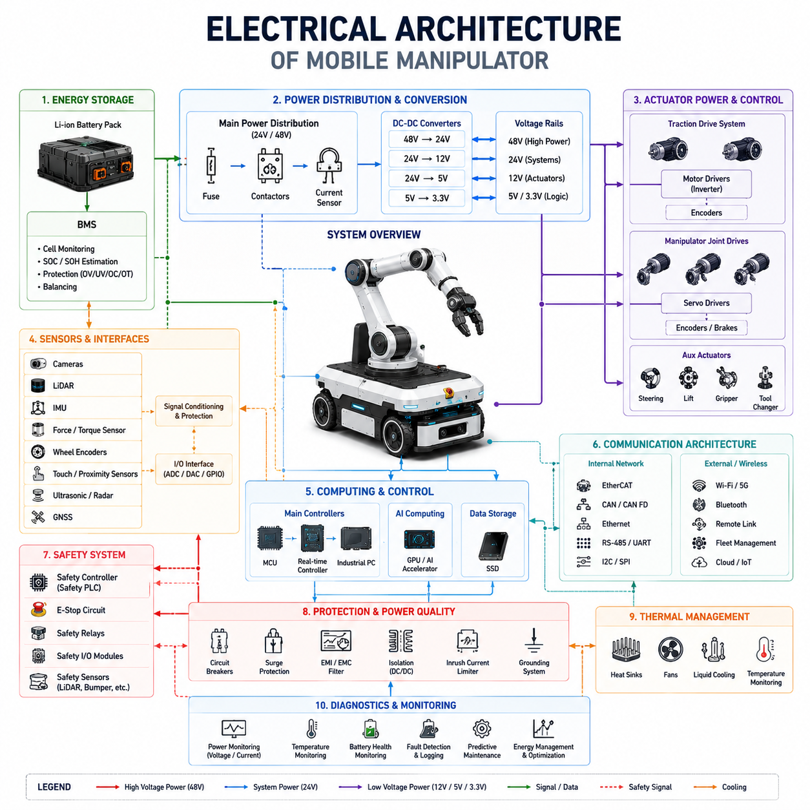{width="7.268055555555556in" height="7.268055555555556in"}

Electrical architecture is one of the most critical foundations of a mobile manipulator system because it provides the energy, signal distribution, control connectivity, and operational reliability required for all robotic functions. While mechanical architecture determines how the robot physically moves and interacts with the environment, electrical architecture determines how power is generated, distributed, monitored, controlled, and protected throughout the entire system. Every sensor reading, actuator movement, communication signal, artificial intelligence computation, and safety function ultimately depends on the electrical infrastructure that supports the robot.

A modern mobile manipulator can be viewed as a highly distributed electromechanical system composed of hundreds or even thousands of interconnected electrical components. These components include batteries, power converters, motor controllers, actuators, sensors, embedded computers, communication devices, safety systems, lighting modules, and auxiliary electronics. The electrical architecture must ensure that all of these elements operate reliably under dynamic operating conditions while maintaining safety, efficiency, scalability, and maintainability.

At the highest level, the electrical architecture can be divided into several major subsystems. These include the energy storage subsystem, power distribution subsystem, power conversion subsystem, actuator control subsystem, sensor interface subsystem, communication subsystem, computing subsystem, safety subsystem, and diagnostic subsystem. Although each subsystem performs specialized functions, they must operate together as an integrated electrical ecosystem.

The energy storage subsystem serves as the primary power source of the mobile manipulator. Unlike stationary industrial robots that receive continuous power from the electrical grid, mobile manipulators rely on onboard energy storage systems to achieve autonomous operation. The battery system therefore becomes one of the most important components within the overall architecture.

Lithium-ion batteries dominate modern mobile robotics due to their high energy density, relatively low weight, long cycle life, and favorable performance characteristics. Various battery chemistries are available, including Lithium Nickel Manganese Cobalt Oxide (NMC), Lithium Iron Phosphate (LFP), and Lithium Titanate Oxide (LTO). Each chemistry offers unique advantages in terms of safety, energy density, charging speed, operating temperature range, and lifecycle performance.

For industrial mobile manipulators, LFP batteries have become increasingly popular because of their excellent thermal stability, long service life, and improved safety characteristics. These batteries typically provide thousands of charge-discharge cycles while maintaining acceptable performance levels. In applications where maximum energy density is required, NMC batteries may be selected despite their more demanding thermal management requirements.

Battery capacity directly influences robot operating time. Designers must estimate average and peak power consumption across all subsystems, including locomotion, manipulation, sensing, computing, communication, and safety systems. Battery sizing involves balancing operational requirements, weight constraints, cost limitations, and charging infrastructure considerations.

Battery management systems play a central role in ensuring safe and efficient battery operation. A battery management system continuously monitors cell voltage, current, temperature, state of charge, state of health, and fault conditions. It protects the battery from overcharging, over-discharging, overcurrent events, short circuits, and thermal runaway situations. Without a sophisticated battery management system, battery performance and safety would be significantly compromised.

The power distribution subsystem is responsible for delivering electrical energy from the battery to all connected components. Mobile manipulators typically contain multiple voltage domains that serve different classes of equipment. High-voltage domains often power traction motors and large actuators, while medium-voltage domains support industrial electronics and communication systems. Low-voltage domains provide power to sensors, embedded controllers, and auxiliary devices.

Power distribution architecture must be carefully designed to minimize voltage drops, reduce electromagnetic interference, improve efficiency, and maintain fault isolation. Distribution networks often incorporate fuses, circuit breakers, power relays, disconnect switches, and monitoring circuits that enhance system reliability and safety.

Power conversion represents another critical aspect of electrical architecture. Since different subsystems require different voltage levels, power converters are used extensively throughout the robot. DC-DC converters transform battery voltage into the various voltages required by sensors, computers, communication devices, and control electronics. High-efficiency conversion is essential because energy losses directly reduce operating time.

Modern mobile manipulators may simultaneously utilize voltage rails such as 48V, 24V, 12V, 5V, and 3.3V. The electrical architecture must ensure stable voltage regulation under varying load conditions. Sudden acceleration, manipulator movement, GPU processing spikes, and communication bursts can create transient power demands that challenge power regulation systems.

Actuator power systems constitute one of the largest consumers of electrical energy. Mobile manipulators typically employ brushless DC motors, servo motors, or integrated smart actuators for locomotion and manipulation. These motors require dedicated motor controllers capable of delivering precise current, voltage, and torque control.

Motor controllers perform several important functions. They regulate motor speed, position, and torque while monitoring operating conditions such as temperature, current draw, and fault states. Advanced controllers support regenerative braking, which allows kinetic energy generated during deceleration to be recovered and returned to the battery system, thereby improving overall energy efficiency.

The traction drive subsystem controls the motors responsible for robot mobility. Depending on the locomotion architecture, this subsystem may manage differential drive motors, omnidirectional wheel motors, steering actuators, or tracked vehicle propulsion systems. Precise synchronization among drive motors is essential for maintaining navigation accuracy and smooth operation.

Manipulator drive systems typically involve multiple servo-controlled joints. Each joint may include a motor, encoder, gearbox, brake, and dedicated control electronics. The electrical architecture must support high-bandwidth communication and precise power delivery to ensure accurate manipulation performance.

Sensors form another major component of the electrical architecture. Modern mobile manipulators incorporate diverse sensing technologies including cameras, LiDAR systems, IMUs, force-torque sensors, tactile sensors, wheel encoders, ultrasonic sensors, radar systems, environmental sensors, and positioning systems. Each sensor requires electrical power, signal conditioning, communication interfaces, and protection circuitry.

Sensor integration introduces significant electrical engineering challenges. Different sensors may operate at different voltages, communication protocols, data rates, and timing requirements. The electrical architecture must provide stable operation while minimizing noise, interference, and synchronization errors.

Signal integrity is particularly important in robotics because many sensors generate high-frequency data streams. Electrical noise originating from motors, power converters, switching circuits, and wireless devices can degrade sensor performance. Proper grounding strategies, shielding techniques, filtering circuits, and cable routing practices are therefore essential.

Computing systems represent the intelligence layer of the robot and require substantial electrical support. Modern mobile manipulators frequently utilize heterogeneous computing architectures consisting of microcontrollers, embedded processors, industrial PCs, GPUs, AI accelerators, and edge computing platforms.

High-performance computing platforms often consume significant electrical power. Advanced AI workloads involving perception, mapping, object recognition, grasp planning, and foundation models may require hundreds of watts of continuous power. The electrical architecture must provide sufficient capacity while managing heat generation and maintaining stable operation.

Communication architecture is closely intertwined with the electrical design. Internal communication networks connect sensors, actuators, controllers, and computing devices throughout the robot. Common communication technologies include CAN bus, CAN FD, EtherCAT, Ethernet, RS-485, USB, SPI, I2C, and UART interfaces.

EtherCAT has become particularly popular in advanced robotic systems because it supports deterministic real-time communication with low latency and high synchronization accuracy. This capability is especially important for coordinated motion control involving multiple actuators.

External communication systems connect the robot to fleet management platforms, cloud services, digital twins, remote operators, and enterprise software systems. Wi-Fi, private 5G networks, LTE, Bluetooth, and industrial wireless technologies are commonly employed. These systems require dedicated power management and electrical protection mechanisms to ensure reliable operation.

Safety architecture is deeply integrated into the electrical design. Safety functions must remain operational even when primary systems experience failures. Electrical safety architectures therefore incorporate redundancy, fault detection, emergency stop circuits, safety controllers, safety relays, and independent power paths.

Emergency stop systems represent one of the most important safety mechanisms. Activation of an emergency stop must immediately remove hazardous energy from actuators while preserving the ability to monitor system status. Achieving this functionality requires carefully engineered electrical isolation and safety circuitry.

Functional safety standards influence many aspects of electrical architecture design. Safety-rated controllers, redundant sensors, monitored circuits, and diagnostic functions help ensure compliance with relevant industrial safety requirements. These mechanisms reduce risk and improve operational reliability in human-robot collaborative environments.

Thermal management is another critical consideration. Electrical components generate heat as a byproduct of operation. Batteries, motor controllers, power converters, GPUs, CPUs, and communication equipment may all require thermal management strategies. Excessive temperatures can reduce efficiency, shorten component life, and increase failure rates.

Cooling solutions may include passive heat sinks, forced-air cooling, heat pipes, liquid cooling systems, or hybrid thermal management architectures. Electrical designers must carefully analyze thermal loads to ensure reliable operation across expected environmental conditions.

Electromagnetic compatibility is increasingly important as robots become more complex. High-power motors, switching converters, wireless devices, and computing systems generate electromagnetic emissions that can interfere with sensitive electronics. Electromagnetic compatibility design focuses on minimizing emissions while improving immunity to external interference.

Grounding architecture plays a central role in electromagnetic compatibility. Improper grounding can lead to communication errors, sensor inaccuracies, unstable control behavior, and increased susceptibility to electrical noise. Robust grounding strategies are therefore essential for reliable robotic operation.

Cable architecture is often underestimated despite its importance. Mobile manipulators contain extensive wiring networks that distribute power and data throughout the system. Cable routing must account for mechanical motion, vibration, bending cycles, environmental exposure, and maintenance accessibility.

Manipulator joints create particularly challenging cable management requirements. Cables must flex repeatedly throughout millions of motion cycles without failure. Specialized robotic cables, cable chains, slip rings, and rotary joints are commonly used to address these challenges.

Diagnostic and monitoring systems provide visibility into electrical system performance. Modern robots continuously monitor voltage levels, current consumption, battery status, temperatures, communication quality, motor performance, and fault conditions. This information supports predictive maintenance, troubleshooting, and operational optimization.

Power monitoring also enables intelligent energy management. Advanced mobile manipulators dynamically adjust processing workloads, sensor operation, communication activity, and motion behaviors to optimize battery utilization. Such strategies can significantly extend operational endurance.

Redundancy is increasingly incorporated into mission-critical robotic platforms. Backup power supplies, redundant communication channels, duplicate sensors, and fault-tolerant control architectures improve system availability and operational resilience. These features are particularly important in healthcare, industrial automation, defense, and critical infrastructure applications.

Cybersecurity considerations have become inseparable from electrical architecture. Secure hardware modules, trusted boot systems, encrypted communication channels, authentication mechanisms, and hardware-based security features help protect robotic systems from unauthorized access and cyber threats.

Modern electrical architectures increasingly support modular design principles. Modular power systems, standardized interfaces, intelligent devices, and scalable communication networks simplify integration, maintenance, upgrades, and product family expansion. Such architectures enable manufacturers to reuse proven electrical subsystems across multiple robot platforms.

Simulation and digital engineering tools have transformed electrical architecture development. Electrical Computer-Aided Design software, power simulation tools, thermal analysis platforms, electromagnetic modeling environments, and digital twins allow engineers to evaluate system performance before hardware deployment. These tools reduce development risk while improving overall design quality.

As mobile manipulators continue to evolve, electrical architectures are becoming more intelligent, efficient, and interconnected. Emerging technologies such as solid-state batteries, wide-bandgap semiconductors, intelligent power electronics, distributed control systems, edge AI accelerators, and software-defined robotics will significantly influence future designs.

Future mobile manipulators will likely operate as highly connected cyber-physical systems in which electrical infrastructure not only distributes energy but also actively participates in system optimization, health monitoring, fault prediction, autonomous adaptation, and intelligent decision-making. Electrical architecture will therefore become an increasingly strategic component of overall robotic system design.

Ultimately, electrical architecture serves as the nervous system and circulatory system of the mobile manipulator. It delivers energy to every subsystem, enables communication among components, supports intelligent computation, ensures operational safety, and maintains system reliability. A well-designed electrical architecture transforms a collection of mechanical components and electronic devices into a cohesive, intelligent, and dependable robotic platform capable of performing complex tasks in real-world environments.

전기 아키텍처(Electrical Architecture)는 모바일 매니퓰레이터 시스템의 가장 중요한 기반 요소 중 하나이다. 기계 아키텍처가 로봇의 물리적 이동과 작업 수행 능력을 결정한다면, 전기 아키텍처는 시스템 전체에 에너지를 공급하고 신호를 전달하며 제어와 통신을 가능하게 하는 역할을 담당한다. 로봇의 모든 센서 데이터, 모터 구동, 통신 신호, 인공지능 연산, 안전 기능은 결국 전기 시스템에 의해 지원된다. 따라서 전기 아키텍처는 모바일 매니퓰레이터의 생명선이자 신경망이라고 할 수 있다.

현대의 모바일 매니퓰레이터는 수백 개에서 수천 개에 이르는 전기 및 전자 부품으로 구성된 복합 시스템이다. 여기에는 배터리, 전력 변환기, 모터 드라이버, 액추에이터, 센서, 임베디드 컴퓨터, 통신 장치, 안전 장치, 조명 시스템 및 보조 전자 장비가 포함된다. 전기 아키텍처는 이러한 모든 구성 요소가 안정적으로 동작하도록 에너지와 신호를 공급하면서 효율성, 안전성, 확장성 및 유지보수성을 확보해야 한다.

전기 아키텍처는 크게 에너지 저장 시스템, 전력 분배 시스템, 전력 변환 시스템, 액추에이터 제어 시스템, 센서 인터페이스 시스템, 통신 시스템, 컴퓨팅 시스템, 안전 시스템 및 진단 시스템으로 구성된다. 각 시스템은 서로 다른 기능을 수행하지만 하나의 통합된 전기 생태계로 동작해야 한다.

에너지 저장 시스템은 모바일 매니퓰레이터의 전력 공급원이다. 고정형 산업용 로봇은 전력망으로부터 지속적인 전원을 공급받지만, 모바일 매니퓰레이터는 자율 이동을 위해 배터리를 사용한다. 따라서 배터리 시스템은 전체 전기 아키텍처에서 가장 중요한 요소 중 하나이다.

현재 대부분의 모바일 로봇은 리튬이온 배터리를 사용한다. 리튬이온 배터리는 높은 에너지 밀도, 긴 수명, 낮은 중량, 우수한 충·방전 특성을 제공한다. 대표적인 배터리 화학 구조로는 NMC(Nickel Manganese Cobalt), LFP(Lithium Iron Phosphate), LTO(Lithium Titanate Oxide)가 있으며 각각 장단점을 가진다.

산업용 모바일 매니퓰레이터에서는 LFP 배터리가 점점 더 많이 사용되고 있다. LFP는 높은 열 안정성과 긴 수명, 우수한 안전성을 제공하기 때문이다. 반면 최대 에너지 밀도가 필요한 경우에는 NMC 배터리가 선택되기도 한다.

배터리 용량은 로봇의 운용 시간을 결정한다. 설계자는 이동 시스템, 매니퓰레이터, 센서, 컴퓨팅 장치, 통신 장비, 안전 장치 등 모든 구성 요소의 평균 및 최대 전력 소비량을 계산해야 한다. 배터리 설계는 운용 시간, 중량, 비용, 충전 인프라 사이의 균형을 맞추는 과정이라고 할 수 있다.

배터리 관리 시스템(BMS)은 배터리의 안전하고 효율적인 운영을 담당한다. BMS는 셀 전압, 전류, 온도, 충전 상태(State of Charge), 건강 상태(State of Health)를 지속적으로 모니터링한다. 또한 과충전, 과방전, 과전류, 단락 및 열 폭주(Thermal Runaway)를 방지한다. BMS가 없다면 배터리의 성능과 안전성은 크게 저하될 수밖에 없다.

전력 분배 시스템은 배터리에서 생성된 전력을 시스템 전체에 전달하는 역할을 수행한다. 모바일 매니퓰레이터는 일반적으로 여러 개의 전압 영역을 가진다. 고전압 영역은 주행 모터와 대형 액추에이터에 사용되며, 중간 전압 영역은 산업용 전자장치와 통신 장치에 사용된다. 저전압 영역은 센서, 마이크로컨트롤러, 임베디드 시스템에 전력을 공급한다.

전력 분배 설계에서는 전압 강하를 최소화하고 전자기 간섭을 줄이며 에너지 효율을 높이는 것이 중요하다. 이를 위해 퓨즈, 차단기, 릴레이, 전원 스위치 및 모니터링 회로가 사용된다.

전력 변환 시스템은 서로 다른 전압을 요구하는 장치들을 지원하기 위해 필요하다. 일반적으로 배터리는 24V 또는 48V 전압을 제공하지만, 실제 장치들은 24V, 12V, 5V, 3.3V 등 다양한 전압을 요구한다. 따라서 DC-DC 컨버터가 전기 아키텍처 전반에 걸쳐 사용된다.

모바일 매니퓰레이터는 이동 중에도 부하가 크게 변한다. 가속, 감속, 로봇 암의 동작, GPU 기반 AI 연산 등은 순간적으로 큰 전력을 요구한다. 따라서 전압 안정화와 전력 품질 관리는 매우 중요한 설계 요소이다.

액추에이터 전원 시스템은 전체 시스템에서 가장 많은 전력을 소비하는 영역이다. 모바일 매니퓰레이터는 일반적으로 BLDC 모터, 서보 모터 또는 스마트 액추에이터를 사용한다. 이러한 모터는 정밀한 전류 및 토크 제어를 수행할 수 있는 전용 모터 드라이버를 필요로 한다.

모터 드라이버는 속도, 위치, 토크를 제어할 뿐 아니라 온도, 전류 소비량 및 이상 상태를 모니터링한다. 또한 회생제동(Regenerative Braking)을 통해 감속 시 발생하는 에너지를 회수하여 배터리로 되돌려 보낼 수 있다.

이동 플랫폼의 구동 시스템은 주행 모터를 제어한다. 차동 구동, 전방향 이동, 아커만 조향, 무한궤도 방식에 따라 다양한 제어 방식이 적용된다. 특히 다수의 모터가 동시에 동작하는 경우에는 정밀한 동기화가 필수적이다.

매니퓰레이터 구동 시스템은 여러 개의 관절을 독립적으로 제어한다. 각 관절에는 모터, 엔코더, 감속기, 브레이크 및 제어 회로가 포함된다. 전기 아키텍처는 각 관절에 안정적인 전력과 고속 통신 환경을 제공해야 한다.

센서 시스템은 모바일 매니퓰레이터의 인지 기능을 담당한다. RGB 카메라, 깊이 카메라, LiDAR, IMU, 힘·토크 센서, 휠 엔코더, 초음파 센서, 레이더 및 GNSS 수신기 등이 대표적이다. 각각의 센서는 전원 공급, 신호 처리, 통신 인터페이스 및 보호 회로를 필요로 한다.

센서 통합은 상당한 전기적 도전 과제를 포함한다. 센서마다 요구 전압과 통신 프로토콜, 데이터 전송 속도가 다르기 때문이다. 따라서 전기 아키텍처는 다양한 장치가 안정적으로 공존할 수 있는 환경을 제공해야 한다.

신호 무결성(Signal Integrity)은 특히 중요하다. 모터, 전력 변환기, 무선 통신 장치에서 발생하는 전기적 노이즈는 센서 성능을 저하시킬 수 있다. 이를 방지하기 위해 차폐(Shielding), 필터링(Filter), 접지(Grounding), 적절한 케이블 배선 기술이 사용된다.

컴퓨팅 시스템은 로봇의 두뇌 역할을 한다. 마이크로컨트롤러, 임베디드 CPU, 산업용 PC, GPU, AI 가속기 등이 포함된다. 최근의 모바일 매니퓰레이터는 AI 기반 인식과 계획 기능을 수행하기 위해 고성능 GPU를 사용하는 경우가 많다.

고성능 컴퓨팅 장치는 수백 와트 이상의 전력을 소비할 수 있다. 객체 인식, SLAM, VLM, VLA, 파운데이션 모델 등의 AI 기능은 상당한 전력을 요구한다. 따라서 충분한 전력 공급과 열 관리가 필수적이다.

통신 시스템은 전기 아키텍처와 밀접하게 연결되어 있다. 내부적으로는 CAN, CAN FD, EtherCAT, Ethernet, RS-485, USB, SPI, I2C, UART 등이 사용된다. 외부적으로는 Wi-Fi, LTE, 5G, Bluetooth 등이 활용된다.

특히 EtherCAT은 고속 실시간 통신을 제공하기 때문에 산업용 모바일 매니퓰레이터에서 널리 사용된다. 다수의 모터와 센서를 정확하게 동기화할 수 있기 때문이다.

외부 통신 시스템은 FMS(Fleet Management System), 클라우드 플랫폼, 디지털 트윈, 원격 운영 시스템 및 기업 IT 시스템과 연결된다. 이러한 장치 역시 독립적인 전원 관리와 보호 회로가 필요하다.

안전 시스템은 전기 아키텍처와 깊이 통합되어 있다. 안전 기능은 주요 시스템이 고장나더라도 계속 동작해야 한다. 이를 위해 이중화 설계, 안전 컨트롤러, 안전 릴레이, 독립 전원 회로 및 진단 기능이 사용된다.

비상정지(E-Stop) 시스템은 가장 중요한 안전 기능 중 하나이다. 비상정지 버튼이 눌리면 위험한 동작을 즉시 중단해야 하며, 동시에 시스템 상태를 모니터링할 수 있어야 한다. 이를 위해 별도의 안전 회로가 구성된다.

기능 안전(Functional Safety) 요구사항은 전기 아키텍처 설계에 큰 영향을 미친다. 안전 인증을 위해 안전 PLC, 이중화 센서, 안전 네트워크 및 진단 회로가 적용된다.

열 관리(Thermal Management)는 전기 시스템의 신뢰성을 결정하는 핵심 요소이다. 배터리, 모터 드라이버, 전력 변환기, GPU 및 CPU는 많은 열을 발생시킨다. 과도한 온도는 수명 단축과 성능 저하를 초래할 수 있다.

이를 해결하기 위해 방열판, 냉각 팬, 히트파이프, 액체 냉각 시스템 등이 사용된다. 특히 AI 기반 모바일 매니퓰레이터에서는 GPU 냉각이 매우 중요하다.

전자기 적합성(EMC)은 점점 더 중요한 설계 요소가 되고 있다. 고출력 모터와 스위칭 전원 장치는 전자파를 발생시키며, 이는 센서와 통신 시스템에 영향을 줄 수 있다. 따라서 EMI 차폐와 EMC 설계가 필수적이다.

접지(Grounding) 설계는 전기 아키텍처의 핵심이다. 잘못된 접지는 센서 오차, 통신 오류, 제어 불안정성을 유발할 수 있다. 따라서 신뢰성 높은 접지 구조를 구축해야 한다.

케이블 아키텍처 역시 중요하다. 모바일 매니퓰레이터는 수많은 전원선과 데이터 케이블을 포함한다. 케이블은 반복적인 굽힘과 진동을 견뎌야 하며 유지보수도 용이해야 한다.

특히 로봇 암 내부의 케이블은 수백만 회 이상의 반복 운동을 견딜 수 있어야 한다. 이를 위해 로봇 전용 케이블, 케이블 체인, 슬립링, 회전 조인트 등이 사용된다.

진단 및 모니터링 시스템은 전기 시스템 상태를 실시간으로 감시한다. 전압, 전류, 온도, 배터리 상태, 통신 품질, 모터 성능 및 오류 상태를 지속적으로 기록하고 분석한다. 이러한 데이터는 예방 정비와 운영 최적화에 활용된다.

에너지 관리 시스템은 로봇의 전력 사용을 최적화한다. AI 연산 부하 조절, 센서 활성화 제어, 통신 최적화 등을 통해 배터리 사용 시간을 연장할 수 있다.

미션 크리티컬(Mission-Critical) 환경에서는 이중화 설계가 점점 중요해지고 있다. 백업 전원, 이중 통신 채널, 중복 센서, 장애 허용 제어 시스템이 이를 가능하게 한다.

사이버 보안 역시 전기 아키텍처의 일부가 되었다. 보안 칩, 보안 부팅, 암호화 통신, 인증 시스템 및 하드웨어 기반 보안 기술은 로봇을 사이버 공격으로부터 보호한다.

최근의 전기 아키텍처는 모듈화(Modularity)를 지향한다. 모듈형 전원 시스템, 표준 인터페이스, 스마트 장치, 확장 가능한 네트워크 구조는 유지보수와 제품군 확장을 쉽게 만들어 준다.

전기 CAD, 전력 시뮬레이션, 열 해석, EMC 분석 및 디지털 트윈 기술은 현대 전기 설계의 핵심 도구가 되었다. 이를 통해 실제 하드웨어 제작 전에 문제를 발견하고 최적화할 수 있다.

앞으로 모바일 매니퓰레이터의 전기 아키텍처는 더욱 지능적이고 고효율화될 것이다. 전고체 배터리, 차세대 전력 반도체, 지능형 전력 제어기, 분산형 제어 구조, AI 전용 가속기 등이 새로운 표준이 될 가능성이 높다.

미래의 모바일 매니퓰레이터는 단순히 전력을 공급받는 기계가 아니라, 전기 시스템 자체가 상태를 분석하고 고장을 예측하며 에너지를 최적화하는 지능형 사이버-물리 시스템(Cyber-Physical System)으로 발전할 것이다.

결국 전기 아키텍처는 모바일 매니퓰레이터의 혈관계이자 신경계에 해당한다. 시스템 전체에 에너지를 공급하고, 구성 요소 간의 통신을 가능하게 하며, 안전을 보장하고, 인공지능 연산을 지원한다. 우수한 전기 아키텍처는 단순한 기계와 전자 부품의 집합을 하나의 지능적이고 신뢰성 높은 로봇 플랫폼으로 통합하는 핵심 기반 기술이라고 할 수 있다.

##  

## 04 Sensor Architecture

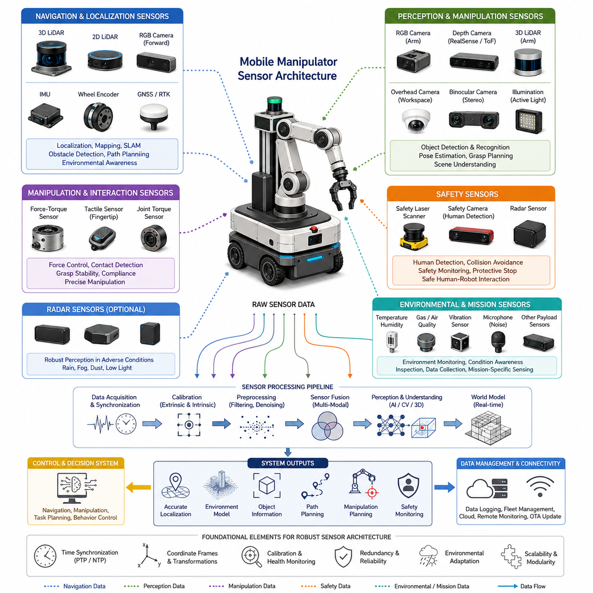{width="7.268055555555556in" height="7.268055555555556in"}

Sensor architecture is one of the most critical elements in a mobile manipulator system because it serves as the primary interface between the robot and the physical world. Every decision made by the robot, whether related to navigation, obstacle avoidance, object detection, grasp planning, manipulation, safety monitoring, or human interaction, ultimately depends on sensor data. Without a robust sensor architecture, even the most advanced artificial intelligence, planning algorithms, or robotic hardware cannot operate effectively. In many respects, sensors function as the eyes, ears, skin, and balance organs of a mobile manipulator, providing continuous awareness of both the robot itself and its surrounding environment.

The role of sensor architecture extends far beyond simply attaching cameras or LiDAR units to a robot. A complete sensor architecture defines how sensors are selected, positioned, calibrated, synchronized, processed, fused, monitored, and integrated into the overall system architecture. It determines how information flows from the physical world into the robot's perception and decision-making systems. A well-designed sensor architecture enables reliable operation under diverse environmental conditions, while a poorly designed architecture often becomes the primary cause of system failures in real-world deployments.

Mobile manipulators present unique sensing challenges because they combine two traditionally separate robotic domains: autonomous navigation and robotic manipulation. Autonomous navigation requires environmental perception over large areas, while manipulation requires precise perception of objects and interaction points at close range. As a result, sensor architectures for mobile manipulators must simultaneously support global awareness and local precision. The robot must understand where it is within a facility while also identifying the exact position and orientation of objects that need to be grasped, moved, inspected, or manipulated.

At the navigation level, the sensor architecture is responsible for localization, mapping, obstacle detection, path planning support, and environmental awareness. LiDAR sensors remain one of the most widely used technologies for autonomous navigation because they provide accurate distance measurements and robust performance across a wide range of lighting conditions. Two-dimensional LiDAR systems are commonly used for floor-level navigation and obstacle detection, while three-dimensional LiDAR systems provide richer environmental representations and support more advanced perception capabilities.

LiDAR sensors generate point clouds representing the geometry of the surrounding environment. These point clouds serve as the foundation for SLAM systems, localization algorithms, obstacle avoidance mechanisms, and dynamic path planning functions. High-resolution 3D LiDAR sensors are increasingly important in mobile manipulation because they enable detailed environmental reconstruction and support both navigation and manipulation tasks from a single sensing platform.

Cameras represent another essential component of sensor architecture. RGB cameras provide visual information that can be used for object recognition, semantic scene understanding, barcode reading, quality inspection, and human detection. Modern computer vision algorithms leverage RGB imagery to identify thousands of object categories and extract meaningful contextual information from complex environments.

Depth cameras add another dimension to visual perception by measuring the distance between the sensor and surrounding objects. Technologies such as structured light, stereo vision, and time-of-flight sensing allow depth cameras to generate three-dimensional representations of nearby scenes. In mobile manipulation applications, depth cameras are particularly valuable because they enable accurate object localization, pose estimation, grasp planning, and collision avoidance during manipulation operations.

Many advanced mobile manipulators employ multiple camera systems positioned throughout the robot. Forward-facing cameras support navigation and obstacle detection. Manipulator-mounted cameras provide close-range views for grasping and manipulation. Overhead cameras monitor workspace conditions, while safety cameras support human detection and collaborative operation. The placement of these sensors is a key architectural consideration because sensor coverage directly influences perception performance.

Inertial Measurement Units (IMUs) provide information about acceleration, angular velocity, and orientation. IMUs are essential for maintaining localization accuracy, especially when wheel slip, uneven terrain, or dynamic motion affects navigation performance. Sensor fusion between IMUs, wheel encoders, GNSS receivers, and LiDAR-based localization systems significantly improves overall navigation robustness.

Wheel encoders serve as one of the fundamental sensors in mobile robotic systems. By measuring wheel rotation, encoders provide odometry information that estimates robot movement over time. Although encoder-based odometry accumulates errors due to wheel slip and terrain variations, it remains an important component of localization architectures when combined with other sensor modalities.

Global Navigation Satellite Systems (GNSS), including GPS, GLONASS, Galileo, and BeiDou, play a significant role in outdoor mobile manipulation systems. Standard GNSS provides meter-level positioning accuracy, while RTK-enabled GNSS systems can achieve centimeter-level localization. For outdoor industrial applications such as logistics yards, ports, airports, mining sites, agricultural facilities, and utility inspection environments, GNSS becomes a critical component of the sensor architecture.

Manipulation tasks require an additional class of sensors focused on physical interaction. Force-torque sensors mounted at the wrist of a robotic arm measure interaction forces and moments during manipulation operations. These sensors allow robots to perform compliant motions, force-controlled assembly, contact detection, insertion tasks, and safe human-robot interaction. Without force sensing, many advanced manipulation tasks would be difficult or impossible to perform reliably.

Tactile sensors provide another layer of interaction awareness by detecting physical contact between the robot and objects. Inspired by the human sense of touch, tactile sensing enables robots to determine grasp stability, contact pressure distribution, slip conditions, and object characteristics. Future mobile manipulators are expected to incorporate increasingly sophisticated tactile sensing systems as dexterous manipulation becomes more important.

Safety-related sensing is an essential component of sensor architecture. Mobile manipulators frequently operate in environments shared with human workers, making safety perception a mandatory requirement. Safety laser scanners continuously monitor protected zones around the robot and trigger safety responses when hazards are detected. Safety-rated cameras, radar sensors, and human detection systems further enhance operational safety by identifying people and predicting potential collision risks.

Radar technology is receiving increased attention in robotic sensing architectures because it provides robust perception under adverse environmental conditions. Unlike cameras and LiDAR systems, radar performance is less affected by fog, rain, dust, smoke, or low-light environments. Radar sensors can therefore provide redundancy and improve perception reliability in challenging industrial and outdoor applications.

Environmental sensors contribute additional situational awareness by monitoring temperature, humidity, vibration, air quality, gas concentration, radiation levels, and other operational conditions. In industrial inspection robots, environmental sensing may represent a primary mission objective rather than merely supporting navigation. The sensor architecture must therefore accommodate both operational sensors and mission-specific sensing payloads.

One of the most important concepts in modern sensor architecture is sensor fusion. Individual sensors possess inherent limitations. Cameras may struggle in poor lighting conditions. LiDAR sensors may experience degradation in rain or reflective environments. GNSS signals may be unavailable indoors. IMUs accumulate drift over time. Sensor fusion addresses these limitations by combining multiple sensor streams into a unified environmental model.

Advanced sensor fusion algorithms leverage probabilistic estimation methods such as Kalman Filters, Extended Kalman Filters, Particle Filters, Factor Graph Optimization, and Bayesian inference techniques. These algorithms integrate measurements from diverse sensing modalities to improve localization accuracy, object detection reliability, and overall system robustness. Sensor fusion is increasingly becoming the foundation of intelligent robotic perception systems.

Sensor synchronization is another critical aspect of architecture design. Modern mobile manipulators may incorporate dozens of sensors operating at different update rates and communication interfaces. Accurate timestamping and synchronization are required to ensure that sensor measurements correspond to the same physical events. Technologies such as Precision Time Protocol (PTP), Network Time Protocol (NTP), hardware triggers, and synchronized clock architectures are commonly employed to maintain temporal consistency across sensor networks.

Calibration plays an equally important role. Every sensor possesses its own coordinate frame, measurement characteristics, and systematic errors. Extrinsic calibration defines the spatial relationship between sensors, while intrinsic calibration defines internal sensor parameters. Accurate calibration ensures that sensor measurements can be transformed into a common reference frame for perception, planning, and control algorithms.

As mobile manipulators become increasingly intelligent, sensor architectures are evolving toward perception-centric designs. Rather than treating sensors as isolated devices, modern architectures integrate sensing directly into AI-driven perception pipelines. Foundation models, Vision-Language Models, and multimodal AI systems are beginning to combine visual, spatial, tactile, and semantic information into unified world representations. These developments will allow future robots to understand their environments with a level of sophistication approaching human perception.

The future of sensor architecture will likely involve higher sensor density, improved multimodal fusion, edge AI processing, self-calibration capabilities, and adaptive sensing strategies. Emerging technologies such as event cameras, neuromorphic sensors, hyperspectral imaging systems, distributed sensor networks, and AI-enhanced perception modules will further expand robotic sensing capabilities. As mobile manipulators evolve toward greater autonomy and versatility, sensor architecture will remain one of the most important disciplines determining system performance, safety, intelligence, and operational success. Understanding sensor architecture is therefore fundamental for anyone seeking to design, deploy, or optimize next-generation mobile manipulation systems.

센서 아키텍처는 모바일 매니퓰레이터 시스템에서 가장 중요한 구성 요소 중 하나이다. 센서는 로봇과 물리적 세계를 연결하는 기본 인터페이스 역할을 수행하며, 로봇이 내리는 모든 판단과 행동의 출발점이 된다. 자율주행, 장애물 회피, 물체 인식, 파지 계획, 조작 작업, 안전 감시, 인간과의 상호작용 등 모든 기능은 결국 센서 데이터에 의존한다. 아무리 뛰어난 인공지능 알고리즘과 제어 기술을 보유하고 있더라도 적절한 센서 아키텍처가 없다면 로봇은 환경을 이해할 수 없으며 정상적으로 동작할 수 없다. 이러한 관점에서 센서는 인간의 눈, 귀, 피부, 평형감각 기관에 해당하는 역할을 수행한다고 볼 수 있다.

센서 아키텍처의 역할은 단순히 카메라나 LiDAR를 장착하는 수준을 넘어선다. 어떤 센서를 선택할 것인지, 어디에 배치할 것인지, 어떻게 보정할 것인지, 어떻게 동기화할 것인지, 그리고 어떻게 데이터를 융합하여 활용할 것인지를 체계적으로 정의하는 것이 센서 아키텍처의 핵심이다. 다시 말해 물리적 세계의 정보를 어떻게 수집하고 처리하여 로봇의 인지 및 의사결정 시스템으로 전달할 것인지를 설계하는 과정이라고 할 수 있다. 우수한 센서 아키텍처는 다양한 환경에서 안정적인 운영을 가능하게 하지만, 잘못 설계된 센서 구조는 실제 현장에서 발생하는 대부분의 문제와 성능 저하의 원인이 된다.

모바일 매니퓰레이터는 자율주행 로봇과 로봇 매니퓰레이터라는 두 가지 기술 영역을 결합한 시스템이기 때문에 센서 요구사항이 매우 복잡하다. 자율주행은 넓은 공간에 대한 환경 인식을 필요로 하는 반면, 조작 작업은 매우 근거리에서의 정밀한 물체 인식과 위치 추정을 요구한다. 따라서 모바일 매니퓰레이터의 센서 아키텍처는 넓은 범위의 환경 인지 능력과 높은 정밀도의 근거리 인지 능력을 동시에 제공해야 한다. 로봇은 자신이 건물 내 어디에 위치하는지를 이해해야 할 뿐 아니라, 집어야 하는 물체의 정확한 위치와 자세까지 파악할 수 있어야 한다.

자율주행 관점에서 센서 아키텍처는 위치추정(Localization), 지도 작성(Mapping), 장애물 탐지, 경로계획 지원, 환경 인지 기능을 담당한다. 이 분야에서 가장 널리 사용되는 센서 중 하나가 LiDAR이다. LiDAR는 조명 조건에 영향을 적게 받으면서 높은 정확도의 거리 측정을 제공하기 때문에 자율주행 로봇의 핵심 센서로 자리 잡았다. 2D LiDAR는 주로 평면 기반의 이동 경로 생성과 장애물 탐지에 활용되며, 3D LiDAR는 더욱 풍부한 환경 정보를 제공하여 고도화된 인지 기능을 지원한다.

LiDAR는 주변 환경을 점군(Point Cloud) 형태로 표현한다. 이러한 점군 데이터는 SLAM 시스템, 위치추정 알고리즘, 장애물 회피 기능, 동적 경로계획의 기초 데이터로 사용된다. 최근에는 고해상도 3D LiDAR가 모바일 매니퓰레이터에 점차 많이 적용되고 있으며, 하나의 센서로 자율주행과 조작 작업에 필요한 정보를 동시에 제공할 수 있는 중요한 플랫폼으로 활용되고 있다.

카메라는 또 다른 핵심 센서이다. RGB 카메라는 물체 인식, 장면 이해, 바코드 판독, 품질 검사, 사람 탐지 등 다양한 작업에 활용된다. 최신 컴퓨터 비전 기술은 RGB 영상을 활용하여 수천 종류의 물체를 인식하고 복잡한 환경에서 의미 있는 정보를 추출할 수 있다.

Depth Camera는 RGB 카메라에 깊이 정보를 추가하여 3차원 환경 인지를 가능하게 한다. 구조광(Structured Light), 스테레오 비전(Stereo Vision), ToF(Time-of-Flight) 기술 등을 활용하여 물체와 센서 사이의 거리를 측정한다. 모바일 매니퓰레이션 분야에서는 물체 위치 추정, 자세 추정, 파지 계획, 충돌 회피 등에 매우 중요한 역할을 수행한다.

최신 모바일 매니퓰레이터는 여러 대의 카메라를 다양한 위치에 배치하는 경우가 많다. 전방 카메라는 주행과 장애물 탐지를 지원하며, 로봇암에 장착된 카메라는 파지 작업을 위한 근거리 시야를 제공한다. 상부 카메라는 작업 공간 전체를 감시하고, 안전 카메라는 사람의 접근 여부를 모니터링한다. 따라서 센서의 설치 위치는 인지 성능을 결정하는 중요한 설계 요소가 된다.

IMU(Inertial Measurement Unit)는 가속도, 각속도, 자세 정보를 제공하는 센서이다. IMU는 특히 바퀴 미끄러짐이나 불규칙한 지형으로 인해 위치추정 오차가 발생하는 상황에서 매우 중요한 역할을 수행한다. IMU 데이터는 LiDAR, 엔코더, GNSS 정보와 융합되어 보다 안정적인 위치추정 결과를 제공한다.

휠 엔코더는 모바일 로봇에서 가장 기본적인 센서 중 하나이다. 바퀴의 회전량을 측정하여 로봇의 이동 거리를 계산하며, 이를 통해 오도메트리(Odometry)를 생성한다. 비록 장시간 운용 시 오차가 누적되는 단점이 있지만, 다른 센서와 함께 사용될 경우 위치추정의 중요한 기반 정보를 제공한다.

GNSS(Global Navigation Satellite System)는 실외 모바일 매니퓰레이터에서 중요한 역할을 수행한다. GPS, GLONASS, Galileo, BeiDou 등의 위성 항법 시스템을 활용하여 로봇의 위치를 측정한다. 일반 GNSS는 수 미터 수준의 정확도를 제공하지만, RTK 기술을 적용할 경우 수 센티미터 수준의 정밀 위치추정이 가능하다. 물류 야드, 항만, 공항, 농업, 광산, 플랜트와 같은 대규모 실외 환경에서는 GNSS가 핵심 센서로 활용된다.

조작 작업을 위해서는 물리적 상호작용을 감지하는 센서가 추가적으로 필요하다. 대표적인 예가 Force-Torque Sensor이다. 일반적으로 로봇 팔 끝단에 장착되며 힘과 토크를 측정한다. 이를 통해 힘 제어, 접촉 감지, 삽입 작업, 정밀 조립, 협업 작업 등을 수행할 수 있다. 이러한 센서가 없다면 고급 조작 작업의 상당 부분은 구현이 어려워진다.

촉각 센서(Tactile Sensor)는 인간의 피부와 유사한 역할을 수행한다. 물체와의 접촉 여부, 압력 분포, 미끄러짐 현상, 물체 특성 등을 감지할 수 있다. 향후 모바일 매니퓰레이터가 더욱 정교한 조작 능력을 갖추게 되면서 촉각 센서의 중요성은 지속적으로 증가할 것으로 예상된다.

안전 관련 센서는 센서 아키텍처에서 필수적인 구성 요소이다. 모바일 매니퓰레이터는 사람과 같은 공간에서 동작하기 때문에 위험 상황을 즉시 감지하고 대응할 수 있어야 한다. 안전용 레이저 스캐너는 보호 구역을 지속적으로 감시하며 위험 상황 발생 시 즉각적으로 정지 신호를 발생시킨다. 또한 안전 카메라, 레이더, 사람 탐지 시스템은 충돌 위험을 사전에 예측하고 예방하는 역할을 수행한다.

레이더 센서는 최근 로봇 센서 아키텍처에서 주목받고 있는 기술이다. 카메라와 LiDAR가 안개, 비, 먼지, 연기, 야간 환경에서 성능이 저하될 수 있는 반면, 레이더는 상대적으로 안정적인 성능을 유지할 수 있다. 따라서 실외 환경이나 산업 현장에서는 레이더가 중요한 보조 센서 또는 중복 안전 센서로 활용되고 있다.

환경 센서는 온도, 습도, 진동, 공기질, 가스 농도, 방사선 등 다양한 환경 정보를 측정한다. 특히 산업 점검 로봇의 경우 이러한 환경 데이터 자체가 주요 임무가 되는 경우도 많다. 따라서 센서 아키텍처는 단순 운용 센서뿐 아니라 임무 수행을 위한 특수 센서까지 포함하여 설계되어야 한다.

현대 센서 아키텍처에서 가장 중요한 개념 중 하나는 센서 융합(Sensor Fusion)이다. 개별 센서는 모두 한계를 가지고 있다. 카메라는 조명 변화에 민감하고, LiDAR는 강우나 반사 환경에서 성능이 저하될 수 있으며, GNSS는 실내에서 사용할 수 없고, IMU는 시간이 지날수록 오차가 누적된다. 센서 융합은 이러한 한계를 극복하기 위해 여러 센서의 정보를 결합하여 보다 정확하고 신뢰성 높은 환경 모델을 생성하는 기술이다.

센서 융합에는 Kalman Filter, Extended Kalman Filter, Particle Filter, Factor Graph Optimization, Bayesian Inference와 같은 다양한 알고리즘이 사용된다. 이러한 기법들은 여러 센서 데이터를 통합하여 위치추정 정확도를 향상시키고 객체 인식의 신뢰도를 높이며 시스템 전체의 강건성을 강화한다.

센서 동기화 또한 매우 중요한 설계 요소이다. 모바일 매니퓰레이터는 수십 개의 센서를 동시에 운용하는 경우가 많으며, 각 센서는 서로 다른 주기로 데이터를 생성한다. 정확한 시간 동기화가 이루어지지 않으면 센서 데이터 간 불일치가 발생하여 인지 성능이 크게 저하될 수 있다. 이를 위해 PTP(Precision Time Protocol), NTP(Network Time Protocol), 하드웨어 트리거 등의 기술이 활용된다.

센서 보정(Calibration) 역시 필수적인 과정이다. 각 센서는 고유한 좌표계와 오차 특성을 가지고 있다. 내재적 보정(Intrinsic Calibration)은 센서 내부 파라미터를 정의하고, 외재적 보정(Extrinsic Calibration)은 센서 간의 공간적 관계를 정의한다. 정확한 보정을 통해서만 다양한 센서 데이터를 하나의 통합 좌표계에서 활용할 수 있다.

최근 모바일 매니퓰레이터의 센서 아키텍처는 AI 중심 구조로 빠르게 발전하고 있다. 센서는 더 이상 독립적인 데이터 생성 장치가 아니라 AI 기반 인지 시스템의 일부로 통합되고 있다. Foundation Model, VLM(Vision-Language Model), 멀티모달 AI 기술은 영상, 공간 정보, 촉각 정보, 언어 정보를 하나의 통합된 세계 모델(World Model)로 결합하기 시작하고 있다. 이러한 발전은 로봇이 인간에 가까운 수준의 환경 이해 능력을 갖추는 기반이 될 것이다.

미래의 센서 아키텍처는 더욱 높은 센서 밀도, 고도화된 멀티모달 융합, Edge AI 기반 실시간 처리, 자가 보정(Self-Calibration), 적응형 센싱(Adaptive Sensing) 기술을 중심으로 발전할 것으로 예상된다. Event Camera, Neuromorphic Sensor, Hyperspectral Imaging, 분산 센서 네트워크, AI 기반 지능형 센서 모듈과 같은 새로운 기술들은 로봇 인지 능력을 한 단계 더 발전시킬 것이다.

궁극적으로 센서 아키텍처는 모바일 매니퓰레이터의 성능, 안전성, 지능성, 신뢰성을 결정하는 핵심 기술 분야이다. 로봇이 더욱 높은 수준의 자율성과 범용성을 확보할수록 센서 아키텍처의 중요성은 더욱 커질 것이며, 차세대 모바일 매니퓰레이터를 설계하고 구축하는 모든 엔지니어와 연구자에게 반드시 이해해야 할 핵심 분야가 될 것이다.

##  

## 05 Compute Architecture

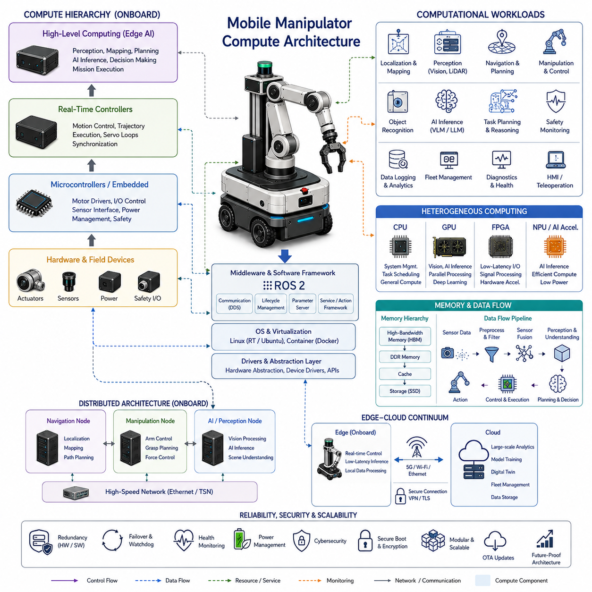{width="7.268055555555556in" height="7.268055555555556in"}

Compute architecture is the cognitive foundation of a mobile manipulator. While the mechanical architecture provides physical capabilities and the sensor architecture supplies environmental awareness, the compute architecture transforms raw sensor data into perception, reasoning, planning, control, and action. Every autonomous decision, navigation command, manipulation trajectory, safety response, and artificial intelligence function ultimately depends on the computing infrastructure embedded within the robotic system. As mobile manipulators become increasingly intelligent and autonomous, compute architecture has evolved from a simple embedded controller design into a highly distributed, heterogeneous computing ecosystem that combines real-time control systems, edge AI platforms, cloud resources, and high-performance accelerators.

The primary objective of compute architecture is to provide sufficient computational resources to execute all robotic workloads while maintaining deterministic behavior, low latency, reliability, scalability, and energy efficiency. Unlike traditional industrial robots that often perform repetitive and predictable tasks, mobile manipulators operate in dynamic and uncertain environments. They continuously process large volumes of sensory information, update environmental models, generate navigation plans, perform object recognition, execute manipulation tasks, and respond to unexpected situations in real time. This requires an architecture capable of supporting multiple simultaneous workloads with varying computational characteristics.

A modern mobile manipulator typically contains several layers of computing resources. At the lowest level are microcontrollers and embedded processors responsible for real-time hardware control. These devices manage motor drives, sensor interfaces, power systems, safety circuits, and communication buses. Their primary role is to ensure deterministic operation with cycle times measured in milliseconds or even microseconds. Because these controllers interact directly with physical hardware, reliability and timing predictability are more important than raw computational power.

Real-time controllers form the next layer of the compute hierarchy. These systems coordinate motion control, trajectory execution, servo loops, and synchronization between multiple actuators. In mobile manipulators, real-time controllers often manage both the mobile base and the robotic arm. They ensure that velocity commands, position references, and force-control signals are executed accurately and safely. Many industrial robotic systems rely on dedicated real-time operating systems to guarantee deterministic execution regardless of overall system load.

Above the real-time layer resides the edge computing platform, which serves as the central processing hub of the robot. Edge computers are responsible for perception, localization, mapping, planning, AI inference, mission execution, and high-level decision-making. These systems typically employ high-performance CPUs, GPUs, AI accelerators, and large memory resources. Industrial-grade edge computers have become increasingly popular because they provide the computational power necessary for modern AI-driven robotic applications while maintaining ruggedness suitable for field deployment.

The emergence of GPU computing has fundamentally transformed robotic compute architecture. Traditional CPUs excel at sequential processing and control logic, but many robotic perception workloads involve highly parallel computations. Tasks such as object detection, semantic segmentation, point cloud processing, visual SLAM, deep learning inference, and reinforcement learning benefit significantly from GPU acceleration. As a result, modern mobile manipulators frequently incorporate NVIDIA GPUs or similar accelerators as core components of their compute architecture.

Artificial intelligence workloads have become one of the primary drivers of compute requirements. Computer vision models, foundation models, Vision-Language Models, and robotic reasoning systems often require billions of parameters and substantial computational resources. Running these models directly on the robot requires carefully optimized architectures that balance performance, latency, memory usage, and power consumption. Edge AI computing has therefore become a major architectural discipline within modern robotics.

Many robotic systems now employ heterogeneous computing architectures in which different processors perform specialized functions. CPUs handle mission management, task scheduling, and software orchestration. GPUs accelerate perception and AI workloads. FPGAs provide low-latency signal processing and hardware acceleration. Microcontrollers manage real-time control tasks. This division of responsibilities allows each processing unit to operate within its area of strength while maximizing overall system efficiency.

One of the defining characteristics of mobile manipulator compute architecture is workload diversity. Navigation systems continuously execute localization algorithms, mapping functions, path planning modules, and obstacle avoidance processes. Simultaneously, manipulation systems calculate inverse kinematics, motion planning trajectories, collision checks, and force-control strategies. Vision systems process multiple camera streams, depth sensors, and LiDAR point clouds. Safety systems monitor protected zones and emergency conditions. AI systems perform object recognition, scene understanding, and decision-making. All of these functions must coexist within a unified computational framework.

Resource allocation becomes a critical design challenge in such environments. If navigation processing consumes excessive computational resources, manipulation performance may degrade. If AI inference monopolizes GPU capacity, perception latency may increase. Therefore, compute architecture must incorporate workload prioritization, resource scheduling, and quality-of-service mechanisms to ensure stable operation under varying system conditions.

Memory architecture is equally important. Mobile manipulators process massive quantities of data generated by cameras, LiDAR sensors, depth sensors, force sensors, and communication systems. Efficient memory management is required to support high-throughput data processing without introducing unacceptable latency. Shared memory architectures, high-bandwidth memory interfaces, direct memory access mechanisms, and optimized data pipelines play critical roles in maintaining system performance.

Data flow architecture determines how information moves between computational components. Raw sensor data must be collected, synchronized, filtered, processed, fused, analyzed, and distributed to downstream modules. Middleware platforms such as ROS2 provide standardized communication frameworks that facilitate data exchange between software components. Publish-subscribe architectures, service-oriented communication models, and distributed messaging systems are commonly employed to manage information flow within complex robotic systems.

Distributed computing architectures have become increasingly common in advanced mobile manipulators. Rather than relying on a single centralized computer, multiple computing nodes collaborate to execute different system functions. One computer may focus on navigation, another on manipulation, and a third on AI processing. Distributed architectures improve scalability, fault isolation, maintainability, and upgrade flexibility. They also allow computational resources to be physically located near the sensors and actuators they support, reducing communication latency.

Fault tolerance and redundancy are critical considerations in compute architecture design. Mobile manipulators frequently operate in mission-critical environments where system failures can result in operational disruptions, safety hazards, or financial losses. Redundant processors, backup controllers, watchdog mechanisms, health-monitoring systems, and failover strategies are therefore integrated into many high-reliability robotic platforms. The architecture must ensure graceful degradation rather than catastrophic failure when faults occur.

Power efficiency is another major design factor. Mobile manipulators operate on finite battery resources, making computational efficiency directly related to operational endurance. High-performance processors provide increased capability but also consume significant electrical power. Compute architects must carefully balance performance requirements against energy consumption constraints. Techniques such as dynamic power management, workload scheduling, hardware acceleration, and adaptive resource utilization help optimize energy efficiency.

The rise of cloud robotics has expanded compute architecture beyond the physical robot itself. Certain computational tasks can be offloaded to cloud infrastructure when low-latency execution is not required. Cloud systems may perform large-scale analytics, fleet optimization, digital twin simulation, long-term data storage, machine learning training, and predictive maintenance analysis. This creates a hybrid edge-cloud architecture in which computational responsibilities are distributed across local and remote resources.

Digital twins represent an increasingly important extension of compute architecture. A digital twin is a virtual representation of the physical robot and its operating environment. By continuously synchronizing operational data between the physical system and its digital counterpart, engineers can monitor performance, test software updates, predict failures, optimize operations, and simulate future scenarios. Compute architecture must therefore support the continuous exchange of information between real-world and virtual environments.

Artificial intelligence is driving a significant transformation in robotic compute architecture. Traditional robotic systems relied on deterministic algorithms and hand-engineered software pipelines. Modern systems increasingly incorporate neural networks, foundation models, reinforcement learning agents, and multimodal reasoning architectures. These technologies demand substantially greater computational resources while introducing new challenges related to model deployment, inference optimization, memory utilization, and hardware compatibility.

Foundation models and Vision-Language-Action architectures are expected to become major computational workloads in future mobile manipulators. These models integrate perception, language understanding, reasoning, planning, and action generation into unified frameworks. Running such systems efficiently will require next-generation compute architectures featuring specialized AI accelerators, advanced memory hierarchies, distributed inference pipelines, and optimized software stacks.

Cybersecurity has also become an important consideration within compute architecture. As robots become increasingly connected to enterprise networks, cloud services, and remote operations centers, computing systems become potential attack surfaces. Secure boot mechanisms, encrypted communications, hardware security modules, trusted execution environments, identity management frameworks, and cybersecurity monitoring systems are becoming integral components of robotic compute infrastructure.

Scalability remains one of the most important long-term design objectives. A compute architecture should not only support current workloads but also accommodate future software capabilities, additional sensors, new AI models, expanded manipulation functions, and evolving operational requirements. Modular architectures, standardized interfaces, containerized software deployment, and service-oriented designs help ensure that robotic systems can evolve without requiring complete hardware redesign.

The future of compute architecture will likely be shaped by increasingly powerful AI accelerators, edge-native foundation models, neuromorphic computing technologies, distributed robotic intelligence, and cloud-edge continuum architectures. Advances in semiconductor technology will enable higher computational performance within smaller power envelopes, while AI-specific processors will dramatically improve inference efficiency. Mobile manipulators of the future may possess computational capabilities that rival today\'s data center systems while operating entirely from onboard battery power.

Ultimately, compute architecture serves as the brain and nervous system of a mobile manipulator. It transforms raw data into intelligence, intelligence into decisions, and decisions into physical actions. Every aspect of robot performance, from navigation accuracy and manipulation precision to safety, autonomy, and adaptability, depends on the effectiveness of the underlying computational infrastructure. As robotic systems continue to evolve toward higher levels of autonomy and embodied intelligence, compute architecture will remain one of the most important disciplines in the design and deployment of next-generation mobile manipulation platforms.

컴퓨트 아키텍처(Compute Architecture)는 모바일 매니퓰레이터의 지능을 담당하는 핵심 기반 구조이다. 기계 아키텍처가 물리적 능력을 제공하고, 센서 아키텍처가 환경 정보를 수집한다면, 컴퓨트 아키텍처는 이러한 정보를 분석하고 이해하여 인지, 추론, 계획, 제어 및 행동으로 변환하는 역할을 수행한다. 자율주행 경로 생성, 물체 인식, 작업 계획, 로봇팔 제어, 안전 판단, 인공지능 추론과 같은 모든 기능은 결국 컴퓨팅 시스템 위에서 실행된다. 모바일 매니퓰레이터가 점점 더 높은 수준의 자율성과 지능을 요구받게 되면서 컴퓨트 아키텍처는 단순한 임베디드 제어기 수준을 넘어 실시간 제어 시스템, 엣지 AI 플랫폼, 클라우드 컴퓨팅, 고성능 가속기를 포함하는 복합적인 컴퓨팅 생태계로 발전하고 있다.

컴퓨트 아키텍처의 주요 목적은 다양한 로봇 작업을 안정적으로 수행할 수 있는 충분한 연산 자원을 제공하면서도 실시간성, 신뢰성, 확장성, 에너지 효율성을 동시에 확보하는 것이다. 기존 산업용 로봇은 반복적이고 예측 가능한 작업을 수행하는 경우가 많았지만, 모바일 매니퓰레이터는 끊임없이 변화하는 환경 속에서 방대한 센서 데이터를 처리하고, 환경을 이해하며, 경로를 계획하고, 물체를 인식하고, 조작 작업을 수행해야 한다. 또한 예기치 않은 상황에 즉시 대응해야 하므로 다양한 연산 부하를 동시에 처리할 수 있는 구조가 필요하다.

현대의 모바일 매니퓰레이터는 일반적으로 여러 계층의 컴퓨팅 시스템으로 구성된다. 가장 하위 계층에는 마이크로컨트롤러(MCU)와 임베디드 프로세서가 존재한다. 이들은 모터 제어, 센서 인터페이스, 전원 관리, 안전 회로, 통신 인터페이스와 같은 하드웨어 수준의 기능을 담당한다. 이러한 장치는 수 밀리초 또는 수 마이크로초 단위의 제어 주기를 유지해야 하므로 연산 성능보다 실시간성과 안정성이 더욱 중요하다.

그 위에는 실시간 제어기(Real-Time Controller)가 위치한다. 실시간 제어기는 모터 제어, 궤적 실행, 서보 제어, 액추에이터 동기화 등의 기능을 수행한다. 모바일 매니퓰레이터에서는 이동 플랫폼과 로봇암의 움직임을 동시에 제어해야 하므로 실시간 제어기의 역할이 매우 중요하다. 많은 산업용 로봇 시스템은 RTOS(Real-Time Operating System)를 사용하여 전체 시스템 부하와 관계없이 안정적인 실행 시간을 보장한다.

상위 계층에는 엣지 컴퓨팅 플랫폼이 위치한다. 엣지 컴퓨터는 로봇의 중앙 두뇌 역할을 수행하며 인지, 위치추정, 지도 생성, 경로 계획, AI 추론, 작업 실행 및 의사결정을 담당한다. 일반적으로 고성능 CPU, GPU, AI 가속기, 대용량 메모리를 포함한다. 최근에는 산업용 엣지 컴퓨터가 모바일 매니퓰레이터의 핵심 컴퓨팅 플랫폼으로 널리 사용되고 있으며, 현장 환경에서도 안정적으로 동작할 수 있도록 설계되고 있다.

GPU 컴퓨팅의 발전은 로봇 컴퓨트 아키텍처를 크게 변화시켰다. 전통적인 CPU는 순차적인 계산에 강점을 가지지만, 컴퓨터 비전과 AI 추론은 대규모 병렬 처리가 요구된다. 객체 인식, 의미론적 분할(Semantic Segmentation), 포인트 클라우드 처리, Visual SLAM, 딥러닝 추론과 같은 작업은 GPU에서 훨씬 높은 성능을 제공한다. 따라서 최신 모바일 매니퓰레이터는 NVIDIA GPU와 같은 고성능 가속기를 핵심 컴퓨팅 자원으로 활용하고 있다.

인공지능의 발전은 컴퓨팅 요구사항을 더욱 증가시키고 있다. 최신 컴퓨터 비전 모델, Foundation Model, VLM(Vision-Language Model), 로봇 에이전트 모델은 수십억 개의 파라미터를 포함하며 막대한 연산 능력을 요구한다. 이러한 모델을 로봇 내부에서 실시간으로 실행하기 위해서는 성능, 지연시간, 메모리 사용량, 전력 소비를 균형 있게 고려한 설계가 필요하다. 이 때문에 엣지 AI 컴퓨팅은 현대 로봇 아키텍처의 핵심 분야로 자리 잡고 있다.

최근의 모바일 매니퓰레이터는 이기종 컴퓨팅(Heterogeneous Computing) 구조를 사용하는 경우가 많다. CPU는 임무 관리와 시스템 제어를 담당하고, GPU는 AI 추론과 영상 처리 작업을 수행하며, FPGA는 초저지연 신호 처리와 하드웨어 가속 기능을 제공한다. MCU는 실시간 제어 작업을 수행한다. 이러한 역할 분담은 전체 시스템 효율을 극대화하는 데 매우 효과적이다.

모바일 매니퓰레이터의 가장 큰 특징 중 하나는 매우 다양한 작업 부하를 동시에 처리해야 한다는 점이다. 자율주행 시스템은 위치추정, 지도 생성, 경로계획, 장애물 회피를 지속적으로 수행한다. 조작 시스템은 역기구학, 경로 생성, 충돌 검사를 계산해야 한다. 비전 시스템은 여러 대의 카메라와 LiDAR 데이터를 실시간으로 처리한다. 안전 시스템은 위험 구역을 지속적으로 감시한다. 동시에 AI 시스템은 물체 인식, 환경 이해, 의사결정을 수행해야 한다. 이러한 기능들은 하나의 통합된 컴퓨팅 환경에서 동시에 실행되어야 한다.

따라서 자원 관리(Resource Allocation)는 매우 중요한 설계 요소가 된다. 특정 작업이 과도한 연산 자원을 사용하면 다른 기능의 성능이 저하될 수 있다. 예를 들어 AI 추론이 GPU를 독점하면 비전 처리 지연이 발생할 수 있고, 자율주행 알고리즘이 CPU 자원을 과도하게 사용하면 조작 제어 성능이 저하될 수 있다. 이를 해결하기 위해 우선순위 기반 스케줄링과 QoS(Quality of Service) 관리 기술이 활용된다.

메모리 아키텍처 역시 중요한 역할을 수행한다. 모바일 매니퓰레이터는 카메라 영상, LiDAR 포인트 클라우드, 깊이 데이터, 힘 센서 데이터 등 방대한 양의 정보를 처리한다. 효율적인 메모리 관리가 이루어지지 않으면 병목 현상이 발생하여 시스템 성능이 크게 저하될 수 있다. 따라서 고속 메모리 인터페이스, DMA(Direct Memory Access), 공유 메모리 구조 등이 적극 활용된다.

데이터 흐름 아키텍처는 정보가 시스템 내에서 어떻게 이동하는지를 정의한다. 센서 데이터는 수집, 동기화, 필터링, 융합, 분석 과정을 거쳐 최종적으로 제어 및 의사결정 시스템으로 전달된다. ROS2와 같은 미들웨어는 이러한 데이터 흐름을 관리하는 표준 플랫폼 역할을 수행하며, Publish-Subscribe 모델과 서비스 기반 통신 구조를 제공한다.

최근에는 분산 컴퓨팅 아키텍처가 널리 활용되고 있다. 하나의 중앙 컴퓨터에 모든 기능을 집중시키는 대신 여러 대의 컴퓨터가 협력하여 각자의 역할을 수행한다. 예를 들어 하나의 컴퓨터는 자율주행을 담당하고, 다른 컴퓨터는 로봇암 제어를 담당하며, 또 다른 컴퓨터는 AI 추론을 수행할 수 있다. 이러한 구조는 확장성과 장애 격리 능력을 향상시키며 유지보수도 용이하게 만든다.

신뢰성과 장애 허용(Fault Tolerance)은 산업용 모바일 매니퓰레이터에서 매우 중요한 요소이다. 로봇이 항만, 물류센터, 병원, 제조공장과 같은 핵심 환경에서 운용될 경우 시스템 장애는 안전 문제와 경제적 손실로 이어질 수 있다. 따라서 이중화 프로세서, 백업 제어기, Watchdog 시스템, Health Monitoring 기능, Failover 메커니즘 등이 아키텍처에 포함된다. 목표는 장애 발생 시 시스템이 완전히 중단되는 것이 아니라 제한된 기능으로라도 계속 운영될 수 있도록 하는 것이다.

전력 효율성 또한 중요한 설계 요소이다. 모바일 매니퓰레이터는 배터리를 기반으로 동작하므로 컴퓨팅 전력 소비는 곧 운용 시간과 직결된다. 고성능 GPU는 뛰어난 연산 능력을 제공하지만 많은 전력을 소비한다. 따라서 성능과 에너지 소비 사이의 균형을 맞추는 것이 중요하다. 이를 위해 동적 전력 관리, 하드웨어 가속, 작업 부하 최적화 기술이 활용된다.

클라우드 로보틱스의 발전은 컴퓨트 아키텍처를 로봇 외부로 확장시키고 있다. 실시간 처리가 필요하지 않은 작업은 클라우드 서버에서 수행할 수 있다. 대규모 데이터 분석, Fleet 최적화, 디지털 트윈 시뮬레이션, 장기 데이터 저장, AI 학습, 예지 정비 분석 등이 대표적인 예이다. 이에 따라 최근에는 Edge-Cloud Hybrid Architecture가 일반적인 구조로 자리 잡고 있다.

디지털 트윈은 컴퓨트 아키텍처의 중요한 확장 개념이다. 디지털 트윈은 실제 로봇과 운영 환경을 가상 공간에 동일하게 구현한 모델이다. 실제 시스템과 지속적으로 데이터를 동기화함으로써 성능 분석, 소프트웨어 검증, 장애 예측, 운영 최적화를 수행할 수 있다.

인공지능은 컴퓨트 아키텍처의 발전 방향을 근본적으로 변화시키고 있다. 과거의 로봇 시스템은 규칙 기반 알고리즘과 수작업으로 설계된 소프트웨어 구조에 의존했다. 그러나 현재는 신경망, 강화학습, Foundation Model, 멀티모달 AI 시스템이 중심이 되고 있다. 이러한 변화는 더욱 강력한 연산 능력과 새로운 형태의 하드웨어 가속기를 요구한다.

특히 Foundation Model과 VLA(Vision-Language-Action) 기반 로봇은 미래 모바일 매니퓰레이터의 핵심 워크로드가 될 가능성이 높다. 이러한 모델은 인식, 언어 이해, 추론, 계획, 행동 생성을 하나의 통합 프레임워크 안에서 수행한다. 이를 지원하기 위해서는 차세대 AI 가속기, 고속 메모리 구조, 분산 추론 시스템, 최적화된 소프트웨어 스택이 필요하다.

사이버 보안 역시 중요한 고려 요소로 부상하고 있다. 로봇이 기업 네트워크, 클라우드 시스템, 원격 관제센터와 연결되면서 컴퓨팅 시스템은 잠재적인 공격 대상이 되고 있다. 이를 위해 Secure Boot, 암호화 통신, HSM(Hardware Security Module), 신뢰 실행 환경(TEE), 인증 관리 시스템 등이 컴퓨트 아키텍처에 포함되고 있다.

확장성은 장기적인 관점에서 가장 중요한 설계 목표 중 하나이다. 오늘의 시스템 요구사항뿐 아니라 미래의 센서 추가, AI 모델 업그레이드, 새로운 기능 확장까지 고려해야 한다. 이를 위해 모듈형 설계, 표준 인터페이스, 컨테이너 기반 배포, 서비스 지향 아키텍처가 널리 활용되고 있다.

미래의 컴퓨트 아키텍처는 더욱 강력한 AI 가속기, 엣지 기반 Foundation Model, 뉴로모픽 컴퓨팅, 분산 지능 시스템, 클라우드-엣지 연속체 구조를 중심으로 발전할 것으로 예상된다. 반도체 기술의 발전은 더 적은 전력으로 더 높은 성능을 제공하게 될 것이며, 모바일 매니퓰레이터는 현재 데이터센터 수준의 연산 능력을 배터리 기반 플랫폼에서 수행할 수 있게 될 가능성이 높다.

결국 컴퓨트 아키텍처는 모바일 매니퓰레이터의 두뇌이자 신경계이다. 센서 데이터는 컴퓨트 아키텍처를 통해 지능으로 변환되고, 지능은 의사결정으로, 의사결정은 실제 행동으로 연결된다. 자율주행 정확도, 조작 성능, 안전성, 지능성, 적응성 등 로봇의 모든 핵심 역량은 컴퓨트 아키텍처의 수준에 의해 결정된다. 따라서 모바일 매니퓰레이터가 더욱 높은 수준의 자율성과 Physical AI를 구현하기 위해서는 강력하고 확장 가능한 컴퓨트 아키텍처가 필수적이며, 이는 차세대 로봇 시스템 설계의 핵심 분야로 지속적으로 발전하게 될 것이다.

##  

## 06 Control Architecture

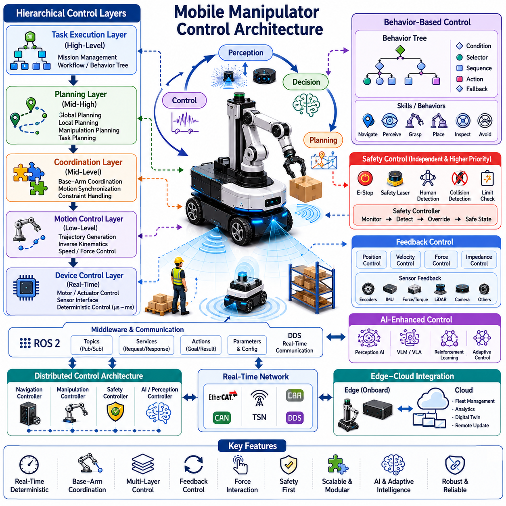{width="7.268055555555556in" height="7.268055555555556in"}

Control architecture is the operational backbone of a mobile manipulator. While the mechanical architecture provides physical capabilities, the sensor architecture delivers environmental awareness, and the compute architecture supplies computational intelligence, the control architecture is responsible for transforming perception, planning, and decision-making into coordinated physical actions. It acts as the central nervous system of the robot, connecting every subsystem and ensuring that all components work together as a unified autonomous machine. Without an effective control architecture, even the most advanced sensors, processors, and robotic hardware cannot achieve reliable autonomous operation.

A mobile manipulator presents a significantly greater control challenge than either a standalone Autonomous Mobile Robot (AMR) or a fixed industrial robot arm. The system must simultaneously manage autonomous navigation, environmental perception, robotic manipulation, safety monitoring, task execution, and human interaction. These activities occur at different timescales and require different levels of precision. The control architecture must therefore coordinate hundreds of software modules and hardware components while maintaining real-time responsiveness, operational stability, and system safety.

The primary purpose of control architecture is to establish a structured framework through which commands, feedback, decisions, and actions can flow throughout the robot. Rather than implementing a single centralized controller that directly manages every device, modern robotic systems typically employ hierarchical control architectures. Hierarchical designs divide responsibilities into multiple layers, allowing each layer to focus on a specific level of abstraction while communicating with adjacent layers.

At the lowest level of the hierarchy lies the device control layer. This layer directly interfaces with motors, actuators, sensors, power systems, and communication devices. Motor controllers regulate wheel velocities, joint positions, torque outputs, and servo loops. Sensor drivers acquire measurements from LiDARs, cameras, IMUs, force sensors, encoders, and safety devices. The primary objective of this layer is deterministic execution with extremely low latency. Control cycles typically operate in the range of microseconds to milliseconds to ensure stable motion control and hardware reliability.

Above the device control layer is the motion control layer. This layer transforms desired motion commands into executable trajectories. For the mobile base, motion controllers generate wheel velocities, steering angles, acceleration profiles, and path-following commands. For the robotic manipulator, motion controllers calculate joint trajectories, inverse kinematics solutions, and coordinated arm movements. Motion control algorithms continuously monitor feedback from sensors and actuators to minimize tracking errors and maintain smooth operation.

Mobile manipulators introduce a unique challenge because the mobile platform and robotic arm cannot be controlled independently. Their motions influence one another dynamically. When the mobile base moves, the manipulator\'s reference frame changes. When the manipulator extends or carries heavy loads, the overall center of gravity shifts, affecting vehicle stability. The control architecture must therefore coordinate mobility and manipulation simultaneously rather than treating them as separate systems.

The coordination layer serves as the bridge between mobility and manipulation. It synchronizes robot base movements with arm actions and ensures that both subsystems operate toward a common objective. For example, during a shelf-picking task, the mobile platform must position itself accurately relative to the shelf while the robotic arm executes a grasp trajectory. Small positioning errors from the mobile platform may significantly affect grasp success. The coordination layer continuously adjusts both systems to compensate for uncertainties and maximize task performance.

At a higher level, the task execution layer manages operational workflows. This layer translates mission objectives into executable sequences of actions. A task such as retrieving a package from a storage location may involve navigating to the destination, scanning shelves, identifying the correct object, positioning the manipulator, executing a grasp, transporting the object, and placing it at a target location. The task execution layer orchestrates these activities while monitoring progress and responding to unexpected events.

Behavior-based control architectures have become increasingly popular within modern mobile manipulation systems. Rather than relying on rigid sequential programming, behavior-based architectures represent robot actions as modular behaviors that can be activated dynamically according to environmental conditions. This approach improves flexibility, robustness, and adaptability. Behavior Trees have emerged as one of the most widely adopted frameworks because they provide a structured yet flexible method for organizing complex robotic tasks.

Behavior Trees allow robotic systems to evaluate conditions, select actions, execute behaviors, recover from failures, and adapt to changing situations. Unlike finite state machines, which often become difficult to maintain as complexity increases, Behavior Trees support modular design and scalable system development. Many industrial mobile manipulators now rely on Behavior Tree frameworks for mission execution and decision management.

Planning systems represent another critical component of control architecture. Planning occurs at multiple levels. Global planners determine long-range navigation routes through the environment. Local planners generate collision-free motion trajectories. Manipulation planners calculate arm movements and grasp strategies. Task planners determine the sequence of actions required to achieve operational objectives. Effective control architecture integrates all planning functions into a unified framework capable of responding to dynamic environmental conditions.

Feedback control forms the foundation of robotic motion execution. Every movement performed by a mobile manipulator depends on continuous feedback from sensors. Position controllers compare desired and actual positions. Velocity controllers regulate movement speed. Force controllers manage interaction forces during manipulation tasks. Impedance controllers adjust compliance behavior during physical contact. Feedback mechanisms enable robots to compensate for disturbances, uncertainties, and environmental variations.

Advanced mobile manipulators increasingly employ model-based control techniques. These approaches incorporate mathematical models of robot dynamics, kinematics, and environmental interactions to improve performance. Model Predictive Control (MPC), for example, predicts future system behavior and optimizes control actions over a finite time horizon. Such methods are particularly useful for coordinating complex motions involving both the mobile base and robotic arm.

Force control has become an essential capability for modern mobile manipulation. Traditional industrial robots often operate in highly structured environments where precise position control is sufficient. Mobile manipulators frequently interact with uncertain environments where contact forces cannot be predicted accurately. Force control enables robots to perform insertion tasks, assembly operations, surface interactions, collaborative manipulation, and compliant behaviors that would be difficult using position control alone.

Safety control architecture operates in parallel with operational control systems. Safety functions must remain independent from mission execution to ensure reliable hazard mitigation. Safety controllers continuously monitor emergency stop circuits, safety scanners, collision detection systems, human presence sensors, joint torque limits, speed limits, and operational boundaries. If hazardous conditions are detected, safety controllers can override normal operations and place the robot into a safe state.

Functional safety requirements have significantly influenced control architecture design. International standards require safety-critical functions to meet strict reliability and redundancy requirements. Consequently, many mobile manipulators incorporate dedicated safety processors, redundant communication channels, independent monitoring systems, and certified safety software. These mechanisms reduce the likelihood of dangerous failures and improve overall system dependability.

Artificial intelligence is increasingly influencing robotic control architectures. Traditional control systems relied primarily on deterministic algorithms and predefined rules. Modern robots incorporate machine learning models capable of improving perception, decision-making, planning, and manipulation performance. AI systems can recognize complex environmental patterns, adapt to changing conditions, and optimize operational strategies based on experience.

The emergence of Vision-Language Models and Vision-Language-Action systems is creating a new generation of AI-enhanced control architectures. These systems combine perception, language understanding, reasoning, and action generation within unified frameworks. Instead of manually programming every task sequence, operators may simply provide high-level instructions while the robot autonomously determines how to accomplish the objective. This transition represents a significant evolution from traditional automation toward intelligent robotic autonomy.

Distributed control architectures have become increasingly common as system complexity grows. Rather than relying on a single centralized controller, multiple specialized controllers cooperate across a network. Navigation controllers, manipulation controllers, perception controllers, safety controllers, and AI controllers each perform dedicated functions while exchanging information through middleware platforms such as ROS2. Distributed architectures improve scalability, modularity, maintainability, and fault isolation.

Communication within the control architecture must support real-time performance. High-speed industrial communication protocols such as EtherCAT, CAN, Ethernet, TSN, DDS, and ROS2 middleware enable efficient information exchange between distributed components. Deterministic communication is particularly important for synchronization between the mobile base and manipulator during coordinated tasks.

Cloud robotics is expanding the boundaries of control architecture beyond the robot itself. While low-latency control loops remain onboard, higher-level decision-making, fleet optimization, predictive maintenance, and large-scale planning can be supported by cloud infrastructure. Hybrid edge-cloud control architectures provide access to virtually unlimited computational resources while preserving local autonomy and operational safety.

Digital twin technologies further enhance control architectures by enabling continuous synchronization between physical robots and virtual models. Engineers can validate control algorithms, optimize task execution strategies, simulate failures, and test software updates within virtual environments before deployment. This reduces risk and accelerates system development.

Human-Robot Interaction (HRI) is becoming an increasingly important consideration in control architecture design. Future mobile manipulators will frequently operate alongside human workers in factories, warehouses, hospitals, offices, and public environments. Control systems must therefore support intuitive communication, predictable behavior, adaptive collaboration, and shared task execution. Human awareness will become a fundamental component of advanced robotic control systems.

Scalability remains a key design objective. A well-designed control architecture should support future upgrades, additional sensors, enhanced AI capabilities, new manipulators, and expanded operational requirements. Modular software architectures, service-oriented designs, containerized deployment strategies, and standardized interfaces help ensure long-term flexibility and maintainability.

The future of control architecture is likely to be shaped by embodied intelligence, AI-native robotics, multi-agent collaboration, cloud-edge integration, and autonomous reasoning systems. Robots will increasingly move beyond executing predefined instructions toward understanding objectives, reasoning about actions, adapting to environmental changes, and collaborating with humans and other robots. Control architectures will evolve from command-driven systems into intelligent decision-making frameworks capable of continuous learning and adaptation.

Ultimately, control architecture serves as the mechanism that transforms robotic potential into real-world performance. It connects sensing, computation, planning, intelligence, and physical action into a coherent operational framework. Every movement, decision, interaction, and task execution process depends upon the effectiveness of the underlying control architecture. As mobile manipulators continue to evolve toward higher levels of autonomy and embodied intelligence, control architecture will remain one of the most important disciplines in robotic system design, integration, and deployment. It is the invisible structure that enables robots not only to move and manipulate, but also to understand, decide, and act within the complexities of the real world.

제어 아키텍처(Control Architecture)는 모바일 매니퓰레이터의 실제 동작을 가능하게 만드는 운영의 핵심 구조이다. 기계 아키텍처가 물리적인 능력을 제공하고, 센서 아키텍처가 환경 정보를 수집하며, 컴퓨트 아키텍처가 데이터를 처리하고 지능을 제공한다면, 제어 아키텍처는 이러한 정보와 지능을 실제 행동으로 변환하는 역할을 수행한다. 즉, 인식(Perception), 계획(Planning), 의사결정(Decision Making)의 결과를 이동과 조작이라는 물리적 행동으로 연결하는 시스템이다. 사람의 신경계가 몸 전체를 조율하듯이, 제어 아키텍처는 로봇의 모든 하위 시스템을 연결하여 하나의 통합된 자율 시스템으로 동작하게 만든다.

모바일 매니퓰레이터는 단순한 AMR이나 고정형 산업용 로봇보다 훨씬 복잡한 제어 문제를 가진다. 로봇은 자율주행, 환경 인식, 로봇암 제어, 안전 감시, 작업 수행, 인간과의 상호작용을 동시에 처리해야 한다. 이들 기능은 서로 다른 시간 단위와 정밀도를 요구하며, 실시간으로 상호 영향을 미친다. 따라서 제어 아키텍처는 수백 개의 소프트웨어 모듈과 하드웨어 구성 요소를 조율하면서도 안정성과 안전성을 유지해야 한다.

제어 아키텍처의 가장 중요한 목적은 명령, 피드백, 판단, 행동이 시스템 전체에서 효율적으로 흐를 수 있는 구조를 제공하는 것이다. 현대의 로봇 시스템은 일반적으로 하나의 중앙 제어기가 모든 기능을 담당하지 않는다. 대신 계층형(Hierarchical) 구조를 사용하여 각 계층이 서로 다른 수준의 역할을 담당하도록 설계된다. 이러한 구조는 시스템 복잡성을 줄이고 유지보수성과 확장성을 향상시킨다.

가장 하위 계층에는 디바이스 제어 계층(Device Control Layer)이 존재한다. 이 계층은 모터, 액추에이터, 센서, 전원 장치, 통신 장치와 직접 연결된다. 모터 제어기는 바퀴 속도, 관절 위치, 토크 출력을 제어하고, 센서 드라이버는 LiDAR, 카메라, IMU, 엔코더, 힘 센서, 안전 센서의 데이터를 수집한다. 이 계층의 핵심 목표는 매우 짧은 지연 시간과 결정론적 실행을 보장하는 것이다. 일반적으로 마이크로초에서 밀리초 단위의 제어 주기로 동작하여 안정적인 모터 제어를 수행한다.

그 위에는 모션 제어 계층(Motion Control Layer)이 위치한다. 이 계층은 상위 시스템에서 생성된 이동 명령을 실제 실행 가능한 궤적으로 변환한다. 모바일 베이스의 경우 휠 속도, 조향각, 가속도 프로파일, 경로 추종 명령을 생성한다. 로봇암의 경우 역기구학(Inverse Kinematics), 관절 궤적 생성, 충돌 회피 동작 등을 수행한다. 모션 제어기는 센서와 액추에이터의 피드백을 지속적으로 수집하여 오차를 최소화하고 부드러운 움직임을 유지한다.

모바일 매니퓰레이터의 가장 큰 특징은 이동 플랫폼과 로봇암이 독립적으로 제어될 수 없다는 점이다. 두 시스템은 서로의 동작에 직접적인 영향을 준다. 이동 플랫폼이 움직이면 로봇암의 기준 좌표계도 함께 이동한다. 반대로 로봇암이 길게 뻗거나 무거운 물체를 들어 올리면 전체 시스템의 무게중심이 변화하여 주행 안정성에 영향을 준다. 따라서 제어 아키텍처는 이동과 조작을 별개의 기능이 아니라 하나의 통합된 시스템으로 제어해야 한다.

이러한 역할을 수행하는 것이 협조 제어 계층(Coordination Layer)이다. 이 계층은 이동 플랫폼과 로봇암의 움직임을 동기화하고 공통의 작업 목표를 달성하도록 조정한다. 예를 들어 선반에서 물체를 집는 작업을 수행할 경우, 이동 플랫폼은 정확한 위치까지 이동해야 하고 동시에 로봇암은 목표 물체를 향해 접근해야 한다. 플랫폼의 위치 오차가 발생하면 로봇암의 파지 성공률이 크게 낮아질 수 있다. 따라서 협조 제어 계층은 두 시스템을 동시에 보정하며 작업 성공률을 높인다.

상위 계층에는 작업 실행 계층(Task Execution Layer)이 존재한다. 이 계층은 임무 목표를 실제 행동 시퀀스로 변환한다. 예를 들어 창고에서 특정 물품을 가져오는 작업은 목표 위치로 이동하고, 선반을 스캔하고, 물체를 인식하고, 로봇암을 위치시키고, 물체를 집고, 목적지로 운반한 후 배치하는 여러 단계로 구성된다. 작업 실행 계층은 이러한 과정을 순서대로 관리하면서 예외 상황이 발생할 경우 적절히 대응한다.

최근 모바일 매니퓰레이터에서는 행동 기반 제어 아키텍처(Behavior-Based Architecture)가 널리 사용되고 있다. 기존의 순차적 프로그램 방식은 환경 변화에 유연하게 대응하기 어렵지만, 행동 기반 구조는 다양한 행동 모듈을 상황에 따라 동적으로 활성화할 수 있다. 이를 통해 시스템의 유연성과 강건성을 향상시킬 수 있다.

특히 Behavior Tree는 현대 로봇 시스템에서 가장 널리 사용되는 제어 프레임워크 중 하나이다. Behavior Tree는 조건 평가, 행동 선택, 실행, 실패 복구 과정을 트리 구조로 표현한다. 기존 상태 기계(Finite State Machine)가 복잡해질수록 유지보수가 어려워지는 문제를 해결하면서도 높은 확장성을 제공한다. 현재 많은 산업용 모바일 매니퓰레이터가 Behavior Tree 기반의 임무 실행 시스템을 사용하고 있다.

계획(Planning) 기능 역시 제어 아키텍처의 핵심 요소이다. 계획은 여러 계층에서 수행된다. 전역 계획(Global Planning)은 목적지까지의 전체 경로를 생성하고, 지역 계획(Local Planning)은 장애물을 회피하면서 실시간 이동 경로를 생성한다. 조작 계획(Manipulation Planning)은 로봇암의 움직임을 계산하며, 작업 계획(Task Planning)은 전체 작업 순서를 결정한다. 효과적인 제어 아키텍처는 이러한 다양한 계획 기능을 하나의 통합된 구조 안에서 운영해야 한다.

피드백 제어(Feedback Control)는 모든 로봇 움직임의 기본 원리이다. 위치 제어기는 목표 위치와 실제 위치를 비교하며, 속도 제어기는 이동 속도를 조정한다. 힘 제어기는 물체와의 접촉력을 관리하고, 임피던스 제어(Impedance Control)는 접촉 시의 유연성을 조정한다. 이러한 피드백 메커니즘은 외부 환경 변화나 예기치 않은 교란에도 안정적인 동작을 가능하게 한다.

최근에는 모델 기반 제어(Model-Based Control)가 점점 더 많이 활용되고 있다. 이러한 방식은 로봇의 동역학과 운동학 모델을 활용하여 보다 정밀한 제어를 수행한다. 대표적인 예가 MPC(Model Predictive Control)이다. MPC는 미래의 시스템 상태를 예측하고 최적의 제어 입력을 계산한다. 이동 플랫폼과 로봇암을 동시에 제어해야 하는 모바일 매니퓰레이터에서 특히 유용한 기술이다.

힘 제어(Force Control)는 현대 모바일 매니퓰레이터의 필수 기능으로 자리 잡고 있다. 기존 산업용 로봇은 위치 제어만으로 충분한 경우가 많았지만, 모바일 매니퓰레이터는 불확실한 환경과 상호작용해야 한다. 따라서 삽입 작업, 조립 작업, 표면 접촉 작업, 협업 작업 등을 수행하기 위해 힘 제어가 필요하다.

안전 제어 아키텍처(Safety Control Architecture)는 운영 제어 시스템과 독립적으로 동작해야 한다. 안전 시스템은 비상 정지 회로, 안전 스캐너, 충돌 감지 시스템, 사람 인식 센서, 관절 토크 제한, 속도 제한 등을 지속적으로 감시한다. 위험 상황이 발생하면 일반 제어 명령보다 우선하여 로봇을 안전 상태로 전환한다.

국제 기능 안전 규격은 안전 관련 기능에 높은 수준의 신뢰성과 이중화를 요구한다. 이에 따라 많은 모바일 매니퓰레이터는 전용 안전 프로세서, 이중 통신 채널, 독립적인 감시 시스템, 인증된 안전 소프트웨어를 포함하고 있다. 이러한 구조는 위험한 고장의 발생 가능성을 최소화한다.

인공지능은 제어 아키텍처의 발전 방향을 크게 변화시키고 있다. 과거에는 규칙 기반 알고리즘이 대부분의 판단을 수행했지만, 현재는 머신러닝과 딥러닝 기술이 인식, 계획, 조작 성능을 향상시키고 있다. AI는 복잡한 환경 패턴을 이해하고 변화하는 상황에 적응하며 최적의 행동 전략을 선택할 수 있다.

최근 등장한 VLM(Vision-Language Model)과 VLA(Vision-Language-Action) 시스템은 차세대 제어 아키텍처의 기반이 되고 있다. 이러한 시스템은 시각 정보, 언어 이해, 추론, 행동 생성을 하나의 통합 구조에서 수행한다. 사용자는 단순히 목표를 설명하기만 하면 되고, 로봇은 목표 달성을 위한 세부 행동을 스스로 계획하고 실행할 수 있다. 이는 기존 자동화 시스템에서 지능형 자율 시스템으로의 중요한 전환을 의미한다.

시스템 복잡성이 증가함에 따라 분산 제어 아키텍처(Distributed Control Architecture)가 널리 활용되고 있다. 하나의 중앙 제어기에 모든 기능을 집중시키는 대신 자율주행 제어기, 조작 제어기, 인지 제어기, 안전 제어기, AI 제어기가 네트워크를 통해 협력한다. ROS2와 DDS는 이러한 분산 구조를 구현하는 대표적인 플랫폼이다.

제어 아키텍처 내부의 통신은 실시간성을 보장해야 한다. EtherCAT, CAN, Ethernet, TSN, DDS와 같은 산업용 통신 기술은 제어기 간의 데이터 교환을 지원한다. 특히 이동 플랫폼과 로봇암이 협조 동작을 수행하는 경우 정확한 시간 동기화가 매우 중요하다.

클라우드 로보틱스는 제어 아키텍처의 범위를 로봇 외부까지 확장시키고 있다. 저지연 제어 루프는 로봇 내부에서 수행되지만, Fleet 최적화, 예지 정비, 대규모 경로 계획과 같은 기능은 클라우드에서 지원할 수 있다. 이를 통해 Edge-Cloud Hybrid Control Architecture가 새로운 표준 구조로 발전하고 있다.

디지털 트윈은 제어 아키텍처를 더욱 발전시키는 기술이다. 실제 로봇과 가상 모델을 실시간으로 연결하여 제어 알고리즘 검증, 작업 최적화, 장애 시뮬레이션, 소프트웨어 테스트를 수행할 수 있다. 이는 시스템 개발 속도를 높이고 운영 위험을 줄이는 데 큰 도움이 된다.

인간-로봇 상호작용(HRI)은 미래 제어 아키텍처에서 매우 중요한 요소가 될 것이다. 모바일 매니퓰레이터는 공장, 물류센터, 병원, 사무실, 공공시설에서 사람과 함께 작업하게 된다. 따라서 제어 시스템은 직관적인 의사소통, 예측 가능한 행동, 협업 작업, 인간 중심의 안전 기능을 지원해야 한다.

확장성 역시 중요한 설계 목표이다. 우수한 제어 아키텍처는 새로운 센서, 추가적인 로봇암, 새로운 AI 모델, 미래 기능 확장을 쉽게 수용할 수 있어야 한다. 이를 위해 모듈형 소프트웨어 구조, 서비스 지향 아키텍처, 컨테이너 기반 배포 기술이 적극 활용되고 있다.

미래의 제어 아키텍처는 Embodied AI, AI Native Robotics, 다중 로봇 협업, 클라우드-엣지 통합, 자율 추론 시스템을 중심으로 발전할 것으로 예상된다. 로봇은 단순히 명령을 수행하는 수준을 넘어 목표를 이해하고, 행동을 추론하며, 환경 변화에 적응하고, 인간 및 다른 로봇과 협력하는 지능형 시스템으로 진화할 것이다.

결국 제어 아키텍처는 로봇의 잠재력을 실제 성능으로 전환하는 핵심 메커니즘이다. 센싱, 컴퓨팅, 계획, 인공지능, 물리적 행동을 하나의 통합된 운영 체계로 연결하는 역할을 수행한다. 로봇의 모든 움직임과 판단, 상호작용, 작업 수행 능력은 제어 아키텍처의 품질에 의해 결정된다. 모바일 매니퓰레이터가 더욱 높은 수준의 자율성과 Physical AI를 실현할수록 제어 아키텍처는 로봇 시스템 설계에서 가장 중요한 핵심 분야 중 하나로 남게 될 것이다.

##  

## 07 AI Architecture

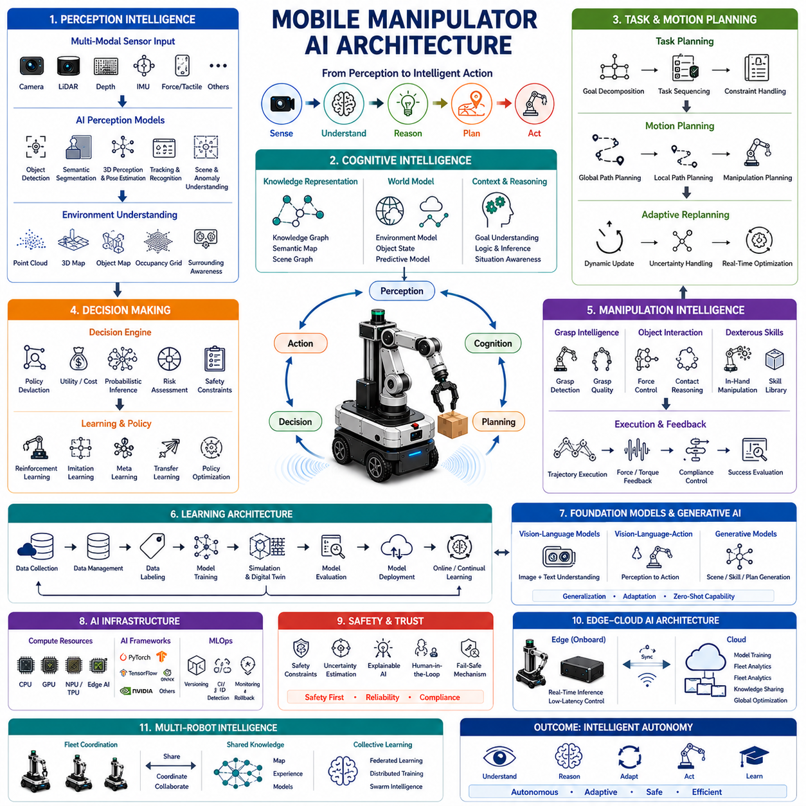{width="7.268055555555556in" height="7.268055555555556in"}

Artificial Intelligence Architecture is becoming the defining element of next-generation mobile manipulators. While mechanical architecture determines what a robot can physically do, sensor architecture determines what it can perceive, compute architecture determines how much information it can process, and control architecture determines how it executes actions, AI architecture determines how intelligently the robot can understand, reason, decide, learn, and adapt. In many ways, AI architecture represents the cognitive layer of the robotic system, transforming a machine that follows predefined instructions into an autonomous agent capable of operating in complex and dynamic environments.

Historically, industrial robots relied on deterministic programming and rule-based control systems. Every action was explicitly defined by engineers, and robots performed repetitive tasks within highly structured environments. While this approach delivered excellent reliability in predictable settings, it lacked flexibility. Any environmental change required reprogramming, and robots struggled to handle uncertainty, novel situations, or unstructured tasks. The emergence of modern AI technologies has fundamentally changed this paradigm by allowing robots to perceive their surroundings, interpret context, make decisions, and improve performance through experience.

AI architecture in a mobile manipulator encompasses a collection of interconnected software, models, algorithms, data pipelines, and computational frameworks that collectively enable intelligent behavior. It integrates perception, cognition, planning, learning, decision-making, and execution into a unified system. Rather than functioning as a single module, AI architecture spans multiple layers throughout the robotic platform and interacts closely with sensors, computing infrastructure, control systems, and cloud services.

At the foundation of AI architecture lies perception intelligence. The first requirement for intelligent behavior is the ability to understand the surrounding environment. Perception systems transform raw sensor data into meaningful information that can be used for decision-making. Cameras, LiDARs, depth sensors, force sensors, tactile sensors, and environmental sensors continuously generate data streams that must be interpreted by AI models.

Computer vision serves as one of the most important perception technologies. Deep learning models perform object detection, semantic segmentation, instance segmentation, object tracking, human recognition, activity recognition, scene understanding, and anomaly detection. Modern perception systems can identify thousands of object categories while simultaneously understanding relationships between objects, people, and environmental structures.

Three-dimensional perception plays a particularly important role in mobile manipulation. Unlike traditional image recognition systems, robots must understand the geometry of their surroundings. AI-based perception models process point clouds, depth maps, and multimodal sensor data to estimate object poses, identify grasp points, reconstruct environments, and predict spatial relationships. This capability enables robots to interact physically with the world rather than simply observing it.

Beyond perception lies cognitive intelligence. Cognitive systems transform environmental information into actionable understanding. This layer is responsible for reasoning, interpretation, context awareness, goal understanding, and decision support. Cognitive AI enables robots to answer questions such as: What object am I looking at? What is the user requesting? What task should be performed next? What obstacles or risks might interfere with success?

Knowledge representation forms a central component of cognitive architecture. Robots must maintain internal representations of objects, locations, tasks, environmental states, operational rules, and mission objectives. Knowledge graphs, semantic maps, world models, and scene representations provide structured frameworks for organizing information. These representations allow robots to reason about their environment and make decisions beyond simple reactive behaviors.

World models are becoming increasingly important in advanced AI architectures. A world model is an internal simulation of the robot\'s environment that predicts how the world will evolve over time. Rather than reacting solely to current sensor inputs, robots can anticipate future events, evaluate alternative actions, and optimize decision-making. World models are considered one of the key technologies required for achieving higher levels of robotic autonomy.

Task planning intelligence represents another major layer within AI architecture. Once a robot understands its environment and objectives, it must determine how to achieve its goals. Task planners decompose high-level objectives into executable actions. For example, a command such as "retrieve the red package from shelf three and deliver it to station five" may require navigation, object recognition, manipulation, transportation, obstacle avoidance, and placement actions. AI planning systems automatically generate and coordinate these sub-tasks.

Classical planning algorithms remain important, but AI-enhanced planning systems increasingly incorporate machine learning, probabilistic reasoning, and optimization techniques. These approaches allow robots to adapt plans dynamically as environmental conditions change. Flexible planning is essential for real-world mobile manipulators because uncertainty is unavoidable in operational environments.

Decision-making architecture governs how robots select actions among multiple alternatives. Decision-making systems evaluate goals, environmental constraints, safety requirements, operational priorities, and predicted outcomes before choosing a course of action. Techniques such as decision trees, Bayesian reasoning, reinforcement learning policies, utility optimization, and probabilistic inference are commonly employed.

Reinforcement Learning has emerged as a powerful method for developing autonomous decision-making capabilities. Rather than relying exclusively on manually programmed rules, reinforcement learning allows robots to learn optimal behaviors through trial and error interactions with their environment. Simulation platforms have significantly accelerated the development of reinforcement learning systems by enabling millions of training iterations without physical hardware risks.

Manipulation intelligence is one of the most challenging aspects of AI architecture. Mobile manipulators must not only identify objects but also determine how to interact with them physically. Grasp detection, grasp quality estimation, motion planning, force control, contact reasoning, and dexterous manipulation all require sophisticated AI models. Unlike fixed industrial automation, mobile manipulators frequently encounter previously unseen objects, requiring robust generalization capabilities.

The emergence of foundation models has introduced a transformative shift in robotic AI architecture. Foundation models are large-scale neural networks trained on massive datasets that capture general knowledge about language, images, actions, and the physical world. Instead of developing task-specific models for every application, robots can leverage foundation models as universal intelligence engines capable of adapting to diverse tasks and environments.

Vision-Language Models represent one of the most important developments in modern robotics. These models integrate visual perception and natural language understanding within a unified architecture. A mobile manipulator equipped with a VLM can interpret user instructions, understand visual scenes, identify relevant objects, and generate context-aware responses. This dramatically simplifies human-robot interaction and expands operational flexibility.

Vision-Language-Action architectures extend this concept further by directly connecting perception, reasoning, and action generation. Rather than separating perception systems, planning modules, and control systems into distinct components, VLA architectures learn end-to-end mappings from observations and instructions to robotic actions. This approach more closely resembles how humans interact with their environment and is expected to become a cornerstone of future robotic systems.

Embodied AI represents the next stage in AI architecture evolution. Traditional AI systems operate primarily in digital environments. Embodied AI systems learn through interaction with the physical world. Mobile manipulators provide an ideal platform for embodied intelligence because they combine mobility, perception, manipulation, and environmental interaction. Through continuous experience, robots can acquire practical knowledge that cannot be learned solely from static datasets.

Learning architecture plays a critical role in maintaining long-term performance. AI systems must continuously adapt to changing environments, new objects, evolving workflows, and updated operational requirements. Lifelong learning, online learning, transfer learning, federated learning, and self-supervised learning are increasingly important components of modern AI architectures. These approaches allow robots to improve over time while minimizing the need for extensive manual retraining.

Data architecture serves as the foundation supporting AI capabilities. Every AI system depends on high-quality data. Sensor streams, operational logs, task records, video archives, simulation outputs, and fleet data contribute to the training and improvement of AI models. Data pipelines must support collection, storage, labeling, validation, processing, and deployment workflows. Without a robust data architecture, AI performance cannot scale effectively.

Simulation and digital twins have become indispensable components of AI development. Training AI systems entirely in physical environments is expensive, time-consuming, and potentially unsafe. High-fidelity simulation environments allow robots to learn navigation, manipulation, perception, and decision-making skills before deployment. Digital twins provide continuous synchronization between virtual and physical systems, enabling rapid testing and optimization of AI algorithms.

MLOps architecture extends AI systems beyond model development into operational deployment. Model versioning, automated testing, continuous integration, deployment pipelines, performance monitoring, drift detection, and rollback mechanisms are all essential for maintaining reliable AI operations. As mobile manipulators increasingly depend on AI, MLOps becomes as important as traditional software engineering practices.

Safety and trustworthiness are critical requirements for AI architecture. AI systems operating in physical environments must make decisions that prioritize human safety and operational reliability. Explainable AI, uncertainty estimation, safety constraints, rule-based overrides, human supervision mechanisms, and fail-safe architectures are increasingly integrated into robotic AI systems. Intelligent behavior must never compromise safety.

Cloud AI and edge AI architectures are often combined to balance computational efficiency and operational responsiveness. Edge AI enables real-time perception, planning, and control directly on the robot. Cloud AI supports large-scale training, fleet-wide optimization, data analytics, knowledge sharing, and long-term learning. Hybrid architectures provide the best balance between autonomy and computational scalability.

Multi-robot intelligence is another emerging domain. Future mobile manipulators will rarely operate in isolation. Instead, fleets of robots will collaborate, share information, coordinate tasks, and collectively optimize operations. Distributed AI architectures enable robots to exchange environmental knowledge, coordinate planning decisions, and learn from one another\'s experiences.

The future of AI architecture is increasingly aligned with the concept of Physical AI. Physical AI extends beyond perception and language understanding to include physical reasoning, environmental interaction, manipulation intelligence, and embodied learning. Robots will move from executing predefined workflows toward understanding objectives, reasoning about physical consequences, predicting outcomes, and autonomously generating solutions.

Over the next decade, AI architecture is expected to evolve from modular perception-and-control systems into unified cognitive architectures integrating perception, memory, reasoning, planning, learning, and action. Foundation models, world models, embodied intelligence, multimodal reasoning systems, and autonomous agents will become central elements of robotic intelligence. Mobile manipulators will increasingly function as autonomous cognitive systems capable of operating across diverse environments with minimal human supervision.

Ultimately, AI architecture serves as the intelligence layer that transforms a mobile manipulator from an automated machine into an adaptive, reasoning, and learning robotic agent. It connects sensing, cognition, planning, decision-making, and action within a unified framework capable of understanding and interacting with the real world. As robotics advances toward general-purpose autonomy and embodied intelligence, AI architecture will become the most important factor determining a robot\'s capability, flexibility, and long-term value.

인공지능 아키텍처(AI Architecture)는 차세대 모바일 매니퓰레이터를 정의하는 가장 중요한 기술 요소로 자리 잡고 있다. 기계 아키텍처가 로봇의 물리적 능력을 결정하고, 센서 아키텍처가 환경을 인식하며, 컴퓨트 아키텍처가 데이터를 처리하고, 제어 아키텍처가 행동을 실행한다면, AI 아키텍처는 로봇이 얼마나 지능적으로 이해하고, 추론하고, 판단하고, 학습하며, 적응할 수 있는지를 결정한다. 즉 AI 아키텍처는 모바일 매니퓰레이터의 인지 계층(Cognitive Layer)으로서 단순히 명령을 수행하는 기계를 자율적으로 사고하고 행동하는 지능형 에이전트로 변화시키는 핵심 기술이다.

과거의 산업용 로봇은 대부분 규칙 기반 제어와 결정론적 프로그래밍에 의존하였다. 모든 작업은 엔지니어가 사전에 정의해야 했으며, 로봇은 정형화된 환경에서 반복적인 작업을 수행하는 데 최적화되어 있었다. 이러한 방식은 예측 가능한 환경에서는 높은 신뢰성을 제공했지만 환경 변화에 대한 적응성이 매우 낮았다. 작업 조건이 조금만 변경되어도 재프로그래밍이 필요했고, 새로운 상황이나 비정형 환경에서는 효과적으로 대응하기 어려웠다. 현대 인공지능 기술의 발전은 이러한 한계를 극복하면서 로봇이 스스로 환경을 이해하고 상황을 해석하며 의사결정을 수행할 수 있는 기반을 제공하고 있다.

모바일 매니퓰레이터의 AI 아키텍처는 단순한 하나의 소프트웨어 모듈이 아니라 다양한 알고리즘, AI 모델, 데이터 파이프라인, 추론 엔진, 학습 시스템이 상호 연결된 통합 구조이다. AI 아키텍처는 인지(Perception), 이해(Cognition), 계획(Planning), 학습(Learning), 의사결정(Decision Making), 실행(Execution)을 하나의 체계 안에서 연결한다. 또한 센서 시스템, 컴퓨트 플랫폼, 제어 시스템, 클라우드 인프라와 긴밀하게 연동되어 동작한다.

AI 아키텍처의 가장 기초가 되는 영역은 인지 지능(Perception Intelligence)이다. 로봇이 지능적으로 행동하기 위해서는 먼저 주변 환경을 이해할 수 있어야 한다. 센서가 수집한 원시 데이터는 AI 모델에 의해 의미 있는 정보로 변환된다. 카메라, LiDAR, Depth Sensor, Force Sensor, Tactile Sensor, 환경 센서 등에서 생성된 데이터는 지속적으로 분석되고 해석된다.

컴퓨터 비전은 인지 지능의 핵심 기술이다. 딥러닝 기반 비전 모델은 객체 탐지(Object Detection), 의미론적 분할(Semantic Segmentation), 인스턴스 분할(Instance Segmentation), 객체 추적(Object Tracking), 사람 인식(Human Recognition), 행동 인식(Activity Recognition), 장면 이해(Scene Understanding), 이상 탐지(Anomaly Detection) 등을 수행한다. 최신 AI 모델은 수천 개 이상의 객체를 인식할 수 있으며, 객체 간의 관계와 환경의 의미까지 이해할 수 있다.

모바일 매니퓰레이터에서는 3차원 인지가 특히 중요하다. 일반적인 이미지 인식과 달리 로봇은 물체의 실제 위치와 형태를 이해해야 한다. AI 기반 3D 인지 시스템은 포인트 클라우드, 깊이 영상, 멀티모달 센서 데이터를 활용하여 물체 자세 추정(Pose Estimation), 파지 위치 탐색(Grasp Detection), 환경 재구성(Environment Reconstruction), 공간 관계 분석 등을 수행한다. 이를 통해 로봇은 단순히 환경을 보는 수준을 넘어 실제로 물체와 상호작용할 수 있게 된다.

인지를 넘어선 단계는 인지 지능(Cognitive Intelligence)이다. 이 계층은 단순한 객체 인식을 넘어 상황을 해석하고 의미를 이해한다. 로봇은 "내가 보고 있는 것은 무엇인가?", "사용자가 무엇을 원하는가?", "다음에 어떤 행동을 해야 하는가?", "어떤 위험 요소가 존재하는가?"와 같은 질문에 답할 수 있어야 한다. 이러한 능력은 AI 아키텍처의 핵심 목표 중 하나이다.

지식 표현(Knowledge Representation)은 인지 아키텍처의 중요한 구성 요소이다. 로봇은 물체, 위치, 작업, 환경 상태, 운영 규칙, 임무 목표 등을 내부적으로 표현하고 저장해야 한다. 이를 위해 Knowledge Graph, Semantic Map, Scene Graph, World Model과 같은 기술이 활용된다. 이러한 구조는 로봇이 단순 반응형 행동을 넘어 논리적 추론을 수행할 수 있도록 지원한다.

최근 AI 아키텍처에서 가장 중요한 개념 중 하나는 월드 모델(World Model)이다. 월드 모델은 로봇이 내부적으로 유지하는 환경의 디지털 표현이다. 로봇은 현재 상태뿐 아니라 미래 상태를 예측할 수 있으며, 다양한 행동의 결과를 시뮬레이션하여 최적의 의사결정을 수행할 수 있다. 월드 모델은 고수준 자율성을 실현하기 위한 핵심 기술로 평가받고 있다.

작업 계획 지능(Task Planning Intelligence)은 AI 아키텍처의 또 다른 핵심 계층이다. 로봇이 환경과 목표를 이해한 후에는 이를 달성하기 위한 행동 계획을 수립해야 한다. 예를 들어 "3번 선반에 있는 빨간 상자를 가져와서 5번 작업장으로 운반하라"는 명령은 이동, 물체 인식, 파지, 운반, 배치와 같은 여러 하위 작업으로 분해된다. AI 기반 계획 시스템은 이러한 작업들을 자동으로 생성하고 조정한다.

기존의 규칙 기반 계획 알고리즘도 여전히 사용되지만, 최근에는 머신러닝과 확률적 추론을 활용한 AI 기반 계획 시스템이 널리 연구되고 있다. 이러한 접근 방식은 환경 변화에 따라 계획을 실시간으로 수정할 수 있기 때문에 실제 현장에서 더욱 높은 유연성을 제공한다.

의사결정 아키텍처(Decision-Making Architecture)는 여러 가능한 행동 중 최적의 행동을 선택하는 역할을 수행한다. 로봇은 목표, 환경 제약, 안전 요구사항, 작업 우선순위, 예상 결과를 종합적으로 고려하여 행동을 선택해야 한다. 이를 위해 Decision Tree, Bayesian Reasoning, Reinforcement Learning, Utility Optimization, Probabilistic Inference 등의 기법이 활용된다.

강화학습(Reinforcement Learning)은 자율 의사결정 능력을 개발하는 데 중요한 기술로 자리 잡고 있다. 강화학습은 로봇이 시행착오를 통해 최적의 행동 정책을 학습하도록 한다. 최근 시뮬레이션 환경의 발전으로 수백만 번의 학습이 가능해지면서 강화학습 기반 모바일 매니퓰레이터 연구가 급속히 발전하고 있다.

조작 지능(Manipulation Intelligence)은 AI 아키텍처에서 가장 어려운 분야 중 하나이다. 로봇은 물체를 인식하는 것뿐 아니라 어떻게 잡고 조작할 것인지도 결정해야 한다. 파지 검출, 파지 품질 평가, 동작 계획, 힘 제어, 접촉 추론, 정교한 조작 기술은 모두 AI 기반 알고리즘의 지원을 필요로 한다. 특히 모바일 매니퓰레이터는 처음 보는 물체를 다루는 경우가 많기 때문에 높은 일반화 능력이 요구된다.

파운데이션 모델(Foundation Model)의 등장으로 AI 아키텍처는 새로운 전환점을 맞이하고 있다. 파운데이션 모델은 대규모 데이터셋을 학습한 범용 신경망으로 언어, 이미지, 행동, 물리 세계에 대한 일반적인 지식을 내재화하고 있다. 과거처럼 작업마다 별도의 AI 모델을 개발하는 대신, 하나의 범용 모델이 다양한 작업을 수행할 수 있게 되었다.

VLM(Vision-Language Model)은 현대 로보틱스에서 가장 중요한 기술 중 하나이다. VLM은 시각 정보와 자연어를 동시에 이해할 수 있다. 모바일 매니퓰레이터는 사용자의 언어 명령을 이해하고, 주변 환경을 인식하며, 필요한 물체를 식별하고, 상황에 적합한 행동을 생성할 수 있다. 이는 인간-로봇 상호작용을 획기적으로 단순화한다.

VLA(Vision-Language-Action) 아키텍처는 이를 한 단계 더 발전시킨 개념이다. VLA는 인식, 언어 이해, 추론, 행동 생성을 하나의 통합 모델 안에서 수행한다. 기존에는 인지 시스템, 계획 시스템, 제어 시스템이 분리되어 있었지만, VLA는 관측 정보와 명령으로부터 직접 행동을 생성할 수 있다. 이러한 구조는 인간의 행동 방식과 유사하며 미래 로봇의 핵심 기술로 주목받고 있다.

Embodied AI는 AI 아키텍처 발전의 다음 단계로 평가받는다. 기존 AI는 주로 디지털 환경에서 학습했지만, Embodied AI는 실제 물리 세계와의 상호작용을 통해 학습한다. 모바일 매니퓰레이터는 이동, 인식, 조작, 환경 상호작용 능력을 모두 갖추고 있기 때문에 Embodied AI를 구현하기에 이상적인 플랫폼이다. 로봇은 경험을 통해 새로운 지식을 습득하고 점차 더 높은 수준의 지능을 획득하게 된다.

학습 아키텍처(Learning Architecture)는 장기적인 성능 향상을 위해 필수적이다. 로봇은 새로운 물체, 변화된 환경, 수정된 작업 절차에 지속적으로 적응해야 한다. 이를 위해 Lifelong Learning, Online Learning, Transfer Learning, Federated Learning, Self-Supervised Learning 등의 기술이 활용된다. 이러한 접근 방식은 로봇이 시간이 지남에 따라 지속적으로 발전할 수 있도록 한다.

데이터 아키텍처(Data Architecture)는 AI 시스템의 기반이다. 모든 AI는 데이터에 의해 성장한다. 센서 데이터, 작업 로그, 비디오 데이터, 시뮬레이션 결과, Fleet 데이터 등은 AI 모델 학습과 성능 향상에 사용된다. 데이터 수집, 저장, 라벨링, 검증, 처리, 배포를 위한 체계적인 데이터 파이프라인이 필요하다.

시뮬레이션과 디지털 트윈은 AI 개발에서 필수적인 역할을 수행한다. 실제 환경에서만 AI를 학습시키는 것은 비용이 많이 들고 위험할 수 있다. 고충실도 시뮬레이션 환경은 로봇이 자율주행, 조작, 인지, 의사결정 능력을 학습할 수 있도록 지원한다. 디지털 트윈은 실제 로봇과 가상 모델을 동기화하여 AI 알고리즘을 지속적으로 개선할 수 있게 한다.

MLOps 아키텍처는 AI 모델의 운영을 지원하는 핵심 체계이다. 모델 버전 관리, 자동 테스트, 지속적 통합(CI), 자동 배포(CD), 성능 모니터링, 데이터 드리프트 탐지, 롤백 기능 등이 포함된다. AI가 로봇 시스템의 핵심이 될수록 MLOps의 중요성도 더욱 커지고 있다.

안전성과 신뢰성은 AI 아키텍처에서 반드시 고려되어야 한다. 물리 세계에서 동작하는 AI는 항상 사람의 안전을 최우선으로 고려해야 한다. Explainable AI, 불확실성 추정, 안전 제약 조건, 규칙 기반 오버라이드, 인간 감독 체계, Fail-Safe 구조 등이 AI 시스템에 통합되고 있다.

클라우드 AI와 엣지 AI는 상호 보완적으로 활용된다. 엣지 AI는 실시간 인지와 제어를 수행하며, 클라우드 AI는 대규모 학습, Fleet 최적화, 데이터 분석, 지식 공유를 담당한다. 이러한 하이브리드 구조는 자율성과 확장성을 동시에 제공한다.

향후 모바일 매니퓰레이터는 단독으로 동작하는 것이 아니라 다수의 로봇이 협력하는 형태로 발전할 가능성이 높다. 분산 AI 아키텍처는 여러 로봇이 환경 정보를 공유하고 공동으로 작업을 수행하며 집단 지능을 형성할 수 있도록 지원한다.

미래의 AI 아키텍처는 Physical AI라는 개념으로 수렴하고 있다. Physical AI는 단순한 인식과 언어 이해를 넘어 물리적 세계에 대한 추론과 상호작용 능력을 포함한다. 로봇은 목표를 이해하고, 물리적 결과를 예측하며, 스스로 해결책을 생성할 수 있게 될 것이다.

향후 10년 동안 AI 아키텍처는 인지, 기억, 추론, 계획, 학습, 행동을 모두 통합하는 범용 인지 아키텍처(General Cognitive Architecture)로 발전할 것으로 예상된다. Foundation Model, World Model, Embodied AI, 멀티모달 추론 시스템, 자율 에이전트 기술이 이러한 발전을 이끌게 될 것이다.

결국 AI 아키텍처는 모바일 매니퓰레이터를 단순 자동화 장비에서 적응형 지능 에이전트로 변화시키는 핵심 계층이다. AI 아키텍처는 센싱, 인지, 계획, 의사결정, 행동을 하나의 통합된 프레임워크 안에서 연결하며, 로봇이 실제 세계를 이해하고 상호작용할 수 있도록 만든다. 앞으로 로보틱스가 범용 자율성과 Embodied Intelligence를 향해 발전할수록 AI 아키텍처는 로봇의 성능과 가치, 경쟁력을 결정하는 가장 중요한 요소가 될 것이다.

##  

## 08 Communication Architecture

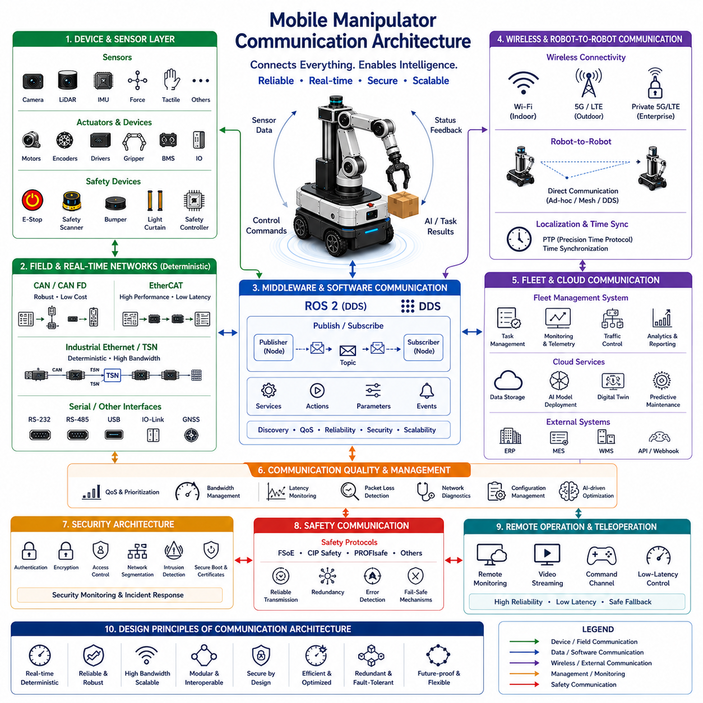{width="7.268055555555556in" height="7.268055555555556in"}

Communication Architecture is the circulatory and nervous network of a mobile manipulator. While sensors provide perception, computing platforms provide intelligence, and control systems generate actions, communication architecture enables every subsystem to exchange information efficiently, reliably, and securely. Without a robust communication infrastructure, individual components would operate as isolated units rather than as an integrated robotic system. In modern mobile manipulators, communication architecture is not simply a collection of cables and network interfaces; it is a comprehensive framework that governs how data, commands, status information, safety signals, and operational intelligence flow throughout the robot and across external systems. The Communication Architecture chapter occupies a critical position within the overall System Architecture section of the Mobile Manipulator volume because it connects every other architectural domain into a unified operational ecosystem.

The fundamental purpose of communication architecture is to ensure that information can be exchanged between all system elements with the appropriate levels of speed, reliability, determinism, scalability, and security. A mobile manipulator continuously generates enormous amounts of information from sensors, actuators, controllers, AI systems, fleet management software, cloud platforms, and human operators. This information must be delivered to the correct destination at the correct time while maintaining data integrity and operational continuity.

Unlike traditional industrial robots that often operate within isolated production cells, mobile manipulators are highly distributed systems. They consist of multiple sensors, multiple controllers, multiple processors, robotic arms, mobile bases, safety devices, wireless communication modules, cloud services, and remote management platforms. Each subsystem operates with different communication requirements. Some messages require microsecond-level deterministic timing, while others may tolerate delays of several seconds. Designing an architecture capable of supporting such diverse requirements is one of the central challenges of robotic communication engineering.

At the lowest level, communication architecture begins with device-level communication. This layer connects sensors, actuators, motor drivers, battery management systems, safety controllers, and embedded devices. Communication at this level typically involves high-speed and deterministic protocols that support real-time control requirements. Motor controllers must receive commands with extremely low latency, and sensor measurements must be delivered consistently to maintain stable control loops.

Controller Area Network (CAN) remains one of the most widely adopted communication technologies within mobile robotic systems. Originally developed for automotive applications, CAN provides reliable communication between embedded devices while maintaining robustness against electrical noise and harsh operating conditions. CAN networks are commonly used for motor controllers, battery systems, steering modules, suspension systems, and low-level diagnostic devices. CAN FD, an enhanced version of the original protocol, provides increased bandwidth while preserving compatibility with established industrial practices.

For applications requiring even higher performance, EtherCAT has become a dominant industrial communication technology. EtherCAT supports deterministic communication with extremely low latency and high synchronization accuracy. Mobile manipulators frequently employ EtherCAT networks to connect robotic arm joints, servo drives, force-torque sensors, and real-time motion controllers. Because EtherCAT processes data while frames pass through each device, it achieves exceptional efficiency and scalability for distributed control systems.

Ethernet-based communication has become increasingly important throughout robotic systems. Standard Ethernet provides significantly higher bandwidth than traditional industrial buses and supports a wide range of networking technologies. Gigabit Ethernet and multi-gigabit Ethernet networks are now commonly used for connecting industrial computers, cameras, LiDAR sensors, storage devices, and AI accelerators. The growing adoption of Ethernet reflects the increasing demand for high-bandwidth data transmission generated by modern perception and AI workloads.

Time-Sensitive Networking (TSN) represents an important evolution of Ethernet communication. TSN introduces deterministic communication capabilities to standard Ethernet infrastructure, allowing critical control traffic and non-critical data traffic to coexist on the same network. This convergence reduces system complexity while preserving the real-time performance required by robotic applications. Many future robotic platforms are expected to adopt TSN as a foundational communication technology.

Serial communication technologies continue to play an important role in mobile manipulators. Interfaces such as RS-232, RS-422, and RS-485 remain widely used for connecting legacy industrial devices, environmental sensors, GNSS receivers, diagnostic tools, and specialized equipment. Although these technologies provide lower bandwidth than Ethernet-based solutions, they remain attractive because of their simplicity, reliability, and long operating history.

USB communication is commonly employed for peripheral devices, cameras, storage systems, AI accelerators, and development interfaces. USB 3.0 and USB 4.0 provide sufficient bandwidth for many perception systems, including RGB cameras, depth cameras, and vision-processing modules. However, USB communication is generally not used for safety-critical or deterministic control functions due to its non-deterministic timing characteristics.

Sensor communication constitutes one of the most demanding aspects of robotic communication architecture. Modern mobile manipulators often incorporate multiple cameras, LiDAR sensors, radar systems, IMUs, force sensors, tactile sensors, GNSS receivers, and environmental monitoring devices. Collectively, these sensors may generate several gigabytes of data per minute. Efficient sensor communication architectures must therefore support high-bandwidth transmission while minimizing latency and packet loss.

Synchronization represents another critical requirement. Sensor measurements originating from different devices must often be correlated with extreme precision. For example, a camera image, LiDAR scan, IMU reading, and robot pose estimate may need to be aligned within a few milliseconds to support accurate sensor fusion. Communication architecture therefore includes clock synchronization mechanisms such as Precision Time Protocol (PTP), Network Time Protocol (NTP), hardware timestamping, and synchronized trigger systems.

Middleware communication plays a central role in modern robotic software architectures. Rather than allowing every software component to communicate directly with every other component, middleware provides a structured communication layer that manages data exchange, service requests, event notifications, and distributed coordination. ROS2 has emerged as the most influential middleware framework within advanced robotic systems. Built upon the Data Distribution Service (DDS) standard, ROS2 provides scalable and flexible communication capabilities for complex robotic applications.

DDS introduces publish-subscribe communication mechanisms that allow software components to exchange information without requiring direct knowledge of one another. This decoupled architecture improves modularity, scalability, and maintainability. Different software modules can publish sensor data, navigation commands, manipulation requests, safety alerts, and operational status updates while remaining independent from one another\'s internal implementations.

Communication architecture also extends beyond the robot itself. Mobile manipulators increasingly operate as connected systems within larger digital ecosystems. Wireless communication technologies provide connectivity between robots, cloud platforms, fleet management systems, remote operators, enterprise software systems, and digital twins.

Wi-Fi remains one of the most widely used wireless communication technologies in indoor robotic environments. Modern Wi-Fi standards provide high data throughput and support integration with existing enterprise infrastructure. Warehouses, hospitals, manufacturing facilities, and logistics centers frequently deploy Wi-Fi networks to support robot communication and fleet coordination.

Cellular communication technologies such as LTE, 5G, and future 6G networks significantly expand operational flexibility. Outdoor mobile manipulators operating in campuses, ports, industrial facilities, mining sites, agricultural environments, and public spaces often rely on cellular connectivity. 5G is particularly attractive because it offers low latency, high bandwidth, network slicing, and enhanced reliability. These characteristics make it suitable for real-time robotic applications and remote operation scenarios.

Private wireless networks are becoming increasingly popular in industrial environments. Organizations seeking greater control over security, performance, and reliability may deploy private LTE or private 5G networks specifically optimized for robotic operations. Such networks provide predictable communication performance while reducing dependence on public infrastructure.

Fleet communication represents a major architectural consideration as organizations deploy multiple mobile manipulators simultaneously. Fleet management systems require continuous communication with every robot to coordinate tasks, allocate resources, monitor performance, manage traffic flow, and optimize operations. Fleet communication architectures must support scalability from a handful of robots to hundreds or even thousands of autonomous systems.

Cloud communication has become an essential component of modern robotic ecosystems. Robots continuously exchange information with cloud-based platforms that provide analytics, data storage, software updates, digital twin synchronization, AI model deployment, predictive maintenance, and operational reporting. Cloud communication architectures must balance bandwidth efficiency, latency requirements, security considerations, and operational reliability.

Remote operation and teleoperation systems introduce additional communication requirements. In some situations, human operators may supervise, assist, or directly control mobile manipulators from remote locations. These applications require real-time video streaming, bidirectional command channels, low-latency control paths, and robust communication reliability. Network interruptions must be handled gracefully to maintain safety and operational continuity.

Cybersecurity has become one of the most important aspects of communication architecture. As robots become increasingly connected, they also become potential targets for cyberattacks. Communication systems must therefore incorporate authentication, encryption, access control, network segmentation, intrusion detection, secure boot mechanisms, certificate management, and continuous security monitoring. Cybersecurity is no longer an optional feature but a fundamental design requirement for modern robotic systems.

Functional safety and communication architecture are also closely related. Safety-critical messages must be transmitted reliably and within strict timing constraints. Safety communication protocols such as Safety over EtherCAT (FSoE), CIP Safety, PROFIsafe, and other certified technologies ensure that safety signals can be exchanged without compromising system integrity. These protocols include redundancy, error detection, message validation, and fail-safe mechanisms that support compliance with international safety standards.

As AI systems become increasingly important within mobile manipulators, communication requirements continue to grow. High-resolution camera streams, point cloud data, multimodal sensor information, foundation model inputs, and AI inference results all contribute to rapidly increasing network traffic. Future communication architectures must therefore support significantly higher bandwidth while maintaining deterministic behavior and energy efficiency.

The emergence of Edge AI and Cloud AI creates new communication paradigms. Some AI workloads execute directly on the robot, while others leverage cloud infrastructure. Communication architecture must intelligently distribute information between edge devices and cloud systems while optimizing bandwidth usage, latency, privacy, and operational costs.

Multi-robot collaboration introduces another level of complexity. Future fleets of mobile manipulators will share maps, object information, operational knowledge, AI models, and mission plans. Distributed communication architectures will enable collective intelligence, allowing robots to learn from one another and coordinate activities in real time.

Digital twin systems further extend communication architecture into virtual environments. Real-time synchronization between physical robots and digital representations requires continuous bidirectional communication. Sensor data, operational status, maintenance information, AI performance metrics, and environmental models must be exchanged efficiently to maintain accurate virtual representations.

The future of communication architecture will likely be shaped by converged industrial networks, deterministic Ethernet technologies, AI-driven network management, 5G Advanced, 6G connectivity, distributed robotic intelligence, and cloud-edge continuum architectures. Communication systems will increasingly evolve from passive transport mechanisms into intelligent infrastructures capable of prioritizing data flows, predicting failures, optimizing network performance, and supporting autonomous system coordination.

Ultimately, communication architecture serves as the information backbone of a mobile manipulator. It connects sensors, controllers, computers, AI systems, safety devices, cloud services, digital twins, and human operators into a unified operational framework. Every perception result, planning decision, control command, safety response, and AI inference depends upon reliable communication. As mobile manipulators evolve toward highly autonomous, AI-driven, and fleet-oriented systems, communication architecture will become one of the most important disciplines determining system performance, scalability, security, and operational success. Understanding communication architecture is therefore essential for engineers, architects, integrators, and researchers developing the next generation of intelligent mobile manipulation platforms.

통신 아키텍처(Communication Architecture)는 모바일 매니퓰레이터의 순환계이자 신경망에 해당하는 핵심 구조이다. 센서가 환경 정보를 수집하고, 컴퓨트 아키텍처가 데이터를 처리하며, 제어 아키텍처가 행동을 생성한다면, 통신 아키텍처는 이 모든 구성 요소가 정보를 교환할 수 있도록 연결하는 역할을 수행한다. 강력한 통신 인프라가 없다면 각 구성 요소는 독립적으로 동작하는 고립된 장치에 불과하며, 하나의 통합된 로봇 시스템으로 기능할 수 없다. 현대의 모바일 매니퓰레이터에서 통신 아키텍처는 단순한 케이블과 네트워크 연결 이상의 의미를 가진다. 이는 데이터, 제어 명령, 상태 정보, 안전 신호, 인공지능 결과, 운영 정보가 시스템 전체를 통해 어떻게 흐르는지를 정의하는 핵심 프레임워크이다. 따라서 통신 아키텍처는 모바일 매니퓰레이터 시스템 아키텍처를 구성하는 모든 요소를 연결하는 중심적인 역할을 담당한다.

통신 아키텍처의 가장 기본적인 목적은 시스템 내 모든 구성 요소가 적절한 속도와 신뢰성, 결정성, 확장성, 보안성을 유지하면서 정보를 교환할 수 있도록 하는 것이다. 모바일 매니퓰레이터는 센서, 액추에이터, 제어기, AI 시스템, Fleet Management System, 클라우드 플랫폼, 운영자 인터페이스 등에서 끊임없이 방대한 양의 정보를 생성한다. 이러한 정보는 적절한 시점에 정확한 대상에게 전달되어야 하며, 데이터 무결성과 시스템 연속성이 보장되어야 한다.

전통적인 산업용 로봇이 하나의 생산 셀 안에서 비교적 폐쇄적으로 동작하는 것과 달리, 모바일 매니퓰레이터는 본질적으로 분산 시스템이다. 하나의 로봇 안에 여러 개의 센서, 다수의 제어기, 여러 컴퓨팅 노드, 로봇암, 이동 플랫폼, 안전 장치, 무선 통신 모듈, 클라우드 서비스가 존재한다. 또한 각 시스템은 서로 다른 통신 요구사항을 가진다. 일부 데이터는 마이크로초 수준의 실시간성이 요구되지만, 일부 정보는 수 초 정도의 지연이 허용될 수도 있다. 이러한 다양한 요구사항을 하나의 구조 안에서 지원하는 것이 통신 아키텍처 설계의 핵심 과제이다.

가장 하위 계층은 디바이스 레벨 통신(Device-Level Communication)이다. 이 계층은 센서, 모터 드라이버, 배터리 관리 시스템(BMS), 안전 제어기, 임베디드 장치 등을 연결한다. 이 수준의 통신은 매우 낮은 지연 시간과 높은 결정성을 요구한다. 모터 제어기는 정확한 시점에 명령을 수신해야 하며, 센서 데이터 역시 일정한 주기로 전달되어야 안정적인 제어가 가능하다.

CAN(Controller Area Network)은 모바일 로봇 시스템에서 가장 널리 사용되는 통신 기술 중 하나이다. 원래 자동차 산업을 위해 개발된 CAN은 강한 노이즈 환경에서도 높은 신뢰성을 제공한다. 모바일 매니퓰레이터에서는 모터 컨트롤러, 배터리 시스템, 조향 시스템, 서스펜션 장치, 진단 장비 등을 연결하는 데 널리 사용된다. 최근에는 CAN FD가 등장하여 더욱 높은 데이터 전송 속도를 제공하면서도 기존 CAN 생태계와의 호환성을 유지하고 있다.

보다 높은 성능이 필요한 경우 EtherCAT이 사용된다. EtherCAT은 매우 낮은 지연 시간과 높은 동기화 정확도를 제공하는 산업용 실시간 통신 기술이다. 모바일 매니퓰레이터에서는 로봇암 관절, 서보 드라이브, 힘·토크 센서, 실시간 제어기 등을 연결하는 데 널리 활용된다. EtherCAT은 데이터 프레임이 각 장치를 통과하면서 데이터를 처리하는 독특한 구조를 사용하여 매우 높은 효율성을 제공한다.

Ethernet 기반 통신은 최근 로봇 시스템에서 가장 중요한 네트워크 기술로 자리 잡고 있다. Ethernet은 기존 산업용 필드버스보다 훨씬 높은 대역폭을 제공하며 다양한 네트워크 기술을 지원한다. Gigabit Ethernet과 Multi-Gigabit Ethernet은 산업용 컴퓨터, 카메라, LiDAR, 저장장치, AI 가속기 등을 연결하는 데 널리 사용된다. 이는 AI와 비전 시스템이 생성하는 대용량 데이터를 처리하기 위한 필수적인 기반이 되고 있다.

최근 주목받고 있는 기술 중 하나가 TSN(Time-Sensitive Networking)이다. TSN은 일반 Ethernet에 결정론적 통신 기능을 추가한 기술이다. 이를 통해 제어 데이터와 일반 데이터가 동일한 네트워크를 공유하면서도 실시간성을 유지할 수 있다. TSN은 시스템 구조를 단순화하면서도 로봇이 요구하는 높은 수준의 실시간 성능을 제공하기 때문에 미래 로봇 플랫폼의 핵심 기술로 평가받고 있다.

직렬 통신(Serial Communication) 역시 여전히 중요한 역할을 수행한다. RS-232, RS-422, RS-485와 같은 인터페이스는 GNSS 수신기, 환경 센서, 진단 장비, 특수 산업 장비를 연결하는 데 사용된다. 비록 Ethernet에 비해 속도는 낮지만 구조가 단순하고 신뢰성이 높기 때문에 많은 산업 현장에서 여전히 활용되고 있다.

USB 통신은 카메라, 저장장치, AI 가속기, 개발 장비 등을 연결하는 데 사용된다. USB 3.0과 USB 4.0은 RGB 카메라와 Depth Camera 같은 비전 센서에 충분한 대역폭을 제공한다. 그러나 USB는 결정론적 통신 특성이 부족하기 때문에 안전 관련 기능이나 실시간 제어에는 일반적으로 사용되지 않는다.

센서 통신은 모바일 매니퓰레이터에서 가장 많은 대역폭을 요구하는 영역 중 하나이다. 최신 로봇은 다수의 카메라, LiDAR, 레이더, IMU, Force Sensor, GNSS, 환경 센서 등을 포함하고 있으며, 이들이 생성하는 데이터는 분당 수 기가바이트에 이를 수 있다. 따라서 센서 통신 아키텍처는 대용량 데이터 전송을 지원하면서도 지연 시간을 최소화해야 한다.

센서 동기화 역시 매우 중요한 요소이다. 카메라 이미지, LiDAR 스캔, IMU 데이터, 로봇 위치 정보는 동일한 시간 기준에서 정렬되어야 한다. 그렇지 않으면 센서 융합 정확도가 크게 저하된다. 이를 위해 PTP(Precision Time Protocol), NTP(Network Time Protocol), 하드웨어 타임스탬프, 동기화 트리거 시스템 등이 사용된다.

미들웨어 통신(Middleware Communication)은 현대 로봇 소프트웨어 구조의 핵심이다. 모든 소프트웨어 모듈이 직접 연결되는 대신 미들웨어가 중간 계층 역할을 수행한다. ROS2는 현재 가장 널리 사용되는 로봇 미들웨어이며 DDS(Data Distribution Service)를 기반으로 동작한다. ROS2는 센서 데이터, 경로 계획 결과, 조작 명령, 안전 알림 등을 효율적으로 전달하는 표준 프레임워크를 제공한다.

DDS는 Publish-Subscribe 구조를 기반으로 한다. 이는 각 소프트웨어 모듈이 서로를 직접 알지 못하더라도 정보를 교환할 수 있도록 한다. 이러한 느슨한 결합(Loose Coupling)은 시스템의 확장성과 유지보수성을 크게 향상시킨다.

통신 아키텍처는 로봇 내부를 넘어 외부 시스템과의 연결까지 포함한다. 모바일 매니퓰레이터는 점점 더 큰 디지털 생태계의 일부로 동작하고 있으며, Fleet Management System, 클라우드 플랫폼, 원격 관제센터, ERP 시스템, MES 시스템, 디지털 트윈과 연결된다.

Wi-Fi는 실내 환경에서 가장 널리 사용되는 무선 통신 기술이다. 창고, 병원, 제조 공장, 물류센터 등에서 로봇들은 Wi-Fi 네트워크를 통해 Fleet 시스템과 연결된다. 최신 Wi-Fi 기술은 충분한 대역폭과 안정성을 제공하여 대부분의 실내 로봇 응용에 적합하다.

LTE와 5G는 실외 모바일 매니퓰레이터에서 중요한 역할을 한다. 캠퍼스, 항만, 플랜트, 공항, 농업 현장, 광산과 같은 환경에서는 셀룰러 네트워크를 통해 연결성을 확보한다. 특히 5G는 저지연성, 고대역폭, 네트워크 슬라이싱 기능을 제공하기 때문에 실시간 로봇 제어와 원격 운영에 적합하다.

최근에는 Private LTE와 Private 5G가 산업 현장에서 빠르게 확산되고 있다. 기업은 자체 네트워크를 구축하여 보안성과 안정성을 확보할 수 있으며, 공용 네트워크에 의존하지 않고도 높은 수준의 통신 품질을 유지할 수 있다.

Fleet Communication은 다수의 모바일 매니퓰레이터를 운영하는 환경에서 매우 중요한 요소이다. Fleet Management System은 모든 로봇과 지속적으로 통신하면서 작업 할당, 자원 관리, 교통 제어, 성능 최적화를 수행한다. 따라서 Fleet 통신 구조는 수십 대에서 수천 대까지 확장 가능한 구조를 가져야 한다.

클라우드 통신은 현대 로봇 시스템의 필수 요소가 되었다. 로봇은 클라우드와 데이터를 교환하면서 분석, 데이터 저장, 소프트웨어 업데이트, 디지털 트윈 동기화, AI 모델 배포, 예지 정비 기능을 활용한다. 이러한 구조는 운영 효율성과 유지보수성을 크게 향상시킨다.

원격 운영(Remote Operation)과 텔레오퍼레이션(Teleoperation) 시스템은 추가적인 통신 요구사항을 가진다. 원격 운영자는 실시간 영상 스트림을 받아야 하며, 양방향 제어 명령을 송수신해야 한다. 따라서 낮은 지연 시간과 높은 신뢰성이 필수적이며, 통신 장애 발생 시 안전하게 동작을 유지할 수 있는 메커니즘도 필요하다.

사이버 보안은 현대 통신 아키텍처에서 가장 중요한 요소 중 하나로 부상하고 있다. 로봇이 네트워크와 클라우드에 연결될수록 해킹 위험도 증가한다. 따라서 인증(Authentication), 암호화(Encryption), 접근 제어(Access Control), 네트워크 분리(Network Segmentation), 침입 탐지(Intrusion Detection), 보안 부트(Secure Boot), 인증서 관리 등의 기술이 필수적으로 적용되고 있다.

기능 안전과 통신도 밀접하게 연관된다. 안전 관련 메시지는 매우 높은 신뢰성과 엄격한 시간 요구사항을 만족해야 한다. FSoE(Safety over EtherCAT), CIP Safety, PROFIsafe와 같은 안전 통신 프로토콜은 오류 검출, 메시지 검증, 이중화 기능을 제공하여 국제 안전 규격을 만족하도록 지원한다.

AI 기술의 발전은 통신 요구사항을 더욱 증가시키고 있다. 고해상도 카메라 데이터, 포인트 클라우드, 멀티모달 데이터, Foundation Model 입력 데이터, AI 추론 결과는 엄청난 네트워크 부하를 발생시킨다. 따라서 미래의 통신 아키텍처는 더욱 높은 대역폭과 더 나은 실시간 성능을 제공해야 한다.

Edge AI와 Cloud AI는 새로운 통신 구조를 만들어 내고 있다. 일부 AI 기능은 로봇 내부에서 실행되고, 일부는 클라우드에서 수행된다. 따라서 통신 아키텍처는 지연 시간, 비용, 보안, 대역폭을 고려하여 데이터를 적절히 분배해야 한다.

다중 로봇 협업(Multi-Robot Collaboration)은 통신 아키텍처를 더욱 복잡하게 만든다. 미래의 모바일 매니퓰레이터는 지도, 물체 정보, 작업 지식, AI 모델을 서로 공유하게 될 것이다. 이를 통해 집단 지능(Collective Intelligence)과 실시간 협업이 가능해진다.

디지털 트윈 역시 통신 아키텍처의 중요한 확장 영역이다. 실제 로봇과 가상 모델 간의 지속적인 동기화를 위해서는 양방향 통신이 필수적이다. 센서 데이터, 상태 정보, AI 성능 정보, 환경 모델 등이 실시간으로 교환되어야 한다.

미래의 통신 아키텍처는 TSN 기반 결정론적 Ethernet, AI 기반 네트워크 관리, 5G Advanced, 6G, 분산 지능 시스템, Cloud-Edge Continuum 구조를 중심으로 발전할 것으로 예상된다. 네트워크는 단순한 데이터 전달 수단이 아니라 스스로 트래픽을 최적화하고 장애를 예측하며 시스템 전체의 효율을 향상시키는 지능형 인프라로 발전하게 될 것이다.

결국 통신 아키텍처는 모바일 매니퓰레이터의 정보 전달 백본(Backbone)이다. 센서, 제어기, 컴퓨터, AI 시스템, 안전 장치, 클라우드 서비스, 디지털 트윈, 인간 운영자를 하나의 통합된 시스템으로 연결하는 역할을 수행한다. 모든 인식 결과, 계획 정보, 제어 명령, 안전 신호, AI 추론 결과는 통신 아키텍처를 통해 전달된다. 모바일 매니퓰레이터가 더욱 자율적이고 AI 중심적인 시스템으로 발전할수록 통신 아키텍처는 성능, 확장성, 보안성, 운영 효율성을 결정하는 가장 중요한 핵심 기술 중 하나가 될 것이다. 따라서 차세대 모바일 매니퓰레이터를 설계하고 구축하는 엔지니어와 연구자에게 통신 아키텍처는 반드시 이해해야 하는 필수 분야라 할 수 있다.

##  

## 09 Safety Architecture

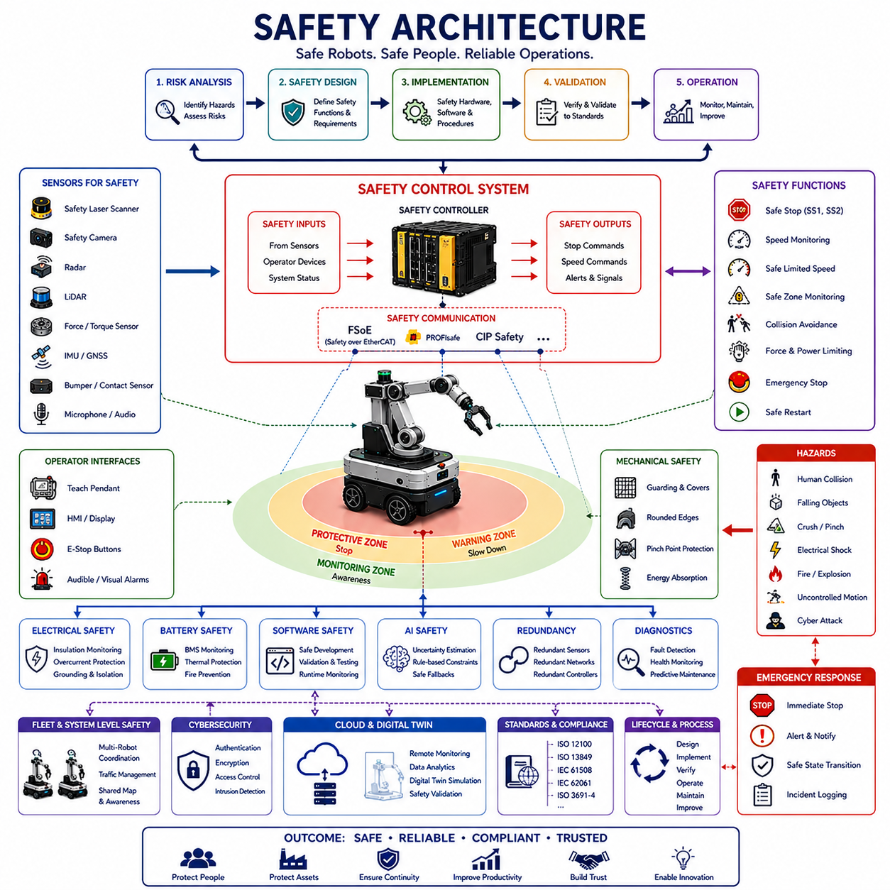{width="7.268055555555556in" height="7.268055555555556in"}

Safety Architecture is one of the most critical elements of a mobile manipulator system because it directly protects human life, equipment, facilities, operational assets, and the robot itself. While mechanical architecture determines physical capabilities, sensor architecture provides environmental awareness, compute architecture supplies computational intelligence, control architecture coordinates behavior, AI architecture enables decision-making, and communication architecture connects all subsystems, safety architecture ensures that every component operates within acceptable risk boundaries. In many respects, safety architecture serves as the immune system of a robotic platform, continuously monitoring potential hazards and taking corrective actions before accidents occur.

As mobile manipulators move beyond isolated industrial cells and enter shared environments such as warehouses, hospitals, airports, campuses, factories, logistics centers, public facilities, and outdoor operational sites, safety becomes significantly more complex. Traditional industrial robots often operate behind fences, physical barriers, and access-controlled zones. Mobile manipulators, however, frequently coexist with human workers, autonomous vehicles, visitors, and other dynamic objects. This shift transforms safety from a simple protective mechanism into a comprehensive system-level architectural discipline.

The primary objective of safety architecture is risk reduction. No robotic system can completely eliminate risk, but a properly designed safety architecture minimizes the probability and severity of hazardous events. This objective is achieved through a combination of hazard identification, risk assessment, safety functions, monitoring mechanisms, fault detection systems, redundancy strategies, and emergency response procedures.

Safety architecture begins with risk analysis. Before a robot is designed, engineers must identify potential hazards associated with intended operations. These hazards may include collisions with humans, falling objects, crushing injuries, pinch points, electrical faults, battery failures, communication disruptions, software errors, cybersecurity attacks, environmental hazards, and unexpected operational behaviors. Risk analysis establishes the foundation upon which all subsequent safety mechanisms are built.

Hazard identification is typically followed by risk assessment methodologies that evaluate both the likelihood and consequences of hazardous events. Standards such as ISO 12100 provide structured approaches for identifying risks and determining appropriate mitigation strategies. The outcome of this process directly influences the design of safety systems, safety-rated hardware, and operational procedures.

Functional safety represents one of the most important concepts within modern safety architecture. Functional safety focuses on ensuring that safety-related systems perform their intended functions correctly, even when faults occur. Rather than relying solely on physical protection mechanisms, functional safety incorporates sensors, controllers, software, communication systems, and actuators that continuously monitor operating conditions and intervene when dangerous situations are detected.

International standards such as ISO 13849, IEC 61508, IEC 62061, and ISO 3691-4 provide frameworks for designing and validating functional safety systems. These standards define performance levels, safety integrity requirements, diagnostic coverage expectations, and fault tolerance capabilities. Compliance with these standards is often mandatory for commercial robotic systems operating in industrial environments.

Safety controllers form the central decision-making element of the safety architecture. Unlike standard control systems that focus on task execution, safety controllers are dedicated to hazard prevention and risk mitigation. These controllers continuously monitor safety inputs, evaluate system status, and initiate protective actions when necessary. In many systems, safety controllers operate independently from primary control systems to ensure that safety functions remain operational even if non-safety systems fail.

Emergency stop systems remain one of the most recognizable safety features in robotics. Emergency stop mechanisms provide operators with a direct means of immediately halting robot operation during hazardous situations. However, modern safety architecture extends far beyond emergency stop functionality. Safety systems must identify hazards before operators are forced to intervene and should ideally prevent dangerous situations from developing in the first place.

Safety sensors serve as the eyes and ears of the safety architecture. Safety laser scanners are widely used to monitor protected zones surrounding mobile manipulators. These devices continuously measure distances and detect intrusions into predefined safety areas. When a person or object enters a warning zone, the robot may reduce speed. If a protected zone is violated, the robot may stop entirely.

Safety cameras provide another important sensing modality. Advanced vision-based safety systems can detect humans, classify behaviors, estimate movement trajectories, and predict potential collision risks. Unlike traditional safety scanners that focus primarily on geometric detection, safety cameras can incorporate semantic understanding and contextual awareness into safety decision-making.

Radar-based safety systems are gaining increased attention, particularly in outdoor environments. Radar offers robust performance under adverse weather conditions such as rain, fog, dust, smoke, and low-light environments. Because radar is less sensitive to environmental conditions than optical sensors, it provides valuable redundancy for safety-critical perception systems.

Human detection and human tracking technologies have become fundamental components of collaborative robotic safety. Mobile manipulators operating in human-populated environments must continuously identify nearby individuals, monitor their movements, estimate intentions, and adjust robot behavior accordingly. Human-aware safety systems enable robots to share workspaces safely while maintaining operational productivity.

Protective field monitoring is a key mechanism used in mobile robotic safety. Safety systems typically define multiple zones surrounding the robot. A distant monitoring zone may trigger awareness responses. A closer warning zone may reduce speed. An inner protective zone may initiate a complete stop. Dynamic safety zones can adapt according to robot speed, payload characteristics, environmental conditions, and operational context.

Speed and separation monitoring represents a core principle within collaborative robotics. Rather than isolating robots from humans entirely, modern safety architectures allow safe coexistence by continuously maintaining acceptable separation distances. The robot dynamically adjusts speed and behavior according to proximity measurements. This approach significantly improves operational flexibility while preserving safety.

Force and power limiting is another important safety strategy. Mobile manipulators may physically interact with humans during collaborative operations. Force-limited systems continuously monitor contact forces and ensure that interaction energies remain below injury thresholds. Compliance control, torque monitoring, force sensing, and impact detection mechanisms contribute to safe physical interaction.

Mechanical safety remains a fundamental aspect of overall safety architecture. Physical design choices significantly influence system safety characteristics. Rounded edges, protected pinch points, guarded moving components, energy-absorbing structures, compliant mechanisms, and protective covers reduce injury risks. Safe mechanical design often serves as the first layer of protection against accidents.

Electrical safety is equally important. Mobile manipulators contain high-current batteries, power distribution systems, motor drives, charging systems, and electronic control units. Safety architecture must address electrical shock prevention, short-circuit protection, overcurrent detection, insulation monitoring, grounding strategies, and emergency power isolation mechanisms.

Battery safety has become increasingly important as lithium-based energy storage systems become standard in mobile robotics. Battery management systems continuously monitor voltage, current, temperature, charging conditions, and cell health. Thermal runaway detection, fire prevention mechanisms, isolation controls, and emergency shutdown procedures are integrated into advanced battery safety architectures.

Software safety represents one of the most challenging aspects of modern robotic systems. Autonomous robots depend heavily on software for perception, planning, control, and decision-making. Software failures may result in hazardous behavior even when hardware components remain functional. Safety architecture therefore incorporates software validation, testing frameworks, redundancy mechanisms, runtime monitoring, exception handling, and fault recovery strategies.

Artificial Intelligence introduces additional safety challenges. AI systems may exhibit unexpected behaviors when operating outside their training distributions or encountering novel situations. Consequently, AI safety has emerged as a major research area within robotics. Safe AI architectures incorporate uncertainty estimation, confidence scoring, explainability mechanisms, rule-based safety constraints, supervisory control layers, and fallback strategies.

Safety architectures increasingly employ layered protection strategies. Rather than relying on a single safety mechanism, multiple independent layers of protection are implemented simultaneously. If one layer fails, other layers remain available to prevent accidents. This defense-in-depth philosophy significantly improves overall system reliability and resilience.

Redundancy is a key design principle in safety-critical systems. Critical safety functions often utilize redundant sensors, redundant communication channels, redundant processors, and redundant power systems. The objective is to eliminate single points of failure that could compromise safety. High-reliability mobile manipulators frequently incorporate diverse redundancy, where multiple technologies perform similar functions using different operating principles.

Fault detection and diagnostics are essential components of safety architecture. Safety systems continuously monitor hardware health, software status, communication integrity, sensor performance, and operational behavior. Abnormal conditions are detected, classified, and addressed before they escalate into hazardous situations. Predictive diagnostics can identify emerging failures and support proactive maintenance strategies.

Safety communication plays a vital role in distributed robotic systems. Safety-related information must be transmitted reliably and within strict timing constraints. Protocols such as Safety over EtherCAT, PROFIsafe, CIP Safety, and other certified communication technologies provide error detection, message validation, redundancy management, and fail-safe communication capabilities.

Cybersecurity has become deeply interconnected with safety architecture. A cyberattack targeting a mobile manipulator could potentially create hazardous physical consequences. Secure communication, authentication, encryption, access control, intrusion detection, secure boot mechanisms, and continuous monitoring are therefore increasingly considered part of the broader safety architecture.

Fleet-level safety introduces additional challenges when multiple robots operate simultaneously. Fleet management systems must coordinate robot movements, prevent traffic conflicts, manage shared resources, and avoid collisions between autonomous systems. Safety architectures must therefore extend beyond individual robots to encompass entire robotic ecosystems.

Outdoor mobile manipulators introduce environmental safety considerations not typically encountered indoors. Uneven terrain, weather conditions, visibility limitations, dynamic obstacles, wildlife, pedestrians, vehicles, and infrastructure interactions create additional safety requirements. Outdoor safety architectures often combine GNSS, LiDAR, radar, cameras, IMUs, and geofencing technologies to ensure safe operation.

Geofencing provides a powerful safety mechanism for outdoor robotic systems. Virtual boundaries define permitted operational areas and restricted zones. If a robot approaches or crosses a geofence boundary, safety systems can generate warnings, reduce speed, or stop operation entirely. Geofencing is particularly valuable for large-scale outdoor deployments.

Digital twins are increasingly used to support safety analysis and validation. Virtual environments enable engineers to simulate hazardous scenarios, evaluate safety strategies, test emergency responses, and verify system behavior before deployment. Digital twin technologies significantly reduce development risks and improve confidence in safety performance.

Human-Robot Interaction safety will become increasingly important as mobile manipulators enter public and semi-public environments. Safety architectures must support predictable behavior, intuitive communication, transparent intentions, and socially acceptable interactions. Human trust depends not only on actual safety but also on perceived safety and behavioral predictability.

The future of safety architecture will be strongly influenced by AI-driven risk assessment, predictive safety systems, autonomous hazard detection, adaptive safety zones, multi-robot safety coordination, cloud-connected safety monitoring, and embodied intelligence. Safety systems will evolve from reactive mechanisms into proactive and predictive frameworks capable of anticipating hazards before they occur.

Ultimately, safety architecture serves as the protective foundation upon which all robotic functionality depends. It integrates mechanical design, electronics, software, communication systems, artificial intelligence, operational procedures, and human factors into a unified framework dedicated to risk reduction and accident prevention. As mobile manipulators become more autonomous, intelligent, and widely deployed, safety architecture will increasingly determine not only regulatory compliance but also public acceptance, operational reliability, and long-term commercial success. A truly advanced mobile manipulator is not merely capable, intelligent, or productive---it is fundamentally safe by design.

안전 아키텍처(Safety Architecture)는 모바일 매니퓰레이터 시스템에서 가장 중요한 요소 중 하나이다. 이는 사람의 생명과 안전은 물론 장비, 시설, 운영 자산, 그리고 로봇 자체를 보호하는 역할을 수행한다. 기계 아키텍처가 물리적 능력을 결정하고, 센서 아키텍처가 환경을 인식하며, 컴퓨트 아키텍처가 지능을 제공하고, 제어 아키텍처가 행동을 조율하며, AI 아키텍처가 판단을 수행하고, 통신 아키텍처가 모든 시스템을 연결한다면, 안전 아키텍처는 이러한 모든 구성 요소가 허용 가능한 위험 범위 내에서 동작하도록 보장하는 역할을 한다. 인간의 면역 체계가 외부 위험으로부터 신체를 보호하듯이, 안전 아키텍처는 잠재적인 위험을 지속적으로 감시하고 사고가 발생하기 전에 적절한 대응을 수행한다.

모바일 매니퓰레이터가 울타리로 둘러싸인 산업용 셀을 벗어나 창고, 병원, 공항, 캠퍼스, 제조공장, 물류센터, 공공시설, 실외 산업 현장과 같은 사람 중심의 환경으로 진출하면서 안전 문제는 더욱 복잡해지고 있다. 전통적인 산업용 로봇은 물리적 차단벽과 출입 통제 구역 안에서 동작했지만, 모바일 매니퓰레이터는 사람, 차량, 다른 로봇, 방문객과 같은 다양한 이동 객체와 공간을 공유한다. 따라서 안전은 단순한 보호 장치가 아니라 시스템 전체를 설계하는 핵심 아키텍처 영역으로 발전하게 되었다.

안전 아키텍처의 가장 중요한 목적은 위험 감소(Risk Reduction)이다. 모든 위험을 완전히 제거하는 것은 불가능하지만, 위험이 발생할 가능성과 발생 시 피해 규모를 최소화하는 것이 목표이다. 이를 위해 위험 식별, 위험 평가, 안전 기능 설계, 상태 모니터링, 고장 감지, 이중화 설계, 비상 대응 체계가 종합적으로 적용된다.

안전 아키텍처의 출발점은 위험 분석(Risk Analysis)이다. 로봇이 설계되기 전에 예상되는 모든 위험 요소를 체계적으로 식별해야 한다. 여기에는 사람과의 충돌, 물체 낙하, 협착 사고, 전기적 고장, 배터리 이상, 통신 장애, 소프트웨어 오류, 사이버 공격, 환경적 위험 요소, 예기치 않은 동작 등이 포함된다. 이러한 분석 결과는 전체 안전 시스템 설계의 기반이 된다.

위험 식별 이후에는 위험 평가(Risk Assessment)가 수행된다. 이는 위험이 발생할 가능성과 결과의 심각도를 분석하여 적절한 대응 수준을 결정하는 과정이다. ISO 12100과 같은 국제 표준은 이러한 위험 평가 절차를 체계적으로 정의하고 있으며, 평가 결과는 안전 기능과 보호 장치 설계에 직접 반영된다.

현대 안전 아키텍처의 핵심 개념 중 하나는 기능 안전(Functional Safety)이다. 기능 안전은 고장이 발생하더라도 안전 관련 기능이 의도한 대로 동작하도록 보장하는 기술이다. 과거에는 물리적 보호 장치에 의존하는 경우가 많았지만, 오늘날에는 센서, 제어기, 소프트웨어, 통신 시스템, 액추에이터가 함께 동작하면서 위험을 감지하고 즉시 대응하는 구조를 사용한다.

ISO 13849, IEC 61508, IEC 62061, ISO 3691-4와 같은 국제 표준은 기능 안전 시스템 설계와 검증 방법을 규정하고 있다. 이러한 표준은 성능 수준(PL), 안전 무결성 수준(SIL), 진단 범위, 고장 허용 능력 등을 정의하며, 상용 모바일 매니퓰레이터에서는 사실상 필수적으로 적용되고 있다.

안전 제어기(Safety Controller)는 안전 아키텍처의 핵심 의사결정 장치이다. 일반 제어기가 작업 수행을 담당한다면, 안전 제어기는 위험 방지와 사고 예방을 전담한다. 안전 제어기는 안전 센서와 시스템 상태를 지속적으로 감시하며 위험 상황이 감지되면 즉시 보호 동작을 수행한다. 많은 시스템에서는 일반 제어기와 독립적으로 동작하여 다른 시스템에 문제가 발생하더라도 안전 기능이 유지되도록 설계한다.

비상 정지(Emergency Stop)는 가장 잘 알려진 안전 기능 중 하나이다. 비상 상황에서 작업자가 즉시 로봇을 정지시킬 수 있도록 지원한다. 그러나 현대 안전 아키텍처는 단순히 비상 정지에 의존하지 않는다. 위험이 발생한 후 대응하는 것이 아니라, 위험 상황이 발생하기 전에 이를 감지하고 예방하는 것을 목표로 한다.

안전 센서는 안전 아키텍처의 눈과 귀 역할을 수행한다. 안전 레이저 스캐너는 로봇 주변의 보호 영역을 지속적으로 감시하며 사람이나 장애물이 접근하면 경고 또는 정지 신호를 생성한다. 일반적으로 외곽 감시 구역에서는 속도를 줄이고, 내부 보호 구역에 진입하면 즉시 정지하는 방식이 사용된다.

안전 카메라는 최근 더욱 중요한 역할을 수행하고 있다. 단순히 물체를 탐지하는 수준을 넘어 사람을 인식하고 행동을 분석하며 이동 방향을 예측할 수 있다. 따라서 위험 가능성을 사전에 판단하고 보다 지능적인 안전 대응을 수행할 수 있다.

레이더 기반 안전 시스템은 특히 실외 환경에서 주목받고 있다. 카메라와 LiDAR는 비, 안개, 먼지, 연기, 야간 환경에서 성능이 저하될 수 있지만, 레이더는 이러한 환경에서도 비교적 안정적인 성능을 유지한다. 따라서 안전 시스템의 중복성과 신뢰성을 향상시키는 중요한 요소로 활용되고 있다.

사람 인식(Human Detection)과 사람 추적(Human Tracking)은 협업형 모바일 매니퓰레이터에서 필수 기능이 되었다. 로봇은 주변 사람의 위치와 움직임을 지속적으로 파악하고 의도를 예측해야 한다. 이를 통해 사람과 공간을 공유하면서도 높은 생산성을 유지할 수 있다.

보호 영역 모니터링(Protective Field Monitoring)은 대표적인 안전 메커니즘이다. 로봇 주변에 여러 개의 안전 영역을 설정하여 상황에 따라 대응 수준을 다르게 적용한다. 먼 거리에서는 경고를 발생시키고, 가까운 거리에서는 속도를 줄이며, 위험 구역에서는 완전히 정지하는 방식이다. 최근에는 속도와 적재 중량, 환경 조건에 따라 동적으로 영역을 조정하는 기술도 활용되고 있다.

속도 및 거리 모니터링(Speed and Separation Monitoring)은 협동로봇 분야의 핵심 원칙이다. 사람과 로봇을 완전히 분리하는 대신, 일정한 안전 거리를 유지하면서 함께 작업할 수 있도록 한다. 로봇은 사람과의 거리에 따라 속도를 자동으로 조절하여 생산성과 안전성을 동시에 확보한다.

힘 및 출력 제한(Force and Power Limiting) 역시 중요한 안전 전략이다. 모바일 매니퓰레이터는 사람과 직접 접촉할 가능성이 있으므로 충돌 시 발생하는 힘과 에너지를 제한해야 한다. 이를 위해 토크 모니터링, 힘 센서, 충돌 감지, 순응 제어(Compliance Control) 기술이 활용된다.

기계적 안전(Mechanical Safety)은 안전 아키텍처의 가장 기본적인 요소이다. 둥근 모서리, 협착 방지 구조, 보호 커버, 충격 흡수 구조, 순응 메커니즘 등은 물리적 부상을 예방하는 데 중요한 역할을 한다. 기계적 안전은 모든 안전 계층 중 가장 첫 번째 방어선이라고 할 수 있다.

전기적 안전(Electrical Safety)도 매우 중요하다. 모바일 매니퓰레이터는 대용량 배터리, 전력 분배 시스템, 모터 드라이브, 충전 시스템 등을 포함하고 있다. 따라서 감전 방지, 과전류 보호, 절연 감시, 접지 설계, 비상 전원 차단 기능이 반드시 포함되어야 한다.

배터리 안전(Battery Safety)은 리튬 기반 배터리 사용이 확대되면서 더욱 중요해지고 있다. 배터리 관리 시스템(BMS)은 전압, 전류, 온도, 충전 상태, 셀 건강 상태를 지속적으로 감시한다. 열폭주(Thermal Runaway) 감지, 화재 예방, 긴급 차단 기능은 필수적인 안전 요소이다.

소프트웨어 안전(Software Safety)은 현대 로봇에서 가장 어려운 분야 중 하나이다. 자율주행, 인지, 계획, 제어 대부분이 소프트웨어에 의존하기 때문에 소프트웨어 오류는 직접적인 위험으로 이어질 수 있다. 따라서 안전 아키텍처는 소프트웨어 검증, 자동 테스트, 이중화 설계, 예외 처리, 고장 복구 기능을 포함해야 한다.

인공지능은 새로운 안전 문제를 야기한다. AI는 학습 데이터 범위를 벗어난 상황에서 예상치 못한 행동을 보일 수 있다. 따라서 AI 안전(AI Safety)은 최근 중요한 연구 분야가 되었다. 불확실성 추정, 신뢰도 평가, 설명 가능한 AI, 규칙 기반 안전 제한, 감독 제어 계층, 비상 복귀 전략 등이 적용되고 있다.

현대 안전 아키텍처는 다층 방어(Defense-in-Depth) 전략을 사용한다. 하나의 안전 기능에 의존하는 것이 아니라 여러 독립적인 보호 계층을 동시에 적용한다. 하나의 계층이 실패하더라도 다른 계층이 사고를 방지할 수 있도록 설계한다.

이중화(Redundancy)는 안전 설계의 핵심 원칙이다. 중요 기능은 이중 센서, 이중 통신 채널, 이중 프로세서, 이중 전원 시스템을 사용한다. 이를 통해 단일 고장점(Single Point of Failure)을 제거하고 전체 시스템의 신뢰성을 향상시킨다.

고장 감지와 진단(Fault Detection and Diagnostics)은 안전 아키텍처의 중요한 구성 요소이다. 하드웨어 상태, 소프트웨어 상태, 통신 상태, 센서 성능을 지속적으로 모니터링하며 이상 징후를 조기에 발견한다. 예지 진단(Predictive Diagnostics)은 고장이 실제로 발생하기 전에 유지보수를 수행할 수 있도록 지원한다.

안전 통신(Safety Communication)은 분산 시스템에서 매우 중요하다. 안전 관련 메시지는 높은 신뢰성과 엄격한 시간 요구사항을 만족해야 한다. FSoE(Safety over EtherCAT), PROFIsafe, CIP Safety와 같은 프로토콜은 오류 검출, 메시지 검증, 이중화 기능을 제공한다.

사이버 보안(Cybersecurity)은 이제 안전과 밀접하게 연결되어 있다. 악의적인 공격은 물리적 위험으로 이어질 수 있기 때문이다. 인증, 암호화, 접근 제어, 침입 탐지, 보안 부트, 지속적인 보안 감시는 안전 아키텍처의 일부로 간주되고 있다.

다수의 로봇이 함께 운영되는 환경에서는 Fleet 수준의 안전이 중요해진다. Fleet Management System은 로봇 간 충돌을 방지하고, 교통 흐름을 조정하며, 공유 자원을 안전하게 관리해야 한다. 따라서 안전 아키텍처는 개별 로봇을 넘어 전체 로봇 생태계로 확장되고 있다.

실외 모바일 매니퓰레이터는 추가적인 안전 과제를 가진다. 불규칙한 지형, 날씨 변화, 가시성 저하, 차량, 보행자, 야생동물 등 다양한 요소를 고려해야 한다. 이를 위해 GNSS, LiDAR, 레이더, 카메라, IMU, 지오펜싱(Geofencing) 기술이 통합적으로 활용된다.

지오펜싱은 가상의 안전 경계를 설정하는 기술이다. 로봇이 허용된 영역을 벗어나거나 제한 구역에 접근하면 경고를 발생시키거나 정지 동작을 수행한다. 대규모 실외 환경에서 매우 효과적인 안전 수단이다.

디지털 트윈은 안전 분석과 검증을 지원하는 중요한 기술이다. 가상 환경에서 위험 시나리오를 시뮬레이션하고, 안전 전략을 평가하며, 비상 대응 절차를 검증할 수 있다. 이를 통해 실제 배포 전에 안전성을 충분히 검증할 수 있다.

인간-로봇 상호작용(HRI) 안전은 앞으로 더욱 중요해질 것이다. 로봇은 사람과 함께 생활하고 일하게 되므로 예측 가능한 행동, 직관적인 의사소통, 사회적으로 수용 가능한 행동을 보여야 한다. 실제 안전성뿐 아니라 사용자가 느끼는 심리적 안전감 또한 중요한 요소가 된다.

미래의 안전 아키텍처는 AI 기반 위험 예측, 자율 위험 감지, 적응형 안전 구역, 다중 로봇 안전 협조, 클라우드 기반 안전 모니터링, Embodied AI와 결합된 예측형 안전 시스템으로 발전할 것이다. 안전 시스템은 사고 발생 후 대응하는 구조에서 사고를 사전에 예측하고 예방하는 구조로 변화하게 될 것이다.

궁극적으로 안전 아키텍처는 모든 로봇 기능의 기반이 되는 보호 체계이다. 기계 설계, 전자 시스템, 소프트웨어, 통신, 인공지능, 운영 절차, 인간 요소를 하나의 통합된 구조로 결합하여 위험을 최소화하고 사고를 예방한다. 모바일 매니퓰레이터가 더욱 자율적이고 지능적이며 광범위하게 활용될수록 안전 아키텍처는 규제 준수뿐 아니라 사용자 신뢰, 운영 안정성, 사업적 성공을 결정하는 핵심 요소가 될 것이다. 진정으로 우수한 모바일 매니퓰레이터는 단순히 성능이 뛰어나거나 지능적인 로봇이 아니라, 설계 단계부터 안전이 내재된(Safe by Design) 로봇이라고 할 수 있다.

##  

## 10 Cloud and Edge Architecture

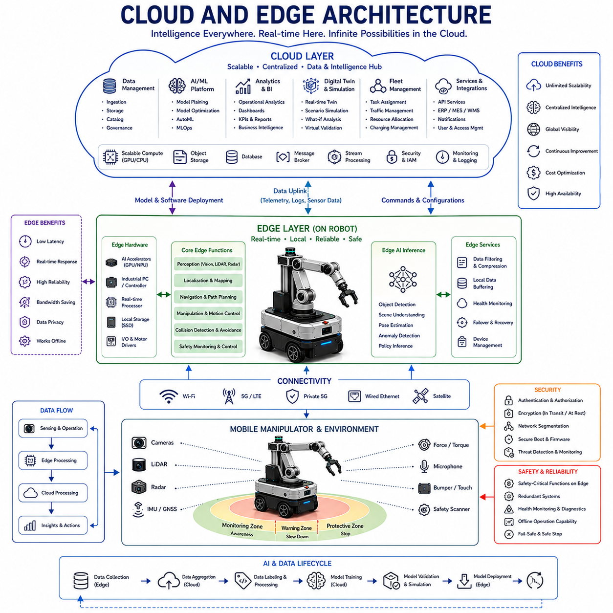{width="7.268055555555556in" height="7.268055555555556in"}

Cloud and Edge Architecture has emerged as one of the most important architectural foundations for next-generation mobile manipulators. As robotic systems become increasingly autonomous, intelligent, connected, and data-driven, traditional onboard computing architectures alone are no longer sufficient to support the growing demands of perception, artificial intelligence, fleet management, simulation, digital twins, and large-scale operational analytics. Cloud and Edge Architecture addresses this challenge by distributing computational resources across both local robotic platforms and remote cloud infrastructures, creating a unified computing ecosystem capable of supporting real-time autonomy and long-term intelligence simultaneously.

Historically, robots operated as isolated systems. All sensing, computation, decision-making, and control functions were performed locally within the robot itself. While this architecture provided high autonomy and low latency, it was constrained by limited onboard computational resources, storage capacity, and learning capabilities. As mobile manipulators began incorporating high-resolution cameras, LiDAR sensors, deep learning models, foundation models, and large-scale operational datasets, the limitations of purely onboard computing became increasingly apparent.

Cloud and Edge Architecture introduces a distributed computing paradigm in which computational responsibilities are allocated according to latency requirements, bandwidth constraints, safety considerations, and resource availability. Time-critical functions remain at the edge, close to the robot, while computationally intensive and non-time-critical workloads are executed within cloud environments. This hybrid approach enables robotic systems to benefit from both local responsiveness and virtually unlimited cloud scalability.

The edge layer represents the computational infrastructure physically located on or near the robot. Edge computing resources include embedded controllers, industrial computers, AI accelerators, GPUs, real-time processors, and local storage devices. These resources are responsible for executing mission-critical workloads that require immediate responses. Navigation, obstacle avoidance, localization, motion control, manipulation planning, collision detection, safety monitoring, and real-time perception typically operate entirely within the edge environment.

Latency is one of the primary reasons why edge computing remains essential. A mobile manipulator navigating through a dynamic environment cannot wait hundreds of milliseconds for cloud-based decisions. If a person suddenly enters the robot's path, obstacle avoidance must occur immediately. Similarly, robotic arm control requires deterministic response times measured in milliseconds. Therefore, safety-critical and operationally critical functions must remain local to ensure reliability and responsiveness.

Modern edge architectures have evolved significantly due to advances in embedded AI hardware. Platforms such as NVIDIA Jetson, Qualcomm Robotics processors, Intel Edge AI platforms, industrial GPU computers, and AI accelerators provide computational capabilities that were previously available only in data centers. These systems enable sophisticated perception, AI inference, and planning directly on the robot while operating within constrained power budgets.

The cloud layer provides a fundamentally different set of capabilities. Unlike edge systems, cloud platforms prioritize scalability, storage capacity, centralized coordination, large-scale computation, and long-term intelligence. Cloud infrastructure typically consists of distributed servers, GPU clusters, object storage systems, databases, analytics platforms, machine learning pipelines, and application services. Cloud resources can scale dynamically according to operational demands, providing virtually unlimited computational capacity when needed.

One of the most important roles of cloud architecture is centralized data management. Mobile manipulators generate enormous volumes of data from cameras, LiDAR sensors, telemetry systems, operational logs, maintenance records, AI inference outputs, and environmental observations. Storing and processing this information entirely on the robot is impractical. Cloud platforms provide centralized repositories where operational data can be collected, organized, analyzed, and utilized for continuous improvement.

Data architecture forms the foundation of cloud-enabled robotic systems. Data pipelines ingest information from individual robots, fleet management systems, digital twins, simulation environments, and enterprise software platforms. These pipelines perform data cleansing, validation, indexing, labeling, storage, and distribution. The resulting datasets become valuable assets for operational analytics, AI training, predictive maintenance, and business intelligence.

Artificial Intelligence represents one of the primary drivers behind Cloud and Edge Architecture adoption. Modern AI models require substantial computational resources for training and optimization. Foundation models, Vision-Language Models, Vision-Language-Action systems, world models, reinforcement learning agents, and multimodal AI architectures often require GPU clusters containing hundreds or thousands of processors during training phases. Such workloads are generally impractical to execute directly on mobile robotic platforms.

Cloud infrastructure therefore serves as the primary environment for AI model development and training. Massive datasets collected from robotic operations are used to train perception systems, manipulation policies, navigation algorithms, anomaly detection models, predictive maintenance systems, and autonomous decision-making architectures. Once trained, optimized versions of these models can be deployed to edge devices for real-time execution.

This creates an AI lifecycle that spans both cloud and edge environments. Data is collected at the edge, aggregated within the cloud, used to improve AI models, and subsequently redeployed to robotic platforms. The result is a continuous learning ecosystem where operational experience contributes directly to future system performance.

Digital Twin Architecture represents another major application of cloud-enabled robotics. A digital twin is a virtual representation of a physical robot and its operating environment. Digital twins continuously receive information from deployed robots and maintain synchronized virtual models that reflect real-world conditions. Engineers can monitor performance, analyze failures, validate software updates, optimize workflows, and simulate operational scenarios without interrupting production activities.

The integration of cloud computing with digital twins enables large-scale simulation and virtual testing. Instead of physically evaluating every possible operational condition, organizations can simulate thousands of scenarios in virtual environments. This capability dramatically accelerates development cycles while reducing costs and operational risks.

Fleet Management Systems represent one of the most visible examples of Cloud and Edge Architecture in practical deployment. Individual robots perform local autonomy at the edge, while fleet-level coordination occurs within cloud-based management platforms. Fleet systems assign tasks, optimize routes, manage traffic flow, allocate resources, monitor performance, coordinate charging schedules, and generate operational reports.

As the number of deployed robots increases, centralized fleet intelligence becomes increasingly valuable. A fleet of hundreds of mobile manipulators operating across multiple facilities generates operational patterns that may not be visible to individual robots. Cloud analytics can identify inefficiencies, predict bottlenecks, optimize workflows, and improve resource utilization across entire robotic ecosystems.

Remote Operations Centers represent another important component of cloud-connected architectures. Human supervisors can monitor robot fleets from centralized locations, receive alerts, review performance metrics, access diagnostic information, and intervene when necessary. This capability significantly improves operational scalability because a small team of operators can supervise large numbers of autonomous systems distributed across multiple locations.

Predictive maintenance is one of the most economically valuable applications of Cloud and Edge Architecture. Mobile manipulators continuously generate telemetry related to motor currents, temperatures, battery health, vibration levels, controller performance, network status, and operational workloads. Cloud analytics platforms can process this information to identify early indicators of component degradation and impending failures.

Rather than relying on fixed maintenance schedules, predictive maintenance systems estimate the remaining useful life of components and recommend maintenance actions before failures occur. This reduces downtime, improves asset utilization, and lowers overall operational costs.

Cloud-enabled robotics also supports advanced business intelligence capabilities. Operational data can be transformed into performance dashboards, utilization reports, efficiency metrics, quality indicators, and financial analytics. Organizations gain visibility into robot productivity, task completion rates, energy consumption, maintenance costs, and operational bottlenecks.

Communication architecture plays a central role in enabling Cloud and Edge integration. Reliable connectivity is required to synchronize data between robotic platforms and cloud infrastructure. Wi-Fi, LTE, 5G, private wireless networks, satellite communication systems, and future 6G technologies provide the communication backbone supporting distributed robotic ecosystems.

Bandwidth management becomes a critical design consideration. High-resolution camera streams, LiDAR point clouds, AI inference results, diagnostic logs, and digital twin synchronization can generate enormous network traffic. Intelligent data filtering, compression, prioritization, and edge analytics are therefore necessary to optimize bandwidth utilization while preserving critical information.

Cybersecurity becomes increasingly important as robotic systems become cloud-connected. Every network connection represents a potential attack surface. Cloud and Edge Architecture must therefore incorporate secure communication channels, encryption, authentication mechanisms, access controls, certificate management, intrusion detection systems, secure boot technologies, and continuous security monitoring.

Safety considerations further influence architectural design decisions. Safety-critical functions such as emergency stop processing, collision avoidance, force control, and motion control cannot depend entirely on cloud connectivity. Communication failures, network latency, or cloud outages must never compromise safety. Consequently, safety functions remain local to the edge layer even in highly connected robotic systems.

The emergence of Edge AI has strengthened the role of local intelligence within distributed architectures. Rather than transmitting raw sensor data to the cloud, edge systems increasingly perform local AI inference, anomaly detection, object recognition, and decision-making. Only higher-level information, summaries, or selected datasets are transmitted to cloud services. This reduces bandwidth requirements, improves privacy, and enhances responsiveness.

Cloud AI complements Edge AI by providing centralized learning and optimization capabilities. While edge systems focus on execution, cloud systems focus on knowledge generation. Together they create a collaborative intelligence framework in which local autonomy and centralized learning reinforce one another.

Multi-robot collaboration represents another area where Cloud and Edge Architecture provides significant benefits. Robots can share maps, operational knowledge, object information, environmental observations, and AI models through cloud-based coordination platforms. Collective intelligence emerges when the experiences of one robot become available to the entire fleet.

As Physical AI and Embodied Intelligence continue to evolve, Cloud and Edge Architecture will become even more important. Future robotic systems will require continuous learning, large-scale reasoning, world modeling, multimodal AI processing, and collaborative intelligence. No single computing layer can efficiently support all these requirements. Distributed architectures will therefore become the standard approach for advanced robotic systems.

The future of Cloud and Edge Architecture will likely involve cloud-edge continuum computing, federated learning, distributed foundation models, autonomous AI agents, real-time digital twins, intelligent network orchestration, and globally connected robotic ecosystems. Computational resources will become increasingly fluid, dynamically allocating workloads across robots, edge servers, regional data centers, and cloud platforms according to operational requirements.

Ultimately, Cloud and Edge Architecture serves as the computational ecosystem that enables intelligent mobile manipulators to operate at scale. It combines the responsiveness of local autonomy with the power of centralized intelligence. It connects robots to digital twins, AI training pipelines, fleet management systems, enterprise software platforms, and cloud services. As robotics advances toward fully autonomous, data-driven, and AI-native systems, Cloud and Edge Architecture will become one of the most important foundations for scalable robotic intelligence, operational efficiency, and long-term system evolution.

클라우드 및 엣지 아키텍처(Cloud and Edge Architecture)는 차세대 모바일 매니퓰레이터를 위한 가장 중요한 기반 기술 중 하나로 자리 잡고 있다. 로봇 시스템이 점점 더 자율적이고 지능적이며 연결되고 데이터 중심적으로 발전함에 따라, 단순히 로봇 내부에 탑재된 컴퓨팅 자원만으로는 인공지능, 디지털 트윈, Fleet 운영, 대규모 데이터 분석, 시뮬레이션, 고도화된 인지 기능을 모두 지원하기 어려워지고 있다. 클라우드 및 엣지 아키텍처는 이러한 문제를 해결하기 위해 연산 자원을 로봇 내부와 클라우드 환경에 분산 배치하고, 이를 하나의 통합된 컴퓨팅 생태계로 연결하는 구조이다. 이를 통해 로봇은 실시간 자율성과 장기적인 지능을 동시에 확보할 수 있다.

초기의 로봇 시스템은 대부분 독립형 구조였다. 센싱, 연산, 판단, 제어가 모두 로봇 내부에서 수행되었다. 이러한 구조는 지연 시간이 매우 낮고 자율성이 높다는 장점이 있었지만, 컴퓨팅 성능과 저장 공간의 한계로 인해 복잡한 인공지능과 대규모 데이터 활용에는 제약이 있었다. 최근 모바일 매니퓰레이터가 고해상도 카메라, LiDAR, 딥러닝 모델, Foundation Model, 대규모 운영 데이터를 활용하기 시작하면서 이러한 한계는 더욱 분명해졌다.

클라우드 및 엣지 아키텍처는 연산 작업을 지연 시간 요구사항, 대역폭 제약, 안전성 요구, 자원 가용성에 따라 적절히 분산한다. 즉각적인 반응이 필요한 작업은 엣지에서 처리하고, 대규모 연산이 필요한 작업은 클라우드에서 수행한다. 이를 통해 실시간성과 확장성을 동시에 확보할 수 있다.

엣지 계층(Edge Layer)은 로봇 내부 또는 로봇 근처에 위치한 컴퓨팅 인프라를 의미한다. 여기에는 MCU, 산업용 PC, GPU, AI 가속기, 실시간 제어기, 로컬 저장장치 등이 포함된다. 엣지 시스템은 자율주행, 장애물 회피, 위치추정, 경로 계획, 조작 제어, 안전 감시, 실시간 인지와 같은 핵심 기능을 수행한다.

엣지 컴퓨팅이 중요한 가장 큰 이유는 지연 시간 때문이다. 모바일 매니퓰레이터가 사람과 함께 움직이는 환경에서 장애물을 회피하거나 긴급 정지를 수행할 때 수백 밀리초의 네트워크 지연은 치명적일 수 있다. 따라서 안전과 직결되는 기능은 반드시 로봇 내부에서 처리되어야 한다.

최근 NVIDIA Jetson, Qualcomm Robotics Platform, Intel Edge AI Platform, 산업용 GPU 컴퓨터 등의 발전으로 엣지 컴퓨팅 성능은 크게 향상되었다. 과거 데이터센터에서만 가능했던 수준의 AI 추론을 이제는 로봇 내부에서도 수행할 수 있게 되었으며, 이는 엣지 아키텍처의 중요성을 더욱 높이고 있다.

반면 클라우드 계층(Cloud Layer)은 확장성, 저장 능력, 중앙 집중형 관리, 대규모 분석 능력을 제공한다. 클라우드는 서버 클러스터, GPU 팜, 데이터베이스, 객체 저장소, AI 학습 인프라, 분석 플랫폼 등으로 구성된다. 필요에 따라 컴퓨팅 자원을 유연하게 확장할 수 있기 때문에 사실상 무한에 가까운 연산 능력을 제공한다.

클라우드의 가장 중요한 역할 중 하나는 데이터 관리이다. 모바일 매니퓰레이터는 카메라 영상, LiDAR 데이터, 운영 로그, 센서 데이터, AI 추론 결과, 환경 정보 등 방대한 데이터를 생성한다. 이러한 데이터를 모두 로봇 내부에 저장하는 것은 현실적으로 불가능하다. 클라우드는 데이터를 중앙에서 수집하고 저장하며 분석하는 역할을 수행한다.

데이터 아키텍처(Data Architecture)는 클라우드 기반 로봇 시스템의 핵심 기반이다. 다양한 로봇과 Fleet 시스템, 디지털 트윈, 시뮬레이션 환경, 기업 시스템에서 생성된 데이터는 데이터 파이프라인을 통해 수집된다. 이후 데이터 정제, 검증, 분류, 저장 과정을 거쳐 AI 학습과 운영 최적화에 활용된다.

인공지능은 클라우드 및 엣지 아키텍처가 발전하게 된 가장 큰 원동력 중 하나이다. Foundation Model, VLM(Vision-Language Model), VLA(Vision-Language-Action), World Model, 강화학습 모델과 같은 최신 AI 시스템은 학습 과정에서 수백\~수천 개의 GPU를 필요로 한다. 이러한 연산은 모바일 매니퓰레이터 내부에서 수행하는 것이 불가능하다.

따라서 AI 모델의 학습은 주로 클라우드에서 수행된다. 실제 로봇이 수집한 데이터를 활용하여 객체 인식 모델, 자율주행 모델, 조작 정책, 이상 탐지 시스템, 예지 정비 모델 등을 학습한다. 이후 최적화된 모델을 엣지 장치에 배포하여 실시간 추론을 수행한다.

이러한 구조는 AI 라이프사이클(AI Lifecycle)을 형성한다. 데이터는 엣지에서 수집되고, 클라우드에서 학습되며, 개선된 모델은 다시 엣지로 배포된다. 결과적으로 로봇은 운영 경험을 통해 지속적으로 발전할 수 있다.

디지털 트윈(Digital Twin)은 클라우드 기반 로봇 시스템의 대표적인 응용 분야이다. 디지털 트윈은 실제 로봇과 운영 환경을 가상 공간에 동일하게 구현한 모델이다. 실제 로봇에서 수집된 데이터를 지속적으로 반영하여 가상 모델을 최신 상태로 유지한다. 이를 통해 성능 분석, 장애 원인 분석, 소프트웨어 검증, 운영 최적화가 가능해진다.

클라우드와 디지털 트윈의 결합은 대규모 시뮬레이션을 가능하게 한다. 실제 환경에서 모든 상황을 시험하는 대신 수천 개의 시나리오를 가상 환경에서 검증할 수 있다. 이는 개발 비용을 절감하고 위험을 최소화하는 데 매우 효과적이다.

Fleet Management System은 클라우드 및 엣지 아키텍처의 대표적인 활용 사례이다. 개별 로봇은 엣지에서 자율주행을 수행하지만, Fleet 수준의 작업 할당과 교통 관리, 충전 스케줄링, 자원 최적화는 클라우드에서 수행된다.

수백 대 이상의 로봇이 운영될 경우 클라우드는 전체 시스템의 운영 패턴을 분석할 수 있다. 특정 지역의 병목 현상, 비효율적인 경로, 충전 스케줄 문제 등을 발견하고 자동으로 최적화할 수 있다. 이는 개별 로봇만으로는 얻을 수 없는 집단 수준의 지능을 제공한다.

원격 운영 센터(Remote Operations Center)는 클라우드 연결형 로봇 시스템의 또 다른 중요한 요소이다. 운영자는 중앙 관제실에서 다수의 로봇을 모니터링하고 경고를 수신하며, 필요 시 원격으로 개입할 수 있다. 이를 통해 적은 인원으로도 대규모 로봇 Fleet을 관리할 수 있다.

예지 정비(Predictive Maintenance)는 경제적 가치가 매우 높은 응용 분야이다. 모바일 매니퓰레이터는 모터 전류, 온도, 배터리 상태, 진동, 네트워크 상태, 작업 부하와 같은 다양한 운영 데이터를 생성한다. 클라우드 분석 시스템은 이러한 데이터를 활용하여 고장을 사전에 예측할 수 있다.

기존의 정기 점검 방식과 달리 예지 정비는 실제 고장이 발생하기 전에 유지보수를 수행하도록 지원한다. 이를 통해 다운타임을 줄이고 장비 가동률을 향상시킬 수 있다.

클라우드는 또한 비즈니스 인텔리전스(Business Intelligence)를 지원한다. 운영 데이터는 생산성, 가동률, 작업 완료율, 에너지 소비, 유지보수 비용 등의 다양한 경영 지표로 변환될 수 있다. 이를 통해 기업은 로봇 운영의 경제성을 보다 정확하게 평가할 수 있다.

통신 아키텍처는 클라우드와 엣지를 연결하는 핵심 요소이다. Wi-Fi, LTE, 5G, Private 5G, 위성 통신, 미래의 6G 네트워크는 로봇과 클라우드 간 데이터 교환을 지원한다.

대역폭 관리는 중요한 설계 과제이다. 고해상도 영상, LiDAR 데이터, AI 추론 결과는 막대한 네트워크 부하를 발생시킨다. 따라서 데이터 압축, 필터링, 우선순위 관리, Edge Analytics 기술이 필요하다.

사이버 보안 역시 매우 중요하다. 로봇과 클라우드 사이의 연결은 잠재적인 공격 경로가 될 수 있다. 따라서 암호화, 인증, 접근 제어, 인증서 관리, 침입 탐지, Secure Boot, 보안 모니터링 기능이 필수적으로 포함된다.

안전성 역시 아키텍처 설계의 핵심 요소이다. 비상 정지, 충돌 회피, 힘 제어와 같은 기능은 네트워크 연결에 의존해서는 안 된다. 네트워크 장애나 클라우드 장애가 발생하더라도 로봇은 안전하게 동작해야 한다. 따라서 안전 관련 기능은 반드시 엣지 계층에 유지된다.

최근에는 Edge AI의 중요성이 더욱 커지고 있다. 모든 데이터를 클라우드로 전송하는 대신, 로봇 내부에서 AI 추론을 수행하고 필요한 정보만 클라우드로 전송한다. 이를 통해 대역폭 사용량을 줄이고 응답 속도를 향상시키며 개인정보 보호 수준도 높일 수 있다.

반대로 Cloud AI는 대규모 학습과 최적화를 담당한다. 엣지가 실행을 담당한다면 클라우드는 지식 생성 역할을 수행한다. 이 둘이 결합됨으로써 지속적으로 진화하는 AI 생태계가 형성된다.

다중 로봇 협업(Multi-Robot Collaboration)은 클라우드 및 엣지 아키텍처가 제공하는 또 다른 강력한 기능이다. 로봇들은 지도, 환경 정보, 작업 경험, AI 모델을 공유할 수 있으며, 이를 통해 집단 지능(Collective Intelligence)을 형성할 수 있다.

Physical AI와 Embodied Intelligence가 발전할수록 클라우드 및 엣지 아키텍처의 중요성은 더욱 커질 것이다. 미래의 로봇은 지속적 학습, 월드 모델, 대규모 추론, 협업 지능을 필요로 하며, 이를 위해서는 분산형 컴퓨팅 구조가 필수적이다.

향후 클라우드 및 엣지 아키텍처는 Cloud-Edge Continuum, Federated Learning, 분산 Foundation Model, 자율 AI 에이전트, 실시간 디지털 트윈, 지능형 네트워크 오케스트레이션 기술을 중심으로 발전할 것으로 예상된다. 컴퓨팅 자원은 로봇, 엣지 서버, 지역 데이터센터, 글로벌 클라우드 사이에서 동적으로 할당될 것이다.

결국 클라우드 및 엣지 아키텍처는 모바일 매니퓰레이터의 지능 생태계를 구성하는 핵심 기반이다. 이는 로컬 자율성의 즉각성과 클라우드의 무한한 확장성을 결합한다. 또한 디지털 트윈, AI 학습 파이프라인, Fleet Management System, 기업 시스템, 클라우드 서비스를 하나의 통합된 구조로 연결한다. 로보틱스가 AI 중심의 완전 자율 시스템으로 발전할수록 클라우드 및 엣지 아키텍처는 확장 가능한 로봇 지능과 운영 효율성을 실현하는 가장 중요한 기반 기술 중 하나가 될 것이다.

##  

## 11 Reference Architectures

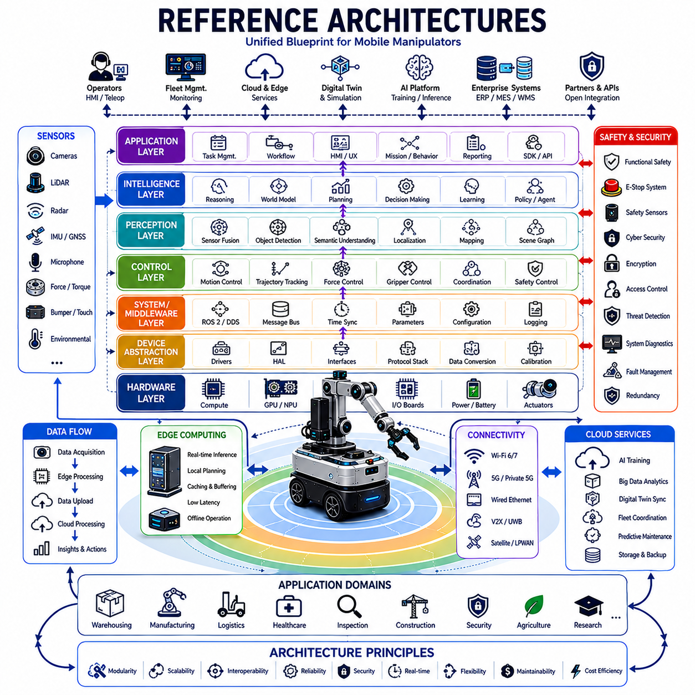{width="7.268055555555556in" height="7.268055555555556in"}

Reference Architectures serve as standardized blueprints that guide the design, development, integration, deployment, and evolution of mobile manipulator systems. While previous chapters have examined individual architectural domains such as mechanical systems, sensors, computing platforms, control frameworks, artificial intelligence, communication networks, safety mechanisms, and cloud-edge infrastructures, Reference Architectures bring these domains together into cohesive system-level designs. They provide reusable architectural patterns that reduce complexity, accelerate development, improve interoperability, and establish common engineering practices across robotic platforms.

In the evolution of modern robotics, the increasing complexity of mobile manipulators has made system integration one of the most challenging engineering disciplines. A mobile manipulator may contain dozens of sensors, multiple computing units, real-time controllers, AI accelerators, robotic arms, autonomous navigation modules, fleet management systems, cloud services, digital twins, cybersecurity frameworks, and human-machine interfaces. Without a structured architectural approach, system development can become fragmented, difficult to maintain, and costly to scale. Reference Architectures address this challenge by providing proven system structures that can be adapted to various applications.

A Reference Architecture does not describe a single product or implementation. Instead, it defines a conceptual framework that captures essential system components, interfaces, data flows, responsibilities, and design principles. Individual robotic products may implement the architecture differently, but the underlying structure remains consistent. This approach enables organizations to standardize development processes while maintaining flexibility for application-specific requirements.

The concept of Reference Architecture has long been used in information technology, telecommunications, aerospace systems, and industrial automation. In robotics, Reference Architectures have become increasingly important because robotic systems combine multiple engineering disciplines, including mechanical engineering, electrical engineering, software engineering, artificial intelligence, networking, safety engineering, and operational technology. A well-designed Reference Architecture provides a common language that enables specialists from these disciplines to collaborate effectively.

One of the primary benefits of Reference Architectures is modularity. Modern mobile manipulators must support different sensors, manipulators, computing platforms, software frameworks, and AI models. A modular architecture allows individual components to be upgraded or replaced without redesigning the entire system. This flexibility significantly improves maintainability, scalability, and lifecycle management.

Layered architecture is one of the most widely adopted reference models within robotics. In a layered architecture, system functions are organized according to abstraction levels. Lower layers handle hardware interaction, sensing, communication, and real-time control. Intermediate layers perform perception, localization, mapping, planning, and coordination. Upper layers manage task execution, mission management, AI reasoning, and fleet coordination. By separating concerns into layers, system complexity becomes more manageable.

The hardware layer typically forms the foundation of a mobile manipulator reference architecture. This layer includes sensors, actuators, motor controllers, batteries, communication interfaces, embedded devices, robotic arms, and mobile bases. The primary responsibility of the hardware layer is to provide physical capabilities and environmental interaction mechanisms.

Above the hardware layer lies the device abstraction layer. This layer isolates application software from hardware-specific implementations. Drivers, middleware adapters, hardware abstraction interfaces, and communication protocols provide standardized access to underlying devices. Hardware abstraction significantly simplifies software portability and system integration.

The perception layer transforms sensor measurements into meaningful environmental information. This layer includes computer vision systems, LiDAR processing modules, sensor fusion algorithms, object recognition models, human detection systems, environmental mapping components, and localization frameworks. Perception serves as the primary source of situational awareness throughout the robotic system.

The world modeling layer maintains internal representations of the robot, environment, tasks, and operational context. Maps, semantic models, digital twins, object databases, scene graphs, and world models provide structured information that supports reasoning and decision-making. As AI systems become more advanced, world modeling is increasingly viewed as a central architectural capability rather than a supporting function.

Planning and decision-making layers convert environmental understanding into executable actions. Navigation planners generate routes and trajectories. Manipulation planners calculate arm movements and grasp strategies. Task planners coordinate complex workflows involving multiple activities. Decision-making modules evaluate alternatives, optimize objectives, and select appropriate actions under uncertainty.

Control layers transform plans into physical motion. These layers include trajectory controllers, servo systems, force control modules, impedance control frameworks, and motion coordination systems. The control layer ensures that planned actions are executed accurately while maintaining stability, responsiveness, and safety.

Safety architecture is often represented as a parallel reference layer spanning the entire system. Unlike traditional functional layers, safety systems monitor and influence every architectural domain. Safety controllers, emergency stop systems, protective sensors, functional safety frameworks, cybersecurity protections, and fault management mechanisms operate continuously to maintain acceptable risk levels.

Artificial Intelligence has become sufficiently important to warrant dedicated architectural treatment within modern reference architectures. AI layers typically encompass perception intelligence, cognitive reasoning, task understanding, learning systems, foundation models, world models, policy generation, and autonomous decision-making capabilities. Future robotic systems will increasingly treat AI as a foundational architectural domain rather than an isolated subsystem.

Cloud and Edge Architecture introduces additional architectural dimensions. Edge systems execute latency-sensitive functions such as navigation, manipulation, safety monitoring, and local AI inference. Cloud systems provide large-scale analytics, fleet coordination, AI model training, digital twin synchronization, predictive maintenance, and long-term data management. Reference Architectures must clearly define how responsibilities are distributed across these computing environments.

Communication Architecture serves as the connective framework linking all architectural layers. Internal communication enables interaction among software modules, sensors, controllers, and AI systems. External communication connects robots with cloud platforms, fleet management systems, enterprise applications, digital twins, and human operators. Well-defined communication interfaces are essential for scalability and interoperability.

Reference Architectures frequently incorporate service-oriented design principles. Rather than building tightly coupled monolithic systems, modern architectures decompose functionality into independent services. Navigation services, perception services, manipulation services, localization services, AI services, and safety services communicate through standardized interfaces. Service-oriented architectures improve flexibility, maintainability, and scalability.

Microservice architectures extend this concept further by enabling fine-grained decomposition of robotic software. Individual functions can be independently developed, deployed, updated, and scaled. Container technologies such as Docker and orchestration frameworks such as Kubernetes increasingly influence cloud-connected robotic architectures, particularly within large-scale fleet deployments.

ROS2 has become one of the most influential frameworks shaping contemporary robotic reference architectures. Its distributed communication model, middleware abstraction, modular design philosophy, and support for heterogeneous computing environments align closely with modern architectural principles. Many commercial and research robotic platforms use ROS2 as the foundational middleware layer within their reference architectures.

The concept of autonomy levels also influences architectural design. Lower-autonomy systems may rely heavily on human supervision and predefined workflows. Higher-autonomy systems require advanced perception, reasoning, planning, learning, and adaptation capabilities. Reference Architectures must therefore accommodate a wide range of autonomy requirements while supporting future upgrades.

Industrial mobile manipulators often employ task-oriented reference architectures. In these systems, mission execution frameworks coordinate navigation, manipulation, inspection, transportation, maintenance, and interaction tasks. Behavior Trees, state machines, workflow engines, and orchestration frameworks are commonly used to manage operational logic.

Warehouse automation provides a representative example of a mobile manipulator reference architecture. The system typically integrates inventory management systems, warehouse management systems, autonomous navigation modules, object recognition systems, robotic manipulation capabilities, fleet coordination platforms, cloud analytics, and predictive maintenance services. Each component contributes to a unified operational architecture supporting end-to-end logistics automation.

Healthcare robotics introduces additional architectural considerations. Medical mobile manipulators may require regulatory compliance frameworks, patient interaction systems, medical device integration, privacy protection mechanisms, teleoperation capabilities, and clinical workflow management functions. Reference Architectures help ensure that these specialized requirements are addressed systematically.

Outdoor autonomous mobile manipulators present further architectural challenges. GNSS integration, geofencing, weather resilience, long-range communication, remote operations support, infrastructure interaction, and large-scale environmental mapping become critical components. Reference Architectures provide structured approaches for integrating these capabilities into coherent systems.

Defense, security, inspection, agriculture, mining, construction, and infrastructure maintenance applications each introduce unique architectural requirements. However, many underlying architectural principles remain consistent. Reference Architectures enable organizations to leverage common foundations while customizing domain-specific capabilities.

Interoperability represents a major objective of modern Reference Architectures. Robotic ecosystems increasingly involve products from multiple vendors operating within shared environments. Standardized interfaces, communication protocols, data models, semantic representations, and API frameworks facilitate integration across heterogeneous systems. Open architectures encourage innovation while reducing vendor lock-in.

Digital Twin Architecture is becoming a standard component of advanced reference models. Virtual representations of robotic systems enable simulation, testing, optimization, monitoring, training, and lifecycle management. Digital twins provide continuous feedback between operational environments and engineering processes, improving both system performance and development efficiency.

Cybersecurity Architecture is similarly evolving into a dedicated reference domain. Authentication systems, encryption frameworks, secure communication protocols, identity management systems, intrusion detection mechanisms, and secure software deployment pipelines are increasingly integrated into baseline architectural models.

Artificial Intelligence is driving the emergence of Cognitive Reference Architectures. These architectures integrate perception, memory, reasoning, planning, learning, language understanding, world modeling, and action generation into unified frameworks. Foundation Models, Vision-Language Models, Vision-Language-Action systems, and autonomous agents are becoming central architectural components.

Embodied AI is likely to redefine future robotic reference architectures. Rather than separating perception, planning, and control into distinct modules, embodied architectures may integrate sensing, cognition, memory, learning, and action within unified intelligence systems. Such architectures more closely resemble biological intelligence and may significantly improve adaptability and generalization.

Cloud-native robotics represents another emerging architectural paradigm. In cloud-native architectures, robotic capabilities are designed from the outset to operate within distributed computing environments. Edge devices, cloud services, AI infrastructure, digital twins, fleet management platforms, and enterprise systems function as components of a single integrated ecosystem.

The future of Reference Architectures will likely be characterized by increasing abstraction, modularity, intelligence, and interoperability. AI-native architectures, cloud-edge continuum architectures, distributed autonomous agent frameworks, digital twin ecosystems, collective robotic intelligence, and Physical AI systems will shape the next generation of mobile manipulator platforms.

Ultimately, Reference Architectures serve as the architectural foundation that transforms complex collections of technologies into coherent robotic systems. They provide structure, consistency, scalability, and engineering discipline across every phase of the system lifecycle. As mobile manipulators continue evolving toward higher levels of autonomy, intelligence, connectivity, and adaptability, Reference Architectures will play an increasingly important role in enabling efficient development, reliable deployment, and sustainable long-term evolution. They represent not merely technical diagrams, but strategic frameworks that guide the future of intelligent robotic systems.

참조 아키텍처(Reference Architecture)는 모바일 매니퓰레이터 시스템의 설계, 개발, 통합, 배포 및 진화를 위한 표준 청사진(Standard Blueprint) 역할을 수행한다. 앞선 장들에서 기계 아키텍처, 센서 아키텍처, 컴퓨트 아키텍처, 제어 아키텍처, AI 아키텍처, 통신 아키텍처, 안전 아키텍처, 클라우드 및 엣지 아키텍처와 같은 개별 기술 영역을 살펴보았다면, 참조 아키텍처는 이러한 모든 요소를 하나의 통합된 시스템 구조로 결합하는 역할을 수행한다. 즉, 참조 아키텍처는 복잡한 로봇 시스템을 설계할 때 활용할 수 있는 재사용 가능한 설계 패턴이며, 개발 속도를 향상시키고 시스템 간 호환성을 확보하며 유지보수와 확장성을 높이는 기반이 된다.

현대 모바일 매니퓰레이터는 수십 개의 센서, 여러 개의 컴퓨팅 장치, 실시간 제어기, AI 가속기, 로봇암, 자율주행 플랫폼, Fleet Management System, 클라우드 서비스, 디지털 트윈, 사이버 보안 체계, 인간-기계 인터페이스(HMI) 등으로 구성된다. 이러한 요소들을 체계적인 구조 없이 통합하면 시스템은 복잡해지고 유지보수가 어려워지며 확장성이 크게 저하된다. 참조 아키텍처는 이러한 문제를 해결하기 위해 검증된 시스템 구조를 제공한다.

참조 아키텍처는 특정 제품이나 특정 구현 방법을 정의하는 것이 아니다. 대신 시스템이 갖추어야 할 핵심 구성 요소, 인터페이스, 데이터 흐름, 책임 범위, 설계 원칙을 정의하는 개념적 프레임워크이다. 각 기업과 제품은 이를 기반으로 서로 다른 구현을 가질 수 있지만, 전체적인 구조와 원칙은 동일하게 유지된다. 이를 통해 표준화와 유연성을 동시에 확보할 수 있다.

참조 아키텍처라는 개념은 정보기술, 통신, 항공우주, 산업자동화 분야에서 오랫동안 사용되어 왔다. 로보틱스에서는 기계공학, 전자공학, 소프트웨어공학, 인공지능, 네트워크, 안전공학 등 다양한 기술 분야가 결합되기 때문에 참조 아키텍처의 중요성이 더욱 크다. 이는 서로 다른 전문 분야의 엔지니어들이 공통된 언어로 협업할 수 있도록 돕는다.

참조 아키텍처의 가장 큰 장점 중 하나는 모듈성(Modularity)이다. 현대 모바일 매니퓰레이터는 다양한 센서, 로봇암, 컴퓨팅 플랫폼, AI 모델을 지원해야 한다. 모듈형 구조를 사용하면 특정 구성 요소를 교체하거나 업그레이드하더라도 전체 시스템을 다시 설계할 필요가 없다. 이는 유지보수성과 확장성을 크게 향상시킨다.

계층형 아키텍처(Layered Architecture)는 로보틱스에서 가장 널리 사용되는 참조 모델 중 하나이다. 계층형 구조에서는 시스템 기능을 추상화 수준에 따라 나눈다. 하위 계층은 하드웨어와 실시간 제어를 담당하고, 중간 계층은 인지와 계획을 담당하며, 상위 계층은 작업 수행과 의사결정을 담당한다. 이러한 구조는 복잡성을 줄이고 각 계층의 역할을 명확하게 정의한다.

하드웨어 계층(Hardware Layer)은 참조 아키텍처의 가장 기본적인 구성 요소이다. 이 계층에는 센서, 액추에이터, 모터 드라이버, 배터리, 통신 인터페이스, 임베디드 장치, 이동 플랫폼, 로봇암 등이 포함된다. 하드웨어 계층의 역할은 물리적인 기능과 환경과의 상호작용 능력을 제공하는 것이다.

하드웨어 계층 위에는 디바이스 추상화 계층(Device Abstraction Layer)이 위치한다. 이 계층은 응용 소프트웨어가 하드웨어의 세부 구현에 의존하지 않도록 지원한다. 드라이버, 미들웨어 어댑터, 하드웨어 추상화 인터페이스(HAL), 통신 프로토콜이 여기에 포함된다. 이를 통해 소프트웨어의 이식성과 재사용성을 크게 향상시킬 수 있다.

인지 계층(Perception Layer)은 센서 데이터를 의미 있는 정보로 변환한다. 이 계층은 컴퓨터 비전, LiDAR 처리, 센서 융합, 객체 인식, 사람 인식, 환경 지도 생성, 위치추정 기능을 포함한다. 인지 계층은 로봇의 상황 인식(Situational Awareness)을 제공하는 핵심 요소이다.

월드 모델 계층(World Modeling Layer)은 로봇과 환경에 대한 내부 표현을 유지한다. 지도(Map), 의미론적 모델(Semantic Model), 디지털 트윈, 객체 데이터베이스, Scene Graph, World Model 등이 여기에 포함된다. 이러한 구조는 AI 기반 추론과 의사결정을 가능하게 한다.

계획 및 의사결정 계층(Planning and Decision Layer)은 환경 정보를 기반으로 실행 가능한 행동을 생성한다. 자율주행 계획기는 경로를 생성하고, 조작 계획기는 로봇암 동작을 계산하며, 작업 계획기는 복잡한 작업 순서를 생성한다. 의사결정 모듈은 여러 선택지 중 최적의 행동을 선택한다.

제어 계층(Control Layer)은 계획 결과를 실제 움직임으로 변환한다. 궤적 제어기, 서보 시스템, 힘 제어, 임피던스 제어, 협조 제어 기능 등이 포함된다. 제어 계층은 계획된 행동이 정확하고 안정적으로 실행되도록 보장한다.

안전 아키텍처는 일반적으로 전체 시스템을 가로지르는 독립적인 계층으로 표현된다. 안전 제어기, 비상 정지 시스템, 보호 센서, 기능 안전 프레임워크, 사이버 보안 기능, 고장 관리 기능은 모든 계층을 지속적으로 감시하며 위험을 최소화한다.

최근에는 AI가 충분히 중요한 역할을 수행하기 때문에 AI 전용 계층이 참조 아키텍처의 일부로 포함되는 경우가 많다. AI 계층은 인지 지능, 추론, 학습, Foundation Model, World Model, 정책 생성, 자율 의사결정을 담당한다. 미래의 로봇 시스템에서는 AI가 하나의 부가 기능이 아니라 핵심 아키텍처 계층으로 자리 잡게 될 것이다.

클라우드 및 엣지 아키텍처는 참조 아키텍처에 새로운 차원을 추가한다. 엣지 계층은 실시간성이 필요한 기능을 담당하고, 클라우드는 대규모 분석, Fleet 관리, AI 학습, 디지털 트윈 동기화, 예지 정비를 수행한다. 참조 아키텍처는 이러한 역할 분담을 명확하게 정의해야 한다.

통신 아키텍처는 모든 계층을 연결하는 신경망 역할을 한다. 내부 통신은 센서, 제어기, AI 모듈 간의 데이터 교환을 지원하고, 외부 통신은 클라우드, Fleet 시스템, 기업 시스템, 운영자와의 연결을 담당한다. 잘 정의된 통신 인터페이스는 시스템 확장성과 상호운용성을 향상시킨다.

현대 참조 아키텍처는 서비스 지향 설계(Service-Oriented Architecture)를 적극적으로 활용한다. 자율주행 서비스, 인지 서비스, 조작 서비스, 위치추정 서비스, AI 서비스, 안전 서비스가 독립적으로 운영되면서 표준 인터페이스를 통해 연결된다. 이러한 구조는 유연성과 유지보수성을 크게 향상시킨다.

최근에는 마이크로서비스(Microservice) 개념도 로보틱스에 적용되고 있다. 각 기능을 독립적으로 개발, 배포, 업데이트할 수 있으며, Docker와 Kubernetes 같은 기술이 클라우드 기반 로봇 시스템에서 활용되고 있다.

ROS2는 현대 로봇 참조 아키텍처에 가장 큰 영향을 준 프레임워크 중 하나이다. ROS2의 분산 통신 구조, 미들웨어 추상화, 모듈형 설계 철학은 현대 참조 아키텍처의 핵심 원칙과 잘 부합한다. 현재 많은 연구용 및 상용 모바일 매니퓰레이터가 ROS2를 기반으로 개발되고 있다.

자율성 수준(Level of Autonomy)도 참조 아키텍처 설계에 영향을 준다. 낮은 자율성 시스템은 인간의 개입에 크게 의존하지만, 높은 자율성 시스템은 인지, 추론, 계획, 학습 능력을 내장해야 한다. 따라서 참조 아키텍처는 다양한 자율성 수준을 지원할 수 있어야 한다.

산업용 모바일 매니퓰레이터는 일반적으로 작업 중심(Task-Oriented) 참조 아키텍처를 사용한다. 여기에는 자율주행, 조작, 검사, 운반, 유지보수, 인간 상호작용 기능이 통합되며, Behavior Tree, State Machine, Workflow Engine이 전체 작업 흐름을 관리한다.

창고 자동화는 대표적인 모바일 매니퓰레이터 참조 아키텍처 사례이다. 이 구조는 WMS(Warehouse Management System), 자율주행 시스템, 객체 인식 시스템, 조작 기능, Fleet 관리 플랫폼, 클라우드 분석 시스템을 통합하여 엔드투엔드 물류 자동화를 구현한다.

의료 로보틱스는 또 다른 특수한 참조 아키텍처를 요구한다. 의료 규제 준수, 환자 상호작용, 의료 장비 연동, 개인정보 보호, 원격 진료, 임상 워크플로우 관리 기능이 추가되어야 한다.

실외 자율주행 모바일 매니퓰레이터는 GNSS, 지오펜싱, 장거리 통신, 원격 관제, 대규모 지도 생성 기능을 포함해야 한다. 참조 아키텍처는 이러한 요소를 체계적으로 통합하는 역할을 수행한다.

국방, 보안, 검사, 농업, 광산, 건설, 인프라 유지보수와 같은 다양한 응용 분야는 각각 특수한 요구사항을 가진다. 그러나 기본적인 참조 아키텍처 원칙은 상당 부분 공통적으로 적용될 수 있다.

상호운용성(Interoperability)은 현대 참조 아키텍처의 핵심 목표 중 하나이다. 미래의 로봇 생태계는 다양한 제조사의 시스템이 함께 운영되는 환경으로 발전할 것이다. 이를 위해 표준 인터페이스, 표준 데이터 모델, API, 통신 프로토콜이 중요해지고 있다.

디지털 트윈은 점차 표준 참조 아키텍처의 일부가 되고 있다. 디지털 트윈은 시뮬레이션, 테스트, 최적화, 운영 모니터링, 교육, 수명주기 관리를 지원하며 실제 시스템과 가상 시스템을 연결하는 역할을 수행한다.

사이버 보안 아키텍처 역시 독립적인 참조 영역으로 발전하고 있다. 인증 시스템, 암호화, 보안 통신, 접근 제어, 침입 탐지, 보안 배포 체계는 현대 참조 아키텍처에서 필수 요소가 되고 있다.

인공지능의 발전은 인지형 참조 아키텍처(Cognitive Reference Architecture)의 등장을 이끌고 있다. 이러한 구조는 인지, 기억, 추론, 계획, 학습, 언어 이해, 행동 생성을 통합한다. Foundation Model, VLM, VLA, Autonomous Agent는 핵심 구성 요소로 자리 잡고 있다.

Embodied AI는 미래 참조 아키텍처를 근본적으로 변화시킬 가능성이 있다. 기존에는 인지, 계획, 제어가 분리되어 있었지만, 미래에는 감각, 기억, 학습, 행동이 하나의 통합된 지능 구조 안에서 작동할 수 있다. 이는 인간의 인지 구조와 더욱 유사한 시스템을 가능하게 한다.

클라우드 네이티브 로보틱스(Cloud-Native Robotics)는 또 다른 새로운 패러다임이다. 로봇은 처음부터 클라우드, 엣지, 디지털 트윈, AI 플랫폼, Fleet 시스템과 함께 동작하도록 설계된다. 이는 개별 로봇 중심에서 생태계 중심의 설계로의 전환을 의미한다.

미래의 참조 아키텍처는 더욱 높은 수준의 추상화, 모듈화, 지능화, 상호운용성을 지향할 것이다. AI-Native Architecture, Cloud-Edge Continuum, 분산 자율 에이전트, 디지털 트윈 생태계, 집단 지능(Collective Intelligence), Physical AI가 핵심 요소가 될 것으로 예상된다.

결국 참조 아키텍처는 다양한 기술 요소를 하나의 일관된 로봇 시스템으로 통합하는 설계의 기반이다. 이는 단순한 기술 다이어그램이 아니라 시스템 개발, 운영, 확장, 진화 전반을 이끄는 전략적 프레임워크이다. 모바일 매니퓰레이터가 더욱 자율적이고 지능적이며 연결된 시스템으로 발전할수록 참조 아키텍처의 중요성은 더욱 커질 것이며, 이는 차세대 지능형 로봇 시스템의 설계와 발전 방향을 결정하는 핵심 기준이 될 것이다.
