**Volume 01. Mobile Manipulator Foundations and System Architecture**

# Chapter 03. System Architecture

System architecture is the foundation upon which every successful mobile manipulator is built. While a mobile manipulator may appear to be simply an Autonomous Mobile Robot (AMR) carrying a robotic arm, the reality is far more complex. A modern mobile manipulator is a highly integrated cyber-physical system that combines mechanical structures, electrical subsystems, sensing technologies, computing platforms, communication networks, control software, artificial intelligence, and safety mechanisms into a unified operational architecture. Understanding system architecture is therefore essential for designing, developing, deploying, and maintaining reliable mobile manipulation systems.

The primary objective of system architecture is to organize all system components into a coherent structure that enables efficient operation while meeting performance, safety, reliability, and scalability requirements. Unlike traditional industrial robots that operate within fixed work cells, mobile manipulators must function in dynamic and often unpredictable environments. They must simultaneously navigate, perceive, plan, manipulate, communicate, and interact with humans. This creates a level of system complexity that requires a carefully designed architecture spanning multiple engineering domains.

At the mechanical level, the architecture includes the mobile base, robotic arm, end-effector, structural frame, battery enclosure, suspension systems, and payload interfaces. The mechanical architecture determines the robot's physical capabilities, including payload capacity, reach, stability, mobility, and durability. Design decisions such as wheel configuration, arm placement, center of gravity, and chassis geometry directly influence overall system performance. The interaction between the mobile platform and manipulator introduces unique challenges related to vibration, dynamic stability, structural stiffness, and motion coordination.

The electrical architecture serves as the nervous system of the robot. It distributes power throughout the platform while supporting sensors, actuators, computers, communication devices, and safety systems. Typical mobile manipulators employ high-voltage battery systems, power distribution units, motor controllers, DC-DC converters, safety relays, and emergency stop circuits. Proper electrical architecture is critical not only for functionality but also for reliability, maintainability, electromagnetic compatibility, and safety compliance.

The sensor architecture provides the robot with situational awareness. Modern mobile manipulators rely on a diverse set of sensors including LiDARs, RGB cameras, depth cameras, IMUs, force-torque sensors, wheel encoders, GNSS receivers, safety scanners, tactile sensors, and environmental monitoring devices. These sensors generate enormous amounts of data that must be processed and fused in real time. Sensor fusion enables the robot to build accurate world models, localize itself, detect obstacles, recognize objects, estimate poses, and monitor operational conditions.

The computing architecture acts as the robot's brain. Contemporary systems often include multiple processing layers ranging from microcontrollers and real-time controllers to edge computers equipped with GPUs and AI accelerators. Different computing resources are allocated to navigation, perception, manipulation, safety monitoring, mission planning, and AI workloads. Distributed computing architectures are increasingly common because they improve modularity, fault tolerance, and scalability. Edge-cloud hybrid architectures further extend computational capabilities by leveraging cloud-based analytics, digital twins, and fleet management systems.

Control architecture forms the operational core of the mobile manipulator. It coordinates all system components and ensures that individual subsystems function together as a unified robot. Control architectures are typically organized hierarchically. Low-level controllers manage motor drives and joint control loops. Mid-level controllers coordinate navigation, localization, and manipulation. High-level planners handle task execution, mission management, and decision-making. Effective control architecture must support deterministic behavior, real-time responsiveness, and safe interaction with dynamic environments.

Artificial intelligence architecture is becoming increasingly important as robots transition from automation systems to intelligent autonomous agents. AI components enable object recognition, semantic understanding, task planning, anomaly detection, predictive maintenance, and human-robot interaction. Foundation models, Vision-Language Models (VLMs), and Vision-Language-Action (VLA) architectures are beginning to reshape robotic system design by introducing reasoning and adaptive decision-making capabilities. Future mobile manipulators will rely heavily on AI architectures that integrate perception, cognition, and action into a continuous operational loop.

Communication architecture provides connectivity both within the robot and across external systems. Internal communication networks typically utilize Ethernet, CAN, EtherCAT, RS-485, USB, and industrial fieldbus technologies. External communication may involve Wi-Fi, 5G, LTE, private wireless networks, cloud services, and fleet management platforms. Communication architecture must ensure low latency, reliability, cybersecurity, and interoperability between heterogeneous devices and software systems.

Safety architecture is one of the most critical aspects of mobile manipulator design. Because these robots operate in shared environments alongside humans, safety cannot be treated as an afterthought. Safety architecture encompasses functional safety, collision avoidance, safety-rated sensors, emergency stop systems, safe motion control, risk mitigation strategies, and compliance with international standards. The architecture must ensure that failures do not result in unacceptable hazards while maintaining productivity and operational efficiency.

Modern mobile manipulators are increasingly connected to broader digital ecosystems. Cloud robotics, digital twins, simulation environments, remote operations centers, fleet management systems, and MLOps infrastructures are becoming integral parts of the overall architecture. These technologies enable continuous monitoring, software updates, performance optimization, predictive maintenance, and data-driven operational improvements throughout the robot lifecycle.

Ultimately, system architecture serves as the blueprint that transforms a collection of hardware and software components into a coherent robotic system. A well-designed architecture provides scalability, maintainability, reliability, and future extensibility. As mobile manipulators evolve toward higher levels of autonomy, intelligence, and collaboration, system architecture will remain the key discipline that enables successful integration across all technological domains. Understanding the principles and practices of mobile manipulator architecture is therefore essential for engineers, researchers, system integrators, and product developers seeking to build the next generation of intelligent robotic systems.

## 01 System Architecture Overview

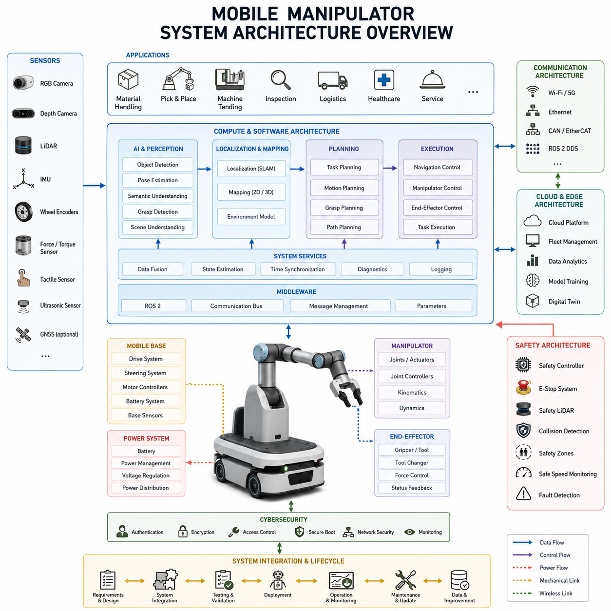{width="7.268055555555556in" height="7.268055555555556in"}

A mobile manipulator is one of the most important developments in modern robotics because it combines autonomous mobility and robotic manipulation into a single integrated system. Traditional industrial robots are highly effective within fixed workspaces, while Autonomous Mobile Robots (AMRs) excel at navigating dynamic environments. However, many real-world tasks require both capabilities simultaneously. A robot may need to travel across a warehouse, identify a target object, approach a shelf, grasp an item, transport it to another location, and place it accurately. Such tasks require the seamless integration of mobility, perception, intelligence, manipulation, communication, and safety. The system architecture of a mobile manipulator provides the framework that enables all of these functions to work together as a unified robotic platform.

The architecture of a mobile manipulator can be understood as a hierarchical structure composed of multiple subsystems. At the highest level, the system includes a mobile base, a robotic manipulator, sensing systems, computing infrastructure, control software, communication networks, safety mechanisms, and application-level intelligence. Each subsystem performs a specialized function, but the overall performance of the robot depends on the degree of integration among these components. The architecture must therefore be designed not only to maximize the performance of individual subsystems but also to ensure efficient coordination between them.

The mobile base serves as the locomotion subsystem of the robot. It enables the robot to move through factories, warehouses, hospitals, offices, airports, and public facilities. Depending on the application, the base may use differential drive, omnidirectional wheels, mecanum wheels, Ackermann steering, tracked mechanisms, or hybrid locomotion systems. The primary responsibility of the mobile platform is to transport the manipulation system to the required work location while maintaining stability, accuracy, and safety. Navigation performance directly affects the effectiveness of the manipulation task because grasping operations often require precise positioning of the robot relative to the target object.

Mounted on the mobile platform is the robotic manipulator. The manipulator may consist of four, six, seven, or more degrees of freedom depending on the required workspace and dexterity. The manipulator extends the capabilities of the mobile platform by enabling interaction with the physical environment. Through coordinated motion of its joints, the robot can pick objects, place components, operate machinery, open doors, press buttons, load materials, and perform many other tasks. The manipulator transforms the robot from a transportation system into an active physical worker capable of performing productive operations.

At the end of the manipulator is the end-effector, which directly interacts with objects and environments. End-effectors may include parallel grippers, adaptive grippers, vacuum suction systems, magnetic grippers, tool changers, specialized industrial tools, or multifunctional robotic hands. The choice of end-effector significantly influences the capabilities of the overall system. Warehouse picking applications may favor vacuum grippers, while industrial assembly tasks may require force-sensitive parallel grippers. Service robots operating in human environments may require dexterous robotic hands capable of handling diverse objects safely.

Perception forms another critical layer within the system architecture. A mobile manipulator must continuously perceive its surroundings to understand the environment, identify objects, detect obstacles, estimate poses, and monitor task execution. Modern robotic systems employ a combination of sensors including RGB cameras, depth cameras, stereo vision systems, LiDAR sensors, ultrasonic sensors, force-torque sensors, tactile sensors, inertial measurement units, wheel encoders, and GNSS receivers when outdoor operation is required. These sensors provide complementary information that enables the robot to build a comprehensive understanding of the world around it.

Sensor fusion is a key architectural concept that combines information from multiple sensing modalities into a unified representation. For example, LiDAR may provide highly accurate geometric measurements, while cameras provide semantic understanding of objects and scenes. IMUs contribute motion estimation, and force sensors provide feedback during physical interactions. Through sensor fusion algorithms, the robot achieves greater robustness, accuracy, and reliability than would be possible using any individual sensor alone.

The computing architecture serves as the brain of the mobile manipulator. Modern robotic systems typically employ heterogeneous computing platforms consisting of CPUs, GPUs, AI accelerators, microcontrollers, and real-time control processors. High-level perception and artificial intelligence algorithms often execute on GPU-equipped edge computers, while real-time motion control functions run on dedicated controllers. This separation ensures that computationally intensive AI workloads do not interfere with safety-critical control loops.

Within the computing layer, software components are organized into functional modules. These modules include localization, mapping, navigation, perception, object recognition, motion planning, manipulation planning, task execution, safety monitoring, fleet management, and system diagnostics. Middleware frameworks such as ROS2 provide communication infrastructure that allows these modules to exchange information efficiently. This modular approach simplifies development, maintenance, scalability, and integration with third-party technologies.

Localization is a foundational capability within the architecture. The robot must continuously estimate its position and orientation within the environment. Localization methods may rely on LiDAR-based SLAM, visual SLAM, GNSS positioning, fiducial markers, or hybrid approaches. Accurate localization is essential because manipulation tasks often require centimeter-level precision. Errors in localization can propagate throughout the system and negatively affect navigation, object acquisition, and task completion.

Mapping capabilities enable the robot to create and maintain digital representations of its environment. Maps may contain geometric information, semantic information, occupancy grids, point clouds, or three-dimensional scene reconstructions. These maps provide the foundation for path planning, obstacle avoidance, task planning, and environmental understanding. As robots increasingly operate in dynamic environments, maps must be continuously updated to reflect changes in surroundings.

Navigation architecture determines how the robot moves from one location to another. Navigation systems generally consist of global planning, local planning, obstacle avoidance, trajectory generation, and motion execution. Global planners determine efficient routes through the environment, while local planners react to immediate obstacles and environmental changes. The navigation subsystem must balance efficiency, safety, smoothness, and task objectives while operating in real time.

Manipulation architecture is responsible for controlling the robotic arm and end-effector. This subsystem includes inverse kinematics, trajectory planning, collision avoidance, grasp planning, force control, and motion execution. Advanced mobile manipulators coordinate the motion of both the base and arm simultaneously, enabling whole-body manipulation. Such coordination expands the reachable workspace and improves task efficiency by allowing the robot to reposition itself dynamically during operations.

Artificial intelligence has become a central element of modern mobile manipulator architectures. AI algorithms support perception, decision-making, manipulation, and autonomous behavior generation. Deep learning models enable object detection, semantic segmentation, pose estimation, grasp prediction, anomaly detection, and scene understanding. Vision-Language Models and Vision-Language-Action models further enhance the robot's ability to understand natural language instructions and translate them into executable actions.

Task planning occupies a higher layer of the architecture. While navigation and manipulation focus on individual motions, task planning determines what actions should be performed and in what sequence. A warehouse robot may receive an order consisting of multiple items located in different storage locations. The task planner decomposes the mission into navigation goals, object retrieval actions, transportation tasks, and delivery operations. Effective task planning improves productivity and resource utilization.

Communication architecture enables information exchange between subsystems and external infrastructure. Internal communication networks often utilize Ethernet, CAN bus, EtherCAT, USB, serial interfaces, and wireless protocols. External communication may involve Wi-Fi, private 5G networks, cloud platforms, enterprise software systems, fleet management servers, and digital twin environments. Reliable communication is essential for coordinated operation and remote supervision.

Cloud and edge computing architectures are increasingly important in large-scale robotic deployments. Edge computing provides low-latency processing for perception and control, while cloud platforms support fleet management, data analytics, machine learning model training, software updates, and long-term storage. The combination of edge and cloud resources enables scalable robotic ecosystems capable of supporting thousands of deployed robots.

Safety architecture is a fundamental requirement throughout the entire system. Safety cannot be treated as an isolated subsystem but must be integrated into every layer of the architecture. Safety mechanisms include emergency stop systems, safety LiDARs, collision detection algorithms, safe speed monitoring, safety zones, redundant sensors, fault detection, and functional safety controllers. These mechanisms ensure that the robot can operate safely in environments shared with humans.

Cybersecurity has also become an essential architectural consideration. As robots become increasingly connected, they become potential targets for cyberattacks. Secure communication protocols, authentication mechanisms, encrypted data transmission, secure boot processes, access control systems, and continuous security monitoring help protect robotic systems from unauthorized access and malicious activities.

System integration represents one of the greatest challenges in mobile manipulator development. Each subsystem may function correctly in isolation, yet overall system performance depends on successful integration. Developers must ensure synchronization among sensors, controllers, planners, AI models, and communication networks. Latency, timing consistency, computational resource allocation, and software compatibility must all be carefully managed.

A well-designed mobile manipulator architecture follows principles of modularity, scalability, maintainability, and extensibility. Modular architectures allow individual components to be upgraded without redesigning the entire system. Scalable architectures support deployment across multiple robot models and application domains. Maintainable architectures simplify troubleshooting and long-term support. Extensible architectures enable future incorporation of emerging technologies such as foundation models, embodied AI systems, advanced manipulation algorithms, and autonomous agent frameworks.

As robotics continues to evolve, system architectures are becoming increasingly intelligent, distributed, and adaptive. Future mobile manipulators will integrate advanced perception, foundation AI models, multi-robot collaboration, cloud-native infrastructure, and autonomous decision-making capabilities into unified robotic ecosystems. Rather than functioning as isolated machines, these robots will operate as interconnected agents capable of understanding complex environments, learning from experience, collaborating with humans, and performing a wide range of physical tasks with minimal supervision.

The system architecture overview therefore serves as the foundation for understanding every other aspect of mobile manipulator technology. Mechanical systems, electrical systems, sensors, computing platforms, control algorithms, artificial intelligence, communication networks, and safety mechanisms all converge within this architecture. Together they create a robotic system capable of combining mobility, perception, cognition, and manipulation into a single intelligent platform that represents one of the most promising directions in the future of robotics.

## 02 Mechanical Architecture

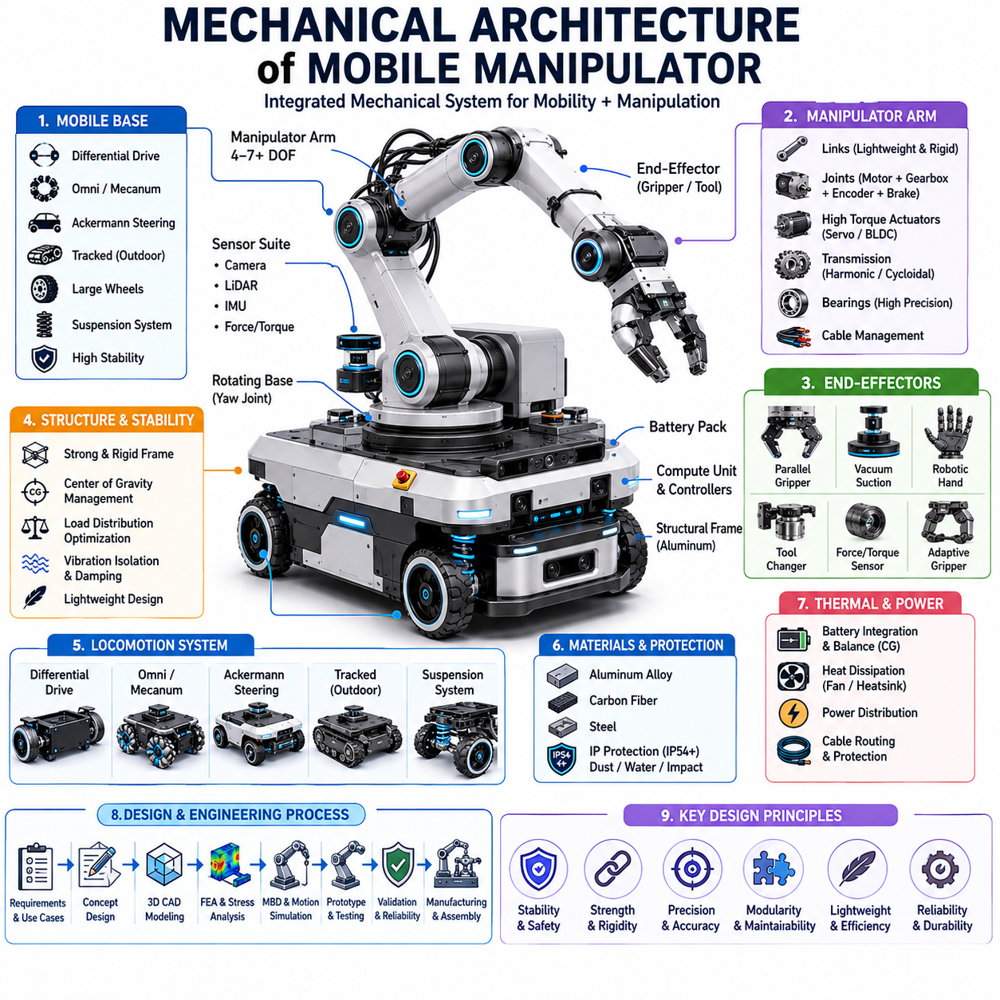{width="7.268055555555556in" height="7.268055555555556in"}

Mechanical architecture is the physical foundation of a mobile manipulator system. While software, artificial intelligence, sensing technologies, and control algorithms often receive significant attention, the mechanical architecture ultimately determines whether the robot can safely, reliably, and efficiently perform real-world tasks. Every movement, manipulation action, navigation behavior, and interaction with the environment depends on the quality of the underlying mechanical design. A mobile manipulator may possess advanced perception and planning capabilities, but without a robust mechanical structure, it cannot effectively translate intelligence into productive physical work.

The mechanical architecture of a mobile manipulator can be viewed as the integration of two traditionally separate robotic domains. The first domain is mobile robotics, which focuses on locomotion, navigation, and transportation. The second domain is robotic manipulation, which focuses on object handling, dexterous motion, and physical interaction. The challenge of mechanical architecture lies in combining these two domains into a unified platform while maintaining stability, payload capacity, maneuverability, safety, and operational efficiency.

At the highest level, a mobile manipulator consists of a mobile base, a manipulator arm, an end-effector, structural support systems, power distribution mechanisms, sensor mounting structures, and protective enclosures. These subsystems must work together as a single integrated mechanical platform capable of performing complex tasks in dynamic environments.

The mobile base serves as the structural and locomotion foundation of the system. It supports all upper-body components, including batteries, controllers, sensors, manipulators, and payloads. The base must provide sufficient rigidity to withstand dynamic loads while maintaining dimensional accuracy during operation. Structural deformation, vibration, and flexing can negatively affect navigation accuracy, manipulation precision, and sensor performance.

The design of the mobile base is heavily influenced by application requirements. Warehouse robots often prioritize compact dimensions and maneuverability to navigate narrow aisles. Industrial robots may emphasize payload capacity and robustness. Hospital service robots require smooth movement and safe human interaction characteristics. Outdoor mobile manipulators must tolerate uneven terrain, weather exposure, vibration, dust, and impact loading.

Locomotion systems represent one of the most critical elements of the mechanical architecture. Various drive mechanisms are employed depending on environmental requirements. Differential drive systems are among the most common due to their simplicity, reliability, and low cost. These systems use independently controlled wheels on each side of the robot to generate motion and steering.

Omnidirectional drive systems provide greater maneuverability by allowing movement in multiple directions without changing orientation. Mecanum wheels and omni wheels enable lateral movement, rotational motion, and complex trajectory execution. Such capabilities are particularly useful in constrained industrial environments where precise positioning is required.

Ackermann steering mechanisms are frequently used in larger outdoor robots. Inspired by automotive steering systems, Ackermann configurations provide stable high-speed operation and efficient navigation over long distances. Outdoor mobile manipulators operating in logistics yards, industrial facilities, campuses, and public infrastructure environments often utilize this approach.

Tracked locomotion systems provide superior terrain adaptability and traction. These systems are suitable for construction sites, agricultural fields, military applications, and disaster response scenarios. Although tracks offer improved mobility on challenging terrain, they typically introduce higher energy consumption, greater mechanical complexity, and increased maintenance requirements.

Wheel selection is a fundamental mechanical design decision. Wheel diameter directly influences obstacle-climbing capability, ground clearance, energy efficiency, and ride comfort. Larger wheels improve terrain adaptability but increase overall robot dimensions and weight. Smaller wheels reduce size and cost but limit performance on uneven surfaces.

Suspension systems play an increasingly important role as mobile manipulators expand into outdoor and semi-structured environments. A well-designed suspension system absorbs shocks, reduces vibration, improves traction, and protects sensitive components. Suspension mechanisms also contribute to maintaining manipulator stability during navigation and manipulation operations.

The structural frame forms the backbone of the entire robot. The frame must support static loads, dynamic loads, shock loads, and fatigue loads throughout the operational life of the system. Structural design requires careful consideration of strength, stiffness, weight, manufacturability, and cost.

Common structural materials include aluminum alloys, steel alloys, stainless steel, carbon fiber composites, and advanced engineering polymers. Aluminum is widely used due to its favorable strength-to-weight ratio and corrosion resistance. Steel provides superior strength and durability but increases weight. Composite materials offer exceptional weight reduction but may increase manufacturing complexity and cost.

Weight optimization is a critical aspect of mechanical architecture. Excessive weight increases power consumption, reduces battery life, limits mobility, and raises manufacturing costs. However, excessive weight reduction may compromise structural integrity and safety. Engineers must therefore balance lightweight design objectives with robustness requirements.

One of the most important considerations in mobile manipulator design is center of gravity management. Unlike stationary industrial robots, mobile manipulators experience continuous changes in mass distribution due to arm motion, payload handling, acceleration, deceleration, and terrain variations. Improper center of gravity positioning can result in instability, wheel slippage, reduced manipulation accuracy, or even tip-over accidents.

Center of gravity analysis must account for multiple operating scenarios. The robot may carry different payloads, extend the manipulator to varying positions, travel at different speeds, and operate on inclined surfaces. Mechanical designers typically evaluate worst-case conditions to ensure adequate stability margins.

The manipulator arm itself represents a highly sophisticated mechanical subsystem. It consists of multiple links connected through rotary or linear joints. The geometry of the manipulator directly determines workspace, reachability, dexterity, payload capacity, and motion efficiency.

Manipulator design begins with determining the required number of degrees of freedom. Four-degree-of-freedom systems may be sufficient for simple pick-and-place operations. Six-degree-of-freedom systems enable full spatial positioning and orientation control. Seven-degree-of-freedom systems introduce kinematic redundancy, allowing greater flexibility in obstacle avoidance and motion optimization.

Link design significantly influences manipulator performance. Longer links increase reachable workspace but also amplify structural deflection and dynamic loading. Shorter links improve rigidity but limit operational flexibility. Designers must optimize link dimensions based on application-specific requirements.

Joint mechanisms are among the most mechanically demanding components in the robot. Joints contain actuators, gearboxes, bearings, encoders, brakes, and transmission systems. These components must deliver sufficient torque, accuracy, repeatability, and reliability throughout the operational lifetime.

Actuator selection depends on performance requirements. Brushless DC motors dominate modern robotic systems due to their efficiency, precision, and reliability. Servo motors provide closed-loop control capabilities that enable accurate position, velocity, and torque regulation.

Transmission systems convert actuator output into usable joint motion. Harmonic drives are widely used because they provide high reduction ratios, compact packaging, and near-zero backlash. Cycloidal drives offer excellent shock resistance and durability. Planetary gearboxes provide a balance between performance, cost, and efficiency.

Bearings are essential for supporting loads and ensuring smooth motion. Proper bearing selection directly affects accuracy, durability, maintenance intervals, and overall system reliability. High-performance manipulators often utilize precision bearings designed specifically for robotic applications.

End-effectors form the interface between the robot and the external environment. Mechanical architecture must support a wide variety of end-effector types depending on the target application. Parallel grippers are commonly used for industrial handling tasks. Adaptive grippers accommodate objects with varying shapes and sizes. Vacuum systems are effective for packaging and logistics applications. Multifinger robotic hands provide human-like dexterity for advanced manipulation tasks.

Tool-changing mechanisms significantly enhance robot versatility. Rather than relying on a single end-effector, the robot can automatically switch between grippers, screwdrivers, inspection tools, welding equipment, or specialized instruments. This capability transforms a mobile manipulator into a multifunctional robotic platform.

Mechanical compliance is becoming increasingly important in collaborative robotics. Traditional industrial robots emphasized maximum rigidity and positional accuracy. However, robots operating alongside humans must safely absorb unexpected impacts and adapt to uncertain environments. Mechanical compliance can be achieved through flexible joints, elastic components, compliant actuators, or specialized transmission mechanisms.

Series Elastic Actuators represent one example of compliant mechanical design. By introducing elastic elements between the motor and load, these actuators improve force control performance and reduce impact forces during collisions. Such designs are particularly valuable in human-robot collaboration scenarios.

Sensor integration is another major aspect of mechanical architecture. Cameras, LiDAR sensors, IMUs, force-torque sensors, tactile arrays, and environmental sensors require carefully designed mounting structures. Sensor placement affects field of view, measurement accuracy, environmental protection, maintenance accessibility, and calibration procedures.

Mechanical architecture must also address environmental protection requirements. Industrial robots may encounter dust, moisture, vibration, chemicals, electromagnetic interference, and extreme temperatures. Appropriate enclosure design is necessary to achieve desired ingress protection ratings and operational reliability.

Thermal management is increasingly important as computational and power densities continue to increase. Batteries, power electronics, motor controllers, GPUs, and AI accelerators generate significant heat during operation. Mechanical architecture must provide effective heat dissipation pathways through conduction, convection, and active cooling systems.

Battery integration introduces additional mechanical design challenges. Batteries are often among the heaviest components in the robot and significantly influence center of gravity location. Mechanical designers must balance accessibility, protection, thermal performance, serviceability, and weight distribution when positioning battery packs.

Maintenance considerations should be incorporated from the earliest stages of mechanical design. Components requiring periodic inspection or replacement should be easily accessible. Modular assemblies simplify maintenance procedures, reduce downtime, and improve overall operational efficiency.

Manufacturing strategy also influences mechanical architecture. Designs intended for low-volume production may prioritize flexibility and rapid prototyping. Mass-production systems require standardized components, simplified assembly procedures, and cost-optimized manufacturing methods. Design for Manufacturing and Design for Assembly principles help ensure successful commercialization.

Reliability engineering plays a critical role in mechanical system development. Fatigue analysis, vibration testing, impact testing, environmental validation, and accelerated life testing are used to verify long-term durability. Mobile manipulators operating continuously in industrial environments may accumulate tens of thousands of operational hours over their service life.

Digital engineering tools have transformed modern mechanical architecture development. Computer-Aided Design, Finite Element Analysis, Multi-Body Dynamics Simulation, Digital Twins, and Virtual Prototyping allow engineers to evaluate performance before physical prototypes are built. These tools reduce development time, lower costs, and improve design quality.

As mobile manipulation technology advances, mechanical architectures are becoming more intelligent, modular, and adaptive. Future systems will incorporate lightweight composite structures, integrated sensing components, variable stiffness mechanisms, self-reconfigurable modules, advanced actuator technologies, and bio-inspired designs. Mechanical systems will increasingly be optimized not only for strength and performance but also for seamless integration with artificial intelligence and autonomous decision-making systems.

Ultimately, the mechanical architecture of a mobile manipulator serves as the physical embodiment of robotic intelligence. It transforms software decisions into real-world actions, enabling robots to navigate, manipulate, interact, and create value within physical environments. A successful mechanical architecture achieves the delicate balance between strength and weight, precision and robustness, flexibility and stability, cost and performance. It provides the foundation upon which all higher-level robotic capabilities are built and remains one of the most critical disciplines in the development of advanced mobile manipulation systems.

## 03 Electrical Architecture

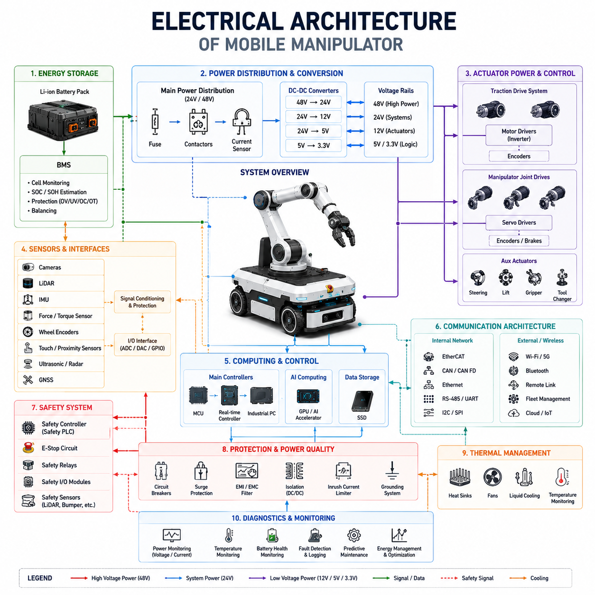{width="7.268055555555556in" height="7.268055555555556in"}

Electrical architecture is one of the most critical foundations of a mobile manipulator system because it provides the energy, signal distribution, control connectivity, and operational reliability required for all robotic functions. While mechanical architecture determines how the robot physically moves and interacts with the environment, electrical architecture determines how power is generated, distributed, monitored, controlled, and protected throughout the entire system. Every sensor reading, actuator movement, communication signal, artificial intelligence computation, and safety function ultimately depends on the electrical infrastructure that supports the robot.

A modern mobile manipulator can be viewed as a highly distributed electromechanical system composed of hundreds or even thousands of interconnected electrical components. These components include batteries, power converters, motor controllers, actuators, sensors, embedded computers, communication devices, safety systems, lighting modules, and auxiliary electronics. The electrical architecture must ensure that all of these elements operate reliably under dynamic operating conditions while maintaining safety, efficiency, scalability, and maintainability.

At the highest level, the electrical architecture can be divided into several major subsystems. These include the energy storage subsystem, power distribution subsystem, power conversion subsystem, actuator control subsystem, sensor interface subsystem, communication subsystem, computing subsystem, safety subsystem, and diagnostic subsystem. Although each subsystem performs specialized functions, they must operate together as an integrated electrical ecosystem.

The energy storage subsystem serves as the primary power source of the mobile manipulator. Unlike stationary industrial robots that receive continuous power from the electrical grid, mobile manipulators rely on onboard energy storage systems to achieve autonomous operation. The battery system therefore becomes one of the most important components within the overall architecture.

Lithium-ion batteries dominate modern mobile robotics due to their high energy density, relatively low weight, long cycle life, and favorable performance characteristics. Various battery chemistries are available, including Lithium Nickel Manganese Cobalt Oxide (NMC), Lithium Iron Phosphate (LFP), and Lithium Titanate Oxide (LTO). Each chemistry offers unique advantages in terms of safety, energy density, charging speed, operating temperature range, and lifecycle performance.

For industrial mobile manipulators, LFP batteries have become increasingly popular because of their excellent thermal stability, long service life, and improved safety characteristics. These batteries typically provide thousands of charge-discharge cycles while maintaining acceptable performance levels. In applications where maximum energy density is required, NMC batteries may be selected despite their more demanding thermal management requirements.

Battery capacity directly influences robot operating time. Designers must estimate average and peak power consumption across all subsystems, including locomotion, manipulation, sensing, computing, communication, and safety systems. Battery sizing involves balancing operational requirements, weight constraints, cost limitations, and charging infrastructure considerations.

Battery management systems play a central role in ensuring safe and efficient battery operation. A battery management system continuously monitors cell voltage, current, temperature, state of charge, state of health, and fault conditions. It protects the battery from overcharging, over-discharging, overcurrent events, short circuits, and thermal runaway situations. Without a sophisticated battery management system, battery performance and safety would be significantly compromised.

The power distribution subsystem is responsible for delivering electrical energy from the battery to all connected components. Mobile manipulators typically contain multiple voltage domains that serve different classes of equipment. High-voltage domains often power traction motors and large actuators, while medium-voltage domains support industrial electronics and communication systems. Low-voltage domains provide power to sensors, embedded controllers, and auxiliary devices.

Power distribution architecture must be carefully designed to minimize voltage drops, reduce electromagnetic interference, improve efficiency, and maintain fault isolation. Distribution networks often incorporate fuses, circuit breakers, power relays, disconnect switches, and monitoring circuits that enhance system reliability and safety.

Power conversion represents another critical aspect of electrical architecture. Since different subsystems require different voltage levels, power converters are used extensively throughout the robot. DC-DC converters transform battery voltage into the various voltages required by sensors, computers, communication devices, and control electronics. High-efficiency conversion is essential because energy losses directly reduce operating time.

Modern mobile manipulators may simultaneously utilize voltage rails such as 48V, 24V, 12V, 5V, and 3.3V. The electrical architecture must ensure stable voltage regulation under varying load conditions. Sudden acceleration, manipulator movement, GPU processing spikes, and communication bursts can create transient power demands that challenge power regulation systems.

Actuator power systems constitute one of the largest consumers of electrical energy. Mobile manipulators typically employ brushless DC motors, servo motors, or integrated smart actuators for locomotion and manipulation. These motors require dedicated motor controllers capable of delivering precise current, voltage, and torque control.

Motor controllers perform several important functions. They regulate motor speed, position, and torque while monitoring operating conditions such as temperature, current draw, and fault states. Advanced controllers support regenerative braking, which allows kinetic energy generated during deceleration to be recovered and returned to the battery system, thereby improving overall energy efficiency.

The traction drive subsystem controls the motors responsible for robot mobility. Depending on the locomotion architecture, this subsystem may manage differential drive motors, omnidirectional wheel motors, steering actuators, or tracked vehicle propulsion systems. Precise synchronization among drive motors is essential for maintaining navigation accuracy and smooth operation.

Manipulator drive systems typically involve multiple servo-controlled joints. Each joint may include a motor, encoder, gearbox, brake, and dedicated control electronics. The electrical architecture must support high-bandwidth communication and precise power delivery to ensure accurate manipulation performance.

Sensors form another major component of the electrical architecture. Modern mobile manipulators incorporate diverse sensing technologies including cameras, LiDAR systems, IMUs, force-torque sensors, tactile sensors, wheel encoders, ultrasonic sensors, radar systems, environmental sensors, and positioning systems. Each sensor requires electrical power, signal conditioning, communication interfaces, and protection circuitry.

Sensor integration introduces significant electrical engineering challenges. Different sensors may operate at different voltages, communication protocols, data rates, and timing requirements. The electrical architecture must provide stable operation while minimizing noise, interference, and synchronization errors.

Signal integrity is particularly important in robotics because many sensors generate high-frequency data streams. Electrical noise originating from motors, power converters, switching circuits, and wireless devices can degrade sensor performance. Proper grounding strategies, shielding techniques, filtering circuits, and cable routing practices are therefore essential.

Computing systems represent the intelligence layer of the robot and require substantial electrical support. Modern mobile manipulators frequently utilize heterogeneous computing architectures consisting of microcontrollers, embedded processors, industrial PCs, GPUs, AI accelerators, and edge computing platforms.

High-performance computing platforms often consume significant electrical power. Advanced AI workloads involving perception, mapping, object recognition, grasp planning, and foundation models may require hundreds of watts of continuous power. The electrical architecture must provide sufficient capacity while managing heat generation and maintaining stable operation.

Communication architecture is closely intertwined with the electrical design. Internal communication networks connect sensors, actuators, controllers, and computing devices throughout the robot. Common communication technologies include CAN bus, CAN FD, EtherCAT, Ethernet, RS-485, USB, SPI, I2C, and UART interfaces.

EtherCAT has become particularly popular in advanced robotic systems because it supports deterministic real-time communication with low latency and high synchronization accuracy. This capability is especially important for coordinated motion control involving multiple actuators.

External communication systems connect the robot to fleet management platforms, cloud services, digital twins, remote operators, and enterprise software systems. Wi-Fi, private 5G networks, LTE, Bluetooth, and industrial wireless technologies are commonly employed. These systems require dedicated power management and electrical protection mechanisms to ensure reliable operation.

Safety architecture is deeply integrated into the electrical design. Safety functions must remain operational even when primary systems experience failures. Electrical safety architectures therefore incorporate redundancy, fault detection, emergency stop circuits, safety controllers, safety relays, and independent power paths.

Emergency stop systems represent one of the most important safety mechanisms. Activation of an emergency stop must immediately remove hazardous energy from actuators while preserving the ability to monitor system status. Achieving this functionality requires carefully engineered electrical isolation and safety circuitry.

Functional safety standards influence many aspects of electrical architecture design. Safety-rated controllers, redundant sensors, monitored circuits, and diagnostic functions help ensure compliance with relevant industrial safety requirements. These mechanisms reduce risk and improve operational reliability in human-robot collaborative environments.

Thermal management is another critical consideration. Electrical components generate heat as a byproduct of operation. Batteries, motor controllers, power converters, GPUs, CPUs, and communication equipment may all require thermal management strategies. Excessive temperatures can reduce efficiency, shorten component life, and increase failure rates.

Cooling solutions may include passive heat sinks, forced-air cooling, heat pipes, liquid cooling systems, or hybrid thermal management architectures. Electrical designers must carefully analyze thermal loads to ensure reliable operation across expected environmental conditions.

Electromagnetic compatibility is increasingly important as robots become more complex. High-power motors, switching converters, wireless devices, and computing systems generate electromagnetic emissions that can interfere with sensitive electronics. Electromagnetic compatibility design focuses on minimizing emissions while improving immunity to external interference.

Grounding architecture plays a central role in electromagnetic compatibility. Improper grounding can lead to communication errors, sensor inaccuracies, unstable control behavior, and increased susceptibility to electrical noise. Robust grounding strategies are therefore essential for reliable robotic operation.

Cable architecture is often underestimated despite its importance. Mobile manipulators contain extensive wiring networks that distribute power and data throughout the system. Cable routing must account for mechanical motion, vibration, bending cycles, environmental exposure, and maintenance accessibility.

Manipulator joints create particularly challenging cable management requirements. Cables must flex repeatedly throughout millions of motion cycles without failure. Specialized robotic cables, cable chains, slip rings, and rotary joints are commonly used to address these challenges.

Diagnostic and monitoring systems provide visibility into electrical system performance. Modern robots continuously monitor voltage levels, current consumption, battery status, temperatures, communication quality, motor performance, and fault conditions. This information supports predictive maintenance, troubleshooting, and operational optimization.

Power monitoring also enables intelligent energy management. Advanced mobile manipulators dynamically adjust processing workloads, sensor operation, communication activity, and motion behaviors to optimize battery utilization. Such strategies can significantly extend operational endurance.

Redundancy is increasingly incorporated into mission-critical robotic platforms. Backup power supplies, redundant communication channels, duplicate sensors, and fault-tolerant control architectures improve system availability and operational resilience. These features are particularly important in healthcare, industrial automation, defense, and critical infrastructure applications.

Cybersecurity considerations have become inseparable from electrical architecture. Secure hardware modules, trusted boot systems, encrypted communication channels, authentication mechanisms, and hardware-based security features help protect robotic systems from unauthorized access and cyber threats.

Modern electrical architectures increasingly support modular design principles. Modular power systems, standardized interfaces, intelligent devices, and scalable communication networks simplify integration, maintenance, upgrades, and product family expansion. Such architectures enable manufacturers to reuse proven electrical subsystems across multiple robot platforms.

Simulation and digital engineering tools have transformed electrical architecture development. Electrical Computer-Aided Design software, power simulation tools, thermal analysis platforms, electromagnetic modeling environments, and digital twins allow engineers to evaluate system performance before hardware deployment. These tools reduce development risk while improving overall design quality.

As mobile manipulators continue to evolve, electrical architectures are becoming more intelligent, efficient, and interconnected. Emerging technologies such as solid-state batteries, wide-bandgap semiconductors, intelligent power electronics, distributed control systems, edge AI accelerators, and software-defined robotics will significantly influence future designs.

Future mobile manipulators will likely operate as highly connected cyber-physical systems in which electrical infrastructure not only distributes energy but also actively participates in system optimization, health monitoring, fault prediction, autonomous adaptation, and intelligent decision-making. Electrical architecture will therefore become an increasingly strategic component of overall robotic system design.

Ultimately, electrical architecture serves as the nervous system and circulatory system of the mobile manipulator. It delivers energy to every subsystem, enables communication among components, supports intelligent computation, ensures operational safety, and maintains system reliability. A well-designed electrical architecture transforms a collection of mechanical components and electronic devices into a cohesive, intelligent, and dependable robotic platform capable of performing complex tasks in real-world environments.

## 04 Sensor Architecture

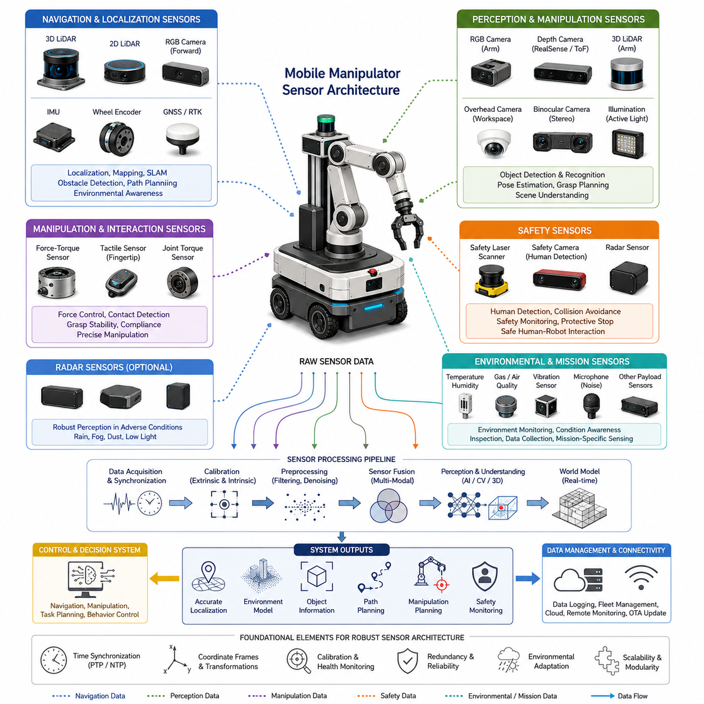{width="7.268055555555556in" height="7.268055555555556in"}

Sensor architecture is one of the most critical elements in a mobile manipulator system because it serves as the primary interface between the robot and the physical world. Every decision made by the robot, whether related to navigation, obstacle avoidance, object detection, grasp planning, manipulation, safety monitoring, or human interaction, ultimately depends on sensor data. Without a robust sensor architecture, even the most advanced artificial intelligence, planning algorithms, or robotic hardware cannot operate effectively. In many respects, sensors function as the eyes, ears, skin, and balance organs of a mobile manipulator, providing continuous awareness of both the robot itself and its surrounding environment.

The role of sensor architecture extends far beyond simply attaching cameras or LiDAR units to a robot. A complete sensor architecture defines how sensors are selected, positioned, calibrated, synchronized, processed, fused, monitored, and integrated into the overall system architecture. It determines how information flows from the physical world into the robot's perception and decision-making systems. A well-designed sensor architecture enables reliable operation under diverse environmental conditions, while a poorly designed architecture often becomes the primary cause of system failures in real-world deployments.

Mobile manipulators present unique sensing challenges because they combine two traditionally separate robotic domains: autonomous navigation and robotic manipulation. Autonomous navigation requires environmental perception over large areas, while manipulation requires precise perception of objects and interaction points at close range. As a result, sensor architectures for mobile manipulators must simultaneously support global awareness and local precision. The robot must understand where it is within a facility while also identifying the exact position and orientation of objects that need to be grasped, moved, inspected, or manipulated.

At the navigation level, the sensor architecture is responsible for localization, mapping, obstacle detection, path planning support, and environmental awareness. LiDAR sensors remain one of the most widely used technologies for autonomous navigation because they provide accurate distance measurements and robust performance across a wide range of lighting conditions. Two-dimensional LiDAR systems are commonly used for floor-level navigation and obstacle detection, while three-dimensional LiDAR systems provide richer environmental representations and support more advanced perception capabilities.

LiDAR sensors generate point clouds representing the geometry of the surrounding environment. These point clouds serve as the foundation for SLAM systems, localization algorithms, obstacle avoidance mechanisms, and dynamic path planning functions. High-resolution 3D LiDAR sensors are increasingly important in mobile manipulation because they enable detailed environmental reconstruction and support both navigation and manipulation tasks from a single sensing platform.

Cameras represent another essential component of sensor architecture. RGB cameras provide visual information that can be used for object recognition, semantic scene understanding, barcode reading, quality inspection, and human detection. Modern computer vision algorithms leverage RGB imagery to identify thousands of object categories and extract meaningful contextual information from complex environments.

Depth cameras add another dimension to visual perception by measuring the distance between the sensor and surrounding objects. Technologies such as structured light, stereo vision, and time-of-flight sensing allow depth cameras to generate three-dimensional representations of nearby scenes. In mobile manipulation applications, depth cameras are particularly valuable because they enable accurate object localization, pose estimation, grasp planning, and collision avoidance during manipulation operations.

Many advanced mobile manipulators employ multiple camera systems positioned throughout the robot. Forward-facing cameras support navigation and obstacle detection. Manipulator-mounted cameras provide close-range views for grasping and manipulation. Overhead cameras monitor workspace conditions, while safety cameras support human detection and collaborative operation. The placement of these sensors is a key architectural consideration because sensor coverage directly influences perception performance.

Inertial Measurement Units (IMUs) provide information about acceleration, angular velocity, and orientation. IMUs are essential for maintaining localization accuracy, especially when wheel slip, uneven terrain, or dynamic motion affects navigation performance. Sensor fusion between IMUs, wheel encoders, GNSS receivers, and LiDAR-based localization systems significantly improves overall navigation robustness.

Wheel encoders serve as one of the fundamental sensors in mobile robotic systems. By measuring wheel rotation, encoders provide odometry information that estimates robot movement over time. Although encoder-based odometry accumulates errors due to wheel slip and terrain variations, it remains an important component of localization architectures when combined with other sensor modalities.

Global Navigation Satellite Systems (GNSS), including GPS, GLONASS, Galileo, and BeiDou, play a significant role in outdoor mobile manipulation systems. Standard GNSS provides meter-level positioning accuracy, while RTK-enabled GNSS systems can achieve centimeter-level localization. For outdoor industrial applications such as logistics yards, ports, airports, mining sites, agricultural facilities, and utility inspection environments, GNSS becomes a critical component of the sensor architecture.

Manipulation tasks require an additional class of sensors focused on physical interaction. Force-torque sensors mounted at the wrist of a robotic arm measure interaction forces and moments during manipulation operations. These sensors allow robots to perform compliant motions, force-controlled assembly, contact detection, insertion tasks, and safe human-robot interaction. Without force sensing, many advanced manipulation tasks would be difficult or impossible to perform reliably.

Tactile sensors provide another layer of interaction awareness by detecting physical contact between the robot and objects. Inspired by the human sense of touch, tactile sensing enables robots to determine grasp stability, contact pressure distribution, slip conditions, and object characteristics. Future mobile manipulators are expected to incorporate increasingly sophisticated tactile sensing systems as dexterous manipulation becomes more important.

Safety-related sensing is an essential component of sensor architecture. Mobile manipulators frequently operate in environments shared with human workers, making safety perception a mandatory requirement. Safety laser scanners continuously monitor protected zones around the robot and trigger safety responses when hazards are detected. Safety-rated cameras, radar sensors, and human detection systems further enhance operational safety by identifying people and predicting potential collision risks.

Radar technology is receiving increased attention in robotic sensing architectures because it provides robust perception under adverse environmental conditions. Unlike cameras and LiDAR systems, radar performance is less affected by fog, rain, dust, smoke, or low-light environments. Radar sensors can therefore provide redundancy and improve perception reliability in challenging industrial and outdoor applications.

Environmental sensors contribute additional situational awareness by monitoring temperature, humidity, vibration, air quality, gas concentration, radiation levels, and other operational conditions. In industrial inspection robots, environmental sensing may represent a primary mission objective rather than merely supporting navigation. The sensor architecture must therefore accommodate both operational sensors and mission-specific sensing payloads.

One of the most important concepts in modern sensor architecture is sensor fusion. Individual sensors possess inherent limitations. Cameras may struggle in poor lighting conditions. LiDAR sensors may experience degradation in rain or reflective environments. GNSS signals may be unavailable indoors. IMUs accumulate drift over time. Sensor fusion addresses these limitations by combining multiple sensor streams into a unified environmental model.

Advanced sensor fusion algorithms leverage probabilistic estimation methods such as Kalman Filters, Extended Kalman Filters, Particle Filters, Factor Graph Optimization, and Bayesian inference techniques. These algorithms integrate measurements from diverse sensing modalities to improve localization accuracy, object detection reliability, and overall system robustness. Sensor fusion is increasingly becoming the foundation of intelligent robotic perception systems.

Sensor synchronization is another critical aspect of architecture design. Modern mobile manipulators may incorporate dozens of sensors operating at different update rates and communication interfaces. Accurate timestamping and synchronization are required to ensure that sensor measurements correspond to the same physical events. Technologies such as Precision Time Protocol (PTP), Network Time Protocol (NTP), hardware triggers, and synchronized clock architectures are commonly employed to maintain temporal consistency across sensor networks.

Calibration plays an equally important role. Every sensor possesses its own coordinate frame, measurement characteristics, and systematic errors. Extrinsic calibration defines the spatial relationship between sensors, while intrinsic calibration defines internal sensor parameters. Accurate calibration ensures that sensor measurements can be transformed into a common reference frame for perception, planning, and control algorithms.

As mobile manipulators become increasingly intelligent, sensor architectures are evolving toward perception-centric designs. Rather than treating sensors as isolated devices, modern architectures integrate sensing directly into AI-driven perception pipelines. Foundation models, Vision-Language Models, and multimodal AI systems are beginning to combine visual, spatial, tactile, and semantic information into unified world representations. These developments will allow future robots to understand their environments with a level of sophistication approaching human perception.

The future of sensor architecture will likely involve higher sensor density, improved multimodal fusion, edge AI processing, self-calibration capabilities, and adaptive sensing strategies. Emerging technologies such as event cameras, neuromorphic sensors, hyperspectral imaging systems, distributed sensor networks, and AI-enhanced perception modules will further expand robotic sensing capabilities. As mobile manipulators evolve toward greater autonomy and versatility, sensor architecture will remain one of the most important disciplines determining system performance, safety, intelligence, and operational success. Understanding sensor architecture is therefore fundamental for anyone seeking to design, deploy, or optimize next-generation mobile manipulation systems.

## 05 Compute Architecture

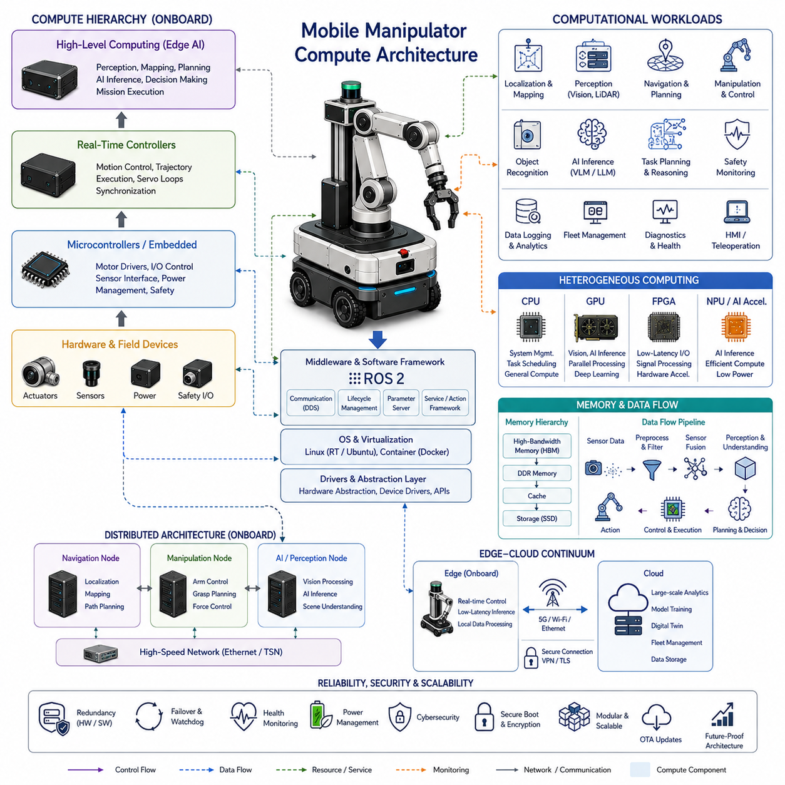{width="7.268055555555556in" height="7.268055555555556in"}

Compute architecture is the cognitive foundation of a mobile manipulator. While the mechanical architecture provides physical capabilities and the sensor architecture supplies environmental awareness, the compute architecture transforms raw sensor data into perception, reasoning, planning, control, and action. Every autonomous decision, navigation command, manipulation trajectory, safety response, and artificial intelligence function ultimately depends on the computing infrastructure embedded within the robotic system. As mobile manipulators become increasingly intelligent and autonomous, compute architecture has evolved from a simple embedded controller design into a highly distributed, heterogeneous computing ecosystem that combines real-time control systems, edge AI platforms, cloud resources, and high-performance accelerators.

The primary objective of compute architecture is to provide sufficient computational resources to execute all robotic workloads while maintaining deterministic behavior, low latency, reliability, scalability, and energy efficiency. Unlike traditional industrial robots that often perform repetitive and predictable tasks, mobile manipulators operate in dynamic and uncertain environments. They continuously process large volumes of sensory information, update environmental models, generate navigation plans, perform object recognition, execute manipulation tasks, and respond to unexpected situations in real time. This requires an architecture capable of supporting multiple simultaneous workloads with varying computational characteristics.

A modern mobile manipulator typically contains several layers of computing resources. At the lowest level are microcontrollers and embedded processors responsible for real-time hardware control. These devices manage motor drives, sensor interfaces, power systems, safety circuits, and communication buses. Their primary role is to ensure deterministic operation with cycle times measured in milliseconds or even microseconds. Because these controllers interact directly with physical hardware, reliability and timing predictability are more important than raw computational power.

Real-time controllers form the next layer of the compute hierarchy. These systems coordinate motion control, trajectory execution, servo loops, and synchronization between multiple actuators. In mobile manipulators, real-time controllers often manage both the mobile base and the robotic arm. They ensure that velocity commands, position references, and force-control signals are executed accurately and safely. Many industrial robotic systems rely on dedicated real-time operating systems to guarantee deterministic execution regardless of overall system load.

Above the real-time layer resides the edge computing platform, which serves as the central processing hub of the robot. Edge computers are responsible for perception, localization, mapping, planning, AI inference, mission execution, and high-level decision-making. These systems typically employ high-performance CPUs, GPUs, AI accelerators, and large memory resources. Industrial-grade edge computers have become increasingly popular because they provide the computational power necessary for modern AI-driven robotic applications while maintaining ruggedness suitable for field deployment.

The emergence of GPU computing has fundamentally transformed robotic compute architecture. Traditional CPUs excel at sequential processing and control logic, but many robotic perception workloads involve highly parallel computations. Tasks such as object detection, semantic segmentation, point cloud processing, visual SLAM, deep learning inference, and reinforcement learning benefit significantly from GPU acceleration. As a result, modern mobile manipulators frequently incorporate NVIDIA GPUs or similar accelerators as core components of their compute architecture.

Artificial intelligence workloads have become one of the primary drivers of compute requirements. Computer vision models, foundation models, Vision-Language Models, and robotic reasoning systems often require billions of parameters and substantial computational resources. Running these models directly on the robot requires carefully optimized architectures that balance performance, latency, memory usage, and power consumption. Edge AI computing has therefore become a major architectural discipline within modern robotics.

Many robotic systems now employ heterogeneous computing architectures in which different processors perform specialized functions. CPUs handle mission management, task scheduling, and software orchestration. GPUs accelerate perception and AI workloads. FPGAs provide low-latency signal processing and hardware acceleration. Microcontrollers manage real-time control tasks. This division of responsibilities allows each processing unit to operate within its area of strength while maximizing overall system efficiency.

One of the defining characteristics of mobile manipulator compute architecture is workload diversity. Navigation systems continuously execute localization algorithms, mapping functions, path planning modules, and obstacle avoidance processes. Simultaneously, manipulation systems calculate inverse kinematics, motion planning trajectories, collision checks, and force-control strategies. Vision systems process multiple camera streams, depth sensors, and LiDAR point clouds. Safety systems monitor protected zones and emergency conditions. AI systems perform object recognition, scene understanding, and decision-making. All of these functions must coexist within a unified computational framework.

Resource allocation becomes a critical design challenge in such environments. If navigation processing consumes excessive computational resources, manipulation performance may degrade. If AI inference monopolizes GPU capacity, perception latency may increase. Therefore, compute architecture must incorporate workload prioritization, resource scheduling, and quality-of-service mechanisms to ensure stable operation under varying system conditions.

Memory architecture is equally important. Mobile manipulators process massive quantities of data generated by cameras, LiDAR sensors, depth sensors, force sensors, and communication systems. Efficient memory management is required to support high-throughput data processing without introducing unacceptable latency. Shared memory architectures, high-bandwidth memory interfaces, direct memory access mechanisms, and optimized data pipelines play critical roles in maintaining system performance.

Data flow architecture determines how information moves between computational components. Raw sensor data must be collected, synchronized, filtered, processed, fused, analyzed, and distributed to downstream modules. Middleware platforms such as ROS2 provide standardized communication frameworks that facilitate data exchange between software components. Publish-subscribe architectures, service-oriented communication models, and distributed messaging systems are commonly employed to manage information flow within complex robotic systems.

Distributed computing architectures have become increasingly common in advanced mobile manipulators. Rather than relying on a single centralized computer, multiple computing nodes collaborate to execute different system functions. One computer may focus on navigation, another on manipulation, and a third on AI processing. Distributed architectures improve scalability, fault isolation, maintainability, and upgrade flexibility. They also allow computational resources to be physically located near the sensors and actuators they support, reducing communication latency.

Fault tolerance and redundancy are critical considerations in compute architecture design. Mobile manipulators frequently operate in mission-critical environments where system failures can result in operational disruptions, safety hazards, or financial losses. Redundant processors, backup controllers, watchdog mechanisms, health-monitoring systems, and failover strategies are therefore integrated into many high-reliability robotic platforms. The architecture must ensure graceful degradation rather than catastrophic failure when faults occur.

Power efficiency is another major design factor. Mobile manipulators operate on finite battery resources, making computational efficiency directly related to operational endurance. High-performance processors provide increased capability but also consume significant electrical power. Compute architects must carefully balance performance requirements against energy consumption constraints. Techniques such as dynamic power management, workload scheduling, hardware acceleration, and adaptive resource utilization help optimize energy efficiency.

The rise of cloud robotics has expanded compute architecture beyond the physical robot itself. Certain computational tasks can be offloaded to cloud infrastructure when low-latency execution is not required. Cloud systems may perform large-scale analytics, fleet optimization, digital twin simulation, long-term data storage, machine learning training, and predictive maintenance analysis. This creates a hybrid edge-cloud architecture in which computational responsibilities are distributed across local and remote resources.

Digital twins represent an increasingly important extension of compute architecture. A digital twin is a virtual representation of the physical robot and its operating environment. By continuously synchronizing operational data between the physical system and its digital counterpart, engineers can monitor performance, test software updates, predict failures, optimize operations, and simulate future scenarios. Compute architecture must therefore support the continuous exchange of information between real-world and virtual environments.

Artificial intelligence is driving a significant transformation in robotic compute architecture. Traditional robotic systems relied on deterministic algorithms and hand-engineered software pipelines. Modern systems increasingly incorporate neural networks, foundation models, reinforcement learning agents, and multimodal reasoning architectures. These technologies demand substantially greater computational resources while introducing new challenges related to model deployment, inference optimization, memory utilization, and hardware compatibility.

Foundation models and Vision-Language-Action architectures are expected to become major computational workloads in future mobile manipulators. These models integrate perception, language understanding, reasoning, planning, and action generation into unified frameworks. Running such systems efficiently will require next-generation compute architectures featuring specialized AI accelerators, advanced memory hierarchies, distributed inference pipelines, and optimized software stacks.

Cybersecurity has also become an important consideration within compute architecture. As robots become increasingly connected to enterprise networks, cloud services, and remote operations centers, computing systems become potential attack surfaces. Secure boot mechanisms, encrypted communications, hardware security modules, trusted execution environments, identity management frameworks, and cybersecurity monitoring systems are becoming integral components of robotic compute infrastructure.

Scalability remains one of the most important long-term design objectives. A compute architecture should not only support current workloads but also accommodate future software capabilities, additional sensors, new AI models, expanded manipulation functions, and evolving operational requirements. Modular architectures, standardized interfaces, containerized software deployment, and service-oriented designs help ensure that robotic systems can evolve without requiring complete hardware redesign.

The future of compute architecture will likely be shaped by increasingly powerful AI accelerators, edge-native foundation models, neuromorphic computing technologies, distributed robotic intelligence, and cloud-edge continuum architectures. Advances in semiconductor technology will enable higher computational performance within smaller power envelopes, while AI-specific processors will dramatically improve inference efficiency. Mobile manipulators of the future may possess computational capabilities that rival today\'s data center systems while operating entirely from onboard battery power.

Ultimately, compute architecture serves as the brain and nervous system of a mobile manipulator. It transforms raw data into intelligence, intelligence into decisions, and decisions into physical actions. Every aspect of robot performance, from navigation accuracy and manipulation precision to safety, autonomy, and adaptability, depends on the effectiveness of the underlying computational infrastructure. As robotic systems continue to evolve toward higher levels of autonomy and embodied intelligence, compute architecture will remain one of the most important disciplines in the design and deployment of next-generation mobile manipulation platforms.

## 06 Control Architecture

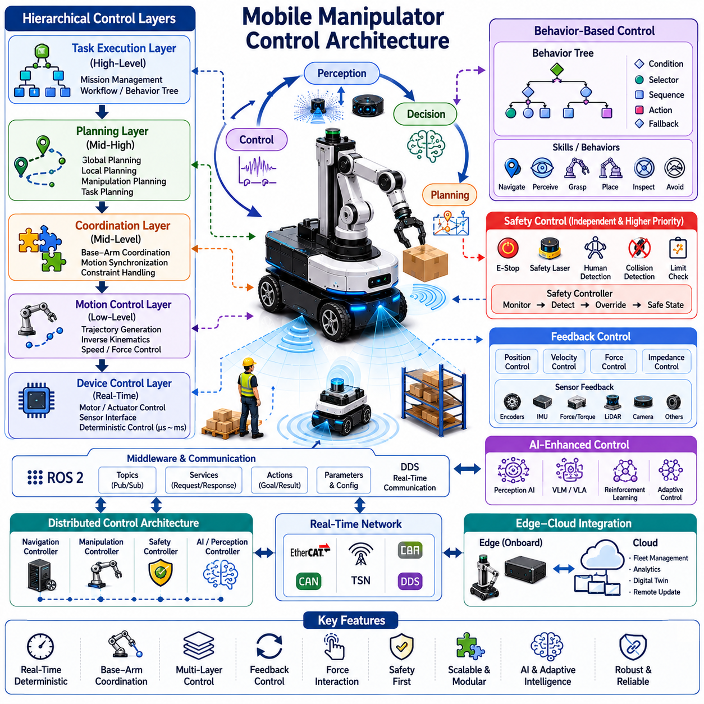{width="7.268055555555556in" height="7.268055555555556in"}

Control architecture is the operational backbone of a mobile manipulator. While the mechanical architecture provides physical capabilities, the sensor architecture delivers environmental awareness, and the compute architecture supplies computational intelligence, the control architecture is responsible for transforming perception, planning, and decision-making into coordinated physical actions. It acts as the central nervous system of the robot, connecting every subsystem and ensuring that all components work together as a unified autonomous machine. Without an effective control architecture, even the most advanced sensors, processors, and robotic hardware cannot achieve reliable autonomous operation.

A mobile manipulator presents a significantly greater control challenge than either a standalone Autonomous Mobile Robot (AMR) or a fixed industrial robot arm. The system must simultaneously manage autonomous navigation, environmental perception, robotic manipulation, safety monitoring, task execution, and human interaction. These activities occur at different timescales and require different levels of precision. The control architecture must therefore coordinate hundreds of software modules and hardware components while maintaining real-time responsiveness, operational stability, and system safety.

The primary purpose of control architecture is to establish a structured framework through which commands, feedback, decisions, and actions can flow throughout the robot. Rather than implementing a single centralized controller that directly manages every device, modern robotic systems typically employ hierarchical control architectures. Hierarchical designs divide responsibilities into multiple layers, allowing each layer to focus on a specific level of abstraction while communicating with adjacent layers.

At the lowest level of the hierarchy lies the device control layer. This layer directly interfaces with motors, actuators, sensors, power systems, and communication devices. Motor controllers regulate wheel velocities, joint positions, torque outputs, and servo loops. Sensor drivers acquire measurements from LiDARs, cameras, IMUs, force sensors, encoders, and safety devices. The primary objective of this layer is deterministic execution with extremely low latency. Control cycles typically operate in the range of microseconds to milliseconds to ensure stable motion control and hardware reliability.

Above the device control layer is the motion control layer. This layer transforms desired motion commands into executable trajectories. For the mobile base, motion controllers generate wheel velocities, steering angles, acceleration profiles, and path-following commands. For the robotic manipulator, motion controllers calculate joint trajectories, inverse kinematics solutions, and coordinated arm movements. Motion control algorithms continuously monitor feedback from sensors and actuators to minimize tracking errors and maintain smooth operation.

Mobile manipulators introduce a unique challenge because the mobile platform and robotic arm cannot be controlled independently. Their motions influence one another dynamically. When the mobile base moves, the manipulator\'s reference frame changes. When the manipulator extends or carries heavy loads, the overall center of gravity shifts, affecting vehicle stability. The control architecture must therefore coordinate mobility and manipulation simultaneously rather than treating them as separate systems.

The coordination layer serves as the bridge between mobility and manipulation. It synchronizes robot base movements with arm actions and ensures that both subsystems operate toward a common objective. For example, during a shelf-picking task, the mobile platform must position itself accurately relative to the shelf while the robotic arm executes a grasp trajectory. Small positioning errors from the mobile platform may significantly affect grasp success. The coordination layer continuously adjusts both systems to compensate for uncertainties and maximize task performance.

At a higher level, the task execution layer manages operational workflows. This layer translates mission objectives into executable sequences of actions. A task such as retrieving a package from a storage location may involve navigating to the destination, scanning shelves, identifying the correct object, positioning the manipulator, executing a grasp, transporting the object, and placing it at a target location. The task execution layer orchestrates these activities while monitoring progress and responding to unexpected events.

Behavior-based control architectures have become increasingly popular within modern mobile manipulation systems. Rather than relying on rigid sequential programming, behavior-based architectures represent robot actions as modular behaviors that can be activated dynamically according to environmental conditions. This approach improves flexibility, robustness, and adaptability. Behavior Trees have emerged as one of the most widely adopted frameworks because they provide a structured yet flexible method for organizing complex robotic tasks.

Behavior Trees allow robotic systems to evaluate conditions, select actions, execute behaviors, recover from failures, and adapt to changing situations. Unlike finite state machines, which often become difficult to maintain as complexity increases, Behavior Trees support modular design and scalable system development. Many industrial mobile manipulators now rely on Behavior Tree frameworks for mission execution and decision management.

Planning systems represent another critical component of control architecture. Planning occurs at multiple levels. Global planners determine long-range navigation routes through the environment. Local planners generate collision-free motion trajectories. Manipulation planners calculate arm movements and grasp strategies. Task planners determine the sequence of actions required to achieve operational objectives. Effective control architecture integrates all planning functions into a unified framework capable of responding to dynamic environmental conditions.

Feedback control forms the foundation of robotic motion execution. Every movement performed by a mobile manipulator depends on continuous feedback from sensors. Position controllers compare desired and actual positions. Velocity controllers regulate movement speed. Force controllers manage interaction forces during manipulation tasks. Impedance controllers adjust compliance behavior during physical contact. Feedback mechanisms enable robots to compensate for disturbances, uncertainties, and environmental variations.

Advanced mobile manipulators increasingly employ model-based control techniques. These approaches incorporate mathematical models of robot dynamics, kinematics, and environmental interactions to improve performance. Model Predictive Control (MPC), for example, predicts future system behavior and optimizes control actions over a finite time horizon. Such methods are particularly useful for coordinating complex motions involving both the mobile base and robotic arm.

Force control has become an essential capability for modern mobile manipulation. Traditional industrial robots often operate in highly structured environments where precise position control is sufficient. Mobile manipulators frequently interact with uncertain environments where contact forces cannot be predicted accurately. Force control enables robots to perform insertion tasks, assembly operations, surface interactions, collaborative manipulation, and compliant behaviors that would be difficult using position control alone.

Safety control architecture operates in parallel with operational control systems. Safety functions must remain independent from mission execution to ensure reliable hazard mitigation. Safety controllers continuously monitor emergency stop circuits, safety scanners, collision detection systems, human presence sensors, joint torque limits, speed limits, and operational boundaries. If hazardous conditions are detected, safety controllers can override normal operations and place the robot into a safe state.

Functional safety requirements have significantly influenced control architecture design. International standards require safety-critical functions to meet strict reliability and redundancy requirements. Consequently, many mobile manipulators incorporate dedicated safety processors, redundant communication channels, independent monitoring systems, and certified safety software. These mechanisms reduce the likelihood of dangerous failures and improve overall system dependability.

Artificial intelligence is increasingly influencing robotic control architectures. Traditional control systems relied primarily on deterministic algorithms and predefined rules. Modern robots incorporate machine learning models capable of improving perception, decision-making, planning, and manipulation performance. AI systems can recognize complex environmental patterns, adapt to changing conditions, and optimize operational strategies based on experience.

The emergence of Vision-Language Models and Vision-Language-Action systems is creating a new generation of AI-enhanced control architectures. These systems combine perception, language understanding, reasoning, and action generation within unified frameworks. Instead of manually programming every task sequence, operators may simply provide high-level instructions while the robot autonomously determines how to accomplish the objective. This transition represents a significant evolution from traditional automation toward intelligent robotic autonomy.

Distributed control architectures have become increasingly common as system complexity grows. Rather than relying on a single centralized controller, multiple specialized controllers cooperate across a network. Navigation controllers, manipulation controllers, perception controllers, safety controllers, and AI controllers each perform dedicated functions while exchanging information through middleware platforms such as ROS2. Distributed architectures improve scalability, modularity, maintainability, and fault isolation.

Communication within the control architecture must support real-time performance. High-speed industrial communication protocols such as EtherCAT, CAN, Ethernet, TSN, DDS, and ROS2 middleware enable efficient information exchange between distributed components. Deterministic communication is particularly important for synchronization between the mobile base and manipulator during coordinated tasks.

Cloud robotics is expanding the boundaries of control architecture beyond the robot itself. While low-latency control loops remain onboard, higher-level decision-making, fleet optimization, predictive maintenance, and large-scale planning can be supported by cloud infrastructure. Hybrid edge-cloud control architectures provide access to virtually unlimited computational resources while preserving local autonomy and operational safety.

Digital twin technologies further enhance control architectures by enabling continuous synchronization between physical robots and virtual models. Engineers can validate control algorithms, optimize task execution strategies, simulate failures, and test software updates within virtual environments before deployment. This reduces risk and accelerates system development.

Human-Robot Interaction (HRI) is becoming an increasingly important consideration in control architecture design. Future mobile manipulators will frequently operate alongside human workers in factories, warehouses, hospitals, offices, and public environments. Control systems must therefore support intuitive communication, predictable behavior, adaptive collaboration, and shared task execution. Human awareness will become a fundamental component of advanced robotic control systems.

Scalability remains a key design objective. A well-designed control architecture should support future upgrades, additional sensors, enhanced AI capabilities, new manipulators, and expanded operational requirements. Modular software architectures, service-oriented designs, containerized deployment strategies, and standardized interfaces help ensure long-term flexibility and maintainability.

The future of control architecture is likely to be shaped by embodied intelligence, AI-native robotics, multi-agent collaboration, cloud-edge integration, and autonomous reasoning systems. Robots will increasingly move beyond executing predefined instructions toward understanding objectives, reasoning about actions, adapting to environmental changes, and collaborating with humans and other robots. Control architectures will evolve from command-driven systems into intelligent decision-making frameworks capable of continuous learning and adaptation.

Ultimately, control architecture serves as the mechanism that transforms robotic potential into real-world performance. It connects sensing, computation, planning, intelligence, and physical action into a coherent operational framework. Every movement, decision, interaction, and task execution process depends upon the effectiveness of the underlying control architecture. As mobile manipulators continue to evolve toward higher levels of autonomy and embodied intelligence, control architecture will remain one of the most important disciplines in robotic system design, integration, and deployment. It is the invisible structure that enables robots not only to move and manipulate, but also to understand, decide, and act within the complexities of the real world.

## 07 AI Architecture

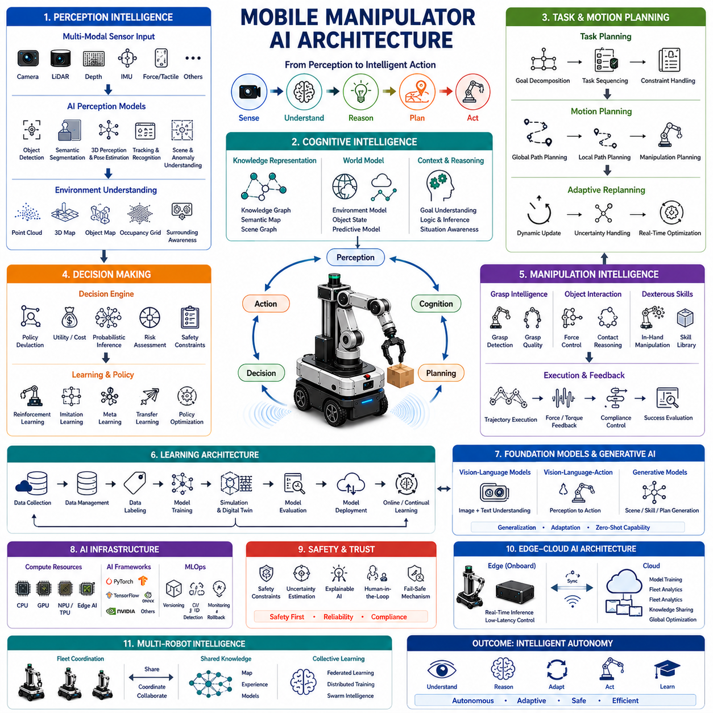{width="7.268055555555556in" height="7.268055555555556in"}

Artificial Intelligence Architecture is becoming the defining element of next-generation mobile manipulators. While mechanical architecture determines what a robot can physically do, sensor architecture determines what it can perceive, compute architecture determines how much information it can process, and control architecture determines how it executes actions, AI architecture determines how intelligently the robot can understand, reason, decide, learn, and adapt. In many ways, AI architecture represents the cognitive layer of the robotic system, transforming a machine that follows predefined instructions into an autonomous agent capable of operating in complex and dynamic environments.

Historically, industrial robots relied on deterministic programming and rule-based control systems. Every action was explicitly defined by engineers, and robots performed repetitive tasks within highly structured environments. While this approach delivered excellent reliability in predictable settings, it lacked flexibility. Any environmental change required reprogramming, and robots struggled to handle uncertainty, novel situations, or unstructured tasks. The emergence of modern AI technologies has fundamentally changed this paradigm by allowing robots to perceive their surroundings, interpret context, make decisions, and improve performance through experience.

AI architecture in a mobile manipulator encompasses a collection of interconnected software, models, algorithms, data pipelines, and computational frameworks that collectively enable intelligent behavior. It integrates perception, cognition, planning, learning, decision-making, and execution into a unified system. Rather than functioning as a single module, AI architecture spans multiple layers throughout the robotic platform and interacts closely with sensors, computing infrastructure, control systems, and cloud services.

At the foundation of AI architecture lies perception intelligence. The first requirement for intelligent behavior is the ability to understand the surrounding environment. Perception systems transform raw sensor data into meaningful information that can be used for decision-making. Cameras, LiDARs, depth sensors, force sensors, tactile sensors, and environmental sensors continuously generate data streams that must be interpreted by AI models.

Computer vision serves as one of the most important perception technologies. Deep learning models perform object detection, semantic segmentation, instance segmentation, object tracking, human recognition, activity recognition, scene understanding, and anomaly detection. Modern perception systems can identify thousands of object categories while simultaneously understanding relationships between objects, people, and environmental structures.

Three-dimensional perception plays a particularly important role in mobile manipulation. Unlike traditional image recognition systems, robots must understand the geometry of their surroundings. AI-based perception models process point clouds, depth maps, and multimodal sensor data to estimate object poses, identify grasp points, reconstruct environments, and predict spatial relationships. This capability enables robots to interact physically with the world rather than simply observing it.

Beyond perception lies cognitive intelligence. Cognitive systems transform environmental information into actionable understanding. This layer is responsible for reasoning, interpretation, context awareness, goal understanding, and decision support. Cognitive AI enables robots to answer questions such as: What object am I looking at? What is the user requesting? What task should be performed next? What obstacles or risks might interfere with success?

Knowledge representation forms a central component of cognitive architecture. Robots must maintain internal representations of objects, locations, tasks, environmental states, operational rules, and mission objectives. Knowledge graphs, semantic maps, world models, and scene representations provide structured frameworks for organizing information. These representations allow robots to reason about their environment and make decisions beyond simple reactive behaviors.

World models are becoming increasingly important in advanced AI architectures. A world model is an internal simulation of the robot\'s environment that predicts how the world will evolve over time. Rather than reacting solely to current sensor inputs, robots can anticipate future events, evaluate alternative actions, and optimize decision-making. World models are considered one of the key technologies required for achieving higher levels of robotic autonomy.

Task planning intelligence represents another major layer within AI architecture. Once a robot understands its environment and objectives, it must determine how to achieve its goals. Task planners decompose high-level objectives into executable actions. For example, a command such as "retrieve the red package from shelf three and deliver it to station five" may require navigation, object recognition, manipulation, transportation, obstacle avoidance, and placement actions. AI planning systems automatically generate and coordinate these sub-tasks.

Classical planning algorithms remain important, but AI-enhanced planning systems increasingly incorporate machine learning, probabilistic reasoning, and optimization techniques. These approaches allow robots to adapt plans dynamically as environmental conditions change. Flexible planning is essential for real-world mobile manipulators because uncertainty is unavoidable in operational environments.

Decision-making architecture governs how robots select actions among multiple alternatives. Decision-making systems evaluate goals, environmental constraints, safety requirements, operational priorities, and predicted outcomes before choosing a course of action. Techniques such as decision trees, Bayesian reasoning, reinforcement learning policies, utility optimization, and probabilistic inference are commonly employed.

Reinforcement Learning has emerged as a powerful method for developing autonomous decision-making capabilities. Rather than relying exclusively on manually programmed rules, reinforcement learning allows robots to learn optimal behaviors through trial and error interactions with their environment. Simulation platforms have significantly accelerated the development of reinforcement learning systems by enabling millions of training iterations without physical hardware risks.

Manipulation intelligence is one of the most challenging aspects of AI architecture. Mobile manipulators must not only identify objects but also determine how to interact with them physically. Grasp detection, grasp quality estimation, motion planning, force control, contact reasoning, and dexterous manipulation all require sophisticated AI models. Unlike fixed industrial automation, mobile manipulators frequently encounter previously unseen objects, requiring robust generalization capabilities.

The emergence of foundation models has introduced a transformative shift in robotic AI architecture. Foundation models are large-scale neural networks trained on massive datasets that capture general knowledge about language, images, actions, and the physical world. Instead of developing task-specific models for every application, robots can leverage foundation models as universal intelligence engines capable of adapting to diverse tasks and environments.

Vision-Language Models represent one of the most important developments in modern robotics. These models integrate visual perception and natural language understanding within a unified architecture. A mobile manipulator equipped with a VLM can interpret user instructions, understand visual scenes, identify relevant objects, and generate context-aware responses. This dramatically simplifies human-robot interaction and expands operational flexibility.

Vision-Language-Action architectures extend this concept further by directly connecting perception, reasoning, and action generation. Rather than separating perception systems, planning modules, and control systems into distinct components, VLA architectures learn end-to-end mappings from observations and instructions to robotic actions. This approach more closely resembles how humans interact with their environment and is expected to become a cornerstone of future robotic systems.

Embodied AI represents the next stage in AI architecture evolution. Traditional AI systems operate primarily in digital environments. Embodied AI systems learn through interaction with the physical world. Mobile manipulators provide an ideal platform for embodied intelligence because they combine mobility, perception, manipulation, and environmental interaction. Through continuous experience, robots can acquire practical knowledge that cannot be learned solely from static datasets.

Learning architecture plays a critical role in maintaining long-term performance. AI systems must continuously adapt to changing environments, new objects, evolving workflows, and updated operational requirements. Lifelong learning, online learning, transfer learning, federated learning, and self-supervised learning are increasingly important components of modern AI architectures. These approaches allow robots to improve over time while minimizing the need for extensive manual retraining.

Data architecture serves as the foundation supporting AI capabilities. Every AI system depends on high-quality data. Sensor streams, operational logs, task records, video archives, simulation outputs, and fleet data contribute to the training and improvement of AI models. Data pipelines must support collection, storage, labeling, validation, processing, and deployment workflows. Without a robust data architecture, AI performance cannot scale effectively.

Simulation and digital twins have become indispensable components of AI development. Training AI systems entirely in physical environments is expensive, time-consuming, and potentially unsafe. High-fidelity simulation environments allow robots to learn navigation, manipulation, perception, and decision-making skills before deployment. Digital twins provide continuous synchronization between virtual and physical systems, enabling rapid testing and optimization of AI algorithms.

MLOps architecture extends AI systems beyond model development into operational deployment. Model versioning, automated testing, continuous integration, deployment pipelines, performance monitoring, drift detection, and rollback mechanisms are all essential for maintaining reliable AI operations. As mobile manipulators increasingly depend on AI, MLOps becomes as important as traditional software engineering practices.

Safety and trustworthiness are critical requirements for AI architecture. AI systems operating in physical environments must make decisions that prioritize human safety and operational reliability. Explainable AI, uncertainty estimation, safety constraints, rule-based overrides, human supervision mechanisms, and fail-safe architectures are increasingly integrated into robotic AI systems. Intelligent behavior must never compromise safety.

Cloud AI and edge AI architectures are often combined to balance computational efficiency and operational responsiveness. Edge AI enables real-time perception, planning, and control directly on the robot. Cloud AI supports large-scale training, fleet-wide optimization, data analytics, knowledge sharing, and long-term learning. Hybrid architectures provide the best balance between autonomy and computational scalability.

Multi-robot intelligence is another emerging domain. Future mobile manipulators will rarely operate in isolation. Instead, fleets of robots will collaborate, share information, coordinate tasks, and collectively optimize operations. Distributed AI architectures enable robots to exchange environmental knowledge, coordinate planning decisions, and learn from one another\'s experiences.

The future of AI architecture is increasingly aligned with the concept of Physical AI. Physical AI extends beyond perception and language understanding to include physical reasoning, environmental interaction, manipulation intelligence, and embodied learning. Robots will move from executing predefined workflows toward understanding objectives, reasoning about physical consequences, predicting outcomes, and autonomously generating solutions.

Over the next decade, AI architecture is expected to evolve from modular perception-and-control systems into unified cognitive architectures integrating perception, memory, reasoning, planning, learning, and action. Foundation models, world models, embodied intelligence, multimodal reasoning systems, and autonomous agents will become central elements of robotic intelligence. Mobile manipulators will increasingly function as autonomous cognitive systems capable of operating across diverse environments with minimal human supervision.

Ultimately, AI architecture serves as the intelligence layer that transforms a mobile manipulator from an automated machine into an adaptive, reasoning, and learning robotic agent. It connects sensing, cognition, planning, decision-making, and action within a unified framework capable of understanding and interacting with the real world. As robotics advances toward general-purpose autonomy and embodied intelligence, AI architecture will become the most important factor determining a robot\'s capability, flexibility, and long-term value.

## 08 Communication Architecture

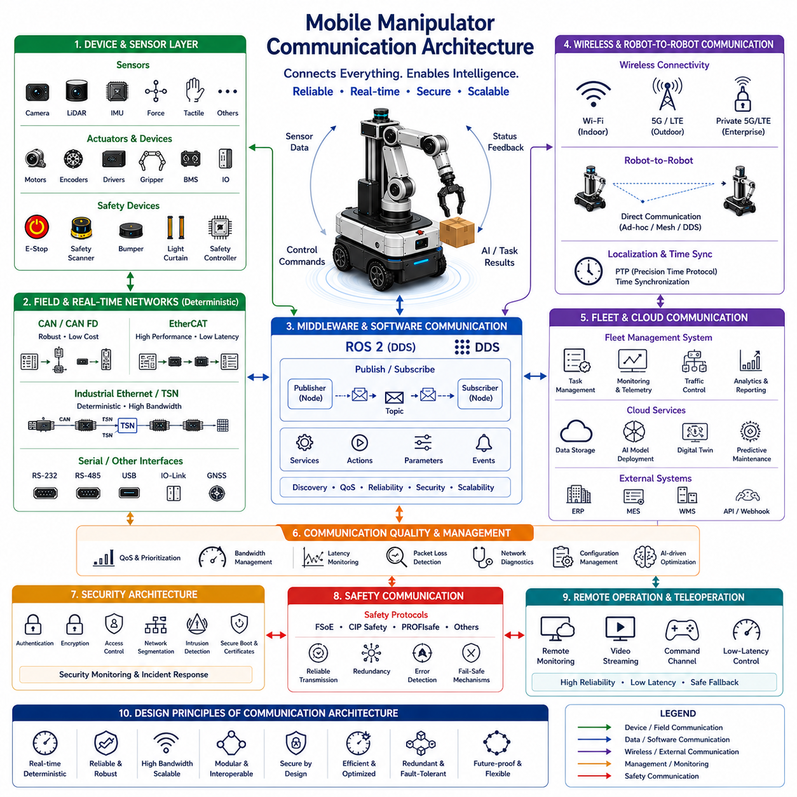{width="7.268055555555556in" height="7.268055555555556in"}

Communication Architecture is the circulatory and nervous network of a mobile manipulator. While sensors provide perception, computing platforms provide intelligence, and control systems generate actions, communication architecture enables every subsystem to exchange information efficiently, reliably, and securely. Without a robust communication infrastructure, individual components would operate as isolated units rather than as an integrated robotic system. In modern mobile manipulators, communication architecture is not simply a collection of cables and network interfaces; it is a comprehensive framework that governs how data, commands, status information, safety signals, and operational intelligence flow throughout the robot and across external systems. The Communication Architecture chapter occupies a critical position within the overall System Architecture section of the Mobile Manipulator volume because it connects every other architectural domain into a unified operational ecosystem.

The fundamental purpose of communication architecture is to ensure that information can be exchanged between all system elements with the appropriate levels of speed, reliability, determinism, scalability, and security. A mobile manipulator continuously generates enormous amounts of information from sensors, actuators, controllers, AI systems, fleet management software, cloud platforms, and human operators. This information must be delivered to the correct destination at the correct time while maintaining data integrity and operational continuity.

Unlike traditional industrial robots that often operate within isolated production cells, mobile manipulators are highly distributed systems. They consist of multiple sensors, multiple controllers, multiple processors, robotic arms, mobile bases, safety devices, wireless communication modules, cloud services, and remote management platforms. Each subsystem operates with different communication requirements. Some messages require microsecond-level deterministic timing, while others may tolerate delays of several seconds. Designing an architecture capable of supporting such diverse requirements is one of the central challenges of robotic communication engineering.

At the lowest level, communication architecture begins with device-level communication. This layer connects sensors, actuators, motor drivers, battery management systems, safety controllers, and embedded devices. Communication at this level typically involves high-speed and deterministic protocols that support real-time control requirements. Motor controllers must receive commands with extremely low latency, and sensor measurements must be delivered consistently to maintain stable control loops.

Controller Area Network (CAN) remains one of the most widely adopted communication technologies within mobile robotic systems. Originally developed for automotive applications, CAN provides reliable communication between embedded devices while maintaining robustness against electrical noise and harsh operating conditions. CAN networks are commonly used for motor controllers, battery systems, steering modules, suspension systems, and low-level diagnostic devices. CAN FD, an enhanced version of the original protocol, provides increased bandwidth while preserving compatibility with established industrial practices.

For applications requiring even higher performance, EtherCAT has become a dominant industrial communication technology. EtherCAT supports deterministic communication with extremely low latency and high synchronization accuracy. Mobile manipulators frequently employ EtherCAT networks to connect robotic arm joints, servo drives, force-torque sensors, and real-time motion controllers. Because EtherCAT processes data while frames pass through each device, it achieves exceptional efficiency and scalability for distributed control systems.

Ethernet-based communication has become increasingly important throughout robotic systems. Standard Ethernet provides significantly higher bandwidth than traditional industrial buses and supports a wide range of networking technologies. Gigabit Ethernet and multi-gigabit Ethernet networks are now commonly used for connecting industrial computers, cameras, LiDAR sensors, storage devices, and AI accelerators. The growing adoption of Ethernet reflects the increasing demand for high-bandwidth data transmission generated by modern perception and AI workloads.

Time-Sensitive Networking (TSN) represents an important evolution of Ethernet communication. TSN introduces deterministic communication capabilities to standard Ethernet infrastructure, allowing critical control traffic and non-critical data traffic to coexist on the same network. This convergence reduces system complexity while preserving the real-time performance required by robotic applications. Many future robotic platforms are expected to adopt TSN as a foundational communication technology.

Serial communication technologies continue to play an important role in mobile manipulators. Interfaces such as RS-232, RS-422, and RS-485 remain widely used for connecting legacy industrial devices, environmental sensors, GNSS receivers, diagnostic tools, and specialized equipment. Although these technologies provide lower bandwidth than Ethernet-based solutions, they remain attractive because of their simplicity, reliability, and long operating history.

USB communication is commonly employed for peripheral devices, cameras, storage systems, AI accelerators, and development interfaces. USB 3.0 and USB 4.0 provide sufficient bandwidth for many perception systems, including RGB cameras, depth cameras, and vision-processing modules. However, USB communication is generally not used for safety-critical or deterministic control functions due to its non-deterministic timing characteristics.

Sensor communication constitutes one of the most demanding aspects of robotic communication architecture. Modern mobile manipulators often incorporate multiple cameras, LiDAR sensors, radar systems, IMUs, force sensors, tactile sensors, GNSS receivers, and environmental monitoring devices. Collectively, these sensors may generate several gigabytes of data per minute. Efficient sensor communication architectures must therefore support high-bandwidth transmission while minimizing latency and packet loss.

Synchronization represents another critical requirement. Sensor measurements originating from different devices must often be correlated with extreme precision. For example, a camera image, LiDAR scan, IMU reading, and robot pose estimate may need to be aligned within a few milliseconds to support accurate sensor fusion. Communication architecture therefore includes clock synchronization mechanisms such as Precision Time Protocol (PTP), Network Time Protocol (NTP), hardware timestamping, and synchronized trigger systems.

Middleware communication plays a central role in modern robotic software architectures. Rather than allowing every software component to communicate directly with every other component, middleware provides a structured communication layer that manages data exchange, service requests, event notifications, and distributed coordination. ROS2 has emerged as the most influential middleware framework within advanced robotic systems. Built upon the Data Distribution Service (DDS) standard, ROS2 provides scalable and flexible communication capabilities for complex robotic applications.

DDS introduces publish-subscribe communication mechanisms that allow software components to exchange information without requiring direct knowledge of one another. This decoupled architecture improves modularity, scalability, and maintainability. Different software modules can publish sensor data, navigation commands, manipulation requests, safety alerts, and operational status updates while remaining independent from one another\'s internal implementations.

Communication architecture also extends beyond the robot itself. Mobile manipulators increasingly operate as connected systems within larger digital ecosystems. Wireless communication technologies provide connectivity between robots, cloud platforms, fleet management systems, remote operators, enterprise software systems, and digital twins.

Wi-Fi remains one of the most widely used wireless communication technologies in indoor robotic environments. Modern Wi-Fi standards provide high data throughput and support integration with existing enterprise infrastructure. Warehouses, hospitals, manufacturing facilities, and logistics centers frequently deploy Wi-Fi networks to support robot communication and fleet coordination.

Cellular communication technologies such as LTE, 5G, and future 6G networks significantly expand operational flexibility. Outdoor mobile manipulators operating in campuses, ports, industrial facilities, mining sites, agricultural environments, and public spaces often rely on cellular connectivity. 5G is particularly attractive because it offers low latency, high bandwidth, network slicing, and enhanced reliability. These characteristics make it suitable for real-time robotic applications and remote operation scenarios.

Private wireless networks are becoming increasingly popular in industrial environments. Organizations seeking greater control over security, performance, and reliability may deploy private LTE or private 5G networks specifically optimized for robotic operations. Such networks provide predictable communication performance while reducing dependence on public infrastructure.

Fleet communication represents a major architectural consideration as organizations deploy multiple mobile manipulators simultaneously. Fleet management systems require continuous communication with every robot to coordinate tasks, allocate resources, monitor performance, manage traffic flow, and optimize operations. Fleet communication architectures must support scalability from a handful of robots to hundreds or even thousands of autonomous systems.

Cloud communication has become an essential component of modern robotic ecosystems. Robots continuously exchange information with cloud-based platforms that provide analytics, data storage, software updates, digital twin synchronization, AI model deployment, predictive maintenance, and operational reporting. Cloud communication architectures must balance bandwidth efficiency, latency requirements, security considerations, and operational reliability.

Remote operation and teleoperation systems introduce additional communication requirements. In some situations, human operators may supervise, assist, or directly control mobile manipulators from remote locations. These applications require real-time video streaming, bidirectional command channels, low-latency control paths, and robust communication reliability. Network interruptions must be handled gracefully to maintain safety and operational continuity.

Cybersecurity has become one of the most important aspects of communication architecture. As robots become increasingly connected, they also become potential targets for cyberattacks. Communication systems must therefore incorporate authentication, encryption, access control, network segmentation, intrusion detection, secure boot mechanisms, certificate management, and continuous security monitoring. Cybersecurity is no longer an optional feature but a fundamental design requirement for modern robotic systems.

Functional safety and communication architecture are also closely related. Safety-critical messages must be transmitted reliably and within strict timing constraints. Safety communication protocols such as Safety over EtherCAT (FSoE), CIP Safety, PROFIsafe, and other certified technologies ensure that safety signals can be exchanged without compromising system integrity. These protocols include redundancy, error detection, message validation, and fail-safe mechanisms that support compliance with international safety standards.

As AI systems become increasingly important within mobile manipulators, communication requirements continue to grow. High-resolution camera streams, point cloud data, multimodal sensor information, foundation model inputs, and AI inference results all contribute to rapidly increasing network traffic. Future communication architectures must therefore support significantly higher bandwidth while maintaining deterministic behavior and energy efficiency.

The emergence of Edge AI and Cloud AI creates new communication paradigms. Some AI workloads execute directly on the robot, while others leverage cloud infrastructure. Communication architecture must intelligently distribute information between edge devices and cloud systems while optimizing bandwidth usage, latency, privacy, and operational costs.

Multi-robot collaboration introduces another level of complexity. Future fleets of mobile manipulators will share maps, object information, operational knowledge, AI models, and mission plans. Distributed communication architectures will enable collective intelligence, allowing robots to learn from one another and coordinate activities in real time.

Digital twin systems further extend communication architecture into virtual environments. Real-time synchronization between physical robots and digital representations requires continuous bidirectional communication. Sensor data, operational status, maintenance information, AI performance metrics, and environmental models must be exchanged efficiently to maintain accurate virtual representations.

The future of communication architecture will likely be shaped by converged industrial networks, deterministic Ethernet technologies, AI-driven network management, 5G Advanced, 6G connectivity, distributed robotic intelligence, and cloud-edge continuum architectures. Communication systems will increasingly evolve from passive transport mechanisms into intelligent infrastructures capable of prioritizing data flows, predicting failures, optimizing network performance, and supporting autonomous system coordination.

Ultimately, communication architecture serves as the information backbone of a mobile manipulator. It connects sensors, controllers, computers, AI systems, safety devices, cloud services, digital twins, and human operators into a unified operational framework. Every perception result, planning decision, control command, safety response, and AI inference depends upon reliable communication. As mobile manipulators evolve toward highly autonomous, AI-driven, and fleet-oriented systems, communication architecture will become one of the most important disciplines determining system performance, scalability, security, and operational success. Understanding communication architecture is therefore essential for engineers, architects, integrators, and researchers developing the next generation of intelligent mobile manipulation platforms.

## 09 Safety Architecture

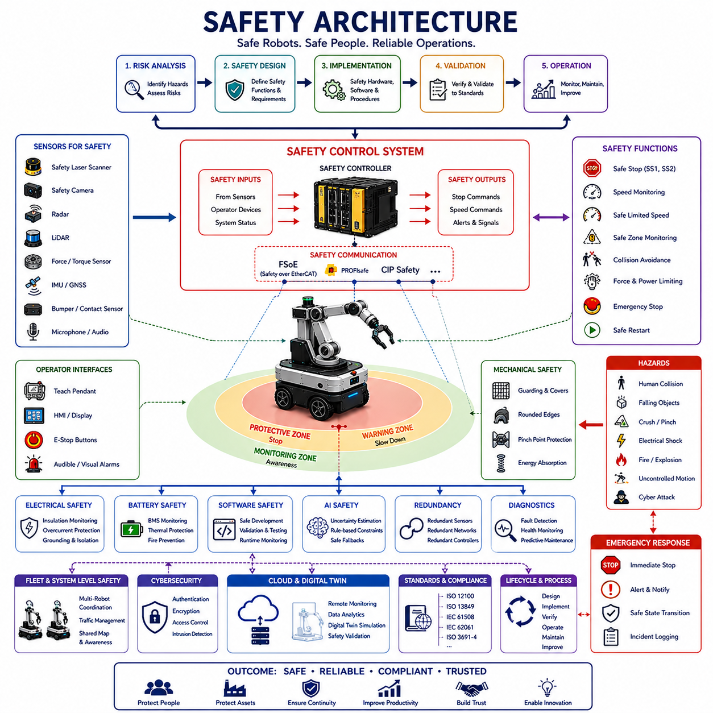{width="7.268055555555556in" height="7.268055555555556in"}

Safety Architecture is one of the most critical elements of a mobile manipulator system because it directly protects human life, equipment, facilities, operational assets, and the robot itself. While mechanical architecture determines physical capabilities, sensor architecture provides environmental awareness, compute architecture supplies computational intelligence, control architecture coordinates behavior, AI architecture enables decision-making, and communication architecture connects all subsystems, safety architecture ensures that every component operates within acceptable risk boundaries. In many respects, safety architecture serves as the immune system of a robotic platform, continuously monitoring potential hazards and taking corrective actions before accidents occur.

As mobile manipulators move beyond isolated industrial cells and enter shared environments such as warehouses, hospitals, airports, campuses, factories, logistics centers, public facilities, and outdoor operational sites, safety becomes significantly more complex. Traditional industrial robots often operate behind fences, physical barriers, and access-controlled zones. Mobile manipulators, however, frequently coexist with human workers, autonomous vehicles, visitors, and other dynamic objects. This shift transforms safety from a simple protective mechanism into a comprehensive system-level architectural discipline.

The primary objective of safety architecture is risk reduction. No robotic system can completely eliminate risk, but a properly designed safety architecture minimizes the probability and severity of hazardous events. This objective is achieved through a combination of hazard identification, risk assessment, safety functions, monitoring mechanisms, fault detection systems, redundancy strategies, and emergency response procedures.

Safety architecture begins with risk analysis. Before a robot is designed, engineers must identify potential hazards associated with intended operations. These hazards may include collisions with humans, falling objects, crushing injuries, pinch points, electrical faults, battery failures, communication disruptions, software errors, cybersecurity attacks, environmental hazards, and unexpected operational behaviors. Risk analysis establishes the foundation upon which all subsequent safety mechanisms are built.

Hazard identification is typically followed by risk assessment methodologies that evaluate both the likelihood and consequences of hazardous events. Standards such as ISO 12100 provide structured approaches for identifying risks and determining appropriate mitigation strategies. The outcome of this process directly influences the design of safety systems, safety-rated hardware, and operational procedures.

Functional safety represents one of the most important concepts within modern safety architecture. Functional safety focuses on ensuring that safety-related systems perform their intended functions correctly, even when faults occur. Rather than relying solely on physical protection mechanisms, functional safety incorporates sensors, controllers, software, communication systems, and actuators that continuously monitor operating conditions and intervene when dangerous situations are detected.

International standards such as ISO 13849, IEC 61508, IEC 62061, and ISO 3691-4 provide frameworks for designing and validating functional safety systems. These standards define performance levels, safety integrity requirements, diagnostic coverage expectations, and fault tolerance capabilities. Compliance with these standards is often mandatory for commercial robotic systems operating in industrial environments.

Safety controllers form the central decision-making element of the safety architecture. Unlike standard control systems that focus on task execution, safety controllers are dedicated to hazard prevention and risk mitigation. These controllers continuously monitor safety inputs, evaluate system status, and initiate protective actions when necessary. In many systems, safety controllers operate independently from primary control systems to ensure that safety functions remain operational even if non-safety systems fail.

Emergency stop systems remain one of the most recognizable safety features in robotics. Emergency stop mechanisms provide operators with a direct means of immediately halting robot operation during hazardous situations. However, modern safety architecture extends far beyond emergency stop functionality. Safety systems must identify hazards before operators are forced to intervene and should ideally prevent dangerous situations from developing in the first place.

Safety sensors serve as the eyes and ears of the safety architecture. Safety laser scanners are widely used to monitor protected zones surrounding mobile manipulators. These devices continuously measure distances and detect intrusions into predefined safety areas. When a person or object enters a warning zone, the robot may reduce speed. If a protected zone is violated, the robot may stop entirely.

Safety cameras provide another important sensing modality. Advanced vision-based safety systems can detect humans, classify behaviors, estimate movement trajectories, and predict potential collision risks. Unlike traditional safety scanners that focus primarily on geometric detection, safety cameras can incorporate semantic understanding and contextual awareness into safety decision-making.

Radar-based safety systems are gaining increased attention, particularly in outdoor environments. Radar offers robust performance under adverse weather conditions such as rain, fog, dust, smoke, and low-light environments. Because radar is less sensitive to environmental conditions than optical sensors, it provides valuable redundancy for safety-critical perception systems.

Human detection and human tracking technologies have become fundamental components of collaborative robotic safety. Mobile manipulators operating in human-populated environments must continuously identify nearby individuals, monitor their movements, estimate intentions, and adjust robot behavior accordingly. Human-aware safety systems enable robots to share workspaces safely while maintaining operational productivity.

Protective field monitoring is a key mechanism used in mobile robotic safety. Safety systems typically define multiple zones surrounding the robot. A distant monitoring zone may trigger awareness responses. A closer warning zone may reduce speed. An inner protective zone may initiate a complete stop. Dynamic safety zones can adapt according to robot speed, payload characteristics, environmental conditions, and operational context.

Speed and separation monitoring represents a core principle within collaborative robotics. Rather than isolating robots from humans entirely, modern safety architectures allow safe coexistence by continuously maintaining acceptable separation distances. The robot dynamically adjusts speed and behavior according to proximity measurements. This approach significantly improves operational flexibility while preserving safety.

Force and power limiting is another important safety strategy. Mobile manipulators may physically interact with humans during collaborative operations. Force-limited systems continuously monitor contact forces and ensure that interaction energies remain below injury thresholds. Compliance control, torque monitoring, force sensing, and impact detection mechanisms contribute to safe physical interaction.

Mechanical safety remains a fundamental aspect of overall safety architecture. Physical design choices significantly influence system safety characteristics. Rounded edges, protected pinch points, guarded moving components, energy-absorbing structures, compliant mechanisms, and protective covers reduce injury risks. Safe mechanical design often serves as the first layer of protection against accidents.

Electrical safety is equally important. Mobile manipulators contain high-current batteries, power distribution systems, motor drives, charging systems, and electronic control units. Safety architecture must address electrical shock prevention, short-circuit protection, overcurrent detection, insulation monitoring, grounding strategies, and emergency power isolation mechanisms.

Battery safety has become increasingly important as lithium-based energy storage systems become standard in mobile robotics. Battery management systems continuously monitor voltage, current, temperature, charging conditions, and cell health. Thermal runaway detection, fire prevention mechanisms, isolation controls, and emergency shutdown procedures are integrated into advanced battery safety architectures.

Software safety represents one of the most challenging aspects of modern robotic systems. Autonomous robots depend heavily on software for perception, planning, control, and decision-making. Software failures may result in hazardous behavior even when hardware components remain functional. Safety architecture therefore incorporates software validation, testing frameworks, redundancy mechanisms, runtime monitoring, exception handling, and fault recovery strategies.

Artificial Intelligence introduces additional safety challenges. AI systems may exhibit unexpected behaviors when operating outside their training distributions or encountering novel situations. Consequently, AI safety has emerged as a major research area within robotics. Safe AI architectures incorporate uncertainty estimation, confidence scoring, explainability mechanisms, rule-based safety constraints, supervisory control layers, and fallback strategies.

Safety architectures increasingly employ layered protection strategies. Rather than relying on a single safety mechanism, multiple independent layers of protection are implemented simultaneously. If one layer fails, other layers remain available to prevent accidents. This defense-in-depth philosophy significantly improves overall system reliability and resilience.

Redundancy is a key design principle in safety-critical systems. Critical safety functions often utilize redundant sensors, redundant communication channels, redundant processors, and redundant power systems. The objective is to eliminate single points of failure that could compromise safety. High-reliability mobile manipulators frequently incorporate diverse redundancy, where multiple technologies perform similar functions using different operating principles.

Fault detection and diagnostics are essential components of safety architecture. Safety systems continuously monitor hardware health, software status, communication integrity, sensor performance, and operational behavior. Abnormal conditions are detected, classified, and addressed before they escalate into hazardous situations. Predictive diagnostics can identify emerging failures and support proactive maintenance strategies.

Safety communication plays a vital role in distributed robotic systems. Safety-related information must be transmitted reliably and within strict timing constraints. Protocols such as Safety over EtherCAT, PROFIsafe, CIP Safety, and other certified communication technologies provide error detection, message validation, redundancy management, and fail-safe communication capabilities.

Cybersecurity has become deeply interconnected with safety architecture. A cyberattack targeting a mobile manipulator could potentially create hazardous physical consequences. Secure communication, authentication, encryption, access control, intrusion detection, secure boot mechanisms, and continuous monitoring are therefore increasingly considered part of the broader safety architecture.

Fleet-level safety introduces additional challenges when multiple robots operate simultaneously. Fleet management systems must coordinate robot movements, prevent traffic conflicts, manage shared resources, and avoid collisions between autonomous systems. Safety architectures must therefore extend beyond individual robots to encompass entire robotic ecosystems.

Outdoor mobile manipulators introduce environmental safety considerations not typically encountered indoors. Uneven terrain, weather conditions, visibility limitations, dynamic obstacles, wildlife, pedestrians, vehicles, and infrastructure interactions create additional safety requirements. Outdoor safety architectures often combine GNSS, LiDAR, radar, cameras, IMUs, and geofencing technologies to ensure safe operation.

Geofencing provides a powerful safety mechanism for outdoor robotic systems. Virtual boundaries define permitted operational areas and restricted zones. If a robot approaches or crosses a geofence boundary, safety systems can generate warnings, reduce speed, or stop operation entirely. Geofencing is particularly valuable for large-scale outdoor deployments.

Digital twins are increasingly used to support safety analysis and validation. Virtual environments enable engineers to simulate hazardous scenarios, evaluate safety strategies, test emergency responses, and verify system behavior before deployment. Digital twin technologies significantly reduce development risks and improve confidence in safety performance.

Human-Robot Interaction safety will become increasingly important as mobile manipulators enter public and semi-public environments. Safety architectures must support predictable behavior, intuitive communication, transparent intentions, and socially acceptable interactions. Human trust depends not only on actual safety but also on perceived safety and behavioral predictability.

The future of safety architecture will be strongly influenced by AI-driven risk assessment, predictive safety systems, autonomous hazard detection, adaptive safety zones, multi-robot safety coordination, cloud-connected safety monitoring, and embodied intelligence. Safety systems will evolve from reactive mechanisms into proactive and predictive frameworks capable of anticipating hazards before they occur.

Ultimately, safety architecture serves as the protective foundation upon which all robotic functionality depends. It integrates mechanical design, electronics, software, communication systems, artificial intelligence, operational procedures, and human factors into a unified framework dedicated to risk reduction and accident prevention. As mobile manipulators become more autonomous, intelligent, and widely deployed, safety architecture will increasingly determine not only regulatory compliance but also public acceptance, operational reliability, and long-term commercial success. A truly advanced mobile manipulator is not merely capable, intelligent, or productive---it is fundamentally safe by design.

## 10 Cloud and Edge Architecture

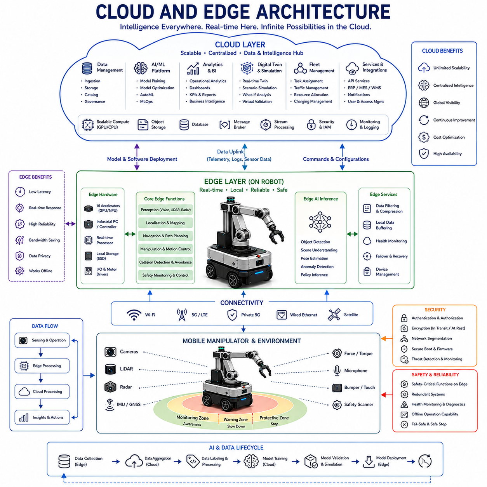{width="7.268055555555556in" height="7.268055555555556in"}

Cloud and Edge Architecture has emerged as one of the most important architectural foundations for next-generation mobile manipulators. As robotic systems become increasingly autonomous, intelligent, connected, and data-driven, traditional onboard computing architectures alone are no longer sufficient to support the growing demands of perception, artificial intelligence, fleet management, simulation, digital twins, and large-scale operational analytics. Cloud and Edge Architecture addresses this challenge by distributing computational resources across both local robotic platforms and remote cloud infrastructures, creating a unified computing ecosystem capable of supporting real-time autonomy and long-term intelligence simultaneously.

Historically, robots operated as isolated systems. All sensing, computation, decision-making, and control functions were performed locally within the robot itself. While this architecture provided high autonomy and low latency, it was constrained by limited onboard computational resources, storage capacity, and learning capabilities. As mobile manipulators began incorporating high-resolution cameras, LiDAR sensors, deep learning models, foundation models, and large-scale operational datasets, the limitations of purely onboard computing became increasingly apparent.

Cloud and Edge Architecture introduces a distributed computing paradigm in which computational responsibilities are allocated according to latency requirements, bandwidth constraints, safety considerations, and resource availability. Time-critical functions remain at the edge, close to the robot, while computationally intensive and non-time-critical workloads are executed within cloud environments. This hybrid approach enables robotic systems to benefit from both local responsiveness and virtually unlimited cloud scalability.

The edge layer represents the computational infrastructure physically located on or near the robot. Edge computing resources include embedded controllers, industrial computers, AI accelerators, GPUs, real-time processors, and local storage devices. These resources are responsible for executing mission-critical workloads that require immediate responses. Navigation, obstacle avoidance, localization, motion control, manipulation planning, collision detection, safety monitoring, and real-time perception typically operate entirely within the edge environment.

Latency is one of the primary reasons why edge computing remains essential. A mobile manipulator navigating through a dynamic environment cannot wait hundreds of milliseconds for cloud-based decisions. If a person suddenly enters the robot's path, obstacle avoidance must occur immediately. Similarly, robotic arm control requires deterministic response times measured in milliseconds. Therefore, safety-critical and operationally critical functions must remain local to ensure reliability and responsiveness.

Modern edge architectures have evolved significantly due to advances in embedded AI hardware. Platforms such as NVIDIA Jetson, Qualcomm Robotics processors, Intel Edge AI platforms, industrial GPU computers, and AI accelerators provide computational capabilities that were previously available only in data centers. These systems enable sophisticated perception, AI inference, and planning directly on the robot while operating within constrained power budgets.

The cloud layer provides a fundamentally different set of capabilities. Unlike edge systems, cloud platforms prioritize scalability, storage capacity, centralized coordination, large-scale computation, and long-term intelligence. Cloud infrastructure typically consists of distributed servers, GPU clusters, object storage systems, databases, analytics platforms, machine learning pipelines, and application services. Cloud resources can scale dynamically according to operational demands, providing virtually unlimited computational capacity when needed.

One of the most important roles of cloud architecture is centralized data management. Mobile manipulators generate enormous volumes of data from cameras, LiDAR sensors, telemetry systems, operational logs, maintenance records, AI inference outputs, and environmental observations. Storing and processing this information entirely on the robot is impractical. Cloud platforms provide centralized repositories where operational data can be collected, organized, analyzed, and utilized for continuous improvement.

Data architecture forms the foundation of cloud-enabled robotic systems. Data pipelines ingest information from individual robots, fleet management systems, digital twins, simulation environments, and enterprise software platforms. These pipelines perform data cleansing, validation, indexing, labeling, storage, and distribution. The resulting datasets become valuable assets for operational analytics, AI training, predictive maintenance, and business intelligence.

Artificial Intelligence represents one of the primary drivers behind Cloud and Edge Architecture adoption. Modern AI models require substantial computational resources for training and optimization. Foundation models, Vision-Language Models, Vision-Language-Action systems, world models, reinforcement learning agents, and multimodal AI architectures often require GPU clusters containing hundreds or thousands of processors during training phases. Such workloads are generally impractical to execute directly on mobile robotic platforms.

Cloud infrastructure therefore serves as the primary environment for AI model development and training. Massive datasets collected from robotic operations are used to train perception systems, manipulation policies, navigation algorithms, anomaly detection models, predictive maintenance systems, and autonomous decision-making architectures. Once trained, optimized versions of these models can be deployed to edge devices for real-time execution.

This creates an AI lifecycle that spans both cloud and edge environments. Data is collected at the edge, aggregated within the cloud, used to improve AI models, and subsequently redeployed to robotic platforms. The result is a continuous learning ecosystem where operational experience contributes directly to future system performance.

Digital Twin Architecture represents another major application of cloud-enabled robotics. A digital twin is a virtual representation of a physical robot and its operating environment. Digital twins continuously receive information from deployed robots and maintain synchronized virtual models that reflect real-world conditions. Engineers can monitor performance, analyze failures, validate software updates, optimize workflows, and simulate operational scenarios without interrupting production activities.

The integration of cloud computing with digital twins enables large-scale simulation and virtual testing. Instead of physically evaluating every possible operational condition, organizations can simulate thousands of scenarios in virtual environments. This capability dramatically accelerates development cycles while reducing costs and operational risks.

Fleet Management Systems represent one of the most visible examples of Cloud and Edge Architecture in practical deployment. Individual robots perform local autonomy at the edge, while fleet-level coordination occurs within cloud-based management platforms. Fleet systems assign tasks, optimize routes, manage traffic flow, allocate resources, monitor performance, coordinate charging schedules, and generate operational reports.

As the number of deployed robots increases, centralized fleet intelligence becomes increasingly valuable. A fleet of hundreds of mobile manipulators operating across multiple facilities generates operational patterns that may not be visible to individual robots. Cloud analytics can identify inefficiencies, predict bottlenecks, optimize workflows, and improve resource utilization across entire robotic ecosystems.

Remote Operations Centers represent another important component of cloud-connected architectures. Human supervisors can monitor robot fleets from centralized locations, receive alerts, review performance metrics, access diagnostic information, and intervene when necessary. This capability significantly improves operational scalability because a small team of operators can supervise large numbers of autonomous systems distributed across multiple locations.

Predictive maintenance is one of the most economically valuable applications of Cloud and Edge Architecture. Mobile manipulators continuously generate telemetry related to motor currents, temperatures, battery health, vibration levels, controller performance, network status, and operational workloads. Cloud analytics platforms can process this information to identify early indicators of component degradation and impending failures.

Rather than relying on fixed maintenance schedules, predictive maintenance systems estimate the remaining useful life of components and recommend maintenance actions before failures occur. This reduces downtime, improves asset utilization, and lowers overall operational costs.

Cloud-enabled robotics also supports advanced business intelligence capabilities. Operational data can be transformed into performance dashboards, utilization reports, efficiency metrics, quality indicators, and financial analytics. Organizations gain visibility into robot productivity, task completion rates, energy consumption, maintenance costs, and operational bottlenecks.

Communication architecture plays a central role in enabling Cloud and Edge integration. Reliable connectivity is required to synchronize data between robotic platforms and cloud infrastructure. Wi-Fi, LTE, 5G, private wireless networks, satellite communication systems, and future 6G technologies provide the communication backbone supporting distributed robotic ecosystems.

Bandwidth management becomes a critical design consideration. High-resolution camera streams, LiDAR point clouds, AI inference results, diagnostic logs, and digital twin synchronization can generate enormous network traffic. Intelligent data filtering, compression, prioritization, and edge analytics are therefore necessary to optimize bandwidth utilization while preserving critical information.

Cybersecurity becomes increasingly important as robotic systems become cloud-connected. Every network connection represents a potential attack surface. Cloud and Edge Architecture must therefore incorporate secure communication channels, encryption, authentication mechanisms, access controls, certificate management, intrusion detection systems, secure boot technologies, and continuous security monitoring.

Safety considerations further influence architectural design decisions. Safety-critical functions such as emergency stop processing, collision avoidance, force control, and motion control cannot depend entirely on cloud connectivity. Communication failures, network latency, or cloud outages must never compromise safety. Consequently, safety functions remain local to the edge layer even in highly connected robotic systems.

The emergence of Edge AI has strengthened the role of local intelligence within distributed architectures. Rather than transmitting raw sensor data to the cloud, edge systems increasingly perform local AI inference, anomaly detection, object recognition, and decision-making. Only higher-level information, summaries, or selected datasets are transmitted to cloud services. This reduces bandwidth requirements, improves privacy, and enhances responsiveness.

Cloud AI complements Edge AI by providing centralized learning and optimization capabilities. While edge systems focus on execution, cloud systems focus on knowledge generation. Together they create a collaborative intelligence framework in which local autonomy and centralized learning reinforce one another.

Multi-robot collaboration represents another area where Cloud and Edge Architecture provides significant benefits. Robots can share maps, operational knowledge, object information, environmental observations, and AI models through cloud-based coordination platforms. Collective intelligence emerges when the experiences of one robot become available to the entire fleet.

As Physical AI and Embodied Intelligence continue to evolve, Cloud and Edge Architecture will become even more important. Future robotic systems will require continuous learning, large-scale reasoning, world modeling, multimodal AI processing, and collaborative intelligence. No single computing layer can efficiently support all these requirements. Distributed architectures will therefore become the standard approach for advanced robotic systems.

The future of Cloud and Edge Architecture will likely involve cloud-edge continuum computing, federated learning, distributed foundation models, autonomous AI agents, real-time digital twins, intelligent network orchestration, and globally connected robotic ecosystems. Computational resources will become increasingly fluid, dynamically allocating workloads across robots, edge servers, regional data centers, and cloud platforms according to operational requirements.

Ultimately, Cloud and Edge Architecture serves as the computational ecosystem that enables intelligent mobile manipulators to operate at scale. It combines the responsiveness of local autonomy with the power of centralized intelligence. It connects robots to digital twins, AI training pipelines, fleet management systems, enterprise software platforms, and cloud services. As robotics advances toward fully autonomous, data-driven, and AI-native systems, Cloud and Edge Architecture will become one of the most important foundations for scalable robotic intelligence, operational efficiency, and long-term system evolution.

## 11 Reference Architectures

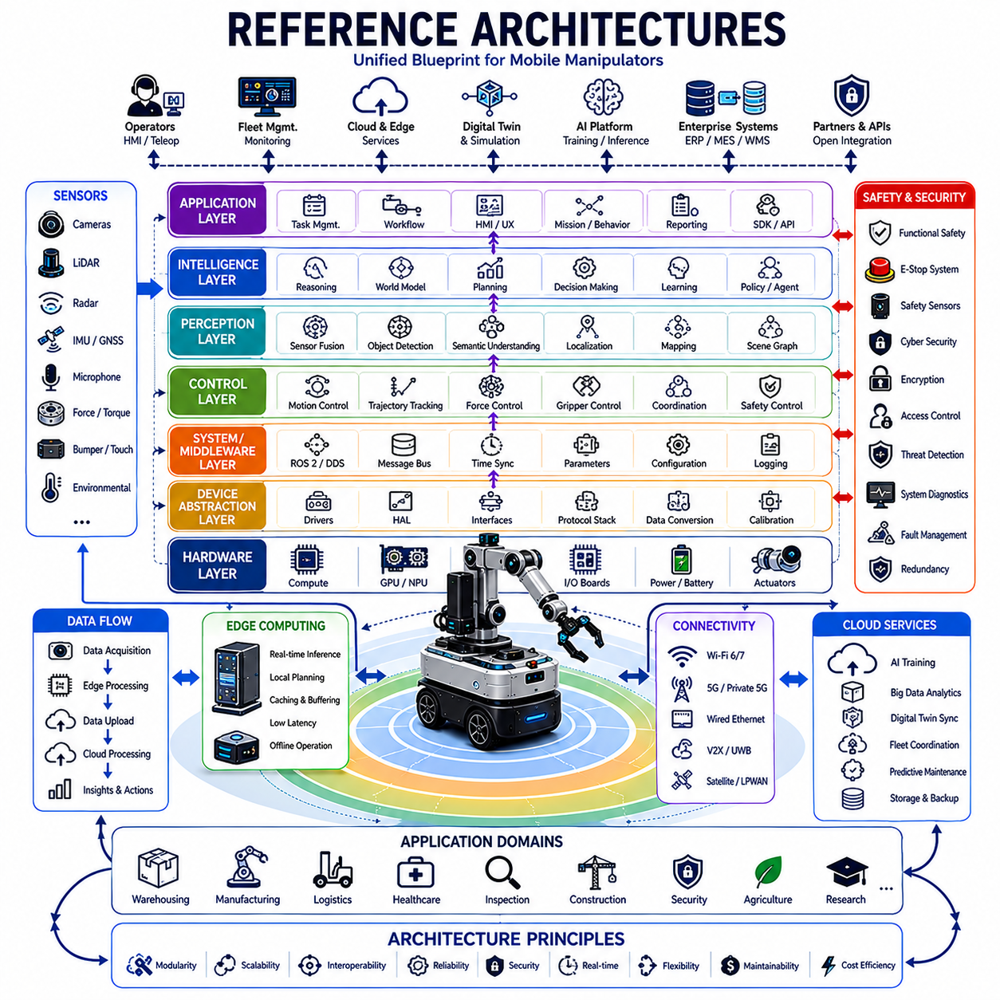{width="7.268055555555556in" height="7.268055555555556in"}

Reference Architectures serve as standardized blueprints that guide the design, development, integration, deployment, and evolution of mobile manipulator systems. While previous chapters have examined individual architectural domains such as mechanical systems, sensors, computing platforms, control frameworks, artificial intelligence, communication networks, safety mechanisms, and cloud-edge infrastructures, Reference Architectures bring these domains together into cohesive system-level designs. They provide reusable architectural patterns that reduce complexity, accelerate development, improve interoperability, and establish common engineering practices across robotic platforms.

In the evolution of modern robotics, the increasing complexity of mobile manipulators has made system integration one of the most challenging engineering disciplines. A mobile manipulator may contain dozens of sensors, multiple computing units, real-time controllers, AI accelerators, robotic arms, autonomous navigation modules, fleet management systems, cloud services, digital twins, cybersecurity frameworks, and human-machine interfaces. Without a structured architectural approach, system development can become fragmented, difficult to maintain, and costly to scale. Reference Architectures address this challenge by providing proven system structures that can be adapted to various applications.

A Reference Architecture does not describe a single product or implementation. Instead, it defines a conceptual framework that captures essential system components, interfaces, data flows, responsibilities, and design principles. Individual robotic products may implement the architecture differently, but the underlying structure remains consistent. This approach enables organizations to standardize development processes while maintaining flexibility for application-specific requirements.

The concept of Reference Architecture has long been used in information technology, telecommunications, aerospace systems, and industrial automation. In robotics, Reference Architectures have become increasingly important because robotic systems combine multiple engineering disciplines, including mechanical engineering, electrical engineering, software engineering, artificial intelligence, networking, safety engineering, and operational technology. A well-designed Reference Architecture provides a common language that enables specialists from these disciplines to collaborate effectively.

One of the primary benefits of Reference Architectures is modularity. Modern mobile manipulators must support different sensors, manipulators, computing platforms, software frameworks, and AI models. A modular architecture allows individual components to be upgraded or replaced without redesigning the entire system. This flexibility significantly improves maintainability, scalability, and lifecycle management.

Layered architecture is one of the most widely adopted reference models within robotics. In a layered architecture, system functions are organized according to abstraction levels. Lower layers handle hardware interaction, sensing, communication, and real-time control. Intermediate layers perform perception, localization, mapping, planning, and coordination. Upper layers manage task execution, mission management, AI reasoning, and fleet coordination. By separating concerns into layers, system complexity becomes more manageable.

The hardware layer typically forms the foundation of a mobile manipulator reference architecture. This layer includes sensors, actuators, motor controllers, batteries, communication interfaces, embedded devices, robotic arms, and mobile bases. The primary responsibility of the hardware layer is to provide physical capabilities and environmental interaction mechanisms.

Above the hardware layer lies the device abstraction layer. This layer isolates application software from hardware-specific implementations. Drivers, middleware adapters, hardware abstraction interfaces, and communication protocols provide standardized access to underlying devices. Hardware abstraction significantly simplifies software portability and system integration.

The perception layer transforms sensor measurements into meaningful environmental information. This layer includes computer vision systems, LiDAR processing modules, sensor fusion algorithms, object recognition models, human detection systems, environmental mapping components, and localization frameworks. Perception serves as the primary source of situational awareness throughout the robotic system.

The world modeling layer maintains internal representations of the robot, environment, tasks, and operational context. Maps, semantic models, digital twins, object databases, scene graphs, and world models provide structured information that supports reasoning and decision-making. As AI systems become more advanced, world modeling is increasingly viewed as a central architectural capability rather than a supporting function.

Planning and decision-making layers convert environmental understanding into executable actions. Navigation planners generate routes and trajectories. Manipulation planners calculate arm movements and grasp strategies. Task planners coordinate complex workflows involving multiple activities. Decision-making modules evaluate alternatives, optimize objectives, and select appropriate actions under uncertainty.

Control layers transform plans into physical motion. These layers include trajectory controllers, servo systems, force control modules, impedance control frameworks, and motion coordination systems. The control layer ensures that planned actions are executed accurately while maintaining stability, responsiveness, and safety.

Safety architecture is often represented as a parallel reference layer spanning the entire system. Unlike traditional functional layers, safety systems monitor and influence every architectural domain. Safety controllers, emergency stop systems, protective sensors, functional safety frameworks, cybersecurity protections, and fault management mechanisms operate continuously to maintain acceptable risk levels.

Artificial Intelligence has become sufficiently important to warrant dedicated architectural treatment within modern reference architectures. AI layers typically encompass perception intelligence, cognitive reasoning, task understanding, learning systems, foundation models, world models, policy generation, and autonomous decision-making capabilities. Future robotic systems will increasingly treat AI as a foundational architectural domain rather than an isolated subsystem.

Cloud and Edge Architecture introduces additional architectural dimensions. Edge systems execute latency-sensitive functions such as navigation, manipulation, safety monitoring, and local AI inference. Cloud systems provide large-scale analytics, fleet coordination, AI model training, digital twin synchronization, predictive maintenance, and long-term data management. Reference Architectures must clearly define how responsibilities are distributed across these computing environments.

Communication Architecture serves as the connective framework linking all architectural layers. Internal communication enables interaction among software modules, sensors, controllers, and AI systems. External communication connects robots with cloud platforms, fleet management systems, enterprise applications, digital twins, and human operators. Well-defined communication interfaces are essential for scalability and interoperability.

Reference Architectures frequently incorporate service-oriented design principles. Rather than building tightly coupled monolithic systems, modern architectures decompose functionality into independent services. Navigation services, perception services, manipulation services, localization services, AI services, and safety services communicate through standardized interfaces. Service-oriented architectures improve flexibility, maintainability, and scalability.

Microservice architectures extend this concept further by enabling fine-grained decomposition of robotic software. Individual functions can be independently developed, deployed, updated, and scaled. Container technologies such as Docker and orchestration frameworks such as Kubernetes increasingly influence cloud-connected robotic architectures, particularly within large-scale fleet deployments.

ROS2 has become one of the most influential frameworks shaping contemporary robotic reference architectures. Its distributed communication model, middleware abstraction, modular design philosophy, and support for heterogeneous computing environments align closely with modern architectural principles. Many commercial and research robotic platforms use ROS2 as the foundational middleware layer within their reference architectures.

The concept of autonomy levels also influences architectural design. Lower-autonomy systems may rely heavily on human supervision and predefined workflows. Higher-autonomy systems require advanced perception, reasoning, planning, learning, and adaptation capabilities. Reference Architectures must therefore accommodate a wide range of autonomy requirements while supporting future upgrades.

Industrial mobile manipulators often employ task-oriented reference architectures. In these systems, mission execution frameworks coordinate navigation, manipulation, inspection, transportation, maintenance, and interaction tasks. Behavior Trees, state machines, workflow engines, and orchestration frameworks are commonly used to manage operational logic.

Warehouse automation provides a representative example of a mobile manipulator reference architecture. The system typically integrates inventory management systems, warehouse management systems, autonomous navigation modules, object recognition systems, robotic manipulation capabilities, fleet coordination platforms, cloud analytics, and predictive maintenance services. Each component contributes to a unified operational architecture supporting end-to-end logistics automation.

Healthcare robotics introduces additional architectural considerations. Medical mobile manipulators may require regulatory compliance frameworks, patient interaction systems, medical device integration, privacy protection mechanisms, teleoperation capabilities, and clinical workflow management functions. Reference Architectures help ensure that these specialized requirements are addressed systematically.

Outdoor autonomous mobile manipulators present further architectural challenges. GNSS integration, geofencing, weather resilience, long-range communication, remote operations support, infrastructure interaction, and large-scale environmental mapping become critical components. Reference Architectures provide structured approaches for integrating these capabilities into coherent systems.

Defense, security, inspection, agriculture, mining, construction, and infrastructure maintenance applications each introduce unique architectural requirements. However, many underlying architectural principles remain consistent. Reference Architectures enable organizations to leverage common foundations while customizing domain-specific capabilities.

Interoperability represents a major objective of modern Reference Architectures. Robotic ecosystems increasingly involve products from multiple vendors operating within shared environments. Standardized interfaces, communication protocols, data models, semantic representations, and API frameworks facilitate integration across heterogeneous systems. Open architectures encourage innovation while reducing vendor lock-in.

Digital Twin Architecture is becoming a standard component of advanced reference models. Virtual representations of robotic systems enable simulation, testing, optimization, monitoring, training, and lifecycle management. Digital twins provide continuous feedback between operational environments and engineering processes, improving both system performance and development efficiency.

Cybersecurity Architecture is similarly evolving into a dedicated reference domain. Authentication systems, encryption frameworks, secure communication protocols, identity management systems, intrusion detection mechanisms, and secure software deployment pipelines are increasingly integrated into baseline architectural models.

Artificial Intelligence is driving the emergence of Cognitive Reference Architectures. These architectures integrate perception, memory, reasoning, planning, learning, language understanding, world modeling, and action generation into unified frameworks. Foundation Models, Vision-Language Models, Vision-Language-Action systems, and autonomous agents are becoming central architectural components.

Embodied AI is likely to redefine future robotic reference architectures. Rather than separating perception, planning, and control into distinct modules, embodied architectures may integrate sensing, cognition, memory, learning, and action within unified intelligence systems. Such architectures more closely resemble biological intelligence and may significantly improve adaptability and generalization.

Cloud-native robotics represents another emerging architectural paradigm. In cloud-native architectures, robotic capabilities are designed from the outset to operate within distributed computing environments. Edge devices, cloud services, AI infrastructure, digital twins, fleet management platforms, and enterprise systems function as components of a single integrated ecosystem.

The future of Reference Architectures will likely be characterized by increasing abstraction, modularity, intelligence, and interoperability. AI-native architectures, cloud-edge continuum architectures, distributed autonomous agent frameworks, digital twin ecosystems, collective robotic intelligence, and Physical AI systems will shape the next generation of mobile manipulator platforms.

Ultimately, Reference Architectures serve as the architectural foundation that transforms complex collections of technologies into coherent robotic systems. They provide structure, consistency, scalability, and engineering discipline across every phase of the system lifecycle. As mobile manipulators continue evolving toward higher levels of autonomy, intelligence, connectivity, and adaptability, Reference Architectures will play an increasingly important role in enabling efficient development, reliable deployment, and sustainable long-term evolution. They represent not merely technical diagrams, but strategic frameworks that guide the future of intelligent robotic systems.
