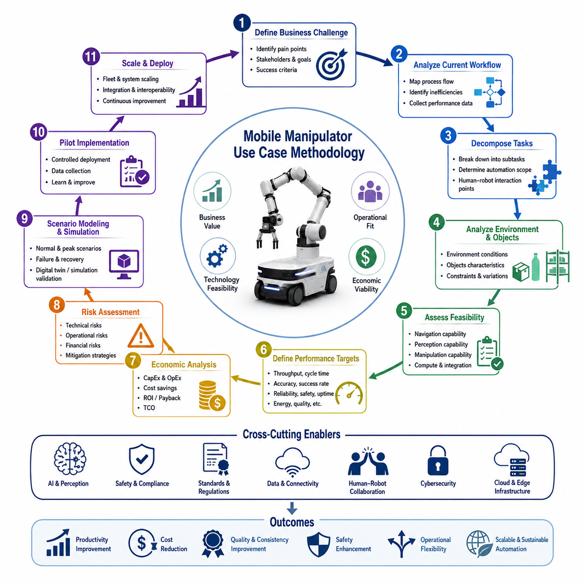
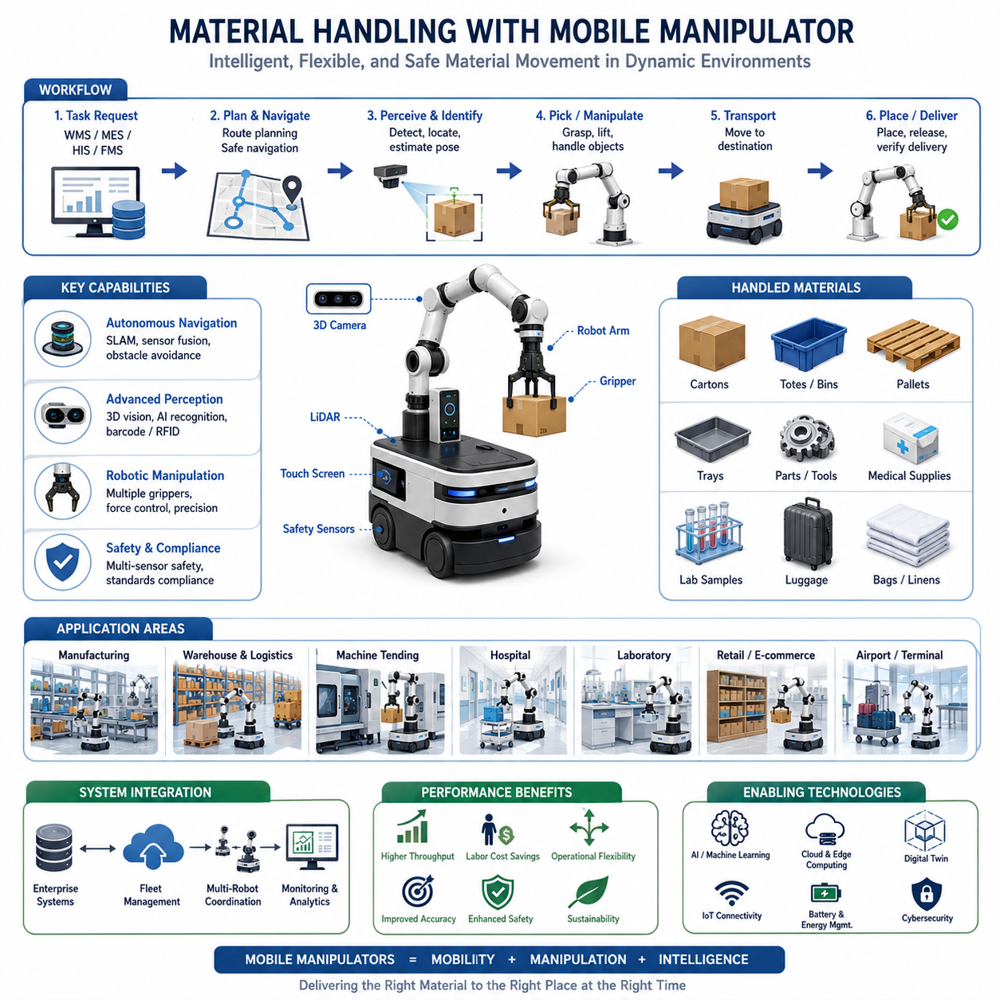
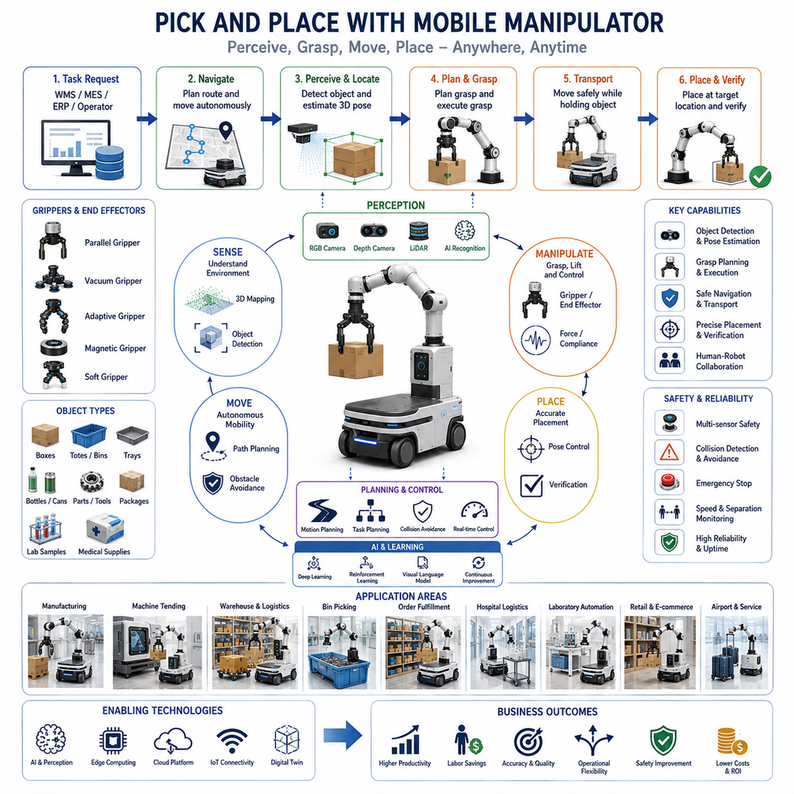
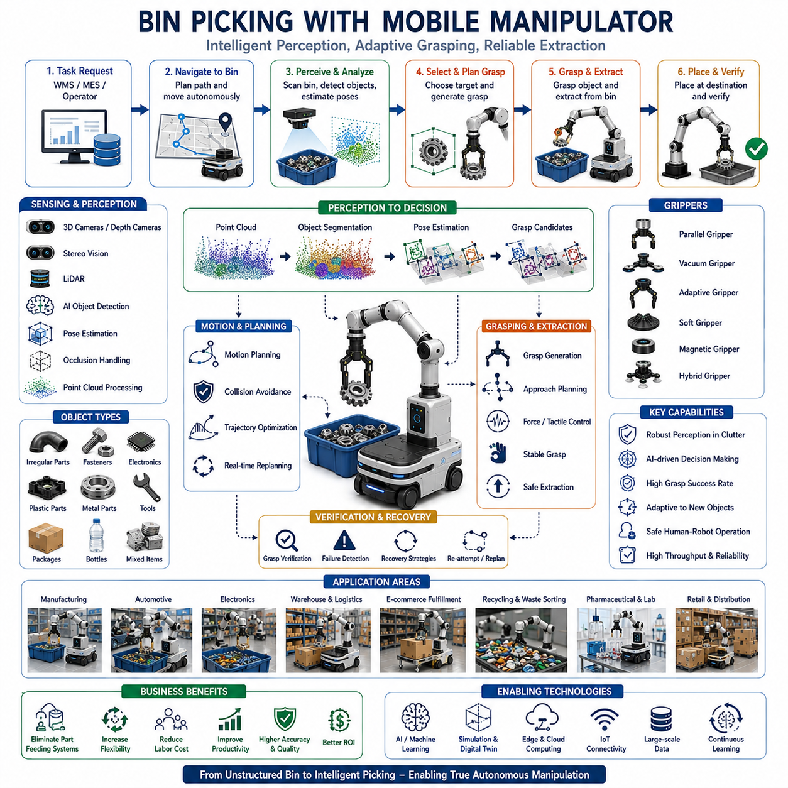
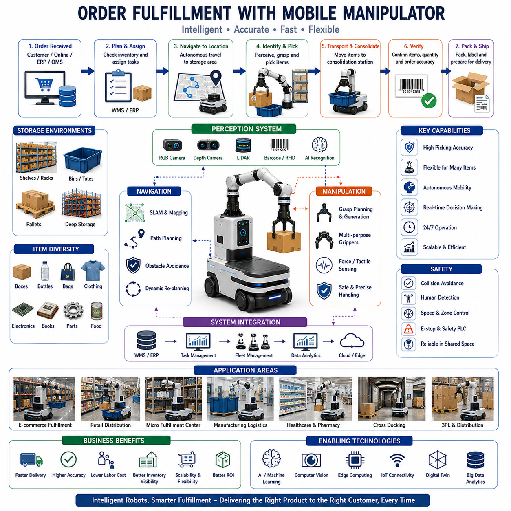
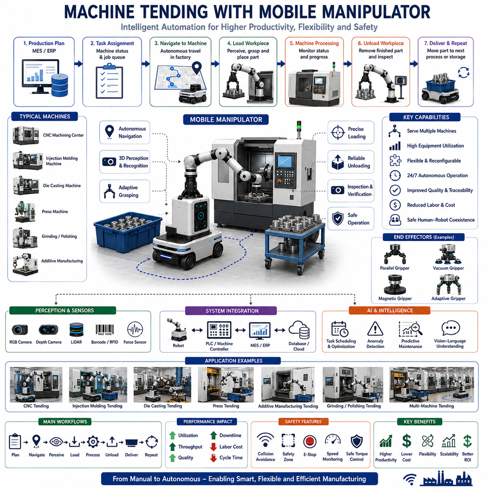
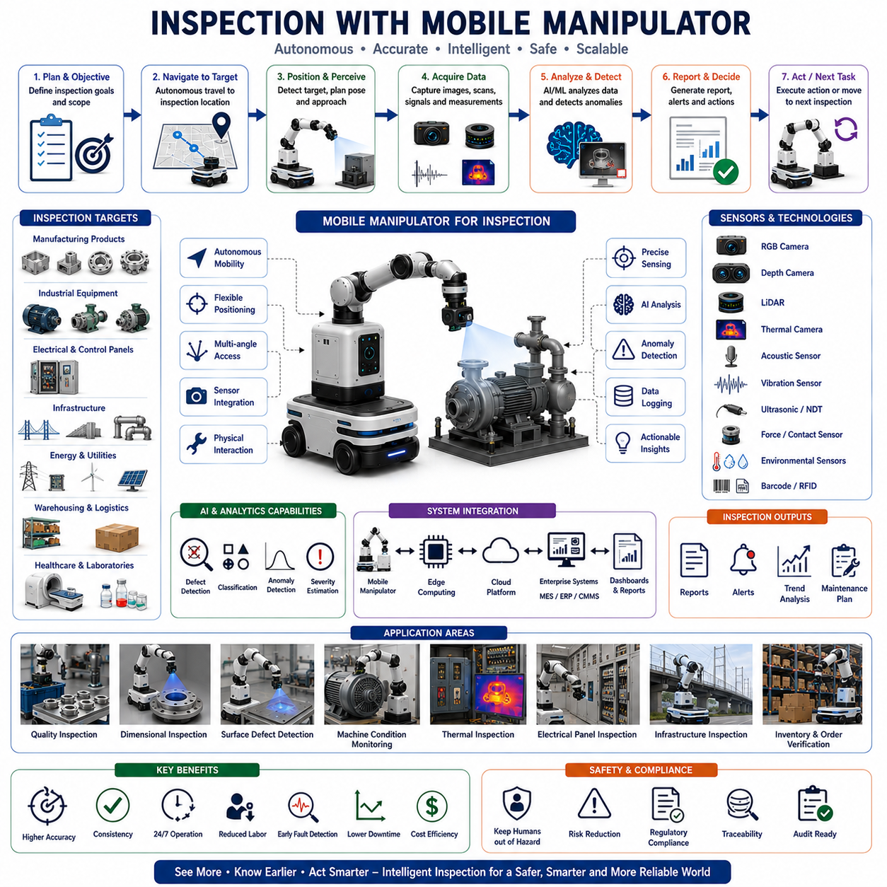
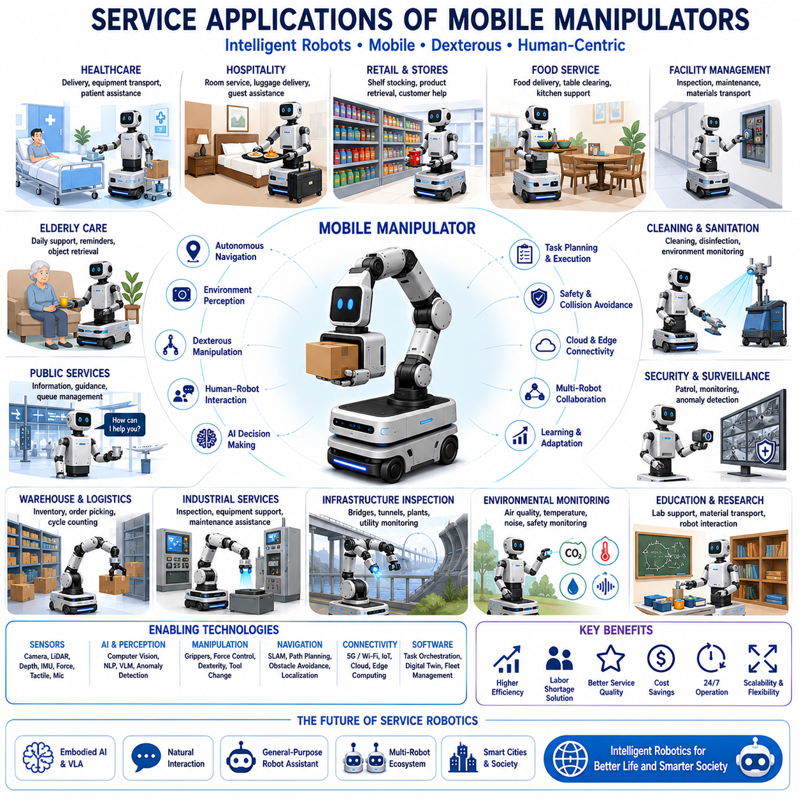
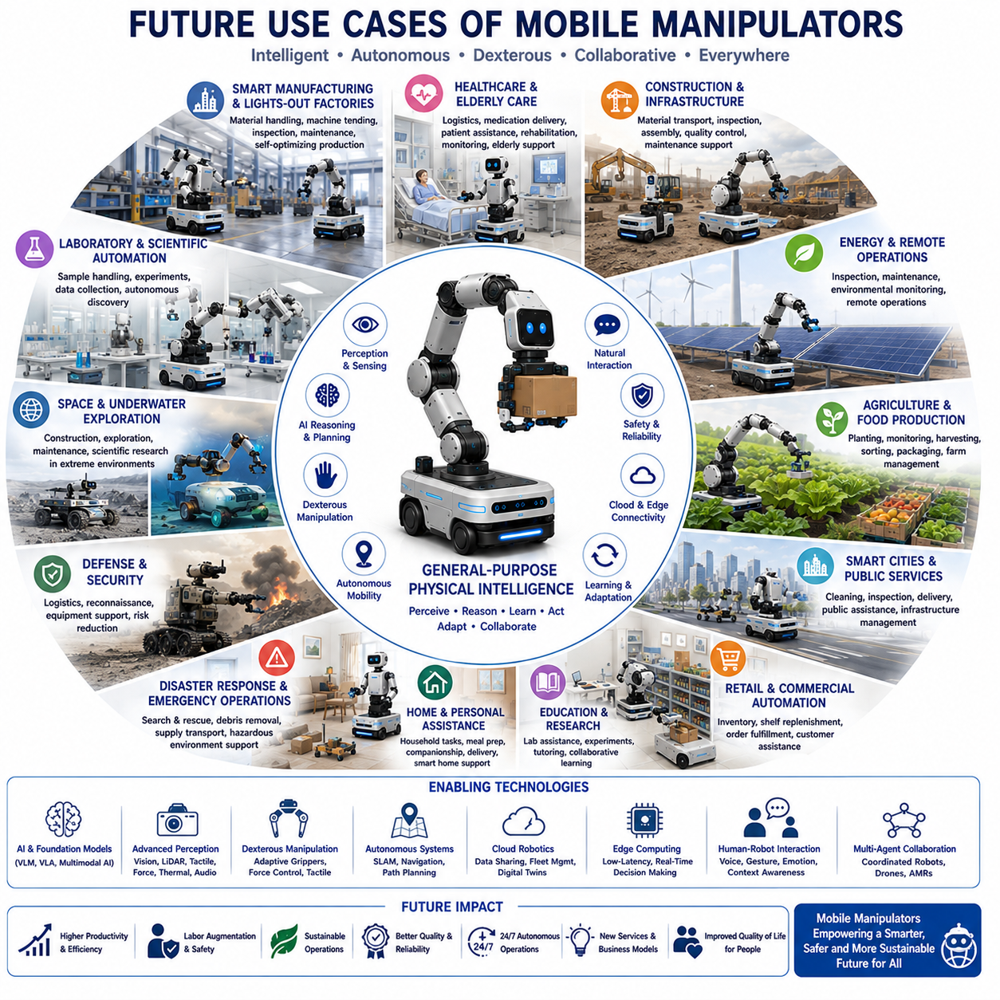

**Volume 01. Mobile Manipulator Foundations and System Architecture**

# Chapter 04. Use Cases

## 01 Use Case Methodology

{width="7.268055555555556in" height="7.268055555555556in"}

Mobile manipulators represent one of the most important developments in modern robotics because they combine autonomous mobility and robotic manipulation into a single integrated system. Unlike traditional industrial robots that operate within fixed workcells or autonomous mobile robots that primarily transport materials, mobile manipulators can navigate through dynamic environments, identify objects, interact with them, and execute complex physical tasks at multiple locations. As organizations increasingly seek flexible automation solutions capable of adapting to changing operational requirements, understanding how to define, analyze, evaluate, and prioritize mobile manipulator use cases becomes essential. A structured use case methodology provides a systematic framework for identifying where mobile manipulation delivers the greatest value, determining technical feasibility, assessing economic viability, and guiding product development and deployment decisions. The purpose of a use case methodology is not merely to describe robotic applications but to establish a repeatable process that connects business objectives, operational workflows, technological capabilities, and measurable outcomes. This methodology becomes a critical bridge between customer needs and engineering implementation.

The foundation of any use case methodology begins with understanding the operational problem that must be solved. Organizations rarely purchase robots because they desire robotic technology itself. Instead, they seek solutions to labor shortages, productivity limitations, quality inconsistencies, safety concerns, operational inefficiencies, or cost pressures. Therefore, the first step in defining a mobile manipulator use case is identifying the business challenge. A warehouse operator may struggle with repetitive picking tasks. A manufacturing facility may experience bottlenecks at machine loading stations. A hospital may require efficient transportation and handling of medical supplies. A retail facility may need inventory management and shelf replenishment support. Each scenario represents a different operational challenge, and the use case methodology begins by analyzing the root causes, constraints, stakeholders, and desired outcomes associated with the problem.

Once the operational challenge is identified, the next stage involves mapping the existing workflow. Workflow analysis provides visibility into how tasks are currently performed and where automation opportunities exist. A detailed workflow description typically includes task sequences, worker responsibilities, material flows, equipment interactions, environmental conditions, exception handling procedures, and performance metrics. Understanding the current state allows engineers and decision-makers to identify repetitive activities, transportation delays, unnecessary motion, idle time, ergonomic risks, and quality-related issues. These observations form the basis for determining whether a mobile manipulator can provide meaningful improvements. Without a thorough understanding of current workflows, robotic solutions often fail because they address symptoms rather than underlying operational constraints.

Task decomposition is a central element of use case methodology. Most industrial or service processes consist of multiple subtasks that vary significantly in complexity. A seemingly simple warehouse picking operation may include navigation to a storage location, shelf identification, object recognition, grasp planning, object retrieval, transportation, placement, verification, and reporting. Each subtask requires different sensing, planning, and control capabilities. By decomposing workflows into individual actions, engineers can evaluate which portions of the process are suitable for automation and which may continue to require human involvement. Task decomposition also enables the development of modular robotic architectures where navigation, perception, manipulation, and decision-making functions can be optimized independently while contributing to overall system performance.

Environmental analysis represents another critical component of use case development. Mobile manipulators operate in physical environments that influence navigation reliability, perception accuracy, manipulation success, and overall system robustness. Environmental factors include floor conditions, lighting variations, temperature ranges, humidity levels, workspace dimensions, obstacle density, human traffic patterns, wireless connectivity availability, and safety requirements. An indoor warehouse with structured shelving presents different challenges compared to a hospital corridor, airport terminal, retail store, or manufacturing facility. Environmental analysis ensures that robotic capabilities align with real-world operating conditions and helps identify risks that may affect deployment success.

Object analysis is equally important because manipulation performance depends heavily on the characteristics of target objects. Objects vary in size, weight, shape, texture, rigidity, fragility, reflectivity, and packaging configuration. Some objects can be easily grasped using parallel grippers, while others require suction systems, adaptive grippers, or specialized end effectors. Understanding object properties allows engineers to select appropriate manipulation strategies and estimate expected success rates. In many practical deployments, object diversity becomes one of the primary challenges influencing system complexity and cost. Therefore, use case methodology includes a detailed examination of all items the robot is expected to handle.

Human interaction analysis plays a significant role in mobile manipulator applications because these systems frequently operate in environments shared with people. Unlike isolated industrial robots, mobile manipulators often coexist with workers, customers, patients, visitors, or maintenance personnel. Understanding how humans interact with robotic systems is essential for ensuring safety, usability, and acceptance. Human interaction analysis examines collaboration requirements, communication methods, task handoffs, emergency procedures, operator interventions, training needs, and user experience considerations. Successful deployments often depend as much on effective human-robot collaboration as on technical performance.

Following workflow and environmental analysis, use case methodology evaluates robotic feasibility. Feasibility assessment determines whether current technologies can reliably perform the required tasks within acceptable operational constraints. This assessment includes navigation feasibility, perception feasibility, manipulation feasibility, computational feasibility, and system integration feasibility. Navigation feasibility evaluates the robot's ability to move safely and efficiently throughout the workspace. Perception feasibility assesses object detection, localization, and environmental awareness capabilities. Manipulation feasibility examines grasping, handling, positioning, and interaction requirements. Computational feasibility considers processing requirements, latency constraints, and AI model performance. System integration feasibility evaluates compatibility with existing infrastructure, software platforms, databases, and operational processes.

Performance requirements are then defined to establish measurable success criteria. Effective use cases specify quantitative targets rather than vague objectives. Performance metrics may include cycle time, task completion rate, picking accuracy, grasp success rate, navigation accuracy, throughput, uptime, mean time between failures, safety incidents, energy consumption, and return on investment. Clearly defined metrics enable objective evaluation during development, testing, pilot deployments, and commercial operation. They also provide a common language for communication among engineers, managers, customers, and stakeholders.

Economic analysis represents a major component of use case prioritization. Even technically feasible robotic applications may fail to justify investment if economic benefits are insufficient. Economic evaluation considers capital expenditures, operational expenditures, maintenance costs, software licensing costs, infrastructure modifications, training requirements, and lifecycle costs. Benefits may include labor savings, productivity improvements, quality enhancements, reduced injury risks, increased operational flexibility, and improved customer service. Return on investment calculations help organizations determine whether automation initiatives align with business objectives and financial expectations.

Risk assessment is another essential element of use case methodology. Every deployment involves technical, operational, financial, and organizational risks. Technical risks may include perception failures, grasping inaccuracies, navigation errors, sensor degradation, communication disruptions, or AI model limitations. Operational risks may involve workflow interruptions, unexpected environmental changes, or maintenance challenges. Financial risks may stem from cost overruns or slower-than-expected adoption. Organizational risks may arise from workforce resistance or insufficient training. A structured risk assessment process identifies potential failure modes and develops mitigation strategies before deployment begins.

Use case classification helps organizations organize opportunities according to application domains and complexity levels. Within mobile manipulation, common classifications include material handling, pick-and-place operations, bin picking, machine tending, inspection tasks, inventory management, hospital logistics, laboratory automation, retail support, service robotics, and field operations. Each category exhibits distinct technical requirements and business drivers. Classification frameworks support technology roadmaps, product portfolio planning, and market segmentation strategies.

Scenario modeling extends the methodology by examining how robotic systems behave under different operating conditions. Normal operating scenarios describe expected workflows. Peak demand scenarios evaluate performance under high workloads. Failure scenarios analyze recovery mechanisms following hardware or software faults. Edge cases explore unusual situations that may challenge robotic decision-making. Scenario modeling improves system robustness by ensuring that design decisions account for a wide range of real-world conditions rather than idealized assumptions.

Simulation increasingly plays a central role in use case validation. Digital twins and simulation environments allow organizations to evaluate robotic concepts before investing in physical systems. Simulated environments support workflow analysis, navigation testing, manipulation planning, throughput estimation, fleet coordination studies, and safety validation. By testing different configurations and operational strategies virtually, organizations can identify optimal solutions while reducing development costs and deployment risks. Simulation also provides valuable datasets for AI model training and performance benchmarking.

Pilot deployment methodology follows successful simulation and feasibility evaluation. Pilot projects serve as intermediate steps between concept validation and full-scale deployment. During pilot phases, robotic systems operate within controlled environments where performance can be monitored closely. Pilot deployments generate real-world data related to reliability, productivity, usability, maintenance requirements, and user acceptance. Lessons learned during pilot programs frequently lead to system refinements that improve long-term deployment success.

Scalability assessment ensures that successful pilot implementations can expand to larger operational environments. A use case that functions effectively with one robot may encounter challenges when scaled to multiple robots, multiple sites, or enterprise-wide deployments. Scalability analysis examines fleet management requirements, cloud infrastructure capacity, network architecture, maintenance processes, software update mechanisms, and organizational readiness. This analysis helps organizations avoid situations where localized success cannot be replicated at larger scales.

Interoperability considerations have become increasingly important as robotic systems integrate with broader digital ecosystems. Mobile manipulators must often communicate with warehouse management systems, manufacturing execution systems, enterprise resource planning platforms, hospital information systems, inventory databases, cloud services, and fleet management solutions. A comprehensive use case methodology therefore includes evaluation of data flows, communication protocols, cybersecurity requirements, and software integration strategies.

The emergence of artificial intelligence, foundation models, vision-language models, and embodied AI technologies is transforming use case methodology. Traditional robotic applications relied heavily on predefined workflows and structured environments. Modern AI-enabled mobile manipulators can interpret natural language instructions, reason about unfamiliar situations, generalize across tasks, and adapt to dynamic conditions. Consequently, use case evaluation increasingly considers cognitive capabilities in addition to physical capabilities. Engineers must assess not only whether a robot can move and manipulate objects, but also whether it can understand context, make informed decisions, and collaborate effectively with humans.

From a product strategy perspective, use case methodology helps determine where development resources should be concentrated. Not all applications provide equal market potential, technical feasibility, or competitive differentiation. Systematic evaluation enables organizations to prioritize use cases that offer strong customer demand, achievable technical objectives, attractive economics, and scalable business opportunities. This prioritization process is particularly important for emerging mobile manipulator companies seeking to establish sustainable market positions.

Ultimately, use case methodology serves as the foundation for successful mobile manipulator development and deployment. It transforms abstract automation concepts into structured engineering and business processes. By connecting operational needs, workflow analysis, environmental constraints, technological capabilities, economic considerations, risk assessments, and performance objectives, the methodology provides a comprehensive framework for decision-making. As mobile manipulators become increasingly capable and widespread across industries, a disciplined approach to use case development will remain essential for maximizing value creation, reducing deployment risks, and accelerating the adoption of intelligent robotic systems. The most successful organizations will be those that treat use case definition not as a preliminary documentation exercise but as a strategic process that guides every stage of robotic innovation, from concept development to large-scale operational deployment.

## 02 Material Handling

{width="7.268055555555556in" height="7.268055555555556in"}

Material handling is one of the most fundamental and economically significant applications of mobile manipulators. Across manufacturing facilities, warehouses, logistics centers, hospitals, laboratories, airports, retail environments, and industrial plants, enormous amounts of time, labor, and operational cost are associated with moving materials from one location to another. Traditionally, these activities have been performed either by human workers, fixed automation systems, conveyors, forklifts, autonomous mobile robots, or industrial robotic cells. However, each of these approaches has limitations. Human workers offer flexibility but face productivity and safety constraints. Conveyors provide high throughput but lack adaptability. Industrial robots deliver precision but are confined to fixed workspaces. Autonomous mobile robots excel at transportation but generally cannot manipulate objects. Mobile manipulators bridge these gaps by combining autonomous mobility and robotic manipulation into a single intelligent platform capable of transporting, picking, placing, loading, unloading, and organizing materials throughout dynamic environments. As a result, material handling has become one of the most promising and commercially viable use cases for mobile manipulation systems.

The concept of material handling encompasses all activities related to the movement, storage, protection, control, and management of materials throughout operational processes. These materials may include raw materials, work-in-progress inventory, finished products, containers, pallets, totes, medical supplies, laboratory samples, retail merchandise, luggage, tools, spare parts, and countless other physical objects. The primary objective of material handling is to ensure that materials are available at the right location, at the right time, in the right quantity, and in the right condition while minimizing labor, transportation costs, delays, damage, and operational risks. Mobile manipulators are uniquely positioned to support these objectives because they can simultaneously perform transportation and object interaction tasks without requiring extensive fixed infrastructure.

Historically, material handling automation evolved through several stages. Early factories relied almost entirely on manual labor. Workers physically transported materials using carts, hand trucks, and forklifts. As industrial production expanded, conveyor systems and automated storage systems were introduced to improve efficiency. Industrial robots later automated repetitive loading and unloading operations but remained limited to fixed workcells. The emergence of autonomous mobile robots introduced flexible transportation capabilities, allowing materials to be moved dynamically without dedicated infrastructure. The next logical evolution is the mobile manipulator, which not only transports materials but also physically interacts with them. This capability significantly expands the scope of automation by enabling robots to perform tasks previously requiring human intervention.

One of the key advantages of mobile manipulators in material handling is operational flexibility. Traditional automation systems are often optimized for highly structured environments and predefined workflows. Any changes to facility layouts, product types, or operational processes can require significant redesign efforts. Mobile manipulators, by contrast, can adapt to changing environments through software updates, AI-driven perception systems, and autonomous navigation capabilities. A single robot can perform multiple tasks across different locations within a facility, reducing the need for dedicated equipment and increasing overall utilization.

Material handling workflows typically begin with the identification of a material movement requirement. A manufacturing station may require new components. A warehouse picker may need products transferred between storage zones. A hospital department may request medical supplies. A laboratory may require sample transportation. Once the task is generated, the mobile manipulator receives instructions from a higher-level management system such as a Warehouse Management System (WMS), Manufacturing Execution System (MES), Hospital Information System (HIS), Enterprise Resource Planning (ERP) platform, or Fleet Management System (FMS). The robot then plans a route, navigates to the pickup location, identifies the target material, performs the required manipulation task, transports the material, and delivers it to the designated destination.

Navigation is a critical component of material handling applications. Mobile manipulators must move safely and efficiently through environments that may contain dynamic obstacles, narrow aisles, human workers, vehicles, machinery, and changing layouts. Advanced localization and mapping technologies such as LiDAR-based SLAM, Visual SLAM, GNSS positioning, sensor fusion, and digital maps enable robots to maintain accurate positioning and route planning. Safe navigation requires continuous environmental perception, obstacle avoidance, path optimization, and compliance with operational safety regulations. In many deployments, navigation performance directly influences system throughput and overall productivity.

Perception systems play an equally important role. Material handling tasks require robots to identify objects, determine their positions, estimate orientations, recognize labels, interpret storage locations, and verify delivery conditions. Modern mobile manipulators utilize RGB cameras, depth cameras, 3D LiDAR sensors, stereo vision systems, barcode scanners, RFID readers, and AI-based perception algorithms to create a detailed understanding of their surroundings. Object detection, pose estimation, semantic understanding, and scene reconstruction technologies allow robots to interact effectively with diverse materials in real-world environments.

Manipulation capabilities differentiate mobile manipulators from conventional autonomous mobile robots. The robotic arm enables the system to grasp, lift, place, stack, sort, load, unload, and reposition objects. Depending on the application, different end effectors may be used. Parallel grippers are suitable for rigid objects. Vacuum grippers are commonly used for cartons and packages. Adaptive grippers can handle irregularly shaped items. Specialized end effectors may be required for medical supplies, laboratory samples, fragile products, or heavy industrial components. Successful manipulation depends on accurate perception, robust grasp planning, force control, collision avoidance, and real-time feedback mechanisms.

In manufacturing environments, material handling often involves transferring components between production stations. A mobile manipulator may collect raw materials from a storage area and deliver them to assembly lines. It may remove finished products and transport them to packaging stations. It may support machine tending operations by loading and unloading CNC machines, injection molding systems, testing equipment, or production cells. Because manufacturing facilities frequently experience changes in production schedules and product configurations, the flexibility of mobile manipulators provides significant advantages over traditional fixed automation systems.

Warehouse operations represent another major application area. Modern warehouses process thousands or even millions of items every day. Material movement occurs continuously between receiving docks, storage locations, picking stations, packing areas, and shipping zones. Mobile manipulators can automate many of these activities. They can retrieve items from shelves, transport cartons between zones, replenish inventory, consolidate orders, and support outbound logistics processes. Unlike traditional warehouse automation systems that require extensive infrastructure investments, mobile manipulators can often be deployed incrementally, allowing facilities to scale automation gradually.

Logistics centers present particularly demanding material handling challenges. Facilities must process diverse product types, fluctuating volumes, seasonal demand peaks, and rapidly changing operational requirements. Mobile manipulators provide adaptable solutions capable of responding to these variations. They can handle cartons, totes, pallets, parcels, and containers while integrating with broader logistics workflows. AI-driven task scheduling and fleet coordination further improve efficiency by optimizing resource allocation and minimizing idle time.

Hospitals offer a unique material handling environment. Medical staff spend considerable time transporting supplies, medications, linens, equipment, laboratory samples, and waste materials. These transportation activities consume valuable labor resources that could otherwise be dedicated to patient care. Mobile manipulators can automate many of these repetitive logistics tasks while maintaining strict safety and hygiene requirements. By reducing manual transportation workloads, healthcare facilities can improve operational efficiency and enhance service quality.

Laboratory environments introduce additional requirements related to precision, traceability, and contamination control. Samples often require careful handling, environmental monitoring, and accurate identification. Mobile manipulators equipped with specialized grippers and advanced perception systems can transport sensitive materials while maintaining chain-of-custody records and minimizing human contact. Such capabilities are increasingly important in pharmaceutical research, biotechnology, diagnostics, and clinical laboratory operations.

Retail and e-commerce sectors also benefit from automated material handling. Inventory replenishment, shelf stocking, backroom organization, and order fulfillment represent labor-intensive activities that are well suited to mobile manipulation technologies. As consumer expectations for rapid delivery continue to increase, retailers seek automation solutions capable of improving inventory accuracy and operational responsiveness. Mobile manipulators enable dynamic inventory movement and support omnichannel fulfillment strategies without requiring extensive modifications to existing facilities.

Safety remains a primary consideration in material handling applications. Mobile manipulators frequently operate near human workers and customers. Safe operation requires comprehensive sensing, collision avoidance systems, emergency stop mechanisms, speed and separation monitoring, force limitation capabilities, and compliance with relevant safety standards. Modern safety architectures combine hardware redundancy, software monitoring, environmental awareness, and risk assessment methodologies to ensure safe human-robot interaction. The ability to operate safely in shared environments is one of the defining characteristics of advanced mobile manipulation systems.

Performance evaluation in material handling applications involves a combination of operational, technical, and economic metrics. Operational metrics include throughput, cycle time, order completion rates, transportation efficiency, and task completion success rates. Technical metrics include navigation accuracy, grasp success rates, localization reliability, battery endurance, and system uptime. Economic metrics include labor savings, return on investment, total cost of ownership, productivity improvements, and operational cost reductions. A successful material handling deployment achieves balanced improvements across all three dimensions.

Fleet management becomes increasingly important as organizations deploy multiple mobile manipulators. Coordinating dozens or hundreds of robots requires sophisticated scheduling, task allocation, traffic management, battery management, maintenance planning, and performance monitoring systems. Fleet management platforms provide centralized visibility and control while enabling decentralized execution of individual tasks. Advanced systems use AI-based optimization techniques to maximize utilization and minimize operational bottlenecks.

Cloud connectivity and edge computing architectures further enhance material handling capabilities. Edge computing supports low-latency perception, navigation, and manipulation tasks directly on the robot. Cloud platforms enable fleet-level analytics, predictive maintenance, software updates, digital twin synchronization, and enterprise integration. Together, these technologies create scalable robotic ecosystems capable of supporting large-scale deployments across multiple facilities and geographic regions.

Artificial intelligence is transforming material handling automation. Traditional robotic systems relied on predefined rules and highly structured environments. Modern AI-enabled mobile manipulators can recognize previously unseen objects, adapt to environmental changes, optimize task execution strategies, and learn from operational experiences. Vision-language models, foundation models, and embodied AI technologies are expanding robotic capabilities beyond deterministic automation toward more generalized physical intelligence. These advancements allow robots to perform increasingly complex material handling tasks with reduced engineering effort.

Sustainability considerations are becoming increasingly important in material handling strategies. Organizations seek to reduce energy consumption, minimize waste, improve resource utilization, and support environmental objectives. Mobile manipulators contribute to these goals through optimized transportation routes, efficient task scheduling, reduced product damage, improved inventory accuracy, and lower infrastructure requirements compared to traditional automation systems. As sustainability becomes a strategic priority, the role of intelligent robotic systems in achieving environmental targets will continue to grow.

The future of material handling is likely to involve highly autonomous robotic ecosystems composed of mobile manipulators, autonomous mobile robots, fixed robotic stations, intelligent storage systems, and cloud-based orchestration platforms. These systems will collaborate dynamically to execute complex workflows across factories, warehouses, hospitals, laboratories, airports, retail facilities, and urban logistics networks. Mobile manipulators will serve as a critical link between transportation and physical interaction, enabling end-to-end automation of processes that currently require significant human involvement.

Ultimately, material handling represents one of the most compelling applications for mobile manipulation technology because it addresses a universal operational requirement present across virtually every industry. By combining mobility, perception, manipulation, artificial intelligence, and systems integration into a single platform, mobile manipulators offer unprecedented flexibility and capability. As technology continues to mature and deployment costs decrease, material handling applications will likely remain the primary driver of commercial adoption, serving as the foundation upon which broader autonomous robotic ecosystems are built.

## 03 Pick and Place

{width="7.268055555555556in" height="7.268055555555556in"}

Pick and Place is one of the most fundamental operations in robotics and serves as a cornerstone application for mobile manipulators. The task appears deceptively simple: identify an object, grasp it, transport it if necessary, and place it in a desired location. However, in real-world environments, Pick and Place operations involve a sophisticated combination of perception, planning, manipulation, mobility, control, artificial intelligence, and system integration. The ability to perform reliable Pick and Place operations across diverse environments is often considered one of the most important indicators of a mobile manipulator's practical capability and commercial value. As industries increasingly pursue flexible automation solutions, Pick and Place has evolved from a fixed industrial robot application into a dynamic mobile robotic capability capable of operating across factories, warehouses, hospitals, laboratories, retail facilities, airports, and service environments.

At its core, a Pick and Place operation consists of two primary actions. The first action involves locating and grasping a target object. The second action involves moving the object and placing it at a predefined destination. Although this definition appears straightforward, each stage requires numerous underlying processes. The robot must first understand its environment, identify the correct object among potentially many alternatives, estimate the object\'s position and orientation, determine an appropriate grasp strategy, execute the grasp safely, verify successful acquisition, transport the object without damage or loss, and finally place it accurately in the target location. Each of these activities introduces technical challenges that must be addressed through integrated hardware and software systems.

Historically, Pick and Place applications emerged in manufacturing environments where industrial robot arms repeatedly transferred identical components between predefined positions. Such applications benefited from highly structured environments, fixed object locations, consistent lighting conditions, and predictable workflows. Traditional industrial robots achieved remarkable speed and precision under these circumstances. However, they lacked the flexibility required for dynamic environments where objects, locations, workflows, and operational requirements frequently change. The introduction of mobile manipulators fundamentally expanded the scope of Pick and Place automation by enabling robots to move throughout facilities and interact with objects in multiple locations rather than being confined to a single workstation.

The evolution from fixed Pick and Place systems to mobile Pick and Place systems reflects broader trends in industrial automation. Modern businesses increasingly require adaptable solutions capable of handling variable products, fluctuating demand, labor shortages, and changing facility layouts. Mobile manipulators provide a flexible platform capable of executing Pick and Place operations wherever they are needed. Instead of bringing objects to a robot through conveyors or dedicated automation infrastructure, the robot can travel to the objects, interact with them directly, and transport them to new destinations. This shift significantly expands the range of automation opportunities available across industries.

A typical Pick and Place workflow begins with task generation. Tasks may originate from warehouse management systems, manufacturing execution systems, hospital logistics systems, enterprise resource planning software, fleet management platforms, or human operators. Once a task is received, the mobile manipulator identifies the pickup location and delivery destination. The robot then plans a navigation route and travels autonomously to the target area. Upon arrival, perception systems analyze the environment to identify the correct object and determine its position. The robotic arm subsequently performs the grasp operation, after which the robot either places the object locally or transports it to another location for final placement. This end-to-end workflow demonstrates how mobility and manipulation combine to create capabilities that neither industrial robots nor AMRs can achieve independently.

Perception is one of the most critical technologies enabling Pick and Place automation. Before an object can be grasped, it must be detected and understood. Modern mobile manipulators employ a variety of sensors including RGB cameras, depth cameras, stereo vision systems, LiDAR sensors, structured light sensors, and three-dimensional imaging technologies. These sensors generate information about object geometry, location, orientation, and environmental context. Artificial intelligence algorithms then process sensor data to recognize target objects, distinguish them from surrounding items, estimate poses, and generate actionable information for manipulation planning.

Object detection represents the first stage of visual understanding. Detection algorithms identify the presence and category of objects within a scene. Deep learning-based object detection networks have dramatically improved detection performance across industrial and service applications. Modern systems can recognize thousands of object categories while maintaining real-time performance. However, detection alone is insufficient for manipulation. The robot must also determine the precise position and orientation of the object in three-dimensional space. This requirement leads to pose estimation, which calculates six degrees of freedom describing the object\'s location and orientation relative to the robot.

Pose estimation accuracy directly influences manipulation success rates. Even small positioning errors can result in failed grasps, collisions, dropped objects, or placement inaccuracies. Consequently, advanced Pick and Place systems frequently combine multiple sensing modalities to improve reliability. Depth sensing, stereo vision, sensor fusion, and AI-enhanced pose estimation algorithms enable robots to achieve increasingly robust performance across challenging environments.

Once object position and orientation are known, grasp planning becomes the next major challenge. Grasp planning determines how the robotic gripper should approach, contact, and secure the object. The optimal grasp depends on object geometry, weight, material properties, center of gravity, fragility, and downstream task requirements. A grasp suitable for lifting a cardboard box may be inappropriate for handling laboratory glassware or electronic components. Effective grasp planning therefore requires a detailed understanding of both object characteristics and robotic capabilities.

Gripper technology plays a significant role in Pick and Place performance. Parallel grippers are widely used for structured industrial applications. Vacuum grippers are effective for cartons, packages, and flat surfaces. Adaptive grippers can accommodate irregular shapes and varying object geometries. Soft robotic grippers provide gentle handling capabilities for fragile products. Magnetic grippers are useful for metallic components. Specialized end effectors may be designed for pharmaceutical products, food handling, laboratory samples, or other application-specific requirements. Selecting the appropriate end effector often determines the success of a Pick and Place deployment.

Motion planning coordinates robotic arm movements throughout the grasping process. The robot must move efficiently while avoiding collisions with surrounding objects, infrastructure, and people. Motion planning algorithms calculate feasible trajectories that satisfy kinematic constraints, dynamic limitations, safety requirements, and task objectives. Modern planners continuously adapt trajectories based on real-time sensor feedback, enabling robots to operate safely in dynamic environments.

Force control and compliance control further enhance Pick and Place performance. Real-world objects rarely behave exactly as expected. Slight positioning inaccuracies, unexpected contact forces, or object deformation can introduce errors during grasp execution. Force sensing allows the robot to detect physical interactions and adjust behavior accordingly. Compliance control enables the robot to adapt to minor uncertainties while maintaining safe operation. These capabilities are particularly important in environments involving delicate products, tight tolerances, or human-robot collaboration.

Object transportation introduces additional considerations. Once an object has been grasped successfully, the mobile manipulator must maintain stable control throughout transportation. Vibrations, accelerations, decelerations, uneven floor conditions, and dynamic obstacles can affect object stability. Transportation planning therefore considers both navigation requirements and manipulation constraints. The robot must balance efficiency with safety and reliability, ensuring that objects remain secure throughout movement.

Placement operations are equally important. Successful placement requires accurate positioning, orientation control, collision avoidance, and verification. The destination may be a shelf, container, machine, workstation, pallet, conveyor, tray, rack, cabinet, laboratory station, or another robotic system. Placement accuracy requirements vary significantly between applications. Some logistics tasks tolerate centimeter-level placement errors, whereas electronics manufacturing or laboratory automation may require millimeter-level precision. The robotic system must therefore adapt placement strategies according to task requirements.

Manufacturing environments represent one of the most mature application domains for Pick and Place automation. Components are frequently transferred between storage locations, assembly stations, machining centers, inspection systems, packaging equipment, and shipping areas. Mobile manipulators allow manufacturers to automate these transfers without installing extensive conveyor networks or dedicated robotic cells. This flexibility is particularly valuable for high-mix, low-volume production environments where product variations are common.

Warehouse automation provides another major use case. Order fulfillment operations require products to be picked from shelves, bins, totes, or storage racks and transferred to packing stations or outbound shipping areas. Mobile manipulators can perform these tasks autonomously, reducing labor requirements while increasing operational flexibility. Unlike fixed automation systems, mobile manipulators can adapt to changing inventory layouts and evolving operational needs.

Bin picking represents a specialized form of Pick and Place that introduces additional complexity. Objects within bins are often randomly oriented, partially occluded, stacked, or entangled. Successfully extracting items requires advanced perception, grasp planning, and manipulation capabilities. Modern AI-driven systems increasingly enable reliable bin picking across a wide range of industrial and logistics applications.

Hospitals present unique Pick and Place opportunities. Medical supplies, pharmaceuticals, laboratory samples, linens, and equipment must be transported continuously throughout healthcare facilities. Mobile manipulators can retrieve these items from storage locations and deliver them to departments while maintaining traceability and minimizing human workload. Such automation improves operational efficiency and allows healthcare professionals to focus on patient care.

Laboratory automation represents another important application area. Biological samples, chemical containers, diagnostic materials, and research equipment often require precise handling and strict procedural compliance. Mobile manipulators equipped with specialized grippers and high-precision control systems can execute complex Pick and Place workflows while maintaining sample integrity and regulatory compliance.

Retail and e-commerce sectors increasingly rely on Pick and Place automation to address growing order volumes and labor shortages. Inventory replenishment, shelf stocking, order consolidation, returns processing, and micro-fulfillment operations all involve repeated Pick and Place activities. Mobile manipulators provide scalable solutions capable of adapting to rapidly changing inventory and demand patterns.

Human-robot collaboration is becoming increasingly important in Pick and Place applications. Rather than replacing workers entirely, many deployments focus on augmenting human capabilities. Robots perform repetitive, physically demanding, or ergonomically challenging tasks while humans supervise operations, handle exceptions, and perform higher-level decision-making. Collaborative workflows improve productivity while maintaining flexibility and adaptability.

Safety remains a fundamental requirement. Mobile manipulators performing Pick and Place operations frequently operate in shared workspaces with people. Safety systems include environmental monitoring, obstacle detection, collision avoidance, speed and separation monitoring, emergency stop mechanisms, force limitations, and safety-certified control architectures. Effective safety design enables robots to operate productively while protecting human workers.

Performance evaluation for Pick and Place systems involves numerous metrics. Grasp success rate measures the percentage of successful pickup attempts. Placement accuracy evaluates destination positioning precision. Cycle time measures task completion speed. Throughput quantifies operational productivity. System uptime reflects reliability. Additional metrics may include object damage rates, navigation efficiency, energy consumption, and return on investment. These metrics help organizations assess system performance and identify improvement opportunities.

Artificial intelligence is rapidly transforming Pick and Place capabilities. Traditional robotic systems relied heavily on engineered rules and structured environments. Modern AI-enabled systems can recognize novel objects, generalize across tasks, adapt to environmental changes, and learn from operational experience. Foundation models, Vision-Language Models, Vision-Language-Action architectures, and Embodied AI systems are enabling increasingly autonomous robotic behavior. These technologies reduce deployment complexity and expand the range of feasible applications.

Cloud robotics and edge computing further enhance Pick and Place operations. Edge computing provides low-latency perception, planning, and control capabilities directly on the robot. Cloud platforms support fleet coordination, model updates, digital twins, analytics, and large-scale learning. Together, these architectures create intelligent robotic ecosystems capable of continuous improvement and enterprise-scale deployment.

Future Pick and Place systems are expected to become significantly more versatile. Advances in dexterous manipulation, multimodal AI, tactile sensing, reinforcement learning, foundation models, and embodied intelligence will enable robots to handle a broader variety of objects with greater autonomy. Mobile manipulators will increasingly transition from task-specific automation systems toward general-purpose physical agents capable of executing diverse workflows with minimal programming.

Ultimately, Pick and Place represents far more than a simple robotic task. It serves as a foundational capability that enables countless industrial, logistics, healthcare, laboratory, retail, and service applications. By combining perception, mobility, manipulation, planning, safety, and intelligence into a unified system, mobile manipulators transform Pick and Place from a fixed industrial process into a flexible, scalable, and highly adaptable automation solution. As robotic technologies continue to evolve, Pick and Place will remain one of the most important building blocks in the development of intelligent autonomous systems and the broader future of mobile manipulation.

## 04 Bin Picking

{width="7.268055555555556in" height="7.268055555555556in"}

Bin Picking is one of the most challenging and technologically advanced applications in robotic manipulation. Unlike conventional Pick and Place operations where objects are arranged in predictable positions and orientations, Bin Picking requires robots to identify, localize, grasp, and extract objects that are randomly distributed within containers, bins, totes, boxes, pallets, or storage compartments. Objects may overlap, occlude each other, stack irregularly, deform under load, or appear in highly cluttered configurations. These conditions introduce significant uncertainty into perception, planning, and manipulation processes. As a result, Bin Picking has become a benchmark application for evaluating the intelligence, adaptability, and robustness of modern mobile manipulators. The successful implementation of Bin Picking demonstrates the integration of advanced sensing, artificial intelligence, motion planning, grasp generation, and robotic control technologies into a unified autonomous system.

Historically, industrial automation relied on structured environments where parts were presented in fixed locations using trays, fixtures, conveyors, or dedicated feeding systems. Such approaches simplified robotic manipulation because the robot always knew where the target object was located. However, these solutions often required significant infrastructure investments and reduced operational flexibility. As manufacturing and logistics operations increasingly demanded adaptable automation capable of handling variable products and dynamic workflows, the limitations of structured feeding systems became apparent. Bin Picking emerged as a solution capable of enabling robots to interact with randomly arranged objects directly, eliminating the need for expensive and inflexible presentation mechanisms.

The concept of Bin Picking refers to the autonomous extraction of one or more target objects from a container containing multiple items. The robot must first perceive the contents of the bin, identify potential grasp targets, select the most suitable object, generate an executable grasp strategy, execute the grasp, verify successful acquisition, and remove the object from the container. The process must then repeat continuously until the container is empty or the required items have been retrieved. Although the basic workflow appears simple, each stage introduces significant technical complexity due to uncertainty, variability, and environmental constraints.

One of the defining characteristics of Bin Picking is object randomness. Unlike structured Pick and Place applications, objects inside a bin rarely maintain consistent positions or orientations. Components may overlap, partially hide one another, or form unstable piles. Reflective surfaces, transparent materials, deformable packaging, and irregular geometries further complicate perception. Consequently, Bin Picking requires significantly more sophisticated sensing and intelligence than traditional robotic manipulation tasks.

Perception serves as the foundation of every Bin Picking system. Before an object can be grasped, the robot must understand the three-dimensional structure of the scene. Modern Bin Picking systems typically employ RGB cameras, depth cameras, stereo vision systems, structured-light sensors, time-of-flight cameras, and three-dimensional LiDAR technologies. These sensors generate rich spatial information describing the geometry of objects and their relationships within the bin. Advanced perception algorithms process this information to identify object boundaries, estimate poses, detect occlusions, and evaluate grasp opportunities.

Three-dimensional perception is particularly important because two-dimensional images often fail to capture critical information about object depth, overlap, and accessibility. Depth sensing enables robots to construct accurate point clouds representing the physical arrangement of objects. Point cloud processing techniques allow the system to segment individual objects, estimate surface geometry, and identify regions suitable for grasping. The quality of these point clouds directly influences overall system performance because grasp planning depends heavily on accurate spatial information.

Object recognition represents another major challenge in Bin Picking applications. Industrial environments often contain hundreds or thousands of different product types. A Bin Picking system may be required to identify specific parts among many alternatives. Traditional machine vision approaches relied on predefined templates and engineered features, but modern systems increasingly utilize deep learning models capable of recognizing objects across varying poses, lighting conditions, and levels of occlusion. Artificial intelligence enables robots to generalize beyond previously encountered scenarios, improving performance in dynamic environments.

Pose estimation is critical because grasp planning requires precise knowledge of object position and orientation. Six-degree-of-freedom pose estimation determines the location and orientation of objects relative to the robot coordinate system. This information allows the robotic arm to approach targets accurately and execute grasping motions without collisions. Achieving reliable pose estimation under conditions involving clutter, overlap, and partial visibility remains one of the most active areas of research in robotic manipulation.

Occlusion handling is a particularly difficult aspect of Bin Picking. Many objects are partially or completely hidden beneath other objects. In such situations, the robot must reason about incomplete information. Advanced AI systems use geometric inference, learned object models, and probabilistic reasoning techniques to estimate hidden object properties. Some systems employ active perception strategies, moving cameras or manipulating surrounding objects to improve visibility before attempting a grasp.

Once the environment has been analyzed, grasp planning begins. Grasp planning determines how the robot should interact with a target object to achieve stable acquisition. The planner evaluates candidate grasp locations based on object geometry, accessibility, force closure characteristics, collision risks, and downstream task requirements. In cluttered environments, grasp planning becomes significantly more challenging because surrounding objects restrict possible approaches and increase collision risks.

Traditional grasp planning approaches relied on geometric models and analytical methods. While effective in structured environments, these methods often struggled with unknown objects and complex clutter. Modern Bin Picking systems increasingly employ deep learning-based grasp generation techniques. These algorithms learn grasping strategies directly from large datasets or simulation environments. By observing millions of examples, AI systems can predict successful grasps even for previously unseen objects. This capability significantly improves robustness and adaptability.

The robotic gripper is a critical component of Bin Picking performance. Different object types require different grasping mechanisms. Parallel grippers remain common in industrial applications due to their simplicity and reliability. Vacuum grippers are widely used for boxes, packages, and flat surfaces. Adaptive grippers accommodate shape variations and irregular geometries. Soft robotic grippers provide compliance and flexibility for fragile items. Hybrid end effectors combining multiple grasping technologies are increasingly used in applications involving diverse product types.

Grasp execution requires precise coordination between perception, planning, and control systems. Even when a theoretically optimal grasp has been identified, real-world uncertainties can affect execution outcomes. Objects may shift unexpectedly, sensor measurements may contain errors, and environmental conditions may change dynamically. Therefore, modern Bin Picking systems frequently incorporate real-time feedback mechanisms allowing grasp trajectories to be adjusted during execution. Visual servoing, force sensing, tactile sensing, and adaptive control strategies improve robustness under uncertain conditions.

Collision avoidance is particularly important because Bin Picking environments are inherently cluttered. The robot must avoid collisions with bin walls, neighboring objects, infrastructure, and other robotic systems. Motion planning algorithms generate collision-free trajectories while considering kinematic constraints, dynamic limitations, and task objectives. Advanced planners continuously update trajectories based on sensor feedback, enabling safe operation in changing environments.

Extraction represents a distinct phase of Bin Picking that occurs after successful grasp acquisition. Removing an object from a cluttered container may require complex motions to avoid interference with surrounding items. In some cases, the robot must carefully rotate or reposition the object during extraction. Poor extraction strategies can lead to dropped objects, grasp failures, or destabilization of the remaining contents within the bin. Consequently, extraction planning has become an important research area within robotic manipulation.

Verification mechanisms ensure that the intended object has been successfully acquired. Vision systems, force sensors, weight sensors, and tactile feedback devices can confirm grasp success before the robot proceeds to downstream operations. Verification reduces error propagation and enables recovery strategies when failures occur. Reliable verification is particularly important in industrial applications where errors can disrupt production processes or affect product quality.

Failure recovery is a fundamental requirement for practical Bin Picking systems. Even advanced robots occasionally experience grasp failures, perception errors, object slippage, or unexpected environmental changes. Robust systems detect failures automatically and initiate corrective actions. Recovery strategies may include selecting alternative grasp points, adjusting sensor viewpoints, re-planning trajectories, or temporarily rearranging objects within the bin to improve accessibility. Effective failure handling significantly improves operational reliability and productivity.

Simulation has become an essential tool in Bin Picking development. Physical experimentation alone is often insufficient because of the enormous variability present in real-world scenarios. Robotic simulation environments enable engineers to generate large-scale training datasets, evaluate grasping algorithms, optimize system configurations, and test performance under diverse conditions. Digital twins further support system validation by replicating physical environments within virtual models. Simulation-based training has become particularly important for AI-driven Bin Picking systems because it enables efficient generation of millions of training examples.

Artificial intelligence has fundamentally transformed Bin Picking capabilities. Traditional systems relied heavily on manually engineered rules and object-specific programming. Modern AI-based systems utilize deep neural networks, reinforcement learning, imitation learning, foundation models, and embodied intelligence architectures to improve perception and manipulation performance. These technologies enable robots to learn directly from data, adapt to new objects, and generalize across previously unseen environments.

Reinforcement learning has shown particular promise in Bin Picking applications. Through repeated interactions with simulated or physical environments, robots learn manipulation policies that maximize successful grasp outcomes. Rather than relying solely on predefined rules, reinforcement learning enables systems to discover effective strategies autonomously. As computational resources continue to increase, reinforcement learning is expected to play an increasingly important role in robotic manipulation.

Foundation models and Vision-Language-Action architectures are beginning to influence Bin Picking research. These systems integrate perception, language understanding, reasoning, and action generation within unified frameworks. Future Bin Picking robots may receive high-level instructions such as identifying specific product categories or prioritizing certain items while autonomously determining detailed manipulation strategies. Such capabilities move robotic systems closer to generalized physical intelligence.

Manufacturing remains one of the largest application domains for Bin Picking. Automotive, electronics, semiconductor, aerospace, and consumer goods industries frequently require robotic handling of randomly arranged components. Bin Picking eliminates the need for dedicated part feeders and increases production flexibility. This is particularly valuable in high-mix manufacturing environments where product configurations change frequently.

Warehouse and logistics operations also benefit significantly from Bin Picking technologies. Distribution centers process enormous quantities of cartons, packages, products, and containers. Many of these items arrive in unstructured arrangements that challenge conventional automation systems. Bin Picking enables robots to retrieve items directly from storage containers, improving order fulfillment efficiency while reducing labor requirements.

E-commerce fulfillment centers increasingly depend on advanced robotic picking technologies. Consumer demand for rapid delivery has created pressure to automate item retrieval and order assembly processes. Mobile manipulators equipped with Bin Picking capabilities can autonomously identify and extract products from bins, shelves, and totes, supporting scalable fulfillment operations.

Recycling and waste management represent emerging application areas. Waste streams contain highly diverse objects arranged in unpredictable configurations. AI-enabled Bin Picking systems can identify recyclable materials, separate waste categories, and automate sorting operations. Such capabilities contribute to sustainability goals while improving processing efficiency.

Hospital logistics, pharmaceutical distribution, laboratory automation, and retail inventory management are additional domains where Bin Picking technologies are gaining importance. Each environment presents unique challenges related to object diversity, safety requirements, and operational constraints. Nevertheless, the core technologies underlying Bin Picking remain broadly applicable across these sectors.

Performance evaluation in Bin Picking applications involves multiple metrics. Pick success rate measures the percentage of successful retrieval attempts. Cycle time evaluates operational speed. Throughput quantifies productivity. Recognition accuracy measures perception quality. Extraction success rate assesses the effectiveness of removal operations. Additional metrics may include system uptime, recovery efficiency, object damage rates, energy consumption, and return on investment. These measurements provide objective criteria for system comparison and optimization.

Safety remains a critical consideration, particularly when Bin Picking systems operate alongside human workers. Advanced sensing systems, safety-certified controllers, collision avoidance algorithms, force limitation mechanisms, and human-aware motion planning strategies ensure safe operation within shared environments. As mobile manipulators become more widespread, safety considerations will continue to influence system design and deployment strategies.

The future of Bin Picking is closely tied to advances in embodied AI, dexterous manipulation, multimodal perception, tactile sensing, and foundation models. Future robots will increasingly understand object functionality, infer hidden structures, reason about physical interactions, and adapt manipulation strategies dynamically. Rather than treating Bin Picking as a narrowly defined industrial task, next-generation systems will view it as part of a broader physical intelligence capability enabling robots to interact naturally with complex, unstructured environments.

Ultimately, Bin Picking represents one of the most demanding and valuable applications in mobile manipulation. It combines nearly every major discipline of robotics, including perception, artificial intelligence, planning, control, grasping, sensing, and autonomous decision-making. Successful Bin Picking systems demonstrate a robot\'s ability to operate effectively under uncertainty, making this application a key milestone on the path toward truly autonomous and intelligent robotic systems. As AI and robotics technologies continue to advance, Bin Picking will remain a central driver of innovation and a foundational capability for future generations of mobile manipulators.

## 05 Order Fulfillment

{width="7.268055555555556in" height="7.268055555555556in"}

Order fulfillment is one of the most important operational processes in modern logistics, warehousing, e-commerce, retail distribution, manufacturing supply chains, and service industries. It represents the complete sequence of activities required to receive a customer order, locate the requested products, retrieve the items, verify accuracy, package the order, prepare it for shipment, and deliver it to the final destination. In today's highly competitive global marketplace, customers increasingly expect faster delivery times, higher order accuracy, greater product availability, real-time visibility, and lower costs. These expectations place significant pressure on fulfillment operations, making automation a strategic necessity rather than an optional enhancement. Mobile manipulators have emerged as one of the most promising technologies for next-generation order fulfillment because they combine autonomous mobility, advanced perception, robotic manipulation, artificial intelligence, and enterprise integration into a single flexible platform capable of performing a wide variety of fulfillment tasks.

Historically, order fulfillment was a labor-intensive activity performed almost entirely by human workers. Warehouse personnel traveled through storage areas, manually identified products, picked items from shelves, transported them to packing stations, and prepared shipments for delivery. Although this approach offered flexibility, it also introduced challenges related to labor costs, workforce shortages, human error, productivity limitations, safety concerns, and scalability. As order volumes increased due to globalization and e-commerce growth, companies began adopting automation technologies such as conveyor systems, automated storage and retrieval systems, sortation equipment, warehouse management systems, and autonomous mobile robots. While these technologies significantly improved efficiency, many fulfillment tasks still required human involvement because of the complexity associated with identifying, grasping, transporting, and handling diverse products. Mobile manipulators are now extending the boundaries of warehouse automation by enabling robots to perform physical item handling tasks that were previously difficult to automate.

Order fulfillment can be viewed as a sequence of interconnected workflows. The process typically begins when a customer places an order through an online platform, retail channel, enterprise procurement system, or distribution network. The order information is transmitted to a Warehouse Management System, Enterprise Resource Planning platform, or Order Management System. These systems determine inventory availability, identify storage locations, generate fulfillment instructions, and assign tasks to workers or robotic systems. Mobile manipulators can participate directly in this process by receiving task assignments and autonomously executing picking, transportation, consolidation, and delivery operations.

The efficiency of order fulfillment depends heavily on inventory organization and accessibility. Modern warehouses often contain tens of thousands or even millions of stock keeping units distributed across extensive storage infrastructures. Products vary significantly in size, shape, weight, packaging, fragility, and storage requirements. Mobile manipulators provide a flexible solution capable of navigating large facilities and retrieving products from diverse storage environments. Unlike fixed automation systems, which are typically optimized for specific workflows, mobile manipulators can adapt to changing inventory layouts and operational requirements through software updates and AI-driven decision-making.

One of the most critical phases of order fulfillment is order picking. Industry studies consistently show that picking activities account for a substantial percentage of warehouse operating costs. Traditional picking requires workers to travel long distances through storage areas while locating and retrieving products. Mobile manipulators reduce this burden by autonomously navigating to storage locations and performing item retrieval operations. Their ability to combine mobility and manipulation enables them to function as both transportation systems and picking agents, significantly increasing operational flexibility.

Order picking begins with product identification. The robot must determine which item has been requested and locate it within the storage environment. This task requires integration between warehouse databases and robotic perception systems. Product locations may be stored within inventory management systems, while cameras, depth sensors, barcode scanners, RFID readers, and AI-based vision algorithms verify item identity in the physical environment. Accurate identification is essential because fulfillment errors directly impact customer satisfaction and operational costs.

Perception technologies play a central role in fulfillment automation. Warehouses present challenging environments containing dense shelving systems, varying lighting conditions, reflective packaging, partially occluded products, and highly diverse object categories. Modern mobile manipulators use advanced perception systems to create detailed representations of their surroundings. Computer vision, object detection, pose estimation, semantic understanding, and scene reconstruction algorithms allow robots to identify products accurately and determine appropriate grasping strategies.

Object diversity represents one of the most significant challenges in order fulfillment. A single warehouse may contain electronics, apparel, food products, medical supplies, books, consumer goods, industrial components, and thousands of other item categories. Each object may require different handling techniques. Some products are rigid and easy to grasp, while others are fragile, deformable, reflective, transparent, or irregularly shaped. Mobile manipulators must therefore utilize versatile grippers, adaptive manipulation strategies, and AI-driven grasp planning capabilities to handle diverse inventory effectively.

Once a product has been identified, the robot must determine how to retrieve it safely and efficiently. Grasp planning algorithms evaluate object geometry, accessibility, center of gravity, packaging characteristics, and surrounding obstacles. The robotic arm then executes a carefully planned manipulation sequence designed to maximize grasp success while minimizing the risk of product damage. Modern systems increasingly utilize deep learning-based grasp prediction models capable of generalizing across previously unseen products, reducing the need for manual programming.

Many fulfillment operations involve bin picking scenarios where products are stored within totes, containers, shelves, or bins. In these environments, items may be stacked, overlapping, or partially hidden. Advanced perception and manipulation technologies enable mobile manipulators to extract products reliably despite these complexities. AI-powered bin picking capabilities significantly expand the range of products that can be automated within fulfillment workflows.

Following successful retrieval, the robot must transport products to downstream processing areas. Transportation activities often involve navigating long distances through dynamic warehouse environments shared with other robots, forklifts, conveyors, and human workers. Autonomous navigation systems use LiDAR, cameras, inertial sensors, digital maps, and sensor fusion technologies to maintain accurate positioning while avoiding obstacles and optimizing travel paths. Efficient navigation directly contributes to fulfillment throughput and overall system productivity.

Order consolidation represents another important fulfillment activity. Many customer orders contain multiple products stored in different locations throughout the warehouse. Mobile manipulators can retrieve individual items and transport them to designated consolidation stations where complete orders are assembled. Alternatively, advanced systems may perform order consolidation autonomously by collecting multiple products during a single fulfillment mission. Intelligent task planning algorithms optimize picking sequences and travel routes to minimize total processing time.

Verification processes ensure order accuracy before shipment. Incorrect shipments generate customer dissatisfaction, return costs, and operational inefficiencies. Mobile manipulators equipped with barcode scanners, vision systems, weight sensors, and inventory verification tools can confirm that retrieved products match order requirements. Automated verification reduces human error while improving overall fulfillment quality.

Packaging activities represent the next stage of the fulfillment process. Although many packaging operations remain semi-automated or manually supervised, robotic systems are increasingly capable of supporting packaging workflows. Mobile manipulators may transport items to packing stations, provide materials to packaging equipment, assist with box assembly, or even perform packaging operations directly. Advances in dexterous manipulation and AI-based task planning are gradually expanding robotic capabilities in this area.

Shipping preparation requires orders to be sorted, labeled, routed, and staged for outbound transportation. Mobile manipulators can support these processes by moving completed orders to shipping zones, organizing outbound inventory, loading transport containers, and assisting with cross-docking operations. Integration with transportation management systems enables robotic systems to coordinate fulfillment activities with broader logistics networks.

Speed has become a defining characteristic of modern fulfillment operations. Same-day delivery, next-day delivery, and even same-hour delivery services have transformed customer expectations. Meeting these requirements demands highly efficient automation systems capable of operating continuously with minimal delays. Mobile manipulators contribute to faster fulfillment by reducing travel times, minimizing manual handling, enabling parallel operations, and supporting twenty-four-hour autonomous workflows.

Scalability is another important consideration. Order volumes fluctuate significantly due to seasonal demand, promotional campaigns, market trends, and unexpected events. Traditional fulfillment operations often struggle to adapt to these variations because labor availability may be limited. Mobile manipulators offer scalable automation capabilities that allow organizations to increase throughput by deploying additional robotic units without major infrastructure modifications. Fleet management systems coordinate multiple robots, optimize task allocation, and ensure efficient resource utilization.

Artificial intelligence is increasingly becoming the foundation of next-generation fulfillment systems. AI enables robots to understand complex environments, recognize products, optimize workflows, adapt to operational changes, and improve performance over time. Machine learning algorithms analyze operational data to identify bottlenecks, optimize routes, improve inventory placement strategies, and enhance picking efficiency. The integration of AI transforms fulfillment automation from a deterministic process into a continuously learning system.

Vision-Language Models and Vision-Language-Action architectures are expected to further revolutionize fulfillment operations. These technologies allow robots to understand natural language instructions, reason about warehouse environments, and execute complex tasks with reduced programming requirements. Future fulfillment systems may receive high-level instructions and autonomously determine optimal execution strategies based on operational objectives.

Cloud robotics and edge computing architectures provide the computational infrastructure required for large-scale fulfillment automation. Edge computing enables real-time perception, planning, and control directly on robotic platforms, while cloud systems support fleet coordination, analytics, digital twins, software updates, and enterprise integration. Together, these technologies create intelligent fulfillment ecosystems capable of supporting thousands of simultaneous robotic operations.

Safety remains a critical requirement within fulfillment environments. Mobile manipulators frequently operate alongside human workers, autonomous vehicles, forklifts, and other equipment. Safety architectures include obstacle detection, collision avoidance, speed monitoring, emergency stop systems, safety-certified controllers, and human-aware motion planning algorithms. These capabilities ensure that robotic systems can operate productively while maintaining compliance with workplace safety standards.

Performance evaluation in order fulfillment focuses on operational, technical, and economic metrics. Key performance indicators include order accuracy, picking accuracy, fulfillment cycle time, throughput, inventory accuracy, robot utilization, system uptime, labor productivity, return on investment, and total cost of ownership. Organizations use these metrics to measure automation effectiveness and guide continuous improvement initiatives.

The rise of e-commerce has significantly accelerated investment in fulfillment automation. Online retailers must process massive volumes of orders while maintaining high service levels and competitive delivery times. Mobile manipulators provide an attractive solution because they offer flexibility, scalability, and adaptability across diverse product categories and warehouse configurations. Their ability to perform multiple tasks reduces reliance on specialized automation equipment and increases overall operational resilience.

Micro-fulfillment centers represent an emerging application area for mobile manipulators. These compact facilities are located close to customers and support rapid order delivery. Space constraints and high operational density create unique automation challenges. Mobile manipulators are particularly well suited for micro-fulfillment environments because they can navigate compact spaces while performing sophisticated picking and handling operations.

Manufacturing fulfillment also benefits from mobile manipulation technologies. Production facilities frequently require just-in-time delivery of components, tools, assemblies, and materials. Mobile manipulators can support internal logistics by ensuring that manufacturing resources arrive at the correct location precisely when needed. This capability improves production efficiency while reducing inventory levels and operational delays.

Healthcare fulfillment represents another growing market segment. Hospitals, pharmacies, laboratories, and medical distribution centers manage large volumes of supplies and medications. Mobile manipulators can automate retrieval, transportation, verification, and delivery activities while maintaining traceability and regulatory compliance. Such capabilities enhance efficiency and allow healthcare professionals to focus on patient care.

Sustainability considerations are becoming increasingly important in fulfillment operations. Companies seek to reduce energy consumption, minimize waste, optimize transportation routes, and improve resource utilization. Mobile manipulators contribute to these objectives by enabling more efficient inventory movement, reducing product damage, supporting optimized warehouse layouts, and decreasing overall operational inefficiencies.

The future of order fulfillment is likely to involve highly integrated robotic ecosystems composed of mobile manipulators, autonomous mobile robots, automated storage systems, intelligent inventory platforms, and cloud-based orchestration systems. These technologies will work together to create fulfillment networks capable of responding dynamically to changing customer demands and operational conditions. Mobile manipulators will serve as a critical bridge between mobility and physical interaction, enabling end-to-end automation across fulfillment workflows.

Ultimately, order fulfillment represents one of the most commercially significant applications of mobile manipulators. It combines navigation, perception, manipulation, artificial intelligence, enterprise integration, and logistics optimization into a unified operational framework. As customer expectations continue to evolve and labor challenges persist, organizations will increasingly rely on mobile manipulation technologies to achieve faster, more accurate, more scalable, and more cost-effective fulfillment operations. The continued advancement of AI, robotics, cloud computing, and autonomous systems will further accelerate this transformation, establishing mobile manipulators as foundational components of the future fulfillment ecosystem.

## 06 Machine Tending

{width="7.268055555555556in" height="7.268055555555556in"}

Machine Tending is one of the most valuable and widely adopted applications of industrial robotics and represents a natural expansion area for mobile manipulators. The term refers to the automated loading, unloading, servicing, monitoring, and coordination of production machines by robotic systems. In traditional manufacturing environments, machine tending tasks are often performed manually by operators who repeatedly transport materials, load raw parts into machines, remove finished components, inspect products, and prepare subsequent production cycles. Although these tasks appear relatively simple, they consume significant labor resources, introduce variability, create ergonomic challenges, and limit overall equipment utilization. Mobile manipulators offer a transformative solution by combining autonomous mobility with robotic manipulation, enabling intelligent machine tending across multiple machines, production cells, and manufacturing zones without requiring dedicated fixed automation infrastructure. The result is a more flexible, scalable, and efficient manufacturing system capable of supporting modern smart factory initiatives.

Historically, machine tending emerged as one of the earliest industrial robot applications. Automotive manufacturers were among the first organizations to deploy robotic systems for loading and unloading machine tools, presses, welding stations, and assembly equipment. These early systems were typically fixed robotic arms installed adjacent to individual machines. While they significantly improved productivity and consistency, they were optimized for specific production tasks and lacked flexibility. Any changes to machine layouts, product designs, or manufacturing workflows often required costly reconfiguration. As manufacturing increasingly shifted toward high-mix, low-volume production models, the limitations of fixed automation became more apparent. Mobile manipulators address these challenges by bringing robotic capabilities directly to the machines rather than requiring machines and workflows to adapt to fixed robotic installations.

Machine tending encompasses a broad range of manufacturing activities. The most common scenario involves loading raw materials or workpieces into a machine, initiating processing operations, waiting for completion, unloading finished components, and transferring products to downstream processes. However, modern machine tending systems may also perform part inspection, quality verification, tool delivery, fixture handling, pallet exchange, material replenishment, waste removal, and production monitoring. As manufacturing environments become more interconnected, machine tending evolves from a simple loading and unloading activity into a comprehensive automation function supporting the entire production ecosystem.

One of the primary drivers behind machine tending automation is labor efficiency. Manufacturing facilities around the world face increasing challenges related to labor shortages, workforce aging, rising labor costs, and skills gaps. Many machine tending tasks involve repetitive activities that provide limited value while exposing workers to fatigue and ergonomic stress. Mobile manipulators can perform these tasks continuously without experiencing fatigue, allowing human workers to focus on higher-value activities such as process optimization, quality management, engineering support, and exception handling.

Equipment utilization is another critical motivation for machine tending automation. Expensive manufacturing equipment such as CNC machining centers, injection molding machines, die-casting systems, laser cutters, grinding machines, presses, and additive manufacturing systems generate value only when actively processing parts. Idle machine time directly reduces productivity and profitability. Mobile manipulators improve machine utilization by ensuring that machines receive new workpieces promptly after completing previous operations. Continuous and reliable tending minimizes downtime and increases overall equipment effectiveness.

The machine tending workflow typically begins with production scheduling. Manufacturing Execution Systems (MES), Enterprise Resource Planning (ERP) platforms, production planning software, or factory control systems generate production orders and assign tasks to robotic resources. Mobile manipulators receive instructions regarding machine status, workpiece requirements, processing priorities, and delivery destinations. The robot then navigates autonomously to the appropriate machine location and begins the servicing sequence.

Autonomous mobility is one of the defining characteristics that differentiate mobile manipulator machine tending from traditional robotic automation. Fixed industrial robots are generally restricted to a single workstation. In contrast, a mobile manipulator can service multiple machines distributed throughout a facility. This capability significantly improves asset utilization because a single robotic system can support several production resources. Rather than requiring one robot per machine, manufacturers can deploy mobile manipulators that dynamically allocate resources according to production demand.

Navigation within manufacturing environments presents unique challenges. Factories often contain narrow aisles, moving personnel, forklifts, autonomous vehicles, carts, pallets, and equipment. Mobile manipulators rely on technologies such as LiDAR-based SLAM, Visual SLAM, digital facility maps, inertial measurement units, and sensor fusion systems to maintain accurate localization. Advanced path planning algorithms continuously optimize travel routes while ensuring safe operation within dynamic industrial environments.

Upon arriving at a machine, perception systems become essential. The robot must determine machine status, identify workpiece locations, verify fixture positions, and assess environmental conditions. Modern machine tending systems employ RGB cameras, depth cameras, three-dimensional vision systems, laser scanners, barcode readers, RFID systems, and AI-based perception algorithms to generate detailed environmental awareness. These technologies allow robots to adapt to variability in part placement and machine configurations while maintaining high reliability.

Part identification represents a critical requirement in flexible manufacturing environments. Facilities frequently process multiple product variants, materials, and component types simultaneously. Mobile manipulators must correctly identify target parts before loading or unloading operations. Computer vision and AI technologies enable automated recognition and classification of workpieces, reducing the risk of production errors and ensuring traceability throughout the manufacturing process.

Grasp planning and manipulation are central to machine tending operations. Manufacturing components vary significantly in geometry, weight, surface characteristics, and handling requirements. Some parts may be large and heavy, while others are small, fragile, or highly precise. The robot must select appropriate grasping strategies based on object characteristics and machine constraints. End effectors may include parallel grippers, vacuum grippers, magnetic grippers, adaptive grippers, soft robotic grippers, or application-specific tooling. Selecting the correct end effector often determines system effectiveness and operational flexibility.

Loading operations require precise coordination between the robotic arm and the target machine. Workpieces must be positioned accurately within fixtures, chucks, pallets, molds, or machine workspaces. Even small positioning errors can affect manufacturing quality or damage equipment. Consequently, machine tending systems frequently employ force sensing, compliance control, vision-guided positioning, and real-time correction mechanisms to achieve reliable loading performance.

Unloading operations present their own challenges. Finished components may be hot, contaminated, oily, fragile, or positioned differently from their original locations due to manufacturing processes. The robot must identify and retrieve processed parts safely while avoiding collisions with machine structures, tooling, or surrounding equipment. Advanced perception and adaptive manipulation capabilities improve reliability in these scenarios.

CNC machine tending represents one of the most common industrial applications. CNC machining centers often require frequent loading and unloading of metal workpieces. Mobile manipulators can retrieve raw materials from storage locations, load machining centers, remove finished parts, and transport them to inspection stations or downstream operations. This automation significantly increases spindle utilization while reducing labor requirements. Many manufacturers view CNC tending as a foundational step toward lights-out manufacturing.

Injection molding machine tending is another important application. Plastic components produced through injection molding must be removed promptly after production cycles to prevent bottlenecks and maintain process efficiency. Mobile manipulators can retrieve molded parts, perform visual inspections, separate defective products, and transport acceptable components to packaging or assembly stations. Their flexibility allows a single robot to support multiple molding machines within a production area.

Die-casting operations benefit similarly from robotic tending. High temperatures, heavy components, and potentially hazardous conditions make manual handling undesirable. Mobile manipulators improve worker safety while maintaining consistent production flow. By automating part extraction and transportation, manufacturers reduce exposure to hazardous environments and improve operational reliability.

Additive manufacturing introduces new opportunities for machine tending automation. Three-dimensional printers often operate continuously for extended periods and require periodic removal of completed parts and installation of new build platforms. Mobile manipulators can support these workflows while integrating additive manufacturing into broader production systems.

Quality inspection frequently accompanies machine tending operations. After unloading a part, the robot may transport it to an inspection station or perform inspection directly using integrated vision systems. Automated quality verification reduces the likelihood of defective products advancing through production processes and supports closed-loop manufacturing strategies. Inspection data can be integrated with production systems to improve process control and product quality.

Tool handling and material replenishment extend machine tending capabilities beyond workpiece management. Manufacturing equipment often requires periodic replacement of cutting tools, fixtures, consumables, or raw materials. Mobile manipulators can support these tasks by delivering resources when needed and removing depleted components. Such capabilities contribute to increased production continuity and reduced operator intervention.

Machine communication and industrial connectivity are essential components of modern machine tending systems. Mobile manipulators increasingly interact directly with machine controllers, programmable logic controllers, MES platforms, supervisory control systems, and industrial IoT infrastructures. Communication protocols such as OPC UA, Modbus, EtherNet/IP, PROFINET, MQTT, and industrial APIs enable seamless coordination between robotic systems and manufacturing equipment.

Artificial intelligence is transforming machine tending from a reactive automation task into a proactive manufacturing capability. AI algorithms can predict machine availability, optimize scheduling decisions, prioritize tasks, detect anomalies, and improve workflow efficiency. Machine learning models analyze historical production data to identify patterns and recommend operational improvements. As AI technologies mature, machine tending systems will increasingly function as intelligent production assistants rather than simple automation tools.

Predictive maintenance represents an important area of AI integration. Mobile manipulators equipped with sensors and inspection capabilities can monitor machine conditions while performing tending operations. Data related to vibration, temperature, wear, noise, and operational behavior can be collected and analyzed to predict equipment failures before they occur. This integration transforms machine tending robots into valuable contributors to factory-wide maintenance strategies.

Multi-machine coordination is one of the greatest advantages offered by mobile manipulators. Traditional fixed robotic systems are limited to individual machines, whereas mobile platforms can dynamically allocate resources across multiple production assets. Advanced task scheduling systems continuously evaluate machine status, production priorities, work queues, and robot availability to optimize overall factory performance. This flexibility becomes particularly valuable in facilities characterized by variable production demand and frequent changeovers.

Safety remains a fundamental consideration in machine tending applications. Mobile manipulators operate within environments shared by human workers, industrial equipment, and other autonomous systems. Safety architectures incorporate obstacle detection, collision avoidance, safety-rated sensors, emergency stop systems, speed monitoring, safe zones, and functional safety controllers. Compliance with industrial safety standards is essential for deployment within production facilities. The integration of mobility and manipulation introduces additional complexity that must be addressed through comprehensive risk assessment and system design.

Performance evaluation for machine tending systems involves multiple categories of metrics. Productivity metrics include machine utilization, cycle time reduction, throughput improvement, and overall equipment effectiveness. Manipulation metrics include grasp success rates, positioning accuracy, loading precision, and task completion reliability. Mobility metrics include navigation accuracy, travel efficiency, and fleet utilization. Economic metrics include return on investment, labor savings, operating cost reductions, and total cost of ownership. Together, these metrics provide a comprehensive framework for evaluating deployment success.

The concept of lights-out manufacturing represents one of the long-term goals of machine tending automation. Lights-out manufacturing refers to production environments capable of operating autonomously with minimal or no human presence. Mobile manipulators play a critical role in achieving this vision because they provide the flexibility required to support multiple machines, transport materials, perform inspections, and respond dynamically to changing production conditions. Although fully autonomous factories remain relatively uncommon, advances in robotics, AI, industrial connectivity, and digital twins continue to move the industry toward this objective.

The emergence of Industry 4.0 further increases the importance of machine tending systems. Smart factories depend on interconnected machines, autonomous systems, real-time data exchange, and intelligent decision-making. Mobile manipulators fit naturally within this paradigm because they serve as physical agents capable of bridging digital planning systems and physical production processes. Their ability to move, perceive, manipulate, communicate, and adapt makes them key enablers of future manufacturing ecosystems.

Future machine tending systems will likely incorporate Vision-Language Models, Vision-Language-Action architectures, foundation models, and embodied AI technologies. These advances will enable robots to understand high-level production objectives, interpret natural language instructions, adapt to previously unseen machine configurations, and learn new tasks with minimal programming effort. Rather than requiring detailed task-specific engineering, future mobile manipulators may acquire machine tending skills through demonstration, simulation, and autonomous learning.

Ultimately, machine tending represents one of the most economically compelling and technologically mature use cases for mobile manipulators. It addresses critical manufacturing challenges related to labor availability, productivity, flexibility, quality, and scalability while leveraging the unique strengths of mobile manipulation technology. By combining autonomous navigation, intelligent perception, adaptive manipulation, industrial connectivity, and artificial intelligence, mobile manipulators transform machine tending from a repetitive support activity into a strategic capability that enhances overall manufacturing performance. As factories continue their transition toward smart, autonomous, and highly flexible production environments, machine tending will remain a foundational application driving the adoption of next-generation mobile manipulation systems.

## 07 Inspection

{width="7.268055555555556in" height="7.268055555555556in"}

Inspection is one of the most important applications of mobile manipulators because it directly influences product quality, operational safety, regulatory compliance, equipment reliability, and overall business performance. In industrial environments, inspection refers to the systematic process of observing, measuring, analyzing, and verifying the condition of products, machines, facilities, infrastructure, or operational processes. Traditionally, inspection activities have relied heavily on human workers who manually examine products, monitor equipment conditions, record observations, and make judgments regarding quality and maintenance requirements. While human inspectors provide flexibility and experience, manual inspection is often time-consuming, inconsistent, labor-intensive, and subject to fatigue-induced errors. Mobile manipulators offer a transformative alternative by combining autonomous mobility, advanced perception, robotic manipulation, artificial intelligence, and data analytics into a unified platform capable of performing inspection tasks continuously, consistently, and at scale. Inspection has therefore become one of the most strategically important use cases for next-generation mobile manipulation systems.

The role of inspection extends across numerous industries including manufacturing, logistics, warehousing, healthcare, pharmaceuticals, food processing, energy production, mining, transportation, aerospace, construction, and public infrastructure management. In each of these domains, inspection serves as a mechanism for detecting abnormalities, ensuring compliance, maintaining quality standards, and preventing failures before they occur. The increasing complexity of modern industrial systems has significantly increased the volume and frequency of inspection activities required. Consequently, organizations are seeking automated solutions capable of providing higher accuracy, improved consistency, and greater operational efficiency than traditional manual approaches.

Historically, industrial inspection evolved from visual examinations performed by skilled workers. Inspectors relied primarily on human senses to identify defects, irregularities, damage, contamination, wear, corrosion, or process deviations. As manufacturing quality requirements became more stringent, specialized inspection tools such as microscopes, gauges, cameras, coordinate measuring machines, and non-destructive testing equipment were introduced. Fixed machine vision systems later enabled automated inspection within controlled environments. However, many inspection tasks still occur across large facilities, distributed infrastructure, dynamic environments, and difficult-to-access locations where fixed automation is impractical. Mobile manipulators address these limitations by bringing inspection capabilities directly to the target assets.

The combination of mobility and manipulation creates unique inspection opportunities. Unlike stationary inspection systems, mobile manipulators can travel throughout facilities, approach inspection targets from multiple angles, position sensors precisely, interact physically with equipment, and perform complex measurement procedures. This flexibility allows a single robotic platform to inspect diverse assets across multiple locations while adapting to changing operational requirements.

Inspection workflows typically begin with the identification of inspection objectives. Objectives may include quality verification, defect detection, condition monitoring, preventive maintenance, regulatory compliance assessment, safety validation, inventory auditing, process verification, or infrastructure assessment. These objectives determine the types of sensors, data collection methods, analysis techniques, and reporting mechanisms required. Mobile manipulators can support a broad range of inspection objectives through modular hardware architectures and software-configurable inspection procedures.

Manufacturing quality inspection represents one of the most mature application areas. Modern production environments demand increasingly high levels of precision and consistency. Products must meet strict dimensional tolerances, surface quality standards, assembly requirements, and functional specifications. Mobile manipulators equipped with cameras, laser scanners, structured-light systems, and measurement devices can inspect components throughout production processes. By identifying defects early, manufacturers reduce scrap rates, improve product quality, and minimize costly downstream failures.

Visual inspection is perhaps the most common inspection method. Cameras capture images of products, equipment, or infrastructure, while computer vision algorithms analyze the collected data. Traditional machine vision systems relied on rule-based image processing techniques. Modern inspection platforms increasingly utilize deep learning and artificial intelligence to recognize complex patterns, identify subtle defects, and adapt to varying environmental conditions. AI-based visual inspection systems often achieve performance levels comparable to or exceeding those of human inspectors while maintaining consistent operation over extended periods.

Surface defect detection is a particularly important inspection task. Manufacturing defects such as scratches, cracks, dents, discoloration, contamination, deformation, misalignment, and incomplete assembly can significantly affect product quality. Mobile manipulators can position imaging systems at optimal viewing angles and collect high-resolution data for analysis. Deep learning models trained on defect datasets enable automated identification and classification of abnormalities across diverse product categories.

Dimensional inspection is another critical application. Many products require precise geometric measurements to ensure compliance with design specifications. Mobile manipulators equipped with three-dimensional scanners, laser measurement systems, structured-light sensors, and metrology equipment can perform dimensional analysis directly within production environments. These capabilities reduce dependence on dedicated inspection stations while supporting real-time quality control processes.

Inspection is equally important in machine condition monitoring. Manufacturing equipment experiences wear, vibration, thermal stress, contamination, and component degradation over time. Traditional maintenance approaches often rely on scheduled inspections performed at fixed intervals. Mobile manipulators enable more frequent and data-driven condition assessments by autonomously visiting equipment and collecting sensor data. This capability supports predictive maintenance strategies that reduce unplanned downtime and extend equipment life.

Thermal inspection has become increasingly important across industrial sectors. Excessive heat often indicates mechanical wear, electrical faults, insulation failures, lubrication problems, or process abnormalities. Mobile manipulators equipped with thermal imaging cameras can identify temperature anomalies that are invisible to the human eye. Thermal inspection is particularly valuable for monitoring electrical panels, motors, bearings, pumps, transformers, batteries, industrial electronics, and energy infrastructure.

Acoustic inspection represents another emerging capability. Many mechanical problems generate characteristic sound signatures before visible failures occur. Microphones and acoustic sensors allow mobile manipulators to detect abnormal noises associated with bearing failures, motor degradation, leaks, cavitation, or structural defects. Artificial intelligence can analyze acoustic patterns and identify potential issues long before catastrophic failures develop.

Vibration monitoring is widely used for predictive maintenance and equipment diagnostics. Rotating machinery such as motors, compressors, turbines, pumps, and conveyors generate vibration patterns that reflect operational conditions. Mobile manipulators equipped with vibration sensors can collect measurements from multiple machines and compare observed data against baseline conditions. Deviations often provide early indicators of developing mechanical problems.

Non-destructive testing represents a highly valuable inspection domain. Non-destructive testing methods evaluate material integrity without causing damage to the inspected object. Technologies such as ultrasonic testing, eddy current testing, radiographic inspection, laser profiling, and magnetic particle inspection can be integrated into mobile manipulation platforms. These capabilities enable autonomous inspection of critical infrastructure, industrial equipment, aerospace components, pipelines, and structural systems.

Warehouse inspection presents unique operational requirements. Inventory accuracy is essential for efficient logistics operations. Mobile manipulators can perform inventory audits by scanning shelves, reading barcodes, verifying product locations, identifying missing items, and detecting storage anomalies. Unlike fixed inventory systems, mobile manipulators can physically interact with stored items and access complex storage environments. This capability improves inventory visibility and reduces operational errors.

Order verification inspection is increasingly important within fulfillment operations. Incorrect shipments generate customer dissatisfaction and operational costs. Mobile manipulators can verify product identity, quantity, packaging quality, and order completeness before shipments leave the facility. Automated verification processes improve fulfillment accuracy while reducing dependence on manual inspection procedures.

Infrastructure inspection represents a rapidly growing application area. Industrial facilities, power plants, airports, rail networks, bridges, tunnels, ports, warehouses, and public infrastructure require regular inspections to ensure safety and reliability. Mobile manipulators can navigate these environments while collecting visual, thermal, acoustic, and structural data. Their ability to operate autonomously reduces inspection costs while improving coverage and frequency.

Energy sector inspection provides particularly compelling opportunities. Electrical substations, solar farms, wind turbines, battery installations, oil refineries, gas facilities, and utility networks contain numerous assets requiring continuous monitoring. Mobile manipulators can perform routine inspections, detect abnormalities, document conditions, and generate maintenance recommendations. These capabilities improve operational reliability while reducing personnel exposure to hazardous environments.

Healthcare inspection applications continue to expand. Hospitals, laboratories, pharmaceutical facilities, and medical manufacturing environments require strict compliance with hygiene, safety, and quality standards. Mobile manipulators can inspect equipment conditions, verify inventory levels, monitor environmental parameters, and support regulatory compliance activities. Such automation contributes to improved operational efficiency and reduced human workload.

Environmental monitoring represents another important inspection category. Air quality, temperature, humidity, particulate concentrations, chemical contamination, and environmental conditions often influence operational performance and regulatory compliance. Mobile manipulators equipped with environmental sensors can collect data across large facilities and generate comprehensive environmental assessments. Continuous monitoring supports proactive risk management and operational optimization.

Perception technologies form the foundation of modern robotic inspection systems. High-resolution RGB cameras, depth sensors, stereo vision systems, LiDAR, thermal cameras, hyperspectral imaging devices, acoustic sensors, force sensors, environmental sensors, and specialized measurement instruments provide the raw data required for analysis. The selection of appropriate sensing technologies depends on inspection objectives, target characteristics, environmental conditions, and operational constraints.

Artificial intelligence has fundamentally transformed inspection automation. Traditional inspection systems relied on manually engineered rules and threshold-based decision making. Modern AI systems utilize deep learning, computer vision, anomaly detection, foundation models, and multimodal reasoning to interpret complex sensor data. AI algorithms can identify subtle abnormalities, classify defects, estimate severity levels, and prioritize maintenance actions. These capabilities significantly improve inspection accuracy and reduce false positives.

Anomaly detection has become a particularly important application of machine learning. Rather than explicitly programming every possible defect condition, anomaly detection systems learn normal operating patterns and identify deviations automatically. This approach is especially valuable in complex industrial environments where failure modes may be difficult to enumerate exhaustively. Mobile manipulators equipped with anomaly detection capabilities can identify emerging issues before they become significant operational problems.

Digital twins increasingly complement inspection activities. A digital twin represents a virtual model of a physical asset, system, or facility. Inspection data collected by mobile manipulators can be integrated into digital twins to create continuously updated representations of real-world conditions. Engineers and operators can analyze these models to assess performance, predict failures, evaluate maintenance strategies, and optimize operations.

Cloud computing and edge computing architectures support large-scale inspection deployments. Edge computing enables low-latency data processing directly on robotic platforms, allowing real-time defect detection and decision making. Cloud systems provide centralized data storage, advanced analytics, fleet coordination, long-term trend analysis, and enterprise integration. Together, these technologies create scalable inspection ecosystems capable of supporting thousands of distributed assets.

Safety inspection remains one of the most valuable uses of mobile manipulators. Many industrial environments contain hazardous conditions including high temperatures, toxic substances, radiation, electrical hazards, confined spaces, moving machinery, and elevated structures. Mobile manipulators reduce human exposure by performing inspections remotely while maintaining high levels of situational awareness and data collection quality.

Inspection performance is typically evaluated using metrics such as detection accuracy, false positive rate, false negative rate, inspection coverage, cycle time, asset utilization, defect classification accuracy, maintenance effectiveness, operational availability, and return on investment. These metrics provide quantitative measures of system effectiveness and support continuous improvement initiatives.

The emergence of Vision-Language Models, Vision-Language-Action architectures, and embodied AI technologies is expected to further expand robotic inspection capabilities. Future systems will not only identify defects but also understand operational context, explain findings, generate recommendations, and autonomously execute follow-up actions. Such capabilities will transform inspection from a data collection activity into an intelligent decision-support function.

Future inspection systems are likely to operate as integrated components of broader autonomous ecosystems. Mobile manipulators, autonomous mobile robots, drones, digital twins, predictive maintenance platforms, and enterprise management systems will collaborate to provide comprehensive situational awareness across industrial environments. Inspection data will flow continuously through connected systems, enabling proactive management of assets, infrastructure, and operations.

Ultimately, inspection represents one of the most strategically valuable applications for mobile manipulators because it directly influences quality, safety, reliability, efficiency, and compliance. The combination of mobility, perception, manipulation, artificial intelligence, and connectivity enables robotic systems to perform inspection tasks at levels of consistency and scale that are difficult to achieve through manual methods alone. As industrial systems become increasingly complex and data-driven, mobile manipulator-based inspection solutions will play an essential role in enabling intelligent, autonomous, and resilient operations across virtually every major industry.

## 08 Service Applications

{width="7.268055555555556in" height="7.268055555555556in"}

Service applications represent one of the most transformative and rapidly expanding domains for mobile manipulators. While early robotics development focused primarily on manufacturing automation and industrial productivity, advances in artificial intelligence, perception systems, autonomous navigation, human-robot interaction, and manipulation technologies have enabled robots to move beyond factory environments and into service-oriented roles. Service applications encompass a broad range of activities in which robots provide assistance, support, operational services, logistics functions, maintenance activities, customer interactions, healthcare services, facility management, and public assistance. Mobile manipulators are uniquely positioned for these applications because they combine the mobility required to navigate complex environments with the dexterity needed to physically interact with objects, equipment, and people. This combination allows service robots to perform tasks that previously required human intervention while maintaining flexibility across diverse operational scenarios.

The importance of service robotics has grown significantly in recent years due to demographic changes, labor shortages, rising service demands, urbanization, and increasing expectations for operational efficiency. Many industries face challenges related to aging populations, workforce limitations, rising labor costs, and growing service requirements. Mobile manipulators provide a scalable solution capable of augmenting human capabilities, improving productivity, and supporting continuous service delivery. Unlike traditional industrial robots that operate within structured environments, service robots must function in dynamic, unpredictable, and human-centered spaces. Consequently, service applications drive the development of some of the most advanced capabilities in modern robotics.

Historically, service tasks were considered difficult to automate because they require flexibility, adaptability, contextual understanding, and direct interaction with unstructured environments. Early service robots were often limited to simple navigation functions or highly constrained tasks. However, improvements in sensor technology, machine learning, cloud computing, and embodied artificial intelligence have dramatically expanded robotic capabilities. Modern mobile manipulators can understand their surroundings, recognize objects, interpret human intentions, manipulate diverse items, and make decisions in real time. These capabilities are transforming how service activities are performed across numerous industries.

One of the defining characteristics of service applications is environmental complexity. Unlike industrial production lines, service environments often contain people, movable furniture, changing layouts, unexpected obstacles, varying lighting conditions, and diverse operational requirements. Mobile manipulators must therefore possess advanced perception capabilities that enable robust environmental understanding. RGB cameras, depth sensors, LiDAR systems, thermal imaging devices, microphones, tactile sensors, and multimodal sensor fusion architectures provide the information required for situational awareness. Artificial intelligence algorithms transform raw sensor data into meaningful representations that support navigation, manipulation, interaction, and decision-making.

Human interaction is a central element of many service applications. Service robots frequently operate in close proximity to customers, patients, visitors, office workers, facility personnel, and members of the public. As a result, human-robot interaction technologies play a critical role in system effectiveness. Mobile manipulators must communicate clearly, interpret instructions accurately, and behave in ways that are predictable and socially acceptable. Speech recognition, natural language understanding, gesture recognition, facial expression analysis, intention prediction, and conversational AI systems contribute to more natural interactions between robots and humans.

Healthcare represents one of the most significant service application domains for mobile manipulators. Hospitals, clinics, rehabilitation centers, elderly care facilities, and long-term care institutions face increasing operational pressures associated with aging populations and workforce shortages. Mobile manipulators can assist with logistics, medication delivery, sample transportation, equipment movement, room preparation, inventory management, patient support, and telepresence services. By automating repetitive and time-consuming activities, robots allow healthcare professionals to focus more directly on patient care.

Hospital logistics is a particularly attractive application. Medical supplies, pharmaceuticals, laboratory samples, sterile equipment, linens, and waste materials must be transported continuously throughout healthcare facilities. Mobile manipulators can retrieve items from storage locations, deliver them to designated departments, verify delivery completion, and maintain traceability records. Their ability to manipulate objects allows them to interact with cabinets, drawers, carts, and storage systems in ways that traditional autonomous mobile robots cannot.

Patient assistance applications are becoming increasingly important. Mobile manipulators can help patients access personal items, deliver meals, provide information, support communication with caregivers, and assist with simple daily activities. Although current systems remain limited compared to human caregivers, advances in dexterous manipulation and embodied intelligence continue to expand the scope of robotic assistance within healthcare environments.

Elderly care represents another major growth area. Many countries face demographic transitions characterized by aging populations and declining workforce availability. Mobile manipulators can support independent living by assisting with household tasks, medication reminders, object retrieval, monitoring activities, and emergency response. These capabilities contribute to improved quality of life while reducing caregiver burden.

Hospitality applications illustrate the versatility of service robotics. Hotels, resorts, conference centers, entertainment venues, and tourism facilities increasingly explore robotic solutions for guest services. Mobile manipulators can deliver amenities, transport luggage, provide information, distribute supplies, support housekeeping operations, and assist with room service activities. Their ability to interact physically with objects expands functionality beyond that of purely informational service robots.

Restaurant and food service operations present unique service opportunities. Mobile manipulators can transport meals, deliver beverages, clear tables, replenish supplies, assist kitchen operations, and support customer service functions. While food preparation remains challenging due to the complexity of handling diverse ingredients, significant progress has been made in robotic food service applications. The combination of mobility and manipulation enables robots to operate across multiple areas within dining environments.

Retail environments also benefit from service robotics. Mobile manipulators can support inventory management, shelf replenishment, customer assistance, product retrieval, store auditing, promotional activities, and order fulfillment. Unlike traditional retail automation systems, mobile manipulators can move throughout stores while interacting directly with products and customers. This flexibility enables a wide range of operational improvements.

Customer assistance functions are particularly valuable in large retail environments. Robots can guide customers to products, answer questions, provide promotional information, verify inventory availability, and assist with locating merchandise. Advances in conversational AI enable increasingly natural interactions, improving the customer experience while reducing demands on human staff.

Facility management represents another important service domain. Office buildings, campuses, airports, shopping centers, public institutions, and commercial facilities require numerous routine operational activities. Mobile manipulators can perform inspection tasks, transport materials, manage inventory, support maintenance operations, monitor environmental conditions, and assist with security functions. Their ability to operate continuously enables more proactive and efficient facility management practices.

Cleaning and sanitation applications have gained particular attention in recent years. Maintaining hygiene standards is essential in healthcare facilities, transportation hubs, educational institutions, hospitality venues, and public spaces. Mobile manipulators equipped with cleaning tools, disinfection systems, ultraviolet sterilization devices, and environmental monitoring sensors can support sanitation operations while reducing human exposure to hazardous conditions.

Security and surveillance applications leverage many of the capabilities associated with service robotics. Mobile manipulators can patrol facilities, monitor restricted areas, verify security conditions, inspect suspicious objects, and provide situational awareness. The addition of robotic arms allows interaction with doors, gates, access panels, and other physical infrastructure components. Integration with artificial intelligence enables automated threat detection and anomaly recognition.

Public service applications continue to expand as robotic technologies mature. Airports, train stations, government facilities, museums, libraries, universities, and convention centers increasingly investigate robotic solutions for information services, logistics support, visitor assistance, and facility operations. Mobile manipulators provide a versatile platform capable of adapting to the diverse requirements encountered within public environments.

Educational environments offer additional opportunities. Universities, research institutions, libraries, and training centers often require transportation of materials, equipment setup, laboratory support, inventory management, and facility monitoring. Mobile manipulators can assist with these activities while simultaneously serving as educational tools that expose students to advanced robotic technologies.

Industrial service applications bridge traditional manufacturing and service robotics. Factories often require internal logistics, inspection services, maintenance support, inventory management, equipment monitoring, and operational assistance. Mobile manipulators can perform these tasks while moving between production areas, warehouses, laboratories, and administrative facilities. This flexibility increases operational efficiency while reducing dependence on specialized automation infrastructure.

Warehouse service applications extend beyond traditional logistics operations. Mobile manipulators can perform cycle counting, inventory audits, shelf inspections, product verification, order exception handling, and facility monitoring. These services improve inventory accuracy and operational visibility while complementing existing warehouse automation systems.

Infrastructure maintenance represents a rapidly emerging service application. Utilities, transportation networks, telecommunications facilities, industrial plants, and public infrastructure assets require regular inspection, monitoring, and maintenance support. Mobile manipulators can perform routine service activities, collect diagnostic information, transport tools, and assist maintenance personnel. Such capabilities improve asset reliability while reducing operational costs.

Environmental monitoring services are becoming increasingly important across multiple sectors. Mobile manipulators equipped with environmental sensors can monitor air quality, temperature, humidity, noise levels, chemical concentrations, radiation levels, and other environmental parameters. Continuous monitoring supports regulatory compliance, risk management, and sustainability initiatives.

Manipulation capability distinguishes mobile manipulators from simpler service robots. Many service activities involve opening doors, pressing buttons, retrieving objects, operating equipment, loading carts, handling supplies, organizing inventory, and interacting physically with the environment. These tasks require robotic arms capable of precise, adaptive, and safe manipulation. Advances in dexterous end effectors, force sensing, tactile feedback, and AI-driven grasp planning continue to expand the range of service tasks that robots can perform.

Autonomous decision-making is increasingly important within service environments. Service robots frequently encounter situations that cannot be fully anticipated during system design. Dynamic human behavior, environmental variability, changing priorities, and unexpected events require adaptive responses. Artificial intelligence systems enable robots to evaluate circumstances, prioritize tasks, select appropriate actions, and recover from failures with increasing autonomy.

Cloud robotics architectures significantly enhance service application capabilities. Cloud platforms provide centralized fleet management, data analytics, software updates, digital twins, knowledge sharing, and large-scale machine learning infrastructure. Individual robots benefit from collective learning experiences accumulated across entire fleets. This shared intelligence accelerates capability development and improves operational performance.

Edge computing complements cloud architectures by supporting low-latency decision-making and real-time control. Service applications often require immediate responses to environmental changes, human interactions, and safety-related events. Edge computing ensures that critical functions remain operational even when network connectivity is limited or unavailable.

Artificial intelligence serves as the foundation for next-generation service robotics. Computer vision, natural language processing, reinforcement learning, foundation models, multimodal reasoning, and embodied AI technologies enable increasingly sophisticated robotic behavior. Rather than relying solely on predefined rules, modern service robots learn from data, adapt to changing conditions, and generalize knowledge across tasks and environments.

Vision-Language Models and Vision-Language-Action systems are expected to significantly expand service application capabilities. These technologies allow robots to understand verbal instructions, interpret visual information, reason about tasks, and generate actions within unified frameworks. Future service robots may require far less task-specific programming and may instead learn new services through natural interaction and demonstration.

Safety remains a fundamental requirement across all service applications. Mobile manipulators frequently operate in close proximity to people, making safe behavior essential. Advanced safety systems incorporate obstacle detection, collision avoidance, force limitation, human-aware motion planning, safety-certified control architectures, and continuous environmental monitoring. These mechanisms enable productive collaboration between robots and humans while minimizing risks.

Performance evaluation in service applications involves operational, technical, economic, and user-centered metrics. Common measures include task completion rates, service response times, reliability, user satisfaction, interaction quality, operational availability, labor savings, return on investment, and total cost of ownership. Because service robotics directly affects human experiences, user acceptance and trust often become equally important measures of success.

The future of service applications is closely connected to broader developments in embodied intelligence. As robots become better at understanding context, reasoning about human needs, manipulating diverse objects, and learning from experience, the range of feasible service activities will continue to expand. Future mobile manipulators may function as general-purpose service assistants capable of performing a wide variety of tasks across healthcare, hospitality, retail, public services, industrial operations, and domestic environments.

Ultimately, service applications represent one of the most transformative opportunities for mobile manipulators because they extend robotics beyond traditional industrial settings into everyday human environments. By combining mobility, manipulation, perception, communication, and artificial intelligence, mobile manipulators enable a new generation of intelligent service systems capable of improving efficiency, supporting workers, enhancing customer experiences, and addressing some of the most significant societal challenges associated with labor shortages, aging populations, and growing service demands. As technology continues to mature, service robotics is expected to become one of the largest and most influential sectors within the broader robotics industry.

## 09 Hospital Applications

{width="7.268055555555556in" height="7.268055555555556in"}

Hospital applications represent one of the most promising and socially impactful deployment domains for mobile manipulators. Modern hospitals operate as highly complex ecosystems that must continuously coordinate patients, healthcare professionals, medical equipment, pharmaceuticals, diagnostic systems, supplies, information systems, and facility infrastructure. The demand for healthcare services continues to grow due to aging populations, increasing chronic disease prevalence, expanding medical capabilities, and rising expectations for patient-centered care. At the same time, hospitals worldwide face significant challenges related to labor shortages, workforce burnout, operational inefficiencies, escalating costs, and increasing regulatory requirements. Mobile manipulators offer a powerful technological solution capable of addressing many of these challenges by combining autonomous mobility, advanced perception, intelligent manipulation, artificial intelligence, and healthcare system integration. Their ability to move through hospital environments while physically interacting with objects enables a level of automation that extends far beyond conventional delivery robots and fixed healthcare automation systems.

Hospitals are unique operational environments because they combine characteristics of logistics centers, laboratories, service facilities, emergency response organizations, and human-centered care institutions. Activities occur continuously throughout the day and night, often under time-critical conditions. Medical staff must balance patient care responsibilities with numerous supporting activities such as transporting supplies, locating equipment, delivering medications, managing inventory, preparing rooms, collecting samples, and performing documentation tasks. Many of these activities consume valuable clinical time that could otherwise be devoted to direct patient care. Mobile manipulators help reduce this burden by automating routine and repetitive workflows while maintaining flexibility within dynamic healthcare environments.

Historically, healthcare automation focused primarily on information systems, diagnostic technologies, and specialized medical devices. Physical logistics and support services remained heavily dependent on human labor. Early hospital robots were typically limited to simple transportation functions, delivering meals, linens, medications, or supplies between departments. While these systems improved efficiency, they lacked the ability to manipulate objects or interact meaningfully with their environment. Mobile manipulators significantly expand the scope of hospital automation by combining transportation with object handling, equipment interaction, environmental awareness, and autonomous decision-making.

One of the most important hospital applications is internal logistics. Hospitals continuously move enormous quantities of materials including medications, medical devices, consumables, surgical instruments, laboratory samples, blood products, sterile supplies, linens, food trays, and waste materials. These logistics activities occur across multiple departments including pharmacies, operating rooms, emergency departments, laboratories, intensive care units, inpatient wards, outpatient clinics, and central supply facilities. Mobile manipulators can autonomously retrieve items from storage locations, transport them through hospital corridors, deliver them to designated destinations, and confirm successful delivery. Their manipulation capability enables them to interact directly with cabinets, drawers, carts, shelves, elevators, and storage systems, greatly increasing operational flexibility.

Medication delivery represents a particularly valuable use case. Medication management is one of the most critical and highly regulated processes within healthcare environments. Errors can have serious consequences for patient safety. Mobile manipulators can support secure medication transportation between pharmacies and clinical units while maintaining chain-of-custody records and delivery verification. Advanced systems may interact directly with automated dispensing cabinets, retrieve medications from storage compartments, and provide digital confirmation of successful transactions. Integration with hospital information systems further enhances traceability and compliance.

Laboratory sample transportation is another important application. Hospitals process thousands of biological samples daily, including blood, urine, tissue, and diagnostic specimens. Timely transportation is essential because delays may affect diagnostic accuracy and treatment decisions. Mobile manipulators can collect samples from nursing stations, outpatient clinics, operating rooms, and emergency departments before delivering them to laboratories. Their ability to operate continuously helps reduce turnaround times while improving overall workflow efficiency.

Blood product management requires especially high levels of reliability and traceability. Blood components often require controlled environmental conditions and precise documentation throughout transportation and storage processes. Mobile manipulators equipped with environmental monitoring capabilities can ensure that temperature-sensitive products remain within acceptable limits while automatically recording transportation data. Such capabilities enhance safety and support regulatory compliance.

Operating rooms present another important application environment. Surgical procedures require large numbers of instruments, implants, consumables, and specialized equipment. Delays caused by missing materials can disrupt operating schedules and increase costs. Mobile manipulators can transport surgical supplies, retrieve additional instruments during procedures, replenish inventories, and support operating room turnover activities. Their ability to interact physically with storage systems makes them particularly useful within perioperative environments.

Sterile supply management is closely related to surgical operations. Hospitals must continuously distribute sterile instruments and equipment while maintaining strict contamination control standards. Mobile manipulators can transport sterile containers, interact with storage systems, and support inventory management processes while minimizing unnecessary human contact. This contributes to infection prevention efforts and operational efficiency.

Inventory management is a significant operational challenge in healthcare facilities. Hospitals often maintain thousands of different inventory items distributed across numerous departments. Tracking stock levels manually is labor-intensive and prone to inaccuracies. Mobile manipulators equipped with barcode scanners, RFID readers, computer vision systems, and inventory management software can perform automated inventory audits, identify shortages, verify stock locations, and support replenishment workflows. Improved inventory visibility reduces waste, prevents stockouts, and enhances resource utilization.

Medical equipment management represents another valuable application area. Hospitals frequently struggle to locate mobile devices such as infusion pumps, wheelchairs, patient monitors, ultrasound systems, and transport equipment. Mobile manipulators can assist with equipment retrieval, relocation, delivery, and utilization tracking. Integration with asset management systems enables more efficient allocation of expensive medical resources while reducing search times for healthcare personnel.

Patient room preparation is a recurring operational activity that requires substantial labor resources. Rooms must be cleaned, stocked, inspected, and prepared between patient admissions. Mobile manipulators can support these workflows by delivering supplies, verifying room readiness, inspecting environmental conditions, and assisting housekeeping personnel. Such automation contributes to faster patient throughput and improved bed utilization.

Environmental monitoring plays an important role in hospital operations. Temperature, humidity, air quality, pressure differentials, and contamination levels must be controlled carefully, particularly within operating rooms, isolation units, laboratories, pharmacies, and intensive care environments. Mobile manipulators equipped with environmental sensors can perform routine monitoring activities while generating comprehensive environmental data for compliance and quality assurance purposes.

Hospital inspection tasks extend beyond environmental monitoring. Medical equipment, facility infrastructure, safety systems, and operational processes all require regular inspection. Mobile manipulators can collect visual, thermal, acoustic, and operational data while autonomously navigating throughout the facility. These capabilities support preventive maintenance programs and reduce the workload associated with routine inspections.

Patient assistance applications are receiving increasing attention as robotics technology advances. Mobile manipulators can help patients access personal belongings, retrieve items from bedside tables, deliver meals, provide information, support communication with caregivers, and assist with basic daily activities. Although current systems remain relatively limited compared to human caregivers, advances in dexterous manipulation and embodied intelligence are expanding the range of tasks that can be automated safely.

Rehabilitation support represents another promising area. Rehabilitation programs often require repetitive exercises, monitoring, feedback, and assistance with therapeutic activities. Mobile manipulators can provide exercise equipment, assist therapists, monitor patient progress, and support personalized rehabilitation workflows. Such systems may improve therapy accessibility while enabling more efficient use of clinical resources.

Elderly care facilities face many of the same operational challenges as hospitals. Growing numbers of elderly individuals require support services while caregiver availability remains constrained. Mobile manipulators can assist residents with object retrieval, medication reminders, logistics support, communication services, and daily living activities. These capabilities help promote independence while reducing caregiver workload.

Telepresence services have become increasingly important within modern healthcare systems. Mobile manipulators equipped with communication technologies can facilitate remote consultations, specialist access, family interactions, and interdisciplinary collaboration. Unlike stationary telepresence systems, mobile platforms can navigate directly to patients, equipment, or clinical locations while providing dynamic visual perspectives and interactive capabilities.

Emergency departments present particularly challenging operational environments characterized by high variability, unpredictable demand, and time-sensitive workflows. Mobile manipulators can support logistics operations, equipment delivery, inventory replenishment, and patient assistance activities, helping clinical staff focus on urgent medical care. Their flexibility allows them to adapt to rapidly changing operational conditions.

Infection prevention is a major priority in healthcare environments. Hospital-acquired infections contribute significantly to patient morbidity, mortality, and healthcare costs. Mobile manipulators can reduce unnecessary human contact during transportation and logistics activities while supporting cleaning and disinfection processes. Some systems may incorporate ultraviolet sterilization technologies, disinfectant delivery mechanisms, or environmental monitoring functions to support infection control programs.

Cleaning and sanitation applications gained particular importance following global public health crises. Hospitals require continuous disinfection of patient rooms, corridors, waiting areas, treatment spaces, and high-touch surfaces. Mobile manipulators equipped with cleaning tools, UV-C systems, and environmental sensing technologies can assist environmental services personnel while improving consistency and coverage.

Artificial intelligence serves as a foundational technology for hospital mobile manipulators. Computer vision enables object recognition, navigation, inventory identification, patient interaction, and environmental awareness. Machine learning algorithms optimize task scheduling, route planning, resource allocation, and workflow coordination. Natural language processing supports communication with healthcare personnel and patients. Together, these technologies enable increasingly sophisticated autonomous behavior within healthcare environments.

Human-robot interaction is particularly important in hospitals because robots operate alongside patients, visitors, nurses, physicians, technicians, and support staff. Mobile manipulators must communicate effectively, behave predictably, and maintain high levels of safety. Voice interfaces, gesture recognition, facial expression analysis, multilingual communication systems, and contextual awareness contribute to positive user experiences and increased acceptance of robotic technologies.

Safety remains the highest priority in healthcare robotics. Hospitals contain vulnerable populations including critically ill patients, elderly individuals, children, and persons with disabilities. Mobile manipulators must operate safely within crowded and dynamic environments. Safety architectures typically include obstacle detection, collision avoidance, force limitation, safe motion planning, emergency stop systems, and continuous environmental monitoring. Compliance with healthcare regulations and safety standards is essential for deployment.

Healthcare information system integration significantly enhances robotic effectiveness. Mobile manipulators increasingly connect with Electronic Health Records, Hospital Information Systems, Pharmacy Information Systems, Laboratory Information Systems, asset tracking platforms, inventory databases, and facility management systems. This integration enables automated task generation, real-time status updates, workflow coordination, and comprehensive operational visibility.

Cloud robotics architectures support large-scale hospital deployments. Cloud platforms enable centralized fleet management, data analytics, software updates, predictive maintenance, digital twin integration, and performance optimization. Multiple robots can coordinate activities across different hospital departments while sharing operational knowledge and resources. Edge computing complements cloud systems by providing low-latency processing for navigation, perception, manipulation, and safety-critical functions.

Performance evaluation for hospital robotics involves operational, clinical, economic, and user-centered metrics. Common measures include delivery completion rates, transportation times, inventory accuracy, staff time savings, equipment utilization, patient satisfaction, infection reduction, operational efficiency, return on investment, and system availability. Because healthcare environments prioritize patient outcomes, both clinical and operational benefits must be considered when evaluating deployment success.

The emergence of Vision-Language Models, Vision-Language-Action systems, foundation models, and embodied AI technologies is expected to significantly expand hospital robot capabilities. Future systems may understand complex verbal instructions, reason about clinical workflows, adapt to unfamiliar situations, and learn new tasks through demonstration and interaction. Rather than relying solely on predefined workflows, robots may become flexible assistants capable of supporting a broad range of healthcare activities.

Looking ahead, hospital mobile manipulators are likely to become integral components of intelligent healthcare ecosystems. They will collaborate with healthcare professionals, medical devices, information systems, digital twins, autonomous logistics networks, and AI-driven decision-support platforms. Their role will extend beyond transportation and logistics to encompass inspection, monitoring, assistance, maintenance, inventory management, environmental control, and patient support.

Ultimately, hospital applications represent one of the most socially valuable and technically demanding deployment domains for mobile manipulators. Hospitals require systems that combine reliability, flexibility, safety, intelligence, and human-centered design. By automating repetitive support activities while enabling more efficient resource utilization, mobile manipulators allow healthcare professionals to dedicate greater attention to patient care. As healthcare systems continue to face increasing demand and workforce constraints, mobile manipulators are expected to play a central role in building more efficient, resilient, and patient-focused hospitals of the future.

## 10 Future Use Cases

{width="7.268055555555556in" height="7.268055555555556in"}

Future use cases of mobile manipulators represent the convergence of robotics, artificial intelligence, autonomous systems, cloud computing, digital twins, advanced sensing, and embodied intelligence. While today\'s mobile manipulators are primarily deployed for logistics, machine tending, inspection, healthcare support, service applications, and material handling, future generations are expected to become significantly more capable, adaptive, autonomous, and intelligent. The evolution of robotics is moving beyond task-specific automation toward general-purpose physical intelligence capable of operating across multiple environments, industries, and human-centered contexts. As a result, future use cases will not simply involve doing existing tasks more efficiently. Instead, they will enable entirely new forms of operation, collaboration, and service that are currently difficult or impossible to achieve using conventional automation technologies.

The foundation of future robotic applications lies in the concept of embodied intelligence. Traditional robots execute predefined instructions within structured environments. Future mobile manipulators will understand context, reason about objectives, learn from experience, adapt to novel situations, and interact naturally with both humans and physical environments. This transformation is being driven by advances in foundation models, Vision-Language Models (VLMs), Vision-Language-Action (VLA) systems, multimodal reasoning, reinforcement learning, and large-scale robotic data collection. The result is a transition from programmed automation to cognitive automation, where robots become active participants in decision-making and execution processes.

One of the most significant future use cases is the emergence of universal robotic assistants. Unlike today\'s robots, which are typically designed for specific applications, future mobile manipulators will be capable of performing a wide variety of tasks without extensive reprogramming. A single robot may support logistics operations in the morning, conduct inspections in the afternoon, assist with maintenance activities in the evening, and provide customer support during special events. Such versatility will dramatically increase robot utilization rates and improve return on investment. Universal robotic assistants will become physical counterparts to digital AI assistants, capable of interacting with both information systems and physical environments.

Future industrial facilities are expected to evolve into fully autonomous production ecosystems. Mobile manipulators will coordinate with machine tools, autonomous vehicles, digital twins, manufacturing execution systems, and AI-based production planners to create self-optimizing factories. Production schedules will adapt dynamically to changing demand, equipment conditions, material availability, and operational priorities. Mobile manipulators will transport materials, service machines, inspect products, perform maintenance, and manage inventory without requiring continuous human supervision. Such autonomous factories will operate continuously while maintaining high levels of efficiency, quality, and flexibility.

The concept of lights-out manufacturing will become increasingly achievable as robotic intelligence advances. In future facilities, mobile manipulators will serve as the primary physical workforce during unattended operations. These robots will monitor production processes, resolve minor operational issues, replenish materials, conduct inspections, and coordinate maintenance activities. Rather than merely following instructions, they will understand production objectives and make decisions that maximize overall system performance.

Construction robotics represents another major future opportunity. Construction sites are among the most challenging environments for automation due to constantly changing conditions, unstructured layouts, weather variability, and diverse tasks. Future mobile manipulators equipped with advanced perception and reasoning capabilities may transport materials, assemble structures, install equipment, inspect progress, perform quality checks, and support skilled workers. Autonomous construction systems could significantly improve productivity while reducing labor shortages and safety risks.

Infrastructure maintenance is expected to become a major deployment area. Transportation networks, power grids, telecommunications systems, water infrastructure, industrial facilities, and public assets require continuous inspection and maintenance. Mobile manipulators will perform routine inspections, detect abnormalities, carry tools, conduct repairs, and support maintenance personnel. Integration with digital twins and predictive maintenance systems will enable infrastructure operators to transition from reactive maintenance to proactive asset management strategies.

Energy systems are likely to become increasingly dependent on robotic operations. Renewable energy installations such as solar farms, wind turbines, battery storage systems, hydrogen facilities, and smart grids often span large geographic areas and require continuous monitoring. Future mobile manipulators will inspect equipment, perform maintenance tasks, replace components, monitor environmental conditions, and support autonomous energy management systems. Their ability to operate in remote and hazardous environments will be particularly valuable.

Space exploration represents one of the most ambitious future use cases. Mobile manipulators may serve as autonomous construction workers, maintenance technicians, scientific assistants, and logistics operators in extraterrestrial environments. Lunar bases, Mars habitats, orbital stations, and deep-space missions will require robotic systems capable of functioning independently for extended periods. Mobile manipulators equipped with advanced AI could construct habitats, deploy infrastructure, maintain equipment, and support scientific research while reducing risks to human explorers.

Underwater operations present similarly compelling opportunities. Oceans remain among the least explored regions on Earth, yet they contain critical infrastructure, natural resources, and scientific value. Future underwater mobile manipulators may inspect pipelines, maintain offshore energy facilities, monitor ecosystems, recover objects, and support scientific expeditions. Advances in perception, communication, and autonomous decision-making will enable increasingly sophisticated underwater missions.

Agricultural robotics is expected to undergo significant transformation. Future farms will likely deploy fleets of intelligent mobile manipulators capable of planting, monitoring, harvesting, sorting, packaging, and transporting crops. Unlike today\'s specialized agricultural machines, future systems will adapt to changing environmental conditions and crop characteristics. Vision-based plant analysis, precision agriculture, autonomous manipulation, and AI-driven decision-making will improve yields while reducing resource consumption.

Food production systems may become highly automated through mobile manipulation technologies. Future robots will support greenhouse management, indoor farming, vertical agriculture, livestock monitoring, food processing, packaging, distribution, and quality control. These systems will contribute to sustainable food production while addressing global challenges related to population growth and environmental constraints.

Healthcare is expected to become one of the largest future markets for mobile manipulators. Hospitals, clinics, rehabilitation centers, elderly care facilities, and home healthcare environments will increasingly rely on robotic assistants. Future healthcare robots may perform logistics, patient assistance, rehabilitation support, medication management, monitoring, diagnostics assistance, and even certain clinical procedures. Rather than replacing healthcare professionals, these systems will augment human capabilities and improve care quality.

Home robotics represents perhaps the most visible future use case for the general public. While today\'s household robots are largely limited to cleaning applications, future mobile manipulators may become multifunctional home assistants. They could prepare meals, organize household items, perform cleaning tasks, assist elderly residents, support individuals with disabilities, manage deliveries, monitor home conditions, and interact naturally with family members. The realization of practical home robotics will depend heavily on advances in embodied intelligence and safe human-robot interaction.

Elderly care will likely become a defining application domain. Global demographic trends indicate that populations in many countries are aging rapidly. Future mobile manipulators may help older adults maintain independence by assisting with daily activities, medication management, mobility support, communication, emergency response, and social interaction. These capabilities could significantly improve quality of life while addressing caregiver shortages.

Personal robotics may eventually evolve into a new consumer technology category. Just as smartphones transformed access to information, personal robots could transform access to physical assistance. Individuals may own robotic assistants capable of supporting work, education, entertainment, health management, travel, and household operations. Such systems would integrate physical capabilities with advanced AI reasoning and personalized learning.

Education represents another emerging opportunity. Future educational robots may serve as laboratory assistants, tutors, research aides, and collaborative learning partners. Mobile manipulators could support hands-on learning activities, facilitate scientific experimentation, manage educational resources, and provide personalized instruction. Their ability to interact physically with educational materials creates unique opportunities for experiential learning.

Scientific research environments will increasingly utilize robotic assistants. Laboratories often require repetitive procedures, sample handling, equipment operation, environmental monitoring, and data collection. Mobile manipulators equipped with advanced sensing and manipulation capabilities could conduct experiments, manage laboratory workflows, and support researchers. Autonomous scientific discovery systems may eventually combine robotic experimentation with AI-driven hypothesis generation.

Disaster response and emergency management represent critically important future use cases. Natural disasters, industrial accidents, hazardous material incidents, and emergency situations often expose human responders to significant risks. Future mobile manipulators will assess damage, locate victims, transport supplies, remove debris, perform inspections, and support rescue operations. Autonomous coordination among ground robots, aerial systems, and communication networks could dramatically improve response effectiveness.

Military and defense applications are expected to expand as autonomous technologies mature. Future systems may perform logistics support, reconnaissance, infrastructure maintenance, equipment servicing, casualty evacuation, and hazardous operations. Human supervision and ethical governance will remain essential, but robotic systems can reduce risk exposure while improving operational capabilities.

Urban environments are likely to become increasingly automated through robotic infrastructure. Smart cities may deploy fleets of mobile manipulators responsible for maintenance, cleaning, inspection, delivery services, environmental monitoring, public assistance, and infrastructure management. These systems will interact with intelligent transportation networks, digital twins, and urban management platforms to improve city operations.

Autonomous retail and commerce environments may emerge as a major application category. Mobile manipulators could support inventory management, shelf replenishment, order fulfillment, customer assistance, facility maintenance, and logistics coordination. Future stores may operate with minimal human staffing while maintaining high levels of customer service and operational efficiency.

The growth of cloud robotics will significantly expand future use cases. Robots will no longer operate as isolated machines but as participants in globally connected intelligence networks. Knowledge acquired by one robot can be shared instantly across thousands of robots worldwide. This collective learning capability will accelerate performance improvements and reduce deployment costs.

Digital twins will become deeply integrated into robotic operations. Every robot, facility, asset, and operational process may have a corresponding virtual representation. Mobile manipulators will continuously update digital twins through sensor data while using simulations to evaluate actions before executing them in the real world. This integration will improve safety, efficiency, and decision quality.

Human-robot collaboration will become increasingly sophisticated. Rather than simply working alongside humans, future mobile manipulators will understand human intentions, predict needs, communicate naturally, and adapt their behavior to support collaborative objectives. Advances in natural language understanding, gesture interpretation, emotion recognition, and contextual reasoning will enable more seamless cooperation.

Vision-Language-Action systems represent a particularly important technological enabler. These architectures integrate perception, reasoning, language understanding, and physical action within unified models. Future robots may learn new tasks from verbal instructions, demonstrations, videos, or written descriptions rather than traditional programming methods. This capability will dramatically reduce deployment complexity and expand accessibility.

Multi-agent robotic ecosystems will likely become commonplace. Instead of individual robots performing isolated tasks, groups of mobile manipulators, drones, autonomous vehicles, and software agents will coordinate activities across entire organizations. Shared objectives, distributed decision-making, and collaborative task execution will create highly adaptive operational environments.

Sustainability will also drive future use cases. Mobile manipulators can optimize energy consumption, reduce waste, improve resource utilization, support recycling processes, monitor environmental conditions, and enable circular economy initiatives. As sustainability becomes a strategic priority across industries, robotics will play an increasingly important role in achieving environmental objectives.

The ultimate future use case may be the emergence of general-purpose embodied AI systems capable of operating across virtually any physical environment. Such systems would combine reasoning, perception, manipulation, learning, mobility, communication, and adaptation within a unified intelligence framework. Rather than being designed for specific applications, they would learn and perform tasks according to human goals and environmental requirements.

In conclusion, the future use cases of mobile manipulators extend far beyond the applications currently deployed today. Advances in embodied intelligence, artificial intelligence, autonomous systems, cloud robotics, digital twins, and human-robot interaction are transforming mobile manipulators into versatile physical intelligence platforms. These systems will influence manufacturing, healthcare, construction, infrastructure, agriculture, energy, education, research, disaster response, smart cities, and domestic life. As robotic capabilities continue to evolve, mobile manipulators are expected to become one of the most important enabling technologies of the twenty-first century, fundamentally reshaping how humans interact with the physical world and how work is performed across nearly every sector of society.
