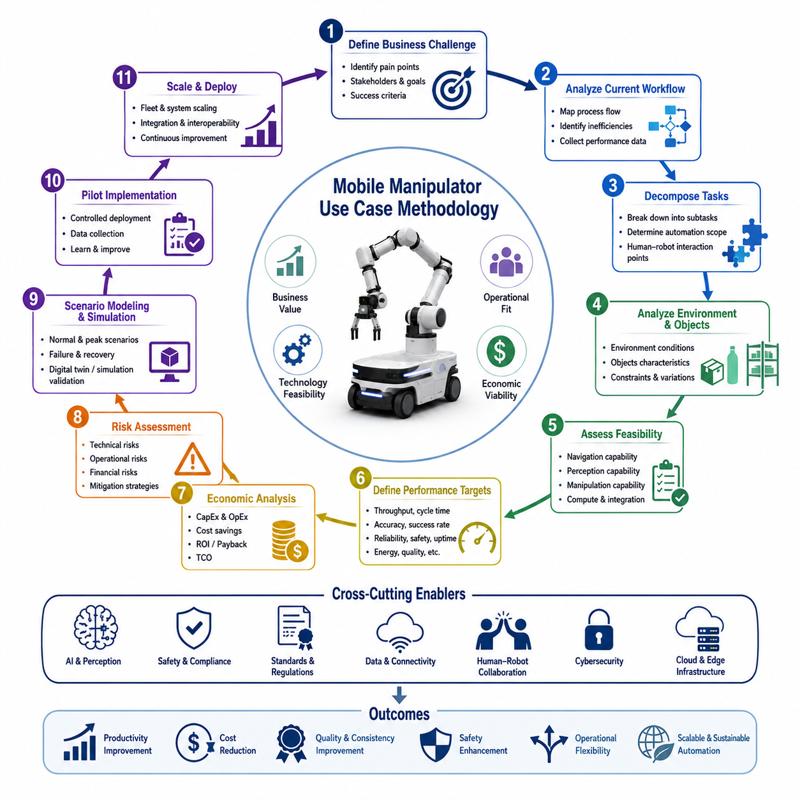
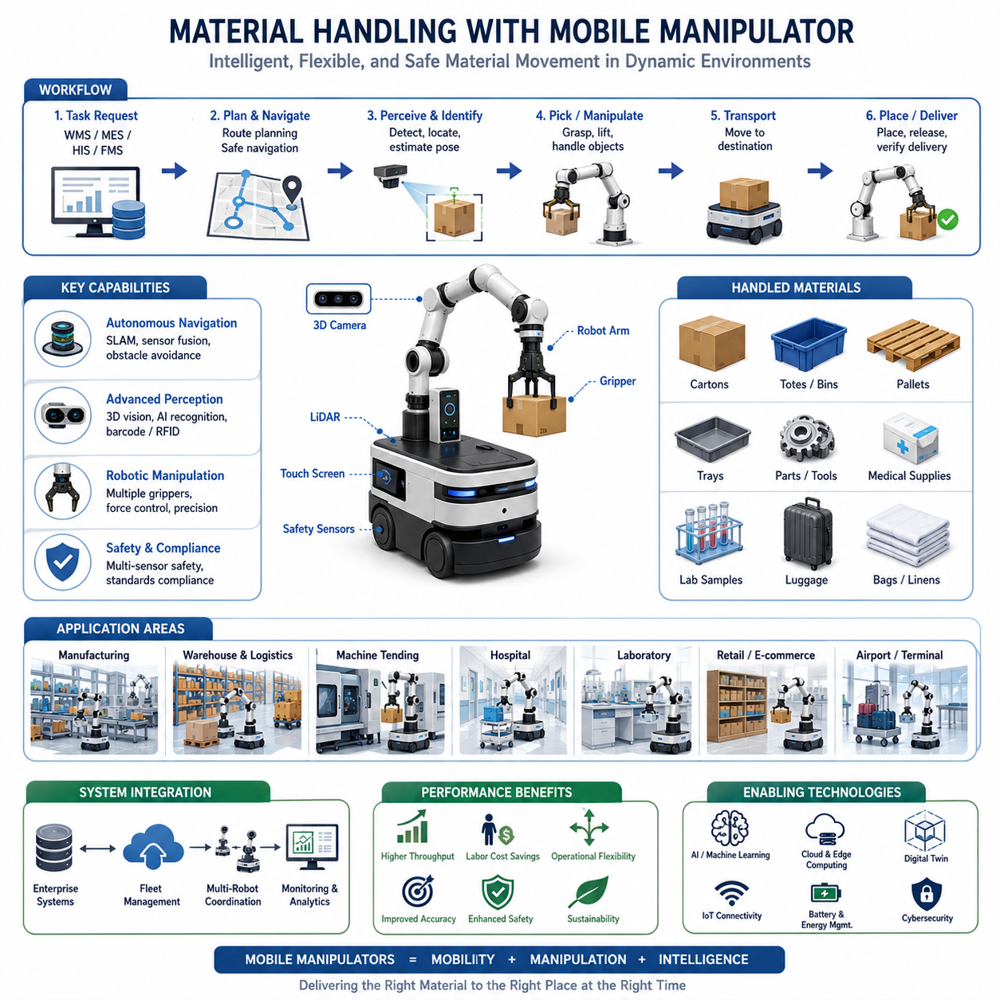
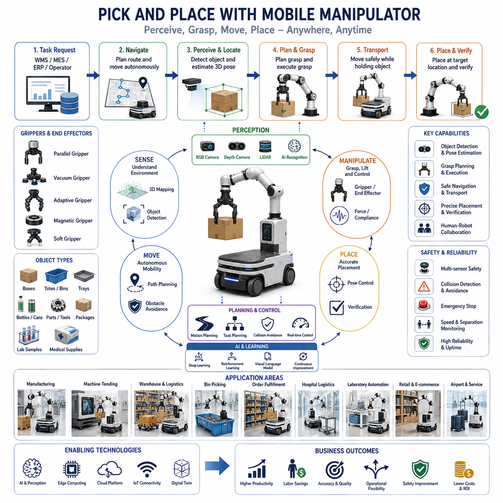
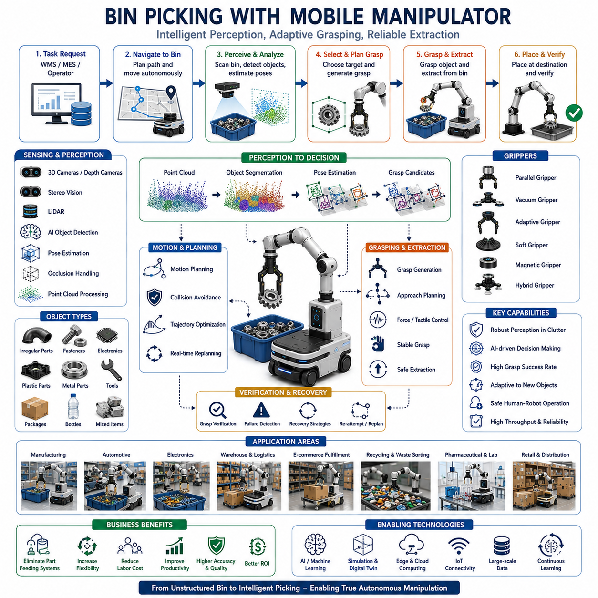
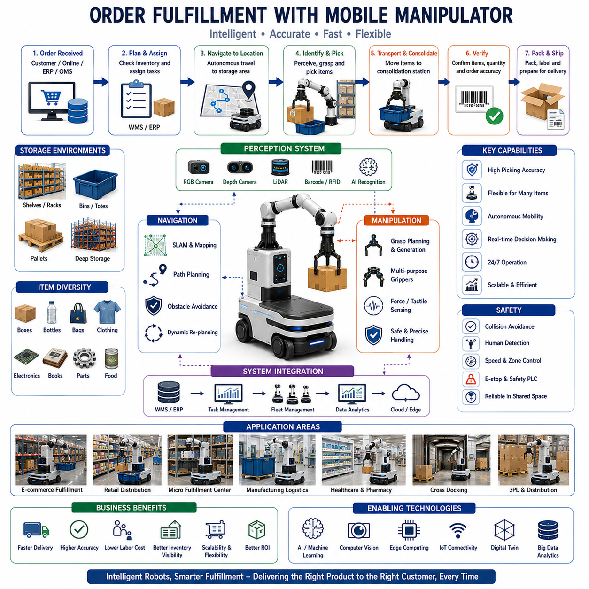
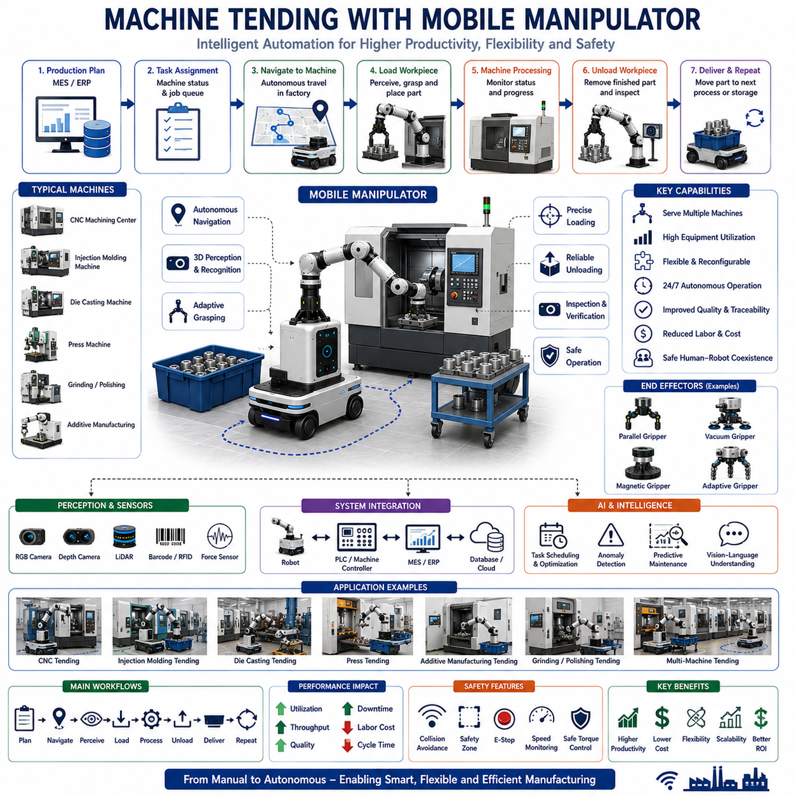
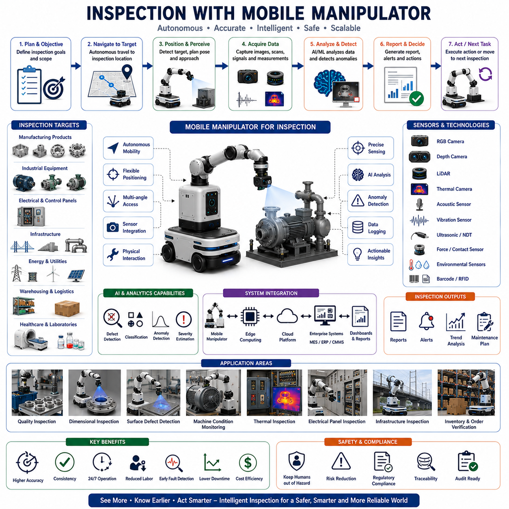
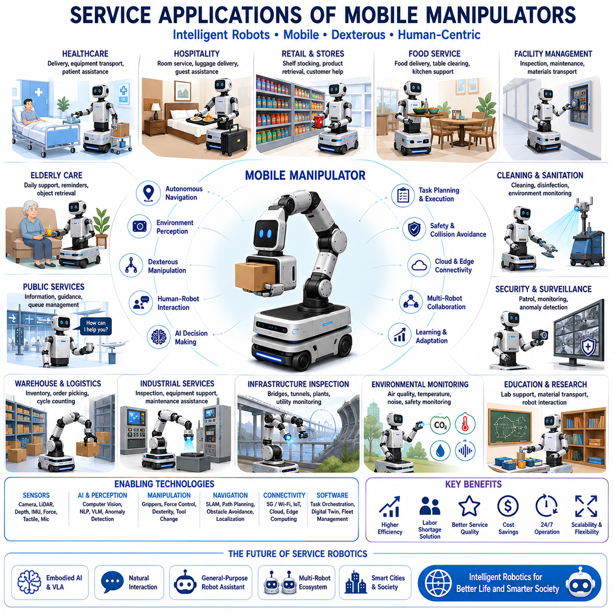
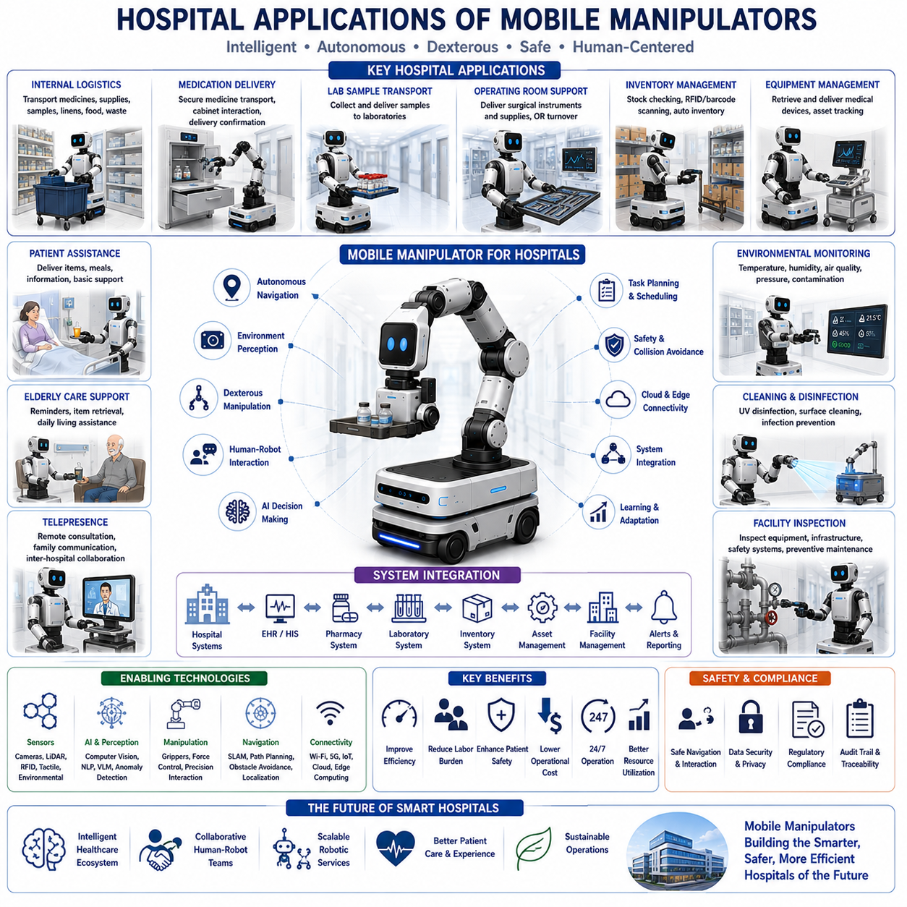
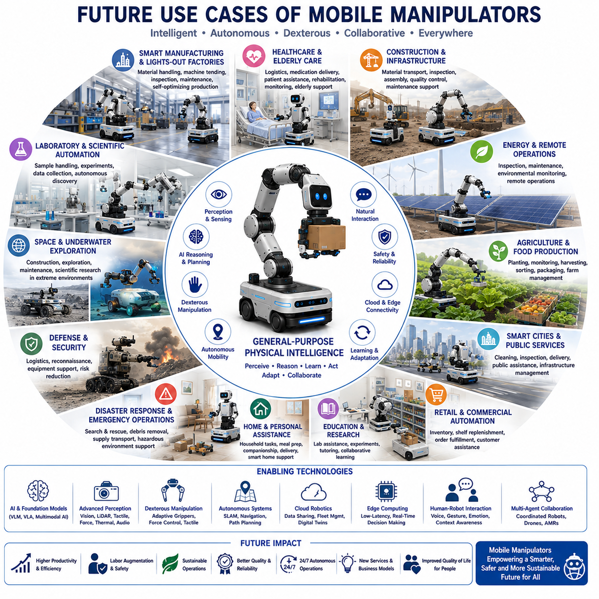

# Chapter 04. Use Cases

## 01 Use Case Methodology

{width="7.268055555555556in" height="7.268055555555556in"}

모바일 매니퓰레이터(Mobile Manipulator)는 자율주행 이동 기능과 로봇 매니퓰레이션 기능을 하나의 시스템으로 통합한 현대 로보틱스의 중요한 발전 형태 중 하나이다. 기존 산업용 로봇이 고정된 작업 공간에서 동작하고, 자율이동로봇(AMR)이 주로 물류 이송을 담당하는 것과 달리, 모바일 매니퓰레이터는 다양한 환경을 이동하면서 물체를 인식하고, 조작하며, 여러 위치에서 복합적인 작업을 수행할 수 있다. 산업 전반에서 유연한 자동화에 대한 요구가 증가함에 따라, 어떤 작업이 모바일 매니퓰레이터에 적합한지 체계적으로 정의하고 평가하는 방법론의 중요성이 높아지고 있다.

활용 사례 방법론의 목적은 단순히 로봇 응용 사례를 나열하는 것이 아니라, 고객의 요구사항과 기술적 가능성, 경제적 가치, 운영 효과를 연결하는 체계적인 의사결정 프레임워크를 제공하는 데 있다. 이를 통해 기업은 모바일 매니퓰레이터가 가장 큰 가치를 창출할 수 있는 영역을 식별하고, 개발 우선순위를 결정하며, 실제 현장에 성공적으로 적용할 수 있다.

활용 사례 정의의 첫 단계는 해결해야 할 운영상의 문제를 이해하는 것이다. 기업은 로봇 기술 자체를 도입하기 위해 로봇을 구매하는 것이 아니라, 인력 부족, 생산성 한계, 품질 편차, 안전 문제, 운영 비용 증가와 같은 실제 문제를 해결하기 위해 자동화를 검토한다. 따라서 활용 사례 분석은 고객이 직면한 문제의 원인과 영향을 파악하는 것에서 시작된다. 예를 들어 물류창고에서는 반복적인 피킹 작업이 문제가 될 수 있고, 제조 공장에서는 CNC 장비의 로딩과 언로딩 과정이 생산 병목을 유발할 수 있으며, 병원에서는 의약품이나 의료 물자의 이동 업무가 비효율적일 수 있다. 각각의 상황은 서로 다른 요구사항을 가지며, 활용 사례 방법론은 이러한 차이를 체계적으로 분석한다.

문제를 정의한 이후에는 현재 운영 프로세스를 분석해야 한다. 워크플로우 분석은 작업이 실제로 어떻게 수행되는지를 이해하기 위한 과정이다. 여기에는 작업 순서, 작업자 역할, 자재 흐름, 장비 사용 방식, 환경 조건, 예외 처리 절차, 성능 지표 등이 포함된다. 이러한 분석을 통해 반복 작업, 불필요한 이동, 대기 시간, 인체공학적 위험 요소, 품질 저하 원인 등을 식별할 수 있다. 모바일 매니퓰레이터는 이러한 비효율 요소를 제거하거나 감소시키는 방향으로 설계되어야 하므로 현재 프로세스에 대한 정확한 이해가 필수적이다.

작업 분해(Task Decomposition)는 활용 사례 방법론의 핵심 요소 중 하나이다. 대부분의 산업 작업은 여러 개의 세부 작업으로 구성된다. 예를 들어 창고 피킹 작업은 목표 위치로 이동하는 단계, 선반을 인식하는 단계, 물체를 탐지하는 단계, 파지 계획을 수립하는 단계, 물체를 집어 올리는 단계, 목적지로 운반하는 단계, 배치 및 검증하는 단계로 세분화될 수 있다. 각 단계는 서로 다른 센서, 알고리즘, 제어 기술을 요구한다. 작업을 세부적으로 분해함으로써 자동화 가능한 부분과 인간이 계속 수행해야 할 부분을 구분할 수 있으며, 이를 통해 보다 현실적인 시스템 설계가 가능해진다.

환경 분석 또한 매우 중요하다. 모바일 매니퓰레이터는 실제 물리적 공간에서 동작하기 때문에 환경 조건이 시스템 성능에 직접적인 영향을 미친다. 분석 대상에는 바닥 상태, 조명 조건, 온도와 습도, 공간 크기, 장애물 밀도, 사람의 이동 패턴, 무선 통신 환경, 안전 요구사항 등이 포함된다. 구조화된 물류센터와 병원 복도, 공항 터미널, 제조 공장은 모두 서로 다른 환경적 특성을 가진다. 따라서 환경 분석은 기술적 위험 요소를 사전에 식별하고 적절한 시스템 아키텍처를 설계하는 데 중요한 역할을 한다.

조작 대상 물체에 대한 분석도 필수적이다. 모바일 매니퓰레이터의 성공 여부는 다루어야 하는 물체의 특성에 크게 영향을 받는다. 물체의 크기, 무게, 형상, 표면 재질, 강성, 반사율, 포장 방식 등에 따라 필요한 그리퍼와 조작 전략이 달라진다. 단순 박스는 평행 그리퍼로 쉽게 집을 수 있지만, 비정형 물체나 반사성이 높은 물체는 고급 비전 시스템과 특수한 엔드 이펙터가 필요할 수 있다. 따라서 물체 특성을 체계적으로 분석하는 과정은 조작 성공률을 높이는 데 매우 중요하다.

사람과의 상호작용 분석도 현대 모바일 매니퓰레이터에서 중요한 영역이다. 대부분의 모바일 매니퓰레이터는 사람과 동일한 공간에서 동작한다. 제조 현장의 작업자, 병원의 의료진, 공항의 이용객, 소매점의 고객과 같은 다양한 사용자가 로봇과 상호작용하게 된다. 따라서 협업 방식, 작업 인계 절차, 사용자 인터페이스, 비상 대응 절차, 교육 요구사항 등을 분석해야 한다. 실제로 많은 프로젝트에서 기술적 성능보다 사용자 수용성이 성공 여부를 결정하는 경우가 많다.

워크플로우와 환경 분석이 완료되면 기술적 실현 가능성 평가가 수행된다. 여기서는 현재 기술 수준으로 해당 작업을 안정적으로 수행할 수 있는지를 검토한다. 이동 성능, 인식 성능, 조작 성능, 계산 성능, 시스템 통합 가능성이 주요 평가 항목이 된다. 이동 측면에서는 자율주행 정확도와 장애물 회피 능력을 평가하며, 인식 측면에서는 객체 검출과 위치 추정 성능을 평가한다. 조작 측면에서는 파지 성공률과 반복 정밀도를 검토하고, 시스템 수준에서는 기존 운영 시스템과의 연동 가능성을 분석한다.

활용 사례를 정의할 때는 정량적인 성능 목표도 설정해야 한다. 성공적인 자동화 프로젝트는 명확한 성과 기준을 가진다. 대표적인 지표로는 작업 사이클 타임, 처리량, 파지 성공률, 이동 정확도, 시스템 가동률, 에너지 소비량, 안전 사고 발생 건수, 투자 대비 수익률 등이 있다. 이러한 지표는 개발 단계뿐만 아니라 현장 검증과 운영 평가 단계에서도 핵심 기준으로 활용된다.

경제성 분석은 활용 사례의 우선순위를 결정하는 중요한 요소이다. 기술적으로 가능하더라도 경제적 가치가 충분하지 않다면 상용화는 어려울 수 있다. 경제성 분석에서는 초기 투자비용, 운영비용, 유지보수 비용, 인프라 구축 비용, 교육 비용 등을 고려한다. 반면 기대 효과로는 인건비 절감, 생산성 향상, 품질 개선, 안전성 향상, 운영 유연성 증대, 고객 서비스 향상 등이 포함된다. 투자 회수 기간과 ROI 분석은 자동화 도입 여부를 결정하는 핵심 근거가 된다.

위험 분석 또한 필수적이다. 모든 모바일 매니퓰레이터 프로젝트에는 기술적 위험과 운영적 위험이 존재한다. 센서 오류, 인식 실패, 파지 실패, 네트워크 장애, 소프트웨어 오류와 같은 기술적 위험뿐 아니라, 작업 중단, 예상치 못한 환경 변화, 사용자 저항과 같은 운영적 위험도 고려해야 한다. 위험 분석은 잠재적인 실패 요소를 사전에 식별하고 대응 전략을 마련함으로써 프로젝트 성공 가능성을 높인다.

활용 사례는 일반적으로 산업 분야에 따라 분류될 수 있다. 대표적인 분야로는 자재 운반, 피킹 및 플레이싱, 빈 피킹, 머신 텐딩, 검사 및 점검, 재고 관리, 병원 물류, 실험실 자동화, 서비스 로봇, 공공시설 지원 등이 있다. 각 분야는 서로 다른 기술 요구사항과 시장 특성을 가지며, 이러한 분류 체계는 제품 포트폴리오와 시장 전략 수립에 활용된다.

시나리오 모델링은 활용 사례를 더욱 현실적으로 검증하는 과정이다. 정상 운영 상황뿐 아니라 최대 부하 상황, 장비 고장 상황, 예외 상황 등을 분석하여 시스템의 강건성을 평가한다. 이를 통해 예상치 못한 환경 변화에도 안정적으로 동작할 수 있는 시스템을 설계할 수 있다.

최근에는 시뮬레이션과 디지털 트윈이 활용 사례 검증 과정에서 중요한 역할을 담당하고 있다. 실제 시스템을 구축하기 전에 가상 환경에서 작업 흐름, 이동 경로, 조작 전략, 처리량, 안전성 등을 검증할 수 있기 때문이다. 이러한 접근 방식은 개발 비용과 시간을 줄이고, 실제 배치 이전에 다양한 설계 대안을 평가할 수 있게 해준다.

파일럿 프로젝트는 개념 검증과 대규모 배치 사이의 중간 단계로 활용된다. 제한된 환경에서 실제 운영 데이터를 수집하여 생산성, 신뢰성, 유지보수 요구사항, 사용자 수용성을 평가한다. 많은 경우 파일럿 운영을 통해 발견된 문제점이 제품 개선으로 이어지며, 이후 상용 배치의 성공 가능성을 높인다.

확장성 분석도 중요한 고려 요소이다. 단일 로봇으로 성공한 시스템이 다수의 로봇이나 여러 사업장으로 확대될 때 동일한 성과를 유지할 수 있는지를 평가해야 한다. 이를 위해 플릿 관리 시스템, 클라우드 인프라, 네트워크 구조, 유지보수 체계 등을 함께 검토해야 한다.

또한 모바일 매니퓰레이터는 독립적인 장비가 아니라 기업의 디지털 생태계와 연결된 시스템으로 동작한다. 따라서 창고관리시스템(WMS), 제조실행시스템(MES), ERP, 병원정보시스템(HIS), 클라우드 플랫폼 등과의 연동성도 활용 사례 정의 과정에서 고려되어야 한다.

최근 등장한 비전-언어 모델(VLM), 비전-언어-행동 모델(VLA), 파운데이션 모델, 임바디드 AI 기술은 활용 사례 방법론 자체를 변화시키고 있다. 과거의 로봇은 정해진 절차를 수행하는 수준에 머물렀지만, 미래의 모바일 매니퓰레이터는 자연어를 이해하고, 새로운 환경에 적응하며, 인간과 협업하여 복잡한 작업을 수행하게 될 것이다. 따라서 활용 사례를 평가할 때 단순한 이동과 조작 능력뿐 아니라 상황 이해 능력, 추론 능력, 학습 능력까지 고려해야 한다.

결론적으로 활용 사례 방법론은 모바일 매니퓰레이터 개발과 사업화의 출발점이다. 이는 고객의 문제를 기술적 요구사항으로 변환하고, 기술적 가능성을 경제적 가치와 연결하며, 실제 운영 환경에서 성공적으로 적용하기 위한 체계적인 프레임워크를 제공한다. 앞으로 모바일 매니퓰레이터가 제조, 물류, 의료, 서비스, 공공 분야 전반으로 확산될수록, 체계적인 활용 사례 방법론은 더욱 중요한 역할을 수행하게 될 것이다. 성공적인 기업은 단순히 로봇을 개발하는 것이 아니라, 고객의 문제를 정확히 정의하고 가장 높은 가치를 창출할 수 있는 활용 사례를 지속적으로 발굴하고 발전시키는 기업이 될 것이다.

## 02 Material Handling

{width="7.268055555555556in" height="7.268055555555556in"}

자재 이송(Material Handling)은 모바일 매니퓰레이터의 가장 기본적이면서도 경제적 가치가 높은 응용 분야 중 하나이다. 제조 공장, 물류센터, 창고, 병원, 연구소, 공항, 유통시설 및 다양한 산업 현장에서는 막대한 시간과 비용이 자재를 한 장소에서 다른 장소로 이동시키는 과정에 사용된다. 전통적으로 이러한 작업은 작업자, 지게차, 컨베이어, 자동창고 시스템, 산업용 로봇 또는 AMR에 의해 수행되어 왔다. 그러나 각각의 기술은 한계를 가진다. 사람은 높은 유연성을 제공하지만 생산성과 안전성에 제약이 있으며, 컨베이어는 높은 처리량을 제공하지만 유연성이 부족하다. 산업용 로봇은 높은 정밀도를 제공하지만 고정된 작업 공간에 제한된다. AMR은 자율 이동에는 강점을 가지지만 물체를 직접 조작하지 못하는 경우가 많다. 모바일 매니퓰레이터는 이러한 한계를 극복하기 위해 이동성과 조작 기능을 통합한 플랫폼으로 발전하였으며, 자재를 운반할 뿐만 아니라 집고, 배치하고, 적재하고, 하역하며, 정리하는 작업까지 수행할 수 있다. 이러한 이유로 자재 이송은 모바일 매니퓰레이터 상용화의 핵심 시장으로 평가받고 있다.

자재 이송은 단순한 운송 행위를 의미하지 않는다. 원자재, 반제품, 완제품, 팔레트, 박스, 컨테이너, 의료 물품, 실험 샘플, 공구, 부품 등 다양한 물체를 적절한 위치에 적절한 시점에 적절한 수량으로 공급하는 전체 과정을 포함한다. 궁극적인 목적은 운영 효율성을 높이고 비용을 절감하면서도 품질과 안전성을 유지하는 것이다. 모바일 매니퓰레이터는 이동과 조작을 동시에 수행할 수 있기 때문에 이러한 목표를 달성하는 데 매우 효과적인 솔루션으로 평가된다.

자재 이송 자동화는 산업 발전과 함께 지속적으로 진화해 왔다. 초기에는 대부분의 작업이 사람에 의해 수행되었으며, 이후 컨베이어와 자동창고 시스템이 도입되면서 일부 물류 작업이 자동화되었다. 산업용 로봇은 반복적인 적재·하역 작업을 자동화했지만 작업 공간이 제한적이었다. 이후 AMR이 등장하면서 유연한 물류 이동이 가능해졌고, 현재는 이동과 조작을 동시에 수행할 수 있는 모바일 매니퓰레이터가 차세대 자동화 플랫폼으로 주목받고 있다. 이는 기존 자동화 시스템이 해결하지 못했던 다양한 작업을 하나의 플랫폼으로 수행할 수 있기 때문이다.

모바일 매니퓰레이터의 가장 큰 장점 중 하나는 유연성이다. 기존 자동화 설비는 특정 공정에 최적화되어 있어 생산 방식이나 시설 구조가 변경될 경우 큰 비용이 발생한다. 반면 모바일 매니퓰레이터는 소프트웨어 업데이트와 AI 기반 인식 기술을 활용하여 변화하는 환경에 적응할 수 있다. 하나의 로봇이 여러 작업을 수행할 수 있기 때문에 설비 활용도를 높이고 투자 효율성을 향상시킬 수 있다.

일반적인 자재 이송 작업은 자재 이동 요구가 발생하는 순간부터 시작된다. 생산 라인이 새로운 부품을 요청하거나, 창고에서 특정 상품을 이동해야 하거나, 병원에서 의료 물품을 요청하는 경우가 대표적이다. 이러한 요청은 WMS, MES, ERP, HIS 또는 FMS와 같은 상위 시스템에서 생성된다. 모바일 매니퓰레이터는 해당 정보를 수신한 후 이동 경로를 계획하고, 자재가 있는 위치로 이동하며, 대상 물체를 인식한 후 파지하여 목적지까지 운반하고 배치한다.

자율주행 기술은 자재 이송의 핵심 요소이다. 로봇은 사람, 차량, 장비, 장애물이 존재하는 환경에서 안전하게 이동해야 한다. 이를 위해 LiDAR 기반 SLAM, Visual SLAM, GNSS, IMU 센서 융합, 디지털 맵 기술 등이 사용된다. 자율주행 시스템은 실시간으로 환경을 인식하고 최적 경로를 계산하며, 장애물을 회피하고 안전 규정을 준수해야 한다. 이동 성능은 전체 시스템 처리량과 생산성에 직접적인 영향을 미친다.

인지(Perception) 기술 역시 중요한 역할을 한다. 모바일 매니퓰레이터는 물체를 인식하고 위치를 파악하며 방향을 추정해야 한다. 또한 선반 위치를 이해하고 라벨을 읽으며 운송 상태를 검증해야 한다. 이를 위해 RGB 카메라, 깊이 카메라, 3D LiDAR, 스테레오 비전, RFID 리더, 바코드 스캐너 등이 사용된다. 최근에는 딥러닝 기반 객체 인식, 자세 추정, 장면 이해 기술이 적용되면서 더욱 다양한 환경에서 안정적인 작업이 가능해지고 있다.

조작 기능은 모바일 매니퓰레이터를 기존 AMR과 구분하는 가장 중요한 요소이다. 로봇 암은 물체를 집고, 들고, 놓고, 적재하고, 정렬하고, 재배치하는 작업을 수행한다. 대상 물체의 특성에 따라 다양한 엔드 이펙터가 사용된다. 박스나 컨테이너에는 진공 그리퍼가 적합할 수 있으며, 불규칙한 물체에는 적응형 그리퍼가 필요할 수 있다. 성공적인 조작을 위해서는 정확한 인식, 안정적인 파지 계획, 힘 제어, 충돌 회피 및 실시간 피드백이 필수적이다.

제조 산업에서는 생산 공정 간 자재 이동이 주요 활용 분야이다. 모바일 매니퓰레이터는 창고에서 생산라인으로 부품을 운반하거나, 완성품을 포장 구역으로 이동시키며, CNC 장비나 사출 성형기와 같은 생산 설비의 로딩 및 언로딩 작업을 수행할 수 있다. 제조 환경은 생산 계획이 자주 변경되기 때문에 유연성이 매우 중요하며, 모바일 매니퓰레이터는 이러한 요구에 효과적으로 대응할 수 있다.

창고 물류는 모바일 매니퓰레이터가 가장 활발하게 적용되는 분야 중 하나이다. 대형 물류센터는 매일 수천에서 수백만 개의 상품을 처리한다. 상품 입고, 저장, 피킹, 포장, 출하 과정에서 지속적인 자재 이동이 발생한다. 모바일 매니퓰레이터는 선반에서 상품을 집고, 구역 간 물품을 이동하며, 재고 보충 및 주문 통합 작업을 수행할 수 있다. 또한 기존 자동화 설비와 달리 단계적으로 도입이 가능하므로 투자 부담을 줄일 수 있다.

물류센터는 더욱 복잡한 환경을 제공한다. 다양한 상품 유형, 계절별 수요 변동, 급격한 물동량 증가에 대응해야 한다. 모바일 매니퓰레이터는 이러한 변화에 유연하게 적응할 수 있으며, AI 기반 작업 스케줄링과 플릿 관리 기술을 통해 운영 효율을 높일 수 있다.

병원은 독특한 자재 이송 환경을 가진다. 의료진은 의약품, 의료기기, 린넨, 검사 샘플, 폐기물 등을 지속적으로 이동시켜야 한다. 이러한 업무는 의료진의 시간을 상당히 소모한다. 모바일 매니퓰레이터는 이러한 반복적인 물류 작업을 자동화하여 의료진이 환자 진료에 집중할 수 있도록 지원한다. 또한 위생과 안전 규정을 준수하면서 운영 효율성을 향상시킬 수 있다.

실험실 환경에서는 정밀성과 추적성이 더욱 중요하다. 샘플은 오염 없이 운송되어야 하며 정확한 관리가 요구된다. 모바일 매니퓰레이터는 특수 그리퍼와 정밀 제어 기술을 활용하여 샘플을 안전하게 운반하고 이동 기록을 자동으로 관리할 수 있다. 이러한 기능은 제약 산업, 바이오 연구, 임상 진단 분야에서 매우 중요한 가치를 제공한다.

유통 및 전자상거래 산업에서도 모바일 매니퓰레이터의 활용이 확대되고 있다. 재고 보충, 매장 진열, 주문 처리, 상품 이동과 같은 작업은 많은 인력을 필요로 한다. 모바일 매니퓰레이터는 이러한 업무를 자동화함으로써 재고 정확도를 높이고 운영 효율성을 향상시킬 수 있다. 특히 온라인 주문 증가에 따른 빠른 배송 요구에 대응하는 데 중요한 역할을 수행할 수 있다.

안전성은 자재 이송 분야에서 가장 중요한 요소 중 하나이다. 모바일 매니퓰레이터는 사람과 동일한 공간에서 작업하는 경우가 많기 때문에 충돌 방지, 속도 및 거리 모니터링, 비상 정지 기능, 힘 제한 기능 등이 필수적이다. 최신 안전 아키텍처는 다중 센서, 이중화 시스템, 실시간 위험 분석 기술을 결합하여 안전한 인간-로봇 협업 환경을 제공한다.

자재 이송 시스템의 성능은 운영 지표, 기술 지표, 경제 지표를 통해 평가된다. 운영 측면에서는 처리량, 작업 완료 시간, 주문 처리율, 운송 효율성이 중요하다. 기술 측면에서는 이동 정확도, 파지 성공률, 위치 추정 정확도, 배터리 지속시간, 시스템 가동률이 주요 지표가 된다. 경제 측면에서는 인건비 절감, ROI, TCO, 생산성 향상 효과 등이 평가된다.

여러 대의 모바일 매니퓰레이터를 운영하는 경우 플릿 관리가 중요해진다. 수십 대 이상의 로봇이 동시에 동작할 경우 작업 할당, 교통 제어, 충전 스케줄링, 유지보수 계획 등이 필요하다. 플릿 관리 시스템은 전체 운영 상황을 통합 관리하고 로봇 간 협업을 최적화하여 병목 현상을 최소화한다.

클라우드와 엣지 컴퓨팅 기술은 자재 이송 자동화를 더욱 고도화하고 있다. 엣지 컴퓨팅은 저지연 인식과 제어를 지원하며, 클라우드는 데이터 분석, 예지보전, OTA 업데이트, 디지털 트윈 운영을 지원한다. 이러한 기술은 대규모 로봇 운영을 가능하게 하는 핵심 기반이 된다.

인공지능은 자재 이송 자동화의 패러다임을 변화시키고 있다. 과거 로봇은 정해진 규칙만 수행할 수 있었지만, 최신 AI 기반 모바일 매니퓰레이터는 처음 보는 물체를 인식하고 환경 변화에 적응하며 최적의 작업 전략을 스스로 선택할 수 있다. 비전-언어 모델(VLM), 파운데이션 모델, 임바디드 AI 기술은 로봇이 보다 일반화된 작업을 수행할 수 있도록 지원하고 있다.

지속가능성 또한 중요한 요소로 부상하고 있다. 기업들은 에너지 소비를 줄이고 자원 활용도를 높이며 환경 영향을 최소화하려고 한다. 모바일 매니퓰레이터는 이동 경로 최적화, 물류 효율 향상, 제품 손상 감소, 재고 정확도 향상을 통해 지속가능한 운영을 지원할 수 있다.

미래의 자재 이송 시스템은 모바일 매니퓰레이터, AMR, 고정형 로봇, 자동창고 시스템, 클라우드 기반 오케스트레이션 플랫폼이 통합된 형태로 발전할 것으로 예상된다. 이들 시스템은 제조 공장, 물류센터, 병원, 공항, 유통 시설 전반에서 협력하며 자재 흐름을 자동으로 관리하게 될 것이다.

결론적으로 자재 이송은 거의 모든 산업에 존재하는 공통적인 요구사항이며, 모바일 매니퓰레이터는 이를 해결하기 위한 가장 강력한 자동화 플랫폼 중 하나이다. 이동성, 조작 능력, 인공지능, 시스템 통합 기술을 결합함으로써 기존 자동화의 한계를 극복하고 새로운 수준의 유연성과 생산성을 제공한다. 향후 기술 성숙도 향상과 비용 절감이 지속됨에 따라 자재 이송 분야는 모바일 매니퓰레이터 시장 확대를 이끄는 핵심 응용 분야로 자리 잡을 것으로 전망된다.

## 03 Pick and Place

{width="7.268055555555556in" height="7.268055555555556in"}

픽 앤 플레이스(Pick and Place)는 로보틱스 분야에서 가장 기본적이면서도 중요한 작업 중 하나이며, 모바일 매니퓰레이터의 핵심 응용 기술로 간주된다. 이 작업은 표면적으로는 물체를 인식하고, 집어 들고, 필요한 경우 이동한 후 원하는 위치에 놓는 단순한 과정처럼 보인다. 그러나 실제 환경에서는 인식, 계획, 조작, 이동, 제어, 인공지능, 시스템 통합 등 다양한 기술이 복합적으로 결합되어야 한다. 다양한 환경에서 안정적으로 픽 앤 플레이스 작업을 수행할 수 있는 능력은 모바일 매니퓰레이터의 실질적인 기술 수준과 상업적 가치를 평가하는 중요한 기준이 된다. 산업 현장에서 유연한 자동화에 대한 요구가 증가함에 따라 픽 앤 플레이스는 고정형 산업용 로봇의 작업 영역을 넘어 제조 공장, 물류센터, 병원, 연구소, 공항, 서비스 시설 등 다양한 환경으로 확대되고 있다.

픽 앤 플레이스 작업은 기본적으로 두 가지 동작으로 구성된다. 첫 번째는 목표 물체를 인식하고 파지하는 과정이며, 두 번째는 해당 물체를 원하는 위치로 이동하여 배치하는 과정이다. 그러나 실제로는 각 단계마다 다양한 세부 기술이 필요하다. 로봇은 먼저 주변 환경을 이해하고 여러 물체 중에서 목표 물체를 식별해야 한다. 이후 물체의 위치와 자세를 추정하고 적절한 파지 전략을 결정해야 하며, 안정적으로 물체를 집은 후 손상이나 낙하 없이 이동시켜 정확한 위치에 배치해야 한다. 이러한 모든 과정은 고도의 기술적 통합을 요구한다.

초기의 픽 앤 플레이스 자동화는 주로 제조 산업에서 발전하였다. 산업용 로봇은 반복적으로 동일한 부품을 정해진 위치에서 다른 위치로 이동시키는 작업에 활용되었다. 이러한 시스템은 고정된 환경, 일정한 조명 조건, 정해진 위치의 물체를 전제로 하기 때문에 매우 높은 속도와 정밀도를 제공할 수 있었다. 하지만 환경 변화에 대한 대응 능력이 부족했고, 작업 대상이나 생산 공정이 변경되면 재설정과 재설계가 필요했다. 모바일 매니퓰레이터는 이러한 한계를 극복하기 위해 등장하였으며, 다양한 위치를 이동하면서 픽 앤 플레이스 작업을 수행할 수 있게 되었다.

고정형 픽 앤 플레이스 시스템에서 모바일 픽 앤 플레이스 시스템으로의 진화는 자동화 기술의 중요한 변화 중 하나이다. 현대 산업 환경은 제품 종류가 다양하고 수요 변동이 심하며, 작업 환경도 지속적으로 변화한다. 모바일 매니퓰레이터는 이러한 변화에 유연하게 대응할 수 있는 플랫폼을 제공한다. 과거에는 물체를 컨베이어를 통해 로봇 앞으로 이동시켜야 했지만, 이제는 로봇이 직접 물체가 있는 위치로 이동하여 작업을 수행할 수 있다. 이는 자동화 적용 범위를 크게 확대하는 중요한 변화이다.

일반적인 픽 앤 플레이스 작업은 상위 시스템으로부터 작업 지시를 받는 것에서 시작된다. 작업은 WMS, MES, ERP, HIS, FMS 또는 작업자에 의해 생성될 수 있다. 모바일 매니퓰레이터는 픽업 위치와 배치 위치를 확인한 후 자율주행을 통해 목표 지점으로 이동한다. 도착 후에는 비전 시스템을 이용하여 목표 물체를 인식하고 위치를 파악한다. 이후 로봇 암이 파지 동작을 수행하며, 필요에 따라 물체를 다른 위치로 이동한 후 최종 목적지에 배치한다. 이러한 과정은 이동성과 조작 기능이 결합된 모바일 매니퓰레이터만이 수행할 수 있는 대표적인 작업 흐름이다.

인지(Perception)는 픽 앤 플레이스를 가능하게 하는 핵심 기술 중 하나이다. 로봇은 물체를 집기 전에 먼저 물체를 이해해야 한다. 이를 위해 RGB 카메라, 깊이 카메라, 스테레오 비전, LiDAR, 구조광 센서 등의 다양한 센서가 사용된다. 이러한 센서들은 물체의 형상, 위치, 자세 및 주변 환경 정보를 수집하며, AI 알고리즘은 이를 분석하여 목표 물체를 인식하고 조작 가능한 형태의 정보를 생성한다.

객체 검출(Object Detection)은 시각 인식의 첫 단계이다. 객체 검출 알고리즘은 장면 내에서 물체의 존재 여부와 종류를 판단한다. 최근 딥러닝 기술의 발전으로 수천 종류의 물체를 실시간으로 인식할 수 있게 되었다. 그러나 단순히 물체를 찾는 것만으로는 충분하지 않다. 로봇은 물체의 정확한 3차원 위치와 방향을 알아야 한다. 이를 위해 6자유도 자세 추정(Pose Estimation)이 수행되며, 이는 로봇이 정확한 파지 동작을 수행하는 데 필수적인 정보가 된다.

자세 추정의 정확도는 파지 성공률에 직접적인 영향을 미친다. 작은 오차만 발생해도 파지 실패, 충돌, 물체 낙하, 배치 오류가 발생할 수 있다. 따라서 최신 시스템은 깊이 센서, 스테레오 비전, 센서 융합 기술 등을 활용하여 높은 정확도를 확보한다.

물체의 위치와 자세가 파악되면 파지 계획(Grasp Planning)이 수행된다. 파지 계획은 로봇이 어떤 방식으로 물체에 접근하고, 어디를 잡고, 어떤 힘으로 집어야 하는지를 결정하는 과정이다. 물체의 형상, 무게, 재질, 무게 중심, 파손 가능성 등에 따라 최적의 파지 방식이 달라진다. 예를 들어 골판지 박스와 유리 용기는 전혀 다른 파지 전략이 필요하다.

그리퍼 기술은 픽 앤 플레이스 성능을 결정하는 중요한 요소이다. 평행 그리퍼는 가장 널리 사용되는 형태이며, 박스와 같은 정형 물체에 적합하다. 진공 그리퍼는 택배 박스나 포장재 처리에 효과적이다. 적응형 그리퍼는 다양한 형태의 물체를 파지할 수 있으며, 소프트 그리퍼는 과일이나 의료 용품과 같은 민감한 물체를 안전하게 다룰 수 있다. 금속 부품에는 자력 기반 그리퍼가 사용되기도 한다.

모션 플래닝(Motion Planning)은 로봇 암이 물체에 접근하고 이동하는 경로를 계산하는 과정이다. 로봇은 주변 물체, 설비, 사람과 충돌하지 않으면서 효율적으로 움직여야 한다. 최신 모션 플래닝 알고리즘은 실시간 센서 정보를 반영하여 동적으로 경로를 수정할 수 있으며, 이를 통해 복잡한 환경에서도 안정적인 작업 수행이 가능하다.

힘 제어(Force Control)와 순응 제어(Compliance Control)는 실제 환경에서 매우 중요하다. 실제 물체는 예상과 다르게 움직일 수 있으며, 위치 오차나 변형이 발생할 수 있다. 힘 센서는 접촉 상태를 감지하여 적절한 힘을 유지하도록 하며, 순응 제어는 작은 오차를 허용하면서도 안전하게 작업을 수행할 수 있도록 지원한다. 이러한 기술은 정밀 조립이나 사람과의 협업 환경에서 특히 중요하다.

물체를 집은 후에는 운송 단계가 시작된다. 로봇은 이동 중에도 물체를 안정적으로 유지해야 한다. 가속, 감속, 진동, 바닥 상태 변화, 장애물 회피 동작 등은 물체 안정성에 영향을 미칠 수 있다. 따라서 이동 계획은 단순한 경로 최적화뿐 아니라 물체의 안정성을 고려하여 수행되어야 한다.

배치(Place) 작업도 픽업만큼 중요하다. 로봇은 목표 위치에 물체를 정확하게 놓아야 하며, 필요에 따라 특정 방향을 유지해야 한다. 배치 대상은 선반, 컨테이너, 팔레트, 트레이, 작업대, 생산설비 등 매우 다양하다. 일부 물류 작업은 수 센티미터 수준의 오차를 허용하지만, 전자제품 조립이나 실험실 자동화는 수 밀리미터 수준의 정밀도를 요구한다.

제조 산업은 픽 앤 플레이스 기술이 가장 널리 활용되는 분야이다. 부품 공급, 조립 지원, CNC 장비 로딩 및 언로딩, 검사 장비 연계, 포장 공정 지원 등 다양한 작업이 포함된다. 모바일 매니퓰레이터는 고정형 로봇 셀 없이도 이러한 작업을 수행할 수 있어 유연 생산 체계 구축에 적합하다.

창고 자동화는 또 다른 대표적인 응용 분야이다. 상품을 선반에서 집어 포장 구역으로 이동하거나, 주문별로 상품을 분류하는 작업은 전형적인 픽 앤 플레이스 작업이다. 모바일 매니퓰레이터는 재고 변화와 레이아웃 변경에 유연하게 대응할 수 있어 물류센터 자동화에 적합하다.

빈 피킹(Bin Picking)은 픽 앤 플레이스의 고난도 응용 분야이다. 물체가 무작위로 쌓여 있거나 서로 가려져 있는 환경에서 원하는 물체를 찾아 집어야 한다. 이는 고급 비전 기술과 AI 기반 파지 계획 기술을 요구하며, 최근 딥러닝 기술 발전으로 실용화가 빠르게 진행되고 있다.

병원에서는 의약품, 의료기기, 린넨, 검사 샘플 등의 이동에 픽 앤 플레이스 기술이 활용될 수 있다. 의료진의 반복적인 물류 작업을 줄이고 환자 서비스 품질을 향상시키는 데 기여한다.

실험실 환경에서는 샘플, 시약, 진단 장비 등을 정확하게 이동시키는 작업이 중요하다. 모바일 매니퓰레이터는 고정밀 제어와 특수 그리퍼를 이용하여 이러한 작업을 자동화할 수 있으며, 연구 생산성과 정확성을 높일 수 있다.

전자상거래와 유통 산업에서도 픽 앤 플레이스 기술은 핵심 역할을 한다. 상품 보충, 재고 정리, 주문 처리, 반품 분류 등 대부분의 물류 작업이 픽 앤 플레이스 기반으로 이루어진다. 모바일 매니퓰레이터는 증가하는 주문량에 대응하는 유연한 자동화 수단이 될 수 있다.

최근에는 인간-로봇 협업(HRC) 환경에서의 활용도 증가하고 있다. 로봇은 반복적이고 힘든 작업을 수행하고, 사람은 예외 처리와 의사결정을 담당하는 형태가 일반적이다. 이러한 협업 모델은 생산성과 유연성을 동시에 확보할 수 있다.

안전성은 모든 픽 앤 플레이스 시스템의 기본 조건이다. 모바일 매니퓰레이터는 사람과 같은 공간에서 동작하는 경우가 많기 때문에 충돌 방지, 속도 및 거리 모니터링, 비상 정지, 힘 제한 기능 등이 반드시 포함되어야 한다. 최신 안전 아키텍처는 다중 센서와 안전 인증 제어기를 기반으로 안전한 작업 환경을 제공한다.

픽 앤 플레이스 시스템의 성능은 파지 성공률, 배치 정확도, 작업 사이클 타임, 처리량, 가동률, 에너지 소비량, ROI 등의 지표를 통해 평가된다. 이러한 지표는 시스템 성능을 정량적으로 평가하고 개선 방향을 결정하는 데 사용된다.

인공지능은 픽 앤 플레이스 기술을 빠르게 발전시키고 있다. 과거에는 규칙 기반 알고리즘이 주류였지만, 현재는 딥러닝 기반 객체 인식, 파운데이션 모델, VLM, VLA, 임바디드 AI 기술이 적용되고 있다. 이를 통해 로봇은 새로운 물체를 인식하고, 새로운 환경에 적응하며, 경험을 통해 성능을 향상시킬 수 있게 되었다.

클라우드 로보틱스와 엣지 컴퓨팅도 중요한 역할을 수행한다. 엣지 컴퓨팅은 저지연 제어와 실시간 인식을 지원하고, 클라우드는 플릿 관리, AI 모델 업데이트, 디지털 트윈, 데이터 분석 기능을 제공한다. 이러한 구조는 대규모 로봇 운영을 가능하게 한다.

미래의 픽 앤 플레이스 시스템은 더욱 범용적인 방향으로 발전할 것으로 예상된다. 정교한 손가락형 그리퍼, 촉각 센서, 강화학습, 멀티모달 AI, 임바디드 인텔리전스 기술이 결합되면서 로봇은 점점 더 다양한 물체를 인간 수준에 가깝게 다룰 수 있게 될 것이다.

결론적으로 픽 앤 플레이스는 단순한 물체 이동 작업이 아니라 모바일 매니퓰레이터의 핵심 능력을 집약적으로 보여주는 대표적인 응용 분야이다. 인식, 이동, 조작, 계획, 안전, 인공지능 기술이 통합되어야 비로소 성공적인 작업 수행이 가능하다. 향후 모바일 매니퓰레이터가 제조, 물류, 의료, 서비스 산업 전반으로 확대됨에 따라 픽 앤 플레이스 기술은 지능형 자동화의 가장 중요한 기반 기술 중 하나로 지속적으로 발전할 것이다.

## 04 Bin Picking

{width="7.268055555555556in" height="7.268055555555556in"}

빈 피킹(Bin Picking)은 로봇 매니퓰레이션 분야에서 가장 어려우면서도 가장 발전된 응용 기술 중 하나이다. 일반적인 픽 앤 플레이스 작업에서는 물체가 일정한 위치와 방향으로 정렬되어 있지만, 빈 피킹에서는 물체들이 컨테이너, 빈(Bin), 토트(Tote), 박스, 팔레트 또는 저장 공간 내부에 무작위로 쌓여 있다. 물체들은 서로 겹쳐 있거나 가려져 있을 수 있으며, 불규칙하게 적재되거나 변형될 수도 있다. 이러한 환경은 인식, 계획, 파지 및 조작 과정에 높은 수준의 불확실성을 발생시킨다. 따라서 빈 피킹은 현대 모바일 매니퓰레이터의 지능성, 적응성, 강건성을 평가하는 대표적인 기술 과제로 간주된다. 성공적인 빈 피킹 시스템은 고급 센서 기술, 인공지능, 경로 계획, 파지 생성 및 로봇 제어 기술이 통합된 자율 시스템의 구현을 의미한다.

과거의 산업 자동화는 대부분 부품이 정해진 위치에 공급되는 구조화된 환경을 전제로 하였다. 트레이, 지그, 컨베이어, 부품 공급 장치 등을 통해 물체의 위치를 일정하게 유지함으로써 로봇은 항상 동일한 위치에서 작업할 수 있었다. 그러나 이러한 방식은 높은 설비 비용과 낮은 유연성이라는 문제를 가지고 있었다. 제조 및 물류 환경이 점점 더 다양해지고 변화가 빨라지면서, 비정형 환경에서도 동작 가능한 자동화 기술의 필요성이 증가하였다. 빈 피킹은 이러한 요구에 대응하기 위해 등장하였으며, 로봇이 무작위로 쌓인 물체를 직접 인식하고 집어낼 수 있도록 함으로써 별도의 정렬 장치 없이도 자동화를 가능하게 한다.

빈 피킹은 기본적으로 여러 개의 물체가 들어 있는 컨테이너에서 목표 물체를 자동으로 선택하고 꺼내는 작업을 의미한다. 로봇은 먼저 빈 내부를 인식하고, 집을 수 있는 후보 물체를 탐색하며, 가장 적합한 목표를 선택한 후 파지 전략을 생성한다. 이후 파지를 수행하고 성공 여부를 확인한 뒤 물체를 빈 밖으로 꺼낸다. 이러한 과정은 컨테이너가 비워질 때까지 반복적으로 수행된다. 개념적으로는 단순해 보이지만, 실제로는 다양한 불확실성과 복잡성을 포함하고 있기 때문에 매우 어려운 문제로 분류된다.

빈 피킹의 가장 큰 특징은 물체의 무작위성이다. 물체는 일정한 위치에 놓여 있지 않으며, 서로 겹쳐 있거나 가려져 있는 경우가 많다. 반사되는 금속 부품, 투명한 플라스틱, 변형 가능한 포장재, 불규칙한 형상의 물체들은 인식과 파지를 더욱 어렵게 만든다. 따라서 빈 피킹은 일반적인 픽 앤 플레이스보다 훨씬 높은 수준의 인지 능력과 지능을 요구한다.

인지 기술은 빈 피킹의 핵심이다. 로봇이 물체를 집기 위해서는 먼저 주변 환경의 3차원 구조를 이해해야 한다. 이를 위해 RGB 카메라, 깊이 카메라, 스테레오 비전, 구조광 센서, ToF(Time-of-Flight) 카메라, 3D LiDAR 등이 사용된다. 이러한 센서는 빈 내부의 물체 형상과 배치 상태를 파악하기 위한 공간 정보를 제공한다. 이후 인식 알고리즘은 물체의 경계를 분리하고 위치를 추정하며 파지가 가능한 영역을 계산한다.

특히 3차원 인식은 빈 피킹에서 매우 중요하다. 2차원 영상만으로는 물체의 깊이와 중첩 상태를 정확하게 파악하기 어렵다. 깊이 센서를 이용하면 포인트 클라우드를 생성할 수 있으며, 이를 통해 개별 물체를 분리하고 표면 형상을 분석하며 파지 후보 지점을 찾을 수 있다. 포인트 클라우드의 품질은 전체 시스템 성능에 직접적인 영향을 미친다.

객체 인식 역시 중요한 기술 요소이다. 산업 현장에서는 수백에서 수천 종류의 제품이 존재할 수 있으며, 빈 피킹 시스템은 이들 중 특정 부품을 선택적으로 찾아야 하는 경우가 많다. 과거에는 템플릿 기반 방식이 사용되었지만, 최근에는 딥러닝 기반 객체 인식 기술이 주류가 되었다. AI 기반 인식 기술은 다양한 조명 조건, 자세 변화, 부분 가림 상황에서도 높은 인식 성능을 제공한다.

자세 추정(Pose Estimation)은 파지 계획을 위한 필수 단계이다. 로봇은 물체의 위치뿐 아니라 방향까지 정확하게 알아야 한다. 6자유도 자세 추정을 통해 물체의 공간상 위치와 방향을 계산하며, 이를 기반으로 로봇 암이 정확한 접근 경로를 생성할 수 있다. 복잡한 적재 환경에서 높은 정확도의 자세 추정은 여전히 활발히 연구되는 분야이다.

가림(Occlusion) 문제는 빈 피킹의 대표적인 난제이다. 많은 물체들이 다른 물체 아래에 숨어 있거나 부분적으로만 보이는 경우가 많다. 이때 로봇은 제한된 정보만으로 물체를 추론해야 한다. 최신 AI 시스템은 기하학적 추론, 객체 모델 학습, 확률적 추정 기법 등을 활용하여 보이지 않는 부분까지 예측한다. 일부 시스템은 카메라 시점을 변경하거나 주변 물체를 먼저 이동시켜 시야를 확보하는 능동 인식(Active Perception) 기법도 사용한다.

환경 분석이 완료되면 파지 계획이 수행된다. 파지 계획은 로봇이 어떤 위치를 어떤 방향으로 잡아야 안정적으로 물체를 획득할 수 있는지를 결정하는 과정이다. 물체 형상, 접근 가능성, 무게 중심, 충돌 가능성, 이후 작업 요구사항 등이 모두 고려된다. 빈 내부는 공간이 제한적이기 때문에 파지 계획은 일반적인 픽 앤 플레이스보다 훨씬 복잡하다.

전통적인 파지 계획은 기하학적 모델과 해석적 방법에 기반하였다. 하지만 이러한 방식은 새로운 물체나 복잡한 적재 환경에 대응하기 어려웠다. 최근에는 딥러닝 기반 파지 생성 기술이 발전하면서 이러한 한계를 극복하고 있다. AI는 수많은 학습 데이터를 기반으로 성공 가능성이 높은 파지 위치를 예측할 수 있으며, 처음 보는 물체에 대해서도 효과적으로 대응할 수 있다.

그리퍼는 빈 피킹 성능을 결정하는 중요한 요소이다. 평행 그리퍼는 가장 널리 사용되는 방식이며, 산업 부품 처리에 적합하다. 진공 그리퍼는 박스나 포장재에 효과적이며, 적응형 그리퍼는 다양한 형상의 물체를 다룰 수 있다. 소프트 그리퍼는 깨지기 쉬운 물체를 안전하게 집을 수 있다. 최근에는 여러 종류의 파지 방식을 결합한 하이브리드 엔드 이펙터도 활용되고 있다.

파지 실행 과정에서는 인식, 계획, 제어 시스템이 긴밀하게 연동되어야 한다. 이상적인 파지 계획이 수립되더라도 실제 환경에서는 물체가 움직이거나 센서 오차가 발생할 수 있다. 따라서 최신 빈 피킹 시스템은 실시간 피드백을 활용하여 파지 동작을 수정한다. 비전 서보잉, 힘 센서, 촉각 센서 및 적응형 제어 기술은 이러한 강건성을 향상시키는 핵심 요소이다.

충돌 회피는 빈 피킹에서 매우 중요하다. 로봇은 빈 벽, 주변 물체, 설비, 다른 로봇과 충돌하지 않도록 움직여야 한다. 모션 플래닝 알고리즘은 기구학적 제약과 작업 목표를 고려하여 충돌 없는 경로를 생성한다. 최신 시스템은 실시간 센서 정보를 활용하여 경로를 지속적으로 수정할 수 있다.

물체를 집은 이후에는 추출(Extraction) 단계가 수행된다. 물체를 빈 밖으로 꺼내는 과정은 단순하지 않다. 주변 물체와 간섭을 피해야 하며, 경우에 따라 물체를 회전시키거나 자세를 변경해야 할 수도 있다. 추출 전략이 적절하지 않으면 물체를 떨어뜨리거나 적재 상태를 무너뜨릴 위험이 있다.

검증(Verification)은 목표 물체를 성공적으로 획득했는지 확인하는 과정이다. 카메라, 힘 센서, 무게 센서, 촉각 센서 등을 활용하여 파지 성공 여부를 판단한다. 검증 기능은 오류가 후속 공정으로 전파되는 것을 방지하는 데 매우 중요하다.

실패 복구(Failure Recovery)는 실용적인 빈 피킹 시스템에서 반드시 필요한 기능이다. 아무리 성능이 뛰어난 시스템이라도 파지 실패, 물체 미끄러짐, 인식 오류는 발생할 수 있다. 강건한 시스템은 이러한 문제를 자동으로 감지하고 대체 파지점을 선택하거나, 카메라 시점을 변경하거나, 물체를 재배치하는 방식으로 문제를 해결한다.

시뮬레이션은 빈 피킹 개발 과정에서 매우 중요한 역할을 한다. 실제 실험만으로는 무수히 많은 경우의 수를 테스트하기 어렵기 때문이다. 로봇 시뮬레이터와 디지털 트윈은 다양한 환경에서 알고리즘을 검증하고 AI 학습 데이터를 생성하는 데 활용된다. 특히 AI 기반 빈 피킹 시스템은 수백만 개 이상의 가상 데이터를 통해 학습되는 경우가 많다.

인공지능은 빈 피킹 기술 발전의 핵심 동력이다. 과거에는 규칙 기반 방식이 사용되었지만, 현재는 딥러닝, 강화학습, 모방학습, 파운데이션 모델, 임바디드 AI 기술이 적용되고 있다. 이를 통해 로봇은 데이터를 통해 학습하고 새로운 물체와 환경에 적응할 수 있게 되었다.

강화학습은 특히 빈 피킹 분야에서 주목받고 있다. 로봇은 반복적인 시행착오를 통해 성공적인 파지 전략을 스스로 학습할 수 있다. 규칙을 직접 프로그래밍하지 않아도 최적의 행동을 발견할 수 있기 때문에 미래의 빈 피킹 기술에서 중요한 역할을 할 것으로 기대된다.

최근에는 파운데이션 모델과 VLA(Vision-Language-Action) 기술도 빈 피킹 분야에 적용되기 시작하고 있다. 이러한 기술은 인식, 언어 이해, 추론, 행동 생성을 하나의 프레임워크로 통합한다. 미래의 로봇은 "빨간색 부품만 꺼내라" 또는 "우선순위가 높은 제품부터 선택하라"와 같은 자연어 지시를 이해하고 스스로 작업 전략을 생성할 수 있을 것으로 예상된다.

제조 산업은 빈 피킹이 가장 널리 활용되는 분야이다. 자동차, 전자, 반도체, 항공우주, 소비재 산업에서는 무작위로 적재된 부품을 자동으로 공급하는 데 빈 피킹 기술이 활용된다. 이는 전용 부품 공급 장치를 제거하고 생산 유연성을 높이는 효과를 제공한다.

물류 및 창고 산업에서도 빈 피킹은 매우 중요하다. 물류센터는 다양한 형태의 상품을 처리해야 하며, 많은 경우 물품이 비정형 상태로 저장된다. 빈 피킹 기술은 이러한 환경에서도 자동 피킹을 가능하게 한다.

전자상거래 산업 역시 빈 피킹 기술의 주요 수혜 분야이다. 빠른 배송에 대한 수요 증가로 인해 상품 피킹과 주문 조립 자동화의 필요성이 커지고 있다. 모바일 매니퓰레이터 기반 빈 피킹 시스템은 이러한 요구를 충족하는 핵심 기술이 되고 있다.

재활용 및 폐기물 처리 분야에서도 활용 가능성이 높다. 폐기물은 매우 다양한 형태와 재질을 가지기 때문에 기존 자동화 시스템으로는 처리하기 어렵다. AI 기반 빈 피킹은 재활용품 분류 및 자동 선별 작업을 수행할 수 있어 지속가능성 향상에 기여할 수 있다.

병원 물류, 제약 유통, 실험실 자동화, 소매 재고 관리 분야에서도 빈 피킹 기술은 점점 더 중요한 역할을 수행하고 있다. 각 분야는 서로 다른 요구사항을 가지고 있지만, 핵심 기술은 공통적으로 활용될 수 있다.

빈 피킹 시스템의 성능은 파지 성공률, 작업 사이클 타임, 처리량, 인식 정확도, 추출 성공률, 시스템 가동률, 에너지 효율성, ROI 등의 지표로 평가된다. 이러한 지표는 시스템 비교와 최적화를 위한 객관적인 기준을 제공한다.

안전성 역시 중요한 요소이다. 모바일 매니퓰레이터가 사람과 함께 작업하는 경우 충돌 방지, 힘 제한, 인간 인지 경로 계획(Human-Aware Planning), 안전 인증 제어 기술 등이 필수적으로 적용되어야 한다.

미래의 빈 피킹은 임바디드 AI, 정교한 손가락형 그리퍼, 촉각 센서, 멀티모달 인식, 파운데이션 모델과 함께 더욱 발전할 것으로 예상된다. 미래의 로봇은 물체의 기능을 이해하고, 보이지 않는 구조를 추론하며, 상황에 따라 최적의 조작 전략을 생성할 수 있을 것이다.

결론적으로 빈 피킹은 인식, AI, 파지, 제어, 경로 계획, 자율 의사결정 등 로봇 기술 전반이 집약된 대표적인 응용 분야이다. 이는 로봇이 불확실한 환경에서도 안정적으로 작업할 수 있는지를 평가하는 중요한 기준이며, 진정한 자율 지능 로봇으로 가기 위한 핵심 기술 중 하나이다. 앞으로 AI와 모바일 매니퓰레이션 기술이 발전함에 따라 빈 피킹은 더욱 높은 수준의 자동화와 지능화를 이끄는 핵심 응용 분야로 자리매김할 것이다.

## 05 Order Fulfillment

{width="7.268055555555556in" height="7.268055555555556in"}

주문 이행(Order Fulfillment)은 현대 물류, 창고 운영, 전자상거래, 유통, 제조 공급망 및 서비스 산업에서 가장 중요한 운영 프로세스 중 하나이다. 주문 이행은 고객 주문을 접수한 후 상품을 찾고, 필요한 품목을 피킹하며, 정확성을 검증하고, 포장한 후 출하 준비를 거쳐 최종 고객에게 배송하는 전 과정을 의미한다. 오늘날 고객들은 더 빠른 배송, 더 높은 정확도, 실시간 주문 추적, 높은 상품 가용성, 그리고 낮은 비용을 기대하고 있다. 이러한 요구는 물류 운영에 큰 압박을 주고 있으며, 자동화는 선택이 아닌 필수 요소로 자리 잡고 있다. 모바일 매니퓰레이터는 자율주행, 인식, 조작, 인공지능 및 기업 시스템 연동 기능을 하나의 플랫폼에 통합함으로써 차세대 주문 이행 자동화의 핵심 기술로 주목받고 있다.

과거의 주문 이행은 대부분 사람이 수행하는 노동 집약적인 작업이었다. 작업자는 창고를 이동하며 상품을 찾고, 선반에서 물품을 꺼내어 포장 구역으로 운반한 후 배송을 준비하였다. 이러한 방식은 높은 유연성을 제공하지만 인건비 증가, 인력 부족, 작업 오류, 생산성 한계, 안전 문제 등의 과제를 안고 있었다. 전자상거래 시장이 확대되고 주문량이 폭발적으로 증가하면서 컨베이어, 자동창고(AS/RS), 분류 설비, WMS, AMR과 같은 자동화 기술이 도입되기 시작하였다. 그러나 여전히 상품을 인식하고 집어 올리는 작업은 자동화가 쉽지 않았다. 모바일 매니퓰레이터는 이러한 한계를 극복하여 실제 상품 취급 작업까지 자동화할 수 있는 플랫폼으로 발전하고 있다.

주문 이행은 여러 개의 연계된 작업 흐름으로 구성된다. 일반적으로 고객이 온라인 쇼핑몰, 오프라인 매장, 기업 구매 시스템 또는 유통 네트워크를 통해 주문을 생성하면, 해당 정보는 WMS, ERP 또는 OMS(Order Management System)로 전달된다. 이 시스템은 재고를 확인하고 상품 위치를 조회한 후 작업 지시를 생성한다. 모바일 매니퓰레이터는 이러한 지시를 받아 상품 검색, 피킹, 운반, 주문 통합 및 배송 준비 작업을 수행할 수 있다.

주문 이행의 효율성은 재고 관리와 저장 구조에 크게 영향을 받는다. 현대 창고는 수만에서 수백만 개에 이르는 SKU(Stock Keeping Unit)를 보유하고 있으며, 상품은 크기, 형상, 무게, 포장 방식, 보관 조건 등이 모두 다르다. 모바일 매니퓰레이터는 이러한 다양한 환경을 이동하면서 상품을 검색하고 회수할 수 있다. 고정형 자동화 설비와 달리 소프트웨어 기반으로 동작하기 때문에 창고 레이아웃이나 운영 방식이 변경되더라도 유연하게 대응할 수 있다.

주문 이행에서 가장 비용이 많이 드는 작업 중 하나는 오더 피킹(Order Picking)이다. 다양한 연구에 따르면 피킹 작업은 전체 창고 운영 비용의 상당 부분을 차지한다. 전통적인 방식에서는 작업자가 창고를 이동하며 상품을 직접 찾고 수집해야 한다. 모바일 매니퓰레이터는 이러한 과정을 자동화함으로써 이동 시간과 인건비를 줄이고 생산성을 향상시킨다. 이동성과 조작 능력을 동시에 보유하고 있기 때문에 단순 운반 로봇보다 훨씬 높은 수준의 자동화를 구현할 수 있다.

피킹 작업은 상품 식별에서 시작된다. 로봇은 어떤 상품이 필요한지 이해하고, 해당 상품이 어디에 위치하는지 파악해야 한다. 이를 위해 WMS 데이터와 비전 시스템이 연동된다. 상품 위치 정보는 데이터베이스에서 제공되며, 실제 현장에서는 카메라, 깊이 센서, 바코드 스캐너, RFID 리더, AI 기반 객체 인식 기술을 활용하여 정확한 상품을 확인한다. 이러한 과정은 주문 정확도를 보장하는 핵심 요소이다.

인지 기술은 주문 이행 자동화의 중심 역할을 수행한다. 창고 환경은 복잡한 선반 구조, 다양한 조명 조건, 반사되는 포장재, 부분적으로 가려진 상품 등으로 인해 인식 난도가 높다. 모바일 매니퓰레이터는 RGB 카메라, 깊이 카메라, 3D 비전, LiDAR 등을 이용하여 주변 환경을 이해한다. AI 기반 객체 인식과 자세 추정 기술은 목표 상품을 정확하게 식별하고 파지 계획에 필요한 정보를 제공한다.

상품의 다양성은 주문 이행 자동화의 가장 큰 도전 과제 중 하나이다. 하나의 창고에는 전자제품, 의류, 식품, 의료용품, 서적, 산업용 부품 등 수많은 종류의 상품이 존재할 수 있다. 각 상품은 서로 다른 취급 방식을 요구한다. 어떤 상품은 단단하고 파지하기 쉽지만, 어떤 상품은 쉽게 변형되거나 깨질 수 있다. 따라서 모바일 매니퓰레이터는 다양한 엔드 이펙터와 적응형 파지 기술을 활용하여 다양한 제품을 처리해야 한다.

상품이 식별되면 로봇은 이를 안전하게 집어야 한다. 파지 계획 알고리즘은 상품의 형상, 접근 가능성, 무게 중심, 포장 상태 및 주변 장애물을 고려하여 최적의 파지 전략을 생성한다. 이후 로봇 암은 정밀한 조작을 수행하여 상품을 회수한다. 최근에는 딥러닝 기반 파지 예측 기술이 적용되면서 처음 보는 상품에 대해서도 높은 성공률을 달성할 수 있게 되었다.

많은 주문 이행 환경은 빈 피킹(Bin Picking) 문제를 포함한다. 상품이 토트, 박스, 빈 내부에 무작위로 쌓여 있는 경우가 많기 때문이다. 모바일 매니퓰레이터는 고급 인식 및 조작 기술을 활용하여 이러한 환경에서도 상품을 안정적으로 회수할 수 있다. 이는 자동화 가능한 상품 범위를 크게 확대하는 중요한 기술이다.

상품을 집은 후에는 운반 과정이 이어진다. 로봇은 상품을 포장 구역이나 주문 통합 구역으로 이동시켜야 한다. 이 과정에서 자율주행 기술이 중요한 역할을 한다. LiDAR, 카메라, IMU, 디지털 맵, 센서 융합 기술을 이용하여 로봇은 정확한 위치를 유지하며 장애물을 회피한다. 효율적인 이동 경로는 전체 주문 처리 속도에 직접적인 영향을 미친다.

주문 통합(Order Consolidation)은 여러 개의 상품으로 구성된 주문을 하나로 모으는 과정이다. 고객 주문은 서로 다른 위치에 보관된 상품들로 구성되는 경우가 많다. 모바일 매니퓰레이터는 각 상품을 수집하여 통합 구역으로 이동시키거나, 하나의 작업 과정에서 여러 상품을 순차적으로 수집할 수 있다. AI 기반 작업 계획 알고리즘은 최적의 이동 경로와 피킹 순서를 결정하여 처리 시간을 최소화한다.

검증(Verification)은 주문 정확성을 보장하기 위한 필수 단계이다. 잘못된 상품이 배송되면 고객 불만과 반품 비용이 발생한다. 모바일 매니퓰레이터는 바코드 스캐너, 비전 시스템, 무게 센서 등을 활용하여 상품이 주문 정보와 일치하는지 확인할 수 있다. 자동 검증은 오류를 줄이고 품질을 향상시키는 중요한 역할을 한다.

포장(Packaging)은 주문 이행의 다음 단계이다. 현재 많은 포장 작업은 반자동 또는 수작업으로 수행되고 있지만, 모바일 매니퓰레이터는 포장 스테이션으로 상품을 운반하거나 포장 자재를 공급하고, 일부 경우에는 직접 포장 작업을 수행할 수 있다. 향후 정교한 조작 기술이 발전하면서 포장 자동화 영역도 크게 확대될 것으로 예상된다.

출하 준비 단계에서는 주문 상품이 분류되고 라벨이 부착되며 배송 구역으로 이동된다. 모바일 매니퓰레이터는 완성된 주문을 출하장으로 운반하고, 트럭 적재를 지원하거나 크로스 도킹 작업을 수행할 수 있다. 또한 운송 관리 시스템(TMS)과 연계하여 물류 네트워크 전체와 협력할 수 있다.

현대 주문 이행의 핵심 경쟁력은 속도이다. 당일 배송, 익일 배송, 심지어 수시간 내 배송 서비스가 일반화되면서 창고 운영은 더욱 빠르고 효율적이어야 한다. 모바일 매니퓰레이터는 반복 작업을 자동화하고 24시간 운영이 가능하기 때문에 처리 속도를 크게 향상시킬 수 있다.

확장성 또한 중요한 요소이다. 주문량은 계절, 프로모션, 시장 상황에 따라 크게 변동한다. 사람 중심의 운영은 이러한 변화에 대응하기 어렵지만, 모바일 매니퓰레이터는 로봇 수를 추가함으로써 비교적 쉽게 처리 능력을 확장할 수 있다. 플릿 관리 시스템은 다수의 로봇을 통합적으로 운영하여 효율성을 극대화한다.

인공지능은 차세대 주문 이행 시스템의 핵심 기술이다. AI는 상품 인식, 작업 계획, 경로 최적화, 재고 관리 및 운영 최적화를 지원한다. 머신러닝 알고리즘은 운영 데이터를 분석하여 병목 현상을 찾고 생산성을 향상시킨다. 이러한 기능은 주문 이행을 단순 자동화에서 지능형 자동화로 발전시키고 있다.

비전-언어 모델(VLM)과 비전-언어-행동(VLA) 기술은 향후 주문 이행 자동화를 더욱 발전시킬 것으로 기대된다. 로봇은 자연어 명령을 이해하고, 창고 상황을 스스로 판단하며, 최적의 작업 전략을 생성할 수 있게 될 것이다.

클라우드 로보틱스와 엣지 컴퓨팅은 대규모 주문 이행 자동화를 지원하는 핵심 인프라이다. 엣지 컴퓨팅은 실시간 제어와 인식을 담당하며, 클라우드는 플릿 관리, 데이터 분석, 디지털 트윈, AI 모델 업데이트를 지원한다. 이를 통해 수백에서 수천 대 규모의 로봇 운영이 가능해진다.

안전성 역시 매우 중요하다. 모바일 매니퓰레이터는 작업자, 지게차, 다른 로봇과 동일한 공간에서 운영되기 때문에 충돌 방지, 속도 제어, 비상 정지, 안전 인증 제어기, 인간 인지 경로 계획 기술이 필수적이다.

주문 이행 시스템의 성능은 주문 정확도, 피킹 정확도, 처리 시간, 처리량, 재고 정확도, 로봇 가동률, ROI, TCO 등의 지표로 평가된다. 이러한 지표는 자동화 효과를 정량적으로 측정하는 기준이 된다.

전자상거래의 급성장은 주문 이행 자동화 투자 확대를 촉진하고 있다. 온라인 유통 기업은 막대한 주문량을 처리하면서도 빠른 배송과 높은 서비스 수준을 유지해야 한다. 모바일 매니퓰레이터는 유연성과 확장성을 제공하기 때문에 매우 매력적인 솔루션으로 평가받고 있다.

마이크로 풀필먼트 센터(Micro-Fulfillment Center)는 새로운 응용 분야 중 하나이다. 고객 가까이에 위치한 소형 물류 거점으로, 빠른 배송을 지원하기 위해 설계된다. 공간이 제한적이기 때문에 이동성과 조작 능력을 동시에 가진 모바일 매니퓰레이터가 특히 적합하다.

제조 산업에서도 주문 이행 개념은 중요하다. 생산 라인에 필요한 부품과 자재를 적시에 공급하는 것은 생산 효율성에 직접적인 영향을 미친다. 모바일 매니퓰레이터는 내부 물류 자동화를 통해 생산성을 향상시키고 재고 수준을 최적화할 수 있다.

의료 분야 역시 중요한 시장이다. 병원, 약국, 실험실, 의료 물류센터에서는 의약품과 의료 물품을 지속적으로 관리해야 한다. 모바일 매니퓰레이터는 물품 검색, 운송, 검증 및 배송 과정을 자동화함으로써 의료진이 환자 치료에 집중할 수 있도록 지원한다.

지속가능성 또한 점점 중요한 요소가 되고 있다. 기업들은 에너지 소비를 줄이고 자원 활용도를 높이며 물류 효율성을 향상시키고자 한다. 모바일 매니퓰레이터는 이동 경로 최적화, 재고 관리 개선, 제품 손상 감소 등을 통해 지속가능한 운영에 기여할 수 있다.

미래의 주문 이행 시스템은 모바일 매니퓰레이터, AMR, 자동창고, 지능형 재고 시스템, 클라우드 기반 오케스트레이션 플랫폼이 통합된 형태로 발전할 것이다. 이들 시스템은 고객 수요 변화에 실시간으로 대응하며 전체 물류 네트워크를 최적화하게 될 것이다.

결론적으로 주문 이행은 모바일 매니퓰레이터의 가장 중요한 상업적 응용 분야 중 하나이다. 주문 이행은 자율주행, 인식, 조작, 인공지능, 물류 최적화 및 기업 시스템 연동 기술이 집약된 분야이며, 향후 물류 자동화 혁신의 중심이 될 것이다. 고객 요구가 지속적으로 높아지고 인력 부족 문제가 심화되는 상황에서 모바일 매니퓰레이터는 더욱 빠르고 정확하며 확장 가능한 주문 이행 시스템 구축의 핵심 플랫폼으로 자리 잡을 것으로 전망된다.

## 06 Machine Tending

{width="7.268055555555556in" height="7.268055555555556in"}

머신 텐딩(Machine Tending)은 산업용 로봇이 가장 널리 활용되는 분야 중 하나이며, 모바일 매니퓰레이터가 자연스럽게 확장될 수 있는 대표적인 응용 분야이다. 머신 텐딩은 생산 설비에 원자재나 공작물을 공급하고, 가공이 완료된 부품을 회수하며, 장비 상태를 확인하고 생산 흐름을 유지하는 일련의 작업을 의미한다. 전통적인 제조 환경에서는 작업자가 반복적으로 자재를 운반하고, 기계에 소재를 투입하며, 완성품을 꺼내고, 다음 작업을 준비하는 역할을 수행해 왔다. 이러한 작업은 단순해 보이지만 상당한 노동력을 요구하며, 작업자의 피로도 증가와 생산성 저하를 유발할 수 있다. 모바일 매니퓰레이터는 이동성과 조작 능력을 결합하여 여러 생산 설비를 유연하게 지원할 수 있기 때문에 머신 텐딩 자동화의 핵심 기술로 주목받고 있다.

머신 텐딩은 산업용 로봇이 가장 먼저 적용된 분야 중 하나이다. 자동차 산업에서는 프레스, 용접 설비, CNC 장비 등에 로봇을 적용하여 부품을 자동으로 공급하고 회수하였다. 초기 시스템은 특정 장비 옆에 고정 설치된 산업용 로봇 암 형태였다. 이러한 방식은 생산성을 향상시켰지만 특정 공정에만 최적화되어 있었으며 생산 라인 변경 시 재설치와 재설계가 필요했다. 제조업이 다품종 소량생산 체계로 변화하면서 이러한 고정형 자동화의 한계가 드러났고, 이에 따라 여러 설비를 하나의 로봇이 지원할 수 있는 모바일 매니퓰레이터가 새로운 대안으로 등장하게 되었다.

머신 텐딩은 단순히 공작물을 넣고 꺼내는 작업만을 의미하지 않는다. 원자재 공급, 완성품 회수, 품질 검사, 공구 운반, 지그 교체, 팔레트 관리, 자재 보충, 폐기물 처리, 설비 상태 확인 등 생산 설비를 지속적으로 운영하기 위해 필요한 모든 작업을 포함한다. 스마트 팩토리 환경에서는 머신 텐딩이 단순 지원 업무가 아니라 생산 시스템 전체를 연결하는 핵심 기능으로 발전하고 있다.

머신 텐딩 자동화가 필요한 가장 큰 이유 중 하나는 인력 효율성이다. 전 세계 제조업은 인력 부족, 고령화, 인건비 상승, 숙련공 부족 등의 문제를 겪고 있다. 머신 텐딩 작업은 반복적이고 단조로운 경우가 많으며 작업자의 피로를 유발한다. 모바일 매니퓰레이터는 이러한 반복 작업을 대신 수행함으로써 작업자는 품질 개선, 공정 최적화, 설비 관리와 같은 고부가가치 업무에 집중할 수 있게 된다.

설비 가동률 향상 역시 중요한 이유이다. CNC 가공기, 사출기, 다이캐스팅 장비, 레이저 가공기, 프레스 장비와 같은 생산 설비는 실제 가공 중일 때만 가치를 창출한다. 장비가 공작물 공급을 기다리며 멈춰 있는 시간은 생산성과 수익성을 감소시킨다. 모바일 매니퓰레이터는 설비가 가공을 완료하는 즉시 새로운 공작물을 공급하고 완성품을 회수함으로써 비가동 시간을 최소화할 수 있다.

머신 텐딩 작업은 일반적으로 생산 계획 단계에서 시작된다. MES, ERP 또는 생산 관리 시스템은 생산 지시를 생성하고 작업 우선순위를 결정한다. 모바일 매니퓰레이터는 이러한 정보를 받아 어떤 장비를 언제 지원해야 하는지 판단한 후 작업을 수행한다. 이는 생산 설비와 로봇이 하나의 통합된 생산 시스템으로 동작하도록 만드는 기반이 된다.

모바일 매니퓰레이터의 가장 큰 특징은 이동성이다. 기존 산업용 로봇은 특정 장비만 지원할 수 있었지만 모바일 매니퓰레이터는 여러 설비를 순차적으로 지원할 수 있다. 예를 들어 하나의 로봇이 여러 CNC 장비를 돌아다니며 공작물을 공급하고 회수할 수 있다. 이는 로봇 활용도를 높이고 투자 비용을 절감하는 효과를 제공한다.

공장 내 자율주행은 머신 텐딩의 핵심 기술 중 하나이다. 제조 현장에는 작업자, 지게차, AGV, AMR, 팔레트 및 각종 장비가 존재한다. 모바일 매니퓰레이터는 LiDAR 기반 SLAM, Visual SLAM, IMU, 디지털 맵, 센서 융합 기술을 활용하여 정확한 위치를 유지하면서 안전하게 이동해야 한다. 또한 실시간 장애물 회피 기능을 통해 동적인 환경에서도 안정적으로 동작해야 한다.

로봇이 설비에 도착하면 인지 기술이 중요해진다. 로봇은 설비 상태를 확인하고, 공작물 위치를 파악하며, 지그나 고정구 상태를 점검해야 한다. 이를 위해 RGB 카메라, 깊이 카메라, 3D 비전 시스템, 바코드 리더, RFID 리더 등이 활용된다. 이러한 인지 기술은 다양한 제품과 생산 환경에서도 안정적인 작업 수행을 가능하게 한다.

공작물 식별은 매우 중요한 과정이다. 현대 제조 환경에서는 여러 제품이 동시에 생산되는 경우가 많다. 따라서 로봇은 올바른 공작물을 정확히 인식하고 적절한 설비에 공급해야 한다. AI 기반 객체 인식 기술은 제품 종류를 자동으로 식별하고 생산 추적성을 보장한다.

파지 계획과 조작은 머신 텐딩의 핵심 기능이다. 제조 부품은 크기, 형상, 무게, 재질이 매우 다양하다. 어떤 부품은 무겁고 단단하지만, 어떤 부품은 작고 정밀하다. 모바일 매니퓰레이터는 이러한 특성에 맞추어 적절한 그리퍼와 파지 전략을 선택해야 한다. 평행 그리퍼, 진공 그리퍼, 자력 그리퍼, 적응형 그리퍼, 소프트 그리퍼 등이 대표적으로 사용된다.

공작물 적재 작업에서는 높은 정밀도가 요구된다. 공작물은 척(Chuck), 지그(Fixture), 금형(Mold), 팔레트 등에 정확히 위치해야 한다. 작은 오차도 품질 문제나 설비 손상으로 이어질 수 있기 때문에 비전 기반 위치 보정, 힘 제어, 순응 제어 등의 기술이 적용된다.

가공이 완료된 부품을 회수하는 작업도 중요하다. 가공 후 부품은 온도가 높거나 윤활유가 묻어 있을 수 있으며 위치가 변할 수도 있다. 로봇은 이러한 상황에서도 안정적으로 부품을 회수해야 하며 주변 설비와 충돌하지 않아야 한다.

CNC 머신 텐딩은 가장 대표적인 응용 사례이다. 모바일 매니퓰레이터는 원자재를 저장 구역에서 가져와 CNC 장비에 공급하고, 가공이 완료된 부품을 회수하여 검사 구역이나 다음 공정으로 이동시킬 수 있다. 이를 통해 스핀들 가동률을 극대화하고 무인 생산에 가까운 환경을 구현할 수 있다.

사출 성형 공정에서도 머신 텐딩은 중요한 역할을 한다. 사출기가 생산한 플라스틱 부품을 즉시 회수하여 적재하거나 검사 공정으로 이동시켜야 한다. 모바일 매니퓰레이터는 여러 대의 사출기를 동시에 지원함으로써 생산 효율성을 향상시킬 수 있다.

다이캐스팅 공정에서는 고온 환경과 무거운 금속 부품을 다루어야 한다. 모바일 매니퓰레이터는 위험한 작업을 대신 수행하여 작업자의 안전을 향상시키고 생산성을 높일 수 있다.

적층 제조(Additive Manufacturing) 분야도 새로운 응용 영역이다. 3D 프린터는 장시간 작업을 수행한 후 완성품을 제거하고 새로운 빌드 플랫폼을 설치해야 한다. 모바일 매니퓰레이터는 이러한 과정을 자동화하여 적층 제조 시스템을 생산 라인과 연결할 수 있다.

품질 검사 역시 머신 텐딩과 밀접하게 연결된다. 로봇은 가공이 완료된 부품을 검사 장비로 운반하거나, 자체 비전 시스템을 이용하여 외관 검사를 수행할 수 있다. 이를 통해 불량품을 조기에 검출하고 품질 관리를 강화할 수 있다.

공구 운반과 자재 보충도 중요한 기능이다. 생산 설비는 절삭 공구, 지그, 원자재 등의 지속적인 공급이 필요하다. 모바일 매니퓰레이터는 필요한 자원을 적시에 공급함으로써 생산 중단을 최소화할 수 있다.

현대의 머신 텐딩 시스템은 설비와 직접 통신할 수 있다. OPC UA, Modbus, EtherNet/IP, PROFINET, MQTT와 같은 산업용 통신 프로토콜을 통해 로봇은 설비 상태를 실시간으로 확인하고 작업 시점을 최적화할 수 있다.

인공지능은 머신 텐딩을 더욱 지능화하고 있다. AI는 설비 가동 상태를 분석하고 작업 우선순위를 최적화하며 병목 현상을 줄이는 데 활용된다. 또한 과거 생산 데이터를 분석하여 생산 효율 향상 방안을 제안할 수 있다.

예지보전(Predictive Maintenance) 역시 중요한 분야이다. 모바일 매니퓰레이터는 설비를 방문하는 과정에서 진동, 온도, 소음 등의 데이터를 수집할 수 있다. AI는 이를 분석하여 설비 고장을 사전에 예측하고 유지보수 시점을 결정할 수 있다.

여러 설비를 동시에 관리하는 능력은 모바일 매니퓰레이터의 가장 큰 장점 중 하나이다. 고정형 로봇은 한 대의 설비만 지원하지만, 모바일 매니퓰레이터는 여러 장비를 순차적으로 지원할 수 있다. 생산 우선순위와 설비 상태를 고려하여 작업을 동적으로 배정할 수 있기 때문에 생산 유연성이 크게 향상된다.

안전성은 머신 텐딩 시스템 설계에서 가장 중요한 요소 중 하나이다. 로봇은 작업자와 동일한 공간에서 운영되므로 충돌 방지, 안전 스캐너, 비상 정지 시스템, 안전 영역 관리, 기능 안전 제어기가 필수적으로 적용되어야 한다. 이동성과 조작 기능이 결합된 만큼 더욱 철저한 위험 분석이 요구된다.

머신 텐딩 성능은 생산성, 조작 성능, 이동 성능 및 경제성 측면에서 평가된다. 생산성 측면에서는 설비 가동률, 처리량, 사이클 타임 감소 효과가 중요하다. 조작 성능은 파지 성공률, 위치 정밀도, 작업 성공률로 평가된다. 이동 성능은 주행 효율과 경로 최적화 수준으로 평가되며, 경제성은 ROI, 인건비 절감 효과, 총소유비용(TCO) 등을 통해 분석된다.

머신 텐딩 자동화의 궁극적인 목표 중 하나는 라이트아웃 제조(Lights-Out Manufacturing)이다. 이는 최소한의 인력만으로 공장이 24시간 자동 운영되는 환경을 의미한다. 모바일 매니퓰레이터는 여러 설비를 지원하고 자재를 운반하며 검사 작업까지 수행할 수 있기 때문에 이러한 미래 공장의 핵심 구성 요소로 평가받는다.

인더스트리 4.0 시대에 머신 텐딩의 중요성은 더욱 커지고 있다. 스마트 팩토리는 연결성, 자율성, 실시간 데이터 활용을 기반으로 운영된다. 모바일 매니퓰레이터는 디지털 생산 계획과 실제 생산 공정을 연결하는 물리적 실행 주체로서 중요한 역할을 수행한다.

미래의 머신 텐딩 시스템은 VLM, VLA, 파운데이션 모델, 임바디드 AI 기술과 결합될 것으로 예상된다. 로봇은 자연어 지시를 이해하고 새로운 설비에 스스로 적응하며 최소한의 프로그래밍만으로 새로운 작업을 학습할 수 있게 될 것이다.

결론적으로 머신 텐딩은 모바일 매니퓰레이터가 가장 높은 경제적 가치를 창출할 수 있는 대표적인 응용 분야 중 하나이다. 이는 생산성 향상, 인력 부족 해결, 품질 개선, 생산 유연성 확보라는 제조업의 핵심 과제를 해결한다. 자율주행, 인식, 조작, 산업 통신, 인공지능 기술이 통합된 모바일 매니퓰레이터는 미래 스마트 팩토리의 핵심 생산 지원 플랫폼으로 자리 잡게 될 것이며, 머신 텐딩은 그 중심적인 역할을 수행할 것이다.

## 07 Inspection

{width="7.268055555555556in" height="7.268055555555556in"}

검사(Inspection)는 모바일 매니퓰레이터의 가장 중요한 응용 분야 중 하나로, 제품 품질, 운영 안전성, 규제 준수, 설비 신뢰성 및 전반적인 기업 성과에 직접적인 영향을 미친다. 산업 현장에서 검사는 제품, 설비, 시설, 인프라 또는 운영 프로세스의 상태를 관찰하고 측정하며 분석하여 이상 여부를 확인하는 체계적인 활동을 의미한다. 전통적으로 검사는 작업자가 직접 제품을 확인하고 설비 상태를 점검하며 데이터를 기록하는 방식으로 수행되었다. 이러한 방식은 유연성과 경험이라는 장점을 가지지만, 시간 소모가 크고 검사 결과가 작업자에 따라 달라질 수 있으며 피로에 의한 오류가 발생할 가능성도 존재한다. 모바일 매니퓰레이터는 자율주행, 고성능 센서, 로봇 조작 기술, 인공지능, 데이터 분석 기술을 통합하여 검사를 자동화함으로써 보다 일관되고 효율적인 운영을 가능하게 한다. 따라서 검사는 차세대 모바일 매니퓰레이터의 핵심 활용 사례 중 하나로 평가받고 있다.

검사는 제조, 물류, 창고, 의료, 제약, 식품, 에너지, 광산, 운송, 항공우주, 건설 및 사회기반시설 등 거의 모든 산업 분야에서 수행된다. 각 산업에서 검사는 결함을 발견하고 규정을 준수하며 품질을 보장하고 사고를 예방하는 역할을 담당한다. 현대 산업 시스템은 점점 더 복잡해지고 있으며, 이에 따라 검사해야 할 대상과 빈도도 증가하고 있다. 이러한 환경에서 자동화된 검사 시스템은 정확도와 효율성을 향상시키는 핵심 수단으로 주목받고 있다.

과거의 검사는 숙련된 작업자의 육안 검사에 의존하였다. 작업자는 균열, 변형, 오염, 마모, 부식, 조립 오류 등을 직접 관찰하여 판단하였다. 이후 현미경, 측정기, 카메라, 좌표측정기(CMM), 비파괴 검사 장비 등이 도입되면서 검사 정확도가 향상되었다. 최근에는 머신비전 기반 자동 검사 시스템이 등장하였지만, 대부분 특정 위치에 고정되어 있어 넓은 시설이나 복잡한 환경을 검사하는 데 한계가 있었다. 모바일 매니퓰레이터는 검사 장비를 직접 대상 위치로 이동시킬 수 있기 때문에 이러한 제약을 극복할 수 있다.

모바일 매니퓰레이터는 이동성과 조작 기능을 동시에 갖추고 있기 때문에 고정형 검사 시스템과 차별화된다. 로봇은 다양한 위치로 이동할 수 있으며, 카메라나 센서를 원하는 각도로 배치할 수 있고, 필요할 경우 설비와 직접 상호작용하면서 정밀 검사를 수행할 수 있다. 이러한 유연성은 하나의 로봇이 여러 장소와 다양한 자산을 검사할 수 있게 해준다.

검사 작업은 먼저 검사 목적을 정의하는 것에서 시작된다. 목적은 품질 검증, 결함 탐지, 상태 모니터링, 예방 정비, 안전 점검, 재고 조사, 프로세스 검증 또는 인프라 평가 등 매우 다양하다. 검사 목적에 따라 필요한 센서와 데이터 분석 방법, 보고 체계가 결정된다. 모바일 매니퓰레이터는 모듈형 하드웨어와 소프트웨어 기반 설정을 통해 다양한 검사 시나리오에 대응할 수 있다.

제조업에서는 품질 검사가 가장 대표적인 응용 분야이다. 현대 생산 환경에서는 매우 높은 정밀도와 일관성이 요구된다. 제품은 설계 규격에 맞는 치수, 표면 품질, 조립 상태 및 기능을 만족해야 한다. 모바일 매니퓰레이터는 카메라, 레이저 스캐너, 구조광 센서 및 측정 장비를 활용하여 생산 공정 중 제품을 검사할 수 있다. 이를 통해 불량품을 조기에 발견하고 폐기 비용을 줄이며 품질 수준을 향상시킬 수 있다.

시각 검사(Visual Inspection)는 가장 널리 사용되는 검사 방법이다. 카메라를 통해 제품이나 설비의 이미지를 획득하고, 컴퓨터 비전 알고리즘이 이를 분석하여 이상 여부를 판단한다. 과거에는 규칙 기반 영상처리가 주로 사용되었지만, 최근에는 딥러닝 기반 AI 기술이 적용되면서 훨씬 복잡한 결함도 높은 정확도로 검출할 수 있게 되었다. AI 기반 시각 검사는 장시간 동안 동일한 품질 수준을 유지할 수 있다는 장점이 있다.

표면 결함 검사는 제조 현장에서 매우 중요하다. 스크래치, 균열, 찌그러짐, 오염, 변색, 변형, 조립 불량 등의 문제는 제품 품질에 직접적인 영향을 미친다. 모바일 매니퓰레이터는 카메라를 최적의 위치로 이동시켜 고해상도 이미지를 수집하고, AI를 활용하여 결함을 자동으로 식별하고 분류할 수 있다.

치수 검사 역시 중요한 분야이다. 많은 제품은 매우 엄격한 치수 공차를 만족해야 한다. 모바일 매니퓰레이터는 3D 스캐너, 레이저 측정기, 구조광 센서 등을 활용하여 제품의 형상을 측정하고 설계 데이터와 비교할 수 있다. 이를 통해 생산 현장에서도 실시간 품질 검사가 가능해진다.

설비 상태 모니터링 또한 중요한 검사 영역이다. 생산 장비는 시간이 지남에 따라 마모, 진동, 열화, 오염 등의 문제를 겪게 된다. 기존에는 정해진 주기에 따라 작업자가 점검했지만, 모바일 매니퓰레이터는 보다 자주 설비를 방문하여 데이터를 수집할 수 있다. 이를 통해 예지보전(Predictive Maintenance)을 지원하고 돌발 고장을 줄일 수 있다.

열화상 검사(Thermal Inspection)는 산업 전반에서 활용도가 높다. 과도한 열은 기계 마모, 전기적 문제, 절연 불량, 윤활 부족 또는 공정 이상을 의미할 수 있다. 열화상 카메라를 장착한 모바일 매니퓰레이터는 육안으로 보이지 않는 온도 이상을 탐지할 수 있으며, 전기 패널, 모터, 베어링, 배터리, 변압기 등의 상태를 효과적으로 모니터링할 수 있다.

음향 검사(Acoustic Inspection)는 최근 중요성이 증가하고 있다. 많은 기계적 문제는 눈에 보이는 이상이 나타나기 전에 특정 소음을 발생시킨다. 마이크와 음향 센서를 장착한 모바일 매니퓰레이터는 베어링 고장, 모터 이상, 누설, 공동현상(Cavitation) 등의 문제를 조기에 발견할 수 있다. AI는 이러한 음향 패턴을 분석하여 이상 상태를 식별한다.

진동 분석은 예지보전의 대표적인 기술이다. 모터, 펌프, 압축기, 터빈과 같은 회전 장비는 고유한 진동 패턴을 가진다. 모바일 매니퓰레이터는 진동 데이터를 수집하고 정상 상태와 비교하여 잠재적인 문제를 탐지할 수 있다.

비파괴 검사(NDT)는 매우 가치가 높은 검사 분야이다. 초음파 검사, 와전류 검사, 자기 입자 검사, 방사선 검사, 레이저 프로파일링 등의 기술을 모바일 매니퓰레이터에 탑재할 수 있다. 이를 통해 설비나 구조물의 내부 상태를 파괴 없이 평가할 수 있다.

창고 환경에서는 재고 검사가 중요한 역할을 한다. 모바일 매니퓰레이터는 선반을 이동하며 바코드와 RFID를 읽고, 상품 위치를 확인하며, 재고 수량을 검증할 수 있다. 이는 재고 정확도를 향상시키고 물류 운영의 효율성을 높인다.

주문 검증(Order Verification)도 중요한 응용 분야이다. 잘못된 상품이 배송되면 고객 불만과 반품 비용이 발생한다. 모바일 매니퓰레이터는 상품 종류, 수량, 포장 상태를 확인하여 출하 전 오류를 방지할 수 있다.

인프라 검사는 빠르게 성장하는 분야이다. 발전소, 공항, 철도, 항만, 교량, 터널, 물류센터 등은 정기적인 점검이 필요하다. 모바일 매니퓰레이터는 이러한 환경을 이동하며 시각, 열화상, 음향 및 구조 데이터를 수집할 수 있다. 이를 통해 검사 비용을 절감하고 검사 빈도를 높일 수 있다.

에너지 산업 역시 중요한 응용 분야이다. 변전소, 태양광 발전소, 풍력 발전기, 배터리 저장 시설, 정유 공장 및 가스 시설은 지속적인 모니터링이 필요하다. 모바일 매니퓰레이터는 이상 상태를 탐지하고 유지보수 계획 수립에 필요한 데이터를 제공할 수 있다.

의료 분야에서도 검사 자동화가 확대되고 있다. 병원, 실험실, 제약 공장에서는 위생, 안전, 품질 규정을 엄격하게 준수해야 한다. 모바일 매니퓰레이터는 장비 상태를 점검하고 환경 조건을 모니터링하며 재고를 확인하는 역할을 수행할 수 있다.

환경 모니터링도 중요한 검사 영역이다. 공기질, 온도, 습도, 미세먼지 농도, 화학물질 농도 등은 운영 효율성과 규제 준수에 영향을 준다. 모바일 매니퓰레이터는 환경 센서를 탑재하여 시설 전체의 상태를 측정하고 분석할 수 있다.

현대 검사 시스템의 핵심은 센서 기술이다. RGB 카메라, 깊이 센서, 스테레오 비전, LiDAR, 열화상 카메라, 초분광 카메라, 음향 센서, 힘 센서, 환경 센서 등 다양한 장치가 데이터를 수집한다. 어떤 센서를 사용할지는 검사 목적과 대상에 따라 결정된다.

인공지능은 검사 자동화의 패러다임을 변화시키고 있다. 과거의 검사 시스템은 규칙 기반 방식에 의존했지만, 현재는 딥러닝, 컴퓨터 비전, 이상 탐지(Anomaly Detection), 파운데이션 모델, 멀티모달 AI 기술이 활용되고 있다. AI는 미세한 결함을 찾아내고 심각도를 평가하며 우선순위를 제안할 수 있다.

이상 탐지는 특히 중요한 AI 응용 분야이다. 모든 결함을 사전에 정의하는 대신 정상 상태를 학습한 후 이상 징후를 자동으로 찾아내는 방식이다. 이는 복잡한 산업 환경에서 매우 효과적이며, 새로운 유형의 문제도 조기에 발견할 수 있다.

디지털 트윈은 검사와 밀접하게 연결된다. 모바일 매니퓰레이터가 수집한 데이터를 디지털 트윈에 반영하면 실제 설비와 동일한 가상 모델을 유지할 수 있다. 이를 통해 성능 분석, 고장 예측, 유지보수 계획 수립이 가능해진다.

클라우드와 엣지 컴퓨팅은 대규모 검사 시스템을 지원한다. 엣지 컴퓨팅은 로봇 내부에서 실시간 분석을 수행하고, 클라우드는 데이터 저장, 장기 분석, 플릿 관리, AI 모델 업데이트를 담당한다. 이를 통해 수백 또는 수천 개의 자산을 동시에 관리할 수 있다.

안전 검사는 모바일 매니퓰레이터가 가장 큰 가치를 제공하는 분야 중 하나이다. 고온, 유독가스, 방사선, 고전압, 밀폐 공간과 같은 위험 환경에서 사람 대신 로봇이 검사를 수행함으로써 안전성을 크게 향상시킬 수 있다.

검사 성능은 결함 검출률, 오검출률(False Positive), 미검출률(False Negative), 검사 범위, 검사 시간, 장비 가동률, 분류 정확도, 유지보수 효과, ROI 등의 지표로 평가된다. 이러한 지표는 시스템 성능을 객관적으로 비교하고 개선하는 기준이 된다.

향후 VLM(Vision-Language Model), VLA(Vision-Language-Action), 파운데이션 모델, 임바디드 AI 기술이 발전하면서 검사 시스템은 더욱 지능화될 것이다. 미래의 로봇은 단순히 결함을 발견하는 것을 넘어 원인을 설명하고 대응 방안을 제안하며 후속 조치까지 자동으로 수행할 수 있게 될 것이다.

미래의 검사 시스템은 모바일 매니퓰레이터, AMR, 드론, 디지털 트윈, 예지보전 플랫폼, 기업 운영 시스템이 통합된 형태로 발전할 것으로 예상된다. 검사 데이터는 실시간으로 공유되고 분석되어 자산과 설비를 더욱 효율적으로 관리할 수 있게 될 것이다.

결론적으로 검사는 모바일 매니퓰레이터가 가장 높은 전략적 가치를 제공할 수 있는 응용 분야 중 하나이다. 검사는 품질, 안전, 신뢰성, 효율성 및 규제 준수와 직접 연결되어 있으며, 이동성, 인식 기술, 조작 능력, 인공지능 및 연결성을 결합한 모바일 매니퓰레이터는 기존 수작업 검사보다 훨씬 높은 수준의 일관성과 확장성을 제공한다. 산업 시스템이 더욱 복잡해지고 데이터 중심으로 변화할수록 모바일 매니퓰레이터 기반 검사 시스템은 스마트 제조와 자율 운영 환경의 핵심 요소로 자리 잡게 될 것이다.

## 08 Service Applications

{width="7.268055555555556in" height="7.268055555555556in"}

서비스 응용(Service Applications)은 모바일 매니퓰레이터가 가장 큰 변화를 만들어낼 수 있는 분야 중 하나이며, 동시에 가장 빠르게 성장하고 있는 로봇 응용 시장이다. 초기 로봇 기술은 주로 제조 자동화와 산업 생산성 향상에 집중되어 있었지만, 인공지능, 자율주행, 인식 기술, 인간-로봇 상호작용(HRI), 조작 기술이 발전하면서 로봇은 공장을 넘어 다양한 서비스 환경으로 진출하게 되었다. 서비스 응용은 고객 지원, 물류 서비스, 시설 관리, 유지보수, 의료 지원, 공공 서비스, 운영 지원 등 인간의 활동을 보조하거나 대체하는 광범위한 업무를 포함한다. 모바일 매니퓰레이터는 이동성과 조작 능력을 동시에 보유하고 있기 때문에 단순 안내 로봇이나 운반 로봇보다 훨씬 넓은 범위의 서비스를 제공할 수 있다. 이러한 특성은 다양한 산업에서 서비스 자동화를 가능하게 하는 핵심 요소가 되고 있다.

서비스 로봇의 중요성은 최근 몇 년 동안 급격히 증가하고 있다. 세계적으로 고령화, 인력 부족, 인건비 상승, 도시화, 서비스 수요 증가와 같은 사회적 변화가 진행되고 있기 때문이다. 특히 의료, 유통, 물류, 호텔, 공공기관 등에서는 인력 부족 문제가 심화되고 있으며, 지속 가능한 운영을 위해 자동화 기술 도입이 요구되고 있다. 모바일 매니퓰레이터는 사람의 업무를 보조하거나 반복 작업을 대신 수행함으로써 생산성과 서비스 품질을 동시에 향상시킬 수 있다. 기존 산업용 로봇이 구조화된 환경에서 동작하는 것과 달리, 서비스 로봇은 사람과 함께 생활하고 협업하는 환경에서 동작해야 하므로 더욱 높은 수준의 지능과 적응 능력이 요구된다.

과거에는 서비스 업무를 자동화하는 것이 매우 어렵다고 여겨졌다. 서비스 환경은 예측이 어렵고 상황 변화가 많으며, 사람과의 상호작용이 필수적이기 때문이다. 초기 서비스 로봇은 단순한 이동 기능이나 제한된 작업만 수행할 수 있었다. 그러나 센서 기술, 머신러닝, 클라우드 컴퓨팅, 임바디드 AI 기술이 발전하면서 현대의 모바일 매니퓰레이터는 주변 환경을 이해하고, 물체를 인식하며, 사람의 의도를 파악하고, 다양한 작업을 수행할 수 있게 되었다. 이러한 발전은 서비스 산업 전반에 큰 변화를 가져오고 있다.

서비스 환경의 가장 큰 특징은 복잡성과 비정형성이다. 공장과 달리 서비스 환경에는 사람, 가구, 이동식 장비, 예기치 않은 장애물, 변화하는 조명 환경 등이 존재한다. 모바일 매니퓰레이터는 RGB 카메라, 깊이 센서, LiDAR, 열화상 카메라, 마이크, 촉각 센서 등을 활용하여 이러한 환경을 이해해야 한다. 센서 융합과 AI 기술은 수집된 데이터를 의미 있는 정보로 변환하여 로봇이 적절한 행동을 수행할 수 있도록 지원한다.

인간과의 상호작용은 서비스 응용의 핵심 요소이다. 서비스 로봇은 고객, 환자, 방문객, 직원, 일반 시민과 직접 접촉하는 경우가 많다. 따라서 자연스럽고 신뢰할 수 있는 인간-로봇 상호작용 기술이 필요하다. 음성 인식, 자연어 처리, 제스처 인식, 얼굴 표정 분석, 의도 추정, 대화형 AI 기술은 로봇이 사람과 원활하게 소통할 수 있도록 지원한다. 서비스 로봇의 성공 여부는 기술 성능뿐 아니라 사용자의 신뢰와 수용성에도 크게 좌우된다.

의료 분야는 모바일 매니퓰레이터가 가장 큰 가치를 창출할 수 있는 서비스 응용 분야 중 하나이다. 병원, 요양원, 재활센터, 장기요양시설 등은 인력 부족과 고령화 문제를 동시에 겪고 있다. 모바일 매니퓰레이터는 의약품 운반, 검사 샘플 배송, 의료 장비 이동, 병실 준비, 재고 관리, 환자 지원 및 원격 진료 지원 업무를 수행할 수 있다. 이를 통해 의료진은 보다 중요한 환자 치료 업무에 집중할 수 있다.

병원 물류는 특히 유망한 응용 분야이다. 의약품, 의료기기, 린넨, 소모품, 검사 샘플, 의료 폐기물은 병원 내에서 지속적으로 이동해야 한다. 모바일 매니퓰레이터는 창고에서 물품을 가져와 지정된 부서에 전달하고, 배송 완료를 기록하며, 필요한 경우 캐비닛과 서랍을 열어 물품을 배치할 수 있다. 이는 단순 AMR이 수행하기 어려운 작업이다.

환자 지원 서비스도 중요한 영역이다. 모바일 매니퓰레이터는 환자에게 물건을 전달하거나, 식사를 제공하고, 정보 안내를 수행하며, 보호자와의 원격 소통을 지원할 수 있다. 현재는 제한적인 수준이지만, 조작 기술과 임바디드 AI가 발전함에 따라 보다 복잡한 환자 지원 업무도 가능해질 것으로 예상된다.

고령자 돌봄(Elderly Care)은 서비스 로봇 시장의 핵심 성장 분야이다. 많은 국가에서 고령 인구 비율이 증가하고 있으며, 돌봄 인력 부족 문제가 심각해지고 있다. 모바일 매니퓰레이터는 약 복용 알림, 물건 가져오기, 생활 지원, 안전 모니터링, 응급 상황 대응 등을 수행함으로써 독립적인 생활을 지원할 수 있다.

호텔과 관광 산업 역시 서비스 로봇 활용 가능성이 높다. 모바일 매니퓰레이터는 객실 물품 배송, 수하물 운반, 객실 서비스, 고객 안내, 재고 보충, 하우스키핑 지원 등의 업무를 수행할 수 있다. 기존 안내 로봇과 달리 실제 물건을 다룰 수 있다는 점이 큰 차별점이다.

레스토랑과 외식 산업에서도 활용이 확대되고 있다. 모바일 매니퓰레이터는 음식 배달, 음료 제공, 테이블 정리, 주방 보조, 소모품 보충 등의 업무를 수행할 수 있다. 음식 재료를 다루는 작업은 여전히 어려운 과제이지만, 기술 발전에 따라 적용 범위가 확대되고 있다.

유통 및 소매 환경에서는 재고 관리, 상품 보충, 고객 안내, 상품 검색, 매장 점검, 주문 처리 등의 서비스가 가능하다. 모바일 매니퓰레이터는 매장 내를 이동하면서 고객을 지원하고, 선반에서 상품을 꺼내어 전달할 수 있다. 이는 전통적인 자동화 설비보다 훨씬 높은 유연성을 제공한다.

고객 지원 서비스는 대형 매장에서 특히 유용하다. 로봇은 고객을 원하는 상품 위치로 안내하고, 재고 정보를 제공하며, 프로모션 내용을 설명할 수 있다. 생성형 AI와 대화형 AI의 발전은 이러한 기능을 더욱 자연스럽게 만들고 있다.

시설 관리(Facility Management)는 또 다른 중요한 응용 분야이다. 오피스, 캠퍼스, 공항, 쇼핑몰, 공공기관, 상업시설 등은 다양한 운영 지원 업무가 필요하다. 모바일 매니퓰레이터는 물품 운반, 시설 점검, 재고 관리, 환경 모니터링, 보안 지원 등의 업무를 수행할 수 있다.

청소 및 위생 관리 분야는 최근 더욱 주목받고 있다. 병원, 학교, 공항, 호텔과 같은 시설에서는 위생 유지가 매우 중요하다. 모바일 매니퓰레이터는 청소 도구, 소독 장비, 자외선 살균 시스템을 이용하여 위생 관리 업무를 수행할 수 있으며, 위험 환경에서 사람의 노출을 줄일 수 있다.

보안 및 순찰 서비스도 중요한 응용 분야이다. 모바일 매니퓰레이터는 시설을 순찰하고, 출입 통제 상태를 확인하며, 이상 상황을 감지할 수 있다. 로봇 암을 이용하여 문을 열거나 제어 장치를 조작할 수도 있다. AI 기반 이상 탐지 기능은 보안 수준을 더욱 향상시킨다.

공공 서비스 분야도 빠르게 확대되고 있다. 공항, 철도역, 박물관, 도서관, 대학, 정부기관 등에서는 방문객 안내, 물류 지원, 시설 운영 보조 등의 서비스가 요구된다. 모바일 매니퓰레이터는 이러한 다양한 업무를 수행할 수 있는 범용 플랫폼으로 활용될 수 있다.

교육 분야에서도 활용 가능성이 높다. 대학과 연구소에서는 장비 운반, 실험실 지원, 재고 관리, 시설 점검 등의 업무를 수행할 수 있다. 동시에 학생들이 최신 로봇 기술을 경험하고 학습할 수 있는 교육 도구로도 활용된다.

산업 서비스는 제조업과 서비스 로봇의 경계를 연결하는 분야이다. 공장에서는 물류, 검사, 유지보수, 자재 관리, 설비 모니터링 등의 서비스가 필요하다. 모바일 매니퓰레이터는 생산 구역과 창고, 연구실, 사무실을 이동하며 이러한 작업을 수행할 수 있다.

창고 환경에서는 재고 조사, 순환 재고 점검, 선반 검사, 주문 예외 처리, 시설 모니터링 등의 서비스 업무를 수행할 수 있다. 이는 물류 운영의 정확성과 가시성을 높이는 데 기여한다.

인프라 유지보수도 중요한 응용 분야이다. 전력 설비, 철도, 통신 시설, 플랜트, 공공 인프라는 지속적인 점검과 유지관리가 필요하다. 모바일 매니퓰레이터는 진단 데이터를 수집하고 공구를 운반하며 유지보수 작업을 지원할 수 있다.

환경 모니터링 역시 서비스 응용의 중요한 영역이다. 공기질, 온도, 습도, 소음, 화학물질 농도, 방사선 수준 등을 지속적으로 측정할 수 있으며, 이를 통해 환경 규제 준수와 지속가능성 목표 달성을 지원할 수 있다.

모바일 매니퓰레이터의 가장 큰 강점은 조작 능력이다. 문 열기, 버튼 누르기, 물건 집기, 카트 적재, 재고 정리, 장비 조작과 같은 작업은 단순 이동 로봇으로는 수행하기 어렵다. 힘 제어, 촉각 센서, 적응형 그리퍼, AI 기반 파지 기술은 이러한 서비스 작업을 가능하게 한다.

자율 의사결정 기능은 점점 더 중요해지고 있다. 서비스 환경은 예측하기 어려운 상황이 자주 발생한다. AI 기반 의사결정 시스템은 상황을 분석하고 우선순위를 판단하며 적절한 행동을 선택할 수 있도록 지원한다.

클라우드 로보틱스는 서비스 로봇의 성능을 크게 향상시킨다. 클라우드는 플릿 관리, 데이터 분석, 소프트웨어 업데이트, 디지털 트윈, AI 모델 공유를 지원한다. 여러 로봇이 학습한 경험을 공유함으로써 전체 시스템 성능이 지속적으로 향상될 수 있다.

엣지 컴퓨팅은 실시간 응답을 가능하게 한다. 서비스 환경에서는 사람과의 상호작용 및 안전 관련 의사결정이 즉각적으로 이루어져야 하기 때문에 로컬 컴퓨팅 자원이 중요하다.

인공지능은 차세대 서비스 로봇의 핵심 기술이다. 컴퓨터 비전, 자연어 처리, 강화학습, 파운데이션 모델, 멀티모달 AI, 임바디드 AI 기술은 서비스 로봇이 새로운 환경에 적응하고 다양한 업무를 수행할 수 있도록 한다.

특히 VLM(Vision-Language Model)과 VLA(Vision-Language-Action) 기술은 서비스 로봇의 활용 범위를 크게 확대할 것으로 예상된다. 로봇은 사람의 언어를 이해하고 시각 정보를 해석하며 행동 계획을 생성할 수 있게 된다. 이를 통해 새로운 작업도 최소한의 프로그래밍만으로 학습할 수 있을 것이다.

안전성은 모든 서비스 응용에서 가장 중요한 요소이다. 모바일 매니퓰레이터는 사람과 매우 가까운 거리에서 동작하기 때문에 충돌 방지, 힘 제한, 인간 인지 경로 계획, 안전 인증 제어기 등이 필수적이다. 안전은 서비스 로봇의 사회적 수용성을 결정하는 핵심 요소이기도 하다.

서비스 응용의 성능은 작업 성공률, 응답 시간, 신뢰성, 사용자 만족도, 운영 효율성, 가동률, ROI, 총소유비용(TCO) 등의 지표를 통해 평가된다. 특히 사용자 경험과 신뢰도는 서비스 로봇의 성공 여부를 결정하는 중요한 기준이 된다.

미래의 서비스 로봇은 임바디드 인텔리전스의 발전과 함께 더욱 범용화될 것이다. 로봇은 사람의 의도를 이해하고 다양한 물체를 다루며 경험을 통해 학습할 수 있게 된다. 의료, 호텔, 유통, 공공 서비스, 산업 운영, 가정 환경에 이르기까지 하나의 플랫폼이 다양한 서비스를 제공하는 시대가 도래할 가능성이 높다.

결론적으로 서비스 응용은 모바일 매니퓰레이터가 산업 현장을 넘어 인간 중심 환경으로 확장되는 가장 중요한 분야이다. 이동성, 조작성, 인식 능력, 의사소통 능력, 인공지능이 결합된 모바일 매니퓰레이터는 서비스 산업의 생산성을 향상시키고, 인력 부족 문제를 해결하며, 고객 경험을 개선하고, 사회 전반의 운영 효율성을 높이는 핵심 기술로 자리 잡게 될 것이다. 향후 기술이 더욱 성숙함에 따라 서비스 로봇 시장은 로봇 산업 전체에서 가장 큰 규모와 영향력을 가진 분야 중 하나로 성장할 것으로 전망된다.

## 09 Hospital Applications

{width="7.268055555555556in" height="7.268055555555556in"}

병원 응용(Hospital Applications)은 모바일 매니퓰레이터가 적용될 수 있는 분야 중 가장 사회적 가치가 크고 미래 성장 가능성이 높은 영역 중 하나이다. 현대 병원은 환자, 의료진, 의료장비, 의약품, 진단 시스템, 물류 자원, 정보 시스템 및 시설 인프라가 복잡하게 연결된 거대한 운영 생태계이다. 고령화 사회의 진전, 만성질환 증가, 의료 서비스 수준 향상, 환자 중심 의료에 대한 요구 확대 등으로 인해 병원의 업무량은 지속적으로 증가하고 있다. 반면 의료 인력 부족, 의료진의 업무 과중, 운영 비용 증가, 규제 강화와 같은 문제도 심화되고 있다. 모바일 매니퓰레이터는 자율주행, 인식, 조작, 인공지능 및 병원 시스템 연계 기능을 결합하여 이러한 문제를 해결할 수 있는 강력한 솔루션으로 주목받고 있다. 특히 단순 운반을 넘어 실제 물체를 다루고 병원 시설과 상호작용할 수 있다는 점에서 기존 AMR보다 훨씬 높은 수준의 자동화를 제공한다.

병원은 물류센터, 연구소, 서비스 시설, 응급 대응 조직, 환자 중심 공간의 특성을 동시에 갖고 있는 매우 복합적인 환경이다. 하루 24시간 동안 수많은 업무가 동시에 진행되며, 많은 작업이 시간에 민감하게 이루어진다. 의료진은 환자 진료뿐 아니라 약품 운반, 의료기기 관리, 검사 샘플 이송, 병실 준비, 재고 관리와 같은 다양한 부수 업무를 수행해야 한다. 이러한 업무는 의료진의 시간을 상당 부분 차지하며, 결과적으로 환자 진료에 집중할 수 있는 시간을 감소시킨다. 모바일 매니퓰레이터는 이러한 반복적이고 비핵심적인 업무를 자동화함으로써 의료진이 본연의 업무에 집중할 수 있도록 지원한다.

과거 병원 자동화는 전자의무기록(EHR), 진단 장비, 의료기기 중심으로 발전해 왔다. 그러나 병원 물류와 지원 서비스는 여전히 사람 중심으로 운영되는 경우가 많았다. 초기 병원 로봇은 주로 식사, 린넨, 약품, 소모품을 운반하는 단순 배송 기능에 국한되었다. 반면 모바일 매니퓰레이터는 이동뿐 아니라 물체 조작이 가능하기 때문에 병원 자동화의 범위를 크게 확대할 수 있다.

병원 내 물류는 가장 중요한 응용 분야 중 하나이다. 병원은 의약품, 의료기기, 수술 도구, 혈액, 검사 샘플, 소모품, 린넨, 식사, 의료 폐기물 등을 끊임없이 이동시켜야 한다. 이러한 물류는 약국, 수술실, 응급실, 검사실, 중환자실, 일반 병동, 외래 진료실 등 병원 전체에 걸쳐 발생한다. 모바일 매니퓰레이터는 창고나 보관실에서 물품을 꺼내 지정된 장소로 운반하고, 전달 여부를 확인하며, 필요한 경우 캐비닛이나 서랍을 직접 열어 물품을 적재할 수 있다. 이는 기존 운반 전용 로봇과 차별화되는 중요한 장점이다.

의약품 배송은 병원 로봇 응용 중 가장 가치가 높은 분야 중 하나이다. 약품 관리는 환자 안전과 직결되는 중요한 업무이며 엄격한 규제를 받는다. 모바일 매니퓰레이터는 약국과 병동 사이에서 의약품을 안전하게 운반하고, 전달 과정을 기록하며, 약품 인수 여부를 확인할 수 있다. 더욱 발전된 시스템은 자동 약품 보관함과 직접 연동하여 약품을 꺼내고 보관하는 작업까지 수행할 수 있다.

검사 샘플 운반도 중요한 응용 분야이다. 병원은 매일 수천 건 이상의 혈액, 소변, 조직 검사 샘플을 처리한다. 검사 샘플의 신속한 운반은 진단 속도와 치료 결정에 직접적인 영향을 미친다. 모바일 매니퓰레이터는 병동, 외래, 응급실, 수술실에서 샘플을 수거하여 검사실로 운반할 수 있으며, 24시간 운영을 통해 검사 결과의 처리 시간을 단축할 수 있다.

혈액 및 혈액제제 관리 역시 중요한 역할을 한다. 혈액은 온도 관리와 추적성이 매우 중요하기 때문에 운송 과정에서 철저한 관리가 필요하다. 모바일 매니퓰레이터는 온도 센서를 활용하여 혈액 상태를 모니터링하고, 이동 경로와 시간을 자동 기록함으로써 안전성과 규제 준수 수준을 높일 수 있다.

수술실은 병원에서 가장 비용이 많이 드는 공간 중 하나이며, 운영 효율성이 매우 중요하다. 수술에는 다양한 기구, 임플란트, 소모품, 특수 장비가 필요하다. 필요한 물품이 적시에 공급되지 않으면 수술 일정이 지연될 수 있다. 모바일 매니퓰레이터는 수술 준비 물품을 운반하고, 수술 중 추가 장비를 제공하며, 수술 종료 후 정리 작업을 지원할 수 있다.

멸균 물품 관리 또한 중요한 응용 영역이다. 병원은 멸균 상태를 유지해야 하는 수술 기구와 장비를 지속적으로 이동시키고 보관해야 한다. 모바일 매니퓰레이터는 멸균 용기를 운반하고 보관 시스템과 상호작용하면서 오염 위험을 최소화할 수 있다.

재고 관리는 병원 운영의 핵심 요소이다. 병원에는 수천 종류의 의료 소모품과 의약품이 분산되어 보관된다. 재고 부족은 환자 치료에 직접적인 영향을 줄 수 있다. 모바일 매니퓰레이터는 RFID, 바코드, 비전 시스템을 이용하여 자동 재고 조사를 수행하고 부족 품목을 확인하며 보충 작업을 지원할 수 있다.

의료 장비 관리도 매우 중요한 분야이다. 병원에서는 수액 펌프, 휠체어, 환자 모니터, 초음파 장비 등 다양한 이동형 장비가 사용된다. 의료진은 필요한 장비를 찾기 위해 많은 시간을 소비하는 경우가 있다. 모바일 매니퓰레이터는 장비를 찾아 운반하고 위치를 추적함으로써 장비 활용률을 높일 수 있다.

병실 준비는 입원과 퇴원 과정에서 반복적으로 수행되는 작업이다. 병실은 청소, 물품 보충, 상태 점검 과정을 거쳐야 한다. 모바일 매니퓰레이터는 필요한 물품을 운반하고 환경 상태를 점검하며 병실 준비를 지원할 수 있다. 이를 통해 병상 회전율을 향상시킬 수 있다.

환경 모니터링 역시 병원 운영에서 매우 중요하다. 수술실, 음압병실, 약국, 검사실 등은 온도, 습도, 공기질, 압력 상태를 엄격하게 관리해야 한다. 모바일 매니퓰레이터는 환경 센서를 이용하여 병원 전역을 순회하며 데이터를 수집하고 이상 상황을 조기에 발견할 수 있다.

병원 검사 업무도 중요한 응용 분야이다. 의료 장비, 시설 인프라, 안전 설비는 정기적인 점검이 필요하다. 모바일 매니퓰레이터는 시각, 열화상, 음향 센서를 활용하여 장비 상태를 점검하고 예방 정비를 지원할 수 있다.

환자 지원 서비스는 최근 큰 관심을 받고 있는 분야이다. 모바일 매니퓰레이터는 환자에게 개인 물품을 전달하고, 식사를 제공하며, 정보를 안내하고, 의료진과의 의사소통을 지원할 수 있다. 현재는 제한적인 수준이지만 향후 임바디드 AI와 정교한 조작 기술이 발전하면 더욱 다양한 환자 지원 서비스가 가능해질 것이다.

재활 치료 지원도 유망한 응용 분야이다. 재활 치료는 반복적인 운동과 지속적인 모니터링이 필요하다. 모바일 매니퓰레이터는 재활 장비를 전달하고 환자의 운동을 지원하며 치료 과정을 기록할 수 있다.

노인 요양 시설 역시 중요한 시장이다. 고령 인구 증가로 인해 돌봄 서비스 수요가 급격히 증가하고 있다. 모바일 매니퓰레이터는 약 복용 알림, 물건 전달, 생활 지원, 응급 대응 등의 서비스를 제공함으로써 노인의 독립적인 생활을 지원할 수 있다.

원격진료(Telepresence) 서비스는 병원 로봇의 또 다른 중요한 역할이다. 모바일 매니퓰레이터는 영상 통신 장비를 탑재하여 전문의 원격 진료, 보호자 상담, 의료진 협업을 지원할 수 있다. 고정형 화상회의 시스템과 달리 환자 위치로 직접 이동할 수 있다는 장점이 있다.

응급실은 가장 역동적이고 예측하기 어려운 병원 환경이다. 모바일 매니퓰레이터는 물류 지원, 장비 운반, 재고 보충, 환자 지원 업무를 수행함으로써 의료진이 응급 처치에 집중할 수 있도록 돕는다.

감염 예방은 병원 운영의 최우선 과제 중 하나이다. 병원 내 감염은 환자의 건강뿐 아니라 병원 운영에도 큰 영향을 미친다. 모바일 매니퓰레이터는 사람 간 접촉을 줄이고 물류 업무를 자동화함으로써 감염 위험을 감소시킬 수 있다.

청소와 소독 업무는 최근 더욱 중요성이 커졌다. 병실, 복도, 대기실, 수술실 등은 지속적인 소독이 필요하다. 모바일 매니퓰레이터는 자외선(UV-C) 살균 장치, 소독 장비, 환경 센서를 이용하여 청소 및 소독 작업을 지원할 수 있다.

인공지능은 병원용 모바일 매니퓰레이터의 핵심 기술이다. 컴퓨터 비전은 물체 인식, 환자 지원, 재고 확인, 자율주행을 가능하게 하며, 머신러닝은 작업 스케줄링과 경로 최적화를 수행한다. 자연어 처리 기술은 의료진과 환자 간의 의사소통을 지원한다.

인간-로봇 상호작용은 병원 환경에서 특히 중요하다. 로봇은 환자, 보호자, 의사, 간호사, 기술자와 함께 동작해야 한다. 음성 인터페이스, 제스처 인식, 얼굴 표정 분석, 다국어 지원 기능은 사용자 경험을 향상시키고 로봇에 대한 신뢰를 높인다.

안전성은 병원 로봇 설계에서 가장 중요한 요소이다. 병원에는 노약자, 어린이, 중환자 등 취약한 사용자가 많다. 모바일 매니퓰레이터는 충돌 회피, 힘 제한, 안전 경로 계획, 비상 정지 기능을 통해 안전하게 운영되어야 한다.

병원 정보 시스템과의 연동은 로봇 활용 가치를 크게 향상시킨다. 전자의무기록(EHR), 병원정보시스템(HIS), 약국정보시스템(PIS), 검사실정보시스템(LIS), 자산관리 시스템과 연계함으로써 자동 업무 생성과 실시간 상태 공유가 가능해진다.

클라우드 로보틱스는 병원 전체 로봇 운영을 지원한다. 클라우드는 플릿 관리, 데이터 분석, 디지털 트윈, 예지보전, AI 모델 업데이트를 수행한다. 엣지 컴퓨팅은 자율주행과 안전 제어를 실시간으로 처리한다.

병원 로봇의 성능은 배송 성공률, 운송 시간, 재고 정확도, 의료진 업무 절감 시간, 장비 활용률, 환자 만족도, 감염 감소 효과, 운영 효율성, ROI 등의 지표를 통해 평가된다.

향후 VLM(Vision-Language Model), VLA(Vision-Language-Action), 파운데이션 모델, 임바디드 AI 기술이 발전하면서 병원 로봇은 더욱 지능화될 것이다. 미래의 로봇은 복잡한 의료 업무를 이해하고, 새로운 상황에 적응하며, 의료진의 지시에 따라 다양한 작업을 수행할 수 있게 될 것이다.

미래 병원은 모바일 매니퓰레이터, 의료기기, 디지털 트윈, 병원 정보 시스템, AI 의사결정 플랫폼이 통합된 형태로 발전할 가능성이 높다. 로봇은 단순 운반을 넘어 검사, 유지보수, 환자 지원, 환경 관리, 재고 관리까지 담당하는 핵심 인프라가 될 것이다.

결론적으로 병원 응용은 모바일 매니퓰레이터가 가장 큰 사회적 가치를 창출할 수 있는 분야 중 하나이다. 병원은 높은 신뢰성, 안전성, 유연성, 지능성을 요구하는 환경이며, 모바일 매니퓰레이터는 반복적인 지원 업무를 자동화하여 의료진이 환자 치료에 더 많은 시간을 할애할 수 있도록 돕는다. 향후 의료 수요 증가와 인력 부족 문제가 심화될수록 모바일 매니퓰레이터는 미래 스마트 병원의 핵심 플랫폼으로 자리매김하게 될 것이다.

## 10 Future Use Cases

{width="7.268055555555556in" height="7.268055555555556in"}

모바일 매니퓰레이터의 미래 활용 사례는 로보틱스, 인공지능, 자율시스템, 클라우드 컴퓨팅, 디지털 트윈, 첨단 센서 기술, 그리고 임바디드 인텔리전스(Embodied Intelligence)의 융합을 기반으로 발전할 것이다. 현재 모바일 매니퓰레이터는 물류, 머신 텐딩, 검사, 의료 지원, 서비스 로봇, 자재 이송 등의 분야에 주로 활용되고 있지만, 미래에는 훨씬 더 높은 수준의 자율성, 적응성, 지능성을 갖춘 범용 플랫폼으로 진화할 것으로 예상된다. 로봇은 단순히 정해진 작업을 수행하는 자동화 장비를 넘어 다양한 환경과 산업에서 인간과 협력하며 스스로 학습하고 판단하는 물리적 지능체로 발전하게 될 것이다. 따라서 미래의 활용 사례는 기존 작업을 효율적으로 수행하는 수준을 넘어 현재는 존재하지 않는 새로운 서비스와 운영 방식을 가능하게 할 것이다.

이러한 변화의 중심에는 임바디드 인텔리전스 개념이 있다. 기존 로봇은 미리 정의된 작업을 수행하는 데 초점이 맞춰져 있었지만, 미래의 모바일 매니퓰레이터는 상황을 이해하고 목표를 추론하며 경험을 통해 학습하고 새로운 환경에 적응할 수 있게 된다. 이는 파운데이션 모델, VLM(Vision-Language Model), VLA(Vision-Language-Action), 멀티모달 AI, 강화학습, 대규모 로봇 데이터셋의 발전에 의해 가능해지고 있다. 결과적으로 로봇은 단순 자동화에서 인지 자동화(Cognitive Automation)로 진화하며 인간의 의사결정을 지원하거나 일부 대체할 수 있는 수준에 도달하게 된다.

가장 중요한 미래 활용 사례 중 하나는 범용 로봇 비서(Universal Robotic Assistant)의 등장이다. 현재의 로봇은 특정 작업을 위해 설계되지만, 미래의 모바일 매니퓰레이터는 하나의 플랫폼으로 다양한 업무를 수행할 수 있게 된다. 같은 로봇이 오전에는 물류 작업을 수행하고, 오후에는 검사 업무를 담당하며, 저녁에는 유지보수 작업을 지원하고, 특정 행사에서는 고객 서비스를 제공하는 방식이 가능해진다. 이러한 범용성은 로봇 활용도를 극대화하고 투자 효율을 높여줄 것이다. 미래의 범용 로봇은 디지털 AI 비서의 물리적 버전이라 할 수 있다.

미래의 제조 공장은 완전 자율 생산 생태계로 발전할 가능성이 높다. 모바일 매니퓰레이터는 공작기계, 자율주행 차량, 디지털 트윈, MES, AI 기반 생산 계획 시스템과 협력하여 자율적으로 운영되는 공장을 구현하게 된다. 생산 일정은 수요 변화, 장비 상태, 자재 가용성에 따라 실시간으로 조정되며, 로봇은 자재 운반, 설비 관리, 품질 검사, 유지보수, 재고 관리 업무를 수행하게 된다. 이러한 공장은 높은 생산성과 유연성을 유지하면서 24시간 운영될 수 있다.

라이트아웃 제조(Lights-Out Manufacturing)는 미래 제조업의 중요한 목표 중 하나이다. 미래의 모바일 매니퓰레이터는 야간이나 무인 운영 시간 동안 공장의 주요 작업을 담당하게 된다. 생산 상황을 모니터링하고, 문제를 해결하며, 자재를 공급하고, 설비를 점검하는 역할을 수행할 수 있다. 단순히 명령을 수행하는 수준이 아니라 생산 목표를 이해하고 전체 생산성을 최적화하는 방향으로 행동하게 된다.

건설 산업 역시 중요한 미래 시장이다. 건설 현장은 환경 변화가 심하고 구조가 비정형적이기 때문에 자동화가 어려운 분야로 알려져 있다. 그러나 미래의 모바일 매니퓰레이터는 자재 운반, 구조물 조립, 설비 설치, 품질 검사, 공정 관리 등을 수행할 수 있을 것으로 예상된다. 이는 건설 생산성을 향상시키고 인력 부족 문제를 해결하는 데 기여할 것이다.

사회기반시설 유지보수는 매우 중요한 미래 응용 분야가 될 것이다. 도로, 철도, 교량, 전력망, 통신망, 상하수도 시설 등은 지속적인 점검과 유지관리가 필요하다. 모바일 매니퓰레이터는 정기 검사, 이상 탐지, 수리 작업, 공구 운반 등을 수행하며 디지털 트윈 및 예지보전 시스템과 연계하여 자산 관리를 자동화할 수 있다.

에너지 산업 역시 로봇 활용이 크게 증가할 것으로 예상된다. 태양광 발전소, 풍력 발전기, 배터리 저장 시설, 수소 플랜트, 스마트 그리드와 같은 에너지 인프라는 넓은 지역에 분산되어 있다. 모바일 매니퓰레이터는 설비를 점검하고 유지보수를 수행하며 부품을 교체하고 환경 상태를 모니터링할 수 있다. 특히 위험하거나 접근이 어려운 지역에서 높은 가치를 제공할 수 있다.

우주 탐사는 미래 모바일 매니퓰레이터의 가장 도전적인 활용 분야 중 하나이다. 달 기지, 화성 탐사 기지, 우주 정거장 등에서는 인간 대신 자율적으로 작업할 수 있는 로봇이 필수적이다. 모바일 매니퓰레이터는 거주 시설 건설, 인프라 설치, 장비 유지보수, 과학 실험 지원 등의 역할을 수행할 수 있다. 이는 인간 탐사자의 위험을 줄이고 우주 개발 효율성을 높일 것이다.

수중 작업 역시 중요한 미래 응용 분야이다. 해양은 여전히 미개척 영역이 많으며, 해저에는 에너지 설비, 통신 케이블, 파이프라인 등이 존재한다. 미래의 수중 모바일 매니퓰레이터는 설비 점검, 유지보수, 생태계 모니터링, 해양 자원 탐사 및 과학 연구를 지원할 수 있다.

농업은 가장 큰 변화를 경험할 산업 중 하나로 예상된다. 미래 농장에서는 모바일 매니퓰레이터가 파종, 생육 모니터링, 수확, 선별, 포장, 운송을 수행할 수 있다. AI 기반 식물 분석과 정밀 농업 기술이 결합되면 생산성을 향상시키면서도 물과 비료 사용량을 줄일 수 있다.

식품 생산 시스템 역시 자동화가 확대될 것이다. 모바일 매니퓰레이터는 스마트 온실, 수직농장, 축산 시설, 식품 가공 공장, 물류센터 등에서 운영되며 지속 가능한 식량 생산을 지원하게 된다.

의료 분야는 미래 모바일 매니퓰레이터 시장의 핵심 영역이 될 것이다. 병원, 요양원, 재활센터, 가정 의료 환경에서 로봇은 물류, 환자 지원, 재활 보조, 약품 관리, 모니터링, 진단 지원 업무를 수행하게 된다. 의료진을 대체하기보다는 역량을 강화하는 방향으로 발전할 것이다.

가정용 로봇은 일반 소비자에게 가장 친숙한 미래 활용 사례이다. 현재의 가정용 로봇은 청소 기능에 집중되어 있지만, 미래에는 요리 보조, 정리 정돈, 물건 운반, 노인 지원, 장애인 보조, 택배 수령, 환경 모니터링 등 다양한 기능을 수행할 수 있게 될 것이다. 이러한 발전은 임바디드 AI와 인간-로봇 상호작용 기술의 성숙에 달려 있다.

노인 돌봄은 미래 로봇 시장의 핵심 응용 분야가 될 가능성이 높다. 고령화가 빠르게 진행되는 국가에서는 돌봄 인력이 부족해지고 있다. 모바일 매니퓰레이터는 일상생활 지원, 약 복용 관리, 이동 보조, 응급 대응, 사회적 교류 지원 등의 기능을 제공함으로써 노인의 독립적인 생활을 지원할 수 있다.

개인용 로봇(Personal Robotics)은 스마트폰 이후의 새로운 소비자 기술 카테고리로 발전할 수 있다. 미래의 개인 로봇은 업무 지원, 교육, 건강 관리, 여행, 엔터테인먼트, 가사 지원 등 다양한 역할을 수행하는 물리적 AI 비서가 될 가능성이 있다.

교육 분야에서도 활용이 확대될 것이다. 모바일 매니퓰레이터는 실험실 보조, 교육 도우미, 연구 지원, 학습 파트너 역할을 수행할 수 있다. 학생들은 로봇과 직접 상호작용하며 실습 중심의 교육을 경험하게 될 것이다.

과학 연구 환경 역시 중요한 응용 분야이다. 연구소에서는 시료 처리, 실험 수행, 장비 조작, 환경 모니터링, 데이터 수집 등의 반복 작업이 필요하다. 모바일 매니퓰레이터는 이러한 작업을 자동화하여 연구 생산성을 높일 수 있다. 장기적으로는 AI가 가설을 생성하고 로봇이 실험을 수행하는 자율 연구 시스템도 가능해질 것이다.

재난 대응은 사회적으로 매우 중요한 미래 활용 사례이다. 지진, 홍수, 화재, 산업재해, 유해물질 사고와 같은 위험 환경에서 모바일 매니퓰레이터는 피해 상황을 평가하고 구조 물자를 운반하며 잔해를 제거하고 구조 작업을 지원할 수 있다. 드론 및 통신 시스템과 협력하여 보다 효율적인 재난 대응이 가능해질 것이다.

군사 및 국방 분야에서도 활용 범위가 확대될 것이다. 미래의 모바일 매니퓰레이터는 물류 지원, 정찰, 장비 유지보수, 위험 지역 작업, 부상자 후송 등의 역할을 수행할 수 있다. 다만 인간의 통제와 윤리적 기준은 여전히 중요하게 유지될 것이다.

스마트 시티는 모바일 매니퓰레이터가 대규모로 활용될 수 있는 미래 환경이다. 도시 곳곳에서 청소, 유지보수, 순찰, 물류, 환경 모니터링, 공공 서비스 지원을 수행하는 로봇들이 운영될 수 있다. 이들은 도시 디지털 트윈 및 스마트 인프라와 연계되어 도시 운영 효율성을 향상시킬 것이다.

유통과 상거래 환경도 크게 변화할 것이다. 모바일 매니퓰레이터는 재고 관리, 상품 보충, 주문 처리, 고객 지원, 시설 관리 등을 수행할 수 있다. 미래의 매장은 최소한의 인력으로 운영되면서도 높은 서비스 품질을 유지할 수 있게 될 것이다.

클라우드 로보틱스는 미래 활용 사례 확대의 핵심 기반 기술이다. 미래의 로봇은 독립적으로 동작하는 장비가 아니라 전 세계적으로 연결된 지능 네트워크의 일부가 된다. 한 대의 로봇이 학습한 내용은 수천 대의 로봇과 즉시 공유될 수 있으며, 이를 통해 전체 시스템의 성능이 지속적으로 향상된다.

디지털 트윈 역시 중요한 역할을 한다. 미래에는 모든 로봇, 설비, 시설, 운영 프로세스가 가상 모델과 연결될 것이다. 모바일 매니퓰레이터는 센서 데이터를 통해 디지털 트윈을 지속적으로 업데이트하고, 실제 작업 수행 전에 가상 환경에서 결과를 예측할 수 있게 된다.

인간-로봇 협업은 더욱 자연스러워질 것이다. 미래의 모바일 매니퓰레이터는 인간의 의도를 이해하고, 필요한 지원을 예측하며, 자연어와 제스처를 통해 소통할 수 있게 된다. 이는 사람과 로봇이 하나의 팀처럼 협력하는 환경을 가능하게 한다.

특히 VLA(Vision-Language-Action) 기술은 미래 로봇 발전의 핵심이 될 것으로 예상된다. 로봇은 프로그래밍 없이도 음성 지시, 시연, 영상, 문서만으로 새로운 작업을 학습할 수 있게 된다. 이는 로봇 도입 비용과 복잡성을 크게 낮추게 될 것이다.

다중 에이전트 로봇 생태계(Multi-Agent Ecosystem)도 일반화될 것이다. 모바일 매니퓰레이터, 드론, 자율주행 차량, 소프트웨어 에이전트가 협력하여 조직 전체의 업무를 수행하게 된다. 이러한 협력은 훨씬 높은 수준의 유연성과 적응성을 제공할 것이다.

지속가능성 역시 미래 활용 사례의 중요한 동인이 될 것이다. 모바일 매니퓰레이터는 에너지 소비를 최적화하고 폐기물을 줄이며 자원 활용도를 높이고 재활용 프로세스를 지원할 수 있다. 탄소중립과 순환경제 실현 과정에서 로봇은 중요한 역할을 담당하게 될 것이다.

궁극적으로 미래의 목표는 범용 임바디드 AI(General-Purpose Embodied AI)의 실현이다. 이러한 시스템은 이동, 인식, 조작, 추론, 학습, 의사소통 능력을 하나의 통합된 지능 체계로 결합한다. 특정 작업을 위해 설계된 로봇이 아니라 인간의 목표와 환경에 따라 스스로 새로운 작업을 학습하고 수행하는 지능형 물리 에이전트가 되는 것이다.

결론적으로 모바일 매니퓰레이터의 미래 활용 사례는 현재 우리가 생각하는 범위를 훨씬 넘어설 것이다. 임바디드 인텔리전스, 인공지능, 자율시스템, 클라우드 로보틱스, 디지털 트윈, 인간-로봇 협업 기술의 발전은 모바일 매니퓰레이터를 범용 물리 지능 플랫폼으로 변화시키고 있다. 제조, 의료, 건설, 인프라, 농업, 에너지, 교육, 연구, 재난 대응, 스마트 시티, 가정 환경에 이르기까지 거의 모든 산업과 사회 영역에서 모바일 매니퓰레이터는 핵심 인프라로 자리 잡게 될 것이며, 21세기 산업 혁신을 이끄는 가장 중요한 기술 중 하나가 될 것으로 전망된다.
