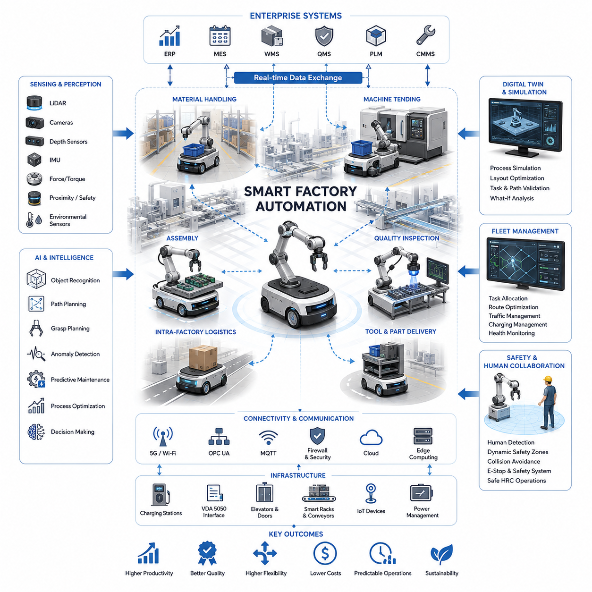
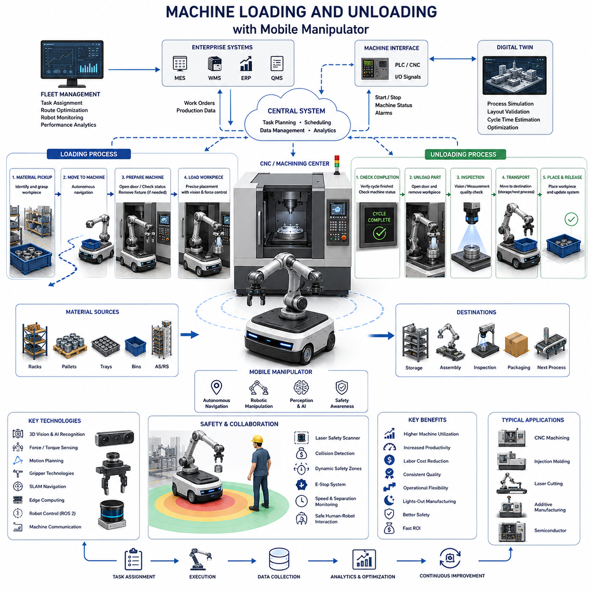
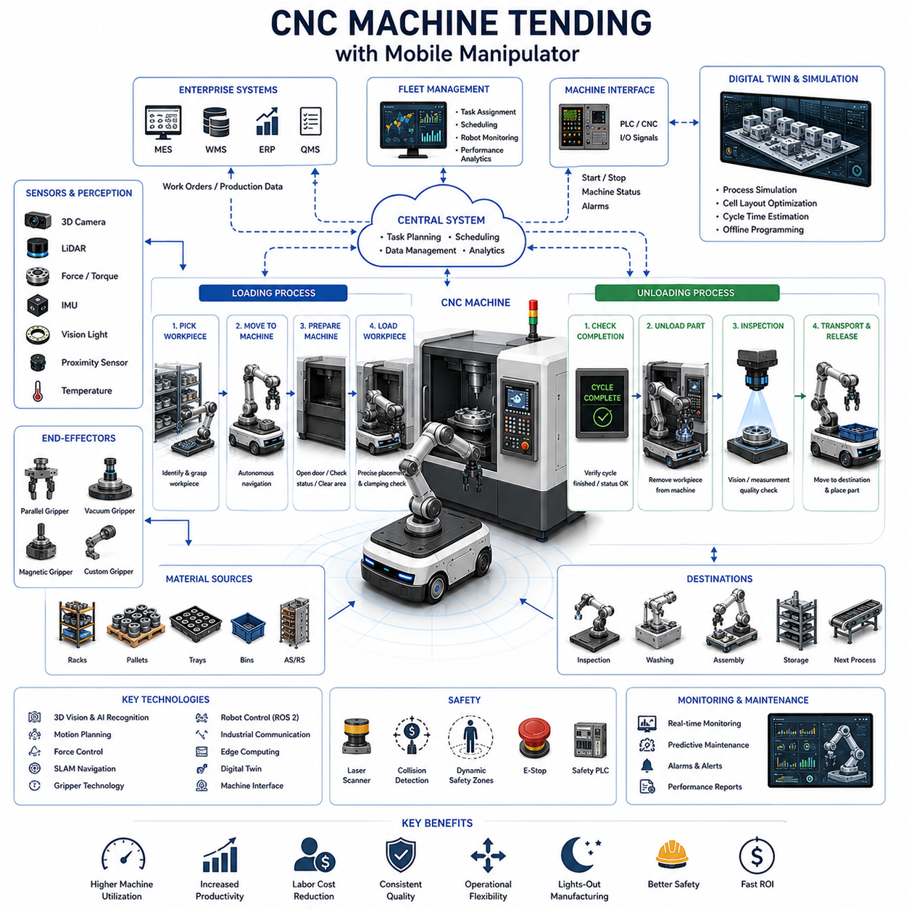
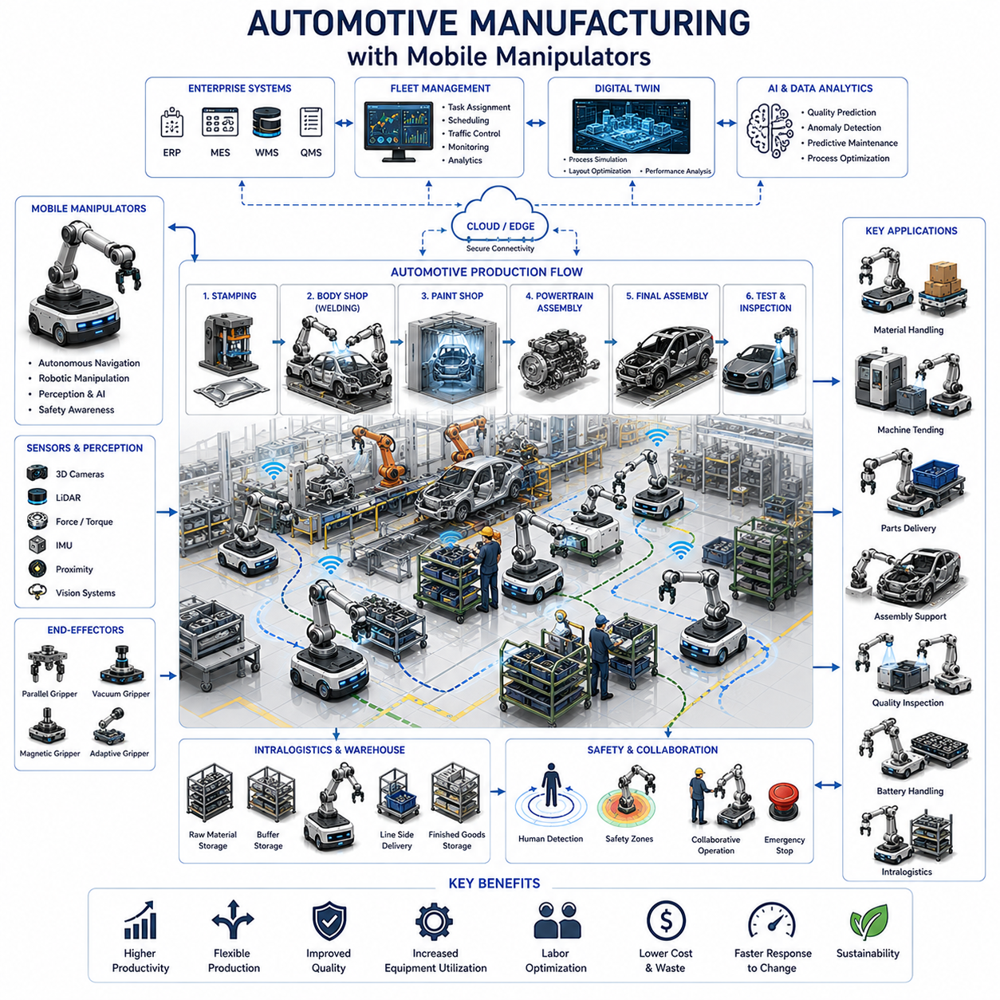
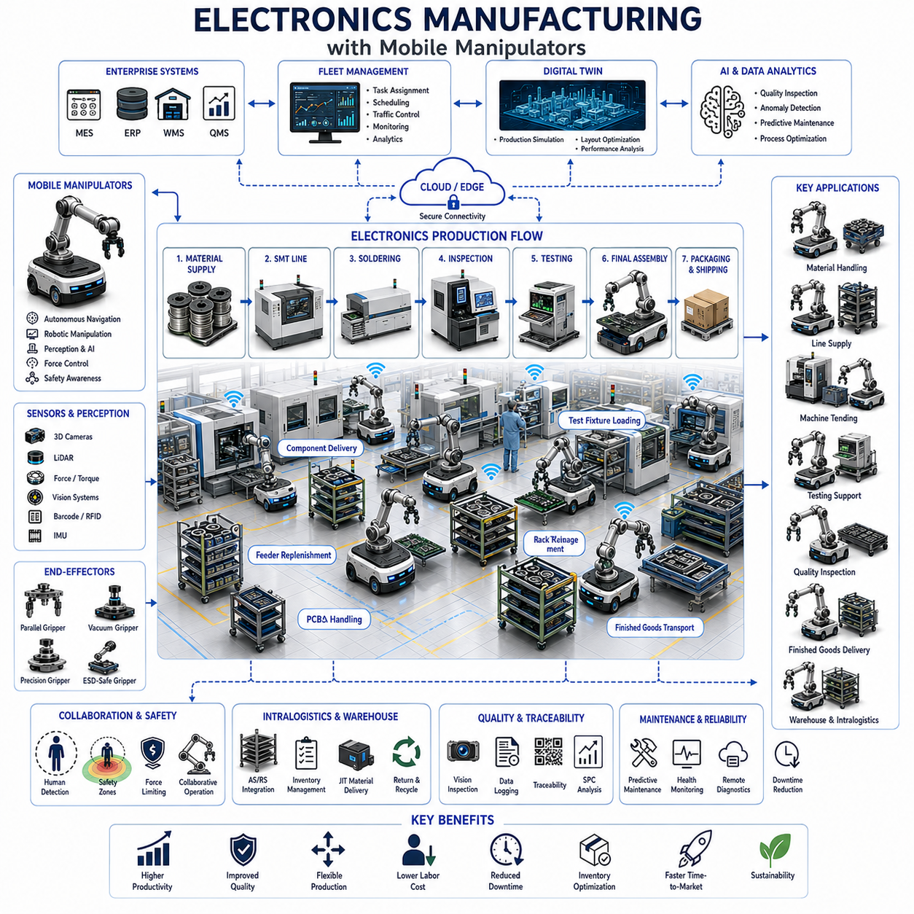
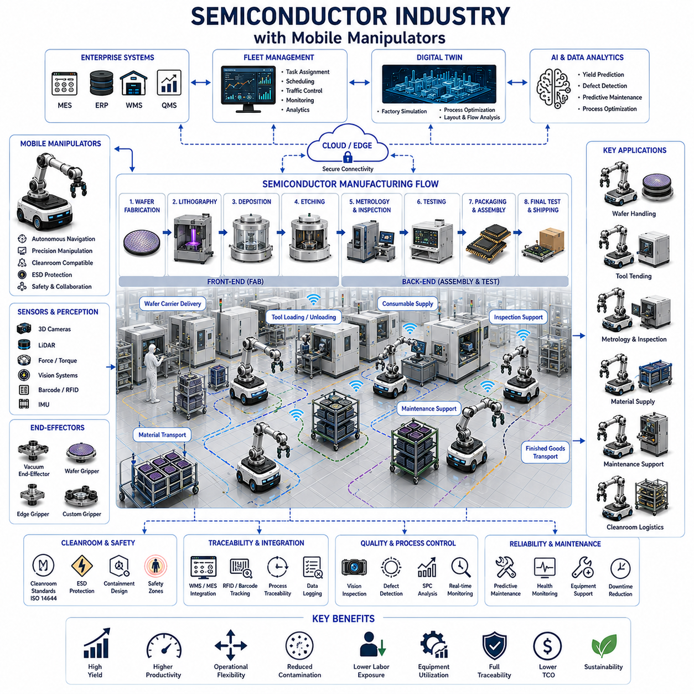
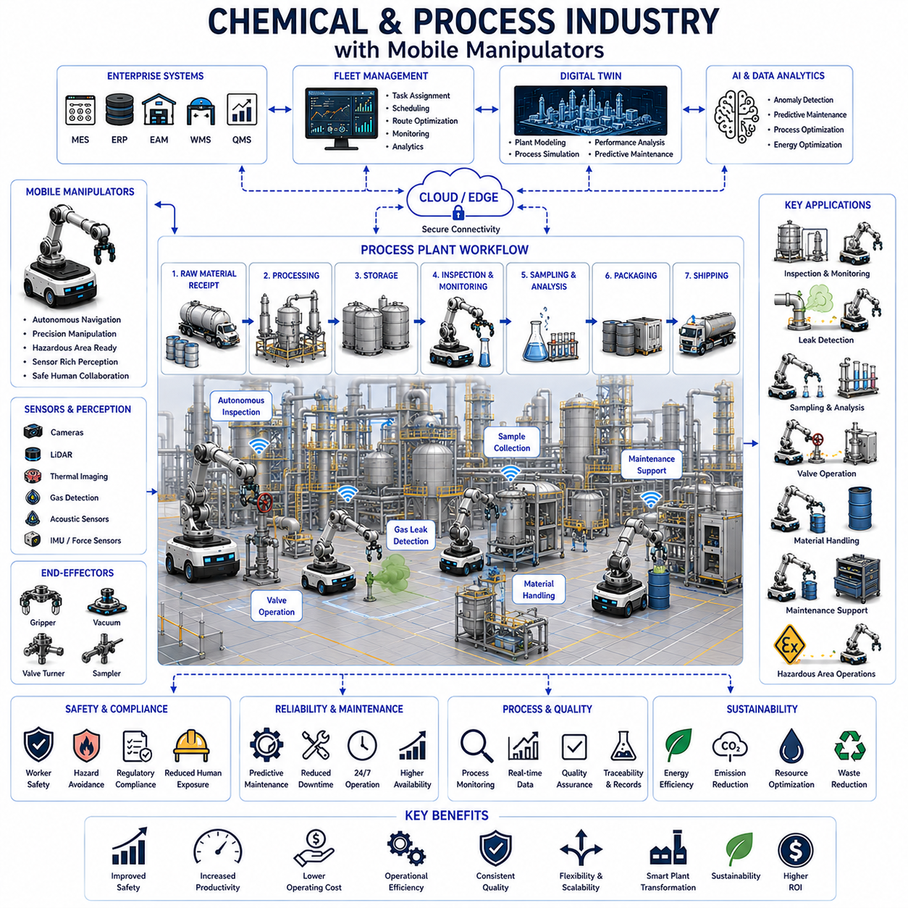
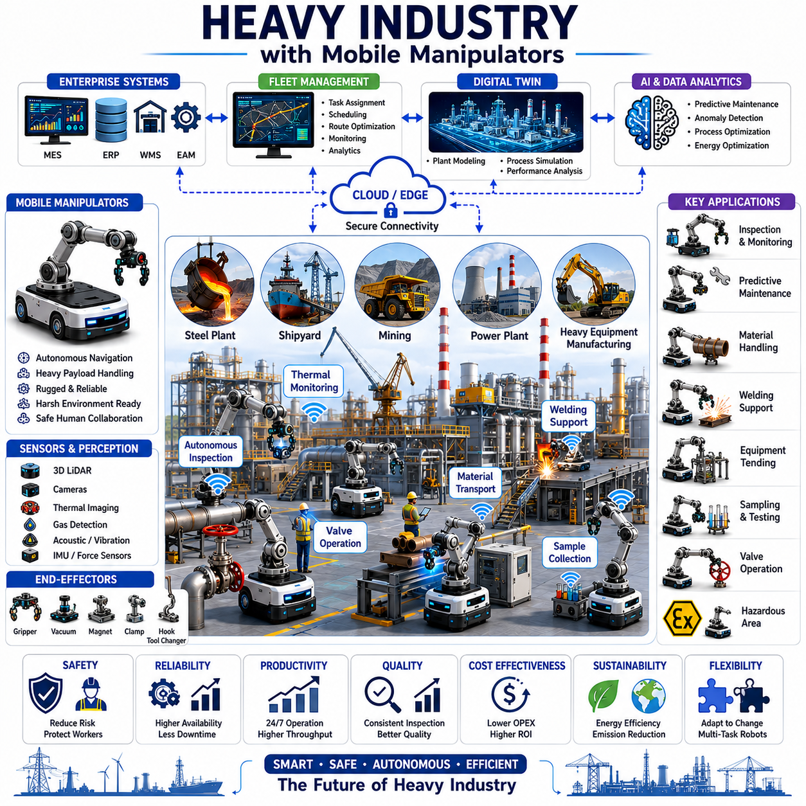
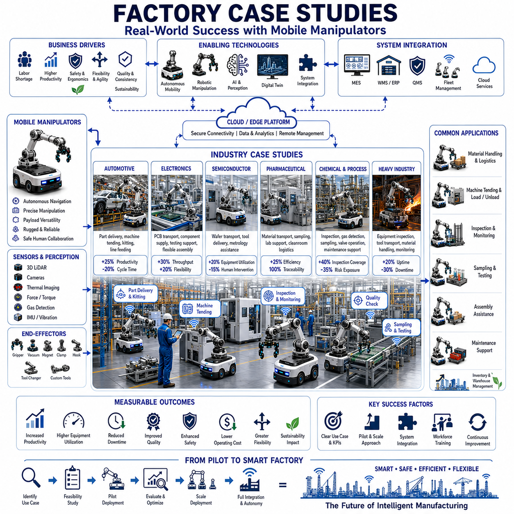

**Volume 01. Mobile Manipulator Foundations and System Architecture**


# Chapter 05. Industrial Applications

##  

## 01 Smart Factory Automation

{width="7.268055555555556in" height="7.268055555555556in"}

Smart factory automation represents the convergence of advanced manufacturing technologies, industrial digitalization, artificial intelligence, autonomous robotics, and real-time data-driven decision-making. Within the context of mobile manipulators, smart factory automation extends beyond conventional fixed industrial automation by enabling flexible, adaptive, and intelligent production systems capable of responding dynamically to changing operational requirements. Mobile manipulators combine the mobility of Autonomous Mobile Robots (AMRs) with the dexterity of robotic manipulators, creating a new generation of automation platforms that can perform transportation, handling, assembly, inspection, machine tending, and logistics operations throughout modern manufacturing facilities. This chapter belongs to the Industrial Applications domain of mobile manipulation and serves as the foundation for understanding how mobile manipulators transform conventional factories into intelligent and highly autonomous production environments.

Traditional factories were built around fixed automation systems. Conveyor belts, industrial robot arms, dedicated workstations, and predefined material flows dominated manufacturing environments for decades. While these systems achieved high productivity in mass production settings, they often lacked flexibility when product variations, production schedules, or facility layouts changed. Modern manufacturing trends demand shorter product life cycles, higher customization levels, smaller production batches, and rapid adaptation to market changes. These requirements have created significant pressure on manufacturers to adopt more flexible automation technologies capable of supporting dynamic production operations.

Smart factory automation addresses these challenges through the integration of cyber-physical systems, Industrial Internet of Things technologies, cloud computing, edge intelligence, digital twins, machine learning, and autonomous robotic platforms. Instead of treating production equipment as isolated assets, smart factories create interconnected ecosystems where machines, robots, sensors, software platforms, and human operators continuously exchange information and coordinate activities. Mobile manipulators serve as key enabling technologies within this ecosystem because they provide both mobility and manipulation capabilities, allowing automation resources to move wherever they are needed inside the factory.

A fundamental characteristic of smart factory automation is the ability to perceive and understand operational conditions in real time. Modern mobile manipulators are equipped with extensive sensor suites that may include LiDAR systems, stereo cameras, depth cameras, RGB cameras, force-torque sensors, inertial measurement units, proximity sensors, safety scanners, and environmental monitoring devices. These sensors continuously collect data about production processes, material locations, equipment status, human activities, and workspace conditions. The collected information is processed through edge computing systems and AI algorithms that generate actionable insights for autonomous decision-making.

In a smart factory environment, mobile manipulators often operate as autonomous material handling systems. Rather than relying on fixed conveyor infrastructures, robots transport components, subassemblies, tools, and finished products between production stations according to real-time manufacturing demands. Production schedules generated by Manufacturing Execution Systems can automatically trigger transportation tasks, allowing robots to deliver the correct materials to the appropriate workstations precisely when required. This just-in-time material delivery approach reduces inventory accumulation, minimizes floor-space usage, and improves overall operational efficiency.

Machine tending is another important application area where mobile manipulators contribute significantly to factory automation. Manufacturing equipment such as CNC machines, injection molding systems, die-casting machines, laser cutting systems, and additive manufacturing platforms frequently require repetitive loading and unloading operations. Traditionally, human operators performed these tasks, creating labor-intensive processes that limited equipment utilization. Mobile manipulators can autonomously navigate between multiple machines, load raw materials, unload completed parts, perform quality checks, and transfer components to downstream processes. Because a single robot can serve multiple machines, equipment utilization rates can increase substantially while labor costs decrease.

Assembly operations within smart factories increasingly benefit from mobile manipulation technologies. Unlike fixed robotic assembly cells that operate within limited workspaces, mobile manipulators can travel throughout production facilities and perform assembly tasks wherever needed. Vision-guided manipulation systems enable robots to identify parts, estimate object poses, and execute precise assembly procedures even when component positions vary. Advanced force-control algorithms allow robots to perform insertion, fastening, alignment, and adjustment operations that previously required human dexterity. As artificial intelligence technologies continue to evolve, assembly automation capabilities are expected to expand significantly.

Quality inspection represents another critical element of smart factory automation. Mobile manipulators equipped with machine vision systems can autonomously inspect products, assemblies, and manufacturing equipment throughout production facilities. High-resolution cameras, structured-light sensors, thermal imaging devices, and AI-based defect detection algorithms enable robots to identify dimensional deviations, surface defects, assembly errors, thermal anomalies, and process abnormalities. Inspection results can be transmitted directly to manufacturing databases, creating comprehensive digital records that support traceability, quality assurance, and continuous process improvement.

The integration of artificial intelligence significantly enhances the effectiveness of smart factory automation. Traditional automation systems typically rely on predefined rules and deterministic programming. In contrast, AI-enabled mobile manipulators can learn from operational data, adapt to changing conditions, optimize task execution strategies, and improve performance over time. Machine learning algorithms can predict equipment failures, optimize routing decisions, improve grasp success rates, identify process bottlenecks, and recommend operational improvements. This transition from programmed automation to intelligent automation represents one of the defining characteristics of Industry 4.0 manufacturing environments.

Digital twin technology plays a particularly important role in smart factory automation. A digital twin is a virtual representation of physical factory assets, processes, and operations that continuously synchronizes with real-world data. Mobile manipulators operating within smart factories can contribute data to digital twin platforms while simultaneously utilizing digital twin information for planning and optimization purposes. Engineers can evaluate production scenarios, simulate robot behaviors, validate workflow changes, and optimize resource allocation within virtual environments before implementing modifications in physical facilities. This capability reduces deployment risks and accelerates continuous improvement initiatives.

Fleet management systems become essential when multiple mobile manipulators operate simultaneously within a factory. Smart factory automation often involves dozens or even hundreds of autonomous robots performing coordinated tasks across large facilities. Fleet management platforms allocate tasks, optimize routes, manage traffic flows, coordinate charging schedules, monitor robot health, and ensure efficient utilization of robotic resources. Advanced scheduling algorithms continuously balance workloads while minimizing idle time and preventing operational conflicts. The result is a highly coordinated robotic workforce capable of supporting complex manufacturing operations at scale.

Human-robot collaboration is another defining feature of smart factory automation. While automation technologies continue to advance, human workers remain essential participants in manufacturing environments. Mobile manipulators are increasingly designed to work safely alongside human operators rather than replacing them entirely. Collaborative safety technologies such as safety-rated laser scanners, vision-based human detection systems, force-limited manipulators, predictive motion planning, and dynamic safety zones enable robots to operate within shared workspaces. This collaborative approach combines human flexibility, creativity, and decision-making capabilities with robotic precision, consistency, and endurance.

Data connectivity forms the backbone of smart factory automation architectures. Mobile manipulators continuously exchange information with enterprise systems including Manufacturing Execution Systems, Enterprise Resource Planning platforms, Warehouse Management Systems, Quality Management Systems, Product Lifecycle Management tools, and Industrial Internet of Things infrastructures. Through standardized communication protocols, robots become integrated components of larger digital manufacturing ecosystems. Production orders, inventory updates, maintenance schedules, inspection results, and operational metrics flow seamlessly between physical and digital systems.

Predictive maintenance capabilities further enhance the value of smart factory automation. Mobile manipulators generate extensive operational data related to motors, actuators, batteries, sensors, controllers, and mechanical subsystems. AI-driven analytics platforms analyze these data streams to detect early indicators of component degradation or impending failures. Maintenance activities can therefore be scheduled proactively before unexpected breakdowns occur. This approach reduces downtime, lowers maintenance costs, and improves overall equipment effectiveness across manufacturing operations.

Energy optimization is becoming increasingly important as manufacturers pursue sustainability objectives. Smart factory automation systems can monitor energy consumption patterns across robotic fleets, production equipment, and facility infrastructure. Mobile manipulators can schedule charging activities during off-peak periods, optimize movement trajectories to reduce power consumption, and coordinate operations with facility energy management systems. These capabilities contribute to reduced operational costs and lower environmental impact.

Cybersecurity considerations have become increasingly critical within smart factory automation environments. As mobile manipulators become connected to enterprise networks and cloud platforms, they must be protected against cyber threats that could compromise operational safety or production continuity. Secure communication protocols, authentication mechanisms, encrypted data transmission, network segmentation, and continuous security monitoring are essential components of modern automation architectures. Cybersecurity is no longer merely an IT concern but a fundamental requirement for reliable industrial automation.

The economic impact of smart factory automation extends beyond labor cost reduction. Manufacturers implementing mobile manipulation technologies often achieve improvements in productivity, quality, flexibility, responsiveness, asset utilization, and operational visibility. Production systems become capable of supporting high-mix, low-volume manufacturing while maintaining efficiency levels traditionally associated with mass production. These capabilities provide significant competitive advantages in rapidly changing global markets.

Several industries have emerged as early adopters of smart factory automation technologies. Automotive manufacturers utilize mobile manipulators for assembly support, material handling, and logistics operations. Electronics manufacturers deploy robots for component transportation, machine tending, and quality inspection. Semiconductor facilities employ autonomous robots for wafer handling and cleanroom logistics. Pharmaceutical manufacturers leverage mobile automation for material transport, packaging operations, and laboratory support. Aerospace companies utilize intelligent robotic systems for complex assembly and inspection activities. Across all these industries, the common objective is the creation of more agile, intelligent, and efficient manufacturing operations.

The future evolution of smart factory automation will likely be driven by advances in artificial intelligence, foundation models, embodied AI, cloud robotics, and multi-robot collaboration technologies. Future mobile manipulators may possess increasingly sophisticated reasoning capabilities, allowing them to understand production objectives, interpret human instructions, adapt to novel situations, and coordinate autonomously with other robotic systems. Large-scale robotic fleets could function as distributed intelligent workforces capable of dynamically reorganizing themselves in response to changing manufacturing demands.

Embodied AI technologies are expected to further enhance mobile manipulator capabilities by enabling robots to learn from experience, generalize across tasks, and perform increasingly complex physical interactions. Instead of requiring extensive task-specific programming, future robots may acquire skills through demonstrations, simulations, reinforcement learning, and natural language instructions. This shift could dramatically reduce deployment costs while expanding the range of automatable manufacturing activities.

Ultimately, smart factory automation represents a transition from static production systems toward adaptive, intelligent, and highly interconnected manufacturing ecosystems. Mobile manipulators occupy a central role within this transformation because they bridge the gap between mobility, manipulation, perception, and intelligence. By combining autonomous navigation, robotic dexterity, artificial intelligence, cloud connectivity, and industrial integration capabilities, mobile manipulators enable factories to achieve unprecedented levels of flexibility, efficiency, resilience, and autonomy. As Industry 4.0 continues to evolve toward Industry 5.0 and beyond, smart factory automation will remain one of the most influential drivers shaping the future of global manufacturing.

스마트 팩토리 자동화는 첨단 제조기술, 산업 디지털화, 인공지능, 자율로봇, 그리고 실시간 데이터 기반 의사결정이 융합된 차세대 제조 패러다임을 의미한다. 모바일 매니퓰레이터 관점에서 스마트 팩토리 자동화는 단순한 공장 자동화를 넘어 변화하는 생산 요구사항에 능동적으로 대응할 수 있는 유연하고 지능적인 생산 시스템을 구현하는 것을 목표로 한다. 모바일 매니퓰레이터는 자율이동로봇(AMR)의 이동성과 로봇 팔의 조작 능력을 결합한 시스템으로, 물류 이송, 부품 핸들링, 조립, 검사, 설비 지원, 생산 보조 등 다양한 작업을 수행할 수 있다. 이러한 특성 덕분에 모바일 매니퓰레이터는 스마트 팩토리를 구현하는 핵심 기술로 주목받고 있다.

기존 제조공장은 고정형 자동화 설비를 중심으로 구축되었다. 컨베이어, 산업용 로봇, 전용 생산 셀, 고정된 물류 흐름 등이 생산 효율성을 높이는 데 기여했지만, 제품 종류가 다양해지고 생산량 변화가 잦아지면서 유연성 부족이라는 한계가 드러났다. 최근 제조업은 다품종 소량생산, 고객 맞춤형 제품, 짧아진 제품 수명주기와 같은 새로운 요구에 직면하고 있으며, 이에 따라 생산 시스템 역시 빠르게 변화할 수 있는 유연성을 갖추어야 한다.

스마트 팩토리는 이러한 문제를 해결하기 위해 사이버-물리 시스템(CPS), 산업용 사물인터넷(IIoT), 클라우드 컴퓨팅, 엣지 AI, 디지털 트윈, 머신러닝 기술을 적극 활용한다. 공장 내 모든 설비와 시스템은 서로 연결되어 데이터를 교환하며, 생산 상황에 따라 스스로 최적의 의사결정을 수행한다. 모바일 매니퓰레이터는 이러한 환경에서 이동성과 조작 능력을 동시에 제공함으로써 생산 현장의 자동화 범위를 크게 확대한다.

스마트 팩토리 자동화의 핵심 요소 중 하나는 실시간 상황 인식이다. 최신 모바일 매니퓰레이터는 LiDAR, RGB 카메라, 깊이 카메라, 스테레오 비전, IMU, 힘·토크 센서, 안전 센서 등 다양한 센서를 탑재하고 있다. 이러한 센서들은 생산설비 상태, 작업자 위치, 자재 흐름, 제품 상태 등의 정보를 지속적으로 수집한다. 수집된 데이터는 엣지 컴퓨팅 장치와 AI 알고리즘을 통해 분석되며, 로봇은 이를 기반으로 자율적인 판단과 행동을 수행한다.

스마트 팩토리에서 모바일 매니퓰레이터의 대표적인 역할은 자재 이송 자동화이다. 기존에는 컨베이어나 작업자가 자재를 이동시켰지만, 모바일 매니퓰레이터는 생산 계획에 따라 필요한 부품을 필요한 시점에 정확한 작업장으로 운반할 수 있다. MES(Manufacturing Execution System)와 연동하면 생산 지시에 따라 자동으로 물류 작업이 생성되며, 로봇은 이를 수행한다. 이러한 Just-In-Time 방식은 재고를 줄이고 생산 효율을 향상시키는 데 큰 효과를 제공한다.

설비 지원(Machine Tending) 분야에서도 모바일 매니퓰레이터는 높은 가치를 제공한다. CNC, 사출성형기, 다이캐스팅 장비, 레이저 가공기, 3D 프린터와 같은 생산설비는 원자재 투입과 완성품 배출을 반복적으로 수행해야 한다. 기존에는 작업자가 담당하던 이러한 작업을 모바일 매니퓰레이터가 수행함으로써 설비 가동률을 높이고 인력 의존도를 낮출 수 있다. 특히 하나의 로봇이 여러 대의 설비를 순회하며 작업할 수 있기 때문에 자동화 투자 효율이 높다.

조립 공정 역시 스마트 팩토리 자동화의 중요한 적용 분야이다. 기존 고정형 로봇은 정해진 작업 공간에서만 작업할 수 있었지만, 모바일 매니퓰레이터는 공장 내 다양한 위치로 이동하면서 조립 작업을 수행할 수 있다. 비전 기반 객체 인식과 자세 추정 기술을 활용하면 부품 위치가 일정하지 않은 환경에서도 정확한 조립이 가능하다. 또한 힘 제어와 임피던스 제어 기술을 이용하면 삽입, 체결, 정렬과 같은 정밀 작업도 수행할 수 있다.

품질검사 자동화 또한 스마트 팩토리의 핵심 구성 요소이다. 모바일 매니퓰레이터는 고해상도 카메라, 열화상 카메라, 3D 비전 센서 등을 이용하여 생산품을 검사할 수 있다. AI 기반 결함 탐지 알고리즘은 표면 결함, 조립 오류, 치수 오차, 열 이상 현상 등을 자동으로 검출한다. 검사 결과는 품질관리 시스템에 즉시 반영되어 추적성과 품질 향상에 활용된다.

인공지능은 스마트 팩토리 자동화를 더욱 고도화하는 핵심 기술이다. 기존 자동화 시스템은 사전에 정의된 규칙에 의존했지만, AI 기반 모바일 매니퓰레이터는 데이터를 학습하고 환경 변화에 적응할 수 있다. 머신러닝 알고리즘은 최적 경로를 계산하고, 작업 우선순위를 조정하며, 물체 인식 정확도를 향상시키고, 설비 고장을 예측할 수 있다. 이는 자동화를 단순 반복 작업 수준에서 지능형 의사결정 단계로 발전시키는 중요한 요소이다.

디지털 트윈은 스마트 팩토리 자동화의 또 다른 핵심 기술이다. 디지털 트윈은 실제 공장과 설비를 가상 공간에 동일하게 구현한 모델이다. 모바일 매니퓰레이터는 운영 데이터를 디지털 트윈 플랫폼에 제공하며, 디지털 트윈은 생산 시뮬레이션, 물류 최적화, 설비 배치 검증, 로봇 경로 검증 등에 활용된다. 이를 통해 실제 공정 변경 전에 가상 환경에서 충분한 검증이 가능해져 위험을 줄이고 생산성을 향상시킬 수 있다.

여러 대의 모바일 매니퓰레이터가 동시에 운영되는 환경에서는 플릿 관리(Fleet Management)가 중요하다. 플릿 관리 시스템은 작업 분배, 경로 최적화, 충전 스케줄 관리, 교통 제어, 로봇 상태 모니터링을 수행한다. 수십 대에서 수백 대 규모의 로봇이 운영되는 대형 공장에서는 이러한 플릿 관리 시스템이 전체 생산 효율을 결정하는 핵심 요소가 된다.

스마트 팩토리 자동화는 인간과 로봇의 협업을 전제로 한다. 미래의 공장은 인간을 완전히 배제하는 무인 공장이 아니라 인간과 로봇이 각자의 강점을 활용하는 협업 환경으로 발전하고 있다. 안전 스캐너, 비전 기반 사람 인식, 협동로봇 기술, 동적 안전영역 설정 기술은 로봇과 작업자가 같은 공간에서 안전하게 작업할 수 있도록 지원한다. 인간은 창의적 문제 해결과 의사결정을 담당하고, 로봇은 반복적이고 위험한 작업을 수행하는 구조가 점차 확대되고 있다.

스마트 팩토리의 데이터 연결성 또한 매우 중요하다. 모바일 매니퓰레이터는 MES, ERP, WMS, QMS, PLM 등 다양한 기업 시스템과 연동된다. 생산 지시, 재고 정보, 품질 데이터, 유지보수 정보가 실시간으로 공유되며, 이를 통해 공장 전체가 하나의 통합 시스템처럼 운영된다.

예지보전(Predictive Maintenance)은 스마트 팩토리 자동화의 중요한 가치 중 하나이다. 모바일 매니퓰레이터는 모터, 배터리, 센서, 액추에이터 등 다양한 구성 요소의 상태 데이터를 지속적으로 수집한다. AI 분석 시스템은 이러한 데이터를 기반으로 고장 징후를 사전에 발견하고 유지보수 시점을 예측한다. 결과적으로 예상치 못한 다운타임을 줄이고 설비 가용성을 높일 수 있다.

에너지 최적화 역시 중요한 과제이다. 스마트 팩토리는 로봇 운행 경로 최적화, 충전 스케줄 조정, 전력 사용량 분석 등을 통해 에너지 소비를 최소화한다. 이는 운영비 절감뿐만 아니라 지속가능한 제조 환경 구축에도 기여한다.

한편 스마트 팩토리 환경에서는 사이버보안의 중요성이 더욱 커지고 있다. 모바일 매니퓰레이터가 클라우드와 기업 네트워크에 연결되면서 해킹, 데이터 유출, 생산 중단 등의 위험이 증가하기 때문이다. 따라서 암호화 통신, 인증 체계, 접근 제어, 네트워크 분리, 보안 모니터링 등이 필수적으로 적용되어야 한다.

스마트 팩토리 자동화의 경제적 효과는 단순한 인건비 절감에 그치지 않는다. 생산성 향상, 품질 개선, 운영 유연성 확보, 설비 활용률 증가, 생산 리드타임 단축, 고객 대응 속도 향상 등 다양한 효과를 제공한다. 특히 다품종 소량생산 환경에서도 높은 생산성을 유지할 수 있다는 점이 큰 경쟁력으로 평가된다.

자동차, 전자, 반도체, 제약, 항공우주 산업은 스마트 팩토리 자동화 기술을 가장 적극적으로 도입하고 있는 분야이다. 자동차 공장에서는 조립 지원과 물류 자동화에 활용되고 있으며, 전자 제조 분야에서는 부품 공급과 검사 자동화에 사용된다. 반도체 공장에서는 웨이퍼 이송과 클린룸 물류를 담당하며, 제약 산업에서는 원료 운반과 포장 공정을 지원한다. 항공우주 산업에서는 대형 구조물 조립과 품질검사 분야에서 활용 범위가 확대되고 있다.

향후 스마트 팩토리 자동화는 생성형 AI, 파운데이션 모델, VLM(Vision-Language Model), VLA(Vision-Language-Action), 클라우드 로보틱스, 다중 로봇 협업 기술과 결합되면서 더욱 발전할 것으로 예상된다. 미래의 모바일 매니퓰레이터는 단순히 명령을 수행하는 수준을 넘어 생산 목표를 이해하고, 자연어 지시를 해석하며, 새로운 작업을 스스로 학습할 수 있는 지능형 작업자로 진화할 것이다.

결국 스마트 팩토리 자동화는 정적인 생산 시스템에서 동적이고 적응형인 생산 생태계로의 전환을 의미한다. 모바일 매니퓰레이터는 이동성, 조작 능력, 인공지능, 클라우드 연결성, 산업 시스템 통합 능력을 모두 갖춘 핵심 플랫폼으로서 이러한 변화를 주도하고 있다. 미래 제조업은 인간과 지능형 로봇이 협력하는 방향으로 발전할 것이며, 스마트 팩토리 자동화는 그 중심에서 제조 혁신을 이끄는 핵심 기술로 자리 잡게 될 것이다.

##  

## 02 Machine Loading and Unloading

{width="7.268055555555556in" height="7.268055555555556in"}

Machine loading and unloading is one of the most important and economically valuable applications of mobile manipulators in modern industrial automation. It represents the process of autonomously supplying raw materials, workpieces, semi-finished products, or components to manufacturing equipment and subsequently removing processed parts after operations have been completed. In traditional manufacturing environments, machine loading and unloading tasks are often performed manually by operators who repeatedly transport materials, open machine doors, position parts, initiate processing cycles, retrieve finished products, and transfer them to downstream operations. While these tasks may appear simple, they consume significant labor resources, create productivity bottlenecks, and expose workers to repetitive and potentially hazardous activities. Mobile manipulators provide an effective solution by combining autonomous mobility with robotic manipulation, enabling flexible and intelligent machine tending operations throughout the factory. This application area forms a foundational component of industrial mobile manipulation and serves as a critical step toward fully autonomous smart factory operations.

The increasing adoption of machine loading and unloading automation is driven by several manufacturing trends. Modern factories are expected to operate continuously while maintaining high productivity, consistent quality, and operational flexibility. Labor shortages, rising labor costs, increasing product variety, and demands for shorter lead times have encouraged manufacturers to seek automation solutions that can adapt to changing production requirements. Unlike fixed robotic cells that are dedicated to specific machines, mobile manipulators can dynamically serve multiple machines across a facility. This flexibility significantly improves equipment utilization while reducing automation costs.

Machine loading and unloading operations typically begin with material transportation. Raw materials or workpieces are stored in racks, pallets, bins, trays, or automated storage systems. A mobile manipulator receives a task assignment from a Manufacturing Execution System, Warehouse Management System, or Fleet Management Platform. The robot navigates autonomously to the material storage location, identifies the required part using vision systems, grasps the object using an appropriate end-effector, and transports it to the designated machine. Upon arrival, the robot positions itself precisely relative to the machine and prepares for the loading sequence.

The loading process itself requires accurate coordination between mobility, perception, and manipulation subsystems. The robot must recognize the machine state, verify that the machine is ready to receive a new workpiece, and determine the precise location where the part should be placed. Depending on the manufacturing process, the robot may need to open machine doors, remove fixtures, load raw materials into chucks or fixtures, align components with high precision, and confirm successful placement. These actions often require sophisticated vision systems, force control algorithms, and adaptive manipulation capabilities.

After loading is completed, the robot may initiate the machine cycle directly through digital interfaces or communicate with industrial control systems such as PLCs and Manufacturing Execution Systems. During machine operation, the mobile manipulator can either remain nearby or proceed to perform tasks at other workstations. This ability to serve multiple machines significantly increases automation efficiency and differentiates mobile manipulators from traditional fixed automation solutions.

Once processing is completed, the unloading phase begins. The robot returns to the machine, verifies that the manufacturing operation has finished successfully, opens access doors if necessary, and removes the completed workpiece. Depending on process requirements, the robot may conduct preliminary quality inspections using onboard vision systems, barcode scanners, RFID readers, or measurement devices. Finished parts can then be transported to storage locations, assembly stations, inspection cells, packaging systems, or subsequent manufacturing processes.

The complexity of machine loading and unloading varies significantly across industries and manufacturing applications. Some operations involve relatively simple pick-and-place tasks where large tolerances are acceptable. Other applications require sub-millimeter positioning accuracy, precise force control, and advanced perception capabilities. CNC machining, injection molding, laser cutting, additive manufacturing, semiconductor processing, electronics assembly, and metal fabrication all present unique operational challenges that influence system design.

CNC machine tending represents one of the most common applications of mobile manipulators. CNC machining centers often operate for extended periods with minimal supervision once a workpiece has been loaded. Traditionally, operators spend a significant portion of their time loading raw materials and unloading completed parts rather than performing value-added tasks. Mobile manipulators can automate these repetitive activities by transporting workpieces between storage locations and machining centers. Vision systems identify part orientations, while robotic arms position components accurately within machine fixtures. This automation approach increases spindle utilization, reduces idle time, and enables lights-out manufacturing operations.

Injection molding facilities also benefit substantially from machine loading and unloading automation. After plastic components are molded, they must be removed promptly to maintain production efficiency and prevent process interruptions. Mobile manipulators can retrieve molded parts, separate them from runners and sprues, perform visual inspections, and transport products to packaging or assembly areas. Because injection molding machines are often distributed across large production floors, mobile manipulators provide greater flexibility than fixed robotic systems.

Laser cutting and sheet metal fabrication environments present additional opportunities for autonomous machine tending. Metal sheets, fabricated parts, and processed components frequently require transportation between cutting systems, bending machines, welding stations, and inspection cells. Mobile manipulators can manage these material flows while adapting to changing production schedules and equipment availability. Their mobility enables seamless integration across multiple manufacturing processes without requiring extensive conveyor infrastructure.

Additive manufacturing facilities increasingly utilize machine loading and unloading automation as well. Three-dimensional printing systems often operate continuously for many hours. Mobile manipulators can remove completed build trays, transfer printed components to post-processing stations, load fresh materials, and coordinate workflow transitions. As additive manufacturing scales toward industrial production volumes, automation becomes essential for achieving economically viable operations.

Semiconductor manufacturing represents one of the most demanding environments for machine loading and unloading systems. Wafer handling operations require extremely high precision, cleanliness, and reliability. Mobile manipulators designed for semiconductor facilities often operate within controlled environments and incorporate specialized handling mechanisms that minimize contamination risks. Autonomous material transport between processing equipment contributes to improved throughput and reduced human intervention.

The success of machine loading and unloading automation depends heavily on perception technologies. Modern mobile manipulators employ multiple sensing modalities to understand their environments and interact with manufacturing equipment. RGB cameras provide visual information about machine status and object locations. Depth sensors generate three-dimensional representations of workspaces. LiDAR systems support navigation and obstacle detection. Force-torque sensors enable precise contact interactions. Combined sensor data creates comprehensive situational awareness that supports reliable autonomous operation.

Computer vision technologies play a particularly important role in machine tending applications. Object detection algorithms identify workpieces, fixtures, tools, and machine components. Pose estimation algorithms determine the precise orientation and position of target objects. Machine state recognition systems analyze indicator lights, display screens, door positions, and equipment conditions. Advanced AI models can even recognize process anomalies and identify situations requiring human intervention.

Gripper design significantly influences machine loading and unloading performance. Different manufacturing applications require different end-effector configurations. Parallel jaw grippers are commonly used for rigid industrial components. Vacuum grippers support sheet materials, electronics, and packaging operations. Adaptive grippers accommodate variable object geometries. Magnetic grippers assist with ferrous metal handling. Specialized end-effectors may incorporate sensors, compliance mechanisms, quick-change interfaces, or multi-functional capabilities. The selection of an appropriate gripper is often one of the most critical design decisions in machine tending systems.

Control architecture is another essential consideration. Effective machine loading and unloading requires coordination between navigation systems, robotic manipulators, vision algorithms, safety systems, and manufacturing equipment. Modern implementations frequently utilize ROS 2, industrial communication protocols, real-time controllers, and distributed computing architectures. Task planning systems orchestrate sequences of actions while ensuring safe and efficient execution. Integration with factory software platforms enables robots to receive work orders, update production records, and synchronize activities with broader manufacturing operations.

Artificial intelligence increasingly enhances machine loading and unloading capabilities. Traditional robotic systems often require extensive programming for each application. AI-driven systems can learn manipulation strategies from demonstrations, adapt to environmental changes, and improve performance through experience. Machine learning algorithms optimize grasp selection, trajectory planning, collision avoidance, and task scheduling. Foundation models and vision-language-action systems are expected to further expand robotic flexibility by enabling natural language instruction and generalized task execution.

Safety remains a fundamental requirement for machine loading and unloading automation. Mobile manipulators frequently operate near human workers, production equipment, and valuable products. Comprehensive safety architectures include laser safety scanners, emergency stop systems, collision detection mechanisms, speed and separation monitoring, safety-rated controllers, and dynamic safety zones. Risk assessments must consider navigation hazards, manipulation risks, equipment interactions, and human-robot collaboration scenarios. Compliance with industrial safety standards is essential for successful deployment.

Digital twin technology provides valuable support for machine tending projects. Engineers can create virtual models of manufacturing environments, robots, machines, and workflows to evaluate automation strategies before deployment. Simulations help identify bottlenecks, optimize robot paths, validate reachability, assess cycle times, and estimate productivity improvements. Digital twins reduce implementation risks while accelerating project development and commissioning activities.

Performance evaluation of machine loading and unloading systems typically focuses on productivity, reliability, flexibility, and return on investment. Important metrics include machine utilization rates, cycle times, loading accuracy, grasp success rates, robot uptime, task completion rates, production throughput, and labor savings. Manufacturers often observe significant improvements in overall equipment effectiveness after implementing autonomous machine tending solutions. Continuous operation capabilities enable equipment to remain productive beyond traditional working hours, further increasing economic benefits.

The economic justification for machine loading and unloading automation extends beyond direct labor reduction. Increased machine utilization, reduced downtime, improved consistency, enhanced traceability, higher quality levels, and greater operational flexibility contribute significantly to business value. Manufacturers can respond more rapidly to changing customer demands while maintaining competitive production costs. In high-mix manufacturing environments, mobile manipulators provide automation flexibility that would be difficult or impossible to achieve using fixed robotic infrastructure.

Future developments in machine loading and unloading will likely be driven by advances in artificial intelligence, embodied AI, cloud robotics, and autonomous decision-making technologies. Future mobile manipulators may understand production objectives at a higher semantic level, autonomously determine optimal workflows, learn new machine interfaces without explicit programming, and collaborate seamlessly with other robots and human workers. Vision-language-action models may allow robots to interpret natural language instructions and execute complex machine tending tasks with minimal configuration.

As smart factories continue to evolve, machine loading and unloading will become increasingly integrated into broader autonomous manufacturing ecosystems. Mobile manipulators will function not merely as machine attendants but as intelligent production agents capable of coordinating material flows, optimizing resource utilization, and supporting real-time production adaptation. Their ability to combine mobility, perception, manipulation, and intelligence positions them as one of the most transformative technologies in modern industrial automation. Machine loading and unloading therefore represents far more than a simple automation task; it serves as a cornerstone of the future autonomous factory where intelligent robotic systems continuously support efficient, flexible, and highly productive manufacturing operations.

설비 로딩 및 언로딩은 현대 산업 자동화에서 모바일 매니퓰레이터가 가장 큰 경제적 가치를 창출하는 대표적인 응용 분야 중 하나이다. 이는 원자재, 가공 전 부품, 반제품 또는 완제품을 생산설비에 자동으로 공급하고, 가공이 완료된 후 이를 회수하여 다음 공정으로 전달하는 작업을 의미한다. 전통적인 제조환경에서는 작업자가 반복적으로 자재를 운반하고, 설비 문을 열고, 부품을 위치시키고, 가공을 시작한 후 완성품을 회수하는 업무를 수행해 왔다. 이러한 작업은 단순해 보이지만 많은 인력을 필요로 하며 생산성 저하와 반복 작업에 따른 피로, 안전 위험을 초래한다. 모바일 매니퓰레이터는 자율주행 기능과 로봇 팔의 조작 기능을 결합하여 이러한 작업을 자동화함으로써 스마트 팩토리 구현의 핵심 역할을 수행한다.

최근 설비 로딩 및 언로딩 자동화에 대한 수요가 증가하는 이유는 제조 환경의 변화와 밀접한 관련이 있다. 제조업은 점점 더 높은 생산성, 품질 안정성, 운영 유연성을 요구하고 있으며, 인력 부족과 인건비 상승, 다품종 소량생산 확대 등으로 인해 자동화 필요성이 커지고 있다. 기존의 고정형 로봇 셀은 특정 설비만 지원할 수 있지만, 모바일 매니퓰레이터는 여러 설비를 이동하며 작업할 수 있기 때문에 훨씬 높은 유연성과 투자 효율성을 제공한다.

일반적인 설비 로딩 및 언로딩 작업은 자재 운반 단계에서 시작된다. 원자재나 공작물은 랙, 팔레트, 트레이, 빈(Bin) 또는 자동창고에 보관된다. 모바일 매니퓰레이터는 MES, WMS 또는 플릿 관리 시스템으로부터 작업 지시를 수신한 후 자재 보관 위치로 이동한다. 비전 시스템을 이용해 대상 부품을 인식하고 적절한 그리퍼로 집은 후 지정된 설비로 운반한다. 설비에 도착하면 정밀 위치 제어를 통해 정확한 작업 위치에 정렬하고 로딩 작업을 준비한다.

로딩 과정에서는 이동 시스템, 비전 시스템, 조작 시스템 간의 정교한 협력이 필요하다. 로봇은 설비 상태를 확인하고 새로운 공작물을 투입할 준비가 되었는지 판단해야 한다. 이후 설비 문을 열거나 고정 장치를 해제하고, 공작물을 척(Chuck)이나 지그(Jig)에 정확하게 위치시킨다. 이러한 과정은 고정밀 위치 제어와 힘 제어 기술을 요구하며, 경우에 따라 비전 기반 자세 추정과 접촉 기반 정렬 기능이 필요하다.

로딩이 완료되면 로봇은 PLC 또는 생산제어 시스템과 통신하여 가공 사이클을 시작할 수 있다. 가공이 진행되는 동안 로봇은 설비 주변에서 대기할 수도 있지만, 대부분의 경우 다른 설비로 이동하여 추가 작업을 수행한다. 이처럼 하나의 모바일 매니퓰레이터가 여러 설비를 지원할 수 있다는 점이 기존 고정형 자동화와 가장 큰 차별점이다.

가공이 완료되면 언로딩 단계가 시작된다. 로봇은 설비 상태를 확인하고 작업 완료를 인식한 후 설비에 접근한다. 이후 문을 열고 가공된 부품을 꺼내어 검사, 포장, 조립 또는 다음 공정으로 운반한다. 필요에 따라 비전 검사, 바코드 스캔, RFID 인식, 치수 측정 등을 수행할 수 있으며, 이를 통해 품질 추적성과 생산 데이터 수집도 동시에 이루어진다.

설비 로딩 및 언로딩의 난이도는 산업과 공정에 따라 크게 달라진다. 일부 공정은 단순한 Pick-and-Place 수준이지만, 다른 공정은 서브밀리미터 단위의 정밀도와 힘 제어를 요구한다. CNC 가공, 사출성형, 레이저 가공, 금속 판재 가공, 반도체 제조, 전자제품 생산, 적층 제조(Additive Manufacturing) 등은 각각 서로 다른 기술적 요구사항을 가진다.

CNC 머신 텐딩(CNC Machine Tending)은 가장 대표적인 적용 사례이다. CNC 가공기는 공작물을 장착한 후 장시간 자동으로 가공을 수행할 수 있지만, 공작물의 투입과 회수는 여전히 많은 인력을 필요로 한다. 모바일 매니퓰레이터는 원자재를 가공기에 공급하고 가공 완료된 부품을 회수하여 다음 공정으로 이동시킴으로써 스핀들 가동률을 크게 향상시킬 수 있다. 이를 통해 야간 무인 생산(Lights-Out Manufacturing)도 가능해진다.

사출성형 공장에서도 모바일 매니퓰레이터는 높은 효율성을 제공한다. 성형이 완료된 플라스틱 제품은 신속하게 제거되어야 생산성이 유지된다. 로봇은 성형품을 꺼내고, 러너(Runner)와 스프루(Sprue)를 분리하며, 간단한 품질검사를 수행한 후 포장 또는 조립 공정으로 운반할 수 있다.

레이저 절단 및 판금 가공 공정에서는 금속 판재와 가공 부품을 여러 설비 사이에서 이동해야 한다. 모바일 매니퓰레이터는 절단기, 절곡기, 용접 설비, 검사 설비를 연결하는 자율 물류 시스템 역할을 수행할 수 있으며, 생산 일정 변화에도 유연하게 대응할 수 있다.

적층 제조(3D 프린팅) 분야에서도 활용 가능성이 높다. 대형 산업용 3D 프린터는 수 시간에서 수십 시간 동안 연속 가동되기 때문에 출력이 완료된 후 빌드 트레이를 회수하고 후처리 공정으로 이동시키는 작업이 필요하다. 모바일 매니퓰레이터는 이러한 작업을 자동화하여 적층 제조의 생산성을 향상시킨다.

반도체 산업은 설비 로딩 및 언로딩이 가장 까다로운 분야 중 하나이다. 웨이퍼 이송은 매우 높은 정밀도와 청정도를 요구한다. 따라서 반도체용 모바일 매니퓰레이터는 클린룸 환경에 적합한 구조를 갖추고 있으며, 오염을 최소화하기 위한 특수 그리퍼와 제어 기술을 적용한다.

설비 로딩 및 언로딩 자동화의 성공 여부는 센서와 인지 기술에 크게 좌우된다. 모바일 매니퓰레이터는 RGB 카메라, 깊이 센서, LiDAR, 힘·토크 센서 등을 활용하여 주변 환경을 인식한다. 이를 통해 설비 상태, 공작물 위치, 장애물, 작업자 존재 여부 등을 실시간으로 파악할 수 있다.

특히 컴퓨터 비전 기술은 핵심 역할을 수행한다. 객체 인식 알고리즘은 부품과 지그를 식별하고, 자세 추정 알고리즘은 위치와 방향을 계산한다. 설비 상태 인식 알고리즘은 표시등, 디스플레이 화면, 문 상태 등을 분석하여 현재 작업 가능 여부를 판단한다. 최근에는 AI 기반 비전 기술을 활용하여 이상 상황을 자동으로 감지하는 기능도 확대되고 있다.

그리퍼 설계 또한 중요한 요소이다. 병렬 그리퍼는 일반 산업 부품에 적합하며, 진공 그리퍼는 판재나 전자부품 취급에 유리하다. 적응형 그리퍼는 다양한 형상의 물체를 다룰 수 있으며, 자석 그리퍼는 금속 부품 운반에 효과적이다. 일부 산업에서는 센서와 힘 제어 기능이 내장된 특수 그리퍼를 사용하기도 한다.

효율적인 설비 로딩 및 언로딩을 위해서는 통합 제어 아키텍처가 필요하다. 이동 제어, 로봇 팔 제어, 비전 시스템, 안전 시스템, PLC 통신이 유기적으로 연결되어야 한다. ROS 2 기반 시스템은 이러한 통합을 지원하는 대표적인 플랫폼으로 활용되고 있으며, MES 및 ERP와의 연동을 통해 생산 정보와 작업 지시를 실시간으로 교환할 수 있다.

최근에는 인공지능 기술이 설비 로딩 및 언로딩 자동화를 더욱 발전시키고 있다. 기존 로봇은 작업마다 별도의 프로그래밍이 필요했지만, AI 기반 시스템은 시범 학습(Learning from Demonstration), 강화학습(Reinforcement Learning), 데이터 기반 최적화를 통해 새로운 작업을 빠르게 학습할 수 있다. 또한 AI는 최적 그립 위치 선정, 경로 계획, 충돌 회피, 작업 스케줄링 등의 성능을 지속적으로 향상시킨다.

안전성 확보는 필수적인 요소이다. 모바일 매니퓰레이터는 사람과 같은 공간에서 이동하며 설비와 상호작용하기 때문에 안전 스캐너, 비상정지 장치, 충돌 감지, 동적 안전영역 설정, 속도 및 거리 모니터링 등의 기능을 갖추어야 한다. 또한 국제 안전규격을 준수하고 위험성 평가를 수행해야 한다.

디지털 트윈 기술은 설비 로딩 및 언로딩 프로젝트의 개발과 검증을 지원한다. 가상 환경에서 로봇과 설비를 모델링하여 작업 흐름, 이동 경로, 작업 시간, 생산성 향상 효과를 사전에 검증할 수 있다. 이를 통해 실제 설치 전에 문제를 발견하고 최적화할 수 있다.

설비 로딩 및 언로딩 시스템의 성능은 생산성, 신뢰성, 유연성, 투자수익률(ROI) 등의 지표를 통해 평가된다. 주요 평가 항목에는 설비 가동률, 작업 주기 시간, 그립 성공률, 로봇 가동시간, 생산량 증가율, 인건비 절감 효과 등이 포함된다. 많은 제조기업은 모바일 매니퓰레이터 도입 이후 설비 활용률과 생산 효율이 크게 향상되는 결과를 경험하고 있다.

경제적 효과는 단순한 인건비 절감에 그치지 않는다. 설비 가동률 향상, 생산 중단 감소, 품질 향상, 추적성 확보, 유연한 생산 대응 능력 확보 등 다양한 부가가치를 창출한다. 특히 다품종 소량생산 환경에서는 고정형 자동화보다 훨씬 높은 활용성과 투자 효율을 제공한다.

향후 설비 로딩 및 언로딩 기술은 생성형 AI, 비전-언어-행동(VLA), 파운데이션 모델, 클라우드 로보틱스, Embodied AI 기술과 결합하여 더욱 발전할 것으로 예상된다. 미래의 모바일 매니퓰레이터는 생산 목표를 이해하고, 자연어 명령을 해석하며, 새로운 설비를 스스로 학습하고 적응할 수 있는 수준으로 진화할 것이다.

결국 설비 로딩 및 언로딩은 단순히 공작물을 넣고 빼는 작업을 자동화하는 것을 넘어, 스마트 팩토리의 핵심 운영 기능을 담당하는 중요한 요소이다. 모바일 매니퓰레이터는 이동성, 조작 능력, 인공지능, 산업 시스템 통합 능력을 결합하여 미래 자율 제조공장의 핵심 플랫폼으로 자리 잡고 있으며, 설비 로딩 및 언로딩은 그 활용 가치를 가장 명확하게 보여주는 대표적인 응용 분야라고 할 수 있다.

##  

## 03 CNC Machine Tending

{width="7.268055555555556in" height="7.268055555555556in"}

CNC Machine Tending is one of the most mature and commercially successful applications of industrial robotics and mobile manipulation in modern manufacturing. It refers to the automated process of loading raw workpieces into Computer Numerical Control (CNC) machines, initiating machining operations, monitoring production status, unloading finished components, and transferring them to subsequent manufacturing processes. As manufacturing industries continue to pursue higher productivity, lower operational costs, improved quality consistency, and increased production flexibility, CNC machine tending has emerged as a critical automation technology that enables factories to maximize machine utilization while minimizing human intervention. Within the context of mobile manipulators, CNC machine tending extends beyond traditional fixed robotic automation by introducing mobility, adaptability, and intelligent coordination across multiple machining centers. This capability represents a major step toward the realization of autonomous smart factories and lights-out manufacturing environments.

Computer Numerical Control machines are among the most important assets in modern manufacturing facilities. CNC milling machines, CNC lathes, machining centers, grinding systems, drilling machines, and multi-axis machining platforms perform precision material removal operations that transform raw materials into high-value products. These machines often represent substantial capital investments, and their profitability depends largely on maintaining high utilization rates. However, many CNC machines spend a significant portion of their available operating time idle while waiting for operators to load new workpieces, unload completed parts, or perform supporting logistics activities. CNC machine tending automation addresses this challenge by ensuring that machines remain productive for the maximum possible duration.

Traditional CNC operations rely heavily on human operators who manually transport materials, position workpieces, secure fixtures, initiate machining cycles, inspect completed components, and transfer products between manufacturing stages. While skilled machinists provide valuable expertise and flexibility, repetitive loading and unloading activities consume time that could otherwise be dedicated to process optimization, quality improvement, or advanced manufacturing tasks. Furthermore, labor shortages and increasing labor costs have encouraged manufacturers worldwide to adopt automated machine tending solutions.

The primary objective of CNC machine tending is to eliminate non-value-added activities associated with manual material handling while maximizing spindle utilization. In machining operations, spindle utilization is one of the most important performance indicators because it directly reflects productive machining time. Every minute spent waiting for a new workpiece reduces overall production efficiency. By automating material transfer processes, robotic systems enable CNC machines to operate continuously with minimal interruptions.

In conventional robotic machine tending systems, industrial robot arms are installed adjacent to individual CNC machines. These robots repeatedly load and unload workpieces according to predefined programs. While effective in high-volume production environments, fixed robotic systems often lack flexibility when production requirements change. Mobile manipulators overcome this limitation by combining autonomous navigation with robotic manipulation. Instead of serving a single machine, a mobile manipulator can travel throughout a manufacturing facility and support multiple machining centers based on real-time production demands.

A typical CNC machine tending workflow begins with workpiece acquisition. Raw materials may be stored in racks, trays, pallets, automated storage systems, or work-in-process inventory areas. A Manufacturing Execution System or Fleet Management Platform generates a task request and assigns it to an available mobile manipulator. The robot autonomously navigates to the designated storage location, identifies the required workpiece using computer vision technologies, grasps the component using an appropriate end-effector, and transports it to the target CNC machine.

Upon arrival at the machining center, the robot must establish accurate positional alignment with the machine. Modern CNC machine tending systems frequently utilize visual markers, three-dimensional vision systems, LiDAR localization, or precision docking mechanisms to ensure repeatable positioning accuracy. Because machining operations often require tolerances measured in micrometers, even small positioning errors can affect loading quality and process reliability.

Before loading a new workpiece, the robot verifies the machine status. Communication interfaces with CNC controllers, Programmable Logic Controllers (PLCs), or Manufacturing Execution Systems provide information regarding machine readiness, machining completion status, alarm conditions, tool availability, and operational health. The robot confirms that the machine is ready to receive a new part before initiating the loading sequence.

The loading operation itself requires sophisticated manipulation capabilities. The robot may need to open machine doors, remove completed parts, clear chips or debris, access fixtures, position raw materials accurately, and secure workpieces within machine chucks or clamping systems. Depending on the application, positioning accuracy may require sub-millimeter precision. Advanced machine tending systems utilize force-torque sensing, compliance control, visual servoing, and adaptive motion planning to achieve reliable placement performance.

After the workpiece has been loaded successfully, the robot may verify fixture engagement, confirm workpiece orientation, and communicate with the CNC controller to initiate the machining cycle. Once machining begins, the mobile manipulator is free to perform additional tasks elsewhere in the facility. This ability to service multiple machines represents a major advantage over fixed robotic installations. A single mobile manipulator can support several machining centers, thereby improving overall automation efficiency and reducing equipment costs.

During machining operations, the robot may continue monitoring machine status remotely through wireless communication systems. Real-time connectivity allows the robot fleet management platform to anticipate cycle completion times and optimize task scheduling. Predictive scheduling algorithms can coordinate multiple robots and machines simultaneously, minimizing idle periods throughout the production environment.

When machining is completed, the robot returns to the CNC machine to perform unloading operations. The robot verifies cycle completion, opens machine access points if necessary, removes the finished component, and performs preliminary inspections. Machine vision systems can verify dimensional features, detect visible defects, confirm part identification, and validate process completion. Quality data collected during these inspections can be integrated into enterprise quality management systems for traceability and process improvement.

Following unloading, the completed workpiece may be transferred to various downstream destinations. These destinations include inspection stations, washing systems, assembly lines, packaging areas, storage facilities, or additional machining operations. In multi-stage manufacturing environments, mobile manipulators can coordinate material movement between multiple CNC machines, creating fully automated machining workflows.

CNC machine tending requirements vary significantly depending on industry applications. Automotive manufacturing frequently involves high-volume machining of engine blocks, transmission housings, suspension components, and structural parts. Aerospace manufacturing requires handling of complex, high-value components with extremely stringent quality requirements. Medical device manufacturing demands precise handling of small and delicate components under highly regulated conditions. Electronics manufacturing often involves miniature parts requiring exceptional positioning accuracy. Each application presents unique challenges that influence robot selection, gripper design, sensing technologies, and control architectures.

Perception systems play a critical role in CNC machine tending performance. Modern mobile manipulators rely on integrated sensor suites that provide situational awareness and operational intelligence. RGB cameras enable visual inspection and object recognition. Depth sensors generate three-dimensional workspace models. LiDAR systems support navigation and obstacle detection. Force-torque sensors facilitate precision insertion and contact-based operations. Together, these sensors allow robots to operate reliably in dynamic manufacturing environments.

Computer vision technology has become particularly important in machine tending applications. Traditional automation systems often require precisely controlled part presentation. Modern AI-based vision systems can recognize workpieces despite variations in orientation, lighting conditions, or environmental factors. Object detection algorithms identify target components, while pose estimation systems calculate precise position and orientation information. Advanced vision systems can also identify fixture conditions, machine states, tool wear indicators, and process anomalies.

End-effector selection represents another critical aspect of CNC machine tending system design. Different machining applications require specialized gripping technologies. Parallel grippers are commonly used for rigid components with consistent geometries. Adaptive grippers accommodate variations in part dimensions. Vacuum grippers handle flat surfaces and lightweight components. Magnetic grippers support ferrous metal workpieces. Some applications require custom-designed end-effectors capable of handling complex geometries, delicate surfaces, or multiple part types simultaneously.

Industrial communication systems enable seamless integration between robots and CNC equipment. Standard protocols such as OPC UA, EtherNet/IP, Modbus TCP, Profinet, and MTConnect facilitate data exchange between robotic systems and manufacturing equipment. These interfaces allow robots to monitor machine status, initiate machining cycles, receive alarm notifications, access production schedules, and synchronize operations with enterprise software platforms.

Artificial intelligence is increasingly transforming CNC machine tending capabilities. Traditional systems depend heavily on predefined programming and structured environments. AI-enhanced systems can adapt to changing conditions, optimize task execution, improve grasping strategies, and learn from operational experience. Machine learning algorithms analyze production data to identify performance improvements, predict equipment failures, optimize scheduling decisions, and enhance overall manufacturing efficiency.

Digital twin technology further enhances CNC machine tending development and operation. Virtual representations of robots, CNC machines, production layouts, and workflows enable engineers to simulate manufacturing processes before physical deployment. Digital twins support cycle time analysis, reachability studies, collision detection, workflow optimization, and productivity forecasting. This capability reduces implementation risks while accelerating deployment timelines.

Predictive maintenance has become an important component of modern CNC machine tending systems. Both robots and CNC machines generate extensive operational data regarding motor performance, vibration levels, temperature profiles, cycle counts, and component health. AI-driven analytics platforms utilize these data streams to identify potential failures before they occur. Predictive maintenance strategies reduce downtime, improve reliability, and lower maintenance costs across manufacturing operations.

Safety considerations remain fundamental to CNC machine tending deployments. Mobile manipulators operate in environments that often contain heavy machinery, moving equipment, sharp tools, and human workers. Comprehensive safety architectures include safety-rated laser scanners, emergency stop systems, collision detection technologies, speed and separation monitoring, safety PLCs, and dynamic safety zones. Risk assessments must address both navigation-related hazards and manipulation-related risks.

One of the most significant advantages of CNC machine tending automation is its contribution to lights-out manufacturing. Lights-out manufacturing refers to production environments capable of operating without human presence for extended periods, including overnight shifts and weekends. Mobile manipulators enable continuous operation by automatically managing material flows, machine loading, unloading, and process coordination. This capability significantly increases equipment utilization and production output while reducing labor dependency.

The economic impact of CNC machine tending automation extends beyond direct labor savings. Increased machine utilization, reduced production bottlenecks, improved quality consistency, lower scrap rates, enhanced traceability, and greater operational flexibility contribute substantial value. Manufacturers frequently observe significant improvements in Overall Equipment Effectiveness (OEE) after implementing automated machine tending solutions.

Future developments in CNC machine tending will likely be driven by advancements in artificial intelligence, embodied AI, cloud robotics, and foundation models. Future mobile manipulators may understand machining processes at a semantic level, autonomously optimize production workflows, adapt to unfamiliar machines, and collaborate with human operators through natural language interactions. Vision-Language-Action models could allow robots to interpret manufacturing instructions, learn new tasks rapidly, and perform increasingly sophisticated machine tending operations without extensive reprogramming.

As manufacturing continues its transition toward Industry 4.0 and Industry 5.0 paradigms, CNC machine tending will become increasingly integrated into intelligent factory ecosystems. Mobile manipulators will evolve from simple material handlers into autonomous production agents capable of coordinating machining resources, optimizing production schedules, supporting predictive maintenance, and enabling adaptive manufacturing strategies. Their combination of mobility, perception, manipulation, and intelligence makes them a cornerstone technology for the future of smart manufacturing.

Ultimately, CNC machine tending represents far more than automated loading and unloading. It serves as a critical bridge between traditional machining operations and the autonomous factories of the future. By maximizing machine utilization, reducing manual intervention, improving operational flexibility, and enabling continuous production, CNC machine tending demonstrates how mobile manipulation technologies can transform manufacturing productivity and competitiveness in the era of intelligent industrial automation.

CNC 머신 텐딩은 현대 제조업에서 가장 성숙하고 상업적으로 성공한 산업용 로봇 및 모바일 매니퓰레이터 응용 분야 중 하나이다. CNC 머신 텐딩은 원자재 또는 공작물을 CNC(Computer Numerical Control) 장비에 자동으로 공급하고, 가공이 완료된 제품을 회수하며, 이후 공정으로 이송하는 일련의 작업을 의미한다. 최근 제조업은 생산성 향상, 운영비 절감, 품질 안정성 확보, 생산 유연성 증대를 지속적으로 요구하고 있으며, CNC 머신 텐딩은 이러한 요구를 충족하는 핵심 자동화 기술로 자리 잡고 있다. 특히 모바일 매니퓰레이터 기반 CNC 머신 텐딩은 기존의 고정형 로봇 셀을 넘어 이동성과 지능성을 갖춘 자동화 시스템으로 발전하면서 스마트 팩토리와 무인 생산 공장의 핵심 구성요소가 되고 있다.

CNC 장비는 현대 제조공장에서 가장 중요한 생산 자산 중 하나이다. CNC 밀링머신, CNC 선반, 머시닝센터, 연삭기, 드릴링 장비, 다축 가공기 등은 정밀 가공을 통해 원자재를 고부가가치 제품으로 변환한다. 이러한 장비들은 수억 원에서 수십억 원에 이르는 고가의 설비인 경우가 많으며, 설비의 수익성은 실제 가공 시간이 얼마나 유지되는지에 크게 좌우된다. 그러나 많은 공장에서는 작업자가 공작물을 교체하거나 자재를 준비하는 동안 CNC 장비가 상당한 시간 동안 유휴 상태로 남아 있는 경우가 많다.

전통적인 CNC 운영 환경에서는 작업자가 원자재를 운반하고, 지그와 척에 공작물을 장착하며, 가공을 시작하고, 완료된 부품을 회수하는 작업을 반복적으로 수행한다. 숙련된 작업자의 역할은 여전히 중요하지만, 단순 반복적인 로딩 및 언로딩 작업은 생산성을 저하시키고 인력 자원을 비효율적으로 사용하게 만든다. 또한 제조업 전반에서 인력 부족과 인건비 상승이 심화되면서 CNC 자동화의 필요성이 더욱 커지고 있다.

CNC 머신 텐딩의 가장 중요한 목표는 비부가가치 작업을 최소화하고 스핀들 가동률(Spindle Utilization)을 극대화하는 것이다. 스핀들 가동률은 실제 가공이 수행되는 시간을 의미하며, CNC 생산성 평가에서 가장 중요한 지표 중 하나이다. 장비가 공작물 교체를 기다리는 시간은 생산성이 전혀 발생하지 않는 시간이다. 따라서 로딩 및 언로딩을 자동화하면 설비 활용도를 크게 향상시킬 수 있다.

기존 CNC 자동화 시스템은 일반적으로 설비 옆에 고정형 산업용 로봇을 설치하는 방식으로 구성되었다. 이러한 방식은 대량생산 환경에서는 매우 효과적이지만, 생산 품목 변경이나 설비 배치 변경에 유연하게 대응하기 어렵다. 반면 모바일 매니퓰레이터는 자율주행 기능과 로봇 팔을 결합하여 여러 대의 CNC 장비를 순회하며 작업할 수 있다. 따라서 하나의 로봇이 여러 설비를 지원할 수 있으며, 생산 일정 변화에도 유연하게 대응할 수 있다.

일반적인 CNC 머신 텐딩 작업은 원자재 확보 단계에서 시작된다. 원자재는 랙, 트레이, 팔레트, 자동창고(AS/RS) 또는 공정 간 재고 구역에 보관된다. MES 또는 플릿 관리 시스템은 작업 요청을 생성하고 이를 가용한 모바일 매니퓰레이터에 할당한다. 로봇은 지정된 위치로 이동하여 비전 시스템으로 대상 공작물을 인식한 후 적절한 그리퍼를 사용해 집어 CNC 장비로 운반한다.

CNC 장비에 도착한 후에는 설비와의 정밀한 정렬이 필요하다. 최신 CNC 머신 텐딩 시스템은 3D 비전, LiDAR 위치 추정, 비전 마커, 자동 도킹 시스템 등을 활용하여 반복 정밀도를 확보한다. CNC 가공은 수십 마이크로미터 수준의 정밀도를 요구하는 경우가 많기 때문에, 로딩 과정에서도 매우 높은 위치 정확도가 요구된다.

새로운 공작물을 투입하기 전에 로봇은 CNC 장비의 상태를 확인한다. CNC 컨트롤러, PLC, MES와의 통신을 통해 장비 준비 상태, 가공 완료 여부, 알람 상태, 공구 상태 등을 확인할 수 있다. 로봇은 장비가 안전하게 공작물을 받을 수 있는 상태인지 검증한 후 로딩 작업을 시작한다.

로딩 작업은 높은 수준의 조작 기술을 요구한다. 로봇은 장비 문을 열고, 기존 공작물을 제거하거나, 칩(Chip)을 정리하고, 지그와 척에 새로운 공작물을 정확하게 배치해야 한다. 일부 작업은 서브밀리미터 수준의 정밀도를 요구하며, 이를 위해 힘·토크 센서, 비전 서보 제어, 순응 제어(Compliance Control), 적응형 모션 제어 기술이 활용된다.

공작물이 성공적으로 장착되면 로봇은 위치와 체결 상태를 확인한 후 CNC 컨트롤러와 통신하여 가공 사이클을 시작한다. 이후 가공이 진행되는 동안 모바일 매니퓰레이터는 다른 설비로 이동하여 추가 작업을 수행할 수 있다. 이것이 고정형 로봇과 비교했을 때 가장 큰 장점이다. 하나의 모바일 매니퓰레이터가 여러 대의 CNC 장비를 지원함으로써 자동화 투자 효율이 크게 향상된다.

가공이 완료되면 언로딩 작업이 시작된다. 로봇은 CNC 장비의 가공 완료 신호를 확인하고 장비에 접근한다. 이후 문을 열고 완성된 제품을 회수하며, 필요에 따라 간단한 품질 검사를 수행한다. 머신비전 기술을 이용하여 외관 결함, 형상 오류, 제품 식별 등을 확인할 수 있으며, 검사 결과는 품질관리 시스템(QMS)과 연계될 수 있다.

회수된 제품은 다양한 목적지로 이송된다. 검사 공정, 세척 공정, 조립 라인, 포장 공정, 자동창고 또는 후속 CNC 가공 공정 등이 대표적이다. 여러 단계의 가공이 필요한 제조 환경에서는 모바일 매니퓰레이터가 여러 CNC 장비 사이를 이동하며 완전 자동화된 생산 흐름을 구축할 수 있다.

산업별 CNC 머신 텐딩 요구사항은 매우 다양하다. 자동차 산업에서는 엔진 블록, 변속기 하우징, 서스펜션 부품 등을 대량 생산하기 위해 활용된다. 항공우주 산업에서는 고부가가치 정밀 부품을 다루며 매우 엄격한 품질 기준을 만족해야 한다. 의료기기 산업은 작은 부품을 고정밀로 다루어야 하며, 전자산업은 초소형 부품에 대한 정밀한 핸들링을 요구한다.

인지 기술은 CNC 머신 텐딩 성능을 결정하는 핵심 요소이다. RGB 카메라, 깊이 카메라, LiDAR, 힘·토크 센서 등 다양한 센서가 활용된다. 이러한 센서는 로봇이 주변 환경을 이해하고 작업을 안전하게 수행할 수 있도록 지원한다.

특히 컴퓨터 비전 기술은 CNC 머신 텐딩에서 매우 중요한 역할을 수행한다. 객체 인식 알고리즘은 공작물을 식별하고, 자세 추정 알고리즘은 위치와 방향을 계산한다. 또한 장비 상태 인식 기술은 표시등, 화면, 문 상태 등을 분석하여 현재 작업 가능 여부를 판단한다. 최신 AI 비전 기술은 환경 변화에도 강인하게 동작하며 작업 신뢰성을 향상시킨다.

그리퍼 설계 역시 중요한 요소이다. 평행 그리퍼는 가장 일반적인 형태이며, 적응형 그리퍼는 다양한 형상의 부품을 처리할 수 있다. 진공 그리퍼는 평평한 표면을 가진 제품에 적합하며, 자석 그리퍼는 금속 부품을 다루는 데 효과적이다. 일부 산업에서는 전용 엔드이펙터를 개발하여 복잡한 형상의 부품을 처리하기도 한다.

산업용 통신 시스템은 CNC 장비와 로봇 간의 원활한 연동을 가능하게 한다. OPC UA, EtherNet/IP, Profinet, Modbus TCP, MTConnect와 같은 프로토콜은 CNC 장비, PLC, MES, ERP와 로봇 시스템 간의 정보 교환을 지원한다. 이를 통해 생산 데이터와 장비 상태를 실시간으로 공유할 수 있다.

최근에는 인공지능이 CNC 머신 텐딩의 수준을 한 단계 높이고 있다. 기존 시스템은 정해진 환경과 사전 프로그래밍에 의존했지만, AI 기반 시스템은 환경 변화에 적응하고 경험을 통해 성능을 향상시킬 수 있다. 머신러닝은 최적 경로 계산, 작업 스케줄링, 그립 위치 선정, 품질 예측, 장비 상태 분석 등에 활용된다.

디지털 트윈 기술은 CNC 머신 텐딩 프로젝트의 설계와 운영을 지원한다. 가상 환경에서 CNC 장비, 로봇, 생산 레이아웃을 모델링하여 작업 흐름과 생산성을 사전에 검증할 수 있다. 이를 통해 실제 구축 전에 문제점을 발견하고 최적화할 수 있다.

예지보전 역시 중요한 기능으로 자리 잡고 있다. CNC 장비와 로봇은 모터 전류, 진동, 온도, 가동시간 등의 데이터를 지속적으로 생성한다. AI 기반 분석 시스템은 이러한 데이터를 분석하여 고장 가능성을 예측하고 적절한 유지보수 시점을 제안한다. 이를 통해 생산 중단을 최소화하고 장비 신뢰성을 향상시킬 수 있다.

안전성 확보는 CNC 머신 텐딩에서 필수적인 요소이다. 모바일 매니퓰레이터는 사람과 설비가 함께 존재하는 환경에서 운영되므로 안전 스캐너, 비상정지 시스템, 충돌 감지 기능, 동적 안전영역 설정, 안전 PLC 등이 적용된다. 또한 위험성 평가를 통해 잠재적인 사고를 사전에 예방해야 한다.

CNC 머신 텐딩 자동화의 가장 큰 장점 중 하나는 무인 생산(Lights-Out Manufacturing)을 가능하게 한다는 점이다. 모바일 매니퓰레이터는 야간이나 주말에도 지속적으로 CNC 장비에 공작물을 공급하고 회수할 수 있다. 이를 통해 생산 시간을 극대화하고 인력 의존도를 크게 줄일 수 있다.

경제적 효과는 단순한 인건비 절감에만 국한되지 않는다. 설비 가동률 향상, 생산량 증가, 품질 안정화, 불량률 감소, 추적성 향상, 생산 유연성 확보 등 다양한 효과를 제공한다. 실제로 많은 제조기업들은 CNC 머신 텐딩 자동화 도입 이후 OEE(Overall Equipment Effectiveness)가 크게 향상되는 결과를 보고하고 있다.

향후 CNC 머신 텐딩은 생성형 AI, Embodied AI, 클라우드 로보틱스, 파운데이션 모델, VLA(Vision-Language-Action) 기술과 결합하여 더욱 발전할 것으로 예상된다. 미래의 모바일 매니퓰레이터는 CNC 가공 공정을 이해하고, 자연어 명령을 해석하며, 새로운 장비를 스스로 학습하고 적응하는 수준으로 발전할 것이다.

결국 CNC 머신 텐딩은 단순한 공작물 교체 자동화를 넘어 스마트 제조의 핵심 기술로 자리 잡고 있다. 모바일 매니퓰레이터는 이동성, 인지 능력, 조작 능력, 인공지능을 결합하여 CNC 가공 공정을 완전 자동화하는 기반을 제공하며, 미래 자율 제조공장의 핵심 생산 에이전트로 발전할 것으로 기대된다.

##  

## 04 Automotive Manufacturing

{width="7.268055555555556in" height="7.268055555555556in"}

Automotive manufacturing is one of the most advanced and highly automated sectors in modern industry, serving as a benchmark for industrial automation, robotics integration, digital manufacturing, and smart factory implementation. The automotive industry has historically been among the earliest adopters of robotic systems, beginning with fixed industrial robots performing welding and material handling tasks and evolving toward highly connected, data-driven manufacturing ecosystems. Today, the emergence of mobile manipulators is creating a new generation of manufacturing flexibility by combining autonomous mobility with robotic manipulation, enabling factories to respond dynamically to changing production demands. Within the context of mobile manipulation, automotive manufacturing represents one of the most comprehensive application domains because it involves virtually every major robotic function, including material handling, assembly, machine tending, logistics automation, quality inspection, collaborative operations, and intelligent production coordination.

Modern automotive manufacturing facilities are among the most complex production environments in the world. A single vehicle consists of thousands of individual components sourced from extensive global supply chains and assembled through hundreds of coordinated manufacturing processes. These processes include stamping, welding, machining, painting, powertrain assembly, battery production, final assembly, quality inspection, testing, packaging, and logistics operations. The complexity of these workflows creates significant challenges related to production efficiency, quality consistency, inventory management, workforce utilization, and operational flexibility. Mobile manipulators have emerged as a powerful solution capable of addressing many of these challenges while supporting the broader objectives of Industry 4.0 and future Industry 5.0 manufacturing paradigms.

The automotive industry has traditionally relied on fixed automation systems designed for high-volume mass production. Industrial robot arms perform welding, painting, sealing, assembly, and material transfer tasks with remarkable precision and repeatability. Conveyor systems move vehicle bodies and components through production lines according to carefully optimized schedules. While these systems achieve exceptional throughput, they often lack flexibility when production requirements change. The increasing demand for vehicle customization, shorter product life cycles, electrification, and regionalized manufacturing strategies has created a need for more adaptive automation technologies. Mobile manipulators address this need by introducing mobility and reconfigurability into factory operations.

One of the most important applications of mobile manipulators in automotive manufacturing is material handling automation. Automotive factories continuously consume vast quantities of parts, subassemblies, fasteners, tools, and consumables. Traditionally, logistics personnel transport these materials between warehouses, supermarkets, assembly stations, and production cells. Mobile manipulators can autonomously perform these transportation tasks while simultaneously handling loading and unloading operations. Unlike conventional Autonomous Mobile Robots that primarily transport carts or containers, mobile manipulators can directly interact with materials, retrieve components from storage locations, place items at workstations, and support complex logistics workflows without requiring significant human intervention.

Automotive body shops provide another major application area for mobile manipulation technologies. Body-in-white production involves the assembly of vehicle body structures through extensive welding and joining operations. Although welding itself is typically performed by fixed robotic systems, mobile manipulators can support surrounding logistics activities. They can deliver panels, fixtures, tooling components, and consumable materials to production cells while also transporting completed assemblies between workstations. Their ability to navigate dynamically within manufacturing environments enables greater operational flexibility compared to traditional conveyor-based systems.

Powertrain manufacturing facilities also benefit from mobile manipulator deployment. Engines, transmissions, electric drive units, battery packs, and associated components require precise handling throughout machining and assembly operations. Mobile manipulators can perform machine tending activities by loading raw materials into machining centers, unloading completed components, transferring parts between processes, and supplying assembly stations with required materials. Their combination of mobility and manipulation capabilities reduces the need for dedicated transportation infrastructure while improving equipment utilization.

The transition toward electric vehicle production is creating new opportunities for advanced automation. Battery manufacturing introduces highly specialized processes involving cell production, module assembly, pack assembly, testing, and quality verification. Many battery components are sensitive, high-value, and potentially hazardous if mishandled. Mobile manipulators equipped with advanced sensing systems, force control capabilities, and precision handling mechanisms can transport battery modules safely while maintaining strict quality and safety requirements. Their ability to operate within flexible production layouts is particularly valuable as battery manufacturing technologies continue to evolve rapidly.

Final vehicle assembly represents one of the most labor-intensive stages of automotive production. Workers traditionally perform numerous assembly operations involving component installation, fastening, inspection, and material handling. Mobile manipulators can support these activities by delivering parts directly to assembly stations, assisting with ergonomic handling of heavy components, performing repetitive installation tasks, and conducting automated inspections. Rather than replacing human workers entirely, mobile manipulators often function as collaborative partners that improve productivity while reducing physical strain and repetitive workloads.

Quality assurance is a critical requirement in automotive manufacturing because product defects can have significant safety, financial, and reputational consequences. Mobile manipulators equipped with advanced vision systems, laser scanners, thermal imaging devices, and artificial intelligence algorithms can perform automated inspection tasks throughout production facilities. These robots can verify component placement, measure dimensional accuracy, identify surface defects, inspect weld quality, detect assembly errors, and validate manufacturing processes. Automated inspection improves consistency while enabling continuous monitoring of production quality.

Automotive painting operations provide another example of advanced automation integration. While painting itself is usually performed by specialized fixed robotic systems, mobile manipulators can support paint shop logistics by transporting vehicle components, replenishing consumables, managing equipment supplies, and performing inspection tasks. In future manufacturing environments, mobile robotic systems may assume increasingly sophisticated roles within paint shop operations as artificial intelligence and robotic dexterity continue to improve.

Warehouse and intralogistics automation play essential roles in automotive manufacturing due to the enormous volume of components required for vehicle production. Modern automotive plants often maintain extensive internal logistics networks connecting receiving areas, storage facilities, production lines, quality control stations, and shipping operations. Mobile manipulators can function as intelligent logistics agents capable of navigating these networks autonomously. They can retrieve components from storage systems, transport materials to production stations, and return reusable containers or empty packaging to designated locations. This capability supports just-in-time and just-in-sequence manufacturing strategies that minimize inventory while maximizing production efficiency.

Collaborative manufacturing is becoming increasingly important within automotive factories. Human workers continue to provide valuable flexibility, problem-solving capabilities, and process expertise that complement robotic automation. Mobile manipulators designed for collaborative operation incorporate advanced safety technologies that allow them to work safely alongside people. Safety-rated laser scanners, vision-based human detection systems, force-limited robotic arms, dynamic safety zones, and predictive motion planning algorithms enable robots and humans to share workspaces effectively. This collaborative approach enhances productivity while preserving the benefits of human involvement in complex manufacturing processes.

Perception systems are fundamental to successful mobile manipulator deployment in automotive manufacturing environments. Production facilities contain diverse objects, dynamic workflows, varying lighting conditions, and constantly changing operational scenarios. Robots must accurately recognize parts, understand machine states, identify storage locations, detect obstacles, and interact safely with personnel. Modern perception architectures typically combine RGB cameras, depth sensors, LiDAR systems, force sensors, inertial measurement units, and AI-based perception algorithms. These technologies enable robots to maintain situational awareness and perform reliable autonomous operations.

Artificial intelligence is rapidly transforming automotive manufacturing automation. Traditional industrial robots rely heavily on structured environments and predefined programming. In contrast, AI-enabled mobile manipulators can adapt to changing conditions, learn from operational data, optimize workflows, and improve performance over time. Machine learning algorithms support object recognition, path planning, task scheduling, predictive maintenance, anomaly detection, and quality inspection. Foundation models and embodied AI technologies are expected to further enhance robotic capabilities by enabling more generalized and flexible behaviors.

Digital twin technology plays a particularly important role in automotive manufacturing due to the complexity of production systems. Digital twins create virtual representations of factories, production lines, robots, machines, and logistics operations that continuously synchronize with real-world data. Mobile manipulators contribute operational data to these digital environments while simultaneously utilizing digital twin information for navigation, task planning, and optimization. Engineers can evaluate production scenarios, test workflow changes, validate robot behaviors, and optimize resource allocation before implementing modifications in physical facilities.

Fleet management systems become essential when multiple mobile manipulators operate within large automotive factories. Vehicle manufacturing plants may deploy dozens or hundreds of autonomous robots simultaneously across production and logistics operations. Fleet management platforms coordinate task allocation, route optimization, traffic control, charging schedules, maintenance planning, and performance monitoring. Advanced algorithms continuously balance workloads and optimize resource utilization to maximize operational efficiency.

Predictive maintenance is another important application enabled by connected robotic systems. Mobile manipulators and manufacturing equipment generate extensive operational data related to motor performance, vibration patterns, temperature conditions, cycle counts, and component health. Artificial intelligence systems analyze these data streams to identify early indicators of equipment degradation or impending failures. Maintenance activities can therefore be scheduled proactively, reducing downtime and improving overall equipment effectiveness.

Automotive manufacturing increasingly emphasizes sustainability and environmental responsibility. Mobile manipulators contribute to these objectives by optimizing material flows, reducing waste, improving energy efficiency, and supporting more flexible production systems. Autonomous robots can minimize unnecessary transportation movements, optimize charging schedules, and contribute data that supports broader sustainability initiatives. As manufacturers pursue carbon reduction goals and circular economy strategies, intelligent automation systems will play an increasingly important role.

Cybersecurity has become a critical consideration within connected automotive manufacturing environments. Mobile manipulators communicate with Manufacturing Execution Systems, Enterprise Resource Planning platforms, cloud services, digital twins, and fleet management systems. Secure communication protocols, authentication mechanisms, encrypted data transmission, network segmentation, and continuous monitoring are essential for protecting production operations from cyber threats. As factories become increasingly connected, cybersecurity must be treated as a core element of manufacturing system design.

The economic benefits of mobile manipulators in automotive manufacturing extend beyond labor reduction. Increased productivity, improved flexibility, enhanced quality, reduced downtime, greater equipment utilization, optimized inventory management, and faster response to production changes all contribute substantial value. Manufacturers can adapt more rapidly to market demands while maintaining competitive cost structures and high quality standards.

The emergence of software-defined vehicles and increasingly digitalized manufacturing environments will further accelerate the adoption of intelligent automation technologies. Future automotive factories are expected to operate as highly interconnected ecosystems where robots, machines, enterprise systems, digital twins, and human workers collaborate seamlessly. Mobile manipulators will function as autonomous production agents capable of understanding production goals, coordinating resources, adapting to changing requirements, and supporting continuous optimization.

Advances in embodied AI, Vision-Language-Action models, cloud robotics, and large-scale foundation models will significantly expand the capabilities of mobile manipulators in automotive manufacturing. Future systems may interpret natural language instructions, learn new assembly procedures through observation, understand production objectives at a semantic level, and autonomously coordinate with other robotic systems. These developments will reduce deployment complexity while increasing automation flexibility.

Ultimately, automotive manufacturing serves as one of the most important proving grounds for advanced mobile manipulation technologies. The industry\'s combination of high production volumes, demanding quality requirements, complex logistics operations, and continuous innovation creates an ideal environment for the development and deployment of intelligent robotic systems. Mobile manipulators bridge the gap between traditional fixed automation and future autonomous manufacturing ecosystems by combining mobility, perception, manipulation, artificial intelligence, and industrial integration capabilities. As automotive factories continue their transformation toward fully connected and intelligent production environments, mobile manipulators will play an increasingly central role in enabling the next generation of manufacturing excellence.

자동차 제조 산업은 현대 산업 분야 가운데 가장 높은 수준의 자동화와 디지털화를 구현한 대표적인 제조 분야이다. 자동차 산업은 산업용 로봇, 자동화 설비, 디지털 제조, 스마트 팩토리 기술을 가장 먼저 도입하고 발전시켜 온 산업 중 하나이며, 오늘날에는 모바일 매니퓰레이터를 중심으로 한 차세대 제조 혁신이 진행되고 있다. 모바일 매니퓰레이터는 자율주행 기능과 로봇 팔의 조작 능력을 결합함으로써 변화하는 생산 요구에 유연하게 대응할 수 있는 새로운 형태의 제조 자동화를 제공한다. 자동차 제조는 물류, 조립, 검사, 설비 지원, 품질관리, 협업 작업 등 모바일 매니퓰레이터의 거의 모든 활용 분야를 포함하고 있기 때문에 모바일 조작 기술의 가장 중요한 응용 영역 중 하나로 평가된다.

현대 자동차 공장은 세계에서 가장 복잡한 제조 시스템 중 하나이다. 한 대의 자동차는 수천 개의 부품으로 구성되며, 이들 부품은 전 세계 공급망을 통해 조달되어 수백 개의 제조 공정을 거쳐 완성된다. 프레스 공정, 차체 용접 공정, 기계 가공, 도장, 파워트레인 조립, 배터리 생산, 최종 조립, 품질 검사, 물류 및 출하에 이르는 모든 과정이 긴밀하게 연결되어 운영된다. 이러한 복잡성은 생산 효율성, 품질 관리, 재고 운영, 인력 활용, 생산 유연성 측면에서 많은 과제를 발생시키며, 모바일 매니퓰레이터는 이러한 문제를 해결하는 핵심 기술로 주목받고 있다.

전통적으로 자동차 제조는 대량생산 체계에 최적화된 고정형 자동화 시스템에 의존해 왔다. 산업용 로봇은 용접, 도장, 실링, 조립, 부품 이송 등을 수행하고, 컨베이어 시스템은 차체와 부품을 생산 라인 전체로 이동시킨다. 이러한 방식은 매우 높은 생산성을 제공하지만 생산 차종 변경이나 고객 맞춤형 생산이 증가할 경우 유연성이 부족하다는 한계를 가진다. 최근 자동차 산업은 전기차 확대, 차량 맞춤화 증가, 제품 수명주기 단축 등의 변화에 직면하고 있으며, 이에 따라 더욱 유연한 자동화 시스템이 요구되고 있다. 모바일 매니퓰레이터는 이러한 요구를 충족할 수 있는 차세대 솔루션으로 평가받고 있다.

자동차 제조에서 모바일 매니퓰레이터의 가장 중요한 역할 중 하나는 자재 이송 자동화이다. 자동차 공장은 수많은 부품과 조립품, 공구, 소모품을 지속적으로 소비한다. 기존에는 물류 작업자가 창고와 생산라인 사이를 이동하며 자재를 공급했지만, 모바일 매니퓰레이터는 이러한 작업을 자율적으로 수행할 수 있다. 단순히 카트를 운반하는 AMR과 달리 모바일 매니퓰레이터는 직접 부품을 집고 내려놓을 수 있기 때문에 더욱 높은 수준의 자동화를 실현할 수 있다.

차체 생산 공정(Body Shop)은 모바일 매니퓰레이터가 활발하게 활용될 수 있는 대표적인 영역이다. 차체 조립 과정에서는 수많은 패널과 구조 부품이 용접 및 체결을 통해 결합된다. 용접 작업 자체는 대부분 고정형 로봇이 수행하지만, 모바일 매니퓰레이터는 패널 공급, 지그 운반, 공구 제공, 부품 이송 등의 작업을 담당할 수 있다. 이를 통해 생산 라인의 유연성을 높이고 물류 효율을 향상시킬 수 있다.

파워트레인 생산 공정에서도 모바일 매니퓰레이터의 활용 가치가 높다. 엔진, 변속기, 전기모터, 감속기, 배터리 팩과 같은 핵심 부품은 정밀한 가공과 조립이 필요하다. 모바일 매니퓰레이터는 CNC 머신 텐딩, 부품 이송, 조립 지원 등의 작업을 수행할 수 있으며, 이를 통해 설비 가동률을 높이고 생산 효율을 향상시킨다.

최근 자동차 산업은 내연기관 중심에서 전기차(EV) 중심으로 빠르게 전환되고 있다. 전기차 생산에서는 배터리 셀, 모듈, 팩 조립 공정이 매우 중요하다. 배터리는 고가이며 안전 관리가 중요한 부품이기 때문에 정밀한 취급이 필요하다. 모바일 매니퓰레이터는 힘 제어와 정밀 위치 제어를 활용하여 배터리 모듈을 안전하게 운반하고 조립 공정으로 공급할 수 있다. 또한 생산 방식이 지속적으로 변화하는 배터리 공장에서는 유연성이 높은 모바일 매니퓰레이터의 장점이 더욱 부각된다.

최종 조립 공정(Final Assembly)은 자동차 생산 과정 중 가장 많은 인력이 투입되는 단계 중 하나이다. 작업자들은 다양한 부품을 조립하고 검사하며 차량을 완성한다. 모바일 매니퓰레이터는 필요한 부품을 작업자에게 직접 전달하거나, 무거운 부품을 들어 올리는 작업을 지원하거나, 반복적인 조립 작업을 대신 수행할 수 있다. 이러한 협업 방식은 생산성을 향상시키는 동시에 작업자의 피로도와 부상 위험을 줄여준다.

품질 검사는 자동차 제조에서 매우 중요한 역할을 수행한다. 자동차는 안전과 직결되는 제품이기 때문에 작은 결함도 심각한 문제를 초래할 수 있다. 모바일 매니퓰레이터는 고해상도 카메라, 3D 비전 시스템, 열화상 카메라, AI 기반 검사 알고리즘을 활용하여 부품 위치, 치수 정밀도, 용접 품질, 표면 결함 등을 검사할 수 있다. 자동화된 품질 검사는 검사 일관성을 향상시키고 생산 데이터의 추적성을 강화한다.

도장 공정(Paint Shop)에서도 모바일 매니퓰레이터는 중요한 역할을 수행할 수 있다. 실제 도장 작업은 대부분 전용 도장 로봇이 담당하지만, 모바일 매니퓰레이터는 도료 공급, 자재 운반, 검사 장비 운용, 품질 확인 등의 작업을 수행할 수 있다. 향후 로봇의 지능과 조작 능력이 향상되면 더욱 다양한 역할을 담당하게 될 것으로 예상된다.

자동차 공장의 물류 및 창고 운영은 매우 복잡한 시스템으로 구성된다. 부품 창고, 생산라인, 품질검사 구역, 출하장 등 다양한 장소 간에 지속적인 물류 이동이 필요하다. 모바일 매니퓰레이터는 이러한 내부 물류(Intralogistics)를 자동화하는 핵심 플랫폼 역할을 수행할 수 있다. 부품을 창고에서 가져와 생산라인에 공급하고, 빈 컨테이너를 회수하며, 검사 완료 제품을 출하 구역으로 이동시키는 작업을 자율적으로 수행할 수 있다.

협업 제조(Collaborative Manufacturing)는 미래 자동차 공장의 핵심 개념 중 하나이다. 인간은 문제 해결 능력과 창의성을 제공하며, 로봇은 반복 작업과 고정밀 작업을 수행한다. 모바일 매니퓰레이터는 사람과 함께 작업할 수 있도록 안전 스캐너, 비전 기반 인체 인식, 힘 제한 제어, 동적 안전 영역 설정 기술 등을 적용한다. 이를 통해 인간과 로봇이 같은 공간에서 효율적으로 협업할 수 있다.

자동차 공장에서 모바일 매니퓰레이터가 성공적으로 운영되기 위해서는 강력한 인지 기술이 필요하다. 생산 현장은 다양한 부품과 작업자, 설비가 혼재하는 복잡한 환경이다. 로봇은 부품을 인식하고, 설비 상태를 파악하며, 장애물을 회피하고, 작업자의 존재를 감지해야 한다. 이를 위해 RGB 카메라, 3D 비전 센서, LiDAR, 힘·토크 센서, IMU 등이 활용되며, AI 기반 인식 알고리즘이 이를 지원한다.

인공지능은 자동차 제조 자동화를 더욱 발전시키고 있다. 기존 로봇은 정해진 환경과 프로그램에 의존했지만, AI 기반 모바일 매니퓰레이터는 환경 변화에 적응하고 데이터를 학습할 수 있다. 머신러닝은 객체 인식, 경로 계획, 작업 스케줄링, 품질 검사, 예지보전 등 다양한 분야에서 활용되며, 향후 Embodied AI 기술과 결합하여 더욱 높은 수준의 자율성을 제공할 것으로 기대된다.

디지털 트윈은 자동차 제조에서 매우 중요한 역할을 한다. 디지털 트윈은 공장, 생산라인, 로봇, 설비를 가상 공간에 동일하게 구현한 시스템이다. 모바일 매니퓰레이터는 실시간 데이터를 디지털 트윈에 제공하며, 디지털 트윈은 생산 시뮬레이션, 레이아웃 검증, 물류 최적화, 로봇 경로 계획 등에 활용된다. 이를 통해 실제 공정 변경 전에 충분한 검증을 수행할 수 있다.

대규모 자동차 공장에서는 플릿 관리(Fleet Management)가 필수적이다. 수십 대에서 수백 대의 모바일 로봇이 동시에 운영될 수 있기 때문이다. 플릿 관리 시스템은 작업 할당, 경로 최적화, 교통 제어, 충전 관리, 유지보수 계획 등을 수행하며 전체 생산 효율을 극대화한다.

예지보전 또한 중요한 기능이다. 모바일 매니퓰레이터와 생산설비는 진동, 온도, 전류, 가동시간 등의 데이터를 지속적으로 생성한다. AI 분석 시스템은 이를 활용하여 고장을 예측하고 적절한 유지보수 시점을 제안한다. 이를 통해 생산 중단을 최소화하고 설비 신뢰성을 향상시킬 수 있다.

최근 자동차 산업은 친환경 제조와 지속가능성을 중요한 목표로 삼고 있다. 모바일 매니퓰레이터는 물류 최적화, 에너지 절감, 재고 감소, 폐기물 최소화 등을 통해 이러한 목표 달성에 기여할 수 있다. 또한 자율주행 기반 물류 시스템은 불필요한 이동을 줄이고 생산 효율을 향상시킬 수 있다.

사이버보안 역시 매우 중요한 요소이다. 모바일 매니퓰레이터는 MES, ERP, 디지털 트윈, 클라우드 플랫폼 등 다양한 시스템과 연결되기 때문에 보안 위협에 노출될 수 있다. 따라서 암호화 통신, 인증 체계, 네트워크 분리, 실시간 보안 모니터링이 필수적으로 적용되어야 한다.

자동차 제조에서 모바일 매니퓰레이터가 제공하는 경제적 효과는 단순한 인건비 절감을 넘어선다. 생산성 향상, 품질 개선, 생산 유연성 확보, 설비 가동률 증가, 재고 최적화, 생산 리드타임 단축 등이 모두 중요한 가치로 평가된다. 특히 전기차와 소프트웨어 중심 차량(SDV)의 등장으로 생산 방식이 빠르게 변화하고 있기 때문에 유연성이 높은 자동화 시스템의 중요성은 더욱 커지고 있다.

향후 자동차 공장은 로봇, 설비, 디지털 트윈, AI 시스템, 인간 작업자가 하나의 통합된 생태계로 연결되는 방향으로 발전할 것이다. 모바일 매니퓰레이터는 이러한 환경에서 단순한 물류 로봇이 아니라 생산 목표를 이해하고 자율적으로 의사결정을 수행하는 생산 에이전트(Production Agent) 역할을 수행하게 될 것이다.

Embodied AI, Vision-Language-Action(VLA), 클라우드 로보틱스, 파운데이션 모델 기술이 발전함에 따라 미래의 모바일 매니퓰레이터는 자연어 지시를 이해하고 새로운 조립 작업을 스스로 학습하며 여러 로봇과 협력하여 복잡한 생산 공정을 수행할 수 있게 될 것이다.

결론적으로 자동차 제조 산업은 모바일 매니퓰레이터 기술의 가장 중요한 실증 무대이자 성장 시장이다. 높은 생산량, 엄격한 품질 기준, 복잡한 물류 체계, 지속적인 기술 혁신이 공존하는 자동차 공장은 모바일 매니퓰레이터의 가치를 가장 잘 보여주는 산업 분야이다. 이동성, 조작 능력, 인공지능, 디지털 통합 능력을 결합한 모바일 매니퓰레이터는 미래 스마트 자동차 공장의 핵심 자동화 플랫폼으로 자리매김할 것이며, 차세대 제조 혁신을 이끄는 핵심 기술로 발전할 것으로 전망된다.

##  

## 05 Electronics Manufacturing

{width="7.268055555555556in" height="7.268055555555556in"}

Electronics manufacturing is one of the most sophisticated and rapidly evolving sectors in modern industry, characterized by high production volumes, extreme precision requirements, short product life cycles, and continuous technological innovation. From consumer electronics and industrial control systems to telecommunications equipment, medical devices, automotive electronics, and semiconductor-based products, electronic manufacturing serves as the foundation of the digital economy. As product complexity increases and market expectations continue to rise, manufacturers are increasingly adopting advanced automation technologies to improve productivity, quality, flexibility, and operational efficiency. Within this environment, mobile manipulators have emerged as a powerful automation platform capable of combining autonomous mobility, intelligent perception, and robotic manipulation to support a wide range of manufacturing and logistics operations. Electronics manufacturing therefore represents one of the most promising application domains for mobile manipulation technologies.

The electronics industry differs significantly from many traditional manufacturing sectors. Products often contain hundreds or thousands of miniature components assembled with extremely tight tolerances. Printed Circuit Boards (PCBs), integrated circuits, sensors, connectors, displays, batteries, and precision mechanical components must be assembled accurately and consistently to ensure product functionality and reliability. At the same time, manufacturers must respond rapidly to changing customer demands, frequent product updates, and increasing customization requirements. These challenges have driven the industry toward highly automated production environments where robotics, artificial intelligence, digital twins, and advanced manufacturing systems play central roles.

Traditional electronics manufacturing facilities rely heavily on specialized automation equipment. Surface Mount Technology (SMT) lines, automated optical inspection systems, soldering equipment, dispensing machines, testing stations, and packaging systems operate together to create highly efficient production processes. While these systems provide exceptional throughput, they are often designed for specific production tasks and may lack flexibility when product configurations change. Mobile manipulators introduce a new layer of adaptive automation by enabling robots to move between workstations, transport materials, support assembly operations, and coordinate manufacturing activities dynamically.

Material handling represents one of the most significant opportunities for mobile manipulator deployment within electronics factories. Modern production facilities continuously consume electronic components, PCB assemblies, packaging materials, test fixtures, and manufacturing supplies. Traditionally, operators transport these materials between warehouses, SMT lines, assembly stations, inspection areas, and shipping facilities. Mobile manipulators can automate these logistics operations by autonomously retrieving materials, transporting them to production areas, and performing loading and unloading tasks. Unlike conventional AMRs that primarily transport carts or shelves, mobile manipulators can directly interact with individual items, enabling greater operational flexibility and higher levels of automation.

Printed Circuit Board manufacturing provides a clear example of how mobile manipulators can enhance production efficiency. PCB fabrication and assembly involve multiple sequential processes, including board production, component placement, soldering, inspection, testing, and final assembly. Mobile manipulators can transport boards between these stages while also performing handling operations such as tray loading, rack management, fixture placement, and test sample preparation. Their ability to adapt to changing production requirements allows manufacturers to optimize workflows without extensive modifications to existing infrastructure.

Surface Mount Technology production lines are among the most important areas within electronics manufacturing. SMT equipment places thousands of miniature components onto printed circuit boards with extraordinary speed and accuracy. Although component placement itself is typically performed by highly specialized machines, mobile manipulators can support surrounding logistics activities. They can deliver reels of electronic components, replenish feeders, transport completed boards, remove empty material carriers, and coordinate material flows throughout the factory. These activities reduce operator workload while improving overall production efficiency.

Electronic assembly operations often require handling delicate and highly sensitive components. Mobile manipulators designed for electronics manufacturing must therefore incorporate precise motion control, force-sensitive manipulation, and electrostatic discharge protection measures. Components such as microprocessors, memory modules, sensors, displays, and connectors can be damaged by excessive force or electrostatic discharge. Advanced robotic systems utilize specialized grippers, force-feedback mechanisms, and ESD-safe materials to ensure reliable handling of sensitive products.

The increasing complexity of consumer electronics creates additional opportunities for mobile manipulation technologies. Smartphones, tablets, wearable devices, smart appliances, and IoT products require numerous assembly and testing operations before shipment. Mobile manipulators can support assembly lines by delivering components, presenting workpieces, loading test fixtures, transporting partially assembled products, and assisting with final packaging operations. Their mobility allows manufacturing resources to be allocated dynamically based on production demands.

Quality control is a particularly important aspect of electronics manufacturing because even minor defects can result in product failures, warranty claims, customer dissatisfaction, and significant financial losses. Mobile manipulators equipped with advanced vision systems can perform automated inspection tasks throughout the production process. High-resolution cameras, structured-light sensors, three-dimensional scanners, thermal imaging devices, and artificial intelligence algorithms enable robots to identify missing components, solder defects, alignment errors, surface damage, connector issues, and assembly inconsistencies. Automated inspection improves consistency while providing valuable production data for continuous improvement initiatives.

Testing operations represent another critical stage in electronics manufacturing. Functional testing, electrical verification, environmental testing, calibration, and quality validation ensure that products meet design specifications before shipment. Mobile manipulators can automate test preparation activities by loading products into test fixtures, connecting measurement equipment, initiating test procedures, and transferring completed units to subsequent operations. These capabilities reduce manual labor requirements while improving throughput and consistency.

Warehouse automation plays a major role in modern electronics production due to the enormous number of components and materials required for manufacturing operations. Electronic components are often stored in highly organized inventory systems that support just-in-time manufacturing strategies. Mobile manipulators can retrieve materials from automated storage systems, transport them to production lines, return unused inventory, and manage inventory replenishment workflows. This integration between manufacturing and logistics functions improves inventory accuracy while reducing operational costs.

Electronics manufacturing frequently involves high-mix, low-volume production scenarios where product variants change rapidly. Traditional fixed automation systems may require extensive reconfiguration when production requirements change. Mobile manipulators provide greater flexibility because they can adapt to different workflows, transport diverse materials, and support multiple production processes without significant physical modifications. This flexibility is particularly valuable for manufacturers producing customized products or serving rapidly changing markets.

Human-robot collaboration is becoming increasingly important within electronics factories. Many assembly operations require a combination of robotic precision and human problem-solving capabilities. Mobile manipulators can function as collaborative assistants that support operators by delivering materials, presenting components, transporting products, and performing repetitive tasks. Advanced safety technologies enable robots to operate safely alongside human workers while maintaining high productivity levels. This collaborative approach combines the strengths of both human and robotic systems.

Perception technologies are fundamental to successful mobile manipulator deployment in electronics manufacturing environments. Production facilities contain numerous small components, densely packed workstations, dynamic workflows, and continuously changing operational conditions. Robots must accurately recognize materials, identify products, locate storage positions, monitor equipment status, and navigate safely through complex environments. Modern perception systems typically combine RGB cameras, depth sensors, LiDAR systems, force sensors, barcode readers, RFID technologies, and artificial intelligence algorithms to create comprehensive situational awareness.

Computer vision plays an especially important role because electronics manufacturing involves many small and visually similar components. Deep learning algorithms support object recognition, component identification, defect detection, pose estimation, and process monitoring. Vision systems can identify component orientation, verify assembly quality, monitor machine conditions, and detect process anomalies in real time. These capabilities enable more reliable automation while reducing dependency on precisely structured environments.

Artificial intelligence is transforming electronics manufacturing at multiple levels. Machine learning algorithms optimize production scheduling, predict equipment failures, improve quality inspection accuracy, and enhance supply chain management. Mobile manipulators equipped with AI capabilities can adapt to changing environments, improve manipulation strategies through experience, and support more intelligent decision-making. As foundation models and embodied AI technologies mature, robots will become increasingly capable of performing complex manufacturing tasks with minimal programming.

Digital twin technology has become an essential tool for electronics manufacturers seeking to optimize production performance. Digital twins create virtual representations of production lines, robotic systems, logistics operations, and manufacturing workflows. Mobile manipulators contribute real-time operational data to digital twin environments while also utilizing simulation results to improve task execution. Engineers can evaluate production scenarios, validate workflow changes, optimize layouts, and predict performance outcomes before implementing modifications in physical facilities.

Fleet management systems are particularly important when multiple mobile manipulators operate within large electronics manufacturing plants. Production facilities may deploy dozens of autonomous robots responsible for material transportation, assembly support, testing logistics, and warehouse operations. Fleet management platforms coordinate task assignments, optimize routes, manage traffic flows, monitor robot health, and schedule charging activities. These systems ensure efficient utilization of robotic resources while minimizing operational conflicts.

Predictive maintenance is another area where connected robotic systems provide substantial value. Electronics manufacturing equipment and mobile manipulators generate large volumes of operational data related to motor performance, temperature conditions, vibration patterns, cycle counts, and component health. Artificial intelligence algorithms analyze these data streams to identify early signs of equipment degradation. Maintenance activities can therefore be scheduled proactively, reducing downtime and improving overall production reliability.

Cleanroom manufacturing environments present unique challenges and opportunities for mobile manipulators. Many electronics products, particularly semiconductor devices, optical systems, and medical electronics, require contamination-controlled production conditions. Mobile manipulators designed for cleanroom applications utilize specialized materials, enclosed mechanisms, low-particle-emission components, and contamination-control strategies. Their ability to automate material handling within controlled environments improves productivity while reducing contamination risks associated with human intervention.

Sustainability is becoming an increasingly important consideration within electronics manufacturing. Manufacturers seek to reduce energy consumption, minimize waste, improve resource utilization, and support circular economy initiatives. Mobile manipulators contribute to these objectives by optimizing material flows, reducing transportation inefficiencies, improving inventory management, and enabling more flexible production operations. Data collected by robotic systems can also support sustainability reporting and environmental optimization efforts.

Cybersecurity has emerged as a critical concern because electronics manufacturing environments are highly connected. Mobile manipulators communicate with Manufacturing Execution Systems, Enterprise Resource Planning platforms, warehouse management systems, cloud services, digital twins, and fleet management infrastructures. Secure communication protocols, authentication mechanisms, encrypted data transmission, network segmentation, and continuous monitoring are essential for protecting production operations from cyber threats.

The economic benefits of mobile manipulators in electronics manufacturing extend well beyond labor cost reduction. Increased productivity, improved flexibility, enhanced quality control, reduced downtime, optimized inventory management, faster product introductions, and greater responsiveness to market changes all contribute significant value. Manufacturers gain the ability to scale operations more efficiently while maintaining competitive production costs and high quality standards.

Future developments in electronics manufacturing will be strongly influenced by artificial intelligence, cloud robotics, embodied AI, Vision-Language-Action models, and increasingly autonomous production systems. Future mobile manipulators may understand production objectives at a semantic level, learn new assembly procedures through observation, interpret natural language instructions, and coordinate autonomously with other robotic systems. These capabilities will dramatically reduce deployment complexity while increasing manufacturing flexibility.

As the electronics industry continues to evolve toward fully digital and highly adaptive production environments, mobile manipulators will become increasingly important components of smart factory ecosystems. Their ability to combine mobility, manipulation, perception, intelligence, and industrial integration enables them to address a broad range of manufacturing challenges. Electronics manufacturing therefore represents not only a major application area for mobile manipulation technologies but also a key driver of innovation that will shape the future of intelligent industrial automation.

전자 제조 산업은 현대 제조업 가운데 가장 정밀하고 빠르게 변화하는 산업 분야 중 하나이다. 소비자 전자제품, 산업용 제어장치, 통신 장비, 의료기기, 자동차 전장 시스템, 반도체 기반 제품에 이르기까지 전자 산업은 디지털 경제를 지탱하는 핵심 기반 산업이다. 전자제품은 높은 생산량, 극도의 정밀도, 짧은 제품 수명주기, 지속적인 기술 혁신이라는 특징을 가지고 있으며, 이러한 특성 때문에 제조기업들은 생산성 향상, 품질 개선, 생산 유연성 확보를 위해 첨단 자동화 기술을 적극적으로 도입하고 있다. 모바일 매니퓰레이터는 자율주행, 지능형 인식, 정밀 조작 기능을 동시에 제공함으로써 전자 제조 환경에서 매우 유망한 자동화 플랫폼으로 주목받고 있다.

전자 제조 산업은 다른 제조 분야와 비교하여 매우 독특한 특성을 가진다. 대부분의 제품은 수백 개에서 수천 개의 초소형 부품으로 구성되며, 매우 작은 공차 범위 내에서 정밀하게 조립되어야 한다. 인쇄회로기판(PCB), 반도체 칩, 센서, 커넥터, 디스플레이, 배터리 및 다양한 전자 부품들은 높은 정확성과 일관성을 요구한다. 동시에 제조기업들은 빠르게 변화하는 고객 요구사항과 제품 업그레이드에 대응해야 하므로 생산 시스템 역시 높은 유연성을 갖추어야 한다.

전통적인 전자 제조 공장은 SMT(Surface Mount Technology) 라인, 자동광학검사(AOI) 장비, 리플로우(Reflow) 설비, 디스펜싱 장비, 기능 검사 장비, 포장 설비 등 전문화된 자동화 장비 중심으로 운영되어 왔다. 이러한 설비들은 매우 높은 생산성을 제공하지만 대부분 특정 공정에 최적화되어 있어 생산 환경 변화에 대한 유연성이 제한적이다. 모바일 매니퓰레이터는 이러한 기존 자동화 설비 사이를 연결하고 물류와 조립을 지원하는 유연한 자동화 계층으로 활용될 수 있다.

전자 제조 공장에서 가장 중요한 활용 분야 중 하나는 자재 이송 자동화이다. 생산 현장에서는 PCB, 반도체, 전자부품 릴(Reel), 포장 자재, 테스트 지그 등 수많은 자재가 지속적으로 이동한다. 기존에는 작업자가 창고와 생산라인 사이를 이동하며 자재를 공급했지만, 모바일 매니퓰레이터는 이러한 작업을 자율적으로 수행할 수 있다. 단순 운반 기능만 수행하는 AMR과 달리 모바일 매니퓰레이터는 자재를 직접 집고 내려놓을 수 있어 더욱 높은 수준의 자동화를 구현할 수 있다.

PCB 제조 공정은 모바일 매니퓰레이터의 대표적인 적용 사례 중 하나이다. PCB 생산은 기판 제작, 부품 실장, 납땜, 검사, 테스트, 최종 조립 등의 여러 단계를 거친다. 모바일 매니퓰레이터는 PCB를 각 공정 간에 운반하고, 트레이 적재 및 하역, 검사 지그 장착, 테스트 준비 작업 등을 수행할 수 있다. 이를 통해 생산 흐름을 최적화하고 작업자의 부담을 줄일 수 있다.

SMT 생산 라인은 전자 제조의 핵심 공정이다. SMT 장비는 초소형 전자 부품을 PCB 위에 매우 빠르고 정확하게 배치한다. 실제 부품 실장 작업은 전용 장비가 수행하지만, 모바일 매니퓰레이터는 부품 릴 공급, 피더 교체, PCB 운반, 빈 자재 회수 등의 물류 작업을 담당할 수 있다. 이러한 자동화는 작업자의 반복 작업을 줄이고 생산 효율을 향상시킨다.

전자제품 조립 공정은 매우 민감한 부품을 다루기 때문에 정밀한 조작 능력이 요구된다. 모바일 매니퓰레이터는 고정밀 모션 제어, 힘 제어, 정전기 방전(ESD) 보호 기능을 갖추어야 한다. 마이크로프로세서, 메모리 모듈, 센서, 디스플레이와 같은 전자부품은 작은 충격이나 정전기에도 손상될 수 있기 때문에 특수 설계된 그리퍼와 정전기 방지 재질을 사용한다.

스마트폰, 태블릿, 웨어러블 기기, IoT 장치와 같은 소비자 전자제품 생산에서도 모바일 매니퓰레이터의 활용 범위가 확대되고 있다. 로봇은 부품 공급, 조립 지원, 검사 장비 로딩, 제품 이동, 포장 공정 지원 등의 작업을 수행할 수 있으며, 생산량 변화에 따라 유연하게 배치될 수 있다.

품질 관리는 전자 제조에서 매우 중요한 요소이다. 작은 결함 하나만으로도 제품 불량, 고객 불만, 리콜 및 막대한 비용 손실이 발생할 수 있기 때문이다. 모바일 매니퓰레이터는 고해상도 카메라, 3D 스캐너, 구조광 센서, 열화상 카메라, AI 기반 비전 알고리즘을 이용하여 자동 검사를 수행할 수 있다. 이를 통해 부품 누락, 납땜 불량, 정렬 오류, 표면 손상, 커넥터 결함 등을 자동으로 탐지할 수 있다.

테스트 공정 역시 중요한 적용 분야이다. 기능 검사, 전기적 특성 검사, 환경 시험, 교정(Calibration), 품질 검증 과정에서 모바일 매니퓰레이터는 제품을 테스트 지그에 장착하고, 검사 장비와 연결하며, 검사 완료 후 다음 공정으로 이동시키는 역할을 수행할 수 있다. 이러한 자동화는 검사 효율과 일관성을 향상시킨다.

전자 제조 공장은 수많은 부품과 자재를 관리해야 하기 때문에 창고 자동화도 매우 중요하다. 모바일 매니퓰레이터는 자동창고(AS/RS)와 생산라인을 연결하여 필요한 자재를 적시에 공급하고, 사용하지 않은 자재를 회수하며, 재고 보충 작업을 지원할 수 있다. 이는 재고 정확도를 높이고 운영 비용을 절감하는 데 기여한다.

전자 산업은 다품종 소량생산(High-Mix Low-Volume) 환경이 매우 일반적이다. 제품 모델이 자주 변경되고 고객 요구사항도 다양하기 때문에 생산라인의 유연성이 중요하다. 고정형 자동화 설비는 제품 변경 시 재설정이 필요하지만, 모바일 매니퓰레이터는 다양한 공정과 작업에 쉽게 적응할 수 있어 높은 생산 유연성을 제공한다.

인간과 로봇의 협업 역시 중요한 요소이다. 전자제품 조립은 여전히 사람의 판단과 섬세한 작업이 필요한 경우가 많다. 모바일 매니퓰레이터는 작업자에게 필요한 부품을 전달하거나 제품을 이동시키고 반복적인 작업을 수행함으로써 작업 효율을 높일 수 있다. 협업 환경에서는 안전 스캐너, 사람 인식 시스템, 힘 제한 제어 기술이 적용되어 안전한 작업 환경을 제공한다.

전자 제조 환경에서는 인지 기술의 중요성이 매우 크다. 부품 크기가 작고 종류가 다양하기 때문에 정확한 인식 능력이 요구된다. 모바일 매니퓰레이터는 RGB 카메라, 깊이 센서, LiDAR, RFID 리더, 바코드 스캐너, 힘 센서 등을 활용하여 주변 환경과 부품 상태를 인식한다.

특히 컴퓨터 비전 기술은 전자 제조 자동화의 핵심이다. 딥러닝 기반 객체 인식 알고리즘은 다양한 부품을 식별하고, 자세 추정 알고리즘은 정확한 위치와 방향을 계산한다. 또한 비전 시스템은 조립 품질 검사, 설비 상태 모니터링, 공정 이상 탐지 등의 기능도 수행할 수 있다.

인공지능은 전자 제조 공장의 운영 방식을 변화시키고 있다. 머신러닝은 생산 스케줄 최적화, 품질 예측, 설비 고장 예측, 공급망 관리 최적화 등에 활용된다. AI를 탑재한 모바일 매니퓰레이터는 환경 변화에 적응하고 작업 효율을 지속적으로 개선할 수 있다. 향후 파운데이션 모델과 Embodied AI 기술이 발전하면 더욱 복잡한 제조 작업도 자율적으로 수행할 수 있게 될 것이다.

디지털 트윈은 전자 제조 공장의 최적화에 중요한 역할을 한다. 디지털 트윈은 생산라인, 로봇, 물류 시스템, 제조 공정을 가상 환경에 구현한 모델이다. 모바일 매니퓰레이터는 실시간 데이터를 제공하며, 디지털 트윈은 생산 시뮬레이션, 레이아웃 검증, 병목 분석, 성능 예측 등에 활용된다.

대규모 전자 제조 공장에서는 플릿 관리 시스템이 필수적이다. 수십 대 이상의 모바일 로봇이 동시에 운영되기 때문에 작업 할당, 경로 최적화, 교통 관리, 충전 스케줄 관리 등이 필요하다. 플릿 관리 시스템은 전체 로봇 자원의 효율성을 극대화하는 역할을 수행한다.

예지보전 역시 중요한 기능이다. 생산설비와 모바일 매니퓰레이터는 진동, 온도, 전류, 사용 시간 등의 데이터를 지속적으로 생성한다. AI 기반 분석 시스템은 이러한 데이터를 활용하여 고장을 예측하고 유지보수 시점을 결정할 수 있다. 이를 통해 설비 가동률을 높이고 생산 중단을 최소화할 수 있다.

전자 산업에서는 클린룸 환경도 중요한 생산 영역이다. 반도체, 광학장치, 의료 전자기기 등은 오염에 매우 민감하기 때문에 청정 환경에서 생산되어야 한다. 클린룸용 모바일 매니퓰레이터는 저발진 구조와 특수 재질을 사용하여 오염을 최소화하며, 사람의 개입을 줄여 생산 품질을 향상시킨다.

지속가능성 또한 중요한 과제가 되고 있다. 제조기업들은 에너지 소비를 줄이고 자원 활용을 최적화하며 폐기물을 감소시키기 위해 노력하고 있다. 모바일 매니퓰레이터는 물류 경로 최적화, 재고 감소, 자재 낭비 최소화 등을 통해 이러한 목표 달성에 기여할 수 있다.

사이버보안 역시 필수 요소이다. 모바일 매니퓰레이터는 MES, ERP, WMS, 디지털 트윈, 클라우드 플랫폼과 연결되기 때문에 다양한 보안 위협에 노출될 수 있다. 따라서 암호화 통신, 사용자 인증, 네트워크 분리, 실시간 보안 모니터링 체계가 반드시 구축되어야 한다.

전자 제조 산업에서 모바일 매니퓰레이터가 제공하는 경제적 가치는 단순한 인건비 절감에 그치지 않는다. 생산성 향상, 품질 개선, 재고 최적화, 생산 유연성 확보, 시장 변화 대응 속도 향상, 신제품 출시 기간 단축 등 다양한 효과를 제공한다.

향후 전자 제조 산업은 AI, 클라우드 로보틱스, Embodied AI, Vision-Language-Action(VLA), 파운데이션 모델 기술과 결합하여 더욱 지능적인 방향으로 발전할 것이다. 미래의 모바일 매니퓰레이터는 생산 목표를 이해하고, 자연어 명령을 해석하며, 새로운 조립 작업을 스스로 학습하고 다른 로봇과 협업할 수 있는 수준까지 발전할 것으로 예상된다.

결국 전자 제조 산업은 모바일 매니퓰레이터 기술이 가장 큰 가치를 발휘할 수 있는 분야 중 하나이다. 높은 정밀도 요구사항, 복잡한 생산 공정, 빠른 제품 변화, 엄격한 품질 기준은 지능형 로봇 시스템의 필요성을 더욱 높이고 있다. 모바일 매니퓰레이터는 이동성, 조작 능력, 인공지능, 산업 시스템 통합 능력을 결합하여 미래 스마트 전자 공장의 핵심 플랫폼으로 자리매김할 것이며, 차세대 제조 혁신을 이끄는 핵심 기술로 발전할 것으로 전망된다.

##  

## 06 Semiconductor Industry

{width="7.268055555555556in" height="7.268055555555556in"}

The semiconductor industry represents one of the most technologically advanced, capital-intensive, and precision-driven manufacturing sectors in the world. Modern society depends heavily on semiconductor devices that power smartphones, computers, data centers, autonomous vehicles, industrial automation systems, medical equipment, communication infrastructure, and artificial intelligence platforms. As demand for increasingly powerful and energy-efficient electronic devices continues to grow, semiconductor manufacturing has become a strategic industry that influences global economic competitiveness, technological leadership, and national security. Within this highly sophisticated environment, mobile manipulators are emerging as an important automation technology capable of enhancing material handling, wafer transportation, equipment servicing, quality inspection, and intelligent factory operations. The semiconductor industry therefore represents one of the most demanding and promising application domains for mobile manipulation technologies.

Semiconductor manufacturing differs significantly from conventional manufacturing industries because it involves the production of microscopic structures with nanometer-scale precision. Integrated circuits contain billions of transistors fabricated through hundreds of highly controlled process steps. These processes include wafer fabrication, photolithography, deposition, etching, ion implantation, chemical mechanical polishing, metrology, testing, packaging, and final quality verification. Each stage requires exceptional precision, contamination control, process consistency, and traceability. Even microscopic particles, minor temperature variations, or slight alignment errors can result in substantial yield losses and financial consequences.

Modern semiconductor fabrication facilities, commonly known as fabs, are among the most automated manufacturing environments in existence. These facilities contain hundreds of processing tools connected through sophisticated material handling systems and manufacturing execution platforms. Despite extensive automation, many logistics, inspection, maintenance, and support operations still require human intervention. Mobile manipulators provide an opportunity to further automate these activities while increasing operational flexibility and reducing contamination risks associated with human presence.

One of the most critical requirements in semiconductor manufacturing is contamination control. Semiconductor devices are manufactured in cleanroom environments where airborne particle concentrations must be maintained at extremely low levels. Human workers are among the largest sources of contamination due to particle generation from clothing, movement, and biological activity. Mobile manipulators designed for semiconductor environments can reduce human interaction with sensitive manufacturing areas while maintaining high operational efficiency. These robots are typically engineered with cleanroom-compatible materials, enclosed mechanical systems, low-particle-emission components, and specialized surface treatments to meet stringent cleanliness requirements.

Wafer transportation represents one of the most important applications of mobile manipulators in semiconductor manufacturing. Silicon wafers must travel through numerous process steps before becoming finished semiconductor devices. Traditional automated material handling systems rely heavily on overhead transport systems, conveyor networks, and dedicated wafer transfer mechanisms. While highly effective, these systems are often expensive, inflexible, and difficult to modify when production requirements change. Mobile manipulators introduce additional flexibility by enabling autonomous transportation between processing tools, storage locations, inspection stations, and maintenance areas.

Wafer handling requires exceptional precision and reliability. Semiconductor wafers are fragile, high-value products that can be damaged by excessive force, improper handling, contamination, or electrostatic discharge. Mobile manipulators operating in semiconductor environments utilize specialized end-effectors designed specifically for wafer transport. Vacuum-based handling systems, edge-gripping mechanisms, electrostatic discharge protection technologies, and force-sensitive control systems ensure safe and reliable wafer manipulation. Advanced sensing technologies continuously monitor handling conditions to prevent accidental damage.

Front-end semiconductor manufacturing processes involve some of the most demanding production operations in the world. Photolithography systems, deposition chambers, etching equipment, ion implantation tools, and metrology stations must operate continuously to maximize production throughput. Mobile manipulators can support these operations by transporting wafer carriers, loading process tools, retrieving completed lots, delivering consumables, and assisting with maintenance activities. Their ability to navigate dynamically within production environments allows greater flexibility compared to fixed automation infrastructures.

Photolithography represents one of the most critical and expensive stages of semiconductor manufacturing. Advanced lithography systems utilize highly sophisticated optical technologies to transfer circuit patterns onto semiconductor wafers. These machines operate with extraordinary precision and require continuous support from logistics and maintenance systems. Mobile manipulators can assist by transporting reticles, delivering consumable materials, managing support equipment, and performing inspection-related tasks. Their contribution helps maximize tool utilization and minimize production interruptions.

Metrology and inspection operations are equally important because semiconductor manufacturing requires continuous process verification. Mobile manipulators equipped with advanced vision systems can transport wafers to measurement stations, load inspection tools, retrieve measurement results, and coordinate quality assurance workflows. Automated handling reduces contamination risks while improving process consistency. Integration with factory information systems enables real-time monitoring of quality metrics and production performance.

Semiconductor testing operations also benefit significantly from mobile manipulation technologies. After fabrication, semiconductor devices undergo extensive electrical testing, performance verification, reliability assessment, and quality validation. Mobile manipulators can automate the movement of wafer carriers, test trays, packaged devices, and inspection samples between testing stations. These capabilities improve throughput while reducing manual handling requirements.

The back-end semiconductor manufacturing process includes packaging, assembly, testing, marking, and final inspection activities. Advanced semiconductor packages often contain multiple chips, complex interconnections, and highly sensitive structures. Mobile manipulators can support packaging operations by transporting materials, loading assembly equipment, handling finished products, and coordinating logistics workflows. Their ability to adapt to different package types and production requirements provides valuable flexibility in rapidly evolving manufacturing environments.

The increasing complexity of advanced semiconductor packaging technologies creates new opportunities for intelligent robotic automation. Three-dimensional packaging, chiplet integration, heterogeneous integration, and advanced substrate technologies require increasingly sophisticated manufacturing processes. Mobile manipulators equipped with high-precision manipulation capabilities and advanced perception systems can support these operations while maintaining the quality standards required for next-generation semiconductor products.

Equipment maintenance is another critical area where mobile manipulators can provide substantial value. Semiconductor manufacturing tools are highly complex systems that require regular maintenance, calibration, component replacement, and process verification. Mobile manipulators can transport maintenance tools, deliver replacement components, perform visual inspections, assist technicians, and support predictive maintenance activities. Reducing maintenance response times contributes directly to improved equipment availability and production efficiency.

Artificial intelligence is playing an increasingly important role in semiconductor manufacturing automation. Modern fabs generate enormous volumes of operational data related to process parameters, equipment performance, product quality, environmental conditions, and production scheduling. AI systems analyze these data streams to identify optimization opportunities, predict equipment failures, improve yield performance, and enhance decision-making. Mobile manipulators integrated with AI platforms can adapt to changing production requirements, optimize task execution strategies, and contribute to intelligent factory operations.

Computer vision technologies are particularly valuable within semiconductor manufacturing environments. Vision systems support wafer identification, carrier recognition, equipment status monitoring, defect detection, alignment verification, and process inspection. Deep learning algorithms enable robots to interpret complex visual information and make intelligent decisions regarding material handling and production support activities. Advanced vision systems can identify anomalies that might be difficult for human operators to detect consistently.

Digital twin technology has become a key enabler of semiconductor manufacturing optimization. Digital twins provide virtual representations of fabs, process tools, logistics systems, and production workflows. Mobile manipulators contribute operational data to these digital environments while simultaneously utilizing simulation results to optimize navigation, task planning, and resource allocation. Engineers can evaluate process changes, validate automation strategies, and optimize production performance before implementing modifications in physical facilities.

Fleet management is essential in semiconductor factories that deploy multiple autonomous robotic systems. Mobile manipulators, autonomous transport robots, inspection platforms, and logistics systems must operate in a coordinated manner to avoid conflicts and maximize efficiency. Fleet management platforms allocate tasks, optimize routes, coordinate charging activities, monitor robot health, and maintain operational visibility across the entire factory. Advanced scheduling algorithms ensure that robotic resources are utilized effectively while supporting production priorities.

Semiconductor manufacturing places extraordinary emphasis on traceability. Every wafer, carrier, component, process step, and production event must be recorded and tracked throughout the manufacturing lifecycle. Mobile manipulators contribute to traceability by integrating with Manufacturing Execution Systems, Automated Material Handling Systems, quality databases, and enterprise information platforms. Barcode readers, RFID technologies, machine vision systems, and digital tracking tools enable comprehensive monitoring of material movements and process activities.

Cybersecurity has become increasingly important as semiconductor factories become more connected and data-driven. Mobile manipulators communicate with manufacturing execution systems, equipment controllers, digital twins, cloud platforms, and factory automation infrastructures. Secure communication protocols, authentication mechanisms, encrypted data transmission, access control systems, and continuous monitoring are essential for protecting intellectual property and maintaining operational integrity. Given the strategic importance of semiconductor manufacturing, cybersecurity is considered a critical component of factory design.

Sustainability and resource efficiency are becoming major priorities within the semiconductor industry. Semiconductor manufacturing consumes significant amounts of energy, water, chemicals, and raw materials. Mobile manipulators can contribute to sustainability initiatives by optimizing material flows, reducing unnecessary transportation activities, minimizing waste generation, and supporting resource management strategies. Intelligent automation systems can help manufacturers achieve environmental goals while maintaining competitive production performance.

The transition toward smart semiconductor factories is accelerating due to advances in Industry 4.0 technologies. Connected equipment, AI-driven analytics, digital twins, predictive maintenance platforms, cloud computing, and autonomous robotics are transforming traditional fabs into highly intelligent manufacturing ecosystems. Mobile manipulators function as flexible automation agents capable of bridging gaps between fixed automation systems and dynamic production requirements. Their ability to navigate, manipulate objects, collect data, and interact with enterprise systems makes them valuable contributors to smart factory operations.

Future semiconductor manufacturing will likely be influenced by embodied AI, foundation models, cloud robotics, and Vision-Language-Action technologies. Future mobile manipulators may understand production objectives, interpret operational instructions, learn new handling procedures, and coordinate autonomously with other robotic systems. These capabilities could significantly reduce deployment complexity while improving automation flexibility. Robots may eventually support a wide range of semiconductor manufacturing activities with minimal task-specific programming.

The continued growth of artificial intelligence, high-performance computing, autonomous vehicles, edge computing, and advanced communication systems will drive increasing demand for semiconductor devices. Meeting this demand will require highly efficient, flexible, and intelligent manufacturing systems capable of operating at unprecedented scales. Mobile manipulators offer a unique combination of mobility, precision, perception, and intelligence that aligns closely with these future manufacturing requirements.

Ultimately, the semiconductor industry represents one of the most challenging and technologically demanding application environments for mobile manipulation. The industry\'s requirements for cleanliness, precision, reliability, traceability, and operational efficiency push robotic technologies to their limits while simultaneously creating opportunities for innovation. Mobile manipulators serve as a critical bridge between fixed automation infrastructure and intelligent autonomous factory operations. As semiconductor manufacturing continues to evolve toward fully connected and AI-driven production ecosystems, mobile manipulators are expected to play an increasingly important role in enabling the next generation of semiconductor fabrication and packaging facilities.

반도체 산업은 세계에서 가장 첨단화되고 자본 집약적이며 정밀성이 요구되는 제조 산업 중 하나이다. 현대 사회는 스마트폰, 컴퓨터, 데이터센터, 자율주행차, 산업 자동화 시스템, 의료기기, 통신 인프라, 인공지능 플랫폼 등 거의 모든 분야에서 반도체에 의존하고 있다. 고성능·저전력 전자기기에 대한 수요가 지속적으로 증가함에 따라 반도체 제조는 국가 경쟁력과 기술 주도권, 경제 성장에 직접적인 영향을 미치는 전략 산업으로 자리 잡고 있다. 이러한 환경에서 모바일 매니퓰레이터는 자재 이송, 웨이퍼 핸들링, 장비 지원, 품질 검사, 스마트 팩토리 운영을 지원하는 차세대 자동화 기술로 주목받고 있으며, 반도체 산업은 모바일 매니퓰레이터가 가장 높은 기술적 가치를 발휘할 수 있는 대표적인 응용 분야로 평가된다.

반도체 제조는 일반적인 제조업과 매우 다르다. 나노미터 수준의 초미세 공정을 통해 수십억 개의 트랜지스터를 하나의 칩 위에 구현해야 하기 때문이다. 웨이퍼 제조부터 포토리소그래피, 증착, 식각, 이온 주입, CMP(Chemical Mechanical Polishing), 계측, 검사, 패키징, 최종 테스트에 이르기까지 수백 개의 공정이 정밀하게 수행된다. 이 과정에서는 극도로 높은 정밀도와 반복성이 요구되며, 미세한 먼지나 온도 변화, 위치 오차만으로도 수율(Yield)이 크게 저하될 수 있다.

현대 반도체 공장(Fab)은 세계에서 가장 자동화 수준이 높은 제조 환경 중 하나이다. 수백 대의 공정 장비와 자동 물류 시스템, 제조 실행 시스템(MES)이 긴밀하게 연결되어 운영된다. 그럼에도 불구하고 여전히 일부 물류, 검사, 유지보수, 장비 지원 작업은 사람의 개입이 필요하다. 모바일 매니퓰레이터는 이러한 영역을 자동화하여 생산 효율을 높이고 오염 위험을 줄이는 데 중요한 역할을 할 수 있다.

반도체 제조에서 가장 중요한 요소 중 하나는 청정도(Cleanliness) 관리이다. 반도체 공정은 클린룸 환경에서 수행되며, 공기 중의 입자 수를 극도로 낮게 유지해야 한다. 인간은 의복, 움직임, 피부 등에서 많은 입자를 발생시키기 때문에 오염의 주요 원인 중 하나이다. 모바일 매니퓰레이터는 사람의 출입을 최소화하고 자동화된 작업을 수행함으로써 오염 위험을 줄일 수 있다. 이를 위해 클린룸 전용 로봇은 저발진 재료, 밀폐형 구조, 특수 코팅 및 정전기 방지 설계를 적용한다.

웨이퍼 이송은 모바일 매니퓰레이터가 가장 큰 가치를 제공할 수 있는 분야 중 하나이다. 웨이퍼는 수백 개의 공정을 거치며 지속적으로 이동해야 한다. 기존에는 OHT(Overhead Hoist Transport)와 같은 전용 자동 물류 시스템이 사용되지만, 설치 비용이 매우 높고 생산라인 변경에 대한 유연성이 부족하다. 모바일 매니퓰레이터는 웨이퍼 캐리어(FOUP)를 자율적으로 운반하고 공정 장비와 검사 장비 사이를 연결하는 유연한 물류 플랫폼 역할을 수행할 수 있다.

웨이퍼 핸들링은 매우 높은 정밀성과 신뢰성을 요구한다. 웨이퍼는 얇고 깨지기 쉬우며, 매우 높은 가치를 가지기 때문에 작은 충격이나 오염도 허용되지 않는다. 모바일 매니퓰레이터는 진공 그리퍼, 에지 그리퍼, 힘 제어 기술, 정전기 방전(ESD) 보호 기능 등을 이용하여 웨이퍼를 안전하게 취급한다. 또한 다양한 센서를 통해 핸들링 상태를 실시간으로 모니터링하여 손상을 방지한다.

전공정(Front-End Process)은 반도체 제조에서 가장 복잡한 영역이다. 포토리소그래피, 증착, 식각, 이온 주입, 세정, 계측 장비는 높은 생산성을 유지하기 위해 지속적으로 운영되어야 한다. 모바일 매니퓰레이터는 FOUP 운반, 공정 장비 로딩 및 언로딩, 소모품 공급, 장비 지원 작업 등을 수행하여 장비 가동률을 향상시킬 수 있다.

포토리소그래피 공정은 반도체 제조에서 가장 핵심적인 공정 중 하나이다. 첨단 노광 장비는 수천억 원 이상의 가치를 가지며 생산성 확보가 매우 중요하다. 모바일 매니퓰레이터는 레티클(Reticle) 운반, 소모품 공급, 검사 지원, 유지보수 지원 등의 작업을 수행하여 노광 장비의 가동률을 높이는 데 기여할 수 있다.

계측(Metrology) 및 검사 공정 역시 매우 중요하다. 반도체 제조는 공정 품질을 지속적으로 확인해야 하므로 다양한 측정 및 검사 장비가 활용된다. 모바일 매니퓰레이터는 웨이퍼를 검사 장비에 자동으로 공급하고 검사 완료 후 다음 공정으로 이송할 수 있다. 자동화된 웨이퍼 핸들링은 오염 위험을 줄이고 검사 결과의 일관성을 향상시킨다.

반도체 테스트 공정에서도 모바일 매니퓰레이터는 중요한 역할을 수행할 수 있다. 전기적 특성 검사, 기능 테스트, 신뢰성 평가, 품질 검증 과정에서 웨이퍼와 패키지 제품을 자동으로 운반하고 테스트 장비에 로딩하는 작업을 수행할 수 있다. 이를 통해 생산 속도와 품질을 동시에 향상시킬 수 있다.

후공정(Back-End Process)은 패키징, 조립, 마킹, 검사, 최종 테스트 등의 공정을 포함한다. 최근에는 2.5D, 3D 패키징, 칩렛(Chiplet), 이종 집적(Heterogeneous Integration) 기술이 확대되면서 패키징 공정의 중요성이 더욱 커지고 있다. 모바일 매니퓰레이터는 패키지 부품 운반, 조립 장비 지원, 검사 물류 자동화 등을 수행하며 생산 유연성을 향상시킬 수 있다.

반도체 제조 장비의 유지보수 역시 중요한 적용 분야이다. 반도체 장비는 정기적인 부품 교체와 보정 작업이 필요하다. 모바일 매니퓰레이터는 유지보수 도구를 운반하고 교체 부품을 공급하며 장비 상태를 점검하는 작업을 지원할 수 있다. 이를 통해 유지보수 시간을 단축하고 장비 가동률을 향상시킬 수 있다.

인공지능은 반도체 제조 자동화를 더욱 고도화하고 있다. 반도체 공장은 장비 상태, 공정 변수, 품질 데이터, 환경 데이터 등 방대한 양의 데이터를 생성한다. AI는 이러한 데이터를 분석하여 수율을 향상시키고 장비 고장을 예측하며 공정을 최적화할 수 있다. 모바일 매니퓰레이터 또한 AI를 활용하여 작업 우선순위를 조정하고 물류 흐름을 최적화하며 생산 상황에 적응할 수 있다.

컴퓨터 비전 기술은 반도체 제조에서 매우 중요한 역할을 한다. 비전 시스템은 웨이퍼 식별, FOUP 인식, 장비 상태 모니터링, 결함 탐지, 정렬 검증 등을 수행한다. 딥러닝 기반 비전 기술은 미세 결함을 자동으로 검출하고 공정 이상을 조기에 발견할 수 있어 품질 향상에 크게 기여한다.

디지털 트윈은 스마트 반도체 공장의 핵심 기술 중 하나이다. 디지털 트윈은 Fab, 장비, 물류 시스템, 생산 공정을 가상 공간에 구현한 모델이다. 모바일 매니퓰레이터는 실시간 운영 데이터를 제공하며, 디지털 트윈은 이를 기반으로 생산 시뮬레이션, 병목 분석, 경로 최적화, 생산 계획 검증 등을 수행한다.

대규모 반도체 공장에서는 플릿 관리(Fleet Management)가 필수적이다. 수십 대 이상의 물류 로봇과 모바일 매니퓰레이터가 동시에 운영되기 때문이다. 플릿 관리 시스템은 작업 할당, 경로 최적화, 충전 관리, 교통 제어, 상태 모니터링 등을 수행하며 전체 생산 효율을 극대화한다.

반도체 산업은 추적성(Traceability)을 매우 중요하게 여긴다. 모든 웨이퍼와 FOUP, 공정 이력, 검사 결과는 철저하게 기록되고 관리되어야 한다. 모바일 매니퓰레이터는 MES, 품질 관리 시스템, 물류 시스템과 연계되어 이동 이력과 공정 정보를 자동으로 기록함으로써 완전한 추적성을 지원한다.

사이버보안 또한 매우 중요한 요소이다. 반도체 공장은 MES, 장비 제어 시스템, 디지털 트윈, 클라우드 플랫폼과 긴밀하게 연결되어 있기 때문에 보안 위협에 노출될 수 있다. 따라서 암호화 통신, 접근 제어, 사용자 인증, 네트워크 분리, 보안 모니터링이 필수적으로 적용되어야 한다.

지속가능성과 자원 효율성도 반도체 산업의 주요 과제가 되고 있다. 반도체 제조는 많은 전력, 물, 화학물질을 소비한다. 모바일 매니퓰레이터는 물류 최적화, 불필요한 이동 감소, 자재 활용도 향상 등을 통해 에너지 절감과 환경 부담 감소에 기여할 수 있다.

최근 반도체 산업은 Industry 4.0을 넘어 AI 기반의 지능형 Fab으로 진화하고 있다. AI 분석, 디지털 트윈, 예지보전, 클라우드 컴퓨팅, 자율 물류 로봇이 통합된 스마트 공장이 구축되고 있으며, 모바일 매니퓰레이터는 이러한 환경에서 유연한 자동화 플랫폼 역할을 수행한다.

향후 반도체 제조는 Embodied AI, 파운데이션 모델, 클라우드 로보틱스, Vision-Language-Action(VLA) 기술과 결합하면서 더욱 발전할 것으로 예상된다. 미래의 모바일 매니퓰레이터는 생산 목표를 이해하고, 새로운 작업을 스스로 학습하며, 다른 로봇과 협업하여 반도체 생산 공정을 지원할 수 있을 것이다.

AI, 고성능 컴퓨팅(HPC), 자율주행차, 데이터센터, 차세대 통신 기술의 발전은 반도체 수요를 지속적으로 증가시키고 있다. 이러한 수요를 충족하기 위해서는 더욱 효율적이고 유연하며 지능적인 생산 시스템이 필요하다. 모바일 매니퓰레이터는 이동성, 정밀성, 인공지능, 산업 시스템 통합 능력을 결합함으로써 이러한 요구를 충족하는 핵심 기술로 자리 잡고 있다.

결론적으로 반도체 산업은 모바일 매니퓰레이터 기술이 가장 높은 수준으로 활용될 수 있는 산업 분야 중 하나이다. 극도의 청정도, 초정밀 공정, 높은 신뢰성, 철저한 추적성, 높은 생산성을 요구하는 반도체 제조 환경은 모바일 매니퓰레이터 기술 발전을 촉진하는 동시에 새로운 시장 기회를 제공하고 있다. 모바일 매니퓰레이터는 기존 고정형 자동화와 미래 지능형 자율공장을 연결하는 핵심 플랫폼으로서, 차세대 반도체 제조 혁신을 이끄는 중요한 역할을 수행하게 될 것이다.

##  

## 07 Chemical and Process Industry

{width="7.268055555555556in" height="7.268055555555556in"}

The chemical and process industry represents one of the most important sectors of modern industrial production, providing essential materials, chemicals, fuels, pharmaceuticals, polymers, fertilizers, specialty compounds, and industrial ingredients that support countless downstream industries. Unlike discrete manufacturing environments where individual products are assembled from components, chemical and process industries primarily focus on continuous or batch-based transformation of raw materials into finished products through controlled physical, chemical, thermal, and biological processes. These industries operate under stringent requirements related to safety, quality, environmental compliance, process stability, and operational efficiency. As digital transformation accelerates across industrial sectors, mobile manipulators are emerging as valuable automation platforms capable of supporting inspection, maintenance, material handling, sampling, monitoring, and intelligent plant operations. Their ability to combine autonomous mobility, advanced sensing, robotic manipulation, and artificial intelligence makes them particularly suitable for the complex and often hazardous environments found within chemical and process facilities.

Chemical and process plants differ fundamentally from conventional manufacturing facilities. Production is typically organized around interconnected networks of reactors, distillation columns, storage tanks, pipelines, heat exchangers, pumps, compressors, filtration systems, and process control equipment. These assets operate continuously for extended periods, often twenty-four hours a day throughout the year. Any interruption to production can result in significant financial losses, safety concerns, and operational disruptions. Consequently, maintaining reliable operation while minimizing downtime is one of the highest priorities within the industry.

Historically, many inspection, monitoring, maintenance, and material handling activities have relied heavily on human operators. Personnel routinely perform equipment inspections, collect process samples, operate valves, monitor gauges, transport materials, verify equipment conditions, and respond to abnormal situations. While human expertise remains essential, many of these tasks involve repetitive activities, exposure to hazardous environments, confined spaces, elevated structures, toxic chemicals, explosive atmospheres, extreme temperatures, or other operational risks. Mobile manipulators provide an opportunity to reduce human exposure while improving operational consistency and efficiency.

One of the most significant applications of mobile manipulators in chemical and process industries is autonomous inspection. Industrial facilities contain thousands of critical assets that require regular monitoring. Operators traditionally walk extensive inspection routes to observe equipment conditions, record instrument readings, detect leaks, identify abnormal sounds, and verify process performance. Mobile manipulators equipped with cameras, thermal imaging systems, gas sensors, acoustic monitoring equipment, LiDAR systems, and environmental sensors can perform these inspections autonomously. By continuously collecting and analyzing operational data, robotic systems can identify anomalies earlier than traditional manual inspection programs.

Visual inspection is particularly important because many equipment failures exhibit visible warning signs before major breakdowns occur. Corrosion, leakage, structural degradation, discoloration, excessive vibration, fluid accumulation, and mechanical wear can often be detected through imaging technologies. Mobile manipulators equipped with high-resolution cameras and AI-powered computer vision systems can continuously monitor plant conditions and automatically identify abnormalities requiring further investigation. This capability supports predictive maintenance strategies while reducing the likelihood of unexpected equipment failures.

Thermal monitoring provides another valuable capability. Chemical plants frequently operate under elevated temperatures and pressures, making thermal performance an important indicator of equipment health. Mobile manipulators equipped with thermal imaging cameras can identify overheating motors, abnormal process conditions, insulation failures, steam leaks, electrical faults, and heat exchanger inefficiencies. Continuous thermal monitoring contributes to both safety improvement and energy optimization efforts.

Gas detection is a critical requirement in many chemical processing environments. Toxic gases, combustible vapors, oxygen deficiencies, and hazardous emissions can create serious risks for personnel and facilities. Mobile manipulators equipped with gas detection systems can continuously monitor plant environments while operating in locations that may present elevated risks to human workers. Autonomous gas monitoring enables earlier detection of leaks and contributes to improved environmental compliance and workplace safety.

Process sampling represents another important application area. Many chemical production processes require periodic collection of liquid, gas, powder, or slurry samples for laboratory analysis and quality verification. Traditionally, operators manually collect these samples, often in environments involving hazardous chemicals or elevated safety risks. Mobile manipulators equipped with specialized sampling tools can automate sample collection procedures while maintaining consistency and reducing personnel exposure. Integration with laboratory information systems further enhances data traceability and process control.

Material handling operations are equally important within chemical and process industries. Facilities routinely transport containers, raw materials, catalysts, additives, maintenance supplies, laboratory samples, and finished products between storage areas, processing units, quality control laboratories, and packaging facilities. Mobile manipulators can automate many of these logistics activities while reducing manual labor requirements. Unlike conventional transport robots that simply move carts or pallets, mobile manipulators can directly interact with materials, operate storage systems, and perform loading and unloading tasks autonomously.

Valve operation is another task well suited for mobile manipulation. Industrial facilities contain thousands of manual valves that must occasionally be adjusted as part of operational procedures, maintenance activities, emergency responses, or process optimization efforts. Mobile manipulators equipped with appropriate end-effectors can operate valves autonomously under supervisory control. This capability is particularly valuable in hazardous environments, remote locations, or situations where frequent manual intervention would otherwise be required.

Equipment maintenance support is becoming an increasingly important application for robotic systems. Maintenance technicians often spend substantial time transporting tools, replacement components, testing equipment, and maintenance supplies throughout large industrial facilities. Mobile manipulators can assist by delivering materials, performing preliminary inspections, supporting diagnostic activities, and helping technicians access required resources more efficiently. These capabilities reduce maintenance response times and improve overall operational productivity.

The oil and gas sector represents one of the largest process industry segments where mobile manipulators can provide substantial value. Refineries, petrochemical plants, gas processing facilities, and offshore platforms contain extensive infrastructure distributed across large geographic areas. Inspection, monitoring, and maintenance activities often require personnel to travel significant distances while working in hazardous conditions. Mobile manipulators can autonomously patrol facilities, inspect equipment, detect anomalies, and support maintenance operations while reducing safety risks and operational costs.

The pharmaceutical industry presents a different set of requirements. Pharmaceutical manufacturing facilities must comply with strict regulatory standards governing product quality, traceability, contamination control, and process validation. Mobile manipulators can support material transport, cleanroom logistics, equipment inspection, sampling activities, and production support operations while maintaining compliance with Good Manufacturing Practice requirements. Their ability to operate consistently and generate detailed digital records aligns well with pharmaceutical quality management objectives.

Food and beverage processing facilities also benefit from advanced robotic automation. Production environments often involve repetitive material handling tasks, sanitation requirements, temperature-controlled operations, and stringent quality standards. Mobile manipulators can support ingredient transportation, packaging logistics, equipment inspection, cleaning verification, and quality assurance processes. Their flexibility allows manufacturers to adapt quickly to changing product requirements and production schedules.

Mining and mineral processing operations present additional opportunities for mobile manipulation technologies. These facilities often operate in harsh environments characterized by dust, vibration, heavy equipment, and remote locations. Mobile manipulators can perform inspections, collect samples, monitor equipment conditions, and support maintenance activities while minimizing human exposure to potentially dangerous situations. Their ability to navigate complex industrial environments makes them particularly valuable for large-scale processing operations.

Perception systems are fundamental to successful deployment in chemical and process industries. Facilities contain diverse equipment types, dynamic operating conditions, variable lighting environments, and numerous safety considerations. Mobile manipulators require comprehensive situational awareness to operate safely and effectively. Typical sensor suites include RGB cameras, thermal imaging systems, LiDAR sensors, gas detectors, acoustic sensors, force-torque sensors, inertial measurement units, and environmental monitoring devices. The fusion of these sensor inputs enables robots to understand plant conditions and perform intelligent decision-making.

Artificial intelligence significantly enhances robotic performance within process environments. Machine learning algorithms support anomaly detection, predictive maintenance, process optimization, object recognition, route planning, and operational decision-making. AI systems can analyze vast quantities of inspection data, identify subtle patterns, detect emerging problems, and recommend corrective actions. Mobile manipulators integrated with AI platforms become intelligent operational assets capable of contributing directly to plant reliability and efficiency.

Digital twin technology is becoming increasingly important throughout the process industry. Digital twins create virtual representations of industrial facilities that continuously synchronize with real-world operational data. Mobile manipulators contribute valuable inspection, monitoring, and environmental information to these digital models. At the same time, digital twins provide robots with contextual information regarding facility layouts, equipment conditions, maintenance schedules, and operational priorities. This bidirectional data exchange supports more effective decision-making and resource utilization.

Fleet management becomes essential when multiple robotic systems operate across large industrial facilities. Chemical plants, refineries, and processing complexes may deploy numerous mobile manipulators for inspection, logistics, maintenance support, and monitoring activities. Fleet management platforms coordinate task assignments, route optimization, charging schedules, operational priorities, and resource allocation. Advanced scheduling algorithms ensure that robotic resources are utilized efficiently while supporting critical operational objectives.

Safety remains the highest priority within chemical and process industries. Facilities often contain flammable materials, toxic substances, high-pressure systems, rotating equipment, and other potential hazards. Mobile manipulators deployed in these environments must comply with stringent safety requirements. Explosion-proof designs, intrinsically safe electronics, hazardous-area certifications, redundant control architectures, emergency shutdown capabilities, and robust cybersecurity protections are often required. Safety systems must ensure reliable operation even under challenging environmental conditions.

Cybersecurity is increasingly important because modern process facilities depend heavily on digital connectivity. Mobile manipulators communicate with distributed control systems, supervisory control platforms, manufacturing execution systems, enterprise databases, cloud services, and digital twins. Secure communication protocols, encrypted data transmission, access control mechanisms, authentication systems, and continuous monitoring are essential for protecting operational integrity and preventing cyber threats.

Sustainability has become a strategic priority throughout the chemical and process industry. Companies are under increasing pressure to reduce emissions, improve energy efficiency, minimize waste, optimize resource utilization, and support environmental stewardship objectives. Mobile manipulators contribute to sustainability initiatives by improving inspection quality, reducing unnecessary travel, optimizing maintenance activities, supporting leak detection programs, and enhancing operational efficiency. Better monitoring and data collection enable more informed environmental management decisions.

Economic benefits extend beyond labor reduction. Improved safety performance, reduced downtime, enhanced equipment reliability, increased inspection frequency, higher process visibility, improved compliance, lower maintenance costs, and greater operational flexibility all contribute substantial value. Organizations that successfully integrate mobile manipulators into their operations often realize significant improvements in both productivity and risk management.

Future developments will likely be driven by advances in embodied AI, foundation models, cloud robotics, digital twins, and Vision-Language-Action technologies. Future mobile manipulators may understand process objectives, interpret operational procedures, learn new tasks through observation, and collaborate seamlessly with human operators. Natural language interaction could enable technicians to assign complex tasks without extensive programming, while AI-driven reasoning systems support autonomous decision-making in dynamic industrial environments.

As chemical and process industries continue their transition toward intelligent, connected, and autonomous operations, mobile manipulators are expected to become increasingly important components of industrial infrastructure. Their unique combination of mobility, sensing, manipulation, artificial intelligence, and industrial integration capabilities allows them to address a wide range of operational challenges. The chemical and process industry therefore represents one of the most strategically significant application areas for mobile manipulation technologies and will likely play a major role in shaping the future of industrial automation and smart process operations.

화학 및 프로세스 산업은 현대 산업 생산의 핵심 축을 이루는 분야로서, 화학제품, 연료, 의약품, 플라스틱, 비료, 특수 소재, 산업용 원료 등을 생산하여 수많은 산업의 기반을 제공한다. 일반적인 제조업이 부품을 조립하여 제품을 만드는 방식이라면, 화학 및 프로세스 산업은 화학적, 물리적, 열적 또는 생물학적 변환 과정을 통해 원재료를 새로운 제품으로 전환하는 연속 공정 또는 배치 공정을 중심으로 운영된다. 이러한 산업은 안전성, 품질 관리, 환경 규제 준수, 공정 안정성, 생산 효율성에 대한 요구가 매우 높다. 최근 디지털 전환이 가속화되면서 모바일 매니퓰레이터는 검사, 유지보수, 자재 운반, 시료 채취, 공정 모니터링, 지능형 플랜트 운영을 지원하는 핵심 자동화 플랫폼으로 주목받고 있다. 자율주행, 정밀 조작, 센서 융합, 인공지능 기능을 동시에 제공할 수 있다는 점에서 화학 및 프로세스 산업은 모바일 매니퓰레이터의 매우 중요한 응용 분야가 되고 있다.

화학 및 프로세스 플랜트는 일반 제조공장과 구조적으로 큰 차이를 가진다. 생산은 반응기, 증류탑, 저장탱크, 배관, 열교환기, 펌프, 압축기, 여과장치 및 다양한 공정 제어 설비를 중심으로 이루어진다. 이러한 설비들은 하루 24시간, 연중무휴로 운영되는 경우가 많으며, 생산 중단은 막대한 경제적 손실과 안전 문제를 초래할 수 있다. 따라서 설비 가동률을 높이고 예기치 않은 정지를 최소화하는 것이 매우 중요하다.

지금까지 많은 검사, 유지보수, 물류 및 모니터링 작업은 작업자에 의해 수행되어 왔다. 운영자는 정기적으로 설비를 점검하고, 시료를 채취하며, 밸브를 조작하고, 계측기 값을 확인하고, 자재를 운반하며, 이상 상태를 감지하는 역할을 수행한다. 그러나 이러한 작업은 반복적일 뿐 아니라 독성 물질, 폭발 위험 지역, 고온 환경, 밀폐 공간, 고소 작업 구역 등 위험한 환경에서 수행되는 경우가 많다. 모바일 매니퓰레이터는 이러한 위험 작업을 대신 수행함으로써 작업자의 안전을 향상시키고 운영 효율성을 높일 수 있다.

화학 및 프로세스 산업에서 가장 중요한 활용 분야 중 하나는 자율 설비 점검(Autonomous Inspection)이다. 대규모 플랜트에는 수천 개의 설비와 장비가 존재하며, 이들에 대한 정기적인 점검이 필수적이다. 기존에는 작업자가 정해진 경로를 따라 이동하며 계측값을 확인하고 이상 유무를 점검했지만, 모바일 매니퓰레이터는 카메라, 열화상 센서, 가스 센서, 음향 센서, LiDAR 등을 활용하여 이러한 작업을 자율적으로 수행할 수 있다. 이를 통해 더 높은 빈도의 점검이 가능하며, 이상 징후를 조기에 발견할 수 있다.

영상 기반 검사 기술은 설비 상태 모니터링에 매우 효과적이다. 부식, 누유, 균열, 변색, 구조물 손상, 과도한 진동 등의 문제는 육안으로 식별 가능한 경우가 많다. 모바일 매니퓰레이터는 고해상도 카메라와 AI 기반 비전 기술을 활용하여 이러한 이상 상태를 자동으로 감지할 수 있다. 이는 예지보전(Predictive Maintenance)의 중요한 기반이 된다.

열화상 모니터링 또한 중요한 기능이다. 화학 플랜트는 고온·고압 환경에서 운영되므로 설비의 온도 상태는 매우 중요한 건강 지표가 된다. 모바일 매니퓰레이터는 열화상 카메라를 이용해 과열된 모터, 단열재 손상, 스팀 누출, 전기 설비 이상, 열교환기 성능 저하 등을 감지할 수 있다. 이를 통해 안전성을 높이고 에너지 효율을 향상시킬 수 있다.

가스 감지는 화학 산업에서 특히 중요한 역할을 한다. 독성 가스, 가연성 가스, 산소 부족 상태, 유해 배출물은 작업자와 설비에 심각한 위험을 초래할 수 있다. 모바일 매니퓰레이터는 다양한 가스 센서를 탑재하여 플랜트 전역을 순찰하며 위험 물질을 감지할 수 있다. 이는 누출 사고를 조기에 발견하고 환경 규제 준수를 지원하는 중요한 수단이 된다.

시료 채취(Sampling) 또한 대표적인 응용 분야이다. 많은 화학 공정은 품질 확인과 공정 제어를 위해 액체, 가스, 분말, 슬러리 등의 시료를 주기적으로 채취해야 한다. 기존에는 작업자가 직접 수행했지만, 모바일 매니퓰레이터는 특수 샘플링 장치를 이용해 자동으로 시료를 채취할 수 있다. 이를 통해 작업자의 위험 노출을 줄이고 시료 채취의 일관성을 확보할 수 있다.

자재 운반 역시 중요한 역할이다. 화학 플랜트는 원료, 촉매, 첨가제, 유지보수 부품, 실험실 샘플, 완제품 등을 지속적으로 이동시켜야 한다. 모바일 매니퓰레이터는 이러한 물류 작업을 자동화하여 인력 의존도를 줄이고 생산 효율을 향상시킬 수 있다. 일반적인 AMR과 달리 물체를 직접 집고 내려놓을 수 있기 때문에 더욱 높은 수준의 자율 물류를 구현할 수 있다.

밸브 조작은 모바일 매니퓰레이터가 수행하기에 적합한 작업이다. 화학 플랜트에는 수천 개의 수동 밸브가 존재하며, 공정 전환, 유지보수, 비상 대응 과정에서 조작이 필요하다. 모바일 매니퓰레이터는 전용 엔드이펙터를 이용하여 밸브를 회전시키고 개폐 상태를 확인할 수 있다. 특히 위험 지역에서는 이러한 자동화가 안전성 향상에 큰 도움이 된다.

유지보수 지원 또한 중요한 활용 분야이다. 유지보수 작업자는 공구, 예비 부품, 측정 장비를 플랜트 전역으로 운반해야 한다. 모바일 매니퓰레이터는 이러한 물품을 자동으로 운반하고, 현장 점검을 수행하며, 유지보수 인력을 지원할 수 있다. 이는 유지보수 시간을 단축하고 설비 가동률을 높이는 데 기여한다.

석유화학 및 정유 산업은 모바일 매니퓰레이터의 활용 가능성이 매우 높은 분야이다. 정유소, 석유화학 공장, 가스 처리 시설, 해양 플랜트는 넓은 면적과 복잡한 설비 구조를 가지고 있다. 작업자는 장거리 이동과 위험 환경 노출을 감수해야 하지만, 모바일 매니퓰레이터는 자율 순찰, 설비 점검, 누출 탐지, 유지보수 지원을 수행하여 안전성과 생산성을 동시에 향상시킬 수 있다.

제약 산업은 또 다른 중요한 응용 분야이다. 의약품 생산 시설은 GMP(Good Manufacturing Practice) 기준을 준수해야 하며, 품질 관리와 추적성이 매우 중요하다. 모바일 매니퓰레이터는 원료 운반, 시료 채취, 클린룸 물류, 설비 점검 등을 자동화함으로써 품질 수준을 향상시키고 규제 준수를 지원할 수 있다.

식품 및 음료 산업에서도 활용 가능성이 높다. 원재료 공급, 포장 물류, 설비 점검, 세척 검증, 품질 검사 등의 작업을 자동화할 수 있으며, 생산 품목 변경에도 유연하게 대응할 수 있다.

광업 및 광물 처리 산업은 먼지, 진동, 대형 설비가 존재하는 열악한 환경이다. 모바일 매니퓰레이터는 시료 채취, 설비 점검, 상태 모니터링, 유지보수 지원을 수행하여 작업자의 위험 노출을 줄이고 운영 효율을 향상시킬 수 있다.

화학 및 프로세스 산업에서 모바일 매니퓰레이터가 성공적으로 운영되기 위해서는 강력한 인지 시스템이 필요하다. RGB 카메라, 열화상 카메라, LiDAR, 가스 센서, 음향 센서, 힘·토크 센서, IMU 등 다양한 센서가 사용되며, 이를 통해 로봇은 설비 상태와 주변 환경을 정확하게 이해할 수 있다.

인공지능은 이러한 기능을 더욱 고도화한다. 머신러닝 알고리즘은 이상 탐지, 예지보전, 경로 최적화, 객체 인식, 작업 스케줄링 등을 지원한다. AI는 방대한 센서 데이터를 분석하여 잠재적 문제를 조기에 발견하고 운영 효율을 향상시킨다.

디지털 트윈 기술은 화학 플랜트의 운영 최적화에 중요한 역할을 한다. 모바일 매니퓰레이터가 수집한 데이터를 디지털 트윈에 반영함으로써 가상 플랜트와 실제 플랜트가 동기화된다. 이를 통해 유지보수 계획 수립, 공정 최적화, 설비 성능 분석이 가능해진다.

대규모 플랜트에서는 플릿 관리(Fleet Management)가 필수적이다. 여러 대의 모바일 매니퓰레이터가 동시에 검사, 물류, 유지보수 지원 업무를 수행하기 때문이다. 플릿 관리 시스템은 작업 할당, 경로 최적화, 충전 스케줄링, 우선순위 관리 등을 담당하며 전체 운영 효율을 극대화한다.

안전은 화학 및 프로세스 산업에서 가장 중요한 요소이다. 가연성 물질, 독성 물질, 고압 설비, 회전 기계 등이 존재하기 때문에 모바일 매니퓰레이터 역시 방폭 설계, 본질 안전 회로, 이중화 제어 시스템, 비상 정지 기능 등을 갖추어야 한다. 위험 지역 인증과 안전 규격 준수도 필수적이다.

사이버보안 또한 중요성이 커지고 있다. 모바일 매니퓰레이터는 DCS, SCADA, MES, ERP, 디지털 트윈, 클라우드 시스템과 연결되므로 보안 위협에 노출될 수 있다. 따라서 암호화 통신, 인증 체계, 접근 제어, 실시간 모니터링이 반드시 적용되어야 한다.

최근 화학 및 프로세스 산업은 지속가능성과 환경 규제 대응을 중요한 목표로 삼고 있다. 모바일 매니퓰레이터는 누출 탐지, 에너지 사용 최적화, 불필요한 이동 감소, 유지보수 효율 향상을 통해 탄소 배출 감소와 자원 절감에 기여할 수 있다.

경제적 효과 역시 매우 크다. 단순한 인건비 절감을 넘어 안전사고 감소, 설비 가동률 향상, 유지보수 비용 절감, 검사 품질 향상, 운영 가시성 확보, 규제 준수 강화 등의 효과를 제공한다. 이는 기업의 생산성과 수익성 향상으로 이어진다.

향후에는 Embodied AI, 파운데이션 모델, 클라우드 로보틱스, Vision-Language-Action(VLA), 디지털 트윈 기술이 결합되면서 모바일 매니퓰레이터의 활용 범위가 더욱 확대될 것으로 예상된다. 미래의 로봇은 작업 절차를 이해하고 자연어 명령을 해석하며, 새로운 작업을 스스로 학습하고 다른 시스템과 협력할 수 있게 될 것이다.

결론적으로 화학 및 프로세스 산업은 모바일 매니퓰레이터가 매우 높은 가치를 창출할 수 있는 대표적인 산업 분야이다. 위험한 작업 환경, 복잡한 공정, 높은 안전 요구사항, 지속적인 설비 운영이라는 특성은 모바일 매니퓰레이터의 필요성을 더욱 높이고 있다. 모바일 매니퓰레이터는 이동성, 정밀 조작, 센서 융합, 인공지능, 산업 시스템 통합 능력을 결합하여 미래 지능형 프로세스 플랜트의 핵심 자동화 플랫폼으로 발전할 것으로 전망된다.

##  

## 08 Heavy Industry

{width="7.268055555555556in" height="7.268055555555556in"}

Heavy industry represents one of the foundational sectors of the global economy, encompassing large-scale industrial operations that produce raw materials, intermediate goods, and essential infrastructure components used by countless downstream industries. Heavy industry includes steel manufacturing, shipbuilding, mining, metal processing, power generation, construction equipment production, rail transportation systems, aerospace structures, industrial machinery manufacturing, cement production, and large-scale fabrication facilities. These industries are characterized by massive equipment, harsh operating environments, heavy material flows, high energy consumption, and stringent safety requirements. As industrial transformation accelerates through Industry 4.0 initiatives, artificial intelligence, autonomous systems, and digitalization technologies, mobile manipulators are emerging as a critical enabling technology capable of enhancing operational efficiency, safety, productivity, and flexibility throughout heavy industrial environments.

Unlike electronics manufacturing or pharmaceutical production, heavy industry operates on a significantly larger physical scale. Components often weigh hundreds of kilograms, several tons, or even hundreds of tons. Manufacturing facilities may cover vast areas extending across multiple buildings, production yards, warehouses, outdoor facilities, docks, mines, or industrial complexes. Production processes involve large machines, cranes, furnaces, presses, welding systems, conveyors, transportation vehicles, and material storage areas. Human workers frequently operate in challenging environments characterized by dust, vibration, noise, heat, humidity, heavy loads, and potentially hazardous conditions. Mobile manipulators offer unique advantages in these settings by combining autonomous mobility, robust manipulation capabilities, advanced sensing technologies, and intelligent decision-making.

One of the defining characteristics of heavy industry is the continuous movement of large and valuable materials throughout production facilities. Raw materials such as steel plates, metal billets, pipes, castings, forgings, structural components, construction materials, and industrial assemblies must be transported between storage locations, processing stations, assembly areas, inspection zones, and shipping facilities. Traditionally, these activities rely heavily on forklifts, cranes, specialized transport vehicles, and human operators. Mobile manipulators can complement existing systems by performing autonomous transportation, loading, unloading, inventory management, and material positioning tasks with greater flexibility and operational efficiency.

Steel manufacturing represents one of the most important segments of heavy industry. Steel plants operate large-scale production systems involving blast furnaces, electric arc furnaces, continuous casting equipment, rolling mills, heat treatment facilities, and finishing lines. These environments expose personnel to high temperatures, moving machinery, molten metal, dust, and hazardous conditions. Mobile manipulators can support steel production by performing equipment inspections, transporting tools, collecting process samples, monitoring operational conditions, and assisting maintenance personnel. Their ability to operate near hazardous equipment while reducing human exposure provides substantial safety benefits.

Shipbuilding is another major heavy industrial sector where mobile manipulators can create significant value. Modern shipyards manufacture commercial vessels, naval ships, offshore platforms, and specialized marine structures through highly complex assembly processes. Large steel sections, piping systems, machinery modules, electrical systems, and structural components must be transported, positioned, inspected, and assembled across expansive outdoor facilities. Mobile manipulators can support logistics operations, welding preparation, inspection activities, material transport, and quality assurance processes. Their mobility enables efficient operation across large shipyard environments where fixed automation systems may be impractical.

Mining operations present some of the most challenging industrial environments for robotic systems. Open-pit mines, underground mines, mineral processing facilities, and material handling systems operate under extreme conditions involving dust, vibration, uneven terrain, temperature variations, and remote locations. Mobile manipulators can perform equipment inspections, collect geological samples, monitor infrastructure conditions, transport maintenance supplies, and support maintenance operations. By reducing the need for human exposure to hazardous areas, robotic systems contribute significantly to operational safety and risk reduction.

Power generation facilities also benefit from mobile manipulator technologies. Conventional power plants, nuclear facilities, renewable energy installations, and industrial energy systems require continuous monitoring, inspection, and maintenance. Mobile manipulators equipped with thermal imaging systems, visual inspection technologies, gas sensors, and diagnostic tools can autonomously inspect turbines, boilers, generators, transformers, pipelines, cooling systems, and electrical infrastructure. Early detection of abnormalities improves reliability while reducing unplanned downtime and maintenance costs.

Heavy equipment manufacturing facilities produce construction machinery, agricultural equipment, mining vehicles, industrial machinery, and large mechanical systems. These products often consist of thousands of components requiring extensive fabrication, welding, machining, painting, assembly, and testing operations. Mobile manipulators can support material transport, assembly assistance, machine tending, inspection processes, and logistics coordination. Their ability to handle diverse tasks across multiple production areas enhances manufacturing flexibility and resource utilization.

Large-scale welding operations represent a particularly important application area. Heavy industrial products frequently require extensive welding of thick materials and complex structures. Mobile manipulators can assist welding operations by delivering materials, positioning components, transporting welding consumables, supporting inspection activities, and preparing work areas. In some applications, mobile robotic platforms may directly perform welding operations using integrated robotic arms and advanced sensing systems.

Industrial inspection is one of the most valuable use cases for mobile manipulators in heavy industry. Large industrial facilities contain thousands of critical assets requiring regular inspection and monitoring. Human inspectors often spend considerable time walking long distances, climbing structures, entering confined spaces, and accessing difficult locations. Mobile manipulators equipped with cameras, LiDAR systems, thermal sensors, ultrasonic inspection tools, vibration sensors, and AI-powered analytics can perform inspections more frequently and consistently than traditional methods. Continuous monitoring enables earlier detection of equipment degradation, structural damage, corrosion, leakage, alignment problems, and operational anomalies.

Predictive maintenance has become increasingly important throughout heavy industry because equipment failures can result in substantial financial losses and safety risks. Mobile manipulators play a critical role in predictive maintenance programs by collecting operational data from machinery, infrastructure, and production systems. Thermal imaging identifies overheating components. Vibration monitoring detects mechanical wear. Acoustic analysis reveals abnormal equipment behavior. Visual inspection identifies structural degradation. Artificial intelligence algorithms analyze these data streams to predict failures before they occur, allowing maintenance activities to be scheduled proactively.

Material handling within heavy industrial facilities often involves oversized, irregularly shaped, or high-value components. Mobile manipulators equipped with specialized end-effectors can perform loading, unloading, positioning, and transfer operations while adapting to varying product configurations. Advanced perception systems enable robots to identify components, estimate poses, and plan safe manipulation strategies even in dynamic industrial environments.

Outdoor operations represent a particularly important consideration for heavy industry. Unlike controlled factory environments, many heavy industrial facilities include outdoor yards, ports, construction sites, rail terminals, energy installations, and mining operations. Mobile manipulators deployed in these environments must operate reliably under changing weather conditions, varying lighting environments, uneven terrain, dust exposure, rain, wind, and temperature fluctuations. Advances in autonomous navigation, sensor fusion, localization systems, and ruggedized robotic platforms are enabling increasingly capable outdoor industrial robots.

Perception technologies are fundamental to successful deployment in heavy industrial environments. Mobile manipulators rely on integrated sensor suites including RGB cameras, depth cameras, LiDAR systems, radar sensors, thermal imaging devices, force-torque sensors, inertial measurement units, ultrasonic sensors, and environmental monitoring systems. Sensor fusion algorithms combine information from multiple sources to create comprehensive situational awareness. This capability enables robots to navigate safely, identify objects, monitor equipment conditions, and perform manipulation tasks under challenging operating conditions.

Artificial intelligence significantly enhances robotic capabilities within heavy industry. Machine learning algorithms support anomaly detection, predictive maintenance, route optimization, object recognition, process monitoring, and operational decision-making. AI systems can analyze large volumes of inspection data, identify subtle trends, prioritize maintenance activities, and optimize resource allocation. Mobile manipulators integrated with AI platforms become intelligent industrial agents capable of contributing directly to operational excellence.

Digital twin technology is transforming heavy industrial operations by creating virtual representations of facilities, equipment, production processes, logistics systems, and infrastructure assets. Mobile manipulators contribute real-time operational data to these digital environments while simultaneously benefiting from digital twin insights related to navigation, task planning, equipment conditions, and production priorities. Digital twins enable simulation, optimization, predictive analysis, and strategic planning without disrupting physical operations.

Fleet management becomes essential when multiple mobile manipulators operate across large industrial facilities. Steel plants, shipyards, mining operations, and manufacturing complexes may deploy numerous robotic systems responsible for logistics, inspection, maintenance support, and operational monitoring. Fleet management platforms coordinate task assignments, optimize routes, manage charging schedules, monitor robot health, and ensure efficient utilization of robotic resources. Centralized fleet intelligence enables coordinated operation at industrial scale.

Safety remains the highest priority throughout heavy industry. Mobile manipulators must operate safely around large machinery, moving vehicles, cranes, heavy materials, high-energy equipment, and human personnel. Advanced safety architectures include obstacle detection systems, emergency stop capabilities, safety-rated controllers, dynamic safety zones, collision avoidance technologies, redundant communication systems, and real-time risk assessment mechanisms. Robust safety engineering ensures reliable operation even under challenging industrial conditions.

Cybersecurity is increasingly important because modern heavy industrial facilities depend on connected digital infrastructures. Mobile manipulators communicate with Manufacturing Execution Systems, Enterprise Resource Planning platforms, maintenance management systems, digital twins, cloud services, and industrial control systems. Secure communications, authentication mechanisms, encrypted data transmission, network segmentation, and continuous monitoring are essential for protecting operational integrity and industrial intellectual property.

Environmental sustainability is becoming a major strategic objective within heavy industry. Organizations seek to reduce emissions, improve energy efficiency, optimize resource utilization, minimize waste, and support decarbonization initiatives. Mobile manipulators contribute to these goals by improving inspection quality, optimizing maintenance activities, reducing unnecessary transportation, supporting energy monitoring programs, and enabling more efficient use of industrial resources. Enhanced visibility into operational performance supports continuous environmental improvement.

The economic benefits of mobile manipulators extend far beyond labor savings. Improved safety performance, reduced downtime, enhanced equipment reliability, increased productivity, better asset utilization, improved inspection coverage, faster maintenance response, and greater operational flexibility all contribute significant value. Many heavy industrial organizations view robotic automation as a strategic investment that strengthens competitiveness while supporting long-term operational resilience.

Future developments in heavy industry will be strongly influenced by embodied AI, cloud robotics, foundation models, digital twins, and Vision-Language-Action technologies. Future mobile manipulators may understand complex industrial workflows, interpret engineering documentation, learn new tasks through observation, collaborate with human workers using natural language, and autonomously coordinate with other robotic systems. These capabilities will significantly expand the scope of industrial automation while reducing deployment complexity.

As heavy industry continues its transition toward intelligent, connected, and autonomous operations, mobile manipulators are expected to become essential industrial assets. Their combination of mobility, manipulation, perception, artificial intelligence, and industrial integration capabilities enables them to address a wide range of operational challenges that traditional automation systems cannot easily solve. Heavy industry therefore represents one of the most strategically important application domains for mobile manipulation technologies and will likely remain a major driver of robotic innovation for decades to come.

중공업은 세계 경제를 지탱하는 핵심 산업 분야 중 하나로, 철강, 조선, 광업, 금속 가공, 발전 설비, 건설기계, 철도 시스템, 항공우주 구조물, 산업용 기계, 시멘트 생산 등 다양한 산업의 기반이 되는 원자재와 중간재를 생산한다. 중공업은 대형 설비, 거대한 생산 시설, 대규모 자재 흐름, 높은 에너지 소비, 엄격한 안전 요구사항을 특징으로 한다. 최근 Industry 4.0, 인공지능, 디지털 트윈, 자율주행 로봇 기술이 발전함에 따라 모바일 매니퓰레이터는 생산성 향상, 안전성 강화, 운영 효율 개선, 유지보수 자동화를 실현하는 핵심 기술로 주목받고 있다.

전자산업이나 제약산업과 달리 중공업은 매우 큰 물리적 규모를 가진다. 부품의 무게가 수백 킬로그램에서 수십 톤에 이르는 경우가 많으며, 생산 시설 또한 수천에서 수만 평 규모의 공장, 야드, 부두, 광산, 발전소 등으로 구성된다. 생산 과정에는 대형 프레스, 용광로, 크레인, 압연기, 용접 설비, 컨베이어 시스템, 운송 장비 등이 활용된다. 작업자는 먼지, 진동, 소음, 고온, 습기, 중량물 취급 등 열악한 환경에 노출되는 경우가 많다. 모바일 매니퓰레이터는 자율주행, 정밀 조작, 고급 센서, 인공지능 기술을 결합하여 이러한 환경에서 사람을 지원하거나 위험한 작업을 대신 수행할 수 있다.

중공업의 가장 큰 특징 중 하나는 대형 자재와 구조물의 지속적인 이동이다. 철판, 강재, 파이프, 주조품, 단조품, 구조물, 건설 자재, 산업 설비 등이 생산 공정 전반에 걸쳐 이동해야 한다. 기존에는 지게차, 크레인, 운반 차량, 작업자가 이러한 역할을 수행했지만, 모바일 매니퓰레이터는 자율 물류, 적재 및 하역, 위치 정렬, 자재 관리 등의 작업을 수행하여 생산 효율성을 높일 수 있다.

철강 산업은 대표적인 중공업 분야이다. 제철소는 고로, 전기로, 연속주조 설비, 압연기, 열처리 설비 등으로 구성되며, 매우 높은 온도와 위험한 작업 환경을 가진다. 모바일 매니퓰레이터는 설비 점검, 공구 운반, 시료 채취, 상태 모니터링, 유지보수 지원 등의 역할을 수행할 수 있다. 특히 고온 설비 주변 작업을 대신 수행함으로써 작업자의 안전성을 크게 향상시킬 수 있다.

조선 산업 역시 모바일 매니퓰레이터 활용 가치가 높은 분야이다. 대형 선박과 해양 구조물은 수많은 철판, 파이프, 전장품, 기계 시스템을 조립하여 제작된다. 조선소는 넓은 야외 공간과 복잡한 생산 흐름을 가지고 있기 때문에 고정형 자동화의 적용이 제한적이다. 모바일 매니퓰레이터는 자재 운반, 용접 준비, 검사 지원, 품질 검증, 물류 자동화 등을 수행할 수 있으며, 대형 야드 전역에서 유연하게 이동할 수 있다는 장점을 가진다.

광업은 가장 열악한 환경 중 하나이다. 노천광산, 지하광산, 광물 처리 시설은 먼지, 진동, 고온, 불규칙한 지형, 원격지 환경을 특징으로 한다. 모바일 매니퓰레이터는 장비 점검, 지질 시료 채취, 유지보수 지원, 인프라 상태 모니터링 등을 수행할 수 있다. 특히 위험 지역에 대한 작업자의 접근을 줄여 산업재해를 예방하는 데 기여할 수 있다.

발전 산업에서도 모바일 매니퓰레이터의 역할이 확대되고 있다. 화력발전소, 원자력발전소, 수력발전소, 신재생에너지 시설은 지속적인 점검과 유지보수가 필요하다. 모바일 매니퓰레이터는 열화상 카메라, 가스 센서, 비전 시스템을 활용하여 터빈, 보일러, 변압기, 배관, 냉각 설비 등을 자동으로 점검할 수 있다. 이상 상태를 조기에 발견함으로써 발전 설비의 신뢰성을 향상시키고 계획되지 않은 정지를 줄일 수 있다.

건설기계 및 산업기계 제조 공장 역시 중요한 응용 분야이다. 굴삭기, 로더, 농기계, 산업용 기계는 대형 부품의 가공, 용접, 조립 과정을 거쳐 생산된다. 모바일 매니퓰레이터는 자재 이송, 조립 지원, CNC 머신 텐딩, 검사, 물류 관리 등의 역할을 수행하며 생산 유연성을 향상시킨다.

대형 용접 작업은 중공업에서 매우 중요한 공정이다. 두꺼운 철판과 구조물을 연결하기 위해 대규모 용접 작업이 수행된다. 모바일 매니퓰레이터는 용접 재료 운반, 작업 준비, 검사 지원, 구조물 위치 조정 등을 담당할 수 있다. 일부 응용에서는 로봇 팔을 이용해 직접 용접 작업을 수행하는 것도 가능하다.

산업 설비 점검은 모바일 매니퓰레이터가 가장 큰 가치를 창출하는 분야 중 하나이다. 중공업 시설에는 수천 개의 핵심 설비가 존재하며 정기적인 점검이 필요하다. 기존에는 작업자가 장거리 이동, 고소 작업, 밀폐 공간 진입 등을 수행해야 했지만, 모바일 매니퓰레이터는 카메라, LiDAR, 열화상 센서, 초음파 센서, 진동 센서를 활용하여 자동으로 점검을 수행할 수 있다. 이를 통해 설비 열화, 균열, 부식, 누설, 정렬 이상 등을 조기에 발견할 수 있다.

예지보전은 중공업 자동화의 핵심 기술로 자리 잡고 있다. 설비 고장은 생산 중단뿐 아니라 막대한 경제적 손실과 안전 문제를 초래할 수 있다. 모바일 매니퓰레이터는 설비의 진동, 온도, 소음, 전류 등의 데이터를 수집하며, AI는 이를 분석하여 고장을 예측한다. 이를 통해 유지보수를 계획적으로 수행하고 불시 정지를 최소화할 수 있다.

중공업의 자재 취급은 일반 제조업보다 훨씬 복잡하다. 대형 구조물이나 비정형 부품은 고정된 자동화 설비로 처리하기 어렵다. 모바일 매니퓰레이터는 특수 그리퍼와 인공지능 기반 인식 기술을 활용하여 다양한 형태의 자재를 취급할 수 있으며, 생산 일정 변화에도 유연하게 대응할 수 있다.

야외 작업 환경은 중공업에서 매우 중요한 요소이다. 조선소, 항만, 광산, 건설 현장, 발전소 등은 날씨와 환경 변화에 직접 영향을 받는다. 모바일 매니퓰레이터는 비, 눈, 바람, 먼지, 강한 햇빛, 불규칙한 지형에서도 안정적으로 운영될 수 있어야 한다. 이를 위해 고성능 자율주행 기술과 센서 융합 기술이 활용된다.

인지 기술은 중공업 환경에서 성공적인 운영을 위해 필수적이다. RGB 카메라, 깊이 카메라, LiDAR, 레이더, 열화상 카메라, 초음파 센서, 힘·토크 센서, IMU 등이 활용된다. 이러한 센서 데이터를 융합함으로써 로봇은 주변 환경을 정확하게 이해하고 안전하게 작업을 수행할 수 있다.

인공지능은 모바일 매니퓰레이터의 성능을 크게 향상시킨다. AI는 객체 인식, 이상 탐지, 경로 계획, 유지보수 예측, 작업 스케줄링 등을 수행한다. 또한 대규모 설비 데이터를 분석하여 운영 효율성을 높이고 최적의 유지보수 시점을 결정할 수 있다.

디지털 트윈은 중공업의 디지털 전환을 가속화하는 핵심 기술이다. 공장, 설비, 생산 공정, 물류 시스템을 가상 환경에 구현하고 실시간 데이터를 연동함으로써 생산 최적화와 유지보수 계획 수립이 가능하다. 모바일 매니퓰레이터는 현장에서 수집한 데이터를 디지털 트윈에 제공하며, 디지털 트윈은 로봇의 작업 계획과 경로 최적화를 지원한다.

대규모 중공업 시설에서는 플릿 관리(Fleet Management)가 매우 중요하다. 여러 대의 모바일 매니퓰레이터가 동시에 물류, 점검, 유지보수 지원 업무를 수행하기 때문이다. 플릿 관리 시스템은 작업 할당, 경로 최적화, 충전 관리, 상태 모니터링 등을 수행하여 전체 운영 효율을 극대화한다.

안전은 중공업에서 가장 중요한 가치이다. 대형 기계, 이동 차량, 크레인, 고온 설비, 고압 시스템 등이 존재하기 때문에 모바일 매니퓰레이터 역시 강력한 안전 기능을 갖추어야 한다. 충돌 회피, 비상 정지, 안전 제어기, 동적 안전 구역, 실시간 위험 평가 기능 등이 필수적으로 적용된다.

사이버보안도 중요성이 증가하고 있다. 모바일 매니퓰레이터는 MES, ERP, 유지보수 시스템, 디지털 트윈, 클라우드 플랫폼과 연결되므로 보안 위협에 노출될 수 있다. 따라서 암호화 통신, 접근 제어, 사용자 인증, 네트워크 분리, 지속적인 보안 모니터링이 필요하다.

최근 중공업은 탄소중립과 지속가능성을 중요한 목표로 삼고 있다. 모바일 매니퓰레이터는 설비 점검 품질 향상, 에너지 사용 최적화, 물류 효율 향상, 유지보수 최적화를 통해 탄소 배출 감소와 자원 절감에 기여할 수 있다.

경제적 효과는 단순한 인건비 절감 이상의 의미를 가진다. 안전사고 감소, 설비 가동률 향상, 유지보수 비용 절감, 생산성 향상, 자산 활용도 증가, 운영 유연성 확보 등의 효과를 제공한다. 많은 기업들이 모바일 매니퓰레이터를 전략적 투자 자산으로 인식하고 있으며, 장기적인 경쟁력 확보 수단으로 활용하고 있다.

향후 중공업은 Embodied AI, 파운데이션 모델, 클라우드 로보틱스, 디지털 트윈, Vision-Language-Action(VLA) 기술과 결합하여 더욱 지능적인 방향으로 발전할 것으로 예상된다. 미래의 모바일 매니퓰레이터는 생산 목표를 이해하고, 작업 절차를 학습하며, 자연어 명령을 해석하고, 여러 로봇과 협력하여 복잡한 산업 작업을 수행할 수 있게 될 것이다.

결론적으로 중공업은 모바일 매니퓰레이터가 가장 큰 가치를 창출할 수 있는 핵심 산업 분야 중 하나이다. 광대한 작업 공간, 대형 자재, 위험한 환경, 높은 생산성 요구는 기존 자동화만으로 해결하기 어려운 문제를 안고 있다. 모바일 매니퓰레이터는 이동성, 조작 능력, 인공지능, 디지털 통합 능력을 결합하여 이러한 문제를 해결할 수 있으며, 미래 스마트 산업 현장의 핵심 자동화 플랫폼으로 자리 잡을 것으로 전망된다.

##  

## 09 Factory Case Studies

{width="7.268055555555556in" height="7.268055555555556in"}

Factory case studies provide one of the most effective methods for understanding how mobile manipulators are transforming industrial automation in real-world environments. While theoretical concepts, reference architectures, and simulation models are valuable for technology development, actual factory deployments demonstrate how autonomous mobility, robotic manipulation, artificial intelligence, and industrial integration can generate measurable business value. Across manufacturing sectors, mobile manipulators are increasingly being deployed to address labor shortages, improve operational efficiency, increase equipment utilization, enhance workplace safety, and enable greater manufacturing flexibility. These case studies illustrate how organizations are successfully integrating mobile manipulation technologies into daily production operations and provide important insights into the future evolution of smart factories.

Modern manufacturing facilities face a variety of operational challenges that extend beyond traditional automation requirements. Global competition, rising labor costs, increasing product customization, shorter product life cycles, supply chain disruptions, and growing demands for sustainability require manufacturers to operate with unprecedented levels of efficiency and flexibility. Conventional fixed automation systems provide excellent performance for repetitive high-volume production tasks but often struggle to adapt to rapidly changing production requirements. Mobile manipulators address this limitation by combining autonomous navigation with robotic manipulation, enabling a single robotic platform to perform multiple tasks across diverse production environments.

One of the most widely recognized factory case studies involves automotive manufacturing facilities that utilize mobile manipulators to support assembly operations and intralogistics activities. In large vehicle production plants, thousands of components must be delivered to assembly stations at precisely the right time and in the correct sequence. Traditional logistics systems often rely on manual transportation using carts, forklifts, and human operators. Mobile manipulators have been introduced to automate these activities by autonomously retrieving parts from warehouse locations, transporting them to production lines, and directly presenting components to assembly workers. The result is improved material availability, reduced operator travel time, lower ergonomic strain, and enhanced production efficiency.

Several automotive manufacturers have also explored the use of mobile manipulators for machine tending operations within powertrain production facilities. Engine blocks, transmission components, electric motor housings, and battery system components require extensive machining processes before final assembly. Mobile manipulators transport workpieces between CNC machines, loading and unloading components while coordinating with manufacturing execution systems. These deployments have demonstrated increased machine utilization rates, reduced idle time, and improved production throughput compared to traditional manual material handling approaches.

Battery manufacturing facilities provide another important case study category. The rapid growth of electric vehicle production has created demand for highly automated battery manufacturing processes. Battery cells, modules, and packs are valuable, sensitive, and often hazardous products requiring careful handling throughout production. Mobile manipulators equipped with advanced perception systems and force-controlled manipulation capabilities transport battery components between production stations, perform inspection support activities, and assist with material handling operations. These systems improve safety while enabling manufacturers to scale production capacity efficiently.

Electronics manufacturing facilities have become early adopters of mobile manipulation technologies due to their need for flexible automation. High-mix, low-volume production environments require rapid adaptation to changing product configurations. Several electronics manufacturers have implemented mobile manipulators to transport printed circuit boards, deliver electronic components, manage testing operations, and support assembly workflows. By reducing dependence on fixed material handling infrastructure, these factories have achieved greater production flexibility while maintaining high levels of productivity and quality.

A particularly interesting case study involves smartphone assembly facilities where mobile manipulators support final assembly operations. Electronic components arrive from multiple production areas and must be delivered to assembly workstations according to highly synchronized schedules. Mobile manipulators autonomously navigate through production environments, transport component trays, load testing fixtures, and coordinate with quality control systems. The deployment of these systems has reduced material handling delays while improving overall workflow efficiency.

Semiconductor manufacturing provides some of the most technologically demanding case studies for mobile manipulation systems. Semiconductor fabrication facilities require extremely high levels of cleanliness, precision, and traceability. Mobile manipulators designed for cleanroom operation transport wafer carriers, support metrology processes, deliver maintenance tools, and assist with equipment servicing activities. By reducing human movement within sensitive manufacturing areas, these systems contribute to contamination control objectives while increasing operational efficiency.

Several advanced semiconductor facilities have deployed mobile manipulators as part of broader smart factory initiatives. These robots operate alongside overhead transport systems and automated material handling equipment, providing additional flexibility for logistics operations. Integration with manufacturing execution systems allows robots to respond dynamically to changing production priorities, equipment availability, and workflow requirements. These deployments demonstrate how mobile manipulators can complement existing automation infrastructures rather than replacing them entirely.

Pharmaceutical manufacturing facilities provide another important set of factory case studies. Pharmaceutical production requires strict compliance with regulatory requirements, detailed traceability, contamination control, and consistent process execution. Mobile manipulators have been deployed to transport raw materials, collect samples, support laboratory operations, and perform equipment inspections. Their ability to generate detailed digital records while maintaining operational consistency aligns closely with pharmaceutical manufacturing objectives.

One pharmaceutical case study involved the deployment of mobile manipulators within a sterile production environment. The robots transported materials between cleanroom areas while minimizing human intervention. Automated material handling reduced contamination risks, improved documentation accuracy, and enhanced production efficiency. The project demonstrated how mobile manipulation technologies can support highly regulated manufacturing environments where quality and compliance requirements are paramount.

Food and beverage manufacturing facilities have also implemented mobile manipulators to address logistics and quality control challenges. Production lines frequently require the transportation of ingredients, packaging materials, and finished products between processing areas. Mobile manipulators support these workflows while also assisting with inspection activities, sanitation verification, and inventory management. The flexibility of mobile robotic systems enables manufacturers to adapt quickly to changing production schedules and product variations.

Chemical processing plants provide examples of mobile manipulators operating in environments that prioritize safety and reliability. Several chemical manufacturers have deployed robotic systems for autonomous inspection, environmental monitoring, valve operation, sample collection, and maintenance support. Equipped with thermal cameras, gas sensors, visual inspection systems, and artificial intelligence algorithms, these robots continuously monitor plant conditions while reducing human exposure to hazardous environments. The resulting improvements in safety performance and inspection coverage demonstrate the value of robotic automation beyond simple productivity gains.

Oil and gas facilities represent another major application area. Refineries, petrochemical complexes, and offshore platforms often cover large geographic areas and contain equipment operating under hazardous conditions. Mobile manipulators perform routine inspection tasks, monitor infrastructure health, collect operational data, and support maintenance teams. Several deployments have shown significant reductions in inspection time while increasing the frequency and consistency of monitoring activities.

Steel manufacturing facilities provide compelling examples of robotic automation in harsh industrial environments. High temperatures, heavy materials, dust, vibration, and large-scale equipment create challenges for both workers and automation systems. Mobile manipulators equipped with ruggedized platforms and specialized sensors perform equipment inspections, transport maintenance tools, monitor process conditions, and assist operators in hazardous areas. These deployments highlight the ability of mobile manipulation systems to function reliably under demanding industrial conditions.

Shipbuilding facilities offer unique case studies because production occurs across extensive outdoor areas rather than traditional factory environments. Large steel structures, equipment modules, piping systems, and assemblies must be transported between fabrication zones, welding stations, inspection areas, and final assembly locations. Mobile manipulators support logistics operations, perform inspection activities, transport materials, and assist workers throughout the shipbuilding process. Their mobility provides significant advantages compared to fixed automation systems in these highly dynamic environments.

Aerospace manufacturing facilities have also begun exploring mobile manipulation technologies. Aircraft structures consist of large, complex components requiring precise handling, inspection, and assembly. Mobile manipulators support logistics operations, transport tooling, assist quality inspections, and coordinate material movements between manufacturing cells. These deployments emphasize the importance of precision, traceability, and flexibility within advanced manufacturing environments.

Warehouse and distribution centers provide some of the most visible examples of mobile manipulator deployment. While autonomous mobile robots have already achieved widespread adoption in logistics environments, mobile manipulators extend these capabilities by enabling robots to interact directly with products. Several facilities use mobile manipulators for order picking, pallet handling, inventory management, packaging support, and goods movement. These systems combine warehouse automation with robotic manipulation to achieve higher levels of operational efficiency.

A recurring theme across factory case studies is the importance of system integration. Successful deployments rarely involve robots operating independently. Instead, mobile manipulators are integrated with Manufacturing Execution Systems, Enterprise Resource Planning platforms, Warehouse Management Systems, quality control databases, digital twin environments, and fleet management platforms. This integration enables coordinated decision-making, real-time visibility, and optimized resource utilization throughout the factory.

Artificial intelligence plays an increasingly important role in many of these deployments. AI-powered perception systems improve object recognition, defect detection, and environmental understanding. Machine learning algorithms support predictive maintenance, task scheduling, workflow optimization, and anomaly detection. Several factories have demonstrated measurable improvements in operational performance through the combination of mobile manipulation and artificial intelligence technologies.

Digital twin technology is another common element among advanced factory case studies. Virtual representations of production environments allow manufacturers to simulate robotic operations, validate workflows, optimize layouts, and predict performance outcomes before implementing physical changes. Mobile manipulators contribute real-time operational data to digital twins while also benefiting from simulation-driven optimization strategies.

One of the most significant lessons learned from factory case studies is that successful implementation requires careful attention to change management. The introduction of mobile manipulators affects workflows, employee responsibilities, maintenance practices, safety procedures, and organizational processes. Facilities that invest in workforce training, cross-functional collaboration, and gradual deployment strategies often achieve better outcomes than those focusing solely on technology installation.

Another important observation is that the value of mobile manipulators extends beyond labor replacement. Many successful deployments prioritize productivity improvement, safety enhancement, quality consistency, operational flexibility, and workforce support rather than simple workforce reduction. Robots often assume repetitive, physically demanding, or hazardous tasks while enabling human workers to focus on higher-value activities that require judgment, creativity, and problem-solving skills.

Economic outcomes reported across factory case studies frequently include increased equipment utilization, reduced downtime, improved throughput, enhanced quality control, lower operational costs, improved safety performance, and greater manufacturing flexibility. Return on investment varies by application, but many organizations report significant benefits within relatively short deployment periods due to improved operational efficiency and reduced process variability.

Future factory case studies are expected to demonstrate even greater levels of autonomy as technologies such as embodied AI, Vision-Language-Action models, foundation models, cloud robotics, and advanced digital twins become more mature. Future mobile manipulators may understand production objectives at a semantic level, learn new tasks through observation, coordinate autonomously with other robots, and interact naturally with human workers through conversational interfaces.

Ultimately, factory case studies provide compelling evidence that mobile manipulators are becoming an essential component of modern industrial automation. Across automotive manufacturing, electronics production, semiconductor fabrication, pharmaceutical processing, chemical plants, logistics facilities, heavy industry, and many other sectors, these systems are delivering measurable improvements in productivity, flexibility, safety, and operational performance. As technology continues to evolve, factory case studies will increasingly illustrate the transition from isolated automation solutions toward fully connected, intelligent, and autonomous manufacturing ecosystems where mobile manipulators serve as key operational agents within the smart factories of the future.

공장 적용 사례 연구는 모바일 매니퓰레이터가 실제 산업 현장에서 어떻게 제조 혁신을 이끌고 있는지를 이해하는 가장 효과적인 방법 중 하나이다. 이론적 개념이나 시뮬레이션, 참조 아키텍처는 기술 개발에 중요한 역할을 하지만, 실제 공장 적용 사례는 자율주행, 로봇 조작, 인공지능, 산업 시스템 통합 기술이 어떻게 실질적인 비즈니스 가치를 창출하는지를 보여준다. 전 세계 제조업 현장에서는 인력 부족, 생산성 향상 요구, 설비 활용도 개선, 작업자 안전 확보, 생산 유연성 증대 등의 문제를 해결하기 위해 모바일 매니퓰레이터를 적극적으로 도입하고 있다. 이러한 사례들은 모바일 매니퓰레이터가 스마트 팩토리의 핵심 구성 요소로 발전하고 있음을 보여주는 중요한 증거가 되고 있다.

현대 제조공장은 기존의 자동화 요구사항을 넘어 다양한 운영 과제에 직면해 있다. 글로벌 경쟁 심화, 인건비 상승, 제품 맞춤화 증가, 제품 수명주기 단축, 공급망 불안정, 지속가능성 요구 증가는 제조업이 더욱 높은 유연성과 효율성을 갖추도록 요구하고 있다. 전통적인 고정형 자동화 설비는 반복적인 대량 생산에는 매우 효과적이지만 생산 조건 변화에 유연하게 대응하기 어렵다. 모바일 매니퓰레이터는 이동성과 조작 능력을 결합함으로써 이러한 한계를 극복하고 다양한 생산 환경에서 여러 작업을 수행할 수 있다.

자동차 제조 산업은 모바일 매니퓰레이터 도입 사례가 가장 활발한 분야 중 하나이다. 대형 자동차 공장에서는 수천 개의 부품이 정해진 시간에 정확한 순서로 생산라인에 공급되어야 한다. 기존에는 작업자와 지게차, 카트가 이러한 역할을 수행했지만, 모바일 매니퓰레이터는 창고에서 부품을 가져와 생산라인으로 운반하고 작업자에게 직접 전달할 수 있다. 이를 통해 자재 공급의 정확성이 향상되고 작업자의 이동 시간이 감소하며 생산성이 향상되는 효과가 나타났다.

자동차 파워트레인 생산 공장에서는 모바일 매니퓰레이터가 CNC 머신 텐딩 작업에도 활용되고 있다. 엔진 블록, 변속기 부품, 전기모터 하우징, 배터리 케이스 등의 가공 공정에서 로봇은 공작물을 장비 간에 이송하고 로딩 및 언로딩 작업을 수행한다. 이러한 사례에서는 설비 가동률 향상과 비가동 시간 감소, 생산량 증가라는 효과가 확인되었다.

전기차 배터리 제조 공장 역시 중요한 적용 사례이다. 배터리 셀, 모듈, 팩은 고가의 민감한 부품이며 안전한 취급이 필수적이다. 모바일 매니퓰레이터는 정밀한 힘 제어와 인지 기술을 활용하여 배터리 부품을 안전하게 운반하고 검사 공정을 지원한다. 이를 통해 생산 안전성을 높이고 생산능력을 효율적으로 확대할 수 있었다.

전자 제조 산업은 모바일 매니퓰레이터가 초기부터 활발하게 도입된 분야이다. 다품종 소량생산 환경에서는 생산 품목이 자주 변경되기 때문에 유연한 자동화가 필요하다. 여러 전자제품 제조업체들은 PCB 운반, 전자부품 공급, 검사 지원, 조립 지원 등에 모바일 매니퓰레이터를 활용하고 있다. 이러한 적용은 생산 유연성을 높이고 기존 고정형 물류 시스템에 대한 의존도를 감소시키는 효과를 가져왔다.

스마트폰 조립 공장은 대표적인 사례로 자주 언급된다. 스마트폰 생산에는 수많은 부품이 필요하며, 각 부품은 정해진 시간에 조립 공정에 공급되어야 한다. 모바일 매니퓰레이터는 부품 트레이를 운반하고 검사 장비를 지원하며 품질관리 시스템과 연동하여 작업을 수행한다. 이를 통해 물류 병목 현상이 감소하고 전체 생산 효율이 향상되었다.

반도체 제조 산업은 모바일 매니퓰레이터에게 가장 높은 수준의 기술적 요구사항을 제시하는 분야 중 하나이다. 반도체 공장은 극도의 청정도와 정밀도를 요구하며, 웨이퍼의 이동과 관리가 매우 중요하다. 클린룸용 모바일 매니퓰레이터는 웨이퍼 캐리어를 운반하고 검사 장비를 지원하며 유지보수 도구를 전달하는 역할을 수행한다. 이러한 시스템은 사람의 이동을 줄여 오염 가능성을 낮추고 생산 효율성을 향상시키는 효과를 제공한다.

일부 첨단 반도체 공장에서는 모바일 매니퓰레이터를 기존 OHT 및 자동 물류 시스템과 함께 운영하고 있다. 제조 실행 시스템(MES)과 연동된 로봇은 생산 우선순위와 장비 상태에 따라 작업을 동적으로 수행한다. 이러한 사례는 모바일 매니퓰레이터가 기존 자동화 설비를 대체하기보다는 보완하며 생산 유연성을 높이는 역할을 수행할 수 있음을 보여준다.

제약 산업 역시 중요한 적용 사례를 제공한다. 의약품 생산은 엄격한 규제와 품질 관리 요구사항을 충족해야 한다. 모바일 매니퓰레이터는 원료 운반, 시료 채취, 실험실 지원, 설비 점검 등을 수행하며, 모든 작업 이력을 디지털 방식으로 기록할 수 있다. 이는 추적성과 규제 준수에 매우 유리하다.

일부 제약 공장에서는 클린룸 환경에서 모바일 매니퓰레이터를 활용하여 자재를 자동으로 이동시키고 있다. 사람의 개입을 최소화함으로써 오염 위험을 줄이고 생산 기록의 정확성을 향상시키는 성과를 얻었다. 이러한 사례는 모바일 매니퓰레이터가 엄격한 품질 기준을 가진 산업에서도 효과적으로 활용될 수 있음을 보여준다.

식품 및 음료 제조 산업에서도 다양한 적용 사례가 존재한다. 생산라인에서는 원재료, 포장 자재, 완제품이 지속적으로 이동해야 한다. 모바일 매니퓰레이터는 이러한 물류 작업을 자동화하고 품질 검사 및 위생 관리 작업을 지원한다. 특히 제품 종류가 자주 바뀌는 생산 환경에서 높은 유연성을 제공한다.

화학 산업에서는 안전성과 신뢰성이 가장 중요한 요소이다. 여러 화학 공장에서는 모바일 매니퓰레이터를 이용하여 설비 점검, 가스 누출 탐지, 환경 모니터링, 시료 채취, 밸브 조작 등을 수행하고 있다. 열화상 카메라, 가스 센서, 비전 시스템을 탑재한 로봇은 위험 지역을 자율적으로 순찰하며 작업자의 위험 노출을 줄여준다.

정유공장과 석유화학 단지에서도 모바일 매니퓰레이터는 중요한 역할을 수행한다. 대규모 설비를 지속적으로 점검하고 유지보수 지원 작업을 수행함으로써 검사 품질과 빈도를 향상시키고 운영 비용을 절감하는 효과를 보여주고 있다.

철강 산업은 열악한 환경에서 모바일 매니퓰레이터의 가능성을 보여주는 대표적인 사례이다. 고온, 먼지, 진동, 대형 설비가 존재하는 제철소 환경에서 로봇은 설비 점검, 공구 운반, 상태 모니터링, 유지보수 지원 등을 수행한다. 이러한 사례는 모바일 매니퓰레이터가 매우 거친 산업 환경에서도 안정적으로 운영될 수 있음을 입증하고 있다.

조선소는 또 다른 흥미로운 사례이다. 조선소는 광범위한 야외 공간과 복잡한 물류 흐름을 가진다. 모바일 매니퓰레이터는 자재 운반, 검사, 품질 관리, 용접 지원 등을 수행하며 생산 효율을 향상시킨다. 특히 이동성이 뛰어나기 때문에 고정형 자동화가 어려운 조선소 환경에서 큰 장점을 가진다.

항공우주 산업도 모바일 매니퓰레이터 도입을 확대하고 있다. 항공기 구조물은 대형이며 매우 높은 정밀도를 요구한다. 모바일 매니퓰레이터는 자재 운반, 검사 지원, 공구 운반, 조립 지원 등의 역할을 수행하며 항공기 생산 공정의 효율성을 향상시키고 있다.

물류센터와 창고는 모바일 매니퓰레이터의 가장 눈에 띄는 적용 사례 중 하나이다. 기존 AMR이 물품을 운반하는 역할을 수행했다면, 모바일 매니퓰레이터는 물품을 직접 집고 적재할 수 있다. 주문 피킹, 재고 관리, 포장 지원, 팔레트 작업 등을 수행함으로써 물류 자동화를 한 단계 발전시키고 있다.

성공적인 공장 적용 사례에서 공통적으로 나타나는 특징은 강력한 시스템 통합이다. 모바일 매니퓰레이터는 단독으로 운영되지 않고 MES, ERP, WMS, 품질관리 시스템, 디지털 트윈, 플릿 관리 시스템과 연계되어 운영된다. 이를 통해 실시간 의사결정과 생산 최적화가 가능해진다.

인공지능은 이러한 사례들의 성과를 더욱 향상시키고 있다. AI 기반 비전 시스템은 객체 인식과 결함 탐지 성능을 향상시키고, 머신러닝은 예지보전, 작업 스케줄링, 생산 최적화를 지원한다. 많은 기업들이 AI와 모바일 매니퓰레이터의 결합을 통해 생산성 향상 효과를 경험하고 있다.

디지털 트윈 역시 공장 적용 사례에서 중요한 역할을 수행한다. 디지털 트윈은 로봇 운영을 사전에 시뮬레이션하고 공장 레이아웃을 최적화하며 생산 성능을 예측하는 데 활용된다. 모바일 매니퓰레이터는 실시간 데이터를 제공하고, 디지털 트윈은 이를 기반으로 최적의 운영 전략을 제안한다.

다양한 사례 연구를 통해 확인된 중요한 교훈은 기술 자체보다 조직 변화 관리가 중요하다는 점이다. 성공적인 도입 기업들은 작업자 교육, 단계적 적용, 부서 간 협업을 적극적으로 추진하였다. 단순히 로봇을 설치하는 것만으로는 성공을 보장할 수 없으며, 조직 전체의 운영 방식이 함께 변화해야 한다.

또한 성공 사례의 대부분은 인력 감축보다 생산성 향상과 작업자 지원에 초점을 맞추고 있다. 모바일 매니퓰레이터는 반복적이고 위험한 작업을 수행하고, 작업자는 판단과 창의성이 필요한 업무에 집중하는 방식으로 운영된다. 이는 인간과 로봇의 협업이 미래 제조업의 핵심 방향임을 보여준다.

경제적 효과는 매우 다양하다. 설비 가동률 향상, 생산량 증가, 품질 개선, 운영 비용 절감, 안전사고 감소, 생산 유연성 향상 등이 대표적이다. 많은 기업들은 모바일 매니퓰레이터 도입 이후 비교적 짧은 기간 내에 투자 대비 효과를 확인하고 있다.

향후 공장 적용 사례는 Embodied AI, Vision-Language-Action(VLA), 파운데이션 모델, 클라우드 로보틱스, 디지털 트윈 기술과 결합되면서 더욱 발전할 것으로 예상된다. 미래의 모바일 매니퓰레이터는 생산 목표를 이해하고 새로운 작업을 스스로 학습하며, 다른 로봇과 협력하고 사람과 자연어로 소통할 수 있는 수준으로 발전할 것이다.

결론적으로 다양한 공장 적용 사례는 모바일 매니퓰레이터가 미래 제조업의 핵심 기술로 자리 잡고 있음을 보여준다. 자동차, 전자, 반도체, 제약, 화학, 물류, 철강, 조선, 항공우주 산업에 이르기까지 다양한 분야에서 모바일 매니퓰레이터는 생산성, 유연성, 안전성, 품질 향상을 실현하고 있다. 앞으로 기술이 더욱 발전함에 따라 모바일 매니퓰레이터는 단순한 자동화 장비를 넘어 스마트 팩토리의 핵심 운영 에이전트로 발전하며 완전 자율형 제조 생태계 구축을 주도하게 될 것으로 전망된다.
