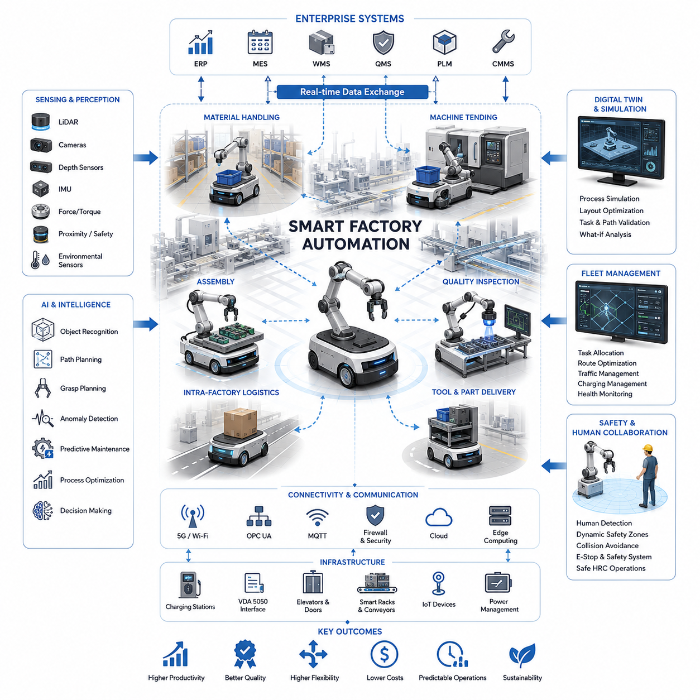
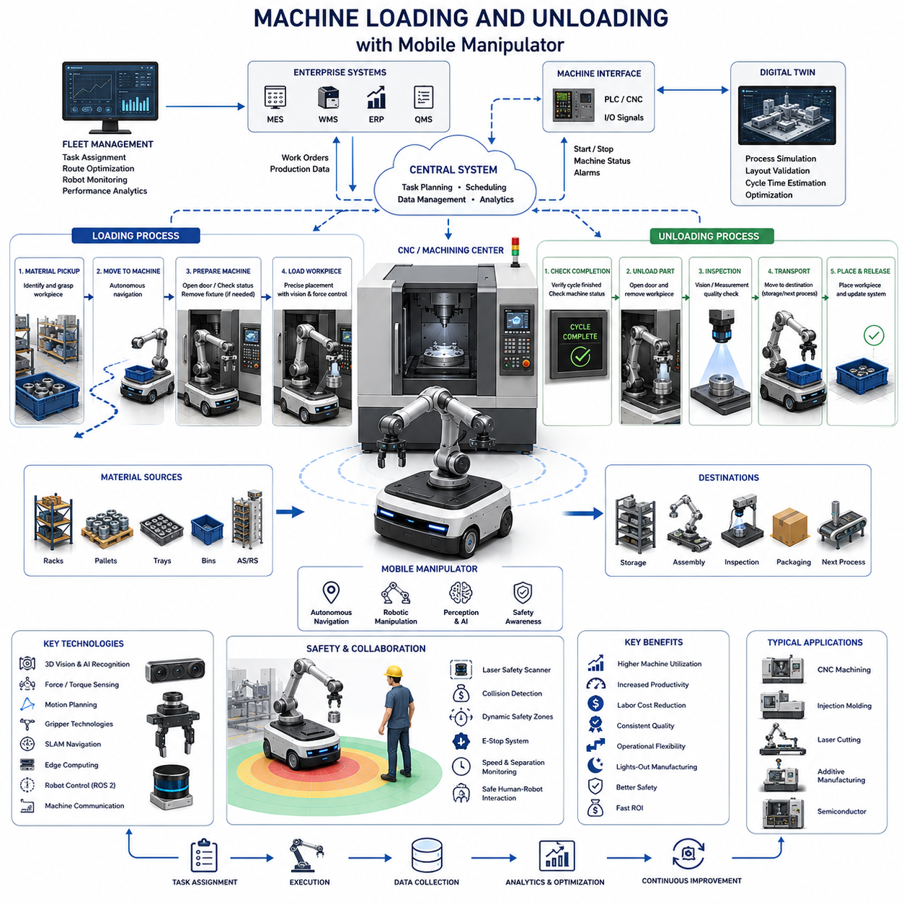
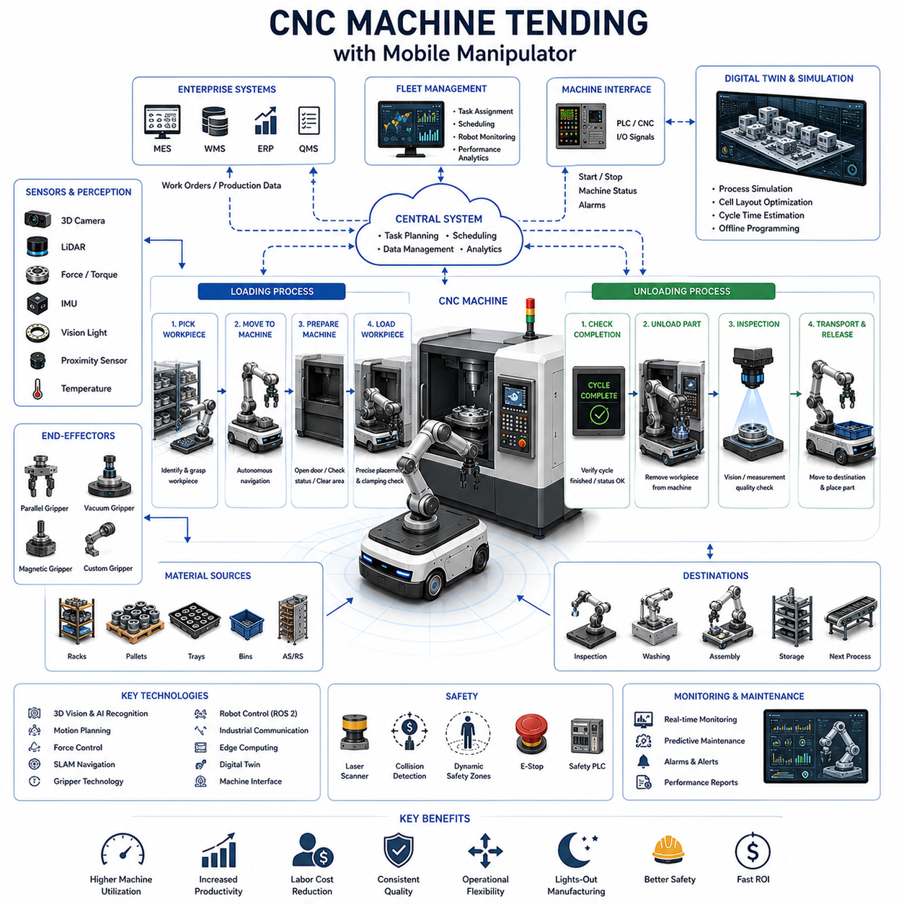
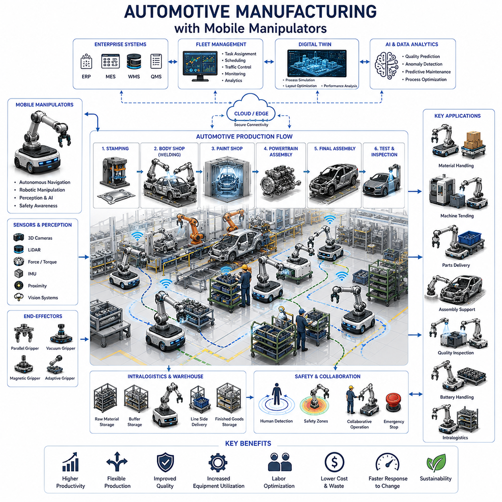
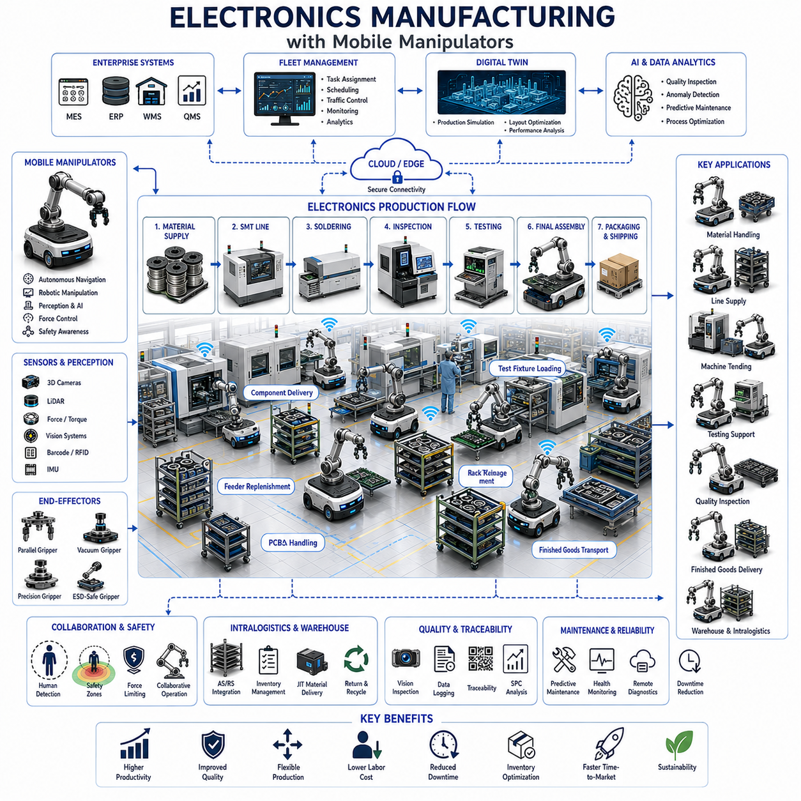
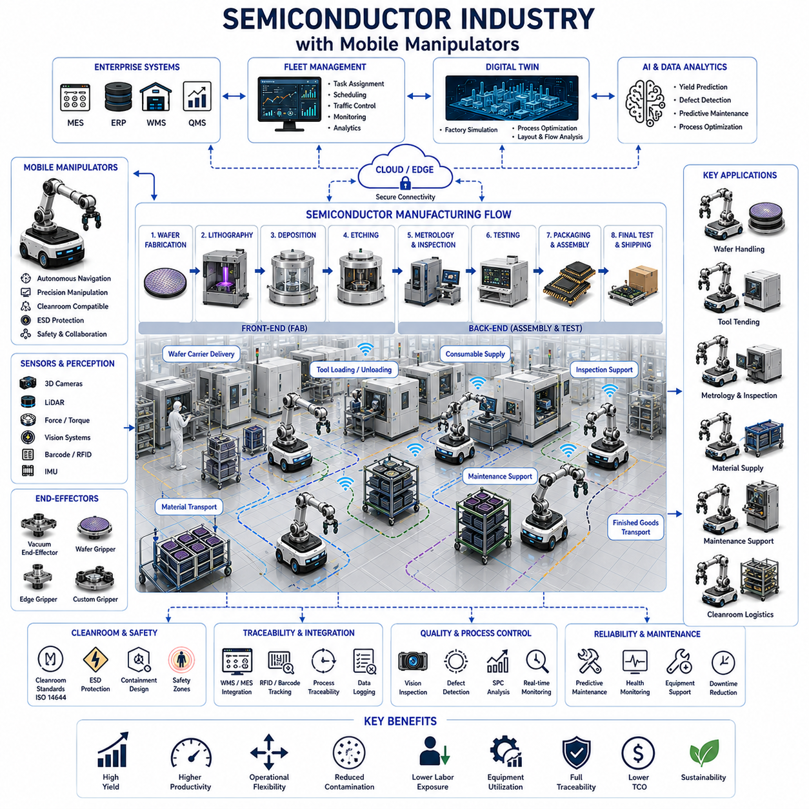
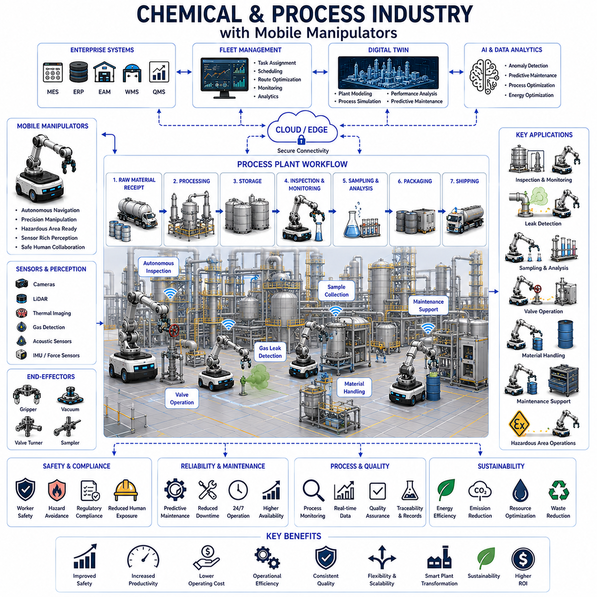
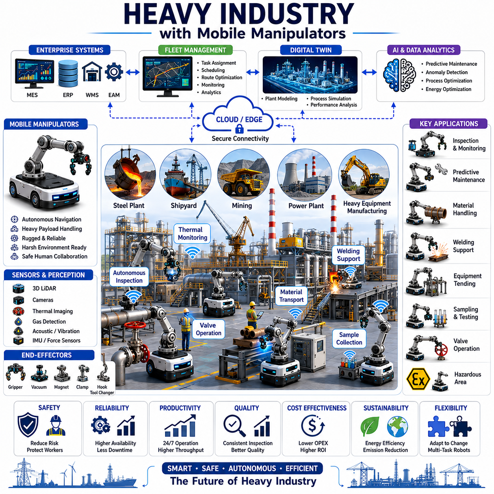
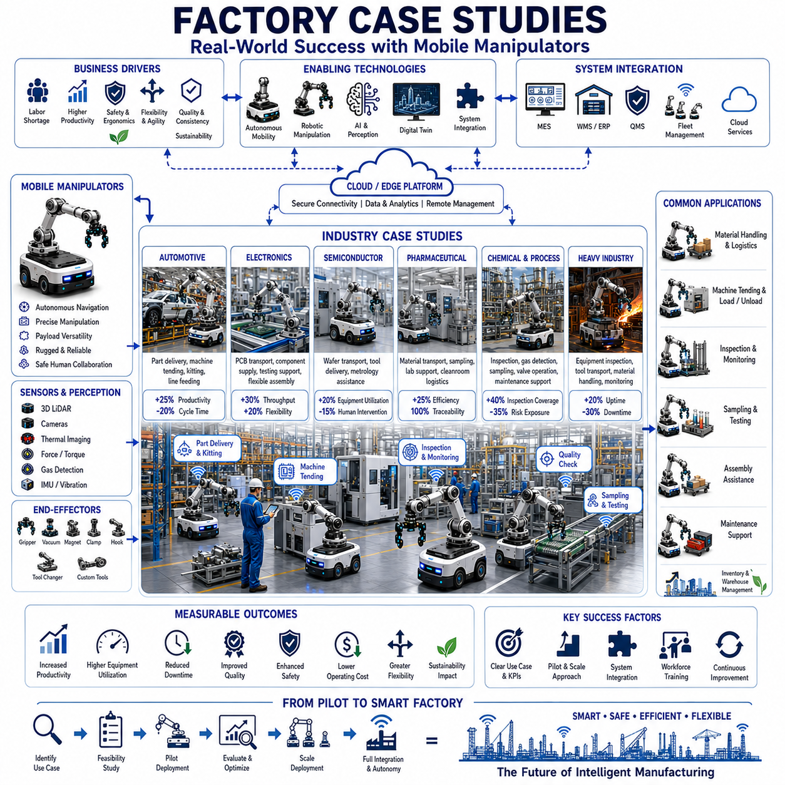

**Volume 01. Mobile Manipulator Foundations and System Architecture**

# Chapter 05. Industrial Applications

## 01 Smart Factory Automation

{width="7.268055555555556in" height="7.268055555555556in"}

Smart factory automation represents the convergence of advanced manufacturing technologies, industrial digitalization, artificial intelligence, autonomous robotics, and real-time data-driven decision-making. Within the context of mobile manipulators, smart factory automation extends beyond conventional fixed industrial automation by enabling flexible, adaptive, and intelligent production systems capable of responding dynamically to changing operational requirements. Mobile manipulators combine the mobility of Autonomous Mobile Robots (AMRs) with the dexterity of robotic manipulators, creating a new generation of automation platforms that can perform transportation, handling, assembly, inspection, machine tending, and logistics operations throughout modern manufacturing facilities. This chapter belongs to the Industrial Applications domain of mobile manipulation and serves as the foundation for understanding how mobile manipulators transform conventional factories into intelligent and highly autonomous production environments.

Traditional factories were built around fixed automation systems. Conveyor belts, industrial robot arms, dedicated workstations, and predefined material flows dominated manufacturing environments for decades. While these systems achieved high productivity in mass production settings, they often lacked flexibility when product variations, production schedules, or facility layouts changed. Modern manufacturing trends demand shorter product life cycles, higher customization levels, smaller production batches, and rapid adaptation to market changes. These requirements have created significant pressure on manufacturers to adopt more flexible automation technologies capable of supporting dynamic production operations.

Smart factory automation addresses these challenges through the integration of cyber-physical systems, Industrial Internet of Things technologies, cloud computing, edge intelligence, digital twins, machine learning, and autonomous robotic platforms. Instead of treating production equipment as isolated assets, smart factories create interconnected ecosystems where machines, robots, sensors, software platforms, and human operators continuously exchange information and coordinate activities. Mobile manipulators serve as key enabling technologies within this ecosystem because they provide both mobility and manipulation capabilities, allowing automation resources to move wherever they are needed inside the factory.

A fundamental characteristic of smart factory automation is the ability to perceive and understand operational conditions in real time. Modern mobile manipulators are equipped with extensive sensor suites that may include LiDAR systems, stereo cameras, depth cameras, RGB cameras, force-torque sensors, inertial measurement units, proximity sensors, safety scanners, and environmental monitoring devices. These sensors continuously collect data about production processes, material locations, equipment status, human activities, and workspace conditions. The collected information is processed through edge computing systems and AI algorithms that generate actionable insights for autonomous decision-making.

In a smart factory environment, mobile manipulators often operate as autonomous material handling systems. Rather than relying on fixed conveyor infrastructures, robots transport components, subassemblies, tools, and finished products between production stations according to real-time manufacturing demands. Production schedules generated by Manufacturing Execution Systems can automatically trigger transportation tasks, allowing robots to deliver the correct materials to the appropriate workstations precisely when required. This just-in-time material delivery approach reduces inventory accumulation, minimizes floor-space usage, and improves overall operational efficiency.

Machine tending is another important application area where mobile manipulators contribute significantly to factory automation. Manufacturing equipment such as CNC machines, injection molding systems, die-casting machines, laser cutting systems, and additive manufacturing platforms frequently require repetitive loading and unloading operations. Traditionally, human operators performed these tasks, creating labor-intensive processes that limited equipment utilization. Mobile manipulators can autonomously navigate between multiple machines, load raw materials, unload completed parts, perform quality checks, and transfer components to downstream processes. Because a single robot can serve multiple machines, equipment utilization rates can increase substantially while labor costs decrease.

Assembly operations within smart factories increasingly benefit from mobile manipulation technologies. Unlike fixed robotic assembly cells that operate within limited workspaces, mobile manipulators can travel throughout production facilities and perform assembly tasks wherever needed. Vision-guided manipulation systems enable robots to identify parts, estimate object poses, and execute precise assembly procedures even when component positions vary. Advanced force-control algorithms allow robots to perform insertion, fastening, alignment, and adjustment operations that previously required human dexterity. As artificial intelligence technologies continue to evolve, assembly automation capabilities are expected to expand significantly.

Quality inspection represents another critical element of smart factory automation. Mobile manipulators equipped with machine vision systems can autonomously inspect products, assemblies, and manufacturing equipment throughout production facilities. High-resolution cameras, structured-light sensors, thermal imaging devices, and AI-based defect detection algorithms enable robots to identify dimensional deviations, surface defects, assembly errors, thermal anomalies, and process abnormalities. Inspection results can be transmitted directly to manufacturing databases, creating comprehensive digital records that support traceability, quality assurance, and continuous process improvement.

The integration of artificial intelligence significantly enhances the effectiveness of smart factory automation. Traditional automation systems typically rely on predefined rules and deterministic programming. In contrast, AI-enabled mobile manipulators can learn from operational data, adapt to changing conditions, optimize task execution strategies, and improve performance over time. Machine learning algorithms can predict equipment failures, optimize routing decisions, improve grasp success rates, identify process bottlenecks, and recommend operational improvements. This transition from programmed automation to intelligent automation represents one of the defining characteristics of Industry 4.0 manufacturing environments.

Digital twin technology plays a particularly important role in smart factory automation. A digital twin is a virtual representation of physical factory assets, processes, and operations that continuously synchronizes with real-world data. Mobile manipulators operating within smart factories can contribute data to digital twin platforms while simultaneously utilizing digital twin information for planning and optimization purposes. Engineers can evaluate production scenarios, simulate robot behaviors, validate workflow changes, and optimize resource allocation within virtual environments before implementing modifications in physical facilities. This capability reduces deployment risks and accelerates continuous improvement initiatives.

Fleet management systems become essential when multiple mobile manipulators operate simultaneously within a factory. Smart factory automation often involves dozens or even hundreds of autonomous robots performing coordinated tasks across large facilities. Fleet management platforms allocate tasks, optimize routes, manage traffic flows, coordinate charging schedules, monitor robot health, and ensure efficient utilization of robotic resources. Advanced scheduling algorithms continuously balance workloads while minimizing idle time and preventing operational conflicts. The result is a highly coordinated robotic workforce capable of supporting complex manufacturing operations at scale.

Human-robot collaboration is another defining feature of smart factory automation. While automation technologies continue to advance, human workers remain essential participants in manufacturing environments. Mobile manipulators are increasingly designed to work safely alongside human operators rather than replacing them entirely. Collaborative safety technologies such as safety-rated laser scanners, vision-based human detection systems, force-limited manipulators, predictive motion planning, and dynamic safety zones enable robots to operate within shared workspaces. This collaborative approach combines human flexibility, creativity, and decision-making capabilities with robotic precision, consistency, and endurance.

Data connectivity forms the backbone of smart factory automation architectures. Mobile manipulators continuously exchange information with enterprise systems including Manufacturing Execution Systems, Enterprise Resource Planning platforms, Warehouse Management Systems, Quality Management Systems, Product Lifecycle Management tools, and Industrial Internet of Things infrastructures. Through standardized communication protocols, robots become integrated components of larger digital manufacturing ecosystems. Production orders, inventory updates, maintenance schedules, inspection results, and operational metrics flow seamlessly between physical and digital systems.

Predictive maintenance capabilities further enhance the value of smart factory automation. Mobile manipulators generate extensive operational data related to motors, actuators, batteries, sensors, controllers, and mechanical subsystems. AI-driven analytics platforms analyze these data streams to detect early indicators of component degradation or impending failures. Maintenance activities can therefore be scheduled proactively before unexpected breakdowns occur. This approach reduces downtime, lowers maintenance costs, and improves overall equipment effectiveness across manufacturing operations.

Energy optimization is becoming increasingly important as manufacturers pursue sustainability objectives. Smart factory automation systems can monitor energy consumption patterns across robotic fleets, production equipment, and facility infrastructure. Mobile manipulators can schedule charging activities during off-peak periods, optimize movement trajectories to reduce power consumption, and coordinate operations with facility energy management systems. These capabilities contribute to reduced operational costs and lower environmental impact.

Cybersecurity considerations have become increasingly critical within smart factory automation environments. As mobile manipulators become connected to enterprise networks and cloud platforms, they must be protected against cyber threats that could compromise operational safety or production continuity. Secure communication protocols, authentication mechanisms, encrypted data transmission, network segmentation, and continuous security monitoring are essential components of modern automation architectures. Cybersecurity is no longer merely an IT concern but a fundamental requirement for reliable industrial automation.

The economic impact of smart factory automation extends beyond labor cost reduction. Manufacturers implementing mobile manipulation technologies often achieve improvements in productivity, quality, flexibility, responsiveness, asset utilization, and operational visibility. Production systems become capable of supporting high-mix, low-volume manufacturing while maintaining efficiency levels traditionally associated with mass production. These capabilities provide significant competitive advantages in rapidly changing global markets.

Several industries have emerged as early adopters of smart factory automation technologies. Automotive manufacturers utilize mobile manipulators for assembly support, material handling, and logistics operations. Electronics manufacturers deploy robots for component transportation, machine tending, and quality inspection. Semiconductor facilities employ autonomous robots for wafer handling and cleanroom logistics. Pharmaceutical manufacturers leverage mobile automation for material transport, packaging operations, and laboratory support. Aerospace companies utilize intelligent robotic systems for complex assembly and inspection activities. Across all these industries, the common objective is the creation of more agile, intelligent, and efficient manufacturing operations.

The future evolution of smart factory automation will likely be driven by advances in artificial intelligence, foundation models, embodied AI, cloud robotics, and multi-robot collaboration technologies. Future mobile manipulators may possess increasingly sophisticated reasoning capabilities, allowing them to understand production objectives, interpret human instructions, adapt to novel situations, and coordinate autonomously with other robotic systems. Large-scale robotic fleets could function as distributed intelligent workforces capable of dynamically reorganizing themselves in response to changing manufacturing demands.

Embodied AI technologies are expected to further enhance mobile manipulator capabilities by enabling robots to learn from experience, generalize across tasks, and perform increasingly complex physical interactions. Instead of requiring extensive task-specific programming, future robots may acquire skills through demonstrations, simulations, reinforcement learning, and natural language instructions. This shift could dramatically reduce deployment costs while expanding the range of automatable manufacturing activities.

Ultimately, smart factory automation represents a transition from static production systems toward adaptive, intelligent, and highly interconnected manufacturing ecosystems. Mobile manipulators occupy a central role within this transformation because they bridge the gap between mobility, manipulation, perception, and intelligence. By combining autonomous navigation, robotic dexterity, artificial intelligence, cloud connectivity, and industrial integration capabilities, mobile manipulators enable factories to achieve unprecedented levels of flexibility, efficiency, resilience, and autonomy. As Industry 4.0 continues to evolve toward Industry 5.0 and beyond, smart factory automation will remain one of the most influential drivers shaping the future of global manufacturing.

## 02 Machine Loading and Unloading

{width="7.268055555555556in" height="7.268055555555556in"}

Machine loading and unloading is one of the most important and economically valuable applications of mobile manipulators in modern industrial automation. It represents the process of autonomously supplying raw materials, workpieces, semi-finished products, or components to manufacturing equipment and subsequently removing processed parts after operations have been completed. In traditional manufacturing environments, machine loading and unloading tasks are often performed manually by operators who repeatedly transport materials, open machine doors, position parts, initiate processing cycles, retrieve finished products, and transfer them to downstream operations. While these tasks may appear simple, they consume significant labor resources, create productivity bottlenecks, and expose workers to repetitive and potentially hazardous activities. Mobile manipulators provide an effective solution by combining autonomous mobility with robotic manipulation, enabling flexible and intelligent machine tending operations throughout the factory. This application area forms a foundational component of industrial mobile manipulation and serves as a critical step toward fully autonomous smart factory operations.

The increasing adoption of machine loading and unloading automation is driven by several manufacturing trends. Modern factories are expected to operate continuously while maintaining high productivity, consistent quality, and operational flexibility. Labor shortages, rising labor costs, increasing product variety, and demands for shorter lead times have encouraged manufacturers to seek automation solutions that can adapt to changing production requirements. Unlike fixed robotic cells that are dedicated to specific machines, mobile manipulators can dynamically serve multiple machines across a facility. This flexibility significantly improves equipment utilization while reducing automation costs.

Machine loading and unloading operations typically begin with material transportation. Raw materials or workpieces are stored in racks, pallets, bins, trays, or automated storage systems. A mobile manipulator receives a task assignment from a Manufacturing Execution System, Warehouse Management System, or Fleet Management Platform. The robot navigates autonomously to the material storage location, identifies the required part using vision systems, grasps the object using an appropriate end-effector, and transports it to the designated machine. Upon arrival, the robot positions itself precisely relative to the machine and prepares for the loading sequence.

The loading process itself requires accurate coordination between mobility, perception, and manipulation subsystems. The robot must recognize the machine state, verify that the machine is ready to receive a new workpiece, and determine the precise location where the part should be placed. Depending on the manufacturing process, the robot may need to open machine doors, remove fixtures, load raw materials into chucks or fixtures, align components with high precision, and confirm successful placement. These actions often require sophisticated vision systems, force control algorithms, and adaptive manipulation capabilities.

After loading is completed, the robot may initiate the machine cycle directly through digital interfaces or communicate with industrial control systems such as PLCs and Manufacturing Execution Systems. During machine operation, the mobile manipulator can either remain nearby or proceed to perform tasks at other workstations. This ability to serve multiple machines significantly increases automation efficiency and differentiates mobile manipulators from traditional fixed automation solutions.

Once processing is completed, the unloading phase begins. The robot returns to the machine, verifies that the manufacturing operation has finished successfully, opens access doors if necessary, and removes the completed workpiece. Depending on process requirements, the robot may conduct preliminary quality inspections using onboard vision systems, barcode scanners, RFID readers, or measurement devices. Finished parts can then be transported to storage locations, assembly stations, inspection cells, packaging systems, or subsequent manufacturing processes.

The complexity of machine loading and unloading varies significantly across industries and manufacturing applications. Some operations involve relatively simple pick-and-place tasks where large tolerances are acceptable. Other applications require sub-millimeter positioning accuracy, precise force control, and advanced perception capabilities. CNC machining, injection molding, laser cutting, additive manufacturing, semiconductor processing, electronics assembly, and metal fabrication all present unique operational challenges that influence system design.

CNC machine tending represents one of the most common applications of mobile manipulators. CNC machining centers often operate for extended periods with minimal supervision once a workpiece has been loaded. Traditionally, operators spend a significant portion of their time loading raw materials and unloading completed parts rather than performing value-added tasks. Mobile manipulators can automate these repetitive activities by transporting workpieces between storage locations and machining centers. Vision systems identify part orientations, while robotic arms position components accurately within machine fixtures. This automation approach increases spindle utilization, reduces idle time, and enables lights-out manufacturing operations.

Injection molding facilities also benefit substantially from machine loading and unloading automation. After plastic components are molded, they must be removed promptly to maintain production efficiency and prevent process interruptions. Mobile manipulators can retrieve molded parts, separate them from runners and sprues, perform visual inspections, and transport products to packaging or assembly areas. Because injection molding machines are often distributed across large production floors, mobile manipulators provide greater flexibility than fixed robotic systems.

Laser cutting and sheet metal fabrication environments present additional opportunities for autonomous machine tending. Metal sheets, fabricated parts, and processed components frequently require transportation between cutting systems, bending machines, welding stations, and inspection cells. Mobile manipulators can manage these material flows while adapting to changing production schedules and equipment availability. Their mobility enables seamless integration across multiple manufacturing processes without requiring extensive conveyor infrastructure.

Additive manufacturing facilities increasingly utilize machine loading and unloading automation as well. Three-dimensional printing systems often operate continuously for many hours. Mobile manipulators can remove completed build trays, transfer printed components to post-processing stations, load fresh materials, and coordinate workflow transitions. As additive manufacturing scales toward industrial production volumes, automation becomes essential for achieving economically viable operations.

Semiconductor manufacturing represents one of the most demanding environments for machine loading and unloading systems. Wafer handling operations require extremely high precision, cleanliness, and reliability. Mobile manipulators designed for semiconductor facilities often operate within controlled environments and incorporate specialized handling mechanisms that minimize contamination risks. Autonomous material transport between processing equipment contributes to improved throughput and reduced human intervention.

The success of machine loading and unloading automation depends heavily on perception technologies. Modern mobile manipulators employ multiple sensing modalities to understand their environments and interact with manufacturing equipment. RGB cameras provide visual information about machine status and object locations. Depth sensors generate three-dimensional representations of workspaces. LiDAR systems support navigation and obstacle detection. Force-torque sensors enable precise contact interactions. Combined sensor data creates comprehensive situational awareness that supports reliable autonomous operation.

Computer vision technologies play a particularly important role in machine tending applications. Object detection algorithms identify workpieces, fixtures, tools, and machine components. Pose estimation algorithms determine the precise orientation and position of target objects. Machine state recognition systems analyze indicator lights, display screens, door positions, and equipment conditions. Advanced AI models can even recognize process anomalies and identify situations requiring human intervention.

Gripper design significantly influences machine loading and unloading performance. Different manufacturing applications require different end-effector configurations. Parallel jaw grippers are commonly used for rigid industrial components. Vacuum grippers support sheet materials, electronics, and packaging operations. Adaptive grippers accommodate variable object geometries. Magnetic grippers assist with ferrous metal handling. Specialized end-effectors may incorporate sensors, compliance mechanisms, quick-change interfaces, or multi-functional capabilities. The selection of an appropriate gripper is often one of the most critical design decisions in machine tending systems.

Control architecture is another essential consideration. Effective machine loading and unloading requires coordination between navigation systems, robotic manipulators, vision algorithms, safety systems, and manufacturing equipment. Modern implementations frequently utilize ROS 2, industrial communication protocols, real-time controllers, and distributed computing architectures. Task planning systems orchestrate sequences of actions while ensuring safe and efficient execution. Integration with factory software platforms enables robots to receive work orders, update production records, and synchronize activities with broader manufacturing operations.

Artificial intelligence increasingly enhances machine loading and unloading capabilities. Traditional robotic systems often require extensive programming for each application. AI-driven systems can learn manipulation strategies from demonstrations, adapt to environmental changes, and improve performance through experience. Machine learning algorithms optimize grasp selection, trajectory planning, collision avoidance, and task scheduling. Foundation models and vision-language-action systems are expected to further expand robotic flexibility by enabling natural language instruction and generalized task execution.

Safety remains a fundamental requirement for machine loading and unloading automation. Mobile manipulators frequently operate near human workers, production equipment, and valuable products. Comprehensive safety architectures include laser safety scanners, emergency stop systems, collision detection mechanisms, speed and separation monitoring, safety-rated controllers, and dynamic safety zones. Risk assessments must consider navigation hazards, manipulation risks, equipment interactions, and human-robot collaboration scenarios. Compliance with industrial safety standards is essential for successful deployment.

Digital twin technology provides valuable support for machine tending projects. Engineers can create virtual models of manufacturing environments, robots, machines, and workflows to evaluate automation strategies before deployment. Simulations help identify bottlenecks, optimize robot paths, validate reachability, assess cycle times, and estimate productivity improvements. Digital twins reduce implementation risks while accelerating project development and commissioning activities.

Performance evaluation of machine loading and unloading systems typically focuses on productivity, reliability, flexibility, and return on investment. Important metrics include machine utilization rates, cycle times, loading accuracy, grasp success rates, robot uptime, task completion rates, production throughput, and labor savings. Manufacturers often observe significant improvements in overall equipment effectiveness after implementing autonomous machine tending solutions. Continuous operation capabilities enable equipment to remain productive beyond traditional working hours, further increasing economic benefits.

The economic justification for machine loading and unloading automation extends beyond direct labor reduction. Increased machine utilization, reduced downtime, improved consistency, enhanced traceability, higher quality levels, and greater operational flexibility contribute significantly to business value. Manufacturers can respond more rapidly to changing customer demands while maintaining competitive production costs. In high-mix manufacturing environments, mobile manipulators provide automation flexibility that would be difficult or impossible to achieve using fixed robotic infrastructure.

Future developments in machine loading and unloading will likely be driven by advances in artificial intelligence, embodied AI, cloud robotics, and autonomous decision-making technologies. Future mobile manipulators may understand production objectives at a higher semantic level, autonomously determine optimal workflows, learn new machine interfaces without explicit programming, and collaborate seamlessly with other robots and human workers. Vision-language-action models may allow robots to interpret natural language instructions and execute complex machine tending tasks with minimal configuration.

As smart factories continue to evolve, machine loading and unloading will become increasingly integrated into broader autonomous manufacturing ecosystems. Mobile manipulators will function not merely as machine attendants but as intelligent production agents capable of coordinating material flows, optimizing resource utilization, and supporting real-time production adaptation. Their ability to combine mobility, perception, manipulation, and intelligence positions them as one of the most transformative technologies in modern industrial automation. Machine loading and unloading therefore represents far more than a simple automation task; it serves as a cornerstone of the future autonomous factory where intelligent robotic systems continuously support efficient, flexible, and highly productive manufacturing operations.

## 03 CNC Machine Tending

{width="7.268055555555556in" height="7.268055555555556in"}

CNC Machine Tending is one of the most mature and commercially successful applications of industrial robotics and mobile manipulation in modern manufacturing. It refers to the automated process of loading raw workpieces into Computer Numerical Control (CNC) machines, initiating machining operations, monitoring production status, unloading finished components, and transferring them to subsequent manufacturing processes. As manufacturing industries continue to pursue higher productivity, lower operational costs, improved quality consistency, and increased production flexibility, CNC machine tending has emerged as a critical automation technology that enables factories to maximize machine utilization while minimizing human intervention. Within the context of mobile manipulators, CNC machine tending extends beyond traditional fixed robotic automation by introducing mobility, adaptability, and intelligent coordination across multiple machining centers. This capability represents a major step toward the realization of autonomous smart factories and lights-out manufacturing environments.

Computer Numerical Control machines are among the most important assets in modern manufacturing facilities. CNC milling machines, CNC lathes, machining centers, grinding systems, drilling machines, and multi-axis machining platforms perform precision material removal operations that transform raw materials into high-value products. These machines often represent substantial capital investments, and their profitability depends largely on maintaining high utilization rates. However, many CNC machines spend a significant portion of their available operating time idle while waiting for operators to load new workpieces, unload completed parts, or perform supporting logistics activities. CNC machine tending automation addresses this challenge by ensuring that machines remain productive for the maximum possible duration.

Traditional CNC operations rely heavily on human operators who manually transport materials, position workpieces, secure fixtures, initiate machining cycles, inspect completed components, and transfer products between manufacturing stages. While skilled machinists provide valuable expertise and flexibility, repetitive loading and unloading activities consume time that could otherwise be dedicated to process optimization, quality improvement, or advanced manufacturing tasks. Furthermore, labor shortages and increasing labor costs have encouraged manufacturers worldwide to adopt automated machine tending solutions.

The primary objective of CNC machine tending is to eliminate non-value-added activities associated with manual material handling while maximizing spindle utilization. In machining operations, spindle utilization is one of the most important performance indicators because it directly reflects productive machining time. Every minute spent waiting for a new workpiece reduces overall production efficiency. By automating material transfer processes, robotic systems enable CNC machines to operate continuously with minimal interruptions.

In conventional robotic machine tending systems, industrial robot arms are installed adjacent to individual CNC machines. These robots repeatedly load and unload workpieces according to predefined programs. While effective in high-volume production environments, fixed robotic systems often lack flexibility when production requirements change. Mobile manipulators overcome this limitation by combining autonomous navigation with robotic manipulation. Instead of serving a single machine, a mobile manipulator can travel throughout a manufacturing facility and support multiple machining centers based on real-time production demands.

A typical CNC machine tending workflow begins with workpiece acquisition. Raw materials may be stored in racks, trays, pallets, automated storage systems, or work-in-process inventory areas. A Manufacturing Execution System or Fleet Management Platform generates a task request and assigns it to an available mobile manipulator. The robot autonomously navigates to the designated storage location, identifies the required workpiece using computer vision technologies, grasps the component using an appropriate end-effector, and transports it to the target CNC machine.

Upon arrival at the machining center, the robot must establish accurate positional alignment with the machine. Modern CNC machine tending systems frequently utilize visual markers, three-dimensional vision systems, LiDAR localization, or precision docking mechanisms to ensure repeatable positioning accuracy. Because machining operations often require tolerances measured in micrometers, even small positioning errors can affect loading quality and process reliability.

Before loading a new workpiece, the robot verifies the machine status. Communication interfaces with CNC controllers, Programmable Logic Controllers (PLCs), or Manufacturing Execution Systems provide information regarding machine readiness, machining completion status, alarm conditions, tool availability, and operational health. The robot confirms that the machine is ready to receive a new part before initiating the loading sequence.

The loading operation itself requires sophisticated manipulation capabilities. The robot may need to open machine doors, remove completed parts, clear chips or debris, access fixtures, position raw materials accurately, and secure workpieces within machine chucks or clamping systems. Depending on the application, positioning accuracy may require sub-millimeter precision. Advanced machine tending systems utilize force-torque sensing, compliance control, visual servoing, and adaptive motion planning to achieve reliable placement performance.

After the workpiece has been loaded successfully, the robot may verify fixture engagement, confirm workpiece orientation, and communicate with the CNC controller to initiate the machining cycle. Once machining begins, the mobile manipulator is free to perform additional tasks elsewhere in the facility. This ability to service multiple machines represents a major advantage over fixed robotic installations. A single mobile manipulator can support several machining centers, thereby improving overall automation efficiency and reducing equipment costs.

During machining operations, the robot may continue monitoring machine status remotely through wireless communication systems. Real-time connectivity allows the robot fleet management platform to anticipate cycle completion times and optimize task scheduling. Predictive scheduling algorithms can coordinate multiple robots and machines simultaneously, minimizing idle periods throughout the production environment.

When machining is completed, the robot returns to the CNC machine to perform unloading operations. The robot verifies cycle completion, opens machine access points if necessary, removes the finished component, and performs preliminary inspections. Machine vision systems can verify dimensional features, detect visible defects, confirm part identification, and validate process completion. Quality data collected during these inspections can be integrated into enterprise quality management systems for traceability and process improvement.

Following unloading, the completed workpiece may be transferred to various downstream destinations. These destinations include inspection stations, washing systems, assembly lines, packaging areas, storage facilities, or additional machining operations. In multi-stage manufacturing environments, mobile manipulators can coordinate material movement between multiple CNC machines, creating fully automated machining workflows.

CNC machine tending requirements vary significantly depending on industry applications. Automotive manufacturing frequently involves high-volume machining of engine blocks, transmission housings, suspension components, and structural parts. Aerospace manufacturing requires handling of complex, high-value components with extremely stringent quality requirements. Medical device manufacturing demands precise handling of small and delicate components under highly regulated conditions. Electronics manufacturing often involves miniature parts requiring exceptional positioning accuracy. Each application presents unique challenges that influence robot selection, gripper design, sensing technologies, and control architectures.

Perception systems play a critical role in CNC machine tending performance. Modern mobile manipulators rely on integrated sensor suites that provide situational awareness and operational intelligence. RGB cameras enable visual inspection and object recognition. Depth sensors generate three-dimensional workspace models. LiDAR systems support navigation and obstacle detection. Force-torque sensors facilitate precision insertion and contact-based operations. Together, these sensors allow robots to operate reliably in dynamic manufacturing environments.

Computer vision technology has become particularly important in machine tending applications. Traditional automation systems often require precisely controlled part presentation. Modern AI-based vision systems can recognize workpieces despite variations in orientation, lighting conditions, or environmental factors. Object detection algorithms identify target components, while pose estimation systems calculate precise position and orientation information. Advanced vision systems can also identify fixture conditions, machine states, tool wear indicators, and process anomalies.

End-effector selection represents another critical aspect of CNC machine tending system design. Different machining applications require specialized gripping technologies. Parallel grippers are commonly used for rigid components with consistent geometries. Adaptive grippers accommodate variations in part dimensions. Vacuum grippers handle flat surfaces and lightweight components. Magnetic grippers support ferrous metal workpieces. Some applications require custom-designed end-effectors capable of handling complex geometries, delicate surfaces, or multiple part types simultaneously.

Industrial communication systems enable seamless integration between robots and CNC equipment. Standard protocols such as OPC UA, EtherNet/IP, Modbus TCP, Profinet, and MTConnect facilitate data exchange between robotic systems and manufacturing equipment. These interfaces allow robots to monitor machine status, initiate machining cycles, receive alarm notifications, access production schedules, and synchronize operations with enterprise software platforms.

Artificial intelligence is increasingly transforming CNC machine tending capabilities. Traditional systems depend heavily on predefined programming and structured environments. AI-enhanced systems can adapt to changing conditions, optimize task execution, improve grasping strategies, and learn from operational experience. Machine learning algorithms analyze production data to identify performance improvements, predict equipment failures, optimize scheduling decisions, and enhance overall manufacturing efficiency.

Digital twin technology further enhances CNC machine tending development and operation. Virtual representations of robots, CNC machines, production layouts, and workflows enable engineers to simulate manufacturing processes before physical deployment. Digital twins support cycle time analysis, reachability studies, collision detection, workflow optimization, and productivity forecasting. This capability reduces implementation risks while accelerating deployment timelines.

Predictive maintenance has become an important component of modern CNC machine tending systems. Both robots and CNC machines generate extensive operational data regarding motor performance, vibration levels, temperature profiles, cycle counts, and component health. AI-driven analytics platforms utilize these data streams to identify potential failures before they occur. Predictive maintenance strategies reduce downtime, improve reliability, and lower maintenance costs across manufacturing operations.

Safety considerations remain fundamental to CNC machine tending deployments. Mobile manipulators operate in environments that often contain heavy machinery, moving equipment, sharp tools, and human workers. Comprehensive safety architectures include safety-rated laser scanners, emergency stop systems, collision detection technologies, speed and separation monitoring, safety PLCs, and dynamic safety zones. Risk assessments must address both navigation-related hazards and manipulation-related risks.

One of the most significant advantages of CNC machine tending automation is its contribution to lights-out manufacturing. Lights-out manufacturing refers to production environments capable of operating without human presence for extended periods, including overnight shifts and weekends. Mobile manipulators enable continuous operation by automatically managing material flows, machine loading, unloading, and process coordination. This capability significantly increases equipment utilization and production output while reducing labor dependency.

The economic impact of CNC machine tending automation extends beyond direct labor savings. Increased machine utilization, reduced production bottlenecks, improved quality consistency, lower scrap rates, enhanced traceability, and greater operational flexibility contribute substantial value. Manufacturers frequently observe significant improvements in Overall Equipment Effectiveness (OEE) after implementing automated machine tending solutions.

Future developments in CNC machine tending will likely be driven by advancements in artificial intelligence, embodied AI, cloud robotics, and foundation models. Future mobile manipulators may understand machining processes at a semantic level, autonomously optimize production workflows, adapt to unfamiliar machines, and collaborate with human operators through natural language interactions. Vision-Language-Action models could allow robots to interpret manufacturing instructions, learn new tasks rapidly, and perform increasingly sophisticated machine tending operations without extensive reprogramming.

As manufacturing continues its transition toward Industry 4.0 and Industry 5.0 paradigms, CNC machine tending will become increasingly integrated into intelligent factory ecosystems. Mobile manipulators will evolve from simple material handlers into autonomous production agents capable of coordinating machining resources, optimizing production schedules, supporting predictive maintenance, and enabling adaptive manufacturing strategies. Their combination of mobility, perception, manipulation, and intelligence makes them a cornerstone technology for the future of smart manufacturing.

Ultimately, CNC machine tending represents far more than automated loading and unloading. It serves as a critical bridge between traditional machining operations and the autonomous factories of the future. By maximizing machine utilization, reducing manual intervention, improving operational flexibility, and enabling continuous production, CNC machine tending demonstrates how mobile manipulation technologies can transform manufacturing productivity and competitiveness in the era of intelligent industrial automation.

## 04 Automotive Manufacturing

{width="7.268055555555556in" height="7.268055555555556in"}

Automotive manufacturing is one of the most advanced and highly automated sectors in modern industry, serving as a benchmark for industrial automation, robotics integration, digital manufacturing, and smart factory implementation. The automotive industry has historically been among the earliest adopters of robotic systems, beginning with fixed industrial robots performing welding and material handling tasks and evolving toward highly connected, data-driven manufacturing ecosystems. Today, the emergence of mobile manipulators is creating a new generation of manufacturing flexibility by combining autonomous mobility with robotic manipulation, enabling factories to respond dynamically to changing production demands. Within the context of mobile manipulation, automotive manufacturing represents one of the most comprehensive application domains because it involves virtually every major robotic function, including material handling, assembly, machine tending, logistics automation, quality inspection, collaborative operations, and intelligent production coordination.

Modern automotive manufacturing facilities are among the most complex production environments in the world. A single vehicle consists of thousands of individual components sourced from extensive global supply chains and assembled through hundreds of coordinated manufacturing processes. These processes include stamping, welding, machining, painting, powertrain assembly, battery production, final assembly, quality inspection, testing, packaging, and logistics operations. The complexity of these workflows creates significant challenges related to production efficiency, quality consistency, inventory management, workforce utilization, and operational flexibility. Mobile manipulators have emerged as a powerful solution capable of addressing many of these challenges while supporting the broader objectives of Industry 4.0 and future Industry 5.0 manufacturing paradigms.

The automotive industry has traditionally relied on fixed automation systems designed for high-volume mass production. Industrial robot arms perform welding, painting, sealing, assembly, and material transfer tasks with remarkable precision and repeatability. Conveyor systems move vehicle bodies and components through production lines according to carefully optimized schedules. While these systems achieve exceptional throughput, they often lack flexibility when production requirements change. The increasing demand for vehicle customization, shorter product life cycles, electrification, and regionalized manufacturing strategies has created a need for more adaptive automation technologies. Mobile manipulators address this need by introducing mobility and reconfigurability into factory operations.

One of the most important applications of mobile manipulators in automotive manufacturing is material handling automation. Automotive factories continuously consume vast quantities of parts, subassemblies, fasteners, tools, and consumables. Traditionally, logistics personnel transport these materials between warehouses, supermarkets, assembly stations, and production cells. Mobile manipulators can autonomously perform these transportation tasks while simultaneously handling loading and unloading operations. Unlike conventional Autonomous Mobile Robots that primarily transport carts or containers, mobile manipulators can directly interact with materials, retrieve components from storage locations, place items at workstations, and support complex logistics workflows without requiring significant human intervention.

Automotive body shops provide another major application area for mobile manipulation technologies. Body-in-white production involves the assembly of vehicle body structures through extensive welding and joining operations. Although welding itself is typically performed by fixed robotic systems, mobile manipulators can support surrounding logistics activities. They can deliver panels, fixtures, tooling components, and consumable materials to production cells while also transporting completed assemblies between workstations. Their ability to navigate dynamically within manufacturing environments enables greater operational flexibility compared to traditional conveyor-based systems.

Powertrain manufacturing facilities also benefit from mobile manipulator deployment. Engines, transmissions, electric drive units, battery packs, and associated components require precise handling throughout machining and assembly operations. Mobile manipulators can perform machine tending activities by loading raw materials into machining centers, unloading completed components, transferring parts between processes, and supplying assembly stations with required materials. Their combination of mobility and manipulation capabilities reduces the need for dedicated transportation infrastructure while improving equipment utilization.

The transition toward electric vehicle production is creating new opportunities for advanced automation. Battery manufacturing introduces highly specialized processes involving cell production, module assembly, pack assembly, testing, and quality verification. Many battery components are sensitive, high-value, and potentially hazardous if mishandled. Mobile manipulators equipped with advanced sensing systems, force control capabilities, and precision handling mechanisms can transport battery modules safely while maintaining strict quality and safety requirements. Their ability to operate within flexible production layouts is particularly valuable as battery manufacturing technologies continue to evolve rapidly.

Final vehicle assembly represents one of the most labor-intensive stages of automotive production. Workers traditionally perform numerous assembly operations involving component installation, fastening, inspection, and material handling. Mobile manipulators can support these activities by delivering parts directly to assembly stations, assisting with ergonomic handling of heavy components, performing repetitive installation tasks, and conducting automated inspections. Rather than replacing human workers entirely, mobile manipulators often function as collaborative partners that improve productivity while reducing physical strain and repetitive workloads.

Quality assurance is a critical requirement in automotive manufacturing because product defects can have significant safety, financial, and reputational consequences. Mobile manipulators equipped with advanced vision systems, laser scanners, thermal imaging devices, and artificial intelligence algorithms can perform automated inspection tasks throughout production facilities. These robots can verify component placement, measure dimensional accuracy, identify surface defects, inspect weld quality, detect assembly errors, and validate manufacturing processes. Automated inspection improves consistency while enabling continuous monitoring of production quality.

Automotive painting operations provide another example of advanced automation integration. While painting itself is usually performed by specialized fixed robotic systems, mobile manipulators can support paint shop logistics by transporting vehicle components, replenishing consumables, managing equipment supplies, and performing inspection tasks. In future manufacturing environments, mobile robotic systems may assume increasingly sophisticated roles within paint shop operations as artificial intelligence and robotic dexterity continue to improve.

Warehouse and intralogistics automation play essential roles in automotive manufacturing due to the enormous volume of components required for vehicle production. Modern automotive plants often maintain extensive internal logistics networks connecting receiving areas, storage facilities, production lines, quality control stations, and shipping operations. Mobile manipulators can function as intelligent logistics agents capable of navigating these networks autonomously. They can retrieve components from storage systems, transport materials to production stations, and return reusable containers or empty packaging to designated locations. This capability supports just-in-time and just-in-sequence manufacturing strategies that minimize inventory while maximizing production efficiency.

Collaborative manufacturing is becoming increasingly important within automotive factories. Human workers continue to provide valuable flexibility, problem-solving capabilities, and process expertise that complement robotic automation. Mobile manipulators designed for collaborative operation incorporate advanced safety technologies that allow them to work safely alongside people. Safety-rated laser scanners, vision-based human detection systems, force-limited robotic arms, dynamic safety zones, and predictive motion planning algorithms enable robots and humans to share workspaces effectively. This collaborative approach enhances productivity while preserving the benefits of human involvement in complex manufacturing processes.

Perception systems are fundamental to successful mobile manipulator deployment in automotive manufacturing environments. Production facilities contain diverse objects, dynamic workflows, varying lighting conditions, and constantly changing operational scenarios. Robots must accurately recognize parts, understand machine states, identify storage locations, detect obstacles, and interact safely with personnel. Modern perception architectures typically combine RGB cameras, depth sensors, LiDAR systems, force sensors, inertial measurement units, and AI-based perception algorithms. These technologies enable robots to maintain situational awareness and perform reliable autonomous operations.

Artificial intelligence is rapidly transforming automotive manufacturing automation. Traditional industrial robots rely heavily on structured environments and predefined programming. In contrast, AI-enabled mobile manipulators can adapt to changing conditions, learn from operational data, optimize workflows, and improve performance over time. Machine learning algorithms support object recognition, path planning, task scheduling, predictive maintenance, anomaly detection, and quality inspection. Foundation models and embodied AI technologies are expected to further enhance robotic capabilities by enabling more generalized and flexible behaviors.

Digital twin technology plays a particularly important role in automotive manufacturing due to the complexity of production systems. Digital twins create virtual representations of factories, production lines, robots, machines, and logistics operations that continuously synchronize with real-world data. Mobile manipulators contribute operational data to these digital environments while simultaneously utilizing digital twin information for navigation, task planning, and optimization. Engineers can evaluate production scenarios, test workflow changes, validate robot behaviors, and optimize resource allocation before implementing modifications in physical facilities.

Fleet management systems become essential when multiple mobile manipulators operate within large automotive factories. Vehicle manufacturing plants may deploy dozens or hundreds of autonomous robots simultaneously across production and logistics operations. Fleet management platforms coordinate task allocation, route optimization, traffic control, charging schedules, maintenance planning, and performance monitoring. Advanced algorithms continuously balance workloads and optimize resource utilization to maximize operational efficiency.

Predictive maintenance is another important application enabled by connected robotic systems. Mobile manipulators and manufacturing equipment generate extensive operational data related to motor performance, vibration patterns, temperature conditions, cycle counts, and component health. Artificial intelligence systems analyze these data streams to identify early indicators of equipment degradation or impending failures. Maintenance activities can therefore be scheduled proactively, reducing downtime and improving overall equipment effectiveness.

Automotive manufacturing increasingly emphasizes sustainability and environmental responsibility. Mobile manipulators contribute to these objectives by optimizing material flows, reducing waste, improving energy efficiency, and supporting more flexible production systems. Autonomous robots can minimize unnecessary transportation movements, optimize charging schedules, and contribute data that supports broader sustainability initiatives. As manufacturers pursue carbon reduction goals and circular economy strategies, intelligent automation systems will play an increasingly important role.

Cybersecurity has become a critical consideration within connected automotive manufacturing environments. Mobile manipulators communicate with Manufacturing Execution Systems, Enterprise Resource Planning platforms, cloud services, digital twins, and fleet management systems. Secure communication protocols, authentication mechanisms, encrypted data transmission, network segmentation, and continuous monitoring are essential for protecting production operations from cyber threats. As factories become increasingly connected, cybersecurity must be treated as a core element of manufacturing system design.

The economic benefits of mobile manipulators in automotive manufacturing extend beyond labor reduction. Increased productivity, improved flexibility, enhanced quality, reduced downtime, greater equipment utilization, optimized inventory management, and faster response to production changes all contribute substantial value. Manufacturers can adapt more rapidly to market demands while maintaining competitive cost structures and high quality standards.

The emergence of software-defined vehicles and increasingly digitalized manufacturing environments will further accelerate the adoption of intelligent automation technologies. Future automotive factories are expected to operate as highly interconnected ecosystems where robots, machines, enterprise systems, digital twins, and human workers collaborate seamlessly. Mobile manipulators will function as autonomous production agents capable of understanding production goals, coordinating resources, adapting to changing requirements, and supporting continuous optimization.

Advances in embodied AI, Vision-Language-Action models, cloud robotics, and large-scale foundation models will significantly expand the capabilities of mobile manipulators in automotive manufacturing. Future systems may interpret natural language instructions, learn new assembly procedures through observation, understand production objectives at a semantic level, and autonomously coordinate with other robotic systems. These developments will reduce deployment complexity while increasing automation flexibility.

Ultimately, automotive manufacturing serves as one of the most important proving grounds for advanced mobile manipulation technologies. The industry\'s combination of high production volumes, demanding quality requirements, complex logistics operations, and continuous innovation creates an ideal environment for the development and deployment of intelligent robotic systems. Mobile manipulators bridge the gap between traditional fixed automation and future autonomous manufacturing ecosystems by combining mobility, perception, manipulation, artificial intelligence, and industrial integration capabilities. As automotive factories continue their transformation toward fully connected and intelligent production environments, mobile manipulators will play an increasingly central role in enabling the next generation of manufacturing excellence.

## 05 Electronics Manufacturing

{width="7.268055555555556in" height="7.268055555555556in"}

Electronics manufacturing is one of the most sophisticated and rapidly evolving sectors in modern industry, characterized by high production volumes, extreme precision requirements, short product life cycles, and continuous technological innovation. From consumer electronics and industrial control systems to telecommunications equipment, medical devices, automotive electronics, and semiconductor-based products, electronic manufacturing serves as the foundation of the digital economy. As product complexity increases and market expectations continue to rise, manufacturers are increasingly adopting advanced automation technologies to improve productivity, quality, flexibility, and operational efficiency. Within this environment, mobile manipulators have emerged as a powerful automation platform capable of combining autonomous mobility, intelligent perception, and robotic manipulation to support a wide range of manufacturing and logistics operations. Electronics manufacturing therefore represents one of the most promising application domains for mobile manipulation technologies.

The electronics industry differs significantly from many traditional manufacturing sectors. Products often contain hundreds or thousands of miniature components assembled with extremely tight tolerances. Printed Circuit Boards (PCBs), integrated circuits, sensors, connectors, displays, batteries, and precision mechanical components must be assembled accurately and consistently to ensure product functionality and reliability. At the same time, manufacturers must respond rapidly to changing customer demands, frequent product updates, and increasing customization requirements. These challenges have driven the industry toward highly automated production environments where robotics, artificial intelligence, digital twins, and advanced manufacturing systems play central roles.

Traditional electronics manufacturing facilities rely heavily on specialized automation equipment. Surface Mount Technology (SMT) lines, automated optical inspection systems, soldering equipment, dispensing machines, testing stations, and packaging systems operate together to create highly efficient production processes. While these systems provide exceptional throughput, they are often designed for specific production tasks and may lack flexibility when product configurations change. Mobile manipulators introduce a new layer of adaptive automation by enabling robots to move between workstations, transport materials, support assembly operations, and coordinate manufacturing activities dynamically.

Material handling represents one of the most significant opportunities for mobile manipulator deployment within electronics factories. Modern production facilities continuously consume electronic components, PCB assemblies, packaging materials, test fixtures, and manufacturing supplies. Traditionally, operators transport these materials between warehouses, SMT lines, assembly stations, inspection areas, and shipping facilities. Mobile manipulators can automate these logistics operations by autonomously retrieving materials, transporting them to production areas, and performing loading and unloading tasks. Unlike conventional AMRs that primarily transport carts or shelves, mobile manipulators can directly interact with individual items, enabling greater operational flexibility and higher levels of automation.

Printed Circuit Board manufacturing provides a clear example of how mobile manipulators can enhance production efficiency. PCB fabrication and assembly involve multiple sequential processes, including board production, component placement, soldering, inspection, testing, and final assembly. Mobile manipulators can transport boards between these stages while also performing handling operations such as tray loading, rack management, fixture placement, and test sample preparation. Their ability to adapt to changing production requirements allows manufacturers to optimize workflows without extensive modifications to existing infrastructure.

Surface Mount Technology production lines are among the most important areas within electronics manufacturing. SMT equipment places thousands of miniature components onto printed circuit boards with extraordinary speed and accuracy. Although component placement itself is typically performed by highly specialized machines, mobile manipulators can support surrounding logistics activities. They can deliver reels of electronic components, replenish feeders, transport completed boards, remove empty material carriers, and coordinate material flows throughout the factory. These activities reduce operator workload while improving overall production efficiency.

Electronic assembly operations often require handling delicate and highly sensitive components. Mobile manipulators designed for electronics manufacturing must therefore incorporate precise motion control, force-sensitive manipulation, and electrostatic discharge protection measures. Components such as microprocessors, memory modules, sensors, displays, and connectors can be damaged by excessive force or electrostatic discharge. Advanced robotic systems utilize specialized grippers, force-feedback mechanisms, and ESD-safe materials to ensure reliable handling of sensitive products.

The increasing complexity of consumer electronics creates additional opportunities for mobile manipulation technologies. Smartphones, tablets, wearable devices, smart appliances, and IoT products require numerous assembly and testing operations before shipment. Mobile manipulators can support assembly lines by delivering components, presenting workpieces, loading test fixtures, transporting partially assembled products, and assisting with final packaging operations. Their mobility allows manufacturing resources to be allocated dynamically based on production demands.

Quality control is a particularly important aspect of electronics manufacturing because even minor defects can result in product failures, warranty claims, customer dissatisfaction, and significant financial losses. Mobile manipulators equipped with advanced vision systems can perform automated inspection tasks throughout the production process. High-resolution cameras, structured-light sensors, three-dimensional scanners, thermal imaging devices, and artificial intelligence algorithms enable robots to identify missing components, solder defects, alignment errors, surface damage, connector issues, and assembly inconsistencies. Automated inspection improves consistency while providing valuable production data for continuous improvement initiatives.

Testing operations represent another critical stage in electronics manufacturing. Functional testing, electrical verification, environmental testing, calibration, and quality validation ensure that products meet design specifications before shipment. Mobile manipulators can automate test preparation activities by loading products into test fixtures, connecting measurement equipment, initiating test procedures, and transferring completed units to subsequent operations. These capabilities reduce manual labor requirements while improving throughput and consistency.

Warehouse automation plays a major role in modern electronics production due to the enormous number of components and materials required for manufacturing operations. Electronic components are often stored in highly organized inventory systems that support just-in-time manufacturing strategies. Mobile manipulators can retrieve materials from automated storage systems, transport them to production lines, return unused inventory, and manage inventory replenishment workflows. This integration between manufacturing and logistics functions improves inventory accuracy while reducing operational costs.

Electronics manufacturing frequently involves high-mix, low-volume production scenarios where product variants change rapidly. Traditional fixed automation systems may require extensive reconfiguration when production requirements change. Mobile manipulators provide greater flexibility because they can adapt to different workflows, transport diverse materials, and support multiple production processes without significant physical modifications. This flexibility is particularly valuable for manufacturers producing customized products or serving rapidly changing markets.

Human-robot collaboration is becoming increasingly important within electronics factories. Many assembly operations require a combination of robotic precision and human problem-solving capabilities. Mobile manipulators can function as collaborative assistants that support operators by delivering materials, presenting components, transporting products, and performing repetitive tasks. Advanced safety technologies enable robots to operate safely alongside human workers while maintaining high productivity levels. This collaborative approach combines the strengths of both human and robotic systems.

Perception technologies are fundamental to successful mobile manipulator deployment in electronics manufacturing environments. Production facilities contain numerous small components, densely packed workstations, dynamic workflows, and continuously changing operational conditions. Robots must accurately recognize materials, identify products, locate storage positions, monitor equipment status, and navigate safely through complex environments. Modern perception systems typically combine RGB cameras, depth sensors, LiDAR systems, force sensors, barcode readers, RFID technologies, and artificial intelligence algorithms to create comprehensive situational awareness.

Computer vision plays an especially important role because electronics manufacturing involves many small and visually similar components. Deep learning algorithms support object recognition, component identification, defect detection, pose estimation, and process monitoring. Vision systems can identify component orientation, verify assembly quality, monitor machine conditions, and detect process anomalies in real time. These capabilities enable more reliable automation while reducing dependency on precisely structured environments.

Artificial intelligence is transforming electronics manufacturing at multiple levels. Machine learning algorithms optimize production scheduling, predict equipment failures, improve quality inspection accuracy, and enhance supply chain management. Mobile manipulators equipped with AI capabilities can adapt to changing environments, improve manipulation strategies through experience, and support more intelligent decision-making. As foundation models and embodied AI technologies mature, robots will become increasingly capable of performing complex manufacturing tasks with minimal programming.

Digital twin technology has become an essential tool for electronics manufacturers seeking to optimize production performance. Digital twins create virtual representations of production lines, robotic systems, logistics operations, and manufacturing workflows. Mobile manipulators contribute real-time operational data to digital twin environments while also utilizing simulation results to improve task execution. Engineers can evaluate production scenarios, validate workflow changes, optimize layouts, and predict performance outcomes before implementing modifications in physical facilities.

Fleet management systems are particularly important when multiple mobile manipulators operate within large electronics manufacturing plants. Production facilities may deploy dozens of autonomous robots responsible for material transportation, assembly support, testing logistics, and warehouse operations. Fleet management platforms coordinate task assignments, optimize routes, manage traffic flows, monitor robot health, and schedule charging activities. These systems ensure efficient utilization of robotic resources while minimizing operational conflicts.

Predictive maintenance is another area where connected robotic systems provide substantial value. Electronics manufacturing equipment and mobile manipulators generate large volumes of operational data related to motor performance, temperature conditions, vibration patterns, cycle counts, and component health. Artificial intelligence algorithms analyze these data streams to identify early signs of equipment degradation. Maintenance activities can therefore be scheduled proactively, reducing downtime and improving overall production reliability.

Cleanroom manufacturing environments present unique challenges and opportunities for mobile manipulators. Many electronics products, particularly semiconductor devices, optical systems, and medical electronics, require contamination-controlled production conditions. Mobile manipulators designed for cleanroom applications utilize specialized materials, enclosed mechanisms, low-particle-emission components, and contamination-control strategies. Their ability to automate material handling within controlled environments improves productivity while reducing contamination risks associated with human intervention.

Sustainability is becoming an increasingly important consideration within electronics manufacturing. Manufacturers seek to reduce energy consumption, minimize waste, improve resource utilization, and support circular economy initiatives. Mobile manipulators contribute to these objectives by optimizing material flows, reducing transportation inefficiencies, improving inventory management, and enabling more flexible production operations. Data collected by robotic systems can also support sustainability reporting and environmental optimization efforts.

Cybersecurity has emerged as a critical concern because electronics manufacturing environments are highly connected. Mobile manipulators communicate with Manufacturing Execution Systems, Enterprise Resource Planning platforms, warehouse management systems, cloud services, digital twins, and fleet management infrastructures. Secure communication protocols, authentication mechanisms, encrypted data transmission, network segmentation, and continuous monitoring are essential for protecting production operations from cyber threats.

The economic benefits of mobile manipulators in electronics manufacturing extend well beyond labor cost reduction. Increased productivity, improved flexibility, enhanced quality control, reduced downtime, optimized inventory management, faster product introductions, and greater responsiveness to market changes all contribute significant value. Manufacturers gain the ability to scale operations more efficiently while maintaining competitive production costs and high quality standards.

Future developments in electronics manufacturing will be strongly influenced by artificial intelligence, cloud robotics, embodied AI, Vision-Language-Action models, and increasingly autonomous production systems. Future mobile manipulators may understand production objectives at a semantic level, learn new assembly procedures through observation, interpret natural language instructions, and coordinate autonomously with other robotic systems. These capabilities will dramatically reduce deployment complexity while increasing manufacturing flexibility.

As the electronics industry continues to evolve toward fully digital and highly adaptive production environments, mobile manipulators will become increasingly important components of smart factory ecosystems. Their ability to combine mobility, manipulation, perception, intelligence, and industrial integration enables them to address a broad range of manufacturing challenges. Electronics manufacturing therefore represents not only a major application area for mobile manipulation technologies but also a key driver of innovation that will shape the future of intelligent industrial automation.

## 06 Semiconductor Industry

{width="7.268055555555556in" height="7.268055555555556in"}

The semiconductor industry represents one of the most technologically advanced, capital-intensive, and precision-driven manufacturing sectors in the world. Modern society depends heavily on semiconductor devices that power smartphones, computers, data centers, autonomous vehicles, industrial automation systems, medical equipment, communication infrastructure, and artificial intelligence platforms. As demand for increasingly powerful and energy-efficient electronic devices continues to grow, semiconductor manufacturing has become a strategic industry that influences global economic competitiveness, technological leadership, and national security. Within this highly sophisticated environment, mobile manipulators are emerging as an important automation technology capable of enhancing material handling, wafer transportation, equipment servicing, quality inspection, and intelligent factory operations. The semiconductor industry therefore represents one of the most demanding and promising application domains for mobile manipulation technologies.

Semiconductor manufacturing differs significantly from conventional manufacturing industries because it involves the production of microscopic structures with nanometer-scale precision. Integrated circuits contain billions of transistors fabricated through hundreds of highly controlled process steps. These processes include wafer fabrication, photolithography, deposition, etching, ion implantation, chemical mechanical polishing, metrology, testing, packaging, and final quality verification. Each stage requires exceptional precision, contamination control, process consistency, and traceability. Even microscopic particles, minor temperature variations, or slight alignment errors can result in substantial yield losses and financial consequences.

Modern semiconductor fabrication facilities, commonly known as fabs, are among the most automated manufacturing environments in existence. These facilities contain hundreds of processing tools connected through sophisticated material handling systems and manufacturing execution platforms. Despite extensive automation, many logistics, inspection, maintenance, and support operations still require human intervention. Mobile manipulators provide an opportunity to further automate these activities while increasing operational flexibility and reducing contamination risks associated with human presence.

One of the most critical requirements in semiconductor manufacturing is contamination control. Semiconductor devices are manufactured in cleanroom environments where airborne particle concentrations must be maintained at extremely low levels. Human workers are among the largest sources of contamination due to particle generation from clothing, movement, and biological activity. Mobile manipulators designed for semiconductor environments can reduce human interaction with sensitive manufacturing areas while maintaining high operational efficiency. These robots are typically engineered with cleanroom-compatible materials, enclosed mechanical systems, low-particle-emission components, and specialized surface treatments to meet stringent cleanliness requirements.

Wafer transportation represents one of the most important applications of mobile manipulators in semiconductor manufacturing. Silicon wafers must travel through numerous process steps before becoming finished semiconductor devices. Traditional automated material handling systems rely heavily on overhead transport systems, conveyor networks, and dedicated wafer transfer mechanisms. While highly effective, these systems are often expensive, inflexible, and difficult to modify when production requirements change. Mobile manipulators introduce additional flexibility by enabling autonomous transportation between processing tools, storage locations, inspection stations, and maintenance areas.

Wafer handling requires exceptional precision and reliability. Semiconductor wafers are fragile, high-value products that can be damaged by excessive force, improper handling, contamination, or electrostatic discharge. Mobile manipulators operating in semiconductor environments utilize specialized end-effectors designed specifically for wafer transport. Vacuum-based handling systems, edge-gripping mechanisms, electrostatic discharge protection technologies, and force-sensitive control systems ensure safe and reliable wafer manipulation. Advanced sensing technologies continuously monitor handling conditions to prevent accidental damage.

Front-end semiconductor manufacturing processes involve some of the most demanding production operations in the world. Photolithography systems, deposition chambers, etching equipment, ion implantation tools, and metrology stations must operate continuously to maximize production throughput. Mobile manipulators can support these operations by transporting wafer carriers, loading process tools, retrieving completed lots, delivering consumables, and assisting with maintenance activities. Their ability to navigate dynamically within production environments allows greater flexibility compared to fixed automation infrastructures.

Photolithography represents one of the most critical and expensive stages of semiconductor manufacturing. Advanced lithography systems utilize highly sophisticated optical technologies to transfer circuit patterns onto semiconductor wafers. These machines operate with extraordinary precision and require continuous support from logistics and maintenance systems. Mobile manipulators can assist by transporting reticles, delivering consumable materials, managing support equipment, and performing inspection-related tasks. Their contribution helps maximize tool utilization and minimize production interruptions.

Metrology and inspection operations are equally important because semiconductor manufacturing requires continuous process verification. Mobile manipulators equipped with advanced vision systems can transport wafers to measurement stations, load inspection tools, retrieve measurement results, and coordinate quality assurance workflows. Automated handling reduces contamination risks while improving process consistency. Integration with factory information systems enables real-time monitoring of quality metrics and production performance.

Semiconductor testing operations also benefit significantly from mobile manipulation technologies. After fabrication, semiconductor devices undergo extensive electrical testing, performance verification, reliability assessment, and quality validation. Mobile manipulators can automate the movement of wafer carriers, test trays, packaged devices, and inspection samples between testing stations. These capabilities improve throughput while reducing manual handling requirements.

The back-end semiconductor manufacturing process includes packaging, assembly, testing, marking, and final inspection activities. Advanced semiconductor packages often contain multiple chips, complex interconnections, and highly sensitive structures. Mobile manipulators can support packaging operations by transporting materials, loading assembly equipment, handling finished products, and coordinating logistics workflows. Their ability to adapt to different package types and production requirements provides valuable flexibility in rapidly evolving manufacturing environments.

The increasing complexity of advanced semiconductor packaging technologies creates new opportunities for intelligent robotic automation. Three-dimensional packaging, chiplet integration, heterogeneous integration, and advanced substrate technologies require increasingly sophisticated manufacturing processes. Mobile manipulators equipped with high-precision manipulation capabilities and advanced perception systems can support these operations while maintaining the quality standards required for next-generation semiconductor products.

Equipment maintenance is another critical area where mobile manipulators can provide substantial value. Semiconductor manufacturing tools are highly complex systems that require regular maintenance, calibration, component replacement, and process verification. Mobile manipulators can transport maintenance tools, deliver replacement components, perform visual inspections, assist technicians, and support predictive maintenance activities. Reducing maintenance response times contributes directly to improved equipment availability and production efficiency.

Artificial intelligence is playing an increasingly important role in semiconductor manufacturing automation. Modern fabs generate enormous volumes of operational data related to process parameters, equipment performance, product quality, environmental conditions, and production scheduling. AI systems analyze these data streams to identify optimization opportunities, predict equipment failures, improve yield performance, and enhance decision-making. Mobile manipulators integrated with AI platforms can adapt to changing production requirements, optimize task execution strategies, and contribute to intelligent factory operations.

Computer vision technologies are particularly valuable within semiconductor manufacturing environments. Vision systems support wafer identification, carrier recognition, equipment status monitoring, defect detection, alignment verification, and process inspection. Deep learning algorithms enable robots to interpret complex visual information and make intelligent decisions regarding material handling and production support activities. Advanced vision systems can identify anomalies that might be difficult for human operators to detect consistently.

Digital twin technology has become a key enabler of semiconductor manufacturing optimization. Digital twins provide virtual representations of fabs, process tools, logistics systems, and production workflows. Mobile manipulators contribute operational data to these digital environments while simultaneously utilizing simulation results to optimize navigation, task planning, and resource allocation. Engineers can evaluate process changes, validate automation strategies, and optimize production performance before implementing modifications in physical facilities.

Fleet management is essential in semiconductor factories that deploy multiple autonomous robotic systems. Mobile manipulators, autonomous transport robots, inspection platforms, and logistics systems must operate in a coordinated manner to avoid conflicts and maximize efficiency. Fleet management platforms allocate tasks, optimize routes, coordinate charging activities, monitor robot health, and maintain operational visibility across the entire factory. Advanced scheduling algorithms ensure that robotic resources are utilized effectively while supporting production priorities.

Semiconductor manufacturing places extraordinary emphasis on traceability. Every wafer, carrier, component, process step, and production event must be recorded and tracked throughout the manufacturing lifecycle. Mobile manipulators contribute to traceability by integrating with Manufacturing Execution Systems, Automated Material Handling Systems, quality databases, and enterprise information platforms. Barcode readers, RFID technologies, machine vision systems, and digital tracking tools enable comprehensive monitoring of material movements and process activities.

Cybersecurity has become increasingly important as semiconductor factories become more connected and data-driven. Mobile manipulators communicate with manufacturing execution systems, equipment controllers, digital twins, cloud platforms, and factory automation infrastructures. Secure communication protocols, authentication mechanisms, encrypted data transmission, access control systems, and continuous monitoring are essential for protecting intellectual property and maintaining operational integrity. Given the strategic importance of semiconductor manufacturing, cybersecurity is considered a critical component of factory design.

Sustainability and resource efficiency are becoming major priorities within the semiconductor industry. Semiconductor manufacturing consumes significant amounts of energy, water, chemicals, and raw materials. Mobile manipulators can contribute to sustainability initiatives by optimizing material flows, reducing unnecessary transportation activities, minimizing waste generation, and supporting resource management strategies. Intelligent automation systems can help manufacturers achieve environmental goals while maintaining competitive production performance.

The transition toward smart semiconductor factories is accelerating due to advances in Industry 4.0 technologies. Connected equipment, AI-driven analytics, digital twins, predictive maintenance platforms, cloud computing, and autonomous robotics are transforming traditional fabs into highly intelligent manufacturing ecosystems. Mobile manipulators function as flexible automation agents capable of bridging gaps between fixed automation systems and dynamic production requirements. Their ability to navigate, manipulate objects, collect data, and interact with enterprise systems makes them valuable contributors to smart factory operations.

Future semiconductor manufacturing will likely be influenced by embodied AI, foundation models, cloud robotics, and Vision-Language-Action technologies. Future mobile manipulators may understand production objectives, interpret operational instructions, learn new handling procedures, and coordinate autonomously with other robotic systems. These capabilities could significantly reduce deployment complexity while improving automation flexibility. Robots may eventually support a wide range of semiconductor manufacturing activities with minimal task-specific programming.

The continued growth of artificial intelligence, high-performance computing, autonomous vehicles, edge computing, and advanced communication systems will drive increasing demand for semiconductor devices. Meeting this demand will require highly efficient, flexible, and intelligent manufacturing systems capable of operating at unprecedented scales. Mobile manipulators offer a unique combination of mobility, precision, perception, and intelligence that aligns closely with these future manufacturing requirements.

Ultimately, the semiconductor industry represents one of the most challenging and technologically demanding application environments for mobile manipulation. The industry\'s requirements for cleanliness, precision, reliability, traceability, and operational efficiency push robotic technologies to their limits while simultaneously creating opportunities for innovation. Mobile manipulators serve as a critical bridge between fixed automation infrastructure and intelligent autonomous factory operations. As semiconductor manufacturing continues to evolve toward fully connected and AI-driven production ecosystems, mobile manipulators are expected to play an increasingly important role in enabling the next generation of semiconductor fabrication and packaging facilities.

## 07 Chemical and Process Industry

{width="7.268055555555556in" height="7.268055555555556in"}

The chemical and process industry represents one of the most important sectors of modern industrial production, providing essential materials, chemicals, fuels, pharmaceuticals, polymers, fertilizers, specialty compounds, and industrial ingredients that support countless downstream industries. Unlike discrete manufacturing environments where individual products are assembled from components, chemical and process industries primarily focus on continuous or batch-based transformation of raw materials into finished products through controlled physical, chemical, thermal, and biological processes. These industries operate under stringent requirements related to safety, quality, environmental compliance, process stability, and operational efficiency. As digital transformation accelerates across industrial sectors, mobile manipulators are emerging as valuable automation platforms capable of supporting inspection, maintenance, material handling, sampling, monitoring, and intelligent plant operations. Their ability to combine autonomous mobility, advanced sensing, robotic manipulation, and artificial intelligence makes them particularly suitable for the complex and often hazardous environments found within chemical and process facilities.

Chemical and process plants differ fundamentally from conventional manufacturing facilities. Production is typically organized around interconnected networks of reactors, distillation columns, storage tanks, pipelines, heat exchangers, pumps, compressors, filtration systems, and process control equipment. These assets operate continuously for extended periods, often twenty-four hours a day throughout the year. Any interruption to production can result in significant financial losses, safety concerns, and operational disruptions. Consequently, maintaining reliable operation while minimizing downtime is one of the highest priorities within the industry.

Historically, many inspection, monitoring, maintenance, and material handling activities have relied heavily on human operators. Personnel routinely perform equipment inspections, collect process samples, operate valves, monitor gauges, transport materials, verify equipment conditions, and respond to abnormal situations. While human expertise remains essential, many of these tasks involve repetitive activities, exposure to hazardous environments, confined spaces, elevated structures, toxic chemicals, explosive atmospheres, extreme temperatures, or other operational risks. Mobile manipulators provide an opportunity to reduce human exposure while improving operational consistency and efficiency.

One of the most significant applications of mobile manipulators in chemical and process industries is autonomous inspection. Industrial facilities contain thousands of critical assets that require regular monitoring. Operators traditionally walk extensive inspection routes to observe equipment conditions, record instrument readings, detect leaks, identify abnormal sounds, and verify process performance. Mobile manipulators equipped with cameras, thermal imaging systems, gas sensors, acoustic monitoring equipment, LiDAR systems, and environmental sensors can perform these inspections autonomously. By continuously collecting and analyzing operational data, robotic systems can identify anomalies earlier than traditional manual inspection programs.

Visual inspection is particularly important because many equipment failures exhibit visible warning signs before major breakdowns occur. Corrosion, leakage, structural degradation, discoloration, excessive vibration, fluid accumulation, and mechanical wear can often be detected through imaging technologies. Mobile manipulators equipped with high-resolution cameras and AI-powered computer vision systems can continuously monitor plant conditions and automatically identify abnormalities requiring further investigation. This capability supports predictive maintenance strategies while reducing the likelihood of unexpected equipment failures.

Thermal monitoring provides another valuable capability. Chemical plants frequently operate under elevated temperatures and pressures, making thermal performance an important indicator of equipment health. Mobile manipulators equipped with thermal imaging cameras can identify overheating motors, abnormal process conditions, insulation failures, steam leaks, electrical faults, and heat exchanger inefficiencies. Continuous thermal monitoring contributes to both safety improvement and energy optimization efforts.

Gas detection is a critical requirement in many chemical processing environments. Toxic gases, combustible vapors, oxygen deficiencies, and hazardous emissions can create serious risks for personnel and facilities. Mobile manipulators equipped with gas detection systems can continuously monitor plant environments while operating in locations that may present elevated risks to human workers. Autonomous gas monitoring enables earlier detection of leaks and contributes to improved environmental compliance and workplace safety.

Process sampling represents another important application area. Many chemical production processes require periodic collection of liquid, gas, powder, or slurry samples for laboratory analysis and quality verification. Traditionally, operators manually collect these samples, often in environments involving hazardous chemicals or elevated safety risks. Mobile manipulators equipped with specialized sampling tools can automate sample collection procedures while maintaining consistency and reducing personnel exposure. Integration with laboratory information systems further enhances data traceability and process control.

Material handling operations are equally important within chemical and process industries. Facilities routinely transport containers, raw materials, catalysts, additives, maintenance supplies, laboratory samples, and finished products between storage areas, processing units, quality control laboratories, and packaging facilities. Mobile manipulators can automate many of these logistics activities while reducing manual labor requirements. Unlike conventional transport robots that simply move carts or pallets, mobile manipulators can directly interact with materials, operate storage systems, and perform loading and unloading tasks autonomously.

Valve operation is another task well suited for mobile manipulation. Industrial facilities contain thousands of manual valves that must occasionally be adjusted as part of operational procedures, maintenance activities, emergency responses, or process optimization efforts. Mobile manipulators equipped with appropriate end-effectors can operate valves autonomously under supervisory control. This capability is particularly valuable in hazardous environments, remote locations, or situations where frequent manual intervention would otherwise be required.

Equipment maintenance support is becoming an increasingly important application for robotic systems. Maintenance technicians often spend substantial time transporting tools, replacement components, testing equipment, and maintenance supplies throughout large industrial facilities. Mobile manipulators can assist by delivering materials, performing preliminary inspections, supporting diagnostic activities, and helping technicians access required resources more efficiently. These capabilities reduce maintenance response times and improve overall operational productivity.

The oil and gas sector represents one of the largest process industry segments where mobile manipulators can provide substantial value. Refineries, petrochemical plants, gas processing facilities, and offshore platforms contain extensive infrastructure distributed across large geographic areas. Inspection, monitoring, and maintenance activities often require personnel to travel significant distances while working in hazardous conditions. Mobile manipulators can autonomously patrol facilities, inspect equipment, detect anomalies, and support maintenance operations while reducing safety risks and operational costs.

The pharmaceutical industry presents a different set of requirements. Pharmaceutical manufacturing facilities must comply with strict regulatory standards governing product quality, traceability, contamination control, and process validation. Mobile manipulators can support material transport, cleanroom logistics, equipment inspection, sampling activities, and production support operations while maintaining compliance with Good Manufacturing Practice requirements. Their ability to operate consistently and generate detailed digital records aligns well with pharmaceutical quality management objectives.

Food and beverage processing facilities also benefit from advanced robotic automation. Production environments often involve repetitive material handling tasks, sanitation requirements, temperature-controlled operations, and stringent quality standards. Mobile manipulators can support ingredient transportation, packaging logistics, equipment inspection, cleaning verification, and quality assurance processes. Their flexibility allows manufacturers to adapt quickly to changing product requirements and production schedules.

Mining and mineral processing operations present additional opportunities for mobile manipulation technologies. These facilities often operate in harsh environments characterized by dust, vibration, heavy equipment, and remote locations. Mobile manipulators can perform inspections, collect samples, monitor equipment conditions, and support maintenance activities while minimizing human exposure to potentially dangerous situations. Their ability to navigate complex industrial environments makes them particularly valuable for large-scale processing operations.

Perception systems are fundamental to successful deployment in chemical and process industries. Facilities contain diverse equipment types, dynamic operating conditions, variable lighting environments, and numerous safety considerations. Mobile manipulators require comprehensive situational awareness to operate safely and effectively. Typical sensor suites include RGB cameras, thermal imaging systems, LiDAR sensors, gas detectors, acoustic sensors, force-torque sensors, inertial measurement units, and environmental monitoring devices. The fusion of these sensor inputs enables robots to understand plant conditions and perform intelligent decision-making.

Artificial intelligence significantly enhances robotic performance within process environments. Machine learning algorithms support anomaly detection, predictive maintenance, process optimization, object recognition, route planning, and operational decision-making. AI systems can analyze vast quantities of inspection data, identify subtle patterns, detect emerging problems, and recommend corrective actions. Mobile manipulators integrated with AI platforms become intelligent operational assets capable of contributing directly to plant reliability and efficiency.

Digital twin technology is becoming increasingly important throughout the process industry. Digital twins create virtual representations of industrial facilities that continuously synchronize with real-world operational data. Mobile manipulators contribute valuable inspection, monitoring, and environmental information to these digital models. At the same time, digital twins provide robots with contextual information regarding facility layouts, equipment conditions, maintenance schedules, and operational priorities. This bidirectional data exchange supports more effective decision-making and resource utilization.

Fleet management becomes essential when multiple robotic systems operate across large industrial facilities. Chemical plants, refineries, and processing complexes may deploy numerous mobile manipulators for inspection, logistics, maintenance support, and monitoring activities. Fleet management platforms coordinate task assignments, route optimization, charging schedules, operational priorities, and resource allocation. Advanced scheduling algorithms ensure that robotic resources are utilized efficiently while supporting critical operational objectives.

Safety remains the highest priority within chemical and process industries. Facilities often contain flammable materials, toxic substances, high-pressure systems, rotating equipment, and other potential hazards. Mobile manipulators deployed in these environments must comply with stringent safety requirements. Explosion-proof designs, intrinsically safe electronics, hazardous-area certifications, redundant control architectures, emergency shutdown capabilities, and robust cybersecurity protections are often required. Safety systems must ensure reliable operation even under challenging environmental conditions.

Cybersecurity is increasingly important because modern process facilities depend heavily on digital connectivity. Mobile manipulators communicate with distributed control systems, supervisory control platforms, manufacturing execution systems, enterprise databases, cloud services, and digital twins. Secure communication protocols, encrypted data transmission, access control mechanisms, authentication systems, and continuous monitoring are essential for protecting operational integrity and preventing cyber threats.

Sustainability has become a strategic priority throughout the chemical and process industry. Companies are under increasing pressure to reduce emissions, improve energy efficiency, minimize waste, optimize resource utilization, and support environmental stewardship objectives. Mobile manipulators contribute to sustainability initiatives by improving inspection quality, reducing unnecessary travel, optimizing maintenance activities, supporting leak detection programs, and enhancing operational efficiency. Better monitoring and data collection enable more informed environmental management decisions.

Economic benefits extend beyond labor reduction. Improved safety performance, reduced downtime, enhanced equipment reliability, increased inspection frequency, higher process visibility, improved compliance, lower maintenance costs, and greater operational flexibility all contribute substantial value. Organizations that successfully integrate mobile manipulators into their operations often realize significant improvements in both productivity and risk management.

Future developments will likely be driven by advances in embodied AI, foundation models, cloud robotics, digital twins, and Vision-Language-Action technologies. Future mobile manipulators may understand process objectives, interpret operational procedures, learn new tasks through observation, and collaborate seamlessly with human operators. Natural language interaction could enable technicians to assign complex tasks without extensive programming, while AI-driven reasoning systems support autonomous decision-making in dynamic industrial environments.

As chemical and process industries continue their transition toward intelligent, connected, and autonomous operations, mobile manipulators are expected to become increasingly important components of industrial infrastructure. Their unique combination of mobility, sensing, manipulation, artificial intelligence, and industrial integration capabilities allows them to address a wide range of operational challenges. The chemical and process industry therefore represents one of the most strategically significant application areas for mobile manipulation technologies and will likely play a major role in shaping the future of industrial automation and smart process operations.

## 08 Heavy Industry

{width="7.268055555555556in" height="7.268055555555556in"}

Heavy industry represents one of the foundational sectors of the global economy, encompassing large-scale industrial operations that produce raw materials, intermediate goods, and essential infrastructure components used by countless downstream industries. Heavy industry includes steel manufacturing, shipbuilding, mining, metal processing, power generation, construction equipment production, rail transportation systems, aerospace structures, industrial machinery manufacturing, cement production, and large-scale fabrication facilities. These industries are characterized by massive equipment, harsh operating environments, heavy material flows, high energy consumption, and stringent safety requirements. As industrial transformation accelerates through Industry 4.0 initiatives, artificial intelligence, autonomous systems, and digitalization technologies, mobile manipulators are emerging as a critical enabling technology capable of enhancing operational efficiency, safety, productivity, and flexibility throughout heavy industrial environments.

Unlike electronics manufacturing or pharmaceutical production, heavy industry operates on a significantly larger physical scale. Components often weigh hundreds of kilograms, several tons, or even hundreds of tons. Manufacturing facilities may cover vast areas extending across multiple buildings, production yards, warehouses, outdoor facilities, docks, mines, or industrial complexes. Production processes involve large machines, cranes, furnaces, presses, welding systems, conveyors, transportation vehicles, and material storage areas. Human workers frequently operate in challenging environments characterized by dust, vibration, noise, heat, humidity, heavy loads, and potentially hazardous conditions. Mobile manipulators offer unique advantages in these settings by combining autonomous mobility, robust manipulation capabilities, advanced sensing technologies, and intelligent decision-making.

One of the defining characteristics of heavy industry is the continuous movement of large and valuable materials throughout production facilities. Raw materials such as steel plates, metal billets, pipes, castings, forgings, structural components, construction materials, and industrial assemblies must be transported between storage locations, processing stations, assembly areas, inspection zones, and shipping facilities. Traditionally, these activities rely heavily on forklifts, cranes, specialized transport vehicles, and human operators. Mobile manipulators can complement existing systems by performing autonomous transportation, loading, unloading, inventory management, and material positioning tasks with greater flexibility and operational efficiency.

Steel manufacturing represents one of the most important segments of heavy industry. Steel plants operate large-scale production systems involving blast furnaces, electric arc furnaces, continuous casting equipment, rolling mills, heat treatment facilities, and finishing lines. These environments expose personnel to high temperatures, moving machinery, molten metal, dust, and hazardous conditions. Mobile manipulators can support steel production by performing equipment inspections, transporting tools, collecting process samples, monitoring operational conditions, and assisting maintenance personnel. Their ability to operate near hazardous equipment while reducing human exposure provides substantial safety benefits.

Shipbuilding is another major heavy industrial sector where mobile manipulators can create significant value. Modern shipyards manufacture commercial vessels, naval ships, offshore platforms, and specialized marine structures through highly complex assembly processes. Large steel sections, piping systems, machinery modules, electrical systems, and structural components must be transported, positioned, inspected, and assembled across expansive outdoor facilities. Mobile manipulators can support logistics operations, welding preparation, inspection activities, material transport, and quality assurance processes. Their mobility enables efficient operation across large shipyard environments where fixed automation systems may be impractical.

Mining operations present some of the most challenging industrial environments for robotic systems. Open-pit mines, underground mines, mineral processing facilities, and material handling systems operate under extreme conditions involving dust, vibration, uneven terrain, temperature variations, and remote locations. Mobile manipulators can perform equipment inspections, collect geological samples, monitor infrastructure conditions, transport maintenance supplies, and support maintenance operations. By reducing the need for human exposure to hazardous areas, robotic systems contribute significantly to operational safety and risk reduction.

Power generation facilities also benefit from mobile manipulator technologies. Conventional power plants, nuclear facilities, renewable energy installations, and industrial energy systems require continuous monitoring, inspection, and maintenance. Mobile manipulators equipped with thermal imaging systems, visual inspection technologies, gas sensors, and diagnostic tools can autonomously inspect turbines, boilers, generators, transformers, pipelines, cooling systems, and electrical infrastructure. Early detection of abnormalities improves reliability while reducing unplanned downtime and maintenance costs.

Heavy equipment manufacturing facilities produce construction machinery, agricultural equipment, mining vehicles, industrial machinery, and large mechanical systems. These products often consist of thousands of components requiring extensive fabrication, welding, machining, painting, assembly, and testing operations. Mobile manipulators can support material transport, assembly assistance, machine tending, inspection processes, and logistics coordination. Their ability to handle diverse tasks across multiple production areas enhances manufacturing flexibility and resource utilization.

Large-scale welding operations represent a particularly important application area. Heavy industrial products frequently require extensive welding of thick materials and complex structures. Mobile manipulators can assist welding operations by delivering materials, positioning components, transporting welding consumables, supporting inspection activities, and preparing work areas. In some applications, mobile robotic platforms may directly perform welding operations using integrated robotic arms and advanced sensing systems.

Industrial inspection is one of the most valuable use cases for mobile manipulators in heavy industry. Large industrial facilities contain thousands of critical assets requiring regular inspection and monitoring. Human inspectors often spend considerable time walking long distances, climbing structures, entering confined spaces, and accessing difficult locations. Mobile manipulators equipped with cameras, LiDAR systems, thermal sensors, ultrasonic inspection tools, vibration sensors, and AI-powered analytics can perform inspections more frequently and consistently than traditional methods. Continuous monitoring enables earlier detection of equipment degradation, structural damage, corrosion, leakage, alignment problems, and operational anomalies.

Predictive maintenance has become increasingly important throughout heavy industry because equipment failures can result in substantial financial losses and safety risks. Mobile manipulators play a critical role in predictive maintenance programs by collecting operational data from machinery, infrastructure, and production systems. Thermal imaging identifies overheating components. Vibration monitoring detects mechanical wear. Acoustic analysis reveals abnormal equipment behavior. Visual inspection identifies structural degradation. Artificial intelligence algorithms analyze these data streams to predict failures before they occur, allowing maintenance activities to be scheduled proactively.

Material handling within heavy industrial facilities often involves oversized, irregularly shaped, or high-value components. Mobile manipulators equipped with specialized end-effectors can perform loading, unloading, positioning, and transfer operations while adapting to varying product configurations. Advanced perception systems enable robots to identify components, estimate poses, and plan safe manipulation strategies even in dynamic industrial environments.

Outdoor operations represent a particularly important consideration for heavy industry. Unlike controlled factory environments, many heavy industrial facilities include outdoor yards, ports, construction sites, rail terminals, energy installations, and mining operations. Mobile manipulators deployed in these environments must operate reliably under changing weather conditions, varying lighting environments, uneven terrain, dust exposure, rain, wind, and temperature fluctuations. Advances in autonomous navigation, sensor fusion, localization systems, and ruggedized robotic platforms are enabling increasingly capable outdoor industrial robots.

Perception technologies are fundamental to successful deployment in heavy industrial environments. Mobile manipulators rely on integrated sensor suites including RGB cameras, depth cameras, LiDAR systems, radar sensors, thermal imaging devices, force-torque sensors, inertial measurement units, ultrasonic sensors, and environmental monitoring systems. Sensor fusion algorithms combine information from multiple sources to create comprehensive situational awareness. This capability enables robots to navigate safely, identify objects, monitor equipment conditions, and perform manipulation tasks under challenging operating conditions.

Artificial intelligence significantly enhances robotic capabilities within heavy industry. Machine learning algorithms support anomaly detection, predictive maintenance, route optimization, object recognition, process monitoring, and operational decision-making. AI systems can analyze large volumes of inspection data, identify subtle trends, prioritize maintenance activities, and optimize resource allocation. Mobile manipulators integrated with AI platforms become intelligent industrial agents capable of contributing directly to operational excellence.

Digital twin technology is transforming heavy industrial operations by creating virtual representations of facilities, equipment, production processes, logistics systems, and infrastructure assets. Mobile manipulators contribute real-time operational data to these digital environments while simultaneously benefiting from digital twin insights related to navigation, task planning, equipment conditions, and production priorities. Digital twins enable simulation, optimization, predictive analysis, and strategic planning without disrupting physical operations.

Fleet management becomes essential when multiple mobile manipulators operate across large industrial facilities. Steel plants, shipyards, mining operations, and manufacturing complexes may deploy numerous robotic systems responsible for logistics, inspection, maintenance support, and operational monitoring. Fleet management platforms coordinate task assignments, optimize routes, manage charging schedules, monitor robot health, and ensure efficient utilization of robotic resources. Centralized fleet intelligence enables coordinated operation at industrial scale.

Safety remains the highest priority throughout heavy industry. Mobile manipulators must operate safely around large machinery, moving vehicles, cranes, heavy materials, high-energy equipment, and human personnel. Advanced safety architectures include obstacle detection systems, emergency stop capabilities, safety-rated controllers, dynamic safety zones, collision avoidance technologies, redundant communication systems, and real-time risk assessment mechanisms. Robust safety engineering ensures reliable operation even under challenging industrial conditions.

Cybersecurity is increasingly important because modern heavy industrial facilities depend on connected digital infrastructures. Mobile manipulators communicate with Manufacturing Execution Systems, Enterprise Resource Planning platforms, maintenance management systems, digital twins, cloud services, and industrial control systems. Secure communications, authentication mechanisms, encrypted data transmission, network segmentation, and continuous monitoring are essential for protecting operational integrity and industrial intellectual property.

Environmental sustainability is becoming a major strategic objective within heavy industry. Organizations seek to reduce emissions, improve energy efficiency, optimize resource utilization, minimize waste, and support decarbonization initiatives. Mobile manipulators contribute to these goals by improving inspection quality, optimizing maintenance activities, reducing unnecessary transportation, supporting energy monitoring programs, and enabling more efficient use of industrial resources. Enhanced visibility into operational performance supports continuous environmental improvement.

The economic benefits of mobile manipulators extend far beyond labor savings. Improved safety performance, reduced downtime, enhanced equipment reliability, increased productivity, better asset utilization, improved inspection coverage, faster maintenance response, and greater operational flexibility all contribute significant value. Many heavy industrial organizations view robotic automation as a strategic investment that strengthens competitiveness while supporting long-term operational resilience.

Future developments in heavy industry will be strongly influenced by embodied AI, cloud robotics, foundation models, digital twins, and Vision-Language-Action technologies. Future mobile manipulators may understand complex industrial workflows, interpret engineering documentation, learn new tasks through observation, collaborate with human workers using natural language, and autonomously coordinate with other robotic systems. These capabilities will significantly expand the scope of industrial automation while reducing deployment complexity.

As heavy industry continues its transition toward intelligent, connected, and autonomous operations, mobile manipulators are expected to become essential industrial assets. Their combination of mobility, manipulation, perception, artificial intelligence, and industrial integration capabilities enables them to address a wide range of operational challenges that traditional automation systems cannot easily solve. Heavy industry therefore represents one of the most strategically important application domains for mobile manipulation technologies and will likely remain a major driver of robotic innovation for decades to come.

## 09 Factory Case Studies

{width="7.268055555555556in" height="7.268055555555556in"}

Factory case studies provide one of the most effective methods for understanding how mobile manipulators are transforming industrial automation in real-world environments. While theoretical concepts, reference architectures, and simulation models are valuable for technology development, actual factory deployments demonstrate how autonomous mobility, robotic manipulation, artificial intelligence, and industrial integration can generate measurable business value. Across manufacturing sectors, mobile manipulators are increasingly being deployed to address labor shortages, improve operational efficiency, increase equipment utilization, enhance workplace safety, and enable greater manufacturing flexibility. These case studies illustrate how organizations are successfully integrating mobile manipulation technologies into daily production operations and provide important insights into the future evolution of smart factories.

Modern manufacturing facilities face a variety of operational challenges that extend beyond traditional automation requirements. Global competition, rising labor costs, increasing product customization, shorter product life cycles, supply chain disruptions, and growing demands for sustainability require manufacturers to operate with unprecedented levels of efficiency and flexibility. Conventional fixed automation systems provide excellent performance for repetitive high-volume production tasks but often struggle to adapt to rapidly changing production requirements. Mobile manipulators address this limitation by combining autonomous navigation with robotic manipulation, enabling a single robotic platform to perform multiple tasks across diverse production environments.

One of the most widely recognized factory case studies involves automotive manufacturing facilities that utilize mobile manipulators to support assembly operations and intralogistics activities. In large vehicle production plants, thousands of components must be delivered to assembly stations at precisely the right time and in the correct sequence. Traditional logistics systems often rely on manual transportation using carts, forklifts, and human operators. Mobile manipulators have been introduced to automate these activities by autonomously retrieving parts from warehouse locations, transporting them to production lines, and directly presenting components to assembly workers. The result is improved material availability, reduced operator travel time, lower ergonomic strain, and enhanced production efficiency.

Several automotive manufacturers have also explored the use of mobile manipulators for machine tending operations within powertrain production facilities. Engine blocks, transmission components, electric motor housings, and battery system components require extensive machining processes before final assembly. Mobile manipulators transport workpieces between CNC machines, loading and unloading components while coordinating with manufacturing execution systems. These deployments have demonstrated increased machine utilization rates, reduced idle time, and improved production throughput compared to traditional manual material handling approaches.

Battery manufacturing facilities provide another important case study category. The rapid growth of electric vehicle production has created demand for highly automated battery manufacturing processes. Battery cells, modules, and packs are valuable, sensitive, and often hazardous products requiring careful handling throughout production. Mobile manipulators equipped with advanced perception systems and force-controlled manipulation capabilities transport battery components between production stations, perform inspection support activities, and assist with material handling operations. These systems improve safety while enabling manufacturers to scale production capacity efficiently.

Electronics manufacturing facilities have become early adopters of mobile manipulation technologies due to their need for flexible automation. High-mix, low-volume production environments require rapid adaptation to changing product configurations. Several electronics manufacturers have implemented mobile manipulators to transport printed circuit boards, deliver electronic components, manage testing operations, and support assembly workflows. By reducing dependence on fixed material handling infrastructure, these factories have achieved greater production flexibility while maintaining high levels of productivity and quality.

A particularly interesting case study involves smartphone assembly facilities where mobile manipulators support final assembly operations. Electronic components arrive from multiple production areas and must be delivered to assembly workstations according to highly synchronized schedules. Mobile manipulators autonomously navigate through production environments, transport component trays, load testing fixtures, and coordinate with quality control systems. The deployment of these systems has reduced material handling delays while improving overall workflow efficiency.

Semiconductor manufacturing provides some of the most technologically demanding case studies for mobile manipulation systems. Semiconductor fabrication facilities require extremely high levels of cleanliness, precision, and traceability. Mobile manipulators designed for cleanroom operation transport wafer carriers, support metrology processes, deliver maintenance tools, and assist with equipment servicing activities. By reducing human movement within sensitive manufacturing areas, these systems contribute to contamination control objectives while increasing operational efficiency.

Several advanced semiconductor facilities have deployed mobile manipulators as part of broader smart factory initiatives. These robots operate alongside overhead transport systems and automated material handling equipment, providing additional flexibility for logistics operations. Integration with manufacturing execution systems allows robots to respond dynamically to changing production priorities, equipment availability, and workflow requirements. These deployments demonstrate how mobile manipulators can complement existing automation infrastructures rather than replacing them entirely.

Pharmaceutical manufacturing facilities provide another important set of factory case studies. Pharmaceutical production requires strict compliance with regulatory requirements, detailed traceability, contamination control, and consistent process execution. Mobile manipulators have been deployed to transport raw materials, collect samples, support laboratory operations, and perform equipment inspections. Their ability to generate detailed digital records while maintaining operational consistency aligns closely with pharmaceutical manufacturing objectives.

One pharmaceutical case study involved the deployment of mobile manipulators within a sterile production environment. The robots transported materials between cleanroom areas while minimizing human intervention. Automated material handling reduced contamination risks, improved documentation accuracy, and enhanced production efficiency. The project demonstrated how mobile manipulation technologies can support highly regulated manufacturing environments where quality and compliance requirements are paramount.

Food and beverage manufacturing facilities have also implemented mobile manipulators to address logistics and quality control challenges. Production lines frequently require the transportation of ingredients, packaging materials, and finished products between processing areas. Mobile manipulators support these workflows while also assisting with inspection activities, sanitation verification, and inventory management. The flexibility of mobile robotic systems enables manufacturers to adapt quickly to changing production schedules and product variations.

Chemical processing plants provide examples of mobile manipulators operating in environments that prioritize safety and reliability. Several chemical manufacturers have deployed robotic systems for autonomous inspection, environmental monitoring, valve operation, sample collection, and maintenance support. Equipped with thermal cameras, gas sensors, visual inspection systems, and artificial intelligence algorithms, these robots continuously monitor plant conditions while reducing human exposure to hazardous environments. The resulting improvements in safety performance and inspection coverage demonstrate the value of robotic automation beyond simple productivity gains.

Oil and gas facilities represent another major application area. Refineries, petrochemical complexes, and offshore platforms often cover large geographic areas and contain equipment operating under hazardous conditions. Mobile manipulators perform routine inspection tasks, monitor infrastructure health, collect operational data, and support maintenance teams. Several deployments have shown significant reductions in inspection time while increasing the frequency and consistency of monitoring activities.

Steel manufacturing facilities provide compelling examples of robotic automation in harsh industrial environments. High temperatures, heavy materials, dust, vibration, and large-scale equipment create challenges for both workers and automation systems. Mobile manipulators equipped with ruggedized platforms and specialized sensors perform equipment inspections, transport maintenance tools, monitor process conditions, and assist operators in hazardous areas. These deployments highlight the ability of mobile manipulation systems to function reliably under demanding industrial conditions.

Shipbuilding facilities offer unique case studies because production occurs across extensive outdoor areas rather than traditional factory environments. Large steel structures, equipment modules, piping systems, and assemblies must be transported between fabrication zones, welding stations, inspection areas, and final assembly locations. Mobile manipulators support logistics operations, perform inspection activities, transport materials, and assist workers throughout the shipbuilding process. Their mobility provides significant advantages compared to fixed automation systems in these highly dynamic environments.

Aerospace manufacturing facilities have also begun exploring mobile manipulation technologies. Aircraft structures consist of large, complex components requiring precise handling, inspection, and assembly. Mobile manipulators support logistics operations, transport tooling, assist quality inspections, and coordinate material movements between manufacturing cells. These deployments emphasize the importance of precision, traceability, and flexibility within advanced manufacturing environments.

Warehouse and distribution centers provide some of the most visible examples of mobile manipulator deployment. While autonomous mobile robots have already achieved widespread adoption in logistics environments, mobile manipulators extend these capabilities by enabling robots to interact directly with products. Several facilities use mobile manipulators for order picking, pallet handling, inventory management, packaging support, and goods movement. These systems combine warehouse automation with robotic manipulation to achieve higher levels of operational efficiency.

A recurring theme across factory case studies is the importance of system integration. Successful deployments rarely involve robots operating independently. Instead, mobile manipulators are integrated with Manufacturing Execution Systems, Enterprise Resource Planning platforms, Warehouse Management Systems, quality control databases, digital twin environments, and fleet management platforms. This integration enables coordinated decision-making, real-time visibility, and optimized resource utilization throughout the factory.

Artificial intelligence plays an increasingly important role in many of these deployments. AI-powered perception systems improve object recognition, defect detection, and environmental understanding. Machine learning algorithms support predictive maintenance, task scheduling, workflow optimization, and anomaly detection. Several factories have demonstrated measurable improvements in operational performance through the combination of mobile manipulation and artificial intelligence technologies.

Digital twin technology is another common element among advanced factory case studies. Virtual representations of production environments allow manufacturers to simulate robotic operations, validate workflows, optimize layouts, and predict performance outcomes before implementing physical changes. Mobile manipulators contribute real-time operational data to digital twins while also benefiting from simulation-driven optimization strategies.

One of the most significant lessons learned from factory case studies is that successful implementation requires careful attention to change management. The introduction of mobile manipulators affects workflows, employee responsibilities, maintenance practices, safety procedures, and organizational processes. Facilities that invest in workforce training, cross-functional collaboration, and gradual deployment strategies often achieve better outcomes than those focusing solely on technology installation.

Another important observation is that the value of mobile manipulators extends beyond labor replacement. Many successful deployments prioritize productivity improvement, safety enhancement, quality consistency, operational flexibility, and workforce support rather than simple workforce reduction. Robots often assume repetitive, physically demanding, or hazardous tasks while enabling human workers to focus on higher-value activities that require judgment, creativity, and problem-solving skills.

Economic outcomes reported across factory case studies frequently include increased equipment utilization, reduced downtime, improved throughput, enhanced quality control, lower operational costs, improved safety performance, and greater manufacturing flexibility. Return on investment varies by application, but many organizations report significant benefits within relatively short deployment periods due to improved operational efficiency and reduced process variability.

Future factory case studies are expected to demonstrate even greater levels of autonomy as technologies such as embodied AI, Vision-Language-Action models, foundation models, cloud robotics, and advanced digital twins become more mature. Future mobile manipulators may understand production objectives at a semantic level, learn new tasks through observation, coordinate autonomously with other robots, and interact naturally with human workers through conversational interfaces.

Ultimately, factory case studies provide compelling evidence that mobile manipulators are becoming an essential component of modern industrial automation. Across automotive manufacturing, electronics production, semiconductor fabrication, pharmaceutical processing, chemical plants, logistics facilities, heavy industry, and many other sectors, these systems are delivering measurable improvements in productivity, flexibility, safety, and operational performance. As technology continues to evolve, factory case studies will increasingly illustrate the transition from isolated automation solutions toward fully connected, intelligent, and autonomous manufacturing ecosystems where mobile manipulators serve as key operational agents within the smart factories of the future.
