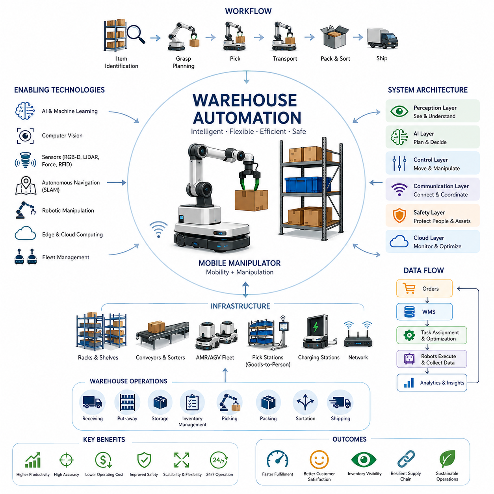
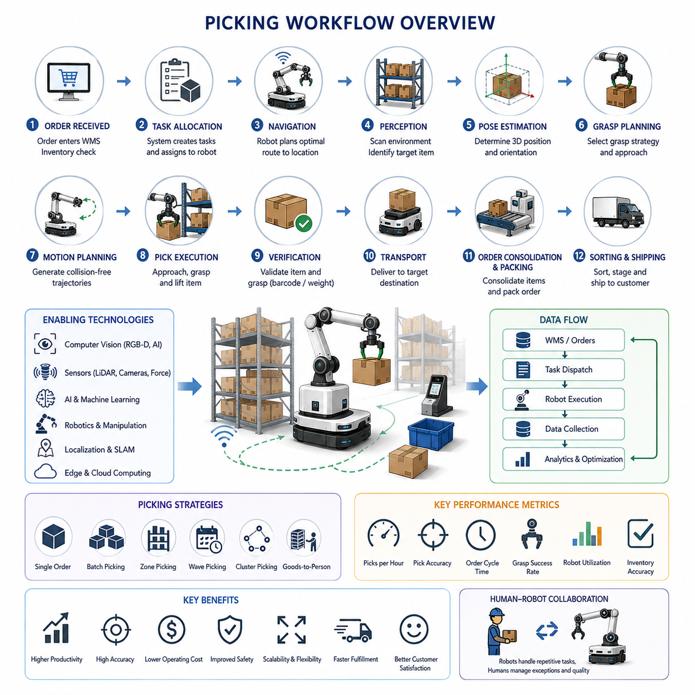
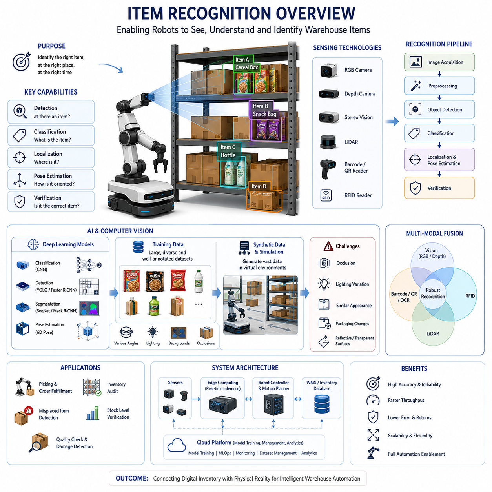
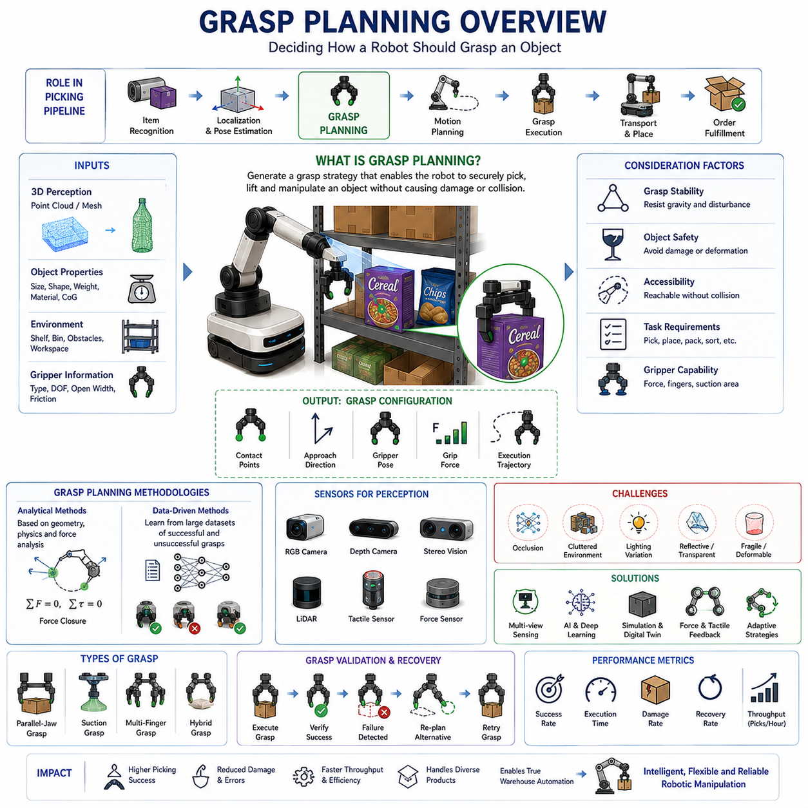
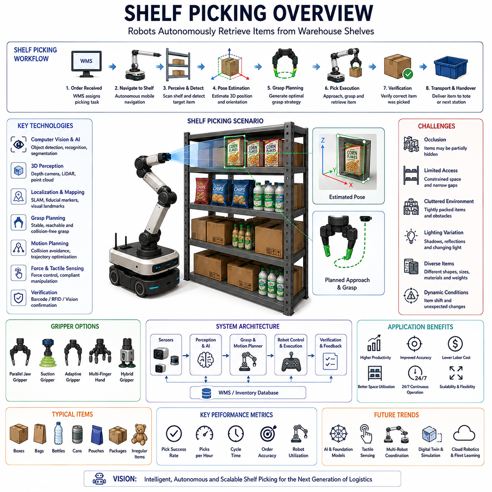
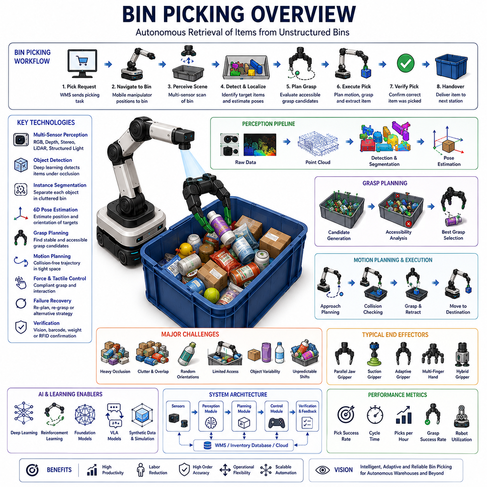
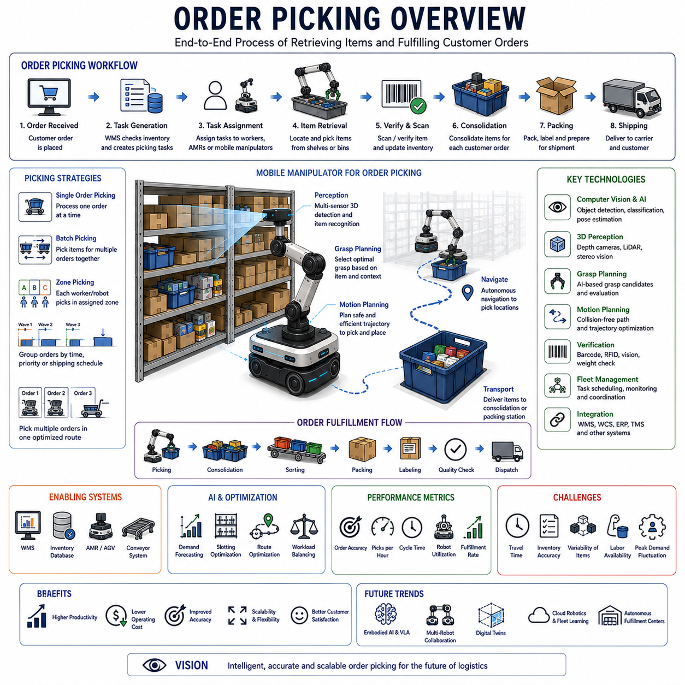
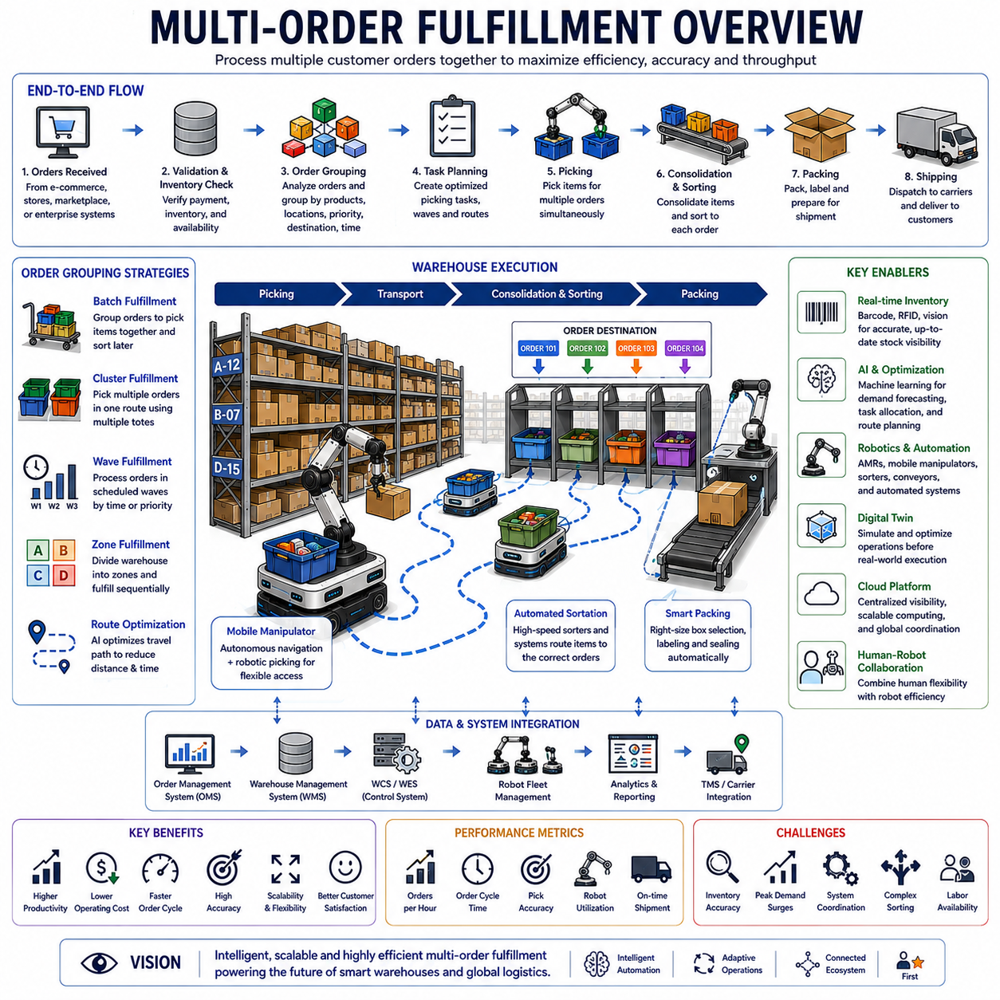
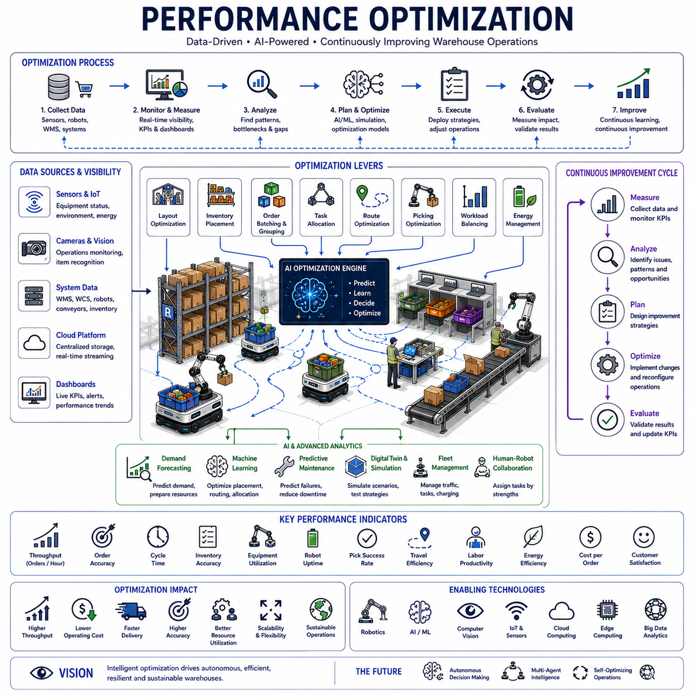
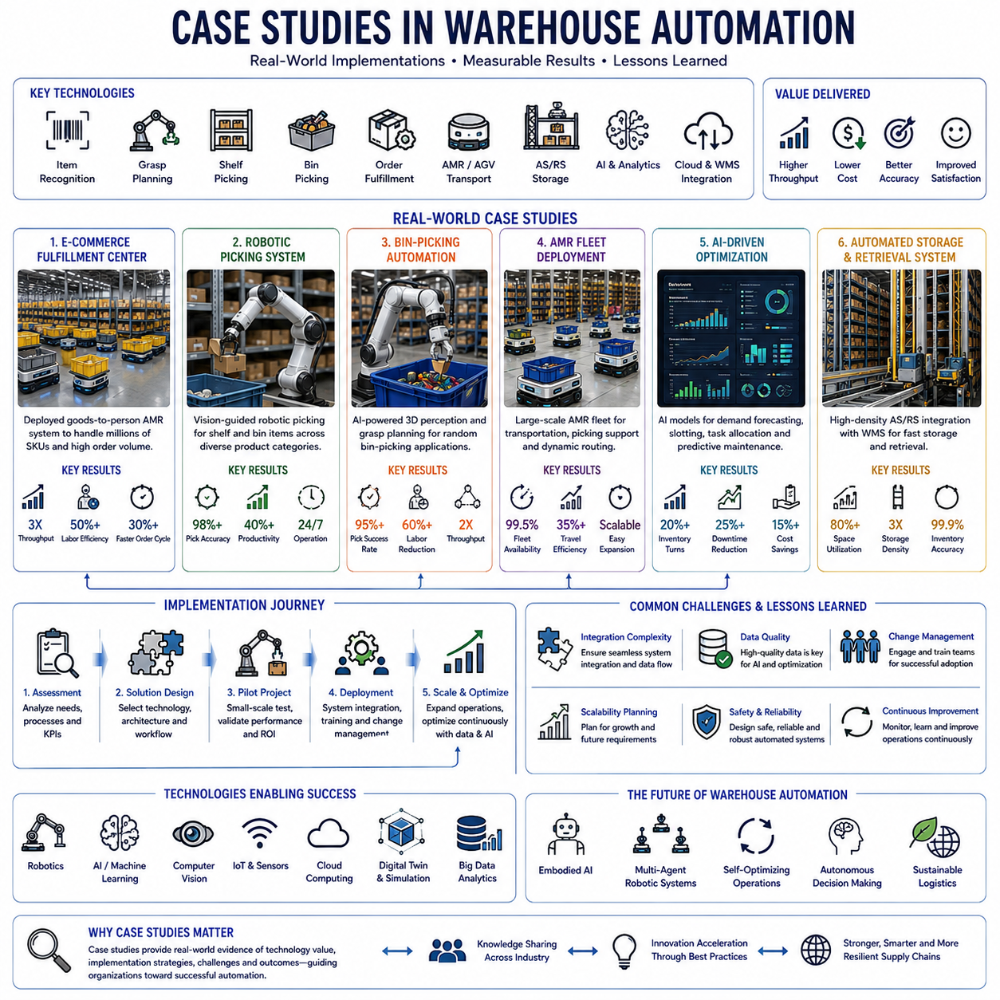

**Volume 01. Mobile Manipulator Foundations and System Architecture**


# Chapter 06. Warehouse Picking

##  

## 01 Warehouse Automation Overview

{width="7.268055555555556in" height="7.268055555555556in"}

Warehouse automation has become one of the most transformative developments in modern logistics and supply chain management. As global commerce continues to expand and customer expectations shift toward faster delivery, higher accuracy, and lower costs, warehouses are evolving from labor-intensive storage facilities into highly intelligent and automated fulfillment centers. This transformation is driven by advances in robotics, artificial intelligence, machine vision, cloud computing, industrial networking, and autonomous transportation technologies. Within this evolution, mobile manipulators have emerged as a critical enabling technology because they combine autonomous mobility with robotic manipulation, allowing a single system to both navigate through warehouse environments and physically interact with inventory. The role of warehouse automation is no longer limited to reducing labor costs. It has become a strategic capability that directly influences customer satisfaction, operational resilience, inventory visibility, and overall business competitiveness. The structure of warehouse automation within mobile manipulator systems is reflected in the warehouse picking domain, where topics such as picking workflows, item recognition, grasp planning, shelf picking, bin picking, order fulfillment, and performance optimization form a comprehensive technology stack for automated logistics operations.

Traditional warehouses relied heavily on human workers to perform receiving, put-away, storage, picking, packing, sorting, and shipping activities. Although humans possess exceptional adaptability and dexterity, manual operations face limitations in scalability, consistency, and productivity. Seasonal demand fluctuations, labor shortages, rising wages, and increasing order complexity have created significant pressure on warehouse operators. E-commerce has further accelerated these challenges by increasing the number of stock keeping units, reducing average order sizes, and demanding rapid fulfillment cycles. As a result, companies are increasingly investing in automated systems that can operate continuously, maintain high accuracy levels, and adapt to dynamic operational requirements.

The concept of warehouse automation encompasses a broad spectrum of technologies. At the infrastructure level, automated storage and retrieval systems provide high-density inventory storage and automated access to stored goods. Conveyor systems, sortation equipment, shuttle systems, and automated guided vehicles facilitate material movement across facilities. Warehouse management systems coordinate inventory transactions, order processing, and workflow execution. Warehouse execution systems provide real-time operational control, while enterprise resource planning systems integrate warehouse operations with broader business processes. Mobile manipulators represent the next stage of automation because they bridge the gap between transportation and physical handling, enabling more flexible and intelligent warehouse workflows.

A modern automated warehouse can be viewed as a cyber-physical system in which digital information continuously interacts with physical operations. Customer orders are generated within digital commerce platforms and transmitted to warehouse management systems. These systems determine inventory locations, optimize task assignments, and coordinate robotic resources. Mobile robots receive mission instructions, navigate to storage locations, identify target items, execute picking operations, transport products to packing stations, and update inventory databases in real time. Every physical action generates operational data that can be analyzed to improve efficiency, predict maintenance requirements, and optimize future workflows.

The rise of e-commerce has significantly influenced warehouse automation strategies. Traditional retail supply chains often focused on pallet-level handling and bulk distribution to stores. E-commerce fulfillment centers must instead process individual customer orders containing diverse products with varying dimensions, weights, and packaging characteristics. This shift has increased the importance of piece-picking automation. Robots must be capable of identifying thousands of different products, determining suitable grasp points, and manipulating items without causing damage. Mobile manipulators are particularly valuable in these environments because they combine the mobility needed to reach distributed storage locations with the dexterity required for item-level interaction.

Warehouse automation can be categorized into several operational domains. Receiving automation focuses on unloading inbound shipments, identifying incoming products, and updating inventory records. Storage automation manages the placement of products into designated storage locations while maximizing space utilization and accessibility. Inventory management automation maintains accurate stock records through continuous monitoring and real-time updates. Picking automation retrieves products required for customer orders. Packing automation prepares items for shipment through packaging, labeling, and documentation processes. Sortation automation directs completed orders toward appropriate shipping channels. Transportation automation manages the movement of materials between operational zones. Each of these domains can benefit from the integration of autonomous mobile manipulators.

One of the primary objectives of warehouse automation is improving productivity. Productivity can be measured through metrics such as picks per hour, orders processed per shift, inventory throughput, and facility utilization. Automated systems can operate continuously with minimal downtime, enabling higher throughput than traditional manual operations. Mobile manipulators can perform repetitive tasks without fatigue, maintain consistent performance levels, and operate during nighttime or low-staffing periods. This capability is particularly valuable in facilities that experience large fluctuations in demand volume.

Accuracy represents another critical benefit of warehouse automation. Manual picking operations are susceptible to human errors such as selecting incorrect items, placing products in wrong locations, or miscounting inventory quantities. Such errors can lead to customer dissatisfaction, returns, and increased operational costs. Automated systems utilize barcode scanners, RFID readers, computer vision algorithms, and inventory databases to verify item identities and locations. Mobile manipulators equipped with advanced perception systems can significantly reduce error rates by validating products before executing pick-and-place operations.

Safety is also a major driver of warehouse automation adoption. Warehouses contain numerous occupational hazards including heavy lifting, repetitive motions, vehicle interactions, and high shelving structures. Automated systems reduce human exposure to these risks by assuming physically demanding and potentially dangerous tasks. Mobile robots can transport heavy loads, operate in confined spaces, and access elevated storage areas without exposing workers to injury risks. At the same time, collaborative safety systems ensure that robots can operate safely alongside human personnel through obstacle detection, speed control, emergency stopping mechanisms, and human-aware navigation algorithms.

The integration of artificial intelligence has dramatically expanded the capabilities of warehouse automation systems. Traditional automation relied heavily on predefined rules and structured environments. Modern AI-enabled systems can adapt to changing conditions, recognize previously unseen objects, optimize workflows dynamically, and learn from operational data. Computer vision systems can identify products based on appearance rather than requiring fixed markers. Machine learning algorithms can predict demand patterns, optimize inventory placement, and improve task scheduling. Reinforcement learning techniques can enhance robotic manipulation performance through experience-based optimization.

Mobile manipulators occupy a unique position within warehouse automation because they combine the strengths of autonomous mobile robots and industrial robotic arms. Autonomous mobility enables robots to move efficiently throughout warehouse environments. Robotic manipulation provides the ability to grasp, lift, sort, and place objects. When these capabilities are integrated into a single platform, the resulting system can perform end-to-end warehouse operations with minimal human intervention. Such systems can navigate to storage shelves, identify target products, retrieve them using robotic arms, transport them to packing stations, and continue to subsequent assignments autonomously.

The perception subsystem plays a central role in warehouse automation. Sensors such as RGB cameras, depth cameras, LiDAR systems, stereo vision systems, and force sensors provide situational awareness for robotic platforms. Computer vision algorithms process sensory information to detect objects, estimate poses, recognize inventory locations, and identify environmental obstacles. Accurate perception is essential for reliable manipulation because robots must understand object geometry, orientation, and accessibility before executing grasping actions. Advanced perception systems also enable dynamic obstacle avoidance and safe interaction with human workers.

Navigation technologies form another foundational component of warehouse automation. Mobile robots must determine their position within facilities, plan efficient routes, and avoid collisions while executing missions. Simultaneous localization and mapping techniques allow robots to construct and update environmental maps while tracking their own location. Fleet management systems coordinate multiple robots, optimize traffic flow, and prevent congestion. As warehouse operations scale, efficient navigation becomes increasingly important for maintaining productivity and minimizing travel times.

Warehouse automation architectures increasingly adopt cloud-edge computing models. Edge computing platforms provide real-time processing capabilities for perception, navigation, and control tasks. Cloud platforms support fleet management, analytics, machine learning model training, and enterprise integration. This distributed architecture enables robots to make immediate operational decisions while benefiting from centralized optimization and long-term data analysis. Cloud connectivity also facilitates remote monitoring, predictive maintenance, software updates, and operational reporting.

Another significant trend in warehouse automation is the development of goods-to-person systems. Instead of requiring workers to travel throughout warehouses searching for products, automated systems bring inventory directly to picking stations. Autonomous robots transport shelving units, storage bins, or inventory containers to designated work areas. Mobile manipulators extend this concept by enabling automated goods retrieval without requiring human participation. These systems improve efficiency by reducing travel distances and increasing picker productivity.

Scalability is a key advantage of modern warehouse automation solutions. Traditional fixed automation systems often require significant infrastructure investments and lengthy deployment periods. Mobile robotic systems offer greater flexibility because additional robots can be introduced incrementally as operational demands increase. This modular approach reduces implementation risks and enables organizations to align automation investments with business growth. Mobile manipulators further enhance scalability by supporting a wide range of tasks within a single platform architecture.

The economic justification for warehouse automation is typically evaluated through return on investment analysis. Factors such as labor cost reduction, productivity improvements, accuracy enhancements, inventory optimization, and customer service benefits contribute to financial returns. Although automation systems require substantial upfront investments, long-term operational savings often justify deployment. Furthermore, automation can provide strategic advantages that extend beyond direct cost reductions, including improved resilience against labor shortages and enhanced responsiveness to market changes.

Digital twins are increasingly used to support warehouse automation planning and optimization. A digital twin is a virtual representation of a physical warehouse that enables simulation, testing, and performance analysis. Organizations can evaluate alternative layouts, robot fleet sizes, inventory strategies, and operational workflows before implementing changes in real facilities. Mobile manipulator behaviors can be validated in simulation environments, reducing deployment risks and accelerating system development.

Sustainability considerations are becoming increasingly important within warehouse automation strategies. Automated systems can improve energy efficiency through optimized routing, reduced idle times, and intelligent resource allocation. Inventory accuracy reduces waste associated with misplaced or expired products. Efficient warehouse operations also contribute to lower transportation requirements and reduced environmental impact. As organizations pursue sustainability goals, warehouse automation increasingly supports both economic and environmental objectives.

Future warehouse automation systems will likely become more autonomous, adaptive, and intelligent. Foundation models, vision-language models, and embodied AI technologies are expected to enhance robotic reasoning capabilities. Robots will be able to understand natural language instructions, interpret complex operational goals, and adapt to previously unseen scenarios. Multi-robot collaboration will enable fleets of autonomous systems to coordinate warehouse activities dynamically. Human workers will increasingly transition from performing repetitive manual tasks to supervising, optimizing, and collaborating with intelligent robotic systems.

In conclusion, warehouse automation represents a fundamental transformation in the way logistics operations are designed and executed. Driven by technological advances and growing operational demands, automated warehouses are evolving into highly intelligent ecosystems where software, robotics, artificial intelligence, and human expertise work together to achieve unprecedented levels of efficiency and accuracy. Mobile manipulators serve as one of the most important enabling technologies within this transformation because they unite autonomous mobility and physical manipulation within a single platform. As warehouse automation continues to advance, organizations that successfully integrate these technologies will be better positioned to meet customer expectations, improve operational performance, and maintain long-term competitiveness in an increasingly dynamic global marketplace. The warehouse picking domain, including workflows, recognition, grasping, shelf interaction, bin handling, order fulfillment, and performance optimization, provides the foundational framework through which these advanced automation capabilities can be systematically developed and deployed.

창고 자동화는 현대 물류 및 공급망 관리 분야에서 가장 혁신적인 변화 중 하나로 평가된다. 글로벌 전자상거래 시장이 지속적으로 성장하고 고객들이 더욱 빠른 배송, 높은 정확도, 낮은 비용을 요구함에 따라 창고는 단순한 보관 시설에서 지능형 자동화 물류센터로 진화하고 있다. 이러한 변화는 로봇공학, 인공지능, 머신비전, 클라우드 컴퓨팅, 산업용 네트워크, 자율주행 기술의 발전에 의해 가속화되고 있다. 특히 모바일 매니퓰레이터(Mobile Manipulator)는 자율주행 이동성과 로봇 조작 능력을 동시에 갖춘 시스템으로서 창고 자동화의 핵심 기술로 주목받고 있다. 이 기술은 창고 내부를 자유롭게 이동하면서 동시에 물품을 직접 집고 옮길 수 있기 때문에 기존 자동화 시스템의 한계를 극복할 수 있다. 오늘날 창고 자동화의 목적은 단순히 인건비 절감에 머무르지 않는다. 고객 만족도 향상, 운영 효율성 증대, 재고 가시성 확보, 공급망 안정성 강화, 그리고 기업 경쟁력 향상까지 포함하는 전략적 역량으로 발전하고 있다. 모바일 매니퓰레이터 관점에서 창고 자동화는 피킹 워크플로우, 상품 인식, 그립 계획, 선반 피킹, 빈 피킹, 주문 처리 및 성능 최적화와 같은 다양한 기술 영역으로 구성된다.

전통적인 창고는 입고, 적재, 보관, 피킹, 포장, 분류, 출하와 같은 대부분의 작업을 사람이 수행하였다. 인간은 뛰어난 적응력과 손재주를 가지고 있지만, 반복적인 작업에서는 생산성과 확장성에 한계가 존재한다. 계절적 수요 변화, 노동력 부족, 인건비 상승, 주문 복잡도 증가와 같은 문제들은 창고 운영에 큰 부담을 주고 있다. 특히 전자상거래의 급성장은 상품 종류의 폭발적인 증가와 소량 다품종 주문의 확대를 가져왔으며, 이에 따라 더욱 효율적인 자동화 시스템의 필요성이 높아지고 있다.

창고 자동화는 매우 다양한 기술들을 포함하는 개념이다. 자동화 저장 및 검색 시스템(AS/RS)은 높은 저장 밀도와 자동 입출고 기능을 제공하며, 컨베이어와 분류 장비는 물류 흐름을 자동화한다. AGV와 AMR은 시설 내부에서 자재를 이동시키고, 창고 관리 시스템(WMS)은 재고와 작업 흐름을 통합적으로 관리한다. 최근에는 모바일 매니퓰레이터가 이러한 시스템들과 결합되면서 단순 운송뿐 아니라 물체를 직접 다루는 기능까지 자동화할 수 있게 되었다.

현대의 자동화 창고는 디지털 시스템과 물리적 시스템이 긴밀하게 연결된 사이버-물리 시스템(Cyber-Physical System)으로 볼 수 있다. 고객 주문은 전자상거래 플랫폼에서 생성되고 창고 관리 시스템으로 전달된다. 시스템은 재고 위치를 확인하고 최적의 작업 순서를 계산하며 적절한 로봇에게 작업을 할당한다. 모바일 로봇은 저장 위치로 이동하여 목표 상품을 식별하고, 물품을 집은 후 포장 구역으로 운반하며, 모든 과정에서 재고 정보를 실시간으로 업데이트한다. 이러한 데이터는 운영 효율성 향상, 유지보수 예측, 미래 작업 최적화를 위해 지속적으로 분석된다.

전자상거래의 성장은 창고 자동화 전략에 결정적인 영향을 미쳤다. 과거에는 대량의 상품을 매장 단위로 공급하는 것이 중요했지만, 오늘날에는 개별 고객 주문을 처리하는 것이 핵심이 되었다. 이는 단품 피킹(Piece Picking)의 중요성을 크게 증가시켰다. 로봇은 수천 종 이상의 상품을 식별하고 적절한 파지점을 계산하여 손상 없이 집어야 한다. 모바일 매니퓰레이터는 이동성과 조작 능력을 동시에 제공하기 때문에 이러한 요구사항에 매우 적합하다.

창고 자동화는 입고 자동화, 보관 자동화, 재고 관리 자동화, 피킹 자동화, 포장 자동화, 분류 자동화, 운송 자동화 등 다양한 영역으로 구성된다. 입고 자동화는 입고 상품의 인식과 등록을 담당하며, 보관 자동화는 공간 활용도를 극대화하면서 상품을 적절한 위치에 배치한다. 재고 관리 자동화는 실시간 재고 상태를 유지하고, 피킹 자동화는 고객 주문에 필요한 상품을 수집한다. 포장 및 분류 자동화는 출하 준비를 수행하며, 운송 자동화는 시설 내부 물류 흐름을 관리한다. 모바일 매니퓰레이터는 이러한 모든 영역에서 활용될 수 있다.

창고 자동화의 가장 중요한 목표 중 하나는 생산성 향상이다. 생산성은 시간당 피킹 수량, 처리 주문 수, 재고 회전율, 설비 활용도 등의 지표로 측정된다. 자동화 시스템은 휴식 없이 지속적으로 운영될 수 있기 때문에 인간 작업자보다 높은 처리량을 제공할 수 있다. 모바일 매니퓰레이터는 피로 누적 없이 반복 작업을 수행할 수 있으며 야간이나 인력이 부족한 시간대에도 안정적으로 운영될 수 있다.

정확성 향상 또한 창고 자동화의 중요한 장점이다. 수작업 환경에서는 잘못된 상품 선택, 수량 오류, 위치 오류와 같은 문제가 자주 발생한다. 이러한 오류는 고객 불만과 반품 비용 증가로 이어진다. 자동화 시스템은 바코드, RFID, 컴퓨터 비전 기술을 활용하여 상품과 위치를 검증함으로써 오류를 크게 줄일 수 있다. 모바일 매니퓰레이터는 물체를 집기 전 상품 정보를 확인하고 올바른 대상인지 검증할 수 있어 높은 정확도를 유지할 수 있다.

안전성 역시 자동화 도입의 중요한 이유이다. 창고는 무거운 물체를 다루고 반복 작업이 많으며 차량과 사람이 함께 이동하는 환경이다. 자동화 시스템은 위험하거나 육체적으로 힘든 작업을 대신 수행함으로써 작업자의 부상 위험을 줄여준다. 모바일 로봇은 중량물을 운반하고 좁은 공간에서 작업하며 높은 선반에 접근할 수 있다. 또한 최신 안전 기술은 사람과 로봇이 동일한 공간에서 안전하게 협업할 수 있도록 지원한다.

인공지능의 발전은 창고 자동화의 수준을 크게 향상시키고 있다. 과거 자동화 시스템이 정해진 규칙과 구조화된 환경에 의존했다면, 최신 AI 시스템은 환경 변화에 적응하고 새로운 물체를 인식하며 작업을 스스로 최적화할 수 있다. 컴퓨터 비전은 상품을 시각적으로 식별할 수 있고, 머신러닝은 수요 예측과 재고 배치를 최적화할 수 있으며, 강화학습은 로봇의 조작 성능을 지속적으로 개선할 수 있다.

모바일 매니퓰레이터는 AMR과 산업용 로봇 팔의 장점을 하나의 플랫폼으로 통합한 시스템이다. 자율주행 기능은 창고 내 이동을 담당하고, 로봇 팔은 상품 집기와 적재 작업을 수행한다. 이러한 통합을 통해 로봇은 선반으로 이동하고, 목표 상품을 인식하고, 집어 올린 후, 포장 구역으로 운반하는 전 과정을 자동으로 수행할 수 있다.

창고 자동화에서 인지(Perception) 시스템은 매우 중요한 역할을 수행한다. RGB 카메라, 깊이 카메라, LiDAR, 스테레오 카메라, 힘 센서와 같은 다양한 센서들이 환경 정보를 수집한다. 컴퓨터 비전 알고리즘은 이를 분석하여 물체를 인식하고 자세를 추정하며 장애물을 감지한다. 정확한 인지 능력은 안정적인 조작 성능의 핵심 요소이다.

내비게이션 기술 역시 창고 자동화의 기반 기술이다. 모바일 로봇은 자신의 위치를 파악하고 최적 경로를 계산하며 장애물을 회피해야 한다. SLAM 기술은 지도 생성과 위치 추정을 동시에 수행하며, 플릿 관리 시스템은 다수의 로봇이 효율적으로 협력할 수 있도록 지원한다. 로봇 수가 증가할수록 이러한 경로 최적화 기술의 중요성은 더욱 커진다.

최근 창고 자동화는 클라우드와 엣지 컴퓨팅을 결합한 구조를 채택하고 있다. 엣지 컴퓨팅은 실시간 인식과 제어를 담당하고, 클라우드는 데이터 분석, 플릿 관리, AI 모델 학습을 수행한다. 이러한 구조는 즉각적인 반응성과 장기적인 최적화를 동시에 가능하게 한다. 또한 원격 모니터링, 예지 정비, 소프트웨어 업데이트와 같은 기능도 지원할 수 있다.

상품을 작업자에게 가져오는 Goods-to-Person 시스템도 중요한 자동화 트렌드이다. 기존 방식에서는 작업자가 창고를 이동하며 상품을 찾았지만, 자동화 시스템은 상품이 있는 선반이나 저장 장치를 작업자 또는 로봇에게 가져온다. 모바일 매니퓰레이터는 이러한 시스템을 더욱 발전시켜 사람의 개입 없이 자동으로 상품을 꺼내고 처리할 수 있게 한다.

현대 창고 자동화의 또 다른 특징은 뛰어난 확장성이다. 고정형 자동화 설비는 구축 비용이 크고 변경이 어렵지만, 모바일 로봇은 필요에 따라 수량을 단계적으로 늘릴 수 있다. 이러한 모듈형 구조는 초기 투자 부담을 줄이고 사업 성장에 맞추어 자동화를 확장할 수 있도록 지원한다.

창고 자동화의 경제성은 일반적으로 ROI(Return on Investment) 분석을 통해 평가된다. 인건비 절감, 생산성 향상, 오류 감소, 재고 최적화, 고객 서비스 개선 등이 주요 투자 효과로 고려된다. 초기 투자 비용은 크지만 장기적으로는 운영 비용 절감과 경쟁력 향상을 통해 충분한 경제적 가치를 창출할 수 있다.

최근에는 디지털 트윈 기술도 창고 자동화 설계에 적극 활용되고 있다. 디지털 트윈은 실제 창고를 가상 환경에 재현하여 레이아웃, 로봇 수량, 운영 전략 등을 사전에 검증할 수 있도록 한다. 이를 통해 구축 위험을 줄이고 개발 기간을 단축할 수 있다.

지속가능성 또한 창고 자동화의 중요한 목표가 되고 있다. 자동화 시스템은 최적 경로 계산과 효율적인 자원 활용을 통해 에너지 소비를 줄일 수 있다. 재고 정확도 향상은 폐기물 감소에 기여하며, 물류 효율성 향상은 전체 공급망의 탄소 배출 감소에도 도움을 준다.

미래의 창고 자동화는 더욱 자율적이고 지능적인 방향으로 발전할 것이다. 파운데이션 모델, 비전-언어 모델(VLM), 비전-언어-액션(VLA), 그리고 Embodied AI 기술은 로봇이 자연어 명령을 이해하고 복잡한 작업을 스스로 계획하며 새로운 환경에 적응할 수 있도록 지원할 것이다. 다수의 로봇이 협력하는 멀티 에이전트 시스템이 보편화될 것이며, 인간은 반복 작업 수행자에서 자동화 시스템을 감독하고 최적화하는 역할로 변화하게 될 것이다.

결론적으로 창고 자동화는 단순한 설비 개선이 아니라 물류 산업 전반의 패러다임 전환이라고 할 수 있다. 소프트웨어, 인공지능, 로봇공학, 그리고 인간의 전문성이 결합된 지능형 물류 생태계가 형성되고 있으며, 모바일 매니퓰레이터는 그 중심에서 핵심 역할을 수행하고 있다. 향후 창고 자동화 기술은 더욱 높은 생산성, 정확성, 안전성, 그리고 유연성을 제공하며 글로벌 물류 산업의 미래를 이끌어 갈 것이다. 특히 피킹 워크플로우, 상품 인식, 그립 계획, 선반 피킹, 빈 피킹, 주문 처리 및 성능 최적화와 같은 기술 영역은 차세대 창고 자동화 시스템을 구축하기 위한 핵심 기반이 될 것이다.

##  

## 02 Picking Workflows

{width="7.268055555555556in" height="7.268055555555556in"}

Picking workflows represent the operational core of modern warehouse automation systems. Regardless of the warehouse size, industry sector, or level of automation, the process of retrieving products from storage locations and preparing them for downstream logistics activities remains one of the most critical functions within the fulfillment operation. In traditional warehouses, picking activities account for a substantial portion of total operational costs because workers spend significant amounts of time traveling between storage locations, identifying items, verifying order requirements, and transporting products to packing or staging areas. As e-commerce, omnichannel fulfillment, and high-mix low-volume logistics continue to expand, efficient picking workflows have become essential for maintaining competitiveness, customer satisfaction, and operational profitability. Within mobile manipulator systems, picking workflows form the central bridge between perception, planning, manipulation, transportation, and order fulfillment. They connect technologies such as item recognition, grasp planning, shelf picking, bin picking, order processing, and fleet coordination into a unified operational framework.

A picking workflow can be defined as the complete sequence of activities required to retrieve one or more products from storage locations and deliver them to the next stage of the fulfillment process. Although the specific implementation varies across warehouses, the workflow generally begins when a customer order is received and ends when the requested products arrive at a packing station, sorting area, or shipping dock. Between these two points lies a complex series of decisions and actions involving inventory systems, warehouse management software, autonomous robots, robotic manipulators, and human operators.

The evolution of warehouse picking has closely followed the evolution of supply chain requirements. In traditional distribution centers, workers commonly used paper pick lists to identify products and manually navigate warehouse aisles. As warehouse management systems became more sophisticated, handheld scanners, voice-directed picking systems, and mobile terminals improved efficiency and accuracy. The next stage introduced automation technologies such as conveyors, automated storage systems, and autonomous mobile robots. Today, advanced fulfillment centers increasingly rely on mobile manipulators capable of independently navigating warehouse environments, locating products, picking items, and transporting them without direct human intervention.

The primary objective of a picking workflow is to fulfill customer orders accurately, efficiently, and consistently. This objective may appear straightforward, but it requires the coordination of numerous subsystems. Inventory databases must accurately represent stock availability. Navigation systems must guide robots to correct storage locations. Vision systems must identify target products among multiple surrounding objects. Manipulation systems must generate reliable grasping strategies. Fleet management systems must coordinate multiple robots operating simultaneously. All of these components must function together seamlessly to achieve high-performance warehouse operations.

Order initiation represents the first stage of the picking workflow. When an order enters the warehouse management system, the system validates inventory availability and determines the locations of all required items. Order management algorithms analyze inventory distribution, warehouse layout, workload conditions, and delivery priorities. The system then generates one or more picking tasks that are assigned to human workers, autonomous mobile robots, or mobile manipulators depending on operational policies and automation capabilities.

Task allocation plays a critical role in workflow optimization. In highly automated warehouses, sophisticated scheduling algorithms determine which robot should execute each picking task. Factors such as robot location, battery status, workload balance, travel distance, expected completion time, and equipment capabilities influence assignment decisions. Dynamic task allocation systems continuously adjust assignments as warehouse conditions change, ensuring optimal resource utilization throughout the facility.

After task assignment, navigation becomes the next major workflow component. The mobile manipulator must travel from its current location to the designated storage area. Navigation systems use warehouse maps, localization technologies, obstacle detection sensors, and path-planning algorithms to determine efficient routes. Modern warehouses often contain hundreds of robots operating simultaneously, making traffic management and congestion avoidance essential considerations. Fleet management platforms coordinate robot movements to prevent bottlenecks and maximize overall throughput.

Upon arrival at the storage location, the perception phase begins. Perception is one of the most technically challenging aspects of warehouse picking because products may vary significantly in size, shape, color, packaging, and orientation. Furthermore, warehouse environments often contain cluttered shelves, partially occluded objects, reflective surfaces, and varying lighting conditions. Computer vision systems use RGB cameras, depth sensors, stereo vision systems, and artificial intelligence algorithms to identify target items and estimate their three-dimensional positions.

Object recognition forms the foundation of successful picking operations. Robots must distinguish target products from surrounding inventory and verify that the correct item has been selected. Advanced perception systems combine deep learning-based object detection with inventory database information to achieve high recognition accuracy. Barcode reading, QR code scanning, RFID verification, and visual feature matching are often integrated to provide multiple layers of validation.

Pose estimation follows object recognition. Once a product has been identified, the robot must determine its exact position and orientation. Accurate pose estimation is essential because even small positioning errors can lead to grasp failures. Modern systems utilize depth cameras, point cloud processing algorithms, and machine learning models to estimate six-degree-of-freedom object poses. These capabilities allow robots to interact with objects located in complex and unstructured storage environments.

Following perception, the workflow enters the grasp planning stage. Grasp planning determines how the robot should physically interact with the target object. The planning process considers object geometry, weight distribution, surface characteristics, accessibility, collision risks, and gripper capabilities. Different products may require entirely different grasping strategies. A rigid cardboard box may be grasped from its sides, while a flexible package may require suction-based handling. Fragile products may demand carefully controlled force application to prevent damage.

Motion planning transforms grasp decisions into executable robotic actions. Motion planners generate collision-free trajectories for robotic arms while considering joint limits, environmental constraints, and dynamic obstacles. The planner must ensure that the robot can safely reach the target object, perform the grasp, and retract without interfering with surrounding inventory. Sophisticated motion planning algorithms continuously adapt trajectories based on sensor feedback and environmental changes.

The actual picking action represents the most visible part of the workflow but depends on the successful execution of all preceding stages. During picking, the robotic manipulator approaches the object, establishes contact, secures the grasp, and lifts the product from its storage location. Force sensors, torque sensors, and vision systems monitor execution in real time to detect anomalies and verify successful acquisition. If a grasp failure occurs, recovery procedures may initiate automatically, allowing the robot to attempt alternative grasp strategies.

Verification is typically performed immediately after the pick operation. Verification systems confirm that the correct product has been retrieved and that the item remains securely held by the manipulator. Weight measurements, barcode scanning, image analysis, and inventory database cross-checks contribute to this validation process. Early detection of errors prevents incorrect products from progressing further through the fulfillment process.

Transportation represents the next workflow phase. Once the product has been successfully picked, the mobile manipulator transports it to a designated destination. Depending on the warehouse architecture, this destination may be a packing station, sorting area, consolidation zone, shipping dock, or another robotic workstation. During transportation, navigation systems continue monitoring the environment while fleet management software coordinates traffic among multiple robots.

Order consolidation becomes important when customer orders contain multiple products stored in different locations. In such cases, multiple picking operations must be completed before the order can proceed to packing. Consolidation strategies vary depending on warehouse design. Some facilities utilize centralized consolidation stations where products from multiple robots are combined. Others employ distributed workflows in which robots collect multiple products during a single route before delivering the completed order.

Packing integration represents another important element of modern picking workflows. In highly automated fulfillment centers, robotic systems may directly transfer products into automated packing stations. Packing systems select appropriate packaging materials, prepare shipping labels, verify order completeness, and seal packages for shipment. Integration between picking and packing workflows reduces handling steps and improves overall operational efficiency.

Real-time data collection occurs throughout the entire workflow. Every robot movement, grasp attempt, navigation event, and order transaction generates valuable operational data. Analytics platforms use this information to monitor performance, identify bottlenecks, optimize workflows, and support predictive maintenance. Data-driven decision making has become a central component of warehouse automation strategies.

Several different picking methodologies are commonly used in warehouse environments. Single-order picking focuses on completing one customer order at a time. Batch picking groups multiple orders together to reduce travel distances. Zone picking assigns specific warehouse regions to dedicated workers or robots. Wave picking organizes tasks into coordinated fulfillment cycles based on shipping schedules. Cluster picking allows simultaneous processing of multiple orders using shared picking routes. The optimal methodology depends on order profiles, warehouse layouts, inventory characteristics, and automation capabilities.

Goods-to-person workflows have significantly transformed modern picking operations. Instead of requiring robots or workers to travel extensively through storage areas, inventory is automatically transported to picking stations. Mobile manipulators operating within goods-to-person systems can perform high-speed picking while remaining in relatively fixed operational zones. This approach reduces travel times and increases throughput.

Artificial intelligence is increasingly enhancing picking workflow performance. Machine learning algorithms optimize task allocation, predict inventory demand, improve route planning, and enhance grasp success rates. Vision-language models enable robots to interpret natural language instructions and understand product descriptions. Foundation models support generalized perception and manipulation capabilities that can adapt to previously unseen products and warehouse configurations.

Human-robot collaboration remains an important aspect of many warehouse operations. While automation continues to expand, humans still provide flexibility, judgment, and exception handling capabilities that are difficult to fully automate. Collaborative workflows allow robots to perform repetitive transportation and picking tasks while humans manage complex products, unusual situations, and quality assurance activities. Effective collaboration requires intuitive interfaces, clear communication mechanisms, and robust safety systems.

Performance measurement is essential for evaluating picking workflow effectiveness. Common metrics include picks per hour, order completion time, travel distance, pick accuracy, grasp success rate, robot utilization, inventory accuracy, and order cycle time. These metrics provide visibility into operational performance and guide continuous improvement initiatives. Advanced analytics systems can identify inefficiencies and recommend optimization strategies based on real-world operational data.

Scalability is another key consideration in workflow design. As order volumes increase, picking systems must accommodate higher workloads without significant performance degradation. Mobile manipulator fleets offer substantial scalability advantages because additional robots can be deployed incrementally. Cloud-based fleet management systems can coordinate large numbers of robots while maintaining operational efficiency across expanding facilities.

Future picking workflows will become increasingly autonomous, adaptive, and intelligent. Embodied AI systems will enable robots to reason about tasks, understand warehouse objectives, and adapt to unfamiliar situations. Multi-agent robotic systems will collaborate dynamically to optimize fulfillment activities. Digital twins will continuously simulate warehouse operations and recommend real-time adjustments. Vision-language-action models will allow robots to understand complex instructions and execute sophisticated picking tasks with minimal human supervision.

Ultimately, picking workflows represent the operational heartbeat of warehouse automation. They integrate perception, navigation, manipulation, planning, verification, transportation, and fulfillment into a unified process that directly influences customer satisfaction and business performance. As robotics, artificial intelligence, and automation technologies continue to advance, warehouse picking workflows will evolve from structured task sequences into highly adaptive autonomous systems capable of managing complex logistics environments with unprecedented levels of efficiency, accuracy, flexibility, and intelligence. In the broader context of mobile manipulation, picking workflows serve as the foundational process that connects item recognition, grasp planning, shelf interaction, bin handling, order fulfillment, and performance optimization into a complete end-to-end warehouse automation ecosystem.

피킹 워크플로우는 현대 창고 자동화 시스템의 핵심 운영 프로세스이다. 창고의 규모나 산업 분야, 자동화 수준과 관계없이 저장 위치에서 상품을 찾아 출고 준비 단계로 전달하는 과정은 물류 운영의 가장 중요한 기능 중 하나이다. 전통적인 창고에서는 작업자가 창고 내부를 이동하며 상품을 찾고 확인한 뒤 포장 또는 출하 구역으로 운반해야 했기 때문에 피킹 작업이 전체 운영 비용의 상당 부분을 차지하였다. 전자상거래, 옴니채널 물류, 다품종 소량 주문이 확대되면서 효율적인 피킹 워크플로우는 기업 경쟁력과 고객 만족도를 결정하는 핵심 요소가 되었다. 모바일 매니퓰레이터 환경에서는 피킹 워크플로우가 인지, 계획, 조작, 운송, 주문 처리 과정을 연결하는 중심 역할을 수행하며, 상품 인식, 그립 계획, 선반 피킹, 빈 피킹, 주문 처리 및 플릿 관리 기술을 하나의 통합된 운영 체계로 연결한다.

피킹 워크플로우는 고객 주문에 필요한 상품을 저장 위치에서 찾아 다음 물류 단계로 전달하기까지의 전체 과정을 의미한다. 구체적인 구현 방식은 창고마다 다르지만 일반적으로 고객 주문이 접수되는 시점에서 시작하여 상품이 포장 구역이나 분류 구역, 출하 구역에 도착하는 시점에 종료된다. 이 과정에는 재고 시스템, 창고 관리 시스템, 자율주행 로봇, 로봇 팔, 그리고 작업자 간의 복잡한 협력이 포함된다.

창고 피킹은 물류 산업의 발전과 함께 지속적으로 진화해 왔다. 과거에는 종이 피킹 리스트를 이용하여 작업자가 직접 상품을 찾고 수집하였다. 이후 핸드헬드 단말기와 바코드 스캐너, 음성 지시 시스템이 도입되면서 효율성이 향상되었다. 그 다음 단계에서는 컨베이어, 자동 저장 시스템, AMR과 같은 자동화 기술이 등장하였다. 현재는 모바일 매니퓰레이터가 창고 내부를 스스로 이동하고, 상품을 인식하며, 집고, 운반하는 수준까지 발전하고 있다.

피킹 워크플로우의 궁극적인 목표는 고객 주문을 정확하고 신속하며 안정적으로 처리하는 것이다. 이를 위해서는 다양한 시스템들이 긴밀하게 연동되어야 한다. 재고 데이터베이스는 정확한 재고 정보를 제공해야 하며, 내비게이션 시스템은 로봇을 올바른 위치로 안내해야 한다. 비전 시스템은 목표 상품을 식별해야 하고, 조작 시스템은 적절한 파지 전략을 생성해야 한다. 또한 플릿 관리 시스템은 여러 대의 로봇을 동시에 조정하여 전체 물류 효율을 극대화해야 한다.

워크플로우의 첫 단계는 주문 생성이다. 고객 주문이 창고 관리 시스템에 접수되면 시스템은 재고 가용성을 확인하고 필요한 상품들의 위치를 파악한다. 이후 주문 처리 알고리즘은 재고 분포, 창고 레이아웃, 작업 부하, 배송 우선순위 등을 고려하여 피킹 작업을 생성한다. 생성된 작업은 작업자 또는 로봇에게 자동으로 할당된다.

작업 할당은 전체 피킹 효율을 결정하는 중요한 요소이다. 자동화 창고에서는 스케줄링 알고리즘이 각 로봇의 위치, 배터리 상태, 현재 작업량, 예상 이동 거리 및 완료 시간을 고려하여 가장 적합한 로봇을 선택한다. 동적 작업 할당 시스템은 창고 상황 변화에 따라 지속적으로 작업을 재배치함으로써 자원 활용도를 극대화한다.

작업이 할당되면 로봇은 지정된 저장 위치로 이동한다. 이를 위해 내비게이션 시스템은 창고 지도와 위치 추정 기술, 장애물 감지 센서, 경로 계획 알고리즘을 활용한다. 대규모 창고에서는 수백 대의 로봇이 동시에 이동할 수 있기 때문에 교통 흐름 관리와 혼잡 방지가 매우 중요하다. 플릿 관리 시스템은 이러한 이동을 조정하여 전체 처리량을 최적화한다.

목표 위치에 도착하면 인지 단계가 시작된다. 인지는 창고 자동화에서 가장 어려운 기술 분야 중 하나이다. 상품은 크기, 모양, 색상, 포장 방식이 매우 다양하며, 선반 내부에서는 물체가 서로 가려지거나 조명이 일정하지 않을 수 있다. 컴퓨터 비전 시스템은 RGB 카메라, 깊이 카메라, 스테레오 비전, AI 알고리즘을 이용하여 목표 상품을 식별하고 위치를 추정한다.

상품 인식은 성공적인 피킹의 기본이다. 로봇은 목표 상품과 주변 상품을 구분해야 하며, 선택한 상품이 실제 주문 상품인지 확인해야 한다. 최신 시스템은 딥러닝 기반 객체 인식 기술과 재고 데이터베이스를 결합하여 높은 인식 정확도를 달성한다. 바코드, QR 코드, RFID 기술도 함께 사용되어 다중 검증 체계를 구축한다.

상품이 인식되면 자세 추정 단계가 수행된다. 로봇은 상품의 정확한 위치와 방향을 계산해야 한다. 작은 위치 오차도 파지 실패를 유발할 수 있기 때문에 높은 정밀도가 요구된다. 이를 위해 깊이 카메라, 포인트 클라우드 처리 기술, AI 기반 자세 추정 모델이 활용된다.

이후 그립 계획 단계가 진행된다. 그립 계획은 로봇이 상품을 어떤 방식으로 잡을지를 결정하는 과정이다. 물체의 형상, 무게 중심, 표면 재질, 접근 가능성, 충돌 위험성, 그리고 그리퍼 특성이 모두 고려된다. 단단한 박스는 측면을 잡는 것이 효율적일 수 있지만, 비닐 포장 제품은 흡착 방식이 적합할 수 있다. 깨지기 쉬운 상품은 정밀한 힘 제어가 필요하다.

모션 계획은 그립 계획 결과를 실제 움직임으로 변환하는 과정이다. 로봇 팔은 충돌 없이 목표 위치까지 이동해야 하며, 상품을 집은 후에도 주변 물체와 간섭 없이 안전하게 빠져나와야 한다. 모션 계획 알고리즘은 관절 제한 조건, 환경 제약, 동적 장애물을 고려하여 최적의 경로를 생성한다.

실제 피킹 단계는 워크플로우에서 가장 눈에 띄는 과정이다. 로봇 팔은 상품에 접근하여 접촉하고, 안정적으로 파지한 뒤 선반이나 빈에서 들어 올린다. 이 과정에서 힘 센서와 토크 센서, 비전 시스템이 실시간으로 상태를 모니터링한다. 만약 파지 실패가 발생하면 시스템은 자동으로 대체 전략을 시도하여 성공 가능성을 높인다.

상품을 집은 후에는 검증 과정이 수행된다. 검증 시스템은 올바른 상품이 선택되었는지, 상품이 안전하게 잡혀 있는지를 확인한다. 무게 측정, 바코드 스캔, 이미지 분석, 재고 데이터베이스 확인 등이 사용된다. 조기 오류 검출은 잘못된 상품이 다음 단계로 전달되는 것을 방지한다.

검증이 완료되면 운송 단계가 시작된다. 모바일 매니퓰레이터는 상품을 포장 구역, 분류 구역, 집하 구역 또는 다른 작업 스테이션으로 운반한다. 이동 중에도 내비게이션 시스템은 장애물을 감지하고 경로를 수정하며, 플릿 관리 시스템은 다른 로봇들과의 충돌을 방지한다.

고객 주문에 여러 상품이 포함된 경우 주문 통합 과정이 필요하다. 다양한 위치에 저장된 상품들이 하나의 주문으로 결합되어야 하기 때문이다. 일부 창고는 중앙 집하 스테이션에서 상품을 모으고, 다른 창고는 로봇이 여러 상품을 순차적으로 수집한 뒤 한 번에 전달하는 방식을 사용한다.

포장 시스템과의 연계도 중요하다. 자동화된 물류센터에서는 로봇이 직접 상품을 포장 스테이션으로 전달한다. 포장 시스템은 적절한 박스를 선택하고 라벨을 부착하며 출하 준비를 완료한다. 피킹과 포장의 긴밀한 통합은 물류 처리 시간을 크게 단축시킨다.

워크플로우 전 과정에서는 지속적인 데이터 수집이 이루어진다. 로봇의 이동, 파지 시도, 작업 시간, 오류 발생 기록 등 모든 데이터가 저장된다. 분석 시스템은 이러한 데이터를 활용하여 병목 구간을 식별하고 작업 효율을 개선하며 예지 정비를 수행한다.

창고에서는 다양한 피킹 방식이 활용된다. 단일 주문 피킹은 한 번에 하나의 주문을 처리하는 방식이며, 배치 피킹은 여러 주문을 동시에 처리하여 이동 거리를 줄인다. 존 피킹은 창고를 구역별로 나누어 작업을 수행하며, 웨이브 피킹은 배송 일정에 맞추어 주문을 그룹화한다. 클러스터 피킹은 여러 주문을 하나의 경로에서 동시에 처리하는 방식이다. 어떤 방식을 선택할지는 창고 구조와 주문 특성에 따라 달라진다.

최근에는 Goods-to-Person 방식이 널리 활용되고 있다. 기존에는 작업자나 로봇이 상품을 찾아 이동했지만, 이제는 상품이 있는 선반 자체가 작업 위치로 이동한다. 모바일 매니퓰레이터는 이러한 환경에서 더욱 높은 생산성을 발휘할 수 있으며, 이동 시간을 최소화하고 피킹 처리량을 크게 향상시킬 수 있다.

인공지능은 피킹 워크플로우를 더욱 발전시키고 있다. 머신러닝은 작업 할당, 재고 배치, 이동 경로 최적화를 수행하며, 딥러닝 기반 비전 시스템은 상품 인식 성능을 향상시킨다. 비전-언어 모델(VLM)은 자연어 기반 작업 지시를 이해할 수 있도록 지원하며, 파운데이션 모델은 새로운 상품이나 환경에 대한 적응 능력을 향상시킨다.

인간과 로봇의 협업 또한 중요한 운영 방식이다. 자동화 수준이 높아지더라도 사람은 예외 상황 처리와 품질 관리, 복잡한 의사결정에서 중요한 역할을 수행한다. 로봇은 반복적이고 물리적인 작업을 담당하고, 사람은 감독과 관리 업무를 수행하는 방향으로 역할이 변화하고 있다.

피킹 워크플로우의 성과는 다양한 지표를 통해 평가된다. 대표적으로 시간당 피킹 수량, 주문 처리 시간, 이동 거리, 피킹 정확도, 파지 성공률, 로봇 가동률, 재고 정확도, 주문 사이클 시간이 사용된다. 이러한 지표는 운영 상태를 정량적으로 평가하고 지속적인 개선을 가능하게 한다.

확장성 역시 중요한 고려 요소이다. 주문량이 증가하더라도 시스템은 성능 저하 없이 대응할 수 있어야 한다. 모바일 매니퓰레이터 기반 시스템은 로봇 수를 단계적으로 늘릴 수 있기 때문에 뛰어난 확장성을 제공한다. 클라우드 기반 플릿 관리 시스템은 대규모 로봇 운영을 효율적으로 지원한다.

미래의 피킹 워크플로우는 더욱 자율적이고 지능적인 형태로 발전할 것이다. Embodied AI는 로봇이 작업의 의미를 이해하고 스스로 계획을 수립할 수 있도록 지원할 것이다. 멀티 에이전트 시스템은 여러 대의 로봇이 협력하여 최적의 물류 운영을 수행하게 할 것이며, 디지털 트윈은 실시간으로 창고를 시뮬레이션하여 운영 전략을 자동으로 조정할 것이다. 또한 VLA(Vision-Language-Action) 모델은 로봇이 자연어 지시를 이해하고 복잡한 피킹 작업을 수행할 수 있도록 만들 것이다.

결론적으로 피킹 워크플로우는 창고 자동화의 심장과 같은 역할을 수행한다. 이는 인지, 내비게이션, 조작, 계획, 검증, 운송, 주문 처리를 하나의 통합된 프로세스로 연결하며 고객 만족도와 물류 경쟁력을 직접적으로 결정한다. 앞으로 로봇공학과 인공지능 기술이 발전함에 따라 피킹 워크플로우는 단순한 작업 절차를 넘어 스스로 판단하고 적응하는 지능형 자율 물류 시스템으로 진화하게 될 것이다. 모바일 매니퓰레이터 관점에서 피킹 워크플로우는 상품 인식, 그립 계획, 선반 피킹, 빈 피킹, 주문 처리 및 성능 최적화를 하나로 연결하는 핵심 기반 기술이라고 할 수 있다.

##  

## 03 Item Recognition

{width="7.268055555555556in" height="7.268055555555556in"}

Item recognition is one of the most critical technologies in warehouse automation and mobile manipulation systems. It serves as the foundation that enables robots to understand their environment, identify products, verify inventory, and perform reliable picking operations. Regardless of how advanced a robot's navigation, grasp planning, or manipulation capabilities may be, successful warehouse automation cannot be achieved without accurate and robust item recognition. In a modern fulfillment center, thousands or even millions of individual products may coexist within the same facility. These products vary significantly in size, shape, color, texture, packaging, labeling, and orientation. The ability to recognize and distinguish among these products in real time is essential for achieving high levels of automation, operational efficiency, and customer satisfaction. Within the warehouse picking technology stack, item recognition acts as the perceptual bridge between inventory information stored in digital systems and physical products located in warehouse environments. It directly supports grasp planning, shelf picking, bin picking, order fulfillment, inventory verification, and autonomous decision-making.

Traditionally, warehouse item identification relied heavily on manual processes. Human workers used visual inspection, barcode scanning, product labels, and inventory lists to locate and verify products. While humans possess remarkable visual recognition capabilities, manual identification becomes increasingly difficult as warehouse scale and product diversity expand. Large e-commerce fulfillment centers may contain hundreds of thousands of unique stock keeping units, requiring workers to distinguish among products that often appear visually similar. Automation introduces the opportunity to perform these identification tasks faster, more consistently, and with significantly higher scalability.

Item recognition can be broadly defined as the process by which a robotic system detects, classifies, localizes, and verifies products within its operational environment. Detection answers the question of whether an object exists within the scene. Classification determines the object\'s category or identity. Localization identifies the object\'s position within the environment. Verification confirms that the identified object matches the expected inventory record or customer order requirement. Together, these capabilities enable autonomous systems to interact intelligently with warehouse inventory.

The importance of item recognition has increased dramatically with the growth of e-commerce. Traditional retail distribution often involved pallet-level handling and bulk product movement. Modern fulfillment operations increasingly focus on piece-level picking, where individual items must be identified and handled separately. This shift requires recognition systems capable of operating at much finer levels of detail. A robot may need to distinguish between two visually similar product variants that differ only in packaging color, label information, or product size. Failure to recognize such differences can result in incorrect shipments and customer dissatisfaction.

Modern item recognition systems are built upon multiple sensing technologies. RGB cameras remain the most widely used perception devices because they provide rich visual information at relatively low cost. High-resolution cameras capture color, texture, shape, and packaging details that support object identification. However, RGB cameras alone may struggle under challenging lighting conditions or when products have similar visual appearances. Consequently, warehouse automation systems often combine RGB imaging with additional sensing modalities.

Depth cameras provide three-dimensional information about object geometry and spatial relationships. Unlike conventional cameras, depth sensors measure the distance between the sensor and surrounding objects. This capability enables robots to estimate object size, shape, orientation, and position more accurately. Depth information is particularly valuable in cluttered environments where multiple products overlap or partially occlude one another.

Stereo vision systems offer another approach to three-dimensional perception. By analyzing images captured from two spatially separated cameras, stereo systems reconstruct depth information through triangulation. These systems provide rich environmental understanding while maintaining relatively low hardware complexity. Stereo vision is frequently used in mobile manipulators that require accurate perception for both navigation and object interaction.

LiDAR sensors are also increasingly integrated into warehouse automation platforms. Although LiDAR is more commonly associated with navigation and mapping, it can contribute to object recognition by generating precise three-dimensional point clouds. These point clouds provide valuable information regarding object geometry and spatial arrangement. In combination with vision systems, LiDAR enhances environmental awareness and improves recognition reliability.

Beyond visual sensing technologies, warehouses often utilize barcode readers, QR code scanners, RFID systems, and optical character recognition technologies. These methods provide explicit identification information that complements visual recognition algorithms. Barcode and QR code systems remain highly effective because they directly encode product identity information. RFID technology enables contactless identification without requiring direct visual access to labels. Optical character recognition can extract textual information from product packaging, labels, and shipping documents.

Computer vision forms the computational foundation of modern item recognition systems. Computer vision algorithms process raw sensor data and transform it into meaningful information about products and environments. Early warehouse automation systems relied on handcrafted image processing techniques that used manually defined features such as edges, corners, contours, and color histograms. Although effective in highly structured environments, these methods often struggled when confronted with product variability and environmental complexity.

The emergence of deep learning revolutionized item recognition capabilities. Convolutional neural networks demonstrated unprecedented performance in image classification and object detection tasks. Unlike traditional algorithms, deep learning systems automatically learn relevant visual features from large datasets. This capability allows recognition models to handle significant variations in lighting, orientation, packaging design, and product appearance.

Object detection represents one of the most important functions within warehouse item recognition. Object detection algorithms identify the presence and location of products within images. Modern detection architectures such as region-based detectors and single-stage detectors can simultaneously recognize multiple objects within complex scenes. These systems generate bounding boxes that indicate object locations while assigning confidence scores and category labels.

Classification follows detection and determines product identity. In warehouse environments, classification often requires fine-grained discrimination between highly similar products. Deep neural networks trained on large product image datasets can learn subtle visual differences that distinguish individual stock keeping units. As product catalogs expand, maintaining classification accuracy becomes increasingly challenging and necessitates continuous dataset management and model updates.

Localization extends recognition beyond identification by determining the precise spatial position of products. Localization is essential for robotic manipulation because the robot must know exactly where an object is located before attempting to grasp it. Position estimates are typically expressed within three-dimensional coordinate systems that reference the robot, the shelf, or the warehouse environment.

Pose estimation further enriches object understanding by determining orientation in addition to position. Six-degree-of-freedom pose estimation identifies an object\'s translation and rotation within space. This information enables robotic manipulators to approach products from appropriate directions and execute reliable grasping actions. Pose estimation becomes particularly important when handling irregularly shaped products or densely packed inventory.

Warehouse item recognition faces numerous environmental challenges. Occlusion represents one of the most common difficulties. Products may partially block one another, making visual identification difficult. In cluttered storage bins, only small portions of target objects may remain visible. Advanced recognition systems must infer object identity from incomplete visual information while maintaining acceptable accuracy.

Lighting variability presents another significant challenge. Warehouse environments may contain shadows, reflections, changing illumination conditions, and mixed artificial lighting sources. Recognition systems must operate reliably across these varying conditions. Data augmentation techniques, adaptive image processing, and robust neural network architectures help improve performance under diverse lighting environments.

Packaging variation introduces additional complexity. Manufacturers frequently modify packaging designs, labels, branding elements, and product appearance. Recognition systems must adapt to these changes without requiring extensive manual reconfiguration. Continuous learning approaches and large-scale training datasets improve robustness against packaging evolution.

Another major challenge involves transparent, reflective, or deformable objects. Plastic packaging, glass containers, metallic surfaces, and flexible products often generate perception difficulties because they interact unpredictably with light. Specialized sensing technologies and multimodal perception architectures help address these challenges.

Data plays a central role in item recognition system development. Deep learning models require extensive datasets containing diverse examples of warehouse products. Data collection typically includes images captured under varying lighting conditions, viewing angles, backgrounds, and environmental configurations. Annotation processes identify object boundaries, categories, and relevant metadata. The quality and diversity of training data significantly influence recognition performance.

Synthetic data generation has emerged as an important strategy for expanding training datasets. Simulation platforms can generate millions of labeled images without requiring manual annotation. Digital twins and virtual warehouse environments enable the creation of diverse training scenarios that would be difficult or expensive to capture in physical facilities. Synthetic data has become particularly valuable for rare products and unusual operational situations.

Machine learning models must be continuously maintained throughout their operational lifecycle. New products enter inventory, packaging designs change, warehouse layouts evolve, and operational requirements shift over time. MLOps practices support model deployment, monitoring, retraining, validation, and performance management. Continuous improvement ensures that recognition systems remain accurate and relevant as warehouse conditions change.

Item recognition also plays a critical role in inventory management. Autonomous inventory auditing systems use recognition technologies to verify stock levels, identify misplaced products, detect empty storage locations, and monitor inventory movement. Mobile robots equipped with cameras and scanners can autonomously patrol warehouse aisles and perform inventory inspections with minimal human intervention.

In order fulfillment operations, recognition systems provide multiple layers of quality assurance. Before a product is picked, the robot verifies its identity. During grasp execution, recognition algorithms confirm successful acquisition. After transport, additional verification ensures that the correct product has reached the designated destination. These repeated validation steps significantly reduce fulfillment errors and improve customer satisfaction.

Artificial intelligence continues to expand the capabilities of item recognition systems. Foundation models trained on vast image datasets provide generalized visual understanding that can transfer across domains. Vision-language models combine image interpretation with natural language understanding, enabling robots to identify products based on textual descriptions and contextual instructions. Such models reduce reliance on manually defined product categories and improve adaptability to unfamiliar inventory.

Embodied AI introduces an even broader perspective by integrating perception with action and reasoning. Rather than treating recognition as an isolated task, embodied systems understand objects in relation to manipulation objectives and operational goals. For example, a robot may not only recognize a product but also understand how it should be grasped, transported, and packaged based on contextual information.

Future item recognition systems will become increasingly multimodal, combining vision, depth sensing, tactile feedback, language understanding, and environmental context. Recognition will evolve from simple object identification toward comprehensive scene understanding. Robots will recognize not only products but also relationships among objects, storage conditions, workflow priorities, and operational constraints.

As warehouse automation scales globally, recognition systems will support increasingly diverse product catalogs containing millions of unique items. Advances in cloud computing, edge AI acceleration, large-scale foundation models, and real-time perception architectures will enable recognition performance that approaches or exceeds human capabilities. These systems will operate continuously, adapt dynamically, and support fully autonomous warehouse operations.

Ultimately, item recognition serves as the visual intelligence layer of warehouse automation. It transforms raw sensory information into actionable knowledge that supports every subsequent stage of robotic operation. Without reliable recognition, navigation, grasp planning, manipulation, inventory management, and order fulfillment cannot function effectively. As mobile manipulators become more capable and autonomous, item recognition will remain one of the most important enabling technologies, connecting digital inventory systems with physical warehouse operations and providing the perceptual foundation upon which intelligent logistics automation is built.

상품 인식(Item Recognition)은 창고 자동화와 모바일 매니퓰레이터 시스템에서 가장 중요한 핵심 기술 중 하나이다. 이는 로봇이 주변 환경을 이해하고, 상품을 식별하며, 재고를 확인하고, 안정적인 피킹 작업을 수행할 수 있도록 지원하는 기반 기술이다. 아무리 뛰어난 자율주행, 그립 계획, 로봇 조작 기술을 보유하고 있더라도 정확하고 신뢰성 있는 상품 인식이 없다면 성공적인 창고 자동화는 불가능하다. 현대 물류센터에는 수천 개에서 수백만 개에 이르는 다양한 상품이 존재하며, 이들은 크기, 형태, 색상, 질감, 포장 방식, 라벨, 방향 등이 모두 다르다. 따라서 이러한 상품을 실시간으로 구분하고 정확하게 식별하는 능력은 자동화 수준, 운영 효율성, 고객 만족도를 결정하는 핵심 요소가 된다. 창고 피킹 기술 스택에서 상품 인식은 디지털 재고 정보와 실제 물리적 상품을 연결하는 인지 계층의 역할을 수행하며, 그립 계획, 선반 피킹, 빈 피킹, 주문 처리, 재고 검증 및 자율 의사결정을 직접 지원한다.

과거의 창고에서는 상품 식별이 대부분 작업자의 시각적 판단에 의존하였다. 작업자는 상품 라벨을 확인하고 바코드를 스캔하며 재고 목록과 비교하여 상품을 찾았다. 인간은 뛰어난 시각 인식 능력을 가지고 있지만 창고 규모와 상품 종류가 증가할수록 정확성을 유지하기 어려워진다. 특히 대규모 전자상거래 물류센터에서는 수십만 종 이상의 SKU(Stock Keeping Unit)가 존재하기 때문에 비슷한 외형의 상품을 구분하는 일이 매우 복잡해진다. 자동화는 이러한 문제를 해결하고 더욱 빠르고 일관성 있는 상품 식별을 가능하게 한다.

상품 인식은 로봇이 주변 환경에서 물체를 탐지하고, 분류하며, 위치를 파악하고, 최종적으로 해당 상품이 맞는지를 검증하는 전체 과정을 의미한다. 탐지는 물체가 존재하는지 여부를 판단하는 과정이며, 분류는 해당 물체가 무엇인지를 결정하는 과정이다. 위치 추정은 물체가 어디에 존재하는지를 파악하는 것이고, 검증은 인식된 상품이 주문 정보 또는 재고 정보와 일치하는지를 확인하는 단계이다. 이러한 기능들이 결합되어야 로봇은 창고 환경에서 지능적으로 작업할 수 있다.

전자상거래의 성장으로 인해 상품 인식 기술의 중요성은 더욱 커지고 있다. 과거에는 팔레트 단위의 대량 물류가 중심이었지만, 현재는 개별 상품 단위의 피킹이 일반화되고 있다. 이에 따라 로봇은 매우 유사한 외형을 가진 상품들 사이에서 정확한 제품을 식별해야 한다. 예를 들어 동일한 브랜드의 제품이라도 색상이나 용량만 다른 경우가 많으며, 이를 구분하지 못하면 잘못된 배송으로 이어질 수 있다.

현대의 상품 인식 시스템은 다양한 센서 기술을 활용한다. RGB 카메라는 가장 널리 사용되는 센서로서 색상, 질감, 모양, 포장 디자인 등의 풍부한 정보를 제공한다. 고해상도 카메라는 상품의 세부 특징을 인식하는 데 매우 유용하다. 그러나 RGB 카메라는 조명 변화나 유사한 외형을 가진 상품을 구분하는 데 한계가 있기 때문에 다른 센서와 함께 사용되는 경우가 많다.

깊이 카메라는 물체까지의 거리를 측정하여 3차원 정보를 제공한다. 이를 통해 로봇은 물체의 크기, 형상, 위치, 방향을 보다 정확하게 추정할 수 있다. 깊이 정보는 여러 상품이 겹쳐 있거나 일부가 가려진 상황에서도 매우 유용하다.

스테레오 비전은 두 개의 카메라 영상을 이용하여 입체 정보를 생성하는 방식이다. 사람의 양안 시각과 유사한 원리를 사용하며, 모바일 매니퓰레이터가 물체를 인식하고 접근하는 데 필요한 3차원 정보를 제공한다.

LiDAR 역시 상품 인식에 활용될 수 있다. 일반적으로 LiDAR는 자율주행과 지도 생성에 많이 사용되지만, 정밀한 3차원 포인트 클라우드를 생성할 수 있기 때문에 상품의 형상과 공간 배치를 분석하는 데도 도움을 준다. 비전 시스템과 결합하면 더욱 강력한 인식 성능을 제공할 수 있다.

창고에서는 바코드 리더기, QR 코드 스캐너, RFID 시스템, OCR(광학 문자 인식) 기술도 함께 사용된다. 바코드와 QR 코드는 상품의 고유 정보를 직접 제공하며, RFID는 시야 확보 없이도 상품을 식별할 수 있다. OCR은 포장지나 라벨에 인쇄된 텍스트를 읽어 상품 정보를 추출할 수 있다.

컴퓨터 비전은 현대 상품 인식 시스템의 핵심 기술이다. 컴퓨터 비전 알고리즘은 센서 데이터를 분석하여 상품과 환경에 대한 의미 있는 정보를 생성한다. 초기 시스템은 에지, 코너, 색상 분포 등의 수작업 특징에 의존하였지만 복잡한 환경에서는 한계가 있었다.

딥러닝의 등장으로 상품 인식 기술은 획기적인 발전을 이루었다. 합성곱 신경망(CNN)은 이미지 분류와 객체 탐지 분야에서 매우 높은 성능을 보여주었다. 딥러닝 모델은 대량의 데이터를 통해 자동으로 특징을 학습하기 때문에 조명 변화, 상품 방향 변화, 포장 디자인 변화 등에 더욱 강인한 성능을 제공한다.

객체 탐지(Object Detection)는 상품 인식의 핵심 기능 중 하나이다. 객체 탐지 알고리즘은 이미지 내에서 상품이 존재하는 위치를 찾고 어떤 종류의 상품인지 식별한다. 최신 객체 탐지 모델은 하나의 이미지 안에서 여러 개의 상품을 동시에 탐지할 수 있으며, 각 상품의 위치와 신뢰도를 함께 제공한다.

객체 분류(Classification)는 탐지된 상품의 정확한 종류를 결정하는 과정이다. 창고 환경에서는 매우 유사한 상품을 구분해야 하는 경우가 많기 때문에 세밀한 분류 능력이 필요하다. 딥러닝 모델은 이러한 미세한 차이를 학습하여 SKU 수준의 상품 식별을 수행할 수 있다.

위치 추정(Localization)은 상품의 정확한 공간 위치를 계산하는 과정이다. 로봇이 상품을 집기 위해서는 단순히 상품이 무엇인지 아는 것뿐만 아니라 어디에 있는지를 정확히 알아야 한다. 위치 정보는 일반적으로 로봇 좌표계 또는 창고 좌표계를 기준으로 표현된다.

자세 추정(Pose Estimation)은 위치뿐만 아니라 물체의 방향까지 계산하는 기술이다. 이는 6자유도(6-DoF) 자세 추정을 통해 수행되며, 로봇이 적절한 방향에서 접근하여 안정적으로 물체를 집을 수 있도록 지원한다. 특히 불규칙한 형상의 상품이나 복잡하게 적재된 상품을 처리할 때 매우 중요하다.

창고 환경에서 상품 인식은 다양한 도전에 직면한다. 가장 대표적인 문제는 가림(Occlusion) 현상이다. 상품이 서로 겹쳐 있거나 일부만 보이는 경우에도 로봇은 목표 상품을 식별해야 한다. 빈 피킹 환경에서는 목표 물체의 일부만 보이는 경우가 흔하다.

조명 변화도 큰 문제이다. 창고에는 그림자, 반사광, 다양한 조명 조건이 존재한다. 따라서 상품 인식 시스템은 조명 변화에 강인해야 하며, 데이터 증강과 적응형 영상 처리 기술이 이를 지원한다.

포장 디자인의 변화 또한 인식 시스템에 어려움을 준다. 제조사는 정기적으로 제품 디자인과 라벨을 변경하기 때문에 인식 시스템은 지속적으로 새로운 데이터를 학습해야 한다. 이를 위해 지속 학습(Continuous Learning) 기술과 대규모 데이터셋이 활용된다.

투명하거나 반사되는 물체도 인식이 어렵다. 플라스틱 포장, 유리 용기, 금속 표면 등은 빛을 예측하기 어려운 방식으로 반사하기 때문에 일반 카메라 기반 인식 성능을 저하시킬 수 있다. 이를 해결하기 위해 다중 센서 융합 기술이 사용된다.

상품 인식 시스템의 성능은 데이터 품질에 크게 의존한다. 딥러닝 모델은 다양한 상품 이미지와 환경 조건을 포함한 대규모 데이터셋으로 학습된다. 데이터는 여러 각도와 조명 조건에서 수집되며, 객체 위치와 상품 종류가 정확하게 라벨링된다. 데이터의 다양성과 품질은 인식 정확도를 결정하는 핵심 요소이다.

최근에는 합성 데이터(Synthetic Data)가 널리 활용되고 있다. 시뮬레이션 환경과 디지털 트윈을 이용하여 수백만 장의 학습 이미지를 자동으로 생성할 수 있으며, 이를 통해 실제 데이터 수집 비용을 크게 줄일 수 있다. 특히 희귀 상품이나 특수 상황에 대한 학습 데이터 확보에 매우 효과적이다.

상품 인식 모델은 운영 기간 동안 지속적으로 관리되어야 한다. 새로운 상품이 추가되고 포장이 변경되며 창고 환경도 변화하기 때문이다. 따라서 MLOps 체계를 활용하여 모델 배포, 모니터링, 재학습, 검증을 반복 수행해야 한다.

상품 인식은 재고 관리에도 중요한 역할을 수행한다. 자율 재고 조사 시스템은 상품 인식 기술을 활용하여 재고 수량을 확인하고, 잘못 배치된 상품을 탐지하며, 빈 공간을 확인할 수 있다. 카메라와 스캐너를 장착한 모바일 로봇은 창고 내부를 순찰하며 자동으로 재고를 조사할 수 있다.

주문 처리 과정에서도 상품 인식은 품질 보증 역할을 수행한다. 피킹 전에 상품을 확인하고, 파지 중에 다시 검증하며, 목적지에 도착한 후에도 최종 확인을 수행한다. 이러한 다중 검증 체계는 출고 오류를 크게 감소시킨다.

최근 인공지능 기술은 상품 인식의 수준을 한 단계 더 발전시키고 있다. 파운데이션 모델은 방대한 이미지 데이터를 학습하여 범용적인 시각 이해 능력을 제공한다. 비전-언어 모델(VLM)은 이미지와 언어를 동시에 이해할 수 있기 때문에 텍스트 설명만으로도 상품을 찾을 수 있다. 이러한 기술은 새로운 상품에 대한 적응성을 크게 향상시킨다.

Embodied AI는 상품 인식을 단순한 시각 인식이 아니라 행동과 의사결정의 일부로 통합한다. 로봇은 상품이 무엇인지 인식하는 것뿐만 아니라 어떻게 집고, 어디로 운반하며, 어떤 방식으로 처리해야 하는지까지 이해하게 된다.

미래의 상품 인식 시스템은 더욱 다중모달(Multimodal) 형태로 발전할 것이다. 비전, 깊이 센서, 촉각 센서, 언어 정보, 환경 정보가 통합되어 단순한 물체 인식을 넘어 전체 장면을 이해하는 수준으로 진화할 것이다. 로봇은 상품뿐만 아니라 상품 간 관계, 저장 상태, 작업 우선순위까지 이해하게 될 것이다.

전 세계 창고 자동화가 확대됨에 따라 상품 인식 시스템은 수백만 개 이상의 SKU를 처리해야 하는 환경으로 발전하고 있다. 클라우드 컴퓨팅, 엣지 AI, 파운데이션 모델, 실시간 인지 기술의 발전은 인간 수준 또는 그 이상의 인식 성능을 가능하게 할 것이다. 이러한 시스템은 24시간 지속적으로 운영되며 스스로 학습하고 적응하는 자율 물류 환경을 지원하게 된다.

결론적으로 상품 인식은 창고 자동화의 시각 지능 계층이라고 할 수 있다. 이는 센서 데이터를 의미 있는 정보로 변환하여 이후의 내비게이션, 그립 계획, 조작, 재고 관리, 주문 처리 과정 전체를 가능하게 만든다. 정확한 상품 인식 없이는 안정적인 물류 자동화가 불가능하다. 모바일 매니퓰레이터가 더욱 지능화되고 자율화될수록 상품 인식은 디지털 재고 정보와 실제 물류 환경을 연결하는 가장 중요한 핵심 기술로서 그 중요성이 더욱 커질 것이다.

##  

## 04 Grasp Planning

{width="7.268055555555556in" height="7.268055555555556in"}

Grasp planning is one of the most important capabilities in warehouse automation and mobile manipulation systems because it directly determines whether a robot can successfully interact with physical objects. While item recognition allows a robot to identify a target product and localization determines where that product is located, grasp planning answers the critical question of how the robot should physically acquire the object. It transforms perception into action by generating a strategy that enables a robotic manipulator to securely grasp, lift, transport, and place an item without causing damage to the product, the environment, or the robot itself. In modern warehouse automation, grasp planning serves as the fundamental bridge between computer vision and robotic manipulation. Without reliable grasp planning, even the most advanced perception systems and autonomous navigation technologies cannot achieve fully automated warehouse operations. Within the warehouse picking technology stack, grasp planning connects item recognition, pose estimation, motion planning, shelf picking, bin picking, order fulfillment, and robotic execution into a complete manipulation workflow.

The concept of grasp planning originates from the field of robotic manipulation, where robots are required to interact with physical objects in complex environments. Unlike industrial production lines that operate with fixed object positions and highly structured workspaces, warehouse environments are dynamic, unstructured, and continuously changing. Products arrive in different packaging configurations, orientations, storage locations, and stacking arrangements. A grasping strategy that works successfully for one object may completely fail for another. Consequently, warehouse robots must be capable of adapting their grasping behaviors to a wide variety of object characteristics and environmental conditions.

At its core, grasp planning involves determining where, when, and how a robotic gripper should contact an object. The planning process considers numerous factors including object geometry, weight, center of gravity, material properties, surface texture, accessibility, surrounding obstacles, gripper characteristics, and task objectives. The output of the planning process is a grasp configuration that specifies the contact locations, approach direction, gripper orientation, gripping force, and manipulation trajectory required to successfully acquire the object.

The importance of grasp planning has increased dramatically with the growth of e-commerce and piece-picking automation. Traditional warehouse automation systems often handled standardized cartons, pallets, or totes that could be manipulated using relatively simple mechanisms. Modern fulfillment centers process millions of unique products with highly diverse physical characteristics. Robots must be capable of handling rigid boxes, flexible bags, transparent packaging, cylindrical containers, fragile products, irregularly shaped consumer goods, and deformable materials. This diversity significantly increases the complexity of grasp planning and demands more sophisticated manipulation intelligence.

A successful grasp must satisfy multiple objectives simultaneously. First, the object must remain securely held during lifting and transportation. Second, the grasp should avoid damaging the product or its packaging. Third, the grasp should allow the robot to complete downstream tasks such as placing the object into a shipping container or transferring it to another workstation. Fourth, the grasp should be executable without colliding with surrounding objects or environmental structures. These requirements often create trade-offs that the planning system must evaluate and resolve.

Object geometry is one of the most influential factors in grasp planning. The shape of an object determines the available contact surfaces and influences the stability of different grasp configurations. Simple geometric objects such as boxes typically provide multiple stable grasp opportunities. In contrast, irregularly shaped products may present only a limited number of viable grasp locations. Modern perception systems generate detailed three-dimensional representations of objects that enable grasp planners to analyze geometric features and identify suitable contact regions.

The center of gravity plays a critical role in grasp stability. Grasping an object far from its center of mass may create excessive torque that destabilizes the grasp or causes the object to rotate unexpectedly. Effective grasp planning therefore attempts to position contact points in locations that provide balanced force distribution. Estimating the center of gravity becomes particularly important for large, heavy, or asymmetrically loaded products commonly found in warehouse environments.

Material properties also influence grasp selection. Rigid objects generally tolerate higher gripping forces and provide predictable contact behavior. Fragile products require careful force control to prevent damage. Flexible packaging presents additional challenges because object shape may deform during grasping. Transparent plastic, glossy surfaces, and soft materials often interact differently with grippers than rigid cardboard or metal containers. The planner must account for these characteristics when selecting grasp strategies.

The type of end effector used by the robot significantly affects grasp planning approaches. Parallel-jaw grippers are widely used because they provide simplicity, reliability, and versatility for handling boxed products. Vacuum suction systems are particularly effective for flat surfaces and lightweight packages. Multi-fingered robotic hands offer greater dexterity and adaptability but introduce additional planning complexity. Hybrid grippers combine multiple grasping mechanisms to increase operational flexibility across diverse product categories.

Perception serves as the primary information source for grasp planning. Before a grasp can be generated, the robot must understand the object\'s location, orientation, shape, and environmental context. Computer vision systems provide object detection, classification, segmentation, and pose estimation results that feed directly into the planning process. RGB cameras, depth sensors, stereo vision systems, and LiDAR technologies collectively contribute to environmental understanding and object characterization.

Three-dimensional perception has become particularly important for warehouse grasp planning. Depth cameras and point cloud generation technologies allow robots to construct geometric models of objects and surrounding environments. These models provide information regarding surface curvature, edge locations, accessible regions, and potential collision hazards. Three-dimensional understanding enables grasp planners to reason about physical interactions more accurately than traditional two-dimensional image analysis methods.

Grasp planning methodologies can generally be divided into analytical approaches and data-driven approaches. Analytical grasp planning relies on mathematical models of object geometry, contact mechanics, and force distributions. These methods evaluate candidate grasp configurations according to stability metrics and physical constraints. Analytical approaches provide strong theoretical foundations and interpretable decision-making processes but may struggle with highly complex or uncertain environments.

Data-driven grasp planning has gained significant popularity with the rise of artificial intelligence and deep learning. Instead of explicitly modeling all physical interactions, machine learning systems learn grasping strategies from large datasets containing successful and unsuccessful grasp examples. Neural networks can identify grasp opportunities directly from sensor data and generalize to previously unseen objects. This capability has greatly expanded the applicability of robotic grasping in real-world warehouse environments.

Deep learning-based grasp detection systems often operate by predicting grasp poses directly from images or point clouds. Given sensor observations, the neural network estimates potential grasp locations, approach directions, and confidence scores. These predictions are then evaluated and refined before execution. Such systems can rapidly generate grasp candidates while handling substantial object variability.

Simulation has become an essential tool for grasp planning development and validation. Robotic grasping requires extensive experimentation that would be costly and time-consuming to perform exclusively in physical environments. Simulation platforms enable researchers and engineers to evaluate thousands of grasp scenarios, generate synthetic training data, and optimize grasping policies before deployment. Digital twin technologies further enhance simulation fidelity by replicating real warehouse conditions and product characteristics.

Motion planning and grasp planning are closely interconnected. A theoretically stable grasp may be physically unreachable due to environmental constraints or robot kinematic limitations. Consequently, grasp planners must consider the robot\'s ability to execute the selected grasp. Integrated planning systems evaluate both grasp quality and motion feasibility simultaneously, ensuring that generated grasps can be safely and efficiently performed.

Collision avoidance represents a critical component of warehouse grasp planning. Products are frequently stored in densely packed shelves, bins, and totes where neighboring objects restrict access to target items. The planner must identify grasp approaches that avoid collisions with surrounding inventory, storage structures, and robot components. Collision-aware planning significantly improves success rates in cluttered environments.

Shelf picking introduces unique grasp planning challenges because products are often constrained by shelving structures and neighboring objects. Limited access angles, restricted maneuvering space, and occlusions complicate manipulation tasks. Effective shelf-picking systems must generate grasps that accommodate these environmental limitations while maintaining sufficient grasp stability.

Bin picking is generally considered one of the most challenging warehouse manipulation tasks. Objects are often randomly oriented, partially occluded, and tightly packed within containers. Grasp planning for bin picking requires robust perception, advanced collision reasoning, and adaptive execution strategies. Many modern warehouse automation systems use artificial intelligence to identify grasp opportunities within highly cluttered bin environments.

Force control enhances grasp execution by enabling robots to respond dynamically to physical interactions. Rather than relying solely on position control, force-controlled manipulators monitor contact forces during grasping and adjust behavior accordingly. This capability improves reliability when handling fragile, deformable, or uncertain objects. Force feedback also supports grasp verification and failure detection.

Tactile sensing represents an emerging area of warehouse manipulation research. Tactile sensors provide information regarding contact locations, pressure distributions, slip conditions, and object properties. By incorporating tactile feedback into grasp planning and execution, robots can achieve higher levels of dexterity and robustness. Future warehouse systems are expected to increasingly integrate tactile perception alongside vision-based recognition.

Grasp verification is an important post-execution process. After a grasp has been performed, the robot must confirm that the object has been successfully acquired. Verification mechanisms include force measurements, weight estimation, visual confirmation, and tactile feedback analysis. Early detection of grasp failures enables recovery actions that improve overall system reliability.

Failure recovery strategies are essential because no grasp planning system can achieve perfect success rates under all conditions. When a grasp attempt fails, the robot may generate alternative grasp candidates, reposition sensors, adjust approach angles, or request human intervention. Effective recovery mechanisms significantly improve operational robustness and reduce downtime.

Warehouse performance is highly sensitive to grasp success rates. Even small improvements in grasp reliability can produce substantial productivity gains when multiplied across thousands of daily picking operations. Consequently, grasp planning optimization represents a major area of investment for warehouse automation developers. Metrics such as grasp success rate, execution time, force efficiency, damage rate, and recovery frequency are commonly used to evaluate performance.

Artificial intelligence continues to transform grasp planning capabilities. Reinforcement learning enables robots to improve grasping performance through experience. Foundation models provide generalized object understanding that supports manipulation across diverse product categories. Vision-language-action models combine perception, reasoning, and execution into unified architectures capable of generating task-aware grasping behaviors. These technologies move grasp planning beyond simple geometric reasoning toward more comprehensive manipulation intelligence.

Embodied AI introduces a broader perspective in which grasp planning is integrated with perception, task planning, and environmental understanding. Instead of treating grasp generation as an isolated optimization problem, embodied systems consider the complete workflow objective. For example, the optimal grasp for transporting an object may differ from the optimal grasp for packing or sorting it. Embodied reasoning enables robots to select grasps that support downstream operational goals.

Future grasp planning systems will become increasingly adaptive, multimodal, and autonomous. Advances in computer vision, tactile sensing, machine learning, simulation, and robotic hardware will enable robots to manipulate an ever-expanding range of products with human-like flexibility. Real-time learning systems will continuously improve performance based on operational experience. Cloud robotics platforms will allow knowledge sharing across robot fleets, accelerating collective learning and adaptation.

Ultimately, grasp planning serves as the intelligence layer that transforms object recognition into physical action. It determines how robots interact with the physical world and directly influences the effectiveness of warehouse automation systems. Without robust grasp planning, autonomous picking, order fulfillment, inventory handling, and mobile manipulation cannot achieve commercial viability. As warehouses become increasingly automated and product diversity continues to expand, grasp planning will remain one of the most important enabling technologies supporting the future of intelligent logistics and autonomous robotic fulfillment.

그립 계획(Grasp Planning)은 창고 자동화와 모바일 매니퓰레이터 시스템에서 가장 중요한 기술 중 하나로, 로봇이 물체와 실제로 상호작용할 수 있는지를 결정하는 핵심 능력이다. 상품 인식(Item Recognition)이 목표 상품이 무엇인지를 알려주고, 위치 추정(Localization)이 상품이 어디에 있는지를 알려준다면, 그립 계획은 로봇이 해당 상품을 어떤 방식으로 집어야 하는지를 결정한다. 즉, 인지(Perception)를 실제 행동(Action)으로 연결하는 기술이다. 로봇은 그립 계획을 통해 물체를 안정적으로 잡고, 들어 올리고, 이동시키고, 원하는 위치에 배치할 수 있다. 현대 창고 자동화에서 그립 계획은 컴퓨터 비전과 로봇 조작 기술을 연결하는 핵심 계층이며, 상품 인식, 자세 추정, 모션 계획, 선반 피킹, 빈 피킹, 주문 처리 및 로봇 실행을 하나의 통합된 작업 흐름으로 연결한다.

그립 계획은 로봇 조작(Robotic Manipulation) 분야에서 발전한 기술이다. 산업용 생산라인에서는 물체의 위치와 방향이 고정되어 있기 때문에 단순한 그립 전략만으로도 충분한 경우가 많다. 그러나 창고 환경은 지속적으로 변화하며 매우 비정형적이다. 상품은 다양한 포장 형태와 방향으로 저장되며, 적재 상태와 위치도 계속 달라진다. 따라서 하나의 물체에 적합한 그립 방식이 다른 물체에는 전혀 적용되지 않을 수 있다. 이러한 이유로 창고 로봇은 다양한 상품과 환경 조건에 적응할 수 있는 유연한 그립 계획 능력을 갖추어야 한다.

그립 계획의 핵심은 로봇이 언제, 어디를, 어떤 방식으로 접촉해야 하는지를 결정하는 것이다. 이를 위해 물체의 형상, 무게, 무게중심, 재질, 표면 특성, 접근 가능성, 주변 장애물, 그리퍼 특성, 그리고 수행해야 할 작업 목적 등이 고려된다. 최종적으로 생성되는 결과는 접촉 위치, 접근 방향, 그리퍼 자세, 파지력, 그리고 이후 이동 경로를 포함하는 그립 구성(Grasp Configuration)이다.

전자상거래의 성장과 개별 상품 단위 피킹(Piece Picking)의 확대는 그립 계획의 중요성을 크게 증가시켰다. 과거 자동화 창고는 규격화된 박스나 팔레트를 처리하는 경우가 많았지만, 현재 물류센터는 수백만 종류의 상품을 취급한다. 로봇은 단단한 박스뿐 아니라 비닐 포장 제품, 투명 용기, 원통형 제품, 깨지기 쉬운 상품, 불규칙한 형상의 소비재, 변형 가능한 포장재까지 처리해야 한다. 이러한 다양성은 그립 계획의 복잡성을 크게 증가시키고 더욱 지능적인 조작 기술을 요구한다.

성공적인 그립은 여러 조건을 동시에 만족해야 한다. 먼저 상품이 이동 중에 떨어지지 않도록 안정적으로 잡혀 있어야 한다. 또한 상품이나 포장이 손상되지 않아야 한다. 동시에 후속 작업인 포장, 분류, 적재 과정도 고려해야 한다. 마지막으로 주변 상품이나 선반 구조물과 충돌하지 않아야 한다. 이러한 조건들은 서로 상충될 수 있으며, 그립 계획 시스템은 최적의 균형점을 찾아야 한다.

물체의 형상은 그립 계획에서 가장 중요한 요소 중 하나이다. 박스 형태의 물체는 여러 개의 안정적인 파지 위치를 제공하지만, 불규칙한 형상의 물체는 제한된 파지 기회만 제공할 수 있다. 최신 인식 시스템은 3차원 모델을 생성하여 물체의 표면, 모서리, 곡률 등을 분석하고 적절한 접촉 영역을 찾는다.

무게중심(Center of Gravity) 역시 매우 중요하다. 무게중심에서 멀리 떨어진 위치를 잡으면 물체가 회전하거나 미끄러질 수 있다. 따라서 그립 계획은 가능한 한 균형 잡힌 힘 분포를 제공할 수 있는 위치를 선택하려고 한다. 특히 크거나 무거운 상품에서는 무게중심 추정이 필수적이다.

물체의 재질 또한 중요한 변수이다. 단단한 물체는 높은 파지력을 적용할 수 있지만, 깨지기 쉬운 상품은 정밀한 힘 제어가 필요하다. 비닐 포장과 같은 유연한 물체는 잡는 과정에서 형태가 변형될 수 있다. 투명 플라스틱이나 광택 표면은 일반적인 파지 방식과 다르게 반응할 수 있기 때문에 계획 과정에서 이러한 특성을 고려해야 한다.

로봇이 사용하는 엔드이펙터(End Effector)의 종류도 그립 계획에 큰 영향을 미친다. 평행 그리퍼(Parallel-Jaw Gripper)는 구조가 단순하고 신뢰성이 높아 박스형 상품 처리에 널리 사용된다. 진공 흡착 방식은 평평한 표면을 가진 경량 제품에 적합하다. 다지(多指) 로봇 핸드는 인간 손과 유사한 유연성을 제공하지만 제어와 계획이 더욱 복잡하다. 최근에는 여러 방식을 결합한 하이브리드 그리퍼도 활용되고 있다.

그립 계획은 인식 시스템으로부터 제공되는 정보를 기반으로 수행된다. 로봇은 먼저 물체의 위치, 방향, 형상, 그리고 주변 환경을 이해해야 한다. 이를 위해 객체 탐지, 분류, 분할(Segmentation), 자세 추정 결과가 활용된다. RGB 카메라, 깊이 카메라, 스테레오 비전, LiDAR와 같은 센서들이 이러한 정보를 제공한다.

특히 3차원 인식 기술은 현대 그립 계획의 핵심 요소가 되었다. 깊이 센서와 포인트 클라우드 기술은 물체와 주변 환경의 기하학적 구조를 분석할 수 있게 해준다. 이를 통해 로봇은 접근 가능한 영역, 곡면 구조, 충돌 위험 구역 등을 파악할 수 있으며 보다 정교한 그립 전략을 생성할 수 있다.

그립 계획 방법은 크게 해석적 접근(Analytical Approach)과 데이터 기반 접근(Data-Driven Approach)으로 나눌 수 있다. 해석적 접근은 물리 법칙과 수학적 모델을 활용하여 그립 안정성을 계산한다. 접촉점, 힘 분포, 마찰 계수 등을 고려하여 가장 안정적인 파지를 선택한다. 이 방법은 이론적으로 강력하지만 복잡한 환경에서는 적용이 어려울 수 있다.

데이터 기반 접근은 인공지능과 딥러닝 기술의 발전과 함께 크게 성장하였다. 이 방법은 수많은 성공 및 실패 사례를 학습하여 적절한 파지 전략을 생성한다. 딥러닝 모델은 센서 데이터를 입력받아 직접 그립 위치와 방향을 예측할 수 있으며, 이전에 보지 못한 물체에도 일반화 능력을 제공한다.

딥러닝 기반 그립 탐지 시스템은 이미지나 포인트 클라우드에서 직접 파지 후보를 생성한다. 신경망은 접근 방향, 파지 위치, 성공 가능성 등을 예측하고, 이후 평가 과정을 통해 최적의 그립을 선택한다. 이러한 방식은 높은 다양성을 가진 창고 환경에 특히 적합하다.

시뮬레이션은 그립 계획 개발에서 매우 중요한 역할을 한다. 실제 환경에서 수천, 수만 번의 실험을 수행하는 것은 비용과 시간이 많이 소요된다. 따라서 로봇 개발자는 시뮬레이션 환경에서 수많은 그립 시나리오를 테스트하고, 합성 데이터를 생성하며, 정책을 최적화한다. 디지털 트윈 기술은 실제 창고 환경을 가상으로 재현하여 더욱 현실적인 검증을 가능하게 한다.

모션 계획(Motion Planning)과 그립 계획은 밀접하게 연관되어 있다. 이론적으로 안정적인 그립이라도 로봇이 실제로 접근할 수 없다면 의미가 없다. 따라서 최신 시스템은 그립 안정성과 경로 실행 가능성을 동시에 고려하여 최적의 해를 찾는다.

충돌 회피(Collision Avoidance)는 창고 환경에서 필수적인 요소이다. 상품은 좁은 선반, 빈, 토트(Tote) 내부에 밀집되어 저장되는 경우가 많다. 로봇은 목표 상품을 집기 위해 주변 상품, 선반 구조물, 자신의 로봇 팔과 충돌하지 않는 경로를 선택해야 한다.

선반 피킹(Shelf Picking)은 그립 계획 측면에서 매우 도전적인 문제이다. 선반은 접근 각도를 제한하고 작업 공간을 좁게 만들며, 물체가 서로 가려지는 경우도 많다. 따라서 제한된 공간에서도 안정적인 그립을 생성할 수 있어야 한다.

빈 피킹(Bin Picking)은 더욱 어려운 문제로 알려져 있다. 물체가 무작위 방향으로 쌓여 있으며 서로 겹쳐 있고 일부만 보이는 경우가 많기 때문이다. 이를 해결하기 위해서는 고성능 인식 기술, 충돌 회피 알고리즘, AI 기반 파지 전략이 필요하다.

힘 제어(Force Control)는 그립 실행의 신뢰성을 높이는 기술이다. 단순 위치 제어와 달리 힘 센서를 활용하여 실제 접촉 상태를 측정하고 파지력을 조정한다. 이를 통해 깨지기 쉬운 상품도 안전하게 다룰 수 있으며, 파지 실패 가능성을 줄일 수 있다.

촉각 센서(Tactile Sensor)는 차세대 그립 계획 기술의 핵심으로 주목받고 있다. 촉각 센서는 접촉 위치, 압력 분포, 미끄러짐 상태 등을 측정할 수 있다. 인간이 손끝 감각을 이용해 물체를 조작하듯이 로봇도 촉각 정보를 활용하여 더욱 정교한 파지를 수행할 수 있다.

그립 검증(Grasp Verification)은 물체를 실제로 집은 후 수행되는 과정이다. 로봇은 상품이 제대로 잡혔는지 확인해야 한다. 이를 위해 힘 센서, 무게 측정, 카메라 확인, 촉각 데이터 분석 등이 사용된다. 조기에 실패를 감지하면 즉시 재시도를 수행할 수 있다.

실패 복구(Failure Recovery)는 실용적인 창고 시스템에서 매우 중요하다. 어떤 시스템도 100% 성공률을 보장할 수 없기 때문에 실패 시 대체 전략을 수행해야 한다. 로봇은 다른 파지 위치를 선택하거나 접근 방향을 변경하거나 필요시 작업자에게 도움을 요청할 수 있다.

창고 생산성은 그립 성공률에 매우 민감하다. 하루 수천 건의 피킹 작업이 수행되는 환경에서는 성공률이 몇 퍼센트만 향상되어도 전체 생산성이 크게 향상된다. 따라서 그립 성공률, 실행 시간, 파지력 효율성, 상품 손상률, 재시도 횟수 등의 지표가 지속적으로 관리된다.

인공지능은 그립 계획을 지속적으로 발전시키고 있다. 강화학습은 경험을 통해 파지 전략을 개선할 수 있으며, 파운데이션 모델은 다양한 물체에 대한 범용적인 이해 능력을 제공한다. VLA(Vision-Language-Action) 모델은 인식, 추론, 행동을 통합하여 작업 목적에 최적화된 그립 전략을 생성할 수 있다.

Embodied AI는 그립 계획을 단순한 파지 문제로 보지 않는다. 물체를 어디에 사용할 것인지, 이후 어떤 작업이 수행될 것인지까지 고려하여 최적의 그립을 선택한다. 예를 들어 운반을 위한 최적의 그립과 포장을 위한 최적의 그립은 서로 다를 수 있으며, Embodied AI는 이러한 차이를 이해하고 판단할 수 있다.

미래의 그립 계획 시스템은 더욱 적응적이고 자율적인 방향으로 발전할 것이다. 컴퓨터 비전, 촉각 센서, AI, 시뮬레이션, 로봇 하드웨어 기술이 발전하면서 로봇은 인간 수준의 유연성을 가진 조작 능력을 확보하게 될 것이다. 또한 클라우드 로보틱스를 통해 여러 로봇이 학습 경험을 공유하면서 집단 지능 형태로 성능을 향상시킬 수 있게 될 것이다.

결론적으로 그립 계획은 상품 인식을 실제 물리적 행동으로 변환하는 핵심 지능 계층이다. 이는 로봇이 물리적 세계와 상호작용하는 방식을 결정하며, 창고 자동화 시스템의 성능과 직결된다. 안정적이고 지능적인 그립 계획 없이는 자율 피킹, 주문 처리, 재고 관리, 모바일 매니퓰레이션의 상용화는 불가능하다. 앞으로 창고 자동화가 더욱 확대되고 상품 다양성이 증가할수록 그립 계획은 지능형 물류 로봇의 핵심 기술로서 더욱 중요한 역할을 수행하게 될 것이다.

##  

## 05 Shelf Picking

{width="7.268055555555556in" height="7.268055555555556in"}

Shelf picking is one of the most important and challenging applications within warehouse automation and mobile manipulation systems. It refers to the process by which a robotic system autonomously identifies, reaches, grasps, retrieves, and transports products stored on shelves. Unlike traditional industrial automation environments where object positions are fixed and highly predictable, warehouse shelves contain products of varying sizes, shapes, packaging types, and orientations. These products are often arranged in dense storage configurations and may be partially occluded by neighboring items. As a result, shelf picking requires the seamless integration of perception, localization, grasp planning, motion planning, manipulation, and autonomous decision-making technologies. Within the warehouse automation technology stack, shelf picking represents the practical convergence point where item recognition, grasp planning, robotic control, and order fulfillment capabilities are combined to perform real-world warehouse operations.

The importance of shelf picking has increased significantly with the rapid expansion of e-commerce and omnichannel logistics. Traditional distribution centers were primarily designed to handle pallets, cartons, and bulk shipments. Modern fulfillment centers, however, must process millions of individual customer orders containing highly diverse products. Customers expect rapid delivery, high order accuracy, and continuous inventory availability. These requirements place tremendous pressure on warehouse operators to improve productivity while maintaining operational flexibility. Shelf picking automation addresses these challenges by enabling robots to perform repetitive retrieval tasks efficiently and consistently.

A typical shelf-picking workflow begins when an order management system receives a customer request. The warehouse management system identifies the required products and determines their storage locations. A mobile manipulator or robotic picking station receives the task and navigates to the designated shelf location. Once positioned appropriately, the perception system scans the shelf environment, identifies the target item, estimates its position and orientation, generates a grasp plan, executes the pick operation, verifies successful retrieval, and transports the product to the next stage of the fulfillment process. Although this sequence appears straightforward, each step involves substantial technical complexity.

The warehouse shelf environment presents unique challenges that distinguish shelf picking from other manipulation tasks. Shelves create constrained workspaces that limit robot movement and restrict access angles. Products may be tightly packed, stacked, or positioned behind other items. Shelf structures themselves introduce physical obstacles that complicate manipulator motion planning. In many cases, only partial views of target objects are available, requiring perception systems to operate under conditions of significant uncertainty.

One of the first requirements for successful shelf picking is accurate localization. The robot must know its own position relative to the shelf and determine the precise location of the target product. Modern warehouse systems use a combination of simultaneous localization and mapping technologies, fiducial markers, visual landmarks, LiDAR-based navigation, and three-dimensional perception systems to achieve this objective. Localization accuracy directly affects picking performance because even small positioning errors can result in failed grasp attempts.

Perception represents the foundation of shelf-picking operations. The robot must understand the shelf environment before it can interact with products. Computer vision systems utilize RGB cameras, depth cameras, stereo vision systems, and LiDAR sensors to construct a detailed representation of the scene. Object detection algorithms identify products, while instance segmentation techniques separate individual items from surrounding objects. Three-dimensional perception allows the robot to estimate product dimensions, orientations, and spatial relationships.

Object recognition in shelf environments is significantly more difficult than in controlled laboratory conditions. Products may be partially hidden behind neighboring items, labels may not face the camera, and lighting conditions may vary across shelf locations. Furthermore, warehouses often contain multiple product variants with highly similar appearances. Deep learning-based recognition systems have become essential because they can learn robust visual features that remain effective despite variations in viewing angle, lighting, packaging design, and product arrangement.

Once the target item has been identified, pose estimation determines its exact three-dimensional position and orientation. Pose estimation is particularly important in shelf picking because products are frequently stored in arbitrary orientations. The robotic manipulator requires precise geometric information in order to approach the object from an appropriate direction and establish a stable grasp. Six-degree-of-freedom pose estimation techniques are commonly used to provide the accuracy required for reliable manipulation.

Shelf-picking systems must also understand the geometry of the surrounding environment. The robot needs to recognize shelf boundaries, support structures, neighboring products, and potential collision hazards. Environmental understanding allows the planning system to generate safe and feasible manipulation strategies. Without accurate environmental modeling, grasp execution may result in collisions that damage products, shelves, or robotic equipment.

Grasp planning is one of the most critical components of shelf-picking automation. After identifying the target object and estimating its pose, the robot must determine how to grasp it successfully. The planning process considers object shape, size, weight, material properties, center of gravity, accessibility, and gripper characteristics. Shelf environments often limit the available grasping approaches, forcing the planner to identify solutions that balance stability, reachability, and collision avoidance.

Different product categories require different grasping strategies. Rectangular cartons are often handled using parallel-jaw grippers. Flexible packages may require adaptive grippers or suction systems. Cylindrical objects such as bottles may demand specialized grasp configurations that prevent slipping. Fragile products require careful force control to avoid damage during retrieval. Consequently, modern warehouse robots often employ versatile end effectors capable of handling diverse product types.

Motion planning transforms grasp decisions into executable robotic movements. In shelf-picking applications, motion planning is particularly challenging because the manipulator operates within confined spaces. The planner must generate collision-free trajectories that allow the robot to approach the target item, execute the grasp, retract the object, and exit the shelf environment safely. Kinematic constraints, joint limits, obstacle avoidance requirements, and dynamic environmental conditions must all be considered during trajectory generation.

Collision avoidance is a major concern in shelf-picking operations. Warehouse shelves are designed to maximize storage density, leaving limited free space for robotic manipulation. Neighboring products, shelf dividers, support beams, and structural elements create complex obstacle configurations. Advanced planning systems continuously monitor the environment and adjust trajectories to minimize collision risks. Real-time perception feedback enables adaptive behavior when environmental conditions change unexpectedly.

The physical retrieval of a product from a shelf often introduces additional challenges. Some products may be tightly wedged between neighboring items, creating friction and resistance during extraction. Others may shift unexpectedly when adjacent products are removed. Dynamic interactions between objects can complicate manipulation tasks and reduce grasp success rates. Force sensing and compliant control strategies help robots adapt to these conditions and maintain stable manipulation performance.

Verification is an essential component of shelf-picking workflows. After executing a grasp, the robot must confirm that the correct product has been successfully retrieved. Verification mechanisms include barcode scanning, visual confirmation, weight measurement, RFID identification, and inventory database cross-checking. Early detection of picking errors prevents incorrect products from entering downstream fulfillment processes.

Shelf-picking systems frequently operate as part of larger warehouse automation ecosystems. Integration with warehouse management systems enables real-time task assignment, inventory updates, and operational monitoring. Fleet management platforms coordinate multiple robots working simultaneously across warehouse environments. Cloud-based analytics systems collect performance data and support continuous optimization efforts. Such integration transforms shelf picking from an isolated manipulation task into a coordinated component of end-to-end logistics operations.

Artificial intelligence has significantly enhanced shelf-picking performance. Deep learning models improve object recognition accuracy and grasp prediction capabilities. Reinforcement learning algorithms enable robots to refine manipulation strategies through experience. Machine learning-based planners optimize task execution sequences and reduce operational inefficiencies. AI technologies allow robotic systems to adapt to changing warehouse conditions and handle increasingly diverse product catalogs.

Simulation and digital twins play important roles in shelf-picking development. Virtual environments enable engineers to evaluate perception algorithms, grasp planners, motion planners, and robotic hardware configurations before deployment. Large-scale simulation also supports synthetic data generation for training machine learning models. Digital twins allow operators to evaluate operational changes, optimize workflows, and predict system performance under varying conditions.

Mobile manipulators have emerged as particularly effective platforms for shelf-picking applications. Unlike fixed robotic workstations, mobile manipulators combine autonomous navigation with robotic manipulation capabilities. This mobility allows a single robotic system to access multiple shelf locations throughout a warehouse. Mobile manipulators can travel directly to storage locations, retrieve products, and transport them to fulfillment stations without requiring extensive fixed infrastructure.

Human-robot collaboration remains an important aspect of shelf-picking operations. Although automation capabilities continue to improve, certain products and situations remain difficult to handle autonomously. Human workers often manage exceptions, unusual products, damaged inventory, and complex decision-making tasks. Collaborative systems enable robots and humans to work together efficiently while maintaining high safety standards.

Safety considerations are particularly important because shelf-picking robots frequently operate in environments shared with human workers. Safety systems include obstacle detection sensors, speed monitoring mechanisms, emergency stop functions, force-limited manipulation, and human-aware motion planning. International safety standards increasingly guide the design and deployment of collaborative warehouse robotics systems.

Performance measurement is essential for evaluating shelf-picking effectiveness. Common metrics include pick success rate, picks per hour, cycle time, grasp success rate, order accuracy, robot utilization, inventory accuracy, and operational uptime. These metrics provide visibility into system performance and support continuous improvement initiatives. Even small increases in pick success rates can produce significant productivity gains across large-scale warehouse operations.

Shelf-picking technology continues to evolve toward higher levels of autonomy and intelligence. Foundation models are enabling more generalized perception and reasoning capabilities. Vision-language-action models allow robots to understand natural language instructions and adapt to previously unseen products. Embodied AI approaches integrate perception, reasoning, planning, and manipulation into unified architectures capable of more flexible behavior.

Future shelf-picking systems are expected to operate with increasing levels of autonomy, adaptability, and scalability. Multi-robot coordination will enable fleets of mobile manipulators to collaborate dynamically within large fulfillment centers. Advanced tactile sensing technologies will provide richer feedback during object interaction. Real-time cloud robotics platforms will facilitate knowledge sharing across distributed robot fleets. Continuous learning systems will allow robots to improve performance through operational experience without requiring extensive manual reprogramming.

As warehouse automation expands globally, shelf picking will remain one of the most strategically important robotic applications. It directly influences order fulfillment speed, inventory accuracy, labor efficiency, and customer satisfaction. The ability to autonomously retrieve products from dense storage environments represents a key requirement for next-generation logistics systems. Consequently, shelf picking serves not only as a manipulation challenge but also as a critical business capability that enables scalable and economically viable warehouse automation.

Ultimately, shelf picking represents the practical realization of intelligent robotic manipulation in warehouse environments. It combines perception, localization, grasp planning, motion planning, force control, verification, and logistics integration into a unified operational workflow. As robotics, artificial intelligence, sensing technologies, and cloud computing continue to advance, shelf-picking systems will become increasingly capable of handling the complexity and diversity of modern fulfillment operations. In the broader context of warehouse automation, shelf picking stands as one of the most important milestones on the path toward fully autonomous logistics ecosystems capable of operating efficiently, safely, and continuously at global scale.

선반 피킹(Shelf Picking)은 창고 자동화와 모바일 매니퓰레이터 시스템에서 가장 중요하면서도 가장 어려운 응용 분야 중 하나이다. 이는 로봇이 선반에 보관된 상품을 스스로 인식하고, 접근하며, 집어 올리고, 꺼내어, 목적지까지 운반하는 전체 과정을 의미한다. 산업용 생산라인처럼 물체의 위치가 고정되어 있고 환경이 예측 가능한 경우와 달리, 창고의 선반에는 크기, 형태, 포장 방식, 방향이 모두 다른 상품들이 복잡하게 저장되어 있다. 또한 상품들은 서로 밀집되어 있거나 일부가 가려져 있는 경우가 많다. 따라서 선반 피킹은 인지, 위치 추정, 그립 계획, 모션 계획, 로봇 조작, 자율 의사결정 기술이 완벽하게 통합되어야 가능한 고난도의 작업이다. 창고 자동화 기술 체계에서 선반 피킹은 상품 인식, 그립 계획, 로봇 제어, 주문 처리 기술이 실제 물류 작업으로 구현되는 대표적인 응용 분야라고 할 수 있다.

전자상거래와 옴니채널 물류의 급속한 성장으로 인해 선반 피킹의 중요성은 더욱 커지고 있다. 과거의 물류센터는 팔레트나 대형 박스를 중심으로 운영되었지만, 현대의 물류센터는 수백만 건의 개별 고객 주문을 처리해야 한다. 고객은 빠른 배송과 높은 주문 정확도를 기대하며, 물류 기업은 이러한 요구를 충족하기 위해 생산성과 유연성을 동시에 확보해야 한다. 선반 피킹 자동화는 반복적이고 노동집약적인 상품 회수 작업을 로봇이 대신 수행함으로써 이러한 문제를 해결하는 핵심 기술로 자리 잡고 있다.

일반적인 선반 피킹 작업은 고객 주문이 접수되는 순간부터 시작된다. 창고 관리 시스템(WMS)은 필요한 상품의 저장 위치를 확인하고, 해당 작업을 로봇에게 할당한다. 모바일 매니퓰레이터는 지정된 선반 위치로 이동한 후, 주변 환경을 스캔하여 목표 상품을 찾는다. 이후 상품의 위치와 방향을 계산하고, 적절한 그립 전략을 생성하며, 실제 피킹 작업을 수행한다. 상품을 성공적으로 회수하면 이를 검증하고 다음 공정인 포장이나 분류 단계로 운반한다. 이러한 과정은 단순해 보이지만 실제로는 매우 복잡한 기술적 요소들이 결합되어 수행된다.

선반 환경은 다른 로봇 조작 작업과 비교했을 때 여러 가지 고유한 어려움을 가지고 있다. 선반 구조는 로봇의 접근 각도를 제한하며 작업 공간을 좁게 만든다. 상품은 서로 밀착되어 있거나 겹쳐서 보관되는 경우가 많으며, 일부는 다른 상품 뒤에 숨겨져 있을 수 있다. 또한 선반의 프레임과 지지 구조물은 로봇 팔의 움직임을 제한하는 물리적 장애물이 된다. 따라서 로봇은 제한된 공간 안에서 정밀하고 안전하게 움직여야 한다.

성공적인 선반 피킹을 위해 가장 먼저 필요한 것은 정확한 위치 추정이다. 로봇은 자신이 선반 기준으로 어디에 위치하는지를 정확하게 알아야 하며, 동시에 목표 상품의 정확한 위치도 파악해야 한다. 이를 위해 SLAM, 비주얼 마커, LiDAR 기반 내비게이션, 3차원 인식 기술 등이 활용된다. 위치 오차가 조금만 발생해도 그립 실패로 이어질 수 있기 때문에 높은 정밀도가 요구된다.

인지 시스템은 선반 피킹의 기반 기술이다. 로봇은 작업을 시작하기 전에 선반 환경을 이해해야 한다. RGB 카메라, 깊이 카메라, 스테레오 비전, LiDAR 센서는 선반 내부의 상황을 관찰하고 3차원 환경 정보를 생성한다. 객체 탐지 알고리즘은 상품을 식별하고, 인스턴스 분할 기술은 서로 인접한 상품들을 개별적으로 구분한다. 또한 3차원 인식은 상품의 크기, 방향, 공간적 관계를 이해하는 데 활용된다.

선반 환경에서의 상품 인식은 일반적인 환경보다 훨씬 어렵다. 상품이 부분적으로 가려져 있거나 라벨이 보이지 않을 수 있으며, 선반 위치에 따라 조명 조건도 달라진다. 또한 유사한 외형을 가진 상품들이 다수 존재하기 때문에 정확한 식별이 쉽지 않다. 이러한 문제를 해결하기 위해 딥러닝 기반 객체 인식 기술이 활용되며, 다양한 각도와 조명 조건에서도 안정적으로 상품을 인식할 수 있도록 학습된다.

상품이 식별되면 자세 추정(Pose Estimation)이 수행된다. 자세 추정은 물체의 정확한 위치뿐만 아니라 방향까지 계산하는 과정이다. 상품이 어떤 방향으로 놓여 있는지를 정확히 알아야 로봇이 적절한 방향에서 접근하여 안정적으로 집을 수 있다. 이를 위해 일반적으로 6자유도(6-DoF) 자세 추정 기술이 사용된다.

로봇은 상품뿐 아니라 주변 환경도 이해해야 한다. 선반 구조, 지지대, 주변 상품, 잠재적인 충돌 요소 등을 모두 인식해야 한다. 이러한 환경 모델링은 안전한 경로 생성과 성공적인 그립 계획을 위한 필수 요소이다. 환경 정보를 정확하게 파악하지 못하면 로봇 팔이 선반이나 주변 상품과 충돌할 위험이 높아진다.

그립 계획은 선반 피킹에서 가장 중요한 기술 중 하나이다. 목표 상품이 인식되고 자세가 계산되면 로봇은 어떤 방식으로 상품을 집을지를 결정해야 한다. 이 과정에서는 상품의 크기, 형상, 무게, 재질, 무게중심, 접근 가능성, 그리고 그리퍼 특성이 고려된다. 선반 환경은 접근 가능한 방향이 제한되기 때문에 단순히 안정적인 그립만이 아니라 실제로 실행 가능한 그립을 찾아야 한다.

상품 종류에 따라 적합한 그립 방식도 달라진다. 직육면체 박스는 평행 그리퍼로 쉽게 처리할 수 있지만, 비닐 포장 제품은 적응형 그리퍼나 흡착 방식이 더 적합할 수 있다. 병과 같은 원통형 제품은 미끄러짐을 방지하기 위한 특수한 그립 전략이 필요하며, 깨지기 쉬운 상품은 힘 제어를 통해 손상을 방지해야 한다. 이러한 이유로 현대의 선반 피킹 로봇은 다양한 상품을 처리할 수 있는 범용 엔드이펙터를 사용하는 경우가 많다.

모션 계획은 선택된 그립 전략을 실제 움직임으로 변환하는 과정이다. 선반 내부는 공간이 매우 제한적이기 때문에 로봇 팔은 충돌 없이 목표 상품에 접근해야 한다. 상품을 집은 후에도 선반 밖으로 안전하게 꺼내어야 하며, 이 과정에서 관절 제한, 충돌 회피, 작업 공간 제약 조건 등을 모두 고려해야 한다.

충돌 회피는 선반 피킹의 핵심 과제이다. 창고 선반은 저장 밀도를 극대화하도록 설계되어 있기 때문에 로봇이 움직일 수 있는 공간이 매우 제한적이다. 주변 상품, 선반 프레임, 칸막이, 지지 구조물 등은 모두 잠재적인 장애물이 된다. 최신 시스템은 실시간 환경 인식을 통해 충돌 위험을 지속적으로 평가하고 경로를 동적으로 수정한다.

실제 상품을 선반에서 꺼내는 과정에서는 추가적인 어려움이 발생한다. 일부 상품은 주변 물체에 의해 꽉 끼어 있거나 마찰력이 높을 수 있다. 어떤 경우에는 상품을 빼내는 과정에서 주변 상품이 움직이거나 무너질 수도 있다. 이러한 물리적 상호작용은 그립 성공률에 직접적인 영향을 미친다. 이를 해결하기 위해 힘 센서와 순응 제어(Compliance Control)가 활용된다.

상품을 집은 후에는 검증 과정이 수행된다. 로봇은 실제로 올바른 상품을 집었는지 확인해야 한다. 이를 위해 바코드 스캔, 이미지 확인, 무게 측정, RFID 검증, 재고 데이터베이스 조회 등이 사용된다. 조기에 오류를 발견하면 잘못된 상품이 출고되는 것을 방지할 수 있다.

선반 피킹 시스템은 일반적으로 창고 전체 자동화 시스템과 연동되어 운영된다. WMS는 작업을 할당하고 재고 정보를 업데이트하며, 플릿 관리 시스템은 여러 대의 로봇을 조정한다. 클라우드 분석 시스템은 운영 데이터를 수집하여 성능을 최적화하고 병목 구간을 분석한다. 따라서 선반 피킹은 단순한 로봇 작업이 아니라 전체 물류 프로세스의 일부로 동작한다.

인공지능은 선반 피킹 성능을 크게 향상시키고 있다. 딥러닝은 상품 인식과 그립 예측 정확도를 높이고, 강화학습은 반복 경험을 통해 조작 능력을 향상시킨다. 머신러닝 기반 계획 알고리즘은 작업 순서를 최적화하고 전체 물류 효율을 개선한다. 이러한 AI 기술 덕분에 로봇은 점점 더 다양한 상품을 처리할 수 있게 되고 있다.

시뮬레이션과 디지털 트윈은 선반 피킹 개발에 중요한 역할을 한다. 가상 환경에서 인식 알고리즘, 그립 계획기, 모션 계획기, 하드웨어 구성을 테스트할 수 있으며, 대량의 합성 데이터를 생성하여 AI 모델 학습에도 활용할 수 있다. 또한 운영자는 디지털 트윈을 통해 레이아웃 변경이나 운영 정책 변경이 미치는 영향을 사전에 검증할 수 있다.

모바일 매니퓰레이터는 선반 피킹에 매우 적합한 플랫폼으로 평가된다. 고정형 로봇과 달리 자율주행 기능과 로봇 팔을 동시에 갖추고 있기 때문에 창고 전체를 이동하면서 다양한 선반에서 상품을 회수할 수 있다. 별도의 고정 설비가 필요하지 않기 때문에 유연성과 확장성이 뛰어나다.

인간과 로봇의 협업도 여전히 중요한 요소이다. 자동화 수준이 높아지고 있지만 모든 상품과 상황을 완벽하게 처리하기는 어렵다. 작업자는 예외 상황 처리, 손상 상품 확인, 복잡한 의사결정 등을 담당하며, 로봇은 반복적인 작업을 수행한다. 이러한 협업 구조는 생산성과 유연성을 동시에 확보할 수 있도록 한다.

안전성은 선반 피킹 시스템 설계에서 필수적인 고려사항이다. 로봇은 작업자와 동일한 공간에서 운영되는 경우가 많기 때문에 장애물 감지, 속도 제한, 비상 정지, 힘 제한 제어, 인간 인식 기반 경로 계획 등이 적용된다. 국제 안전 표준은 이러한 시스템의 설계와 운영을 위한 기준을 제공한다.

선반 피킹의 성능은 피킹 성공률, 시간당 피킹 수량, 사이클 타임, 그립 성공률, 주문 정확도, 로봇 가동률, 재고 정확도, 시스템 가동 시간 등의 지표로 평가된다. 대규모 물류센터에서는 성공률이 몇 퍼센트만 향상되어도 생산성이 크게 증가하기 때문에 지속적인 최적화가 이루어진다.

최근 선반 피킹 기술은 더욱 높은 수준의 자율성과 지능을 향해 발전하고 있다. 파운데이션 모델은 보다 범용적인 인지와 추론 능력을 제공하고 있으며, VLA(Vision-Language-Action) 모델은 자연어 명령을 이해하고 새로운 상품에도 적응할 수 있도록 지원한다. Embodied AI는 인식, 추론, 계획, 조작을 통합하여 보다 인간과 유사한 문제 해결 능력을 제공한다.

미래의 선반 피킹 시스템은 더욱 자율적이고 적응적인 형태로 발전할 것이다. 다수의 모바일 매니퓰레이터가 협력하는 멀티 로봇 시스템이 일반화될 것이며, 촉각 센서와 실시간 학습 기술이 도입되어 더욱 높은 수준의 조작 능력을 제공할 것이다. 또한 클라우드 로보틱스를 통해 여러 로봇이 경험을 공유하며 집단적으로 학습하는 환경도 구현될 것이다.

결론적으로 선반 피킹은 창고 자동화에서 가장 중요한 핵심 응용 분야 중 하나이다. 이는 인식, 위치 추정, 그립 계획, 모션 계획, 힘 제어, 검증, 물류 시스템 통합 기술이 결합된 종합적인 로봇 조작 작업이다. 앞으로 로봇공학, 인공지능, 센서 기술, 클라우드 컴퓨팅이 발전함에 따라 선반 피킹은 더욱 높은 수준의 자율성과 효율성을 갖추게 될 것이다. 또한 이는 완전 자율형 물류센터 실현을 위한 핵심 기술로서 미래 스마트 물류 산업의 중심 역할을 수행하게 될 것이다.

##  

## 06 Bin Picking

{width="7.268055555555556in" height="7.268055555555556in"}

Bin picking is one of the most advanced and technically demanding applications in warehouse automation and robotic manipulation. It refers to the process by which a robotic system autonomously identifies, selects, grasps, and retrieves target objects from bins, totes, containers, or storage boxes containing multiple randomly arranged items. Unlike shelf picking, where products are generally organized in predictable positions, bin picking operates in highly unstructured environments where objects may overlap, occlude one another, shift unexpectedly, or appear in arbitrary orientations. As a result, bin picking has become a benchmark problem in robotics because it requires the successful integration of perception, artificial intelligence, grasp planning, motion planning, force control, and autonomous decision-making. Within mobile manipulator systems, bin picking represents one of the most important capabilities for enabling flexible warehouse operations, order fulfillment, manufacturing logistics, and next-generation autonomous material handling. According to the warehouse picking structure within the mobile manipulator framework, bin picking forms a direct extension of item recognition, grasp planning, and shelf-picking technologies, while providing the foundation for advanced order fulfillment and warehouse automation workflows.

The significance of bin picking has increased dramatically as warehouses and fulfillment centers transition toward greater automation. Modern logistics operations handle enormous product diversity, ranging from consumer electronics and pharmaceuticals to apparel, packaged foods, automotive parts, and industrial components. Many of these products are stored within containers rather than on shelves. In traditional warehouses, human workers easily adapt to cluttered environments and retrieve objects from bins using natural visual perception and hand-eye coordination. Replicating this capability in robotic systems has proven significantly more difficult because robots must understand complex three-dimensional environments and interact with partially visible objects under uncertainty.

The fundamental objective of bin picking is deceptively simple. A robot must retrieve the correct item from a container and deliver it to a designated location. However, this task involves solving numerous challenges simultaneously. The robot must perceive the scene, identify target objects, estimate their positions and orientations, determine accessible grasp points, generate collision-free motions, execute stable grasps, verify successful retrieval, and recover from failures when necessary. Each stage introduces uncertainty and complexity that must be managed effectively for successful operation.

A typical bin-picking workflow begins when a warehouse management system generates a picking request. The target product is identified within inventory databases and associated with a particular storage container. A mobile manipulator navigates to the designated location and positions itself appropriately relative to the bin. Perception sensors scan the container and construct a three-dimensional representation of the environment. Object recognition algorithms identify candidate items, while pose estimation systems determine their spatial positions and orientations. Grasp planning algorithms evaluate potential grasp opportunities, and motion planners generate executable robot trajectories. After a grasp is performed, verification systems confirm successful acquisition before the product is transported to the next stage of the workflow.

One of the defining characteristics of bin picking is environmental complexity. Unlike structured industrial settings, bins often contain products arranged randomly. Objects may be stacked on top of each other, partially hidden, tilted at unusual angles, or compressed against container walls. The robot cannot assume consistent object placement or predictable access paths. Consequently, bin picking requires a significantly higher degree of adaptability than many traditional robotic applications.

Perception serves as the foundation of bin-picking systems. Before a robot can interact with objects, it must understand what exists inside the container. Modern perception architectures typically combine RGB cameras, depth cameras, stereo vision systems, structured-light sensors, and LiDAR technologies. These sensors generate complementary information regarding object appearance, geometry, spatial relationships, and environmental structure. Multi-sensor fusion improves robustness by compensating for the limitations of individual sensing modalities.

Three-dimensional perception is particularly important in bin picking because object accessibility depends heavily on spatial relationships. Depth cameras generate point clouds that represent object surfaces and environmental geometry. These point clouds allow robots to identify exposed object regions, estimate occlusions, and evaluate potential grasp opportunities. Advanced perception systems continuously update environmental models as objects are removed from containers and new grasp opportunities emerge.

Object detection within bins presents unique challenges. Products may be partially visible or obscured by neighboring items. Traditional image-based recognition approaches often struggle under such conditions because only limited visual information is available. Deep learning-based detection systems have significantly improved performance by learning robust visual representations capable of recognizing objects despite occlusion, clutter, and varying orientations. These systems often combine two-dimensional image analysis with three-dimensional geometric reasoning to improve recognition reliability.

Object segmentation is another critical component of bin-picking perception. Segmentation separates individual objects from surrounding items and background structures. Accurate segmentation is essential because grasp planning relies on understanding object boundaries and identifying accessible surfaces. Instance segmentation algorithms assign unique labels to individual objects, enabling robots to distinguish between multiple products occupying the same container.

Pose estimation determines the precise position and orientation of objects within the bin. Six-degree-of-freedom pose estimation provides the geometric information required for robotic manipulation. Because objects may be rotated arbitrarily and partially occluded, pose estimation often represents one of the most difficult perception tasks within bin-picking systems. Modern approaches combine deep learning, point cloud processing, model matching, and geometric optimization to achieve reliable performance.

Once objects have been identified and localized, grasp planning becomes the next major challenge. Bin-picking grasp planning differs substantially from shelf-picking grasp planning because access is often limited by neighboring objects. The planner must identify grasp points that are not only stable but also physically reachable. Many theoretically stable grasps cannot be executed because surrounding objects obstruct the manipulator\'s approach path. Consequently, accessibility and collision avoidance become central considerations.

The geometry of the target object significantly influences grasp planning. Box-shaped products offer relatively predictable grasp opportunities, while irregularly shaped objects require more sophisticated reasoning. Flexible packaging introduces additional complexity because object shape may deform during handling. Cylindrical objects may roll or rotate unexpectedly, while fragile products require carefully controlled contact forces. Effective grasp planners adapt strategies according to object characteristics and task requirements.

End-effector design plays a critical role in bin-picking performance. Parallel-jaw grippers remain common because they provide versatility and simplicity. Vacuum grippers are widely used for lightweight products with accessible flat surfaces. Adaptive grippers conform to object geometry and improve handling of irregular shapes. Multi-finger robotic hands offer human-like dexterity but introduce increased computational complexity. Many commercial systems employ hybrid grippers that combine suction and mechanical grasping capabilities to maximize flexibility.

Motion planning in bin-picking environments is particularly demanding because robots operate within highly constrained spaces. The manipulator must navigate around neighboring objects, container walls, and structural obstacles while maintaining feasible joint configurations. Collision-free trajectory generation becomes increasingly difficult as storage density increases. Advanced planning algorithms continuously evaluate environmental conditions and update trajectories in real time to accommodate dynamic changes.

Collision avoidance extends beyond robot-environment interactions. Removing one object from a cluttered bin may disturb surrounding items, causing shifts, collapses, or unexpected movements. Dynamic interactions between objects introduce uncertainty that must be addressed during planning and execution. Force-sensitive control strategies help robots respond safely to unexpected contact events and maintain stable operation.

Force control is an essential component of modern bin-picking systems. Traditional position-based control assumes predictable interactions between the robot and environment. However, cluttered environments frequently generate unexpected contact conditions. Force-controlled manipulators monitor interaction forces and adjust behavior dynamically. This capability improves grasp success rates and reduces the risk of damaging products or equipment.

Tactile sensing provides additional information that complements visual perception. Tactile sensors measure contact pressure, slip conditions, and object properties during manipulation. These sensors allow robots to verify grasp stability and adjust gripping forces in real time. As tactile sensing technology continues to mature, it is expected to play an increasingly important role in autonomous bin-picking applications.

Artificial intelligence has become a key enabler of practical bin-picking solutions. Traditional rule-based systems struggle to handle the variability and uncertainty present in cluttered environments. Deep learning models provide robust object recognition, segmentation, and grasp prediction capabilities. Reinforcement learning enables robots to improve manipulation performance through experience. Foundation models introduce generalized perception and reasoning abilities that can transfer across diverse object categories and operational scenarios.

Simulation has emerged as an indispensable tool for bin-picking development. Real-world experimentation is expensive and time-consuming, particularly when large datasets are required. Physics-based simulation environments allow engineers to generate synthetic data, evaluate algorithms, and optimize robotic behaviors before deployment. Digital twin technologies further improve realism by replicating actual warehouse conditions and inventory characteristics.

Failure recovery is particularly important in bin-picking systems because grasp failures are inevitable in highly cluttered environments. Recovery strategies may include selecting alternative grasp points, modifying approach directions, repositioning sensors, removing obstructing objects, or requesting human assistance. Effective recovery mechanisms significantly improve operational reliability and overall system throughput.

Warehouse productivity is highly sensitive to bin-picking performance. Metrics such as pick success rate, cycle time, object retrieval rate, grasp reliability, robot utilization, and order accuracy directly influence operational efficiency. Even modest improvements in grasp success rates can produce substantial gains when multiplied across thousands of daily picking operations. Consequently, performance optimization remains a major focus of research and industrial development.

Mobile manipulators have become increasingly important platforms for bin-picking applications. Their combination of autonomous navigation and robotic manipulation enables flexible deployment across large warehouse environments. Rather than relying on fixed robotic workstations, mobile manipulators can travel directly to storage locations, retrieve products from containers, and transport them to fulfillment stations. This flexibility reduces infrastructure requirements and supports scalable warehouse automation architectures.

Bin picking also plays a critical role in manufacturing logistics. Production facilities frequently store components in bins, totes, and containers. Autonomous retrieval of parts supports machine tending, assembly operations, packaging workflows, and material replenishment. As manufacturing systems move toward greater flexibility and customization, bin-picking automation becomes increasingly valuable.

Future developments in bin picking are closely linked to advances in embodied artificial intelligence. Vision-language-action models are enabling robots to combine perception, reasoning, and manipulation within unified architectures. Instead of merely identifying objects and executing predefined grasps, future systems will understand task objectives, contextual constraints, and operational priorities. Such capabilities will enable more adaptive and intelligent manipulation behaviors.

Cloud robotics and fleet learning are expected to further accelerate progress. Robots operating across different facilities will share experiences, grasping strategies, and environmental knowledge through cloud-based platforms. Collective learning will allow entire fleets to improve performance continuously based on distributed operational experience. This approach promises faster adaptation to new products, environments, and workflows.

The long-term vision for bin picking extends beyond warehouse automation. The technologies developed for autonomous retrieval in cluttered environments are directly applicable to manufacturing, healthcare logistics, service robotics, recycling systems, agricultural harvesting, and household robotics. Consequently, bin picking represents not only a logistics challenge but also a foundational capability for general-purpose robotic manipulation.

Ultimately, bin picking stands as one of the most challenging and strategically important problems in modern robotics. It requires the integration of advanced perception, artificial intelligence, grasp planning, motion planning, force control, and autonomous decision-making into a unified operational framework. Within warehouse automation, bin picking bridges the gap between structured robotic manipulation and real-world environmental complexity. As sensing technologies, AI models, robotic hardware, and cloud-based learning systems continue to advance, bin-picking solutions will become increasingly capable of achieving human-level flexibility and reliability. In the broader context of mobile manipulators and intelligent logistics, bin picking serves as a critical milestone on the path toward fully autonomous warehouses and truly general-purpose robotic systems capable of operating effectively in complex, dynamic, and unstructured environments.

빈 피킹(Bin Picking)은 창고 자동화와 로봇 매니퓰레이션 분야에서 가장 고도화되고 기술적으로 어려운 응용 분야 중 하나이다. 빈 피킹은 로봇이 여러 개의 물체가 무작위로 쌓여 있는 빈(Bin), 토트(Tote), 컨테이너(Container), 박스(Box) 내부에서 목표 물체를 스스로 인식하고 선택하여 집어 올린 후 꺼내는 과정을 의미한다. 선반 피킹(Shelf Picking)이 비교적 정리된 환경에서 수행되는 작업이라면, 빈 피킹은 물체들이 서로 겹쳐 있거나 가려져 있으며 다양한 방향으로 배치된 비정형 환경에서 수행된다. 따라서 빈 피킹은 인지(Perception), 인공지능(AI), 그립 계획(Grasp Planning), 모션 계획(Motion Planning), 힘 제어(Force Control), 자율 의사결정 기술이 통합적으로 작동해야 하는 대표적인 로봇 응용 분야이다. 모바일 매니퓰레이터 시스템에서 빈 피킹은 유연한 창고 자동화, 주문 처리, 제조 물류, 차세대 자율 물류 시스템을 구현하기 위한 핵심 기술로 평가된다. 모바일 매니퓰레이터의 창고 피킹 구조에서 빈 피킹은 상품 인식(Item Recognition), 그립 계획(Grasp Planning), 선반 피킹(Shelf Picking)을 기반으로 발전하며, 고도화된 주문 처리와 자율 물류 시스템으로 이어지는 중요한 연결 고리 역할을 수행한다.

빈 피킹의 중요성은 물류센터와 창고의 자동화 수준이 높아짐에 따라 더욱 커지고 있다. 현대의 물류 환경은 전자제품, 의약품, 의류, 식품, 자동차 부품, 산업용 부품 등 매우 다양한 상품을 처리한다. 이러한 상품들은 선반보다 빈이나 컨테이너에 저장되는 경우가 많다. 인간 작업자는 자연스러운 시각 인식 능력과 손의 유연성을 활용하여 복잡한 환경에서도 손쉽게 물체를 꺼낼 수 있지만, 로봇이 동일한 작업을 수행하는 것은 훨씬 어렵다. 로봇은 복잡한 3차원 환경을 이해하고 부분적으로만 보이는 물체를 인식하며 불확실한 상황에서도 안정적으로 물체를 집어야 하기 때문이다.

빈 피킹의 기본 목표는 매우 단순해 보인다. 로봇이 목표 물체를 찾아 집고 원하는 위치로 이동시키는 것이다. 그러나 실제로는 매우 복잡한 문제를 동시에 해결해야 한다. 로봇은 환경을 인식하고, 목표 물체를 식별하며, 위치와 방향을 추정하고, 접근 가능한 파지 지점을 찾고, 충돌 없는 경로를 생성하며, 안정적으로 물체를 집고, 성공 여부를 검증하고, 실패 시 복구까지 수행해야 한다. 이러한 모든 과정에는 다양한 형태의 불확실성이 존재하며 이를 효과적으로 관리해야 한다.

일반적인 빈 피킹 작업은 창고 관리 시스템(WMS)이 피킹 작업을 생성하면서 시작된다. 시스템은 목표 상품과 저장 컨테이너를 확인한 뒤 모바일 매니퓰레이터에게 작업을 할당한다. 로봇은 해당 위치로 이동하여 빈 앞에 정렬하고 센서를 이용해 내부 환경을 스캔한다. 이후 객체 인식 알고리즘은 목표 물체를 찾고, 자세 추정 알고리즘은 위치와 방향을 계산한다. 그립 계획 알고리즘은 가능한 파지 후보를 생성하고, 모션 계획기는 실제 실행 가능한 경로를 계산한다. 파지에 성공하면 검증 과정을 거쳐 다음 물류 공정으로 상품을 전달한다.

빈 피킹의 가장 큰 특징은 환경의 복잡성에 있다. 산업용 생산라인처럼 물체의 위치가 일정하지 않으며, 빈 내부의 물체들은 무작위로 적재되어 있다. 물체가 서로 겹쳐 있거나 일부가 가려져 있을 수 있으며, 비정상적인 각도로 기울어져 있을 수도 있다. 또한 빈 벽면에 밀착되어 있거나 다른 물체에 눌려 있을 수도 있다. 따라서 로봇은 항상 새로운 상황에 적응할 수 있어야 한다.

인지 시스템은 빈 피킹의 핵심 기반 기술이다. 로봇은 먼저 빈 내부에 무엇이 있는지 이해해야 한다. 이를 위해 RGB 카메라, 깊이 카메라, 스테레오 비전, 구조광 센서, LiDAR 등이 사용된다. 이러한 센서들은 물체의 외형, 깊이 정보, 공간적 관계, 환경 구조에 대한 정보를 제공한다. 다중 센서 융합(Multi-Sensor Fusion)은 개별 센서의 한계를 보완하여 더욱 신뢰성 높은 인식을 가능하게 한다.

특히 3차원 인식 기술은 빈 피킹에서 매우 중요하다. 깊이 카메라는 포인트 클라우드를 생성하여 물체의 표면 형상과 공간 구조를 표현한다. 이를 통해 로봇은 물체가 얼마나 노출되어 있는지, 다른 물체에 의해 얼마나 가려져 있는지, 어떤 부분이 파지 가능한지 등을 판단할 수 있다. 또한 물체가 제거될 때마다 환경 모델을 실시간으로 갱신하여 새로운 파지 기회를 찾을 수 있다.

객체 탐지(Object Detection)는 빈 피킹에서 매우 어려운 문제 중 하나이다. 물체가 일부만 보이는 경우가 많고, 주변 물체에 의해 가려지는 경우도 흔하다. 기존의 단순 영상 기반 인식 방식은 이러한 상황에서 성능이 크게 저하된다. 최근에는 딥러닝 기반 객체 탐지 모델이 사용되어 가림(Occlusion), 복잡한 적재 상태, 다양한 방향 변화에도 강인한 성능을 제공하고 있다.

객체 분할(Object Segmentation)은 여러 물체를 개별적으로 구분하는 기술이다. 빈 내부에는 다수의 상품이 밀집되어 있기 때문에 물체의 경계를 정확하게 식별하는 것이 중요하다. 인스턴스 분할(Instance Segmentation)은 각각의 물체에 고유한 ID를 부여하여 목표 물체를 정확하게 구분할 수 있도록 지원한다.

자세 추정(Pose Estimation)은 물체의 위치와 방향을 계산하는 기술이다. 6자유도(6-DoF) 자세 추정은 로봇이 물체를 정확하게 집기 위해 필요한 핵심 정보를 제공한다. 빈 내부의 물체는 임의의 방향으로 놓여 있기 때문에 자세 추정은 매우 복잡한 문제로 알려져 있다. 최신 시스템은 딥러닝, 포인트 클라우드 처리, CAD 모델 매칭 기술을 결합하여 높은 정확도를 달성하고 있다.

물체가 인식되고 위치가 파악되면 그립 계획 단계가 시작된다. 빈 피킹의 그립 계획은 선반 피킹보다 더욱 어렵다. 물체가 다른 물체에 둘러싸여 있기 때문에 안정적인 파지뿐 아니라 실제 접근 가능성도 고려해야 한다. 이론적으로 좋은 그립이라도 접근 경로가 차단되어 있다면 실행할 수 없다. 따라서 접근성(Accessibility)과 충돌 회피(Collision Avoidance)가 매우 중요한 요소가 된다.

물체의 형상은 그립 계획에 직접적인 영향을 준다. 박스 형태의 물체는 비교적 쉽게 파지할 수 있지만, 불규칙한 형상은 더 복잡한 전략이 필요하다. 비닐 포장 제품은 변형이 발생할 수 있으며, 원통형 제품은 미끄러질 가능성이 높다. 깨지기 쉬운 상품은 정밀한 힘 제어가 요구된다. 따라서 그립 계획 시스템은 물체 특성에 따라 최적의 전략을 선택해야 한다.

엔드이펙터(End Effector)의 선택도 빈 피킹 성능에 큰 영향을 미친다. 평행 그리퍼는 구조가 단순하고 범용성이 높아 널리 사용된다. 진공 흡착 방식은 평평한 표면을 가진 제품에 적합하다. 적응형 그리퍼는 다양한 형상에 대응할 수 있으며, 다지 로봇 핸드는 인간 손과 유사한 유연성을 제공한다. 최근에는 흡착과 기계식 그립을 결합한 하이브리드 방식도 널리 사용되고 있다.

모션 계획은 빈 피킹에서 매우 복잡한 작업이다. 로봇 팔은 좁은 공간 안에서 움직여야 하며, 빈 벽면과 주변 물체를 피하면서 목표 물체에 접근해야 한다. 또한 물체를 집은 후에는 안전하게 꺼내야 한다. 따라서 경로 생성 과정에서 충돌 회피와 관절 제한 조건이 지속적으로 고려된다.

충돌 회피는 단순히 로봇과 환경 간의 문제만이 아니다. 하나의 물체를 제거하는 과정에서 주변 물체가 움직이거나 무너질 수 있다. 이러한 동적 상호작용은 예측하기 어렵기 때문에 로봇은 실시간으로 상황을 감지하고 대응해야 한다.

힘 제어(Force Control)는 현대 빈 피킹 시스템의 핵심 요소이다. 전통적인 위치 제어 방식은 예측 가능한 환경을 가정하지만, 빈 피킹 환경은 매우 불확실하다. 힘 제어는 접촉력을 실시간으로 측정하고 조정함으로써 안정적인 조작을 가능하게 한다. 이를 통해 상품 손상을 줄이고 파지 성공률을 높일 수 있다.

촉각 센서(Tactile Sensor)는 비전 센서를 보완하는 중요한 기술이다. 촉각 센서는 접촉 압력, 미끄러짐, 표면 특성을 감지할 수 있다. 이를 통해 로봇은 파지 상태를 확인하고 필요에 따라 파지력을 조정할 수 있다. 앞으로 촉각 기술은 빈 피킹 성능 향상에 중요한 역할을 할 것으로 기대된다.

인공지능은 빈 피킹을 실용화한 가장 중요한 기술 중 하나이다. 규칙 기반 시스템은 복잡한 환경 변화에 대응하기 어렵지만, 딥러닝은 객체 인식, 분할, 파지 예측 능력을 크게 향상시켰다. 강화학습은 경험을 통해 성능을 개선할 수 있으며, 파운데이션 모델은 다양한 물체와 환경에 대한 일반화 능력을 제공한다.

시뮬레이션은 빈 피킹 개발에서 필수적인 도구가 되었다. 실제 환경에서 대규모 데이터를 수집하는 것은 비용이 많이 들기 때문에 가상 환경에서 합성 데이터를 생성하고 알고리즘을 검증한다. 디지털 트윈 기술은 실제 창고 환경을 정밀하게 재현하여 더욱 현실적인 테스트를 가능하게 한다.

실패 복구(Failure Recovery)는 빈 피킹에서 매우 중요하다. 복잡한 환경에서는 파지 실패가 불가피하게 발생한다. 따라서 로봇은 다른 파지 지점을 선택하거나 접근 방향을 변경하거나, 장애가 되는 물체를 먼저 제거하는 등의 복구 전략을 수행해야 한다. 이러한 기능은 전체 시스템의 신뢰성을 크게 향상시킨다.

빈 피킹의 성능은 피킹 성공률, 사이클 타임, 파지 성공률, 로봇 활용도, 주문 정확도 등의 지표로 평가된다. 하루 수천 건 이상의 작업이 수행되는 환경에서는 성공률이 몇 퍼센트만 향상되어도 전체 생산성이 크게 증가한다. 따라서 지속적인 성능 최적화가 매우 중요하다.

모바일 매니퓰레이터는 빈 피킹에 매우 적합한 플랫폼이다. 자율주행 기능과 로봇 팔을 결합함으로써 창고 내 다양한 위치를 이동하며 작업을 수행할 수 있다. 고정형 로봇과 달리 인프라 의존성이 낮고 확장성이 뛰어나기 때문에 차세대 물류 자동화의 핵심 플랫폼으로 평가된다.

빈 피킹은 제조 물류에서도 중요한 역할을 수행한다. 생산 현장에서는 부품이 빈이나 토트에 저장되는 경우가 많으며, 이를 자동으로 공급하는 기술은 머신 텐딩, 조립 공정, 포장 작업, 자재 보충 시스템의 효율성을 크게 향상시킨다.

미래의 빈 피킹 기술은 Embodied AI와 밀접하게 연결되어 있다. VLA(Vision-Language-Action) 모델은 인식, 추론, 조작을 하나의 통합된 체계로 연결한다. 미래의 로봇은 단순히 물체를 인식하고 집는 수준을 넘어 작업 목표와 상황을 이해하고 스스로 최적의 행동을 결정하게 될 것이다.

클라우드 로보틱스와 플릿 학습(Fleet Learning)도 중요한 발전 방향이다. 여러 로봇이 작업 경험과 파지 전략을 공유함으로써 집단적으로 학습할 수 있게 된다. 이를 통해 새로운 상품과 환경에 더욱 빠르게 적응할 수 있으며 전체 시스템의 성능 향상이 가속화될 것이다.

장기적으로 빈 피킹 기술은 창고를 넘어 제조업, 의료 물류, 서비스 로봇, 재활용 산업, 농업 수확 로봇, 가정용 로봇 등 다양한 분야에 적용될 수 있다. 복잡한 환경에서 물체를 인식하고 집어내는 능력은 범용 로봇(General-Purpose Robot)을 구현하기 위한 핵심 기술이기 때문이다.

결론적으로 빈 피킹은 현대 로봇공학에서 가장 어렵고 중요한 문제 중 하나이다. 이는 인지, 인공지능, 그립 계획, 모션 계획, 힘 제어, 자율 의사결정을 통합적으로 요구하는 종합 기술 분야이다. 창고 자동화 관점에서 빈 피킹은 정형화된 자동화 시스템과 실제 복잡한 환경 사이를 연결하는 핵심 기술이며, 미래의 완전 자율 물류센터를 실현하기 위한 필수 요소이다. 센서 기술, AI 모델, 로봇 하드웨어, 클라우드 학습 기술이 발전함에 따라 빈 피킹은 인간 수준의 유연성과 신뢰성을 갖춘 기술로 발전할 것이며, 궁극적으로 범용 지능형 로봇 시대를 여는 핵심 기반 기술이 될 것이다.

##  

## 07 Order Picking

{width="7.268055555555556in" height="7.268055555555556in"}

Order picking is one of the most fundamental and strategically important processes in warehouse operations. It represents the activity of retrieving products from storage locations to fulfill customer orders and directly influences fulfillment speed, operational efficiency, customer satisfaction, and overall supply chain performance. In modern warehouses, order picking is often considered the most labor-intensive and costly operation, accounting for a substantial percentage of total warehouse operating expenses. As e-commerce, omnichannel retailing, and same-day delivery services continue to expand globally, the importance of efficient order-picking systems has increased dramatically. Within warehouse automation and mobile manipulation frameworks, order picking serves as the operational layer that integrates item recognition, grasp planning, shelf picking, bin picking, transportation, inventory management, and order fulfillment into a unified logistics workflow. It represents the practical realization of warehouse automation objectives by transforming customer demand into physical product movement and successful order completion.

Historically, order picking was performed entirely by human workers. Warehouse operators received order lists, navigated through storage areas, located required products, collected items manually, and transported them to packing stations. Although humans possess remarkable adaptability and decision-making capabilities, manual order picking suffers from limitations in scalability, consistency, speed, and labor availability. As warehouses grew larger and product catalogs expanded, travel time became one of the dominant contributors to operational inefficiency. Workers often spent more time walking between storage locations than actually retrieving products. This challenge motivated the development of increasingly sophisticated warehouse management systems, automation technologies, and robotic solutions designed to optimize order-picking workflows.

The primary objective of order picking is to ensure that the correct products are delivered to customers accurately, efficiently, and on time. Achieving this objective requires coordination across multiple systems and technologies. Warehouse management systems must maintain accurate inventory records and generate picking tasks. Inventory control systems must provide real-time visibility into stock availability and storage locations. Mobile robots and robotic manipulators must retrieve products from shelves, bins, or storage containers. Transportation systems must move products through fulfillment workflows. Quality assurance mechanisms must verify order accuracy before shipment. The successful integration of these components determines the overall effectiveness of warehouse operations.

Order picking begins when a customer places an order through an e-commerce platform, retail system, business procurement channel, or supply chain network. The order management system receives the request and verifies product availability. Once inventory availability is confirmed, the warehouse management system generates picking tasks based on the products required for fulfillment. These tasks include information regarding product identifiers, storage locations, quantities, priorities, and delivery deadlines. The generated tasks are then assigned to human workers, autonomous mobile robots, mobile manipulators, or collaborative robotic systems depending on the warehouse\'s operational architecture.

Order-picking workflows vary significantly depending on warehouse design and business requirements. Single-order picking represents the most straightforward approach, where each customer order is processed independently. A worker or robot retrieves all products associated with a single order before proceeding to the next one. This method simplifies order tracking and reduces sorting complexity but may result in inefficient travel patterns when order volumes are high.

Batch picking improves efficiency by grouping multiple customer orders together. Instead of retrieving products for one order at a time, the system identifies common items across multiple orders and consolidates picking activities. This approach reduces travel distances and increases productivity, particularly in environments where certain products are frequently ordered. After collection, products are sorted into their respective orders before packaging and shipment.

Zone picking divides the warehouse into distinct operational regions. Workers or robots are assigned responsibility for specific zones and retrieve products only within those areas. Orders that require products from multiple zones move sequentially through the warehouse until all required items are collected. Zone picking reduces travel distances and improves specialization but requires effective coordination among different operational areas.

Wave picking organizes picking activities into scheduled fulfillment periods based on shipping deadlines, carrier schedules, or operational priorities. Orders are grouped into waves and processed collectively. This approach enables better resource utilization and supports synchronization between picking, packing, sorting, and shipping operations. Large fulfillment centers frequently employ wave-picking strategies to manage high order volumes efficiently.

Cluster picking extends batch-picking concepts by allowing multiple orders to be processed simultaneously during a single picking route. Workers or robots carry multiple order containers and place retrieved products directly into designated compartments. This approach minimizes travel distances while maintaining order separation throughout the fulfillment process.

Goods-to-person systems have significantly transformed modern order-picking operations. Rather than requiring workers or robots to travel extensively through storage areas, inventory is transported automatically to picking stations. Automated storage and retrieval systems, autonomous mobile robots, and shuttle systems deliver products directly to human operators or robotic picking systems. This approach dramatically reduces travel time and increases throughput while improving ergonomics and operational consistency.

Mobile manipulators have emerged as particularly powerful platforms for automated order picking. By combining autonomous navigation and robotic manipulation capabilities, mobile manipulators can travel directly to storage locations, retrieve products, and transport them to fulfillment stations. Unlike fixed robotic systems, mobile manipulators provide operational flexibility and scalability. They can adapt to changing warehouse layouts, accommodate dynamic inventory placement, and support a broad range of fulfillment workflows without requiring extensive infrastructure modifications.

Perception plays a critical role throughout the order-picking process. Before a product can be retrieved, the robotic system must identify and locate the correct item. Computer vision systems utilize RGB cameras, depth cameras, stereo vision, LiDAR, and artificial intelligence algorithms to recognize products and estimate their positions. Advanced perception systems can operate effectively in cluttered environments, handle partial occlusions, and distinguish among visually similar products. Accurate perception is essential for maintaining high order accuracy and minimizing fulfillment errors.

Item recognition systems must operate reliably across diverse product catalogs. Modern fulfillment centers often manage hundreds of thousands of stock keeping units that vary significantly in appearance, packaging, and physical characteristics. Deep learning-based recognition systems provide robust identification capabilities and can adapt to packaging changes, lighting variations, and environmental complexities. Integration with barcode scanning, RFID technologies, and inventory databases further enhances recognition reliability.

Once a target product has been identified, grasp planning determines how the robotic manipulator should interact with the object. The planner considers object geometry, material properties, accessibility, weight distribution, and gripper capabilities when selecting grasp strategies. Effective grasp planning is essential because failed grasps reduce productivity and increase operational costs. Advanced systems use machine learning and simulation-based optimization to improve grasp success rates across diverse product categories.

Motion planning transforms grasp decisions into executable robotic actions. The planner generates collision-free trajectories that allow the robot to approach the product, retrieve it safely, and transport it toward the next stage of the fulfillment workflow. Motion planning must account for environmental constraints, dynamic obstacles, robot kinematics, and operational efficiency objectives. Real-time adaptation capabilities enable robotic systems to respond to changing warehouse conditions.

Verification is another critical component of order-picking workflows. After retrieval, the system must confirm that the correct product has been selected. Verification mechanisms include barcode scanning, RFID identification, computer vision inspection, weight measurement, and inventory database validation. Multiple verification stages are often employed throughout fulfillment workflows to reduce the likelihood of shipping errors.

Order consolidation becomes important when customer orders contain multiple products stored in different warehouse locations. Consolidation systems gather products from various picking operations and combine them into complete customer orders. Efficient consolidation strategies reduce order cycle times and improve throughput. In highly automated facilities, robotic systems may perform consolidation tasks autonomously using intelligent sorting and transportation technologies.

Packing integration represents a natural extension of order-picking workflows. Once all products associated with an order have been collected, packaging systems prepare shipments for delivery. Automated packing systems select appropriate packaging materials, verify order completeness, apply shipping labels, and seal packages. Tight integration between picking and packing operations minimizes handling steps and supports high-throughput fulfillment environments.

Transportation systems provide the physical connectivity between different warehouse operations. Conveyors, autonomous mobile robots, automated guided vehicles, and shuttle systems transport products between storage areas, picking stations, consolidation zones, packing stations, and shipping docks. Transportation efficiency directly influences overall order fulfillment performance and often determines warehouse throughput capacity.

Inventory management is closely linked to order-picking operations. Every picking action modifies inventory status and requires real-time updates to warehouse databases. Accurate inventory visibility enables effective order allocation, replenishment planning, and operational decision-making. Automated inventory monitoring systems continuously verify stock levels and identify discrepancies before they impact customer orders.

Artificial intelligence increasingly drives optimization throughout order-picking workflows. Machine learning algorithms predict demand patterns, optimize inventory placement, improve task allocation, and enhance route planning. Reinforcement learning enables robotic systems to improve performance through operational experience. AI-powered analytics identify bottlenecks, forecast workload fluctuations, and recommend process improvements. These capabilities contribute to higher productivity and more responsive warehouse operations.

Digital twin technology provides powerful tools for designing and optimizing order-picking systems. Virtual warehouse models simulate inventory flows, robot behaviors, order volumes, and operational constraints. Engineers can evaluate alternative layouts, picking strategies, and automation architectures before implementing changes in physical facilities. Digital twins support continuous improvement and reduce operational risks associated with system modifications.

Human-robot collaboration remains an important aspect of modern order-picking environments. While automation technologies continue to advance, certain products and operational situations still benefit from human involvement. Collaborative systems leverage the strengths of both humans and robots. Robots perform repetitive transportation and retrieval tasks, while humans manage exceptions, complex products, quality assurance, and decision-making activities. Effective collaboration improves flexibility and resilience within fulfillment operations.

Performance measurement is essential for evaluating order-picking effectiveness. Common metrics include order accuracy, picks per hour, order cycle time, fulfillment rate, robot utilization, inventory accuracy, labor productivity, and operational uptime. These metrics provide visibility into system performance and guide continuous optimization efforts. Even small improvements in picking efficiency can generate substantial economic benefits when scaled across large fulfillment operations.

Scalability has become increasingly important as e-commerce growth drives rising order volumes. Modern order-picking systems must accommodate demand fluctuations without significant performance degradation. Mobile robot fleets offer substantial scalability advantages because additional robots can be deployed incrementally as operational requirements increase. Cloud-based fleet management platforms coordinate large robot populations and support efficient resource allocation across complex warehouse environments.

The future of order picking is closely connected to advances in embodied artificial intelligence, foundation models, and vision-language-action architectures. These technologies enable robots to understand warehouse environments more comprehensively, interpret natural language instructions, reason about task objectives, and adapt to unfamiliar situations. Rather than relying solely on predefined workflows, future order-picking systems will exhibit increasingly autonomous and adaptive behavior.

Multi-agent robotic systems are expected to play a major role in next-generation fulfillment centers. Multiple robots will coordinate dynamically to share workloads, optimize resource utilization, and respond collectively to changing operational conditions. Cloud robotics platforms will facilitate knowledge sharing across robot fleets, accelerating learning and improving performance throughout distributed warehouse networks.

Ultimately, order picking represents the operational heart of warehouse fulfillment. It connects customer demand with physical product movement and directly influences service quality, operational efficiency, and business profitability. Within warehouse automation ecosystems, order picking integrates perception, manipulation, transportation, inventory management, and fulfillment technologies into a unified workflow that transforms digital orders into delivered products. As robotics, artificial intelligence, sensing technologies, and cloud computing continue to advance, order-picking systems will become increasingly autonomous, intelligent, and scalable. These developments will drive the evolution of fully automated fulfillment centers capable of supporting the growing demands of global commerce while delivering unprecedented levels of efficiency, accuracy, flexibility, and customer satisfaction.

주문 피킹(Order Picking)은 창고 운영에서 가장 기본적이면서도 전략적으로 중요한 프로세스 중 하나이다. 이는 고객 주문을 충족하기 위해 저장 위치에서 상품을 찾아 수집하는 작업을 의미하며, 주문 처리 속도, 운영 효율성, 고객 만족도, 그리고 공급망 전체의 성과에 직접적인 영향을 미친다. 현대 창고에서 주문 피킹은 가장 많은 인력과 비용이 투입되는 작업으로 알려져 있으며, 전체 창고 운영 비용의 상당 부분을 차지한다. 전자상거래, 옴니채널 유통, 당일 배송 서비스가 전 세계적으로 확대되면서 효율적인 주문 피킹 시스템의 중요성은 더욱 커지고 있다. 창고 자동화와 모바일 매니퓰레이터 관점에서 주문 피킹은 상품 인식, 그립 계획, 선반 피킹, 빈 피킹, 운송, 재고 관리, 주문 처리 기술을 하나의 통합된 물류 워크플로우로 연결하는 핵심 운영 계층이라고 할 수 있다. 이는 고객의 주문 정보를 실제 상품 이동과 배송 완료로 연결하는 창고 자동화의 실질적인 구현 단계이다.

과거의 주문 피킹은 전적으로 작업자에 의해 수행되었다. 작업자는 주문 목록을 받아 창고를 이동하며 상품을 찾고 수집한 뒤 포장 구역으로 운반하였다. 인간은 뛰어난 적응력과 판단 능력을 가지고 있지만, 수작업 기반 피킹은 확장성, 일관성, 처리 속도, 인력 수급 측면에서 한계를 가진다. 창고 규모가 커지고 상품 종류가 증가하면서 이동 시간이 전체 작업 시간의 상당 부분을 차지하게 되었다. 실제로 많은 경우 작업자는 상품을 집는 시간보다 창고 내부를 이동하는 데 더 많은 시간을 소비한다. 이러한 비효율성은 창고 관리 시스템, 자동화 설비, 로봇 기술의 발전을 촉진하는 중요한 원인이 되었다.

주문 피킹의 가장 중요한 목표는 고객이 주문한 상품을 정확하고 신속하며 안정적으로 제공하는 것이다. 이를 위해서는 다양한 시스템들이 유기적으로 연동되어야 한다. 창고 관리 시스템(WMS)은 정확한 재고 정보를 유지하고 피킹 작업을 생성해야 하며, 재고 관리 시스템은 실시간 재고 상태와 위치 정보를 제공해야 한다. 모바일 로봇과 로봇 매니퓰레이터는 상품을 회수해야 하고, 운송 시스템은 상품을 다음 단계로 이동시켜야 한다. 또한 품질 검증 시스템은 최종 출고 전에 주문 정확성을 확인해야 한다. 이러한 구성 요소들의 통합 수준이 창고 전체 성능을 결정한다.

주문 피킹은 고객이 전자상거래 플랫폼, 유통 시스템 또는 기업 구매 시스템을 통해 주문을 생성하는 순간부터 시작된다. 주문 관리 시스템은 상품 재고 여부를 확인하고, 재고가 확보되면 창고 관리 시스템은 피킹 작업을 생성한다. 생성된 작업에는 상품 ID, 저장 위치, 수량, 우선순위, 배송 마감 시간 등의 정보가 포함된다. 이후 작업은 창고 운영 정책에 따라 작업자, AMR, 모바일 매니퓰레이터 또는 협업 로봇에게 할당된다.

주문 피킹 방식은 창고 구조와 운영 목적에 따라 다양하게 구성된다. 단일 주문 피킹(Single Order Picking)은 하나의 주문을 완전히 처리한 후 다음 주문으로 이동하는 가장 단순한 방식이다. 주문 추적이 쉽고 분류 작업이 단순하지만, 주문량이 많을 경우 이동 거리가 증가하여 효율성이 낮아질 수 있다.

배치 피킹(Batch Picking)은 여러 주문을 하나의 작업으로 묶어 처리하는 방식이다. 여러 주문에서 공통적으로 필요한 상품을 한 번에 수집함으로써 이동 거리를 줄일 수 있다. 특히 주문량이 많은 전자상거래 환경에서 생산성을 크게 향상시킬 수 있다. 수집 후에는 상품을 주문별로 분류하여 포장 단계로 전달한다.

존 피킹(Zone Picking)은 창고를 여러 구역으로 나누고 작업자나 로봇이 특정 구역만 담당하도록 하는 방식이다. 하나의 주문에 여러 구역의 상품이 포함되어 있는 경우 주문은 각 구역을 순차적으로 이동하면서 필요한 상품을 수집한다. 이 방식은 이동 거리를 줄이고 특정 구역에 대한 전문성을 높일 수 있다.

웨이브 피킹(Wave Picking)은 배송 일정, 택배사 출고 시간, 운영 우선순위에 따라 주문을 그룹화하여 처리하는 방식이다. 주문은 특정 시간대에 일괄 처리되며, 피킹, 포장, 분류, 출하 작업을 효율적으로 연계할 수 있다. 대규모 물류센터에서 널리 활용되는 방식이다.

클러스터 피킹(Cluster Picking)은 하나의 이동 경로에서 여러 주문을 동시에 처리하는 방식이다. 작업자나 로봇은 여러 개의 주문 컨테이너를 함께 운반하며, 상품을 수집할 때 해당 주문별 구획에 직접 배치한다. 이는 이동 거리를 줄이면서도 주문 분류 작업을 최소화할 수 있다.

Goods-to-Person 시스템은 현대 주문 피킹 방식을 크게 변화시켰다. 기존 방식에서는 작업자나 로봇이 상품을 찾아 이동했지만, 이제는 상품이 자동으로 피킹 스테이션으로 이동한다. AS/RS, 셔틀 시스템, AMR 기반 운반 시스템은 상품을 직접 작업자 또는 로봇에게 전달한다. 이 방식은 이동 시간을 획기적으로 줄이고 생산성을 크게 향상시킨다.

모바일 매니퓰레이터는 주문 피킹 자동화의 핵심 플랫폼으로 주목받고 있다. 자율주행 기능과 로봇 팔을 결합한 모바일 매니퓰레이터는 창고 내부를 자유롭게 이동하면서 상품을 직접 집을 수 있다. 고정형 로봇과 달리 레이아웃 변화에 유연하게 대응할 수 있으며, 다양한 창고 환경에서 높은 확장성을 제공한다.

인지 기술은 주문 피킹 과정 전반에서 핵심적인 역할을 수행한다. 로봇은 상품을 집기 전에 목표 상품을 정확히 인식해야 한다. RGB 카메라, 깊이 카메라, 스테레오 비전, LiDAR와 AI 알고리즘을 결합한 컴퓨터 비전 시스템은 상품을 식별하고 위치를 계산한다. 고성능 인식 시스템은 복잡한 환경에서도 높은 정확도를 유지하며 유사한 상품을 구분할 수 있다.

상품 인식 시스템은 수십만 개 이상의 SKU를 관리해야 하는 현대 창고 환경에서 매우 중요하다. 딥러닝 기반 인식 기술은 포장 디자인 변화, 조명 변화, 시야 각도 변화에도 강인한 성능을 제공한다. 또한 바코드, RFID, 재고 데이터베이스와 연계하여 더욱 높은 신뢰성을 확보할 수 있다.

목표 상품이 인식되면 그립 계획이 수행된다. 로봇은 물체의 형상, 재질, 접근성, 무게 중심, 그리퍼 특성 등을 고려하여 최적의 파지 방법을 결정한다. 성공적인 그립은 생산성 향상과 직결되기 때문에 매우 중요하다. 최근에는 AI와 시뮬레이션 기반 최적화 기술을 활용하여 다양한 상품에 대한 파지 성공률을 높이고 있다.

모션 계획은 선택된 그립 전략을 실제 동작으로 변환하는 과정이다. 로봇은 충돌 없이 상품에 접근하고 안전하게 회수한 뒤 다음 작업 위치로 이동해야 한다. 이를 위해 경로 계획기는 장애물, 로봇 관절 제한, 환경 변화 등을 실시간으로 고려한다.

검증(Verification)은 주문 피킹의 필수 과정이다. 상품을 집은 후 시스템은 선택된 상품이 실제 주문 상품과 일치하는지를 확인한다. 이를 위해 바코드 스캔, RFID 확인, 컴퓨터 비전 검사, 무게 측정 등이 사용된다. 여러 단계의 검증 과정을 통해 출고 오류를 최소화할 수 있다.

주문에 여러 상품이 포함된 경우 주문 통합(Order Consolidation)이 필요하다. 다양한 위치에서 수집된 상품들을 하나의 주문으로 결합하는 과정이다. 효율적인 통합 전략은 주문 처리 시간을 단축하고 전체 처리량을 향상시킨다. 자동화 창고에서는 로봇이 이러한 통합 작업을 수행하는 경우도 증가하고 있다.

포장 시스템과의 연계도 중요하다. 주문 상품이 모두 수집되면 포장 시스템은 적절한 박스를 선택하고 주문 완전성을 확인한 뒤 송장을 부착한다. 피킹과 포장 시스템의 긴밀한 연계는 처리 시간을 줄이고 운영 효율성을 향상시킨다.

운송 시스템은 창고 내부 작업들을 연결하는 역할을 한다. 컨베이어, AGV, AMR, 셔틀 시스템은 상품을 저장 구역에서 피킹 구역, 포장 구역, 출하 구역으로 이동시킨다. 운송 효율성은 전체 물류센터 처리 능력을 결정하는 중요한 요소이다.

재고 관리는 주문 피킹과 밀접하게 연결되어 있다. 모든 피킹 작업은 재고 수량 변화를 발생시키며, 이러한 정보는 실시간으로 데이터베이스에 반영되어야 한다. 정확한 재고 정보는 주문 할당, 재고 보충, 운영 의사결정의 기반이 된다.

인공지능은 주문 피킹 최적화에 점점 더 중요한 역할을 하고 있다. 머신러닝은 수요 예측, 재고 배치 최적화, 작업 할당, 이동 경로 최적화를 수행한다. 강화학습은 로봇이 경험을 통해 성능을 향상시킬 수 있도록 지원한다. 또한 AI 기반 분석 시스템은 병목 현상을 식별하고 운영 개선 방안을 제시한다.

디지털 트윈은 주문 피킹 시스템 설계와 최적화에 강력한 도구로 활용되고 있다. 가상 창고 모델은 상품 흐름, 로봇 동작, 주문량 변화, 운영 제약 조건을 시뮬레이션할 수 있다. 이를 통해 실제 창고에 적용하기 전에 다양한 전략을 검증할 수 있다.

인간과 로봇의 협업은 여전히 중요한 운영 방식이다. 자동화 수준이 높아지고 있지만 일부 상품과 상황에서는 인간의 판단이 필요하다. 로봇은 반복적인 운반과 피킹 작업을 수행하고, 인간은 예외 상황 처리와 품질 관리, 의사결정을 담당한다. 이러한 협업은 높은 유연성과 안정성을 제공한다.

주문 피킹 성과는 주문 정확도, 시간당 피킹 수량, 주문 처리 시간, 주문 충족률, 로봇 가동률, 재고 정확도, 인력 생산성 등의 지표로 평가된다. 대규모 물류센터에서는 작은 개선도 매우 큰 경제적 효과를 가져올 수 있기 때문에 지속적인 최적화가 중요하다.

전자상거래의 성장으로 인해 확장성도 중요한 요소가 되었다. 현대 주문 피킹 시스템은 급격한 주문량 증가에도 안정적으로 대응해야 한다. 모바일 로봇 기반 시스템은 필요에 따라 로봇 수를 추가할 수 있기 때문에 뛰어난 확장성을 제공한다. 클라우드 기반 플릿 관리 시스템은 대규모 로봇 운영을 효율적으로 지원한다.

주문 피킹의 미래는 Embodied AI, 파운데이션 모델, VLA(Vision-Language-Action) 기술과 밀접하게 연결되어 있다. 이러한 기술은 로봇이 창고 환경을 보다 깊이 이해하고 자연어 명령을 해석하며 새로운 상황에 적응할 수 있도록 지원한다. 미래의 주문 피킹 시스템은 사전에 정의된 규칙에 의존하기보다 스스로 판단하고 최적화하는 방향으로 발전할 것이다.

멀티 에이전트 로봇 시스템도 차세대 물류센터의 핵심 기술로 예상된다. 여러 대의 로봇이 협력하여 작업을 분담하고 자원을 최적화하며 실시간으로 변화하는 환경에 대응하게 될 것이다. 클라우드 로보틱스는 로봇 간 지식 공유를 가능하게 하여 전체 시스템의 학습 속도와 성능을 향상시킬 것이다.

결론적으로 주문 피킹은 창고 물류 운영의 핵심 심장부라 할 수 있다. 이는 고객 주문과 실제 상품 이동을 연결하는 과정이며 서비스 품질, 운영 효율성, 기업 수익성에 직접적인 영향을 미친다. 창고 자동화 생태계에서 주문 피킹은 인지, 조작, 운송, 재고 관리, 주문 처리를 하나의 통합된 워크플로우로 연결하는 핵심 기능이다. 앞으로 로봇공학, 인공지능, 센서 기술, 클라우드 컴퓨팅이 발전함에 따라 주문 피킹 시스템은 더욱 자율적이고 지능적이며 확장 가능한 형태로 진화할 것이다. 이러한 발전은 완전 자율형 물류센터의 실현을 가속화하고, 글로벌 전자상거래와 공급망 산업의 미래를 이끄는 핵심 기반이 될 것이다.

##  

## 08 Multi Order Fulfillment

{width="7.268055555555556in" height="7.268055555555556in"}

Multi-order fulfillment represents one of the most important operational concepts in modern warehouse automation and intelligent logistics systems. Unlike traditional fulfillment processes that focus on handling individual customer orders independently, multi-order fulfillment aims to process multiple customer orders simultaneously through coordinated workflows, shared resources, optimized inventory access, and intelligent task scheduling. As e-commerce, omnichannel retailing, same-day delivery services, and global logistics networks continue to expand, warehouses are increasingly required to process thousands or even millions of customer orders per day. Under such conditions, treating each order as an isolated task becomes highly inefficient. Multi-order fulfillment addresses this challenge by enabling warehouse systems to aggregate, optimize, and execute large volumes of orders as interconnected operational flows. Within warehouse automation architectures, multi-order fulfillment serves as the upper-level orchestration layer that integrates order picking, inventory management, transportation systems, robotic manipulation, warehouse management systems, and fulfillment optimization technologies into a unified operational framework.

The evolution toward multi-order fulfillment is largely driven by the changing nature of customer demand. Traditional retail distribution focused on bulk shipments delivered to stores or distribution centers. Modern fulfillment environments are characterized by direct-to-consumer operations where individual customers place orders containing small quantities of products. A single fulfillment center may receive tens of thousands of orders every hour, with significant variability in product combinations, order sizes, shipping destinations, and delivery priorities. Processing these orders independently would require excessive travel, repeated inventory access, redundant handling operations, and inefficient resource utilization. Multi-order fulfillment enables warehouses to identify commonalities among orders and execute them collectively, thereby improving productivity and reducing operational costs.

At its core, multi-order fulfillment is based on the principle of operational consolidation. Instead of viewing orders as separate transactions, the warehouse treats them as components of a larger fulfillment ecosystem. Orders that share products, storage locations, transportation routes, packaging requirements, or delivery schedules can be grouped and processed together. This approach reduces duplication of effort and enables optimization across the entire fulfillment workflow.

The multi-order fulfillment process begins when customer orders enter the order management system. Orders may originate from e-commerce platforms, retail stores, enterprise procurement systems, subscription services, or marketplace channels. The order management system validates customer information, verifies payment status, and confirms inventory availability. Once validated, orders are transferred to the warehouse management system, which becomes responsible for fulfillment execution.

The warehouse management system performs a critical role in multi-order fulfillment by analyzing incoming orders and identifying optimization opportunities. Rather than immediately assigning each order to a picking task, the system evaluates relationships among orders. Products frequently purchased together, shared storage locations, common shipping destinations, and delivery deadlines are all considered during this analysis. Advanced warehouse management systems use optimization algorithms to create fulfillment groups that maximize operational efficiency while satisfying customer service requirements.

Order grouping represents one of the most important stages of multi-order fulfillment. Grouping strategies vary according to warehouse design, product characteristics, order volumes, and business objectives. Orders may be grouped based on product similarity, storage proximity, carrier schedules, geographic destinations, customer priorities, or operational workload balancing. Effective grouping significantly reduces travel distances, minimizes inventory access frequency, and improves resource utilization across fulfillment operations.

Batch fulfillment is a common implementation of multi-order processing. In batch fulfillment, multiple customer orders are combined into a single picking operation. Instead of retrieving products separately for each order, workers or robots collect products required by multiple orders simultaneously. After collection, products are sorted and allocated to their respective orders. This approach dramatically reduces travel time and improves picking efficiency, particularly in environments with high order volumes and significant product overlap.

Cluster fulfillment extends batch-processing concepts by maintaining order separation throughout the picking process. Workers or robotic systems carry multiple order containers and place retrieved products directly into designated compartments. This method eliminates the need for extensive post-pick sorting while preserving many of the efficiency benefits associated with batch operations.

Wave-based fulfillment introduces temporal coordination into multi-order processing. Orders are grouped into waves according to shipping deadlines, carrier departure schedules, inventory availability, or operational priorities. Fulfillment activities are then synchronized across picking, sorting, packing, and shipping functions. Wave fulfillment enables better coordination between warehouse operations and downstream transportation systems, improving overall logistics performance.

Zone-based fulfillment provides another important optimization mechanism. Large warehouses are divided into operational zones, each responsible for a subset of inventory. Orders requiring products from multiple zones move through the facility according to predefined workflows. Workers, robots, or automated systems retrieve products within their assigned zones before transferring partially completed orders to subsequent areas. Zone fulfillment reduces travel distances and supports scalable warehouse operations.

Multi-order fulfillment relies heavily on accurate inventory visibility. Real-time inventory information is essential because fulfillment optimization decisions depend on current stock availability, storage locations, replenishment status, and product accessibility. Inventory inaccuracies can propagate throughout fulfillment workflows, resulting in delays, stockouts, incorrect shipments, and customer dissatisfaction. Consequently, modern warehouses integrate inventory monitoring technologies such as barcode systems, RFID infrastructure, machine vision systems, autonomous inventory robots, and digital inventory platforms.

Transportation systems play a critical role in enabling efficient multi-order fulfillment. Once products have been picked, they must move through consolidation, sorting, packing, and shipping processes. Conveyors, autonomous mobile robots, automated guided vehicles, shuttle systems, and robotic transport platforms facilitate these movements. Transportation efficiency directly affects order throughput and overall warehouse productivity. In highly automated environments, transportation systems operate dynamically based on real-time fulfillment requirements and workload conditions.

Mobile manipulators have emerged as particularly valuable assets within multi-order fulfillment environments. Unlike fixed automation systems, mobile manipulators combine autonomous navigation and robotic manipulation capabilities. They can travel throughout the warehouse, retrieve products from diverse storage locations, and participate in multiple fulfillment workflows simultaneously. This flexibility allows warehouse operators to adapt quickly to changing order patterns, inventory distributions, and operational priorities.

Perception technologies serve as the foundation of robotic multi-order fulfillment operations. Computer vision systems enable robots to identify products, verify inventory, monitor fulfillment progress, and support autonomous decision-making. RGB cameras, depth sensors, stereo vision systems, LiDAR technologies, and AI-based recognition algorithms provide environmental awareness and operational intelligence. Accurate perception ensures that products are retrieved correctly and allocated to the appropriate customer orders.

Item recognition becomes increasingly important as product diversity expands. Modern fulfillment centers often manage hundreds of thousands of stock keeping units. Recognition systems must distinguish among visually similar products while operating under varying lighting conditions, storage configurations, and environmental complexities. Deep learning-based recognition architectures provide robust performance across diverse product catalogs and continuously adapt to packaging changes and inventory evolution.

Grasp planning and robotic manipulation contribute directly to multi-order fulfillment efficiency. Robotic systems must retrieve products reliably while minimizing handling errors and product damage. Successful manipulation requires accurate perception, stable grasp generation, collision-free motion planning, and adaptive force control. High grasp success rates are particularly important because fulfillment performance depends on sustained operational throughput.

Order consolidation represents one of the defining characteristics of multi-order fulfillment systems. Products collected from different storage locations and picking operations must be combined into complete customer orders. Consolidation stations coordinate incoming inventory flows, verify order completeness, and prepare products for packaging. Automated consolidation systems increasingly employ robotics, machine vision, and intelligent sorting technologies to reduce labor requirements and improve accuracy.

Sorting operations become significantly more complex as fulfillment volumes increase. Multi-order environments may require thousands of products to be sorted simultaneously across hundreds of customer orders. Automated sortation systems use conveyors, robotic diverters, machine vision, barcode readers, RFID technologies, and intelligent routing algorithms to direct products toward their appropriate destinations. Efficient sorting is essential for maintaining fulfillment accuracy and preventing bottlenecks.

Packaging systems serve as the final operational stage before shipping. Once orders have been consolidated and verified, packaging systems prepare shipments for transportation. Automated packaging solutions select appropriate packaging materials, calculate dimensional requirements, apply shipping labels, and seal packages. Intelligent packaging systems optimize material usage while protecting products during transportation.

Artificial intelligence increasingly drives optimization throughout multi-order fulfillment workflows. Machine learning algorithms analyze order patterns, predict demand fluctuations, optimize inventory placement, and improve task scheduling decisions. AI-powered planning systems continuously evaluate operational conditions and adjust fulfillment strategies dynamically. These capabilities enable warehouses to maintain high performance despite changing demand patterns and operational uncertainties.

Demand forecasting represents a particularly valuable AI application. By anticipating future order volumes and product requirements, warehouses can proactively position inventory, allocate resources, and prepare fulfillment capacity. Predictive analytics reduces operational disruptions and improves service levels during peak demand periods.

Digital twin technologies provide comprehensive visibility into multi-order fulfillment operations. Virtual warehouse models simulate inventory movements, robot activities, transportation flows, and fulfillment processes in real time. Operators can evaluate alternative strategies, identify bottlenecks, and optimize resource allocation before implementing changes within physical facilities. Digital twins support continuous improvement and facilitate data-driven decision-making.

Cloud-based fulfillment platforms enable coordination across multiple facilities and distributed logistics networks. Orders can be allocated dynamically among fulfillment centers according to inventory availability, transportation costs, customer proximity, and operational capacity. Cloud systems provide centralized visibility while supporting localized execution. This architecture improves scalability and resilience within large logistics organizations.

Human-robot collaboration remains an important component of multi-order fulfillment. Although automation technologies continue to advance, human workers provide flexibility, judgment, and problem-solving capabilities that complement robotic systems. Collaborative workflows allow robots to handle repetitive transportation and retrieval tasks while humans manage exceptions, quality assurance, and complex operational decisions. Such collaboration improves both efficiency and adaptability.

Performance measurement is essential for managing multi-order fulfillment operations. Key performance indicators include order throughput, order cycle time, picking productivity, fulfillment accuracy, inventory accuracy, transportation efficiency, robot utilization, labor productivity, packaging efficiency, and customer service levels. Continuous monitoring of these metrics supports operational optimization and strategic planning.

Scalability is one of the most significant advantages of multi-order fulfillment architectures. As order volumes increase, additional robotic systems, transportation resources, storage capacity, and computational infrastructure can be integrated incrementally. Modular system designs allow warehouses to expand fulfillment capabilities without fundamentally redesigning operational workflows.

The future of multi-order fulfillment is closely connected to advances in embodied artificial intelligence, foundation models, and vision-language-action architectures. These technologies enable robotic systems to understand warehouse environments more comprehensively, interpret operational objectives, and adapt autonomously to changing conditions. Future fulfillment systems will increasingly move beyond predefined rules toward intelligent, context-aware decision-making.

Multi-agent robotic systems are expected to become central components of next-generation fulfillment centers. Fleets of autonomous mobile robots, mobile manipulators, sorting robots, and transportation systems will coordinate dynamically through shared intelligence platforms. Collective learning mechanisms will allow entire robot populations to improve performance continuously based on operational experience.

Cloud robotics will further accelerate this evolution by enabling knowledge sharing across warehouses, regions, and global logistics networks. Fulfillment strategies developed in one facility can be transferred automatically to others, reducing deployment time and improving system-wide performance. Such capabilities support highly adaptive and resilient logistics ecosystems.

Ultimately, multi-order fulfillment represents the operational intelligence layer of modern warehouse automation. It transforms large volumes of independent customer orders into coordinated fulfillment workflows that maximize efficiency, accuracy, scalability, and customer satisfaction. By integrating order management, inventory systems, robotic manipulation, transportation technologies, artificial intelligence, and cloud-based coordination, multi-order fulfillment enables warehouses to meet the growing demands of global commerce. As logistics systems continue to evolve toward greater autonomy and intelligence, multi-order fulfillment will remain one of the most important enabling technologies supporting the future of automated supply chains, smart fulfillment centers, and next-generation warehouse ecosystems.

다중 주문 처리(Multi-Order Fulfillment)는 현대 창고 자동화와 지능형 물류 시스템에서 가장 중요한 운영 개념 중 하나이다. 전통적인 주문 처리 방식이 개별 고객 주문을 독립적으로 처리하는 데 초점을 두었다면, 다중 주문 처리는 여러 고객 주문을 동시에 처리하기 위해 작업 흐름, 자원, 재고 접근, 작업 스케줄링을 통합적으로 최적화하는 방식이다. 전자상거래, 옴니채널 유통, 당일 배송 서비스, 글로벌 물류 네트워크가 확대됨에 따라 물류센터는 하루 수천 건에서 수백만 건의 주문을 처리해야 하는 상황에 직면하고 있다. 이러한 환경에서 주문을 개별적으로 처리하는 방식은 비효율적이며, 반복 이동과 중복 작업으로 인해 생산성이 크게 저하된다. 다중 주문 처리는 여러 주문을 하나의 운영 흐름으로 통합하여 처리함으로써 물류 효율성을 극대화한다. 창고 자동화 구조에서 다중 주문 처리는 주문 피킹, 재고 관리, 운송 시스템, 로봇 조작, 창고 관리 시스템, 최적화 기술을 통합하는 상위 운영 계층이라 할 수 있다.

다중 주문 처리의 발전은 고객 수요 구조의 변화에 의해 촉진되었다. 과거에는 대량 상품을 매장이나 유통센터로 배송하는 것이 일반적이었지만, 현재는 개별 소비자에게 직접 배송하는 D2C(Direct-to-Consumer) 방식이 주류가 되었다. 하나의 물류센터가 시간당 수만 건 이상의 주문을 처리해야 하며, 주문마다 상품 구성, 수량, 배송지, 우선순위가 모두 다르다. 이러한 주문들을 각각 독립적으로 처리할 경우 불필요한 이동과 중복 작업이 증가하게 된다. 다중 주문 처리는 주문 간의 공통 요소를 찾아 이를 통합적으로 처리함으로써 생산성과 효율성을 향상시킨다.

다중 주문 처리의 핵심은 운영 통합(Operational Consolidation)에 있다. 개별 주문을 독립적인 작업으로 보지 않고 전체 물류 흐름의 일부로 바라보는 것이다. 동일한 상품이 포함된 주문, 같은 저장 위치에서 상품을 가져와야 하는 주문, 동일한 배송 지역으로 배송되는 주문, 비슷한 포장 요구사항을 가진 주문 등을 하나의 그룹으로 묶어 처리할 수 있다. 이를 통해 중복 작업을 줄이고 자원 활용도를 높일 수 있다.

다중 주문 처리는 고객 주문이 주문 관리 시스템(Order Management System)에 입력되는 시점부터 시작된다. 주문은 전자상거래 플랫폼, 오프라인 매장, 기업 구매 시스템, 정기 구독 서비스, 온라인 마켓플레이스 등 다양한 채널에서 생성될 수 있다. 주문 관리 시스템은 고객 정보와 결제 상태를 검증하고 재고 가용성을 확인한다. 이후 주문 정보는 창고 관리 시스템(WMS)으로 전달되며, 실제 주문 처리 작업이 시작된다.

창고 관리 시스템은 다중 주문 처리에서 매우 중요한 역할을 수행한다. 단순히 주문을 피킹 작업으로 전환하는 것이 아니라 주문 간의 관계를 분석하여 최적화 기회를 찾는다. 자주 함께 주문되는 상품, 동일한 저장 구역에 위치한 상품, 동일한 배송 목적지, 배송 마감 시간 등을 종합적으로 분석하여 가장 효율적인 처리 방식을 결정한다. 최신 WMS는 최적화 알고리즘을 활용하여 고객 서비스 수준을 유지하면서도 운영 효율성을 극대화할 수 있는 주문 그룹을 생성한다.

주문 그룹화(Order Grouping)는 다중 주문 처리의 핵심 단계이다. 그룹화 방식은 창고 구조, 상품 특성, 주문량, 운영 목표에 따라 달라질 수 있다. 상품의 유사성, 저장 위치의 근접성, 배송 스케줄, 고객 우선순위, 작업 부하 균형 등을 기준으로 주문을 그룹화할 수 있다. 적절한 그룹화는 이동 거리를 줄이고 재고 접근 횟수를 최소화하며 자원 활용도를 높인다.

배치 처리(Batch Fulfillment)는 가장 널리 사용되는 다중 주문 처리 방식 중 하나이다. 여러 고객 주문을 하나의 피킹 작업으로 통합하여 처리하는 방식이다. 작업자나 로봇은 동일한 상품을 여러 주문에 대해 한 번에 수집하고 이후 주문별로 분류한다. 이 방식은 이동 시간을 크게 줄여주며, 특히 주문량이 많고 상품 중복도가 높은 환경에서 매우 효과적이다.

클러스터 처리(Cluster Fulfillment)는 배치 처리의 발전 형태로, 피킹 과정에서부터 주문별 구분을 유지하는 방식이다. 작업자나 로봇은 여러 개의 주문 컨테이너를 동시에 운반하며, 상품을 수집하는 즉시 해당 주문 칸에 배치한다. 이를 통해 후속 분류 작업을 최소화하면서도 배치 처리의 효율성을 유지할 수 있다.

웨이브 처리(Wave Fulfillment)는 시간 기반의 주문 처리 방식이다. 주문을 배송 마감 시간, 택배사 스케줄, 재고 상황, 우선순위 등에 따라 그룹화하고 일정 시간 단위로 일괄 처리한다. 이를 통해 피킹, 분류, 포장, 출하 작업을 효과적으로 동기화할 수 있으며 대규모 물류센터에서 널리 사용된다.

존 기반 처리(Zone Fulfillment)는 창고를 여러 구역으로 나누고 각 구역이 특정 재고를 담당하도록 하는 방식이다. 하나의 주문에 여러 구역의 상품이 포함된 경우 주문은 각 구역을 순차적으로 이동하면서 필요한 상품을 수집한다. 이 방식은 이동 거리를 줄이고 대규모 창고의 운영 효율성을 향상시킨다.

다중 주문 처리는 정확한 재고 가시성(Inventory Visibility)에 크게 의존한다. 실시간 재고 정보가 없으면 최적화 자체가 불가능하다. 따라서 재고 수량, 저장 위치, 보충 상태, 접근 가능성 등에 대한 정확한 정보가 필요하다. 이를 위해 바코드 시스템, RFID, 머신 비전, 자율 재고 조사 로봇, 디지털 재고 플랫폼 등이 활용된다.

운송 시스템은 다중 주문 처리의 핵심 연결 요소이다. 상품이 피킹된 이후에는 통합, 분류, 포장, 출하 단계로 이동해야 한다. 컨베이어, AMR, AGV, 셔틀 시스템, 로봇 운반 플랫폼은 이러한 이동을 담당한다. 운송 효율성은 전체 물류 처리량과 직접적으로 연결되며, 고도화된 자동화 창고에서는 실시간 수요에 따라 동적으로 운영된다.

모바일 매니퓰레이터는 다중 주문 처리 환경에서 매우 중요한 역할을 수행한다. 자율주행과 로봇 조작 기능을 결합한 모바일 매니퓰레이터는 창고 전체를 이동하며 다양한 저장 위치에서 상품을 수집할 수 있다. 고정형 설비에 비해 유연성이 뛰어나며, 주문 패턴이나 재고 배치 변화에도 빠르게 대응할 수 있다.

인지 기술은 로봇 기반 다중 주문 처리의 핵심 기반이다. 컴퓨터 비전 시스템은 상품 인식, 재고 확인, 작업 상태 모니터링, 자율 의사결정을 지원한다. RGB 카메라, 깊이 카메라, 스테레오 비전, LiDAR, AI 기반 인식 기술이 환경 인지와 상품 식별을 수행한다.

상품 인식은 수십만 개 이상의 SKU를 관리해야 하는 현대 창고에서 매우 중요하다. 인식 시스템은 조명 변화, 저장 방식 변화, 포장 디자인 변경에도 높은 정확도를 유지해야 한다. 딥러닝 기반 인식 기술은 이러한 요구를 충족시키며 지속적으로 새로운 상품에 적응할 수 있다.

그립 계획과 로봇 조작 기술은 다중 주문 처리 효율성에 직접적인 영향을 준다. 로봇은 다양한 상품을 안정적으로 집고 이동해야 하며, 파지 실패나 상품 손상을 최소화해야 한다. 이를 위해 정확한 인지, 안정적인 그립 생성, 충돌 회피 경로 계획, 힘 제어 기술이 필요하다.

주문 통합(Order Consolidation)은 다중 주문 처리의 핵심 단계 중 하나이다. 서로 다른 위치에서 수집된 상품들을 고객 주문 단위로 결합하는 과정이다. 자동화된 통합 시스템은 로봇, 머신 비전, 자동 분류 기술을 활용하여 높은 정확도와 생산성을 달성한다.

분류(Sorting)는 대량 주문 환경에서 매우 중요한 역할을 한다. 수천 개의 상품이 동시에 처리되는 환경에서는 자동 분류 시스템이 필수적이다. 컨베이어, 자동 분기 장치, 바코드 리더, RFID, AI 기반 경로 최적화 기술이 결합되어 상품을 올바른 주문으로 전달한다.

포장(Packaging)은 주문 처리의 마지막 단계이다. 상품이 모두 통합되면 자동 포장 시스템은 적절한 박스를 선택하고 포장재를 배치하며 송장을 부착하고 밀봉한다. 지능형 포장 시스템은 포장재 사용량을 최소화하면서도 상품 보호 성능을 유지할 수 있도록 설계된다.

인공지능은 다중 주문 처리 전반의 최적화를 담당한다. 머신러닝은 주문 패턴 분석, 재고 배치 최적화, 작업 할당, 경로 계획을 수행한다. AI 기반 계획 시스템은 운영 상황을 지속적으로 분석하여 최적의 처리 전략을 선택한다.

수요 예측(Demand Forecasting)은 AI의 대표적인 활용 사례이다. 미래 주문량과 상품 수요를 예측함으로써 재고를 사전에 적절한 위치에 배치하고 자원을 준비할 수 있다. 이는 성수기나 주문 급증 상황에서도 안정적인 운영을 가능하게 한다.

디지털 트윈은 다중 주문 처리 운영을 가상 환경에서 시뮬레이션할 수 있도록 지원한다. 운영자는 레이아웃 변경, 로봇 수 증설, 새로운 작업 전략 등을 실제 적용 전에 검증할 수 있다. 이를 통해 리스크를 줄이고 데이터 기반 의사결정을 수행할 수 있다.

클라우드 기반 물류 플랫폼은 여러 물류센터 간의 협업을 지원한다. 주문은 재고 상황, 배송 비용, 고객 위치, 처리 능력을 고려하여 최적의 센터에 할당된다. 이를 통해 전체 물류 네트워크의 효율성과 유연성을 향상시킬 수 있다.

인간과 로봇의 협업 역시 여전히 중요하다. 자동화 기술이 발전하고 있지만 예외 상황 처리, 품질 관리, 복잡한 판단은 여전히 인간이 더 잘 수행할 수 있다. 로봇은 반복 작업을 담당하고 인간은 감독과 의사결정을 담당함으로써 높은 효율성과 유연성을 동시에 확보할 수 있다.

다중 주문 처리 성능은 주문 처리량, 주문 사이클 타임, 피킹 생산성, 주문 정확도, 재고 정확도, 운송 효율성, 로봇 활용도, 포장 효율성, 고객 서비스 수준 등의 지표로 평가된다. 이러한 지표는 지속적인 운영 개선과 전략 수립의 기반이 된다.

확장성은 다중 주문 처리 시스템의 가장 큰 장점 중 하나이다. 주문량 증가에 따라 로봇, 저장 공간, 운송 시스템, 컴퓨팅 자원을 단계적으로 추가할 수 있다. 모듈형 구조는 창고 전체를 재설계하지 않고도 처리 능력을 확장할 수 있게 한다.

미래의 다중 주문 처리는 Embodied AI, 파운데이션 모델, VLA(Vision-Language-Action) 기술과 밀접하게 연결될 것이다. 미래의 로봇은 단순한 작업 수행을 넘어 물류 환경을 이해하고 운영 목표를 해석하며 상황에 맞게 스스로 최적화하는 능력을 갖추게 될 것이다.

멀티 에이전트 로봇 시스템은 차세대 물류센터의 핵심이 될 것으로 예상된다. 다수의 AMR, 모바일 매니퓰레이터, 분류 로봇, 운송 시스템이 협력하여 작업을 수행하고 실시간으로 정보를 공유하게 될 것이다. 또한 클라우드 로보틱스를 통해 여러 창고가 학습 결과를 공유함으로써 전체 네트워크의 성능이 지속적으로 향상될 것이다.

결론적으로 다중 주문 처리는 현대 창고 자동화의 운영 지능 계층이라고 할 수 있다. 이는 수많은 개별 고객 주문을 하나의 통합된 물류 흐름으로 변환하여 효율성, 정확성, 확장성, 고객 만족도를 극대화한다. 주문 관리, 재고 시스템, 로봇 조작, 운송 기술, 인공지능, 클라우드 기반 협업을 통합함으로써 다중 주문 처리는 미래 스마트 물류센터와 자율 공급망을 실현하는 핵심 기술로 자리 잡고 있다. 앞으로 물류 자동화가 더욱 발전할수록 다중 주문 처리는 지능형 창고 생태계의 핵심 기반 기술로서 그 중요성이 더욱 커질 것이다.

##  

## 09 Performance Optimization

{width="7.268055555555556in" height="7.268055555555556in"}

Performance optimization is one of the most critical disciplines within warehouse automation, robotic fulfillment systems, and intelligent logistics operations. While technologies such as item recognition, grasp planning, shelf picking, bin picking, and order fulfillment enable automated warehouse functionality, performance optimization ensures that these technologies operate at their highest possible efficiency, reliability, scalability, and economic value. In modern warehouses, achieving automation alone is no longer sufficient. Organizations must continuously improve operational performance in order to remain competitive in environments characterized by growing order volumes, increasing product diversity, rising labor costs, shrinking delivery windows, and heightened customer expectations. Performance optimization provides the systematic methodologies, analytical frameworks, and technological mechanisms required to transform warehouse operations from functional systems into highly efficient and continuously improving fulfillment ecosystems.

Historically, warehouse optimization focused primarily on labor productivity and storage utilization. Managers measured metrics such as picks per hour, inventory turnover, and warehouse occupancy. While these metrics remain important, modern warehouse automation has introduced additional dimensions of performance that must be optimized simultaneously. Autonomous mobile robots, mobile manipulators, automated storage and retrieval systems, conveyor networks, fleet management systems, artificial intelligence platforms, and cloud-based logistics infrastructures all contribute to operational performance. As a result, optimization has evolved from isolated process improvements into a holistic systems-engineering discipline that considers the interactions among people, robots, software, infrastructure, and supply chain processes.

At its core, performance optimization seeks to maximize operational outcomes while minimizing resource consumption. These outcomes may include throughput, order accuracy, customer satisfaction, equipment utilization, inventory visibility, and delivery speed. Resources include labor, energy, equipment, storage capacity, computational infrastructure, transportation assets, and operational time. Effective optimization balances these factors to achieve sustainable performance improvements without compromising reliability or scalability.

The foundation of performance optimization lies in measurement. Warehouse operators cannot improve what they cannot accurately measure. Consequently, modern warehouses deploy extensive monitoring systems that capture operational data across every stage of the fulfillment process. Sensors, cameras, robot telemetry systems, warehouse management platforms, transportation systems, inventory databases, and cloud analytics platforms continuously generate large volumes of data. This data provides visibility into operational conditions and supports evidence-based decision making.

Key performance indicators serve as the primary tools for evaluating warehouse performance. Throughput measures the volume of work completed within a specified period and often serves as a primary indicator of operational capacity. Order accuracy evaluates the percentage of customer orders fulfilled correctly. Cycle time measures the duration required to complete fulfillment processes from order receipt to shipment. Inventory accuracy quantifies alignment between physical inventory and digital records. Equipment utilization reflects how effectively robotic systems, transportation assets, and automation infrastructure are employed. Additional metrics include pick success rates, robot uptime, travel efficiency, energy consumption, labor productivity, and customer service levels.

Throughput optimization is one of the most visible objectives within warehouse environments. Increasing throughput enables facilities to process larger order volumes without proportionally increasing resources. Throughput improvements often result from reducing bottlenecks, optimizing workflows, balancing workloads, minimizing travel distances, and improving coordination among warehouse subsystems. In highly automated facilities, throughput optimization frequently focuses on improving synchronization between robotic systems, transportation infrastructure, inventory flows, and fulfillment operations.

Travel efficiency represents a major optimization opportunity because movement consumes substantial operational time and energy. Human workers traditionally spent significant portions of their shifts walking between storage locations. Although robotic systems reduce labor requirements, unnecessary travel still negatively affects productivity. Route optimization algorithms generate efficient paths for robots and transportation systems, minimizing travel distances while maintaining operational priorities. Dynamic routing techniques continuously adjust paths in response to changing warehouse conditions.

Task allocation optimization plays an equally important role in warehouse performance. Modern fulfillment centers often employ fleets of autonomous mobile robots, mobile manipulators, automated guided vehicles, and collaborative robotic systems. Efficient task assignment ensures that resources are utilized effectively and workloads remain balanced. Task allocation algorithms consider robot location, battery status, current workload, travel time, equipment capabilities, and order priorities when assigning responsibilities. Adaptive allocation mechanisms continuously adjust assignments as operational conditions evolve.

Inventory placement optimization significantly influences fulfillment efficiency. Products stored in suboptimal locations increase travel distances, slow picking operations, and create congestion. Modern warehouses use demand analysis and predictive modeling to position products strategically. Frequently ordered items are placed in highly accessible locations, while products commonly purchased together may be stored near one another. Dynamic slotting systems continuously adjust inventory placement based on changing demand patterns and operational requirements.

Order batching and grouping provide additional opportunities for performance improvement. Processing orders individually often results in redundant movements and inefficient resource utilization. Batch processing consolidates similar tasks and enables shared retrieval operations. Intelligent grouping algorithms analyze order characteristics and identify opportunities to combine fulfillment activities. Such approaches reduce travel distances, improve picking efficiency, and increase overall throughput.

Warehouse layout optimization remains an essential component of operational performance. The physical arrangement of storage systems, transportation infrastructure, workstations, charging stations, and robotic operating zones directly influences efficiency. Poor layouts create congestion, increase travel distances, and reduce resource utilization. Layout optimization techniques use simulation, mathematical modeling, and operational analytics to evaluate alternative configurations and identify designs that maximize productivity.

Fleet management optimization has become increasingly important as robotic deployments expand. Modern warehouses may operate hundreds or even thousands of autonomous robots simultaneously. Coordinating these fleets requires sophisticated software systems capable of managing traffic flow, task allocation, charging schedules, maintenance activities, and resource sharing. Fleet optimization algorithms seek to maximize robot productivity while preventing congestion and maintaining operational stability.

Battery management is a particularly important aspect of fleet optimization. Autonomous robots depend on energy availability to perform their tasks. Inefficient charging strategies can reduce operational capacity and increase downtime. Intelligent battery management systems monitor energy consumption, predict charging requirements, schedule charging activities, and balance workloads across robot fleets. These systems ensure continuous operation while maximizing battery lifespan.

Picking optimization represents one of the most impactful areas of warehouse performance improvement. Since picking often accounts for a significant portion of fulfillment costs, even small gains can produce substantial economic benefits. Picking optimization includes route planning, item sequencing, grasp success improvement, inventory accessibility enhancement, and workload balancing. Advanced robotic systems continuously analyze picking performance and adapt strategies to improve efficiency.

Grasp optimization plays an increasingly important role in robotic fulfillment operations. Failed grasps reduce throughput, increase cycle times, and lower overall system productivity. Machine learning algorithms analyze grasp outcomes and continuously refine grasping strategies. Simulation environments generate large datasets that support optimization of grasp planning models. Improved grasp performance directly contributes to higher fulfillment rates and lower operational costs.

Perception optimization focuses on improving the accuracy, speed, and robustness of object recognition and environmental understanding systems. Recognition failures can propagate throughout fulfillment workflows, resulting in picking errors, inventory discrepancies, and customer dissatisfaction. Deep learning models, sensor fusion techniques, and edge AI acceleration platforms enhance perception performance while maintaining real-time operational capabilities.

Motion planning optimization seeks to generate efficient robot trajectories that minimize travel time, energy consumption, and collision risk. Advanced planning algorithms consider dynamic obstacles, traffic conditions, kinematic constraints, and operational priorities. Real-time replanning capabilities enable robots to adapt to environmental changes and maintain productivity under varying conditions.

Artificial intelligence has become one of the most powerful tools for warehouse performance optimization. Machine learning models analyze operational data and identify patterns that may not be apparent through traditional analytical methods. AI systems optimize inventory placement, demand forecasting, route planning, workforce allocation, robot scheduling, and maintenance activities. Continuous learning capabilities enable these systems to improve performance over time based on operational experience.

Demand forecasting provides significant optimization benefits by enabling proactive resource planning. Accurate forecasts allow warehouses to position inventory strategically, schedule labor effectively, allocate robotic resources appropriately, and prepare for demand fluctuations. Advanced forecasting models incorporate historical sales data, seasonal trends, promotional activities, economic indicators, and real-time market signals.

Predictive maintenance represents another important application of artificial intelligence. Equipment failures can disrupt fulfillment operations and reduce warehouse productivity. Predictive maintenance systems analyze sensor data, equipment telemetry, vibration measurements, temperature readings, and operational histories to identify potential failures before they occur. Early intervention reduces downtime and improves overall equipment effectiveness.

Digital twin technology provides a comprehensive platform for warehouse optimization. Digital twins create virtual representations of physical warehouse operations and enable simulation of inventory flows, robot activities, transportation networks, and fulfillment processes. Operators can evaluate alternative strategies, identify bottlenecks, and predict operational outcomes before implementing changes in real facilities. Digital twins support continuous improvement while reducing operational risk.

Simulation-based optimization has become increasingly valuable because it allows organizations to test new strategies without disrupting live operations. Engineers can evaluate warehouse layouts, robot fleet sizes, inventory placement policies, routing algorithms, and operational workflows under various conditions. Simulation accelerates innovation and enables data-driven decision making.

Cloud computing further enhances performance optimization by providing scalable computational resources and centralized operational visibility. Cloud platforms aggregate data from multiple facilities, support advanced analytics, and facilitate optimization across distributed logistics networks. Cloud-based systems enable benchmarking, knowledge sharing, and coordinated improvement efforts across entire organizations.

Human-robot collaboration optimization is becoming increasingly important as warehouses adopt hybrid operational models. While robots excel at repetitive and physically demanding tasks, humans provide flexibility, judgment, and problem-solving capabilities. Optimization strategies seek to allocate tasks according to the strengths of each participant. Effective collaboration improves productivity, safety, and operational resilience.

Safety optimization is an essential aspect of overall warehouse performance. Operational efficiency must never compromise worker safety or system reliability. Safety systems monitor robot behavior, environmental conditions, human presence, and equipment status. Advanced safety architectures balance productivity objectives with risk mitigation requirements, ensuring sustainable long-term operation.

Scalability optimization ensures that warehouse performance can grow alongside business demand. As order volumes increase, systems must maintain productivity without experiencing disproportionate increases in cost or complexity. Modular automation architectures, cloud-based coordination platforms, and flexible robotic systems support scalable growth while preserving operational efficiency.

Sustainability has emerged as an increasingly important performance objective. Modern warehouses seek to reduce energy consumption, packaging waste, transportation emissions, and overall environmental impact. Optimization algorithms consider sustainability metrics alongside traditional performance indicators, enabling organizations to achieve economic and environmental goals simultaneously.

The future of warehouse performance optimization is closely linked to advances in embodied artificial intelligence, foundation models, and autonomous decision-making systems. Future optimization platforms will move beyond reactive analysis toward proactive and self-optimizing behavior. Warehouse systems will continuously monitor performance, identify improvement opportunities, simulate alternative strategies, and implement optimizations autonomously.

Multi-agent intelligence will further transform optimization capabilities. Fleets of robots will coordinate collectively, share operational knowledge, and adapt dynamically to changing conditions. Cloud robotics platforms will enable learning across distributed warehouse networks, allowing improvements discovered in one facility to benefit others automatically.

Vision-language-action models will introduce higher levels of contextual understanding and reasoning. Rather than optimizing isolated tasks, future systems will optimize entire fulfillment ecosystems according to broader business objectives. Such systems will understand customer priorities, operational constraints, supply chain conditions, and strategic goals simultaneously.

Ultimately, performance optimization serves as the intelligence layer that transforms warehouse automation from a collection of technologies into a continuously improving operational ecosystem. It integrates measurement, analytics, artificial intelligence, simulation, robotics, and human expertise to maximize efficiency, accuracy, reliability, scalability, and customer satisfaction. As warehouse automation continues to evolve, performance optimization will remain one of the most important disciplines enabling intelligent logistics systems to operate at increasingly higher levels of capability and autonomy. In the broader context of mobile manipulators, autonomous fulfillment centers, and next-generation supply chains, performance optimization represents the mechanism through which technological innovation is converted into measurable operational value and sustainable competitive advantage.

성능 최적화(Performance Optimization)는 창고 자동화, 로봇 기반 주문 처리 시스템, 지능형 물류 운영에서 가장 중요한 분야 중 하나이다. 상품 인식(Item Recognition), 그립 계획(Grasp Planning), 선반 피킹(Shelf Picking), 빈 피킹(Bin Picking), 주문 처리(Order Fulfillment)와 같은 기술들이 자동화된 창고 운영을 가능하게 한다면, 성능 최적화는 이러한 기술들이 최고의 효율성, 신뢰성, 확장성, 경제성을 발휘할 수 있도록 만드는 역할을 수행한다. 현대의 창고에서는 단순히 자동화를 구현하는 것만으로는 충분하지 않다. 주문량 증가, 상품 종류의 다양화, 인건비 상승, 배송 시간 단축 요구, 고객 기대 수준 향상과 같은 환경 변화에 대응하기 위해 지속적인 운영 성능 개선이 필요하다. 성능 최적화는 창고 운영을 단순히 작동하는 시스템이 아닌 지속적으로 발전하는 고효율 물류 생태계로 전환하기 위한 체계적인 방법론과 분석 체계를 제공한다.

과거의 창고 최적화는 주로 작업자 생산성과 공간 활용률 향상에 초점을 두었다. 시간당 피킹 수량, 재고 회전율, 창고 점유율과 같은 지표가 주요 관리 대상이었다. 그러나 현대의 자동화 창고에서는 자율주행 로봇, 모바일 매니퓰레이터, 자동창고 시스템(AS/RS), 컨베이어 네트워크, 플릿 관리 시스템, 인공지능 플랫폼, 클라우드 물류 시스템 등이 함께 운영되기 때문에 최적화 대상이 훨씬 복잡해졌다. 따라서 성능 최적화는 단순한 작업 개선이 아니라 사람, 로봇, 소프트웨어, 인프라, 공급망 프로세스 전체를 통합적으로 고려하는 시스템 엔지니어링 분야로 발전하였다.

성능 최적화의 기본 목표는 최소한의 자원으로 최대의 운영 성과를 달성하는 것이다. 여기서 성과는 처리량(Throughput), 주문 정확도(Order Accuracy), 고객 만족도(Customer Satisfaction), 장비 활용도(Equipment Utilization), 재고 가시성(Inventory Visibility), 배송 속도(Delivery Speed) 등을 의미한다. 반면 자원은 인력, 에너지, 장비, 저장 공간, 컴퓨팅 자원, 운송 수단, 운영 시간을 포함한다. 성능 최적화는 이러한 요소들의 균형을 맞추면서 지속 가능한 성과 향상을 추구한다.

성능 최적화의 출발점은 측정(Measurement)이다. 측정할 수 없는 것은 개선할 수 없기 때문이다. 현대의 물류센터는 다양한 센서, 카메라, 로봇 텔레메트리 시스템, 창고 관리 플랫폼, 운송 시스템, 재고 데이터베이스, 클라우드 분석 플랫폼을 통해 방대한 양의 데이터를 수집한다. 이러한 데이터는 운영 상태를 실시간으로 보여주며 데이터 기반 의사결정을 가능하게 한다.

핵심성과지표(KPI)는 창고 성능을 평가하는 가장 중요한 도구이다. 처리량은 일정 시간 동안 처리된 작업량을 나타내며 운영 능력을 보여준다. 주문 정확도는 고객 주문이 얼마나 정확하게 처리되었는지를 측정한다. 사이클 타임(Cycle Time)은 주문 접수부터 출하까지 걸리는 시간을 의미한다. 재고 정확도는 실제 재고와 시스템 재고의 일치 정도를 나타낸다. 장비 활용도는 로봇, 운송 장비, 자동화 설비가 얼마나 효율적으로 사용되고 있는지를 평가한다. 이 외에도 피킹 성공률, 로봇 가동률, 이동 효율성, 에너지 소비량, 인력 생산성, 고객 서비스 수준 등이 주요 지표로 활용된다.

처리량 최적화는 창고 운영에서 가장 중요한 목표 중 하나이다. 처리량이 증가하면 동일한 자원으로 더 많은 주문을 처리할 수 있다. 이를 위해 병목 현상을 제거하고, 작업 흐름을 개선하며, 작업 부하를 균형 있게 분배하고, 이동 거리를 최소화해야 한다. 자동화 창고에서는 로봇, 운송 시스템, 재고 흐름, 주문 처리 프로세스 간의 동기화를 최적화하는 것이 매우 중요하다.

이동 효율성(Travel Efficiency)은 성능 향상에 있어 매우 큰 개선 여지를 가진 영역이다. 과거에는 작업자들이 상품을 찾기 위해 많은 시간을 이동에 소비하였다. 로봇이 도입된 이후에도 불필요한 이동은 생산성을 저하시킨다. 따라서 최적 경로 알고리즘은 로봇과 운송 시스템이 가장 짧고 효율적인 경로를 선택하도록 지원한다. 또한 동적 경로 계획은 창고 환경 변화에 따라 실시간으로 이동 경로를 수정할 수 있다.

작업 할당(Task Allocation) 최적화 역시 매우 중요하다. 현대 물류센터에는 수십 대에서 수천 대에 이르는 AMR, 모바일 매니퓰레이터, AGV, 협업 로봇이 동시에 운영된다. 작업 할당 알고리즘은 로봇의 위치, 배터리 상태, 현재 작업량, 이동 시간, 장비 능력, 주문 우선순위 등을 고려하여 가장 적합한 로봇에게 작업을 배정한다. 또한 운영 상황 변화에 따라 실시간으로 작업 배정을 수정한다.

재고 배치 최적화(Inventory Placement Optimization)는 주문 처리 효율성에 직접적인 영향을 준다. 자주 주문되는 상품이 접근하기 어려운 위치에 저장되어 있으면 피킹 시간이 증가한다. 따라서 수요 분석과 예측 모델을 활용하여 인기 상품은 접근성이 높은 위치에 배치하고, 함께 구매되는 상품들은 인접한 위치에 배치한다. 동적 슬롯팅(Dynamic Slotting)은 수요 변화에 따라 저장 위치를 지속적으로 조정하는 방식이다.

주문 배치(Batching)와 그룹화(Grouping)는 다수의 주문을 효율적으로 처리하기 위한 중요한 전략이다. 주문을 개별적으로 처리하는 대신 유사한 주문을 묶어 처리하면 이동 거리와 중복 작업을 줄일 수 있다. 이를 통해 피킹 생산성이 크게 향상되고 처리량이 증가한다.

창고 레이아웃 최적화는 물리적 환경을 개선하는 중요한 방법이다. 저장 공간, 운송 시스템, 작업 스테이션, 충전 구역, 로봇 운영 구역의 배치는 전체 성능에 직접적인 영향을 미친다. 비효율적인 레이아웃은 병목 현상과 이동 거리 증가를 초래한다. 따라서 시뮬레이션과 수학적 모델링을 통해 최적의 배치를 설계한다.

플릿 관리(Fleet Management) 최적화는 대규모 로봇 운영 환경에서 필수적이다. 수백 대 이상의 로봇을 효율적으로 운영하기 위해서는 교통 흐름, 작업 배분, 충전 일정, 유지보수 계획을 통합적으로 관리해야 한다. 플릿 최적화 알고리즘은 로봇의 생산성을 극대화하면서도 충돌과 혼잡을 최소화한다.

배터리 관리(Battery Management)는 로봇 플릿 운영의 핵심 요소이다. 비효율적인 충전 정책은 가동 시간을 감소시키고 운영 능력을 제한한다. 지능형 배터리 관리 시스템은 에너지 소비를 모니터링하고 충전 시점을 예측하며 작업 부하를 균형 있게 분산시킨다. 이를 통해 지속적인 운영과 배터리 수명 연장이 가능하다.

피킹 최적화(Picking Optimization)는 주문 처리 비용 절감에 가장 큰 영향을 주는 영역 중 하나이다. 피킹은 물류 운영 비용의 상당 부분을 차지하기 때문에 작은 개선만으로도 큰 경제적 효과를 얻을 수 있다. 경로 계획, 상품 수집 순서, 그립 성공률 향상, 상품 접근성 개선 등이 주요 최적화 대상이다.

그립 최적화(Grasp Optimization)는 로봇 피킹 성능 향상에 중요한 역할을 한다. 파지 실패는 처리량 감소와 운영 비용 증가로 이어진다. 머신러닝 알고리즘은 파지 결과를 분석하여 성공 확률이 높은 전략을 지속적으로 학습한다. 또한 시뮬레이션 환경에서 생성된 대규모 데이터를 활용하여 그립 모델을 개선할 수 있다.

인지 최적화(Perception Optimization)는 상품 인식과 환경 이해 능력을 향상시키는 과정이다. 인식 오류는 잘못된 피킹, 재고 불일치, 고객 불만족으로 이어질 수 있다. 딥러닝 모델, 센서 융합 기술, 엣지 AI 가속 기술은 인식 정확도와 처리 속도를 향상시킨다.

모션 계획 최적화(Motion Planning Optimization)는 로봇의 이동 경로를 효율적으로 생성하는 것을 목표로 한다. 이동 시간, 에너지 소비, 충돌 위험을 최소화하는 경로를 생성하며, 동적 장애물과 교통 상황을 고려하여 실시간으로 경로를 수정할 수 있다.

인공지능은 성능 최적화의 가장 강력한 도구 중 하나가 되었다. 머신러닝은 운영 데이터를 분석하여 기존 방식으로는 발견하기 어려운 패턴을 찾아낸다. 이를 통해 재고 배치, 수요 예측, 경로 계획, 작업 배정, 유지보수 계획을 최적화할 수 있다. 또한 AI 시스템은 운영 경험을 통해 지속적으로 성능을 향상시킨다.

수요 예측(Demand Forecasting)은 자원 계획 수립에 매우 중요한 역할을 한다. 정확한 예측을 통해 재고를 적절한 위치에 배치하고, 로봇과 인력을 효율적으로 운영하며, 성수기 수요 증가에도 안정적으로 대응할 수 있다.

예지 정비(Predictive Maintenance)는 장비 고장을 사전에 예측하여 운영 중단을 최소화하는 기술이다. 센서 데이터, 진동, 온도, 장비 사용 이력 등을 분석하여 잠재적인 문제를 조기에 발견하고 계획된 정비를 수행한다. 이를 통해 가동률을 향상시키고 유지보수 비용을 절감할 수 있다.

디지털 트윈(Digital Twin)은 성능 최적화를 위한 강력한 플랫폼이다. 실제 창고를 가상 환경에 재현하여 재고 흐름, 로봇 동작, 운송 시스템, 주문 처리 과정을 시뮬레이션할 수 있다. 이를 통해 운영자는 실제 적용 전에 새로운 전략을 검증할 수 있으며 리스크를 줄일 수 있다.

시뮬레이션 기반 최적화는 실제 운영을 중단하지 않고 다양한 전략을 실험할 수 있도록 지원한다. 창고 레이아웃, 로봇 수량, 재고 정책, 경로 알고리즘 등을 가상 환경에서 평가함으로써 혁신 속도를 높이고 데이터 기반 의사결정을 가능하게 한다.

클라우드 컴퓨팅은 성능 최적화를 더욱 강화한다. 여러 물류센터의 데이터를 통합하여 고급 분석을 수행하고, 조직 전체의 최적화 전략을 공유할 수 있다. 이를 통해 글로벌 물류 네트워크 차원의 성능 향상이 가능하다.

인간-로봇 협업 최적화도 중요성이 증가하고 있다. 로봇은 반복적이고 육체적인 작업에 강점을 가지며, 인간은 유연성과 문제 해결 능력을 제공한다. 최적화 전략은 각자의 강점을 최대한 활용하도록 작업을 분배함으로써 생산성과 안전성을 동시에 향상시킨다.

안전 최적화(Safety Optimization)는 전체 성능 최적화의 필수 요소이다. 생산성을 높이기 위해 안전을 희생해서는 안 된다. 안전 시스템은 로봇 동작, 작업자 위치, 환경 상태를 모니터링하며 위험을 최소화한다. 장기적으로 지속 가능한 운영을 위해서는 효율성과 안전성의 균형이 필요하다.

확장성 최적화(Scalability Optimization)는 사업 성장에 대응하기 위한 중요한 요소이다. 주문량이 증가하더라도 비용과 복잡성이 과도하게 증가하지 않도록 설계해야 한다. 모듈형 자동화 시스템과 클라우드 기반 관리 플랫폼은 이러한 확장성을 지원한다.

지속가능성(Sustainability)도 중요한 성능 목표로 자리 잡고 있다. 에너지 소비 감소, 포장재 절감, 운송 과정의 탄소 배출 감소 등이 주요 과제이다. 현대의 최적화 알고리즘은 경제성과 환경성을 동시에 고려하는 방향으로 발전하고 있다.

미래의 성능 최적화는 Embodied AI, 파운데이션 모델, 자율 의사결정 시스템과 긴밀하게 연결될 것이다. 미래의 창고는 단순히 데이터를 분석하는 수준을 넘어 스스로 문제를 발견하고 개선 방안을 도출하며 자동으로 최적화를 수행하는 방향으로 발전할 것이다.

멀티 에이전트 지능(Multi-Agent Intelligence)은 이러한 발전을 더욱 가속화할 것이다. 수많은 로봇들이 협력하여 정보를 공유하고 집단적으로 학습하며 운영 환경 변화에 동적으로 적응하게 될 것이다. 클라우드 로보틱스는 여러 창고 간의 학습 결과를 공유하여 전체 네트워크의 성능을 지속적으로 향상시킬 것이다.

VLA(Vision-Language-Action) 모델은 보다 높은 수준의 이해와 추론 능력을 제공할 것이다. 미래 시스템은 개별 작업이 아닌 물류 생태계 전체를 최적화하며 고객 요구사항, 운영 제약조건, 공급망 상황, 기업 목표를 동시에 고려할 수 있게 될 것이다.

결론적으로 성능 최적화는 창고 자동화를 단순한 기술 집합이 아닌 지속적으로 발전하는 지능형 운영 생태계로 전환하는 핵심 계층이다. 측정, 분석, 인공지능, 시뮬레이션, 로봇 기술, 인간의 전문성을 통합하여 효율성, 정확성, 신뢰성, 확장성, 고객 만족도를 극대화한다. 앞으로 창고 자동화가 더욱 발전함에 따라 성능 최적화는 자율 물류센터와 차세대 공급망 시스템을 실현하는 가장 중요한 기반 기술 중 하나로 자리 잡을 것이다. 이는 기술 혁신을 실제 운영 성과와 지속 가능한 경쟁력으로 연결하는 핵심 메커니즘이 될 것이다.

##  

## 10 Case Studies

{width="7.268055555555556in" height="7.268055555555556in"}

Case studies play a crucial role in understanding the practical implementation and real-world impact of warehouse automation technologies. While theoretical concepts such as item recognition, grasp planning, shelf picking, bin picking, order fulfillment, and performance optimization provide the technical foundation for intelligent logistics systems, case studies demonstrate how these technologies function in operational environments. They provide valuable insights into implementation strategies, system architectures, performance outcomes, challenges encountered during deployment, and lessons learned throughout operational execution. In warehouse automation, case studies serve as a bridge between research, engineering development, and commercial adoption by illustrating how advanced technologies generate measurable business value.

The importance of case studies has increased significantly as global supply chains become more complex and customer expectations continue to rise. Organizations considering automation investments often seek evidence that technologies can deliver tangible benefits under realistic operating conditions. Case studies provide this evidence by documenting actual deployments, performance improvements, operational transformations, and return-on-investment outcomes. They allow decision-makers to evaluate technological maturity, identify best practices, and understand potential risks before committing to large-scale automation initiatives.

Modern warehouse automation case studies typically involve a combination of robotics, artificial intelligence, warehouse management systems, transportation systems, cloud computing platforms, and data analytics technologies. These deployments vary significantly in scale and complexity, ranging from small distribution centers implementing a limited number of autonomous mobile robots to highly automated fulfillment centers operating thousands of robotic systems simultaneously. Despite these differences, successful case studies often reveal common principles related to system integration, process optimization, operational scalability, and continuous improvement.

One of the most influential categories of warehouse automation case studies involves e-commerce fulfillment centers. The rapid growth of online retail has fundamentally transformed warehouse operations. Traditional distribution centers designed for pallet-based shipping have evolved into highly dynamic fulfillment environments capable of processing millions of individual customer orders. In these facilities, automation technologies support inventory storage, order picking, sorting, transportation, packaging, and shipping activities. Case studies consistently demonstrate that robotic automation significantly improves throughput, reduces order cycle times, and enhances operational flexibility.

Large-scale e-commerce fulfillment centers often employ fleets of autonomous mobile robots that transport inventory shelves directly to workers or robotic picking stations. This goods-to-person architecture reduces worker travel distances and increases picking productivity. Case studies from such facilities frequently report substantial improvements in order processing capacity, inventory accessibility, and labor utilization. By minimizing non-value-added movement, these systems allow operators to focus on productive fulfillment activities while maintaining high service levels.

Another important category of case studies focuses on robotic picking systems. Historically, order picking represented one of the most labor-intensive warehouse activities. Advances in computer vision, machine learning, grasp planning, and robotic manipulation have enabled robots to perform increasingly sophisticated picking tasks. Case studies involving robotic picking deployments illustrate how perception systems identify products, how grasp planners select appropriate grasping strategies, and how robotic manipulators retrieve products from shelves, bins, and storage containers. These deployments provide valuable evidence regarding the practical capabilities and limitations of modern robotic manipulation technologies.

Bin-picking case studies are particularly significant because they address one of the most challenging problems in robotics. In many warehouses and manufacturing environments, products are stored in containers where objects are arranged randomly. Successful bin-picking deployments demonstrate how three-dimensional perception systems, deep learning models, and advanced grasp planning algorithms enable robots to retrieve items reliably from cluttered environments. These case studies often highlight the importance of sensor quality, data collection strategies, simulation environments, and machine learning methodologies in achieving acceptable operational performance.

Shelf-picking deployments provide another important source of practical knowledge. Warehouses frequently store products on shelves where items may be partially occluded, densely packed, or arranged in varying orientations. Shelf-picking case studies demonstrate how robots combine perception, localization, motion planning, and manipulation capabilities to retrieve products safely and efficiently. They also reveal operational challenges related to inventory organization, accessibility constraints, and environmental variability.

Autonomous mobile robot deployments represent one of the most widely documented warehouse automation case study categories. AMRs are increasingly used to transport inventory, support order fulfillment, move materials between workstations, and coordinate warehouse operations. Case studies consistently demonstrate that AMRs improve transportation efficiency while reducing dependency on fixed infrastructure. Unlike traditional conveyor systems, AMRs provide flexibility and scalability, allowing facilities to adapt to changing operational requirements. These deployments illustrate how intelligent fleet management, dynamic routing, and cloud-based coordination contribute to warehouse productivity.

Case studies involving mobile manipulators are gaining attention as robotic systems become more capable. Mobile manipulators combine autonomous navigation and robotic manipulation within a single platform. They can travel to storage locations, retrieve products, and transport them throughout warehouse environments. Such deployments demonstrate the convergence of mobility, perception, planning, and manipulation technologies. Case studies frequently highlight both the opportunities and challenges associated with deploying these highly versatile systems in dynamic operational environments.

Automated storage and retrieval systems represent another major area of warehouse automation case studies. These systems use cranes, shuttles, lifts, conveyors, and robotic mechanisms to store and retrieve inventory automatically. AS/RS deployments often achieve exceptionally high storage density while maintaining rapid inventory access. Case studies reveal how these systems improve space utilization, reduce labor requirements, and support high-throughput fulfillment operations. They also provide insights into integration requirements between storage infrastructure and warehouse management platforms.

Artificial intelligence plays an increasingly central role in modern warehouse automation deployments. Case studies involving AI-driven operations illustrate how machine learning algorithms improve inventory management, demand forecasting, route optimization, task allocation, and predictive maintenance. AI systems analyze operational data continuously and identify opportunities for improvement that would be difficult to detect through traditional analytical methods. These deployments demonstrate the value of data-driven decision-making and adaptive optimization strategies.

Demand forecasting case studies show how predictive analytics can improve inventory placement and resource planning. By anticipating future demand patterns, warehouses can position products strategically, allocate labor effectively, and prepare robotic resources proactively. Organizations implementing advanced forecasting systems often report reductions in stockouts, improved service levels, and more efficient resource utilization.

Predictive maintenance deployments provide another valuable category of case studies. Warehouse automation systems depend heavily on reliable equipment performance. Unexpected failures can disrupt fulfillment operations and create significant operational costs. Predictive maintenance systems use sensor data, equipment telemetry, vibration analysis, temperature monitoring, and machine learning models to detect early signs of equipment degradation. Case studies consistently demonstrate reductions in downtime, maintenance costs, and operational disruptions.

Digital twin implementations are increasingly represented within warehouse automation case studies. Digital twins create virtual representations of physical facilities and enable simulation-based analysis of warehouse operations. Organizations use digital twins to evaluate layout changes, test optimization strategies, predict operational outcomes, and support decision-making. Case studies demonstrate that digital twins reduce implementation risks while accelerating continuous improvement initiatives.

Cloud-based warehouse management platforms have also become prominent subjects of case study analysis. These systems provide centralized visibility across distributed logistics networks and enable real-time coordination of inventory, transportation assets, robotic fleets, and operational workflows. Cloud deployments often improve scalability, facilitate data sharing, and support enterprise-wide optimization efforts. Case studies illustrate how cloud architectures contribute to operational agility and resilience.

Human-robot collaboration represents an important theme across many warehouse automation case studies. Despite advances in automation, humans continue to play critical roles in warehouse operations. Collaborative deployments demonstrate how robotic systems and human workers can complement one another effectively. Robots perform repetitive transportation and retrieval tasks, while humans manage exceptions, quality assurance, and complex decision-making activities. Case studies frequently reveal that successful collaboration depends on intuitive interfaces, effective workflow design, and comprehensive training programs.

Safety is another recurring topic within warehouse automation case studies. Deployments involving autonomous robots, robotic manipulators, and automated transportation systems must ensure safe interaction between humans and machines. Case studies provide insights into safety architectures, risk assessment methodologies, obstacle detection technologies, and regulatory compliance strategies. They demonstrate that productivity improvements and safety objectives can be achieved simultaneously through thoughtful system design.

Scalability often emerges as a defining factor in warehouse automation success stories. Many organizations begin with pilot projects involving limited automation deployments before expanding toward larger-scale implementations. Case studies document how systems evolve from proof-of-concept demonstrations into enterprise-wide operational platforms. These experiences provide valuable lessons regarding technology selection, integration planning, workforce adaptation, and long-term investment strategies.

Multi-order fulfillment deployments offer particularly compelling examples of warehouse optimization. Facilities processing large order volumes frequently implement batch-picking strategies, zone-based fulfillment, intelligent sorting systems, and automated transportation networks. Case studies demonstrate how these technologies improve throughput, reduce order cycle times, and enhance customer satisfaction. They also illustrate the importance of balancing operational efficiency with fulfillment flexibility.

Sustainability has become an increasingly important consideration within warehouse automation case studies. Organizations seek to reduce energy consumption, packaging waste, transportation emissions, and overall environmental impact. Automated systems often contribute to sustainability goals through improved resource utilization and operational efficiency. Case studies document measurable reductions in energy use, waste generation, and carbon emissions while maintaining strong business performance.

Performance optimization initiatives are frequently documented through detailed case studies. These deployments examine how organizations improve key performance indicators such as throughput, order accuracy, inventory accuracy, robot utilization, and customer service levels. Continuous improvement programs often combine operational analytics, machine learning, simulation technologies, and process engineering methodologies. The resulting case studies provide practical guidance for organizations pursuing similar optimization objectives.

Global supply chain disruptions have highlighted the importance of resilience within warehouse operations. Case studies conducted during periods of market volatility, labor shortages, and transportation disruptions demonstrate how automation technologies enhance operational stability. Robotic systems provide consistent performance under changing conditions and reduce dependence on manual labor availability. These experiences reinforce the strategic value of warehouse automation beyond simple productivity improvements.

Future-oriented case studies increasingly explore embodied artificial intelligence, foundation models, vision-language-action architectures, and multi-agent robotic systems. These emerging technologies enable robots to understand warehouse environments more comprehensively, reason about operational objectives, and adapt to unfamiliar situations. Early deployments suggest that future warehouse systems will become more autonomous, flexible, and intelligent than current solutions.

Cloud robotics platforms represent another emerging area of case study research. By enabling robots to share operational knowledge and learn collectively across distributed facilities, cloud robotics accelerates performance improvement and technology deployment. Case studies involving cloud-connected robot fleets demonstrate how shared learning can improve grasping performance, navigation accuracy, and operational efficiency across entire logistics networks.

Multi-agent robotic systems are expected to become increasingly prominent within future case studies. Coordinated fleets of autonomous mobile robots, mobile manipulators, sorting robots, and transportation systems will collaborate dynamically to optimize fulfillment operations. These deployments will provide valuable insights into distributed intelligence, collective decision-making, and large-scale robotic coordination.

Ultimately, warehouse automation case studies provide critical evidence regarding the practical value of advanced logistics technologies. They demonstrate how theoretical concepts become operational capabilities and how technological innovations generate measurable business outcomes. Through detailed analysis of implementation strategies, operational performance, challenges, and lessons learned, case studies accelerate knowledge transfer across the logistics industry. As warehouse automation continues to evolve through robotics, artificial intelligence, cloud computing, and intelligent decision-making systems, case studies will remain one of the most important mechanisms for understanding, validating, and advancing the future of autonomous fulfillment and intelligent supply chain operations.

사례 연구(Case Studies)는 창고 자동화 기술의 실제 적용과 운영 효과를 이해하는 데 매우 중요한 역할을 한다. 상품 인식(Item Recognition), 그립 계획(Grasp Planning), 선반 피킹(Shelf Picking), 빈 피킹(Bin Picking), 주문 처리(Order Fulfillment), 성능 최적화(Performance Optimization)와 같은 기술들은 지능형 물류 시스템의 이론적 기반을 제공하지만, 사례 연구는 이러한 기술들이 실제 환경에서 어떻게 구현되고 운영되는지를 보여준다. 사례 연구는 구축 전략, 시스템 아키텍처, 운영 성과, 구축 과정에서 발생한 문제점, 그리고 운영 중 얻은 교훈을 구체적으로 제시한다. 따라서 사례 연구는 연구와 기술 개발, 그리고 상용화 사이를 연결하는 중요한 가교 역할을 수행한다.

최근 글로벌 공급망이 복잡해지고 고객 요구 수준이 높아지면서 사례 연구의 중요성은 더욱 증가하고 있다. 자동화 도입을 검토하는 기업들은 기술이 실제 환경에서 어떤 성과를 제공하는지에 대한 객관적인 근거를 필요로 한다. 사례 연구는 실제 구축 사례를 통해 생산성 향상, 운영 혁신, 투자 대비 효과(Return on Investment) 등을 보여줌으로써 의사결정에 중요한 정보를 제공한다. 또한 기술 성숙도를 평가하고 최적의 운영 방식을 학습하며 잠재적 위험 요소를 사전에 파악할 수 있도록 지원한다.

현대 창고 자동화 사례 연구는 일반적으로 로봇, 인공지능, 창고 관리 시스템(WMS), 운송 시스템, 클라우드 플랫폼, 데이터 분석 기술을 포함한다. 구축 규모도 매우 다양하다. 소규모 물류센터에서 몇 대의 자율주행 로봇을 도입한 사례도 있고, 수천 대의 로봇이 동시에 운영되는 초대형 자동화 물류센터 사례도 존재한다. 규모와 환경은 다르지만 성공적인 사례들은 공통적으로 시스템 통합, 프로세스 최적화, 운영 확장성, 지속적인 개선의 중요성을 보여준다.

전자상거래 물류센터는 가장 대표적인 창고 자동화 사례 연구 분야이다. 온라인 쇼핑의 성장으로 인해 물류센터는 대량 배송 중심 구조에서 개별 고객 주문을 처리하는 고속 주문 처리 환경으로 변화하였다. 이러한 환경에서는 재고 저장, 주문 피킹, 분류, 운송, 포장, 출하 과정 전반에 걸쳐 자동화 기술이 활용된다. 실제 사례들은 로봇 자동화가 처리량을 증가시키고 주문 처리 시간을 단축하며 운영 유연성을 향상시킨다는 점을 보여준다.

대규모 전자상거래 물류센터에서는 자율주행 로봇이 재고 선반 자체를 작업자 또는 로봇 피킹 스테이션으로 이동시키는 Goods-to-Person 방식을 많이 활용한다. 이러한 구조는 이동 거리를 크게 줄여주고 피킹 생산성을 향상시킨다. 실제 사례에서는 주문 처리 능력 향상, 재고 접근성 개선, 인력 활용도 증가와 같은 성과가 반복적으로 보고되고 있다. 불필요한 이동을 줄임으로써 보다 많은 시간을 실제 주문 처리에 사용할 수 있게 된다.

로봇 피킹(Robotic Picking) 사례 연구도 매우 중요한 분야이다. 과거에는 주문 피킹이 가장 노동집약적인 작업 중 하나였지만, 컴퓨터 비전, 딥러닝, 그립 계획, 로봇 조작 기술의 발전으로 로봇이 점점 더 복잡한 피킹 작업을 수행할 수 있게 되었다. 이러한 사례들은 인식 시스템이 상품을 어떻게 식별하는지, 그립 계획기가 어떻게 최적의 파지 전략을 선택하는지, 로봇이 실제로 상품을 어떻게 회수하는지를 보여준다. 또한 현재 기술의 한계와 향후 발전 방향에 대한 중요한 통찰도 제공한다.

빈 피킹(Bin Picking) 사례 연구는 특히 의미가 크다. 빈 피킹은 로봇공학에서 가장 어려운 문제 중 하나로 알려져 있기 때문이다. 많은 창고와 제조 공정에서는 상품이 무작위로 쌓여 있는 컨테이너나 토트에 보관된다. 성공적인 빈 피킹 사례는 3차원 인식 기술, 딥러닝 모델, 고급 그립 계획 알고리즘이 복잡한 환경에서도 안정적인 물체 회수를 가능하게 함을 보여준다. 또한 센서 품질, 데이터 수집 방식, 시뮬레이션 환경, AI 학습 전략이 얼마나 중요한지를 설명한다.

선반 피킹(Shelf Picking) 사례 역시 중요한 연구 대상이다. 실제 창고에서는 상품들이 선반에 밀집되어 저장되며, 일부는 다른 상품에 의해 가려지거나 다양한 방향으로 배치된다. 선반 피킹 사례 연구는 로봇이 인식, 위치 추정, 경로 계획, 조작 기술을 결합하여 상품을 안전하고 효율적으로 회수하는 방법을 보여준다. 동시에 재고 배치, 접근성 문제, 환경 변화에 따른 어려움도 확인할 수 있다.

자율주행 이동로봇(AMR) 구축 사례는 가장 널리 알려진 자동화 사례 중 하나이다. AMR은 재고 운반, 주문 처리 지원, 작업장 간 물류 이동 등에 활용된다. 사례 연구에서는 AMR이 운송 효율성을 향상시키고 고정형 인프라 의존도를 줄이는 효과를 보여준다. 컨베이어와 달리 AMR은 레이아웃 변경에 유연하게 대응할 수 있으며 운영 규모에 따라 쉽게 확장할 수 있다는 장점이 있다. 또한 플릿 관리 시스템과 동적 경로 계획 기술이 생산성 향상에 어떻게 기여하는지도 확인할 수 있다.

모바일 매니퓰레이터(Mobile Manipulator) 사례도 점점 증가하고 있다. 모바일 매니퓰레이터는 자율주행 기능과 로봇 팔을 결합한 시스템으로, 저장 위치로 이동하여 상품을 직접 집고 운반할 수 있다. 이러한 사례들은 이동성, 인식, 계획, 조작 기술이 통합된 미래형 물류 시스템의 가능성을 보여준다. 동시에 실제 운영 과정에서 발생하는 기술적 과제와 해결 방안도 함께 제시한다.

자동창고 시스템(AS/RS) 사례는 공간 활용과 처리량 향상 측면에서 큰 관심을 받고 있다. 자동창고는 크레인, 셔틀, 리프트, 컨베이어 등을 활용하여 재고를 자동으로 저장하고 회수한다. 실제 구축 사례에서는 높은 저장 밀도와 빠른 재고 접근성을 동시에 달성할 수 있음을 보여준다. 또한 창고 관리 시스템과의 통합이 얼마나 중요한지도 설명한다.

인공지능 기반 물류 사례는 최근 가장 빠르게 증가하는 분야이다. AI는 재고 관리, 수요 예측, 경로 최적화, 작업 할당, 예지 정비 등에 활용된다. 사례 연구들은 머신러닝이 운영 데이터를 분석하여 기존 방식으로는 찾기 어려운 개선 기회를 발견할 수 있음을 보여준다. 이를 통해 데이터 기반 운영의 가치를 입증하고 있다.

수요 예측 사례는 AI의 효과를 잘 보여주는 대표적인 예이다. 미래 주문 패턴을 예측함으로써 재고를 적절한 위치에 배치하고 자원을 효율적으로 운영할 수 있다. 실제 사례에서는 품절 감소, 서비스 수준 향상, 자원 활용도 증가 등의 성과가 보고되고 있다.

예지 정비(Predictive Maintenance) 사례도 매우 중요하다. 자동화 창고는 장비 가동률에 크게 의존하기 때문에 예상치 못한 고장은 심각한 운영 차질을 초래할 수 있다. 예지 정비 시스템은 센서 데이터, 진동, 온도, 장비 이력 등을 분석하여 고장을 사전에 예측한다. 사례 연구들은 이러한 접근 방식이 가동 중단 시간을 줄이고 유지보수 비용을 절감하는 데 효과적임을 보여준다.

디지털 트윈(Digital Twin) 구축 사례는 창고 운영 최적화의 새로운 방향을 제시하고 있다. 디지털 트윈은 실제 창고를 가상 환경에 재현하여 운영 전략을 시뮬레이션할 수 있도록 한다. 실제 사례에서는 레이아웃 변경, 운영 정책 수정, 자원 배분 전략을 사전에 검증함으로써 리스크를 줄이고 의사결정의 정확도를 높인 것으로 나타났다.

클라우드 기반 물류 플랫폼 사례도 주목받고 있다. 클라우드 시스템은 여러 물류센터의 데이터를 통합하고 실시간 운영 가시성을 제공한다. 이러한 사례들은 높은 확장성과 데이터 공유 능력이 전체 물류 네트워크의 성능 향상에 기여함을 보여준다.

인간과 로봇의 협업(Human-Robot Collaboration)은 많은 사례 연구에서 공통적으로 등장하는 주제이다. 자동화 기술이 발전하고 있지만 인간은 여전히 품질 관리, 예외 상황 처리, 복잡한 의사결정에 중요한 역할을 수행한다. 성공적인 사례들은 로봇이 반복 작업을 담당하고 인간이 감독과 판단을 담당하는 구조가 높은 생산성과 유연성을 동시에 제공한다는 점을 보여준다.

안전성 역시 주요 연구 주제이다. 자율주행 로봇과 로봇 팔이 작업자와 같은 공간에서 운영되는 경우가 많기 때문에 안전한 협업이 필수적이다. 사례 연구는 위험 분석, 장애물 감지, 안전 제어 시스템, 국제 규격 준수 전략 등을 다루며, 생산성과 안전성이 동시에 달성될 수 있음을 보여준다.

확장성(Scalability)은 성공적인 자동화 구축 사례의 핵심 특징 중 하나이다. 많은 기업은 소규모 파일럿 프로젝트로 시작한 후 점진적으로 자동화 범위를 확대한다. 사례 연구는 PoC 단계에서 대규모 상용 운영 단계로 발전하는 과정을 보여주며, 기술 선택과 조직 변화 관리에 대한 교훈을 제공한다.

다중 주문 처리(Multi-Order Fulfillment) 사례는 물류 최적화의 대표적인 예이다. 대규모 물류센터에서는 배치 피킹, 존 피킹, 자동 분류 시스템, AMR 운송 시스템을 활용하여 주문 처리량을 극대화한다. 이러한 사례들은 처리량 증가, 주문 처리 시간 단축, 고객 만족도 향상 효과를 보여준다.

지속가능성(Sustainability)도 최근 사례 연구에서 중요한 주제가 되고 있다. 기업들은 에너지 소비 감소, 포장재 절감, 탄소 배출 감소를 목표로 자동화 시스템을 도입하고 있다. 실제 사례에서는 운영 효율성과 환경 성과를 동시에 향상시킨 결과가 보고되고 있다.

성능 최적화 사례는 KPI 개선 활동을 중심으로 이루어진다. 처리량, 주문 정확도, 재고 정확도, 로봇 활용도, 고객 서비스 수준 등을 지속적으로 개선하는 과정이 상세히 분석된다. 이러한 사례들은 데이터 분석, AI, 시뮬레이션 기술, 운영 혁신이 결합될 때 큰 성과를 창출할 수 있음을 보여준다.

최근 글로벌 공급망 불확실성은 자동화의 전략적 가치를 더욱 부각시키고 있다. 노동력 부족, 물류 지연, 시장 변동성 속에서도 자동화 시스템은 안정적인 성능을 제공할 수 있다. 관련 사례들은 자동화가 단순한 생산성 향상 수단을 넘어 공급망 회복탄력성(Resilience)을 강화하는 핵심 기술임을 보여준다.

미래 지향적 사례 연구는 Embodied AI, 파운데이션 모델, VLA(Vision-Language-Action), 멀티 에이전트 로봇 시스템에 집중되고 있다. 이러한 기술들은 로봇이 물류 환경을 더 깊이 이해하고 상황에 따라 스스로 판단할 수 있도록 한다. 초기 사례들은 미래의 물류센터가 지금보다 훨씬 자율적이고 지능적으로 운영될 수 있음을 시사한다.

클라우드 로보틱스 사례 역시 증가하고 있다. 여러 로봇이 경험을 공유하고 집단적으로 학습함으로써 새로운 환경에 빠르게 적응할 수 있다. 실제 사례에서는 파지 성능, 내비게이션 정확도, 운영 효율성이 지속적으로 향상되는 결과가 보고되고 있다.

멀티 에이전트 로봇 시스템은 미래 사례 연구의 중심이 될 것으로 예상된다. 다수의 AMR, 모바일 매니퓰레이터, 분류 로봇, 운송 시스템이 협력하여 하나의 통합된 물류 생태계를 구성하게 될 것이다. 이러한 사례들은 분산 지능, 집단 의사결정, 대규모 로봇 협업의 새로운 가능성을 보여줄 것이다.

결론적으로 사례 연구는 창고 자동화 기술의 실제 가치를 입증하는 가장 중요한 자료이다. 이는 이론적 개념이 실제 운영 능력으로 전환되는 과정을 보여주며, 기술 혁신이 어떻게 측정 가능한 비즈니스 성과로 연결되는지를 설명한다. 구축 전략, 운영 성과, 문제점, 교훈에 대한 분석을 통해 사례 연구는 물류 산업 전반의 지식 공유를 촉진한다. 앞으로 로봇공학, 인공지능, 클라우드 컴퓨팅, 지능형 의사결정 기술이 발전함에 따라 사례 연구는 자율 물류센터와 지능형 공급망의 미래를 이해하고 발전시키는 가장 중요한 수단 중 하나로 계속 활용될 것이다.
