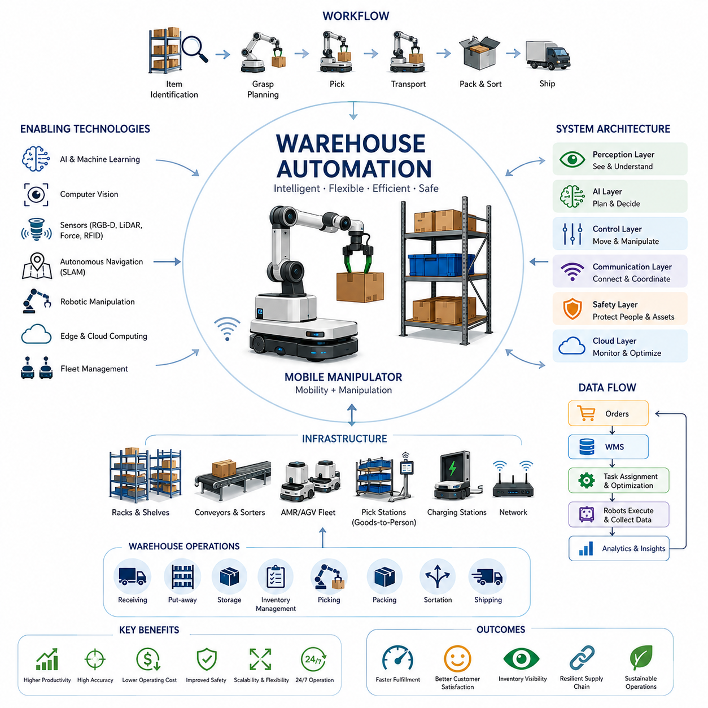
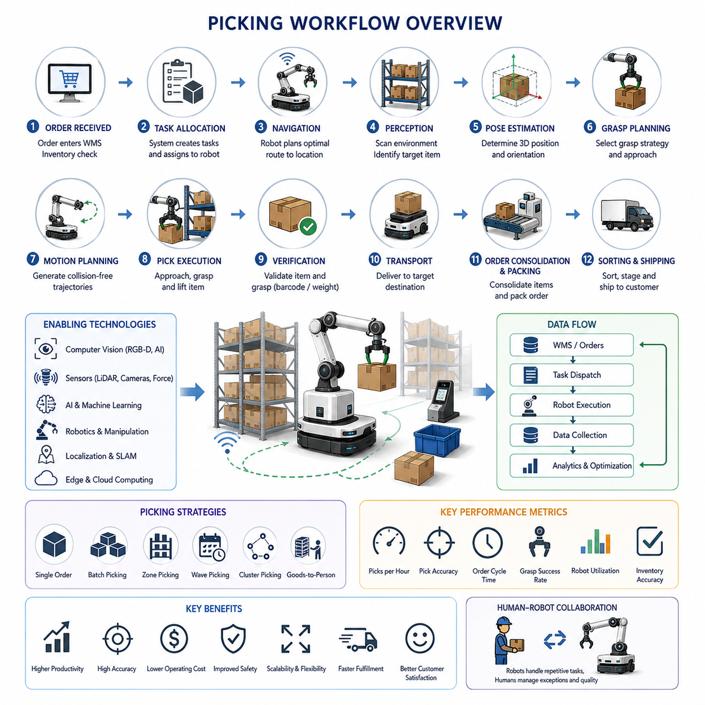
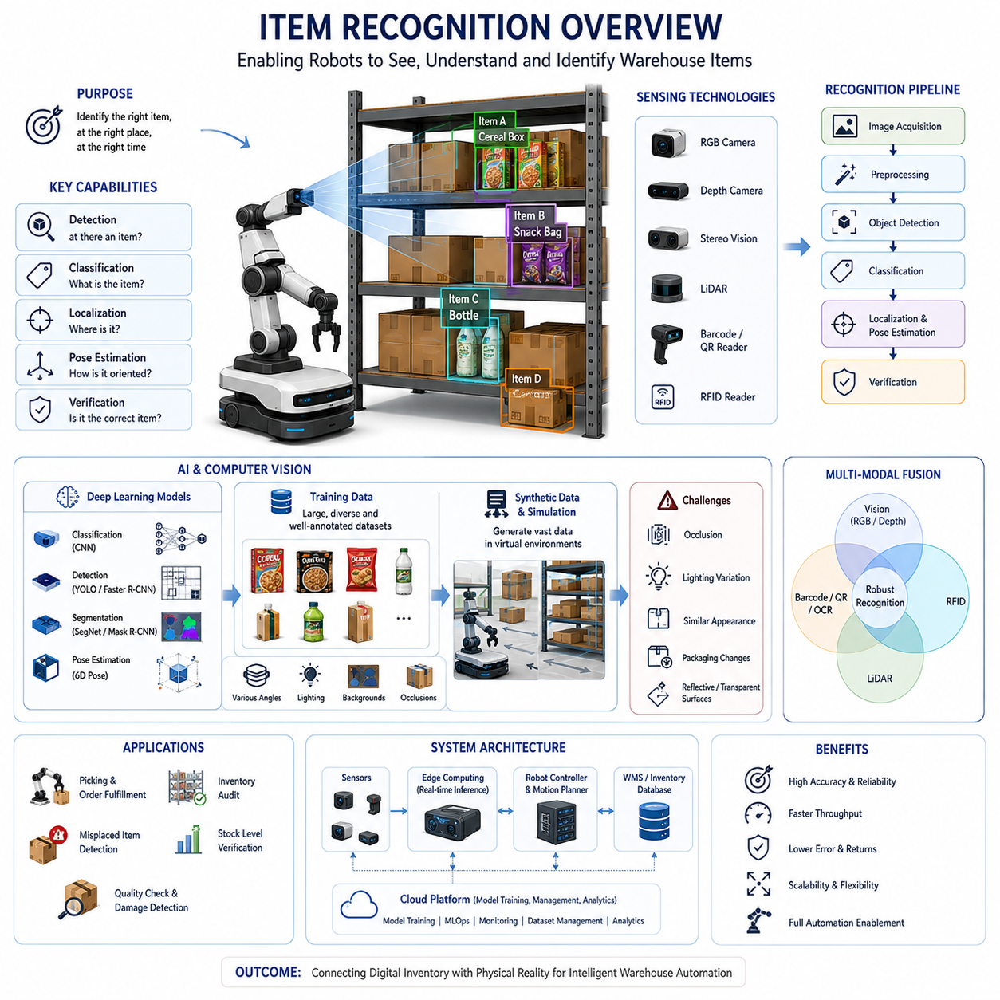
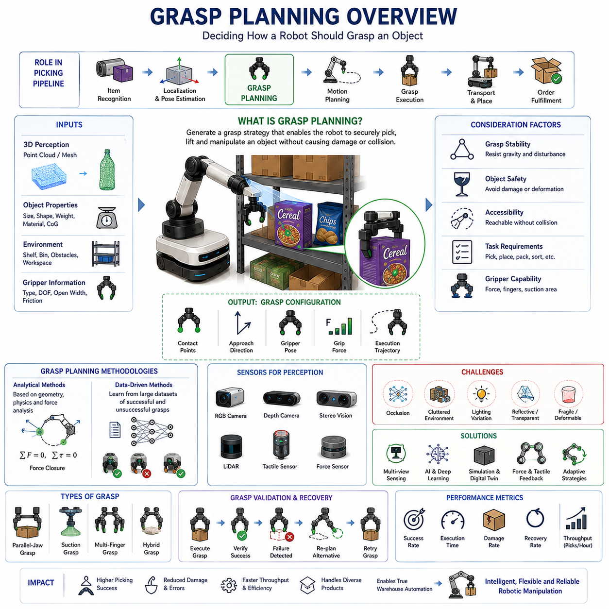
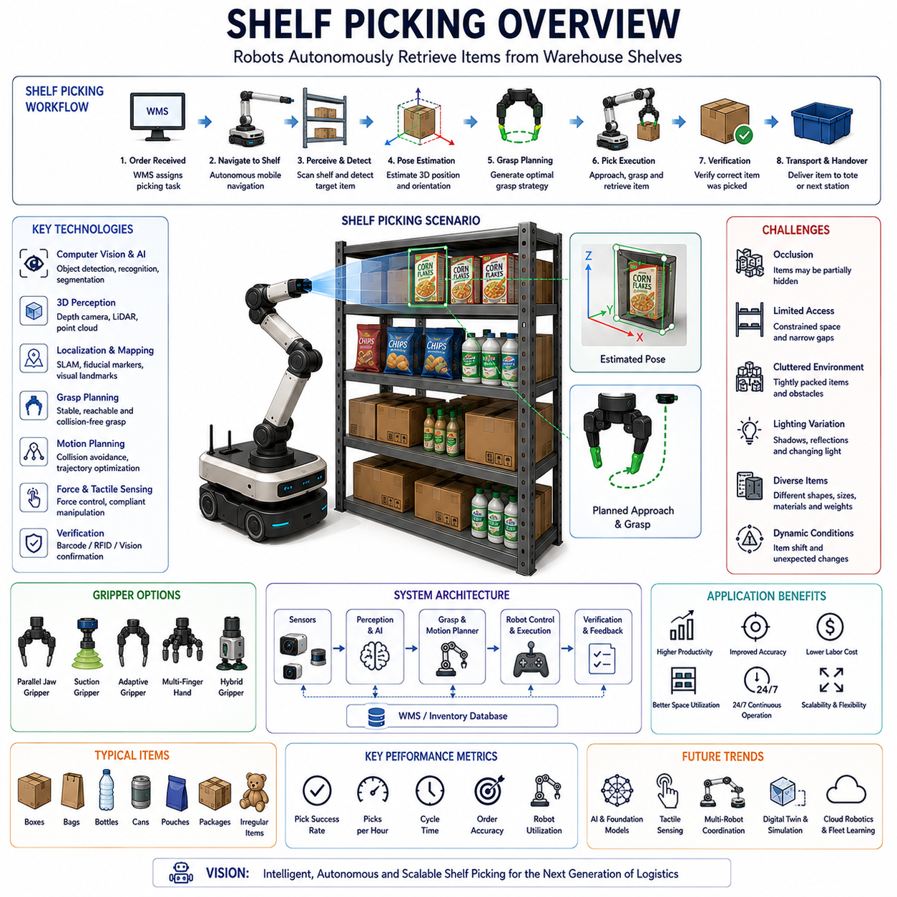
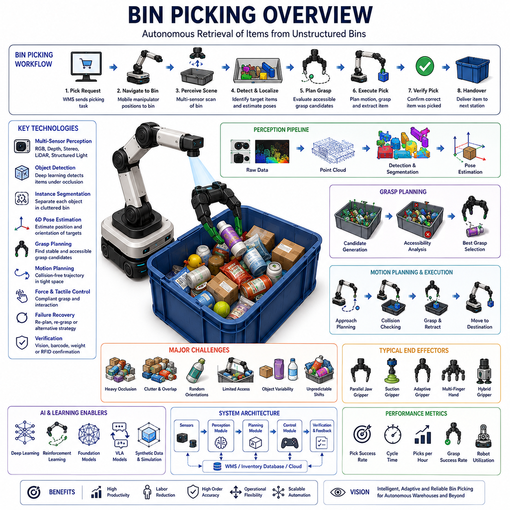
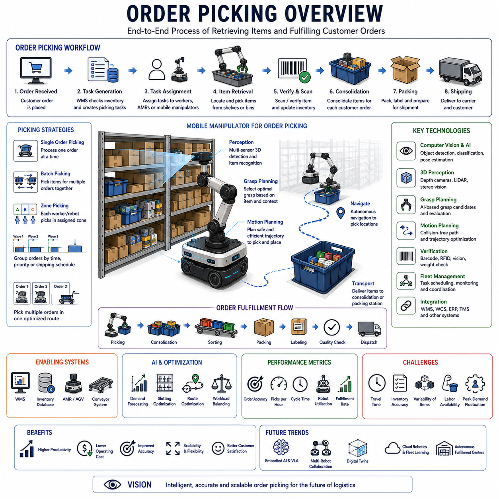
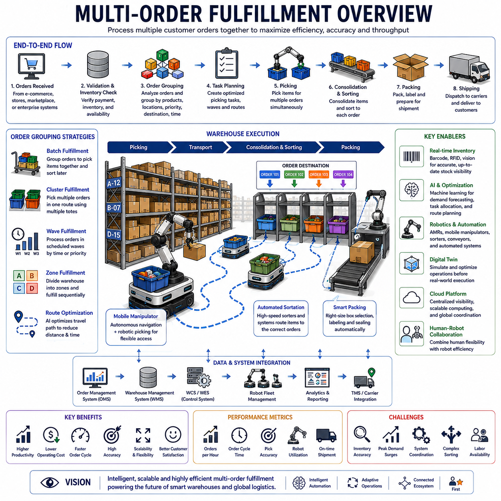
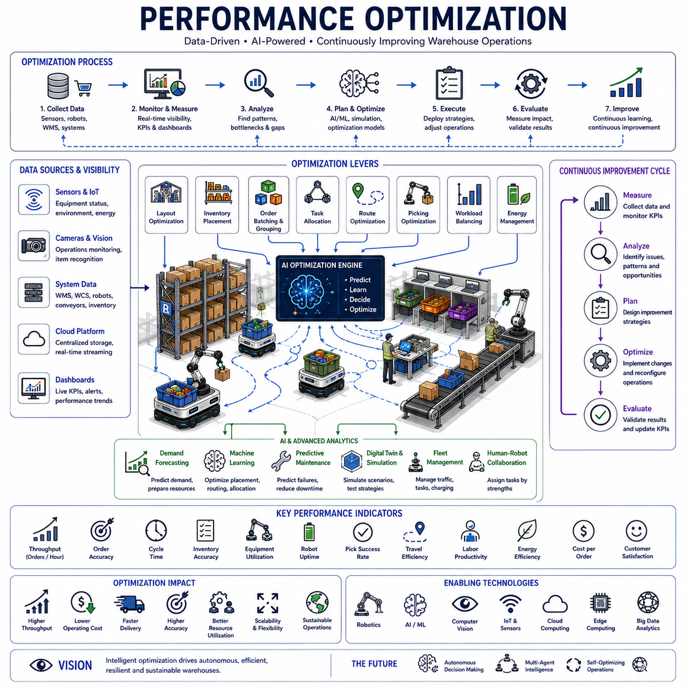
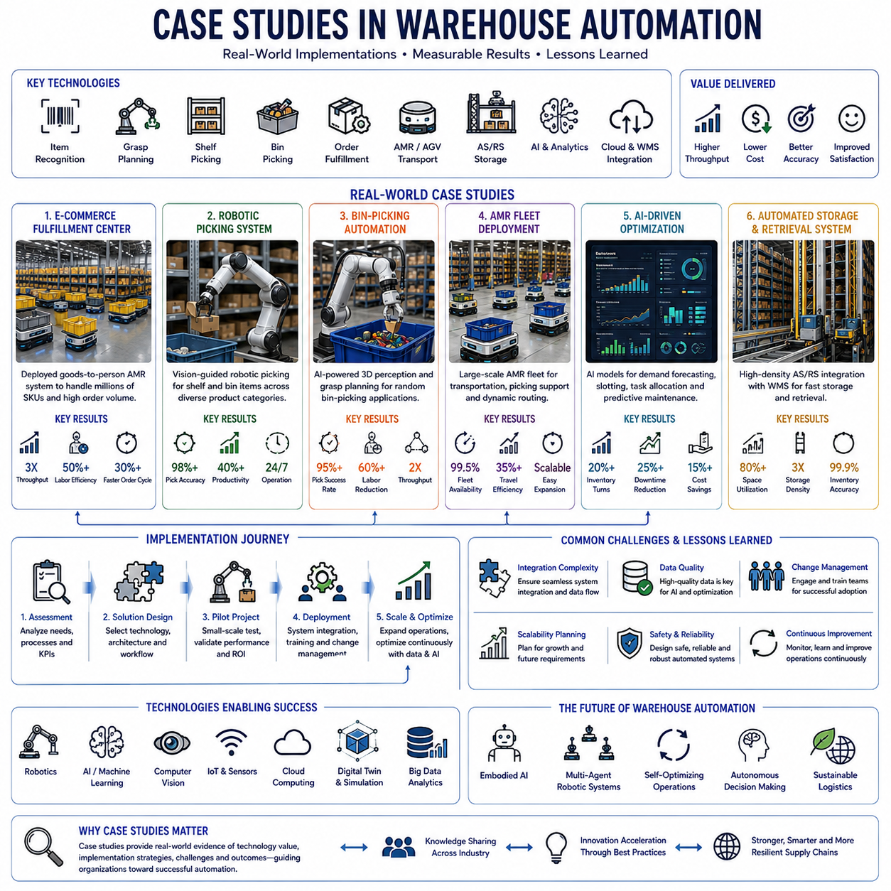

**Volume 01. Mobile Manipulator Foundations and System Architecture**

# Chapter 06. Warehouse Picking

## 01 Warehouse Automation Overview

{width="7.268055555555556in" height="7.268055555555556in"}

Warehouse automation has become one of the most transformative developments in modern logistics and supply chain management. As global commerce continues to expand and customer expectations shift toward faster delivery, higher accuracy, and lower costs, warehouses are evolving from labor-intensive storage facilities into highly intelligent and automated fulfillment centers. This transformation is driven by advances in robotics, artificial intelligence, machine vision, cloud computing, industrial networking, and autonomous transportation technologies. Within this evolution, mobile manipulators have emerged as a critical enabling technology because they combine autonomous mobility with robotic manipulation, allowing a single system to both navigate through warehouse environments and physically interact with inventory. The role of warehouse automation is no longer limited to reducing labor costs. It has become a strategic capability that directly influences customer satisfaction, operational resilience, inventory visibility, and overall business competitiveness. The structure of warehouse automation within mobile manipulator systems is reflected in the warehouse picking domain, where topics such as picking workflows, item recognition, grasp planning, shelf picking, bin picking, order fulfillment, and performance optimization form a comprehensive technology stack for automated logistics operations.

Traditional warehouses relied heavily on human workers to perform receiving, put-away, storage, picking, packing, sorting, and shipping activities. Although humans possess exceptional adaptability and dexterity, manual operations face limitations in scalability, consistency, and productivity. Seasonal demand fluctuations, labor shortages, rising wages, and increasing order complexity have created significant pressure on warehouse operators. E-commerce has further accelerated these challenges by increasing the number of stock keeping units, reducing average order sizes, and demanding rapid fulfillment cycles. As a result, companies are increasingly investing in automated systems that can operate continuously, maintain high accuracy levels, and adapt to dynamic operational requirements.

The concept of warehouse automation encompasses a broad spectrum of technologies. At the infrastructure level, automated storage and retrieval systems provide high-density inventory storage and automated access to stored goods. Conveyor systems, sortation equipment, shuttle systems, and automated guided vehicles facilitate material movement across facilities. Warehouse management systems coordinate inventory transactions, order processing, and workflow execution. Warehouse execution systems provide real-time operational control, while enterprise resource planning systems integrate warehouse operations with broader business processes. Mobile manipulators represent the next stage of automation because they bridge the gap between transportation and physical handling, enabling more flexible and intelligent warehouse workflows.

A modern automated warehouse can be viewed as a cyber-physical system in which digital information continuously interacts with physical operations. Customer orders are generated within digital commerce platforms and transmitted to warehouse management systems. These systems determine inventory locations, optimize task assignments, and coordinate robotic resources. Mobile robots receive mission instructions, navigate to storage locations, identify target items, execute picking operations, transport products to packing stations, and update inventory databases in real time. Every physical action generates operational data that can be analyzed to improve efficiency, predict maintenance requirements, and optimize future workflows.

The rise of e-commerce has significantly influenced warehouse automation strategies. Traditional retail supply chains often focused on pallet-level handling and bulk distribution to stores. E-commerce fulfillment centers must instead process individual customer orders containing diverse products with varying dimensions, weights, and packaging characteristics. This shift has increased the importance of piece-picking automation. Robots must be capable of identifying thousands of different products, determining suitable grasp points, and manipulating items without causing damage. Mobile manipulators are particularly valuable in these environments because they combine the mobility needed to reach distributed storage locations with the dexterity required for item-level interaction.

Warehouse automation can be categorized into several operational domains. Receiving automation focuses on unloading inbound shipments, identifying incoming products, and updating inventory records. Storage automation manages the placement of products into designated storage locations while maximizing space utilization and accessibility. Inventory management automation maintains accurate stock records through continuous monitoring and real-time updates. Picking automation retrieves products required for customer orders. Packing automation prepares items for shipment through packaging, labeling, and documentation processes. Sortation automation directs completed orders toward appropriate shipping channels. Transportation automation manages the movement of materials between operational zones. Each of these domains can benefit from the integration of autonomous mobile manipulators.

One of the primary objectives of warehouse automation is improving productivity. Productivity can be measured through metrics such as picks per hour, orders processed per shift, inventory throughput, and facility utilization. Automated systems can operate continuously with minimal downtime, enabling higher throughput than traditional manual operations. Mobile manipulators can perform repetitive tasks without fatigue, maintain consistent performance levels, and operate during nighttime or low-staffing periods. This capability is particularly valuable in facilities that experience large fluctuations in demand volume.

Accuracy represents another critical benefit of warehouse automation. Manual picking operations are susceptible to human errors such as selecting incorrect items, placing products in wrong locations, or miscounting inventory quantities. Such errors can lead to customer dissatisfaction, returns, and increased operational costs. Automated systems utilize barcode scanners, RFID readers, computer vision algorithms, and inventory databases to verify item identities and locations. Mobile manipulators equipped with advanced perception systems can significantly reduce error rates by validating products before executing pick-and-place operations.

Safety is also a major driver of warehouse automation adoption. Warehouses contain numerous occupational hazards including heavy lifting, repetitive motions, vehicle interactions, and high shelving structures. Automated systems reduce human exposure to these risks by assuming physically demanding and potentially dangerous tasks. Mobile robots can transport heavy loads, operate in confined spaces, and access elevated storage areas without exposing workers to injury risks. At the same time, collaborative safety systems ensure that robots can operate safely alongside human personnel through obstacle detection, speed control, emergency stopping mechanisms, and human-aware navigation algorithms.

The integration of artificial intelligence has dramatically expanded the capabilities of warehouse automation systems. Traditional automation relied heavily on predefined rules and structured environments. Modern AI-enabled systems can adapt to changing conditions, recognize previously unseen objects, optimize workflows dynamically, and learn from operational data. Computer vision systems can identify products based on appearance rather than requiring fixed markers. Machine learning algorithms can predict demand patterns, optimize inventory placement, and improve task scheduling. Reinforcement learning techniques can enhance robotic manipulation performance through experience-based optimization.

Mobile manipulators occupy a unique position within warehouse automation because they combine the strengths of autonomous mobile robots and industrial robotic arms. Autonomous mobility enables robots to move efficiently throughout warehouse environments. Robotic manipulation provides the ability to grasp, lift, sort, and place objects. When these capabilities are integrated into a single platform, the resulting system can perform end-to-end warehouse operations with minimal human intervention. Such systems can navigate to storage shelves, identify target products, retrieve them using robotic arms, transport them to packing stations, and continue to subsequent assignments autonomously.

The perception subsystem plays a central role in warehouse automation. Sensors such as RGB cameras, depth cameras, LiDAR systems, stereo vision systems, and force sensors provide situational awareness for robotic platforms. Computer vision algorithms process sensory information to detect objects, estimate poses, recognize inventory locations, and identify environmental obstacles. Accurate perception is essential for reliable manipulation because robots must understand object geometry, orientation, and accessibility before executing grasping actions. Advanced perception systems also enable dynamic obstacle avoidance and safe interaction with human workers.

Navigation technologies form another foundational component of warehouse automation. Mobile robots must determine their position within facilities, plan efficient routes, and avoid collisions while executing missions. Simultaneous localization and mapping techniques allow robots to construct and update environmental maps while tracking their own location. Fleet management systems coordinate multiple robots, optimize traffic flow, and prevent congestion. As warehouse operations scale, efficient navigation becomes increasingly important for maintaining productivity and minimizing travel times.

Warehouse automation architectures increasingly adopt cloud-edge computing models. Edge computing platforms provide real-time processing capabilities for perception, navigation, and control tasks. Cloud platforms support fleet management, analytics, machine learning model training, and enterprise integration. This distributed architecture enables robots to make immediate operational decisions while benefiting from centralized optimization and long-term data analysis. Cloud connectivity also facilitates remote monitoring, predictive maintenance, software updates, and operational reporting.

Another significant trend in warehouse automation is the development of goods-to-person systems. Instead of requiring workers to travel throughout warehouses searching for products, automated systems bring inventory directly to picking stations. Autonomous robots transport shelving units, storage bins, or inventory containers to designated work areas. Mobile manipulators extend this concept by enabling automated goods retrieval without requiring human participation. These systems improve efficiency by reducing travel distances and increasing picker productivity.

Scalability is a key advantage of modern warehouse automation solutions. Traditional fixed automation systems often require significant infrastructure investments and lengthy deployment periods. Mobile robotic systems offer greater flexibility because additional robots can be introduced incrementally as operational demands increase. This modular approach reduces implementation risks and enables organizations to align automation investments with business growth. Mobile manipulators further enhance scalability by supporting a wide range of tasks within a single platform architecture.

The economic justification for warehouse automation is typically evaluated through return on investment analysis. Factors such as labor cost reduction, productivity improvements, accuracy enhancements, inventory optimization, and customer service benefits contribute to financial returns. Although automation systems require substantial upfront investments, long-term operational savings often justify deployment. Furthermore, automation can provide strategic advantages that extend beyond direct cost reductions, including improved resilience against labor shortages and enhanced responsiveness to market changes.

Digital twins are increasingly used to support warehouse automation planning and optimization. A digital twin is a virtual representation of a physical warehouse that enables simulation, testing, and performance analysis. Organizations can evaluate alternative layouts, robot fleet sizes, inventory strategies, and operational workflows before implementing changes in real facilities. Mobile manipulator behaviors can be validated in simulation environments, reducing deployment risks and accelerating system development.

Sustainability considerations are becoming increasingly important within warehouse automation strategies. Automated systems can improve energy efficiency through optimized routing, reduced idle times, and intelligent resource allocation. Inventory accuracy reduces waste associated with misplaced or expired products. Efficient warehouse operations also contribute to lower transportation requirements and reduced environmental impact. As organizations pursue sustainability goals, warehouse automation increasingly supports both economic and environmental objectives.

Future warehouse automation systems will likely become more autonomous, adaptive, and intelligent. Foundation models, vision-language models, and embodied AI technologies are expected to enhance robotic reasoning capabilities. Robots will be able to understand natural language instructions, interpret complex operational goals, and adapt to previously unseen scenarios. Multi-robot collaboration will enable fleets of autonomous systems to coordinate warehouse activities dynamically. Human workers will increasingly transition from performing repetitive manual tasks to supervising, optimizing, and collaborating with intelligent robotic systems.

In conclusion, warehouse automation represents a fundamental transformation in the way logistics operations are designed and executed. Driven by technological advances and growing operational demands, automated warehouses are evolving into highly intelligent ecosystems where software, robotics, artificial intelligence, and human expertise work together to achieve unprecedented levels of efficiency and accuracy. Mobile manipulators serve as one of the most important enabling technologies within this transformation because they unite autonomous mobility and physical manipulation within a single platform. As warehouse automation continues to advance, organizations that successfully integrate these technologies will be better positioned to meet customer expectations, improve operational performance, and maintain long-term competitiveness in an increasingly dynamic global marketplace. The warehouse picking domain, including workflows, recognition, grasping, shelf interaction, bin handling, order fulfillment, and performance optimization, provides the foundational framework through which these advanced automation capabilities can be systematically developed and deployed.

## 02 Picking Workflows

{width="7.268055555555556in" height="7.268055555555556in"}

Picking workflows represent the operational core of modern warehouse automation systems. Regardless of the warehouse size, industry sector, or level of automation, the process of retrieving products from storage locations and preparing them for downstream logistics activities remains one of the most critical functions within the fulfillment operation. In traditional warehouses, picking activities account for a substantial portion of total operational costs because workers spend significant amounts of time traveling between storage locations, identifying items, verifying order requirements, and transporting products to packing or staging areas. As e-commerce, omnichannel fulfillment, and high-mix low-volume logistics continue to expand, efficient picking workflows have become essential for maintaining competitiveness, customer satisfaction, and operational profitability. Within mobile manipulator systems, picking workflows form the central bridge between perception, planning, manipulation, transportation, and order fulfillment. They connect technologies such as item recognition, grasp planning, shelf picking, bin picking, order processing, and fleet coordination into a unified operational framework.

A picking workflow can be defined as the complete sequence of activities required to retrieve one or more products from storage locations and deliver them to the next stage of the fulfillment process. Although the specific implementation varies across warehouses, the workflow generally begins when a customer order is received and ends when the requested products arrive at a packing station, sorting area, or shipping dock. Between these two points lies a complex series of decisions and actions involving inventory systems, warehouse management software, autonomous robots, robotic manipulators, and human operators.

The evolution of warehouse picking has closely followed the evolution of supply chain requirements. In traditional distribution centers, workers commonly used paper pick lists to identify products and manually navigate warehouse aisles. As warehouse management systems became more sophisticated, handheld scanners, voice-directed picking systems, and mobile terminals improved efficiency and accuracy. The next stage introduced automation technologies such as conveyors, automated storage systems, and autonomous mobile robots. Today, advanced fulfillment centers increasingly rely on mobile manipulators capable of independently navigating warehouse environments, locating products, picking items, and transporting them without direct human intervention.

The primary objective of a picking workflow is to fulfill customer orders accurately, efficiently, and consistently. This objective may appear straightforward, but it requires the coordination of numerous subsystems. Inventory databases must accurately represent stock availability. Navigation systems must guide robots to correct storage locations. Vision systems must identify target products among multiple surrounding objects. Manipulation systems must generate reliable grasping strategies. Fleet management systems must coordinate multiple robots operating simultaneously. All of these components must function together seamlessly to achieve high-performance warehouse operations.

Order initiation represents the first stage of the picking workflow. When an order enters the warehouse management system, the system validates inventory availability and determines the locations of all required items. Order management algorithms analyze inventory distribution, warehouse layout, workload conditions, and delivery priorities. The system then generates one or more picking tasks that are assigned to human workers, autonomous mobile robots, or mobile manipulators depending on operational policies and automation capabilities.

Task allocation plays a critical role in workflow optimization. In highly automated warehouses, sophisticated scheduling algorithms determine which robot should execute each picking task. Factors such as robot location, battery status, workload balance, travel distance, expected completion time, and equipment capabilities influence assignment decisions. Dynamic task allocation systems continuously adjust assignments as warehouse conditions change, ensuring optimal resource utilization throughout the facility.

After task assignment, navigation becomes the next major workflow component. The mobile manipulator must travel from its current location to the designated storage area. Navigation systems use warehouse maps, localization technologies, obstacle detection sensors, and path-planning algorithms to determine efficient routes. Modern warehouses often contain hundreds of robots operating simultaneously, making traffic management and congestion avoidance essential considerations. Fleet management platforms coordinate robot movements to prevent bottlenecks and maximize overall throughput.

Upon arrival at the storage location, the perception phase begins. Perception is one of the most technically challenging aspects of warehouse picking because products may vary significantly in size, shape, color, packaging, and orientation. Furthermore, warehouse environments often contain cluttered shelves, partially occluded objects, reflective surfaces, and varying lighting conditions. Computer vision systems use RGB cameras, depth sensors, stereo vision systems, and artificial intelligence algorithms to identify target items and estimate their three-dimensional positions.

Object recognition forms the foundation of successful picking operations. Robots must distinguish target products from surrounding inventory and verify that the correct item has been selected. Advanced perception systems combine deep learning-based object detection with inventory database information to achieve high recognition accuracy. Barcode reading, QR code scanning, RFID verification, and visual feature matching are often integrated to provide multiple layers of validation.

Pose estimation follows object recognition. Once a product has been identified, the robot must determine its exact position and orientation. Accurate pose estimation is essential because even small positioning errors can lead to grasp failures. Modern systems utilize depth cameras, point cloud processing algorithms, and machine learning models to estimate six-degree-of-freedom object poses. These capabilities allow robots to interact with objects located in complex and unstructured storage environments.

Following perception, the workflow enters the grasp planning stage. Grasp planning determines how the robot should physically interact with the target object. The planning process considers object geometry, weight distribution, surface characteristics, accessibility, collision risks, and gripper capabilities. Different products may require entirely different grasping strategies. A rigid cardboard box may be grasped from its sides, while a flexible package may require suction-based handling. Fragile products may demand carefully controlled force application to prevent damage.

Motion planning transforms grasp decisions into executable robotic actions. Motion planners generate collision-free trajectories for robotic arms while considering joint limits, environmental constraints, and dynamic obstacles. The planner must ensure that the robot can safely reach the target object, perform the grasp, and retract without interfering with surrounding inventory. Sophisticated motion planning algorithms continuously adapt trajectories based on sensor feedback and environmental changes.

The actual picking action represents the most visible part of the workflow but depends on the successful execution of all preceding stages. During picking, the robotic manipulator approaches the object, establishes contact, secures the grasp, and lifts the product from its storage location. Force sensors, torque sensors, and vision systems monitor execution in real time to detect anomalies and verify successful acquisition. If a grasp failure occurs, recovery procedures may initiate automatically, allowing the robot to attempt alternative grasp strategies.

Verification is typically performed immediately after the pick operation. Verification systems confirm that the correct product has been retrieved and that the item remains securely held by the manipulator. Weight measurements, barcode scanning, image analysis, and inventory database cross-checks contribute to this validation process. Early detection of errors prevents incorrect products from progressing further through the fulfillment process.

Transportation represents the next workflow phase. Once the product has been successfully picked, the mobile manipulator transports it to a designated destination. Depending on the warehouse architecture, this destination may be a packing station, sorting area, consolidation zone, shipping dock, or another robotic workstation. During transportation, navigation systems continue monitoring the environment while fleet management software coordinates traffic among multiple robots.

Order consolidation becomes important when customer orders contain multiple products stored in different locations. In such cases, multiple picking operations must be completed before the order can proceed to packing. Consolidation strategies vary depending on warehouse design. Some facilities utilize centralized consolidation stations where products from multiple robots are combined. Others employ distributed workflows in which robots collect multiple products during a single route before delivering the completed order.

Packing integration represents another important element of modern picking workflows. In highly automated fulfillment centers, robotic systems may directly transfer products into automated packing stations. Packing systems select appropriate packaging materials, prepare shipping labels, verify order completeness, and seal packages for shipment. Integration between picking and packing workflows reduces handling steps and improves overall operational efficiency.

Real-time data collection occurs throughout the entire workflow. Every robot movement, grasp attempt, navigation event, and order transaction generates valuable operational data. Analytics platforms use this information to monitor performance, identify bottlenecks, optimize workflows, and support predictive maintenance. Data-driven decision making has become a central component of warehouse automation strategies.

Several different picking methodologies are commonly used in warehouse environments. Single-order picking focuses on completing one customer order at a time. Batch picking groups multiple orders together to reduce travel distances. Zone picking assigns specific warehouse regions to dedicated workers or robots. Wave picking organizes tasks into coordinated fulfillment cycles based on shipping schedules. Cluster picking allows simultaneous processing of multiple orders using shared picking routes. The optimal methodology depends on order profiles, warehouse layouts, inventory characteristics, and automation capabilities.

Goods-to-person workflows have significantly transformed modern picking operations. Instead of requiring robots or workers to travel extensively through storage areas, inventory is automatically transported to picking stations. Mobile manipulators operating within goods-to-person systems can perform high-speed picking while remaining in relatively fixed operational zones. This approach reduces travel times and increases throughput.

Artificial intelligence is increasingly enhancing picking workflow performance. Machine learning algorithms optimize task allocation, predict inventory demand, improve route planning, and enhance grasp success rates. Vision-language models enable robots to interpret natural language instructions and understand product descriptions. Foundation models support generalized perception and manipulation capabilities that can adapt to previously unseen products and warehouse configurations.

Human-robot collaboration remains an important aspect of many warehouse operations. While automation continues to expand, humans still provide flexibility, judgment, and exception handling capabilities that are difficult to fully automate. Collaborative workflows allow robots to perform repetitive transportation and picking tasks while humans manage complex products, unusual situations, and quality assurance activities. Effective collaboration requires intuitive interfaces, clear communication mechanisms, and robust safety systems.

Performance measurement is essential for evaluating picking workflow effectiveness. Common metrics include picks per hour, order completion time, travel distance, pick accuracy, grasp success rate, robot utilization, inventory accuracy, and order cycle time. These metrics provide visibility into operational performance and guide continuous improvement initiatives. Advanced analytics systems can identify inefficiencies and recommend optimization strategies based on real-world operational data.

Scalability is another key consideration in workflow design. As order volumes increase, picking systems must accommodate higher workloads without significant performance degradation. Mobile manipulator fleets offer substantial scalability advantages because additional robots can be deployed incrementally. Cloud-based fleet management systems can coordinate large numbers of robots while maintaining operational efficiency across expanding facilities.

Future picking workflows will become increasingly autonomous, adaptive, and intelligent. Embodied AI systems will enable robots to reason about tasks, understand warehouse objectives, and adapt to unfamiliar situations. Multi-agent robotic systems will collaborate dynamically to optimize fulfillment activities. Digital twins will continuously simulate warehouse operations and recommend real-time adjustments. Vision-language-action models will allow robots to understand complex instructions and execute sophisticated picking tasks with minimal human supervision.

Ultimately, picking workflows represent the operational heartbeat of warehouse automation. They integrate perception, navigation, manipulation, planning, verification, transportation, and fulfillment into a unified process that directly influences customer satisfaction and business performance. As robotics, artificial intelligence, and automation technologies continue to advance, warehouse picking workflows will evolve from structured task sequences into highly adaptive autonomous systems capable of managing complex logistics environments with unprecedented levels of efficiency, accuracy, flexibility, and intelligence. In the broader context of mobile manipulation, picking workflows serve as the foundational process that connects item recognition, grasp planning, shelf interaction, bin handling, order fulfillment, and performance optimization into a complete end-to-end warehouse automation ecosystem.

## 03 Item Recognition

{width="7.268055555555556in" height="7.268055555555556in"}

Item recognition is one of the most critical technologies in warehouse automation and mobile manipulation systems. It serves as the foundation that enables robots to understand their environment, identify products, verify inventory, and perform reliable picking operations. Regardless of how advanced a robot's navigation, grasp planning, or manipulation capabilities may be, successful warehouse automation cannot be achieved without accurate and robust item recognition. In a modern fulfillment center, thousands or even millions of individual products may coexist within the same facility. These products vary significantly in size, shape, color, texture, packaging, labeling, and orientation. The ability to recognize and distinguish among these products in real time is essential for achieving high levels of automation, operational efficiency, and customer satisfaction. Within the warehouse picking technology stack, item recognition acts as the perceptual bridge between inventory information stored in digital systems and physical products located in warehouse environments. It directly supports grasp planning, shelf picking, bin picking, order fulfillment, inventory verification, and autonomous decision-making.

Traditionally, warehouse item identification relied heavily on manual processes. Human workers used visual inspection, barcode scanning, product labels, and inventory lists to locate and verify products. While humans possess remarkable visual recognition capabilities, manual identification becomes increasingly difficult as warehouse scale and product diversity expand. Large e-commerce fulfillment centers may contain hundreds of thousands of unique stock keeping units, requiring workers to distinguish among products that often appear visually similar. Automation introduces the opportunity to perform these identification tasks faster, more consistently, and with significantly higher scalability.

Item recognition can be broadly defined as the process by which a robotic system detects, classifies, localizes, and verifies products within its operational environment. Detection answers the question of whether an object exists within the scene. Classification determines the object\'s category or identity. Localization identifies the object\'s position within the environment. Verification confirms that the identified object matches the expected inventory record or customer order requirement. Together, these capabilities enable autonomous systems to interact intelligently with warehouse inventory.

The importance of item recognition has increased dramatically with the growth of e-commerce. Traditional retail distribution often involved pallet-level handling and bulk product movement. Modern fulfillment operations increasingly focus on piece-level picking, where individual items must be identified and handled separately. This shift requires recognition systems capable of operating at much finer levels of detail. A robot may need to distinguish between two visually similar product variants that differ only in packaging color, label information, or product size. Failure to recognize such differences can result in incorrect shipments and customer dissatisfaction.

Modern item recognition systems are built upon multiple sensing technologies. RGB cameras remain the most widely used perception devices because they provide rich visual information at relatively low cost. High-resolution cameras capture color, texture, shape, and packaging details that support object identification. However, RGB cameras alone may struggle under challenging lighting conditions or when products have similar visual appearances. Consequently, warehouse automation systems often combine RGB imaging with additional sensing modalities.

Depth cameras provide three-dimensional information about object geometry and spatial relationships. Unlike conventional cameras, depth sensors measure the distance between the sensor and surrounding objects. This capability enables robots to estimate object size, shape, orientation, and position more accurately. Depth information is particularly valuable in cluttered environments where multiple products overlap or partially occlude one another.

Stereo vision systems offer another approach to three-dimensional perception. By analyzing images captured from two spatially separated cameras, stereo systems reconstruct depth information through triangulation. These systems provide rich environmental understanding while maintaining relatively low hardware complexity. Stereo vision is frequently used in mobile manipulators that require accurate perception for both navigation and object interaction.

LiDAR sensors are also increasingly integrated into warehouse automation platforms. Although LiDAR is more commonly associated with navigation and mapping, it can contribute to object recognition by generating precise three-dimensional point clouds. These point clouds provide valuable information regarding object geometry and spatial arrangement. In combination with vision systems, LiDAR enhances environmental awareness and improves recognition reliability.

Beyond visual sensing technologies, warehouses often utilize barcode readers, QR code scanners, RFID systems, and optical character recognition technologies. These methods provide explicit identification information that complements visual recognition algorithms. Barcode and QR code systems remain highly effective because they directly encode product identity information. RFID technology enables contactless identification without requiring direct visual access to labels. Optical character recognition can extract textual information from product packaging, labels, and shipping documents.

Computer vision forms the computational foundation of modern item recognition systems. Computer vision algorithms process raw sensor data and transform it into meaningful information about products and environments. Early warehouse automation systems relied on handcrafted image processing techniques that used manually defined features such as edges, corners, contours, and color histograms. Although effective in highly structured environments, these methods often struggled when confronted with product variability and environmental complexity.

The emergence of deep learning revolutionized item recognition capabilities. Convolutional neural networks demonstrated unprecedented performance in image classification and object detection tasks. Unlike traditional algorithms, deep learning systems automatically learn relevant visual features from large datasets. This capability allows recognition models to handle significant variations in lighting, orientation, packaging design, and product appearance.

Object detection represents one of the most important functions within warehouse item recognition. Object detection algorithms identify the presence and location of products within images. Modern detection architectures such as region-based detectors and single-stage detectors can simultaneously recognize multiple objects within complex scenes. These systems generate bounding boxes that indicate object locations while assigning confidence scores and category labels.

Classification follows detection and determines product identity. In warehouse environments, classification often requires fine-grained discrimination between highly similar products. Deep neural networks trained on large product image datasets can learn subtle visual differences that distinguish individual stock keeping units. As product catalogs expand, maintaining classification accuracy becomes increasingly challenging and necessitates continuous dataset management and model updates.

Localization extends recognition beyond identification by determining the precise spatial position of products. Localization is essential for robotic manipulation because the robot must know exactly where an object is located before attempting to grasp it. Position estimates are typically expressed within three-dimensional coordinate systems that reference the robot, the shelf, or the warehouse environment.

Pose estimation further enriches object understanding by determining orientation in addition to position. Six-degree-of-freedom pose estimation identifies an object\'s translation and rotation within space. This information enables robotic manipulators to approach products from appropriate directions and execute reliable grasping actions. Pose estimation becomes particularly important when handling irregularly shaped products or densely packed inventory.

Warehouse item recognition faces numerous environmental challenges. Occlusion represents one of the most common difficulties. Products may partially block one another, making visual identification difficult. In cluttered storage bins, only small portions of target objects may remain visible. Advanced recognition systems must infer object identity from incomplete visual information while maintaining acceptable accuracy.

Lighting variability presents another significant challenge. Warehouse environments may contain shadows, reflections, changing illumination conditions, and mixed artificial lighting sources. Recognition systems must operate reliably across these varying conditions. Data augmentation techniques, adaptive image processing, and robust neural network architectures help improve performance under diverse lighting environments.

Packaging variation introduces additional complexity. Manufacturers frequently modify packaging designs, labels, branding elements, and product appearance. Recognition systems must adapt to these changes without requiring extensive manual reconfiguration. Continuous learning approaches and large-scale training datasets improve robustness against packaging evolution.

Another major challenge involves transparent, reflective, or deformable objects. Plastic packaging, glass containers, metallic surfaces, and flexible products often generate perception difficulties because they interact unpredictably with light. Specialized sensing technologies and multimodal perception architectures help address these challenges.

Data plays a central role in item recognition system development. Deep learning models require extensive datasets containing diverse examples of warehouse products. Data collection typically includes images captured under varying lighting conditions, viewing angles, backgrounds, and environmental configurations. Annotation processes identify object boundaries, categories, and relevant metadata. The quality and diversity of training data significantly influence recognition performance.

Synthetic data generation has emerged as an important strategy for expanding training datasets. Simulation platforms can generate millions of labeled images without requiring manual annotation. Digital twins and virtual warehouse environments enable the creation of diverse training scenarios that would be difficult or expensive to capture in physical facilities. Synthetic data has become particularly valuable for rare products and unusual operational situations.

Machine learning models must be continuously maintained throughout their operational lifecycle. New products enter inventory, packaging designs change, warehouse layouts evolve, and operational requirements shift over time. MLOps practices support model deployment, monitoring, retraining, validation, and performance management. Continuous improvement ensures that recognition systems remain accurate and relevant as warehouse conditions change.

Item recognition also plays a critical role in inventory management. Autonomous inventory auditing systems use recognition technologies to verify stock levels, identify misplaced products, detect empty storage locations, and monitor inventory movement. Mobile robots equipped with cameras and scanners can autonomously patrol warehouse aisles and perform inventory inspections with minimal human intervention.

In order fulfillment operations, recognition systems provide multiple layers of quality assurance. Before a product is picked, the robot verifies its identity. During grasp execution, recognition algorithms confirm successful acquisition. After transport, additional verification ensures that the correct product has reached the designated destination. These repeated validation steps significantly reduce fulfillment errors and improve customer satisfaction.

Artificial intelligence continues to expand the capabilities of item recognition systems. Foundation models trained on vast image datasets provide generalized visual understanding that can transfer across domains. Vision-language models combine image interpretation with natural language understanding, enabling robots to identify products based on textual descriptions and contextual instructions. Such models reduce reliance on manually defined product categories and improve adaptability to unfamiliar inventory.

Embodied AI introduces an even broader perspective by integrating perception with action and reasoning. Rather than treating recognition as an isolated task, embodied systems understand objects in relation to manipulation objectives and operational goals. For example, a robot may not only recognize a product but also understand how it should be grasped, transported, and packaged based on contextual information.

Future item recognition systems will become increasingly multimodal, combining vision, depth sensing, tactile feedback, language understanding, and environmental context. Recognition will evolve from simple object identification toward comprehensive scene understanding. Robots will recognize not only products but also relationships among objects, storage conditions, workflow priorities, and operational constraints.

As warehouse automation scales globally, recognition systems will support increasingly diverse product catalogs containing millions of unique items. Advances in cloud computing, edge AI acceleration, large-scale foundation models, and real-time perception architectures will enable recognition performance that approaches or exceeds human capabilities. These systems will operate continuously, adapt dynamically, and support fully autonomous warehouse operations.

Ultimately, item recognition serves as the visual intelligence layer of warehouse automation. It transforms raw sensory information into actionable knowledge that supports every subsequent stage of robotic operation. Without reliable recognition, navigation, grasp planning, manipulation, inventory management, and order fulfillment cannot function effectively. As mobile manipulators become more capable and autonomous, item recognition will remain one of the most important enabling technologies, connecting digital inventory systems with physical warehouse operations and providing the perceptual foundation upon which intelligent logistics automation is built.

## 04 Grasp Planning

{width="7.268055555555556in" height="7.268055555555556in"}

Grasp planning is one of the most important capabilities in warehouse automation and mobile manipulation systems because it directly determines whether a robot can successfully interact with physical objects. While item recognition allows a robot to identify a target product and localization determines where that product is located, grasp planning answers the critical question of how the robot should physically acquire the object. It transforms perception into action by generating a strategy that enables a robotic manipulator to securely grasp, lift, transport, and place an item without causing damage to the product, the environment, or the robot itself. In modern warehouse automation, grasp planning serves as the fundamental bridge between computer vision and robotic manipulation. Without reliable grasp planning, even the most advanced perception systems and autonomous navigation technologies cannot achieve fully automated warehouse operations. Within the warehouse picking technology stack, grasp planning connects item recognition, pose estimation, motion planning, shelf picking, bin picking, order fulfillment, and robotic execution into a complete manipulation workflow.

The concept of grasp planning originates from the field of robotic manipulation, where robots are required to interact with physical objects in complex environments. Unlike industrial production lines that operate with fixed object positions and highly structured workspaces, warehouse environments are dynamic, unstructured, and continuously changing. Products arrive in different packaging configurations, orientations, storage locations, and stacking arrangements. A grasping strategy that works successfully for one object may completely fail for another. Consequently, warehouse robots must be capable of adapting their grasping behaviors to a wide variety of object characteristics and environmental conditions.

At its core, grasp planning involves determining where, when, and how a robotic gripper should contact an object. The planning process considers numerous factors including object geometry, weight, center of gravity, material properties, surface texture, accessibility, surrounding obstacles, gripper characteristics, and task objectives. The output of the planning process is a grasp configuration that specifies the contact locations, approach direction, gripper orientation, gripping force, and manipulation trajectory required to successfully acquire the object.

The importance of grasp planning has increased dramatically with the growth of e-commerce and piece-picking automation. Traditional warehouse automation systems often handled standardized cartons, pallets, or totes that could be manipulated using relatively simple mechanisms. Modern fulfillment centers process millions of unique products with highly diverse physical characteristics. Robots must be capable of handling rigid boxes, flexible bags, transparent packaging, cylindrical containers, fragile products, irregularly shaped consumer goods, and deformable materials. This diversity significantly increases the complexity of grasp planning and demands more sophisticated manipulation intelligence.

A successful grasp must satisfy multiple objectives simultaneously. First, the object must remain securely held during lifting and transportation. Second, the grasp should avoid damaging the product or its packaging. Third, the grasp should allow the robot to complete downstream tasks such as placing the object into a shipping container or transferring it to another workstation. Fourth, the grasp should be executable without colliding with surrounding objects or environmental structures. These requirements often create trade-offs that the planning system must evaluate and resolve.

Object geometry is one of the most influential factors in grasp planning. The shape of an object determines the available contact surfaces and influences the stability of different grasp configurations. Simple geometric objects such as boxes typically provide multiple stable grasp opportunities. In contrast, irregularly shaped products may present only a limited number of viable grasp locations. Modern perception systems generate detailed three-dimensional representations of objects that enable grasp planners to analyze geometric features and identify suitable contact regions.

The center of gravity plays a critical role in grasp stability. Grasping an object far from its center of mass may create excessive torque that destabilizes the grasp or causes the object to rotate unexpectedly. Effective grasp planning therefore attempts to position contact points in locations that provide balanced force distribution. Estimating the center of gravity becomes particularly important for large, heavy, or asymmetrically loaded products commonly found in warehouse environments.

Material properties also influence grasp selection. Rigid objects generally tolerate higher gripping forces and provide predictable contact behavior. Fragile products require careful force control to prevent damage. Flexible packaging presents additional challenges because object shape may deform during grasping. Transparent plastic, glossy surfaces, and soft materials often interact differently with grippers than rigid cardboard or metal containers. The planner must account for these characteristics when selecting grasp strategies.

The type of end effector used by the robot significantly affects grasp planning approaches. Parallel-jaw grippers are widely used because they provide simplicity, reliability, and versatility for handling boxed products. Vacuum suction systems are particularly effective for flat surfaces and lightweight packages. Multi-fingered robotic hands offer greater dexterity and adaptability but introduce additional planning complexity. Hybrid grippers combine multiple grasping mechanisms to increase operational flexibility across diverse product categories.

Perception serves as the primary information source for grasp planning. Before a grasp can be generated, the robot must understand the object\'s location, orientation, shape, and environmental context. Computer vision systems provide object detection, classification, segmentation, and pose estimation results that feed directly into the planning process. RGB cameras, depth sensors, stereo vision systems, and LiDAR technologies collectively contribute to environmental understanding and object characterization.

Three-dimensional perception has become particularly important for warehouse grasp planning. Depth cameras and point cloud generation technologies allow robots to construct geometric models of objects and surrounding environments. These models provide information regarding surface curvature, edge locations, accessible regions, and potential collision hazards. Three-dimensional understanding enables grasp planners to reason about physical interactions more accurately than traditional two-dimensional image analysis methods.

Grasp planning methodologies can generally be divided into analytical approaches and data-driven approaches. Analytical grasp planning relies on mathematical models of object geometry, contact mechanics, and force distributions. These methods evaluate candidate grasp configurations according to stability metrics and physical constraints. Analytical approaches provide strong theoretical foundations and interpretable decision-making processes but may struggle with highly complex or uncertain environments.

Data-driven grasp planning has gained significant popularity with the rise of artificial intelligence and deep learning. Instead of explicitly modeling all physical interactions, machine learning systems learn grasping strategies from large datasets containing successful and unsuccessful grasp examples. Neural networks can identify grasp opportunities directly from sensor data and generalize to previously unseen objects. This capability has greatly expanded the applicability of robotic grasping in real-world warehouse environments.

Deep learning-based grasp detection systems often operate by predicting grasp poses directly from images or point clouds. Given sensor observations, the neural network estimates potential grasp locations, approach directions, and confidence scores. These predictions are then evaluated and refined before execution. Such systems can rapidly generate grasp candidates while handling substantial object variability.

Simulation has become an essential tool for grasp planning development and validation. Robotic grasping requires extensive experimentation that would be costly and time-consuming to perform exclusively in physical environments. Simulation platforms enable researchers and engineers to evaluate thousands of grasp scenarios, generate synthetic training data, and optimize grasping policies before deployment. Digital twin technologies further enhance simulation fidelity by replicating real warehouse conditions and product characteristics.

Motion planning and grasp planning are closely interconnected. A theoretically stable grasp may be physically unreachable due to environmental constraints or robot kinematic limitations. Consequently, grasp planners must consider the robot\'s ability to execute the selected grasp. Integrated planning systems evaluate both grasp quality and motion feasibility simultaneously, ensuring that generated grasps can be safely and efficiently performed.

Collision avoidance represents a critical component of warehouse grasp planning. Products are frequently stored in densely packed shelves, bins, and totes where neighboring objects restrict access to target items. The planner must identify grasp approaches that avoid collisions with surrounding inventory, storage structures, and robot components. Collision-aware planning significantly improves success rates in cluttered environments.

Shelf picking introduces unique grasp planning challenges because products are often constrained by shelving structures and neighboring objects. Limited access angles, restricted maneuvering space, and occlusions complicate manipulation tasks. Effective shelf-picking systems must generate grasps that accommodate these environmental limitations while maintaining sufficient grasp stability.

Bin picking is generally considered one of the most challenging warehouse manipulation tasks. Objects are often randomly oriented, partially occluded, and tightly packed within containers. Grasp planning for bin picking requires robust perception, advanced collision reasoning, and adaptive execution strategies. Many modern warehouse automation systems use artificial intelligence to identify grasp opportunities within highly cluttered bin environments.

Force control enhances grasp execution by enabling robots to respond dynamically to physical interactions. Rather than relying solely on position control, force-controlled manipulators monitor contact forces during grasping and adjust behavior accordingly. This capability improves reliability when handling fragile, deformable, or uncertain objects. Force feedback also supports grasp verification and failure detection.

Tactile sensing represents an emerging area of warehouse manipulation research. Tactile sensors provide information regarding contact locations, pressure distributions, slip conditions, and object properties. By incorporating tactile feedback into grasp planning and execution, robots can achieve higher levels of dexterity and robustness. Future warehouse systems are expected to increasingly integrate tactile perception alongside vision-based recognition.

Grasp verification is an important post-execution process. After a grasp has been performed, the robot must confirm that the object has been successfully acquired. Verification mechanisms include force measurements, weight estimation, visual confirmation, and tactile feedback analysis. Early detection of grasp failures enables recovery actions that improve overall system reliability.

Failure recovery strategies are essential because no grasp planning system can achieve perfect success rates under all conditions. When a grasp attempt fails, the robot may generate alternative grasp candidates, reposition sensors, adjust approach angles, or request human intervention. Effective recovery mechanisms significantly improve operational robustness and reduce downtime.

Warehouse performance is highly sensitive to grasp success rates. Even small improvements in grasp reliability can produce substantial productivity gains when multiplied across thousands of daily picking operations. Consequently, grasp planning optimization represents a major area of investment for warehouse automation developers. Metrics such as grasp success rate, execution time, force efficiency, damage rate, and recovery frequency are commonly used to evaluate performance.

Artificial intelligence continues to transform grasp planning capabilities. Reinforcement learning enables robots to improve grasping performance through experience. Foundation models provide generalized object understanding that supports manipulation across diverse product categories. Vision-language-action models combine perception, reasoning, and execution into unified architectures capable of generating task-aware grasping behaviors. These technologies move grasp planning beyond simple geometric reasoning toward more comprehensive manipulation intelligence.

Embodied AI introduces a broader perspective in which grasp planning is integrated with perception, task planning, and environmental understanding. Instead of treating grasp generation as an isolated optimization problem, embodied systems consider the complete workflow objective. For example, the optimal grasp for transporting an object may differ from the optimal grasp for packing or sorting it. Embodied reasoning enables robots to select grasps that support downstream operational goals.

Future grasp planning systems will become increasingly adaptive, multimodal, and autonomous. Advances in computer vision, tactile sensing, machine learning, simulation, and robotic hardware will enable robots to manipulate an ever-expanding range of products with human-like flexibility. Real-time learning systems will continuously improve performance based on operational experience. Cloud robotics platforms will allow knowledge sharing across robot fleets, accelerating collective learning and adaptation.

Ultimately, grasp planning serves as the intelligence layer that transforms object recognition into physical action. It determines how robots interact with the physical world and directly influences the effectiveness of warehouse automation systems. Without robust grasp planning, autonomous picking, order fulfillment, inventory handling, and mobile manipulation cannot achieve commercial viability. As warehouses become increasingly automated and product diversity continues to expand, grasp planning will remain one of the most important enabling technologies supporting the future of intelligent logistics and autonomous robotic fulfillment.

## 05 Shelf Picking

{width="7.268055555555556in" height="7.268055555555556in"}

Shelf picking is one of the most important and challenging applications within warehouse automation and mobile manipulation systems. It refers to the process by which a robotic system autonomously identifies, reaches, grasps, retrieves, and transports products stored on shelves. Unlike traditional industrial automation environments where object positions are fixed and highly predictable, warehouse shelves contain products of varying sizes, shapes, packaging types, and orientations. These products are often arranged in dense storage configurations and may be partially occluded by neighboring items. As a result, shelf picking requires the seamless integration of perception, localization, grasp planning, motion planning, manipulation, and autonomous decision-making technologies. Within the warehouse automation technology stack, shelf picking represents the practical convergence point where item recognition, grasp planning, robotic control, and order fulfillment capabilities are combined to perform real-world warehouse operations.

The importance of shelf picking has increased significantly with the rapid expansion of e-commerce and omnichannel logistics. Traditional distribution centers were primarily designed to handle pallets, cartons, and bulk shipments. Modern fulfillment centers, however, must process millions of individual customer orders containing highly diverse products. Customers expect rapid delivery, high order accuracy, and continuous inventory availability. These requirements place tremendous pressure on warehouse operators to improve productivity while maintaining operational flexibility. Shelf picking automation addresses these challenges by enabling robots to perform repetitive retrieval tasks efficiently and consistently.

A typical shelf-picking workflow begins when an order management system receives a customer request. The warehouse management system identifies the required products and determines their storage locations. A mobile manipulator or robotic picking station receives the task and navigates to the designated shelf location. Once positioned appropriately, the perception system scans the shelf environment, identifies the target item, estimates its position and orientation, generates a grasp plan, executes the pick operation, verifies successful retrieval, and transports the product to the next stage of the fulfillment process. Although this sequence appears straightforward, each step involves substantial technical complexity.

The warehouse shelf environment presents unique challenges that distinguish shelf picking from other manipulation tasks. Shelves create constrained workspaces that limit robot movement and restrict access angles. Products may be tightly packed, stacked, or positioned behind other items. Shelf structures themselves introduce physical obstacles that complicate manipulator motion planning. In many cases, only partial views of target objects are available, requiring perception systems to operate under conditions of significant uncertainty.

One of the first requirements for successful shelf picking is accurate localization. The robot must know its own position relative to the shelf and determine the precise location of the target product. Modern warehouse systems use a combination of simultaneous localization and mapping technologies, fiducial markers, visual landmarks, LiDAR-based navigation, and three-dimensional perception systems to achieve this objective. Localization accuracy directly affects picking performance because even small positioning errors can result in failed grasp attempts.

Perception represents the foundation of shelf-picking operations. The robot must understand the shelf environment before it can interact with products. Computer vision systems utilize RGB cameras, depth cameras, stereo vision systems, and LiDAR sensors to construct a detailed representation of the scene. Object detection algorithms identify products, while instance segmentation techniques separate individual items from surrounding objects. Three-dimensional perception allows the robot to estimate product dimensions, orientations, and spatial relationships.

Object recognition in shelf environments is significantly more difficult than in controlled laboratory conditions. Products may be partially hidden behind neighboring items, labels may not face the camera, and lighting conditions may vary across shelf locations. Furthermore, warehouses often contain multiple product variants with highly similar appearances. Deep learning-based recognition systems have become essential because they can learn robust visual features that remain effective despite variations in viewing angle, lighting, packaging design, and product arrangement.

Once the target item has been identified, pose estimation determines its exact three-dimensional position and orientation. Pose estimation is particularly important in shelf picking because products are frequently stored in arbitrary orientations. The robotic manipulator requires precise geometric information in order to approach the object from an appropriate direction and establish a stable grasp. Six-degree-of-freedom pose estimation techniques are commonly used to provide the accuracy required for reliable manipulation.

Shelf-picking systems must also understand the geometry of the surrounding environment. The robot needs to recognize shelf boundaries, support structures, neighboring products, and potential collision hazards. Environmental understanding allows the planning system to generate safe and feasible manipulation strategies. Without accurate environmental modeling, grasp execution may result in collisions that damage products, shelves, or robotic equipment.

Grasp planning is one of the most critical components of shelf-picking automation. After identifying the target object and estimating its pose, the robot must determine how to grasp it successfully. The planning process considers object shape, size, weight, material properties, center of gravity, accessibility, and gripper characteristics. Shelf environments often limit the available grasping approaches, forcing the planner to identify solutions that balance stability, reachability, and collision avoidance.

Different product categories require different grasping strategies. Rectangular cartons are often handled using parallel-jaw grippers. Flexible packages may require adaptive grippers or suction systems. Cylindrical objects such as bottles may demand specialized grasp configurations that prevent slipping. Fragile products require careful force control to avoid damage during retrieval. Consequently, modern warehouse robots often employ versatile end effectors capable of handling diverse product types.

Motion planning transforms grasp decisions into executable robotic movements. In shelf-picking applications, motion planning is particularly challenging because the manipulator operates within confined spaces. The planner must generate collision-free trajectories that allow the robot to approach the target item, execute the grasp, retract the object, and exit the shelf environment safely. Kinematic constraints, joint limits, obstacle avoidance requirements, and dynamic environmental conditions must all be considered during trajectory generation.

Collision avoidance is a major concern in shelf-picking operations. Warehouse shelves are designed to maximize storage density, leaving limited free space for robotic manipulation. Neighboring products, shelf dividers, support beams, and structural elements create complex obstacle configurations. Advanced planning systems continuously monitor the environment and adjust trajectories to minimize collision risks. Real-time perception feedback enables adaptive behavior when environmental conditions change unexpectedly.

The physical retrieval of a product from a shelf often introduces additional challenges. Some products may be tightly wedged between neighboring items, creating friction and resistance during extraction. Others may shift unexpectedly when adjacent products are removed. Dynamic interactions between objects can complicate manipulation tasks and reduce grasp success rates. Force sensing and compliant control strategies help robots adapt to these conditions and maintain stable manipulation performance.

Verification is an essential component of shelf-picking workflows. After executing a grasp, the robot must confirm that the correct product has been successfully retrieved. Verification mechanisms include barcode scanning, visual confirmation, weight measurement, RFID identification, and inventory database cross-checking. Early detection of picking errors prevents incorrect products from entering downstream fulfillment processes.

Shelf-picking systems frequently operate as part of larger warehouse automation ecosystems. Integration with warehouse management systems enables real-time task assignment, inventory updates, and operational monitoring. Fleet management platforms coordinate multiple robots working simultaneously across warehouse environments. Cloud-based analytics systems collect performance data and support continuous optimization efforts. Such integration transforms shelf picking from an isolated manipulation task into a coordinated component of end-to-end logistics operations.

Artificial intelligence has significantly enhanced shelf-picking performance. Deep learning models improve object recognition accuracy and grasp prediction capabilities. Reinforcement learning algorithms enable robots to refine manipulation strategies through experience. Machine learning-based planners optimize task execution sequences and reduce operational inefficiencies. AI technologies allow robotic systems to adapt to changing warehouse conditions and handle increasingly diverse product catalogs.

Simulation and digital twins play important roles in shelf-picking development. Virtual environments enable engineers to evaluate perception algorithms, grasp planners, motion planners, and robotic hardware configurations before deployment. Large-scale simulation also supports synthetic data generation for training machine learning models. Digital twins allow operators to evaluate operational changes, optimize workflows, and predict system performance under varying conditions.

Mobile manipulators have emerged as particularly effective platforms for shelf-picking applications. Unlike fixed robotic workstations, mobile manipulators combine autonomous navigation with robotic manipulation capabilities. This mobility allows a single robotic system to access multiple shelf locations throughout a warehouse. Mobile manipulators can travel directly to storage locations, retrieve products, and transport them to fulfillment stations without requiring extensive fixed infrastructure.

Human-robot collaboration remains an important aspect of shelf-picking operations. Although automation capabilities continue to improve, certain products and situations remain difficult to handle autonomously. Human workers often manage exceptions, unusual products, damaged inventory, and complex decision-making tasks. Collaborative systems enable robots and humans to work together efficiently while maintaining high safety standards.

Safety considerations are particularly important because shelf-picking robots frequently operate in environments shared with human workers. Safety systems include obstacle detection sensors, speed monitoring mechanisms, emergency stop functions, force-limited manipulation, and human-aware motion planning. International safety standards increasingly guide the design and deployment of collaborative warehouse robotics systems.

Performance measurement is essential for evaluating shelf-picking effectiveness. Common metrics include pick success rate, picks per hour, cycle time, grasp success rate, order accuracy, robot utilization, inventory accuracy, and operational uptime. These metrics provide visibility into system performance and support continuous improvement initiatives. Even small increases in pick success rates can produce significant productivity gains across large-scale warehouse operations.

Shelf-picking technology continues to evolve toward higher levels of autonomy and intelligence. Foundation models are enabling more generalized perception and reasoning capabilities. Vision-language-action models allow robots to understand natural language instructions and adapt to previously unseen products. Embodied AI approaches integrate perception, reasoning, planning, and manipulation into unified architectures capable of more flexible behavior.

Future shelf-picking systems are expected to operate with increasing levels of autonomy, adaptability, and scalability. Multi-robot coordination will enable fleets of mobile manipulators to collaborate dynamically within large fulfillment centers. Advanced tactile sensing technologies will provide richer feedback during object interaction. Real-time cloud robotics platforms will facilitate knowledge sharing across distributed robot fleets. Continuous learning systems will allow robots to improve performance through operational experience without requiring extensive manual reprogramming.

As warehouse automation expands globally, shelf picking will remain one of the most strategically important robotic applications. It directly influences order fulfillment speed, inventory accuracy, labor efficiency, and customer satisfaction. The ability to autonomously retrieve products from dense storage environments represents a key requirement for next-generation logistics systems. Consequently, shelf picking serves not only as a manipulation challenge but also as a critical business capability that enables scalable and economically viable warehouse automation.

Ultimately, shelf picking represents the practical realization of intelligent robotic manipulation in warehouse environments. It combines perception, localization, grasp planning, motion planning, force control, verification, and logistics integration into a unified operational workflow. As robotics, artificial intelligence, sensing technologies, and cloud computing continue to advance, shelf-picking systems will become increasingly capable of handling the complexity and diversity of modern fulfillment operations. In the broader context of warehouse automation, shelf picking stands as one of the most important milestones on the path toward fully autonomous logistics ecosystems capable of operating efficiently, safely, and continuously at global scale.

## 06 Bin Picking

{width="7.268055555555556in" height="7.268055555555556in"}

Bin picking is one of the most advanced and technically demanding applications in warehouse automation and robotic manipulation. It refers to the process by which a robotic system autonomously identifies, selects, grasps, and retrieves target objects from bins, totes, containers, or storage boxes containing multiple randomly arranged items. Unlike shelf picking, where products are generally organized in predictable positions, bin picking operates in highly unstructured environments where objects may overlap, occlude one another, shift unexpectedly, or appear in arbitrary orientations. As a result, bin picking has become a benchmark problem in robotics because it requires the successful integration of perception, artificial intelligence, grasp planning, motion planning, force control, and autonomous decision-making. Within mobile manipulator systems, bin picking represents one of the most important capabilities for enabling flexible warehouse operations, order fulfillment, manufacturing logistics, and next-generation autonomous material handling. According to the warehouse picking structure within the mobile manipulator framework, bin picking forms a direct extension of item recognition, grasp planning, and shelf-picking technologies, while providing the foundation for advanced order fulfillment and warehouse automation workflows.

The significance of bin picking has increased dramatically as warehouses and fulfillment centers transition toward greater automation. Modern logistics operations handle enormous product diversity, ranging from consumer electronics and pharmaceuticals to apparel, packaged foods, automotive parts, and industrial components. Many of these products are stored within containers rather than on shelves. In traditional warehouses, human workers easily adapt to cluttered environments and retrieve objects from bins using natural visual perception and hand-eye coordination. Replicating this capability in robotic systems has proven significantly more difficult because robots must understand complex three-dimensional environments and interact with partially visible objects under uncertainty.

The fundamental objective of bin picking is deceptively simple. A robot must retrieve the correct item from a container and deliver it to a designated location. However, this task involves solving numerous challenges simultaneously. The robot must perceive the scene, identify target objects, estimate their positions and orientations, determine accessible grasp points, generate collision-free motions, execute stable grasps, verify successful retrieval, and recover from failures when necessary. Each stage introduces uncertainty and complexity that must be managed effectively for successful operation.

A typical bin-picking workflow begins when a warehouse management system generates a picking request. The target product is identified within inventory databases and associated with a particular storage container. A mobile manipulator navigates to the designated location and positions itself appropriately relative to the bin. Perception sensors scan the container and construct a three-dimensional representation of the environment. Object recognition algorithms identify candidate items, while pose estimation systems determine their spatial positions and orientations. Grasp planning algorithms evaluate potential grasp opportunities, and motion planners generate executable robot trajectories. After a grasp is performed, verification systems confirm successful acquisition before the product is transported to the next stage of the workflow.

One of the defining characteristics of bin picking is environmental complexity. Unlike structured industrial settings, bins often contain products arranged randomly. Objects may be stacked on top of each other, partially hidden, tilted at unusual angles, or compressed against container walls. The robot cannot assume consistent object placement or predictable access paths. Consequently, bin picking requires a significantly higher degree of adaptability than many traditional robotic applications.

Perception serves as the foundation of bin-picking systems. Before a robot can interact with objects, it must understand what exists inside the container. Modern perception architectures typically combine RGB cameras, depth cameras, stereo vision systems, structured-light sensors, and LiDAR technologies. These sensors generate complementary information regarding object appearance, geometry, spatial relationships, and environmental structure. Multi-sensor fusion improves robustness by compensating for the limitations of individual sensing modalities.

Three-dimensional perception is particularly important in bin picking because object accessibility depends heavily on spatial relationships. Depth cameras generate point clouds that represent object surfaces and environmental geometry. These point clouds allow robots to identify exposed object regions, estimate occlusions, and evaluate potential grasp opportunities. Advanced perception systems continuously update environmental models as objects are removed from containers and new grasp opportunities emerge.

Object detection within bins presents unique challenges. Products may be partially visible or obscured by neighboring items. Traditional image-based recognition approaches often struggle under such conditions because only limited visual information is available. Deep learning-based detection systems have significantly improved performance by learning robust visual representations capable of recognizing objects despite occlusion, clutter, and varying orientations. These systems often combine two-dimensional image analysis with three-dimensional geometric reasoning to improve recognition reliability.

Object segmentation is another critical component of bin-picking perception. Segmentation separates individual objects from surrounding items and background structures. Accurate segmentation is essential because grasp planning relies on understanding object boundaries and identifying accessible surfaces. Instance segmentation algorithms assign unique labels to individual objects, enabling robots to distinguish between multiple products occupying the same container.

Pose estimation determines the precise position and orientation of objects within the bin. Six-degree-of-freedom pose estimation provides the geometric information required for robotic manipulation. Because objects may be rotated arbitrarily and partially occluded, pose estimation often represents one of the most difficult perception tasks within bin-picking systems. Modern approaches combine deep learning, point cloud processing, model matching, and geometric optimization to achieve reliable performance.

Once objects have been identified and localized, grasp planning becomes the next major challenge. Bin-picking grasp planning differs substantially from shelf-picking grasp planning because access is often limited by neighboring objects. The planner must identify grasp points that are not only stable but also physically reachable. Many theoretically stable grasps cannot be executed because surrounding objects obstruct the manipulator\'s approach path. Consequently, accessibility and collision avoidance become central considerations.

The geometry of the target object significantly influences grasp planning. Box-shaped products offer relatively predictable grasp opportunities, while irregularly shaped objects require more sophisticated reasoning. Flexible packaging introduces additional complexity because object shape may deform during handling. Cylindrical objects may roll or rotate unexpectedly, while fragile products require carefully controlled contact forces. Effective grasp planners adapt strategies according to object characteristics and task requirements.

End-effector design plays a critical role in bin-picking performance. Parallel-jaw grippers remain common because they provide versatility and simplicity. Vacuum grippers are widely used for lightweight products with accessible flat surfaces. Adaptive grippers conform to object geometry and improve handling of irregular shapes. Multi-finger robotic hands offer human-like dexterity but introduce increased computational complexity. Many commercial systems employ hybrid grippers that combine suction and mechanical grasping capabilities to maximize flexibility.

Motion planning in bin-picking environments is particularly demanding because robots operate within highly constrained spaces. The manipulator must navigate around neighboring objects, container walls, and structural obstacles while maintaining feasible joint configurations. Collision-free trajectory generation becomes increasingly difficult as storage density increases. Advanced planning algorithms continuously evaluate environmental conditions and update trajectories in real time to accommodate dynamic changes.

Collision avoidance extends beyond robot-environment interactions. Removing one object from a cluttered bin may disturb surrounding items, causing shifts, collapses, or unexpected movements. Dynamic interactions between objects introduce uncertainty that must be addressed during planning and execution. Force-sensitive control strategies help robots respond safely to unexpected contact events and maintain stable operation.

Force control is an essential component of modern bin-picking systems. Traditional position-based control assumes predictable interactions between the robot and environment. However, cluttered environments frequently generate unexpected contact conditions. Force-controlled manipulators monitor interaction forces and adjust behavior dynamically. This capability improves grasp success rates and reduces the risk of damaging products or equipment.

Tactile sensing provides additional information that complements visual perception. Tactile sensors measure contact pressure, slip conditions, and object properties during manipulation. These sensors allow robots to verify grasp stability and adjust gripping forces in real time. As tactile sensing technology continues to mature, it is expected to play an increasingly important role in autonomous bin-picking applications.

Artificial intelligence has become a key enabler of practical bin-picking solutions. Traditional rule-based systems struggle to handle the variability and uncertainty present in cluttered environments. Deep learning models provide robust object recognition, segmentation, and grasp prediction capabilities. Reinforcement learning enables robots to improve manipulation performance through experience. Foundation models introduce generalized perception and reasoning abilities that can transfer across diverse object categories and operational scenarios.

Simulation has emerged as an indispensable tool for bin-picking development. Real-world experimentation is expensive and time-consuming, particularly when large datasets are required. Physics-based simulation environments allow engineers to generate synthetic data, evaluate algorithms, and optimize robotic behaviors before deployment. Digital twin technologies further improve realism by replicating actual warehouse conditions and inventory characteristics.

Failure recovery is particularly important in bin-picking systems because grasp failures are inevitable in highly cluttered environments. Recovery strategies may include selecting alternative grasp points, modifying approach directions, repositioning sensors, removing obstructing objects, or requesting human assistance. Effective recovery mechanisms significantly improve operational reliability and overall system throughput.

Warehouse productivity is highly sensitive to bin-picking performance. Metrics such as pick success rate, cycle time, object retrieval rate, grasp reliability, robot utilization, and order accuracy directly influence operational efficiency. Even modest improvements in grasp success rates can produce substantial gains when multiplied across thousands of daily picking operations. Consequently, performance optimization remains a major focus of research and industrial development.

Mobile manipulators have become increasingly important platforms for bin-picking applications. Their combination of autonomous navigation and robotic manipulation enables flexible deployment across large warehouse environments. Rather than relying on fixed robotic workstations, mobile manipulators can travel directly to storage locations, retrieve products from containers, and transport them to fulfillment stations. This flexibility reduces infrastructure requirements and supports scalable warehouse automation architectures.

Bin picking also plays a critical role in manufacturing logistics. Production facilities frequently store components in bins, totes, and containers. Autonomous retrieval of parts supports machine tending, assembly operations, packaging workflows, and material replenishment. As manufacturing systems move toward greater flexibility and customization, bin-picking automation becomes increasingly valuable.

Future developments in bin picking are closely linked to advances in embodied artificial intelligence. Vision-language-action models are enabling robots to combine perception, reasoning, and manipulation within unified architectures. Instead of merely identifying objects and executing predefined grasps, future systems will understand task objectives, contextual constraints, and operational priorities. Such capabilities will enable more adaptive and intelligent manipulation behaviors.

Cloud robotics and fleet learning are expected to further accelerate progress. Robots operating across different facilities will share experiences, grasping strategies, and environmental knowledge through cloud-based platforms. Collective learning will allow entire fleets to improve performance continuously based on distributed operational experience. This approach promises faster adaptation to new products, environments, and workflows.

The long-term vision for bin picking extends beyond warehouse automation. The technologies developed for autonomous retrieval in cluttered environments are directly applicable to manufacturing, healthcare logistics, service robotics, recycling systems, agricultural harvesting, and household robotics. Consequently, bin picking represents not only a logistics challenge but also a foundational capability for general-purpose robotic manipulation.

Ultimately, bin picking stands as one of the most challenging and strategically important problems in modern robotics. It requires the integration of advanced perception, artificial intelligence, grasp planning, motion planning, force control, and autonomous decision-making into a unified operational framework. Within warehouse automation, bin picking bridges the gap between structured robotic manipulation and real-world environmental complexity. As sensing technologies, AI models, robotic hardware, and cloud-based learning systems continue to advance, bin-picking solutions will become increasingly capable of achieving human-level flexibility and reliability. In the broader context of mobile manipulators and intelligent logistics, bin picking serves as a critical milestone on the path toward fully autonomous warehouses and truly general-purpose robotic systems capable of operating effectively in complex, dynamic, and unstructured environments.

## 07 Order Picking

{width="7.268055555555556in" height="7.268055555555556in"}

Order picking is one of the most fundamental and strategically important processes in warehouse operations. It represents the activity of retrieving products from storage locations to fulfill customer orders and directly influences fulfillment speed, operational efficiency, customer satisfaction, and overall supply chain performance. In modern warehouses, order picking is often considered the most labor-intensive and costly operation, accounting for a substantial percentage of total warehouse operating expenses. As e-commerce, omnichannel retailing, and same-day delivery services continue to expand globally, the importance of efficient order-picking systems has increased dramatically. Within warehouse automation and mobile manipulation frameworks, order picking serves as the operational layer that integrates item recognition, grasp planning, shelf picking, bin picking, transportation, inventory management, and order fulfillment into a unified logistics workflow. It represents the practical realization of warehouse automation objectives by transforming customer demand into physical product movement and successful order completion.

Historically, order picking was performed entirely by human workers. Warehouse operators received order lists, navigated through storage areas, located required products, collected items manually, and transported them to packing stations. Although humans possess remarkable adaptability and decision-making capabilities, manual order picking suffers from limitations in scalability, consistency, speed, and labor availability. As warehouses grew larger and product catalogs expanded, travel time became one of the dominant contributors to operational inefficiency. Workers often spent more time walking between storage locations than actually retrieving products. This challenge motivated the development of increasingly sophisticated warehouse management systems, automation technologies, and robotic solutions designed to optimize order-picking workflows.

The primary objective of order picking is to ensure that the correct products are delivered to customers accurately, efficiently, and on time. Achieving this objective requires coordination across multiple systems and technologies. Warehouse management systems must maintain accurate inventory records and generate picking tasks. Inventory control systems must provide real-time visibility into stock availability and storage locations. Mobile robots and robotic manipulators must retrieve products from shelves, bins, or storage containers. Transportation systems must move products through fulfillment workflows. Quality assurance mechanisms must verify order accuracy before shipment. The successful integration of these components determines the overall effectiveness of warehouse operations.

Order picking begins when a customer places an order through an e-commerce platform, retail system, business procurement channel, or supply chain network. The order management system receives the request and verifies product availability. Once inventory availability is confirmed, the warehouse management system generates picking tasks based on the products required for fulfillment. These tasks include information regarding product identifiers, storage locations, quantities, priorities, and delivery deadlines. The generated tasks are then assigned to human workers, autonomous mobile robots, mobile manipulators, or collaborative robotic systems depending on the warehouse\'s operational architecture.

Order-picking workflows vary significantly depending on warehouse design and business requirements. Single-order picking represents the most straightforward approach, where each customer order is processed independently. A worker or robot retrieves all products associated with a single order before proceeding to the next one. This method simplifies order tracking and reduces sorting complexity but may result in inefficient travel patterns when order volumes are high.

Batch picking improves efficiency by grouping multiple customer orders together. Instead of retrieving products for one order at a time, the system identifies common items across multiple orders and consolidates picking activities. This approach reduces travel distances and increases productivity, particularly in environments where certain products are frequently ordered. After collection, products are sorted into their respective orders before packaging and shipment.

Zone picking divides the warehouse into distinct operational regions. Workers or robots are assigned responsibility for specific zones and retrieve products only within those areas. Orders that require products from multiple zones move sequentially through the warehouse until all required items are collected. Zone picking reduces travel distances and improves specialization but requires effective coordination among different operational areas.

Wave picking organizes picking activities into scheduled fulfillment periods based on shipping deadlines, carrier schedules, or operational priorities. Orders are grouped into waves and processed collectively. This approach enables better resource utilization and supports synchronization between picking, packing, sorting, and shipping operations. Large fulfillment centers frequently employ wave-picking strategies to manage high order volumes efficiently.

Cluster picking extends batch-picking concepts by allowing multiple orders to be processed simultaneously during a single picking route. Workers or robots carry multiple order containers and place retrieved products directly into designated compartments. This approach minimizes travel distances while maintaining order separation throughout the fulfillment process.

Goods-to-person systems have significantly transformed modern order-picking operations. Rather than requiring workers or robots to travel extensively through storage areas, inventory is transported automatically to picking stations. Automated storage and retrieval systems, autonomous mobile robots, and shuttle systems deliver products directly to human operators or robotic picking systems. This approach dramatically reduces travel time and increases throughput while improving ergonomics and operational consistency.

Mobile manipulators have emerged as particularly powerful platforms for automated order picking. By combining autonomous navigation and robotic manipulation capabilities, mobile manipulators can travel directly to storage locations, retrieve products, and transport them to fulfillment stations. Unlike fixed robotic systems, mobile manipulators provide operational flexibility and scalability. They can adapt to changing warehouse layouts, accommodate dynamic inventory placement, and support a broad range of fulfillment workflows without requiring extensive infrastructure modifications.

Perception plays a critical role throughout the order-picking process. Before a product can be retrieved, the robotic system must identify and locate the correct item. Computer vision systems utilize RGB cameras, depth cameras, stereo vision, LiDAR, and artificial intelligence algorithms to recognize products and estimate their positions. Advanced perception systems can operate effectively in cluttered environments, handle partial occlusions, and distinguish among visually similar products. Accurate perception is essential for maintaining high order accuracy and minimizing fulfillment errors.

Item recognition systems must operate reliably across diverse product catalogs. Modern fulfillment centers often manage hundreds of thousands of stock keeping units that vary significantly in appearance, packaging, and physical characteristics. Deep learning-based recognition systems provide robust identification capabilities and can adapt to packaging changes, lighting variations, and environmental complexities. Integration with barcode scanning, RFID technologies, and inventory databases further enhances recognition reliability.

Once a target product has been identified, grasp planning determines how the robotic manipulator should interact with the object. The planner considers object geometry, material properties, accessibility, weight distribution, and gripper capabilities when selecting grasp strategies. Effective grasp planning is essential because failed grasps reduce productivity and increase operational costs. Advanced systems use machine learning and simulation-based optimization to improve grasp success rates across diverse product categories.

Motion planning transforms grasp decisions into executable robotic actions. The planner generates collision-free trajectories that allow the robot to approach the product, retrieve it safely, and transport it toward the next stage of the fulfillment workflow. Motion planning must account for environmental constraints, dynamic obstacles, robot kinematics, and operational efficiency objectives. Real-time adaptation capabilities enable robotic systems to respond to changing warehouse conditions.

Verification is another critical component of order-picking workflows. After retrieval, the system must confirm that the correct product has been selected. Verification mechanisms include barcode scanning, RFID identification, computer vision inspection, weight measurement, and inventory database validation. Multiple verification stages are often employed throughout fulfillment workflows to reduce the likelihood of shipping errors.

Order consolidation becomes important when customer orders contain multiple products stored in different warehouse locations. Consolidation systems gather products from various picking operations and combine them into complete customer orders. Efficient consolidation strategies reduce order cycle times and improve throughput. In highly automated facilities, robotic systems may perform consolidation tasks autonomously using intelligent sorting and transportation technologies.

Packing integration represents a natural extension of order-picking workflows. Once all products associated with an order have been collected, packaging systems prepare shipments for delivery. Automated packing systems select appropriate packaging materials, verify order completeness, apply shipping labels, and seal packages. Tight integration between picking and packing operations minimizes handling steps and supports high-throughput fulfillment environments.

Transportation systems provide the physical connectivity between different warehouse operations. Conveyors, autonomous mobile robots, automated guided vehicles, and shuttle systems transport products between storage areas, picking stations, consolidation zones, packing stations, and shipping docks. Transportation efficiency directly influences overall order fulfillment performance and often determines warehouse throughput capacity.

Inventory management is closely linked to order-picking operations. Every picking action modifies inventory status and requires real-time updates to warehouse databases. Accurate inventory visibility enables effective order allocation, replenishment planning, and operational decision-making. Automated inventory monitoring systems continuously verify stock levels and identify discrepancies before they impact customer orders.

Artificial intelligence increasingly drives optimization throughout order-picking workflows. Machine learning algorithms predict demand patterns, optimize inventory placement, improve task allocation, and enhance route planning. Reinforcement learning enables robotic systems to improve performance through operational experience. AI-powered analytics identify bottlenecks, forecast workload fluctuations, and recommend process improvements. These capabilities contribute to higher productivity and more responsive warehouse operations.

Digital twin technology provides powerful tools for designing and optimizing order-picking systems. Virtual warehouse models simulate inventory flows, robot behaviors, order volumes, and operational constraints. Engineers can evaluate alternative layouts, picking strategies, and automation architectures before implementing changes in physical facilities. Digital twins support continuous improvement and reduce operational risks associated with system modifications.

Human-robot collaboration remains an important aspect of modern order-picking environments. While automation technologies continue to advance, certain products and operational situations still benefit from human involvement. Collaborative systems leverage the strengths of both humans and robots. Robots perform repetitive transportation and retrieval tasks, while humans manage exceptions, complex products, quality assurance, and decision-making activities. Effective collaboration improves flexibility and resilience within fulfillment operations.

Performance measurement is essential for evaluating order-picking effectiveness. Common metrics include order accuracy, picks per hour, order cycle time, fulfillment rate, robot utilization, inventory accuracy, labor productivity, and operational uptime. These metrics provide visibility into system performance and guide continuous optimization efforts. Even small improvements in picking efficiency can generate substantial economic benefits when scaled across large fulfillment operations.

Scalability has become increasingly important as e-commerce growth drives rising order volumes. Modern order-picking systems must accommodate demand fluctuations without significant performance degradation. Mobile robot fleets offer substantial scalability advantages because additional robots can be deployed incrementally as operational requirements increase. Cloud-based fleet management platforms coordinate large robot populations and support efficient resource allocation across complex warehouse environments.

The future of order picking is closely connected to advances in embodied artificial intelligence, foundation models, and vision-language-action architectures. These technologies enable robots to understand warehouse environments more comprehensively, interpret natural language instructions, reason about task objectives, and adapt to unfamiliar situations. Rather than relying solely on predefined workflows, future order-picking systems will exhibit increasingly autonomous and adaptive behavior.

Multi-agent robotic systems are expected to play a major role in next-generation fulfillment centers. Multiple robots will coordinate dynamically to share workloads, optimize resource utilization, and respond collectively to changing operational conditions. Cloud robotics platforms will facilitate knowledge sharing across robot fleets, accelerating learning and improving performance throughout distributed warehouse networks.

Ultimately, order picking represents the operational heart of warehouse fulfillment. It connects customer demand with physical product movement and directly influences service quality, operational efficiency, and business profitability. Within warehouse automation ecosystems, order picking integrates perception, manipulation, transportation, inventory management, and fulfillment technologies into a unified workflow that transforms digital orders into delivered products. As robotics, artificial intelligence, sensing technologies, and cloud computing continue to advance, order-picking systems will become increasingly autonomous, intelligent, and scalable. These developments will drive the evolution of fully automated fulfillment centers capable of supporting the growing demands of global commerce while delivering unprecedented levels of efficiency, accuracy, flexibility, and customer satisfaction.

## 08 Multi Order Fulfillment

{width="7.268055555555556in" height="7.268055555555556in"}

Multi-order fulfillment represents one of the most important operational concepts in modern warehouse automation and intelligent logistics systems. Unlike traditional fulfillment processes that focus on handling individual customer orders independently, multi-order fulfillment aims to process multiple customer orders simultaneously through coordinated workflows, shared resources, optimized inventory access, and intelligent task scheduling. As e-commerce, omnichannel retailing, same-day delivery services, and global logistics networks continue to expand, warehouses are increasingly required to process thousands or even millions of customer orders per day. Under such conditions, treating each order as an isolated task becomes highly inefficient. Multi-order fulfillment addresses this challenge by enabling warehouse systems to aggregate, optimize, and execute large volumes of orders as interconnected operational flows. Within warehouse automation architectures, multi-order fulfillment serves as the upper-level orchestration layer that integrates order picking, inventory management, transportation systems, robotic manipulation, warehouse management systems, and fulfillment optimization technologies into a unified operational framework.

The evolution toward multi-order fulfillment is largely driven by the changing nature of customer demand. Traditional retail distribution focused on bulk shipments delivered to stores or distribution centers. Modern fulfillment environments are characterized by direct-to-consumer operations where individual customers place orders containing small quantities of products. A single fulfillment center may receive tens of thousands of orders every hour, with significant variability in product combinations, order sizes, shipping destinations, and delivery priorities. Processing these orders independently would require excessive travel, repeated inventory access, redundant handling operations, and inefficient resource utilization. Multi-order fulfillment enables warehouses to identify commonalities among orders and execute them collectively, thereby improving productivity and reducing operational costs.

At its core, multi-order fulfillment is based on the principle of operational consolidation. Instead of viewing orders as separate transactions, the warehouse treats them as components of a larger fulfillment ecosystem. Orders that share products, storage locations, transportation routes, packaging requirements, or delivery schedules can be grouped and processed together. This approach reduces duplication of effort and enables optimization across the entire fulfillment workflow.

The multi-order fulfillment process begins when customer orders enter the order management system. Orders may originate from e-commerce platforms, retail stores, enterprise procurement systems, subscription services, or marketplace channels. The order management system validates customer information, verifies payment status, and confirms inventory availability. Once validated, orders are transferred to the warehouse management system, which becomes responsible for fulfillment execution.

The warehouse management system performs a critical role in multi-order fulfillment by analyzing incoming orders and identifying optimization opportunities. Rather than immediately assigning each order to a picking task, the system evaluates relationships among orders. Products frequently purchased together, shared storage locations, common shipping destinations, and delivery deadlines are all considered during this analysis. Advanced warehouse management systems use optimization algorithms to create fulfillment groups that maximize operational efficiency while satisfying customer service requirements.

Order grouping represents one of the most important stages of multi-order fulfillment. Grouping strategies vary according to warehouse design, product characteristics, order volumes, and business objectives. Orders may be grouped based on product similarity, storage proximity, carrier schedules, geographic destinations, customer priorities, or operational workload balancing. Effective grouping significantly reduces travel distances, minimizes inventory access frequency, and improves resource utilization across fulfillment operations.

Batch fulfillment is a common implementation of multi-order processing. In batch fulfillment, multiple customer orders are combined into a single picking operation. Instead of retrieving products separately for each order, workers or robots collect products required by multiple orders simultaneously. After collection, products are sorted and allocated to their respective orders. This approach dramatically reduces travel time and improves picking efficiency, particularly in environments with high order volumes and significant product overlap.

Cluster fulfillment extends batch-processing concepts by maintaining order separation throughout the picking process. Workers or robotic systems carry multiple order containers and place retrieved products directly into designated compartments. This method eliminates the need for extensive post-pick sorting while preserving many of the efficiency benefits associated with batch operations.

Wave-based fulfillment introduces temporal coordination into multi-order processing. Orders are grouped into waves according to shipping deadlines, carrier departure schedules, inventory availability, or operational priorities. Fulfillment activities are then synchronized across picking, sorting, packing, and shipping functions. Wave fulfillment enables better coordination between warehouse operations and downstream transportation systems, improving overall logistics performance.

Zone-based fulfillment provides another important optimization mechanism. Large warehouses are divided into operational zones, each responsible for a subset of inventory. Orders requiring products from multiple zones move through the facility according to predefined workflows. Workers, robots, or automated systems retrieve products within their assigned zones before transferring partially completed orders to subsequent areas. Zone fulfillment reduces travel distances and supports scalable warehouse operations.

Multi-order fulfillment relies heavily on accurate inventory visibility. Real-time inventory information is essential because fulfillment optimization decisions depend on current stock availability, storage locations, replenishment status, and product accessibility. Inventory inaccuracies can propagate throughout fulfillment workflows, resulting in delays, stockouts, incorrect shipments, and customer dissatisfaction. Consequently, modern warehouses integrate inventory monitoring technologies such as barcode systems, RFID infrastructure, machine vision systems, autonomous inventory robots, and digital inventory platforms.

Transportation systems play a critical role in enabling efficient multi-order fulfillment. Once products have been picked, they must move through consolidation, sorting, packing, and shipping processes. Conveyors, autonomous mobile robots, automated guided vehicles, shuttle systems, and robotic transport platforms facilitate these movements. Transportation efficiency directly affects order throughput and overall warehouse productivity. In highly automated environments, transportation systems operate dynamically based on real-time fulfillment requirements and workload conditions.

Mobile manipulators have emerged as particularly valuable assets within multi-order fulfillment environments. Unlike fixed automation systems, mobile manipulators combine autonomous navigation and robotic manipulation capabilities. They can travel throughout the warehouse, retrieve products from diverse storage locations, and participate in multiple fulfillment workflows simultaneously. This flexibility allows warehouse operators to adapt quickly to changing order patterns, inventory distributions, and operational priorities.

Perception technologies serve as the foundation of robotic multi-order fulfillment operations. Computer vision systems enable robots to identify products, verify inventory, monitor fulfillment progress, and support autonomous decision-making. RGB cameras, depth sensors, stereo vision systems, LiDAR technologies, and AI-based recognition algorithms provide environmental awareness and operational intelligence. Accurate perception ensures that products are retrieved correctly and allocated to the appropriate customer orders.

Item recognition becomes increasingly important as product diversity expands. Modern fulfillment centers often manage hundreds of thousands of stock keeping units. Recognition systems must distinguish among visually similar products while operating under varying lighting conditions, storage configurations, and environmental complexities. Deep learning-based recognition architectures provide robust performance across diverse product catalogs and continuously adapt to packaging changes and inventory evolution.

Grasp planning and robotic manipulation contribute directly to multi-order fulfillment efficiency. Robotic systems must retrieve products reliably while minimizing handling errors and product damage. Successful manipulation requires accurate perception, stable grasp generation, collision-free motion planning, and adaptive force control. High grasp success rates are particularly important because fulfillment performance depends on sustained operational throughput.

Order consolidation represents one of the defining characteristics of multi-order fulfillment systems. Products collected from different storage locations and picking operations must be combined into complete customer orders. Consolidation stations coordinate incoming inventory flows, verify order completeness, and prepare products for packaging. Automated consolidation systems increasingly employ robotics, machine vision, and intelligent sorting technologies to reduce labor requirements and improve accuracy.

Sorting operations become significantly more complex as fulfillment volumes increase. Multi-order environments may require thousands of products to be sorted simultaneously across hundreds of customer orders. Automated sortation systems use conveyors, robotic diverters, machine vision, barcode readers, RFID technologies, and intelligent routing algorithms to direct products toward their appropriate destinations. Efficient sorting is essential for maintaining fulfillment accuracy and preventing bottlenecks.

Packaging systems serve as the final operational stage before shipping. Once orders have been consolidated and verified, packaging systems prepare shipments for transportation. Automated packaging solutions select appropriate packaging materials, calculate dimensional requirements, apply shipping labels, and seal packages. Intelligent packaging systems optimize material usage while protecting products during transportation.

Artificial intelligence increasingly drives optimization throughout multi-order fulfillment workflows. Machine learning algorithms analyze order patterns, predict demand fluctuations, optimize inventory placement, and improve task scheduling decisions. AI-powered planning systems continuously evaluate operational conditions and adjust fulfillment strategies dynamically. These capabilities enable warehouses to maintain high performance despite changing demand patterns and operational uncertainties.

Demand forecasting represents a particularly valuable AI application. By anticipating future order volumes and product requirements, warehouses can proactively position inventory, allocate resources, and prepare fulfillment capacity. Predictive analytics reduces operational disruptions and improves service levels during peak demand periods.

Digital twin technologies provide comprehensive visibility into multi-order fulfillment operations. Virtual warehouse models simulate inventory movements, robot activities, transportation flows, and fulfillment processes in real time. Operators can evaluate alternative strategies, identify bottlenecks, and optimize resource allocation before implementing changes within physical facilities. Digital twins support continuous improvement and facilitate data-driven decision-making.

Cloud-based fulfillment platforms enable coordination across multiple facilities and distributed logistics networks. Orders can be allocated dynamically among fulfillment centers according to inventory availability, transportation costs, customer proximity, and operational capacity. Cloud systems provide centralized visibility while supporting localized execution. This architecture improves scalability and resilience within large logistics organizations.

Human-robot collaboration remains an important component of multi-order fulfillment. Although automation technologies continue to advance, human workers provide flexibility, judgment, and problem-solving capabilities that complement robotic systems. Collaborative workflows allow robots to handle repetitive transportation and retrieval tasks while humans manage exceptions, quality assurance, and complex operational decisions. Such collaboration improves both efficiency and adaptability.

Performance measurement is essential for managing multi-order fulfillment operations. Key performance indicators include order throughput, order cycle time, picking productivity, fulfillment accuracy, inventory accuracy, transportation efficiency, robot utilization, labor productivity, packaging efficiency, and customer service levels. Continuous monitoring of these metrics supports operational optimization and strategic planning.

Scalability is one of the most significant advantages of multi-order fulfillment architectures. As order volumes increase, additional robotic systems, transportation resources, storage capacity, and computational infrastructure can be integrated incrementally. Modular system designs allow warehouses to expand fulfillment capabilities without fundamentally redesigning operational workflows.

The future of multi-order fulfillment is closely connected to advances in embodied artificial intelligence, foundation models, and vision-language-action architectures. These technologies enable robotic systems to understand warehouse environments more comprehensively, interpret operational objectives, and adapt autonomously to changing conditions. Future fulfillment systems will increasingly move beyond predefined rules toward intelligent, context-aware decision-making.

Multi-agent robotic systems are expected to become central components of next-generation fulfillment centers. Fleets of autonomous mobile robots, mobile manipulators, sorting robots, and transportation systems will coordinate dynamically through shared intelligence platforms. Collective learning mechanisms will allow entire robot populations to improve performance continuously based on operational experience.

Cloud robotics will further accelerate this evolution by enabling knowledge sharing across warehouses, regions, and global logistics networks. Fulfillment strategies developed in one facility can be transferred automatically to others, reducing deployment time and improving system-wide performance. Such capabilities support highly adaptive and resilient logistics ecosystems.

Ultimately, multi-order fulfillment represents the operational intelligence layer of modern warehouse automation. It transforms large volumes of independent customer orders into coordinated fulfillment workflows that maximize efficiency, accuracy, scalability, and customer satisfaction. By integrating order management, inventory systems, robotic manipulation, transportation technologies, artificial intelligence, and cloud-based coordination, multi-order fulfillment enables warehouses to meet the growing demands of global commerce. As logistics systems continue to evolve toward greater autonomy and intelligence, multi-order fulfillment will remain one of the most important enabling technologies supporting the future of automated supply chains, smart fulfillment centers, and next-generation warehouse ecosystems.

## 09 Performance Optimization

{width="7.268055555555556in" height="7.268055555555556in"}

Performance optimization is one of the most critical disciplines within warehouse automation, robotic fulfillment systems, and intelligent logistics operations. While technologies such as item recognition, grasp planning, shelf picking, bin picking, and order fulfillment enable automated warehouse functionality, performance optimization ensures that these technologies operate at their highest possible efficiency, reliability, scalability, and economic value. In modern warehouses, achieving automation alone is no longer sufficient. Organizations must continuously improve operational performance in order to remain competitive in environments characterized by growing order volumes, increasing product diversity, rising labor costs, shrinking delivery windows, and heightened customer expectations. Performance optimization provides the systematic methodologies, analytical frameworks, and technological mechanisms required to transform warehouse operations from functional systems into highly efficient and continuously improving fulfillment ecosystems.

Historically, warehouse optimization focused primarily on labor productivity and storage utilization. Managers measured metrics such as picks per hour, inventory turnover, and warehouse occupancy. While these metrics remain important, modern warehouse automation has introduced additional dimensions of performance that must be optimized simultaneously. Autonomous mobile robots, mobile manipulators, automated storage and retrieval systems, conveyor networks, fleet management systems, artificial intelligence platforms, and cloud-based logistics infrastructures all contribute to operational performance. As a result, optimization has evolved from isolated process improvements into a holistic systems-engineering discipline that considers the interactions among people, robots, software, infrastructure, and supply chain processes.

At its core, performance optimization seeks to maximize operational outcomes while minimizing resource consumption. These outcomes may include throughput, order accuracy, customer satisfaction, equipment utilization, inventory visibility, and delivery speed. Resources include labor, energy, equipment, storage capacity, computational infrastructure, transportation assets, and operational time. Effective optimization balances these factors to achieve sustainable performance improvements without compromising reliability or scalability.

The foundation of performance optimization lies in measurement. Warehouse operators cannot improve what they cannot accurately measure. Consequently, modern warehouses deploy extensive monitoring systems that capture operational data across every stage of the fulfillment process. Sensors, cameras, robot telemetry systems, warehouse management platforms, transportation systems, inventory databases, and cloud analytics platforms continuously generate large volumes of data. This data provides visibility into operational conditions and supports evidence-based decision making.

Key performance indicators serve as the primary tools for evaluating warehouse performance. Throughput measures the volume of work completed within a specified period and often serves as a primary indicator of operational capacity. Order accuracy evaluates the percentage of customer orders fulfilled correctly. Cycle time measures the duration required to complete fulfillment processes from order receipt to shipment. Inventory accuracy quantifies alignment between physical inventory and digital records. Equipment utilization reflects how effectively robotic systems, transportation assets, and automation infrastructure are employed. Additional metrics include pick success rates, robot uptime, travel efficiency, energy consumption, labor productivity, and customer service levels.

Throughput optimization is one of the most visible objectives within warehouse environments. Increasing throughput enables facilities to process larger order volumes without proportionally increasing resources. Throughput improvements often result from reducing bottlenecks, optimizing workflows, balancing workloads, minimizing travel distances, and improving coordination among warehouse subsystems. In highly automated facilities, throughput optimization frequently focuses on improving synchronization between robotic systems, transportation infrastructure, inventory flows, and fulfillment operations.

Travel efficiency represents a major optimization opportunity because movement consumes substantial operational time and energy. Human workers traditionally spent significant portions of their shifts walking between storage locations. Although robotic systems reduce labor requirements, unnecessary travel still negatively affects productivity. Route optimization algorithms generate efficient paths for robots and transportation systems, minimizing travel distances while maintaining operational priorities. Dynamic routing techniques continuously adjust paths in response to changing warehouse conditions.

Task allocation optimization plays an equally important role in warehouse performance. Modern fulfillment centers often employ fleets of autonomous mobile robots, mobile manipulators, automated guided vehicles, and collaborative robotic systems. Efficient task assignment ensures that resources are utilized effectively and workloads remain balanced. Task allocation algorithms consider robot location, battery status, current workload, travel time, equipment capabilities, and order priorities when assigning responsibilities. Adaptive allocation mechanisms continuously adjust assignments as operational conditions evolve.

Inventory placement optimization significantly influences fulfillment efficiency. Products stored in suboptimal locations increase travel distances, slow picking operations, and create congestion. Modern warehouses use demand analysis and predictive modeling to position products strategically. Frequently ordered items are placed in highly accessible locations, while products commonly purchased together may be stored near one another. Dynamic slotting systems continuously adjust inventory placement based on changing demand patterns and operational requirements.

Order batching and grouping provide additional opportunities for performance improvement. Processing orders individually often results in redundant movements and inefficient resource utilization. Batch processing consolidates similar tasks and enables shared retrieval operations. Intelligent grouping algorithms analyze order characteristics and identify opportunities to combine fulfillment activities. Such approaches reduce travel distances, improve picking efficiency, and increase overall throughput.

Warehouse layout optimization remains an essential component of operational performance. The physical arrangement of storage systems, transportation infrastructure, workstations, charging stations, and robotic operating zones directly influences efficiency. Poor layouts create congestion, increase travel distances, and reduce resource utilization. Layout optimization techniques use simulation, mathematical modeling, and operational analytics to evaluate alternative configurations and identify designs that maximize productivity.

Fleet management optimization has become increasingly important as robotic deployments expand. Modern warehouses may operate hundreds or even thousands of autonomous robots simultaneously. Coordinating these fleets requires sophisticated software systems capable of managing traffic flow, task allocation, charging schedules, maintenance activities, and resource sharing. Fleet optimization algorithms seek to maximize robot productivity while preventing congestion and maintaining operational stability.

Battery management is a particularly important aspect of fleet optimization. Autonomous robots depend on energy availability to perform their tasks. Inefficient charging strategies can reduce operational capacity and increase downtime. Intelligent battery management systems monitor energy consumption, predict charging requirements, schedule charging activities, and balance workloads across robot fleets. These systems ensure continuous operation while maximizing battery lifespan.

Picking optimization represents one of the most impactful areas of warehouse performance improvement. Since picking often accounts for a significant portion of fulfillment costs, even small gains can produce substantial economic benefits. Picking optimization includes route planning, item sequencing, grasp success improvement, inventory accessibility enhancement, and workload balancing. Advanced robotic systems continuously analyze picking performance and adapt strategies to improve efficiency.

Grasp optimization plays an increasingly important role in robotic fulfillment operations. Failed grasps reduce throughput, increase cycle times, and lower overall system productivity. Machine learning algorithms analyze grasp outcomes and continuously refine grasping strategies. Simulation environments generate large datasets that support optimization of grasp planning models. Improved grasp performance directly contributes to higher fulfillment rates and lower operational costs.

Perception optimization focuses on improving the accuracy, speed, and robustness of object recognition and environmental understanding systems. Recognition failures can propagate throughout fulfillment workflows, resulting in picking errors, inventory discrepancies, and customer dissatisfaction. Deep learning models, sensor fusion techniques, and edge AI acceleration platforms enhance perception performance while maintaining real-time operational capabilities.

Motion planning optimization seeks to generate efficient robot trajectories that minimize travel time, energy consumption, and collision risk. Advanced planning algorithms consider dynamic obstacles, traffic conditions, kinematic constraints, and operational priorities. Real-time replanning capabilities enable robots to adapt to environmental changes and maintain productivity under varying conditions.

Artificial intelligence has become one of the most powerful tools for warehouse performance optimization. Machine learning models analyze operational data and identify patterns that may not be apparent through traditional analytical methods. AI systems optimize inventory placement, demand forecasting, route planning, workforce allocation, robot scheduling, and maintenance activities. Continuous learning capabilities enable these systems to improve performance over time based on operational experience.

Demand forecasting provides significant optimization benefits by enabling proactive resource planning. Accurate forecasts allow warehouses to position inventory strategically, schedule labor effectively, allocate robotic resources appropriately, and prepare for demand fluctuations. Advanced forecasting models incorporate historical sales data, seasonal trends, promotional activities, economic indicators, and real-time market signals.

Predictive maintenance represents another important application of artificial intelligence. Equipment failures can disrupt fulfillment operations and reduce warehouse productivity. Predictive maintenance systems analyze sensor data, equipment telemetry, vibration measurements, temperature readings, and operational histories to identify potential failures before they occur. Early intervention reduces downtime and improves overall equipment effectiveness.

Digital twin technology provides a comprehensive platform for warehouse optimization. Digital twins create virtual representations of physical warehouse operations and enable simulation of inventory flows, robot activities, transportation networks, and fulfillment processes. Operators can evaluate alternative strategies, identify bottlenecks, and predict operational outcomes before implementing changes in real facilities. Digital twins support continuous improvement while reducing operational risk.

Simulation-based optimization has become increasingly valuable because it allows organizations to test new strategies without disrupting live operations. Engineers can evaluate warehouse layouts, robot fleet sizes, inventory placement policies, routing algorithms, and operational workflows under various conditions. Simulation accelerates innovation and enables data-driven decision making.

Cloud computing further enhances performance optimization by providing scalable computational resources and centralized operational visibility. Cloud platforms aggregate data from multiple facilities, support advanced analytics, and facilitate optimization across distributed logistics networks. Cloud-based systems enable benchmarking, knowledge sharing, and coordinated improvement efforts across entire organizations.

Human-robot collaboration optimization is becoming increasingly important as warehouses adopt hybrid operational models. While robots excel at repetitive and physically demanding tasks, humans provide flexibility, judgment, and problem-solving capabilities. Optimization strategies seek to allocate tasks according to the strengths of each participant. Effective collaboration improves productivity, safety, and operational resilience.

Safety optimization is an essential aspect of overall warehouse performance. Operational efficiency must never compromise worker safety or system reliability. Safety systems monitor robot behavior, environmental conditions, human presence, and equipment status. Advanced safety architectures balance productivity objectives with risk mitigation requirements, ensuring sustainable long-term operation.

Scalability optimization ensures that warehouse performance can grow alongside business demand. As order volumes increase, systems must maintain productivity without experiencing disproportionate increases in cost or complexity. Modular automation architectures, cloud-based coordination platforms, and flexible robotic systems support scalable growth while preserving operational efficiency.

Sustainability has emerged as an increasingly important performance objective. Modern warehouses seek to reduce energy consumption, packaging waste, transportation emissions, and overall environmental impact. Optimization algorithms consider sustainability metrics alongside traditional performance indicators, enabling organizations to achieve economic and environmental goals simultaneously.

The future of warehouse performance optimization is closely linked to advances in embodied artificial intelligence, foundation models, and autonomous decision-making systems. Future optimization platforms will move beyond reactive analysis toward proactive and self-optimizing behavior. Warehouse systems will continuously monitor performance, identify improvement opportunities, simulate alternative strategies, and implement optimizations autonomously.

Multi-agent intelligence will further transform optimization capabilities. Fleets of robots will coordinate collectively, share operational knowledge, and adapt dynamically to changing conditions. Cloud robotics platforms will enable learning across distributed warehouse networks, allowing improvements discovered in one facility to benefit others automatically.

Vision-language-action models will introduce higher levels of contextual understanding and reasoning. Rather than optimizing isolated tasks, future systems will optimize entire fulfillment ecosystems according to broader business objectives. Such systems will understand customer priorities, operational constraints, supply chain conditions, and strategic goals simultaneously.

Ultimately, performance optimization serves as the intelligence layer that transforms warehouse automation from a collection of technologies into a continuously improving operational ecosystem. It integrates measurement, analytics, artificial intelligence, simulation, robotics, and human expertise to maximize efficiency, accuracy, reliability, scalability, and customer satisfaction. As warehouse automation continues to evolve, performance optimization will remain one of the most important disciplines enabling intelligent logistics systems to operate at increasingly higher levels of capability and autonomy. In the broader context of mobile manipulators, autonomous fulfillment centers, and next-generation supply chains, performance optimization represents the mechanism through which technological innovation is converted into measurable operational value and sustainable competitive advantage.

## 10 Case Studies

{width="7.268055555555556in" height="7.268055555555556in"}

Case studies play a crucial role in understanding the practical implementation and real-world impact of warehouse automation technologies. While theoretical concepts such as item recognition, grasp planning, shelf picking, bin picking, order fulfillment, and performance optimization provide the technical foundation for intelligent logistics systems, case studies demonstrate how these technologies function in operational environments. They provide valuable insights into implementation strategies, system architectures, performance outcomes, challenges encountered during deployment, and lessons learned throughout operational execution. In warehouse automation, case studies serve as a bridge between research, engineering development, and commercial adoption by illustrating how advanced technologies generate measurable business value.

The importance of case studies has increased significantly as global supply chains become more complex and customer expectations continue to rise. Organizations considering automation investments often seek evidence that technologies can deliver tangible benefits under realistic operating conditions. Case studies provide this evidence by documenting actual deployments, performance improvements, operational transformations, and return-on-investment outcomes. They allow decision-makers to evaluate technological maturity, identify best practices, and understand potential risks before committing to large-scale automation initiatives.

Modern warehouse automation case studies typically involve a combination of robotics, artificial intelligence, warehouse management systems, transportation systems, cloud computing platforms, and data analytics technologies. These deployments vary significantly in scale and complexity, ranging from small distribution centers implementing a limited number of autonomous mobile robots to highly automated fulfillment centers operating thousands of robotic systems simultaneously. Despite these differences, successful case studies often reveal common principles related to system integration, process optimization, operational scalability, and continuous improvement.

One of the most influential categories of warehouse automation case studies involves e-commerce fulfillment centers. The rapid growth of online retail has fundamentally transformed warehouse operations. Traditional distribution centers designed for pallet-based shipping have evolved into highly dynamic fulfillment environments capable of processing millions of individual customer orders. In these facilities, automation technologies support inventory storage, order picking, sorting, transportation, packaging, and shipping activities. Case studies consistently demonstrate that robotic automation significantly improves throughput, reduces order cycle times, and enhances operational flexibility.

Large-scale e-commerce fulfillment centers often employ fleets of autonomous mobile robots that transport inventory shelves directly to workers or robotic picking stations. This goods-to-person architecture reduces worker travel distances and increases picking productivity. Case studies from such facilities frequently report substantial improvements in order processing capacity, inventory accessibility, and labor utilization. By minimizing non-value-added movement, these systems allow operators to focus on productive fulfillment activities while maintaining high service levels.

Another important category of case studies focuses on robotic picking systems. Historically, order picking represented one of the most labor-intensive warehouse activities. Advances in computer vision, machine learning, grasp planning, and robotic manipulation have enabled robots to perform increasingly sophisticated picking tasks. Case studies involving robotic picking deployments illustrate how perception systems identify products, how grasp planners select appropriate grasping strategies, and how robotic manipulators retrieve products from shelves, bins, and storage containers. These deployments provide valuable evidence regarding the practical capabilities and limitations of modern robotic manipulation technologies.

Bin-picking case studies are particularly significant because they address one of the most challenging problems in robotics. In many warehouses and manufacturing environments, products are stored in containers where objects are arranged randomly. Successful bin-picking deployments demonstrate how three-dimensional perception systems, deep learning models, and advanced grasp planning algorithms enable robots to retrieve items reliably from cluttered environments. These case studies often highlight the importance of sensor quality, data collection strategies, simulation environments, and machine learning methodologies in achieving acceptable operational performance.

Shelf-picking deployments provide another important source of practical knowledge. Warehouses frequently store products on shelves where items may be partially occluded, densely packed, or arranged in varying orientations. Shelf-picking case studies demonstrate how robots combine perception, localization, motion planning, and manipulation capabilities to retrieve products safely and efficiently. They also reveal operational challenges related to inventory organization, accessibility constraints, and environmental variability.

Autonomous mobile robot deployments represent one of the most widely documented warehouse automation case study categories. AMRs are increasingly used to transport inventory, support order fulfillment, move materials between workstations, and coordinate warehouse operations. Case studies consistently demonstrate that AMRs improve transportation efficiency while reducing dependency on fixed infrastructure. Unlike traditional conveyor systems, AMRs provide flexibility and scalability, allowing facilities to adapt to changing operational requirements. These deployments illustrate how intelligent fleet management, dynamic routing, and cloud-based coordination contribute to warehouse productivity.

Case studies involving mobile manipulators are gaining attention as robotic systems become more capable. Mobile manipulators combine autonomous navigation and robotic manipulation within a single platform. They can travel to storage locations, retrieve products, and transport them throughout warehouse environments. Such deployments demonstrate the convergence of mobility, perception, planning, and manipulation technologies. Case studies frequently highlight both the opportunities and challenges associated with deploying these highly versatile systems in dynamic operational environments.

Automated storage and retrieval systems represent another major area of warehouse automation case studies. These systems use cranes, shuttles, lifts, conveyors, and robotic mechanisms to store and retrieve inventory automatically. AS/RS deployments often achieve exceptionally high storage density while maintaining rapid inventory access. Case studies reveal how these systems improve space utilization, reduce labor requirements, and support high-throughput fulfillment operations. They also provide insights into integration requirements between storage infrastructure and warehouse management platforms.

Artificial intelligence plays an increasingly central role in modern warehouse automation deployments. Case studies involving AI-driven operations illustrate how machine learning algorithms improve inventory management, demand forecasting, route optimization, task allocation, and predictive maintenance. AI systems analyze operational data continuously and identify opportunities for improvement that would be difficult to detect through traditional analytical methods. These deployments demonstrate the value of data-driven decision-making and adaptive optimization strategies.

Demand forecasting case studies show how predictive analytics can improve inventory placement and resource planning. By anticipating future demand patterns, warehouses can position products strategically, allocate labor effectively, and prepare robotic resources proactively. Organizations implementing advanced forecasting systems often report reductions in stockouts, improved service levels, and more efficient resource utilization.

Predictive maintenance deployments provide another valuable category of case studies. Warehouse automation systems depend heavily on reliable equipment performance. Unexpected failures can disrupt fulfillment operations and create significant operational costs. Predictive maintenance systems use sensor data, equipment telemetry, vibration analysis, temperature monitoring, and machine learning models to detect early signs of equipment degradation. Case studies consistently demonstrate reductions in downtime, maintenance costs, and operational disruptions.

Digital twin implementations are increasingly represented within warehouse automation case studies. Digital twins create virtual representations of physical facilities and enable simulation-based analysis of warehouse operations. Organizations use digital twins to evaluate layout changes, test optimization strategies, predict operational outcomes, and support decision-making. Case studies demonstrate that digital twins reduce implementation risks while accelerating continuous improvement initiatives.

Cloud-based warehouse management platforms have also become prominent subjects of case study analysis. These systems provide centralized visibility across distributed logistics networks and enable real-time coordination of inventory, transportation assets, robotic fleets, and operational workflows. Cloud deployments often improve scalability, facilitate data sharing, and support enterprise-wide optimization efforts. Case studies illustrate how cloud architectures contribute to operational agility and resilience.

Human-robot collaboration represents an important theme across many warehouse automation case studies. Despite advances in automation, humans continue to play critical roles in warehouse operations. Collaborative deployments demonstrate how robotic systems and human workers can complement one another effectively. Robots perform repetitive transportation and retrieval tasks, while humans manage exceptions, quality assurance, and complex decision-making activities. Case studies frequently reveal that successful collaboration depends on intuitive interfaces, effective workflow design, and comprehensive training programs.

Safety is another recurring topic within warehouse automation case studies. Deployments involving autonomous robots, robotic manipulators, and automated transportation systems must ensure safe interaction between humans and machines. Case studies provide insights into safety architectures, risk assessment methodologies, obstacle detection technologies, and regulatory compliance strategies. They demonstrate that productivity improvements and safety objectives can be achieved simultaneously through thoughtful system design.

Scalability often emerges as a defining factor in warehouse automation success stories. Many organizations begin with pilot projects involving limited automation deployments before expanding toward larger-scale implementations. Case studies document how systems evolve from proof-of-concept demonstrations into enterprise-wide operational platforms. These experiences provide valuable lessons regarding technology selection, integration planning, workforce adaptation, and long-term investment strategies.

Multi-order fulfillment deployments offer particularly compelling examples of warehouse optimization. Facilities processing large order volumes frequently implement batch-picking strategies, zone-based fulfillment, intelligent sorting systems, and automated transportation networks. Case studies demonstrate how these technologies improve throughput, reduce order cycle times, and enhance customer satisfaction. They also illustrate the importance of balancing operational efficiency with fulfillment flexibility.

Sustainability has become an increasingly important consideration within warehouse automation case studies. Organizations seek to reduce energy consumption, packaging waste, transportation emissions, and overall environmental impact. Automated systems often contribute to sustainability goals through improved resource utilization and operational efficiency. Case studies document measurable reductions in energy use, waste generation, and carbon emissions while maintaining strong business performance.

Performance optimization initiatives are frequently documented through detailed case studies. These deployments examine how organizations improve key performance indicators such as throughput, order accuracy, inventory accuracy, robot utilization, and customer service levels. Continuous improvement programs often combine operational analytics, machine learning, simulation technologies, and process engineering methodologies. The resulting case studies provide practical guidance for organizations pursuing similar optimization objectives.

Global supply chain disruptions have highlighted the importance of resilience within warehouse operations. Case studies conducted during periods of market volatility, labor shortages, and transportation disruptions demonstrate how automation technologies enhance operational stability. Robotic systems provide consistent performance under changing conditions and reduce dependence on manual labor availability. These experiences reinforce the strategic value of warehouse automation beyond simple productivity improvements.

Future-oriented case studies increasingly explore embodied artificial intelligence, foundation models, vision-language-action architectures, and multi-agent robotic systems. These emerging technologies enable robots to understand warehouse environments more comprehensively, reason about operational objectives, and adapt to unfamiliar situations. Early deployments suggest that future warehouse systems will become more autonomous, flexible, and intelligent than current solutions.

Cloud robotics platforms represent another emerging area of case study research. By enabling robots to share operational knowledge and learn collectively across distributed facilities, cloud robotics accelerates performance improvement and technology deployment. Case studies involving cloud-connected robot fleets demonstrate how shared learning can improve grasping performance, navigation accuracy, and operational efficiency across entire logistics networks.

Multi-agent robotic systems are expected to become increasingly prominent within future case studies. Coordinated fleets of autonomous mobile robots, mobile manipulators, sorting robots, and transportation systems will collaborate dynamically to optimize fulfillment operations. These deployments will provide valuable insights into distributed intelligence, collective decision-making, and large-scale robotic coordination.

Ultimately, warehouse automation case studies provide critical evidence regarding the practical value of advanced logistics technologies. They demonstrate how theoretical concepts become operational capabilities and how technological innovations generate measurable business outcomes. Through detailed analysis of implementation strategies, operational performance, challenges, and lessons learned, case studies accelerate knowledge transfer across the logistics industry. As warehouse automation continues to evolve through robotics, artificial intelligence, cloud computing, and intelligent decision-making systems, case studies will remain one of the most important mechanisms for understanding, validating, and advancing the future of autonomous fulfillment and intelligent supply chain operations.
