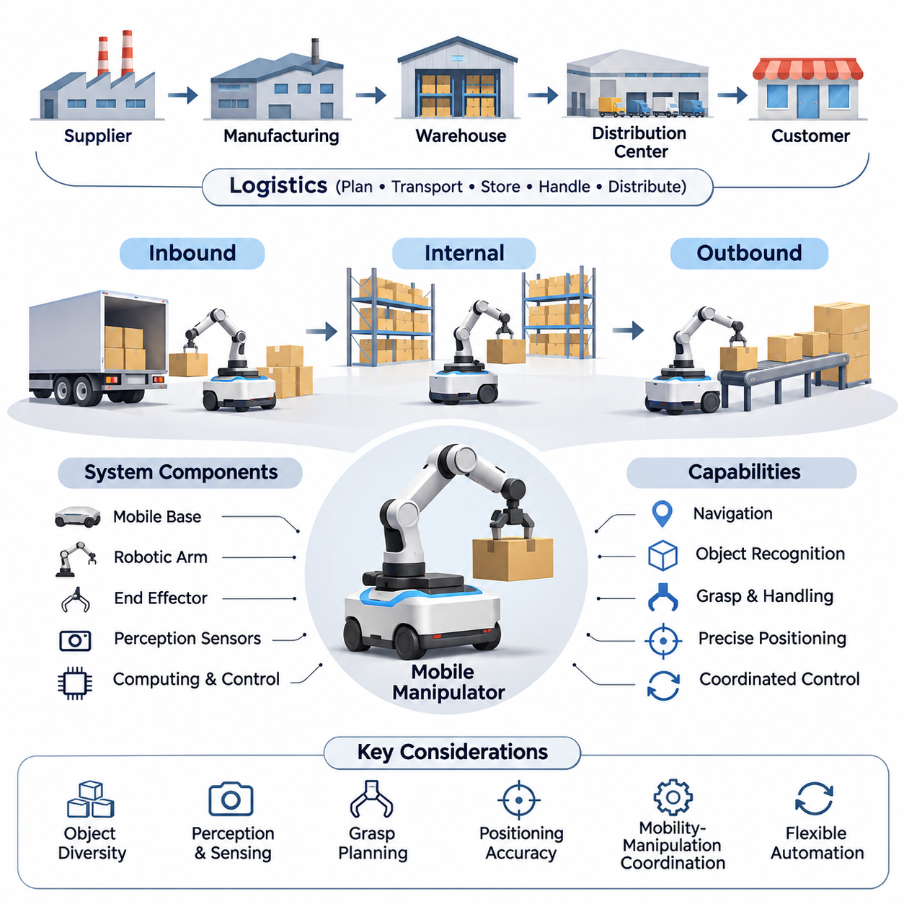
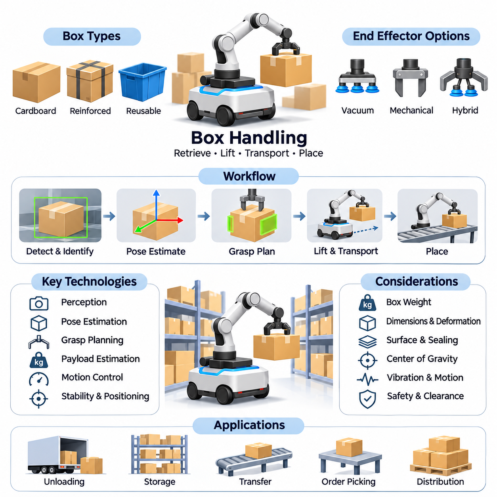
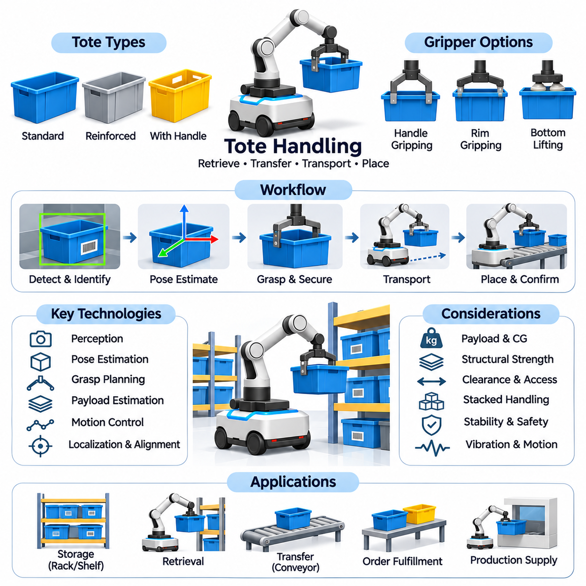
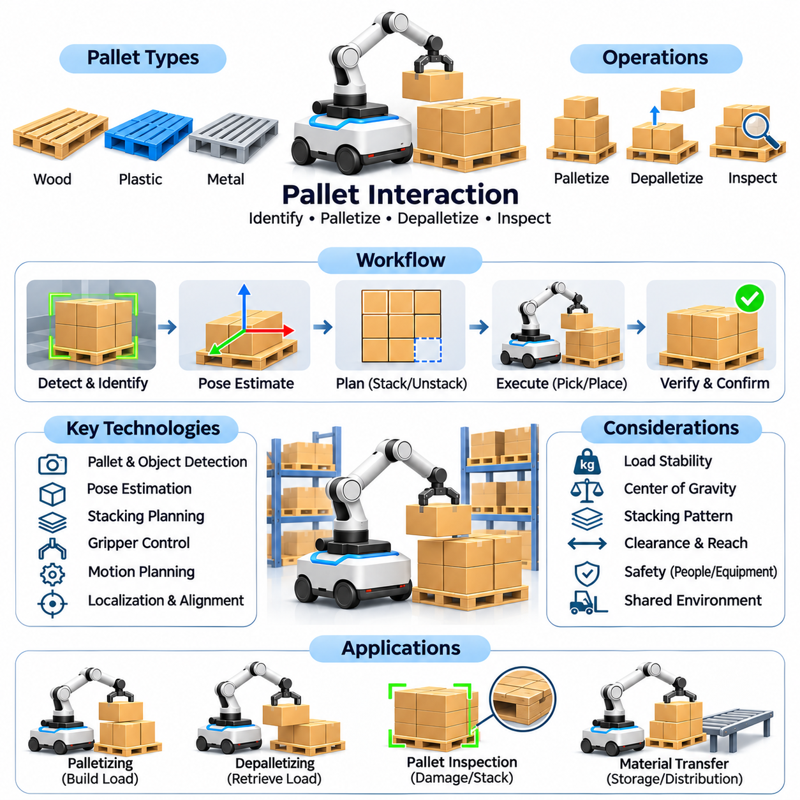
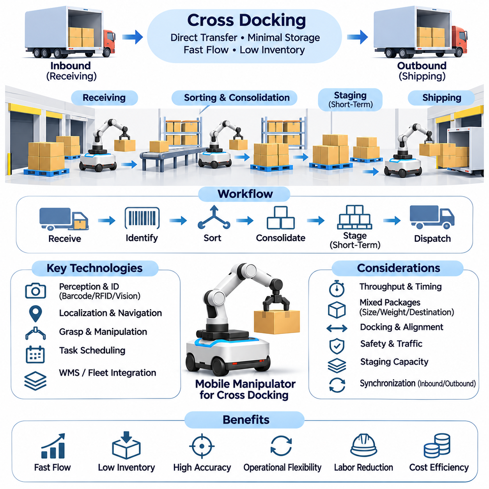
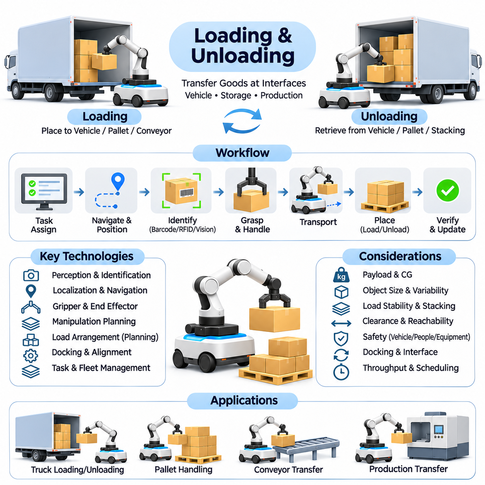
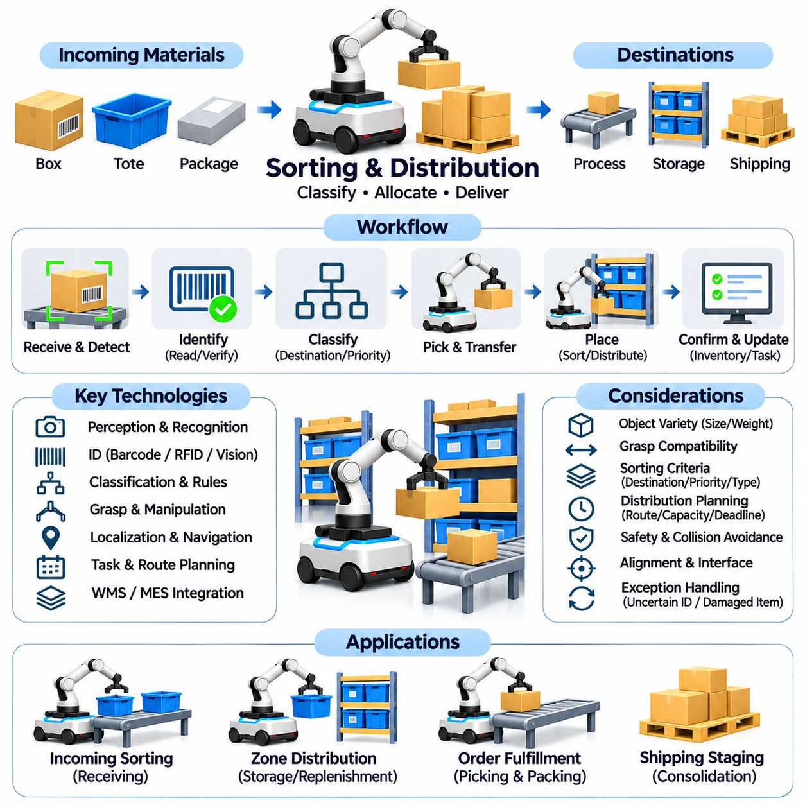
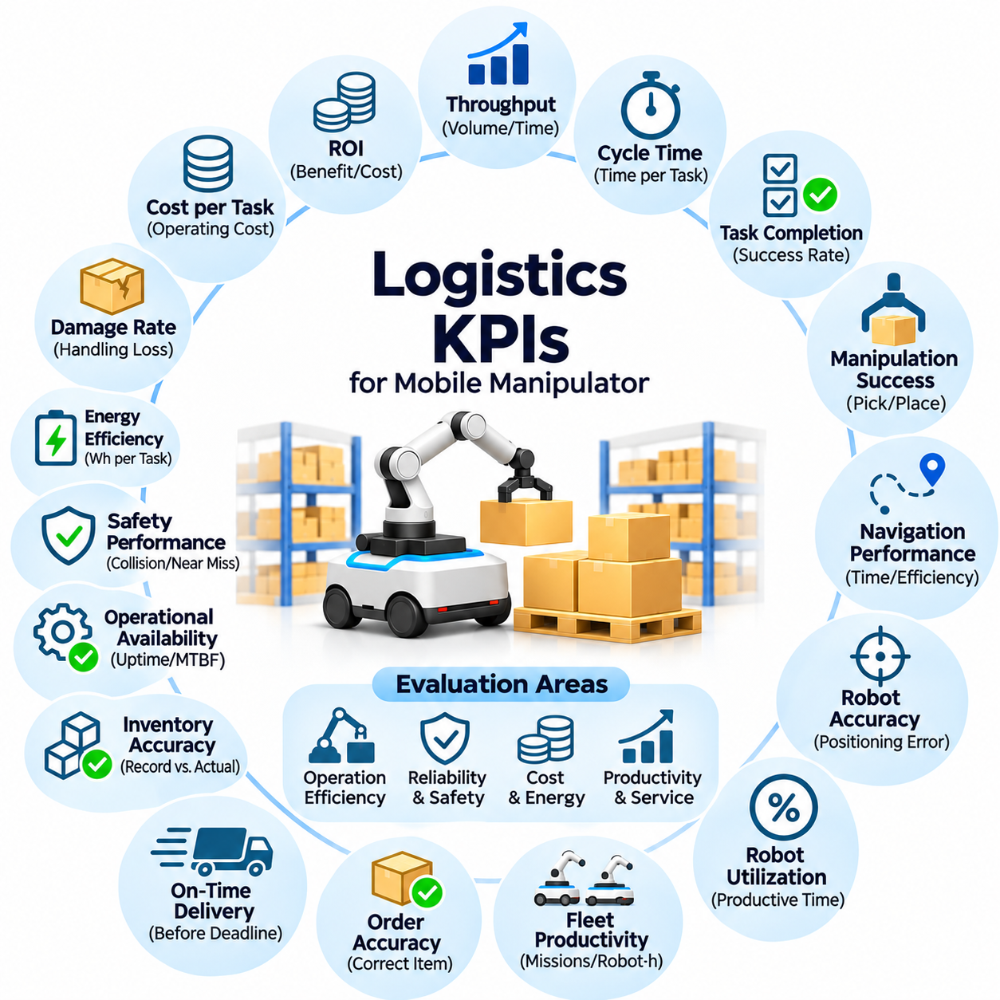

**Volume 01. Mobile Manipulator Foundations and System Architecture**


# Chapter 07. Logistics Handling

##  

## 01 Logistics Overview

{width="7.268055555555556in" height="7.268055555555556in"}

Logistics is the coordinated process of planning, transporting, storing, handling, and distributing materials throughout a supply chain. In modern industrial environments, logistics operations connect suppliers, manufacturing facilities, warehouses, distribution centers, and customers. Efficient logistics systems must maintain continuous material flow while minimizing transportation delays, handling costs, inventory errors, and operational disruptions.

Traditional logistics operations depend on human workers, forklifts, conveyor systems, pallet trucks, and fixed automation equipment. Although these technologies provide reliable material movement, they often require substantial infrastructure and manual intervention. Changing product demand, variable shipment volumes, and increasingly complex warehouse layouts create operational challenges that encourage the adoption of flexible robotic automation.

Mobile manipulators represent an important development in logistics automation because they combine autonomous mobility with robotic object manipulation. Unlike conventional autonomous mobile robots that primarily transport payloads, mobile manipulators can physically interact with boxes, totes, containers, shelves, and handling equipment. This combination enables robots to perform transportation and material-handling tasks within a coordinated workflow.

A typical mobile manipulation system consists of an autonomous mobile robot platform, a robotic arm, an end effector, perception sensors, computing hardware, and integrated control software. The mobile platform transports the system between workstations, while the manipulator performs object interaction. Coordinated control allows the robot to navigate toward a destination, position itself accurately, identify a target, and execute the required handling operation.

Logistics workflows can be divided into inbound logistics, internal material movement, inventory handling, order fulfillment, and outbound distribution. Inbound logistics involves receiving and transferring materials from delivery vehicles into storage or production areas. Internal logistics supports movement between workstations, while outbound logistics prepares completed orders for shipment. Mobile manipulators can contribute to each stage when their capabilities match the operational requirements.

Inbound logistics frequently involves unloading boxes, transferring containers, inspecting shipments, and delivering received materials to designated locations. Mobile manipulators equipped with suitable grippers and perception systems can assist with these activities. Their ability to recognize objects and execute controlled grasping operations reduces dependence on fixed handling stations, particularly where shipment configurations and receiving locations change regularly.

Internal logistics focuses on maintaining continuous material availability across manufacturing and warehouse operations. Components, tools, containers, and partially completed products must reach the correct workstation at the required time. Mobile manipulators can retrieve materials from storage locations, transport them through shared environments, and place them into designated receiving positions, supporting flexible production and material replenishment strategies.

Outbound logistics involves consolidating completed orders, transferring packaged products, sorting shipments, and preparing goods for distribution. Mobile manipulators can support these operations by transferring boxes between storage areas, conveyors, carts, and shipping stations. When connected to warehouse management systems, robotic handling operations can follow dynamically assigned priorities based on shipment deadlines, inventory availability, and processing requirements.

One of the fundamental challenges in logistics manipulation is object diversity. Warehouses contain packages with different dimensions, masses, materials, surface properties, and structural strengths. A robotic system designed for rigid plastic totes may not reliably manipulate deformable cardboard boxes or irregularly shaped packages. Successful deployment therefore requires appropriate payload specifications, adaptable gripping mechanisms, object recognition, and handling strategies.

Robotic perception provides the environmental information required for autonomous logistics handling. Cameras, depth sensors, LiDAR, and other sensing technologies help identify objects, estimate their positions, and detect surrounding obstacles. Perception algorithms transform sensor observations into representations suitable for navigation and manipulation. Reliable operation depends on maintaining sufficient accuracy despite occlusion, changing illumination, reflective packaging, and cluttered environments.

Grasp planning determines how a manipulator should establish stable contact with a target object. Logistics applications commonly use parallel-jaw grippers, vacuum suction devices, mechanical clamps, and specialized container-handling mechanisms. The selected approach depends on object geometry, payload mass, surface characteristics, and required placement accuracy. Grasp stability must be evaluated together with acceleration, vibration, and potential object deformation during handling.

Mobile base positioning is particularly important because manipulation accuracy depends on the relationship between the robot, target object, and surrounding equipment. Navigation systems must bring the platform within the manipulator\'s reachable workspace while maintaining safe clearance. Fine positioning may require visual markers, localization refinement, or sensor-based alignment. Positioning errors can otherwise produce unsuccessful grasps, collisions, or inaccurate material placement.

The interaction between mobility and manipulation introduces additional mechanical and control requirements. A robotic arm carrying a payload changes the combined system\'s center of mass and may generate significant moments around the mobile platform. Engineers must evaluate stability, wheel loading, braking performance, and structural rigidity throughout the manipulation workspace. Payload capacity must therefore consider both the manipulator rating and the mobile platform\'s stability limits.

Task planning coordinates navigation, object identification, grasp execution, transportation, and placement into a unified operational sequence. A logistics mission may begin with receiving a transport request, navigating to a pickup location, verifying the target object, and executing a grasp. The robot subsequently transports the payload to its destination, performs the placement operation, confirms completion, and updates the associated logistics information system.

Warehouse Management Systems provide inventory information, storage locations, order priorities, and material movement instructions. Warehouse Control Systems coordinate equipment operations, while fleet management systems distribute missions among available robots. Integrating mobile manipulators with these platforms enables synchronized logistics execution. Standardized interfaces, reliable communication, and consistent inventory records are essential for maintaining operational continuity.

Fleet coordination becomes increasingly important when multiple mobile manipulators operate within shared logistics environments. Robots must avoid congestion, coordinate access to workstations, and distribute tasks according to available capabilities. Scheduling algorithms may consider travel distance, battery state, payload capacity, task urgency, and equipment availability. Effective fleet management improves resource utilization while reducing unnecessary movement and waiting time.

Human workers and autonomous robots frequently share logistics environments, making operational safety a central design requirement. Mobile manipulators must account for pedestrians, forklifts, moving conveyors, temporary obstacles, and unexpected human interactions. Safety functions may include protective sensing, speed limitation, emergency stopping, controlled braking, and safe manipulation behavior. Risk assessment must address both mobile navigation and robotic arm movement.

Operational reliability requires systematic handling of uncertain conditions and execution failures. A robot may encounter an inaccessible package, an unsuccessful grasp, an obstructed route, or an unavailable destination. Recovery strategies should distinguish temporary disturbances from faults requiring human intervention. Controlled retries, alternative grasp selection, route replanning, and exception reporting help maintain productivity without compromising safety or traceability.

Energy management influences the practical availability of mobile manipulators in continuous logistics operations. Battery capacity must support navigation, robotic arm actuation, perception, onboard computing, and auxiliary equipment. Actual energy consumption varies with payload mass, travel distance, manipulation frequency, and operating conditions. Charging strategies should balance battery utilization, mission urgency, and available charging infrastructure to minimize interruptions.

Logistics automation performance is evaluated through productivity, accuracy, reliability, and economic efficiency. Important indicators include completed handling tasks per hour, average mission cycle time, successful grasp rate, delivery accuracy, robot availability, and intervention frequency. These measurements should be collected under representative operating conditions. System-level evaluation is more meaningful than isolated measurements of navigation speed or manipulator performance.

Economic evaluation must consider the complete lifecycle of a robotic logistics solution. Initial equipment costs include the mobile platform, manipulator, sensors, integration software, and supporting infrastructure. Recurring expenses include maintenance, energy, software support, replacement components, and operational supervision. Return on investment depends on achievable throughput, labor allocation, facility utilization, and the ability to accommodate changing logistics requirements.

Scalability is another important consideration because logistics facilities often experience seasonal demand fluctuations and long-term operational expansion. Modular robotic architectures allow additional units, manipulation tools, and workstations to be introduced without redesigning the entire facility. However, increasing fleet size also introduces communication, scheduling, traffic management, and maintenance challenges that must be addressed through systematic system architecture.

Digital simulation and operational data analysis support logistics system development before physical deployment. Engineers can evaluate robot travel paths, workstation arrangements, task sequences, and expected throughput using virtual environments. Simulation also helps identify congestion points, manipulation reachability limitations, and potential safety conflicts. Field validation remains necessary because real-world perception uncertainty and equipment behavior may differ from simulated assumptions.

The long-term direction of logistics automation involves increasingly intelligent and adaptable robotic systems capable of handling diverse objects and changing operational conditions. Advances in machine learning, visual perception, manipulation planning, and autonomous decision-making may expand the range of feasible tasks. Nevertheless, successful adoption will continue to depend on reliable system integration, measurable productivity, operational safety, and sustainable economic performance.

Mobile manipulation ultimately connects autonomous transportation with physical material interaction, creating opportunities for more flexible logistics processes. Its greatest value emerges when mobility, manipulation, perception, control, and enterprise software operate as an integrated system. Understanding these relationships establishes the foundation for examining box handling, tote handling, pallet interaction, material transfer, cross-docking, loading, sorting, and logistics performance evaluation.

물류(Logistics)는 공급망(Supply Chain) 전반에서 자재의 계획, 운송, 보관, 취급 및 유통을 체계적으로 조정하는 과정이다. 현대 산업 환경에서 물류 운영(Logistics Operations)은 공급업체, 제조시설, 창고, 물류센터 및 고객을 연결하는 핵심 기능을 수행한다. 효율적인 물류 시스템(Logistics System)은 운송 지연, 취급 비용, 재고 오류 및 운영 중단을 최소화하면서 지속적인 자재 흐름(Material Flow)을 유지해야 한다.

전통적인 물류 운영은 작업자, 지게차(Forklift), 컨베이어 시스템(Conveyor System), 팔레트 트럭(Pallet Truck) 및 고정형 자동화 설비(Fixed Automation Equipment)에 의존한다. 이러한 기술은 안정적인 자재 이동을 제공하지만 상당한 기반시설과 수작업 개입이 필요하다. 제품 수요 변화, 출하량 변동 및 복잡해지는 창고 배치는 운영상의 어려움을 발생시키며, 유연한 로봇 자동화(Robotic Automation)의 도입을 촉진한다.

이동형 매니퓰레이터(Mobile Manipulator)는 자율 이동(Autonomous Mobility)과 로봇 물체 조작(Robotic Manipulation)을 결합하기 때문에 물류 자동화에서 중요한 발전을 나타낸다. 주로 적재물을 운송하는 기존 자율이동로봇(Autonomous Mobile Robot, AMR)과 달리 이동형 매니퓰레이터는 상자, 토트(Tote), 컨테이너(Container), 선반 및 취급 장비와 직접 상호작용할 수 있다. 이러한 결합은 운송과 자재 취급을 하나의 통합된 작업 흐름(Workflow)으로 수행하도록 한다.

일반적인 이동형 매니퓰레이션 시스템(Mobile Manipulation System)은 자율이동로봇 플랫폼(AMR Platform), 로봇 팔(Robot Arm), 말단장치(End Effector), 인지 센서(Perception Sensor), 컴퓨팅 하드웨어(Computing Hardware) 및 통합 제어 소프트웨어(Integrated Control Software)로 구성된다. 이동 플랫폼은 작업장 사이에서 시스템을 운송하고, 매니퓰레이터는 물체 조작을 수행한다. 협조 제어(Coordinated Control)를 통해 로봇은 목적지로 이동하고 위치를 정밀하게 조정하며 목표 물체를 식별한 후 필요한 취급 작업을 실행한다.

물류 작업 흐름은 입고 물류(Inbound Logistics), 내부 자재 이동(Internal Material Movement), 재고 취급(Inventory Handling), 주문 이행(Order Fulfillment) 및 출고 물류(Outbound Logistics)로 구분할 수 있다. 입고 물류는 운송 차량에서 자재를 수령하여 보관 또는 생산 구역으로 이동시키는 과정이다. 내부 물류는 작업장 사이의 이동을 지원하며, 출고 물류는 완성된 주문을 배송할 수 있도록 준비한다. 이동형 매니퓰레이터는 운영 요구사항에 적합한 기능을 갖춘 경우 각 단계에 기여할 수 있다.

입고 물류는 상자 하역(Box Unloading), 컨테이너 이송(Container Transfer), 입고 화물 검사(Shipment Inspection) 및 지정된 위치로의 자재 운송을 포함한다. 적절한 그리퍼(Gripper)와 인지 시스템(Perception System)을 갖춘 이동형 매니퓰레이터는 이러한 작업을 지원할 수 있다. 물체를 인식하고 제어된 파지 작업(Grasping Operation)을 수행하는 능력은 특히 화물 구성과 입고 위치가 자주 변경되는 환경에서 고정형 취급 설비에 대한 의존도를 낮춘다.

내부 물류(Internal Logistics)는 제조 및 창고 운영 전반에서 자재의 지속적인 가용성을 유지하는 데 중점을 둔다. 부품, 공구, 컨테이너 및 부분적으로 완성된 제품은 필요한 시점에 올바른 작업장으로 전달되어야 한다. 이동형 매니퓰레이터는 보관 위치에서 자재를 회수하고 공유 작업 환경을 통과하여 운송한 다음 지정된 수령 위치에 배치할 수 있다. 이를 통해 유연한 생산 방식과 자재 보충 전략(Material Replenishment Strategy)을 지원한다.

출고 물류(Outbound Logistics)는 완료된 주문의 통합, 포장 제품의 이송, 화물 분류 및 배송 준비를 포함한다. 이동형 매니퓰레이터는 보관 구역, 컨베이어, 운반 카트 및 출하 작업장 사이에서 상자를 이송함으로써 이러한 작업을 지원할 수 있다. 창고관리시스템(Warehouse Management System, WMS)과 연결되면 로봇 취급 작업은 출하 마감시간, 재고 가용성 및 처리 요구사항에 따라 동적으로 지정된 우선순위를 따를 수 있다.

물류 매니퓰레이션(Logistics Manipulation)의 근본적인 과제 중 하나는 물체의 다양성(Object Diversity)이다. 창고에는 크기, 질량, 재질, 표면 특성 및 구조적 강도가 서로 다른 포장물이 존재한다. 단단한 플라스틱 토트를 취급하도록 설계된 로봇이 변형 가능한 골판지 상자나 불규칙한 형태의 포장물을 안정적으로 조작할 수 있는 것은 아니다. 따라서 성공적인 도입을 위해서는 적절한 적재하중 사양(Payload Specification), 적응형 파지 장치(Adaptive Gripping Mechanism), 물체 인식 및 취급 전략이 필요하다.

로봇 인지(Robotic Perception)는 자율 물류 취급에 필요한 환경 정보를 제공한다. 카메라(Camera), 깊이 센서(Depth Sensor), 라이다(LiDAR) 및 기타 센싱 기술은 물체 식별, 위치 추정 및 주변 장애물 감지를 지원한다. 인지 알고리즘(Perception Algorithm)은 센서 관측값을 내비게이션(Navigation)과 매니퓰레이션에 적합한 표현으로 변환한다. 안정적인 운영을 위해서는 가림(Occlusion), 조명 변화, 반사성 포장재 및 복잡한 환경에서도 충분한 정확도를 유지해야 한다.

파지 계획(Grasp Planning)은 매니퓰레이터가 목표 물체와 안정적으로 접촉하는 방법을 결정한다. 물류 응용 분야에서는 평행 조 그리퍼(Parallel-Jaw Gripper), 진공 흡착 장치(Vacuum Suction Device), 기계식 클램프(Mechanical Clamp) 및 특수 컨테이너 취급 장치를 일반적으로 사용한다. 선택된 방식은 물체 형상, 적재 질량, 표면 특성 및 요구되는 배치 정확도에 따라 달라진다. 파지 안정성(Grasp Stability)은 취급 중 가속도, 진동 및 물체 변형 가능성과 함께 평가되어야 한다.

이동 플랫폼 위치 결정(Mobile Base Positioning)은 매니퓰레이션 정확도가 로봇, 목표 물체 및 주변 장비 사이의 상대적 위치 관계에 영향을 받기 때문에 특히 중요하다. 내비게이션 시스템은 안전거리를 유지하면서 플랫폼을 매니퓰레이터의 도달 작업공간(Reachable Workspace) 안으로 이동시켜야 한다. 정밀 위치 조정에는 시각 마커(Visual Marker), 위치 추정 보정(Localization Refinement) 또는 센서 기반 정렬(Sensor-Based Alignment)이 필요할 수 있다. 위치 오차는 파지 실패, 충돌 또는 부정확한 자재 배치로 이어질 수 있다.

이동성과 매니퓰레이션의 상호작용은 추가적인 기계 및 제어 요구사항을 발생시킨다. 적재물을 운반하는 로봇 팔은 통합 시스템의 무게중심(Center of Mass)을 변화시키고 이동 플랫폼에 상당한 모멘트(Moment)를 발생시킬 수 있다. 엔지니어는 매니퓰레이션 작업공간 전반에서 안정성(Stability), 바퀴 하중(Wheel Loading), 제동 성능(Braking Performance) 및 구조적 강성(Structural Rigidity)을 평가해야 한다. 따라서 적재하중 용량(Payload Capacity)은 매니퓰레이터의 정격 용량뿐 아니라 이동 플랫폼의 안정성 한계까지 고려해야 한다.

작업 계획(Task Planning)은 내비게이션, 물체 식별, 파지 실행, 운송 및 배치를 하나의 통합된 운영 순서로 조정한다. 물류 임무(Logistics Mission)는 운송 요청 수신, 픽업 위치로의 이동, 목표 물체 확인 및 파지 실행으로 시작될 수 있다. 이후 로봇은 적재물을 목적지로 운송하고 배치 작업을 수행하며 완료 여부를 확인한 다음 관련 물류 정보시스템(Logistics Information System)을 갱신한다.

창고관리시스템(Warehouse Management System, WMS)은 재고 정보, 보관 위치, 주문 우선순위 및 자재 이동 지시를 제공한다. 창고제어시스템(Warehouse Control System, WCS)은 설비 운영을 조정하며, 군집관리시스템(Fleet Management System, FMS)은 사용 가능한 로봇에 임무를 분배한다. 이동형 매니퓰레이터를 이러한 플랫폼과 통합하면 동기화된 물류 실행이 가능하다. 운영 연속성을 유지하려면 표준화된 인터페이스(Standardized Interface), 안정적인 통신 및 일관된 재고 기록이 필수적이다.

여러 이동형 매니퓰레이터가 공유 물류 환경에서 작동할 때 군집 협조(Fleet Coordination)의 중요성이 더욱 커진다. 로봇은 혼잡을 방지하고 작업장 접근을 조정하며 사용 가능한 기능에 따라 작업을 분배해야 한다. 스케줄링 알고리즘(Scheduling Algorithm)은 이동 거리, 배터리 상태, 적재하중 용량, 작업 긴급도 및 설비 가용성을 고려할 수 있다. 효과적인 군집관리는 불필요한 이동과 대기시간을 줄이면서 자원 활용률(Resource Utilization)을 향상시킨다.

작업자와 자율 로봇은 물류 환경을 공유하는 경우가 많으므로 운영 안전(Operational Safety)은 핵심 설계 요구사항이다. 이동형 매니퓰레이터는 보행자, 지게차, 이동 중인 컨베이어, 임시 장애물 및 예상하지 못한 사람과의 상호작용을 고려해야 한다. 안전 기능(Safety Function)에는 보호 감지(Protective Sensing), 속도 제한(Speed Limitation), 비상정지(Emergency Stop), 제어 제동(Controlled Braking) 및 안전한 매니퓰레이션 동작이 포함될 수 있다. 위험성 평가(Risk Assessment)는 이동 내비게이션과 로봇 팔 동작을 모두 다루어야 한다.

운영 신뢰성(Operational Reliability)을 확보하려면 불확실한 조건과 실행 실패를 체계적으로 처리해야 한다. 로봇은 접근할 수 없는 포장물, 파지 실패, 차단된 경로 또는 사용할 수 없는 목적지를 마주할 수 있다. 복구 전략(Recovery Strategy)은 일시적인 장애와 사람의 개입이 필요한 고장을 구분해야 한다. 제어된 재시도(Controlled Retry), 대체 파지 선택(Alternative Grasp Selection), 경로 재계획(Route Replanning) 및 예외 보고(Exception Reporting)는 안전성과 추적성을 유지하면서 생산성을 확보하는 데 도움이 된다.

에너지 관리(Energy Management)는 연속적인 물류 운영에서 이동형 매니퓰레이터의 실질적인 가용성에 영향을 미친다. 배터리 용량(Battery Capacity)은 내비게이션, 로봇 팔 구동, 인지 시스템, 온보드 컴퓨팅(Onboard Computing) 및 보조 장비를 지원해야 한다. 실제 에너지 소비량(Energy Consumption)은 적재 질량, 이동 거리, 매니퓰레이션 빈도 및 운영 조건에 따라 달라진다. 충전 전략(Charging Strategy)은 운영 중단을 최소화하기 위해 배터리 사용률, 임무 긴급도 및 충전 기반시설의 가용성을 균형 있게 고려해야 한다.

물류 자동화 성능(Logistics Automation Performance)은 생산성(Productivity), 정확도(Accuracy), 신뢰성(Reliability) 및 경제적 효율성(Economic Efficiency)을 통해 평가된다. 주요 지표에는 시간당 완료된 취급 작업 수, 평균 임무 주기시간(Average Mission Cycle Time), 파지 성공률(Grasp Success Rate), 배송 정확도(Delivery Accuracy), 로봇 가용률(Robot Availability) 및 개입 빈도(Intervention Frequency)가 포함된다. 이러한 측정은 대표적인 운영 조건에서 수행해야 하며, 시스템 수준의 평가는 개별 내비게이션 속도나 매니퓰레이터 성능 측정보다 더 의미가 있다.

경제성 평가(Economic Evaluation)는 로봇 물류 솔루션의 전체 수명주기(Lifecycle)를 고려해야 한다. 초기 장비 비용에는 이동 플랫폼, 매니퓰레이터, 센서, 통합 소프트웨어 및 지원 기반시설이 포함된다. 반복적으로 발생하는 비용에는 유지보수(Maintenance), 에너지, 소프트웨어 지원, 교체 부품 및 운영 감독이 포함된다. 투자수익률(Return on Investment, ROI)은 달성 가능한 처리량(Throughput), 인력 배치, 시설 활용률 및 변화하는 물류 요구사항에 대한 대응 능력에 따라 달라진다.

확장성(Scalability)은 물류시설에서 계절별 수요 변동과 장기적인 운영 확대가 자주 발생하기 때문에 또 다른 중요한 고려사항이다. 모듈형 로봇 아키텍처(Modular Robotic Architecture)는 시설 전체를 재설계하지 않고도 추가 로봇, 매니퓰레이션 도구 및 작업장을 도입할 수 있도록 한다. 그러나 군집 규모가 증가하면 통신, 스케줄링, 교통 관리(Traffic Management) 및 유지보수 문제가 추가로 발생하므로 체계적인 시스템 아키텍처(System Architecture)를 통해 해결해야 한다.

디지털 시뮬레이션(Digital Simulation)과 운영 데이터 분석(Operational Data Analysis)은 실제 배치 이전의 물류 시스템 개발을 지원한다. 엔지니어는 가상 환경(Virtual Environment)을 활용하여 로봇 이동 경로, 작업장 배치, 작업 순서 및 예상 처리량을 평가할 수 있다. 시뮬레이션은 혼잡 지점, 매니퓰레이션 도달성 한계(Manipulation Reachability Limitation) 및 잠재적인 안전 충돌을 식별하는 데에도 도움이 된다. 실제 환경의 인지 불확실성과 장비 동작은 시뮬레이션 가정과 다를 수 있으므로 현장 검증(Field Validation)이 필요하다.

물류 자동화의 장기적인 발전 방향은 다양한 물체와 변화하는 운영 조건을 처리할 수 있는 더욱 지능적이고 적응적인 로봇 시스템(Intelligent and Adaptive Robotic System)을 지향한다. 기계학습(Machine Learning), 시각 인지(Visual Perception), 매니퓰레이션 계획(Manipulation Planning) 및 자율 의사결정(Autonomous Decision-Making)의 발전은 수행 가능한 작업 범위를 확대할 수 있다. 그러나 성공적인 도입은 지속적으로 안정적인 시스템 통합, 측정 가능한 생산성, 운영 안전 및 지속 가능한 경제적 성과에 의존할 것이다.

궁극적으로 이동형 매니퓰레이션(Mobile Manipulation)은 자율 운송(Autonomous Transportation)과 물리적 자재 상호작용(Physical Material Interaction)을 연결하여 더욱 유연한 물류 프로세스를 구현할 기회를 제공한다. 이동성, 매니퓰레이션, 인지, 제어 및 기업용 소프트웨어(Enterprise Software)가 하나의 통합 시스템으로 작동할 때 가장 큰 가치를 창출한다. 이러한 관계에 대한 이해는 상자 취급(Box Handling), 토트 취급(Tote Handling), 팔레트 상호작용(Pallet Interaction), 자재 이송(Material Transfer), 크로스도킹(Cross-Docking), 상하차(Loading and Unloading), 분류(Sorting) 및 물류 성능 평가(Logistics Performance Evaluation)를 살펴보기 위한 기초가 된다.

##  

## 02 Box Handling

{width="7.268055555555556in" height="7.268055555555556in"}

Box handling is a fundamental operation in logistics automation because boxes represent one of the most common packaging formats used for storage, transportation, and distribution. Mobile manipulators equipped with robotic arms can automate box retrieval, lifting, transportation, and placement. These capabilities connect autonomous mobility with physical material handling, reducing repetitive manual operations while improving workflow flexibility.

Industrial box handling environments contain packages with different dimensions, weights, materials, and structural characteristics. Corrugated cardboard boxes, reinforced shipping cartons, and reusable containers exhibit different mechanical behaviors during manipulation. A robotic system must account for these variations because package deformation, uneven loading, and unstable surfaces can significantly affect grasp reliability and transportation safety.

A typical robotic box handling workflow begins with identifying a target package and determining its location within the operating environment. Vision sensors capture images or depth information, while perception algorithms estimate object boundaries, dimensions, and orientation. The system then evaluates available grasping surfaces and determines whether the target can be safely manipulated without interfering with adjacent packages or surrounding equipment.

Object detection is essential for distinguishing individual boxes in cluttered storage environments. Modern perception systems may combine RGB cameras, depth sensors, and three-dimensional point clouds to identify package geometry. Deep learning models can detect partially occluded boxes, while geometric processing estimates accessible surfaces. Reliable detection must accommodate printed labels, reflective tape, variable lighting, and overlapping package arrangements.

Pose estimation determines the position and orientation of a box relative to the robot\'s coordinate system. Accurate pose information allows the manipulator to approach the object along a suitable trajectory and align its end effector with the intended contact surface. Coordinate transformations connect camera observations, mobile platform localization, and robotic arm kinematics, enabling consistent manipulation despite changes in robot positioning.

Gripper selection strongly influences the performance of robotic box handling systems. Vacuum suction grippers are commonly suitable for relatively flat, sealed package surfaces, while mechanical grippers can provide direct contact with opposing sides. Hybrid end effectors may combine suction and mechanical support. Selection depends on package weight, surface permeability, structural rigidity, available clearance, and the required handling orientation.

Vacuum gripping systems generate holding force through a pressure difference between the suction interface and the surrounding atmosphere. Their effectiveness depends on the available sealing area, pressure differential, leakage, and package surface characteristics. Porous cardboard, damaged surfaces, and packaging seams may reduce holding performance. Engineers must therefore validate suction capacity under realistic operating conditions rather than relying exclusively on theoretical calculations.

Mechanical gripping systems secure boxes through controlled contact forces applied to accessible surfaces. Parallel-jaw mechanisms, adjustable clamps, and supporting fingers can accommodate different package dimensions. Excessive gripping force may deform or damage cardboard, while insufficient force can cause slipping. Force feedback and compliant contact mechanisms help balance holding stability with package protection during lifting and transportation.

Grasp planning identifies a feasible contact configuration that supports stable lifting and controlled movement. The planning process considers box dimensions, estimated mass, center of gravity, surface accessibility, and nearby obstacles. A grasp near the load\'s center of gravity generally reduces rotational disturbance, although actual feasibility depends on packaging geometry. Candidate grasps must also satisfy manipulator reachability, collision constraints, and end-effector limitations.

Payload estimation is important because the visible dimensions of a package do not necessarily indicate its actual mass. Box contents may be distributed unevenly, producing an offset center of gravity and unexpected rotational moments. Weight information can be obtained from inventory databases, external weighing systems, or appropriately calibrated force measurements. Conservative handling limits help prevent overloading when package properties remain uncertain.

Robotic lifting requires coordinated motion planning and controlled acceleration. Sudden movements can generate inertial forces that exceed gripping capacity or disturb loosely packed contents. The manipulator should follow collision-free trajectories while maintaining stable object orientation. Velocity, acceleration, and jerk limitations can reduce package oscillation and mechanical stress, particularly when handling heavy or fragile shipments.

Mobile platform stability becomes critical when a robotic arm extends beyond the vehicle footprint while holding a box. The combined center of gravity shifts according to arm configuration and payload position. Engineers must evaluate tipping margins, wheel loading, structural deflection, and braking behavior. Manipulation operations may require the mobile base to remain stationary or use additional stabilization mechanisms when handling demanding loads.

Box transportation introduces challenges beyond the initial grasping operation. Vibrations from floor irregularities, turning maneuvers, and acceleration changes can reduce grasp stability. The robot must maintain sufficient clearance between the carried package and nearby obstacles. Transport configurations should minimize arm extension and preserve visibility for navigation sensors, while motion constraints should reflect the combined robot and payload dimensions.

Placement operations require accurate alignment between the box and its destination surface. Common destinations include shelves, conveyor belts, pallets, sorting stations, and storage racks. The manipulator must consider available clearance, support geometry, and the stability of previously placed objects. Controlled lowering and verified contact help prevent impacts, package deformation, and unstable stacking configurations.

Box stacking requires additional reasoning about load distribution and structural support. Lower packages must withstand the forces transmitted by upper layers, while the overall arrangement must remain mechanically stable. Placement algorithms can consider box dimensions, mass estimates, orientation, and available support area. Irregular packages or uncertain weight distributions may require conservative stacking rules or alternative storage locations.

Conveyor interaction is a common application of robotic box handling. A mobile manipulator may retrieve packages from a stationary conveyor or place boxes onto a receiving belt. Successful transfer requires coordination with conveyor motion, package spacing, and equipment control signals. Moving conveyor operations introduce timing and tracking requirements, while communication interfaces help synchronize robot actions with material flow.

Autonomous box handling can also support truck loading and unloading, although these environments introduce additional complexity. Cargo spaces may contain tightly packed packages, limited illumination, uneven floors, and restricted manipulator access. The robot must identify accessible boxes and plan safe extraction sequences. Loading operations additionally require spatial arrangement strategies that account for package stability, available volume, and transportation constraints.

Handling damaged or irregular boxes requires adaptive perception and manipulation strategies. Crushed corners, open flaps, torn surfaces, and unexpected protrusions can invalidate previously planned grasps. The robot should evaluate package condition before manipulation and select alternative contact regions when appropriate. Packages that cannot be handled safely should be identified for exception processing rather than subjected to repeated uncontrolled attempts.

Reliable box handling depends on continuous monitoring during execution. Force sensors, vacuum pressure sensors, joint feedback, and visual observations can provide evidence of successful grasping and stable transport. Unexpected force changes or pressure loss may indicate slipping or contact failure. Monitoring algorithms should trigger controlled recovery behavior when handling conditions exceed established operational limits.

Integration with warehouse management systems enables box handling operations to follow inventory and order requirements. Package identifiers, storage locations, handling restrictions, and destination assignments can be communicated through standardized interfaces. Barcode scanning or visual identification may confirm that the correct package has been selected. Transaction records should reflect successful physical completion rather than assuming that commanded robot actions always succeed.

Operational performance is commonly evaluated using grasp success rate, completed transfers per hour, average handling cycle time, placement accuracy, and package damage frequency. Additional indicators include recovery attempts, human intervention frequency, and robot availability. Measurements should distinguish perception failures, grasping failures, transportation disturbances, and placement errors to support systematic engineering improvements.

The economic value of automated box handling depends on the relationship between system cost, throughput, reliability, and labor requirements. Mobile manipulators may offer advantages where multiple handling stations require automation without extensive fixed infrastructure. However, manipulation cycle times, payload limitations, and operational exceptions can constrain productivity. Deployment decisions should therefore consider realistic workload distributions and complete system operating costs.

Simulation environments can support the development and validation of robotic box handling workflows. Engineers can model package geometry, gripper contact, robot kinematics, collision constraints, and placement sequences before physical deployment. Simulated experiments help identify unreachable configurations and inefficient motion plans. Nevertheless, physical testing remains necessary to evaluate cardboard deformation, suction leakage, friction variability, and real-world sensor uncertainty.

Future box handling systems are expected to benefit from advances in three-dimensional perception, adaptive grasp planning, learning-based control, and multimodal artificial intelligence. More capable perception and manipulation models may improve handling across unfamiliar package types. However, practical performance will continue to depend on robust mechanical design, validated payload limits, reliable sensing, and safe recovery behavior under uncertain operating conditions.

Effective robotic box handling requires coordinated integration of perception, grasp planning, manipulation control, autonomous mobility, and logistics information systems. Each component contributes to the reliability of the complete handling workflow. By combining accurate object understanding with mechanically stable manipulation and systematic operational monitoring, mobile manipulators can provide flexible automation for increasingly diverse logistics environments.

상자 취급(Box Handling)은 보관, 운송 및 유통에 사용되는 가장 일반적인 포장 형태 중 하나가 상자이기 때문에 물류 자동화(Logistics Automation)의 기본적인 작업이다. 로봇 팔(Robot Arm)을 장착한 이동형 매니퓰레이터(Mobile Manipulator)는 상자 회수(Box Retrieval), 들어 올리기(Lifting), 운송(Transportation) 및 배치(Placement)를 자동화할 수 있다. 이러한 기능은 자율 이동(Autonomous Mobility)과 물리적 자재 취급(Physical Material Handling)을 연결하여 반복적인 수작업을 줄이고 작업 흐름의 유연성(Workflow Flexibility)을 향상시킨다.

산업용 상자 취급 환경(Industrial Box Handling Environment)에는 크기, 무게, 재질 및 구조적 특성이 서로 다른 포장물이 존재한다. 골판지 상자(Corrugated Cardboard Box), 강화 운송 상자(Reinforced Shipping Carton) 및 재사용 가능한 컨테이너(Reusable Container)는 조작 과정에서 서로 다른 기계적 거동(Mechanical Behavior)을 나타낸다. 로봇 시스템은 이러한 차이를 고려해야 하며, 포장물 변형(Package Deformation), 불균일한 적재 및 불안정한 표면은 파지 신뢰성(Grasp Reliability)과 운송 안전성(Transportation Safety)에 상당한 영향을 줄 수 있다.

일반적인 로봇 상자 취급 작업 흐름(Robotic Box Handling Workflow)은 목표 포장물을 식별하고 작업 환경 내 위치를 결정하는 것으로 시작된다. 비전 센서(Vision Sensor)는 영상이나 깊이 정보(Depth Information)를 수집하고, 인지 알고리즘(Perception Algorithm)은 물체의 경계, 크기 및 방향을 추정한다. 이후 시스템은 파지가 가능한 표면을 평가하고 인접한 포장물이나 주변 장비와 간섭하지 않으면서 목표 물체를 안전하게 조작할 수 있는지 판단한다.

물체 검출(Object Detection)은 복잡한 보관 환경에서 개별 상자를 구분하는 데 필수적이다. 현대적인 인지 시스템(Perception System)은 RGB 카메라(RGB Camera), 깊이 센서(Depth Sensor) 및 3차원 점군(3D Point Cloud)을 결합하여 포장물의 형상을 식별할 수 있다. 딥러닝 모델(Deep Learning Model)은 부분적으로 가려진 상자를 검출할 수 있으며, 기하학적 처리(Geometric Processing)는 접근 가능한 표면을 추정한다. 안정적인 검출을 위해서는 인쇄된 라벨, 반사 테이프, 조명 변화 및 중첩된 포장물 배치에 대응해야 한다.

자세 추정(Pose Estimation)은 로봇 좌표계(Robot Coordinate System)를 기준으로 상자의 위치와 방향을 결정한다. 정확한 자세 정보(Pose Information)를 통해 매니퓰레이터(Manipulator)는 적절한 궤적(Trajectory)을 따라 물체에 접근하고 말단장치(End Effector)를 목표 접촉면에 정렬할 수 있다. 좌표 변환(Coordinate Transformation)은 카메라 관측값, 이동 플랫폼의 위치 추정(Localization) 및 로봇 팔 운동학(Robot Arm Kinematics)을 연결하여 로봇 위치가 변하더라도 일관된 조작을 가능하게 한다.

그리퍼 선택(Gripper Selection)은 로봇 상자 취급 시스템의 성능에 큰 영향을 미친다. 진공 흡착 그리퍼(Vacuum Suction Gripper)는 비교적 평평하고 밀폐된 포장 표면에 적합하며, 기계식 그리퍼(Mechanical Gripper)는 상자의 마주 보는 측면에 직접 접촉하여 파지할 수 있다. 하이브리드 말단장치(Hybrid End Effector)는 흡착과 기계적 지지를 결합할 수 있다. 선택 기준에는 포장물 무게, 표면 투과성(Surface Permeability), 구조적 강성(Structural Rigidity), 접근 공간 및 요구되는 취급 방향이 포함된다.

진공 파지 시스템(Vacuum Gripping System)은 흡착 접촉면과 주변 대기 사이의 압력 차이(Pressure Differential)를 이용하여 유지력(Holding Force)을 생성한다. 성능은 유효 밀폐 면적(Sealing Area), 압력 차이, 누설(Leakage) 및 포장물 표면 특성에 따라 달라진다. 다공성 골판지(Porous Cardboard), 손상된 표면 및 포장 이음부(Packaging Seam)는 유지 성능을 저하시킬 수 있다. 따라서 엔지니어는 이론적 계산에만 의존하지 않고 실제 운영 조건에서 흡착 용량(Suction Capacity)을 검증해야 한다.

기계식 파지 시스템(Mechanical Gripping System)은 접근 가능한 표면에 제어된 접촉력(Contact Force)을 가하여 상자를 고정한다. 평행 조 메커니즘(Parallel-Jaw Mechanism), 조절식 클램프(Adjustable Clamp) 및 지지 핑거(Supporting Finger)는 서로 다른 포장물 크기에 대응할 수 있다. 과도한 파지력(Gripping Force)은 골판지를 변형시키거나 손상시킬 수 있으며, 부족한 파지력은 미끄러짐(Slipping)을 유발할 수 있다. 힘 피드백(Force Feedback)과 유연 접촉 메커니즘(Compliant Contact Mechanism)은 들어 올리기와 운송 과정에서 파지 안정성과 포장물 보호 사이의 균형을 유지하도록 돕는다.

파지 계획(Grasp Planning)은 안정적인 들어 올리기와 제어된 이동을 지원하는 실행 가능한 접촉 구성(Contact Configuration)을 결정한다. 계획 과정에서는 상자 크기, 추정 질량(Estimated Mass), 무게중심(Center of Gravity), 표면 접근성(Surface Accessibility) 및 주변 장애물을 고려한다. 하중의 무게중심에 가까운 파지는 일반적으로 회전 교란(Rotational Disturbance)을 줄이지만 실제 실행 가능성은 포장물 형상에 따라 달라진다. 후보 파지는 매니퓰레이터 도달성(Manipulator Reachability), 충돌 제약조건(Collision Constraint) 및 말단장치의 한계도 충족해야 한다.

적재하중 추정(Payload Estimation)은 포장물의 외형 크기가 실제 질량을 반드시 나타내지는 않기 때문에 중요하다. 상자 내부 내용물이 불균일하게 분포하면 무게중심이 편향되고 예상하지 못한 회전 모멘트(Rotational Moment)가 발생할 수 있다. 무게 정보는 재고 데이터베이스(Inventory Database), 외부 계량 시스템(External Weighing System) 또는 적절하게 보정된 힘 측정(Force Measurement)을 통해 확보할 수 있다. 포장물 특성이 불확실한 경우 보수적인 취급 한계(Conservative Handling Limit)를 적용하면 과부하를 방지하는 데 도움이 된다.

로봇의 들어 올리기 작업(Robotic Lifting)은 협조된 동작 계획(Motion Planning)과 제어된 가속도(Controlled Acceleration)를 필요로 한다. 급격한 움직임은 파지 용량을 초과하는 관성력(Inertial Force)을 발생시키거나 느슨하게 포장된 내용물을 흔들 수 있다. 매니퓰레이터는 안정적인 물체 방향을 유지하면서 충돌이 없는 궤적(Collision-Free Trajectory)을 따라 이동해야 한다. 속도(Velocity), 가속도(Acceleration) 및 저크(Jerk) 제한은 특히 무겁거나 파손되기 쉬운 화물을 취급할 때 포장물 진동과 기계적 응력을 줄일 수 있다.

이동 플랫폼 안정성(Mobile Platform Stability)은 로봇 팔이 상자를 든 상태에서 차량의 지지 영역(Footprint) 밖으로 확장될 때 매우 중요해진다. 통합 시스템의 무게중심(Combined Center of Gravity)은 로봇 팔의 구성과 적재물 위치에 따라 이동한다. 엔지니어는 전도 안정 여유(Tipping Margin), 바퀴 하중(Wheel Loading), 구조적 변형(Structural Deflection) 및 제동 거동(Braking Behavior)을 평가해야 한다. 높은 하중을 취급하는 경우 이동 플랫폼을 정지 상태로 유지하거나 추가적인 안정화 장치(Stabilization Mechanism)를 사용해야 할 수 있다.

상자 운송(Box Transportation)은 초기 파지 작업 이후에도 추가적인 과제를 발생시킨다. 바닥의 불규칙성, 회전 동작 및 가속도 변화로 인한 진동(Vibration)은 파지 안정성을 저하시킬 수 있다. 로봇은 운반 중인 포장물과 주변 장애물 사이에 충분한 이격거리(Clearance)를 유지해야 한다. 운송 자세(Transport Configuration)는 로봇 팔의 확장을 최소화하고 내비게이션 센서(Navigation Sensor)의 시야를 확보하도록 설계해야 하며, 이동 제약조건(Motion Constraint)은 로봇과 적재물을 결합한 전체 크기를 반영해야 한다.

배치 작업(Placement Operation)은 상자와 목적지 표면 사이의 정확한 정렬(Alignment)을 요구한다. 일반적인 목적지에는 선반(Shelf), 컨베이어 벨트(Conveyor Belt), 팔레트(Pallet), 분류 작업장(Sorting Station) 및 보관 랙(Storage Rack)이 포함된다. 매니퓰레이터는 사용 가능한 공간, 지지 형상(Support Geometry) 및 이미 배치된 물체의 안정성을 고려해야 한다. 제어된 하강(Controlled Lowering)과 접촉 확인(Contact Verification)은 충격, 포장물 변형 및 불안정한 적재 구성을 방지하는 데 도움이 된다.

상자 적재(Box Stacking)는 하중 분포(Load Distribution)와 구조적 지지(Structural Support)에 대한 추가적인 판단을 필요로 한다. 아래쪽 포장물은 위쪽 적재층에서 전달되는 힘을 견뎌야 하며, 전체 배치는 기계적으로 안정된 상태를 유지해야 한다. 배치 알고리즘(Placement Algorithm)은 상자 크기, 질량 추정값, 방향 및 사용 가능한 지지 면적을 고려할 수 있다. 불규칙한 포장물이나 불확실한 무게 분포는 보수적인 적재 규칙(Conservative Stacking Rule) 또는 대체 보관 위치를 필요로 할 수 있다.

컨베이어 연동(Conveyor Interaction)은 로봇 상자 취급의 일반적인 응용 분야이다. 이동형 매니퓰레이터는 정지된 컨베이어에서 포장물을 회수하거나 수령용 컨베이어 벨트에 상자를 배치할 수 있다. 성공적인 이송(Transfer)을 위해서는 컨베이어 동작, 포장물 간격 및 설비 제어 신호(Control Signal)의 조정이 필요하다. 이동 중인 컨베이어를 대상으로 하는 작업에는 타이밍(Timing)과 추적(Tracking) 요구사항이 추가되며, 통신 인터페이스(Communication Interface)는 로봇 동작과 자재 흐름(Material Flow)의 동기화를 지원한다.

자율 상자 취급(Autonomous Box Handling)은 트럭 상하차(Truck Loading and Unloading)에도 적용될 수 있지만 이러한 환경은 추가적인 복잡성을 가진다. 화물 공간에는 밀집된 포장물, 제한된 조명, 고르지 않은 바닥 및 제한된 매니퓰레이터 접근 공간이 존재할 수 있다. 로봇은 접근 가능한 상자를 식별하고 안전한 추출 순서(Extraction Sequence)를 계획해야 한다. 적재 작업에는 포장물 안정성, 사용 가능한 공간 및 운송 제약조건을 고려하는 공간 배치 전략(Spatial Arrangement Strategy)도 필요하다.

손상되거나 불규칙한 상자를 취급하려면 적응형 인지(Adaptive Perception)와 매니퓰레이션 전략(Manipulation Strategy)이 필요하다. 찌그러진 모서리, 열린 덮개, 찢어진 표면 및 예상하지 못한 돌출부는 기존에 계획된 파지를 무효화할 수 있다. 로봇은 조작 전에 포장물 상태(Package Condition)를 평가하고 필요한 경우 대체 접촉 영역(Alternative Contact Region)을 선택해야 한다. 안전하게 취급할 수 없는 포장물은 제어되지 않은 반복 시도 대신 예외 처리(Exception Processing) 대상으로 식별해야 한다.

안정적인 상자 취급은 실행 중 지속적인 모니터링(Continuous Monitoring)에 의존한다. 힘 센서(Force Sensor), 진공 압력 센서(Vacuum Pressure Sensor), 관절 피드백(Joint Feedback) 및 시각적 관측(Visual Observation)은 파지 성공과 안정적인 운송 여부를 확인하는 정보를 제공한다. 예상하지 못한 힘 변화나 압력 손실은 미끄러짐 또는 접촉 실패를 나타낼 수 있다. 모니터링 알고리즘(Monitoring Algorithm)은 취급 조건이 설정된 운영 한계를 초과할 경우 제어된 복구 동작(Controlled Recovery Behavior)을 실행해야 한다.

창고관리시스템(Warehouse Management System, WMS)과의 통합은 상자 취급 작업이 재고 및 주문 요구사항을 따르도록 한다. 포장물 식별자(Package Identifier), 보관 위치(Storage Location), 취급 제한사항(Handling Restriction) 및 목적지 할당(Destination Assignment)은 표준화된 인터페이스(Standardized Interface)를 통해 전달될 수 있다. 바코드 스캔(Barcode Scanning)이나 시각적 식별(Visual Identification)은 올바른 포장물이 선택되었는지 확인할 수 있다. 작업 기록(Transaction Record)은 명령된 로봇 동작이 항상 성공한다고 가정하는 대신 실제 물리적 작업의 완료 여부를 반영해야 한다.

운영 성능(Operational Performance)은 일반적으로 파지 성공률(Grasp Success Rate), 시간당 완료 이송 건수(Completed Transfers per Hour), 평균 취급 주기시간(Average Handling Cycle Time), 배치 정확도(Placement Accuracy) 및 포장물 손상 빈도(Package Damage Frequency)를 사용하여 평가한다. 추가 지표에는 복구 시도 횟수(Recovery Attempts), 작업자 개입 빈도(Human Intervention Frequency) 및 로봇 가용률(Robot Availability)이 포함된다. 체계적인 엔지니어링 개선을 위해서는 인지 실패, 파지 실패, 운송 중 교란 및 배치 오류를 구분하여 측정해야 한다.

자동화된 상자 취급의 경제적 가치(Economic Value)는 시스템 비용(System Cost), 처리량(Throughput), 신뢰성(Reliability) 및 인력 요구사항(Labor Requirement) 사이의 관계에 따라 달라진다. 이동형 매니퓰레이터는 광범위한 고정형 기반시설 없이 여러 취급 작업장을 자동화해야 하는 환경에서 장점을 제공할 수 있다. 그러나 매니퓰레이션 주기시간(Manipulation Cycle Time), 적재하중 제한(Payload Limitation) 및 운영 예외 상황(Operational Exception)은 생산성을 제약할 수 있다. 따라서 도입 결정에는 현실적인 작업량 분포(Workload Distribution)와 전체 시스템 운영 비용을 고려해야 한다.

시뮬레이션 환경(Simulation Environment)은 로봇 상자 취급 작업 흐름의 개발과 검증을 지원할 수 있다. 엔지니어는 실제 배치 전에 포장물 형상, 그리퍼 접촉(Gripper Contact), 로봇 운동학(Robot Kinematics), 충돌 제약조건 및 배치 순서를 모델링할 수 있다. 시뮬레이션 실험(Simulation Experiment)은 도달할 수 없는 구성과 비효율적인 동작 계획을 식별하는 데 도움이 된다. 그러나 골판지 변형, 흡착 누설, 마찰 변동(Friction Variability) 및 실제 센서 불확실성(Sensor Uncertainty)을 평가하려면 물리적 시험(Physical Testing)이 필요하다.

미래의 상자 취급 시스템(Box Handling System)은 3차원 인지(3D Perception), 적응형 파지 계획(Adaptive Grasp Planning), 학습 기반 제어(Learning-Based Control) 및 멀티모달 인공지능(Multimodal Artificial Intelligence)의 발전을 통해 성능이 향상될 것으로 예상된다. 더욱 발전된 인지 및 매니퓰레이션 모델은 익숙하지 않은 포장물 유형에 대한 취급 능력을 개선할 수 있다. 그러나 실제 운영 성능은 여전히 견고한 기계 설계(Robust Mechanical Design), 검증된 적재하중 한계(Validated Payload Limit), 신뢰할 수 있는 센싱(Reliable Sensing) 및 불확실한 운영 조건에서의 안전한 복구 동작에 의존할 것이다.

효과적인 로봇 상자 취급(Effective Robotic Box Handling)을 위해서는 인지(Perception), 파지 계획(Grasp Planning), 매니퓰레이션 제어(Manipulation Control), 자율 이동(Autonomous Mobility) 및 물류 정보시스템(Logistics Information System)의 협조된 통합이 필요하다. 각 구성요소는 전체 취급 작업 흐름의 신뢰성에 기여한다. 정확한 물체 이해(Object Understanding), 기계적으로 안정된 매니퓰레이션(Mechanically Stable Manipulation) 및 체계적인 운영 모니터링(Operational Monitoring)을 결합함으로써 이동형 매니퓰레이터는 점점 다양해지는 물류 환경에 유연한 자동화를 제공할 수 있다.

##  

##  

## 03 Tote Handling

{width="7.268055555555556in" height="7.268055555555556in"}

Tote handling is an essential function in modern logistics automation because reusable containers are widely employed for material storage, transportation, order fulfillment, and production supply. Unlike disposable cardboard boxes, totes provide standardized dimensions, durable structures, and repeatable handling interfaces. Mobile manipulators can exploit these characteristics to automate container retrieval, transfer, transportation, and placement across interconnected logistics environments.

Industrial totes are commonly manufactured from rigid plastic or reinforced composite materials designed to withstand repeated handling cycles. Their geometry may include integrated handles, reinforced rims, stacking features, and identification labels. Although standardized containers simplify robotic interaction, variations in size, payload capacity, wall thickness, and surface condition still require careful consideration when designing automated manipulation systems.

A typical tote handling workflow begins with receiving a material movement request from a warehouse or production management system. The mobile manipulator navigates toward the designated storage location, identifies the required container, and evaluates its accessibility. After establishing a secure grasp, the robot retrieves the tote, transports it to the assigned destination, and places it in the required position before confirming task completion.

Tote identification relies on perception technologies capable of recognizing container geometry and distinguishing individual units. RGB cameras, depth sensors, and three-dimensional point clouds can provide information about container position, orientation, and surrounding obstacles. Barcode labels, QR codes, or RFID tags may support identification and inventory tracking. Combining geometric perception with digital identification improves the reliability of automated material handling.

Pose estimation determines the spatial relationship between a tote and the robot\'s manipulation system. Accurate position and orientation estimates are necessary when containers are stored in shelves, racks, conveyors, or tightly arranged stacks. Coordinate transformations connect sensor observations with the mobile platform and robotic arm. Localization uncertainty must remain within acceptable limits to prevent collisions with storage structures during retrieval and placement.

Gripper design plays a central role in reliable tote manipulation. Mechanical grippers may engage integrated handles, reinforced rims, or opposing container walls, depending on the tote geometry. Specialized lifting mechanisms can support containers from underneath when sufficient clearance exists. The gripping strategy should consider structural strength, available contact surfaces, payload mass, and the possibility of deformation under concentrated forces.

Handle-based gripping provides a convenient interaction method when totes include suitable lifting features. Robotic fingers or hooks can engage designated handle openings and transfer lifting forces through reinforced structural regions. However, handle dimensions, accessibility, and manufacturing tolerances influence grasp feasibility. The robot must verify secure engagement before lifting, particularly when containers are heavily loaded or partially obstructed.

Rim gripping is another practical approach for containers with sufficiently strong upper edges. A gripper can contact the tote rim using mechanical fingers or clamping surfaces, allowing the robot to lift without accessing the bottom. This method may simplify manipulation in crowded storage environments. Nevertheless, rim strength, container deformation, and load distribution must be evaluated to avoid damage or unexpected release.

Payload characteristics significantly influence tote handling performance. Containers may hold components, tools, packaged goods, or mixed inventory with uneven mass distribution. The total payload includes both the tote and its contents, while the center of gravity depends on internal loading. Weight information from inventory systems or calibrated sensing can support handling decisions, but uncertain loads require conservative operational limits.

Stable lifting requires coordinated control of the robotic arm and end effector. The manipulator should apply sufficient gripping force while limiting acceleration and sudden changes in direction. Excessive motion can cause container oscillation, internal material displacement, or loss of grasp stability. Smooth trajectories and controlled orientation help protect both the tote and its contents during retrieval and transfer operations.

Mobile platform stability becomes important when transporting heavy totes with an extended robotic arm. The combined center of gravity changes according to container mass and manipulator configuration. Engineers must evaluate tipping margins, wheel loading, braking behavior, and structural rigidity. Transporting the tote close to the mobile platform generally reduces destabilizing moments, provided the configuration maintains appropriate clearance and sensor visibility.

Tote retrieval from shelving systems requires precise alignment and collision-aware motion planning. Storage compartments may provide limited clearance around container walls, handles, and supporting rails. The manipulator must approach along a feasible trajectory, establish a secure grasp, and extract the tote without contacting adjacent inventory. Visual feedback and compliant control can help compensate for moderate positioning uncertainty.

Stacked tote handling introduces additional challenges related to vertical access and load transfer. Containers may be designed with interlocking features that improve stacking stability but complicate robotic separation. The robot must determine whether the target tote can be removed without destabilizing surrounding containers. Safe manipulation may require unloading upper layers first or using dedicated separation mechanisms.

Tote placement requires accurate positioning relative to shelves, conveyors, workstations, and transport equipment. The robot must verify that the receiving surface can support the container and that sufficient clearance exists for insertion. Controlled lowering reduces impact forces and prevents damage to stacking interfaces. Placement verification may use force feedback, vision, or external sensors to confirm successful transfer.

Conveyor-based tote handling is common in automated warehouses and distribution facilities. Mobile manipulators can transfer containers between storage locations and conveyor interfaces, supporting flexible material flow. Coordination with conveyor controllers is necessary to ensure appropriate transfer timing and equipment readiness. Moving conveyor applications require additional tracking and synchronization capabilities to maintain placement accuracy.

Tote handling also supports production logistics by delivering components and tools to manufacturing workstations. Standardized containers enable predictable interfaces between robotic transport systems and production equipment. Mobile manipulators can retrieve empty totes, deliver loaded containers, and exchange materials according to production schedules. Integration with manufacturing execution systems helps synchronize these operations with actual material consumption.

Order fulfillment operations frequently use totes to consolidate products collected from different storage locations. Mobile manipulators may transport partially filled containers between picking stations, sorting areas, and packing workstations. Container identification ensures that items remain associated with the correct order. Accurate tracking and controlled transfers reduce the risk of inventory mismatches and misplaced materials during multi-stage fulfillment processes.

Multi-robot tote handling requires coordinated scheduling and resource allocation. Fleet management systems can assign transport and manipulation tasks according to robot availability, payload capacity, travel distance, and operational priority. Shared workstations and narrow aisles introduce potential congestion. Traffic management and reservation mechanisms help prevent conflicts while maintaining predictable material movement throughout the facility.

Safety considerations extend beyond navigation because tote manipulation introduces moving loads and potential pinch points. Workers may interact with robots near storage racks, conveyors, and material exchange stations. Protective sensing, controlled speed, emergency stopping, and appropriate separation distances reduce operational risks. Risk assessment should also consider dropped containers, unstable stacking, and unexpected movement of internal materials.

Reliable operation requires continuous monitoring of gripping conditions and manipulation progress. Joint torque measurements, force sensors, gripper position feedback, and visual observations can indicate whether a tote remains securely attached. Unexpected load changes may reveal slipping, obstruction, or incorrect engagement. Recovery procedures should stop unsafe motion, reassess the situation, and request human assistance when automatic correction is not sufficiently reliable.

Tote handling systems benefit from integration with warehouse management systems, manufacturing execution systems, and fleet management platforms. These systems exchange container identifiers, inventory contents, storage locations, transport requests, and completion records. Consistent data synchronization enables traceability and reduces operational errors. Physical confirmation of successful placement should precede inventory status updates whenever container location accuracy is essential.

Operational performance can be evaluated through successful retrieval rate, transfer accuracy, average handling cycle time, completed missions per hour, and robot availability. Additional measurements include container damage frequency, failed grasp attempts, recovery duration, and human intervention requirements. Performance evaluation should account for tote dimensions, payload variations, storage configurations, and environmental conditions rather than relying on isolated laboratory demonstrations.

Economic benefits depend on the relationship between standardized container design and robotic handling efficiency. Reusable totes can reduce packaging waste and provide predictable mechanical interfaces, while mobile manipulators reduce repetitive manual transport and transfer operations. However, equipment acquisition, integration, maintenance, and container compatibility introduce costs. Deployment feasibility should be assessed using realistic throughput requirements and total cost of ownership.

Simulation and digital twin technologies can support tote handling system development before physical deployment. Engineers can model container geometry, storage arrangements, gripper interaction, robotic reachability, and transport routes. Virtual testing helps identify collision risks, inefficient workflows, and unsuitable workstation layouts. Physical validation remains necessary to evaluate friction, structural deformation, manufacturing tolerances, and actual sensor performance.

Future tote handling systems may incorporate adaptive grasping, advanced visual perception, learning-based manipulation, and intelligent fleet coordination. Robots could increasingly accommodate different container designs and dynamically changing storage environments. Nevertheless, practical reliability will depend on validated mechanical interfaces, accurate localization, robust sensing, and predictable recovery behavior.

Effective tote handling combines standardized container interfaces with autonomous navigation, robotic manipulation, perception, and logistics information management. The complete system must maintain safe load transfer, accurate container identification, and reliable task execution across diverse operating conditions. By integrating these capabilities, mobile manipulators can support scalable and flexible material movement throughout warehouses, distribution centers, and industrial production facilities.

토트 취급(Tote Handling)은 재사용 가능한 컨테이너(Reusable Container)가 자재 보관, 운송, 주문 이행(Order Fulfillment) 및 생산 자재 공급에 널리 사용되기 때문에 현대 물류 자동화(Logistics Automation)의 필수적인 기능이다. 일회용 골판지 상자와 달리 토트(Tote)는 표준화된 크기(Standardized Dimensions), 내구성 있는 구조(Durable Structure) 및 반복적으로 사용할 수 있는 취급 인터페이스(Handling Interface)를 제공한다. 이동형 매니퓰레이터(Mobile Manipulator)는 이러한 특성을 활용하여 상호 연결된 물류 환경에서 컨테이너 회수, 이송, 운송 및 배치를 자동화할 수 있다.

산업용 토트(Industrial Tote)는 일반적으로 반복적인 취급 주기를 견딜 수 있도록 설계된 경질 플라스틱(Rigid Plastic) 또는 강화 복합재료(Reinforced Composite Material)로 제조된다. 토트의 형상에는 일체형 손잡이(Integrated Handle), 강화 테두리(Reinforced Rim), 적재 구조(Stacking Feature) 및 식별 라벨(Identification Label)이 포함될 수 있다. 표준화된 컨테이너는 로봇과의 상호작용을 단순화하지만 크기, 적재하중 용량(Payload Capacity), 벽 두께(Wall Thickness) 및 표면 상태(Surface Condition)의 차이는 자동 매니퓰레이션 시스템(Automated Manipulation System)을 설계할 때 여전히 신중하게 고려해야 한다.

일반적인 토트 취급 작업 흐름(Tote Handling Workflow)은 창고 또는 생산관리시스템(Production Management System)으로부터 자재 이동 요청(Material Movement Request)을 수신하는 것으로 시작된다. 이동형 매니퓰레이터는 지정된 보관 위치로 자율 이동하고 필요한 컨테이너를 식별한 다음 접근 가능성을 평가한다. 안정적인 파지(Secure Grasp)를 확보한 후 로봇은 토트를 회수하여 지정된 목적지로 운송하고 요구되는 위치에 배치한 다음 작업 완료를 확인한다.

토트 식별(Tote Identification)은 컨테이너 형상을 인식하고 개별 토트를 구분할 수 있는 인지 기술(Perception Technology)에 의존한다. RGB 카메라(RGB Camera), 깊이 센서(Depth Sensor) 및 3차원 점군(3D Point Cloud)은 컨테이너의 위치, 방향 및 주변 장애물에 관한 정보를 제공할 수 있다. 바코드 라벨(Barcode Label), QR 코드(QR Code) 또는 무선주파수 식별 태그(Radio Frequency Identification, RFID)는 식별과 재고 추적(Inventory Tracking)을 지원할 수 있다. 기하학적 인지(Geometric Perception)와 디지털 식별(Digital Identification)을 결합하면 자동화된 자재 취급의 신뢰성이 향상된다.

자세 추정(Pose Estimation)은 토트와 로봇 매니퓰레이션 시스템(Robot Manipulation System) 사이의 공간적 관계(Spatial Relationship)를 결정한다. 컨테이너가 선반, 랙(Rack), 컨베이어(Conveyor) 또는 밀집된 적재 구조에 보관된 경우 정확한 위치와 방향 추정이 필요하다. 좌표 변환(Coordinate Transformation)은 센서 관측값을 이동 플랫폼(Mobile Platform) 및 로봇 팔(Robotic Arm)과 연결한다. 회수 및 배치 과정에서 보관 구조물과의 충돌을 방지하려면 위치 추정 불확실성(Localization Uncertainty)을 허용 가능한 범위 내로 유지해야 한다.

그리퍼 설계(Gripper Design)는 안정적인 토트 매니퓰레이션(Tote Manipulation)에서 핵심적인 역할을 한다. 기계식 그리퍼(Mechanical Gripper)는 토트 형상에 따라 일체형 손잡이, 강화 테두리 또는 서로 마주 보는 컨테이너 벽면을 파지할 수 있다. 충분한 접근 공간이 확보되면 특수 인양 메커니즘(Specialized Lifting Mechanism)이 컨테이너 하부를 지지할 수도 있다. 파지 전략(Gripping Strategy)은 구조적 강도(Structural Strength), 사용 가능한 접촉면(Contact Surface), 적재 질량(Payload Mass) 및 집중 하중에 따른 변형 가능성을 고려해야 한다.

손잡이 기반 파지(Handle-Based Gripping)는 토트에 적절한 인양 구조가 포함된 경우 편리한 상호작용 방법을 제공한다. 로봇 핑거(Robotic Finger) 또는 후크(Hook)는 지정된 손잡이 개구부(Handle Opening)에 결합하여 강화된 구조 영역을 통해 인양력을 전달할 수 있다. 그러나 손잡이 크기, 접근성 및 제조 공차(Manufacturing Tolerance)는 파지 실행 가능성(Grasp Feasibility)에 영향을 미친다. 특히 컨테이너에 무거운 하중이 적재되어 있거나 일부가 가려진 경우 로봇은 들어 올리기 전에 안정적인 결합 상태를 확인해야 한다.

테두리 파지(Rim Gripping)는 충분한 강도를 가진 상단 가장자리(Upper Edge)가 있는 컨테이너에 적용할 수 있는 또 다른 실용적인 방법이다. 그리퍼는 기계식 핑거(Mechanical Finger) 또는 클램핑 표면(Clamping Surface)을 이용하여 토트 테두리에 접촉함으로써 하부에 접근하지 않고도 컨테이너를 들어 올릴 수 있다. 이러한 방식은 밀집된 보관 환경에서 매니퓰레이션을 단순화할 수 있다. 그러나 손상이나 예상하지 못한 이탈을 방지하려면 테두리 강도(Rim Strength), 컨테이너 변형(Container Deformation) 및 하중 분포(Load Distribution)를 평가해야 한다.

적재하중 특성(Payload Characteristics)은 토트 취급 성능에 상당한 영향을 미친다. 컨테이너에는 부품, 공구, 포장 제품 또는 질량 분포가 불균일한 혼합 재고(Mixed Inventory)가 들어 있을 수 있다. 전체 적재하중(Total Payload)은 토트 자체와 내부 내용물을 모두 포함하며, 무게중심(Center of Gravity)은 내부 적재 상태에 따라 달라진다. 재고 시스템(Inventory System)이나 보정된 센싱(Calibrated Sensing)으로 확보한 무게 정보는 취급 의사결정을 지원할 수 있지만, 하중이 불확실한 경우 보수적인 운영 한계(Conservative Operational Limit)를 적용해야 한다.

안정적인 들어 올리기(Stable Lifting)를 위해서는 로봇 팔과 말단장치(End Effector)의 협조 제어(Coordinated Control)가 필요하다. 매니퓰레이터는 충분한 파지력(Gripping Force)을 적용하면서 가속도(Acceleration)와 급격한 방향 변화를 제한해야 한다. 과도한 움직임은 컨테이너 진동(Container Oscillation), 내부 자재 이동(Internal Material Displacement) 또는 파지 안정성 저하를 유발할 수 있다. 부드러운 궤적(Smooth Trajectory)과 제어된 자세(Controlled Orientation)는 회수 및 이송 작업 중 토트와 내용물을 보호하는 데 도움이 된다.

이동 플랫폼 안정성(Mobile Platform Stability)은 로봇 팔을 확장한 상태에서 무거운 토트를 운송할 때 중요해진다. 통합 시스템의 무게중심(Combined Center of Gravity)은 컨테이너 질량과 매니퓰레이터 구성(Manipulator Configuration)에 따라 변화한다. 엔지니어는 전도 안정 여유(Tipping Margin), 바퀴 하중(Wheel Loading), 제동 거동(Braking Behavior) 및 구조적 강성(Structural Rigidity)을 평가해야 한다. 적절한 이격거리(Clearance)와 센서 시야(Sensor Visibility)를 유지할 수 있다면 토트를 이동 플랫폼 가까이에 배치하여 운송하는 것이 일반적으로 불안정한 모멘트(Destabilizing Moment)를 줄인다.

선반 시스템(Shelving System)에서 토트를 회수하려면 정밀한 정렬(Precise Alignment)과 충돌을 고려한 동작 계획(Collision-Aware Motion Planning)이 필요하다. 보관 구획(Storage Compartment)은 컨테이너 벽면, 손잡이 및 지지 레일(Supporting Rail) 주변의 공간이 제한적일 수 있다. 매니퓰레이터는 실행 가능한 궤적(Feasible Trajectory)을 따라 접근하여 안정적인 파지를 확보하고 인접한 재고와 접촉하지 않으면서 토트를 추출해야 한다. 시각 피드백(Visual Feedback)과 유연 제어(Compliant Control)는 일정 수준의 위치 불확실성을 보정하는 데 도움이 된다.

적층된 토트 취급(Stacked Tote Handling)은 수직 접근(Vertical Access)과 하중 전달(Load Transfer)에 관련된 추가적인 과제를 발생시킨다. 컨테이너에는 적재 안정성을 높이지만 로봇을 이용한 분리를 어렵게 만드는 맞물림 구조(Interlocking Feature)가 포함될 수 있다. 로봇은 주변 컨테이너를 불안정하게 만들지 않고 목표 토트를 제거할 수 있는지 판단해야 한다. 안전한 매니퓰레이션을 위해서는 상부 적재층을 먼저 제거하거나 전용 분리 메커니즘(Dedicated Separation Mechanism)을 사용해야 할 수 있다.

토트 배치(Tote Placement)는 선반, 컨베이어, 작업장 및 운송 장비를 기준으로 정확한 위치 결정(Accurate Positioning)을 요구한다. 로봇은 수령 표면(Receiving Surface)이 컨테이너를 지지할 수 있는지, 삽입에 충분한 공간이 확보되어 있는지 확인해야 한다. 제어된 하강(Controlled Lowering)은 충격력을 줄이고 적재 인터페이스(Stacking Interface)의 손상을 방지한다. 배치 검증(Placement Verification)은 힘 피드백(Force Feedback), 비전(Vision) 또는 외부 센서(External Sensor)를 이용하여 성공적인 이송 여부를 확인할 수 있다.

컨베이어 기반 토트 취급(Conveyor-Based Tote Handling)은 자동화 창고(Automated Warehouse)와 물류센터(Distribution Facility)에서 일반적으로 사용된다. 이동형 매니퓰레이터는 보관 위치와 컨베이어 인터페이스(Conveyor Interface) 사이에서 컨테이너를 이송하여 유연한 자재 흐름(Material Flow)을 지원할 수 있다. 적절한 이송 시점(Transfer Timing)과 설비 준비 상태(Equipment Readiness)를 보장하려면 컨베이어 제어기(Conveyor Controller)와의 협조가 필요하다. 이동 중인 컨베이어를 대상으로 하는 작업은 배치 정확도를 유지하기 위해 추가적인 추적(Tracking)과 동기화(Synchronization) 기능을 요구한다.

토트 취급은 제조 작업장(Manufacturing Workstation)에 부품과 공구를 공급함으로써 생산 물류(Production Logistics)도 지원한다. 표준화된 컨테이너는 로봇 운송 시스템(Robotic Transport System)과 생산 설비 사이에 예측 가능한 인터페이스(Predictable Interface)를 제공한다. 이동형 매니퓰레이터는 빈 토트를 회수하고 적재된 컨테이너를 전달하며 생산 일정(Production Schedule)에 따라 자재를 교환할 수 있다. 제조실행시스템(Manufacturing Execution System, MES)과의 통합은 이러한 작업을 실제 자재 소비량(Material Consumption)과 동기화하는 데 도움이 된다.

주문 이행 작업(Order Fulfillment Operation)에서는 서로 다른 보관 위치에서 수집한 제품을 통합하기 위해 토트를 자주 사용한다. 이동형 매니퓰레이터는 부분적으로 채워진 컨테이너를 피킹 작업장(Picking Station), 분류 구역(Sorting Area) 및 포장 작업장(Packing Workstation) 사이에서 운송할 수 있다. 컨테이너 식별(Container Identification)은 제품이 올바른 주문과 연결된 상태를 유지하도록 한다. 정확한 추적(Accurate Tracking)과 제어된 이송(Controlled Transfer)은 다단계 주문 이행 과정에서 재고 불일치(Inventory Mismatch)와 자재 오배치(Misplaced Material)의 위험을 줄인다.

다중 로봇 토트 취급(Multi-Robot Tote Handling)에는 협조된 스케줄링(Coordinated Scheduling)과 자원 할당(Resource Allocation)이 필요하다. 군집관리시스템(Fleet Management System, FMS)은 로봇 가용성(Robot Availability), 적재하중 용량(Payload Capacity), 이동 거리(Travel Distance) 및 운영 우선순위(Operational Priority)에 따라 운송과 매니퓰레이션 작업을 할당할 수 있다. 공유 작업장과 좁은 통로는 혼잡을 유발할 수 있다. 교통 관리(Traffic Management)와 구역 예약 메커니즘(Reservation Mechanism)은 충돌을 방지하면서 시설 전반에서 예측 가능한 자재 이동을 유지하는 데 도움이 된다.

안전 고려사항(Safety Considerations)은 토트 매니퓰레이션이 이동 하중(Moving Load)과 잠재적인 끼임 지점(Pinch Point)을 발생시키기 때문에 내비게이션을 넘어 확장된다. 작업자는 보관 랙, 컨베이어 및 자재 교환 작업장(Material Exchange Station) 주변에서 로봇과 상호작용할 수 있다. 보호 감지(Protective Sensing), 제어된 속도(Controlled Speed), 비상정지(Emergency Stop) 및 적절한 이격거리(Separation Distance)는 운영 위험을 줄인다. 위험성 평가(Risk Assessment)는 컨테이너 낙하(Dropped Container), 불안정한 적재(Unstable Stacking) 및 내부 자재의 예상하지 못한 움직임도 고려해야 한다.

안정적인 운영을 위해서는 파지 상태(Gripping Condition)와 매니퓰레이션 진행 상황(Manipulation Progress)을 지속적으로 모니터링해야 한다. 관절 토크 측정(Joint Torque Measurement), 힘 센서(Force Sensor), 그리퍼 위치 피드백(Gripper Position Feedback) 및 시각적 관측(Visual Observation)은 토트가 안정적으로 고정되어 있는지 판단하는 데 활용될 수 있다. 예상하지 못한 하중 변화는 미끄러짐(Slipping), 장애물 간섭(Obstruction) 또는 잘못된 결합(Incorrect Engagement)을 나타낼 수 있다. 복구 절차(Recovery Procedure)는 위험한 움직임을 중지하고 상황을 재평가하며 자동 수정이 충분히 신뢰할 수 없는 경우 작업자의 지원을 요청해야 한다.

토트 취급 시스템(Tote Handling System)은 창고관리시스템(Warehouse Management System, WMS), 제조실행시스템(Manufacturing Execution System, MES) 및 군집관리 플랫폼(Fleet Management Platform)과의 통합을 통해 운영 효율성을 높일 수 있다. 이러한 시스템은 컨테이너 식별자(Container Identifier), 재고 내용물(Inventory Contents), 보관 위치(Storage Location), 운송 요청(Transport Request) 및 작업 완료 기록(Completion Record)을 교환한다. 일관된 데이터 동기화(Data Synchronization)는 추적성(Traceability)을 확보하고 운영 오류를 줄인다. 컨테이너 위치 정확도가 중요한 경우에는 재고 상태를 갱신하기 전에 실제 배치 성공 여부를 확인해야 한다.

운영 성능(Operational Performance)은 회수 성공률(Successful Retrieval Rate), 이송 정확도(Transfer Accuracy), 평균 취급 주기시간(Average Handling Cycle Time), 시간당 완료 임무 수(Completed Missions per Hour) 및 로봇 가용률(Robot Availability)을 통해 평가할 수 있다. 추가적인 측정 항목에는 컨테이너 손상 빈도(Container Damage Frequency), 파지 실패 횟수(Failed Grasp Attempts), 복구 소요시간(Recovery Duration) 및 작업자 개입 요구사항(Human Intervention Requirements)이 포함된다. 성능 평가는 제한된 실험실 시연에만 의존하지 않고 토트 크기, 적재하중 변화, 보관 구성 및 환경 조건을 고려해야 한다.

경제적 이점(Economic Benefits)은 표준화된 컨테이너 설계(Standardized Container Design)와 로봇 취급 효율성(Robotic Handling Efficiency) 사이의 관계에 따라 달라진다. 재사용 가능한 토트는 포장 폐기물(Packaging Waste)을 줄이고 예측 가능한 기계적 인터페이스(Mechanical Interface)를 제공하며, 이동형 매니퓰레이터는 반복적인 수동 운송과 이송 작업을 감소시킨다. 그러나 장비 도입(Equipment Acquisition), 시스템 통합(System Integration), 유지보수(Maintenance) 및 컨테이너 호환성(Container Compatibility)에는 비용이 발생한다. 도입 타당성(Deployment Feasibility)은 현실적인 처리량 요구사항(Throughput Requirements)과 총소유비용(Total Cost of Ownership, TCO)을 기준으로 평가해야 한다.

시뮬레이션(Simulation)과 디지털 트윈(Digital Twin) 기술은 실제 배치 이전에 토트 취급 시스템을 개발하는 데 활용할 수 있다. 엔지니어는 컨테이너 형상(Container Geometry), 보관 배치(Storage Arrangement), 그리퍼 상호작용(Gripper Interaction), 로봇 도달성(Robotic Reachability) 및 운송 경로(Transport Route)를 모델링할 수 있다. 가상 시험(Virtual Testing)은 충돌 위험(Collision Risk), 비효율적인 작업 흐름(Inefficient Workflow) 및 부적절한 작업장 배치를 식별하는 데 도움이 된다. 그러나 마찰(Friction), 구조적 변형(Structural Deformation), 제조 공차(Manufacturing Tolerance) 및 실제 센서 성능을 평가하려면 물리적 검증(Physical Validation)이 필요하다.

미래의 토트 취급 시스템은 적응형 파지(Adaptive Grasping), 고급 시각 인지(Advanced Visual Perception), 학습 기반 매니퓰레이션(Learning-Based Manipulation) 및 지능형 군집 협조(Intelligent Fleet Coordination)를 통합할 수 있다. 로봇은 점차 다양한 컨테이너 설계와 동적으로 변화하는 보관 환경(Dynamically Changing Storage Environment)에 대응할 수 있을 것이다. 그러나 실제 운영 신뢰성(Operational Reliability)은 검증된 기계적 인터페이스(Validated Mechanical Interface), 정확한 위치 추정(Accurate Localization), 견고한 센싱(Robust Sensing) 및 예측 가능한 복구 동작(Predictable Recovery Behavior)에 의존할 것이다.

효과적인 토트 취급(Effective Tote Handling)은 표준화된 컨테이너 인터페이스(Standardized Container Interface)를 자율 내비게이션(Autonomous Navigation), 로봇 매니퓰레이션(Robotic Manipulation), 인지(Perception) 및 물류 정보 관리(Logistics Information Management)와 결합한다. 전체 시스템은 다양한 운영 조건에서 안전한 하중 이송(Safe Load Transfer), 정확한 컨테이너 식별(Accurate Container Identification) 및 신뢰할 수 있는 작업 실행(Reliable Task Execution)을 유지해야 한다. 이러한 기능을 통합함으로써 이동형 매니퓰레이터는 창고, 물류센터 및 산업 생산시설 전반에서 확장 가능하고 유연한 자재 이동(Scalable and Flexible Material Movement)을 지원할 수 있다.

##  

## 04 Pallet Interaction

{width="7.268055555555556in" height="7.268055555555556in"}

Pallet interaction is an important function in logistics automation because pallets provide standardized platforms for storing, consolidating, and transporting large quantities of goods. Mobile manipulators can interact with palletized materials by identifying load configurations, retrieving individual packages, and arranging products on pallet surfaces. These capabilities connect autonomous navigation with robotic manipulation, supporting flexible material movement across warehouses and distribution facilities.

Pallets are commonly manufactured from wood, plastic, or metal and are designed to support loads during storage and transportation. Their dimensions, structural strength, and entry configurations vary according to industrial requirements. Although standardized pallet formats simplify logistics operations, differences in deck geometry, load distribution, and surface condition create challenges for robotic interaction. Reliable systems must recognize both pallet structure and payload characteristics.

Pallet interaction includes several operational activities, such as pallet identification, load inspection, package retrieval, palletizing, depalletizing, and material transfer. Mobile manipulators generally handle individual packages or smaller load units, while dedicated pallet-handling vehicles transport complete pallets. Integrating these complementary capabilities allows logistics systems to automate material flow between bulk storage, processing stations, and distribution areas.

A typical pallet interaction workflow begins when a robot receives a task specifying a pallet location and required handling operation. The mobile platform navigates toward the designated area and positions itself within the manipulator\'s reachable workspace. Perception sensors identify the pallet and its contents, while task planning software determines an appropriate manipulation sequence. The robot then executes the operation and verifies completion.

Pallet detection requires identifying the supporting platform despite partial occlusion by stacked products. RGB cameras, depth sensors, and LiDAR can provide information about pallet boundaries, openings, and surrounding obstacles. Geometric processing may estimate pallet orientation and accessible regions. Reliable detection must account for damaged boards, packaging materials, variable lighting, and differences between wooden and plastic pallet structures.

Pose estimation establishes the spatial relationship between the pallet, mobile platform, and robotic arm. Accurate alignment is necessary when retrieving packages near pallet edges or placing objects within limited available space. Coordinate transformations connect sensor observations with the robot\'s reference frames. Localization refinement and visual feedback can compensate for moderate positioning errors, reducing collision risks during manipulation.

Palletizing involves arranging individual packages on a pallet according to a predefined or dynamically generated stacking pattern. The objective is to use available space efficiently while maintaining load stability and accessibility. Placement planning considers package dimensions, weight, orientation, and support area. Suitable stacking patterns must distribute forces appropriately and avoid unsupported overhangs that could compromise structural integrity.

Depalletizing reverses this process by removing packages from an existing pallet load. The robot must identify accessible objects and determine a safe extraction sequence. Upper layers are generally removed before lower layers to avoid destabilizing the remaining stack. However, irregular loading patterns, overlapping packages, and damaged cartons may require adaptive planning based on real-time perception and stability assessment.

Gripper selection depends on the characteristics of the packages being manipulated rather than the pallet alone. Vacuum suction grippers can handle suitable flat surfaces, while mechanical grippers provide alternative contact methods for irregular or porous packages. Hybrid end effectors may increase handling flexibility. The selected mechanism must maintain sufficient holding force without damaging packaging or disturbing adjacent items.

Load stability is a central consideration in pallet interaction because stacked products form a mechanically interconnected structure. Removing or adding one package changes the distribution of forces across the remaining load. Engineers must consider center of gravity, contact area, friction, and package compressive strength. Unstable arrangements can lead to shifting, collapse, or damage during subsequent handling and transportation.

Mobile platform positioning influences both manipulation reachability and overall system stability. The robot must approach the pallet while maintaining sufficient clearance for its arm and end effector. Heavy packages or extended arm configurations can shift the combined center of gravity. Motion planning should therefore consider tipping margins, payload limits, and collision constraints throughout the handling operation.

Pallet interaction frequently occurs near forklifts, pallet trucks, conveyors, and warehouse workers. These shared environments introduce dynamic obstacles and unpredictable equipment movement. Autonomous systems require protective sensing, controlled speed, and clearly defined operational zones. Safety planning must address both mobile platform movement and robotic arm motion, particularly when manipulating elevated or unstable loads.

Pallet inspection can be integrated into robotic handling workflows to identify damaged structures, misplaced packages, or unstable stacking conditions. Vision systems may detect broken boards, excessive overhang, displaced cartons, or unexpected obstacles. Inspection results can influence task planning and determine whether automated manipulation should proceed. Unsafe conditions should trigger exception handling rather than uncontrolled recovery attempts.

Accurate placement requires the manipulator to align each package with its intended position while avoiding contact with previously stacked items. Controlled lowering reduces impact forces and package deformation. Force feedback and visual verification can confirm that an object has reached its support surface. Placement accuracy becomes particularly important when building dense pallet configurations with limited clearance between adjacent packages.

Pallet interaction may also involve direct engagement with the pallet structure through specialized equipment. Fork-equipped mobile robots or autonomous pallet movers can lift and transport complete pallets when their mechanical architecture supports the required loads. These systems differ from arm-based mobile manipulators but may operate within the same logistics architecture. Coordinated workflows allow package manipulation and bulk pallet transportation to complement each other.

Integration with warehouse management systems enables pallet operations to follow inventory requirements and shipment priorities. Pallet identifiers, package records, destination assignments, and handling restrictions can be exchanged through standardized communication interfaces. Barcode scanning, RFID, or visual identification may support traceability. Inventory updates should reflect verified physical operations to prevent discrepancies between digital records and actual material locations.

Pallet handling performance can be evaluated using packages processed per hour, palletizing cycle time, depalletizing success rate, placement accuracy, and package damage frequency. Additional metrics include robot availability, intervention requirements, and recovery duration. Evaluation should consider package diversity, pallet configuration, loading height, and environmental variability to provide a realistic assessment of operational capability.

Economic feasibility depends on throughput requirements, equipment utilization, and the complexity of pallet handling tasks. Mobile manipulators can provide flexibility when multiple pallet locations require intermittent processing without extensive fixed automation. However, dedicated palletizing cells may achieve higher throughput in repetitive applications. System selection should consider workload variability, available space, integration costs, and total cost of ownership.

Simulation and digital twin technologies can support pallet interaction development by modeling package geometry, stacking arrangements, robot reachability, and load stability. Virtual experiments help evaluate placement strategies and identify potential collisions before deployment. Nevertheless, physical validation remains essential because friction, packaging deformation, and load distribution may differ from simulation assumptions. Real-world testing should include representative pallet conditions and package variations.

Future pallet interaction systems may incorporate advanced three-dimensional perception, adaptive stacking algorithms, learning-based manipulation, and intelligent coordination between mobile robots and material-handling equipment. These capabilities could improve flexibility when handling mixed products and irregular pallet configurations. Practical adoption will continue to depend on predictable safety behavior, validated load limits, and reliable system integration.

Effective pallet interaction combines perception, manipulation planning, autonomous mobility, structural stability assessment, and logistics information management. The complete system must coordinate package handling with pallet accessibility, operational safety, and inventory accuracy. By integrating these capabilities, mobile manipulators can support adaptable palletizing, depalletizing, and material transfer operations within increasingly automated logistics environments.

팔레트 상호작용(Pallet Interaction)은 팔레트(Pallet)가 대량의 상품을 보관, 통합 및 운송하기 위한 표준화된 플랫폼(Standardized Platform)을 제공하기 때문에 물류 자동화(Logistics Automation)에서 중요한 기능이다. 이동형 매니퓰레이터(Mobile Manipulator)는 적재 구성(Load Configuration)을 식별하고 개별 포장물을 회수하며 팔레트 표면에 제품을 배치함으로써 팔레트에 적재된 자재와 상호작용할 수 있다. 이러한 기능은 자율 내비게이션(Autonomous Navigation)과 로봇 매니퓰레이션(Robotic Manipulation)을 연결하여 창고 및 물류센터 전반에서 유연한 자재 이동을 지원한다.

팔레트는 일반적으로 목재(Wood), 플라스틱(Plastic) 또는 금속(Metal)으로 제조되며 보관과 운송 과정에서 하중을 지지하도록 설계된다. 팔레트의 크기, 구조적 강도(Structural Strength) 및 진입 구조(Entry Configuration)는 산업적 요구사항에 따라 달라진다. 표준화된 팔레트 형식(Standardized Pallet Format)은 물류 운영을 단순화하지만 상판 형상(Deck Geometry), 하중 분포(Load Distribution) 및 표면 상태(Surface Condition)의 차이는 로봇 상호작용에 어려움을 발생시킨다. 신뢰할 수 있는 시스템은 팔레트 구조와 적재물 특성을 모두 인식해야 한다.

팔레트 상호작용에는 팔레트 식별(Pallet Identification), 적재물 검사(Load Inspection), 포장물 회수(Package Retrieval), 팔레타이징(Palletizing), 디팔레타이징(Depalletizing) 및 자재 이송(Material Transfer)과 같은 여러 운영 활동이 포함된다. 이동형 매니퓰레이터는 일반적으로 개별 포장물이나 소형 적재 단위(Load Unit)를 취급하는 반면, 전용 팔레트 취급 차량(Pallet-Handling Vehicle)은 완성된 팔레트 전체를 운송한다. 이러한 상호 보완적인 기능을 통합하면 대량 보관 구역, 처리 작업장 및 유통 구역 사이의 자재 흐름을 자동화할 수 있다.

일반적인 팔레트 상호작용 작업 흐름(Pallet Interaction Workflow)은 로봇이 팔레트 위치와 필요한 취급 작업을 지정하는 임무(Task)를 수신하면서 시작된다. 이동 플랫폼(Mobile Platform)은 지정된 구역으로 자율 이동한 후 매니퓰레이터의 도달 작업공간(Reachable Workspace) 안에 위치를 조정한다. 인지 센서(Perception Sensor)는 팔레트와 적재물을 식별하고, 작업 계획 소프트웨어(Task Planning Software)는 적절한 매니퓰레이션 순서(Manipulation Sequence)를 결정한다. 이후 로봇은 작업을 실행하고 완료 여부를 검증한다.

팔레트 검출(Pallet Detection)은 적재된 제품에 의해 일부가 가려진 상태에서도 지지 플랫폼(Supporting Platform)을 식별해야 한다. RGB 카메라(RGB Camera), 깊이 센서(Depth Sensor) 및 라이다(LiDAR)는 팔레트 경계(Pallet Boundary), 진입 개구부(Entry Opening) 및 주변 장애물에 관한 정보를 제공할 수 있다. 기하학적 처리(Geometric Processing)는 팔레트 방향(Pallet Orientation)과 접근 가능한 영역(Accessible Region)을 추정할 수 있다. 안정적인 검출을 위해서는 손상된 목재 판재, 포장재, 조명 변화 및 목재 팔레트와 플라스틱 팔레트 사이의 구조적 차이를 고려해야 한다.

자세 추정(Pose Estimation)은 팔레트, 이동 플랫폼 및 로봇 팔(Robotic Arm) 사이의 공간적 관계(Spatial Relationship)를 설정한다. 팔레트 가장자리 부근의 포장물을 회수하거나 제한된 공간에 물체를 배치할 때는 정확한 정렬(Accurate Alignment)이 필요하다. 좌표 변환(Coordinate Transformation)은 센서 관측값을 로봇 기준 좌표계(Robot Reference Frame)와 연결한다. 위치 추정 보정(Localization Refinement)과 시각 피드백(Visual Feedback)은 일정 수준의 위치 오차를 보상하여 매니퓰레이션 과정에서 충돌 위험(Collision Risk)을 줄일 수 있다.

팔레타이징(Palletizing)은 사전에 정의되거나 동적으로 생성된 적재 패턴(Stacking Pattern)에 따라 개별 포장물을 팔레트 위에 배치하는 작업이다. 목표는 적재 안정성(Load Stability)과 접근성을 유지하면서 사용 가능한 공간을 효율적으로 활용하는 것이다. 배치 계획(Placement Planning)은 포장물 크기, 무게, 방향 및 지지 면적(Support Area)을 고려한다. 적절한 적재 패턴은 하중을 균일하고 안전하게 분산시켜야 하며, 구조적 무결성(Structural Integrity)을 저하시킬 수 있는 지지되지 않은 돌출부(Unsupported Overhang)를 방지해야 한다.

디팔레타이징(Depalletizing)은 기존 팔레트 적재물에서 포장물을 제거하는 역방향 작업이다. 로봇은 접근 가능한 물체를 식별하고 안전한 추출 순서(Safe Extraction Sequence)를 결정해야 한다. 일반적으로 남아 있는 적재 구조가 불안정해지는 것을 방지하기 위해 상부 적재층(Upper Layer)을 하부 적재층보다 먼저 제거한다. 그러나 불규칙한 적재 패턴, 중첩된 포장물 및 손상된 상자는 실시간 인지(Real-Time Perception)와 안정성 평가(Stability Assessment)에 기반한 적응형 계획(Adaptive Planning)을 필요로 할 수 있다.

그리퍼 선택(Gripper Selection)은 팔레트 자체보다는 조작 대상 포장물의 특성에 따라 결정된다. 진공 흡착 그리퍼(Vacuum Suction Gripper)는 적합한 평평한 표면을 취급할 수 있으며, 기계식 그리퍼(Mechanical Gripper)는 불규칙하거나 다공성인 포장물에 대한 대체 접촉 방식을 제공한다. 하이브리드 말단장치(Hybrid End Effector)는 취급 유연성(Handling Flexibility)을 높일 수 있다. 선택된 메커니즘은 포장물을 손상시키거나 인접한 물체를 교란하지 않으면서 충분한 유지력(Holding Force)을 확보해야 한다.

하중 안정성(Load Stability)은 적재된 제품이 기계적으로 상호 연결된 구조(Mechanically Interconnected Structure)를 형성하기 때문에 팔레트 상호작용의 핵심 고려사항이다. 하나의 포장물을 제거하거나 추가하면 나머지 적재물 전체에 작용하는 힘의 분포가 변화한다. 엔지니어는 무게중심(Center of Gravity), 접촉 면적(Contact Area), 마찰(Friction) 및 포장물 압축강도(Package Compressive Strength)를 고려해야 한다. 불안정한 적재 구성은 이후 취급 및 운송 과정에서 적재물 이동, 붕괴 또는 손상을 유발할 수 있다.

이동 플랫폼 위치 결정(Mobile Platform Positioning)은 매니퓰레이션 도달성(Manipulation Reachability)과 전체 시스템 안정성(System Stability)에 모두 영향을 미친다. 로봇은 로봇 팔과 말단장치(End Effector)를 위한 충분한 이격거리(Clearance)를 유지하면서 팔레트에 접근해야 한다. 무거운 포장물이나 확장된 로봇 팔 구성(Extended Arm Configuration)은 통합 시스템의 무게중심을 이동시킬 수 있다. 따라서 동작 계획(Motion Planning)은 취급 작업 전반에서 전도 안정 여유(Tipping Margin), 적재하중 한계(Payload Limit) 및 충돌 제약조건(Collision Constraint)을 고려해야 한다.

팔레트 상호작용은 지게차(Forklift), 팔레트 트럭(Pallet Truck), 컨베이어(Conveyor) 및 창고 작업자와 가까운 위치에서 자주 수행된다. 이러한 공유 환경(Shared Environment)에는 동적 장애물(Dynamic Obstacle)과 예측하기 어려운 장비 움직임이 존재한다. 자율 시스템(Autonomous System)은 보호 감지(Protective Sensing), 제어된 속도(Controlled Speed) 및 명확하게 정의된 운영 구역(Operational Zone)을 필요로 한다. 안전 계획(Safety Planning)은 특히 높은 위치에 있거나 불안정한 적재물을 조작할 때 이동 플랫폼과 로봇 팔의 움직임을 모두 고려해야 한다.

팔레트 검사(Pallet Inspection)는 손상된 구조, 잘못 배치된 포장물 또는 불안정한 적재 상태를 식별하기 위해 로봇 취급 작업 흐름에 통합될 수 있다. 비전 시스템(Vision System)은 파손된 판재(Broken Board), 과도한 돌출(Excessive Overhang), 이동된 상자(Displaced Carton) 또는 예상하지 못한 장애물을 검출할 수 있다. 검사 결과(Inspection Result)는 작업 계획에 영향을 주며 자동 매니퓰레이션을 계속 진행할 수 있는지 결정하는 데 활용된다. 안전하지 않은 조건에서는 제어되지 않은 복구 시도 대신 예외 처리(Exception Handling)를 실행해야 한다.

정확한 배치(Accurate Placement)를 위해서는 매니퓰레이터가 이미 적재된 물체와 접촉하지 않으면서 각 포장물을 목표 위치에 정렬해야 한다. 제어된 하강(Controlled Lowering)은 충격력(Impact Force)과 포장물 변형(Package Deformation)을 줄인다. 힘 피드백(Force Feedback)과 시각적 검증(Visual Verification)은 물체가 지지 표면(Support Surface)에 도달했는지 확인할 수 있다. 배치 정확도(Placement Accuracy)는 인접한 포장물 사이의 공간이 제한된 고밀도 팔레트 적재 구성(Dense Pallet Configuration)을 형성할 때 특히 중요하다.

팔레트 상호작용은 특수 장비를 통해 팔레트 구조 자체와 직접 결합하는 작업도 포함할 수 있다. 포크 장착 이동 로봇(Fork-Equipped Mobile Robot)이나 자율 팔레트 운송 로봇(Autonomous Pallet Mover)은 기계적 아키텍처(Mechanical Architecture)가 필요한 하중을 지원하는 경우 팔레트 전체를 들어 올려 운송할 수 있다. 이러한 시스템은 로봇 팔 기반 이동형 매니퓰레이터(Arm-Based Mobile Manipulator)와 다르지만 동일한 물류 아키텍처(Logistics Architecture) 내에서 운영될 수 있다. 협조된 작업 흐름(Coordinated Workflow)을 통해 개별 포장물 매니퓰레이션과 대량 팔레트 운송을 상호 보완적으로 수행할 수 있다.

창고관리시스템(Warehouse Management System, WMS)과의 통합은 팔레트 작업이 재고 요구사항(Inventory Requirement)과 출하 우선순위(Shipment Priority)를 따르도록 한다. 팔레트 식별자(Pallet Identifier), 포장물 기록(Package Record), 목적지 할당(Destination Assignment) 및 취급 제한사항(Handling Restriction)은 표준화된 통신 인터페이스(Standardized Communication Interface)를 통해 교환될 수 있다. 바코드 스캔(Barcode Scanning), 무선주파수 식별(Radio Frequency Identification, RFID) 또는 시각적 식별(Visual Identification)은 추적성(Traceability)을 지원할 수 있다. 재고 정보 갱신은 디지털 기록과 실제 자재 위치 사이의 불일치를 방지하기 위해 검증된 물리적 작업 결과를 반영해야 한다.

팔레트 취급 성능(Pallet Handling Performance)은 시간당 처리된 포장물 수(Packages Processed per Hour), 팔레타이징 주기시간(Palletizing Cycle Time), 디팔레타이징 성공률(Depalletizing Success Rate), 배치 정확도(Placement Accuracy) 및 포장물 손상 빈도(Package Damage Frequency)를 사용하여 평가할 수 있다. 추가 지표에는 로봇 가용률(Robot Availability), 작업자 개입 요구사항(Intervention Requirements) 및 복구 소요시간(Recovery Duration)이 포함된다. 현실적인 운영 능력 평가를 위해서는 포장물 다양성, 팔레트 구성, 적재 높이(Loading Height) 및 환경 변동성(Environmental Variability)을 고려해야 한다.

경제적 타당성(Economic Feasibility)은 처리량 요구사항(Throughput Requirements), 장비 활용률(Equipment Utilization) 및 팔레트 취급 작업의 복잡성에 따라 달라진다. 이동형 매니퓰레이터는 광범위한 고정형 자동화 설비 없이 여러 팔레트 위치에서 간헐적인 처리가 필요한 경우 유연성을 제공할 수 있다. 그러나 전용 팔레타이징 셀(Dedicated Palletizing Cell)은 반복적인 작업에서 더 높은 처리량을 달성할 수 있다. 시스템 선택(System Selection)은 작업량 변동성(Workload Variability), 사용 가능한 공간, 통합 비용(Integration Cost) 및 총소유비용(Total Cost of Ownership, TCO)을 고려해야 한다.

시뮬레이션(Simulation)과 디지털 트윈(Digital Twin) 기술은 포장물 형상(Package Geometry), 적재 구성(Stacking Arrangement), 로봇 도달성(Robot Reachability) 및 하중 안정성(Load Stability)을 모델링하여 팔레트 상호작용 시스템의 개발을 지원할 수 있다. 가상 실험(Virtual Experiment)은 실제 배치 전에 배치 전략(Placement Strategy)을 평가하고 잠재적인 충돌을 식별하는 데 도움이 된다. 그러나 마찰, 포장물 변형 및 하중 분포는 시뮬레이션 가정과 다를 수 있으므로 물리적 검증(Physical Validation)이 필수적이다. 실제 환경 시험(Real-World Testing)에는 대표적인 팔레트 상태와 다양한 포장물 조건을 포함해야 한다.

미래의 팔레트 상호작용 시스템은 고급 3차원 인지(Advanced 3D Perception), 적응형 적재 알고리즘(Adaptive Stacking Algorithm), 학습 기반 매니퓰레이션(Learning-Based Manipulation) 및 이동 로봇과 자재 취급 장비 사이의 지능형 협조(Intelligent Coordination)를 통합할 수 있다. 이러한 기능은 혼합 제품(Mixed Product)과 불규칙한 팔레트 구성(Irregular Pallet Configuration)을 취급할 때 유연성을 향상시킬 수 있다. 실제 산업 현장에 적용하기 위해서는 예측 가능한 안전 동작(Predictable Safety Behavior), 검증된 하중 한계(Validated Load Limit) 및 신뢰할 수 있는 시스템 통합(Reliable System Integration)이 지속적으로 중요할 것이다.

효과적인 팔레트 상호작용(Effective Pallet Interaction)은 인지(Perception), 매니퓰레이션 계획(Manipulation Planning), 자율 이동(Autonomous Mobility), 구조적 안정성 평가(Structural Stability Assessment) 및 물류 정보 관리(Logistics Information Management)를 결합한다. 전체 시스템은 포장물 취급을 팔레트 접근성(Pallet Accessibility), 운영 안전(Operational Safety) 및 재고 정확도(Inventory Accuracy)와 조정해야 한다. 이러한 기능을 통합함으로써 이동형 매니퓰레이터는 점차 자동화되는 물류 환경에서 적응형 팔레타이징(Adaptive Palletizing), 디팔레타이징(Depalletizing) 및 자재 이송(Material Transfer) 작업을 지원할 수 있다.

##  

## 05 Material Transfer

{width="7.268055555555556in" height="7.268055555555556in"}

Material transfer is a fundamental logistics operation that moves goods, components, tools, and containers between storage locations, production stations, and distribution areas. Mobile manipulators extend conventional autonomous transportation by physically loading and unloading materials at their destinations. This capability reduces dependence on fixed transfer equipment and enables flexible material movement across changing industrial environments.

Traditional material transfer systems rely on conveyors, forklifts, carts, and manually operated handling equipment. These solutions can achieve high throughput but often require dedicated infrastructure or continuous human involvement. Mobile manipulators combine autonomous navigation with robotic arms, allowing materials to be collected, transported, and deposited through integrated operations without requiring every transfer point to have permanent automation.

Material transfer tasks vary according to object characteristics, transportation distance, workstation configuration, and operational priorities. Common applications include moving components between manufacturing cells, replenishing assembly stations, transferring containers between conveyors, and delivering tools to production equipment. Each application introduces different requirements for payload capacity, positioning accuracy, handling speed, and environmental adaptability.

A typical material transfer workflow begins when a robot receives a transport request from a supervisory system. The robot identifies the pickup location, determines the required handling procedure, and navigates toward the source station. After verifying the target material, the manipulator establishes a secure grasp and loads the object. The mobile platform then transports the material to its destination for controlled placement and task confirmation.

Material identification is essential because industrial facilities frequently contain visually similar containers and components assigned to different destinations. Cameras, barcode readers, RFID systems, and inventory databases can provide complementary identification information. Combining physical recognition with digital records helps prevent incorrect transfers. Identification should be verified at appropriate workflow stages to maintain inventory accuracy and operational traceability.

Accurate localization enables the mobile platform to approach transfer stations within the manipulator\'s reachable workspace. LiDAR, cameras, wheel odometry, and inertial sensors may contribute to position estimation. However, navigation accuracy alone may not satisfy manipulation requirements. Fine alignment using visual markers, geometric features, or local sensing can compensate for positioning uncertainty before the robotic arm begins interacting with equipment.

Transfer station design significantly influences robotic handling reliability. Workstations should provide predictable object locations, sufficient approach clearance, and mechanically stable receiving surfaces. Standardized docking interfaces can simplify alignment and reduce manipulation uncertainty. When existing facilities cannot be modified, perception and motion planning must accommodate variations in station geometry, object placement, and accessibility.

Gripper selection depends on the materials being transferred and the required interaction method. Parallel-jaw grippers can secure rigid components, while vacuum grippers may handle suitable packaged products. Specialized mechanisms can engage tote handles, trays, or dedicated lifting features. The end effector must provide sufficient holding capability while preventing damage, slipping, or unintended contact with neighboring objects during transfer operations.

Manipulation planning determines how objects are retrieved from source locations and placed at destination stations. The planner considers object geometry, grasp accessibility, robot kinematics, collision constraints, and receiving surface conditions. Motion trajectories should minimize unnecessary movement while maintaining safe clearance. When object positions are uncertain, visual feedback or compliant control can improve handling reliability.

Payload characteristics affect both manipulation performance and transportation stability. The robot must account for object mass, dimensions, center of gravity, and possible internal movement. Heavy or asymmetrical loads can produce significant moments when the manipulator extends beyond the mobile platform. Engineers must evaluate combined payload limits, structural rigidity, wheel loading, and tipping margins before defining permissible handling configurations.

Transportation introduces dynamic forces that can influence grasp stability and object positioning. Acceleration, braking, turning, and floor irregularities may generate vibration or load displacement. A suitable transport posture keeps the payload close to the mobile platform whenever practical. Navigation constraints should reflect the complete robot and carried-object envelope, while motion limits should prevent excessive forces during travel.

Material transfer between conveyors requires coordination with equipment operating states. A robot may collect containers from a stationary conveyor, place components onto a receiving belt, or exchange materials with an automated processing line. Transfer timing must account for conveyor readiness, object position, and available space. Communication with conveyor controllers enables synchronized operations and reduces the risk of collisions or interrupted material flow.

Manufacturing material transfer often connects storage systems with assembly lines, machining centers, and inspection stations. Mobile manipulators can deliver required components and retrieve completed products according to production schedules. Integration with manufacturing execution systems enables material requests to reflect actual workstation demand. This approach supports flexible manufacturing while reducing unnecessary inventory accumulation near production equipment.

Material transfer may also involve automated storage and retrieval systems, robotic work cells, and specialized handling machinery. Successful integration requires compatible mechanical interfaces and clearly defined communication procedures. The mobile manipulator must confirm that connected equipment is ready before initiating physical interaction. Interlocks and coordinated control sequences help prevent simultaneous movements that could create hazardous operating conditions.

Task scheduling determines when materials should be collected, transported, and delivered. Scheduling algorithms may consider production deadlines, workstation demand, travel distance, payload compatibility, and robot availability. Efficient scheduling reduces idle time and unnecessary transportation. In facilities with multiple robots, fleet management systems distribute tasks and coordinate access to shared transfer locations to prevent congestion.

Material transfer operations frequently occur in environments shared with workers, forklifts, and other automated equipment. Safety architecture must address mobile navigation, manipulator motion, moving payloads, and equipment interfaces. Protective sensing, speed control, emergency stopping, and appropriate operating zones reduce risks. Hazard analysis should consider dropped materials, unexpected equipment activation, and human access to transfer stations.

Reliable transfer execution requires continuous monitoring of object engagement and task progress. Force sensors, gripper feedback, visual observations, and equipment status signals can confirm whether materials remain securely held. Unexpected resistance or load changes may indicate obstruction, slipping, or positioning errors. Recovery procedures should stop unsafe motion, reassess the situation, and determine whether automatic correction or human intervention is appropriate.

Placement verification is necessary because a completed robot motion does not guarantee successful material delivery. The system may use vision, force feedback, presence sensors, or workstation acknowledgments to confirm that an object has reached its intended location. Verified completion should trigger inventory and task status updates. This distinction between commanded actions and confirmed physical outcomes improves logistics data consistency.

Energy management influences the availability of mobile manipulators performing frequent material transfers. Battery consumption depends on travel distance, payload mass, manipulation frequency, and onboard computing requirements. Charging schedules should account for mission urgency and operational demand. Coordinating charging with task allocation can reduce interruptions while maintaining sufficient energy reserves for safe mission completion.

Material transfer performance is evaluated through completed missions per hour, average transfer cycle time, delivery accuracy, manipulation success rate, and robot availability. Additional indicators include transportation distance, waiting time, recovery frequency, and human intervention requirements. Performance analysis should distinguish navigation delays from manipulation and equipment synchronization delays to identify the most effective improvement opportunities.

Economic evaluation considers equipment acquisition, system integration, maintenance, energy consumption, and operational supervision. Mobile manipulators can offer advantages when material transfer points change frequently or fixed automation would require substantial infrastructure modifications. However, specialized conveyors or dedicated transfer mechanisms may remain more efficient for repetitive high-volume operations. Technology selection should reflect actual workload characteristics and total cost of ownership.

Simulation and digital twin technologies support material transfer system development by representing robot movements, workstation interfaces, transportation routes, and task schedules. Virtual experiments can reveal congestion, unreachable manipulation positions, and inefficient material flow. Nevertheless, physical validation remains essential because real-world sensing uncertainty, mechanical tolerances, and equipment communication delays may differ from simulated conditions.

Future material transfer systems may incorporate adaptive manipulation, intelligent scheduling, advanced perception, and learning-based decision-making. Robots could increasingly handle unfamiliar materials and adjust transfer procedures to changing workstation configurations. Integration with fleet intelligence and production management platforms may further improve operational flexibility. Practical adoption will continue to require reliable sensing, validated safety behavior, and predictable recovery procedures.

Effective material transfer combines autonomous mobility, robotic manipulation, accurate localization, equipment coordination, and logistics information management. The complete system must ensure that materials reach the correct destination safely, efficiently, and with verified completion. By integrating these capabilities, mobile manipulators can support flexible manufacturing, warehouse operations, and distribution workflows while reducing dependence on rigid material-handling infrastructure.

자재 이송(Material Transfer)은 보관 위치, 생산 작업장 및 유통 구역 사이에서 상품, 부품, 공구 및 컨테이너를 이동시키는 기본적인 물류 작업이다. 이동형 매니퓰레이터(Mobile Manipulator)는 목적지에서 자재를 물리적으로 적재하고 하역함으로써 기존의 자율 운송(Autonomous Transportation) 기능을 확장한다. 이러한 기능은 고정형 이송 장비(Fixed Transfer Equipment)에 대한 의존도를 줄이고 변화하는 산업 환경에서 유연한 자재 이동(Flexible Material Movement)을 가능하게 한다.

전통적인 자재 이송 시스템(Material Transfer System)은 컨베이어(Conveyor), 지게차(Forklift), 운반 카트(Cart) 및 수동 취급 장비(Manual Handling Equipment)에 의존한다. 이러한 솔루션은 높은 처리량(Throughput)을 달성할 수 있지만 전용 기반시설(Dedicated Infrastructure)이나 지속적인 작업자 개입이 필요한 경우가 많다. 이동형 매니퓰레이터는 자율 내비게이션(Autonomous Navigation)과 로봇 팔(Robotic Arm)을 결합하여 모든 이송 지점에 영구적인 자동화 설비를 설치하지 않고도 자재 수집, 운송 및 배치를 통합된 작업으로 수행할 수 있다.

자재 이송 작업(Material Transfer Task)은 물체 특성(Object Characteristics), 운송 거리(Transportation Distance), 작업장 구성(Workstation Configuration) 및 운영 우선순위(Operational Priority)에 따라 달라진다. 일반적인 응용 분야에는 제조 셀(Manufacturing Cell) 사이의 부품 이동, 조립 작업장(Assembly Station)의 자재 보충, 컨베이어 사이의 컨테이너 이송 및 생산 설비로의 공구 공급이 포함된다. 각 응용 분야는 적재하중 용량(Payload Capacity), 위치 결정 정확도(Positioning Accuracy), 취급 속도(Handling Speed) 및 환경 적응성(Environmental Adaptability)에 대해 서로 다른 요구사항을 가진다.

일반적인 자재 이송 작업 흐름(Material Transfer Workflow)은 로봇이 상위 관리 시스템(Supervisory System)으로부터 운송 요청(Transport Request)을 수신하면서 시작된다. 로봇은 픽업 위치(Pickup Location)를 식별하고 필요한 취급 절차(Handling Procedure)를 결정한 후 출발 작업장(Source Station)으로 이동한다. 목표 자재를 확인한 다음 매니퓰레이터는 안정적인 파지(Secure Grasp)를 확보하고 물체를 적재한다. 이후 이동 플랫폼(Mobile Platform)은 자재를 목적지로 운송하여 제어된 배치(Controlled Placement)를 수행하고 작업 완료를 확인한다.

자재 식별(Material Identification)은 산업시설에 서로 다른 목적지로 지정된 시각적으로 유사한 컨테이너와 부품이 자주 존재하기 때문에 필수적이다. 카메라(Camera), 바코드 판독기(Barcode Reader), 무선주파수 식별 시스템(Radio Frequency Identification, RFID) 및 재고 데이터베이스(Inventory Database)는 상호 보완적인 식별 정보를 제공할 수 있다. 물리적 인식(Physical Recognition)과 디지털 기록(Digital Record)을 결합하면 잘못된 이송을 방지하는 데 도움이 된다. 재고 정확도(Inventory Accuracy)와 운영 추적성(Operational Traceability)을 유지하기 위해서는 작업 흐름의 적절한 단계에서 식별 결과를 검증해야 한다.

정확한 위치 추정(Accurate Localization)은 이동 플랫폼이 매니퓰레이터의 도달 작업공간(Reachable Workspace) 안으로 이송 작업장에 접근할 수 있도록 한다. 라이다(LiDAR), 카메라, 휠 오도메트리(Wheel Odometry) 및 관성 센서(Inertial Sensor)는 위치 추정(Position Estimation)에 기여할 수 있다. 그러나 내비게이션 정확도(Navigation Accuracy)만으로는 매니퓰레이션 요구사항을 충족하지 못할 수 있다. 시각 마커(Visual Marker), 기하학적 특징(Geometric Feature) 또는 국부 센싱(Local Sensing)을 이용한 정밀 정렬(Fine Alignment)은 로봇 팔이 설비와 상호작용하기 전에 위치 불확실성(Positioning Uncertainty)을 보정할 수 있다.

이송 작업장 설계(Transfer Station Design)는 로봇 취급 신뢰성(Robotic Handling Reliability)에 상당한 영향을 미친다. 작업장은 예측 가능한 물체 위치(Predictable Object Location), 충분한 접근 공간(Approach Clearance) 및 기계적으로 안정적인 수령 표면(Receiving Surface)을 제공해야 한다. 표준화된 도킹 인터페이스(Standardized Docking Interface)는 정렬을 단순화하고 매니퓰레이션 불확실성(Manipulation Uncertainty)을 줄일 수 있다. 기존 시설을 수정할 수 없는 경우에는 인지(Perception)와 동작 계획(Motion Planning)이 작업장 형상, 물체 배치 및 접근성의 변화를 수용해야 한다.

그리퍼 선택(Gripper Selection)은 이송 대상 자재와 필요한 상호작용 방식에 따라 결정된다. 평행 조 그리퍼(Parallel-Jaw Gripper)는 강체 부품(Rigid Component)을 안정적으로 고정할 수 있으며, 진공 그리퍼(Vacuum Gripper)는 적합한 포장 제품을 취급할 수 있다. 특수 메커니즘(Specialized Mechanism)은 토트 손잡이(Tote Handle), 트레이(Tray) 또는 전용 인양 구조(Dedicated Lifting Feature)와 결합할 수 있다. 말단장치(End Effector)는 이송 과정에서 손상, 미끄러짐 또는 인접 물체와의 의도하지 않은 접촉을 방지하면서 충분한 유지력(Holding Capability)을 제공해야 한다.

매니퓰레이션 계획(Manipulation Planning)은 물체를 출발 위치에서 회수하고 목적지 작업장에 배치하는 방법을 결정한다. 계획기(Planner)는 물체 형상(Object Geometry), 파지 접근성(Grasp Accessibility), 로봇 운동학(Robot Kinematics), 충돌 제약조건(Collision Constraint) 및 수령 표면 조건(Receiving Surface Condition)을 고려한다. 동작 궤적(Motion Trajectory)은 안전한 이격거리(Safe Clearance)를 유지하면서 불필요한 움직임을 최소화해야 한다. 물체 위치가 불확실한 경우 시각 피드백(Visual Feedback)이나 유연 제어(Compliant Control)를 활용하면 취급 신뢰성을 향상시킬 수 있다.

적재하중 특성(Payload Characteristics)은 매니퓰레이션 성능과 운송 안정성(Transportation Stability)에 모두 영향을 미친다. 로봇은 물체 질량(Object Mass), 크기(Dimensions), 무게중심(Center of Gravity) 및 내부 이동 가능성을 고려해야 한다. 무겁거나 비대칭적인 하중(Asymmetrical Load)은 매니퓰레이터가 이동 플랫폼 외부로 확장될 때 상당한 모멘트(Moment)를 발생시킬 수 있다. 엔지니어는 허용 가능한 취급 구성을 정의하기 전에 통합 적재하중 한계(Combined Payload Limit), 구조적 강성(Structural Rigidity), 바퀴 하중(Wheel Loading) 및 전도 안정 여유(Tipping Margin)를 평가해야 한다.

운송 과정에서는 파지 안정성(Grasp Stability)과 물체 위치에 영향을 미칠 수 있는 동적 힘(Dynamic Force)이 발생한다. 가속(Acceleration), 제동(Braking), 회전(Turning) 및 바닥의 불규칙성(Floor Irregularity)은 진동(Vibration)이나 하중 이동(Load Displacement)을 유발할 수 있다. 적절한 운송 자세(Transport Posture)는 가능한 경우 적재물을 이동 플랫폼 가까이에 유지한다. 내비게이션 제약조건(Navigation Constraint)은 로봇과 운반 물체를 포함한 전체 외형 영역(Envelope)을 반영해야 하며, 이동 제한(Motion Limit)은 주행 중 과도한 힘이 발생하지 않도록 설정해야 한다.

컨베이어 사이의 자재 이송(Material Transfer Between Conveyors)은 설비 운영 상태(Equipment Operating State)와의 협조가 필요하다. 로봇은 정지된 컨베이어에서 컨테이너를 수집하거나 수령용 벨트(Receiving Belt)에 부품을 배치하거나 자동화된 처리 라인(Automated Processing Line)과 자재를 교환할 수 있다. 이송 시점(Transfer Timing)은 컨베이어 준비 상태(Conveyor Readiness), 물체 위치 및 사용 가능한 공간을 고려해야 한다. 컨베이어 제어기(Conveyor Controller)와의 통신은 동기화된 작업(Synchronized Operation)을 가능하게 하고 충돌이나 자재 흐름 중단의 위험을 줄인다.

제조 자재 이송(Manufacturing Material Transfer)은 보관 시스템(Storage System)을 조립 라인(Assembly Line), 가공 설비(Machining Center) 및 검사 작업장(Inspection Station)과 연결하는 경우가 많다. 이동형 매니퓰레이터는 생산 일정(Production Schedule)에 따라 필요한 부품을 공급하고 완성된 제품을 회수할 수 있다. 제조실행시스템(Manufacturing Execution System, MES)과의 통합은 자재 요청(Material Request)이 실제 작업장 수요(Workstation Demand)를 반영하도록 한다. 이러한 접근 방식은 생산 설비 주변의 불필요한 재고 축적을 줄이면서 유연 생산(Flexible Manufacturing)을 지원한다.

자재 이송은 자동 보관 및 검색 시스템(Automated Storage and Retrieval System, AS/RS), 로봇 작업 셀(Robotic Work Cell) 및 특수 취급 장비(Specialized Handling Machinery)와의 상호작용을 포함할 수도 있다. 성공적인 통합을 위해서는 호환 가능한 기계적 인터페이스(Mechanical Interface)와 명확하게 정의된 통신 절차(Communication Procedure)가 필요하다. 이동형 매니퓰레이터는 물리적 상호작용을 시작하기 전에 연결된 장비의 준비 상태를 확인해야 한다. 인터록(Interlock)과 협조 제어 순서(Coordinated Control Sequence)는 위험한 운영 조건을 발생시킬 수 있는 동시 동작을 방지하는 데 도움이 된다.

작업 스케줄링(Task Scheduling)은 자재를 언제 수집하고 운송하며 전달해야 하는지 결정한다. 스케줄링 알고리즘(Scheduling Algorithm)은 생산 마감시간(Production Deadline), 작업장 수요, 이동 거리, 적재하중 호환성(Payload Compatibility) 및 로봇 가용성(Robot Availability)을 고려할 수 있다. 효율적인 스케줄링은 유휴시간(Idle Time)과 불필요한 운송을 줄인다. 여러 로봇이 운영되는 시설에서는 군집관리시스템(Fleet Management System, FMS)이 작업을 분배하고 공유 이송 위치(Shared Transfer Location)에 대한 접근을 조정하여 혼잡을 방지한다.

자재 이송 작업은 작업자, 지게차 및 기타 자동화 설비와 공간을 공유하는 환경에서 자주 수행된다. 안전 아키텍처(Safety Architecture)는 이동 내비게이션(Mobile Navigation), 매니퓰레이터 동작(Manipulator Motion), 이동 중인 적재물(Moving Payload) 및 설비 인터페이스(Equipment Interface)를 모두 고려해야 한다. 보호 감지(Protective Sensing), 속도 제어(Speed Control), 비상정지(Emergency Stop) 및 적절한 운영 구역(Operating Zone)은 위험을 줄인다. 위험요인 분석(Hazard Analysis)은 자재 낙하(Dropped Material), 예상하지 못한 설비 작동 및 작업자의 이송 작업장 접근을 고려해야 한다.

신뢰할 수 있는 이송 실행(Reliable Transfer Execution)을 위해서는 물체 결합 상태(Object Engagement)와 작업 진행 상황(Task Progress)을 지속적으로 모니터링해야 한다. 힘 센서(Force Sensor), 그리퍼 피드백(Gripper Feedback), 시각적 관측(Visual Observation) 및 설비 상태 신호(Equipment Status Signal)는 자재가 안정적으로 고정되어 있는지 확인할 수 있다. 예상하지 못한 저항이나 하중 변화는 장애물 간섭(Obstruction), 미끄러짐(Slipping) 또는 위치 결정 오류(Positioning Error)를 나타낼 수 있다. 복구 절차(Recovery Procedure)는 위험한 움직임을 중지하고 상황을 재평가한 다음 자동 수정(Automatic Correction) 또는 작업자 개입(Human Intervention)의 적절성을 판단해야 한다.

배치 검증(Placement Verification)은 로봇 동작이 완료되었다고 해서 자재 전달이 성공적으로 이루어졌다고 보장할 수 없기 때문에 필요하다. 시스템은 비전(Vision), 힘 피드백(Force Feedback), 존재 감지 센서(Presence Sensor) 또는 작업장 확인 응답(Workstation Acknowledgment)을 이용하여 물체가 의도한 위치에 도달했는지 확인할 수 있다. 검증된 완료(Verified Completion)는 재고 상태와 작업 상태의 갱신을 발생시켜야 한다. 명령된 동작(Commanded Action)과 확인된 물리적 결과(Confirmed Physical Outcome)를 구분하면 물류 데이터 일관성(Logistics Data Consistency)이 향상된다.

에너지 관리(Energy Management)는 빈번한 자재 이송을 수행하는 이동형 매니퓰레이터의 가용성(Availability)에 영향을 미친다. 배터리 소비량(Battery Consumption)은 이동 거리, 적재 질량(Payload Mass), 매니퓰레이션 빈도(Manipulation Frequency) 및 온보드 컴퓨팅(Onboard Computing) 요구사항에 따라 달라진다. 충전 일정(Charging Schedule)은 임무 긴급도(Mission Urgency)와 운영 수요(Operational Demand)를 고려해야 한다. 충전과 작업 할당(Task Allocation)을 조정하면 안전한 임무 완료에 필요한 에너지 예비량(Energy Reserve)을 유지하면서 운영 중단을 줄일 수 있다.

자재 이송 성능(Material Transfer Performance)은 시간당 완료 임무 수(Completed Missions per Hour), 평균 이송 주기시간(Average Transfer Cycle Time), 전달 정확도(Delivery Accuracy), 매니퓰레이션 성공률(Manipulation Success Rate) 및 로봇 가용률(Robot Availability)을 통해 평가한다. 추가 지표에는 운송 거리(Transportation Distance), 대기시간(Waiting Time), 복구 빈도(Recovery Frequency) 및 작업자 개입 요구사항(Human Intervention Requirements)이 포함된다. 성능 분석(Performance Analysis)은 내비게이션 지연(Navigation Delay)을 매니퓰레이션 및 설비 동기화 지연(Equipment Synchronization Delay)과 구분하여 가장 효과적인 개선 기회를 식별해야 한다.

경제성 평가(Economic Evaluation)는 장비 도입(Equipment Acquisition), 시스템 통합(System Integration), 유지보수(Maintenance), 에너지 소비(Energy Consumption) 및 운영 감독(Operational Supervision)을 고려한다. 이동형 매니퓰레이터는 자재 이송 지점이 자주 변경되거나 고정형 자동화 설비(Fixed Automation Equipment)를 설치하기 위해 상당한 기반시설 수정이 필요한 경우 장점을 제공할 수 있다. 그러나 반복적인 대량 처리 작업에서는 특수 컨베이어(Specialized Conveyor)나 전용 이송 메커니즘(Dedicated Transfer Mechanism)이 더 효율적일 수 있다. 기술 선택(Technology Selection)은 실제 작업량 특성(Workload Characteristics)과 총소유비용(Total Cost of Ownership, TCO)을 반영해야 한다.

시뮬레이션(Simulation)과 디지털 트윈(Digital Twin) 기술은 로봇 움직임, 작업장 인터페이스(Workstation Interface), 운송 경로(Transportation Route) 및 작업 일정을 표현함으로써 자재 이송 시스템 개발을 지원한다. 가상 실험(Virtual Experiment)은 혼잡(Congestion), 도달할 수 없는 매니퓰레이션 위치(Unreachable Manipulation Position) 및 비효율적인 자재 흐름(Inefficient Material Flow)을 발견할 수 있다. 그러나 실제 환경의 센싱 불확실성(Sensing Uncertainty), 기계적 공차(Mechanical Tolerance) 및 설비 통신 지연(Equipment Communication Delay)은 시뮬레이션 조건과 다를 수 있으므로 물리적 검증(Physical Validation)이 필수적이다.

미래의 자재 이송 시스템(Material Transfer System)은 적응형 매니퓰레이션(Adaptive Manipulation), 지능형 스케줄링(Intelligent Scheduling), 고급 인지(Advanced Perception) 및 학습 기반 의사결정(Learning-Based Decision-Making)을 통합할 수 있다. 로봇은 점차 익숙하지 않은 자재를 취급하고 변화하는 작업장 구성에 맞추어 이송 절차를 조정할 수 있을 것이다. 군집 지능(Fleet Intelligence)과 생산관리 플랫폼(Production Management Platform)의 통합은 운영 유연성(Operational Flexibility)을 더욱 향상시킬 수 있다. 실제 산업 현장에 적용하기 위해서는 신뢰할 수 있는 센싱, 검증된 안전 동작(Validated Safety Behavior) 및 예측 가능한 복구 절차(Predictable Recovery Procedure)가 지속적으로 필요하다.

효과적인 자재 이송(Effective Material Transfer)은 자율 이동(Autonomous Mobility), 로봇 매니퓰레이션(Robotic Manipulation), 정확한 위치 추정(Accurate Localization), 설비 협조(Equipment Coordination) 및 물류 정보 관리(Logistics Information Management)를 결합한다. 전체 시스템은 자재가 올바른 목적지에 안전하고 효율적으로 도달하며 완료 여부가 검증되도록 보장해야 한다. 이러한 기능을 통합함으로써 이동형 매니퓰레이터는 경직된 자재 취급 기반시설(Rigid Material-Handling Infrastructure)에 대한 의존도를 줄이면서 유연한 제조(Flexible Manufacturing), 창고 운영(Warehouse Operations) 및 유통 작업 흐름(Distribution Workflow)을 지원할 수 있다.

##  

## 06 Cross Docking

{width="7.268055555555556in" height="7.268055555555556in"}

Cross-docking is a logistics strategy in which incoming goods are transferred directly or with minimal temporary storage to outbound transportation channels. Its primary objective is to reduce inventory holding time, warehouse handling, and delivery delays. Mobile manipulators can support cross-docking by combining autonomous transportation with robotic loading, unloading, sorting, and transfer operations across dynamically changing logistics facilities.

Traditional cross-docking facilities depend on coordinated inbound and outbound transportation schedules, conveyor systems, forklifts, and manual sorting activities. These operations require precise timing because materials must move rapidly between receiving and shipping areas. Mobile manipulators introduce flexible automation by transporting and physically transferring individual packages or containers without requiring fixed handling equipment at every operational location.

Cross-docking operations generally include receiving, identification, sorting, consolidation, temporary staging, and outbound dispatch. Incoming materials are classified according to destination, delivery priority, and transportation requirements. Unlike conventional warehousing, the objective is not long-term storage but rapid movement through the facility. Robotic systems must therefore emphasize throughput, synchronization, and reliable task execution.

A typical robotic cross-docking workflow begins when an inbound shipment arrives at a receiving dock. Warehouse management software identifies shipment contents and generates transfer assignments. Mobile manipulators navigate toward designated receiving stations, identify packages or containers, and retrieve assigned materials. The robots then transport goods to sorting, consolidation, or outbound staging areas before confirming successful delivery.

Inbound material identification is essential for preventing routing errors during high-speed logistics operations. Barcode scanners, RFID readers, cameras, and digital shipment records provide information about package identity and destination. Visual perception can additionally estimate object dimensions, orientation, and handling accessibility. Combining identification and geometric information allows robots to select appropriate grasping strategies and transportation routes.

Receiving dock environments introduce challenges because packages may arrive in irregular arrangements and varying physical conditions. Containers can be stacked tightly, partially obstructed, or positioned outside expected handling locations. Mobile manipulators require robust perception and adaptive manipulation planning to accommodate these variations. Damaged packaging or unstable loads should trigger inspection and exception handling before automated transfer proceeds.

Cross-docking frequently involves mixed shipments containing packages with different sizes, weights, and destinations. Sorting decisions must account for shipment priority, outbound vehicle assignment, handling restrictions, and available staging capacity. Mobile manipulators can support destination-based sorting by transferring selected packages to designated areas. Accurate task allocation prevents unnecessary movement and reduces the risk of incorrect shipment consolidation.

Consolidation combines materials from multiple inbound shipments into outbound groups sharing a destination or delivery route. Robots may collect individual containers from different receiving stations and deliver them to common staging locations. This process requires consistent identification and synchronized task execution. Consolidation planning should minimize handling cycles while ensuring that shipment groups remain complete and traceable.

Temporary staging provides a controlled buffer when outbound transportation is not immediately available. Although cross-docking seeks to minimize storage duration, short-term accumulation may be necessary to absorb scheduling differences. Staging areas must maintain accessibility and avoid congestion. Fleet management software can dynamically assign staging locations according to shipment priority, available space, and expected departure times.

Mobile platform navigation is critical because cross-docking facilities contain moving vehicles, workers, and continuously changing material arrangements. LiDAR, cameras, and localization algorithms support autonomous movement between receiving and shipping zones. Dynamic obstacle avoidance helps robots respond to unexpected traffic conditions. Route planning must consider aisle capacity, travel distance, and access restrictions to maintain predictable transfer performance.

Robotic manipulation enables physical transfer between conveyors, carts, pallets, racks, and staging platforms. Gripper selection depends on package geometry, surface properties, and payload characteristics. Vacuum grippers may handle suitable cartons, while mechanical grippers support containers with defined gripping features. Manipulation planning must account for collision constraints and receiving surface stability during pickup and placement.

Docking accuracy influences the reliability of robotic interaction with receiving and outbound stations. Autonomous navigation provides coarse positioning, while local perception or alignment markers can refine the robot\'s final pose. Precise alignment reduces unnecessary arm motion and improves transfer repeatability. Standardized transfer interfaces can simplify integration, particularly when multiple robots share the same handling stations.

Task scheduling is particularly important because cross-docking operations depend on strict transportation deadlines. Scheduling algorithms may prioritize shipments according to departure times, delivery commitments, and material availability. Robots must coordinate pickup and delivery sequences to prevent outbound vehicles from waiting unnecessarily. Dynamic rescheduling allows the system to respond when inbound shipments arrive late or transportation plans change.

Fleet management systems coordinate multiple mobile manipulators operating within shared logistics spaces. Task assignment can consider robot availability, payload capacity, battery level, and distance to transfer locations. Traffic management mechanisms reduce congestion near receiving docks and outbound staging areas. Effective coordination improves equipment utilization while preventing excessive waiting and conflicting movements.

Integration with warehouse management systems and transportation management systems enables cross-docking operations to remain synchronized with shipment information. These platforms exchange package identifiers, destination assignments, arrival schedules, and departure requirements. Fleet management software converts logistics requests into executable robotic missions. Verified task completion should update shipment records to maintain consistency between physical material flow and digital information.

Cross-docking systems must handle exceptions such as missing packages, incorrect labels, damaged goods, and unexpected shipment quantities. Perception and identification systems can detect inconsistencies between observed materials and expected shipment records. Exception workflows may redirect items to inspection stations or request human assistance. Reliable recovery procedures prevent individual errors from disrupting broader outbound operations.

Safety requirements are significant because receiving and shipping docks involve frequent interaction between robots, workers, forklifts, and transportation equipment. Protective sensing, controlled speed, emergency stopping, and defined operating zones reduce collision risks. Manipulation safety must also address dropped packages and unstable loads. Coordination with dock equipment is necessary to prevent hazardous interactions during loading and unloading activities.

Cross-docking performance is commonly evaluated through shipment processing time, packages transferred per hour, sorting accuracy, and outbound dispatch punctuality. Additional metrics include robot utilization, transfer success rate, average staging duration, and human intervention frequency. Monitoring these indicators helps identify bottlenecks and evaluate whether robotic automation improves overall facility throughput rather than individual task speed alone.

Operational efficiency depends on balancing transportation capacity, manipulation speed, and available staging space. Increasing robot numbers does not necessarily improve throughput when shared stations or narrow aisles become congested. System designers must evaluate queue lengths, task distribution, and equipment synchronization. Capacity planning should consider peak shipment volumes and variability rather than relying exclusively on average operating conditions.

Economic feasibility depends on shipment volume, handling complexity, facility layout, and labor requirements. Mobile manipulators may provide advantages in facilities where sorting destinations and transfer routes change frequently. Their flexibility can reduce dependence on extensive conveyor infrastructure. However, fixed automation may remain preferable for highly repetitive, high-volume operations. Investment decisions should consider integration costs, operational reliability, and total cost of ownership.

Simulation and digital twin technologies can evaluate cross-docking workflows before physical deployment. Engineers can model shipment arrival patterns, robot movements, staging capacity, and outbound departure schedules. Virtual experiments help identify congestion and inefficient task allocation. Physical validation remains necessary because real-world traffic, sensor uncertainty, and equipment delays may differ from simulated assumptions.

Future cross-docking systems may incorporate predictive scheduling, advanced perception, adaptive manipulation, and intelligent fleet coordination. Machine learning could support demand forecasting and dynamic resource allocation based on shipment patterns. Robots may increasingly accommodate diverse packaging and changing facility configurations. Nevertheless, reliable operation will continue to depend on accurate identification, safe material handling, and robust system integration.

Effective robotic cross-docking combines autonomous navigation, package manipulation, shipment identification, fleet coordination, and logistics information management. The complete system must move materials rapidly between inbound and outbound operations while maintaining traceability, safety, and delivery accuracy. By integrating these capabilities, mobile manipulators can support flexible cross-docking facilities that respond efficiently to changing transportation schedules and distribution requirements.

크로스도킹(Cross-Docking)은 입고된 상품을 장기간 보관하지 않고 직접 또는 최소한의 임시 보관을 거쳐 출고 운송 경로(Outbound Transportation Channel)로 이송하는 물류 전략(Logistics Strategy)이다. 주요 목적은 재고 보유시간(Inventory Holding Time), 창고 내 취급 작업(Warehouse Handling) 및 배송 지연(Delivery Delay)을 줄이는 것이다. 이동형 매니퓰레이터(Mobile Manipulator)는 자율 운송(Autonomous Transportation)과 로봇 기반 적재, 하역, 분류 및 이송 작업을 결합하여 동적으로 변화하는 물류시설에서 크로스도킹을 지원할 수 있다.

전통적인 크로스도킹 시설(Cross-Docking Facility)은 입고 및 출고 운송 일정(Inbound and Outbound Transportation Schedule), 컨베이어 시스템(Conveyor System), 지게차(Forklift) 및 수동 분류 작업(Manual Sorting Activity)의 협조에 의존한다. 이러한 작업은 자재가 입고 구역(Receiving Area)과 출하 구역(Shipping Area) 사이에서 신속하게 이동해야 하므로 정밀한 시간 조정(Precise Timing)이 필요하다. 이동형 매니퓰레이터는 모든 작업 위치에 고정형 취급 장비(Fixed Handling Equipment)를 설치하지 않고도 개별 포장물이나 컨테이너를 운송하고 물리적으로 이송함으로써 유연한 자동화(Flexible Automation)를 제공한다.

크로스도킹 작업(Cross-Docking Operation)은 일반적으로 입고(Receiving), 식별(Identification), 분류(Sorting), 통합(Consolidation), 임시 대기(Temporary Staging) 및 출고 발송(Outbound Dispatch)을 포함한다. 입고된 자재는 목적지(Destination), 배송 우선순위(Delivery Priority) 및 운송 요구사항(Transportation Requirement)에 따라 분류된다. 기존 창고 운영(Conventional Warehousing)과 달리 장기 보관(Long-Term Storage)이 아니라 시설을 통한 신속한 이동(Rapid Movement)이 목표이다. 따라서 로봇 시스템(Robotic System)은 처리량(Throughput), 동기화(Synchronization) 및 신뢰할 수 있는 작업 실행(Reliable Task Execution)을 중시해야 한다.

일반적인 로봇 크로스도킹 작업 흐름(Robotic Cross-Docking Workflow)은 입고 화물(Inbound Shipment)이 입고 도크(Receiving Dock)에 도착하면서 시작된다. 창고관리 소프트웨어(Warehouse Management Software)는 화물의 내용물을 식별하고 이송 작업 할당(Transfer Assignment)을 생성한다. 이동형 매니퓰레이터는 지정된 입고 작업장(Receiving Station)으로 이동하여 포장물이나 컨테이너를 식별하고 할당된 자재를 회수한다. 이후 로봇은 상품을 분류 구역(Sorting Area), 통합 구역(Consolidation Area) 또는 출고 대기 구역(Outbound Staging Area)으로 운송한 다음 성공적인 전달 여부를 확인한다.

입고 자재 식별(Inbound Material Identification)은 고속 물류 작업(High-Speed Logistics Operation)에서 경로 지정 오류(Routing Error)를 방지하기 위해 필수적이다. 바코드 스캐너(Barcode Scanner), 무선주파수 식별 판독기(RFID Reader), 카메라(Camera) 및 디지털 화물 기록(Digital Shipment Record)은 포장물 식별 정보(Package Identity)와 목적지 정보를 제공한다. 시각 인지(Visual Perception)는 물체 크기(Object Dimensions), 방향(Orientation) 및 취급 접근성(Handling Accessibility)을 추가로 추정할 수 있다. 식별 정보와 기하학적 정보(Geometric Information)를 결합하면 로봇이 적절한 파지 전략(Grasping Strategy)과 운송 경로(Transportation Route)를 선택할 수 있다.

입고 도크 환경(Receiving Dock Environment)은 포장물이 불규칙하게 배치되고 물리적 상태가 다양할 수 있기 때문에 여러 가지 어려움을 발생시킨다. 컨테이너는 밀집 적재(Tight Stacking)되거나 부분적으로 가려지거나 예상된 취급 위치 밖에 놓일 수 있다. 이동형 매니퓰레이터는 이러한 변화를 수용하기 위해 견고한 인지(Robust Perception)와 적응형 매니퓰레이션 계획(Adaptive Manipulation Planning)을 필요로 한다. 손상된 포장재(Damaged Packaging)나 불안정한 적재물(Unstable Load)은 자동 이송을 진행하기 전에 검사(Inspection)와 예외 처리(Exception Handling)를 실행하도록 해야 한다.

크로스도킹에는 크기, 무게 및 목적지가 서로 다른 포장물을 포함하는 혼합 화물(Mixed Shipment)이 자주 사용된다. 분류 의사결정(Sorting Decision)은 화물 우선순위(Shipment Priority), 출고 차량 할당(Outbound Vehicle Assignment), 취급 제한사항(Handling Restriction) 및 사용 가능한 대기 공간(Staging Capacity)을 고려해야 한다. 이동형 매니퓰레이터는 선택된 포장물을 지정된 구역으로 이송하여 목적지 기반 분류(Destination-Based Sorting)를 지원할 수 있다. 정확한 작업 할당(Task Allocation)은 불필요한 이동을 방지하고 잘못된 화물 통합(Incorrect Shipment Consolidation)의 위험을 줄인다.

화물 통합(Consolidation)은 여러 입고 화물의 자재를 동일한 목적지나 배송 경로(Delivery Route)를 공유하는 출고 그룹(Outbound Group)으로 결합하는 과정이다. 로봇은 서로 다른 입고 작업장에서 개별 컨테이너를 수집하여 공통 대기 위치(Common Staging Location)로 전달할 수 있다. 이 과정에는 일관된 식별(Consistent Identification)과 동기화된 작업 실행(Synchronized Task Execution)이 필요하다. 통합 계획(Consolidation Planning)은 화물 그룹의 완전성(Completeness)과 추적성(Traceability)을 보장하면서 취급 주기(Handling Cycle)를 최소화해야 한다.

임시 대기(Temporary Staging)는 출고 운송 수단(Outbound Transportation)이 즉시 이용 가능하지 않을 때 제어된 완충 공간(Controlled Buffer)을 제공한다. 크로스도킹은 보관시간(Storage Duration)을 최소화하는 것을 목표로 하지만 일정 차이(Scheduling Difference)를 흡수하기 위해 단기 적재(Short-Term Accumulation)가 필요할 수 있다. 대기 구역(Staging Area)은 접근성을 유지하고 혼잡(Congestion)을 방지해야 한다. 군집관리 소프트웨어(Fleet Management Software)는 화물 우선순위, 사용 가능한 공간 및 예상 출발시간(Expected Departure Time)에 따라 대기 위치를 동적으로 할당할 수 있다.

이동 플랫폼 내비게이션(Mobile Platform Navigation)은 크로스도킹 시설에 이동 차량, 작업자 및 지속적으로 변화하는 자재 배치가 존재하기 때문에 중요하다. 라이다(LiDAR), 카메라 및 위치 추정 알고리즘(Localization Algorithm)은 입고 구역과 출하 구역 사이의 자율 이동(Autonomous Movement)을 지원한다. 동적 장애물 회피(Dynamic Obstacle Avoidance)는 로봇이 예상하지 못한 교통 상황에 대응하도록 돕는다. 경로 계획(Route Planning)은 예측 가능한 이송 성능(Transfer Performance)을 유지하기 위해 통로 용량(Aisle Capacity), 이동 거리(Travel Distance) 및 접근 제한사항(Access Restriction)을 고려해야 한다.

로봇 매니퓰레이션(Robotic Manipulation)은 컨베이어(Conveyor), 카트(Cart), 팔레트(Pallet), 랙(Rack) 및 대기 플랫폼(Staging Platform) 사이의 물리적 이송(Physical Transfer)을 가능하게 한다. 그리퍼 선택(Gripper Selection)은 포장물 형상(Package Geometry), 표면 특성(Surface Property) 및 적재하중 특성(Payload Characteristics)에 따라 결정된다. 진공 그리퍼(Vacuum Gripper)는 적합한 상자를 취급할 수 있으며, 기계식 그리퍼(Mechanical Gripper)는 정의된 파지 구조(Gripping Feature)가 있는 컨테이너를 지원한다. 매니퓰레이션 계획(Manipulation Planning)은 픽업(Pickup)과 배치(Placement) 과정에서 충돌 제약조건(Collision Constraint)과 수령 표면 안정성(Receiving Surface Stability)을 고려해야 한다.

도킹 정확도(Docking Accuracy)는 입고 및 출고 작업장과 로봇 사이의 상호작용 신뢰성(Interaction Reliability)에 영향을 미친다. 자율 내비게이션(Autonomous Navigation)은 대략적인 위치 결정(Coarse Positioning)을 제공하며, 국부 인지(Local Perception)나 정렬 마커(Alignment Marker)는 로봇의 최종 자세(Final Pose)를 정밀하게 보정할 수 있다. 정밀 정렬(Precise Alignment)은 불필요한 로봇 팔 움직임을 줄이고 이송 반복정밀도(Transfer Repeatability)를 향상시킨다. 표준화된 이송 인터페이스(Standardized Transfer Interface)는 특히 여러 로봇이 동일한 취급 작업장을 공유하는 경우 시스템 통합(System Integration)을 단순화할 수 있다.

작업 스케줄링(Task Scheduling)은 크로스도킹 작업이 엄격한 운송 마감시간(Transportation Deadline)에 의존하기 때문에 특히 중요하다. 스케줄링 알고리즘(Scheduling Algorithm)은 출발시간(Departure Time), 배송 약속(Delivery Commitment) 및 자재 가용성(Material Availability)에 따라 화물 우선순위를 결정할 수 있다. 로봇은 출고 차량의 불필요한 대기를 방지하기 위해 픽업과 전달 순서(Pickup and Delivery Sequence)를 조정해야 한다. 동적 재스케줄링(Dynamic Rescheduling)은 입고 화물이 늦게 도착하거나 운송 계획(Transportation Plan)이 변경될 때 시스템이 대응할 수 있도록 한다.

군집관리시스템(Fleet Management System, FMS)은 공유 물류 공간(Shared Logistics Space)에서 운영되는 여러 이동형 매니퓰레이터를 조정한다. 작업 할당(Task Assignment)은 로봇 가용성(Robot Availability), 적재하중 용량(Payload Capacity), 배터리 잔량(Battery Level) 및 이송 위치까지의 거리를 고려할 수 있다. 교통 관리 메커니즘(Traffic Management Mechanism)은 입고 도크와 출고 대기 구역 주변의 혼잡을 줄인다. 효과적인 협조(Effective Coordination)는 과도한 대기와 상충되는 움직임(Conflicting Movement)을 방지하면서 장비 활용률(Equipment Utilization)을 향상시킨다.

창고관리시스템(Warehouse Management System, WMS) 및 운송관리시스템(Transportation Management System, TMS)과의 통합은 크로스도킹 작업이 화물 정보(Shipment Information)와 동기화된 상태를 유지하도록 한다. 이러한 플랫폼은 포장물 식별자(Package Identifier), 목적지 할당(Destination Assignment), 도착 일정(Arrival Schedule) 및 출발 요구사항(Departure Requirement)을 교환한다. 군집관리 소프트웨어는 물류 요청(Logistics Request)을 실행 가능한 로봇 임무(Executable Robotic Mission)로 변환한다. 검증된 작업 완료(Verified Task Completion)는 물리적 자재 흐름(Physical Material Flow)과 디지털 정보(Digital Information) 사이의 일관성을 유지하기 위해 화물 기록을 갱신해야 한다.

크로스도킹 시스템은 포장물 누락(Missing Package), 잘못된 라벨(Incorrect Label), 손상된 상품(Damaged Goods) 및 예상하지 못한 화물 수량(Unexpected Shipment Quantity)과 같은 예외 상황(Exception)을 처리해야 한다. 인지 및 식별 시스템(Perception and Identification System)은 관측된 자재와 예상 화물 기록(Expected Shipment Record) 사이의 불일치를 검출할 수 있다. 예외 처리 작업 흐름(Exception Workflow)은 물품을 검사 작업장(Inspection Station)으로 재지정하거나 작업자 지원(Human Assistance)을 요청할 수 있다. 신뢰할 수 있는 복구 절차(Recovery Procedure)는 개별 오류가 전체 출고 작업(Outbound Operation)을 방해하지 않도록 한다.

입고 및 출하 도크에서는 로봇, 작업자, 지게차 및 운송 장비 사이의 상호작용이 빈번하게 발생하기 때문에 안전 요구사항(Safety Requirement)이 중요하다. 보호 감지(Protective Sensing), 제어된 속도(Controlled Speed), 비상정지(Emergency Stop) 및 정의된 운영 구역(Operating Zone)은 충돌 위험(Collision Risk)을 줄인다. 매니퓰레이션 안전(Manipulation Safety)은 포장물 낙하(Dropped Package)와 불안정한 적재물(Unstable Load)도 고려해야 한다. 적재 및 하역 작업(Loading and Unloading Activity) 중 위험한 상호작용을 방지하려면 도크 장비(Dock Equipment)와의 협조가 필요하다.

크로스도킹 성능(Cross-Docking Performance)은 일반적으로 화물 처리시간(Shipment Processing Time), 시간당 이송 포장물 수(Packages Transferred per Hour), 분류 정확도(Sorting Accuracy) 및 출고 발송 정시성(Outbound Dispatch Punctuality)을 통해 평가한다. 추가 지표에는 로봇 활용률(Robot Utilization), 이송 성공률(Transfer Success Rate), 평균 대기시간(Average Staging Duration) 및 작업자 개입 빈도(Human Intervention Frequency)가 포함된다. 이러한 지표를 모니터링하면 병목현상(Bottleneck)을 식별하고 로봇 자동화가 개별 작업 속도뿐 아니라 시설 전체 처리량(Overall Facility Throughput)을 개선하는지 평가할 수 있다.

운영 효율성(Operational Efficiency)은 운송 용량(Transportation Capacity), 매니퓰레이션 속도(Manipulation Speed) 및 사용 가능한 대기 공간(Available Staging Space) 사이의 균형에 따라 결정된다. 공유 작업장(Shared Station)이나 좁은 통로(Narrow Aisle)에 혼잡이 발생하면 로봇 수를 늘리더라도 처리량이 반드시 향상되는 것은 아니다. 시스템 설계자는 대기열 길이(Queue Length), 작업 분배(Task Distribution) 및 설비 동기화(Equipment Synchronization)를 평가해야 한다. 용량 계획(Capacity Planning)은 평균 운영 조건에만 의존하지 않고 최대 화물량(Peak Shipment Volume)과 변동성(Variability)을 고려해야 한다.

경제적 타당성(Economic Feasibility)은 화물량(Shipment Volume), 취급 복잡성(Handling Complexity), 시설 배치(Facility Layout) 및 인력 요구사항(Labor Requirement)에 따라 달라진다. 이동형 매니퓰레이터는 분류 목적지(Sorting Destination)와 이송 경로(Transfer Route)가 자주 변경되는 시설에서 장점을 제공할 수 있다. 이러한 유연성은 광범위한 컨베이어 기반시설(Conveyor Infrastructure)에 대한 의존도를 줄일 수 있다. 그러나 반복적이고 대량 처리 중심의 작업에서는 고정형 자동화(Fixed Automation)가 여전히 더 적합할 수 있다. 투자 의사결정(Investment Decision)은 통합 비용(Integration Cost), 운영 신뢰성(Operational Reliability) 및 총소유비용(Total Cost of Ownership, TCO)을 고려해야 한다.

시뮬레이션(Simulation)과 디지털 트윈(Digital Twin) 기술은 실제 배치 이전에 크로스도킹 작업 흐름(Cross-Docking Workflow)을 평가하는 데 활용할 수 있다. 엔지니어는 화물 도착 패턴(Shipment Arrival Pattern), 로봇 이동(Robot Movement), 대기 공간 용량(Staging Capacity) 및 출고 출발 일정(Outbound Departure Schedule)을 모델링할 수 있다. 가상 실험(Virtual Experiment)은 혼잡과 비효율적인 작업 할당(Inefficient Task Allocation)을 식별하는 데 도움이 된다. 그러나 실제 교통 상황(Real-World Traffic), 센서 불확실성(Sensor Uncertainty) 및 설비 지연(Equipment Delay)은 시뮬레이션 가정과 다를 수 있으므로 물리적 검증(Physical Validation)이 필요하다.

미래의 크로스도킹 시스템은 예측 스케줄링(Predictive Scheduling), 고급 인지(Advanced Perception), 적응형 매니퓰레이션(Adaptive Manipulation) 및 지능형 군집 협조(Intelligent Fleet Coordination)를 통합할 수 있다. 기계학습(Machine Learning)은 화물 패턴(Shipment Pattern)에 기반한 수요 예측(Demand Forecasting)과 동적 자원 할당(Dynamic Resource Allocation)을 지원할 수 있다. 로봇은 점차 다양한 포장 형태(Diverse Packaging)와 변화하는 시설 구성(Changing Facility Configuration)에 대응할 수 있을 것이다. 그러나 신뢰할 수 있는 운영은 정확한 식별(Accurate Identification), 안전한 자재 취급(Safe Material Handling) 및 견고한 시스템 통합(Robust System Integration)에 계속 의존할 것이다.

효과적인 로봇 크로스도킹(Effective Robotic Cross-Docking)은 자율 내비게이션(Autonomous Navigation), 포장물 매니퓰레이션(Package Manipulation), 화물 식별(Shipment Identification), 군집 협조(Fleet Coordination) 및 물류 정보 관리(Logistics Information Management)를 결합한다. 전체 시스템은 추적성(Traceability), 안전(Safety) 및 배송 정확도(Delivery Accuracy)를 유지하면서 입고 작업과 출고 작업 사이에서 자재를 신속하게 이동시켜야 한다. 이러한 기능을 통합함으로써 이동형 매니퓰레이터는 변화하는 운송 일정(Transportation Schedule)과 유통 요구사항(Distribution Requirement)에 효율적으로 대응하는 유연한 크로스도킹 시설(Flexible Cross-Docking Facility)을 지원할 수 있다.

##  

## 07 Loading and Unloading

{width="7.268055555555556in" height="7.268055555555556in"}

Loading and unloading are essential logistics operations that transfer goods between transportation equipment, storage systems, and production facilities. These activities connect material movement with physical handling at operational interfaces. Mobile manipulators combine autonomous navigation and robotic arms to automate package retrieval, placement, and transfer, reducing manual effort while improving flexibility across warehouses and distribution environments.

Traditional loading and unloading operations depend on forklifts, conveyors, pallet trucks, and human workers. Although these methods can achieve high throughput, they often require dedicated infrastructure and repetitive manual handling. Mobile manipulators offer an alternative for smaller packages, containers, and components by performing transportation and manipulation within a single robotic system that can operate across multiple locations.

Loading refers to placing materials onto vehicles, conveyors, pallets, or storage platforms, while unloading involves removing materials from these locations. Both operations require accurate object identification, suitable gripping methods, and controlled motion. Their technical requirements differ because unloading must interpret existing material arrangements, whereas loading must generate safe placement configurations based on available space and load stability.

A typical robotic loading workflow begins when a supervisory system assigns a destination and identifies the required materials. The mobile manipulator navigates toward the pickup location, verifies object identity, and establishes a secure grasp. After transporting the material, the robot aligns with the receiving interface and executes a planned placement motion. Sensors confirm successful release before the system updates task and inventory records.

Unloading begins with an assessment of the source environment and the arrangement of available materials. Cameras and depth sensors identify accessible packages, estimate their positions, and detect potential obstructions. The robot selects a suitable extraction sequence and approaches the target object. Following secure gripping, the manipulator removes the material while avoiding adjacent packages and surrounding structures.

Vehicle loading introduces challenges associated with confined spaces, varying floor heights, and limited access. Truck trailers and cargo compartments may contain irregular surfaces, structural supports, and previously loaded materials. Mobile manipulators must evaluate reachability and available clearance before entering or interacting with these environments. Safe operation also requires coordination with vehicle restraint systems and dock equipment.

Vehicle unloading may involve tightly packed cartons or containers arranged in multiple layers. The robot must identify accessible objects and determine whether removing them could destabilize neighboring materials. Upper or exposed packages are generally handled first when appropriate for load stability. Adaptive perception and manipulation planning are necessary when shipment configurations differ from expected arrangements or packaging conditions are uncertain.

Object identification is fundamental to accurate loading and unloading because visually similar packages may belong to different shipments or production orders. Barcode scanners, RFID readers, cameras, and logistics databases provide complementary identification information. Geometric perception additionally estimates object dimensions and orientation. Combining these data sources helps prevent incorrect handling and supports reliable shipment traceability.

Gripper selection depends on object geometry, surface condition, mass, and handling requirements. Vacuum grippers can manipulate suitable cartons with accessible surfaces, while mechanical grippers may engage rigid containers or dedicated handles. Hybrid end effectors can accommodate greater package diversity. The gripping system must maintain sufficient holding force without damaging materials or creating excessive pressure on fragile packaging.

Manipulation planning determines how objects are approached, grasped, lifted, transported, and released. The planner considers robot kinematics, collision constraints, payload limits, and available receiving space. Loading trajectories must avoid previously placed materials, while unloading trajectories must prevent unintended contact with surrounding packages. Visual feedback and compliant control can improve reliability when object positions are uncertain.

Load arrangement planning is particularly important during vehicle and pallet loading. Packages should be positioned to maintain stability, distribute weight appropriately, and use available space efficiently. Planning algorithms may consider object dimensions, stacking strength, center of gravity, and unloading order. Poor arrangements can produce excessive overhang, unstable stacks, or concentrated loads that compromise transportation safety.

Mobile platform positioning influences manipulation reachability and overall stability. The robot must approach loading interfaces while maintaining sufficient clearance for its arm and carried objects. Heavy loads or extended manipulator configurations can shift the combined center of gravity and increase tipping risk. Engineers should evaluate wheel loading, braking behavior, structural rigidity, and allowable payload configurations throughout the handling process.

Docking and alignment are necessary when transferring materials between mobile robots and fixed equipment. Autonomous navigation provides approximate positioning, while visual markers, geometric references, or local sensors refine the final pose. Accurate alignment reduces unnecessary manipulator movement and improves transfer repeatability. Standardized loading interfaces can simplify integration and reduce positioning uncertainty across different workstations.

Conveyor loading and unloading require synchronization between robotic motion and conveyor operating states. A robot may retrieve packages from a stopped conveyor or place materials onto a receiving belt. Moving conveyor operations require object tracking and coordinated timing. Communication with conveyor controllers helps confirm equipment readiness and prevents collisions, material accumulation, or interruptions in production flow.

Loading and unloading at manufacturing stations support component replenishment and finished-product collection. Mobile manipulators can deliver raw materials, exchange containers, and retrieve processed components according to production schedules. Integration with manufacturing execution systems allows handling requests to reflect workstation demand. Reliable operation requires coordination with machine states and confirmation that transfer interfaces are accessible.

Safety requirements extend beyond navigation because loading and unloading involve suspended loads, moving arms, and potentially unstable material arrangements. Protective sensing, controlled speed, emergency stopping, and defined operating zones reduce risks. Shared environments require coordination with workers, forklifts, and transportation equipment. Risk assessments should address dropped packages, pinch points, unexpected vehicle movement, and equipment activation.

Reliable execution requires continuous monitoring of gripping conditions and manipulation progress. Force sensors, gripper feedback, visual observations, and equipment status signals can detect slipping, unexpected resistance, or incorrect placement. When anomalies occur, the robot should stop unsafe motion and reassess the task. Recovery procedures may involve repositioning, selecting another grasp, or requesting human assistance.

Loading and unloading operations require verification because completed robotic motions do not necessarily indicate successful material transfer. Vision systems, force feedback, presence sensors, and equipment acknowledgments can confirm pickup and placement outcomes. Verified completion should trigger updates to inventory and shipment records. This approach maintains consistency between physical material movement and digital logistics information.

Task scheduling coordinates loading and unloading with transportation arrivals, production requirements, and available handling resources. Fleet management systems may assign missions according to robot availability, payload compatibility, travel distance, and operational priority. Shared docks and transfer stations can create congestion. Effective scheduling reduces waiting time while ensuring that critical shipments and production materials receive appropriate attention.

Performance evaluation includes packages handled per hour, average loading cycle time, unloading success rate, placement accuracy, and damage frequency. Additional indicators include robot utilization, recovery duration, and human intervention requirements. Measurements should distinguish navigation, manipulation, and equipment synchronization delays. Representative testing must consider package diversity, loading height, environmental conditions, and variations in material arrangement.

Economic feasibility depends on shipment volume, handling complexity, labor requirements, and facility layout. Mobile manipulators can provide flexibility where loading locations change or fixed automation is difficult to install. However, dedicated conveyor systems and specialized loading machinery may offer higher throughput in repetitive applications. Investment decisions should consider integration costs, maintenance, reliability, and total cost of ownership.

Simulation and digital twin technologies support loading and unloading system development by modeling robot reachability, package arrangements, vehicle compartments, and transfer interfaces. Virtual experiments can identify collisions, unstable placement patterns, and inefficient workflows. Physical validation remains necessary because friction, packaging deformation, sensor uncertainty, and real equipment behavior may differ from simulation assumptions.

Future loading and unloading systems may incorporate advanced three-dimensional perception, adaptive grasping, intelligent load arrangement, and learning-based manipulation. Mobile manipulators could increasingly accommodate irregular packages and changing vehicle configurations. Integration with logistics management and fleet coordination platforms may improve scheduling flexibility. Practical deployment will continue to depend on validated safety behavior and reliable recovery procedures.

Effective robotic loading and unloading combine autonomous mobility, object perception, manipulation planning, load stability assessment, and logistics information management. The complete system must ensure that materials are transferred safely, accurately, and with verified completion. By integrating these capabilities, mobile manipulators can support adaptable material handling across warehouses, manufacturing facilities, distribution centers, and transportation interfaces.

적재 및 하역(Loading and Unloading)은 운송 장비, 보관 시스템 및 생산시설 사이에서 상품을 이송하는 필수적인 물류 작업(Logistics Operation)이다. 이러한 활동은 자재 이동(Material Movement)을 운영 인터페이스(Operational Interface)에서 이루어지는 물리적 취급(Physical Handling)과 연결한다. 이동형 매니퓰레이터(Mobile Manipulator)는 자율 내비게이션(Autonomous Navigation)과 로봇 팔(Robotic Arm)을 결합하여 포장물 회수(Package Retrieval), 배치(Placement) 및 이송(Transfer)을 자동화함으로써 수작업을 줄이고 창고와 유통 환경 전반에서 유연성을 향상시킨다.

전통적인 적재 및 하역 작업(Traditional Loading and Unloading Operation)은 지게차(Forklift), 컨베이어(Conveyor), 팔레트 트럭(Pallet Truck) 및 작업자(Human Worker)에 의존한다. 이러한 방식은 높은 처리량(Throughput)을 달성할 수 있지만 전용 기반시설(Dedicated Infrastructure)과 반복적인 수동 취급(Manual Handling)이 필요한 경우가 많다. 이동형 매니퓰레이터는 여러 위치에서 운영할 수 있는 단일 로봇 시스템(Single Robotic System) 안에서 운송과 매니퓰레이션(Manipulation)을 수행함으로써 소형 포장물, 컨테이너 및 부품에 대한 대안을 제공한다.

적재(Loading)는 자재를 차량, 컨베이어, 팔레트 또는 보관 플랫폼(Storage Platform)에 배치하는 작업을 의미하며, 하역(Unloading)은 이러한 위치에서 자재를 제거하는 작업을 의미한다. 두 작업 모두 정확한 물체 식별(Object Identification), 적절한 파지 방법(Gripping Method) 및 제어된 동작(Controlled Motion)을 요구한다. 하역은 기존 자재 배치(Material Arrangement)를 해석해야 하는 반면, 적재는 사용 가능한 공간과 하중 안정성(Load Stability)을 기반으로 안전한 배치 구성(Placement Configuration)을 생성해야 하므로 기술적 요구사항이 서로 다르다.

일반적인 로봇 적재 작업 흐름(Robotic Loading Workflow)은 상위 관리 시스템(Supervisory System)이 목적지를 할당하고 필요한 자재를 식별하면서 시작된다. 이동형 매니퓰레이터는 픽업 위치(Pickup Location)로 이동하여 물체의 식별 정보를 확인하고 안정적인 파지(Secure Grasp)를 확보한다. 자재를 운송한 후 로봇은 수령 인터페이스(Receiving Interface)에 정렬하고 계획된 배치 동작(Planned Placement Motion)을 실행한다. 센서는 시스템이 작업 및 재고 기록(Task and Inventory Record)을 갱신하기 전에 성공적인 파지 해제(Successful Release)를 확인한다.

하역(Unloading)은 출발 환경(Source Environment)과 사용 가능한 자재 배치에 대한 평가로 시작된다. 카메라(Camera)와 깊이 센서(Depth Sensor)는 접근 가능한 포장물을 식별하고 위치를 추정하며 잠재적인 장애물(Potential Obstruction)을 검출한다. 로봇은 적절한 추출 순서(Extraction Sequence)를 선택하고 목표 물체(Target Object)에 접근한다. 안정적인 파지를 확보한 후 매니퓰레이터는 인접한 포장물과 주변 구조물(Surrounding Structure)을 피하면서 자재를 제거한다.

차량 적재(Vehicle Loading)는 제한된 공간(Confined Space), 다양한 바닥 높이(Floor Height) 및 제한된 접근성(Limited Access)과 관련된 문제를 발생시킨다. 트럭 트레일러(Truck Trailer)와 화물 적재 공간(Cargo Compartment)에는 불규칙한 표면(Irregular Surface), 구조적 지지대(Structural Support) 및 이전에 적재된 자재가 존재할 수 있다. 이동형 매니퓰레이터는 이러한 환경에 진입하거나 상호작용하기 전에 도달성(Reachability)과 사용 가능한 이격거리(Available Clearance)를 평가해야 한다. 안전한 운영을 위해서는 차량 고정 시스템(Vehicle Restraint System) 및 도크 장비(Dock Equipment)와의 협조도 필요하다.

차량 하역(Vehicle Unloading)은 여러 층으로 밀집 배치된 상자나 컨테이너를 취급하는 작업을 포함할 수 있다. 로봇은 접근 가능한 물체를 식별하고 해당 물체를 제거할 때 인접한 자재가 불안정해질 가능성이 있는지 판단해야 한다. 하중 안정성(Load Stability)에 적합한 경우 일반적으로 상부 또는 노출된 포장물(Exposed Package)을 먼저 취급한다. 화물 적재 구성(Shipment Configuration)이 예상과 다르거나 포장 상태(Packaging Condition)가 불확실한 경우에는 적응형 인지(Adaptive Perception)와 매니퓰레이션 계획(Manipulation Planning)이 필요하다.

물체 식별(Object Identification)은 시각적으로 유사한 포장물이 서로 다른 화물(Shipment)이나 생산 주문(Production Order)에 속할 수 있기 때문에 정확한 적재 및 하역을 위한 기본 요소이다. 바코드 스캐너(Barcode Scanner), 무선주파수 식별 판독기(RFID Reader), 카메라 및 물류 데이터베이스(Logistics Database)는 상호 보완적인 식별 정보를 제공한다. 기하학적 인지(Geometric Perception)는 물체 크기(Object Dimensions)와 방향(Orientation)을 추가로 추정한다. 이러한 데이터 소스를 결합하면 잘못된 취급을 방지하고 신뢰할 수 있는 화물 추적성(Shipment Traceability)을 지원할 수 있다.

그리퍼 선택(Gripper Selection)은 물체 형상(Object Geometry), 표면 상태(Surface Condition), 질량(Mass) 및 취급 요구사항(Handling Requirement)에 따라 결정된다. 진공 그리퍼(Vacuum Gripper)는 접근 가능한 표면을 가진 적합한 상자를 조작할 수 있으며, 기계식 그리퍼(Mechanical Gripper)는 강체 컨테이너(Rigid Container)나 전용 손잡이(Dedicated Handle)를 파지할 수 있다. 하이브리드 말단장치(Hybrid End Effector)는 더 다양한 포장물에 대응할 수 있다. 파지 시스템(Gripping System)은 자재를 손상시키거나 취약한 포장재(Fragile Packaging)에 과도한 압력을 가하지 않으면서 충분한 유지력(Holding Force)을 유지해야 한다.

매니퓰레이션 계획(Manipulation Planning)은 물체에 접근하고 파지하며 들어 올리고 운송한 다음 해제하는 방법을 결정한다. 계획기(Planner)는 로봇 운동학(Robot Kinematics), 충돌 제약조건(Collision Constraint), 적재하중 한계(Payload Limit) 및 사용 가능한 수령 공간(Receiving Space)을 고려한다. 적재 궤적(Loading Trajectory)은 이전에 배치된 자재와의 충돌을 방지해야 하며, 하역 궤적(Unloading Trajectory)은 주변 포장물과 의도하지 않은 접촉이 발생하지 않도록 해야 한다. 물체 위치가 불확실한 경우 시각 피드백(Visual Feedback)과 유연 제어(Compliant Control)를 통해 신뢰성을 향상시킬 수 있다.

하중 배치 계획(Load Arrangement Planning)은 차량 및 팔레트 적재 과정에서 특히 중요하다. 포장물은 안정성을 유지하고 무게를 적절하게 분산하며 사용 가능한 공간을 효율적으로 활용하도록 배치해야 한다. 계획 알고리즘(Planning Algorithm)은 물체 크기, 적층 강도(Stacking Strength), 무게중심(Center of Gravity) 및 하역 순서(Unloading Order)를 고려할 수 있다. 부적절한 배치 구성은 과도한 돌출(Excessive Overhang), 불안정한 적재 구조(Unstable Stack) 또는 집중 하중(Concentrated Load)을 발생시켜 운송 안전성(Transportation Safety)을 저하시킬 수 있다.

이동 플랫폼 위치 결정(Mobile Platform Positioning)은 매니퓰레이션 도달성(Manipulation Reachability)과 전체 시스템 안정성(Overall System Stability)에 영향을 미친다. 로봇은 로봇 팔과 운반 물체를 위한 충분한 이격거리(Clearance)를 유지하면서 적재 인터페이스(Loading Interface)에 접근해야 한다. 무거운 하중(Heavy Load)이나 확장된 매니퓰레이터 구성(Extended Manipulator Configuration)은 통합 무게중심(Combined Center of Gravity)을 이동시키고 전도 위험(Tipping Risk)을 증가시킬 수 있다. 엔지니어는 취급 과정 전반에서 바퀴 하중(Wheel Loading), 제동 거동(Braking Behavior), 구조적 강성(Structural Rigidity) 및 허용 가능한 적재하중 구성(Allowable Payload Configuration)을 평가해야 한다.

도킹(Docking)과 정렬(Alignment)은 이동 로봇과 고정 설비(Fixed Equipment) 사이에서 자재를 이송할 때 필요하다. 자율 내비게이션(Autonomous Navigation)은 대략적인 위치 결정(Approximate Positioning)을 제공하며, 시각 마커(Visual Marker), 기하학적 기준(Geometric Reference) 또는 국부 센서(Local Sensor)는 최종 자세(Final Pose)를 정밀하게 보정한다. 정확한 정렬(Accurate Alignment)은 불필요한 매니퓰레이터 움직임을 줄이고 이송 반복정밀도(Transfer Repeatability)를 향상시킨다. 표준화된 적재 인터페이스(Standardized Loading Interface)는 시스템 통합(System Integration)을 단순화하고 서로 다른 작업장 사이의 위치 불확실성(Positioning Uncertainty)을 줄일 수 있다.

컨베이어 적재 및 하역(Conveyor Loading and Unloading)은 로봇 동작과 컨베이어 운영 상태(Conveyor Operating State) 사이의 동기화(Synchronization)를 요구한다. 로봇은 정지된 컨베이어에서 포장물을 회수하거나 수령 벨트(Receiving Belt)에 자재를 배치할 수 있다. 이동 중인 컨베이어를 대상으로 하는 작업에는 물체 추적(Object Tracking)과 협조된 시간 제어(Coordinated Timing)가 필요하다. 컨베이어 제어기(Conveyor Controller)와의 통신은 설비 준비 상태(Equipment Readiness)를 확인하고 충돌, 자재 축적(Material Accumulation) 또는 생산 흐름 중단(Production Flow Interruption)을 방지하는 데 도움이 된다.

제조 작업장(Manufacturing Station)에서의 적재 및 하역은 부품 보충(Component Replenishment)과 완성품 수집(Finished-Product Collection)을 지원한다. 이동형 매니퓰레이터는 생산 일정(Production Schedule)에 따라 원자재(Raw Material)를 공급하고 컨테이너를 교환하며 가공된 부품(Processed Component)을 회수할 수 있다. 제조실행시스템(Manufacturing Execution System, MES)과의 통합은 취급 요청(Handling Request)이 작업장 수요(Workstation Demand)를 반영하도록 한다. 신뢰할 수 있는 운영을 위해서는 설비 상태(Machine State)와의 협조 및 이송 인터페이스(Transfer Interface)의 접근 가능 여부 확인이 필요하다.

적재 및 하역에는 매달린 하중(Suspended Load), 움직이는 로봇 팔(Moving Arm) 및 잠재적으로 불안정한 자재 배치(Unstable Material Arrangement)가 포함되므로 안전 요구사항(Safety Requirement)은 내비게이션을 넘어 확장된다. 보호 감지(Protective Sensing), 제어된 속도(Controlled Speed), 비상정지(Emergency Stop) 및 정의된 운영 구역(Operating Zone)은 위험을 줄인다. 공유 환경(Shared Environment)에서는 작업자, 지게차 및 운송 장비와의 협조가 필요하다. 위험성 평가(Risk Assessment)는 포장물 낙하(Dropped Package), 끼임 지점(Pinch Point), 예상하지 못한 차량 이동(Unexpected Vehicle Movement) 및 설비 작동(Equipment Activation)을 고려해야 한다.

신뢰할 수 있는 작업 실행(Reliable Execution)을 위해서는 파지 상태(Gripping Condition)와 매니퓰레이션 진행 상황(Manipulation Progress)을 지속적으로 모니터링해야 한다. 힘 센서(Force Sensor), 그리퍼 피드백(Gripper Feedback), 시각적 관측(Visual Observation) 및 설비 상태 신호(Equipment Status Signal)는 미끄러짐(Slipping), 예상하지 못한 저항(Unexpected Resistance) 또는 잘못된 배치(Incorrect Placement)를 검출할 수 있다. 이상 상황(Anomaly)이 발생하면 로봇은 위험한 움직임을 중지하고 작업을 재평가해야 한다. 복구 절차(Recovery Procedure)에는 위치 재조정(Repositioning), 다른 파지 방법 선택(Alternative Grasp Selection) 또는 작업자 지원 요청(Human Assistance Request)이 포함될 수 있다.

적재 및 하역 작업에는 로봇 동작의 완료가 반드시 성공적인 자재 이송(Successful Material Transfer)을 의미하지 않기 때문에 검증(Verification)이 필요하다. 비전 시스템(Vision System), 힘 피드백(Force Feedback), 존재 감지 센서(Presence Sensor) 및 설비 확인 응답(Equipment Acknowledgment)은 픽업(Pickup)과 배치(Placement) 결과를 확인할 수 있다. 검증된 작업 완료(Verified Completion)는 재고 및 화물 기록(Inventory and Shipment Record)의 갱신을 발생시켜야 한다. 이러한 접근 방식은 물리적 자재 이동(Physical Material Movement)과 디지털 물류 정보(Digital Logistics Information) 사이의 일관성을 유지한다.

작업 스케줄링(Task Scheduling)은 적재 및 하역을 운송 수단의 도착(Transportation Arrival), 생산 요구사항(Production Requirement) 및 사용 가능한 취급 자원(Handling Resource)과 조정한다. 군집관리시스템(Fleet Management System, FMS)은 로봇 가용성(Robot Availability), 적재하중 호환성(Payload Compatibility), 이동 거리(Travel Distance) 및 운영 우선순위(Operational Priority)에 따라 임무를 할당할 수 있다. 공유 도크(Shared Dock)와 이송 작업장(Transfer Station)은 혼잡(Congestion)을 발생시킬 수 있다. 효과적인 스케줄링은 중요한 화물과 생산 자재가 적절한 우선순위로 처리되도록 하면서 대기시간(Waiting Time)을 줄인다.

성능 평가(Performance Evaluation)에는 시간당 취급 포장물 수(Packages Handled per Hour), 평균 적재 주기시간(Average Loading Cycle Time), 하역 성공률(Unloading Success Rate), 배치 정확도(Placement Accuracy) 및 손상 빈도(Damage Frequency)가 포함된다. 추가 지표에는 로봇 활용률(Robot Utilization), 복구 소요시간(Recovery Duration) 및 작업자 개입 요구사항(Human Intervention Requirements)이 포함된다. 측정 과정에서는 내비게이션 지연(Navigation Delay), 매니퓰레이션 지연(Manipulation Delay) 및 설비 동기화 지연(Equipment Synchronization Delay)을 구분해야 한다. 대표적인 시험(Representative Testing)은 포장물 다양성(Package Diversity), 적재 높이(Loading Height), 환경 조건(Environmental Condition) 및 자재 배치 변화를 고려해야 한다.

경제적 타당성(Economic Feasibility)은 화물량(Shipment Volume), 취급 복잡성(Handling Complexity), 인력 요구사항(Labor Requirement) 및 시설 배치(Facility Layout)에 따라 달라진다. 이동형 매니퓰레이터는 적재 위치가 변경되거나 고정형 자동화(Fixed Automation)를 설치하기 어려운 환경에서 유연성을 제공할 수 있다. 그러나 반복적인 작업에서는 전용 컨베이어 시스템(Dedicated Conveyor System)과 특수 적재 장비(Specialized Loading Machinery)가 더 높은 처리량을 제공할 수 있다. 투자 의사결정(Investment Decision)은 통합 비용(Integration Cost), 유지보수(Maintenance), 신뢰성(Reliability) 및 총소유비용(Total Cost of Ownership, TCO)을 고려해야 한다.

시뮬레이션(Simulation)과 디지털 트윈(Digital Twin) 기술은 로봇 도달성(Robot Reachability), 포장물 배치(Package Arrangement), 차량 적재 공간(Vehicle Compartment) 및 이송 인터페이스(Transfer Interface)를 모델링하여 적재 및 하역 시스템 개발을 지원한다. 가상 실험(Virtual Experiment)은 충돌(Collision), 불안정한 배치 패턴(Unstable Placement Pattern) 및 비효율적인 작업 흐름(Inefficient Workflow)을 식별할 수 있다. 그러나 마찰(Friction), 포장재 변형(Packaging Deformation), 센서 불확실성(Sensor Uncertainty) 및 실제 설비 동작(Real Equipment Behavior)은 시뮬레이션 가정과 다를 수 있으므로 물리적 검증(Physical Validation)이 필요하다.

미래의 적재 및 하역 시스템은 고급 3차원 인지(Advanced 3D Perception), 적응형 파지(Adaptive Grasping), 지능형 하중 배치(Intelligent Load Arrangement) 및 학습 기반 매니퓰레이션(Learning-Based Manipulation)을 통합할 수 있다. 이동형 매니퓰레이터는 점차 불규칙한 포장물(Irregular Package)과 변화하는 차량 구성(Changing Vehicle Configuration)에 대응할 수 있을 것이다. 물류 관리(Logistics Management) 및 군집 협조 플랫폼(Fleet Coordination Platform)과의 통합은 스케줄링 유연성(Scheduling Flexibility)을 향상시킬 수 있다. 실제 배치(Practical Deployment)는 검증된 안전 동작(Validated Safety Behavior)과 신뢰할 수 있는 복구 절차(Reliable Recovery Procedure)에 계속 의존할 것이다.

효과적인 로봇 적재 및 하역(Effective Robotic Loading and Unloading)은 자율 이동(Autonomous Mobility), 물체 인지(Object Perception), 매니퓰레이션 계획(Manipulation Planning), 하중 안정성 평가(Load Stability Assessment) 및 물류 정보 관리(Logistics Information Management)를 결합한다. 전체 시스템은 자재가 안전하고 정확하게 이송되며 작업 완료가 검증되도록 보장해야 한다. 이러한 기능을 통합함으로써 이동형 매니퓰레이터는 창고, 제조시설, 물류센터 및 운송 인터페이스(Transportation Interface) 전반에서 적응형 자재 취급(Adaptable Material Handling)을 지원할 수 있다.

##  

## 08 Sorting and Distribution

{width="7.268055555555556in" height="7.268055555555556in"}

Sorting and distribution are essential logistics functions that classify materials according to their destinations, characteristics, and operational requirements before directing them through appropriate delivery channels. Mobile manipulators combine autonomous navigation with robotic handling to perform flexible sorting and material allocation. Their ability to move between workstations enables adaptive logistics operations without requiring extensive fixed conveyor infrastructure.

Traditional sorting systems commonly use conveyor networks, barcode scanners, mechanical diverters, and dedicated distribution equipment. These systems provide high throughput when material flows remain predictable and product characteristics are standardized. However, changes in destination assignments or facility layouts may require infrastructure modifications. Mobile manipulators offer an alternative for variable workloads and distributed handling locations.

Sorting involves identifying and classifying objects according to predefined criteria, while distribution determines where and how those objects should be delivered. Classification may depend on destination, product category, order number, handling priority, or physical properties. Distribution additionally considers transportation capacity, route availability, and delivery deadlines. Integrating these processes improves coordination between material identification and physical movement.

A typical robotic sorting workflow begins when incoming materials arrive at a receiving station. The system identifies each object, retrieves relevant logistics information, and determines its assigned destination. A mobile manipulator approaches the material, establishes a suitable grasp, and transfers it to the designated sorting or distribution location. Successful placement is verified before inventory and task records are updated.

Object identification is fundamental to reliable sorting because visually similar packages may require different handling decisions. Barcode readers, RFID systems, cameras, and inventory databases provide complementary information about material identity. Visual perception can also estimate dimensions, orientation, and surface characteristics. Combining digital identification with geometric sensing supports accurate classification and appropriate manipulation planning.

Sorting criteria may include shipment destination, product type, order priority, temperature requirements, or handling restrictions. Fragile materials may require controlled acceleration and specialized gripping methods, while heavy objects may need robots with greater payload capacity. Classification rules should be represented consistently within logistics management systems. Incorrect classification can propagate into delivery errors and downstream operational disruptions.

Perception systems must accommodate variations in package geometry, packaging condition, and object arrangement. RGB cameras, depth sensors, and three-dimensional point clouds help identify accessible objects and estimate their poses. Occlusion, reflective surfaces, damaged labels, and irregular stacking can reduce recognition reliability. Confidence evaluation and exception handling are necessary when identification results are uncertain or inconsistent.

Robotic grasp planning determines how sorted materials can be retrieved without disturbing neighboring objects. The planner evaluates available contact surfaces, object mass, gripper compatibility, and collision constraints. Vacuum grippers may handle suitable cartons, while mechanical grippers support rigid containers or objects with defined grasping features. Reliable manipulation requires sufficient holding force and controlled motion throughout pickup and transfer.

Distribution planning assigns materials to appropriate destinations while considering operational priorities and available transportation resources. Algorithms may evaluate travel distance, delivery deadlines, workstation demand, and robot availability. Efficient planning reduces unnecessary movement and balances workloads across distribution zones. Dynamic reassignment becomes important when destinations change or unexpected congestion affects previously selected routes.

Mobile manipulators can support sorting across multiple physically separated workstations. Instead of relying exclusively on centralized conveyor-based sorting, robots may collect materials from receiving areas and distribute them directly to designated processing stations. This decentralized approach offers flexibility when product categories or operational layouts change. However, its effectiveness depends on coordinated scheduling and sufficient transportation capacity.

Sorting station design influences robotic handling efficiency and reliability. Workstations should provide predictable material presentation, adequate approach clearance, and stable receiving surfaces. Standardized containers and transfer interfaces reduce uncertainty during grasping and placement. Where existing equipment cannot be modified, adaptive perception and motion planning must accommodate differences in geometry, object positioning, and accessibility.

Distribution operations frequently involve transferring packages between conveyors, storage racks, pallets, and staging areas. Each interface introduces different requirements for alignment, load support, and manipulation accuracy. Autonomous navigation provides approximate positioning, while local sensing can refine the robot\'s final pose. Precise alignment improves transfer repeatability and reduces unnecessary manipulator movement near surrounding equipment.

Order fulfillment systems depend on accurate sorting to ensure that collected products reach the correct packing or shipping stations. Mobile manipulators may transport individual packages, totes, or consolidated order containers between operational zones. Digital identification maintains the relationship between physical materials and customer orders. Verification at transfer points helps prevent order mixing, missing items, and incorrect shipment preparation.

Distribution workflows may also support manufacturing by directing components to different assembly lines, machining centers, or inspection stations. Material allocation can follow production schedules and actual workstation demand. Integration with manufacturing execution systems enables sorting decisions to reflect production priorities. Mobile manipulators can deliver required materials and retrieve completed products, supporting flexible production without extensive fixed transportation equipment.

Fleet management systems coordinate multiple robots performing sorting and distribution tasks. Mission assignment considers robot availability, payload compatibility, battery level, travel distance, and operational priority. Traffic management mechanisms prevent conflicts in shared aisles and transfer areas. Effective coordination is particularly important when many robots converge on common receiving stations or high-demand distribution destinations.

Task scheduling must balance sorting speed with downstream distribution capacity. Processing materials faster than receiving stations can accept them may create congestion and temporary storage requirements. Queue management and workload balancing help maintain stable material flow. Scheduling algorithms should consider peak demand, variable arrival rates, and equipment availability rather than optimizing individual robot cycle times alone.

Integration with warehouse management systems enables sorting and distribution decisions to remain synchronized with inventory records and shipment requirements. Warehouse control systems may coordinate conveyors and automated equipment, while fleet management platforms execute robotic missions. Consistent communication interfaces support task assignment, equipment readiness checks, and completion reporting. Verified physical transfers should trigger corresponding digital status updates.

Exception handling is necessary when materials cannot be identified, grasped, or delivered as expected. Damaged packaging, missing labels, unexpected object dimensions, and blocked destinations can interrupt automated workflows. The system should detect inconsistencies and select appropriate recovery procedures. Unresolved items may be redirected to inspection stations or assigned to human operators without unnecessarily stopping unrelated distribution activities.

Safety requirements include collision avoidance, controlled manipulation, and protection against dropped or incorrectly placed materials. Robots may operate near workers, forklifts, conveyors, and other autonomous equipment. Protective sensing, emergency stopping, speed limitations, and defined operating zones reduce risks. Safety assessments must consider both mobile platform movement and robotic arm interaction with objects and surrounding infrastructure.

Sorting performance can be evaluated through classification accuracy, packages processed per hour, successful transfer rate, and average sorting cycle time. Distribution performance additionally considers delivery accuracy, transportation time, destination waiting time, and robot utilization. Monitoring these indicators helps identify whether limitations originate from perception, manipulation, navigation, or downstream equipment capacity.

Economic feasibility depends on shipment diversity, sorting volume, facility layout, and operational flexibility requirements. Fixed sorting systems may provide superior throughput for repetitive, high-volume applications, while mobile manipulators can accommodate changing destinations and distributed workflows. Deployment decisions should consider acquisition costs, integration complexity, maintenance requirements, and total cost of ownership alongside expected operational benefits.

Simulation and digital twin technologies support sorting and distribution system development by modeling material arrival patterns, classification rules, robot movements, and destination capacities. Virtual experiments can identify congestion, inefficient routing, and unsuitable workstation arrangements. Physical validation remains necessary because real-world sensing uncertainty, equipment delays, and package variations may differ from simulated conditions.

Future sorting and distribution systems may incorporate advanced visual recognition, adaptive grasping, predictive scheduling, and intelligent fleet coordination. Machine learning could improve classification of unfamiliar packaging and support dynamic resource allocation based on changing demand. Robots may increasingly cooperate with automated storage and conveyor systems. Reliable deployment will still require accurate identification, validated safety behavior, and predictable exception recovery.

Effective robotic sorting and distribution combine material identification, classification, manipulation planning, autonomous mobility, and logistics information management. The complete system must direct each material to the correct destination while maintaining throughput, traceability, and operational safety. Integrating these capabilities enables mobile manipulators to support scalable and adaptable logistics workflows across warehouses, manufacturing facilities, and distribution centers.

분류 및 분배(Sorting and Distribution)는 자재를 목적지, 특성 및 운영 요구사항에 따라 분류한 후 적절한 배송 경로(Delivery Channel)로 전달하는 필수적인 물류 기능(Logistics Function)이다. 이동형 매니퓰레이터(Mobile Manipulator)는 자율 내비게이션(Autonomous Navigation)과 로봇 취급(Robotic Handling)을 결합하여 유연한 분류(Sorting)와 자재 할당(Material Allocation)을 수행한다. 작업장 사이를 이동할 수 있는 능력은 광범위한 고정형 컨베이어 기반시설(Fixed Conveyor Infrastructure) 없이도 적응형 물류 운영(Adaptive Logistics Operation)을 가능하게 한다.

전통적인 분류 시스템(Traditional Sorting System)은 일반적으로 컨베이어 네트워크(Conveyor Network), 바코드 스캐너(Barcode Scanner), 기계식 분기 장치(Mechanical Diverter) 및 전용 분배 장비(Dedicated Distribution Equipment)를 사용한다. 이러한 시스템은 자재 흐름(Material Flow)이 예측 가능하고 제품 특성(Product Characteristics)이 표준화된 경우 높은 처리량(Throughput)을 제공한다. 그러나 목적지 할당(Destination Assignment)이나 시설 배치(Facility Layout)가 변경되면 기반시설 수정(Infrastructure Modification)이 필요할 수 있다. 이동형 매니퓰레이터는 작업량이 변동하거나 취급 위치가 분산된 환경에서 대안을 제공한다.

분류(Sorting)는 사전에 정의된 기준(Predefined Criteria)에 따라 물체를 식별하고 구분하는 과정이며, 분배(Distribution)는 해당 물체를 어디로, 어떤 방식으로 전달할지 결정하는 과정이다. 분류 기준(Classification Criteria)은 목적지(Destination), 제품 범주(Product Category), 주문번호(Order Number), 취급 우선순위(Handling Priority) 또는 물리적 특성(Physical Property)에 따라 달라질 수 있다. 분배는 운송 용량(Transportation Capacity), 경로 가용성(Route Availability) 및 배송 마감시간(Delivery Deadline)을 추가로 고려한다. 이러한 과정을 통합하면 자재 식별(Material Identification)과 물리적 이동(Physical Movement) 사이의 협조가 향상된다.

일반적인 로봇 분류 작업 흐름(Robotic Sorting Workflow)은 입고 자재(Incoming Material)가 입고 작업장(Receiving Station)에 도착하면서 시작된다. 시스템은 각 물체를 식별하고 관련 물류 정보(Logistics Information)를 검색한 다음 할당된 목적지를 결정한다. 이동형 매니퓰레이터는 자재에 접근하여 적절한 파지(Suitable Grasp)를 확보하고 지정된 분류 또는 분배 위치(Sorting or Distribution Location)로 이송한다. 성공적인 배치(Successful Placement)를 검증한 후 재고 및 작업 기록(Inventory and Task Record)을 갱신한다.

물체 식별(Object Identification)은 시각적으로 유사한 포장물이라도 서로 다른 취급 의사결정(Handling Decision)이 필요할 수 있기 때문에 신뢰할 수 있는 분류의 기본 요소이다. 바코드 판독기(Barcode Reader), 무선주파수 식별 시스템(Radio Frequency Identification, RFID), 카메라(Camera) 및 재고 데이터베이스(Inventory Database)는 자재 식별에 관한 상호 보완적인 정보를 제공한다. 시각 인지(Visual Perception)는 크기(Dimensions), 방향(Orientation) 및 표면 특성(Surface Characteristics)도 추정할 수 있다. 디지털 식별(Digital Identification)과 기하학적 센싱(Geometric Sensing)을 결합하면 정확한 분류와 적절한 매니퓰레이션 계획(Manipulation Planning)을 지원할 수 있다.

분류 기준(Sorting Criteria)에는 화물 목적지(Shipment Destination), 제품 유형(Product Type), 주문 우선순위(Order Priority), 온도 요구사항(Temperature Requirement) 또는 취급 제한사항(Handling Restriction)이 포함될 수 있다. 파손되기 쉬운 자재(Fragile Material)는 제어된 가속도(Controlled Acceleration)와 특수 파지 방법(Specialized Gripping Method)이 필요할 수 있으며, 무거운 물체는 더 높은 적재하중 용량(Payload Capacity)을 가진 로봇이 필요할 수 있다. 분류 규칙(Classification Rule)은 물류관리시스템(Logistics Management System) 내에서 일관되게 표현되어야 한다. 잘못된 분류는 배송 오류(Delivery Error)와 후속 운영 장애(Downstream Operational Disruption)로 이어질 수 있다.

인지 시스템(Perception System)은 포장물 형상(Package Geometry), 포장 상태(Packaging Condition) 및 물체 배치(Object Arrangement)의 변화를 수용해야 한다. RGB 카메라(RGB Camera), 깊이 센서(Depth Sensor) 및 3차원 점군(3D Point Cloud)은 접근 가능한 물체를 식별하고 자세(Pose)를 추정하는 데 도움이 된다. 가림 현상(Occlusion), 반사 표면(Reflective Surface), 손상된 라벨(Damaged Label) 및 불규칙한 적재(Irregular Stacking)는 인식 신뢰성(Recognition Reliability)을 저하시킬 수 있다. 식별 결과가 불확실하거나 일관되지 않은 경우에는 신뢰도 평가(Confidence Evaluation)와 예외 처리(Exception Handling)가 필요하다.

로봇 파지 계획(Robotic Grasp Planning)은 인접한 물체를 방해하지 않으면서 분류 대상 자재를 회수하는 방법을 결정한다. 계획기(Planner)는 사용 가능한 접촉면(Contact Surface), 물체 질량(Object Mass), 그리퍼 호환성(Gripper Compatibility) 및 충돌 제약조건(Collision Constraint)을 평가한다. 진공 그리퍼(Vacuum Gripper)는 적합한 상자를 취급할 수 있으며, 기계식 그리퍼(Mechanical Gripper)는 강체 컨테이너(Rigid Container)나 명확한 파지 구조(Grasping Feature)가 있는 물체를 지원한다. 신뢰할 수 있는 매니퓰레이션(Reliable Manipulation)을 위해서는 픽업(Pickup)과 이송(Transfer) 전 과정에서 충분한 유지력(Holding Force)과 제어된 동작(Controlled Motion)이 필요하다.

분배 계획(Distribution Planning)은 운영 우선순위(Operational Priority)와 사용 가능한 운송 자원(Transportation Resource)을 고려하여 자재를 적절한 목적지에 할당한다. 알고리즘(Algorithm)은 이동 거리(Travel Distance), 배송 마감시간(Delivery Deadline), 작업장 수요(Workstation Demand) 및 로봇 가용성(Robot Availability)을 평가할 수 있다. 효율적인 계획은 불필요한 이동을 줄이고 분배 구역(Distribution Zone) 전반의 작업량을 균형 있게 조정한다. 목적지가 변경되거나 예상하지 못한 혼잡(Congestion)이 기존 경로에 영향을 미치는 경우에는 동적 재할당(Dynamic Reassignment)이 중요해진다.

이동형 매니퓰레이터는 물리적으로 분리된 여러 작업장에서 분류 작업을 지원할 수 있다. 중앙집중형 컨베이어 기반 분류(Centralized Conveyor-Based Sorting)에만 의존하는 대신 로봇은 입고 구역(Receiving Area)에서 자재를 수집하여 지정된 처리 작업장(Processing Station)으로 직접 분배할 수 있다. 이러한 분산형 접근 방식(Decentralized Approach)은 제품 범주나 운영 배치가 변경될 때 유연성을 제공한다. 그러나 효과적인 운영을 위해서는 협조된 스케줄링(Coordinated Scheduling)과 충분한 운송 용량(Sufficient Transportation Capacity)이 필요하다.

분류 작업장 설계(Sorting Station Design)는 로봇 취급 효율성(Robotic Handling Efficiency)과 신뢰성(Reliability)에 영향을 미친다. 작업장은 예측 가능한 자재 제시 방식(Predictable Material Presentation), 충분한 접근 공간(Approach Clearance) 및 안정적인 수령 표면(Stable Receiving Surface)을 제공해야 한다. 표준화된 컨테이너(Standardized Container)와 이송 인터페이스(Transfer Interface)는 파지와 배치 과정의 불확실성을 줄인다. 기존 장비를 수정할 수 없는 경우에는 적응형 인지(Adaptive Perception)와 동작 계획(Motion Planning)이 형상, 물체 위치 및 접근성의 차이를 수용해야 한다.

분배 작업(Distribution Operation)은 컨베이어(Conveyor), 보관 랙(Storage Rack), 팔레트(Pallet) 및 임시 대기 구역(Staging Area) 사이에서 포장물을 이송하는 경우가 많다. 각 인터페이스는 정렬(Alignment), 하중 지지(Load Support) 및 매니퓰레이션 정확도(Manipulation Accuracy)에 대해 서로 다른 요구사항을 가진다. 자율 내비게이션(Autonomous Navigation)은 대략적인 위치 결정(Approximate Positioning)을 제공하며, 국부 센싱(Local Sensing)은 로봇의 최종 자세(Final Pose)를 정밀하게 보정할 수 있다. 정밀 정렬(Precise Alignment)은 이송 반복정밀도(Transfer Repeatability)를 향상시키고 주변 설비 근처에서 불필요한 매니퓰레이터 움직임을 줄인다.

주문 이행 시스템(Order Fulfillment System)은 수집된 제품이 올바른 포장 또는 출하 작업장(Packing or Shipping Station)에 도달하도록 정확한 분류에 의존한다. 이동형 매니퓰레이터는 개별 포장물(Individual Package), 토트(Tote) 또는 통합 주문 컨테이너(Consolidated Order Container)를 운영 구역 사이에서 운송할 수 있다. 디지털 식별(Digital Identification)은 물리적 자재와 고객 주문(Customer Order) 사이의 관계를 유지한다. 이송 지점(Transfer Point)에서의 검증(Verification)은 주문 혼합(Order Mixing), 품목 누락(Missing Item) 및 잘못된 출하 준비(Incorrect Shipment Preparation)를 방지하는 데 도움이 된다.

분배 작업 흐름(Distribution Workflow)은 부품을 서로 다른 조립 라인(Assembly Line), 가공 설비(Machining Center) 또는 검사 작업장(Inspection Station)으로 전달함으로써 제조 운영을 지원할 수도 있다. 자재 할당(Material Allocation)은 생산 일정(Production Schedule)과 실제 작업장 수요(Actual Workstation Demand)를 따를 수 있다. 제조실행시스템(Manufacturing Execution System, MES)과의 통합은 분류 의사결정이 생산 우선순위(Production Priority)를 반영하도록 한다. 이동형 매니퓰레이터는 필요한 자재를 공급하고 완성된 제품을 회수하여 광범위한 고정형 운송 장비 없이도 유연한 생산(Flexible Production)을 지원할 수 있다.

군집관리시스템(Fleet Management System, FMS)은 분류 및 분배 작업을 수행하는 여러 로봇을 조정한다. 임무 할당(Mission Assignment)은 로봇 가용성(Robot Availability), 적재하중 호환성(Payload Compatibility), 배터리 잔량(Battery Level), 이동 거리(Travel Distance) 및 운영 우선순위(Operational Priority)를 고려한다. 교통 관리 메커니즘(Traffic Management Mechanism)은 공유 통로(Shared Aisle)와 이송 구역(Transfer Area)에서 충돌을 방지한다. 많은 로봇이 공통 입고 작업장(Common Receiving Station)이나 수요가 높은 분배 목적지(High-Demand Distribution Destination)에 집중되는 경우 효과적인 협조(Effective Coordination)가 특히 중요하다.

작업 스케줄링(Task Scheduling)은 분류 속도(Sorting Speed)와 후속 분배 용량(Downstream Distribution Capacity) 사이의 균형을 유지해야 한다. 수령 작업장(Receiving Station)이 수용할 수 있는 속도보다 빠르게 자재를 처리하면 혼잡과 임시 보관 요구사항(Temporary Storage Requirement)이 발생할 수 있다. 대기열 관리(Queue Management)와 작업량 균형 조정(Workload Balancing)은 안정적인 자재 흐름(Stable Material Flow)을 유지하는 데 도움이 된다. 스케줄링 알고리즘(Scheduling Algorithm)은 개별 로봇의 주기시간(Cycle Time)만 최적화하기보다 최대 수요(Peak Demand), 변동하는 도착률(Variable Arrival Rate) 및 설비 가용성(Equipment Availability)을 고려해야 한다.

창고관리시스템(Warehouse Management System, WMS)과의 통합은 분류 및 분배 의사결정이 재고 기록(Inventory Record)과 화물 요구사항(Shipment Requirement)에 동기화되도록 한다. 창고제어시스템(Warehouse Control System, WCS)은 컨베이어와 자동화 설비(Automated Equipment)를 조정할 수 있으며, 군집관리 플랫폼(Fleet Management Platform)은 로봇 임무(Robotic Mission)를 실행한다. 일관된 통신 인터페이스(Communication Interface)는 작업 할당(Task Assignment), 설비 준비 상태 확인(Equipment Readiness Check) 및 완료 보고(Completion Reporting)를 지원한다. 검증된 물리적 이송(Verified Physical Transfer)은 이에 대응하는 디지털 상태 갱신(Digital Status Update)을 발생시켜야 한다.

예외 처리(Exception Handling)는 자재를 예상대로 식별하거나 파지하거나 전달할 수 없는 경우에 필요하다. 손상된 포장재(Damaged Packaging), 누락된 라벨(Missing Label), 예상하지 못한 물체 크기(Unexpected Object Dimensions) 및 차단된 목적지(Blocked Destination)는 자동화 작업 흐름(Automated Workflow)을 중단시킬 수 있다. 시스템은 불일치(Inconsistency)를 검출하고 적절한 복구 절차(Recovery Procedure)를 선택해야 한다. 해결되지 않은 품목(Unresolved Item)은 관련 없는 분배 작업을 불필요하게 중단시키지 않으면서 검사 작업장(Inspection Station)으로 재지정하거나 작업자(Human Operator)에게 할당할 수 있다.

안전 요구사항(Safety Requirement)에는 충돌 회피(Collision Avoidance), 제어된 매니퓰레이션(Controlled Manipulation) 및 자재 낙하(Dropped Material)나 잘못된 배치(Incorrect Placement)에 대한 보호가 포함된다. 로봇은 작업자, 지게차(Forklift), 컨베이어 및 다른 자율 장비(Autonomous Equipment) 주변에서 운영될 수 있다. 보호 감지(Protective Sensing), 비상정지(Emergency Stop), 속도 제한(Speed Limitation) 및 정의된 운영 구역(Operating Zone)은 위험을 줄인다. 안전성 평가(Safety Assessment)는 이동 플랫폼 움직임(Mobile Platform Movement)과 로봇 팔이 물체 및 주변 기반시설(Surrounding Infrastructure)과 상호작용하는 상황을 모두 고려해야 한다.

분류 성능(Sorting Performance)은 분류 정확도(Classification Accuracy), 시간당 처리 포장물 수(Packages Processed per Hour), 성공적인 이송률(Successful Transfer Rate) 및 평균 분류 주기시간(Average Sorting Cycle Time)을 통해 평가할 수 있다. 분배 성능(Distribution Performance)은 전달 정확도(Delivery Accuracy), 운송시간(Transportation Time), 목적지 대기시간(Destination Waiting Time) 및 로봇 활용률(Robot Utilization)을 추가로 고려한다. 이러한 지표를 모니터링하면 성능 한계가 인지(Perception), 매니퓰레이션(Manipulation), 내비게이션(Navigation) 또는 후속 설비 용량(Downstream Equipment Capacity) 중 어디에서 발생하는지 식별하는 데 도움이 된다.

경제적 타당성(Economic Feasibility)은 화물 다양성(Shipment Diversity), 분류 물량(Sorting Volume), 시설 배치(Facility Layout) 및 운영 유연성 요구사항(Operational Flexibility Requirement)에 따라 달라진다. 고정형 분류 시스템(Fixed Sorting System)은 반복적이고 대량 처리 중심의 응용 분야에서 더 높은 처리량을 제공할 수 있는 반면, 이동형 매니퓰레이터는 변화하는 목적지와 분산형 작업 흐름(Distributed Workflow)에 대응할 수 있다. 도입 의사결정(Deployment Decision)은 예상되는 운영 이점(Operational Benefit)과 함께 장비 도입 비용(Acquisition Cost), 통합 복잡성(Integration Complexity), 유지보수 요구사항(Maintenance Requirement) 및 총소유비용(Total Cost of Ownership, TCO)을 고려해야 한다.

시뮬레이션(Simulation)과 디지털 트윈(Digital Twin) 기술은 자재 도착 패턴(Material Arrival Pattern), 분류 규칙(Classification Rule), 로봇 이동(Robot Movement) 및 목적지 수용 용량(Destination Capacity)을 모델링하여 분류 및 분배 시스템 개발을 지원한다. 가상 실험(Virtual Experiment)은 혼잡(Congestion), 비효율적인 경로 설정(Inefficient Routing) 및 부적절한 작업장 배치(Unsuitable Workstation Arrangement)를 식별할 수 있다. 그러나 실제 환경의 센싱 불확실성(Sensing Uncertainty), 설비 지연(Equipment Delay) 및 포장물 변동(Package Variation)은 시뮬레이션 조건과 다를 수 있으므로 물리적 검증(Physical Validation)이 필요하다.

미래의 분류 및 분배 시스템은 고급 시각 인식(Advanced Visual Recognition), 적응형 파지(Adaptive Grasping), 예측 스케줄링(Predictive Scheduling) 및 지능형 군집 협조(Intelligent Fleet Coordination)를 통합할 수 있다. 기계학습(Machine Learning)은 익숙하지 않은 포장재(Unfamiliar Packaging)의 분류를 개선하고 변화하는 수요에 기반한 동적 자원 할당(Dynamic Resource Allocation)을 지원할 수 있다. 로봇은 자동 보관 시스템(Automated Storage System) 및 컨베이어 시스템(Conveyor System)과 더욱 긴밀하게 협력할 수 있을 것이다. 신뢰할 수 있는 실제 배치(Reliable Deployment)를 위해서는 여전히 정확한 식별(Accurate Identification), 검증된 안전 동작(Validated Safety Behavior) 및 예측 가능한 예외 복구(Predictable Exception Recovery)가 필요하다.

효과적인 로봇 분류 및 분배(Effective Robotic Sorting and Distribution)는 자재 식별(Material Identification), 분류(Classification), 매니퓰레이션 계획(Manipulation Planning), 자율 이동(Autonomous Mobility) 및 물류 정보 관리(Logistics Information Management)를 결합한다. 전체 시스템은 처리량(Throughput), 추적성(Traceability) 및 운영 안전(Operational Safety)을 유지하면서 각 자재를 올바른 목적지로 전달해야 한다. 이러한 기능을 통합하면 이동형 매니퓰레이터는 창고, 제조시설 및 물류센터 전반에서 확장 가능하고 적응성이 높은 물류 작업 흐름(Scalable and Adaptable Logistics Workflow)을 지원할 수 있다.

##  

## 09 Logistics KPIs

{width="7.268055555555556in" height="7.268055555555556in"}

Logistics key performance indicators, or KPIs, are quantitative measures used to evaluate the efficiency, reliability, and economic performance of material handling operations. In mobile manipulator systems, KPIs must reflect both autonomous transportation and robotic manipulation. A comprehensive measurement framework connects individual robot performance with warehouse productivity, shipment accuracy, operational safety, and overall logistics objectives.

Throughput is a fundamental logistics KPI that measures the quantity of materials processed within a defined period. It may be expressed as packages handled per hour, pallets transferred per shift, or completed orders per day. For mobile manipulators, throughput depends on navigation speed, manipulation cycle time, travel distance, and workstation availability. System-level throughput should account for shared resources and operational bottlenecks.

Cycle time measures the duration required to complete a defined logistics operation. A robotic transfer cycle may include task assignment, navigation, docking, object identification, grasping, transportation, placement, and verification. Separating these components allows engineers to identify inefficient activities. Average cycle time provides an overall indicator, while percentile measurements reveal delays that may affect operational predictability.

Task completion rate measures the proportion of assigned logistics missions successfully completed within specified acceptance conditions. A mission should not be considered successful merely because the robot reaches its destination. Correct object identification, secure transfer, accurate placement, and completion confirmation are also necessary. Failed missions and partially completed operations should be recorded separately to support meaningful reliability analysis.

Manipulation success rate evaluates the reliability of robotic pickup, handling, and placement operations. It can be calculated by dividing successful manipulation attempts by total attempts under defined conditions. Performance may vary according to object geometry, packaging material, payload mass, and gripping method. Tracking first-attempt success separately from eventual success helps reveal repeated retries that increase cycle time.

Navigation performance describes how effectively mobile manipulators travel between logistics locations. Relevant indicators include travel time, route efficiency, localization accuracy, obstacle-related delays, and navigation failure frequency. Route efficiency may compare actual travel distance with a feasible reference route. Measurements should account for traffic restrictions and safety requirements rather than rewarding unnecessarily aggressive movement.

Docking and positioning accuracy influence transfer reliability at conveyors, racks, pallets, and workstations. Positioning error may be measured through translational and angular deviations from a required docking pose. Repeatability describes variation across repeated docking attempts. Engineers should distinguish navigation accuracy from final alignment accuracy because local perception and corrective positioning can significantly improve manipulation readiness.

Robot utilization measures the proportion of available operating time spent performing productive activities. Productive time may include assigned transportation and manipulation, while idle time, charging, maintenance, and waiting should be reported separately. High utilization is not always desirable because excessive workload can increase congestion and reduce recovery capacity. Balanced utilization supports stable fleet performance.

Fleet productivity evaluates the combined output of multiple mobile manipulators operating within a shared logistics environment. Important measures include completed missions per robot-hour, total fleet throughput, average queue length, and task allocation efficiency. Fleet productivity may decline when additional robots compete for limited docking stations or narrow aisles. Evaluation must therefore consider coordination overhead and shared infrastructure capacity.

Order accuracy measures whether the correct materials reach the intended destinations in the required quantities and conditions. Errors may arise from incorrect identification, sorting decisions, picking, placement, or digital record updates. Order accuracy should be distinguished from individual manipulation success because a physically successful transfer can still deliver the wrong item. Traceability records support error detection and root-cause analysis.

On-time delivery performance measures the proportion of logistics tasks completed before their required deadlines. This indicator is particularly important in manufacturing replenishment, cross-docking, and outbound shipping. Delivery punctuality depends on task scheduling, robot availability, transportation distance, and workstation readiness. Deadline compliance should be evaluated alongside material accuracy to prevent speed improvements from compromising correctness.

Inventory accuracy evaluates agreement between recorded inventory information and actual physical material locations or quantities. Mobile manipulators contribute to inventory integrity through object identification, transfer confirmation, and digital status updates. Discrepancies may result from missed scans, incorrect placement, or communication failures. Continuous reconciliation helps maintain reliable warehouse management and supports automated task planning.

Operational availability measures the proportion of scheduled operating time during which robotic equipment is capable of performing assigned functions. Downtime may result from mechanical failures, software faults, sensor problems, charging interruptions, or maintenance. Mean time between failures and mean time to repair provide complementary reliability indicators. Consistent failure definitions are necessary for comparing platforms and operational periods.

Safety performance should be measured independently from productivity because faster operations do not justify increased operational risk. Relevant indicators include safety-related stops, collisions, near misses, dropped loads, and violations of defined operating boundaries. Event frequency should be normalized by operating hours or completed missions when appropriate. Safety analysis must also consider exposure conditions and the severity of potential consequences.

Energy efficiency evaluates the electrical energy required to complete logistics activities. Measures may include watt-hours per mission, energy per transported kilogram, or energy per completed order. Consumption depends on travel distance, payload, acceleration, manipulation activity, and idle power. Charging efficiency and battery degradation also affect operating costs. Energy measurements should be interpreted together with throughput and service requirements.

Human intervention frequency indicates how often autonomous logistics operations require operator assistance. Interventions may involve object identification failures, grasp recovery, navigation problems, or blocked destinations. Recording intervention categories and recovery duration helps distinguish minor operational exceptions from persistent system limitations. Reducing intervention demand improves scalability, although automated recovery must remain consistent with safety requirements.

Damage rate measures the proportion of handled materials experiencing damage during logistics operations. Damage may result from excessive gripping force, collisions, unstable placement, vibration, or inappropriate stacking. Evaluation should distinguish preexisting defects from damage attributable to robotic handling. Packaging characteristics and handling conditions must be documented to support fair comparisons and effective corrective actions.

Workstation performance measures how efficiently robotic systems interact with receiving, processing, and shipping interfaces. Relevant indicators include docking wait time, transfer station occupancy, equipment synchronization delay, and successful handoff rate. A robot fleet may have adequate transportation capacity while overall throughput remains limited by slow workstations. Station-level measurements reveal constraints that fleet-wide averages can conceal.

Cost per completed task provides a direct connection between technical performance and logistics economics. Operating costs may include energy, maintenance, labor supervision, software services, equipment depreciation, and infrastructure expenses. Total cost of ownership considers these expenditures across the expected system lifecycle. Cost comparisons should use equivalent workload conditions and include the financial consequences of downtime and handling errors.

Return on investment evaluates whether operational benefits justify automation expenditures over a defined period. Benefits may include reduced manual handling, improved processing capacity, lower damage rates, and increased operational flexibility. Investment analysis should distinguish measurable savings from projected productivity gains. Sensitivity analysis helps assess uncertainty related to utilization, maintenance costs, shipment volume, and deployment complexity.

KPI measurement requires consistent data collection across robots, fleet management software, warehouse systems, and connected equipment. Event timestamps, task identifiers, robot states, and completion records provide the basis for performance calculations. Time synchronization and standardized event definitions improve data integrity. Dashboards should present both aggregated performance and detailed operational evidence to support diagnosis.

Performance comparisons require representative operating conditions and clearly defined measurement boundaries. Package diversity, payload distribution, facility congestion, workstation availability, and shift duration can significantly affect results. Comparing different robot configurations without controlling these factors may produce misleading conclusions. Benchmarking should therefore document workload characteristics, acceptance criteria, and environmental assumptions.

Continuous improvement uses KPI trends to identify bottlenecks and evaluate corrective actions. Engineers may adjust navigation parameters, grasp strategies, task allocation policies, or workstation layouts based on measured limitations. Changes should be validated through controlled experiments and monitored after deployment. Optimizing a single indicator must not undermine safety, delivery accuracy, equipment reliability, or overall system throughput.

An effective logistics KPI framework integrates throughput, cycle time, reliability, accuracy, safety, energy consumption, and economic performance into a coherent evaluation system. No individual metric adequately describes mobile manipulator effectiveness. By combining robot-level measurements with fleet and facility outcomes, operators can identify operational constraints, validate automation investments, and guide the development of scalable logistics systems.

물류 핵심성과지표(Key Performance Indicator, KPI)는 자재 취급 작업(Material Handling Operation)의 효율성(Efficiency), 신뢰성(Reliability) 및 경제적 성과(Economic Performance)를 평가하는 데 사용되는 정량적 측정 지표(Quantitative Measure)이다. 이동형 매니퓰레이터(Mobile Manipulator) 시스템에서 KPI는 자율 운송(Autonomous Transportation)과 로봇 매니퓰레이션(Robotic Manipulation)을 모두 반영해야 한다. 포괄적인 측정 체계(Comprehensive Measurement Framework)는 개별 로봇 성능을 창고 생산성(Warehouse Productivity), 화물 정확도(Shipment Accuracy), 운영 안전성(Operational Safety) 및 전체 물류 목표(Overall Logistics Objective)와 연결한다.

처리량(Throughput)은 정해진 기간에 처리한 자재의 수량을 측정하는 기본적인 물류 KPI이다. 처리량은 시간당 취급 포장물 수(Packages Handled per Hour), 교대근무당 이송 팔레트 수(Pallets Transferred per Shift) 또는 일일 완료 주문 수(Completed Orders per Day)로 표현할 수 있다. 이동형 매니퓰레이터의 처리량은 내비게이션 속도(Navigation Speed), 매니퓰레이션 주기시간(Manipulation Cycle Time), 이동 거리(Travel Distance) 및 작업장 가용성(Workstation Availability)에 따라 달라진다. 시스템 수준 처리량(System-Level Throughput)은 공유 자원(Shared Resource)과 운영 병목현상(Operational Bottleneck)을 고려해야 한다.

주기시간(Cycle Time)은 정의된 물류 작업을 완료하는 데 필요한 시간을 측정한다. 로봇 이송 주기(Robotic Transfer Cycle)에는 작업 할당(Task Assignment), 내비게이션(Navigation), 도킹(Docking), 물체 식별(Object Identification), 파지(Grasping), 운송(Transportation), 배치(Placement) 및 검증(Verification)이 포함될 수 있다. 이러한 구성요소를 구분하면 엔지니어가 비효율적인 작업을 식별할 수 있다. 평균 주기시간(Average Cycle Time)은 전체적인 지표를 제공하며, 백분위수 측정(Percentile Measurement)은 운영 예측 가능성(Operational Predictability)에 영향을 미치는 지연을 드러낸다.

작업 완료율(Task Completion Rate)은 할당된 물류 임무(Logistics Mission) 중 지정된 수용 조건(Acceptance Condition)을 충족하여 성공적으로 완료된 비율을 측정한다. 로봇이 목적지에 도달했다는 이유만으로 임무가 성공했다고 판단해서는 안 된다. 정확한 물체 식별(Correct Object Identification), 안전한 이송(Secure Transfer), 정확한 배치(Accurate Placement) 및 완료 확인(Completion Confirmation)도 필요하다. 실패한 임무(Failed Mission)와 부분적으로 완료된 작업(Partially Completed Operation)은 의미 있는 신뢰성 분석(Reliability Analysis)을 위해 별도로 기록해야 한다.

매니퓰레이션 성공률(Manipulation Success Rate)은 로봇의 픽업(Pickup), 취급(Handling) 및 배치(Placement) 작업의 신뢰성을 평가한다. 정의된 조건에서 성공한 매니퓰레이션 시도(Successful Manipulation Attempt)를 전체 시도 횟수(Total Attempts)로 나누어 계산할 수 있다. 성능은 물체 형상(Object Geometry), 포장재(Packaging Material), 적재하중 질량(Payload Mass) 및 파지 방법(Gripping Method)에 따라 달라질 수 있다. 최초 시도 성공률(First-Attempt Success Rate)과 최종 성공률(Eventual Success Rate)을 별도로 추적하면 주기시간을 증가시키는 반복 재시도(Repeated Retry)를 식별할 수 있다.

내비게이션 성능(Navigation Performance)은 이동형 매니퓰레이터가 물류 위치 사이를 얼마나 효과적으로 이동하는지를 나타낸다. 관련 지표에는 이동시간(Travel Time), 경로 효율성(Route Efficiency), 위치 추정 정확도(Localization Accuracy), 장애물 관련 지연(Obstacle-Related Delay) 및 내비게이션 실패 빈도(Navigation Failure Frequency)가 포함된다. 경로 효율성은 실제 이동 거리(Actual Travel Distance)를 실현 가능한 기준 경로(Feasible Reference Route)와 비교하여 평가할 수 있다. 측정 과정에서는 불필요하게 공격적인 이동을 장려하지 않도록 교통 제한(Traffic Restriction)과 안전 요구사항(Safety Requirement)을 고려해야 한다.

도킹 및 위치 결정 정확도(Docking and Positioning Accuracy)는 컨베이어(Conveyor), 랙(Rack), 팔레트(Pallet) 및 작업장(Workstation)에서의 이송 신뢰성(Transfer Reliability)에 영향을 미친다. 위치 결정 오차(Positioning Error)는 요구되는 도킹 자세(Required Docking Pose)로부터의 병진 편차(Translational Deviation)와 각도 편차(Angular Deviation)를 통해 측정할 수 있다. 반복정밀도(Repeatability)는 반복적인 도킹 시도 사이의 변동을 나타낸다. 엔지니어는 국부 인지(Local Perception)와 보정 위치 결정(Corrective Positioning)이 매니퓰레이션 준비 상태(Manipulation Readiness)를 크게 향상시킬 수 있으므로 내비게이션 정확도(Navigation Accuracy)와 최종 정렬 정확도(Final Alignment Accuracy)를 구분해야 한다.

로봇 활용률(Robot Utilization)은 사용 가능한 운영시간(Available Operating Time) 중 생산적인 활동(Productive Activity)을 수행하는 데 사용된 시간의 비율을 측정한다. 생산시간(Productive Time)에는 할당된 운송과 매니퓰레이션 작업이 포함될 수 있으며, 유휴시간(Idle Time), 충전(Charging), 유지보수(Maintenance) 및 대기(Waiting)는 별도로 보고해야 한다. 과도한 작업량은 혼잡(Congestion)을 증가시키고 복구 여유 용량(Recovery Capacity)을 감소시킬 수 있으므로 높은 활용률이 항상 바람직한 것은 아니다. 균형 잡힌 활용률(Balanced Utilization)은 안정적인 군집 성능(Stable Fleet Performance)을 지원한다.

군집 생산성(Fleet Productivity)은 공유 물류 환경(Shared Logistics Environment)에서 운영되는 여러 이동형 매니퓰레이터의 통합 산출량(Combined Output)을 평가한다. 중요한 측정 지표에는 로봇 운용시간당 완료 임무 수(Completed Missions per Robot-Hour), 전체 군집 처리량(Total Fleet Throughput), 평균 대기열 길이(Average Queue Length) 및 작업 할당 효율성(Task Allocation Efficiency)이 포함된다. 추가된 로봇이 제한된 도킹 작업장(Limited Docking Station)이나 좁은 통로(Narrow Aisle)를 두고 경쟁하면 군집 생산성이 감소할 수 있다. 따라서 평가 과정에서는 협조 오버헤드(Coordination Overhead)와 공유 기반시설 용량(Shared Infrastructure Capacity)을 고려해야 한다.

주문 정확도(Order Accuracy)는 올바른 자재가 요구된 수량과 상태로 의도된 목적지(Intended Destination)에 도달했는지를 측정한다. 오류는 잘못된 식별(Incorrect Identification), 분류 의사결정(Sorting Decision), 피킹(Picking), 배치(Placement) 또는 디지털 기록 갱신(Digital Record Update)에서 발생할 수 있다. 물리적으로 성공한 이송이라도 잘못된 품목을 전달할 수 있으므로 주문 정확도는 개별 매니퓰레이션 성공률과 구분해야 한다. 추적성 기록(Traceability Record)은 오류 검출(Error Detection)과 근본 원인 분석(Root-Cause Analysis)을 지원한다.

정시 배송 성과(On-Time Delivery Performance)는 요구된 마감시간(Required Deadline) 이전에 완료된 물류 작업의 비율을 측정한다. 이 지표는 제조 자재 보충(Manufacturing Replenishment), 크로스도킹(Cross-Docking) 및 출고 배송(Outbound Shipping)에서 특히 중요하다. 배송 정시성(Delivery Punctuality)은 작업 스케줄링(Task Scheduling), 로봇 가용성(Robot Availability), 운송 거리(Transportation Distance) 및 작업장 준비 상태(Workstation Readiness)에 따라 달라진다. 속도 향상이 정확성을 저하시키지 않도록 마감시간 준수(Deadline Compliance)는 자재 정확도(Material Accuracy)와 함께 평가해야 한다.

재고 정확도(Inventory Accuracy)는 기록된 재고 정보(Recorded Inventory Information)와 실제 물리적 자재 위치(Physical Material Location) 또는 수량 사이의 일치 정도를 평가한다. 이동형 매니퓰레이터는 물체 식별(Object Identification), 이송 확인(Transfer Confirmation) 및 디지털 상태 갱신(Digital Status Update)을 통해 재고 무결성(Inventory Integrity)에 기여한다. 불일치(Discrepancy)는 누락된 스캔(Missed Scan), 잘못된 배치(Incorrect Placement) 또는 통신 장애(Communication Failure)로 인해 발생할 수 있다. 지속적인 대조 및 정합(Continuous Reconciliation)은 신뢰할 수 있는 창고관리(Warehouse Management)를 유지하고 자동화된 작업 계획(Automated Task Planning)을 지원한다.

운영 가용도(Operational Availability)는 예정된 운영시간(Scheduled Operating Time) 중 로봇 장비가 할당된 기능을 수행할 수 있는 상태에 있는 시간의 비율을 측정한다. 가동 중단시간(Downtime)은 기계적 고장(Mechanical Failure), 소프트웨어 오류(Software Fault), 센서 문제(Sensor Problem), 충전 중단(Charging Interruption) 또는 유지보수로 인해 발생할 수 있다. 평균고장간격(Mean Time Between Failures, MTBF)과 평균수리시간(Mean Time to Repair, MTTR)은 상호 보완적인 신뢰성 지표(Reliability Indicator)를 제공한다. 서로 다른 플랫폼과 운영 기간을 비교하려면 일관된 고장 정의(Failure Definition)가 필요하다.

안전 성능(Safety Performance)은 빠른 작업 수행이 운영 위험(Operational Risk)의 증가를 정당화할 수 없으므로 생산성과 독립적으로 측정해야 한다. 관련 지표에는 안전 관련 정지(Safety-Related Stop), 충돌(Collision), 아차사고(Near Miss), 적재물 낙하(Dropped Load) 및 정의된 운영 경계(Operating Boundary) 위반이 포함된다. 적절한 경우 사건 발생 빈도(Event Frequency)는 운영시간(Operating Hours) 또는 완료 임무 수(Completed Missions)를 기준으로 정규화(Normalization)해야 한다. 안전성 분석(Safety Analysis)은 노출 조건(Exposure Condition)과 잠재적 결과의 심각도(Severity of Potential Consequences)도 고려해야 한다.

에너지 효율성(Energy Efficiency)은 물류 작업을 완료하는 데 필요한 전기에너지(Electrical Energy)를 평가한다. 측정 지표에는 임무당 와트시(Watt-Hours per Mission), 운송 질량 1킬로그램당 에너지(Energy per Transported Kilogram) 또는 완료 주문당 에너지(Energy per Completed Order)가 포함될 수 있다. 에너지 소비(Energy Consumption)는 이동 거리(Travel Distance), 적재하중(Payload), 가속도(Acceleration), 매니퓰레이션 활동(Manipulation Activity) 및 유휴전력(Idle Power)에 따라 달라진다. 충전 효율(Charging Efficiency)과 배터리 열화(Battery Degradation)도 운영비용(Operating Cost)에 영향을 미친다. 에너지 측정 결과는 처리량(Throughput) 및 서비스 요구사항(Service Requirement)과 함께 해석해야 한다.

작업자 개입 빈도(Human Intervention Frequency)는 자율 물류 작업(Autonomous Logistics Operation)에 운영자 지원(Operator Assistance)이 얼마나 자주 필요한지를 나타낸다. 개입 상황에는 물체 식별 실패(Object Identification Failure), 파지 복구(Grasp Recovery), 내비게이션 문제(Navigation Problem) 또는 차단된 목적지(Blocked Destination)가 포함될 수 있다. 개입 유형(Intervention Category)과 복구 소요시간(Recovery Duration)을 기록하면 경미한 운영 예외(Minor Operational Exception)와 지속적인 시스템 한계(Persistent System Limitation)를 구분할 수 있다. 개입 요구를 줄이면 확장성(Scalability)이 향상되지만 자동 복구(Automated Recovery)는 안전 요구사항과 일치해야 한다.

손상률(Damage Rate)은 물류 작업 중 손상된 취급 자재의 비율을 측정한다. 손상은 과도한 파지력(Excessive Gripping Force), 충돌(Collision), 불안정한 배치(Unstable Placement), 진동(Vibration) 또는 부적절한 적층(Inappropriate Stacking)으로 인해 발생할 수 있다. 평가 과정에서는 기존에 존재하던 결함(Preexisting Defect)과 로봇 취급에 기인한 손상(Damage Attributable to Robotic Handling)을 구분해야 한다. 공정한 비교와 효과적인 시정조치(Corrective Action)를 위해 포장 특성(Packaging Characteristics)과 취급 조건(Handling Condition)을 문서화해야 한다.

작업장 성능(Workstation Performance)은 로봇 시스템이 입고(Receiving), 처리(Processing) 및 출하(Shipping) 인터페이스와 얼마나 효율적으로 상호작용하는지를 측정한다. 관련 지표에는 도킹 대기시간(Docking Wait Time), 이송 작업장 점유율(Transfer Station Occupancy), 설비 동기화 지연(Equipment Synchronization Delay) 및 성공적인 인계율(Successful Handoff Rate)이 포함된다. 로봇 군집(Robot Fleet)에 충분한 운송 용량(Transportation Capacity)이 있더라도 느린 작업장으로 인해 전체 처리량이 제한될 수 있다. 작업장 수준 측정(Station-Level Measurement)은 군집 전체 평균(Fleet-Wide Average)에 가려질 수 있는 제약조건을 드러낸다.

완료 작업당 비용(Cost per Completed Task)은 기술적 성능(Technical Performance)과 물류 경제성(Logistics Economics)을 직접 연결한다. 운영비용(Operating Cost)에는 에너지(Energy), 유지보수(Maintenance), 작업자 감독(Labor Supervision), 소프트웨어 서비스(Software Service), 장비 감가상각(Equipment Depreciation) 및 기반시설 비용(Infrastructure Expense)이 포함될 수 있다. 총소유비용(Total Cost of Ownership, TCO)은 예상 시스템 수명주기(Expected System Lifecycle) 전반에 걸친 이러한 지출을 고려한다. 비용 비교(Cost Comparison)는 동등한 작업량 조건(Equivalent Workload Condition)을 사용해야 하며 가동 중단과 취급 오류로 인한 재무적 영향(Financial Consequence)도 포함해야 한다.

투자수익률(Return on Investment, ROI)은 정의된 기간에 운영상 이점(Operational Benefit)이 자동화 투자비용(Automation Expenditure)을 정당화하는지를 평가한다. 이점에는 수동 취급 감소(Reduced Manual Handling), 처리 용량 향상(Improved Processing Capacity), 손상률 감소(Lower Damage Rate) 및 운영 유연성 향상(Increased Operational Flexibility)이 포함될 수 있다. 투자 분석(Investment Analysis)은 측정 가능한 절감 효과(Measurable Savings)와 예상 생산성 향상(Projected Productivity Gain)을 구분해야 한다. 민감도 분석(Sensitivity Analysis)은 활용률(Utilization), 유지보수 비용(Maintenance Cost), 화물량(Shipment Volume) 및 배치 복잡성(Deployment Complexity)과 관련된 불확실성을 평가하는 데 도움이 된다.

KPI 측정에는 로봇, 군집관리 소프트웨어(Fleet Management Software), 창고 시스템(Warehouse System) 및 연결된 설비(Connected Equipment) 전반에서 일관된 데이터 수집(Consistent Data Collection)이 필요하다. 이벤트 타임스탬프(Event Timestamp), 작업 식별자(Task Identifier), 로봇 상태(Robot State) 및 완료 기록(Completion Record)은 성능 계산(Performance Calculation)의 기초를 제공한다. 시간 동기화(Time Synchronization)와 표준화된 이벤트 정의(Standardized Event Definition)는 데이터 무결성(Data Integrity)을 향상시킨다. 대시보드(Dashboard)는 진단을 지원하기 위해 집계된 성능(Aggregated Performance)과 상세한 운영 근거(Detailed Operational Evidence)를 모두 제공해야 한다.

성능 비교(Performance Comparison)에는 대표적인 운영 조건(Representative Operating Condition)과 명확하게 정의된 측정 경계(Measurement Boundary)가 필요하다. 포장물 다양성(Package Diversity), 적재하중 분포(Payload Distribution), 시설 혼잡(Facility Congestion), 작업장 가용성(Workstation Availability) 및 교대근무 시간(Shift Duration)은 결과에 상당한 영향을 미칠 수 있다. 이러한 요소를 통제하지 않고 서로 다른 로봇 구성(Robot Configuration)을 비교하면 오해를 유발하는 결론(Misleading Conclusion)이 도출될 수 있다. 따라서 벤치마킹(Benchmarking)은 작업량 특성(Workload Characteristics), 수용 기준(Acceptance Criteria) 및 환경 가정(Environmental Assumption)을 문서화해야 한다.

지속적 개선(Continuous Improvement)은 KPI 추세(KPI Trend)를 활용하여 병목현상(Bottleneck)을 식별하고 시정조치(Corrective Action)를 평가한다. 엔지니어는 측정된 한계에 따라 내비게이션 매개변수(Navigation Parameter), 파지 전략(Grasp Strategy), 작업 할당 정책(Task Allocation Policy) 또는 작업장 배치(Workstation Layout)를 조정할 수 있다. 변경사항은 통제된 실험(Controlled Experiment)을 통해 검증하고 배치 이후에도 모니터링해야 한다. 단일 지표의 최적화(Optimization)가 안전성(Safety), 배송 정확도(Delivery Accuracy), 장비 신뢰성(Equipment Reliability) 또는 전체 시스템 처리량(Overall System Throughput)을 저하시켜서는 안 된다.

효과적인 물류 KPI 체계(Effective Logistics KPI Framework)는 처리량(Throughput), 주기시간(Cycle Time), 신뢰성(Reliability), 정확도(Accuracy), 안전성(Safety), 에너지 소비(Energy Consumption) 및 경제적 성과(Economic Performance)를 일관된 평가 시스템(Coherent Evaluation System)으로 통합한다. 어떠한 단일 지표도 이동형 매니퓰레이터의 효과성(Mobile Manipulator Effectiveness)을 충분히 설명할 수 없다. 로봇 수준 측정(Robot-Level Measurement)을 군집 및 시설 수준 성과(Fleet and Facility Outcomes)와 결합함으로써 운영자는 운영 제약조건(Operational Constraint)을 식별하고 자동화 투자(Automation Investment)를 검증하며 확장 가능한 물류 시스템(Scalable Logistics System)의 개발 방향을 수립할 수 있다.
