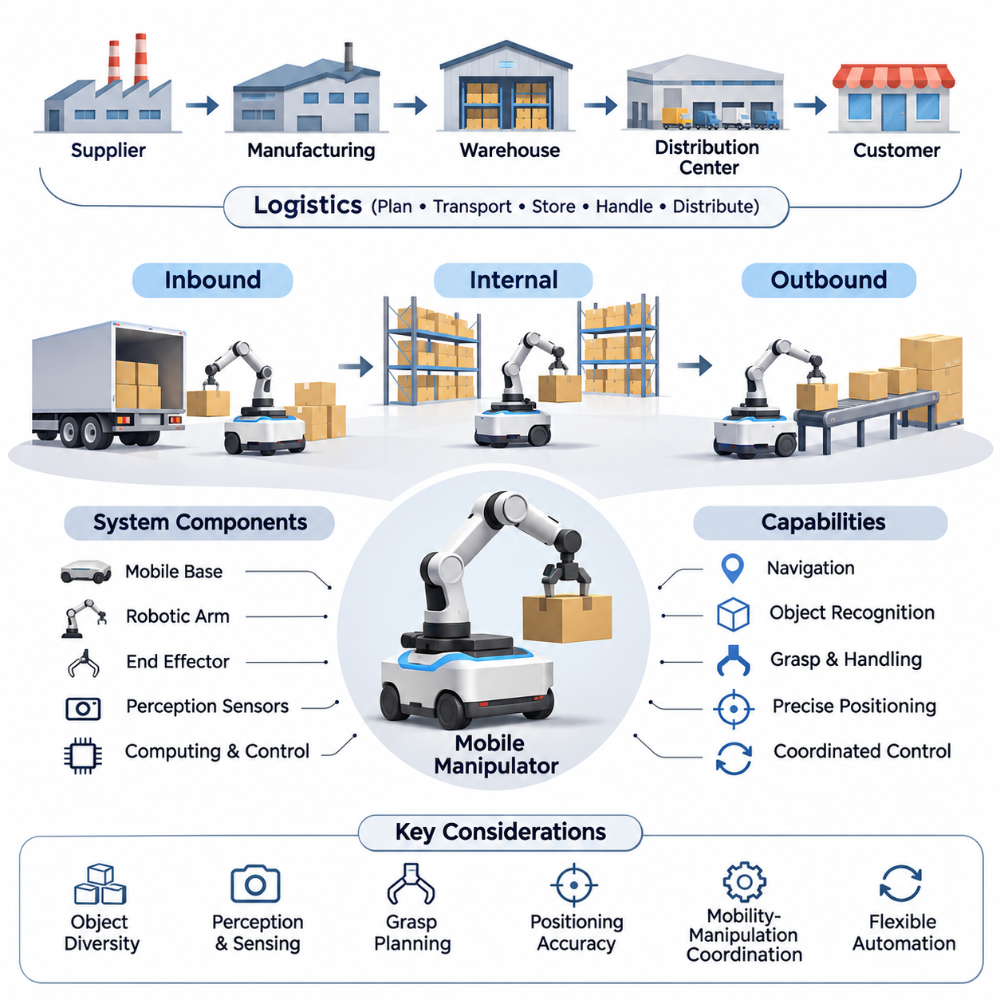
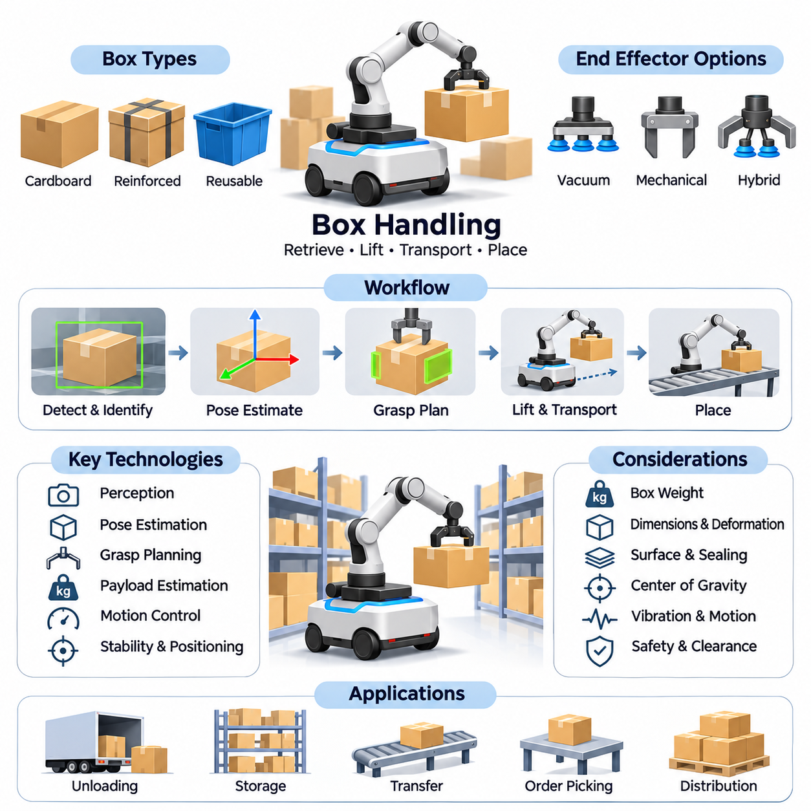
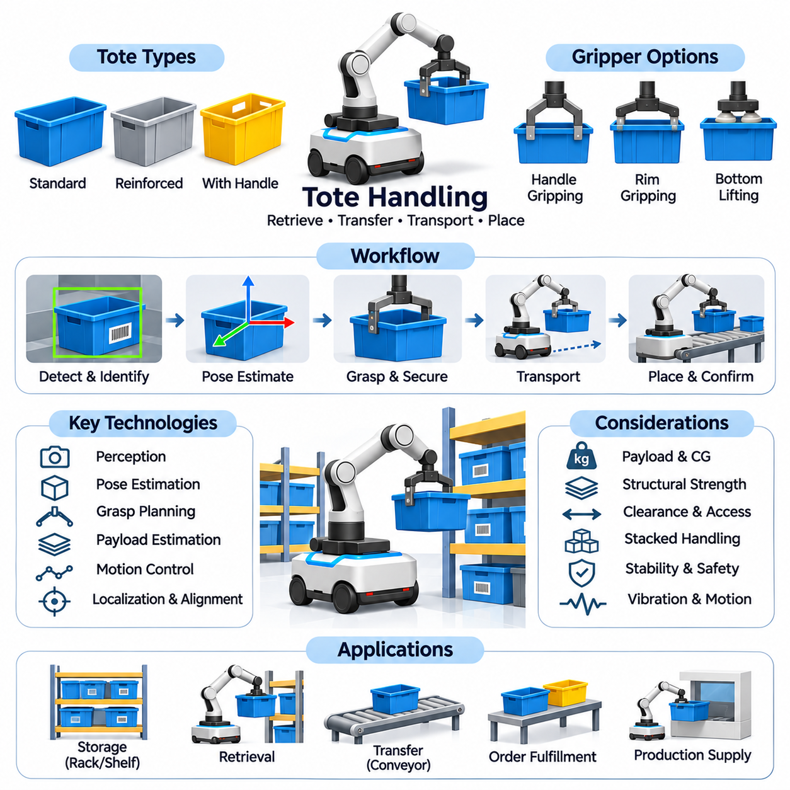
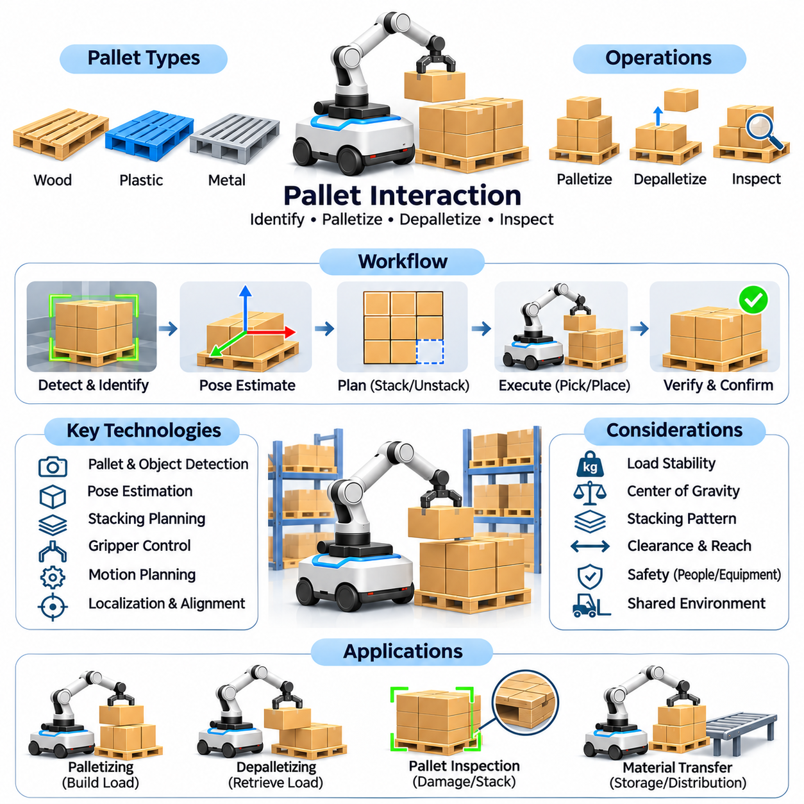
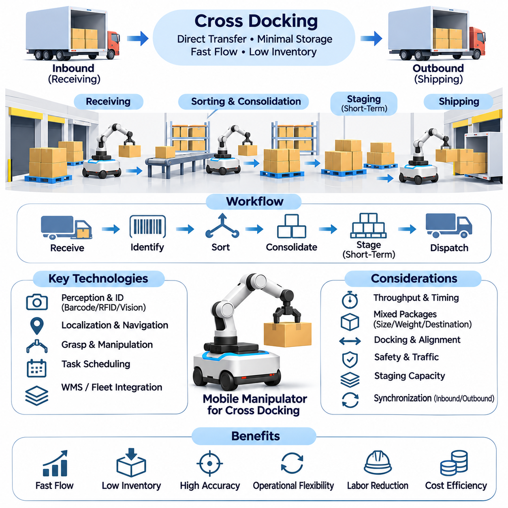
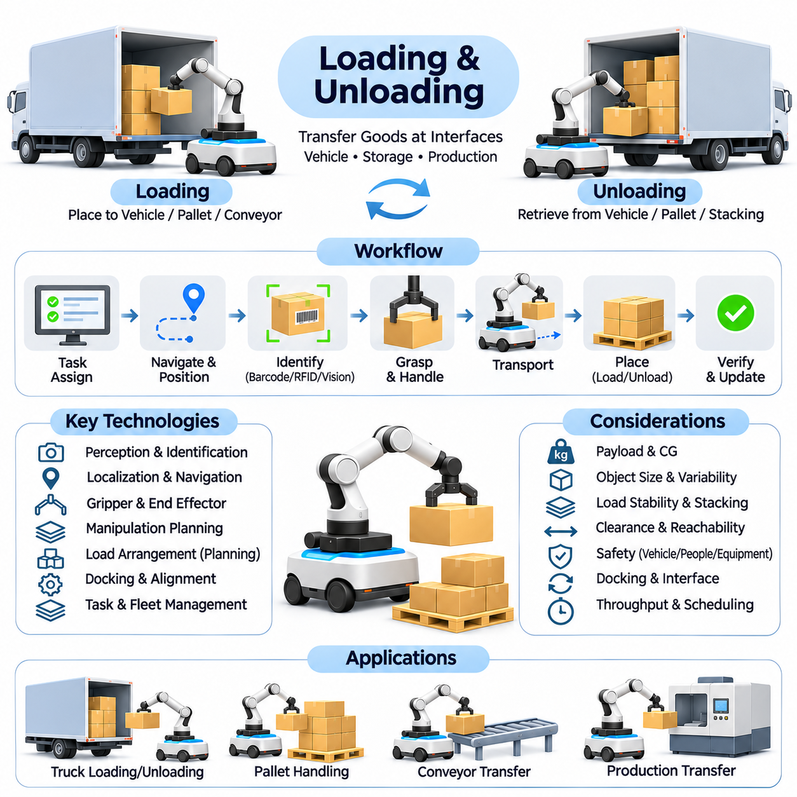
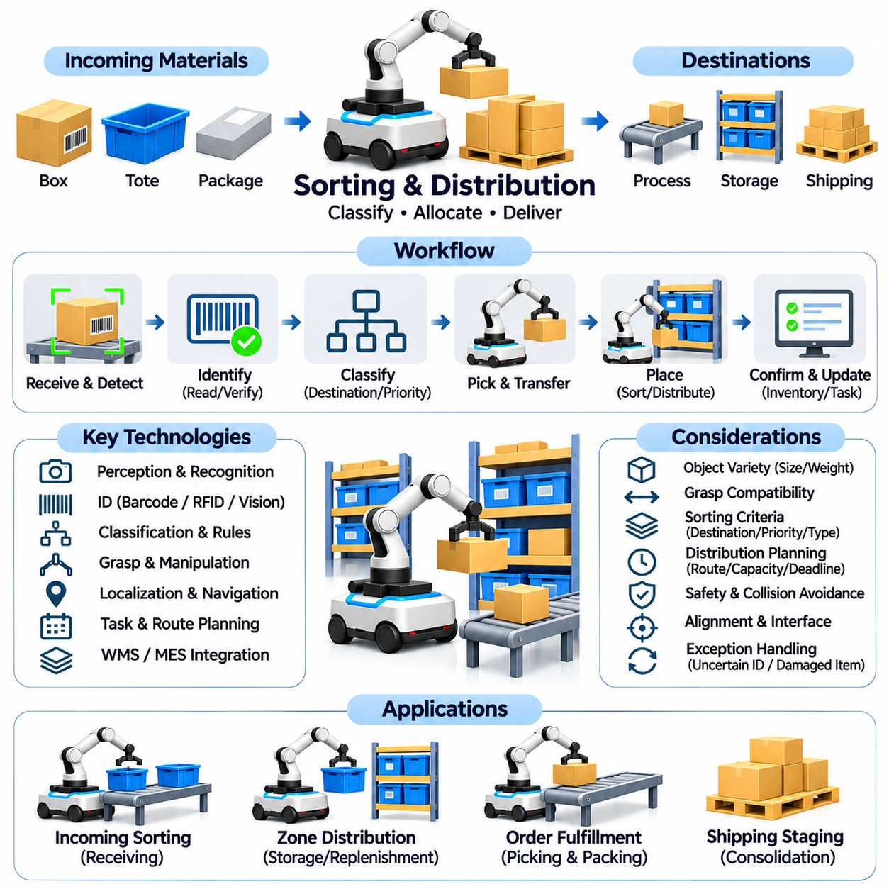
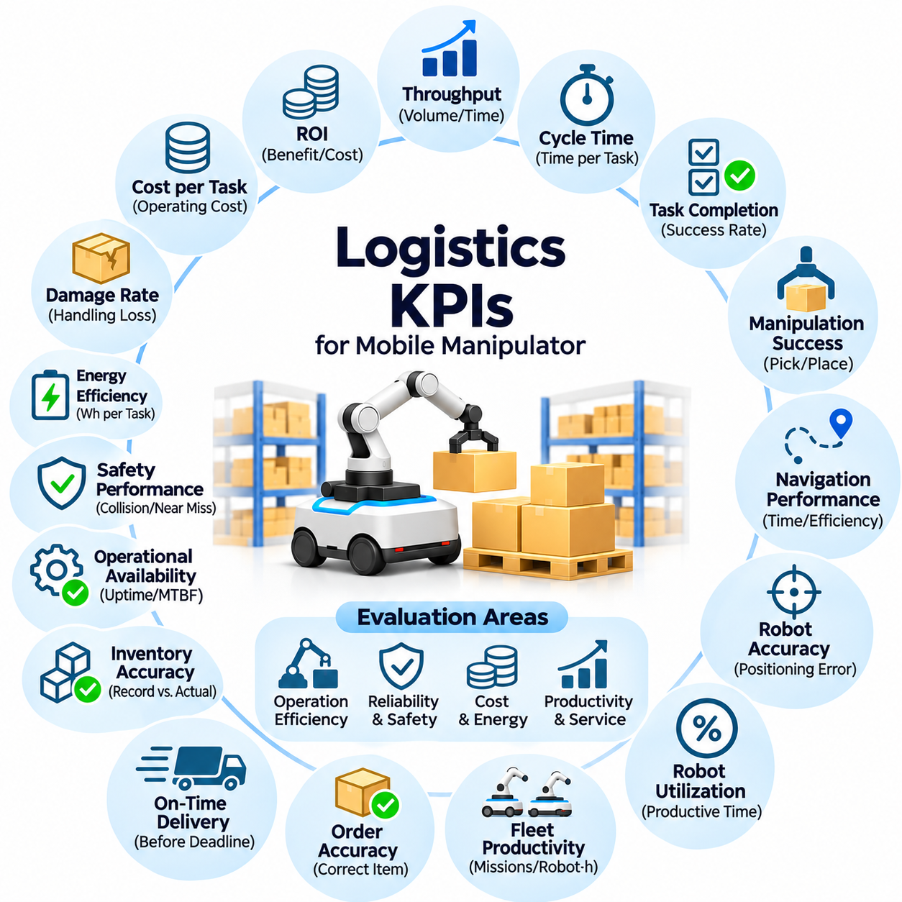

**Volume 01. Mobile Manipulator Foundations and System Architecture**

# Chapter 07. Logistics Handling

## 01 Logistics Overview

{width="7.268055555555556in" height="7.268055555555556in"}

Logistics is the coordinated process of planning, transporting, storing, handling, and distributing materials throughout a supply chain. In modern industrial environments, logistics operations connect suppliers, manufacturing facilities, warehouses, distribution centers, and customers. Efficient logistics systems must maintain continuous material flow while minimizing transportation delays, handling costs, inventory errors, and operational disruptions.

Traditional logistics operations depend on human workers, forklifts, conveyor systems, pallet trucks, and fixed automation equipment. Although these technologies provide reliable material movement, they often require substantial infrastructure and manual intervention. Changing product demand, variable shipment volumes, and increasingly complex warehouse layouts create operational challenges that encourage the adoption of flexible robotic automation.

Mobile manipulators represent an important development in logistics automation because they combine autonomous mobility with robotic object manipulation. Unlike conventional autonomous mobile robots that primarily transport payloads, mobile manipulators can physically interact with boxes, totes, containers, shelves, and handling equipment. This combination enables robots to perform transportation and material-handling tasks within a coordinated workflow.

A typical mobile manipulation system consists of an autonomous mobile robot platform, a robotic arm, an end effector, perception sensors, computing hardware, and integrated control software. The mobile platform transports the system between workstations, while the manipulator performs object interaction. Coordinated control allows the robot to navigate toward a destination, position itself accurately, identify a target, and execute the required handling operation.

Logistics workflows can be divided into inbound logistics, internal material movement, inventory handling, order fulfillment, and outbound distribution. Inbound logistics involves receiving and transferring materials from delivery vehicles into storage or production areas. Internal logistics supports movement between workstations, while outbound logistics prepares completed orders for shipment. Mobile manipulators can contribute to each stage when their capabilities match the operational requirements.

Inbound logistics frequently involves unloading boxes, transferring containers, inspecting shipments, and delivering received materials to designated locations. Mobile manipulators equipped with suitable grippers and perception systems can assist with these activities. Their ability to recognize objects and execute controlled grasping operations reduces dependence on fixed handling stations, particularly where shipment configurations and receiving locations change regularly.

Internal logistics focuses on maintaining continuous material availability across manufacturing and warehouse operations. Components, tools, containers, and partially completed products must reach the correct workstation at the required time. Mobile manipulators can retrieve materials from storage locations, transport them through shared environments, and place them into designated receiving positions, supporting flexible production and material replenishment strategies.

Outbound logistics involves consolidating completed orders, transferring packaged products, sorting shipments, and preparing goods for distribution. Mobile manipulators can support these operations by transferring boxes between storage areas, conveyors, carts, and shipping stations. When connected to warehouse management systems, robotic handling operations can follow dynamically assigned priorities based on shipment deadlines, inventory availability, and processing requirements.

One of the fundamental challenges in logistics manipulation is object diversity. Warehouses contain packages with different dimensions, masses, materials, surface properties, and structural strengths. A robotic system designed for rigid plastic totes may not reliably manipulate deformable cardboard boxes or irregularly shaped packages. Successful deployment therefore requires appropriate payload specifications, adaptable gripping mechanisms, object recognition, and handling strategies.

Robotic perception provides the environmental information required for autonomous logistics handling. Cameras, depth sensors, LiDAR, and other sensing technologies help identify objects, estimate their positions, and detect surrounding obstacles. Perception algorithms transform sensor observations into representations suitable for navigation and manipulation. Reliable operation depends on maintaining sufficient accuracy despite occlusion, changing illumination, reflective packaging, and cluttered environments.

Grasp planning determines how a manipulator should establish stable contact with a target object. Logistics applications commonly use parallel-jaw grippers, vacuum suction devices, mechanical clamps, and specialized container-handling mechanisms. The selected approach depends on object geometry, payload mass, surface characteristics, and required placement accuracy. Grasp stability must be evaluated together with acceleration, vibration, and potential object deformation during handling.

Mobile base positioning is particularly important because manipulation accuracy depends on the relationship between the robot, target object, and surrounding equipment. Navigation systems must bring the platform within the manipulator\'s reachable workspace while maintaining safe clearance. Fine positioning may require visual markers, localization refinement, or sensor-based alignment. Positioning errors can otherwise produce unsuccessful grasps, collisions, or inaccurate material placement.

The interaction between mobility and manipulation introduces additional mechanical and control requirements. A robotic arm carrying a payload changes the combined system\'s center of mass and may generate significant moments around the mobile platform. Engineers must evaluate stability, wheel loading, braking performance, and structural rigidity throughout the manipulation workspace. Payload capacity must therefore consider both the manipulator rating and the mobile platform\'s stability limits.

Task planning coordinates navigation, object identification, grasp execution, transportation, and placement into a unified operational sequence. A logistics mission may begin with receiving a transport request, navigating to a pickup location, verifying the target object, and executing a grasp. The robot subsequently transports the payload to its destination, performs the placement operation, confirms completion, and updates the associated logistics information system.

Warehouse Management Systems provide inventory information, storage locations, order priorities, and material movement instructions. Warehouse Control Systems coordinate equipment operations, while fleet management systems distribute missions among available robots. Integrating mobile manipulators with these platforms enables synchronized logistics execution. Standardized interfaces, reliable communication, and consistent inventory records are essential for maintaining operational continuity.

Fleet coordination becomes increasingly important when multiple mobile manipulators operate within shared logistics environments. Robots must avoid congestion, coordinate access to workstations, and distribute tasks according to available capabilities. Scheduling algorithms may consider travel distance, battery state, payload capacity, task urgency, and equipment availability. Effective fleet management improves resource utilization while reducing unnecessary movement and waiting time.

Human workers and autonomous robots frequently share logistics environments, making operational safety a central design requirement. Mobile manipulators must account for pedestrians, forklifts, moving conveyors, temporary obstacles, and unexpected human interactions. Safety functions may include protective sensing, speed limitation, emergency stopping, controlled braking, and safe manipulation behavior. Risk assessment must address both mobile navigation and robotic arm movement.

Operational reliability requires systematic handling of uncertain conditions and execution failures. A robot may encounter an inaccessible package, an unsuccessful grasp, an obstructed route, or an unavailable destination. Recovery strategies should distinguish temporary disturbances from faults requiring human intervention. Controlled retries, alternative grasp selection, route replanning, and exception reporting help maintain productivity without compromising safety or traceability.

Energy management influences the practical availability of mobile manipulators in continuous logistics operations. Battery capacity must support navigation, robotic arm actuation, perception, onboard computing, and auxiliary equipment. Actual energy consumption varies with payload mass, travel distance, manipulation frequency, and operating conditions. Charging strategies should balance battery utilization, mission urgency, and available charging infrastructure to minimize interruptions.

Logistics automation performance is evaluated through productivity, accuracy, reliability, and economic efficiency. Important indicators include completed handling tasks per hour, average mission cycle time, successful grasp rate, delivery accuracy, robot availability, and intervention frequency. These measurements should be collected under representative operating conditions. System-level evaluation is more meaningful than isolated measurements of navigation speed or manipulator performance.

Economic evaluation must consider the complete lifecycle of a robotic logistics solution. Initial equipment costs include the mobile platform, manipulator, sensors, integration software, and supporting infrastructure. Recurring expenses include maintenance, energy, software support, replacement components, and operational supervision. Return on investment depends on achievable throughput, labor allocation, facility utilization, and the ability to accommodate changing logistics requirements.

Scalability is another important consideration because logistics facilities often experience seasonal demand fluctuations and long-term operational expansion. Modular robotic architectures allow additional units, manipulation tools, and workstations to be introduced without redesigning the entire facility. However, increasing fleet size also introduces communication, scheduling, traffic management, and maintenance challenges that must be addressed through systematic system architecture.

Digital simulation and operational data analysis support logistics system development before physical deployment. Engineers can evaluate robot travel paths, workstation arrangements, task sequences, and expected throughput using virtual environments. Simulation also helps identify congestion points, manipulation reachability limitations, and potential safety conflicts. Field validation remains necessary because real-world perception uncertainty and equipment behavior may differ from simulated assumptions.

The long-term direction of logistics automation involves increasingly intelligent and adaptable robotic systems capable of handling diverse objects and changing operational conditions. Advances in machine learning, visual perception, manipulation planning, and autonomous decision-making may expand the range of feasible tasks. Nevertheless, successful adoption will continue to depend on reliable system integration, measurable productivity, operational safety, and sustainable economic performance.

Mobile manipulation ultimately connects autonomous transportation with physical material interaction, creating opportunities for more flexible logistics processes. Its greatest value emerges when mobility, manipulation, perception, control, and enterprise software operate as an integrated system. Understanding these relationships establishes the foundation for examining box handling, tote handling, pallet interaction, material transfer, cross-docking, loading, sorting, and logistics performance evaluation.

## 02 Box Handling

{width="7.268055555555556in" height="7.268055555555556in"}

Box handling is a fundamental operation in logistics automation because boxes represent one of the most common packaging formats used for storage, transportation, and distribution. Mobile manipulators equipped with robotic arms can automate box retrieval, lifting, transportation, and placement. These capabilities connect autonomous mobility with physical material handling, reducing repetitive manual operations while improving workflow flexibility.

Industrial box handling environments contain packages with different dimensions, weights, materials, and structural characteristics. Corrugated cardboard boxes, reinforced shipping cartons, and reusable containers exhibit different mechanical behaviors during manipulation. A robotic system must account for these variations because package deformation, uneven loading, and unstable surfaces can significantly affect grasp reliability and transportation safety.

A typical robotic box handling workflow begins with identifying a target package and determining its location within the operating environment. Vision sensors capture images or depth information, while perception algorithms estimate object boundaries, dimensions, and orientation. The system then evaluates available grasping surfaces and determines whether the target can be safely manipulated without interfering with adjacent packages or surrounding equipment.

Object detection is essential for distinguishing individual boxes in cluttered storage environments. Modern perception systems may combine RGB cameras, depth sensors, and three-dimensional point clouds to identify package geometry. Deep learning models can detect partially occluded boxes, while geometric processing estimates accessible surfaces. Reliable detection must accommodate printed labels, reflective tape, variable lighting, and overlapping package arrangements.

Pose estimation determines the position and orientation of a box relative to the robot\'s coordinate system. Accurate pose information allows the manipulator to approach the object along a suitable trajectory and align its end effector with the intended contact surface. Coordinate transformations connect camera observations, mobile platform localization, and robotic arm kinematics, enabling consistent manipulation despite changes in robot positioning.

Gripper selection strongly influences the performance of robotic box handling systems. Vacuum suction grippers are commonly suitable for relatively flat, sealed package surfaces, while mechanical grippers can provide direct contact with opposing sides. Hybrid end effectors may combine suction and mechanical support. Selection depends on package weight, surface permeability, structural rigidity, available clearance, and the required handling orientation.

Vacuum gripping systems generate holding force through a pressure difference between the suction interface and the surrounding atmosphere. Their effectiveness depends on the available sealing area, pressure differential, leakage, and package surface characteristics. Porous cardboard, damaged surfaces, and packaging seams may reduce holding performance. Engineers must therefore validate suction capacity under realistic operating conditions rather than relying exclusively on theoretical calculations.

Mechanical gripping systems secure boxes through controlled contact forces applied to accessible surfaces. Parallel-jaw mechanisms, adjustable clamps, and supporting fingers can accommodate different package dimensions. Excessive gripping force may deform or damage cardboard, while insufficient force can cause slipping. Force feedback and compliant contact mechanisms help balance holding stability with package protection during lifting and transportation.

Grasp planning identifies a feasible contact configuration that supports stable lifting and controlled movement. The planning process considers box dimensions, estimated mass, center of gravity, surface accessibility, and nearby obstacles. A grasp near the load\'s center of gravity generally reduces rotational disturbance, although actual feasibility depends on packaging geometry. Candidate grasps must also satisfy manipulator reachability, collision constraints, and end-effector limitations.

Payload estimation is important because the visible dimensions of a package do not necessarily indicate its actual mass. Box contents may be distributed unevenly, producing an offset center of gravity and unexpected rotational moments. Weight information can be obtained from inventory databases, external weighing systems, or appropriately calibrated force measurements. Conservative handling limits help prevent overloading when package properties remain uncertain.

Robotic lifting requires coordinated motion planning and controlled acceleration. Sudden movements can generate inertial forces that exceed gripping capacity or disturb loosely packed contents. The manipulator should follow collision-free trajectories while maintaining stable object orientation. Velocity, acceleration, and jerk limitations can reduce package oscillation and mechanical stress, particularly when handling heavy or fragile shipments.

Mobile platform stability becomes critical when a robotic arm extends beyond the vehicle footprint while holding a box. The combined center of gravity shifts according to arm configuration and payload position. Engineers must evaluate tipping margins, wheel loading, structural deflection, and braking behavior. Manipulation operations may require the mobile base to remain stationary or use additional stabilization mechanisms when handling demanding loads.

Box transportation introduces challenges beyond the initial grasping operation. Vibrations from floor irregularities, turning maneuvers, and acceleration changes can reduce grasp stability. The robot must maintain sufficient clearance between the carried package and nearby obstacles. Transport configurations should minimize arm extension and preserve visibility for navigation sensors, while motion constraints should reflect the combined robot and payload dimensions.

Placement operations require accurate alignment between the box and its destination surface. Common destinations include shelves, conveyor belts, pallets, sorting stations, and storage racks. The manipulator must consider available clearance, support geometry, and the stability of previously placed objects. Controlled lowering and verified contact help prevent impacts, package deformation, and unstable stacking configurations.

Box stacking requires additional reasoning about load distribution and structural support. Lower packages must withstand the forces transmitted by upper layers, while the overall arrangement must remain mechanically stable. Placement algorithms can consider box dimensions, mass estimates, orientation, and available support area. Irregular packages or uncertain weight distributions may require conservative stacking rules or alternative storage locations.

Conveyor interaction is a common application of robotic box handling. A mobile manipulator may retrieve packages from a stationary conveyor or place boxes onto a receiving belt. Successful transfer requires coordination with conveyor motion, package spacing, and equipment control signals. Moving conveyor operations introduce timing and tracking requirements, while communication interfaces help synchronize robot actions with material flow.

Autonomous box handling can also support truck loading and unloading, although these environments introduce additional complexity. Cargo spaces may contain tightly packed packages, limited illumination, uneven floors, and restricted manipulator access. The robot must identify accessible boxes and plan safe extraction sequences. Loading operations additionally require spatial arrangement strategies that account for package stability, available volume, and transportation constraints.

Handling damaged or irregular boxes requires adaptive perception and manipulation strategies. Crushed corners, open flaps, torn surfaces, and unexpected protrusions can invalidate previously planned grasps. The robot should evaluate package condition before manipulation and select alternative contact regions when appropriate. Packages that cannot be handled safely should be identified for exception processing rather than subjected to repeated uncontrolled attempts.

Reliable box handling depends on continuous monitoring during execution. Force sensors, vacuum pressure sensors, joint feedback, and visual observations can provide evidence of successful grasping and stable transport. Unexpected force changes or pressure loss may indicate slipping or contact failure. Monitoring algorithms should trigger controlled recovery behavior when handling conditions exceed established operational limits.

Integration with warehouse management systems enables box handling operations to follow inventory and order requirements. Package identifiers, storage locations, handling restrictions, and destination assignments can be communicated through standardized interfaces. Barcode scanning or visual identification may confirm that the correct package has been selected. Transaction records should reflect successful physical completion rather than assuming that commanded robot actions always succeed.

Operational performance is commonly evaluated using grasp success rate, completed transfers per hour, average handling cycle time, placement accuracy, and package damage frequency. Additional indicators include recovery attempts, human intervention frequency, and robot availability. Measurements should distinguish perception failures, grasping failures, transportation disturbances, and placement errors to support systematic engineering improvements.

The economic value of automated box handling depends on the relationship between system cost, throughput, reliability, and labor requirements. Mobile manipulators may offer advantages where multiple handling stations require automation without extensive fixed infrastructure. However, manipulation cycle times, payload limitations, and operational exceptions can constrain productivity. Deployment decisions should therefore consider realistic workload distributions and complete system operating costs.

Simulation environments can support the development and validation of robotic box handling workflows. Engineers can model package geometry, gripper contact, robot kinematics, collision constraints, and placement sequences before physical deployment. Simulated experiments help identify unreachable configurations and inefficient motion plans. Nevertheless, physical testing remains necessary to evaluate cardboard deformation, suction leakage, friction variability, and real-world sensor uncertainty.

Future box handling systems are expected to benefit from advances in three-dimensional perception, adaptive grasp planning, learning-based control, and multimodal artificial intelligence. More capable perception and manipulation models may improve handling across unfamiliar package types. However, practical performance will continue to depend on robust mechanical design, validated payload limits, reliable sensing, and safe recovery behavior under uncertain operating conditions.

Effective robotic box handling requires coordinated integration of perception, grasp planning, manipulation control, autonomous mobility, and logistics information systems. Each component contributes to the reliability of the complete handling workflow. By combining accurate object understanding with mechanically stable manipulation and systematic operational monitoring, mobile manipulators can provide flexible automation for increasingly diverse logistics environments.

## 03 Tote Handling

{width="7.268055555555556in" height="7.268055555555556in"}

Tote handling is an essential function in modern logistics automation because reusable containers are widely employed for material storage, transportation, order fulfillment, and production supply. Unlike disposable cardboard boxes, totes provide standardized dimensions, durable structures, and repeatable handling interfaces. Mobile manipulators can exploit these characteristics to automate container retrieval, transfer, transportation, and placement across interconnected logistics environments.

Industrial totes are commonly manufactured from rigid plastic or reinforced composite materials designed to withstand repeated handling cycles. Their geometry may include integrated handles, reinforced rims, stacking features, and identification labels. Although standardized containers simplify robotic interaction, variations in size, payload capacity, wall thickness, and surface condition still require careful consideration when designing automated manipulation systems.

A typical tote handling workflow begins with receiving a material movement request from a warehouse or production management system. The mobile manipulator navigates toward the designated storage location, identifies the required container, and evaluates its accessibility. After establishing a secure grasp, the robot retrieves the tote, transports it to the assigned destination, and places it in the required position before confirming task completion.

Tote identification relies on perception technologies capable of recognizing container geometry and distinguishing individual units. RGB cameras, depth sensors, and three-dimensional point clouds can provide information about container position, orientation, and surrounding obstacles. Barcode labels, QR codes, or RFID tags may support identification and inventory tracking. Combining geometric perception with digital identification improves the reliability of automated material handling.

Pose estimation determines the spatial relationship between a tote and the robot\'s manipulation system. Accurate position and orientation estimates are necessary when containers are stored in shelves, racks, conveyors, or tightly arranged stacks. Coordinate transformations connect sensor observations with the mobile platform and robotic arm. Localization uncertainty must remain within acceptable limits to prevent collisions with storage structures during retrieval and placement.

Gripper design plays a central role in reliable tote manipulation. Mechanical grippers may engage integrated handles, reinforced rims, or opposing container walls, depending on the tote geometry. Specialized lifting mechanisms can support containers from underneath when sufficient clearance exists. The gripping strategy should consider structural strength, available contact surfaces, payload mass, and the possibility of deformation under concentrated forces.

Handle-based gripping provides a convenient interaction method when totes include suitable lifting features. Robotic fingers or hooks can engage designated handle openings and transfer lifting forces through reinforced structural regions. However, handle dimensions, accessibility, and manufacturing tolerances influence grasp feasibility. The robot must verify secure engagement before lifting, particularly when containers are heavily loaded or partially obstructed.

Rim gripping is another practical approach for containers with sufficiently strong upper edges. A gripper can contact the tote rim using mechanical fingers or clamping surfaces, allowing the robot to lift without accessing the bottom. This method may simplify manipulation in crowded storage environments. Nevertheless, rim strength, container deformation, and load distribution must be evaluated to avoid damage or unexpected release.

Payload characteristics significantly influence tote handling performance. Containers may hold components, tools, packaged goods, or mixed inventory with uneven mass distribution. The total payload includes both the tote and its contents, while the center of gravity depends on internal loading. Weight information from inventory systems or calibrated sensing can support handling decisions, but uncertain loads require conservative operational limits.

Stable lifting requires coordinated control of the robotic arm and end effector. The manipulator should apply sufficient gripping force while limiting acceleration and sudden changes in direction. Excessive motion can cause container oscillation, internal material displacement, or loss of grasp stability. Smooth trajectories and controlled orientation help protect both the tote and its contents during retrieval and transfer operations.

Mobile platform stability becomes important when transporting heavy totes with an extended robotic arm. The combined center of gravity changes according to container mass and manipulator configuration. Engineers must evaluate tipping margins, wheel loading, braking behavior, and structural rigidity. Transporting the tote close to the mobile platform generally reduces destabilizing moments, provided the configuration maintains appropriate clearance and sensor visibility.

Tote retrieval from shelving systems requires precise alignment and collision-aware motion planning. Storage compartments may provide limited clearance around container walls, handles, and supporting rails. The manipulator must approach along a feasible trajectory, establish a secure grasp, and extract the tote without contacting adjacent inventory. Visual feedback and compliant control can help compensate for moderate positioning uncertainty.

Stacked tote handling introduces additional challenges related to vertical access and load transfer. Containers may be designed with interlocking features that improve stacking stability but complicate robotic separation. The robot must determine whether the target tote can be removed without destabilizing surrounding containers. Safe manipulation may require unloading upper layers first or using dedicated separation mechanisms.

Tote placement requires accurate positioning relative to shelves, conveyors, workstations, and transport equipment. The robot must verify that the receiving surface can support the container and that sufficient clearance exists for insertion. Controlled lowering reduces impact forces and prevents damage to stacking interfaces. Placement verification may use force feedback, vision, or external sensors to confirm successful transfer.

Conveyor-based tote handling is common in automated warehouses and distribution facilities. Mobile manipulators can transfer containers between storage locations and conveyor interfaces, supporting flexible material flow. Coordination with conveyor controllers is necessary to ensure appropriate transfer timing and equipment readiness. Moving conveyor applications require additional tracking and synchronization capabilities to maintain placement accuracy.

Tote handling also supports production logistics by delivering components and tools to manufacturing workstations. Standardized containers enable predictable interfaces between robotic transport systems and production equipment. Mobile manipulators can retrieve empty totes, deliver loaded containers, and exchange materials according to production schedules. Integration with manufacturing execution systems helps synchronize these operations with actual material consumption.

Order fulfillment operations frequently use totes to consolidate products collected from different storage locations. Mobile manipulators may transport partially filled containers between picking stations, sorting areas, and packing workstations. Container identification ensures that items remain associated with the correct order. Accurate tracking and controlled transfers reduce the risk of inventory mismatches and misplaced materials during multi-stage fulfillment processes.

Multi-robot tote handling requires coordinated scheduling and resource allocation. Fleet management systems can assign transport and manipulation tasks according to robot availability, payload capacity, travel distance, and operational priority. Shared workstations and narrow aisles introduce potential congestion. Traffic management and reservation mechanisms help prevent conflicts while maintaining predictable material movement throughout the facility.

Safety considerations extend beyond navigation because tote manipulation introduces moving loads and potential pinch points. Workers may interact with robots near storage racks, conveyors, and material exchange stations. Protective sensing, controlled speed, emergency stopping, and appropriate separation distances reduce operational risks. Risk assessment should also consider dropped containers, unstable stacking, and unexpected movement of internal materials.

Reliable operation requires continuous monitoring of gripping conditions and manipulation progress. Joint torque measurements, force sensors, gripper position feedback, and visual observations can indicate whether a tote remains securely attached. Unexpected load changes may reveal slipping, obstruction, or incorrect engagement. Recovery procedures should stop unsafe motion, reassess the situation, and request human assistance when automatic correction is not sufficiently reliable.

Tote handling systems benefit from integration with warehouse management systems, manufacturing execution systems, and fleet management platforms. These systems exchange container identifiers, inventory contents, storage locations, transport requests, and completion records. Consistent data synchronization enables traceability and reduces operational errors. Physical confirmation of successful placement should precede inventory status updates whenever container location accuracy is essential.

Operational performance can be evaluated through successful retrieval rate, transfer accuracy, average handling cycle time, completed missions per hour, and robot availability. Additional measurements include container damage frequency, failed grasp attempts, recovery duration, and human intervention requirements. Performance evaluation should account for tote dimensions, payload variations, storage configurations, and environmental conditions rather than relying on isolated laboratory demonstrations.

Economic benefits depend on the relationship between standardized container design and robotic handling efficiency. Reusable totes can reduce packaging waste and provide predictable mechanical interfaces, while mobile manipulators reduce repetitive manual transport and transfer operations. However, equipment acquisition, integration, maintenance, and container compatibility introduce costs. Deployment feasibility should be assessed using realistic throughput requirements and total cost of ownership.

Simulation and digital twin technologies can support tote handling system development before physical deployment. Engineers can model container geometry, storage arrangements, gripper interaction, robotic reachability, and transport routes. Virtual testing helps identify collision risks, inefficient workflows, and unsuitable workstation layouts. Physical validation remains necessary to evaluate friction, structural deformation, manufacturing tolerances, and actual sensor performance.

Future tote handling systems may incorporate adaptive grasping, advanced visual perception, learning-based manipulation, and intelligent fleet coordination. Robots could increasingly accommodate different container designs and dynamically changing storage environments. Nevertheless, practical reliability will depend on validated mechanical interfaces, accurate localization, robust sensing, and predictable recovery behavior.

Effective tote handling combines standardized container interfaces with autonomous navigation, robotic manipulation, perception, and logistics information management. The complete system must maintain safe load transfer, accurate container identification, and reliable task execution across diverse operating conditions. By integrating these capabilities, mobile manipulators can support scalable and flexible material movement throughout warehouses, distribution centers, and industrial production facilities.

## 04 Pallet Interaction

{width="7.268055555555556in" height="7.268055555555556in"}

Pallet interaction is an important function in logistics automation because pallets provide standardized platforms for storing, consolidating, and transporting large quantities of goods. Mobile manipulators can interact with palletized materials by identifying load configurations, retrieving individual packages, and arranging products on pallet surfaces. These capabilities connect autonomous navigation with robotic manipulation, supporting flexible material movement across warehouses and distribution facilities.

Pallets are commonly manufactured from wood, plastic, or metal and are designed to support loads during storage and transportation. Their dimensions, structural strength, and entry configurations vary according to industrial requirements. Although standardized pallet formats simplify logistics operations, differences in deck geometry, load distribution, and surface condition create challenges for robotic interaction. Reliable systems must recognize both pallet structure and payload characteristics.

Pallet interaction includes several operational activities, such as pallet identification, load inspection, package retrieval, palletizing, depalletizing, and material transfer. Mobile manipulators generally handle individual packages or smaller load units, while dedicated pallet-handling vehicles transport complete pallets. Integrating these complementary capabilities allows logistics systems to automate material flow between bulk storage, processing stations, and distribution areas.

A typical pallet interaction workflow begins when a robot receives a task specifying a pallet location and required handling operation. The mobile platform navigates toward the designated area and positions itself within the manipulator\'s reachable workspace. Perception sensors identify the pallet and its contents, while task planning software determines an appropriate manipulation sequence. The robot then executes the operation and verifies completion.

Pallet detection requires identifying the supporting platform despite partial occlusion by stacked products. RGB cameras, depth sensors, and LiDAR can provide information about pallet boundaries, openings, and surrounding obstacles. Geometric processing may estimate pallet orientation and accessible regions. Reliable detection must account for damaged boards, packaging materials, variable lighting, and differences between wooden and plastic pallet structures.

Pose estimation establishes the spatial relationship between the pallet, mobile platform, and robotic arm. Accurate alignment is necessary when retrieving packages near pallet edges or placing objects within limited available space. Coordinate transformations connect sensor observations with the robot\'s reference frames. Localization refinement and visual feedback can compensate for moderate positioning errors, reducing collision risks during manipulation.

Palletizing involves arranging individual packages on a pallet according to a predefined or dynamically generated stacking pattern. The objective is to use available space efficiently while maintaining load stability and accessibility. Placement planning considers package dimensions, weight, orientation, and support area. Suitable stacking patterns must distribute forces appropriately and avoid unsupported overhangs that could compromise structural integrity.

Depalletizing reverses this process by removing packages from an existing pallet load. The robot must identify accessible objects and determine a safe extraction sequence. Upper layers are generally removed before lower layers to avoid destabilizing the remaining stack. However, irregular loading patterns, overlapping packages, and damaged cartons may require adaptive planning based on real-time perception and stability assessment.

Gripper selection depends on the characteristics of the packages being manipulated rather than the pallet alone. Vacuum suction grippers can handle suitable flat surfaces, while mechanical grippers provide alternative contact methods for irregular or porous packages. Hybrid end effectors may increase handling flexibility. The selected mechanism must maintain sufficient holding force without damaging packaging or disturbing adjacent items.

Load stability is a central consideration in pallet interaction because stacked products form a mechanically interconnected structure. Removing or adding one package changes the distribution of forces across the remaining load. Engineers must consider center of gravity, contact area, friction, and package compressive strength. Unstable arrangements can lead to shifting, collapse, or damage during subsequent handling and transportation.

Mobile platform positioning influences both manipulation reachability and overall system stability. The robot must approach the pallet while maintaining sufficient clearance for its arm and end effector. Heavy packages or extended arm configurations can shift the combined center of gravity. Motion planning should therefore consider tipping margins, payload limits, and collision constraints throughout the handling operation.

Pallet interaction frequently occurs near forklifts, pallet trucks, conveyors, and warehouse workers. These shared environments introduce dynamic obstacles and unpredictable equipment movement. Autonomous systems require protective sensing, controlled speed, and clearly defined operational zones. Safety planning must address both mobile platform movement and robotic arm motion, particularly when manipulating elevated or unstable loads.

Pallet inspection can be integrated into robotic handling workflows to identify damaged structures, misplaced packages, or unstable stacking conditions. Vision systems may detect broken boards, excessive overhang, displaced cartons, or unexpected obstacles. Inspection results can influence task planning and determine whether automated manipulation should proceed. Unsafe conditions should trigger exception handling rather than uncontrolled recovery attempts.

Accurate placement requires the manipulator to align each package with its intended position while avoiding contact with previously stacked items. Controlled lowering reduces impact forces and package deformation. Force feedback and visual verification can confirm that an object has reached its support surface. Placement accuracy becomes particularly important when building dense pallet configurations with limited clearance between adjacent packages.

Pallet interaction may also involve direct engagement with the pallet structure through specialized equipment. Fork-equipped mobile robots or autonomous pallet movers can lift and transport complete pallets when their mechanical architecture supports the required loads. These systems differ from arm-based mobile manipulators but may operate within the same logistics architecture. Coordinated workflows allow package manipulation and bulk pallet transportation to complement each other.

Integration with warehouse management systems enables pallet operations to follow inventory requirements and shipment priorities. Pallet identifiers, package records, destination assignments, and handling restrictions can be exchanged through standardized communication interfaces. Barcode scanning, RFID, or visual identification may support traceability. Inventory updates should reflect verified physical operations to prevent discrepancies between digital records and actual material locations.

Pallet handling performance can be evaluated using packages processed per hour, palletizing cycle time, depalletizing success rate, placement accuracy, and package damage frequency. Additional metrics include robot availability, intervention requirements, and recovery duration. Evaluation should consider package diversity, pallet configuration, loading height, and environmental variability to provide a realistic assessment of operational capability.

Economic feasibility depends on throughput requirements, equipment utilization, and the complexity of pallet handling tasks. Mobile manipulators can provide flexibility when multiple pallet locations require intermittent processing without extensive fixed automation. However, dedicated palletizing cells may achieve higher throughput in repetitive applications. System selection should consider workload variability, available space, integration costs, and total cost of ownership.

Simulation and digital twin technologies can support pallet interaction development by modeling package geometry, stacking arrangements, robot reachability, and load stability. Virtual experiments help evaluate placement strategies and identify potential collisions before deployment. Nevertheless, physical validation remains essential because friction, packaging deformation, and load distribution may differ from simulation assumptions. Real-world testing should include representative pallet conditions and package variations.

Future pallet interaction systems may incorporate advanced three-dimensional perception, adaptive stacking algorithms, learning-based manipulation, and intelligent coordination between mobile robots and material-handling equipment. These capabilities could improve flexibility when handling mixed products and irregular pallet configurations. Practical adoption will continue to depend on predictable safety behavior, validated load limits, and reliable system integration.

Effective pallet interaction combines perception, manipulation planning, autonomous mobility, structural stability assessment, and logistics information management. The complete system must coordinate package handling with pallet accessibility, operational safety, and inventory accuracy. By integrating these capabilities, mobile manipulators can support adaptable palletizing, depalletizing, and material transfer operations within increasingly automated logistics environments.

## 05 Material Transfer

{width="7.268055555555556in" height="7.268055555555556in"}

Material transfer is a fundamental logistics operation that moves goods, components, tools, and containers between storage locations, production stations, and distribution areas. Mobile manipulators extend conventional autonomous transportation by physically loading and unloading materials at their destinations. This capability reduces dependence on fixed transfer equipment and enables flexible material movement across changing industrial environments.

Traditional material transfer systems rely on conveyors, forklifts, carts, and manually operated handling equipment. These solutions can achieve high throughput but often require dedicated infrastructure or continuous human involvement. Mobile manipulators combine autonomous navigation with robotic arms, allowing materials to be collected, transported, and deposited through integrated operations without requiring every transfer point to have permanent automation.

Material transfer tasks vary according to object characteristics, transportation distance, workstation configuration, and operational priorities. Common applications include moving components between manufacturing cells, replenishing assembly stations, transferring containers between conveyors, and delivering tools to production equipment. Each application introduces different requirements for payload capacity, positioning accuracy, handling speed, and environmental adaptability.

A typical material transfer workflow begins when a robot receives a transport request from a supervisory system. The robot identifies the pickup location, determines the required handling procedure, and navigates toward the source station. After verifying the target material, the manipulator establishes a secure grasp and loads the object. The mobile platform then transports the material to its destination for controlled placement and task confirmation.

Material identification is essential because industrial facilities frequently contain visually similar containers and components assigned to different destinations. Cameras, barcode readers, RFID systems, and inventory databases can provide complementary identification information. Combining physical recognition with digital records helps prevent incorrect transfers. Identification should be verified at appropriate workflow stages to maintain inventory accuracy and operational traceability.

Accurate localization enables the mobile platform to approach transfer stations within the manipulator\'s reachable workspace. LiDAR, cameras, wheel odometry, and inertial sensors may contribute to position estimation. However, navigation accuracy alone may not satisfy manipulation requirements. Fine alignment using visual markers, geometric features, or local sensing can compensate for positioning uncertainty before the robotic arm begins interacting with equipment.

Transfer station design significantly influences robotic handling reliability. Workstations should provide predictable object locations, sufficient approach clearance, and mechanically stable receiving surfaces. Standardized docking interfaces can simplify alignment and reduce manipulation uncertainty. When existing facilities cannot be modified, perception and motion planning must accommodate variations in station geometry, object placement, and accessibility.

Gripper selection depends on the materials being transferred and the required interaction method. Parallel-jaw grippers can secure rigid components, while vacuum grippers may handle suitable packaged products. Specialized mechanisms can engage tote handles, trays, or dedicated lifting features. The end effector must provide sufficient holding capability while preventing damage, slipping, or unintended contact with neighboring objects during transfer operations.

Manipulation planning determines how objects are retrieved from source locations and placed at destination stations. The planner considers object geometry, grasp accessibility, robot kinematics, collision constraints, and receiving surface conditions. Motion trajectories should minimize unnecessary movement while maintaining safe clearance. When object positions are uncertain, visual feedback or compliant control can improve handling reliability.

Payload characteristics affect both manipulation performance and transportation stability. The robot must account for object mass, dimensions, center of gravity, and possible internal movement. Heavy or asymmetrical loads can produce significant moments when the manipulator extends beyond the mobile platform. Engineers must evaluate combined payload limits, structural rigidity, wheel loading, and tipping margins before defining permissible handling configurations.

Transportation introduces dynamic forces that can influence grasp stability and object positioning. Acceleration, braking, turning, and floor irregularities may generate vibration or load displacement. A suitable transport posture keeps the payload close to the mobile platform whenever practical. Navigation constraints should reflect the complete robot and carried-object envelope, while motion limits should prevent excessive forces during travel.

Material transfer between conveyors requires coordination with equipment operating states. A robot may collect containers from a stationary conveyor, place components onto a receiving belt, or exchange materials with an automated processing line. Transfer timing must account for conveyor readiness, object position, and available space. Communication with conveyor controllers enables synchronized operations and reduces the risk of collisions or interrupted material flow.

Manufacturing material transfer often connects storage systems with assembly lines, machining centers, and inspection stations. Mobile manipulators can deliver required components and retrieve completed products according to production schedules. Integration with manufacturing execution systems enables material requests to reflect actual workstation demand. This approach supports flexible manufacturing while reducing unnecessary inventory accumulation near production equipment.

Material transfer may also involve automated storage and retrieval systems, robotic work cells, and specialized handling machinery. Successful integration requires compatible mechanical interfaces and clearly defined communication procedures. The mobile manipulator must confirm that connected equipment is ready before initiating physical interaction. Interlocks and coordinated control sequences help prevent simultaneous movements that could create hazardous operating conditions.

Task scheduling determines when materials should be collected, transported, and delivered. Scheduling algorithms may consider production deadlines, workstation demand, travel distance, payload compatibility, and robot availability. Efficient scheduling reduces idle time and unnecessary transportation. In facilities with multiple robots, fleet management systems distribute tasks and coordinate access to shared transfer locations to prevent congestion.

Material transfer operations frequently occur in environments shared with workers, forklifts, and other automated equipment. Safety architecture must address mobile navigation, manipulator motion, moving payloads, and equipment interfaces. Protective sensing, speed control, emergency stopping, and appropriate operating zones reduce risks. Hazard analysis should consider dropped materials, unexpected equipment activation, and human access to transfer stations.

Reliable transfer execution requires continuous monitoring of object engagement and task progress. Force sensors, gripper feedback, visual observations, and equipment status signals can confirm whether materials remain securely held. Unexpected resistance or load changes may indicate obstruction, slipping, or positioning errors. Recovery procedures should stop unsafe motion, reassess the situation, and determine whether automatic correction or human intervention is appropriate.

Placement verification is necessary because a completed robot motion does not guarantee successful material delivery. The system may use vision, force feedback, presence sensors, or workstation acknowledgments to confirm that an object has reached its intended location. Verified completion should trigger inventory and task status updates. This distinction between commanded actions and confirmed physical outcomes improves logistics data consistency.

Energy management influences the availability of mobile manipulators performing frequent material transfers. Battery consumption depends on travel distance, payload mass, manipulation frequency, and onboard computing requirements. Charging schedules should account for mission urgency and operational demand. Coordinating charging with task allocation can reduce interruptions while maintaining sufficient energy reserves for safe mission completion.

Material transfer performance is evaluated through completed missions per hour, average transfer cycle time, delivery accuracy, manipulation success rate, and robot availability. Additional indicators include transportation distance, waiting time, recovery frequency, and human intervention requirements. Performance analysis should distinguish navigation delays from manipulation and equipment synchronization delays to identify the most effective improvement opportunities.

Economic evaluation considers equipment acquisition, system integration, maintenance, energy consumption, and operational supervision. Mobile manipulators can offer advantages when material transfer points change frequently or fixed automation would require substantial infrastructure modifications. However, specialized conveyors or dedicated transfer mechanisms may remain more efficient for repetitive high-volume operations. Technology selection should reflect actual workload characteristics and total cost of ownership.

Simulation and digital twin technologies support material transfer system development by representing robot movements, workstation interfaces, transportation routes, and task schedules. Virtual experiments can reveal congestion, unreachable manipulation positions, and inefficient material flow. Nevertheless, physical validation remains essential because real-world sensing uncertainty, mechanical tolerances, and equipment communication delays may differ from simulated conditions.

Future material transfer systems may incorporate adaptive manipulation, intelligent scheduling, advanced perception, and learning-based decision-making. Robots could increasingly handle unfamiliar materials and adjust transfer procedures to changing workstation configurations. Integration with fleet intelligence and production management platforms may further improve operational flexibility. Practical adoption will continue to require reliable sensing, validated safety behavior, and predictable recovery procedures.

Effective material transfer combines autonomous mobility, robotic manipulation, accurate localization, equipment coordination, and logistics information management. The complete system must ensure that materials reach the correct destination safely, efficiently, and with verified completion. By integrating these capabilities, mobile manipulators can support flexible manufacturing, warehouse operations, and distribution workflows while reducing dependence on rigid material-handling infrastructure.

## 06 Cross Docking

{width="7.268055555555556in" height="7.268055555555556in"}

Cross-docking is a logistics strategy in which incoming goods are transferred directly or with minimal temporary storage to outbound transportation channels. Its primary objective is to reduce inventory holding time, warehouse handling, and delivery delays. Mobile manipulators can support cross-docking by combining autonomous transportation with robotic loading, unloading, sorting, and transfer operations across dynamically changing logistics facilities.

Traditional cross-docking facilities depend on coordinated inbound and outbound transportation schedules, conveyor systems, forklifts, and manual sorting activities. These operations require precise timing because materials must move rapidly between receiving and shipping areas. Mobile manipulators introduce flexible automation by transporting and physically transferring individual packages or containers without requiring fixed handling equipment at every operational location.

Cross-docking operations generally include receiving, identification, sorting, consolidation, temporary staging, and outbound dispatch. Incoming materials are classified according to destination, delivery priority, and transportation requirements. Unlike conventional warehousing, the objective is not long-term storage but rapid movement through the facility. Robotic systems must therefore emphasize throughput, synchronization, and reliable task execution.

A typical robotic cross-docking workflow begins when an inbound shipment arrives at a receiving dock. Warehouse management software identifies shipment contents and generates transfer assignments. Mobile manipulators navigate toward designated receiving stations, identify packages or containers, and retrieve assigned materials. The robots then transport goods to sorting, consolidation, or outbound staging areas before confirming successful delivery.

Inbound material identification is essential for preventing routing errors during high-speed logistics operations. Barcode scanners, RFID readers, cameras, and digital shipment records provide information about package identity and destination. Visual perception can additionally estimate object dimensions, orientation, and handling accessibility. Combining identification and geometric information allows robots to select appropriate grasping strategies and transportation routes.

Receiving dock environments introduce challenges because packages may arrive in irregular arrangements and varying physical conditions. Containers can be stacked tightly, partially obstructed, or positioned outside expected handling locations. Mobile manipulators require robust perception and adaptive manipulation planning to accommodate these variations. Damaged packaging or unstable loads should trigger inspection and exception handling before automated transfer proceeds.

Cross-docking frequently involves mixed shipments containing packages with different sizes, weights, and destinations. Sorting decisions must account for shipment priority, outbound vehicle assignment, handling restrictions, and available staging capacity. Mobile manipulators can support destination-based sorting by transferring selected packages to designated areas. Accurate task allocation prevents unnecessary movement and reduces the risk of incorrect shipment consolidation.

Consolidation combines materials from multiple inbound shipments into outbound groups sharing a destination or delivery route. Robots may collect individual containers from different receiving stations and deliver them to common staging locations. This process requires consistent identification and synchronized task execution. Consolidation planning should minimize handling cycles while ensuring that shipment groups remain complete and traceable.

Temporary staging provides a controlled buffer when outbound transportation is not immediately available. Although cross-docking seeks to minimize storage duration, short-term accumulation may be necessary to absorb scheduling differences. Staging areas must maintain accessibility and avoid congestion. Fleet management software can dynamically assign staging locations according to shipment priority, available space, and expected departure times.

Mobile platform navigation is critical because cross-docking facilities contain moving vehicles, workers, and continuously changing material arrangements. LiDAR, cameras, and localization algorithms support autonomous movement between receiving and shipping zones. Dynamic obstacle avoidance helps robots respond to unexpected traffic conditions. Route planning must consider aisle capacity, travel distance, and access restrictions to maintain predictable transfer performance.

Robotic manipulation enables physical transfer between conveyors, carts, pallets, racks, and staging platforms. Gripper selection depends on package geometry, surface properties, and payload characteristics. Vacuum grippers may handle suitable cartons, while mechanical grippers support containers with defined gripping features. Manipulation planning must account for collision constraints and receiving surface stability during pickup and placement.

Docking accuracy influences the reliability of robotic interaction with receiving and outbound stations. Autonomous navigation provides coarse positioning, while local perception or alignment markers can refine the robot\'s final pose. Precise alignment reduces unnecessary arm motion and improves transfer repeatability. Standardized transfer interfaces can simplify integration, particularly when multiple robots share the same handling stations.

Task scheduling is particularly important because cross-docking operations depend on strict transportation deadlines. Scheduling algorithms may prioritize shipments according to departure times, delivery commitments, and material availability. Robots must coordinate pickup and delivery sequences to prevent outbound vehicles from waiting unnecessarily. Dynamic rescheduling allows the system to respond when inbound shipments arrive late or transportation plans change.

Fleet management systems coordinate multiple mobile manipulators operating within shared logistics spaces. Task assignment can consider robot availability, payload capacity, battery level, and distance to transfer locations. Traffic management mechanisms reduce congestion near receiving docks and outbound staging areas. Effective coordination improves equipment utilization while preventing excessive waiting and conflicting movements.

Integration with warehouse management systems and transportation management systems enables cross-docking operations to remain synchronized with shipment information. These platforms exchange package identifiers, destination assignments, arrival schedules, and departure requirements. Fleet management software converts logistics requests into executable robotic missions. Verified task completion should update shipment records to maintain consistency between physical material flow and digital information.

Cross-docking systems must handle exceptions such as missing packages, incorrect labels, damaged goods, and unexpected shipment quantities. Perception and identification systems can detect inconsistencies between observed materials and expected shipment records. Exception workflows may redirect items to inspection stations or request human assistance. Reliable recovery procedures prevent individual errors from disrupting broader outbound operations.

Safety requirements are significant because receiving and shipping docks involve frequent interaction between robots, workers, forklifts, and transportation equipment. Protective sensing, controlled speed, emergency stopping, and defined operating zones reduce collision risks. Manipulation safety must also address dropped packages and unstable loads. Coordination with dock equipment is necessary to prevent hazardous interactions during loading and unloading activities.

Cross-docking performance is commonly evaluated through shipment processing time, packages transferred per hour, sorting accuracy, and outbound dispatch punctuality. Additional metrics include robot utilization, transfer success rate, average staging duration, and human intervention frequency. Monitoring these indicators helps identify bottlenecks and evaluate whether robotic automation improves overall facility throughput rather than individual task speed alone.

Operational efficiency depends on balancing transportation capacity, manipulation speed, and available staging space. Increasing robot numbers does not necessarily improve throughput when shared stations or narrow aisles become congested. System designers must evaluate queue lengths, task distribution, and equipment synchronization. Capacity planning should consider peak shipment volumes and variability rather than relying exclusively on average operating conditions.

Economic feasibility depends on shipment volume, handling complexity, facility layout, and labor requirements. Mobile manipulators may provide advantages in facilities where sorting destinations and transfer routes change frequently. Their flexibility can reduce dependence on extensive conveyor infrastructure. However, fixed automation may remain preferable for highly repetitive, high-volume operations. Investment decisions should consider integration costs, operational reliability, and total cost of ownership.

Simulation and digital twin technologies can evaluate cross-docking workflows before physical deployment. Engineers can model shipment arrival patterns, robot movements, staging capacity, and outbound departure schedules. Virtual experiments help identify congestion and inefficient task allocation. Physical validation remains necessary because real-world traffic, sensor uncertainty, and equipment delays may differ from simulated assumptions.

Future cross-docking systems may incorporate predictive scheduling, advanced perception, adaptive manipulation, and intelligent fleet coordination. Machine learning could support demand forecasting and dynamic resource allocation based on shipment patterns. Robots may increasingly accommodate diverse packaging and changing facility configurations. Nevertheless, reliable operation will continue to depend on accurate identification, safe material handling, and robust system integration.

Effective robotic cross-docking combines autonomous navigation, package manipulation, shipment identification, fleet coordination, and logistics information management. The complete system must move materials rapidly between inbound and outbound operations while maintaining traceability, safety, and delivery accuracy. By integrating these capabilities, mobile manipulators can support flexible cross-docking facilities that respond efficiently to changing transportation schedules and distribution requirements.

## 07 Loading and Unloading

{width="7.268055555555556in" height="7.268055555555556in"}

Loading and unloading are essential logistics operations that transfer goods between transportation equipment, storage systems, and production facilities. These activities connect material movement with physical handling at operational interfaces. Mobile manipulators combine autonomous navigation and robotic arms to automate package retrieval, placement, and transfer, reducing manual effort while improving flexibility across warehouses and distribution environments.

Traditional loading and unloading operations depend on forklifts, conveyors, pallet trucks, and human workers. Although these methods can achieve high throughput, they often require dedicated infrastructure and repetitive manual handling. Mobile manipulators offer an alternative for smaller packages, containers, and components by performing transportation and manipulation within a single robotic system that can operate across multiple locations.

Loading refers to placing materials onto vehicles, conveyors, pallets, or storage platforms, while unloading involves removing materials from these locations. Both operations require accurate object identification, suitable gripping methods, and controlled motion. Their technical requirements differ because unloading must interpret existing material arrangements, whereas loading must generate safe placement configurations based on available space and load stability.

A typical robotic loading workflow begins when a supervisory system assigns a destination and identifies the required materials. The mobile manipulator navigates toward the pickup location, verifies object identity, and establishes a secure grasp. After transporting the material, the robot aligns with the receiving interface and executes a planned placement motion. Sensors confirm successful release before the system updates task and inventory records.

Unloading begins with an assessment of the source environment and the arrangement of available materials. Cameras and depth sensors identify accessible packages, estimate their positions, and detect potential obstructions. The robot selects a suitable extraction sequence and approaches the target object. Following secure gripping, the manipulator removes the material while avoiding adjacent packages and surrounding structures.

Vehicle loading introduces challenges associated with confined spaces, varying floor heights, and limited access. Truck trailers and cargo compartments may contain irregular surfaces, structural supports, and previously loaded materials. Mobile manipulators must evaluate reachability and available clearance before entering or interacting with these environments. Safe operation also requires coordination with vehicle restraint systems and dock equipment.

Vehicle unloading may involve tightly packed cartons or containers arranged in multiple layers. The robot must identify accessible objects and determine whether removing them could destabilize neighboring materials. Upper or exposed packages are generally handled first when appropriate for load stability. Adaptive perception and manipulation planning are necessary when shipment configurations differ from expected arrangements or packaging conditions are uncertain.

Object identification is fundamental to accurate loading and unloading because visually similar packages may belong to different shipments or production orders. Barcode scanners, RFID readers, cameras, and logistics databases provide complementary identification information. Geometric perception additionally estimates object dimensions and orientation. Combining these data sources helps prevent incorrect handling and supports reliable shipment traceability.

Gripper selection depends on object geometry, surface condition, mass, and handling requirements. Vacuum grippers can manipulate suitable cartons with accessible surfaces, while mechanical grippers may engage rigid containers or dedicated handles. Hybrid end effectors can accommodate greater package diversity. The gripping system must maintain sufficient holding force without damaging materials or creating excessive pressure on fragile packaging.

Manipulation planning determines how objects are approached, grasped, lifted, transported, and released. The planner considers robot kinematics, collision constraints, payload limits, and available receiving space. Loading trajectories must avoid previously placed materials, while unloading trajectories must prevent unintended contact with surrounding packages. Visual feedback and compliant control can improve reliability when object positions are uncertain.

Load arrangement planning is particularly important during vehicle and pallet loading. Packages should be positioned to maintain stability, distribute weight appropriately, and use available space efficiently. Planning algorithms may consider object dimensions, stacking strength, center of gravity, and unloading order. Poor arrangements can produce excessive overhang, unstable stacks, or concentrated loads that compromise transportation safety.

Mobile platform positioning influences manipulation reachability and overall stability. The robot must approach loading interfaces while maintaining sufficient clearance for its arm and carried objects. Heavy loads or extended manipulator configurations can shift the combined center of gravity and increase tipping risk. Engineers should evaluate wheel loading, braking behavior, structural rigidity, and allowable payload configurations throughout the handling process.

Docking and alignment are necessary when transferring materials between mobile robots and fixed equipment. Autonomous navigation provides approximate positioning, while visual markers, geometric references, or local sensors refine the final pose. Accurate alignment reduces unnecessary manipulator movement and improves transfer repeatability. Standardized loading interfaces can simplify integration and reduce positioning uncertainty across different workstations.

Conveyor loading and unloading require synchronization between robotic motion and conveyor operating states. A robot may retrieve packages from a stopped conveyor or place materials onto a receiving belt. Moving conveyor operations require object tracking and coordinated timing. Communication with conveyor controllers helps confirm equipment readiness and prevents collisions, material accumulation, or interruptions in production flow.

Loading and unloading at manufacturing stations support component replenishment and finished-product collection. Mobile manipulators can deliver raw materials, exchange containers, and retrieve processed components according to production schedules. Integration with manufacturing execution systems allows handling requests to reflect workstation demand. Reliable operation requires coordination with machine states and confirmation that transfer interfaces are accessible.

Safety requirements extend beyond navigation because loading and unloading involve suspended loads, moving arms, and potentially unstable material arrangements. Protective sensing, controlled speed, emergency stopping, and defined operating zones reduce risks. Shared environments require coordination with workers, forklifts, and transportation equipment. Risk assessments should address dropped packages, pinch points, unexpected vehicle movement, and equipment activation.

Reliable execution requires continuous monitoring of gripping conditions and manipulation progress. Force sensors, gripper feedback, visual observations, and equipment status signals can detect slipping, unexpected resistance, or incorrect placement. When anomalies occur, the robot should stop unsafe motion and reassess the task. Recovery procedures may involve repositioning, selecting another grasp, or requesting human assistance.

Loading and unloading operations require verification because completed robotic motions do not necessarily indicate successful material transfer. Vision systems, force feedback, presence sensors, and equipment acknowledgments can confirm pickup and placement outcomes. Verified completion should trigger updates to inventory and shipment records. This approach maintains consistency between physical material movement and digital logistics information.

Task scheduling coordinates loading and unloading with transportation arrivals, production requirements, and available handling resources. Fleet management systems may assign missions according to robot availability, payload compatibility, travel distance, and operational priority. Shared docks and transfer stations can create congestion. Effective scheduling reduces waiting time while ensuring that critical shipments and production materials receive appropriate attention.

Performance evaluation includes packages handled per hour, average loading cycle time, unloading success rate, placement accuracy, and damage frequency. Additional indicators include robot utilization, recovery duration, and human intervention requirements. Measurements should distinguish navigation, manipulation, and equipment synchronization delays. Representative testing must consider package diversity, loading height, environmental conditions, and variations in material arrangement.

Economic feasibility depends on shipment volume, handling complexity, labor requirements, and facility layout. Mobile manipulators can provide flexibility where loading locations change or fixed automation is difficult to install. However, dedicated conveyor systems and specialized loading machinery may offer higher throughput in repetitive applications. Investment decisions should consider integration costs, maintenance, reliability, and total cost of ownership.

Simulation and digital twin technologies support loading and unloading system development by modeling robot reachability, package arrangements, vehicle compartments, and transfer interfaces. Virtual experiments can identify collisions, unstable placement patterns, and inefficient workflows. Physical validation remains necessary because friction, packaging deformation, sensor uncertainty, and real equipment behavior may differ from simulation assumptions.

Future loading and unloading systems may incorporate advanced three-dimensional perception, adaptive grasping, intelligent load arrangement, and learning-based manipulation. Mobile manipulators could increasingly accommodate irregular packages and changing vehicle configurations. Integration with logistics management and fleet coordination platforms may improve scheduling flexibility. Practical deployment will continue to depend on validated safety behavior and reliable recovery procedures.

Effective robotic loading and unloading combine autonomous mobility, object perception, manipulation planning, load stability assessment, and logistics information management. The complete system must ensure that materials are transferred safely, accurately, and with verified completion. By integrating these capabilities, mobile manipulators can support adaptable material handling across warehouses, manufacturing facilities, distribution centers, and transportation interfaces.

## 08 Sorting and Distribution

{width="7.268055555555556in" height="7.268055555555556in"}

Sorting and distribution are essential logistics functions that classify materials according to their destinations, characteristics, and operational requirements before directing them through appropriate delivery channels. Mobile manipulators combine autonomous navigation with robotic handling to perform flexible sorting and material allocation. Their ability to move between workstations enables adaptive logistics operations without requiring extensive fixed conveyor infrastructure.

Traditional sorting systems commonly use conveyor networks, barcode scanners, mechanical diverters, and dedicated distribution equipment. These systems provide high throughput when material flows remain predictable and product characteristics are standardized. However, changes in destination assignments or facility layouts may require infrastructure modifications. Mobile manipulators offer an alternative for variable workloads and distributed handling locations.

Sorting involves identifying and classifying objects according to predefined criteria, while distribution determines where and how those objects should be delivered. Classification may depend on destination, product category, order number, handling priority, or physical properties. Distribution additionally considers transportation capacity, route availability, and delivery deadlines. Integrating these processes improves coordination between material identification and physical movement.

A typical robotic sorting workflow begins when incoming materials arrive at a receiving station. The system identifies each object, retrieves relevant logistics information, and determines its assigned destination. A mobile manipulator approaches the material, establishes a suitable grasp, and transfers it to the designated sorting or distribution location. Successful placement is verified before inventory and task records are updated.

Object identification is fundamental to reliable sorting because visually similar packages may require different handling decisions. Barcode readers, RFID systems, cameras, and inventory databases provide complementary information about material identity. Visual perception can also estimate dimensions, orientation, and surface characteristics. Combining digital identification with geometric sensing supports accurate classification and appropriate manipulation planning.

Sorting criteria may include shipment destination, product type, order priority, temperature requirements, or handling restrictions. Fragile materials may require controlled acceleration and specialized gripping methods, while heavy objects may need robots with greater payload capacity. Classification rules should be represented consistently within logistics management systems. Incorrect classification can propagate into delivery errors and downstream operational disruptions.

Perception systems must accommodate variations in package geometry, packaging condition, and object arrangement. RGB cameras, depth sensors, and three-dimensional point clouds help identify accessible objects and estimate their poses. Occlusion, reflective surfaces, damaged labels, and irregular stacking can reduce recognition reliability. Confidence evaluation and exception handling are necessary when identification results are uncertain or inconsistent.

Robotic grasp planning determines how sorted materials can be retrieved without disturbing neighboring objects. The planner evaluates available contact surfaces, object mass, gripper compatibility, and collision constraints. Vacuum grippers may handle suitable cartons, while mechanical grippers support rigid containers or objects with defined grasping features. Reliable manipulation requires sufficient holding force and controlled motion throughout pickup and transfer.

Distribution planning assigns materials to appropriate destinations while considering operational priorities and available transportation resources. Algorithms may evaluate travel distance, delivery deadlines, workstation demand, and robot availability. Efficient planning reduces unnecessary movement and balances workloads across distribution zones. Dynamic reassignment becomes important when destinations change or unexpected congestion affects previously selected routes.

Mobile manipulators can support sorting across multiple physically separated workstations. Instead of relying exclusively on centralized conveyor-based sorting, robots may collect materials from receiving areas and distribute them directly to designated processing stations. This decentralized approach offers flexibility when product categories or operational layouts change. However, its effectiveness depends on coordinated scheduling and sufficient transportation capacity.

Sorting station design influences robotic handling efficiency and reliability. Workstations should provide predictable material presentation, adequate approach clearance, and stable receiving surfaces. Standardized containers and transfer interfaces reduce uncertainty during grasping and placement. Where existing equipment cannot be modified, adaptive perception and motion planning must accommodate differences in geometry, object positioning, and accessibility.

Distribution operations frequently involve transferring packages between conveyors, storage racks, pallets, and staging areas. Each interface introduces different requirements for alignment, load support, and manipulation accuracy. Autonomous navigation provides approximate positioning, while local sensing can refine the robot\'s final pose. Precise alignment improves transfer repeatability and reduces unnecessary manipulator movement near surrounding equipment.

Order fulfillment systems depend on accurate sorting to ensure that collected products reach the correct packing or shipping stations. Mobile manipulators may transport individual packages, totes, or consolidated order containers between operational zones. Digital identification maintains the relationship between physical materials and customer orders. Verification at transfer points helps prevent order mixing, missing items, and incorrect shipment preparation.

Distribution workflows may also support manufacturing by directing components to different assembly lines, machining centers, or inspection stations. Material allocation can follow production schedules and actual workstation demand. Integration with manufacturing execution systems enables sorting decisions to reflect production priorities. Mobile manipulators can deliver required materials and retrieve completed products, supporting flexible production without extensive fixed transportation equipment.

Fleet management systems coordinate multiple robots performing sorting and distribution tasks. Mission assignment considers robot availability, payload compatibility, battery level, travel distance, and operational priority. Traffic management mechanisms prevent conflicts in shared aisles and transfer areas. Effective coordination is particularly important when many robots converge on common receiving stations or high-demand distribution destinations.

Task scheduling must balance sorting speed with downstream distribution capacity. Processing materials faster than receiving stations can accept them may create congestion and temporary storage requirements. Queue management and workload balancing help maintain stable material flow. Scheduling algorithms should consider peak demand, variable arrival rates, and equipment availability rather than optimizing individual robot cycle times alone.

Integration with warehouse management systems enables sorting and distribution decisions to remain synchronized with inventory records and shipment requirements. Warehouse control systems may coordinate conveyors and automated equipment, while fleet management platforms execute robotic missions. Consistent communication interfaces support task assignment, equipment readiness checks, and completion reporting. Verified physical transfers should trigger corresponding digital status updates.

Exception handling is necessary when materials cannot be identified, grasped, or delivered as expected. Damaged packaging, missing labels, unexpected object dimensions, and blocked destinations can interrupt automated workflows. The system should detect inconsistencies and select appropriate recovery procedures. Unresolved items may be redirected to inspection stations or assigned to human operators without unnecessarily stopping unrelated distribution activities.

Safety requirements include collision avoidance, controlled manipulation, and protection against dropped or incorrectly placed materials. Robots may operate near workers, forklifts, conveyors, and other autonomous equipment. Protective sensing, emergency stopping, speed limitations, and defined operating zones reduce risks. Safety assessments must consider both mobile platform movement and robotic arm interaction with objects and surrounding infrastructure.

Sorting performance can be evaluated through classification accuracy, packages processed per hour, successful transfer rate, and average sorting cycle time. Distribution performance additionally considers delivery accuracy, transportation time, destination waiting time, and robot utilization. Monitoring these indicators helps identify whether limitations originate from perception, manipulation, navigation, or downstream equipment capacity.

Economic feasibility depends on shipment diversity, sorting volume, facility layout, and operational flexibility requirements. Fixed sorting systems may provide superior throughput for repetitive, high-volume applications, while mobile manipulators can accommodate changing destinations and distributed workflows. Deployment decisions should consider acquisition costs, integration complexity, maintenance requirements, and total cost of ownership alongside expected operational benefits.

Simulation and digital twin technologies support sorting and distribution system development by modeling material arrival patterns, classification rules, robot movements, and destination capacities. Virtual experiments can identify congestion, inefficient routing, and unsuitable workstation arrangements. Physical validation remains necessary because real-world sensing uncertainty, equipment delays, and package variations may differ from simulated conditions.

Future sorting and distribution systems may incorporate advanced visual recognition, adaptive grasping, predictive scheduling, and intelligent fleet coordination. Machine learning could improve classification of unfamiliar packaging and support dynamic resource allocation based on changing demand. Robots may increasingly cooperate with automated storage and conveyor systems. Reliable deployment will still require accurate identification, validated safety behavior, and predictable exception recovery.

Effective robotic sorting and distribution combine material identification, classification, manipulation planning, autonomous mobility, and logistics information management. The complete system must direct each material to the correct destination while maintaining throughput, traceability, and operational safety. Integrating these capabilities enables mobile manipulators to support scalable and adaptable logistics workflows across warehouses, manufacturing facilities, and distribution centers.

## 09 Logistics KPIs

{width="7.268055555555556in" height="7.268055555555556in"}

Logistics key performance indicators, or KPIs, are quantitative measures used to evaluate the efficiency, reliability, and economic performance of material handling operations. In mobile manipulator systems, KPIs must reflect both autonomous transportation and robotic manipulation. A comprehensive measurement framework connects individual robot performance with warehouse productivity, shipment accuracy, operational safety, and overall logistics objectives.

Throughput is a fundamental logistics KPI that measures the quantity of materials processed within a defined period. It may be expressed as packages handled per hour, pallets transferred per shift, or completed orders per day. For mobile manipulators, throughput depends on navigation speed, manipulation cycle time, travel distance, and workstation availability. System-level throughput should account for shared resources and operational bottlenecks.

Cycle time measures the duration required to complete a defined logistics operation. A robotic transfer cycle may include task assignment, navigation, docking, object identification, grasping, transportation, placement, and verification. Separating these components allows engineers to identify inefficient activities. Average cycle time provides an overall indicator, while percentile measurements reveal delays that may affect operational predictability.

Task completion rate measures the proportion of assigned logistics missions successfully completed within specified acceptance conditions. A mission should not be considered successful merely because the robot reaches its destination. Correct object identification, secure transfer, accurate placement, and completion confirmation are also necessary. Failed missions and partially completed operations should be recorded separately to support meaningful reliability analysis.

Manipulation success rate evaluates the reliability of robotic pickup, handling, and placement operations. It can be calculated by dividing successful manipulation attempts by total attempts under defined conditions. Performance may vary according to object geometry, packaging material, payload mass, and gripping method. Tracking first-attempt success separately from eventual success helps reveal repeated retries that increase cycle time.

Navigation performance describes how effectively mobile manipulators travel between logistics locations. Relevant indicators include travel time, route efficiency, localization accuracy, obstacle-related delays, and navigation failure frequency. Route efficiency may compare actual travel distance with a feasible reference route. Measurements should account for traffic restrictions and safety requirements rather than rewarding unnecessarily aggressive movement.

Docking and positioning accuracy influence transfer reliability at conveyors, racks, pallets, and workstations. Positioning error may be measured through translational and angular deviations from a required docking pose. Repeatability describes variation across repeated docking attempts. Engineers should distinguish navigation accuracy from final alignment accuracy because local perception and corrective positioning can significantly improve manipulation readiness.

Robot utilization measures the proportion of available operating time spent performing productive activities. Productive time may include assigned transportation and manipulation, while idle time, charging, maintenance, and waiting should be reported separately. High utilization is not always desirable because excessive workload can increase congestion and reduce recovery capacity. Balanced utilization supports stable fleet performance.

Fleet productivity evaluates the combined output of multiple mobile manipulators operating within a shared logistics environment. Important measures include completed missions per robot-hour, total fleet throughput, average queue length, and task allocation efficiency. Fleet productivity may decline when additional robots compete for limited docking stations or narrow aisles. Evaluation must therefore consider coordination overhead and shared infrastructure capacity.

Order accuracy measures whether the correct materials reach the intended destinations in the required quantities and conditions. Errors may arise from incorrect identification, sorting decisions, picking, placement, or digital record updates. Order accuracy should be distinguished from individual manipulation success because a physically successful transfer can still deliver the wrong item. Traceability records support error detection and root-cause analysis.

On-time delivery performance measures the proportion of logistics tasks completed before their required deadlines. This indicator is particularly important in manufacturing replenishment, cross-docking, and outbound shipping. Delivery punctuality depends on task scheduling, robot availability, transportation distance, and workstation readiness. Deadline compliance should be evaluated alongside material accuracy to prevent speed improvements from compromising correctness.

Inventory accuracy evaluates agreement between recorded inventory information and actual physical material locations or quantities. Mobile manipulators contribute to inventory integrity through object identification, transfer confirmation, and digital status updates. Discrepancies may result from missed scans, incorrect placement, or communication failures. Continuous reconciliation helps maintain reliable warehouse management and supports automated task planning.

Operational availability measures the proportion of scheduled operating time during which robotic equipment is capable of performing assigned functions. Downtime may result from mechanical failures, software faults, sensor problems, charging interruptions, or maintenance. Mean time between failures and mean time to repair provide complementary reliability indicators. Consistent failure definitions are necessary for comparing platforms and operational periods.

Safety performance should be measured independently from productivity because faster operations do not justify increased operational risk. Relevant indicators include safety-related stops, collisions, near misses, dropped loads, and violations of defined operating boundaries. Event frequency should be normalized by operating hours or completed missions when appropriate. Safety analysis must also consider exposure conditions and the severity of potential consequences.

Energy efficiency evaluates the electrical energy required to complete logistics activities. Measures may include watt-hours per mission, energy per transported kilogram, or energy per completed order. Consumption depends on travel distance, payload, acceleration, manipulation activity, and idle power. Charging efficiency and battery degradation also affect operating costs. Energy measurements should be interpreted together with throughput and service requirements.

Human intervention frequency indicates how often autonomous logistics operations require operator assistance. Interventions may involve object identification failures, grasp recovery, navigation problems, or blocked destinations. Recording intervention categories and recovery duration helps distinguish minor operational exceptions from persistent system limitations. Reducing intervention demand improves scalability, although automated recovery must remain consistent with safety requirements.

Damage rate measures the proportion of handled materials experiencing damage during logistics operations. Damage may result from excessive gripping force, collisions, unstable placement, vibration, or inappropriate stacking. Evaluation should distinguish preexisting defects from damage attributable to robotic handling. Packaging characteristics and handling conditions must be documented to support fair comparisons and effective corrective actions.

Workstation performance measures how efficiently robotic systems interact with receiving, processing, and shipping interfaces. Relevant indicators include docking wait time, transfer station occupancy, equipment synchronization delay, and successful handoff rate. A robot fleet may have adequate transportation capacity while overall throughput remains limited by slow workstations. Station-level measurements reveal constraints that fleet-wide averages can conceal.

Cost per completed task provides a direct connection between technical performance and logistics economics. Operating costs may include energy, maintenance, labor supervision, software services, equipment depreciation, and infrastructure expenses. Total cost of ownership considers these expenditures across the expected system lifecycle. Cost comparisons should use equivalent workload conditions and include the financial consequences of downtime and handling errors.

Return on investment evaluates whether operational benefits justify automation expenditures over a defined period. Benefits may include reduced manual handling, improved processing capacity, lower damage rates, and increased operational flexibility. Investment analysis should distinguish measurable savings from projected productivity gains. Sensitivity analysis helps assess uncertainty related to utilization, maintenance costs, shipment volume, and deployment complexity.

KPI measurement requires consistent data collection across robots, fleet management software, warehouse systems, and connected equipment. Event timestamps, task identifiers, robot states, and completion records provide the basis for performance calculations. Time synchronization and standardized event definitions improve data integrity. Dashboards should present both aggregated performance and detailed operational evidence to support diagnosis.

Performance comparisons require representative operating conditions and clearly defined measurement boundaries. Package diversity, payload distribution, facility congestion, workstation availability, and shift duration can significantly affect results. Comparing different robot configurations without controlling these factors may produce misleading conclusions. Benchmarking should therefore document workload characteristics, acceptance criteria, and environmental assumptions.

Continuous improvement uses KPI trends to identify bottlenecks and evaluate corrective actions. Engineers may adjust navigation parameters, grasp strategies, task allocation policies, or workstation layouts based on measured limitations. Changes should be validated through controlled experiments and monitored after deployment. Optimizing a single indicator must not undermine safety, delivery accuracy, equipment reliability, or overall system throughput.

An effective logistics KPI framework integrates throughput, cycle time, reliability, accuracy, safety, energy consumption, and economic performance into a coherent evaluation system. No individual metric adequately describes mobile manipulator effectiveness. By combining robot-level measurements with fleet and facility outcomes, operators can identify operational constraints, validate automation investments, and guide the development of scalable logistics systems.
