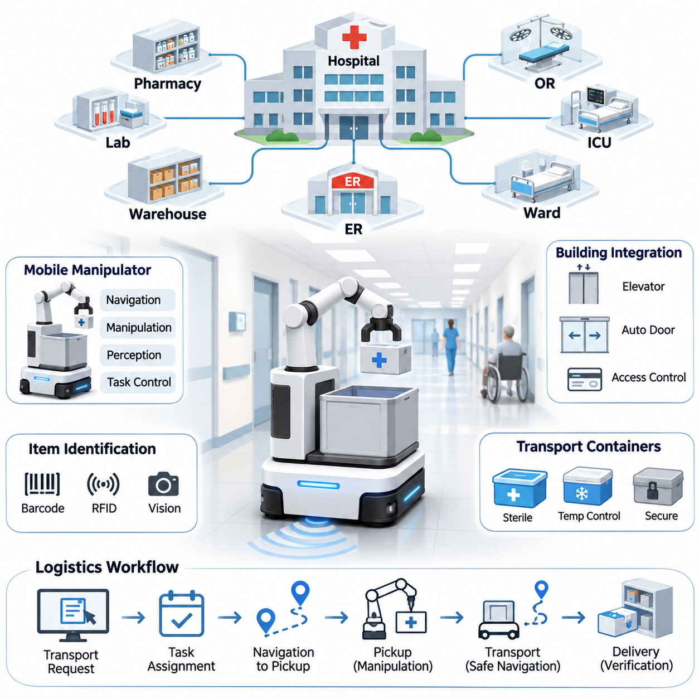
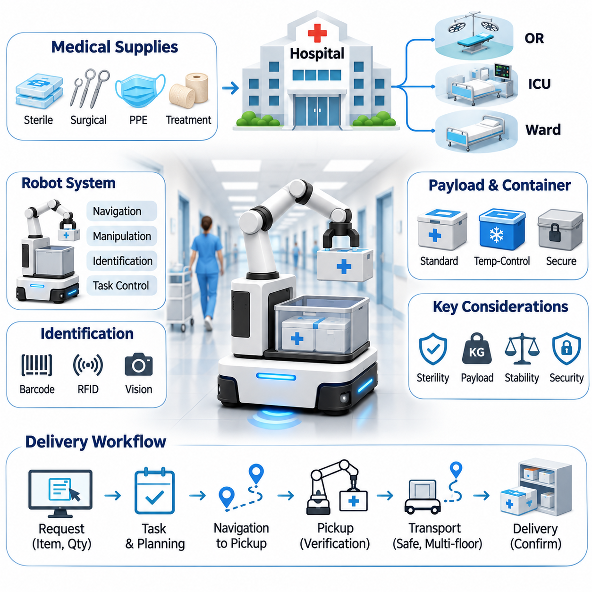
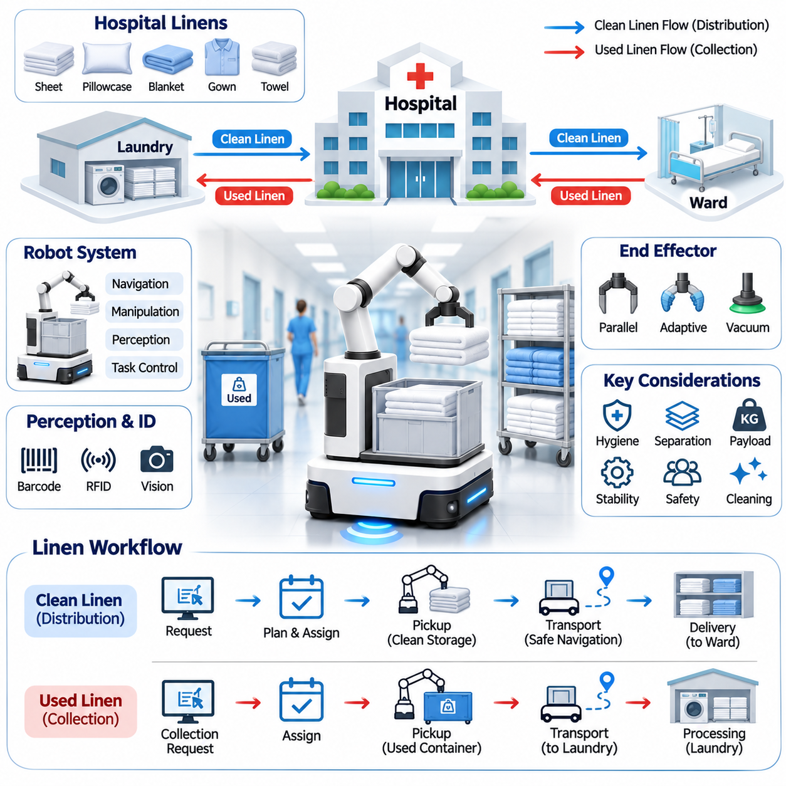
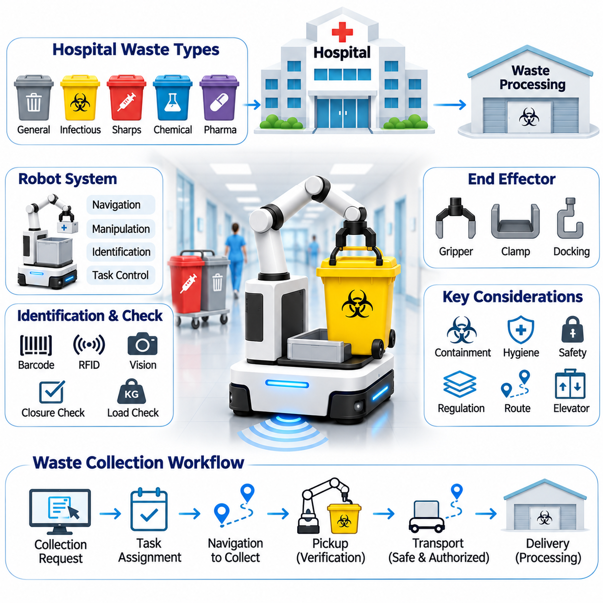
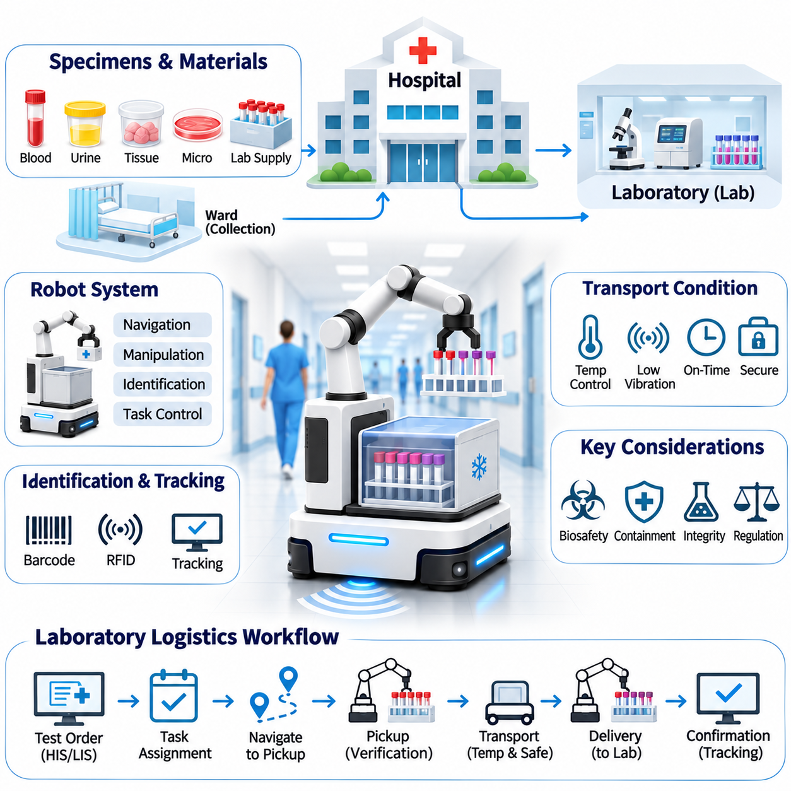
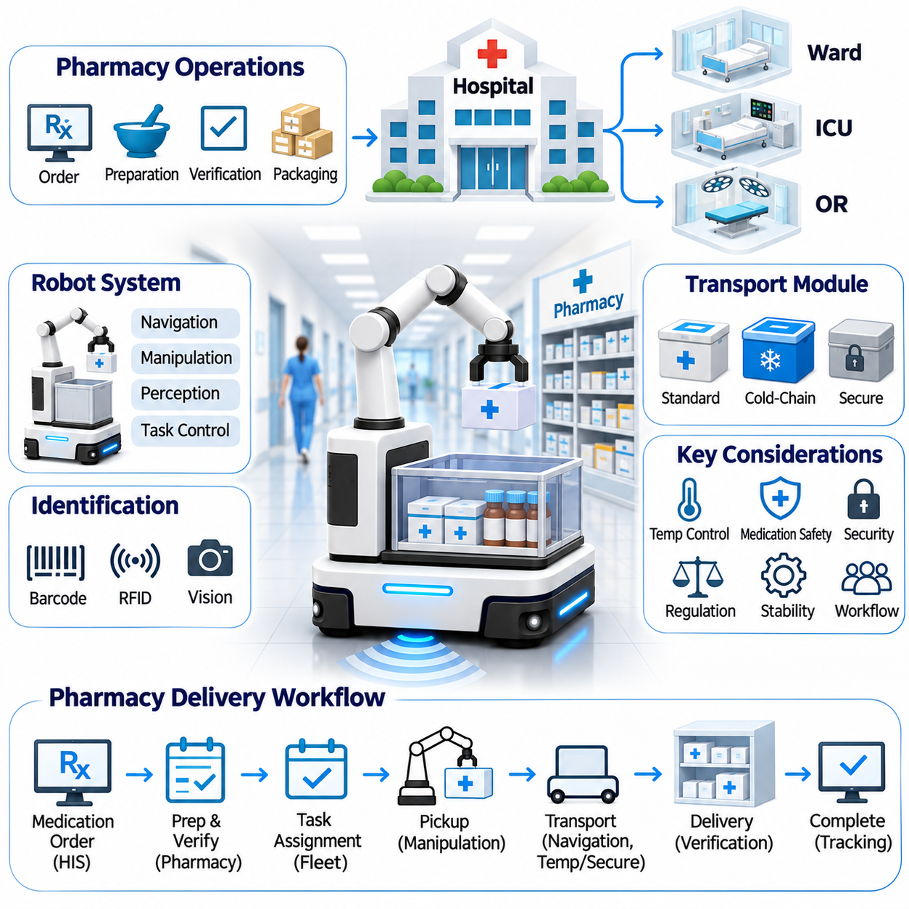
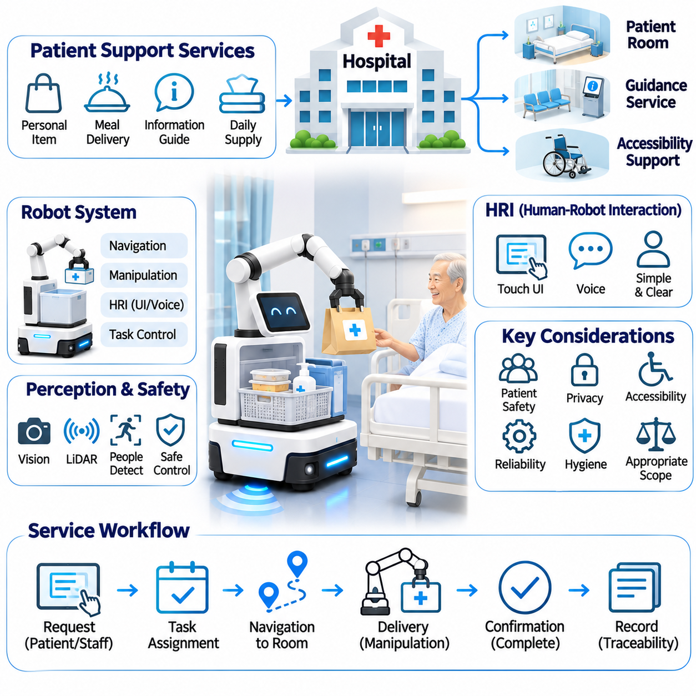
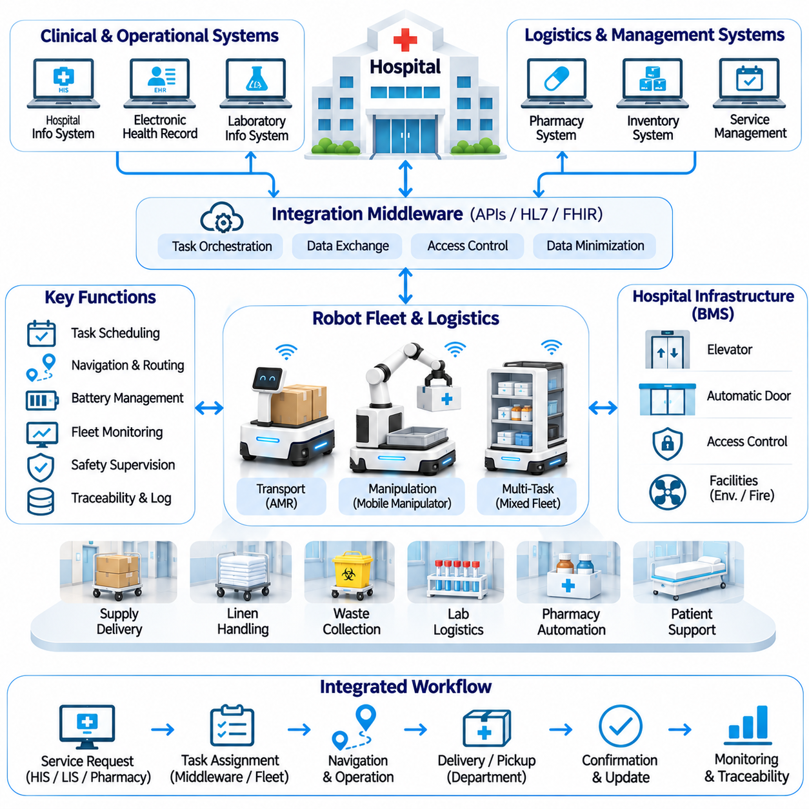
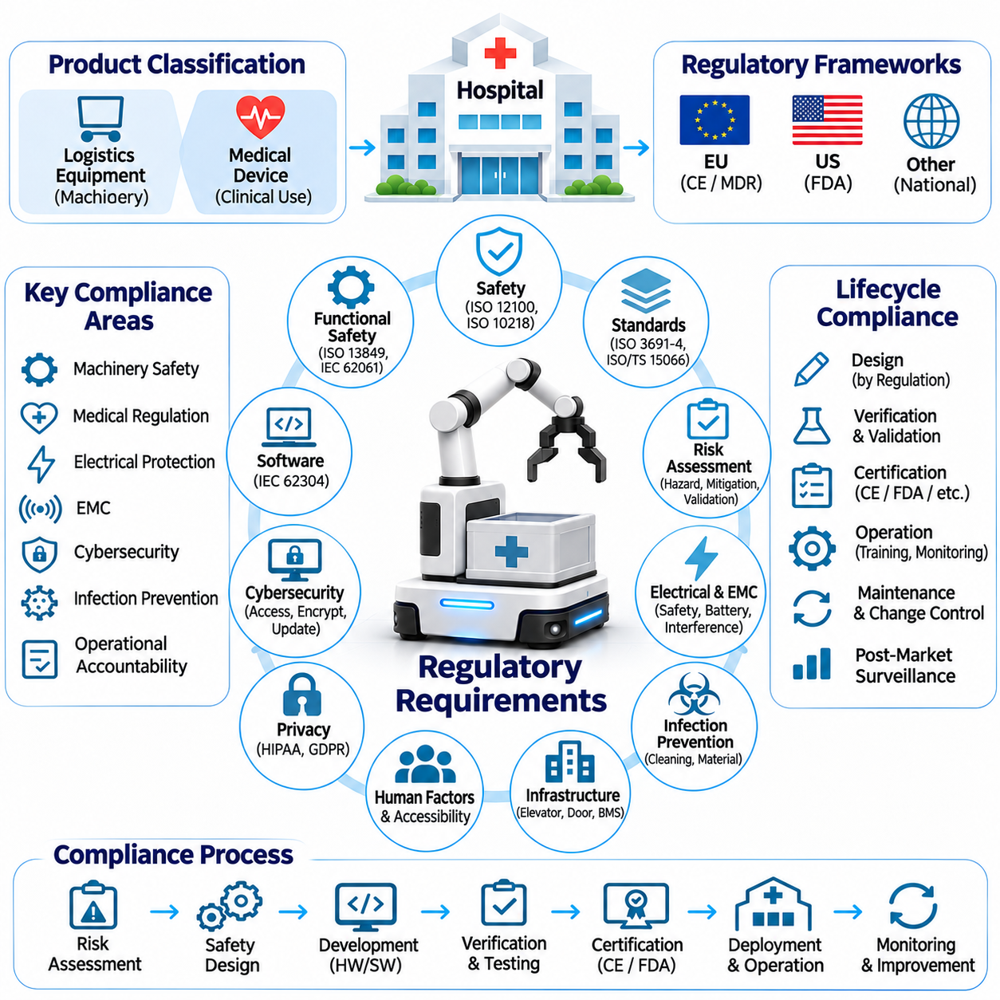

**Volume 01. Mobile Manipulator Foundations and System Architecture**

# Chapter 08. Hospital Applications

## 01 Hospital Logistics

{width="7.268055555555556in" height="7.268055555555556in"}

Hospital logistics represents a critical operational function that supports the continuous movement of medical supplies, equipment, medications, laboratory specimens, and essential materials throughout healthcare facilities. Unlike conventional industrial logistics, hospital logistics must accommodate unpredictable demand, strict hygiene requirements, sensitive environments, and the uninterrupted delivery of clinical services.

Modern hospitals operate as complex logistical networks connecting central warehouses, pharmacies, laboratories, operating rooms, emergency departments, intensive care units, and patient wards. Each department generates different transportation requirements, delivery priorities, and handling constraints. Efficient coordination of these movements is essential for maintaining medical service quality and reducing unnecessary workloads.

Traditional hospital logistics relies heavily on nurses, porters, technicians, and support personnel who manually transport supplies between departments. Although these activities are necessary, repetitive transportation tasks consume valuable working hours that could otherwise support patient care. Mobile robotic systems provide an opportunity to automate routine movements while maintaining human supervision.

Autonomous Mobile Robots (AMRs) introduce flexible transportation capabilities by navigating hospital corridors without requiring fixed conveyor systems or permanently installed guidance infrastructure. Equipped with localization sensors, obstacle detection, and route planning algorithms, these robots can transport medical materials between predefined locations while adapting to changing environmental conditions.

Mobile manipulators extend conventional AMR functionality by combining autonomous navigation with robotic arms and intelligent end effectors. This integration enables a robotic platform to approach storage locations, identify objects, grasp containers, transfer materials, and interact with compatible delivery stations. Such capabilities support more complete automation of hospital logistics workflows.

A typical hospital logistics workflow begins when a clinical department submits a transportation request through a hospital information system or logistics management interface. The request identifies the required material, pickup location, destination, priority, and handling conditions. A task management system evaluates available robotic resources and assigns an appropriate transportation mission.

After receiving a mission, the mobile manipulator navigates toward the designated pickup station using its localization and mapping capabilities. LiDAR sensors, depth cameras, wheel encoders, and inertial measurement units can contribute to environmental perception. Navigation software continuously evaluates obstacles, pedestrian movements, and available pathways to maintain safe operation.

At the pickup location, the robotic manipulator may interact with shelves, containers, carts, or automated dispensing stations. Vision algorithms identify the target object and estimate its position relative to the robot. Grasp planning determines an appropriate manipulation strategy, while force and torque feedback help prevent excessive contact forces during material handling.

Hospital logistics requires reliable object identification because different medical materials may have similar external appearances but significantly different handling requirements. Barcode readers, RFID systems, and visual recognition technologies can support item verification. Combining these identification methods with digital inventory records reduces the risk of incorrect deliveries and improves material traceability.

Transportation containers must be designed according to the characteristics of their contents. Sterile medical supplies require protective packaging, while laboratory specimens may demand temperature control and vibration-sensitive handling. Pharmaceuticals can require restricted access or environmental monitoring. Robotic platforms must therefore support appropriate containment, secure loading, and documented handling procedures.

One important architectural consideration is the separation between transportation functions and manipulation functions. The mobile base provides navigation, positioning, and movement between departments, while the robotic arm performs localized material handling. A supervisory controller coordinates both subsystems to ensure that manipulation begins only when the platform is safely positioned and sufficiently stable.

Hospital environments present navigation challenges that differ substantially from structured factory floors. Corridors may contain patients, wheelchairs, stretchers, medical carts, visitors, and cleaning equipment. Doorways and elevators create temporary bottlenecks, while emergency situations can rapidly change traffic patterns. Robotic navigation must prioritize predictable behavior and safe interaction with people.

Dynamic obstacle avoidance is particularly important because hospital pedestrians may move unpredictably or require additional space. Robots should maintain appropriate separation distances, adjust speed according to local conditions, and yield when necessary. Safety-rated sensing and protective functions must operate independently of non-safety AI perception when required by the system risk assessment.

Elevator integration enables hospital robots to perform transportation missions across multiple floors. This capability requires communication between the robot fleet management system and authorized building control interfaces. The robot must coordinate elevator requests, verify cabin availability, enter safely, maintain positioning during movement, and confirm successful arrival before continuing its assigned mission.

Automatic doors and controlled access areas introduce additional integration requirements. Hospital robots may need permission to enter restricted corridors, supply rooms, or specialized treatment zones. Access control interfaces should authenticate authorized missions and record relevant events. Cybersecurity mechanisms are essential to prevent unauthorized movement, manipulation, or access to sensitive hospital infrastructure.

Fleet management becomes increasingly important when multiple robots operate simultaneously. A centralized or distributed fleet management system can assign tasks, monitor robot locations, optimize routes, and coordinate shared resources. Mission scheduling should account for delivery urgency, battery status, payload compatibility, traffic conditions, and the operational availability of each robotic platform.

Task prioritization must reflect clinical importance rather than transportation efficiency alone. Emergency medical supplies may require immediate delivery, while routine inventory replenishment can tolerate longer scheduling delays. A hospital logistics system should support configurable priority policies, escalation procedures, and human intervention when unexpected conditions threaten critical service requirements.

Battery management directly influences the operational availability of hospital robots. Continuous hospital operations may require automated charging, opportunity charging, or coordinated robot rotation. Energy-aware mission planning estimates whether sufficient battery capacity remains to complete transportation and manipulation activities before assigning a task, reducing the likelihood of interrupted deliveries.

Hygiene and infection prevention represent fundamental requirements for robotic systems deployed in healthcare facilities. External surfaces should support appropriate cleaning and disinfection procedures, while mechanical components should minimize difficult-to-clean areas. Operational workflows must distinguish clean and contaminated materials and prevent unintended movement between zones with incompatible infection-control requirements.

Robotic grippers and transport compartments require particular attention because they may contact medical containers or shared equipment. Materials must be compatible with approved cleaning agents, and mechanical designs should facilitate inspection and maintenance. Where necessary, interchangeable end effectors or dedicated handling accessories can reduce cross-contamination risks between different logistics applications.

Integration with hospital information systems provides the foundation for coordinated and traceable operations. Logistics software may exchange authorized task information with inventory management, pharmacy management, laboratory systems, and enterprise resource planning platforms. Standardized interfaces and controlled data access help ensure that robotic missions reflect current operational requirements without exposing unnecessary patient information.

Operational monitoring should record mission assignments, pickup confirmation, delivery completion, navigation interruptions, manipulation failures, and recovery events. These records support performance analysis, troubleshooting, and continuous improvement. Sensitive information should be protected through appropriate access controls, retention policies, encryption, and audit mechanisms consistent with hospital requirements.

System reliability is especially important because transportation failures can affect downstream clinical activities. Robots should detect abnormal conditions such as localization loss, blocked routes, grasp failures, unexpected payload movement, and communication interruptions. Recovery strategies may include safe stopping, task retries, alternative routing, operator notification, or controlled transfer of responsibility to hospital personnel.

Performance evaluation should consider both robotic efficiency and the broader hospital workflow. Relevant indicators include delivery completion rate, average mission duration, on-time delivery rate, manipulation success rate, system availability, and human intervention frequency. These measurements provide a practical foundation for comparing robotic operations with existing manual transportation processes.

Economic evaluation must account for acquisition costs, installation, integration, maintenance, software licensing, charging infrastructure, and operational support. Potential benefits include reduced repetitive transportation workloads, improved delivery consistency, better inventory visibility, and more effective allocation of hospital personnel. Return on investment depends on actual utilization and measurable improvements in operational performance.

Successful deployment typically begins with a limited pilot covering predictable routes and standardized materials. Engineers evaluate navigation reliability, pickup and delivery accuracy, interaction with hospital personnel, and compatibility with existing infrastructure. Pilot results guide adjustments to mechanical design, control software, workflow integration, and operational procedures before broader deployment.

Human acceptance is another important factor in hospital logistics automation. Medical professionals and support staff must understand robot capabilities, operating limitations, and intervention procedures. Clear status indicators, intuitive interfaces, and predictable robot behavior help establish confidence. Training programs should explain how to request deliveries, respond to exceptions, and report operational concerns.

The long-term development of hospital logistics automation will increasingly combine mobile manipulation, intelligent perception, predictive scheduling, and coordinated fleet operations. Advanced robotic systems may eventually handle a wider variety of containers and storage configurations with less infrastructure modification. However, dependable performance, clinical compatibility, and safety validation remain essential prerequisites.

Hospital logistics automation should ultimately be evaluated as an integrated healthcare support system rather than an isolated robotic technology. Its success depends on the coordination of mobility, manipulation, software integration, material handling, safety engineering, and human workflows. Properly designed mobile manipulators can improve logistical consistency while allowing healthcare professionals to concentrate more effectively on patient-centered activities.

## 02 Medical Supply Delivery

{width="7.268055555555556in" height="7.268055555555556in"}

Medical supply delivery is a fundamental hospital operation that ensures essential materials reach clinical departments at the correct time and location. These materials include sterile instruments, surgical consumables, personal protective equipment, diagnostic accessories, and routine treatment supplies. Reliable delivery directly supports clinical continuity, staff productivity, and the availability of resources required for safe patient care.

Traditional medical supply distribution depends on manual transportation between central storage areas and clinical departments. Nurses, technicians, and logistics personnel frequently retrieve materials from supply rooms or request deliveries through internal services. Although this approach provides flexibility, repetitive transportation activities consume valuable working hours and can introduce delays during periods of high clinical demand.

Autonomous Mobile Robots (AMRs) provide an alternative by transporting medical supplies along dynamically planned routes. These robots navigate hospital corridors, avoid obstacles, and deliver secured containers to designated destinations. Mobile manipulators extend this capability through robotic arms that can retrieve standardized supply packages, load transportation compartments, and transfer materials to compatible receiving stations.

A medical supply delivery workflow typically begins when a department requests specific items through an inventory management system or hospital logistics platform. The request contains item identifiers, quantities, delivery destinations, urgency levels, and handling requirements. A supervisory system verifies inventory availability and creates a transportation task that can be assigned to an appropriate robotic platform.

Before collection, the robot receives information about the pickup station, expected payload, container configuration, and destination. Its navigation system calculates a suitable route based on hospital maps, restricted areas, and current traffic conditions. Mission planning must also consider battery capacity, robot availability, delivery deadlines, and whether the requested materials require specialized handling equipment.

At the pickup location, a mobile manipulator may use cameras, depth sensors, and object recognition algorithms to identify the required supply container. The robotic arm approaches the target using calibrated coordinate transformations and grasp planning. Force-controlled manipulation helps maintain stable contact, while barcode or RFID verification confirms that the selected container corresponds to the assigned delivery request.

Medical supplies vary significantly in dimensions, weight, packaging, and mechanical sensitivity. Lightweight disposable materials may be transported in small containers, while surgical instrument sets require more substantial load capacity. Robotic platforms must therefore accommodate different payload configurations without compromising stability, navigation performance, or manipulation accuracy during pickup and delivery operations.

Payload management is particularly important when a robotic arm operates above a mobile base. Manipulation changes the system\'s center of gravity and introduces dynamic forces that can affect stability. The controller should coordinate arm motion with platform positioning, restrict manipulation during unsafe movement, and verify that payload mass remains within the approved operating envelope.

Sterile medical supplies require handling procedures that preserve packaging integrity and minimize contamination risks. Robots should avoid unnecessary contact with sterile packaging and use transport compartments compatible with hospital cleaning protocols. Where supplies must remain within controlled environments, delivery workflows should incorporate appropriate transfer boundaries, environmental conditions, and verification procedures.

Supply containers can incorporate locking mechanisms, tamper-evident seals, or electronic access controls when materials require additional protection. These features help prevent unauthorized access and accidental removal during transportation. The logistics system should maintain a digital record of container identity, pickup confirmation, custody transitions, and delivery completion to support accountability.

Navigation through hospital environments requires continuous awareness of pedestrians, medical carts, wheelchairs, and temporary obstacles. Robots must adapt their speed and movement to local conditions while maintaining safe separation distances. Priority should be given to emergency medical activities, and robots should yield or stop when their presence could interfere with clinical personnel or patient transportation.

Hospital infrastructure integration enables robots to operate across multiple departments and floors. Elevator communication, automatic door interfaces, and authorized access systems allow transportation missions to continue through controlled areas. Reliable coordination is necessary to prevent robots from blocking entrances, entering restricted clinical spaces, or remaining immobilized at critical transportation points.

Upon reaching the destination, the robot must confirm that the receiving location is available and appropriate for the assigned materials. Delivery may involve opening a secured compartment, placing a container onto a designated surface, or transferring supplies through a robotic arm. Successful completion requires verification that the correct materials have reached the intended receiving station.

Manipulation at the receiving station introduces additional positioning and perception requirements. The robot must accurately estimate the location of shelves, trays, or docking interfaces before transferring materials. Visual feedback, proximity sensing, and force monitoring can improve placement reliability. Standardized receiving fixtures simplify these operations and reduce dependence on complex object manipulation.

Inventory synchronization is essential for maintaining accurate medical supply availability. When a robot collects materials, the inventory system should record the corresponding transaction according to hospital procedures. Delivery confirmation can update departmental stock records and trigger replenishment processes. This integration reduces discrepancies between physical inventory and digital records.

Fleet management systems coordinate multiple delivery robots operating within the same hospital. Task allocation algorithms can evaluate delivery urgency, travel distance, payload compatibility, and robot availability. Coordinated scheduling reduces unnecessary travel and helps prevent congestion around elevators, storage areas, and frequently used corridors while maintaining responsiveness to urgent requests.

Medical supply demand changes throughout the day according to clinical schedules, emergency admissions, and treatment activities. Predictive logistics models can analyze historical consumption patterns to estimate future replenishment requirements. These forecasts may support proactive delivery scheduling, although urgent requests must remain capable of overriding routine optimization decisions when clinically necessary.

Communication reliability is another important consideration because robots depend on network connectivity for mission updates, inventory synchronization, and operational monitoring. Wireless communication interruptions should not compromise basic safety functions. Robots should maintain appropriate local autonomy, preserve mission state, and execute predefined recovery procedures when communication with supervisory systems becomes unavailable.

Exception handling must address situations such as missing inventory, incorrect containers, blocked destinations, unsuccessful grasps, and delivery verification failures. The system should detect these conditions and prevent uncertain deliveries from being recorded as completed. Depending on the situation, recovery may involve task reassignment, operator assistance, alternative routing, or returning materials to an authorized storage location.

Human-robot interaction should remain simple and predictable for clinical personnel. Staff members need clear mechanisms to request supplies, identify arriving robots, retrieve delivered materials, and report problems. Visual indicators, audible notifications, and touchscreen interfaces can communicate mission status, provided their use does not create unnecessary disturbances in sensitive hospital environments.

Cybersecurity and information protection must be considered throughout the delivery architecture. Robotic systems may exchange operational data with hospital inventory platforms and access control services. Authentication, encrypted communication, role-based permissions, and audit logging help protect these interfaces. Patient-identifiable information should be excluded from robotic workflows unless specifically necessary and appropriately authorized.

Performance evaluation should measure delivery success rate, on-time completion, average transportation duration, manipulation accuracy, and system availability. Additional indicators may include inventory discrepancies, human intervention frequency, and delivery-related safety events. These measurements help determine whether robotic supply delivery provides meaningful improvements over existing manual distribution processes.

Economic feasibility depends on deployment scale, daily mission volume, operating hours, and the complexity of hospital integration. Initial costs include robotic hardware, charging stations, software, infrastructure interfaces, and staff training. Operational benefits may include reduced repetitive transportation workloads, improved supply availability, and more consistent delivery performance across departments.

Pilot deployments should initially focus on standardized supply containers and predictable transportation routes. Engineers can evaluate navigation reliability, grasp success, delivery verification, and staff acceptance under controlled operating conditions. Gradual expansion allows hospitals to identify infrastructure limitations and refine procedures before introducing more complex manipulation tasks or additional clinical departments.

Future medical supply delivery systems may combine advanced perception, adaptive manipulation, intelligent scheduling, and coordinated multi-robot operations. Improved robotic dexterity could support a broader range of packaging and storage configurations, while predictive inventory systems may reduce unnecessary stock movement. These developments must remain compatible with clinical safety, hygiene, and operational requirements.

Medical supply delivery automation ultimately depends on reliable coordination between robotic mobility, manipulation, inventory management, and hospital operations. A successful system must transport the correct materials, preserve their condition, maintain traceability, and complete deliveries without disrupting clinical activities. By automating repetitive logistics tasks, mobile manipulators can help healthcare personnel devote more attention to patient-centered responsibilities.

## 03 Linen Handling

{width="7.268055555555556in" height="7.268055555555556in"}

Linen handling is an essential hospital logistics function responsible for distributing clean textiles and collecting used materials throughout healthcare facilities. Hospital linens include bed sheets, pillowcases, blankets, patient gowns, towels, and reusable clinical textiles. Reliable linen management supports patient comfort, infection prevention, and continuous clinical operations while reducing repetitive transportation workloads.

Traditional hospital linen operations depend on manual collection, sorting, transportation, and distribution. Healthcare support personnel move linen carts between patient wards, storage rooms, laundry facilities, and designated collection points. These activities require substantial physical effort and frequent movement through busy corridors, creating opportunities for automation through mobile robotic systems.

Autonomous Mobile Robots (AMRs) can transport linen carts and enclosed containers between hospital departments without continuous human guidance. Mobile manipulators extend these capabilities by integrating robotic arms capable of interacting with standardized containers, handling packaged textiles, and transferring linen bundles. Combining mobility and manipulation enables more comprehensive automation of repetitive linen logistics workflows.

Hospital linen management typically operates through two distinct material flows. Clean linens move from laundry processing or centralized storage areas toward clinical departments, while used linens travel from collection points toward designated processing facilities. These flows must remain appropriately separated to reduce contamination risks and maintain compliance with hospital infection prevention procedures.

Clean linen distribution begins when departments request replenishment based on inventory levels, patient occupancy, or scheduled clinical activities. A hospital logistics management system identifies required quantities and assigns transportation tasks to available robots. Automated scheduling can coordinate delivery priorities, transportation routes, and inventory availability to ensure that essential textiles reach their destinations.

At a clean linen storage station, a mobile manipulator may identify prepared textile packages using barcode readers, RFID tags, or visual recognition systems. The robotic arm can grasp standardized packages and transfer them into designated transport compartments. Reliable handling requires appropriate gripping forces, stable package positioning, and verification that the selected materials correspond to the assigned delivery task.

Textile manipulation presents challenges because fabrics are flexible, deformable, and sensitive to grasping conditions. Unlike rigid industrial objects, linen bundles can change shape during lifting and transportation. Robotic manipulation systems must account for uncertain geometry, variable friction, and shifting mass distribution when selecting grasp points and controlling arm movements.

End effector design significantly influences the reliability of automated linen handling. Parallel grippers may handle packaged textile bundles, while adaptive or compliant grippers can accommodate variations in object dimensions. Vacuum gripping may be suitable for selected packaging surfaces, although porous or irregular fabrics can reduce suction reliability and require alternative grasping strategies.

Perception systems must distinguish between linen packages, containers, storage compartments, and surrounding obstacles. RGB cameras, depth sensors, and object detection algorithms can estimate package positions and identify suitable grasping regions. When handling unstructured textiles, advanced perception methods may analyze fabric folds, edges, and surface geometry to support more reliable manipulation.

Used linen collection introduces additional operational requirements because collected materials may contain biological contamination or other hazardous substances. Robots should interact with appropriately closed or contained collection units rather than directly handling exposed contaminated fabrics whenever practical. Hospital infection prevention policies determine the required containment, segregation, and transportation procedures.

Collection workflows can begin when a ward reports that a designated linen container has reached a predefined capacity or requires replacement. The fleet management system assigns a robot to retrieve the container and transport it to an authorized processing area. Container identification and collection confirmation provide traceability while reducing unnecessary manual transportation.

Clean and used linen transportation should employ separate compartments, dedicated containers, or validated cleaning procedures to prevent cross-contamination. Robotic platforms must support effective surface disinfection and appropriate handling of potentially contaminated equipment. Route planning may also consider designated service corridors and restricted areas to reduce unnecessary interaction with patient care activities.

Linen carts and containers can vary substantially in size, weight, and loading configuration. Mobile robotic platforms must accommodate these variations while maintaining mechanical stability and safe navigation. Payload capacity should account for the maximum expected linen mass, container weight, and dynamic forces generated during acceleration, braking, turning, and manipulation.

When robotic arms transfer linen packages, platform stability becomes especially important. Arm extension can shift the combined center of gravity and introduce additional mechanical loads. Motion planning should coordinate manipulator trajectories with mobile base positioning, while safety controls prevent unstable lifting configurations or unintended movement during material transfer.

Hospital corridors present dynamic navigation challenges involving patients, wheelchairs, medical personnel, equipment carts, and visitors. Linen transportation robots must adjust their speed according to environmental conditions and maintain appropriate separation distances. Safe navigation behavior should prioritize patient movement and emergency clinical activities over routine logistics efficiency.

Elevator and automatic door integration enables linen transportation across multiple hospital floors. Robots may communicate with authorized building interfaces to request elevator access and navigate controlled passages. Coordination mechanisms should prevent congestion at shared transportation points and ensure that robots do not obstruct emergency exits or critical clinical pathways.

Fleet management software can optimize linen delivery and collection by considering robot availability, task priority, travel distance, and container capacity. Multiple robots may operate simultaneously across different departments, requiring coordinated scheduling and traffic management. Effective task allocation reduces unnecessary movement while maintaining predictable linen replenishment and collection cycles.

Inventory management systems can monitor clean linen stock levels and record distribution activities across hospital departments. Barcode or RFID identification enables digital tracking of standardized packages and reusable containers. Integration with laundry processing systems may provide additional visibility into textile circulation, replenishment requirements, and operational bottlenecks.

Linen demand varies according to patient occupancy, treatment schedules, seasonal conditions, and hospital operating patterns. Predictive analytics can estimate consumption rates and identify departments requiring additional supplies. These forecasts support proactive replenishment while allowing urgent requests to receive priority when unexpected clinical demand exceeds planned inventory levels.

Battery management is important because linen transportation may involve repeated missions throughout the day. Automated charging stations and opportunity charging strategies can maintain robot availability without requiring frequent manual intervention. Energy-aware scheduling should consider travel distance, payload mass, manipulation workload, and the remaining battery capacity before assigning transportation tasks.

Operational reliability depends on detecting abnormal conditions such as blocked routes, overloaded containers, unsuccessful grasps, and incomplete deliveries. Robots should report these events to supervisory systems and execute appropriate recovery procedures. Safe stopping, task reassignment, alternative routing, and operator assistance can help prevent disruptions to essential linen services.

Human-robot interaction must remain intuitive for nurses, housekeeping personnel, and logistics operators. Staff members should be able to request linen deliveries, report full collection containers, and confirm successful transfers through accessible interfaces. Clear visual indicators and notifications improve operational transparency while minimizing unnecessary disturbances in patient care environments.

Performance evaluation should measure delivery completion rate, collection response time, transportation duration, manipulation success rate, and system availability. Additional indicators may include linen inventory accuracy, contamination-related incidents, and human intervention frequency. These metrics help determine whether automated linen handling improves operational efficiency without compromising hygiene or patient safety.

Economic evaluation should consider robotic hardware costs, integration expenses, maintenance requirements, cleaning procedures, and staff training. Potential benefits include reduced repetitive transportation labor, improved linen availability, and more consistent collection schedules. Financial performance depends on daily mission volume, operating hours, infrastructure compatibility, and the extent of achievable workflow automation.

Pilot deployment should initially focus on standardized linen containers and predictable transportation routes. Engineers can evaluate navigation reliability, container handling accuracy, cleaning compatibility, and staff acceptance under realistic hospital conditions. Gradual expansion enables operational procedures and robotic capabilities to be refined before introducing more complex textile manipulation tasks.

Future linen handling systems may incorporate advanced deformable object manipulation, tactile sensing, and learning-based grasp planning. Improved perception and adaptive control could enable robots to handle less structured textile bundles and interact with more varied storage configurations. However, practical deployment must continue to prioritize hygiene, reliability, and safe operation within healthcare environments.

Automated linen handling ultimately requires coordinated integration of mobility, manipulation, inventory management, infection prevention, and hospital operations. A successful system must maintain appropriate separation between clean and used materials, ensure reliable transportation, and support traceable workflows. Mobile manipulators can reduce repetitive logistics workloads while helping healthcare personnel concentrate on patient-centered responsibilities.

## 04 Waste Collection

{width="7.268055555555556in" height="7.268055555555556in"}

Hospital waste collection is a critical logistics function that ensures the safe removal, transportation, and temporary storage of waste generated throughout healthcare facilities. Hospitals produce general waste, infectious materials, sharps, pharmaceutical residues, and other regulated waste streams. Effective waste management protects patients, healthcare workers, and the environment while supporting hygiene and uninterrupted clinical operations.

Traditional hospital waste collection relies on environmental services personnel who manually transport containers from clinical departments to designated storage areas. These activities involve repetitive movement, physical handling, and potential exposure to hazardous materials. Autonomous Mobile Robots (AMRs) can reduce routine transportation workloads by moving properly secured waste containers through authorized hospital routes.

Mobile manipulators extend conventional robotic transportation by combining autonomous navigation with robotic arms and specialized end effectors. These systems can interact with standardized waste containers, retrieve sealed collection units, and transfer them to compatible docking stations. Robotic manipulation should prioritize closed-container handling rather than direct contact with exposed waste to minimize contamination and injury risks.

Hospital waste management begins with classification and segregation at the point of generation. General waste, infectious waste, sharps, chemical waste, and pharmaceutical waste require different handling procedures. Robots should transport only appropriately classified, packaged, and authorized containers, while segregation decisions remain governed by hospital policies and applicable waste management regulations.

A typical automated collection workflow begins when a department reports that a designated waste container requires removal. The request may originate from a staff interface, scheduled collection system, or approved container monitoring sensor. A supervisory controller identifies the collection location, waste category, container status, and destination before assigning the mission to a compatible robotic platform.

Before collection, the robot verifies that the assigned container meets predefined handling conditions. Identification technologies such as barcodes, RFID tags, and visual recognition can confirm container identity and waste category. Additional sensors may detect container presence, closure status, or excessive loading, although these measurements cannot replace required human inspection and regulatory verification.

At the collection station, the mobile manipulator positions its mobile base to establish a stable working configuration. Cameras and depth sensors estimate container geometry and docking alignment, while the robotic arm approaches an approved grasping interface. Force-controlled manipulation supports controlled lifting and transfer, reducing the likelihood of container damage, unexpected movement, or accidental release.

Waste containers vary in dimensions, mass, rigidity, and mechanical configuration. Standardized handles, lifting interfaces, and docking mechanisms simplify robotic manipulation and improve repeatability. Payload selection must consider container tare weight, maximum permitted contents, dynamic loading, and the combined stability of the mobile platform and robotic arm throughout collection operations.

Infectious waste requires particular attention because improper handling can expose personnel and surrounding environments to biological hazards. Automated systems should maintain containment integrity and avoid opening sealed collection units. Transport compartments must support appropriate cleaning and disinfection procedures, while handling workflows should minimize unnecessary contact with potentially contaminated surfaces.

Sharps waste introduces additional safety requirements because needles, blades, and similar objects can cause puncture injuries. Robots should handle only approved, properly closed sharps containers through designated external interfaces. Manipulation systems must avoid crushing, tilting, or applying excessive force to these containers, and damaged or improperly secured units should trigger controlled exception procedures.

Chemical and pharmaceutical waste may require specialized containment, compatibility assessment, and restricted transportation procedures. Not every robotic platform is suitable for these materials. Deployment engineers must evaluate the intended waste categories, applicable regulations, container specifications, and environmental risks before authorizing automated collection of potentially hazardous substances.

Navigation planning should separate waste transportation from sensitive clinical activities whenever operationally feasible. Designated service corridors, restricted access routes, and scheduled collection periods can reduce unnecessary interactions with patients and visitors. However, route selection must remain compatible with hospital infection prevention policies, emergency access requirements, and actual building infrastructure.

Dynamic obstacle avoidance is essential because hospital corridors contain unpredictable pedestrian movements, medical equipment, and temporary obstructions. Waste collection robots should maintain appropriate separation distances and adjust speed according to local conditions. Safety-related protective functions must prevent hazardous collisions independently of higher-level task optimization algorithms when required by risk assessment.

Elevator integration enables waste collection robots to transport containers between hospital floors and centralized processing areas. Coordination with authorized building systems supports elevator requests, access permissions, and movement through controlled passages. Fleet scheduling should prevent congestion and avoid situations where waste transportation interferes with emergency medical operations.

Clean and contaminated workflows require careful separation. Robots assigned to waste collection should not transport clean medical supplies without validated decontamination procedures and appropriate operational controls. Dedicated compartments, removable transport modules, or separate robotic fleets may simplify contamination management and reduce the risk of unintended transfer between incompatible material streams.

Automated waste collection systems should maintain traceability throughout each transportation mission. Digital records may include container identification, waste category, collection location, pickup time, destination, and delivery confirmation. Integration with hospital waste management platforms can support operational auditing, inventory reconciliation, and documentation required by applicable regulatory frameworks.

Fleet management software coordinates collection tasks according to urgency, container capacity, robot availability, and transportation distance. Scheduled collection can address predictable waste generation patterns, while event-driven requests support unexpected increases in waste volume. Task allocation should account for payload compatibility, cleaning status, battery capacity, and restrictions associated with particular waste categories.

Container monitoring technologies can improve collection efficiency by identifying when replacement or removal is necessary. Fill-level sensors, weight measurements, and identification systems may provide useful operational data. Nevertheless, automated measurements must be interpreted carefully because irregular waste distribution, sensor contamination, or incorrect packaging can produce misleading estimates.

Battery management is important for maintaining reliable waste collection throughout extended hospital operating periods. Energy-aware scheduling estimates the power required for navigation, lifting, container transfer, and return travel. Automated charging and planned maintenance intervals can support continuous operations, provided charging areas remain appropriately separated from contaminated handling activities.

Operational exception handling must address blocked routes, damaged containers, failed grasps, excessive payloads, and unsuccessful delivery verification. When abnormal conditions occur, robots should enter a safe state and notify authorized personnel. Recovery procedures may include controlled task cancellation, operator intervention, alternative routing, or transfer of responsibility to trained waste management staff.

Cleaning and maintenance procedures are essential for long-term system reliability. Robot surfaces, grippers, transport compartments, and docking interfaces should be designed for accessible inspection and compatible disinfection methods. Maintenance personnel require appropriate protective measures, while contaminated components must be handled according to hospital infection prevention and occupational safety procedures.

Human-robot interaction should provide clear operational information without creating unnecessary complexity for hospital staff. Personnel need accessible interfaces to request collection, verify container removal, report abnormal conditions, and suspend robotic operations when necessary. Status indicators and notifications should communicate mission progress while respecting the requirements of sensitive clinical environments.

Performance evaluation should consider collection completion rate, response time, transportation duration, system availability, and human intervention frequency. Safety-related indicators may include containment failures, collision events, contamination incidents, and incorrect waste routing. These measurements help determine whether automation improves operational efficiency while maintaining acceptable safety and infection prevention performance.

Economic assessment should include robotic hardware, specialized containers, docking infrastructure, software integration, cleaning requirements, maintenance, and staff training. Potential benefits include reduced repetitive transportation labor, improved collection consistency, and better operational traceability. Financial feasibility depends on collection volume, facility layout, deployment scale, and the complexity of regulatory compliance.

Pilot deployment should begin with clearly defined waste categories, standardized sealed containers, and predictable transportation routes. Engineers can evaluate navigation reliability, container handling performance, contamination controls, and staff acceptance under supervised conditions. Expansion should follow documented risk assessment, operational validation, and confirmation that required safety procedures remain effective.

Future hospital waste collection systems may incorporate improved robotic manipulation, intelligent container recognition, predictive collection scheduling, and coordinated multi-robot operations. Advanced sensing could support more accurate container monitoring and automated verification. However, increased autonomy must not compromise segregation requirements, containment integrity, human oversight, or regulatory compliance.

Automated hospital waste collection ultimately requires coordinated integration of robotic mobility, manipulation, infection prevention, waste classification, and facility management. Successful systems transport appropriately secured materials through authorized routes while preserving traceability and operational safety. Mobile manipulators can reduce repetitive logistics workloads and support cleaner, more efficient healthcare environments.

## 05 Laboratory Logistics

{width="7.268055555555556in" height="7.268055555555556in"}

Laboratory logistics is a critical hospital operation that manages the movement of biological specimens, diagnostic materials, laboratory supplies, and analytical equipment between clinical departments and testing facilities. Reliable transportation supports accurate diagnosis, timely treatment decisions, and continuous laboratory operations. Mobile robotic systems can improve logistical consistency while reducing repetitive transportation tasks performed by healthcare personnel.

Traditional laboratory transportation relies on nurses, technicians, and dedicated couriers who manually transfer specimens from collection points to diagnostic laboratories. These activities require careful scheduling, accurate identification, and compliance with specimen handling procedures. Delays, incorrect routing, or inappropriate environmental conditions can compromise specimen quality and disrupt downstream analytical workflows.

Autonomous Mobile Robots (AMRs) provide flexible transportation capabilities by navigating hospital corridors and delivering secured specimen containers to designated laboratory locations. Mobile manipulators extend these functions through robotic arms capable of retrieving standardized carriers, loading transport compartments, and interacting with compatible laboratory receiving stations. This combination supports partial automation of specimen transfer workflows.

A typical laboratory logistics workflow begins when a clinical department collects a specimen and registers the corresponding examination request. The hospital information system or laboratory information system generates transportation information containing specimen identification, collection location, destination, priority, and handling requirements. A supervisory platform assigns the delivery mission to an available robotic system.

Specimen identification is fundamental because laboratory samples may appear visually similar despite belonging to different patients or examination requests. Barcode readers, RFID technologies, and digital tracking systems can associate each container with its authorized laboratory order. Robotic workflows should verify specimen identity at pickup and delivery while minimizing unnecessary exposure of patient-identifiable information.

Biological specimens require different transportation conditions depending on their composition and intended analysis. Blood samples, urine specimens, tissue materials, and microbiological samples may have distinct requirements for temperature, orientation, containment, and delivery time. Robotic transport systems must follow laboratory-defined handling protocols rather than applying a single transportation procedure to every specimen category.

Temperature-sensitive specimens may require insulated compartments, validated refrigeration systems, or continuous environmental monitoring. Sensors can record temperature conditions during transportation and identify deviations from approved ranges. However, acceptable temperature limits and transport durations must be established according to the specific specimen, analytical method, and applicable laboratory procedures.

Mechanical vibration and sudden acceleration can influence the integrity of certain biological samples. Mobile robots should therefore employ smooth motion planning, controlled acceleration, and stable container retention mechanisms. Transport validation may include vibration measurements, shock monitoring, and comparison of analytical results to determine whether robotic movement affects specimen suitability.

At a collection station, a mobile manipulator positions its mobile base and identifies the designated specimen carrier using cameras or machine-readable identifiers. The robotic arm approaches a standardized grasping interface and transfers the carrier into a secured compartment. Force monitoring and controlled motion reduce the risk of dropping, tilting, or damaging containers during robotic manipulation.

Direct manipulation of individual specimen tubes introduces additional challenges because containers are small, fragile, and potentially contaminated. Standardized racks and enclosed carriers provide more reliable interfaces for robotic handling. Where individual tube manipulation is necessary, the system requires precise perception, suitable grippers, and validated procedures that preserve container integrity and specimen identification.

Hospital navigation presents challenges involving pedestrians, wheelchairs, medical carts, elevators, and restricted clinical areas. Laboratory delivery robots must maintain safe separation distances and adjust movement according to environmental conditions. Navigation planning should also consider specimen urgency, authorized transportation routes, and the need to avoid unnecessary delays at shared infrastructure.

Emergency laboratory requests require priority handling because diagnostic results may influence time-critical clinical decisions. A fleet management system can assign urgent transportation tasks ahead of routine deliveries when operational policies permit. Priority scheduling should account for robot availability, travel distance, specimen compatibility, and the expected completion time of each assigned mission.

Elevator and automatic door integration enables robotic specimen transportation across multiple hospital floors. Authorized building interfaces coordinate access requests and movement through controlled passages. The robotic system should verify successful transitions and maintain mission traceability throughout the journey, including situations where temporary infrastructure failures require alternative routing or operator assistance.

At the laboratory receiving station, the robot confirms that the intended destination is available before unloading the specimen carrier. Automated docking interfaces or robotic arms may transfer containers to compatible receiving equipment. Delivery verification should confirm carrier identity, destination, and transfer completion before the mission is recorded as successful.

Integration with laboratory information systems supports coordinated specimen tracking and workflow visibility. Pickup confirmation, transportation status, delivery timestamps, and exception events can be associated with laboratory orders through authorized interfaces. Such integration helps laboratory personnel identify delayed specimens, monitor incoming workloads, and coordinate subsequent analytical processes.

Chain-of-custody management is particularly important for specimens requiring documented accountability. Digital records can identify authorized transfers, container identities, timestamps, and receiving locations. Secure authentication and audit logging support traceability, while system design must preserve confidentiality and comply with applicable healthcare information protection requirements.

Biosafety considerations influence container design, robotic handling, and operational procedures. Specimens should be transported in appropriate primary and secondary containment according to their risk classification. Robots should avoid opening specimen containers during transportation, and contaminated or damaged carriers must trigger controlled exception procedures rather than routine automated handling.

Cleaning and disinfection procedures must address robotic grippers, transport compartments, docking interfaces, and frequently contacted surfaces. Materials should be compatible with approved disinfectants and designed for accessible inspection. Dedicated carriers or validated decontamination processes may be necessary when transporting specimens with different biological risk characteristics.

Fleet management software coordinates laboratory transportation tasks according to urgency, robot availability, battery capacity, and route conditions. Multiple robots can serve distributed collection points while sharing elevators and corridors. Effective scheduling reduces unnecessary travel and supports predictable specimen arrival without allowing operational efficiency objectives to override clinical priorities.

Communication reliability is essential because transportation missions depend on coordination between robotic controllers and hospital information systems. Temporary network interruptions should not compromise basic safety functions or specimen security. Robots should preserve mission state, maintain appropriate local autonomy, and notify authorized personnel when communication failures prevent reliable task completion.

Exception handling must address missing carriers, identification mismatches, blocked routes, compartment failures, and unsuccessful delivery confirmation. The system should prevent uncertain transfers from being recorded as completed. Depending on the failure, recovery may involve safe stopping, secure specimen retention, alternative routing, or controlled intervention by trained laboratory personnel.

Performance evaluation should consider transportation completion rate, specimen delivery time, identification accuracy, system availability, and human intervention frequency. Additional indicators may include temperature excursions, container damage, and specimen rejection associated with transportation. These measurements help determine whether robotic logistics improves operational efficiency while preserving analytical quality.

Economic feasibility depends on daily specimen volume, transportation distances, operating hours, and integration complexity. Deployment costs include robotic hardware, specialized carriers, docking infrastructure, software interfaces, maintenance, and personnel training. Potential benefits include reduced courier workloads, improved transportation consistency, and greater visibility into specimen movement across hospital departments.

Pilot deployment should begin with standardized specimen carriers, clearly defined handling requirements, and predictable transportation routes. Engineers and laboratory specialists can jointly evaluate navigation reliability, container handling accuracy, environmental stability, and information system integration. Expansion should follow documented validation demonstrating that robotic transportation does not compromise specimen integrity or clinical workflows.

Future laboratory logistics systems may combine intelligent manipulation, predictive scheduling, automated specimen identification, and coordinated multi-robot operations. Improved perception and adaptive control could enable more flexible interaction with laboratory storage and receiving equipment. Nevertheless, increased autonomy must remain compatible with biosafety requirements, specimen traceability, and validated analytical procedures.

Laboratory logistics automation ultimately requires coordinated integration of robotic mobility, manipulation, specimen management, hospital information systems, and clinical safety procedures. Successful systems deliver correctly identified specimens under appropriate conditions while maintaining traceability and operational reliability. Mobile manipulators can reduce repetitive transportation workloads and help laboratories provide timely, dependable diagnostic services.

## 06 Pharmacy Automation

{width="7.268055555555556in" height="7.268055555555556in"}

Pharmacy automation is an essential component of hospital logistics that supports the preparation, storage, verification, and distribution of medications throughout healthcare facilities. Hospital pharmacies must manage diverse pharmaceutical products while maintaining accurate inventory records and strict handling procedures. Mobile robotic systems can improve transportation consistency, reduce repetitive workloads, and support timely medication availability.

Traditional hospital pharmacy operations involve pharmacists, pharmacy technicians, nurses, and logistics personnel who coordinate medication preparation and delivery. Manual transportation between central pharmacies, satellite pharmacies, and clinical wards requires substantial time and careful documentation. Automation can reduce routine movement while allowing qualified healthcare professionals to concentrate on medication verification and patient safety.

Autonomous Mobile Robots (AMRs) transport secured medication containers between authorized hospital locations. Mobile manipulators extend these capabilities by integrating robotic arms that retrieve standardized packages, load transport compartments, and interact with compatible storage stations. Combining autonomous navigation with manipulation enables more flexible pharmacy logistics without eliminating the need for professional pharmaceutical supervision.

A typical automated pharmacy workflow begins when an authorized medication order is processed through the hospital information system. Pharmacy management software identifies the required products, preparation status, delivery destination, and handling restrictions. Once medication verification and release procedures are completed, a robotic fleet management platform can assign the transportation task to an available robot.

Medication identification is fundamental to pharmacy automation because pharmaceutical products may have similar packaging, names, or physical characteristics. Barcode readers, RFID systems, and machine vision technologies can verify package identity against authorized orders. Automated verification should complement established pharmacy safety procedures rather than independently determine whether a medication is clinically appropriate.

Robotic manipulation requires standardized handling interfaces to achieve reliable package retrieval and placement. Medication boxes, sealed containers, and prepared delivery trays can be organized within structured storage systems. A mobile manipulator uses perception sensors to identify the assigned package, estimate its position, and execute controlled grasping motions while preserving package integrity.

End effector selection depends on medication packaging geometry, surface characteristics, weight, and fragility. Parallel grippers can handle rigid boxes, while compliant grippers accommodate moderate dimensional variation. Vacuum gripping may support selected packaging materials, but reliable operation requires verification of surface compatibility and appropriate control of gripping forces.

Pharmaceutical storage environments impose additional constraints involving temperature, humidity, light exposure, and access control. Certain medications require refrigerated transportation or other validated environmental conditions. Robotic platforms may incorporate insulated compartments, temperature monitoring, and controlled storage modules, although acceptable conditions must follow product-specific requirements and pharmacy procedures.

Cold-chain medication transportation requires particular attention because temperature excursions may compromise product quality. Sensors can record compartment temperature throughout delivery missions and generate alerts when approved limits are exceeded. Temperature-controlled systems must be validated for expected mission duration, environmental conditions, loading configuration, and recovery procedures following equipment failures.

Medication security is essential because unauthorized access, loss, or diversion can create serious clinical and regulatory risks. Robotic transport compartments may use electronic locks, authenticated access controls, and tamper-evident mechanisms. Controlled substances require additional safeguards and documented accountability according to applicable laws and institutional policies.

Hospital navigation introduces operational challenges because pharmacy delivery robots share corridors with patients, staff, visitors, and medical equipment. Autonomous navigation systems must detect obstacles, maintain appropriate separation distances, and adjust speed according to environmental conditions. Safety-related protective functions should remain effective even when communication or higher-level scheduling systems become unavailable.

Elevator and automatic door integration enables medication transportation between central pharmacies and clinical departments located on different floors. Robots can communicate with authorized building interfaces to request access and coordinate movement. Mission planning must account for elevator waiting times, restricted areas, and emergency access requirements without compromising medication security.

Pharmacy delivery missions may have different urgency levels depending on clinical requirements. Routine replenishment tasks can be scheduled according to predictable demand, while urgent medication requests may receive higher transportation priority. Fleet management software should coordinate these priorities using robot availability, estimated travel time, payload compatibility, and hospital-defined escalation procedures.

At the destination, a mobile manipulator may transfer secured medication containers into compatible receiving stations or authorized storage compartments. The receiving process should verify the delivery location, package identity, and completion status. Access-controlled handover procedures help ensure that medications are released only to appropriately authorized personnel or validated automated systems.

Integration with pharmacy information systems enables digital coordination between medication preparation, inventory management, transportation, and delivery confirmation. Each mission can generate records containing package identifiers, dispatch timestamps, destination information, and receiving acknowledgments. These records support traceability and help pharmacy personnel investigate missing, delayed, or incorrectly routed deliveries.

Inventory automation can improve medication availability by monitoring stock levels across central pharmacies and clinical storage locations. Automated replenishment requests may be generated when inventory reaches predefined thresholds. Predictive analytics can estimate consumption patterns, but replenishment decisions must remain consistent with clinical demand, expiration dates, storage restrictions, and institutional inventory policies.

Medication expiration management requires accurate tracking of product batches, expiration dates, and storage histories. Robotic systems can support first-expiring-first-out distribution when integrated with reliable inventory databases. However, automated selection must respect product recalls, quarantine status, dispensing restrictions, and other conditions that may override ordinary inventory rotation rules.

Pharmacy automation also involves careful separation of incompatible material flows. Hazardous medications, returned products, refrigerated supplies, and routine pharmaceutical packages may require distinct handling procedures. Dedicated containers, validated cleaning protocols, and restricted transport assignments can reduce contamination risks and prevent inappropriate mixing of materials.

Robotic fleet management coordinates multiple medication delivery tasks while considering transportation distance, task urgency, battery capacity, and destination availability. Centralized scheduling can reduce unnecessary movement and improve delivery predictability. When several robots share hospital infrastructure, traffic coordination helps prevent congestion around elevators, pharmacy entrances, and clinical receiving stations.

Communication reliability is important because robotic pharmacy operations depend on secure exchanges between fleet controllers, hospital systems, and access management services. Network interruptions should not compromise basic safety functions or medication security. Robots must preserve mission status and apply controlled recovery procedures when communication failures prevent reliable delivery verification.

Exception handling must address identification mismatches, inaccessible destinations, damaged packages, compartment failures, and unsuccessful handovers. When abnormal conditions occur, robots should secure their payloads and notify authorized personnel. Recovery procedures may involve task reassignment, return to the pharmacy, supervised intervention, or quarantine of affected materials according to established policies.

Human-robot interaction should provide intuitive interfaces for pharmacists, technicians, and clinical personnel. Authorized users need mechanisms to request deliveries, review mission status, acknowledge receipt, and report operational problems. Clear notifications and accessible controls improve workflow transparency while preserving appropriate professional responsibility for medication handling.

Performance evaluation should measure delivery completion rate, transportation time, identification accuracy, system availability, and human intervention frequency. Additional indicators include temperature excursions, security incidents, incorrect deliveries, and medication availability at clinical destinations. These metrics help determine whether robotic automation improves logistics performance without weakening medication safety controls.

Economic evaluation should consider robotic hardware, secure transport modules, environmental monitoring, software integration, maintenance, and personnel training. Potential benefits include reduced routine transportation labor, improved delivery consistency, and enhanced inventory visibility. Financial feasibility depends on medication volume, facility layout, operating hours, and the extent of achievable workflow automation.

Pilot deployment should begin with standardized, nonhazardous medication packages and clearly defined delivery routes. Engineers and pharmacy professionals can evaluate navigation reliability, package handling accuracy, security controls, and information system integration under supervised conditions. Expansion should follow documented validation and confirmation that automated workflows satisfy institutional safety requirements.

Future pharmacy automation may incorporate advanced robotic manipulation, intelligent inventory prediction, automated storage interaction, and coordinated multi-robot transportation. Improved perception and adaptive control could enable robots to handle a wider variety of pharmaceutical packaging. Nevertheless, increased autonomy must remain compatible with medication safety, professional oversight, cybersecurity, and regulatory compliance.

Pharmacy automation ultimately requires coordinated integration of robotic mobility, manipulation, medication management, hospital information systems, and clinical safety procedures. Successful systems transport correctly identified pharmaceutical products under appropriate conditions while maintaining security and traceability. Mobile manipulators can reduce repetitive logistics workloads and help healthcare professionals maintain reliable medication distribution services.

## 07 Patient Support Services

{width="7.268055555555556in" height="7.268055555555556in"}

Patient support services represent an important application of mobile robotics in healthcare environments, focusing on assistance with nonclinical activities that improve patient comfort, accessibility, and daily hospital operations. These services include personal item delivery, meal transportation, information assistance, and routine logistical support. Robotic systems can reduce repetitive staff workloads while helping patients receive timely assistance.

Traditional patient support activities depend heavily on nurses, caregivers, and hospital service personnel who respond to frequent requests throughout the day. Many requests involve transporting personal belongings, delivering supplies, or providing directions rather than performing medical procedures. Automating suitable tasks allows healthcare professionals to devote more attention to clinical responsibilities and direct patient interaction.

Autonomous Mobile Robots (AMRs) can transport supplies and personal items between hospital service stations and patient care areas. Mobile manipulators extend these capabilities by combining autonomous navigation with robotic arms capable of retrieving standardized objects and interacting with accessible storage compartments. Their operational scope must remain clearly separated from clinical interventions requiring qualified medical personnel.

A typical patient support workflow begins when a patient or authorized staff member submits a service request through a bedside terminal, mobile application, or hospital management interface. The system identifies the requested service, destination, priority, and applicable restrictions. A supervisory controller then assigns the task to a suitable robot while considering availability and environmental conditions.

Personal item delivery is a practical application because hospitalized patients may require clothing, reading materials, hygiene products, or other permitted belongings. Robots can transport these items in secured compartments and deliver them to designated receiving locations. Automated identification and delivery confirmation help reduce misplaced items while maintaining accountability for patient property.

Meal delivery represents another opportunity for robotic assistance, particularly in hospitals with centralized food preparation facilities. Robots may transport prepared meal trays between kitchens, distribution stations, and patient wards. Integration with dietary management systems can support correct destination assignment, although clinical dietary verification and food safety procedures must remain under authorized supervision.

Mobile manipulators may assist with transferring standardized meal trays or packaged supplies between robotic compartments and compatible receiving surfaces. Such operations require accurate object detection, stable grasping, and careful motion control. Direct interaction with patients should be avoided unless the specific assistance function has undergone appropriate safety validation and clinical authorization.

Patient-facing robotic systems must account for substantial variation in mobility, awareness, and communication ability. Some patients use wheelchairs or walking aids, while others experience sensory or cognitive limitations. Robot behavior should therefore emphasize predictable movement, accessible communication, and conservative interaction strategies that accommodate different patient capabilities.

Human-robot interaction is central to successful patient support services. Robots may provide visual displays, speech interfaces, and simple confirmation mechanisms to communicate task status or request assistance. Interfaces should use understandable language and avoid complex interaction sequences, particularly when patients are unfamiliar with robotic technologies or have limited physical mobility.

Privacy protection is essential because patient support robots may operate near bedsides, treatment rooms, and sensitive clinical areas. Cameras and other sensors should collect only information necessary for authorized functions. Personal information, service requests, and interaction records require appropriate access controls, secure communication, and retention policies consistent with healthcare privacy requirements.

Navigation safety is particularly important in patient environments where people may move slowly, unpredictably, or with assistive equipment. Robots must detect obstacles and maintain appropriate separation distances while adjusting speed to local conditions. Safety-related protective functions should prevent hazardous movement independently of higher-level service scheduling whenever required by risk assessment.

Hospital rooms introduce additional manipulation challenges because furniture arrangements, personal belongings, and available workspace vary considerably. Mobile manipulators must identify accessible transfer locations and avoid contact with medical devices, tubing, and patient support equipment. Standardized receiving stations can reduce positioning uncertainty and simplify reliable robotic interaction.

Patient support robots may also provide nonclinical information assistance, including directions to hospital departments, visiting information, and general facility guidance. These functions can reduce routine inquiries directed toward administrative personnel. However, robots should not independently provide medical diagnoses, treatment recommendations, or interpretations of patient conditions beyond their validated and authorized capabilities.

Accessibility considerations should influence the design of both robotic hardware and user interfaces. Display height, text readability, speech volume, and control accessibility may affect usability for different patient populations. Multilingual interfaces and alternative interaction methods can improve service accessibility while reducing dependence on a single communication channel.

Service prioritization is necessary because patient requests vary in urgency and operational importance. Routine item deliveries can be scheduled according to robot availability, while requests involving immediate clinical needs must be redirected to qualified personnel. Robotic systems should clearly distinguish logistical assistance from emergency response and avoid delaying established hospital escalation procedures.

Elevator and automatic door integration allows patient support robots to operate across multiple hospital floors. Authorized building interfaces coordinate movement through controlled passages and shared infrastructure. Route planning should avoid unnecessary congestion and respect restricted areas, isolation protocols, and emergency access requirements established by hospital management.

Fleet management software coordinates multiple service requests while considering travel distance, task priority, payload capacity, and battery availability. Robots may share responsibilities across wards or operate within assigned service zones. Effective scheduling improves response consistency without allowing transportation efficiency to override patient safety or staff instructions.

Reliable item handling requires appropriate container design and manipulation interfaces. Standardized trays, sealed compartments, and accessible docking surfaces can reduce grasping uncertainty and prevent accidental release. Force sensing and controlled arm motion help protect fragile belongings while limiting the mechanical risks associated with robotic manipulation near people.

Infection prevention requirements influence the design of patient-facing robotic platforms. Frequently contacted surfaces, transport compartments, and manipulation tools should support approved cleaning and disinfection procedures. Robots moving between departments may require additional operational controls when entering isolation areas or handling materials associated with infection risks.

Operational reliability depends on detecting blocked routes, inaccessible destinations, unsuccessful handovers, and communication failures. When a task cannot be completed safely, the robot should retain the item securely and notify authorized personnel. Recovery procedures may involve alternative delivery locations, task reassignment, supervised intervention, or return to the original service station.

Human oversight remains necessary because automated systems cannot reliably interpret every patient need or environmental circumstance. Hospital staff should retain authority to interrupt missions, modify service priorities, and restrict robotic access. Clear responsibility boundaries help prevent patients from mistaking logistical robots for clinical caregivers or emergency assistance systems.

Performance evaluation should measure service completion rate, response time, delivery accuracy, system availability, and human intervention frequency. Patient satisfaction, accessibility, and staff workload reduction provide additional measures of operational value. Safety-related indicators should include collision events, unsuccessful interactions, privacy incidents, and failures to follow access restrictions.

Economic evaluation must consider robotic hardware, system integration, maintenance, cleaning, user interface development, and personnel training. Potential benefits include reduced repetitive transportation labor, improved service consistency, and greater staff availability for direct patient care. Financial feasibility depends on request volume, facility layout, operating hours, and the proportion of tasks suitable for automation.

Pilot deployment should begin with low-risk services such as delivering permitted personal items to supervised receiving stations. Engineers and healthcare personnel can evaluate navigation reliability, interaction usability, delivery accuracy, and patient acceptance under controlled conditions. Expansion should follow documented validation and confirmation that robotic assistance does not disrupt established clinical workflows.

Future patient support systems may incorporate advanced perception, adaptive manipulation, natural language interaction, and personalized service coordination. Improved capabilities could enable more flexible assistance in changing hospital environments. Nevertheless, increased autonomy must remain subject to clear safety boundaries, privacy protections, clinical oversight, and realistic assessments of robotic limitations.

Patient support services ultimately require coordinated integration of robotic mobility, manipulation, hospital operations, accessibility, and human-centered interaction. Successful systems provide dependable nonclinical assistance while respecting patient dignity, privacy, and safety. Mobile manipulators can complement healthcare personnel by reducing repetitive service tasks and supporting a more responsive patient care environment.

## 08 Hospital Integration

{width="7.268055555555556in" height="7.268055555555556in"}

Hospital integration connects mobile robotic systems with clinical workflows, information platforms, building infrastructure, and operational management processes. Successful deployment requires more than reliable navigation or manipulation because robots must function within established healthcare procedures. Integration architecture should coordinate transportation, access control, task scheduling, and safety supervision while preserving continuity of patient care.

Hospital environments contain interconnected systems responsible for patient administration, laboratory operations, pharmacy management, inventory control, and facility services. Mobile manipulators must exchange relevant information with these platforms through authorized interfaces. A well-designed integration framework separates clinical decision-making from robotic execution while maintaining consistent operational data across departments.

Hospital Information Systems (HIS) provide administrative and clinical information supporting patient care activities. Robotic logistics platforms may receive authorized delivery requests, destination identifiers, and operational priorities through controlled interfaces. Integration should minimize unnecessary access to sensitive patient information and ensure that robots process only the data required to complete assigned tasks.

Electronic Health Records (EHR) contain sensitive clinical information and therefore require particularly careful integration boundaries. Robotic systems generally need task-specific instructions rather than unrestricted access to medical records. Middleware services can translate approved clinical workflow events into logistics requests while applying authentication, authorization, and data minimization policies.

Laboratory Information Systems (LIS) coordinate specimen identification, examination requests, and laboratory processing activities. Integration with robotic transportation enables automated specimen pickup notifications, delivery tracking, and receiving confirmation. Each transaction should preserve specimen identity and handling requirements, ensuring that transportation automation supports rather than disrupts laboratory quality procedures.

Pharmacy information platforms manage medication preparation, inventory status, dispensing authorization, and distribution records. Robotic integration can coordinate secure transportation after appropriate pharmaceutical verification. Delivery systems must preserve access restrictions, package identification, and traceability while avoiding independent medication selection or clinical decision-making beyond authorized functions.

Hospital inventory and materials management systems support the distribution of medical supplies, linen, equipment, and other operational resources. Integration allows robotic fleets to receive replenishment requests and update transportation status. Standardized item identifiers, location references, and transaction records help maintain consistency between physical material movements and digital inventory information.

Middleware architecture provides a controlled communication layer between hospital applications and robotic management systems. Application Programming Interfaces (APIs), message brokers, and event-driven services can exchange task requests and operational updates. Middleware should validate incoming information, enforce permissions, and isolate robotic control functions from incompatible external system behavior.

Interoperability standards can reduce the complexity of integrating heterogeneous healthcare applications. HL7 messaging and Fast Healthcare Interoperability Resources (FHIR) may support appropriate exchanges of healthcare information, depending on institutional architecture. These standards do not directly define robotic motion commands, so dedicated adapters are generally required to translate approved workflow events into robot tasks.

Robotic fleet management systems coordinate task allocation, navigation scheduling, battery management, and operational monitoring. When multiple robot types operate within one hospital, integration must address differences in payload capacity, manipulation capabilities, and navigation interfaces. A common orchestration layer can provide unified mission visibility while preserving platform-specific safety and control functions.

Building Management Systems (BMS) provide access to infrastructure such as elevators, automatic doors, and selected environmental monitoring services. Robotic platforms may communicate with authorized building interfaces to request passage and confirm infrastructure status. Integration must respect access permissions, fire safety requirements, and emergency operating modes without overriding building safety controls.

Elevator coordination is especially important in multistory hospitals because several robots may compete for limited transportation capacity. Scheduling algorithms can consider destination floors, waiting times, and task priorities. Robots should detect unsuccessful elevator transitions and execute safe recovery procedures when infrastructure becomes unavailable or access permissions change.

Hospital wireless networks support communication between robots, supervisory controllers, and enterprise applications. Reliable connectivity is important for task updates, fleet coordination, and remote monitoring. However, safety-critical functions should not depend exclusively on continuous network availability, and robots must maintain appropriate local safety behavior during communication interruptions.

Cybersecurity architecture should protect robotic devices, hospital interfaces, and operational data against unauthorized access or manipulation. Authentication, encryption, network segmentation, and controlled software updates reduce exposure to cyber threats. Security monitoring should identify abnormal communication patterns while ensuring that incident response procedures do not introduce unsafe robotic behavior.

Identity and access management defines which personnel and systems may request, approve, modify, or terminate robotic missions. Role-based access control can distinguish clinical staff, logistics operators, maintenance personnel, and system administrators. Sensitive actions such as medication compartment unlocking or restricted-area entry may require additional authentication and documented authorization.

Physical access control is necessary because hospitals contain operating rooms, isolation areas, pharmacies, laboratories, and other restricted environments. Robotic navigation systems should enforce authorized zone boundaries and respond appropriately to changes in access permissions. Digital access rules must remain consistent with physical barriers, staff instructions, and emergency restrictions.

Workflow integration requires careful analysis of how robotic tasks interact with existing hospital procedures. Automated transportation should begin only when materials are prepared, identified, and released for movement. Receiving locations must also be ready to accept deliveries, preventing robots from leaving materials unattended or incorrectly recording incomplete transfers as successful.

Human-robot interaction provides the operational connection between automated systems and hospital personnel. Staff interfaces should support task requests, mission monitoring, delivery acknowledgment, and exception reporting. Clear status information reduces uncertainty and helps users understand when robotic assistance is available, delayed, or requires human intervention.

Safety architecture must coordinate autonomous navigation, robotic manipulation, emergency stopping, and operational supervision. Hazard identification and risk assessment determine appropriate protective measures for each deployment environment. Safety-related functions should remain independent of ordinary enterprise software whenever necessary to prevent unacceptable risks arising from external system failures.

Infection prevention requirements influence integration across logistics workflows involving clean supplies, biological specimens, pharmaceuticals, and contaminated materials. Task orchestration must prevent incompatible transport assignments and enforce applicable cleaning procedures. Dedicated compartments, validated decontamination processes, and operational restrictions can support appropriate separation between material categories.

Operational monitoring platforms collect information about robot status, mission completion, navigation failures, battery condition, and maintenance requirements. Dashboards can provide hospital operators with a consolidated view of fleet performance. Historical records support troubleshooting, capacity planning, and continuous improvement while respecting institutional data governance requirements.

Exception management coordinates responses to blocked routes, unavailable elevators, failed deliveries, identification mismatches, and communication interruptions. Supervisory systems should classify events and determine whether automatic recovery is appropriate. When human intervention is required, notifications must identify the affected mission, current robot location, and necessary corrective actions.

Scalability becomes important as hospitals expand robotic operations from isolated pilot projects to multiple departments and buildings. Integration architecture should support additional robots, service categories, and software interfaces without requiring complete redesign. Modular services, standardized data models, and configuration management help reduce deployment complexity and long-term maintenance costs.

Validation and acceptance testing should evaluate both individual robotic functions and end-to-end hospital workflows. Tests may include task creation, authorization, navigation, infrastructure interaction, delivery verification, and exception recovery. Hospital personnel and system engineers should jointly confirm that integrated operations satisfy documented performance, safety, and operational requirements.

Economic evaluation should consider integration development, infrastructure modification, cybersecurity, maintenance, training, and ongoing system administration. Benefits may include reduced repetitive transportation work, improved resource visibility, and more consistent service execution. Long-term value depends on interoperability, system availability, workflow adoption, and the ability to scale operations efficiently.

Future hospital integration may incorporate predictive task scheduling, intelligent resource allocation, digital twins, and coordinated multi-robot operations. Advanced analytics could anticipate logistics demand and identify operational bottlenecks before service disruptions occur. Nevertheless, automated optimization must remain subject to clinical priorities, institutional governance, and clearly defined safety boundaries.

Hospital integration ultimately requires coordinated interaction among robotic mobility, manipulation, healthcare information systems, building infrastructure, and human operators. Successful architectures maintain secure information exchange, reliable task execution, and consistent safety supervision. Mobile manipulators become valuable hospital resources when their capabilities are integrated into dependable, traceable, and clinically compatible workflows.

## 09 Regulatory Requirements

{width="7.268055555555556in" height="7.268055555555556in"}

Regulatory requirements for hospital mobile manipulators establish the conditions under which robotic systems can operate safely, reliably, and legally within healthcare facilities. These requirements cover machinery safety, medical device classification, electrical protection, cybersecurity, infection prevention, and operational accountability. Compliance depends on the robot\'s intended purpose, operating environment, and applicable national regulations.

A fundamental regulatory consideration is whether a robotic platform qualifies as a medical device or operates as general-purpose hospital logistics equipment. Robots transporting supplies without performing medical functions may fall under machinery regulations, while systems intended for diagnosis, treatment, or direct therapeutic assistance may require medical device assessment. Classification must reflect intended use and regulatory definitions.

Regulatory frameworks differ across jurisdictions, making market-specific compliance analysis essential. In the European Union, relevant requirements may arise from machinery legislation, medical device regulations, and associated conformity assessment procedures. In the United States, applicable obligations may involve FDA oversight and occupational safety requirements. Other countries maintain distinct approval and certification frameworks.

International standards provide technical methods for demonstrating safety and engineering conformity. ISO 12100 establishes principles for machinery risk assessment and risk reduction, while ISO 3691-4 addresses safety requirements for driverless industrial trucks and their systems. Their applicability to hospital mobile manipulators depends on system characteristics, intended functions, and the scope of each standard.

Collaborative robotic manipulation introduces additional safety considerations involving contact forces, operating speeds, and human proximity. ISO 10218 provides safety requirements for industrial robots and robot systems, while ISO/TS 15066 offers guidance for collaborative industrial robot applications. Designers must determine whether these documents apply to the intended healthcare application and supplement them where necessary.

Functional safety requirements address failures that could lead to hazardous robot movement or uncontrolled manipulation. ISO 13849-1 and IEC 62061 provide frameworks for designing and evaluating safety-related control systems within their respective scopes. Required performance levels or safety integrity targets must be derived from documented risk assessments rather than selected solely from component specifications.

Risk assessment should begin with identification of reasonably foreseeable hazards throughout the robotic system lifecycle. Potential hazards include collisions, crushing, unexpected arm movement, dropped payloads, battery failures, and unsafe interaction with medical equipment. Risk reduction should prioritize inherently safe design, protective measures, and clear operational instructions, followed by verification of their effectiveness.

Mobile navigation safety requires particular attention because hospital corridors contain patients, staff, wheelchairs, stretchers, and unpredictable pedestrian movement. Protective sensing, speed control, emergency stopping, and safe separation strategies must be evaluated under realistic conditions. Safety validation should include narrow passages, crowded areas, restricted zones, and foreseeable sensor or localization failures.

Electrical safety requirements address power distribution, insulation, protective grounding, emergency isolation, and fault protection. Battery-powered platforms introduce additional hazards associated with charging, thermal events, short circuits, and energy storage. Applicable electrical and battery standards should be selected according to equipment architecture, installation conditions, and the regulatory jurisdiction.

Electromagnetic compatibility is important because robotic platforms operate near sensitive medical equipment and hospital communication systems. Emissions and immunity testing should evaluate whether robots create unacceptable interference or experience unsafe behavior under electromagnetic disturbances. The applicable test standards depend on product classification, installation environment, and relevant regulatory requirements.

Medical device regulations become particularly significant when robotic functions are intended to provide direct clinical benefits. Depending on classification, requirements may include quality management, clinical evaluation, risk management, and post-market surveillance. ISO 13485 and ISO 14971 are important reference standards for medical device quality systems and risk management when their scope is applicable.

Software assurance requires systematic control of requirements, architecture, implementation, verification, and change management. Safety-related robotic software must be evaluated for foreseeable faults and abnormal operating conditions. Where medical device software requirements apply, IEC 62304 may provide an appropriate lifecycle framework, while other robotic applications require standards suited to their classification.

Cybersecurity obligations protect robotic control functions, hospital networks, and sensitive operational information. Threat modeling should consider unauthorized commands, compromised updates, credential misuse, and communication disruption. Secure authentication, access control, encryption, vulnerability management, and incident response procedures should be integrated into system development and operational governance.

Patient information protection is governed by applicable privacy and data protection legislation. Regulations such as HIPAA in relevant United States healthcare contexts and the GDPR in applicable European contexts establish obligations concerning protected information. Robotic systems should minimize personal data collection, restrict access, and maintain appropriate safeguards for storage, transmission, and retention.

Infection prevention requirements affect robot surfaces, transport compartments, manipulation tools, and cleaning procedures. Materials and mechanical designs should support effective cleaning and disinfection using approved methods. Hospitals must evaluate contamination pathways, cleaning responsibilities, and restrictions associated with isolation environments or hazardous biological materials.

Pharmaceutical transportation introduces additional requirements involving medication security, environmental conditions, identification, and documented custody. Controlled substances and temperature-sensitive medications may require specialized procedures under applicable pharmaceutical regulations. Robotic delivery must preserve established authorization, verification, and accountability processes rather than replace professional pharmaceutical oversight.

Laboratory specimen transportation requires compliance with applicable biosafety and specimen-handling procedures. Packaging integrity, identification accuracy, containment, and environmental monitoring may be necessary depending on specimen characteristics. Automated transport systems should support traceability and validated handling procedures while preventing exposure, contamination, or accidental specimen release.

Accessibility and human factors must be considered because hospital robots interact with individuals having different physical and cognitive capabilities. Interfaces, warnings, emergency controls, and interaction procedures should accommodate foreseeable user limitations. Usability evaluation can identify misunderstandings or operating errors that might otherwise compromise patient safety or service reliability.

Hospital infrastructure integration creates compliance responsibilities involving elevators, automatic doors, fire protection, and controlled access areas. Robotic interfaces must respect building safety systems and emergency operating procedures. Infrastructure modifications should be reviewed by authorized facility personnel and relevant specialists before robots are permitted to operate through shared building systems.

Documentation is a central element of regulatory compliance because engineering decisions must be traceable and verifiable. Technical records may include intended-use definitions, system architecture, risk assessments, safety requirements, test reports, software versions, and operating instructions. Documentation should accurately reflect the deployed configuration and remain controlled throughout the system lifecycle.

Verification and validation demonstrate whether robotic functions satisfy specified requirements and operate acceptably in their intended environments. Testing should address navigation, manipulation, emergency stopping, access control, communication failures, and recovery procedures. Acceptance criteria must be established before testing, with results documented and unresolved safety issues addressed before operational release.

Operational authorization requires coordination between robotic system providers, hospital management, clinical departments, and safety personnel. Responsibilities for maintenance, cleaning, supervision, incident reporting, and emergency intervention should be clearly assigned. Training must prepare authorized users to recognize system limitations, respond to warnings, and perform required manual recovery procedures.

Maintenance and periodic inspection help preserve regulatory compliance after deployment. Sensors, braking systems, protective devices, batteries, and manipulation mechanisms may require scheduled checks. Software updates and hardware modifications should undergo change assessment to determine whether previous safety validation remains applicable or additional testing is necessary.

Incident management and post-deployment monitoring provide evidence of system performance under real operating conditions. Organizations should record safety events, near misses, abnormal behavior, and recurring operational failures. Corrective actions may involve revised procedures, software changes, component replacement, or temporary suspension of affected robotic functions.

Regulatory compliance also depends on clear contractual and organizational responsibilities. Manufacturers, integrators, hospital operators, and maintenance providers may have different obligations concerning conformity assessment, installation, validation, and ongoing support. These responsibilities should be documented to prevent gaps between product certification and actual hospital operating conditions.

Future regulatory developments may address increasingly autonomous manipulation, artificial intelligence, adaptive software, and coordinated multi-robot operations. Systems that change behavior through learning or remote updates may require additional assurance and change-control mechanisms. Regulatory monitoring should therefore continue throughout product development, deployment, and operational maintenance.

Regulatory requirements ultimately connect engineering safety, clinical governance, information security, and organizational accountability. Successful compliance requires a documented understanding of intended use, applicable legislation, relevant standards, and validated operating conditions. Hospital mobile manipulators can achieve dependable deployment when regulatory considerations are incorporated from initial design through long-term operation.
