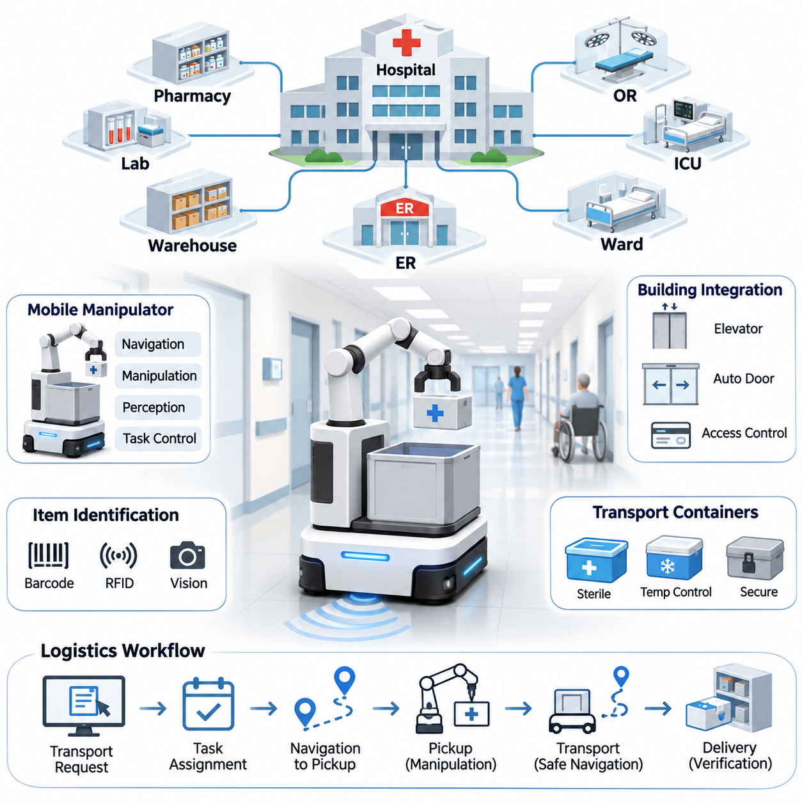
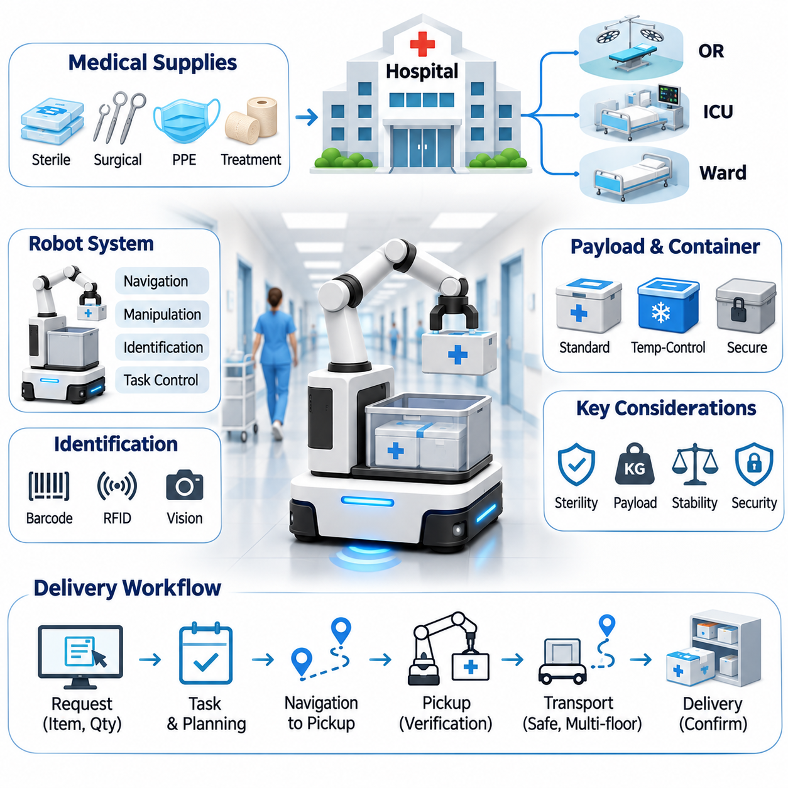
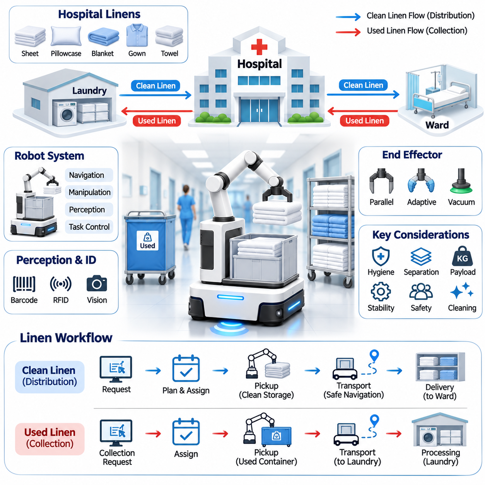
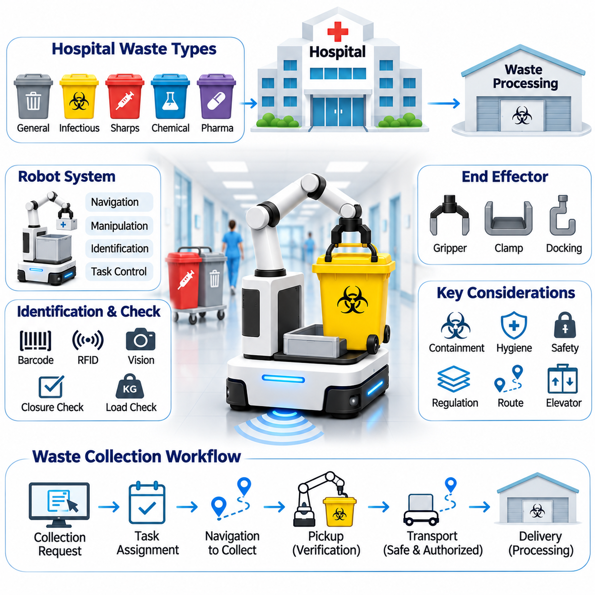
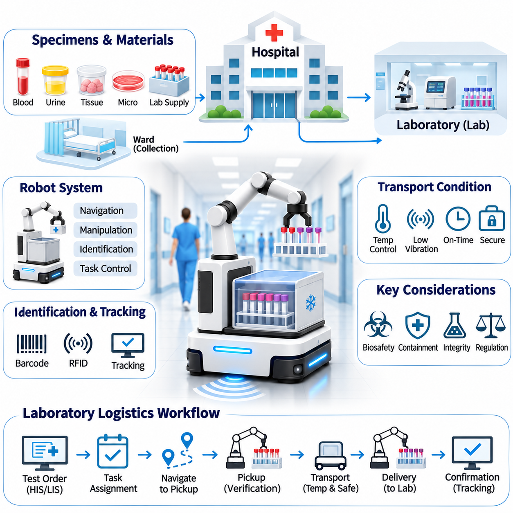
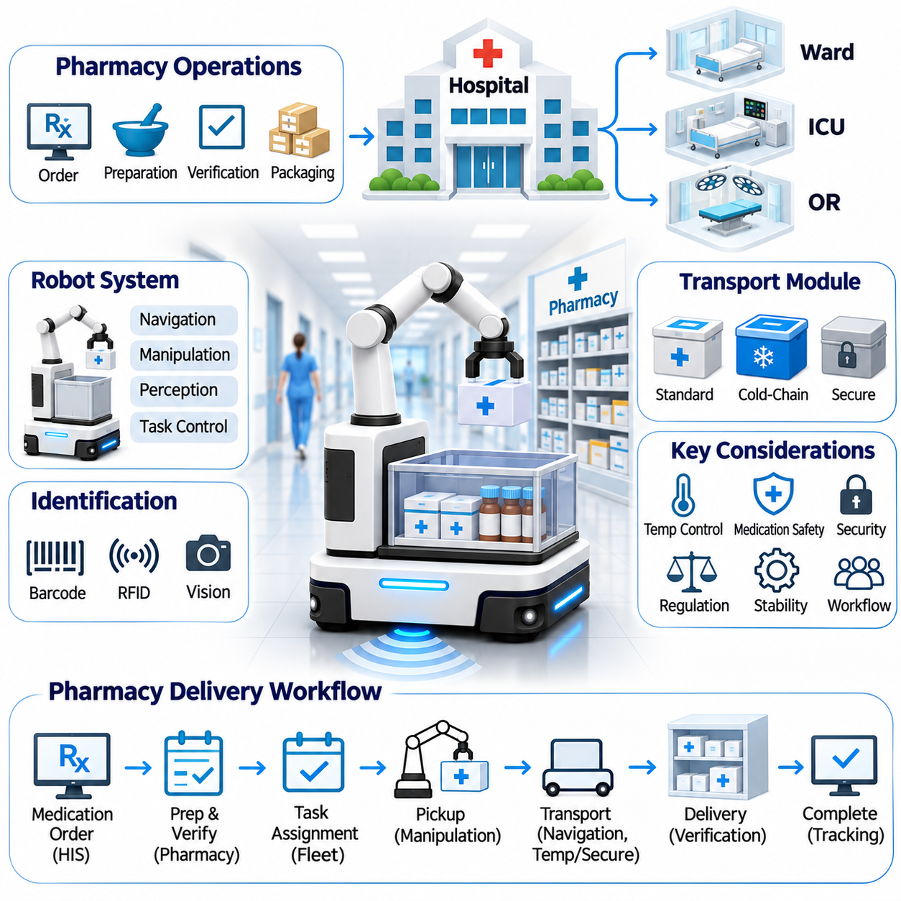
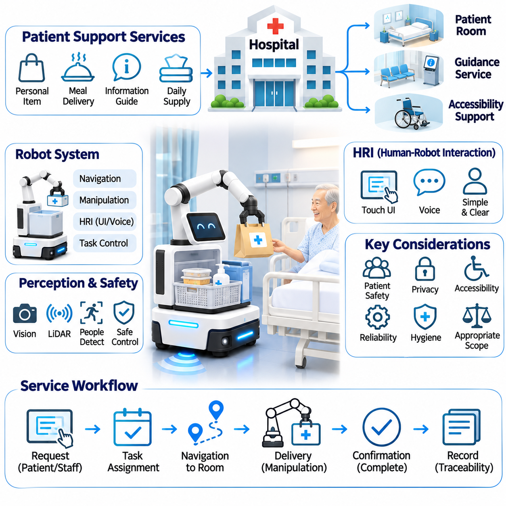
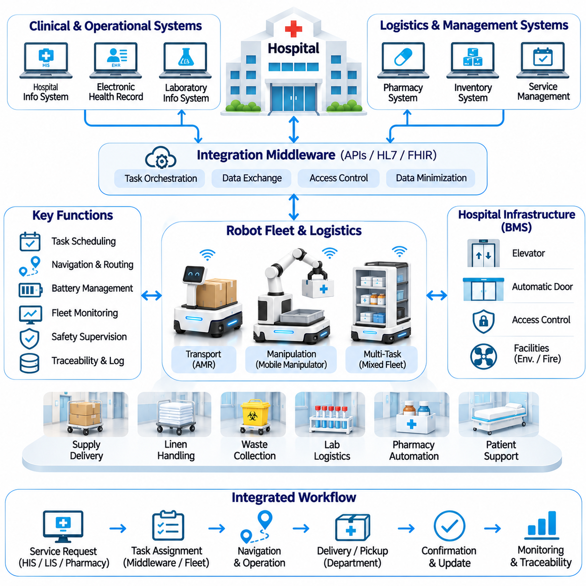
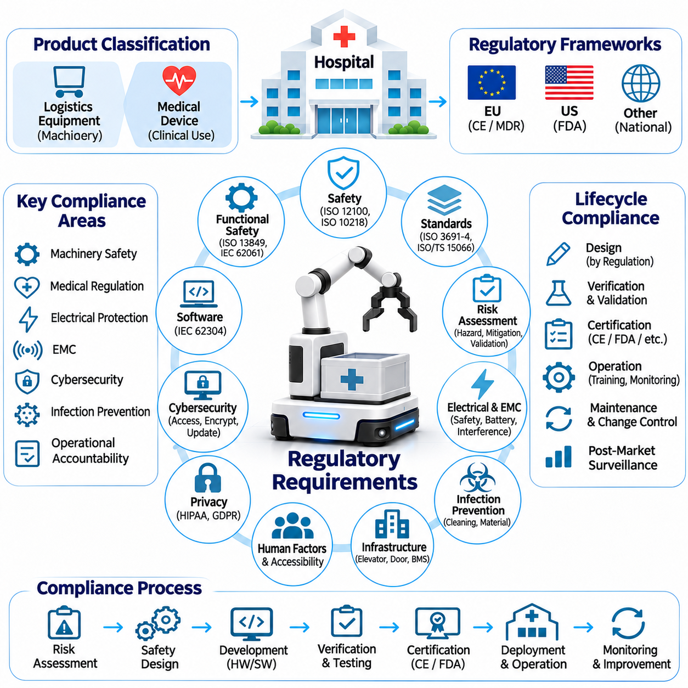

# Chapter 08. Hospital Applications

## 01 Hospital Logistics

{width="7.268055555555556in" height="7.268055555555556in"}

병원 물류(Hospital Logistics)는 의료용품(Medical Supplies), 의료 장비(Medical Equipment), 의약품(Medications), 검사실 검체(Laboratory Specimens), 필수 자재(Essential Materials)를 의료시설(Healthcare Facilities) 내부에서 지속적으로 이동시키는 핵심 운영 기능이다. 일반 산업 물류(Industrial Logistics)와 달리 병원 물류는 예측하기 어려운 수요, 엄격한 위생 요구사항, 민감한 운영 환경, 중단 없는 의료 서비스 제공을 동시에 고려해야 한다.

현대 병원(Modern Hospitals)은 중앙 창고(Central Warehouses), 약국(Pharmacies), 검사실(Laboratories), 수술실(Operating Rooms), 응급실(Emergency Departments), 중환자실(Intensive Care Units), 일반 병동(Patient Wards)을 연결하는 복잡한 물류 네트워크(Logistics Networks)로 운영된다. 각 부서는 서로 다른 운송 요구사항, 배송 우선순위, 취급 제약조건을 가지며, 이러한 이동을 효율적으로 조정하는 것은 의료 서비스 품질을 유지하고 불필요한 업무 부담을 줄이는 데 필수적이다.

전통적인 병원 물류(Traditional Hospital Logistics)는 간호사(Nurses), 운반 담당자(Porters), 의료 기술자(Technicians), 지원 인력(Support Personnel)이 부서 간 물품을 수동으로 운송하는 방식에 크게 의존한다. 이러한 활동은 필수적이지만 반복적인 운송 작업은 환자 진료(Patient Care)에 활용할 수 있는 귀중한 업무 시간을 소모한다. 이동형 로봇 시스템(Mobile Robotic Systems)은 사람의 감독을 유지하면서 일상적인 운송 작업을 자동화할 수 있는 기회를 제공한다.

자율이동로봇(Autonomous Mobile Robots, AMRs)은 고정식 컨베이어 시스템(Fixed Conveyor Systems)이나 영구적으로 설치된 유도 인프라(Guidance Infrastructure) 없이 병원 복도를 주행할 수 있는 유연한 운송 기능을 제공한다. 위치추정 센서(Localization Sensors), 장애물 감지(Obstacle Detection), 경로 계획 알고리즘(Route Planning Algorithms)을 탑재한 로봇은 변화하는 환경 조건에 적응하면서 지정된 위치 사이에서 의료 물품을 운송할 수 있다.

이동형 매니퓰레이터(Mobile Manipulators)는 자율주행(Autonomous Navigation)과 로봇 팔(Robot Arms), 지능형 말단장치(Intelligent End Effectors)를 결합하여 기존 자율이동로봇(AMR)의 기능을 확장한다. 이러한 통합을 통해 로봇 플랫폼(Robotic Platform)은 보관 위치에 접근하고, 물체를 인식하고, 용기를 파지하고, 자재를 이송하며, 호환되는 배송 스테이션(Delivery Stations)과 상호작용할 수 있다. 이는 병원 물류 작업 흐름(Workflow)의 보다 완전한 자동화를 지원한다.

일반적인 병원 물류 작업 흐름(Hospital Logistics Workflow)은 임상 부서(Clinical Department)가 병원정보시스템(Hospital Information System) 또는 물류관리 인터페이스(Logistics Management Interface)를 통해 운송 요청을 제출하면서 시작된다. 요청에는 필요한 물품, 수거 위치(Pickup Location), 목적지(Destination), 우선순위(Priority), 취급 조건(Handling Conditions)이 포함된다. 작업관리시스템(Task Management System)은 사용 가능한 로봇 자원을 평가하고 적절한 운송 임무(Transportation Mission)를 할당한다.

임무를 수신한 이동형 매니퓰레이터(Mobile Manipulator)는 위치추정(Localization) 및 지도작성(Mapping) 기능을 이용하여 지정된 수거 스테이션(Pickup Station)으로 이동한다. 라이다(LiDAR), 깊이 카메라(Depth Cameras), 휠 엔코더(Wheel Encoders), 관성측정장치(Inertial Measurement Units, IMUs)는 환경 인식(Environmental Perception)에 활용될 수 있다. 내비게이션 소프트웨어(Navigation Software)는 장애물, 보행자 이동, 이용 가능한 경로를 지속적으로 평가하여 안전한 주행을 유지한다.

수거 위치에서 로봇 매니퓰레이터(Robotic Manipulator)는 선반(Shelves), 용기(Containers), 카트(Carts), 자동 분배 스테이션(Automated Dispensing Stations)과 상호작용할 수 있다. 비전 알고리즘(Vision Algorithms)은 목표 물체(Target Object)를 인식하고 로봇에 대한 상대 위치를 추정한다. 파지 계획(Grasp Planning)은 적절한 조작 전략을 결정하며, 힘 및 토크 피드백(Force and Torque Feedback)은 물품 취급 과정에서 과도한 접촉력이 발생하지 않도록 지원한다.

병원 물류에서는 서로 다른 의료 물품이 외형적으로 유사하더라도 취급 요구사항이 크게 다를 수 있으므로 신뢰성 높은 물체 식별(Object Identification)이 필요하다. 바코드 판독기(Barcode Readers), 무선주파수 식별(Radio Frequency Identification, RFID), 시각 인식 기술(Visual Recognition Technologies)은 물품 검증(Item Verification)을 지원한다. 이러한 식별 방법을 디지털 재고 기록(Digital Inventory Records)과 결합하면 잘못된 배송 위험을 줄이고 물품 추적성(Material Traceability)을 향상시킬 수 있다.

운송 용기(Transportation Containers)는 내부 물품의 특성에 따라 설계되어야 한다. 멸균 의료용품(Sterile Medical Supplies)은 보호 포장(Protective Packaging)이 필요하며, 검사실 검체(Laboratory Specimens)는 온도 제어(Temperature Control)와 진동에 민감한 취급(Vibration-Sensitive Handling)이 요구될 수 있다. 의약품(Pharmaceuticals)은 접근 제한(Restricted Access)이나 환경 모니터링(Environmental Monitoring)이 필요할 수 있으므로 로봇 플랫폼은 적절한 밀폐, 안전한 적재, 문서화된 취급 절차를 지원해야 한다.

중요한 시스템 아키텍처(System Architecture) 고려사항 중 하나는 운송 기능(Transportation Functions)과 조작 기능(Manipulation Functions)을 분리하는 것이다. 이동 플랫폼(Mobile Base)은 부서 간 내비게이션(Navigation), 위치 결정(Positioning), 이동을 담당하며, 로봇 팔(Robot Arm)은 국소적인 물품 취급을 수행한다. 상위 제어기(Supervisory Controller)는 두 하위 시스템을 조정하여 플랫폼이 안전하게 위치하고 충분히 안정화된 경우에만 조작이 시작되도록 보장한다.

병원 환경(Hospital Environments)은 구조화된 공장 바닥과 상당히 다른 내비게이션 문제를 발생시킨다. 복도에는 환자(Patients), 휠체어(Wheelchairs), 들것(Stretchers), 의료 카트(Medical Carts), 방문객(Visitors), 청소 장비(Cleaning Equipment)가 존재할 수 있다. 출입문과 엘리베이터는 일시적인 병목현상(Bottlenecks)을 만들며, 응급상황(Emergency Situations)은 이동 패턴을 빠르게 변화시킨다. 따라서 로봇 내비게이션은 예측 가능한 동작과 사람과의 안전한 상호작용을 우선해야 한다.

동적 장애물 회피(Dynamic Obstacle Avoidance)는 병원 보행자가 예측하기 어렵게 움직이거나 추가적인 이동 공간을 필요로 할 수 있으므로 특히 중요하다. 로봇은 적절한 이격거리(Separation Distance)를 유지하고 주변 조건에 따라 속도를 조절하며 필요한 경우 통행을 양보해야 한다. 시스템 위험성 평가(Risk Assessment)에서 요구하는 경우 안전 등급 센싱(Safety-Rated Sensing)과 보호 기능(Protective Functions)은 비안전 인공지능 인식(Non-Safety AI Perception) 기능과 독립적으로 작동해야 한다.

엘리베이터 연동(Elevator Integration)은 병원 로봇이 여러 층에 걸친 운송 임무를 수행할 수 있도록 한다. 이를 위해 로봇 군집관리시스템(Fleet Management System)과 승인된 건물 제어 인터페이스(Building Control Interfaces) 사이의 통신이 필요하다. 로봇은 엘리베이터 호출을 조정하고, 내부 공간의 이용 가능 여부를 확인하고, 안전하게 진입하며, 이동 중 위치를 유지하고, 목적 층 도착을 확인한 후 할당된 임무를 계속 수행해야 한다.

자동문(Automatic Doors)과 출입통제구역(Controlled Access Areas)은 추가적인 시스템 통합 요구사항을 발생시킨다. 병원 로봇은 제한된 복도, 물품 보관실, 특수 치료 구역에 진입하기 위한 권한이 필요할 수 있다. 출입통제 인터페이스(Access Control Interfaces)는 승인된 임무를 인증하고 관련 이벤트를 기록해야 한다. 무단 이동, 조작, 민감한 병원 인프라 접근을 방지하기 위해 사이버보안(Cybersecurity) 메커니즘이 필수적이다.

여러 대의 로봇이 동시에 작동할 때 군집관리(Fleet Management)의 중요성은 더욱 커진다. 중앙집중형 또는 분산형 군집관리시스템(Centralized or Distributed Fleet Management System)은 작업 할당(Task Assignment), 로봇 위치 모니터링(Robot Location Monitoring), 경로 최적화(Route Optimization), 공유 자원 조정(Shared Resource Coordination)을 수행할 수 있다. 임무 스케줄링(Mission Scheduling)은 배송 긴급도, 배터리 상태, 적재물 호환성, 교통 상황, 로봇별 운영 가능 상태를 고려해야 한다.

작업 우선순위 결정(Task Prioritization)은 단순한 운송 효율성보다 임상적 중요성(Clinical Importance)을 반영해야 한다. 응급 의료용품(Emergency Medical Supplies)은 즉각적인 배송이 필요할 수 있지만, 정기적인 재고 보충(Routine Inventory Replenishment)은 상대적으로 긴 지연을 허용할 수 있다. 병원 물류 시스템은 설정 가능한 우선순위 정책(Priority Policies), 단계별 대응 절차(Escalation Procedures), 예기치 않은 상황에서 핵심 서비스가 위협받을 경우 사람의 개입(Human Intervention)을 지원해야 한다.

배터리 관리(Battery Management)는 병원 로봇의 운영 가용성(Operational Availability)에 직접적인 영향을 미친다. 병원의 연속 운영(Continuous Hospital Operations)을 위해 자동 충전(Automated Charging), 기회 충전(Opportunity Charging), 로봇 교대 운영(Coordinated Robot Rotation)이 필요할 수 있다. 에너지 인식 임무 계획(Energy-Aware Mission Planning)은 작업을 할당하기 전에 운송과 조작 활동을 완료할 충분한 배터리 용량이 남아 있는지 평가하여 배송 중단 가능성을 줄인다.

위생(Hygiene)과 감염 예방(Infection Prevention)은 의료시설에 배치되는 로봇 시스템의 기본 요구사항이다. 외부 표면은 적절한 세척(Cleaning)과 소독(Disinfection) 절차를 지원해야 하며, 기계 구성요소(Mechanical Components)는 청소하기 어려운 영역을 최소화해야 한다. 운영 작업 흐름(Operational Workflows)은 청결 물품(Clean Materials)과 오염 물품(Contaminated Materials)을 구분하고 감염관리 요구사항이 서로 다른 구역 사이의 의도하지 않은 이동을 방지해야 한다.

로봇 그리퍼(Robotic Grippers)와 운송 구획(Transport Compartments)은 의료 용기나 공용 장비와 접촉할 수 있으므로 특별한 주의가 필요하다. 재료(Materials)는 승인된 세척제(Cleaning Agents)와 호환되어야 하며, 기계 설계(Mechanical Design)는 점검과 유지보수를 용이하게 해야 한다. 필요한 경우 교체형 말단장치(Interchangeable End Effectors)나 전용 취급 부속품(Dedicated Handling Accessories)을 사용하여 서로 다른 물류 작업 간 교차오염(Cross-Contamination) 위험을 줄일 수 있다.

병원정보시스템(Hospital Information Systems)과의 통합은 조정 가능하고 추적 가능한 운영의 기반을 제공한다. 물류 소프트웨어(Logistics Software)는 재고관리(Inventory Management), 약국관리(Pharmacy Management), 검사실 시스템(Laboratory Systems), 전사적 자원관리(Enterprise Resource Planning, ERP) 플랫폼과 승인된 작업 정보를 교환할 수 있다. 표준화된 인터페이스(Standardized Interfaces)와 통제된 데이터 접근(Controlled Data Access)은 불필요한 환자정보 노출 없이 로봇 임무가 현재 운영 요구사항을 반영하도록 지원한다.

운영 모니터링(Operational Monitoring)은 임무 할당, 수거 확인, 배송 완료, 내비게이션 중단, 조작 실패, 복구 이벤트를 기록해야 한다. 이러한 기록은 성능 분석(Performance Analysis), 문제 해결(Troubleshooting), 지속적 개선(Continuous Improvement)을 지원한다. 민감한 정보(Sensitive Information)는 병원 요구사항에 부합하는 접근 제어(Access Controls), 보존 정책(Retention Policies), 암호화(Encryption), 감사 메커니즘(Audit Mechanisms)을 통해 보호되어야 한다.

시스템 신뢰성(System Reliability)은 운송 실패가 후속 임상 활동(Downstream Clinical Activities)에 영향을 줄 수 있으므로 특히 중요하다. 로봇은 위치추정 상실(Localization Loss), 경로 차단(Blocked Routes), 파지 실패(Grasp Failures), 예상하지 못한 적재물 이동(Unexpected Payload Movement), 통신 중단(Communication Interruptions)과 같은 비정상 상태를 감지해야 한다. 복구 전략(Recovery Strategies)에는 안전 정지, 작업 재시도, 대체 경로 탐색, 운영자 알림, 병원 직원에게 책임을 통제된 방식으로 이관하는 절차가 포함될 수 있다.

성능 평가(Performance Evaluation)는 로봇 효율성(Robotic Efficiency)뿐 아니라 병원 전체의 작업 흐름(Hospital Workflow)을 함께 고려해야 한다. 주요 지표에는 배송 완료율(Delivery Completion Rate), 평균 임무 수행시간(Average Mission Duration), 정시 배송률(On-Time Delivery Rate), 조작 성공률(Manipulation Success Rate), 시스템 가용성(System Availability), 사람의 개입 빈도(Human Intervention Frequency)가 포함된다. 이러한 측정값은 로봇 운영과 기존 수동 운송 프로세스를 비교하는 실질적인 기반을 제공한다.

경제성 평가(Economic Evaluation)는 장비 도입비(Acquisition Costs), 설치비(Installation Costs), 시스템 통합비(Integration Costs), 유지보수비(Maintenance Costs), 소프트웨어 라이선스 비용(Software Licensing Costs), 충전 인프라(Charging Infrastructure), 운영 지원비(Operational Support)를 고려해야 한다. 기대 효과에는 반복 운송 업무 감소, 배송 일관성 향상, 재고 가시성(Inventory Visibility) 개선, 병원 인력의 효율적인 배치가 포함된다. 투자수익률(Return on Investment, ROI)은 실제 활용률과 측정 가능한 운영 성과 개선에 따라 달라진다.

성공적인 현장 배치(Field Deployment)는 일반적으로 예측 가능한 경로와 표준화된 물품을 대상으로 하는 제한적인 시범 운영(Pilot Operation)에서 시작된다. 엔지니어는 내비게이션 신뢰성(Navigation Reliability), 수거 및 배송 정확도(Pickup and Delivery Accuracy), 병원 직원과의 상호작용, 기존 인프라와의 호환성을 평가한다. 시범 운영 결과는 확대 배치 전에 기계 설계, 제어 소프트웨어, 작업 흐름 통합, 운영 절차를 조정하는 데 활용된다.

사람의 수용성(Human Acceptance) 역시 병원 물류 자동화(Hospital Logistics Automation)의 중요한 요소이다. 의료 전문가와 지원 인력은 로봇의 기능, 운영 한계, 개입 절차를 이해해야 한다. 명확한 상태 표시(Status Indicators), 직관적인 인터페이스(Intuitive Interfaces), 예측 가능한 로봇 동작(Predictable Robot Behavior)은 신뢰 형성에 도움이 된다. 교육 프로그램(Training Programs)은 배송 요청 방법, 예외 상황 대응 방법, 운영 문제 보고 절차를 설명해야 한다.

병원 물류 자동화의 장기적인 발전(Long-Term Development)은 이동형 조작(Mobile Manipulation), 지능형 인식(Intelligent Perception), 예측 스케줄링(Predictive Scheduling), 협조적 군집 운영(Coordinated Fleet Operations)을 더욱 긴밀하게 결합하는 방향으로 진행될 것이다. 첨단 로봇 시스템(Advanced Robotic Systems)은 향후 인프라 변경을 최소화하면서 더 다양한 용기와 보관 구조를 취급할 수 있을 것으로 예상된다. 그러나 신뢰할 수 있는 성능, 임상 환경과의 호환성, 안전 검증(Safety Validation)은 여전히 필수적인 선행조건이다.

병원 물류 자동화(Hospital Logistics Automation)는 궁극적으로 독립적인 로봇 기술(Isolated Robotic Technology)이 아니라 통합 의료 지원 시스템(Integrated Healthcare Support System)으로 평가되어야 한다. 성공 여부는 이동성(Mobility), 조작(Manipulation), 소프트웨어 통합(Software Integration), 물품 취급(Material Handling), 안전공학(Safety Engineering), 사람 중심 작업 흐름(Human Workflows)의 조정에 달려 있다. 적절하게 설계된 이동형 매니퓰레이터(Mobile Manipulators)는 물류 운영의 일관성을 향상시키면서 의료 전문가가 환자 중심 활동(Patient-Centered Activities)에 더욱 집중할 수 있도록 지원한다.

## 02 Medical Supply Delivery

{width="7.268055555555556in" height="7.268055555555556in"}

의료용품 배송(Medical Supply Delivery)은 필수 의료 물품이 정확한 시간과 장소에 임상 부서(Clinical Departments)로 전달되도록 보장하는 병원의 핵심 운영 기능이다. 이러한 물품에는 멸균 기구(Sterile Instruments), 수술용 소모품(Surgical Consumables), 개인보호장비(Personal Protective Equipment), 진단 보조기구(Diagnostic Accessories), 일반 치료용품(Routine Treatment Supplies)이 포함된다. 신뢰성 높은 배송은 의료 서비스의 연속성(Clinical Continuity), 직원 생산성(Staff Productivity), 안전한 환자 진료(Patient Care)에 필요한 자원의 가용성을 직접적으로 지원한다.

전통적인 의료용품 유통(Traditional Medical Supply Distribution)은 중앙 보관구역(Central Storage Areas)과 임상 부서 사이의 수동 운송(Manual Transportation)에 의존한다. 간호사(Nurses), 의료 기술자(Technicians), 물류 담당자(Logistics Personnel)는 물품 보관실(Supply Rooms)에서 자재를 직접 가져오거나 내부 배송 서비스를 통해 운송을 요청한다. 이러한 방식은 유연성을 제공하지만, 반복적인 운송 활동은 귀중한 업무 시간을 소모하고 임상 수요가 높은 시간대에는 배송 지연을 발생시킬 수 있다.

자율이동로봇(Autonomous Mobile Robots, AMRs)은 동적으로 계획된 경로(Dynamically Planned Routes)를 따라 의료용품을 운송하는 대안을 제공한다. 이러한 로봇은 병원 복도를 주행하고 장애물을 회피하며 안전하게 보관된 용기를 지정된 목적지로 배송한다. 이동형 매니퓰레이터(Mobile Manipulators)는 표준화된 의료용품 포장을 수거하고 운송 구획에 적재하며 호환되는 수령 스테이션(Receiving Stations)으로 물품을 이송할 수 있는 로봇 팔(Robotic Arms)을 통해 이러한 기능을 확장한다.

의료용품 배송 작업 흐름(Medical Supply Delivery Workflow)은 일반적으로 부서가 재고관리시스템(Inventory Management System) 또는 병원 물류 플랫폼(Hospital Logistics Platform)을 통해 특정 물품을 요청하면서 시작된다. 요청에는 물품 식별자(Item Identifiers), 수량(Quantities), 배송 목적지(Delivery Destinations), 긴급도(Urgency Levels), 취급 요구사항(Handling Requirements)이 포함된다. 상위 관리시스템(Supervisory System)은 재고 가용성을 확인하고 적절한 로봇 플랫폼에 할당할 수 있는 운송 작업(Transportation Task)을 생성한다.

물품 수거 전에 로봇은 수거 스테이션(Pickup Station), 예상 적재물(Expected Payload), 용기 구성(Container Configuration), 목적지(Destination)에 대한 정보를 수신한다. 내비게이션 시스템(Navigation System)은 병원 지도(Hospital Maps), 출입제한구역(Restricted Areas), 현재 교통 상황(Current Traffic Conditions)을 기반으로 적절한 경로를 계산한다. 임무 계획(Mission Planning)은 배터리 용량(Battery Capacity), 로봇 가용성(Robot Availability), 배송 마감시간(Delivery Deadlines), 특수 취급 장비(Specialized Handling Equipment)의 필요 여부도 고려해야 한다.

수거 위치에서 이동형 매니퓰레이터(Mobile Manipulator)는 카메라(Cameras), 깊이 센서(Depth Sensors), 물체 인식 알고리즘(Object Recognition Algorithms)을 이용하여 필요한 의료용품 용기를 식별할 수 있다. 로봇 팔(Robotic Arm)은 보정된 좌표 변환(Calibrated Coordinate Transformations)과 파지 계획(Grasp Planning)을 이용하여 목표물에 접근한다. 힘 제어 기반 조작(Force-Controlled Manipulation)은 안정적인 접촉을 유지하도록 지원하며, 바코드(Barcode) 또는 무선주파수 식별(Radio Frequency Identification, RFID) 검증은 선택된 용기가 할당된 배송 요청과 일치하는지 확인한다.

의료용품(Medical Supplies)은 크기(Dimensions), 무게(Weight), 포장(Packaging), 기계적 민감도(Mechanical Sensitivity) 측면에서 상당한 차이를 보인다. 가벼운 일회용 물품(Lightweight Disposable Materials)은 소형 용기로 운송할 수 있지만, 수술 기구 세트(Surgical Instrument Sets)는 더 높은 적재 용량(Load Capacity)이 필요하다. 따라서 로봇 플랫폼(Robotic Platforms)은 수거 및 배송 과정에서 안정성(Stability), 내비게이션 성능(Navigation Performance), 조작 정확도(Manipulation Accuracy)를 저하시키지 않으면서 다양한 적재물 구성을 수용해야 한다.

적재물 관리(Payload Management)는 로봇 팔(Robotic Arm)이 이동 플랫폼(Mobile Base) 위에서 작동할 때 특히 중요하다. 조작 동작(Manipulation Motion)은 시스템의 무게중심(Center of Gravity)을 변화시키고 안정성에 영향을 줄 수 있는 동적 힘(Dynamic Forces)을 발생시킨다. 제어기(Controller)는 로봇 팔의 움직임과 플랫폼 위치를 조정하고, 안전하지 않은 이동 중에는 조작을 제한하며, 적재물 질량(Payload Mass)이 승인된 운용 범위(Operating Envelope) 내에 있는지 확인해야 한다.

멸균 의료용품(Sterile Medical Supplies)은 포장 무결성(Packaging Integrity)을 유지하고 오염 위험(Contamination Risks)을 최소화하는 취급 절차가 필요하다. 로봇은 멸균 포장(Sterile Packaging)과의 불필요한 접촉을 피하고 병원 세척 프로토콜(Hospital Cleaning Protocols)에 적합한 운송 구획(Transport Compartments)을 사용해야 한다. 물품이 통제된 환경(Controlled Environments) 내에 유지되어야 하는 경우 배송 작업 흐름에는 적절한 이송 경계(Transfer Boundaries), 환경 조건(Environmental Conditions), 검증 절차(Verification Procedures)가 포함되어야 한다.

운송 용기(Supply Containers)는 추가적인 보호가 필요한 물품을 위해 잠금장치(Locking Mechanisms), 개봉 여부 확인 봉인(Tamper-Evident Seals), 전자식 접근제어(Electronic Access Controls)를 포함할 수 있다. 이러한 기능은 운송 중 무단 접근(Unauthorized Access)과 우발적인 물품 제거(Accidental Removal)를 방지하는 데 도움이 된다. 물류 시스템(Logistics System)은 책임 추적성(Accountability)을 지원하기 위해 용기 식별정보(Container Identity), 수거 확인(Pickup Confirmation), 관리 책임 이전(Custody Transitions), 배송 완료(Delivery Completion)에 대한 디지털 기록을 유지해야 한다.

병원 환경에서의 내비게이션(Navigation)은 보행자(Pedestrians), 의료 카트(Medical Carts), 휠체어(Wheelchairs), 일시적인 장애물(Temporary Obstacles)에 대한 지속적인 상황 인식이 필요하다. 로봇은 안전한 이격거리(Safe Separation Distances)를 유지하면서 주변 조건에 따라 속도와 움직임을 조정해야 한다. 응급 의료 활동(Emergency Medical Activities)에 우선권을 부여해야 하며, 로봇의 존재가 의료진이나 환자 이송(Patient Transportation)을 방해할 수 있는 경우 통행을 양보하거나 정지해야 한다.

병원 인프라 통합(Hospital Infrastructure Integration)은 로봇이 여러 부서와 층에 걸쳐 작동할 수 있도록 한다. 엘리베이터 통신(Elevator Communication), 자동문 인터페이스(Automatic Door Interfaces), 승인된 출입시스템(Authorized Access Systems)은 통제구역(Controlled Areas)을 통과하는 운송 임무를 지원한다. 로봇이 출입구를 차단하거나 제한된 임상 공간에 진입하거나 중요한 운송 지점에서 움직이지 못하는 상황을 방지하기 위해 신뢰성 높은 조정(Reliable Coordination)이 필요하다.

목적지에 도착한 로봇은 수령 위치(Receiving Location)가 이용 가능하고 할당된 물품에 적합한지 확인해야 한다. 배송 과정에는 보안 구획(Secured Compartment)을 열거나 지정된 표면에 용기를 배치하거나 로봇 팔을 통해 물품을 이송하는 작업이 포함될 수 있다. 성공적인 작업 완료를 위해서는 정확한 물품이 의도된 수령 스테이션(Intended Receiving Station)에 도착했는지 검증해야 한다.

수령 스테이션(Receiving Station)에서의 조작은 추가적인 위치 결정(Positioning)과 인식(Perception) 요구사항을 발생시킨다. 로봇은 물품을 이송하기 전에 선반(Shelves), 트레이(Trays), 도킹 인터페이스(Docking Interfaces)의 위치를 정확하게 추정해야 한다. 시각 피드백(Visual Feedback), 근접 센싱(Proximity Sensing), 힘 모니터링(Force Monitoring)은 배치 신뢰성(Placement Reliability)을 향상시킬 수 있다. 표준화된 수령 설비(Standardized Receiving Fixtures)는 이러한 작업을 단순화하고 복잡한 물체 조작에 대한 의존도를 줄인다.

재고 동기화(Inventory Synchronization)는 의료용품의 정확한 가용성을 유지하는 데 필수적이다. 로봇이 물품을 수거하면 재고관리시스템(Inventory System)은 병원 절차에 따라 해당 거래(Transaction)를 기록해야 한다. 배송 확인(Delivery Confirmation)은 부서별 재고 기록(Departmental Stock Records)을 갱신하고 재고 보충 프로세스(Replenishment Processes)를 시작할 수 있다. 이러한 통합은 실제 재고(Physical Inventory)와 디지털 기록(Digital Records) 사이의 불일치를 줄인다.

군집관리시스템(Fleet Management Systems)은 동일한 병원 내에서 운영되는 여러 배송 로봇을 조정한다. 작업 할당 알고리즘(Task Allocation Algorithms)은 배송 긴급도(Delivery Urgency), 이동 거리(Travel Distance), 적재물 호환성(Payload Compatibility), 로봇 가용성(Robot Availability)을 평가할 수 있다. 협조적 스케줄링(Coordinated Scheduling)은 불필요한 이동을 줄이고 엘리베이터, 보관구역, 주요 복도 주변의 혼잡을 방지하면서 긴급 요청에 대한 대응성을 유지하도록 지원한다.

의료용품 수요(Medical Supply Demand)는 임상 일정(Clinical Schedules), 응급환자 입원(Emergency Admissions), 치료 활동(Treatment Activities)에 따라 하루 동안 변화한다. 예측 물류 모델(Predictive Logistics Models)은 과거 소비 패턴(Historical Consumption Patterns)을 분석하여 향후 재고 보충 요구량(Future Replenishment Requirements)을 추정할 수 있다. 이러한 예측은 선제적 배송 스케줄링(Proactive Delivery Scheduling)을 지원할 수 있지만, 임상적으로 필요한 경우 긴급 요청이 일반적인 최적화 결정보다 우선하도록 해야 한다.

통신 신뢰성(Communication Reliability)도 중요한 고려사항이다. 로봇은 임무 갱신(Mission Updates), 재고 동기화(Inventory Synchronization), 운영 모니터링(Operational Monitoring)을 위해 네트워크 연결(Network Connectivity)에 의존하기 때문이다. 무선통신 중단(Wireless Communication Interruptions)이 기본 안전 기능(Basic Safety Functions)을 손상시켜서는 안 된다. 로봇은 적절한 로컬 자율성(Local Autonomy)을 유지하고 임무 상태(Mission State)를 보존하며 상위 관리시스템과의 통신이 불가능해지면 사전에 정의된 복구 절차(Recovery Procedures)를 실행해야 한다.

예외 처리(Exception Handling)는 재고 부족(Missing Inventory), 잘못된 용기(Incorrect Containers), 차단된 목적지(Blocked Destinations), 파지 실패(Unsuccessful Grasps), 배송 검증 실패(Delivery Verification Failures)와 같은 상황을 처리해야 한다. 시스템은 이러한 상태를 감지하고 확인되지 않은 배송이 완료된 것으로 기록되지 않도록 해야 한다. 상황에 따라 복구에는 작업 재할당(Task Reassignment), 운영자 지원(Operator Assistance), 대체 경로 탐색(Alternative Routing), 승인된 보관 위치로의 물품 반환이 포함될 수 있다.

인간-로봇 상호작용(Human-Robot Interaction, HRI)은 임상 인력이 사용하기에 간단하고 예측 가능해야 한다. 직원은 물품을 요청하고 도착한 로봇을 식별하며 배송된 물품을 수령하고 문제를 보고할 수 있는 명확한 방법이 필요하다. 시각적 표시장치(Visual Indicators), 음성 알림(Audible Notifications), 터치스크린 인터페이스(Touchscreen Interfaces)는 임무 상태(Mission Status)를 전달할 수 있지만, 민감한 병원 환경에서 불필요한 방해를 발생시키지 않아야 한다.

사이버보안(Cybersecurity)과 정보 보호(Information Protection)는 배송 시스템 아키텍처(Delivery Architecture) 전반에서 고려되어야 한다. 로봇 시스템은 병원 재고 플랫폼(Hospital Inventory Platforms) 및 출입통제 서비스(Access Control Services)와 운영 데이터를 교환할 수 있다. 인증(Authentication), 암호화 통신(Encrypted Communication), 역할 기반 권한(Role-Based Permissions), 감사 기록(Audit Logging)은 이러한 인터페이스를 보호하는 데 도움이 된다. 환자 식별정보(Patient-Identifiable Information)는 특별히 필요하고 적절하게 승인된 경우를 제외하고 로봇 작업 흐름에서 배제해야 한다.

성능 평가(Performance Evaluation)는 배송 성공률(Delivery Success Rate), 정시 완료율(On-Time Completion), 평균 운송시간(Average Transportation Duration), 조작 정확도(Manipulation Accuracy), 시스템 가용성(System Availability)을 측정해야 한다. 추가 지표에는 재고 불일치(Inventory Discrepancies), 사람의 개입 빈도(Human Intervention Frequency), 배송 관련 안전 이벤트(Delivery-Related Safety Events)가 포함될 수 있다. 이러한 측정값은 로봇 기반 의료용품 배송이 기존 수동 유통 프로세스보다 실질적인 개선 효과를 제공하는지 판단하는 데 도움이 된다.

경제적 타당성(Economic Feasibility)은 배치 규모(Deployment Scale), 일일 임무 수행량(Daily Mission Volume), 운영시간(Operating Hours), 병원 시스템 통합의 복잡성(Integration Complexity)에 따라 달라진다. 초기 비용(Initial Costs)에는 로봇 하드웨어(Robotic Hardware), 충전 스테이션(Charging Stations), 소프트웨어(Software), 인프라 인터페이스(Infrastructure Interfaces), 직원 교육(Staff Training)이 포함된다. 운영상의 이점에는 반복 운송 업무 감소, 의료용품 가용성 향상, 부서 간 배송 성능의 일관성 개선이 포함될 수 있다.

시범 배치(Pilot Deployments)는 초기 단계에서 표준화된 의료용품 용기(Standardized Supply Containers)와 예측 가능한 운송 경로(Predictable Transportation Routes)에 집중해야 한다. 엔지니어는 통제된 운영 조건(Controlled Operating Conditions)에서 내비게이션 신뢰성(Navigation Reliability), 파지 성공률(Grasp Success), 배송 검증(Delivery Verification), 직원 수용성(Staff Acceptance)을 평가할 수 있다. 단계적 확대(Gradual Expansion)를 통해 병원은 더 복잡한 조작 작업이나 추가 임상 부서를 도입하기 전에 인프라 한계를 파악하고 운영 절차를 개선할 수 있다.

미래의 의료용품 배송 시스템(Future Medical Supply Delivery Systems)은 첨단 인식(Advanced Perception), 적응형 조작(Adaptive Manipulation), 지능형 스케줄링(Intelligent Scheduling), 협조적 다중 로봇 운영(Coordinated Multi-Robot Operations)을 결합할 수 있다. 향상된 로봇 정교성(Robotic Dexterity)은 더욱 다양한 포장 및 보관 구조를 취급할 수 있도록 지원하며, 예측 재고관리시스템(Predictive Inventory Systems)은 불필요한 재고 이동을 줄일 수 있다. 이러한 발전은 임상 안전(Clinical Safety), 위생(Hygiene), 운영 요구사항(Operational Requirements)과의 호환성을 유지해야 한다.

의료용품 배송 자동화(Medical Supply Delivery Automation)는 궁극적으로 로봇 이동성(Robotic Mobility), 조작(Manipulation), 재고관리(Inventory Management), 병원 운영(Hospital Operations) 사이의 신뢰성 높은 조정에 달려 있다. 성공적인 시스템은 정확한 물품을 운송하고, 물품 상태를 보존하며, 추적성(Traceability)을 유지하고, 임상 활동을 방해하지 않으면서 배송을 완료해야 한다. 이동형 매니퓰레이터(Mobile Manipulators)는 반복적인 물류 작업을 자동화함으로써 의료 인력이 환자 중심 업무(Patient-Centered Responsibilities)에 더 많은 시간과 역량을 집중할 수 있도록 지원한다.

## 03 Linen Handling

{width="7.268055555555556in" height="7.268055555555556in"}

린넨 취급(Linen Handling)은 의료시설(Healthcare Facilities) 전반에서 청결한 섬유제품(Clean Textiles)을 공급하고 사용한 물품(Used Materials)을 수거하는 필수적인 병원 물류 기능(Hospital Logistics Function)이다. 병원 린넨(Hospital Linens)에는 침대 시트(Bed Sheets), 베갯잇(Pillowcases), 담요(Blankets), 환자복(Patient Gowns), 수건(Towels), 재사용 가능한 임상용 섬유제품(Reusable Clinical Textiles)이 포함된다. 신뢰성 높은 린넨 관리(Linen Management)는 환자의 편안함, 감염 예방(Infection Prevention), 지속적인 임상 운영(Clinical Operations)을 지원하면서 반복적인 운송 업무를 줄인다.

전통적인 병원 린넨 운영(Traditional Hospital Linen Operations)은 수동 수거(Manual Collection), 분류(Sorting), 운송(Transportation), 공급(Distribution)에 의존한다. 의료 지원 인력(Healthcare Support Personnel)은 병동(Patient Wards), 보관실(Storage Rooms), 세탁시설(Laundry Facilities), 지정된 수거 지점(Collection Points) 사이에서 린넨 카트(Linen Carts)를 이동시킨다. 이러한 작업에는 상당한 신체적 노력이 필요하며 혼잡한 복도를 빈번하게 이동해야 하므로 이동형 로봇 시스템(Mobile Robotic Systems)을 통한 자동화 기회를 제공한다.

자율이동로봇(Autonomous Mobile Robots, AMRs)은 지속적인 사람의 안내 없이 병원 부서 사이에서 린넨 카트(Linen Carts)와 밀폐형 용기(Enclosed Containers)를 운송할 수 있다. 이동형 매니퓰레이터(Mobile Manipulators)는 표준화된 용기(Standardized Containers)와 상호작용하고 포장된 섬유제품(Packaged Textiles)을 취급하며 린넨 묶음(Linen Bundles)을 이송할 수 있는 로봇 팔(Robotic Arms)을 통합하여 이러한 기능을 확장한다. 이동성(Mobility)과 조작 기능(Manipulation)을 결합하면 반복적인 린넨 물류 작업 흐름(Linen Logistics Workflows)을 더욱 포괄적으로 자동화할 수 있다.

병원 린넨 관리(Hospital Linen Management)는 일반적으로 두 가지 구분된 물류 흐름(Material Flows)을 통해 운영된다. 청결 린넨(Clean Linens)은 세탁 처리시설(Laundry Processing Facilities)이나 중앙 보관구역(Centralized Storage Areas)에서 임상 부서(Clinical Departments)로 이동하며, 사용한 린넨(Used Linens)은 수거 지점(Collection Points)에서 지정된 처리시설(Processing Facilities)로 이동한다. 이러한 흐름은 오염 위험(Contamination Risks)을 줄이고 병원 감염 예방 절차(Infection Prevention Procedures)를 준수하기 위해 적절하게 분리되어야 한다.

청결 린넨 공급(Clean Linen Distribution)은 부서에서 재고 수준(Inventory Levels), 병상 점유율(Patient Occupancy), 예정된 임상 활동(Scheduled Clinical Activities)을 기준으로 보충을 요청하면서 시작된다. 병원 물류관리시스템(Hospital Logistics Management System)은 필요한 수량을 식별하고 사용 가능한 로봇에 운송 작업(Transportation Tasks)을 할당한다. 자동 스케줄링(Automated Scheduling)은 배송 우선순위(Delivery Priorities), 운송 경로(Transportation Routes), 재고 가용성(Inventory Availability)을 조정하여 필수 섬유제품이 목적지에 도착하도록 지원한다.

청결 린넨 보관 스테이션(Clean Linen Storage Station)에서 이동형 매니퓰레이터(Mobile Manipulator)는 바코드 판독기(Barcode Readers), 무선주파수 식별 태그(Radio Frequency Identification Tags, RFID Tags), 시각 인식 시스템(Visual Recognition Systems)을 사용하여 준비된 섬유제품 포장(Textile Packages)을 식별할 수 있다. 로봇 팔(Robotic Arm)은 표준화된 포장을 파지하고 지정된 운송 구획(Transport Compartments)으로 이송한다. 신뢰성 높은 취급을 위해서는 적절한 파지력(Gripping Forces), 안정적인 포장 위치, 선택된 물품과 할당된 배송 작업 사이의 일치 여부를 검증해야 한다.

섬유제품 조작(Textile Manipulation)은 직물이 유연하고 변형 가능하며 파지 조건에 민감하기 때문에 여러 기술적 문제를 발생시킨다. 강체 산업용 물체(Rigid Industrial Objects)와 달리 린넨 묶음(Linen Bundles)은 들어 올리거나 운송하는 동안 형태가 변할 수 있다. 로봇 조작 시스템(Robotic Manipulation Systems)은 파지 지점(Grasp Points)을 선택하고 로봇 팔의 움직임을 제어할 때 불확실한 형상(Uncertain Geometry), 가변적인 마찰(Variable Friction), 변화하는 질량 분포(Shifting Mass Distribution)를 고려해야 한다.

말단장치 설계(End Effector Design)는 자동 린넨 취급(Automated Linen Handling)의 신뢰성에 상당한 영향을 미친다. 평행 그리퍼(Parallel Grippers)는 포장된 섬유제품 묶음을 취급할 수 있으며, 적응형 또는 유연 그리퍼(Adaptive or Compliant Grippers)는 물체 크기의 변화에 대응할 수 있다. 진공 파지(Vacuum Gripping)는 특정 포장 표면에 적합할 수 있지만, 다공성 또는 불규칙한 직물(Porous or Irregular Fabrics)은 흡착 신뢰성(Suction Reliability)을 저하시킬 수 있으므로 대체 파지 전략(Alternative Grasping Strategies)이 필요하다.

인식 시스템(Perception Systems)은 린넨 포장(Linen Packages), 용기(Containers), 보관 구획(Storage Compartments), 주변 장애물(Surrounding Obstacles)을 구분해야 한다. RGB 카메라(RGB Cameras), 깊이 센서(Depth Sensors), 물체 검출 알고리즘(Object Detection Algorithms)은 포장 위치를 추정하고 적절한 파지 영역(Grasping Regions)을 식별할 수 있다. 비정형 섬유제품(Unstructured Textiles)을 취급할 때 첨단 인식 기법(Advanced Perception Methods)은 직물의 주름(Fabric Folds), 가장자리(Edges), 표면 형상(Surface Geometry)을 분석하여 더욱 신뢰성 높은 조작을 지원할 수 있다.

사용한 린넨 수거(Used Linen Collection)는 수거된 물품에 생물학적 오염(Biological Contamination)이나 기타 유해물질(Hazardous Substances)이 포함될 수 있으므로 추가적인 운영 요구사항을 발생시킨다. 로봇은 가능한 경우 노출된 오염 직물(Exposed Contaminated Fabrics)을 직접 취급하기보다 적절하게 밀폐되거나 격리된 수거 용기(Collection Units)와 상호작용해야 한다. 병원 감염 예방 정책(Hospital Infection Prevention Policies)은 필요한 밀폐(Containment), 분리(Segregation), 운송 절차(Transportation Procedures)를 결정한다.

수거 작업 흐름(Collection Workflows)은 병동(Ward)에서 지정된 린넨 용기(Linen Container)가 사전에 정의된 용량(Predefined Capacity)에 도달했거나 교체가 필요하다고 보고하면서 시작될 수 있다. 군집관리시스템(Fleet Management System)은 로봇을 할당하여 용기를 회수하고 승인된 처리구역(Authorized Processing Area)으로 운송한다. 용기 식별(Container Identification)과 수거 확인(Collection Confirmation)은 불필요한 수동 운송을 줄이면서 추적성(Traceability)을 제공한다.

청결 린넨(Clean Linen)과 사용한 린넨(Used Linen)의 운송은 교차오염(Cross-Contamination)을 방지하기 위해 분리된 구획(Separate Compartments), 전용 용기(Dedicated Containers), 검증된 세척 절차(Validated Cleaning Procedures)를 적용해야 한다. 로봇 플랫폼(Robotic Platforms)은 효과적인 표면 소독(Surface Disinfection)과 잠재적으로 오염된 장비의 적절한 취급을 지원해야 한다. 경로 계획(Route Planning)은 환자 진료 활동(Patient Care Activities)과의 불필요한 접촉을 줄이기 위해 지정된 서비스 복도(Service Corridors)와 출입제한구역(Restricted Areas)도 고려할 수 있다.

린넨 카트(Linen Carts)와 용기(Containers)는 크기(Size), 무게(Weight), 적재 구성(Loading Configuration)이 상당히 다를 수 있다. 이동형 로봇 플랫폼(Mobile Robotic Platforms)은 기계적 안정성(Mechanical Stability)과 안전한 내비게이션(Safe Navigation)을 유지하면서 이러한 변화를 수용해야 한다. 적재 용량(Payload Capacity)은 예상되는 최대 린넨 질량(Maximum Expected Linen Mass), 용기 무게(Container Weight), 가속(Acceleration), 제동(Braking), 회전(Turning), 조작(Manipulation) 중 발생하는 동적 힘(Dynamic Forces)을 고려해야 한다.

로봇 팔(Robotic Arms)이 린넨 포장(Linen Packages)을 이송할 때 플랫폼 안정성(Platform Stability)은 특히 중요하다. 로봇 팔의 확장(Arm Extension)은 결합된 무게중심(Combined Center of Gravity)을 이동시키고 추가적인 기계적 하중(Mechanical Loads)을 발생시킬 수 있다. 동작 계획(Motion Planning)은 매니퓰레이터 궤적(Manipulator Trajectories)과 이동 플랫폼 위치(Mobile Base Positioning)를 조정해야 하며, 안전 제어(Safety Controls)는 불안정한 들어 올리기 구성(Unstable Lifting Configurations)이나 물품 이송 중 의도하지 않은 움직임을 방지해야 한다.

병원 복도(Hospital Corridors)는 환자(Patients), 휠체어(Wheelchairs), 의료진(Medical Personnel), 장비 카트(Equipment Carts), 방문객(Visitors)으로 인해 동적인 내비게이션 문제(Dynamic Navigation Challenges)를 발생시킨다. 린넨 운송 로봇(Linen Transportation Robots)은 환경 조건에 따라 속도를 조정하고 적절한 이격거리(Separation Distances)를 유지해야 한다. 안전한 내비게이션 동작(Safe Navigation Behavior)은 일상적인 물류 효율성보다 환자 이동(Patient Movement)과 응급 임상 활동(Emergency Clinical Activities)을 우선해야 한다.

엘리베이터 및 자동문 연동(Elevator and Automatic Door Integration)은 여러 병원 층에 걸친 린넨 운송을 가능하게 한다. 로봇은 승인된 건물 인터페이스(Authorized Building Interfaces)와 통신하여 엘리베이터 접근(Elevator Access)을 요청하고 통제된 통로(Controlled Passages)를 주행할 수 있다. 조정 메커니즘(Coordination Mechanisms)은 공유 운송 지점(Shared Transportation Points)의 혼잡을 방지하고 로봇이 비상구(Emergency Exits)나 중요한 임상 이동 경로(Critical Clinical Pathways)를 차단하지 않도록 해야 한다.

군집관리 소프트웨어(Fleet Management Software)는 로봇 가용성(Robot Availability), 작업 우선순위(Task Priority), 이동 거리(Travel Distance), 용기 용량(Container Capacity)을 고려하여 린넨 배송과 수거를 최적화할 수 있다. 여러 로봇이 서로 다른 부서에서 동시에 운영될 수 있으므로 협조적 스케줄링(Coordinated Scheduling)과 교통 관리(Traffic Management)가 필요하다. 효과적인 작업 할당(Task Allocation)은 불필요한 이동을 줄이면서 예측 가능한 린넨 보충 및 수거 주기(Linen Replenishment and Collection Cycles)를 유지한다.

재고관리시스템(Inventory Management Systems)은 청결 린넨 재고 수준(Clean Linen Stock Levels)을 모니터링하고 병원 부서 전반의 공급 활동(Distribution Activities)을 기록할 수 있다. 바코드(Barcode) 또는 무선주파수 식별(Radio Frequency Identification, RFID)은 표준화된 포장과 재사용 용기(Reusable Containers)의 디지털 추적(Digital Tracking)을 가능하게 한다. 세탁 처리시스템(Laundry Processing Systems)과의 통합은 섬유제품 순환(Textile Circulation), 보충 요구사항(Replenishment Requirements), 운영 병목현상(Operational Bottlenecks)에 대한 가시성을 추가로 제공할 수 있다.

린넨 수요(Linen Demand)는 병상 점유율(Patient Occupancy), 치료 일정(Treatment Schedules), 계절적 조건(Seasonal Conditions), 병원 운영 패턴(Hospital Operating Patterns)에 따라 달라진다. 예측 분석(Predictive Analytics)은 소비율(Consumption Rates)을 추정하고 추가 공급이 필요한 부서를 식별할 수 있다. 이러한 예측은 선제적 재고 보충(Proactive Replenishment)을 지원하면서 예상하지 못한 임상 수요가 계획된 재고 수준을 초과할 경우 긴급 요청에 우선순위를 부여할 수 있도록 한다.

배터리 관리(Battery Management)는 린넨 운송이 하루 동안 반복적인 임무(Repeated Missions)를 포함할 수 있으므로 중요하다. 자동 충전 스테이션(Automated Charging Stations)과 기회 충전 전략(Opportunity Charging Strategies)은 빈번한 수동 개입 없이 로봇 가용성(Robot Availability)을 유지할 수 있다. 에너지 인식 스케줄링(Energy-Aware Scheduling)은 운송 작업을 할당하기 전에 이동 거리(Travel Distance), 적재물 질량(Payload Mass), 조작 작업량(Manipulation Workload), 잔여 배터리 용량(Remaining Battery Capacity)을 고려해야 한다.

운영 신뢰성(Operational Reliability)은 차단된 경로(Blocked Routes), 과적된 용기(Overloaded Containers), 파지 실패(Unsuccessful Grasps), 미완료 배송(Incomplete Deliveries)과 같은 비정상 상태(Abnormal Conditions)를 감지하는 능력에 달려 있다. 로봇은 이러한 이벤트를 상위 관리시스템(Supervisory Systems)에 보고하고 적절한 복구 절차(Recovery Procedures)를 실행해야 한다. 안전 정지(Safe Stopping), 작업 재할당(Task Reassignment), 대체 경로 탐색(Alternative Routing), 운영자 지원(Operator Assistance)은 필수 린넨 서비스의 중단을 방지하는 데 도움이 된다.

인간-로봇 상호작용(Human-Robot Interaction, HRI)은 간호사(Nurses), 환경미화 담당자(Housekeeping Personnel), 물류 운영자(Logistics Operators)가 직관적으로 사용할 수 있어야 한다. 직원은 접근 가능한 인터페이스(Accessible Interfaces)를 통해 린넨 배송을 요청하고, 가득 찬 수거 용기를 보고하며, 성공적인 이송을 확인할 수 있어야 한다. 명확한 시각적 표시(Visual Indicators)와 알림(Notifications)은 환자 진료 환경(Patient Care Environments)에서 불필요한 방해를 최소화하면서 운영 투명성(Operational Transparency)을 향상시킨다.

성능 평가(Performance Evaluation)는 배송 완료율(Delivery Completion Rate), 수거 응답시간(Collection Response Time), 운송 소요시간(Transportation Duration), 조작 성공률(Manipulation Success Rate), 시스템 가용성(System Availability)을 측정해야 한다. 추가 지표에는 린넨 재고 정확도(Linen Inventory Accuracy), 오염 관련 사고(Contamination-Related Incidents), 사람의 개입 빈도(Human Intervention Frequency)가 포함될 수 있다. 이러한 지표는 자동 린넨 취급(Automated Linen Handling)이 위생이나 환자 안전을 저해하지 않으면서 운영 효율성을 개선하는지 판단하는 데 도움이 된다.

경제성 평가(Economic Evaluation)는 로봇 하드웨어 비용(Robotic Hardware Costs), 시스템 통합비(Integration Expenses), 유지보수 요구사항(Maintenance Requirements), 세척 절차(Cleaning Procedures), 직원 교육(Staff Training)을 고려해야 한다. 잠재적인 이점에는 반복적인 운송 노동 감소, 린넨 가용성(Linen Availability) 향상, 더욱 일관된 수거 일정(Collection Schedules)이 포함된다. 재무적 성과(Financial Performance)는 일일 임무 수행량(Daily Mission Volume), 운영시간(Operating Hours), 인프라 호환성(Infrastructure Compatibility), 달성 가능한 작업 흐름 자동화 수준(Workflow Automation)에 따라 달라진다.

시범 배치(Pilot Deployment)는 초기 단계에서 표준화된 린넨 용기(Standardized Linen Containers)와 예측 가능한 운송 경로(Predictable Transportation Routes)에 집중해야 한다. 엔지니어는 실제 병원 환경(Realistic Hospital Conditions)에서 내비게이션 신뢰성(Navigation Reliability), 용기 취급 정확도(Container Handling Accuracy), 세척 호환성(Cleaning Compatibility), 직원 수용성(Staff Acceptance)을 평가할 수 있다. 단계적 확대(Gradual Expansion)는 더 복잡한 섬유제품 조작 작업(Textile Manipulation Tasks)을 도입하기 전에 운영 절차와 로봇 기능을 개선할 수 있도록 한다.

미래의 린넨 취급 시스템(Future Linen Handling Systems)은 첨단 변형 가능 물체 조작(Advanced Deformable Object Manipulation), 촉각 센싱(Tactile Sensing), 학습 기반 파지 계획(Learning-Based Grasp Planning)을 통합할 수 있다. 향상된 인식(Improved Perception)과 적응형 제어(Adaptive Control)는 로봇이 구조화 수준이 낮은 섬유제품 묶음(Less Structured Textile Bundles)을 취급하고 더욱 다양한 보관 구성(Storage Configurations)과 상호작용할 수 있도록 지원할 것이다. 그러나 실제 배치에서는 의료 환경 내 위생(Hygiene), 신뢰성(Reliability), 안전한 운영(Safe Operation)을 지속적으로 우선해야 한다.

자동 린넨 취급(Automated Linen Handling)은 궁극적으로 이동성(Mobility), 조작(Manipulation), 재고관리(Inventory Management), 감염 예방(Infection Prevention), 병원 운영(Hospital Operations)의 조정된 통합을 필요로 한다. 성공적인 시스템은 청결 물품과 사용한 물품 사이의 적절한 분리(Separation)를 유지하고, 신뢰성 높은 운송(Reliable Transportation)을 보장하며, 추적 가능한 작업 흐름(Traceable Workflows)을 지원해야 한다. 이동형 매니퓰레이터(Mobile Manipulators)는 반복적인 물류 업무를 줄이면서 의료 인력이 환자 중심 업무(Patient-Centered Responsibilities)에 더욱 집중할 수 있도록 지원한다.

## 04 Waste Collection

{width="7.268055555555556in" height="7.268055555555556in"}

병원 폐기물 수거(Hospital Waste Collection)는 의료시설(Healthcare Facilities) 전반에서 발생하는 폐기물을 안전하게 제거하고 운송하며 임시 보관하는 핵심 물류 기능(Logistics Function)이다. 병원에서는 일반 폐기물(General Waste), 감염성 물질(Infectious Materials), 날카로운 의료 폐기물(Sharps), 의약품 잔여물(Pharmaceutical Residues), 기타 규제 대상 폐기물(Regulated Waste)이 발생한다. 효과적인 폐기물 관리(Waste Management)는 환자, 의료 종사자, 환경을 보호하면서 위생과 중단 없는 임상 운영(Clinical Operations)을 지원한다.

전통적인 병원 폐기물 수거(Traditional Hospital Waste Collection)는 임상 부서(Clinical Departments)에서 지정된 보관구역(Designated Storage Areas)으로 폐기물 용기를 수동 운송하는 환경관리 인력(Environmental Services Personnel)에 의존한다. 이러한 작업에는 반복적인 이동, 물리적 취급(Physical Handling), 유해물질(Hazardous Materials)에 대한 잠재적인 노출이 포함된다. 자율이동로봇(Autonomous Mobile Robots, AMRs)은 적절하게 밀폐된 폐기물 용기를 승인된 병원 경로를 따라 운송함으로써 일상적인 운송 업무 부담을 줄일 수 있다.

이동형 매니퓰레이터(Mobile Manipulators)는 자율주행(Autonomous Navigation)과 로봇 팔(Robotic Arms), 특수 말단장치(Specialized End Effectors)를 결합하여 기존 로봇 운송 기능을 확장한다. 이러한 시스템은 표준화된 폐기물 용기(Standardized Waste Containers)와 상호작용하고 밀폐된 수거 용기(Sealed Collection Units)를 회수하며 호환되는 도킹 스테이션(Docking Stations)으로 이송할 수 있다. 로봇 조작(Robotic Manipulation)은 오염 및 부상 위험을 최소화하기 위해 노출된 폐기물과 직접 접촉하기보다 밀폐 용기 취급(Closed-Container Handling)을 우선해야 한다.

병원 폐기물 관리(Hospital Waste Management)는 폐기물이 발생하는 지점에서의 분류(Classification)와 분리(Segregation)로 시작된다. 일반 폐기물(General Waste), 감염성 폐기물(Infectious Waste), 날카로운 의료 폐기물(Sharps Waste), 화학 폐기물(Chemical Waste), 의약품 폐기물(Pharmaceutical Waste)은 서로 다른 취급 절차(Handling Procedures)가 필요하다. 로봇은 적절하게 분류되고 포장되었으며 운송이 승인된 용기만 취급해야 하며, 폐기물 분리 기준은 병원 정책(Hospital Policies)과 적용 가능한 폐기물 관리 규정(Waste Management Regulations)에 따라 결정되어야 한다.

일반적인 자동 수거 작업 흐름(Automated Collection Workflow)은 부서에서 지정된 폐기물 용기의 제거가 필요하다고 보고하면서 시작된다. 요청은 직원 인터페이스(Staff Interface), 정기 수거 시스템(Scheduled Collection System), 승인된 용기 모니터링 센서(Container Monitoring Sensor)에서 발생할 수 있다. 상위 제어기(Supervisory Controller)는 수거 위치(Collection Location), 폐기물 종류(Waste Category), 용기 상태(Container Status), 목적지(Destination)를 확인한 후 호환 가능한 로봇 플랫폼(Robotic Platform)에 임무를 할당한다.

수거 전에 로봇은 할당된 용기가 사전에 정의된 취급 조건(Predefined Handling Conditions)을 충족하는지 확인한다. 바코드(Barcodes), 무선주파수 식별 태그(Radio Frequency Identification Tags, RFID Tags), 시각 인식(Visual Recognition)과 같은 식별 기술은 용기 식별정보(Container Identity)와 폐기물 종류(Waste Category)를 확인할 수 있다. 추가 센서는 용기 존재 여부(Container Presence), 밀폐 상태(Closure Status), 과적 상태(Excessive Loading)를 감지할 수 있지만, 이러한 측정이 필수적인 사람의 점검(Human Inspection)과 규제 검증(Regulatory Verification)을 대체할 수는 없다.

수거 스테이션(Collection Station)에서 이동형 매니퓰레이터(Mobile Manipulator)는 안정적인 작업 자세(Stable Working Configuration)를 확보하도록 이동 플랫폼(Mobile Base)의 위치를 조정한다. 카메라(Cameras)와 깊이 센서(Depth Sensors)는 용기 형상(Container Geometry)과 도킹 정렬(Docking Alignment)을 추정하며, 로봇 팔(Robotic Arm)은 승인된 파지 인터페이스(Approved Grasping Interface)에 접근한다. 힘 제어 기반 조작(Force-Controlled Manipulation)은 제어된 들어 올리기와 이송을 지원하여 용기 손상, 예상하지 못한 움직임, 우발적인 낙하 가능성을 줄인다.

폐기물 용기(Waste Containers)는 크기(Dimensions), 질량(Mass), 강성(Rigidity), 기계적 구성(Mechanical Configuration)이 서로 다르다. 표준화된 손잡이(Standardized Handles), 인양 인터페이스(Lifting Interfaces), 도킹 메커니즘(Docking Mechanisms)은 로봇 조작을 단순화하고 반복 정밀도(Repeatability)를 향상시킨다. 적재 용량(Payload Capacity)을 선정할 때는 용기 자체 중량(Container Tare Weight), 허용되는 최대 내용물 중량(Maximum Permitted Contents), 동적 하중(Dynamic Loading), 수거 작업 전반에서 이동 플랫폼과 로봇 팔의 결합 안정성(Combined Stability)을 고려해야 한다.

감염성 폐기물(Infectious Waste)은 부적절한 취급으로 인해 작업자와 주변 환경이 생물학적 위험(Biological Hazards)에 노출될 수 있으므로 특별한 주의가 필요하다. 자동화 시스템(Automated Systems)은 밀폐 무결성(Containment Integrity)을 유지하고 밀봉된 수거 용기(Sealed Collection Units)를 개봉하지 않아야 한다. 운송 구획(Transport Compartments)은 적절한 세척(Cleaning)과 소독(Disinfection) 절차를 지원해야 하며, 취급 작업 흐름(Handling Workflows)은 잠재적으로 오염된 표면과의 불필요한 접촉을 최소화해야 한다.

날카로운 의료 폐기물(Sharps Waste)은 주사바늘(Needles), 칼날(Blades), 유사한 물체가 찔림 사고(Puncture Injuries)를 일으킬 수 있으므로 추가적인 안전 요구사항(Safety Requirements)을 발생시킨다. 로봇은 승인되고 적절하게 밀폐된 날카로운 의료 폐기물 용기(Sharps Containers)를 지정된 외부 인터페이스(External Interfaces)를 통해서만 취급해야 한다. 조작 시스템(Manipulation Systems)은 이러한 용기를 압착하거나 기울이거나 과도한 힘을 가하지 않아야 하며, 손상되거나 적절하게 고정되지 않은 용기는 통제된 예외 처리 절차(Controlled Exception Procedures)를 실행해야 한다.

화학 및 의약품 폐기물(Chemical and Pharmaceutical Waste)은 특수 밀폐(Specialized Containment), 호환성 평가(Compatibility Assessment), 제한된 운송 절차(Restricted Transportation Procedures)가 필요할 수 있다. 모든 로봇 플랫폼이 이러한 물질에 적합한 것은 아니다. 배치 엔지니어(Deployment Engineers)는 잠재적으로 위험한 물질의 자동 수거를 승인하기 전에 대상 폐기물 종류, 적용 규정(Applicable Regulations), 용기 사양(Container Specifications), 환경 위험(Environmental Risks)을 평가해야 한다.

내비게이션 계획(Navigation Planning)은 운영상 가능한 경우 폐기물 운송(Waste Transportation)을 민감한 임상 활동(Sensitive Clinical Activities)과 분리해야 한다. 지정된 서비스 복도(Designated Service Corridors), 출입제한 경로(Restricted Access Routes), 계획된 수거 시간대(Scheduled Collection Periods)는 환자 및 방문객과의 불필요한 상호작용을 줄일 수 있다. 그러나 경로 선택(Route Selection)은 병원 감염 예방 정책(Hospital Infection Prevention Policies), 비상 접근 요구사항(Emergency Access Requirements), 실제 건물 인프라(Building Infrastructure)와 일치해야 한다.

동적 장애물 회피(Dynamic Obstacle Avoidance)는 병원 복도에 예측하기 어려운 보행자 이동(Pedestrian Movements), 의료 장비(Medical Equipment), 일시적인 장애물(Temporary Obstructions)이 존재하므로 필수적이다. 폐기물 수거 로봇(Waste Collection Robots)은 적절한 이격거리(Separation Distances)를 유지하고 주변 조건에 따라 속도를 조정해야 한다. 위험성 평가(Risk Assessment)에서 요구하는 경우 안전 관련 보호 기능(Safety-Related Protective Functions)은 상위 작업 최적화 알고리즘(Task Optimization Algorithms)과 독립적으로 위험한 충돌을 방지해야 한다.

엘리베이터 연동(Elevator Integration)은 폐기물 수거 로봇이 병원 층 사이에서 용기를 운송하고 중앙 처리구역(Centralized Processing Areas)으로 이동할 수 있도록 한다. 승인된 건물 시스템(Authorized Building Systems)과의 조정은 엘리베이터 호출(Elevator Requests), 접근 권한(Access Permissions), 통제된 통로(Controlled Passages)를 통한 이동을 지원한다. 군집 스케줄링(Fleet Scheduling)은 혼잡을 방지하고 폐기물 운송이 응급 의료 활동(Emergency Medical Operations)을 방해하는 상황을 피해야 한다.

청결 작업 흐름(Clean Workflows)과 오염 작업 흐름(Contaminated Workflows)은 신중하게 분리해야 한다. 폐기물 수거에 할당된 로봇은 검증된 오염 제거 절차(Validated Decontamination Procedures)와 적절한 운영 통제(Operational Controls) 없이 청결한 의료용품(Clean Medical Supplies)을 운송해서는 안 된다. 전용 구획(Dedicated Compartments), 탈착식 운송 모듈(Removable Transport Modules), 별도의 로봇 군집(Separate Robotic Fleets)은 오염 관리(Contamination Management)를 단순화하고 호환되지 않는 물류 흐름 사이에서 의도하지 않은 오염 전이 위험을 줄일 수 있다.

자동 폐기물 수거 시스템(Automated Waste Collection Systems)은 각 운송 임무(Transportation Mission) 전반에 걸쳐 추적성(Traceability)을 유지해야 한다. 디지털 기록(Digital Records)에는 용기 식별정보(Container Identification), 폐기물 종류(Waste Category), 수거 위치(Collection Location), 수거 시간(Pickup Time), 목적지(Destination), 배송 확인(Delivery Confirmation)이 포함될 수 있다. 병원 폐기물 관리 플랫폼(Hospital Waste Management Platforms)과의 통합은 운영 감사(Operational Auditing), 재고 대조(Inventory Reconciliation), 적용 가능한 규제 체계(Regulatory Frameworks)에서 요구하는 문서화를 지원할 수 있다.

군집관리 소프트웨어(Fleet Management Software)는 긴급도(Urgency), 용기 용량(Container Capacity), 로봇 가용성(Robot Availability), 운송 거리(Transportation Distance)에 따라 수거 작업을 조정한다. 정기 수거(Scheduled Collection)는 예측 가능한 폐기물 발생 패턴(Waste Generation Patterns)에 대응하며, 이벤트 기반 요청(Event-Driven Requests)은 예상하지 못한 폐기물 증가에 대응한다. 작업 할당(Task Allocation)은 적재물 호환성(Payload Compatibility), 세척 상태(Cleaning Status), 배터리 용량(Battery Capacity), 특정 폐기물 종류와 관련된 제한사항을 고려해야 한다.

용기 모니터링 기술(Container Monitoring Technologies)은 교체나 제거가 필요한 시점을 식별하여 수거 효율성(Collection Efficiency)을 향상시킬 수 있다. 충전 수준 센서(Fill-Level Sensors), 중량 측정(Weight Measurements), 식별 시스템(Identification Systems)은 유용한 운영 데이터를 제공할 수 있다. 그러나 불규칙한 폐기물 분포(Irregular Waste Distribution), 센서 오염(Sensor Contamination), 잘못된 포장(Incorrect Packaging)은 오해를 유발하는 추정값을 생성할 수 있으므로 자동 측정 결과를 신중하게 해석해야 한다.

배터리 관리(Battery Management)는 장시간 운영되는 병원에서 신뢰성 높은 폐기물 수거를 유지하는 데 중요하다. 에너지 인식 스케줄링(Energy-Aware Scheduling)은 내비게이션(Navigation), 들어 올리기(Lifting), 용기 이송(Container Transfer), 복귀 이동(Return Travel)에 필요한 전력을 추정한다. 자동 충전(Automated Charging)과 계획된 유지보수 주기(Planned Maintenance Intervals)는 연속 운영을 지원할 수 있지만, 충전구역(Charging Areas)은 오염 물품 취급 활동(Contaminated Handling Activities)과 적절하게 분리되어야 한다.

운영 예외 처리(Operational Exception Handling)는 차단된 경로(Blocked Routes), 손상된 용기(Damaged Containers), 파지 실패(Failed Grasps), 과도한 적재물(Excessive Payloads), 배송 검증 실패(Unsuccessful Delivery Verification)를 처리해야 한다. 비정상 상태(Abnormal Conditions)가 발생하면 로봇은 안전 상태(Safe State)로 전환하고 승인된 담당자(Authorized Personnel)에게 통보해야 한다. 복구 절차(Recovery Procedures)에는 통제된 작업 취소(Controlled Task Cancellation), 운영자 개입(Operator Intervention), 대체 경로 탐색(Alternative Routing), 교육받은 폐기물 관리 담당자(Trained Waste Management Staff)에게 책임을 이관하는 과정이 포함될 수 있다.

세척 및 유지보수 절차(Cleaning and Maintenance Procedures)는 장기적인 시스템 신뢰성(System Reliability)을 위해 필수적이다. 로봇 표면(Robot Surfaces), 그리퍼(Grippers), 운송 구획(Transport Compartments), 도킹 인터페이스(Docking Interfaces)는 접근하기 쉬운 점검(Accessible Inspection)과 호환 가능한 소독 방법(Compatible Disinfection Methods)을 고려하여 설계되어야 한다. 유지보수 담당자(Maintenance Personnel)는 적절한 보호조치(Protective Measures)를 적용해야 하며, 오염된 구성요소(Contaminated Components)는 병원 감염 예방 및 산업안전 절차(Occupational Safety Procedures)에 따라 취급해야 한다.

인간-로봇 상호작용(Human-Robot Interaction, HRI)은 병원 직원에게 불필요한 복잡성을 유발하지 않으면서 명확한 운영 정보를 제공해야 한다. 직원은 수거를 요청하고, 용기 제거를 확인하고, 비정상 상태를 보고하고, 필요한 경우 로봇 운영을 중단할 수 있는 접근 가능한 인터페이스(Accessible Interfaces)가 필요하다. 상태 표시장치(Status Indicators)와 알림(Notifications)은 민감한 임상 환경(Sensitive Clinical Environments)의 요구사항을 존중하면서 임무 진행 상황(Mission Progress)을 전달해야 한다.

성능 평가(Performance Evaluation)는 수거 완료율(Collection Completion Rate), 응답시간(Response Time), 운송 소요시간(Transportation Duration), 시스템 가용성(System Availability), 사람의 개입 빈도(Human Intervention Frequency)를 고려해야 한다. 안전 관련 지표(Safety-Related Indicators)에는 밀폐 실패(Containment Failures), 충돌 사고(Collision Events), 오염 사고(Contamination Incidents), 잘못된 폐기물 경로 지정(Incorrect Waste Routing)이 포함될 수 있다. 이러한 측정값은 자동화가 허용 가능한 안전성과 감염 예방 성능을 유지하면서 운영 효율성을 향상시키는지 판단하는 데 도움이 된다.

경제성 평가(Economic Assessment)는 로봇 하드웨어(Robotic Hardware), 특수 용기(Specialized Containers), 도킹 인프라(Docking Infrastructure), 소프트웨어 통합(Software Integration), 세척 요구사항(Cleaning Requirements), 유지보수(Maintenance), 직원 교육(Staff Training)을 포함해야 한다. 잠재적인 이점에는 반복적인 운송 노동 감소, 수거 일관성(Collection Consistency) 향상, 운영 추적성(Operational Traceability) 개선이 포함된다. 재무적 타당성(Financial Feasibility)은 수거량(Collection Volume), 시설 배치(Facility Layout), 배치 규모(Deployment Scale), 규제 준수(Regulatory Compliance)의 복잡성에 따라 달라진다.

시범 배치(Pilot Deployment)는 명확하게 정의된 폐기물 종류(Waste Categories), 표준화된 밀폐 용기(Standardized Sealed Containers), 예측 가능한 운송 경로(Predictable Transportation Routes)에서 시작해야 한다. 엔지니어는 감독하에 운영되는 조건(Supervised Conditions)에서 내비게이션 신뢰성(Navigation Reliability), 용기 취급 성능(Container Handling Performance), 오염 통제(Contamination Controls), 직원 수용성(Staff Acceptance)을 평가할 수 있다. 확대 배치(Expansion)는 문서화된 위험성 평가(Documented Risk Assessment), 운영 검증(Operational Validation), 필수 안전 절차의 효과가 유지된다는 확인 이후에 진행되어야 한다.

미래의 병원 폐기물 수거 시스템(Future Hospital Waste Collection Systems)은 향상된 로봇 조작(Improved Robotic Manipulation), 지능형 용기 인식(Intelligent Container Recognition), 예측 수거 스케줄링(Predictive Collection Scheduling), 협조적 다중 로봇 운영(Coordinated Multi-Robot Operations)을 통합할 수 있다. 첨단 센싱(Advanced Sensing)은 더욱 정확한 용기 모니터링(Container Monitoring)과 자동 검증(Automated Verification)을 지원할 수 있다. 그러나 자율성(Autonomy)이 향상되더라도 분리 요구사항(Segregation Requirements), 밀폐 무결성(Containment Integrity), 사람의 감독(Human Oversight), 규제 준수(Regulatory Compliance)가 저해되어서는 안 된다.

자동 병원 폐기물 수거(Automated Hospital Waste Collection)는 궁극적으로 로봇 이동성(Robotic Mobility), 조작(Manipulation), 감염 예방(Infection Prevention), 폐기물 분류(Waste Classification), 시설관리(Facility Management)의 조정된 통합을 필요로 한다. 성공적인 시스템은 적절하게 밀폐된 물품을 승인된 경로(Authorized Routes)를 통해 운송하면서 추적성(Traceability)과 운영 안전성(Operational Safety)을 유지해야 한다. 이동형 매니퓰레이터(Mobile Manipulators)는 반복적인 물류 업무를 줄이고 더욱 청결하고 효율적인 의료 환경(Healthcare Environments)을 조성하는 데 기여할 수 있다.

## 05 Laboratory Logistics

{width="7.268055555555556in" height="7.268055555555556in"}

검사실 물류(Laboratory Logistics)는 임상 부서(Clinical Departments)와 검사시설(Testing Facilities) 사이에서 생물학적 검체(Biological Specimens), 진단용 물품(Diagnostic Materials), 검사실 소모품(Laboratory Supplies), 분석 장비(Analytical Equipment)의 이동을 관리하는 병원의 핵심 운영 기능이다. 신뢰성 높은 운송(Reliable Transportation)은 정확한 진단(Accurate Diagnosis), 적시 치료 결정(Timely Treatment Decisions), 지속적인 검사실 운영(Continuous Laboratory Operations)을 지원한다. 이동형 로봇 시스템(Mobile Robotic Systems)은 의료 인력이 수행하는 반복적인 운송 업무를 줄이면서 물류 운영의 일관성을 향상시킬 수 있다.

전통적인 검사실 운송(Traditional Laboratory Transportation)은 간호사(Nurses), 의료 기술자(Technicians), 전담 운송 담당자(Dedicated Couriers)가 검체 수거 지점(Collection Points)에서 진단검사실(Diagnostic Laboratories)까지 검체를 수동으로 이송하는 방식에 의존한다. 이러한 작업에는 신중한 일정 관리(Scheduling), 정확한 식별(Identification), 검체 취급 절차(Specimen Handling Procedures)의 준수가 필요하다. 배송 지연, 잘못된 경로 지정(Incorrect Routing), 부적절한 환경 조건(Inappropriate Environmental Conditions)은 검체 품질(Specimen Quality)을 저하시키고 후속 분석 작업 흐름(Downstream Analytical Workflows)을 방해할 수 있다.

자율이동로봇(Autonomous Mobile Robots, AMRs)은 병원 복도를 자율적으로 주행하고 안전하게 보관된 검체 용기(Secured Specimen Containers)를 지정된 검사실 위치로 배송하는 유연한 운송 기능을 제공한다. 이동형 매니퓰레이터(Mobile Manipulators)는 표준화된 운송 용기(Standardized Carriers)를 회수하고 운송 구획(Transport Compartments)에 적재하며 호환되는 검사실 수령 스테이션(Laboratory Receiving Stations)과 상호작용할 수 있는 로봇 팔(Robotic Arms)을 통해 이러한 기능을 확장한다. 이러한 결합은 검체 이송 작업 흐름(Specimen Transfer Workflows)의 부분적인 자동화를 지원한다.

일반적인 검사실 물류 작업 흐름(Laboratory Logistics Workflow)은 임상 부서에서 검체(Specimen)를 채취하고 해당 검사 요청(Examination Request)을 등록하면서 시작된다. 병원정보시스템(Hospital Information System) 또는 검사실정보시스템(Laboratory Information System, LIS)은 검체 식별정보(Specimen Identification), 채취 위치(Collection Location), 목적지(Destination), 우선순위(Priority), 취급 요구사항(Handling Requirements)을 포함한 운송 정보를 생성한다. 상위 관리 플랫폼(Supervisory Platform)은 사용 가능한 로봇 시스템에 배송 임무(Delivery Mission)를 할당한다.

검체 식별(Specimen Identification)은 서로 다른 환자나 검사 요청에 속한 검사실 검체가 외형적으로 유사할 수 있으므로 매우 중요하다. 바코드 판독기(Barcode Readers), 무선주파수 식별 기술(Radio Frequency Identification, RFID), 디지털 추적 시스템(Digital Tracking Systems)은 각 용기를 승인된 검사실 검사 지시(Authorized Laboratory Order)와 연결할 수 있다. 로봇 작업 흐름(Robotic Workflows)은 환자 식별정보(Patient-Identifiable Information)의 불필요한 노출을 최소화하면서 수거 및 배송 시 검체 식별정보를 검증해야 한다.

생물학적 검체(Biological Specimens)는 구성 성분과 분석 목적에 따라 서로 다른 운송 조건(Transportation Conditions)이 필요하다. 혈액 검체(Blood Samples), 소변 검체(Urine Specimens), 조직 검체(Tissue Materials), 미생물 검체(Microbiological Samples)는 온도(Temperature), 방향(Orientation), 밀폐(Containment), 배송시간(Delivery Time)에 대한 요구사항이 다를 수 있다. 로봇 운송 시스템(Robotic Transport Systems)은 모든 검체 종류에 단일 운송 절차를 적용하기보다 검사실에서 정의한 취급 프로토콜(Laboratory-Defined Handling Protocols)을 따라야 한다.

온도에 민감한 검체(Temperature-Sensitive Specimens)는 단열 구획(Insulated Compartments), 검증된 냉장 시스템(Validated Refrigeration Systems), 지속적인 환경 모니터링(Continuous Environmental Monitoring)이 필요할 수 있다. 센서(Sensors)는 운송 중 온도 조건을 기록하고 승인된 범위에서 벗어나는 편차(Deviations)를 감지할 수 있다. 그러나 허용 가능한 온도 한계(Acceptable Temperature Limits)와 운송시간(Transport Durations)은 특정 검체, 분석 방법(Analytical Method), 적용 가능한 검사실 절차(Laboratory Procedures)에 따라 설정되어야 한다.

기계적 진동(Mechanical Vibration)과 급격한 가속(Sudden Acceleration)은 일부 생물학적 검체의 무결성(Specimen Integrity)에 영향을 줄 수 있다. 따라서 이동형 로봇(Mobile Robots)은 부드러운 동작 계획(Smooth Motion Planning), 제어된 가속(Controlled Acceleration), 안정적인 용기 고정 메커니즘(Container Retention Mechanisms)을 적용해야 한다. 운송 검증(Transport Validation)에는 진동 측정(Vibration Measurements), 충격 모니터링(Shock Monitoring), 분석 결과 비교(Comparison of Analytical Results)가 포함될 수 있으며, 이를 통해 로봇 이동이 검체 적합성(Specimen Suitability)에 영향을 미치는지 판단할 수 있다.

수거 스테이션(Collection Station)에서 이동형 매니퓰레이터(Mobile Manipulator)는 이동 플랫폼(Mobile Base)의 위치를 조정하고 카메라(Cameras) 또는 기계 판독 식별자(Machine-Readable Identifiers)를 사용하여 지정된 검체 운송 용기(Specimen Carrier)를 식별한다. 로봇 팔(Robotic Arm)은 표준화된 파지 인터페이스(Standardized Grasping Interface)에 접근하여 운송 용기를 보안 구획(Secured Compartment)으로 이송한다. 힘 모니터링(Force Monitoring)과 제어된 동작(Controlled Motion)은 로봇 조작 중 용기의 낙하, 기울어짐, 손상 위험을 줄인다.

개별 검체 튜브(Individual Specimen Tubes)를 직접 조작하는 작업은 용기가 작고 깨지기 쉬우며 잠재적으로 오염되어 있을 수 있으므로 추가적인 기술적 문제를 발생시킨다. 표준화된 랙(Standardized Racks)과 밀폐형 운송 용기(Enclosed Carriers)는 로봇 취급을 위한 더욱 신뢰성 높은 인터페이스를 제공한다. 개별 튜브 조작(Individual Tube Manipulation)이 필요한 경우 시스템에는 정밀한 인식(Precise Perception), 적절한 그리퍼(Suitable Grippers), 용기 무결성과 검체 식별정보를 보존하는 검증된 절차(Validated Procedures)가 필요하다.

병원 내비게이션(Hospital Navigation)은 보행자(Pedestrians), 휠체어(Wheelchairs), 의료 카트(Medical Carts), 엘리베이터(Elevators), 출입제한 임상구역(Restricted Clinical Areas)으로 인해 다양한 문제를 발생시킨다. 검사실 배송 로봇(Laboratory Delivery Robots)은 안전한 이격거리(Safe Separation Distances)를 유지하고 환경 조건에 따라 움직임을 조정해야 한다. 내비게이션 계획(Navigation Planning)은 검체 긴급도(Specimen Urgency), 승인된 운송 경로(Authorized Transportation Routes), 공유 인프라(Shared Infrastructure)에서 발생하는 불필요한 지연을 방지할 필요성도 고려해야 한다.

응급 검사 요청(Emergency Laboratory Requests)은 진단 결과가 시간적으로 긴급한 임상 결정(Time-Critical Clinical Decisions)에 영향을 줄 수 있으므로 우선적인 취급이 필요하다. 군집관리시스템(Fleet Management System)은 운영 정책(Operational Policies)이 허용하는 경우 일반 배송보다 긴급 운송 작업(Urgent Transportation Tasks)을 우선 할당할 수 있다. 우선순위 스케줄링(Priority Scheduling)은 로봇 가용성(Robot Availability), 이동 거리(Travel Distance), 검체 호환성(Specimen Compatibility), 각 임무의 예상 완료시간(Expected Completion Time)을 고려해야 한다.

엘리베이터 및 자동문 연동(Elevator and Automatic Door Integration)은 여러 병원 층에 걸친 로봇 검체 운송(Robotic Specimen Transportation)을 가능하게 한다. 승인된 건물 인터페이스(Authorized Building Interfaces)는 출입 요청(Access Requests)과 통제된 통로(Controlled Passages)를 통한 이동을 조정한다. 로봇 시스템(Robotic System)은 성공적인 구역 간 이동(Successful Transitions)을 확인하고 전체 이동 과정에서 임무 추적성(Mission Traceability)을 유지해야 하며, 일시적인 인프라 장애(Infrastructure Failures)로 인해 대체 경로 탐색(Alternative Routing)이나 운영자 지원(Operator Assistance)이 필요한 상황도 포함해야 한다.

검사실 수령 스테이션(Laboratory Receiving Station)에서 로봇은 검체 운송 용기를 하역하기 전에 지정된 목적지(Intended Destination)가 이용 가능한지 확인한다. 자동 도킹 인터페이스(Automated Docking Interfaces) 또는 로봇 팔(Robotic Arms)은 용기를 호환되는 수령 장비(Receiving Equipment)로 이송할 수 있다. 배송 검증(Delivery Verification)은 임무가 성공적으로 완료된 것으로 기록되기 전에 운송 용기 식별정보(Carrier Identity), 목적지(Destination), 이송 완료(Transfer Completion)를 확인해야 한다.

검사실정보시스템(Laboratory Information Systems, LIS)과의 통합은 조정된 검체 추적(Coordinated Specimen Tracking)과 작업 흐름 가시성(Workflow Visibility)을 지원한다. 수거 확인(Pickup Confirmation), 운송 상태(Transportation Status), 배송 타임스탬프(Delivery Timestamps), 예외 이벤트(Exception Events)는 승인된 인터페이스(Authorized Interfaces)를 통해 검사실 검사 지시(Laboratory Orders)와 연결될 수 있다. 이러한 통합은 검사실 담당자가 지연된 검체를 식별하고, 유입되는 작업량(Incoming Workloads)을 모니터링하며, 후속 분석 프로세스(Subsequent Analytical Processes)를 조정하는 데 도움이 된다.

인계 이력 관리(Chain-of-Custody Management)는 문서화된 책임 추적성(Documented Accountability)이 필요한 검체에서 특히 중요하다. 디지털 기록(Digital Records)은 승인된 인계(Authorized Transfers), 용기 식별정보(Container Identities), 타임스탬프(Timestamps), 수령 위치(Receiving Locations)를 식별할 수 있다. 보안 인증(Secure Authentication)과 감사 기록(Audit Logging)은 추적성(Traceability)을 지원하며, 시스템 설계(System Design)는 기밀성(Confidentiality)을 유지하고 적용 가능한 의료정보 보호 요구사항(Healthcare Information Protection Requirements)을 준수해야 한다.

생물안전(Biosafety) 고려사항은 용기 설계(Container Design), 로봇 취급(Robotic Handling), 운영 절차(Operational Procedures)에 영향을 미친다. 검체는 위험 등급(Risk Classification)에 따라 적절한 1차 및 2차 밀폐(Primary and Secondary Containment) 상태로 운송되어야 한다. 로봇은 운송 중 검체 용기를 개봉하지 않아야 하며, 오염되거나 손상된 운송 용기(Contaminated or Damaged Carriers)는 일반적인 자동 취급 대신 통제된 예외 처리 절차(Controlled Exception Procedures)를 실행해야 한다.

세척 및 소독 절차(Cleaning and Disinfection Procedures)는 로봇 그리퍼(Robotic Grippers), 운송 구획(Transport Compartments), 도킹 인터페이스(Docking Interfaces), 빈번하게 접촉하는 표면(Frequently Contacted Surfaces)을 포함해야 한다. 재료(Materials)는 승인된 소독제(Approved Disinfectants)와 호환되어야 하며 점검하기 쉬운 구조(Accessible Inspection)를 고려하여 설계되어야 한다. 서로 다른 생물학적 위험 특성(Biological Risk Characteristics)을 가진 검체를 운송하는 경우 전용 운송 용기(Dedicated Carriers) 또는 검증된 오염 제거 프로세스(Validated Decontamination Processes)가 필요할 수 있다.

군집관리 소프트웨어(Fleet Management Software)는 긴급도(Urgency), 로봇 가용성(Robot Availability), 배터리 용량(Battery Capacity), 경로 조건(Route Conditions)에 따라 검사실 운송 작업(Laboratory Transportation Tasks)을 조정한다. 여러 로봇이 분산된 검체 수거 지점(Distributed Collection Points)을 담당하면서 엘리베이터와 복도를 공유할 수 있다. 효과적인 스케줄링(Effective Scheduling)은 불필요한 이동을 줄이고 예측 가능한 검체 도착을 지원하지만, 운영 효율성 목표(Operational Efficiency Objectives)가 임상적 우선순위(Clinical Priorities)를 침해해서는 안 된다.

통신 신뢰성(Communication Reliability)은 운송 임무(Transportation Missions)가 로봇 제어기(Robotic Controllers)와 병원정보시스템(Hospital Information Systems) 사이의 조정에 의존하므로 필수적이다. 일시적인 네트워크 중단(Temporary Network Interruptions)이 기본 안전 기능(Basic Safety Functions)이나 검체 보안(Specimen Security)을 손상시켜서는 안 된다. 로봇은 임무 상태(Mission State)를 보존하고 적절한 로컬 자율성(Local Autonomy)을 유지하며 통신 장애(Communication Failures)로 인해 신뢰성 높은 작업 완료가 불가능할 경우 승인된 담당자(Authorized Personnel)에게 통보해야 한다.

예외 처리(Exception Handling)는 누락된 운송 용기(Missing Carriers), 식별정보 불일치(Identification Mismatches), 차단된 경로(Blocked Routes), 운송 구획 고장(Compartment Failures), 배송 확인 실패(Unsuccessful Delivery Confirmation)를 처리해야 한다. 시스템은 불확실한 이송(Uncertain Transfers)이 완료된 것으로 기록되지 않도록 해야 한다. 장애 유형에 따라 복구(Recovery)에는 안전 정지(Safe Stopping), 안전한 검체 보관(Secure Specimen Retention), 대체 경로 탐색(Alternative Routing), 교육받은 검사실 담당자(Trained Laboratory Personnel)의 통제된 개입(Controlled Intervention)이 포함될 수 있다.

성능 평가(Performance Evaluation)는 운송 완료율(Transportation Completion Rate), 검체 배송시간(Specimen Delivery Time), 식별 정확도(Identification Accuracy), 시스템 가용성(System Availability), 사람의 개입 빈도(Human Intervention Frequency)를 고려해야 한다. 추가 지표에는 온도 허용범위 이탈(Temperature Excursions), 용기 손상(Container Damage), 운송과 관련된 검체 부적합 판정(Specimen Rejection)이 포함될 수 있다. 이러한 측정값은 로봇 물류(Robotic Logistics)가 분석 품질(Analytical Quality)을 유지하면서 운영 효율성을 향상시키는지 판단하는 데 도움이 된다.

경제적 타당성(Economic Feasibility)은 일일 검체량(Daily Specimen Volume), 운송 거리(Transportation Distances), 운영시간(Operating Hours), 시스템 통합 복잡성(Integration Complexity)에 따라 달라진다. 배치 비용(Deployment Costs)에는 로봇 하드웨어(Robotic Hardware), 특수 운송 용기(Specialized Carriers), 도킹 인프라(Docking Infrastructure), 소프트웨어 인터페이스(Software Interfaces), 유지보수(Maintenance), 인력 교육(Personnel Training)이 포함된다. 잠재적인 이점에는 운송 담당자의 업무 부담 감소, 운송 일관성(Transportation Consistency) 향상, 병원 부서 간 검체 이동에 대한 가시성(Visibility) 개선이 포함된다.

시범 배치(Pilot Deployment)는 표준화된 검체 운송 용기(Standardized Specimen Carriers), 명확하게 정의된 취급 요구사항(Clearly Defined Handling Requirements), 예측 가능한 운송 경로(Predictable Transportation Routes)에서 시작해야 한다. 엔지니어와 검사실 전문가(Laboratory Specialists)는 내비게이션 신뢰성(Navigation Reliability), 용기 취급 정확도(Container Handling Accuracy), 환경 안정성(Environmental Stability), 정보시스템 통합(Information System Integration)을 공동으로 평가할 수 있다. 확대 배치(Expansion)는 로봇 운송이 검체 무결성(Specimen Integrity)이나 임상 작업 흐름(Clinical Workflows)을 저해하지 않는다는 문서화된 검증(Documented Validation) 이후에 진행되어야 한다.

미래의 검사실 물류 시스템(Future Laboratory Logistics Systems)은 지능형 조작(Intelligent Manipulation), 예측 스케줄링(Predictive Scheduling), 자동 검체 식별(Automated Specimen Identification), 협조적 다중 로봇 운영(Coordinated Multi-Robot Operations)을 결합할 수 있다. 향상된 인식(Improved Perception)과 적응형 제어(Adaptive Control)는 검사실 보관 및 수령 장비(Laboratory Storage and Receiving Equipment)와 더욱 유연하게 상호작용할 수 있도록 지원할 것이다. 그러나 자율성(Autonomy)이 증가하더라도 생물안전 요구사항(Biosafety Requirements), 검체 추적성(Specimen Traceability), 검증된 분석 절차(Validated Analytical Procedures)와의 호환성을 유지해야 한다.

검사실 물류 자동화(Laboratory Logistics Automation)는 궁극적으로 로봇 이동성(Robotic Mobility), 조작(Manipulation), 검체 관리(Specimen Management), 병원정보시스템(Hospital Information Systems), 임상 안전 절차(Clinical Safety Procedures)의 조정된 통합을 필요로 한다. 성공적인 시스템은 정확하게 식별된 검체를 적절한 조건에서 배송하면서 추적성(Traceability)과 운영 신뢰성(Operational Reliability)을 유지해야 한다. 이동형 매니퓰레이터(Mobile Manipulators)는 반복적인 운송 업무를 줄이고 검사실이 적시에 신뢰할 수 있는 진단 서비스(Timely and Dependable Diagnostic Services)를 제공하도록 지원할 수 있다.

## 06 Pharmacy Automation

{width="7.268055555555556in" height="7.268055555555556in"}

약국 자동화(Pharmacy Automation)는 의료시설(Healthcare Facilities) 전반에서 의약품(Medications)의 조제 준비(Preparation), 보관(Storage), 검증(Verification), 공급(Distribution)을 지원하는 병원 물류(Hospital Logistics)의 핵심 구성요소이다. 병원 약국(Hospital Pharmacies)은 정확한 재고 기록(Inventory Records)과 엄격한 취급 절차(Handling Procedures)를 유지하면서 다양한 의약품(Pharmaceutical Products)을 관리해야 한다. 이동형 로봇 시스템(Mobile Robotic Systems)은 운송 일관성(Transportation Consistency)을 향상시키고 반복적인 업무 부담을 줄이며 적시에 의약품을 공급할 수 있도록 지원한다.

전통적인 병원 약국 운영(Traditional Hospital Pharmacy Operations)은 약사(Pharmacists), 약국 기술 인력(Pharmacy Technicians), 간호사(Nurses), 물류 담당자(Logistics Personnel)가 의약품 준비와 배송을 조정하는 방식으로 이루어진다. 중앙 약국(Central Pharmacies), 분산 약국(Satellite Pharmacies), 임상 병동(Clinical Wards) 사이의 수동 운송에는 상당한 시간과 세심한 문서 관리(Documentation)가 필요하다. 자동화(Automation)는 일상적인 이동 업무를 줄이면서 자격을 갖춘 의료 전문가(Qualified Healthcare Professionals)가 의약품 검증(Medication Verification)과 환자 안전(Patient Safety)에 집중하도록 지원할 수 있다.

자율이동로봇(Autonomous Mobile Robots, AMRs)은 승인된 병원 위치 사이에서 보안이 확보된 의약품 용기(Secured Medication Containers)를 운송한다. 이동형 매니퓰레이터(Mobile Manipulators)는 표준화된 포장(Standardized Packages)을 회수하고 운송 구획(Transport Compartments)에 적재하며 호환되는 보관 스테이션(Storage Stations)과 상호작용하는 로봇 팔(Robotic Arms)을 통합하여 이러한 기능을 확장한다. 자율주행(Autonomous Navigation)과 조작(Manipulation)을 결합하면 전문적인 약학 감독(Professional Pharmaceutical Supervision)의 필요성을 유지하면서 더욱 유연한 약국 물류(Pharmacy Logistics)를 구현할 수 있다.

일반적인 자동 약국 작업 흐름(Automated Pharmacy Workflow)은 승인된 의약품 처방(Authorized Medication Order)이 병원정보시스템(Hospital Information System)을 통해 처리되면서 시작된다. 약국관리 소프트웨어(Pharmacy Management Software)는 필요한 의약품, 준비 상태(Preparation Status), 배송 목적지(Delivery Destination), 취급 제한사항(Handling Restrictions)을 식별한다. 의약품 검증 및 출고 절차(Medication Verification and Release Procedures)가 완료되면 로봇 군집관리 플랫폼(Robotic Fleet Management Platform)이 사용 가능한 로봇에 운송 작업을 할당할 수 있다.

의약품 식별(Medication Identification)은 의약품의 포장(Packaging), 명칭(Names), 물리적 특성(Physical Characteristics)이 서로 유사할 수 있으므로 약국 자동화에서 매우 중요하다. 바코드 판독기(Barcode Readers), 무선주파수 식별 시스템(Radio Frequency Identification Systems, RFID Systems), 머신비전 기술(Machine Vision Technologies)은 승인된 처방과 포장 식별정보의 일치 여부를 검증할 수 있다. 자동 검증(Automated Verification)은 기존 약국 안전 절차(Pharmacy Safety Procedures)를 보완해야 하며, 의약품의 임상적 적절성(Clinical Appropriateness)을 독립적으로 판단해서는 안 된다.

로봇 조작(Robotic Manipulation)은 신뢰성 높은 포장 회수(Package Retrieval)와 배치(Placement)를 달성하기 위해 표준화된 취급 인터페이스(Standardized Handling Interfaces)가 필요하다. 의약품 상자(Medication Boxes), 밀폐 용기(Sealed Containers), 준비된 배송 트레이(Prepared Delivery Trays)는 구조화된 보관 시스템(Structured Storage Systems) 내에 배치할 수 있다. 이동형 매니퓰레이터(Mobile Manipulator)는 인식 센서(Perception Sensors)를 사용하여 지정된 포장을 식별하고 위치를 추정하며 포장 무결성(Package Integrity)을 유지하면서 제어된 파지 동작(Controlled Grasping Motions)을 수행한다.

말단장치 선정(End Effector Selection)은 의약품 포장의 형상(Packaging Geometry), 표면 특성(Surface Characteristics), 무게(Weight), 취약성(Fragility)에 따라 달라진다. 평행 그리퍼(Parallel Grippers)는 강체 상자(Rigid Boxes)를 취급할 수 있으며, 유연 그리퍼(Compliant Grippers)는 일정 수준의 치수 변화(Dimensional Variation)에 대응할 수 있다. 진공 파지(Vacuum Gripping)는 특정 포장재(Packaging Materials)에 적용할 수 있지만, 신뢰성 높은 작동을 위해서는 표면 호환성(Surface Compatibility)의 검증과 적절한 파지력 제어(Gripping Force Control)가 필요하다.

의약품 보관 환경(Pharmaceutical Storage Environments)은 온도(Temperature), 습도(Humidity), 빛 노출(Light Exposure), 접근 통제(Access Control)와 관련된 추가적인 제약조건을 부과한다. 일부 의약품은 냉장 운송(Refrigerated Transportation) 또는 검증된 기타 환경 조건(Validated Environmental Conditions)이 필요하다. 로봇 플랫폼(Robotic Platforms)은 단열 구획(Insulated Compartments), 온도 모니터링(Temperature Monitoring), 환경 제어형 보관 모듈(Controlled Storage Modules)을 통합할 수 있지만, 허용 가능한 조건은 제품별 요구사항(Product-Specific Requirements)과 약국 절차(Pharmacy Procedures)를 따라야 한다.

콜드체인 의약품 운송(Cold-Chain Medication Transportation)은 온도 허용범위 이탈(Temperature Excursions)이 제품 품질(Product Quality)을 저하시킬 수 있으므로 특별한 주의가 필요하다. 센서(Sensors)는 배송 임무(Delivery Missions) 전반에 걸쳐 구획 온도(Compartment Temperature)를 기록하고 승인된 한계를 초과하면 경고(Alerts)를 생성할 수 있다. 온도 제어 시스템(Temperature-Controlled Systems)은 예상 임무 시간(Expected Mission Duration), 환경 조건(Environmental Conditions), 적재 구성(Loading Configuration), 장비 고장 이후의 복구 절차(Recovery Procedures)에 대해 검증되어야 한다.

의약품 보안(Medication Security)은 무단 접근(Unauthorized Access), 분실(Loss), 불법 전용(Diversion)이 심각한 임상적 및 규제적 위험(Clinical and Regulatory Risks)을 발생시킬 수 있으므로 필수적이다. 로봇 운송 구획(Robotic Transport Compartments)에는 전자식 잠금장치(Electronic Locks), 인증 기반 접근 통제(Authenticated Access Controls), 무단 개봉 확인 장치(Tamper-Evident Mechanisms)를 적용할 수 있다. 관리대상 의약품(Controlled Substances)은 관련 법률(Applicable Laws)과 기관 정책(Institutional Policies)에 따라 추가적인 보호조치(Safeguards)와 문서화된 책임 추적성(Documented Accountability)이 필요하다.

병원 내비게이션(Hospital Navigation)은 약국 배송 로봇(Pharmacy Delivery Robots)이 환자(Patients), 직원(Staff), 방문객(Visitors), 의료 장비(Medical Equipment)와 복도를 공유하므로 운영상 어려움을 발생시킨다. 자율주행 시스템(Autonomous Navigation Systems)은 장애물을 감지하고 적절한 이격거리(Separation Distances)를 유지하며 환경 조건에 따라 속도를 조정해야 한다. 안전 관련 보호 기능(Safety-Related Protective Functions)은 통신 시스템(Communication Systems)이나 상위 스케줄링 시스템(Higher-Level Scheduling Systems)을 사용할 수 없는 상황에서도 효과적으로 작동해야 한다.

엘리베이터 및 자동문 연동(Elevator and Automatic Door Integration)은 서로 다른 층에 위치한 중앙 약국(Central Pharmacies)과 임상 부서(Clinical Departments) 사이의 의약품 운송을 가능하게 한다. 로봇은 승인된 건물 인터페이스(Authorized Building Interfaces)와 통신하여 접근을 요청하고 이동을 조정할 수 있다. 임무 계획(Mission Planning)은 의약품 보안(Medication Security)을 저해하지 않으면서 엘리베이터 대기시간(Elevator Waiting Times), 출입제한구역(Restricted Areas), 비상 접근 요구사항(Emergency Access Requirements)을 고려해야 한다.

약국 배송 임무(Pharmacy Delivery Missions)는 임상적 요구사항(Clinical Requirements)에 따라 서로 다른 긴급도(Urgency Levels)를 가질 수 있다. 정기 보충 작업(Routine Replenishment Tasks)은 예측 가능한 수요(Predictable Demand)에 따라 계획할 수 있으며, 긴급 의약품 요청(Urgent Medication Requests)은 더 높은 운송 우선순위(Transportation Priority)를 부여받을 수 있다. 군집관리 소프트웨어(Fleet Management Software)는 로봇 가용성(Robot Availability), 예상 이동시간(Estimated Travel Time), 적재물 호환성(Payload Compatibility), 병원에서 정의한 단계별 대응 절차(Escalation Procedures)를 사용하여 이러한 우선순위를 조정해야 한다.

목적지(Destination)에서 이동형 매니퓰레이터(Mobile Manipulator)는 보안이 확보된 의약품 용기(Secured Medication Containers)를 호환되는 수령 스테이션(Receiving Stations)이나 승인된 보관 구획(Authorized Storage Compartments)으로 이송할 수 있다. 수령 절차(Receiving Process)는 배송 위치(Delivery Location), 포장 식별정보(Package Identity), 완료 상태(Completion Status)를 검증해야 한다. 접근 통제 기반 인계 절차(Access-Controlled Handover Procedures)는 적절한 권한을 가진 담당자(Authorized Personnel) 또는 검증된 자동화 시스템(Validated Automated Systems)에만 의약품이 전달되도록 지원한다.

약국정보시스템(Pharmacy Information Systems)과의 통합은 의약품 준비(Medication Preparation), 재고관리(Inventory Management), 운송(Transportation), 배송 확인(Delivery Confirmation) 사이의 디지털 조정(Digital Coordination)을 가능하게 한다. 각 임무는 포장 식별자(Package Identifiers), 발송 타임스탬프(Dispatch Timestamps), 목적지 정보(Destination Information), 수령 확인(Receiving Acknowledgments)을 포함하는 기록을 생성할 수 있다. 이러한 기록은 추적성(Traceability)을 지원하고 약국 담당자가 분실, 지연, 잘못된 경로로 배송된 의약품을 조사하는 데 도움이 된다.

재고 자동화(Inventory Automation)는 중앙 약국과 임상 보관 장소(Clinical Storage Locations) 전반의 재고 수준(Stock Levels)을 모니터링하여 의약품 가용성(Medication Availability)을 향상시킬 수 있다. 재고가 사전에 정의된 임계값(Predefined Thresholds)에 도달하면 자동 보충 요청(Automated Replenishment Requests)이 생성될 수 있다. 예측 분석(Predictive Analytics)은 소비 패턴(Consumption Patterns)을 추정할 수 있지만, 보충 결정(Replenishment Decisions)은 임상 수요(Clinical Demand), 유효기간(Expiration Dates), 보관 제한사항(Storage Restrictions), 기관 재고 정책(Institutional Inventory Policies)과 일치해야 한다.

의약품 유효기간 관리(Medication Expiration Management)는 제품 배치(Product Batches), 유효기간(Expiration Dates), 보관 이력(Storage Histories)에 대한 정확한 추적을 필요로 한다. 로봇 시스템(Robotic Systems)은 신뢰성 높은 재고 데이터베이스(Inventory Databases)와 통합될 경우 유효기간 우선 출고(First-Expiring-First-Out, FEFO)를 지원할 수 있다. 그러나 자동 선택(Automated Selection)은 일반적인 재고 순환 규칙(Inventory Rotation Rules)보다 우선할 수 있는 제품 회수(Product Recalls), 격리 상태(Quarantine Status), 조제 및 불출 제한사항(Dispensing Restrictions), 기타 조건을 준수해야 한다.

약국 자동화(Pharmacy Automation)는 호환되지 않는 물류 흐름(Incompatible Material Flows)을 신중하게 분리하는 작업도 포함한다. 유해 의약품(Hazardous Medications), 반품 의약품(Returned Products), 냉장 보관 의약품(Refrigerated Supplies), 일반 의약품 포장(Routine Pharmaceutical Packages)은 서로 다른 취급 절차(Handling Procedures)가 필요할 수 있다. 전용 용기(Dedicated Containers), 검증된 세척 프로토콜(Validated Cleaning Protocols), 제한된 운송 작업 할당(Restricted Transport Assignments)은 오염 위험(Contamination Risks)을 줄이고 물품이 부적절하게 혼합되는 상황을 방지할 수 있다.

로봇 군집관리(Robotic Fleet Management)는 운송 거리(Transportation Distance), 작업 긴급도(Task Urgency), 배터리 용량(Battery Capacity), 목적지 가용성(Destination Availability)을 고려하면서 여러 의약품 배송 작업을 조정한다. 중앙집중식 스케줄링(Centralized Scheduling)은 불필요한 이동을 줄이고 배송 예측 가능성(Delivery Predictability)을 향상시킬 수 있다. 여러 로봇이 병원 인프라(Hospital Infrastructure)를 공유하는 경우 교통 조정(Traffic Coordination)은 엘리베이터, 약국 출입구, 임상 수령 스테이션 주변의 혼잡을 방지하는 데 도움이 된다.

통신 신뢰성(Communication Reliability)은 로봇 약국 운영(Robotic Pharmacy Operations)이 군집 제어기(Fleet Controllers), 병원 시스템(Hospital Systems), 접근관리 서비스(Access Management Services) 사이의 보안 통신(Secure Exchanges)에 의존하므로 중요하다. 네트워크 중단(Network Interruptions)이 기본 안전 기능(Basic Safety Functions)이나 의약품 보안(Medication Security)을 저해해서는 안 된다. 로봇은 임무 상태(Mission Status)를 보존하고 통신 장애(Communication Failures)로 인해 신뢰성 높은 배송 검증(Delivery Verification)이 불가능할 경우 통제된 복구 절차(Controlled Recovery Procedures)를 적용해야 한다.

예외 처리(Exception Handling)는 식별정보 불일치(Identification Mismatches), 접근할 수 없는 목적지(Inaccessible Destinations), 손상된 포장(Damaged Packages), 구획 고장(Compartment Failures), 인계 실패(Unsuccessful Handovers)를 처리해야 한다. 비정상 상태(Abnormal Conditions)가 발생하면 로봇은 적재물을 안전하게 보호하고 승인된 담당자(Authorized Personnel)에게 통보해야 한다. 복구 절차(Recovery Procedures)에는 작업 재할당(Task Reassignment), 약국 복귀(Return to the Pharmacy), 감독하의 개입(Supervised Intervention), 기존 정책에 따른 영향받은 물품의 격리(Quarantine of Affected Materials)가 포함될 수 있다.

인간-로봇 상호작용(Human-Robot Interaction, HRI)은 약사(Pharmacists), 약국 기술 인력(Pharmacy Technicians), 임상 담당자(Clinical Personnel)를 위한 직관적인 인터페이스(Intuitive Interfaces)를 제공해야 한다. 승인된 사용자(Authorized Users)는 배송을 요청하고 임무 상태(Mission Status)를 검토하며 수령을 확인하고 운영상 문제(Operational Problems)를 보고할 수 있는 기능이 필요하다. 명확한 알림(Clear Notifications)과 접근 가능한 제어 기능(Accessible Controls)은 의약품 취급에 대한 적절한 전문적 책임(Professional Responsibility)을 유지하면서 작업 흐름 투명성(Workflow Transparency)을 향상시킨다.

성능 평가(Performance Evaluation)는 배송 완료율(Delivery Completion Rate), 운송시간(Transportation Time), 식별 정확도(Identification Accuracy), 시스템 가용성(System Availability), 사람의 개입 빈도(Human Intervention Frequency)를 측정해야 한다. 추가 지표에는 온도 허용범위 이탈(Temperature Excursions), 보안 사고(Security Incidents), 잘못된 배송(Incorrect Deliveries), 임상 목적지에서의 의약품 가용성(Medication Availability)이 포함된다. 이러한 지표는 로봇 자동화(Robotic Automation)가 의약품 안전 통제(Medication Safety Controls)를 약화시키지 않으면서 물류 성능(Logistics Performance)을 향상시키는지 판단하는 데 도움이 된다.

경제성 평가(Economic Evaluation)는 로봇 하드웨어(Robotic Hardware), 보안 운송 모듈(Secure Transport Modules), 환경 모니터링(Environmental Monitoring), 소프트웨어 통합(Software Integration), 유지보수(Maintenance), 인력 교육(Personnel Training)을 고려해야 한다. 잠재적인 이점에는 반복적인 운송 노동 감소, 배송 일관성(Delivery Consistency) 향상, 재고 가시성(Inventory Visibility) 강화가 포함된다. 재무적 타당성(Financial Feasibility)은 의약품 운송량(Medication Volume), 시설 배치(Facility Layout), 운영시간(Operating Hours), 달성 가능한 작업 흐름 자동화 수준(Workflow Automation)에 따라 달라진다.

시범 배치(Pilot Deployment)는 표준화된 비유해성 의약품 포장(Standardized Nonhazardous Medication Packages)과 명확하게 정의된 배송 경로(Delivery Routes)에서 시작해야 한다. 엔지니어와 약국 전문가(Pharmacy Professionals)는 감독하에 운영되는 조건(Supervised Conditions)에서 내비게이션 신뢰성(Navigation Reliability), 포장 취급 정확도(Package Handling Accuracy), 보안 통제(Security Controls), 정보시스템 통합(Information System Integration)을 평가할 수 있다. 확대 배치(Expansion)는 문서화된 검증(Documented Validation)과 자동화 작업 흐름(Automated Workflows)이 기관의 안전 요구사항(Institutional Safety Requirements)을 충족한다는 확인 이후에 진행되어야 한다.

미래의 약국 자동화(Future Pharmacy Automation)는 첨단 로봇 조작(Advanced Robotic Manipulation), 지능형 재고 예측(Intelligent Inventory Prediction), 자동 보관 시스템 연동(Automated Storage Interaction), 협조적 다중 로봇 운송(Coordinated Multi-Robot Transportation)을 통합할 수 있다. 향상된 인식(Improved Perception)과 적응형 제어(Adaptive Control)는 로봇이 더욱 다양한 의약품 포장(Pharmaceutical Packaging)을 취급할 수 있도록 지원할 것이다. 그러나 자율성(Autonomy)이 증가하더라도 의약품 안전(Medication Safety), 전문 인력의 감독(Professional Oversight), 사이버보안(Cybersecurity), 규제 준수(Regulatory Compliance)와의 호환성을 유지해야 한다.

약국 자동화(Pharmacy Automation)는 궁극적으로 로봇 이동성(Robotic Mobility), 조작(Manipulation), 의약품 관리(Medication Management), 병원정보시스템(Hospital Information Systems), 임상 안전 절차(Clinical Safety Procedures)의 조정된 통합을 필요로 한다. 성공적인 시스템은 정확하게 식별된 의약품을 적절한 조건에서 운송하면서 보안(Security)과 추적성(Traceability)을 유지해야 한다. 이동형 매니퓰레이터(Mobile Manipulators)는 반복적인 물류 업무를 줄이고 의료 전문가가 신뢰성 높은 의약품 공급 서비스(Reliable Medication Distribution Services)를 유지하도록 지원할 수 있다.

## 07 Patient Support Services

{width="7.268055555555556in" height="7.268055555555556in"}

환자 지원 서비스(Patient Support Services)는 의료 환경(Healthcare Environments)에서 이동형 로봇(Mobile Robotics)을 활용하는 중요한 응용 분야로, 환자의 편안함(Patient Comfort), 접근성(Accessibility), 일상적인 병원 운영(Daily Hospital Operations)을 개선하는 비임상 활동(Nonclinical Activities)의 지원에 중점을 둔다. 이러한 서비스에는 개인 물품 배송(Personal Item Delivery), 식사 운송(Meal Transportation), 정보 안내(Information Assistance), 일상적인 물류 지원(Routine Logistical Support)이 포함된다. 로봇 시스템(Robotic Systems)은 의료진의 반복적인 업무 부담을 줄이면서 환자가 적시에 필요한 지원을 받을 수 있도록 도울 수 있다.

전통적인 환자 지원 활동(Traditional Patient Support Activities)은 하루 동안 빈번하게 발생하는 요청에 대응하는 간호사(Nurses), 간병인(Caregivers), 병원 서비스 담당자(Hospital Service Personnel)에게 크게 의존한다. 많은 요청은 의료행위(Medical Procedures)를 수행하기보다 개인 소지품(Personal Belongings)을 운송하거나 물품을 배송하고 길을 안내하는 업무와 관련된다. 적합한 작업을 자동화(Automation)하면 의료 전문가(Healthcare Professionals)가 임상적 책임(Clinical Responsibilities)과 환자와의 직접적인 상호작용(Direct Patient Interaction)에 더 많은 시간을 집중할 수 있다.

자율이동로봇(Autonomous Mobile Robots, AMRs)은 병원 서비스 스테이션(Hospital Service Stations)과 환자 진료구역(Patient Care Areas) 사이에서 물품과 개인 소지품을 운송할 수 있다. 이동형 매니퓰레이터(Mobile Manipulators)는 자율주행(Autonomous Navigation)과 표준화된 물체(Standardized Objects)를 회수하고 접근 가능한 보관 구획(Accessible Storage Compartments)과 상호작용할 수 있는 로봇 팔(Robotic Arms)을 결합하여 이러한 기능을 확장한다. 로봇의 운영 범위(Operational Scope)는 자격을 갖춘 의료 인력이 필요한 임상적 개입(Clinical Interventions)과 명확하게 구분되어야 한다.

일반적인 환자 지원 작업 흐름(Patient Support Workflow)은 환자 또는 승인된 직원이 병상 단말기(Bedside Terminal), 모바일 애플리케이션(Mobile Application), 병원관리 인터페이스(Hospital Management Interface)를 통해 서비스 요청(Service Request)을 제출하면서 시작된다. 시스템은 요청된 서비스(Requested Service), 목적지(Destination), 우선순위(Priority), 적용 가능한 제한사항(Applicable Restrictions)을 식별한다. 이후 상위 제어기(Supervisory Controller)는 로봇 가용성(Availability)과 환경 조건(Environmental Conditions)을 고려하여 적절한 로봇에 작업을 할당한다.

개인 물품 배송(Personal Item Delivery)은 입원 환자(Hospitalized Patients)가 의류(Clothing), 독서 자료(Reading Materials), 위생용품(Hygiene Products), 기타 허용된 개인 소지품(Permitted Belongings)을 필요로 할 수 있으므로 실용적인 응용 분야이다. 로봇은 이러한 물품을 보안이 확보된 구획(Secured Compartments)에 넣어 지정된 수령 위치(Designated Receiving Locations)로 배송할 수 있다. 자동 식별(Automated Identification)과 배송 확인(Delivery Confirmation)은 환자 소유 물품(Patient Property)에 대한 책임 추적성(Accountability)을 유지하면서 물품 분실을 줄이는 데 도움이 된다.

식사 배송(Meal Delivery)은 특히 중앙집중식 식품 준비시설(Centralized Food Preparation Facilities)을 갖춘 병원에서 로봇 지원(Robotic Assistance)을 적용할 수 있는 또 다른 분야이다. 로봇은 준비된 식사 트레이(Prepared Meal Trays)를 주방(Kitchens), 배식 스테이션(Distribution Stations), 환자 병동(Patient Wards) 사이에서 운송할 수 있다. 식이관리시스템(Dietary Management Systems)과의 통합은 정확한 목적지 할당(Correct Destination Assignment)을 지원할 수 있지만, 임상적 식이 검증(Clinical Dietary Verification)과 식품안전 절차(Food Safety Procedures)는 승인된 담당자의 감독하에 유지되어야 한다.

이동형 매니퓰레이터(Mobile Manipulators)는 표준화된 식사 트레이(Standardized Meal Trays)나 포장된 물품(Packaged Supplies)을 로봇 구획(Robotic Compartments)과 호환되는 수령 표면(Compatible Receiving Surfaces) 사이에서 이송하는 작업을 지원할 수 있다. 이러한 작업에는 정확한 물체 검출(Object Detection), 안정적인 파지(Stable Grasping), 정밀한 동작 제어(Careful Motion Control)가 필요하다. 환자와의 직접적인 상호작용(Direct Interaction)은 해당 지원 기능이 적절한 안전 검증(Safety Validation)과 임상적 승인(Clinical Authorization)을 거치지 않은 경우 피해야 한다.

환자 대면 로봇 시스템(Patient-Facing Robotic Systems)은 이동성(Mobility), 인지 수준(Awareness), 의사소통 능력(Communication Ability)의 상당한 개인차를 고려해야 한다. 일부 환자는 휠체어(Wheelchairs)나 보행 보조기구(Walking Aids)를 사용하며, 다른 환자는 감각적 또는 인지적 제약(Sensory or Cognitive Limitations)을 경험할 수 있다. 따라서 로봇 동작(Robot Behavior)은 예측 가능한 움직임(Predictable Movement), 접근 가능한 의사소통(Accessible Communication), 다양한 환자 능력에 대응하는 보수적인 상호작용 전략(Conservative Interaction Strategies)을 강조해야 한다.

인간-로봇 상호작용(Human-Robot Interaction, HRI)은 성공적인 환자 지원 서비스의 핵심 요소이다. 로봇은 시각적 디스플레이(Visual Displays), 음성 인터페이스(Speech Interfaces), 간단한 확인 메커니즘(Simple Confirmation Mechanisms)을 제공하여 작업 상태(Task Status)를 전달하거나 도움을 요청할 수 있다. 인터페이스(Interfaces)는 이해하기 쉬운 언어(Understandable Language)를 사용하고 복잡한 상호작용 절차(Complex Interaction Sequences)를 피해야 하며, 특히 로봇 기술(Robotic Technologies)에 익숙하지 않거나 신체 이동성(Physical Mobility)이 제한된 환자를 고려해야 한다.

개인정보 보호(Privacy Protection)는 환자 지원 로봇(Patient Support Robots)이 병상 주변(Bedsides), 치료실(Treatment Rooms), 민감한 임상구역(Sensitive Clinical Areas)에서 운영될 수 있으므로 필수적이다. 카메라(Cameras)와 기타 센서(Sensors)는 승인된 기능(Authorized Functions)에 필요한 정보만 수집해야 한다. 개인정보(Personal Information), 서비스 요청(Service Requests), 상호작용 기록(Interaction Records)에는 의료정보 보호 요구사항(Healthcare Privacy Requirements)에 부합하는 적절한 접근 통제(Access Controls), 보안 통신(Secure Communication), 데이터 보존 정책(Retention Policies)이 적용되어야 한다.

내비게이션 안전(Navigation Safety)은 사람들이 느리거나 예측하기 어렵게 움직이고 보조 장비(Assistive Equipment)를 사용하는 환자 환경(Patient Environments)에서 특히 중요하다. 로봇은 장애물(Obstacles)을 감지하고 적절한 이격거리(Separation Distances)를 유지하면서 주변 조건에 따라 속도를 조정해야 한다. 위험성 평가(Risk Assessment)에서 요구하는 경우 안전 관련 보호 기능(Safety-Related Protective Functions)은 상위 서비스 스케줄링(Higher-Level Service Scheduling)과 독립적으로 위험한 움직임을 방지해야 한다.

병실(Hospital Rooms)은 가구 배치(Furniture Arrangements), 개인 소지품(Personal Belongings), 사용 가능한 작업 공간(Available Workspace)이 상당히 다르므로 추가적인 조작 문제(Manipulation Challenges)를 발생시킨다. 이동형 매니퓰레이터(Mobile Manipulators)는 접근 가능한 물품 이송 위치(Accessible Transfer Locations)를 식별하고 의료기기(Medical Devices), 튜브 및 배관(Tubing), 환자 지원 장비(Patient Support Equipment)와의 접촉을 피해야 한다. 표준화된 수령 스테이션(Standardized Receiving Stations)은 위치 결정의 불확실성(Positioning Uncertainty)을 줄이고 신뢰성 높은 로봇 상호작용(Robotic Interaction)을 단순화할 수 있다.

환자 지원 로봇(Patient Support Robots)은 병원 부서 안내(Directions to Hospital Departments), 면회 정보(Visiting Information), 일반 시설 안내(General Facility Guidance)를 포함하는 비임상 정보 지원(Nonclinical Information Assistance)도 제공할 수 있다. 이러한 기능은 행정 담당자(Administrative Personnel)에게 집중되는 일상적인 문의(Routine Inquiries)를 줄일 수 있다. 그러나 로봇은 검증되고 승인된 기능(Validated and Authorized Capabilities)의 범위를 넘어 의학적 진단(Medical Diagnoses), 치료 권고(Treatment Recommendations), 환자 상태 해석(Interpretations of Patient Conditions)을 독립적으로 제공해서는 안 된다.

접근성 고려사항(Accessibility Considerations)은 로봇 하드웨어(Robotic Hardware)와 사용자 인터페이스(User Interfaces)의 설계에 영향을 미쳐야 한다. 디스플레이 높이(Display Height), 문자 가독성(Text Readability), 음성 출력 크기(Speech Volume), 제어장치 접근성(Control Accessibility)은 다양한 환자 집단(Patient Populations)의 사용성(Usability)에 영향을 줄 수 있다. 다국어 인터페이스(Multilingual Interfaces)와 대체 상호작용 방법(Alternative Interaction Methods)은 단일 의사소통 채널(Single Communication Channel)에 대한 의존도를 줄이면서 서비스 접근성(Service Accessibility)을 향상시킬 수 있다.

서비스 우선순위 결정(Service Prioritization)은 환자 요청(Patient Requests)의 긴급도(Urgency)와 운영상 중요도(Operational Importance)가 서로 다르므로 필요하다. 일상적인 물품 배송(Routine Item Deliveries)은 로봇 가용성(Robot Availability)에 따라 계획할 수 있지만, 즉각적인 임상적 필요(Immediate Clinical Needs)와 관련된 요청은 자격을 갖춘 의료 인력(Qualified Personnel)에게 전달되어야 한다. 로봇 시스템(Robotic Systems)은 물류 지원(Logistical Assistance)과 응급 대응(Emergency Response)을 명확하게 구분하고 기존 병원의 단계별 대응 절차(Escalation Procedures)를 지연시키지 않아야 한다.

엘리베이터 및 자동문 연동(Elevator and Automatic Door Integration)은 환자 지원 로봇(Patient Support Robots)이 여러 병원 층에서 운영될 수 있도록 한다. 승인된 건물 인터페이스(Authorized Building Interfaces)는 통제된 통로(Controlled Passages)와 공유 인프라(Shared Infrastructure)를 통한 이동을 조정한다. 경로 계획(Route Planning)은 불필요한 혼잡(Congestion)을 피하고 병원관리(Hospital Management)에서 정한 출입제한구역(Restricted Areas), 격리 프로토콜(Isolation Protocols), 비상 접근 요구사항(Emergency Access Requirements)을 준수해야 한다.

군집관리 소프트웨어(Fleet Management Software)는 이동 거리(Travel Distance), 작업 우선순위(Task Priority), 적재 용량(Payload Capacity), 배터리 가용성(Battery Availability)을 고려하면서 여러 서비스 요청(Service Requests)을 조정한다. 로봇은 여러 병동(Wards)에 걸쳐 업무를 공유하거나 할당된 서비스 구역(Assigned Service Zones) 내에서 운영될 수 있다. 효과적인 스케줄링(Effective Scheduling)은 운송 효율성(Transportation Efficiency)이 환자 안전(Patient Safety)이나 의료진의 지시(Staff Instructions)보다 우선하지 않도록 하면서 응답 일관성(Response Consistency)을 향상시킨다.

신뢰성 높은 물품 취급(Reliable Item Handling)을 위해서는 적절한 용기 설계(Container Design)와 조작 인터페이스(Manipulation Interfaces)가 필요하다. 표준화된 트레이(Standardized Trays), 밀폐 구획(Sealed Compartments), 접근 가능한 도킹 표면(Accessible Docking Surfaces)은 파지 불확실성(Grasping Uncertainty)을 줄이고 우발적인 물품 낙하(Accidental Release)를 방지할 수 있다. 힘 센싱(Force Sensing)과 제어된 로봇 팔 동작(Controlled Arm Motion)은 깨지기 쉬운 개인 소지품(Fragile Belongings)을 보호하면서 사람 근처에서 로봇 조작으로 발생할 수 있는 기계적 위험(Mechanical Risks)을 제한하는 데 도움이 된다.

감염 예방 요구사항(Infection Prevention Requirements)은 환자 대면 로봇 플랫폼(Patient-Facing Robotic Platforms)의 설계에 영향을 미친다. 자주 접촉하는 표면(Frequently Contacted Surfaces), 운송 구획(Transport Compartments), 조작 도구(Manipulation Tools)는 승인된 세척 및 소독 절차(Cleaning and Disinfection Procedures)를 지원해야 한다. 부서 사이를 이동하는 로봇은 격리구역(Isolation Areas)에 진입하거나 감염 위험(Infection Risks)과 관련된 물품을 취급할 때 추가적인 운영 통제(Operational Controls)가 필요할 수 있다.

운영 신뢰성(Operational Reliability)은 차단된 경로(Blocked Routes), 접근할 수 없는 목적지(Inaccessible Destinations), 인계 실패(Unsuccessful Handovers), 통신 장애(Communication Failures)를 감지하는 능력에 달려 있다. 작업을 안전하게 완료할 수 없는 경우 로봇은 물품을 안전하게 보관하고 승인된 담당자(Authorized Personnel)에게 통보해야 한다. 복구 절차(Recovery Procedures)에는 대체 배송 위치(Alternative Delivery Locations), 작업 재할당(Task Reassignment), 감독하의 개입(Supervised Intervention), 원래 서비스 스테이션으로의 복귀(Return to the Original Service Station)가 포함될 수 있다.

사람의 감독(Human Oversight)은 자동화 시스템(Automated Systems)이 모든 환자 요구사항(Patient Needs)이나 환경 상황(Environmental Circumstances)을 신뢰성 있게 해석할 수 없으므로 계속 필요하다. 병원 직원(Hospital Staff)은 임무를 중단하고 서비스 우선순위(Service Priorities)를 수정하며 로봇 접근(Robotic Access)을 제한할 수 있는 권한을 유지해야 한다. 명확한 책임 경계(Responsibility Boundaries)는 환자가 물류 로봇(Logistical Robots)을 임상 간병인(Clinical Caregivers)이나 응급 지원 시스템(Emergency Assistance Systems)으로 오인하는 상황을 방지하는 데 도움이 된다.

성능 평가(Performance Evaluation)는 서비스 완료율(Service Completion Rate), 응답시간(Response Time), 배송 정확도(Delivery Accuracy), 시스템 가용성(System Availability), 사람의 개입 빈도(Human Intervention Frequency)를 측정해야 한다. 환자 만족도(Patient Satisfaction), 접근성(Accessibility), 직원 업무 부담 감소(Staff Workload Reduction)는 운영 가치(Operational Value)를 평가하는 추가적인 지표이다. 안전 관련 지표(Safety-Related Indicators)에는 충돌 사고(Collision Events), 상호작용 실패(Unsuccessful Interactions), 개인정보 보호 사고(Privacy Incidents), 접근 제한 위반(Failures to Follow Access Restrictions)이 포함되어야 한다.

경제성 평가(Economic Evaluation)는 로봇 하드웨어(Robotic Hardware), 시스템 통합(System Integration), 유지보수(Maintenance), 세척(Cleaning), 사용자 인터페이스 개발(User Interface Development), 인력 교육(Personnel Training)을 고려해야 한다. 잠재적인 이점에는 반복적인 운송 노동 감소, 서비스 일관성(Service Consistency) 향상, 직접적인 환자 진료(Direct Patient Care)에 투입할 수 있는 직원 가용성(Staff Availability) 증가가 포함된다. 재무적 타당성(Financial Feasibility)은 요청량(Request Volume), 시설 배치(Facility Layout), 운영시간(Operating Hours), 자동화에 적합한 작업 비율(Proportion of Tasks Suitable for Automation)에 따라 달라진다.

시범 배치(Pilot Deployment)는 허용된 개인 물품(Permitted Personal Items)을 감독하에 운영되는 수령 스테이션(Supervised Receiving Stations)으로 배송하는 것과 같은 저위험 서비스(Low-Risk Services)에서 시작해야 한다. 엔지니어와 의료 인력(Healthcare Personnel)은 통제된 조건(Controlled Conditions)에서 내비게이션 신뢰성(Navigation Reliability), 상호작용 사용성(Interaction Usability), 배송 정확도(Delivery Accuracy), 환자 수용성(Patient Acceptance)을 평가할 수 있다. 확대 배치(Expansion)는 문서화된 검증(Documented Validation)과 로봇 지원(Robotic Assistance)이 기존 임상 작업 흐름(Clinical Workflows)을 방해하지 않는다는 확인 이후에 진행되어야 한다.

미래의 환자 지원 시스템(Future Patient Support Systems)은 첨단 인식(Advanced Perception), 적응형 조작(Adaptive Manipulation), 자연어 상호작용(Natural Language Interaction), 개인화된 서비스 조정(Personalized Service Coordination)을 통합할 수 있다. 향상된 기능(Improved Capabilities)은 변화하는 병원 환경(Changing Hospital Environments)에서 더욱 유연한 지원(Flexible Assistance)을 가능하게 할 것이다. 그러나 자율성(Autonomy)이 증가하더라도 명확한 안전 경계(Safety Boundaries), 개인정보 보호(Privacy Protections), 임상적 감독(Clinical Oversight), 로봇의 한계에 대한 현실적인 평가(Realistic Assessments of Robotic Limitations)를 준수해야 한다.

환자 지원 서비스(Patient Support Services)는 궁극적으로 로봇 이동성(Robotic Mobility), 조작(Manipulation), 병원 운영(Hospital Operations), 접근성(Accessibility), 인간 중심 상호작용(Human-Centered Interaction)의 조정된 통합을 필요로 한다. 성공적인 시스템은 환자의 존엄성(Patient Dignity), 개인정보 보호(Privacy), 안전(Safety)을 존중하면서 신뢰성 높은 비임상 지원(Dependable Nonclinical Assistance)을 제공해야 한다. 이동형 매니퓰레이터(Mobile Manipulators)는 반복적인 서비스 업무를 줄이고 더욱 신속하게 대응하는 환자 진료 환경(Responsive Patient Care Environment)을 지원함으로써 의료 인력의 업무를 보완할 수 있다.

## 08 Hospital Integration

{width="7.268055555555556in" height="7.268055555555556in"}

병원 시스템 통합(Hospital Integration)은 이동형 로봇 시스템(Mobile Robotic Systems)을 임상 작업 흐름(Clinical Workflows), 정보 플랫폼(Information Platforms), 건물 인프라(Building Infrastructure), 운영관리 프로세스(Operational Management Processes)와 연결하는 과정이다. 성공적인 배치(Successful Deployment)를 위해서는 신뢰성 높은 자율주행(Navigation)이나 조작(Manipulation) 이상의 기능이 필요하며, 로봇이 기존 의료 절차(Healthcare Procedures) 내에서 작동해야 한다. 통합 아키텍처(Integration Architecture)는 환자 진료의 연속성(Continuity of Patient Care)을 유지하면서 운송(Transportation), 접근 통제(Access Control), 작업 스케줄링(Task Scheduling), 안전 감독(Safety Supervision)을 조정해야 한다.

병원 환경(Hospital Environments)에는 환자 행정관리(Patient Administration), 검사실 운영(Laboratory Operations), 약국 관리(Pharmacy Management), 재고 통제(Inventory Control), 시설 서비스(Facility Services)를 담당하는 상호 연결된 시스템들이 존재한다. 이동형 매니퓰레이터(Mobile Manipulators)는 승인된 인터페이스(Authorized Interfaces)를 통해 이러한 플랫폼과 관련 정보를 교환해야 한다. 적절하게 설계된 통합 프레임워크(Integration Framework)는 부서 간 운영 데이터(Operational Data)의 일관성을 유지하면서 임상적 의사결정(Clinical Decision-Making)과 로봇 실행(Robotic Execution)을 분리한다.

병원정보시스템(Hospital Information Systems, HIS)은 환자 진료 활동(Patient Care Activities)을 지원하는 행정 및 임상 정보(Administrative and Clinical Information)를 제공한다. 로봇 물류 플랫폼(Robotic Logistics Platforms)은 통제된 인터페이스(Controlled Interfaces)를 통해 승인된 배송 요청(Authorized Delivery Requests), 목적지 식별자(Destination Identifiers), 운영 우선순위(Operational Priorities)를 수신할 수 있다. 시스템 통합(Integration)은 민감한 환자정보(Sensitive Patient Information)에 대한 불필요한 접근을 최소화하고 로봇이 할당된 작업 수행에 필요한 데이터만 처리하도록 보장해야 한다.

전자의무기록(Electronic Health Records, EHR)은 민감한 임상 정보(Sensitive Clinical Information)를 포함하므로 특히 신중한 통합 경계(Integration Boundaries)가 필요하다. 로봇 시스템(Robotic Systems)은 일반적으로 의료기록(Medical Records)에 대한 무제한 접근보다 작업별 지시사항(Task-Specific Instructions)을 필요로 한다. 미들웨어 서비스(Middleware Services)는 인증(Authentication), 권한 부여(Authorization), 데이터 최소화 정책(Data Minimization Policies)을 적용하면서 승인된 임상 작업 흐름 이벤트(Clinical Workflow Events)를 물류 요청(Logistics Requests)으로 변환할 수 있다.

검사실정보시스템(Laboratory Information Systems, LIS)은 검체 식별(Specimen Identification), 검사 요청(Examination Requests), 검사실 처리 활동(Laboratory Processing Activities)을 조정한다. 로봇 운송(Robotic Transportation)과의 통합은 자동 검체 수거 알림(Automated Specimen Pickup Notifications), 배송 추적(Delivery Tracking), 수령 확인(Receiving Confirmation)을 가능하게 한다. 각 거래(Transaction)는 검체 식별정보(Specimen Identity)와 취급 요구사항(Handling Requirements)을 유지해야 하며, 이를 통해 운송 자동화(Transportation Automation)가 검사실 품질 절차(Laboratory Quality Procedures)를 방해하지 않고 지원하도록 해야 한다.

약국정보 플랫폼(Pharmacy Information Platforms)은 의약품 준비(Medication Preparation), 재고 상태(Inventory Status), 조제 및 불출 승인(Dispensing Authorization), 공급 기록(Distribution Records)을 관리한다. 로봇 시스템 통합(Robotic Integration)은 적절한 약학적 검증(Pharmaceutical Verification)이 완료된 이후 안전한 운송(Secure Transportation)을 조정할 수 있다. 배송 시스템(Delivery Systems)은 승인된 기능 범위를 벗어나는 독립적인 의약품 선택(Medication Selection)이나 임상적 의사결정(Clinical Decision-Making)을 수행하지 않으면서 접근 제한(Access Restrictions), 포장 식별정보(Package Identification), 추적성(Traceability)을 유지해야 한다.

병원 재고 및 자재관리시스템(Hospital Inventory and Materials Management Systems)은 의료 소모품(Medical Supplies), 린넨(Linen), 장비(Equipment), 기타 운영 자원(Operational Resources)의 공급을 지원한다. 시스템 통합(Integration)을 통해 로봇 군집(Robotic Fleets)은 보충 요청(Replenishment Requests)을 수신하고 운송 상태(Transportation Status)를 갱신할 수 있다. 표준화된 품목 식별자(Standardized Item Identifiers), 위치 참조정보(Location References), 거래 기록(Transaction Records)은 물리적인 자재 이동(Physical Material Movements)과 디지털 재고정보(Digital Inventory Information) 사이의 일관성을 유지하는 데 도움이 된다.

미들웨어 아키텍처(Middleware Architecture)는 병원 애플리케이션(Hospital Applications)과 로봇관리시스템(Robotic Management Systems) 사이에 통제된 통신 계층(Controlled Communication Layer)을 제공한다. 응용프로그램 인터페이스(Application Programming Interfaces, APIs), 메시지 브로커(Message Brokers), 이벤트 기반 서비스(Event-Driven Services)는 작업 요청(Task Requests)과 운영 상태 갱신(Operational Updates)을 교환할 수 있다. 미들웨어(Middleware)는 입력 정보(Incoming Information)를 검증하고 권한(Permissions)을 적용하며 호환되지 않는 외부 시스템 동작(Incompatible External System Behavior)으로부터 로봇 제어 기능(Robotic Control Functions)을 분리해야 한다.

상호운용성 표준(Interoperability Standards)은 서로 다른 의료 애플리케이션(Heterogeneous Healthcare Applications)을 통합하는 복잡성을 줄일 수 있다. HL7 메시징(HL7 Messaging)과 신속 의료정보 상호운용성 자원(Fast Healthcare Interoperability Resources, FHIR)은 기관의 시스템 아키텍처(Institutional Architecture)에 따라 적절한 의료정보 교환(Healthcare Information Exchange)을 지원할 수 있다. 이러한 표준은 로봇 동작 명령(Robotic Motion Commands)을 직접 정의하지 않으므로 승인된 작업 흐름 이벤트(Workflow Events)를 로봇 작업(Robot Tasks)으로 변환하기 위한 전용 어댑터(Dedicated Adapters)가 일반적으로 필요하다.

로봇 군집관리시스템(Robotic Fleet Management Systems)은 작업 할당(Task Allocation), 내비게이션 스케줄링(Navigation Scheduling), 배터리 관리(Battery Management), 운영 모니터링(Operational Monitoring)을 조정한다. 여러 종류의 로봇이 하나의 병원에서 운영되는 경우 시스템 통합은 적재 용량(Payload Capacity), 조작 기능(Manipulation Capabilities), 내비게이션 인터페이스(Navigation Interfaces)의 차이를 고려해야 한다. 공통 오케스트레이션 계층(Common Orchestration Layer)은 플랫폼별 안전 및 제어 기능(Platform-Specific Safety and Control Functions)을 유지하면서 통합된 임무 가시성(Unified Mission Visibility)을 제공할 수 있다.

건물관리시스템(Building Management Systems, BMS)은 엘리베이터(Elevators), 자동문(Automatic Doors), 일부 환경 모니터링 서비스(Environmental Monitoring Services)와 같은 인프라에 대한 접근을 제공한다. 로봇 플랫폼(Robotic Platforms)은 승인된 건물 인터페이스(Authorized Building Interfaces)와 통신하여 통행을 요청하고 인프라 상태(Infrastructure Status)를 확인할 수 있다. 시스템 통합은 건물 안전 제어(Building Safety Controls)를 무력화하지 않으면서 접근 권한(Access Permissions), 화재안전 요구사항(Fire Safety Requirements), 비상 운영 모드(Emergency Operating Modes)를 준수해야 한다.

엘리베이터 조정(Elevator Coordination)은 여러 로봇이 제한된 운송 용량(Transportation Capacity)을 두고 경쟁할 수 있는 다층 병원(Multistory Hospitals)에서 특히 중요하다. 스케줄링 알고리즘(Scheduling Algorithms)은 목적지 층(Destination Floors), 대기시간(Waiting Times), 작업 우선순위(Task Priorities)를 고려할 수 있다. 로봇은 엘리베이터를 통한 층간 이동 실패(Unsuccessful Elevator Transitions)를 감지하고 인프라를 사용할 수 없거나 접근 권한이 변경되는 경우 안전한 복구 절차(Safe Recovery Procedures)를 실행해야 한다.

병원 무선 네트워크(Hospital Wireless Networks)는 로봇, 상위 제어기(Supervisory Controllers), 기업용 애플리케이션(Enterprise Applications) 사이의 통신을 지원한다. 신뢰성 높은 연결성(Reliable Connectivity)은 작업 상태 갱신(Task Updates), 군집 조정(Fleet Coordination), 원격 모니터링(Remote Monitoring)에 중요하다. 그러나 안전 필수 기능(Safety-Critical Functions)은 지속적인 네트워크 가용성(Continuous Network Availability)에만 의존해서는 안 되며, 로봇은 통신 중단(Communication Interruptions) 중에도 적절한 로컬 안전 동작(Local Safety Behavior)을 유지해야 한다.

사이버보안 아키텍처(Cybersecurity Architecture)는 로봇 장치(Robotic Devices), 병원 인터페이스(Hospital Interfaces), 운영 데이터(Operational Data)를 무단 접근(Unauthorized Access)이나 조작(Manipulation)으로부터 보호해야 한다. 인증(Authentication), 암호화(Encryption), 네트워크 분리(Network Segmentation), 통제된 소프트웨어 업데이트(Controlled Software Updates)는 사이버 위협(Cyber Threats)에 대한 노출을 줄인다. 보안 모니터링(Security Monitoring)은 비정상적인 통신 패턴(Abnormal Communication Patterns)을 식별해야 하며, 사고 대응 절차(Incident Response Procedures)가 위험한 로봇 동작(Unsafe Robotic Behavior)을 유발하지 않도록 해야 한다.

신원 및 접근관리(Identity and Access Management)는 어떤 담당자와 시스템이 로봇 임무(Robotic Missions)를 요청, 승인, 수정, 종료할 수 있는지 정의한다. 역할 기반 접근 통제(Role-Based Access Control, RBAC)는 임상 직원(Clinical Staff), 물류 운영자(Logistics Operators), 유지보수 담당자(Maintenance Personnel), 시스템 관리자(System Administrators)를 구분할 수 있다. 의약품 구획 잠금 해제(Medication Compartment Unlocking)나 출입제한구역 진입(Restricted-Area Entry)과 같은 민감한 작업(Sensitive Actions)에는 추가 인증(Additional Authentication)과 문서화된 승인(Documented Authorization)이 필요할 수 있다.

물리적 접근 통제(Physical Access Control)는 병원에 수술실(Operating Rooms), 격리구역(Isolation Areas), 약국(Pharmacies), 검사실(Laboratories), 기타 출입제한 환경(Restricted Environments)이 존재하므로 필요하다. 로봇 내비게이션 시스템(Robotic Navigation Systems)은 승인된 구역 경계(Authorized Zone Boundaries)를 준수하고 접근 권한(Access Permissions)의 변경에 적절하게 대응해야 한다. 디지털 접근 규칙(Digital Access Rules)은 물리적 차단시설(Physical Barriers), 직원 지시(Staff Instructions), 비상 제한사항(Emergency Restrictions)과 일관성을 유지해야 한다.

작업 흐름 통합(Workflow Integration)을 위해서는 로봇 작업(Robotic Tasks)이 기존 병원 절차(Hospital Procedures)와 어떻게 상호작용하는지 신중하게 분석해야 한다. 자동 운송(Automated Transportation)은 물품이 준비되고 식별되며 이동 승인을 받은 이후에만 시작되어야 한다. 수령 위치(Receiving Locations) 역시 배송을 수락할 준비가 되어 있어야 하며, 이를 통해 로봇이 물품을 방치하거나 완료되지 않은 이송(Incomplete Transfers)을 성공적으로 기록하는 상황을 방지해야 한다.

인간-로봇 상호작용(Human-Robot Interaction, HRI)은 자동화 시스템(Automated Systems)과 병원 직원(Hospital Personnel) 사이의 운영상 연결을 제공한다. 직원 인터페이스(Staff Interfaces)는 작업 요청(Task Requests), 임무 모니터링(Mission Monitoring), 배송 수령 확인(Delivery Acknowledgment), 예외 보고(Exception Reporting)를 지원해야 한다. 명확한 상태정보(Status Information)는 불확실성을 줄이고 사용자가 로봇 지원(Robotic Assistance)의 이용 가능 여부, 지연 상태, 사람의 개입 필요 여부를 이해하도록 돕는다.

안전 아키텍처(Safety Architecture)는 자율주행(Autonomous Navigation), 로봇 조작(Robotic Manipulation), 비상 정지(Emergency Stopping), 운영 감독(Operational Supervision)을 조정해야 한다. 위험요인 식별(Hazard Identification)과 위험성 평가(Risk Assessment)는 각 배치 환경(Deployment Environment)에 적합한 보호조치(Protective Measures)를 결정한다. 외부 시스템 장애(External System Failures)로 인해 허용할 수 없는 위험(Unacceptable Risks)이 발생하는 것을 방지하기 위해 필요한 경우 안전 관련 기능(Safety-Related Functions)은 일반 기업용 소프트웨어(Ordinary Enterprise Software)와 독립적으로 유지되어야 한다.

감염 예방 요구사항(Infection Prevention Requirements)은 청결 물품(Clean Supplies), 생물학적 검체(Biological Specimens), 의약품(Pharmaceuticals), 오염 물질(Contaminated Materials)을 취급하는 물류 작업 흐름(Logistics Workflows)의 통합에 영향을 미친다. 작업 오케스트레이션(Task Orchestration)은 서로 호환되지 않는 운송 작업 할당(Incompatible Transport Assignments)을 방지하고 적용 가능한 세척 절차(Cleaning Procedures)를 시행해야 한다. 전용 구획(Dedicated Compartments), 검증된 오염 제거 프로세스(Validated Decontamination Processes), 운영 제한사항(Operational Restrictions)은 물품 종류(Material Categories) 사이의 적절한 분리를 지원할 수 있다.

운영 모니터링 플랫폼(Operational Monitoring Platforms)은 로봇 상태(Robot Status), 임무 완료(Mission Completion), 내비게이션 장애(Navigation Failures), 배터리 상태(Battery Condition), 유지보수 요구사항(Maintenance Requirements)에 관한 정보를 수집한다. 대시보드(Dashboards)는 병원 운영자(Hospital Operators)에게 로봇 군집 성능(Fleet Performance)에 대한 통합된 현황을 제공할 수 있다. 이력 기록(Historical Records)은 기관의 데이터 거버넌스 요구사항(Institutional Data Governance Requirements)을 준수하면서 문제 해결(Troubleshooting), 용량 계획(Capacity Planning), 지속적인 개선(Continuous Improvement)을 지원한다.

예외 관리(Exception Management)는 차단된 경로(Blocked Routes), 사용 불가능한 엘리베이터(Unavailable Elevators), 배송 실패(Failed Deliveries), 식별정보 불일치(Identification Mismatches), 통신 중단(Communication Interruptions)에 대한 대응을 조정한다. 상위 관리시스템(Supervisory Systems)은 이벤트(Events)를 분류하고 자동 복구(Automatic Recovery)가 적절한지 판단해야 한다. 사람의 개입(Human Intervention)이 필요한 경우 알림(Notifications)에는 영향을 받은 임무(Affected Mission), 현재 로봇 위치(Current Robot Location), 필요한 시정조치(Corrective Actions)가 명시되어야 한다.

확장성(Scalability)은 병원이 독립적인 시범 프로젝트(Isolated Pilot Projects)에서 여러 부서와 건물에 걸친 로봇 운영(Multi-Department and Multi-Building Robotic Operations)으로 확대할 때 중요해진다. 통합 아키텍처(Integration Architecture)는 전체 재설계(Complete Redesign) 없이 추가 로봇(Additional Robots), 서비스 유형(Service Categories), 소프트웨어 인터페이스(Software Interfaces)를 지원해야 한다. 모듈형 서비스(Modular Services), 표준화된 데이터 모델(Standardized Data Models), 구성관리(Configuration Management)는 배치 복잡성(Deployment Complexity)과 장기 유지보수 비용(Long-Term Maintenance Costs)을 줄이는 데 도움이 된다.

검증 및 인수시험(Validation and Acceptance Testing)은 개별 로봇 기능(Individual Robotic Functions)과 종단 간 병원 작업 흐름(End-to-End Hospital Workflows)을 모두 평가해야 한다. 시험에는 작업 생성(Task Creation), 권한 승인(Authorization), 자율주행(Navigation), 인프라 연동(Infrastructure Interaction), 배송 검증(Delivery Verification), 예외 복구(Exception Recovery)가 포함될 수 있다. 병원 담당자(Hospital Personnel)와 시스템 엔지니어(System Engineers)는 통합 운영(Integrated Operations)이 문서화된 성능(Performance), 안전(Safety), 운영 요구사항(Operational Requirements)을 충족하는지 공동으로 확인해야 한다.

경제성 평가(Economic Evaluation)는 통합 개발(Integration Development), 인프라 변경(Infrastructure Modification), 사이버보안(Cybersecurity), 유지보수(Maintenance), 교육(Training), 지속적인 시스템 관리(Ongoing System Administration)를 고려해야 한다. 기대 효과에는 반복적인 운송 업무 감소, 자원 가시성(Resource Visibility) 향상, 서비스 실행 일관성(Service Execution Consistency) 개선이 포함될 수 있다. 장기적인 가치(Long-Term Value)는 상호운용성(Interoperability), 시스템 가용성(System Availability), 작업 흐름 도입(Workflow Adoption), 효율적인 운영 확장 능력(Ability to Scale Operations Efficiently)에 따라 달라진다.

미래의 병원 시스템 통합(Future Hospital Integration)은 예측 기반 작업 스케줄링(Predictive Task Scheduling), 지능형 자원 할당(Intelligent Resource Allocation), 디지털 트윈(Digital Twins), 협조적 다중 로봇 운영(Coordinated Multi-Robot Operations)을 포함할 수 있다. 첨단 분석(Advanced Analytics)은 물류 수요(Logistics Demand)를 예측하고 서비스 중단(Service Disruptions)이 발생하기 전에 운영 병목현상(Operational Bottlenecks)을 식별할 수 있다. 그러나 자동화된 최적화(Automated Optimization)는 임상적 우선순위(Clinical Priorities), 기관 거버넌스(Institutional Governance), 명확하게 정의된 안전 경계(Safety Boundaries)를 준수해야 한다.

병원 시스템 통합(Hospital Integration)은 궁극적으로 로봇 이동성(Robotic Mobility), 조작(Manipulation), 의료정보시스템(Healthcare Information Systems), 건물 인프라(Building Infrastructure), 인간 운영자(Human Operators) 사이의 조정된 상호작용을 필요로 한다. 성공적인 아키텍처(Successful Architectures)는 안전한 정보 교환(Secure Information Exchange), 신뢰성 높은 작업 실행(Reliable Task Execution), 일관된 안전 감독(Consistent Safety Supervision)을 유지한다. 이동형 매니퓰레이터(Mobile Manipulators)는 그 기능이 신뢰성 있고 추적 가능하며 임상 절차와 호환되는 작업 흐름(Dependable, Traceable, and Clinically Compatible Workflows)에 통합될 때 가치 있는 병원 자원(Hospital Resources)이 된다.

## 09 Regulatory Requirements

{width="7.268055555555556in" height="7.268055555555556in"}

병원용 이동형 매니퓰레이터(Hospital Mobile Manipulators)에 대한 규제 요구사항(Regulatory Requirements)은 로봇 시스템(Robotic Systems)이 의료시설(Healthcare Facilities) 내에서 안전하고 신뢰성 있으며 합법적으로 운영될 수 있는 조건을 규정한다. 이러한 요구사항은 기계 안전(Machinery Safety), 의료기기 분류(Medical Device Classification), 전기적 보호(Electrical Protection), 사이버보안(Cybersecurity), 감염 예방(Infection Prevention), 운영 책임성(Operational Accountability)을 포함한다. 규제 준수(Compliance)는 로봇의 사용 목적(Intended Purpose), 운영 환경(Operating Environment), 적용 가능한 국가별 규정(Applicable National Regulations)에 따라 달라진다.

기본적인 규제 고려사항(Fundamental Regulatory Consideration)은 로봇 플랫폼(Robotic Platform)이 의료기기(Medical Device)에 해당하는지 또는 범용 병원 물류 장비(General-Purpose Hospital Logistics Equipment)로 운영되는지를 판단하는 것이다. 의료 기능(Medical Functions)을 수행하지 않고 물품을 운송하는 로봇은 기계류 규정(Machinery Regulations)의 적용을 받을 수 있으며, 진단(Diagnosis), 치료(Treatment), 직접적인 치료 지원(Direct Therapeutic Assistance)을 목적으로 하는 시스템은 의료기기 평가(Medical Device Assessment)가 필요할 수 있다. 제품 분류(Classification)는 사용 목적(Intended Use)과 규제상 정의(Regulatory Definitions)를 반영해야 한다.

규제 프레임워크(Regulatory Frameworks)는 국가와 관할권(Jurisdictions)에 따라 다르므로 시장별 규제 준수 분석(Market-Specific Compliance Analysis)이 필수적이다. 유럽연합(European Union, EU)에서는 기계류 관련 법규(Machinery Legislation), 의료기기 규정(Medical Device Regulations), 관련 적합성 평가 절차(Conformity Assessment Procedures)에 따른 요구사항이 적용될 수 있다. 미국(United States)에서는 미국 식품의약국(Food and Drug Administration, FDA)의 감독과 산업안전 요구사항(Occupational Safety Requirements)이 관련될 수 있다. 다른 국가들도 독자적인 승인 및 인증 체계(Approval and Certification Frameworks)를 운영한다.

국제표준(International Standards)은 안전성과 공학적 적합성(Engineering Conformity)을 입증하기 위한 기술적 방법을 제공한다. ISO 12100은 기계류 위험성 평가(Machinery Risk Assessment)와 위험 감소(Risk Reduction)의 원칙을 규정하며, ISO 3691-4는 무인 산업용 트럭(Driverless Industrial Trucks)과 관련 시스템의 안전 요구사항(Safety Requirements)을 다룬다. 이러한 표준이 병원용 이동형 매니퓰레이터(Hospital Mobile Manipulators)에 적용되는지는 시스템 특성(System Characteristics), 사용 목적(Intended Functions), 각 표준의 적용 범위(Scope)에 따라 결정된다.

협동 로봇 조작(Collaborative Robotic Manipulation)은 접촉력(Contact Forces), 작동 속도(Operating Speeds), 사람과의 근접성(Human Proximity)에 관한 추가적인 안전 고려사항(Safety Considerations)을 발생시킨다. ISO 10218은 산업용 로봇(Industrial Robots)과 로봇 시스템(Robot Systems)의 안전 요구사항을 제공하며, ISO/TS 15066은 협동 산업용 로봇 응용(Collaborative Industrial Robot Applications)에 대한 지침을 제공한다. 설계자는 이러한 문서가 의도된 의료 응용(Intended Healthcare Application)에 적용되는지 판단하고 필요한 경우 추가적인 안전 요구사항으로 보완해야 한다.

기능 안전 요구사항(Functional Safety Requirements)은 위험한 로봇 이동(Hazardous Robot Movement)이나 제어되지 않은 조작(Uncontrolled Manipulation)을 유발할 수 있는 고장을 다룬다. ISO 13849-1과 IEC 62061은 각각의 적용 범위 내에서 안전 관련 제어시스템(Safety-Related Control Systems)을 설계하고 평가하기 위한 프레임워크(Frameworks)를 제공한다. 요구 성능 수준(Required Performance Levels)이나 안전무결성 목표(Safety Integrity Targets)는 부품 사양(Component Specifications)만으로 선정해서는 안 되며, 문서화된 위험성 평가(Documented Risk Assessments)를 바탕으로 도출해야 한다.

위험성 평가(Risk Assessment)는 로봇 시스템 수명주기(Robotic System Lifecycle) 전반에서 합리적으로 예측 가능한 위험요인(Reasonably Foreseeable Hazards)을 식별하는 것부터 시작해야 한다. 잠재적 위험요인(Potential Hazards)에는 충돌(Collisions), 압착(Crushing), 예기치 않은 로봇 팔 동작(Unexpected Arm Movement), 적재물 낙하(Dropped Payloads), 배터리 고장(Battery Failures), 의료 장비와의 위험한 상호작용(Unsafe Interaction with Medical Equipment)이 포함된다. 위험 감소(Risk Reduction)는 본질적으로 안전한 설계(Inherently Safe Design), 보호조치(Protective Measures), 명확한 운영 지침(Operational Instructions)을 우선적으로 적용하고 이후 그 효과를 검증해야 한다.

이동형 내비게이션 안전(Mobile Navigation Safety)은 병원 복도(Hospital Corridors)에 환자(Patients), 직원(Staff), 휠체어(Wheelchairs), 이동식 침대(Stretchers), 예측하기 어려운 보행자 움직임(Unpredictable Pedestrian Movement)이 존재하므로 특별한 주의가 필요하다. 보호 센싱(Protective Sensing), 속도 제어(Speed Control), 비상 정지(Emergency Stopping), 안전 이격 전략(Safe Separation Strategies)은 실제 운영 조건에서 평가되어야 한다. 안전 검증(Safety Validation)에는 좁은 통로(Narrow Passages), 혼잡 구역(Crowded Areas), 출입제한구역(Restricted Zones), 예측 가능한 센서 또는 위치추정 고장(Foreseeable Sensor or Localization Failures)이 포함되어야 한다.

전기 안전 요구사항(Electrical Safety Requirements)은 전력 분배(Power Distribution), 절연(Insulation), 보호 접지(Protective Grounding), 비상 전원 차단(Emergency Isolation), 고장 보호(Fault Protection)를 다룬다. 배터리 구동 플랫폼(Battery-Powered Platforms)은 충전(Charging), 열적 사고(Thermal Events), 단락(Short Circuits), 에너지 저장(Energy Storage)과 관련된 추가적인 위험요인을 발생시킨다. 적용 가능한 전기 및 배터리 표준(Electrical and Battery Standards)은 장비 아키텍처(Equipment Architecture), 설치 조건(Installation Conditions), 규제 관할권(Regulatory Jurisdiction)에 따라 선정되어야 한다.

전자기 적합성(Electromagnetic Compatibility, EMC)은 로봇 플랫폼(Robotic Platforms)이 민감한 의료 장비(Sensitive Medical Equipment)와 병원 통신 시스템(Hospital Communication Systems) 근처에서 운영되므로 중요하다. 전자파 방출 및 내성 시험(Emissions and Immunity Testing)은 로봇이 허용할 수 없는 간섭(Unacceptable Interference)을 발생시키거나 전자기적 교란(Electromagnetic Disturbances)으로 인해 위험하게 작동하는지 평가해야 한다. 적용되는 시험 표준(Test Standards)은 제품 분류(Product Classification), 설치 환경(Installation Environment), 관련 규제 요구사항(Regulatory Requirements)에 따라 달라진다.

의료기기 규정(Medical Device Regulations)은 로봇 기능(Robotic Functions)이 직접적인 임상적 이점(Direct Clinical Benefits)을 제공하도록 의도된 경우 특히 중요해진다. 제품 분류(Classification)에 따라 품질경영(Quality Management), 임상 평가(Clinical Evaluation), 위험관리(Risk Management), 시판 후 감시(Post-Market Surveillance)에 관한 요구사항이 적용될 수 있다. ISO 13485와 ISO 14971은 적용 범위에 해당하는 경우 의료기기 품질경영시스템(Medical Device Quality Management Systems)과 위험관리(Risk Management)를 위한 중요한 참조 표준(Reference Standards)이다.

소프트웨어 보증(Software Assurance)은 요구사항(Requirements), 아키텍처(Architecture), 구현(Implementation), 검증(Verification), 변경관리(Change Management)에 대한 체계적인 통제를 필요로 한다. 안전 관련 로봇 소프트웨어(Safety-Related Robotic Software)는 예측 가능한 고장(Foreseeable Faults)과 비정상 운영 조건(Abnormal Operating Conditions)에 대해 평가되어야 한다. 의료기기 소프트웨어 요구사항(Medical Device Software Requirements)이 적용되는 경우 IEC 62304는 적절한 수명주기 프레임워크(Lifecycle Framework)를 제공할 수 있으며, 다른 로봇 응용에는 해당 제품 분류에 적합한 표준이 필요하다.

사이버보안 의무사항(Cybersecurity Obligations)은 로봇 제어 기능(Robotic Control Functions), 병원 네트워크(Hospital Networks), 민감한 운영정보(Sensitive Operational Information)를 보호한다. 위협 모델링(Threat Modeling)은 무단 명령(Unauthorized Commands), 손상된 업데이트(Compromised Updates), 인증정보 오용(Credential Misuse), 통신 장애(Communication Disruption)를 고려해야 한다. 보안 인증(Secure Authentication), 접근 통제(Access Control), 암호화(Encryption), 취약점 관리(Vulnerability Management), 사고 대응 절차(Incident Response Procedures)는 시스템 개발(System Development)과 운영 거버넌스(Operational Governance)에 통합되어야 한다.

환자정보 보호(Patient Information Protection)는 적용 가능한 개인정보 보호 및 데이터 보호 법률(Privacy and Data Protection Legislation)에 따라 규율된다. 미국의 관련 의료 환경에서 적용되는 건강보험 이동성 및 책임에 관한 법률(Health Insurance Portability and Accountability Act, HIPAA)과 유럽의 해당 상황에서 적용되는 일반개인정보보호규정(General Data Protection Regulation, GDPR)은 보호 대상 정보(Protected Information)에 관한 의무사항을 규정한다. 로봇 시스템(Robotic Systems)은 개인정보 수집(Personal Data Collection)을 최소화하고 접근을 제한하며 저장(Storage), 전송(Transmission), 보존(Retention)에 적절한 보호조치(Safeguards)를 유지해야 한다.

감염 예방 요구사항(Infection Prevention Requirements)은 로봇 표면(Robot Surfaces), 운송 구획(Transport Compartments), 조작 도구(Manipulation Tools), 세척 절차(Cleaning Procedures)에 영향을 미친다. 재료(Materials)와 기계적 설계(Mechanical Designs)는 승인된 방법(Approved Methods)을 사용한 효과적인 세척 및 소독(Cleaning and Disinfection)을 지원해야 한다. 병원은 오염 전파 경로(Contamination Pathways), 세척 책임(Cleaning Responsibilities), 격리 환경(Isolation Environments) 또는 유해 생물학적 물질(Hazardous Biological Materials)과 관련된 제한사항을 평가해야 한다.

의약품 운송(Pharmaceutical Transportation)은 의약품 보안(Medication Security), 환경 조건(Environmental Conditions), 식별(Identification), 문서화된 인계 관리(Documented Custody)에 관한 추가적인 요구사항을 발생시킨다. 관리대상 의약품(Controlled Substances)과 온도 민감성 의약품(Temperature-Sensitive Medications)은 적용 가능한 의약품 규정(Pharmaceutical Regulations)에 따라 특수한 절차(Specialized Procedures)가 필요할 수 있다. 로봇 배송(Robotic Delivery)은 전문적인 약학 감독(Professional Pharmaceutical Oversight)을 대체하는 것이 아니라 기존의 승인(Authorization), 검증(Verification), 책임 추적(Accountability) 절차를 유지해야 한다.

검사실 검체 운송(Laboratory Specimen Transportation)은 적용 가능한 생물안전(Biosafety) 및 검체 취급 절차(Specimen-Handling Procedures)를 준수해야 한다. 검체 특성(Specimen Characteristics)에 따라 포장 무결성(Packaging Integrity), 식별 정확도(Identification Accuracy), 밀폐 및 격리(Containment), 환경 모니터링(Environmental Monitoring)이 필요할 수 있다. 자동 운송 시스템(Automated Transport Systems)은 노출(Exposure), 오염(Contamination), 우발적인 검체 유출(Accidental Specimen Release)을 방지하면서 추적성(Traceability)과 검증된 취급 절차(Validated Handling Procedures)를 지원해야 한다.

접근성(Accessibility)과 인적 요인(Human Factors)은 병원 로봇(Hospital Robots)이 서로 다른 신체적 및 인지적 능력(Physical and Cognitive Capabilities)을 가진 사람들과 상호작용하므로 고려되어야 한다. 인터페이스(Interfaces), 경고( Warnings), 비상 제어장치(Emergency Controls), 상호작용 절차(Interaction Procedures)는 예측 가능한 사용자 제약(Foreseeable User Limitations)을 수용할 수 있어야 한다. 사용성 평가(Usability Evaluation)는 환자 안전(Patient Safety)이나 서비스 신뢰성(Service Reliability)을 저해할 수 있는 오해(Misunderstandings) 또는 조작 오류(Operating Errors)를 식별할 수 있다.

병원 인프라 통합(Hospital Infrastructure Integration)은 엘리베이터(Elevators), 자동문(Automatic Doors), 화재 방호(Fire Protection), 출입통제구역(Controlled Access Areas)과 관련된 규제 준수 책임(Compliance Responsibilities)을 발생시킨다. 로봇 인터페이스(Robotic Interfaces)는 건물 안전 시스템(Building Safety Systems)과 비상 운영 절차(Emergency Operating Procedures)를 준수해야 한다. 인프라 변경(Infrastructure Modifications)은 로봇이 공유 건물 시스템(Shared Building Systems)을 통해 운영되도록 허용하기 전에 승인된 시설 담당자(Authorized Facility Personnel)와 관련 전문가(Relevant Specialists)의 검토를 받아야 한다.

문서화(Documentation)는 공학적 의사결정(Engineering Decisions)의 추적과 검증이 가능해야 하므로 규제 준수(Regulatory Compliance)의 핵심 요소이다. 기술 문서(Technical Records)에는 사용 목적 정의(Intended-Use Definitions), 시스템 아키텍처(System Architecture), 위험성 평가(Risk Assessments), 안전 요구사항(Safety Requirements), 시험 보고서(Test Reports), 소프트웨어 버전(Software Versions), 운영 지침(Operating Instructions)이 포함될 수 있다. 문서는 실제 배치된 구성(Deployed Configuration)을 정확하게 반영해야 하며 시스템 수명주기(System Lifecycle) 전반에서 통제된 상태로 유지되어야 한다.

검증 및 유효성 확인(Verification and Validation)은 로봇 기능(Robotic Functions)이 지정된 요구사항(Specified Requirements)을 충족하고 의도된 환경(Intended Environments)에서 허용 가능한 수준으로 작동하는지 입증한다. 시험(Testing)은 자율주행(Navigation), 조작(Manipulation), 비상 정지(Emergency Stopping), 접근 통제(Access Control), 통신 장애(Communication Failures), 복구 절차(Recovery Procedures)를 다루어야 한다. 인수 기준(Acceptance Criteria)은 시험 전에 수립되어야 하며, 결과는 문서화하고 해결되지 않은 안전 문제(Unresolved Safety Issues)는 운영 승인(Operational Release) 전에 처리해야 한다.

운영 승인(Operational Authorization)은 로봇 시스템 공급업체(Robotic System Providers), 병원 경영진(Hospital Management), 임상 부서(Clinical Departments), 안전 담당자(Safety Personnel) 사이의 조정을 필요로 한다. 유지보수(Maintenance), 세척(Cleaning), 감독(Supervision), 사고 보고(Incident Reporting), 비상 개입(Emergency Intervention)에 대한 책임은 명확하게 할당되어야 한다. 교육(Training)은 승인된 사용자(Authorized Users)가 시스템 한계(System Limitations)를 인식하고 경고( Warnings)에 대응하며 필요한 수동 복구 절차(Manual Recovery Procedures)를 수행할 수 있도록 준비시켜야 한다.

유지보수 및 정기 점검(Maintenance and Periodic Inspection)은 배치 이후에도 규제 준수(Regulatory Compliance)를 유지하는 데 도움이 된다. 센서(Sensors), 제동 시스템(Braking Systems), 보호장치(Protective Devices), 배터리(Batteries), 조작 메커니즘(Manipulation Mechanisms)은 정기적인 점검(Scheduled Checks)이 필요할 수 있다. 소프트웨어 업데이트(Software Updates)와 하드웨어 변경(Hardware Modifications)은 기존 안전 검증(Previous Safety Validation)이 여전히 유효한지 또는 추가 시험(Additional Testing)이 필요한지 판단하기 위한 변경 평가(Change Assessment)를 거쳐야 한다.

사고 관리(Incident Management)와 배치 후 모니터링(Post-Deployment Monitoring)은 실제 운영 조건(Real Operating Conditions)에서의 시스템 성능(System Performance)에 관한 근거를 제공한다. 조직은 안전 사고(Safety Events), 아차사고(Near Misses), 비정상 동작(Abnormal Behavior), 반복적인 운영 장애(Recurring Operational Failures)를 기록해야 한다. 시정조치(Corrective Actions)에는 절차 개정(Revised Procedures), 소프트웨어 변경(Software Changes), 부품 교체(Component Replacement), 영향을 받은 로봇 기능의 일시 중단(Temporary Suspension of Affected Robotic Functions)이 포함될 수 있다.

규제 준수(Regulatory Compliance)는 명확한 계약상 및 조직상 책임(Contractual and Organizational Responsibilities)에도 의존한다. 제조업체(Manufacturers), 시스템 통합업체(Integrators), 병원 운영자(Hospital Operators), 유지보수 제공업체(Maintenance Providers)는 적합성 평가(Conformity Assessment), 설치(Installation), 유효성 확인(Validation), 지속적인 지원(Ongoing Support)에 관하여 서로 다른 의무사항을 가질 수 있다. 이러한 책임은 제품 인증(Product Certification)과 실제 병원 운영 조건(Actual Hospital Operating Conditions) 사이의 관리 공백을 방지하기 위해 문서화되어야 한다.

미래의 규제 발전(Future Regulatory Developments)은 점점 더 자율화되는 조작(Autonomous Manipulation), 인공지능(Artificial Intelligence, AI), 적응형 소프트웨어(Adaptive Software), 협조적 다중 로봇 운영(Coordinated Multi-Robot Operations)을 다룰 수 있다. 학습(Learning)이나 원격 업데이트(Remote Updates)를 통해 동작이 변경되는 시스템은 추가적인 보증(Assurance)과 변경 통제 메커니즘(Change-Control Mechanisms)이 필요할 수 있다. 따라서 규제 모니터링(Regulatory Monitoring)은 제품 개발(Product Development), 배치(Deployment), 운영 유지보수(Operational Maintenance) 전반에서 지속되어야 한다.

규제 요구사항(Regulatory Requirements)은 궁극적으로 공학적 안전(Engineering Safety), 임상 거버넌스(Clinical Governance), 정보보안(Information Security), 조직적 책임성(Organizational Accountability)을 연결한다. 성공적인 규제 준수(Successful Compliance)를 위해서는 사용 목적(Intended Use), 적용 법규(Applicable Legislation), 관련 표준(Relevant Standards), 검증된 운영 조건(Validated Operating Conditions)에 대한 문서화된 이해가 필요하다. 병원용 이동형 매니퓰레이터(Hospital Mobile Manipulators)는 초기 설계(Initial Design)부터 장기 운영(Long-Term Operation)까지 규제 고려사항(Regulatory Considerations)을 반영할 때 신뢰성 높은 배치(Dependable Deployment)를 달성할 수 있다.
