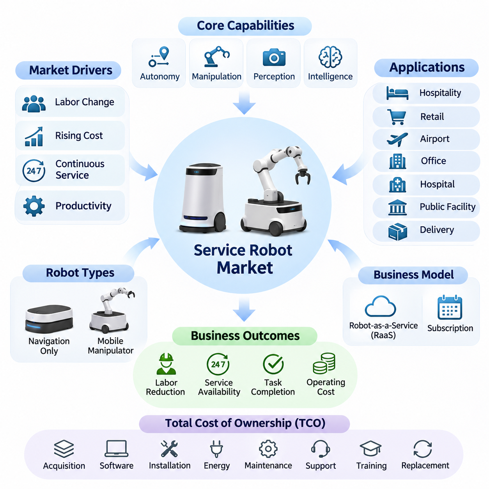
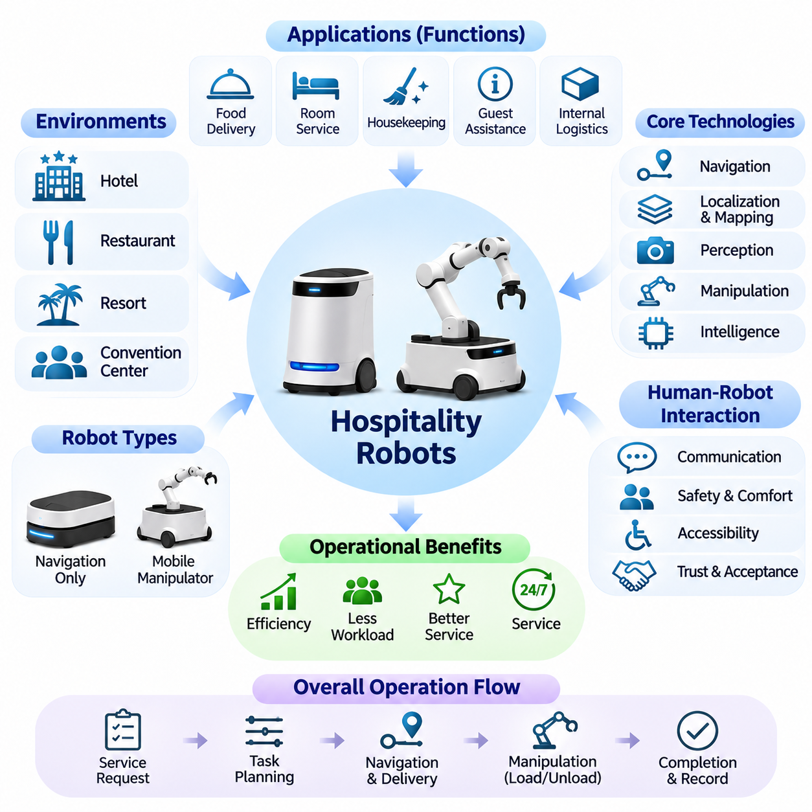
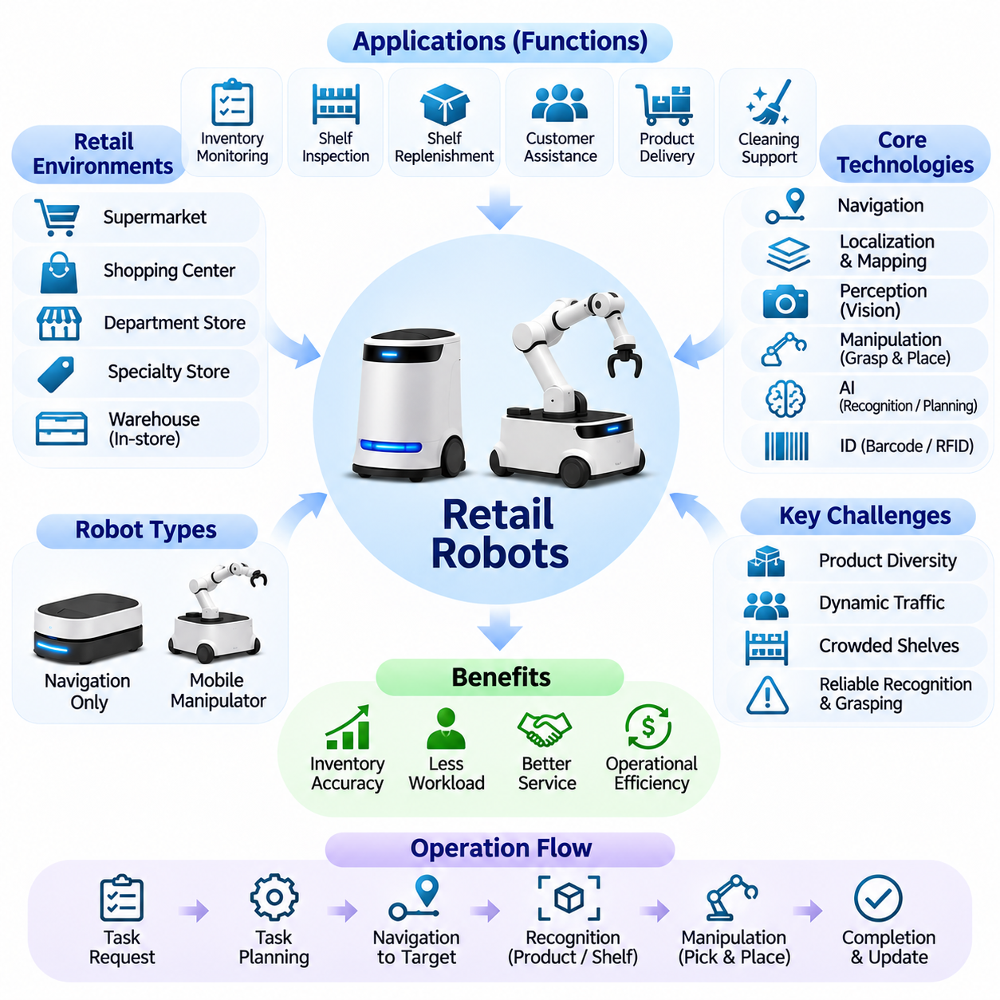
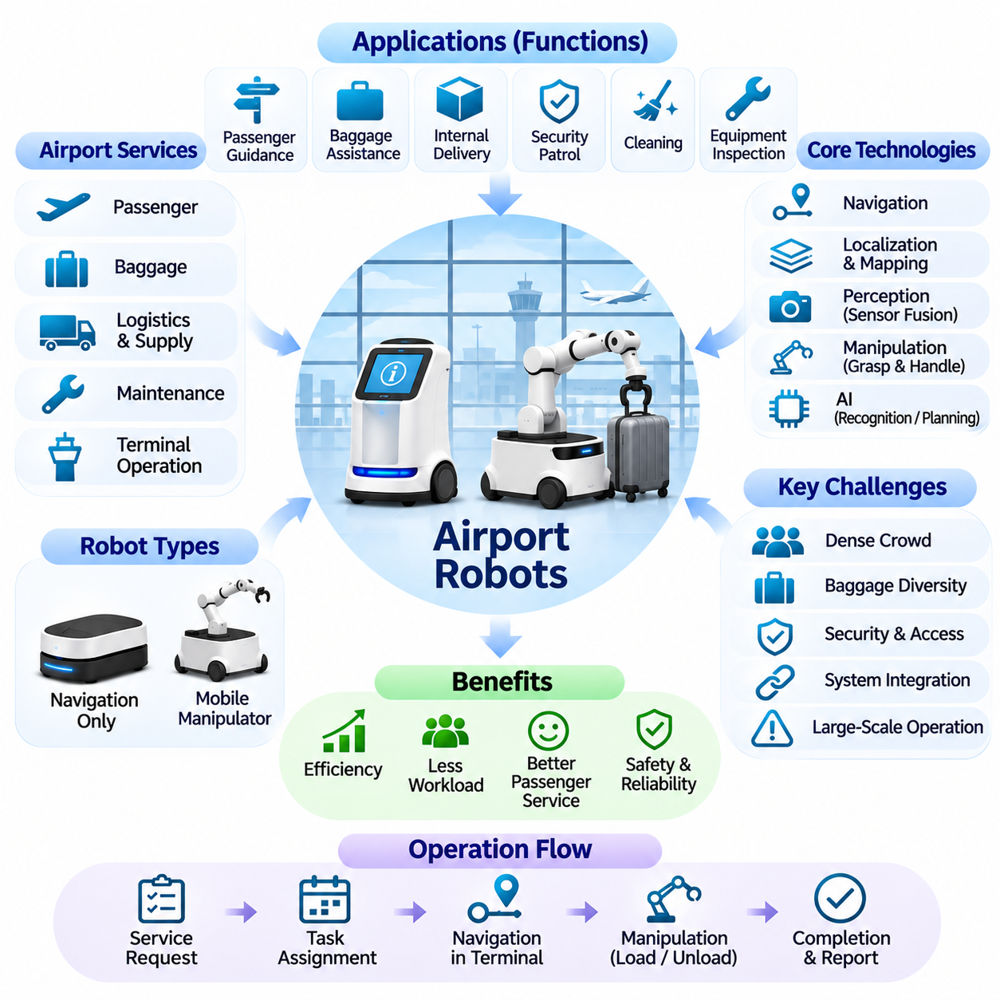
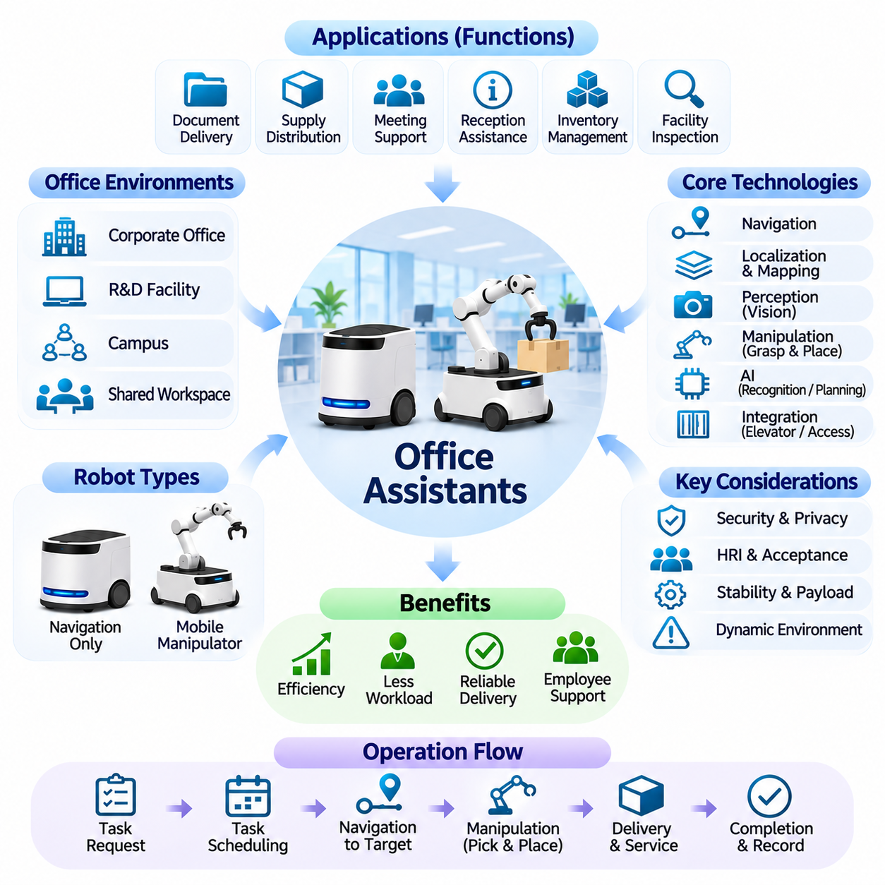
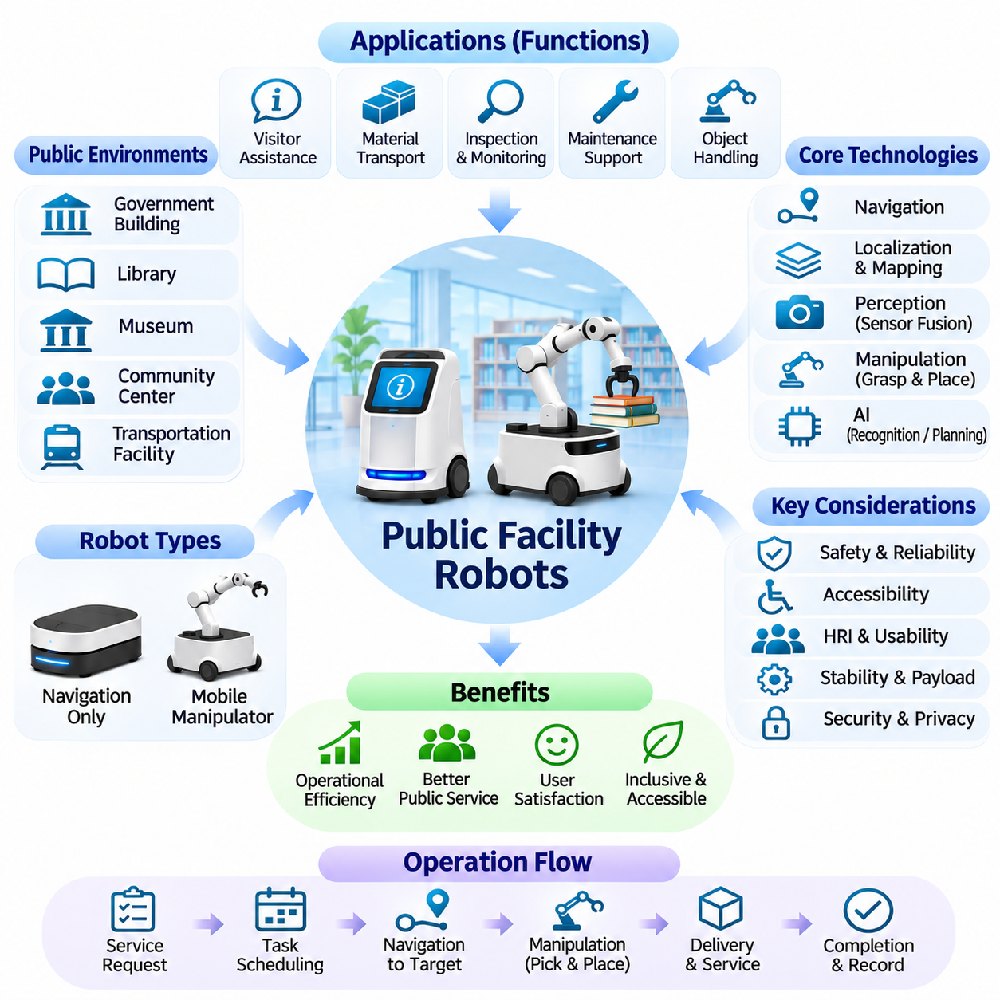
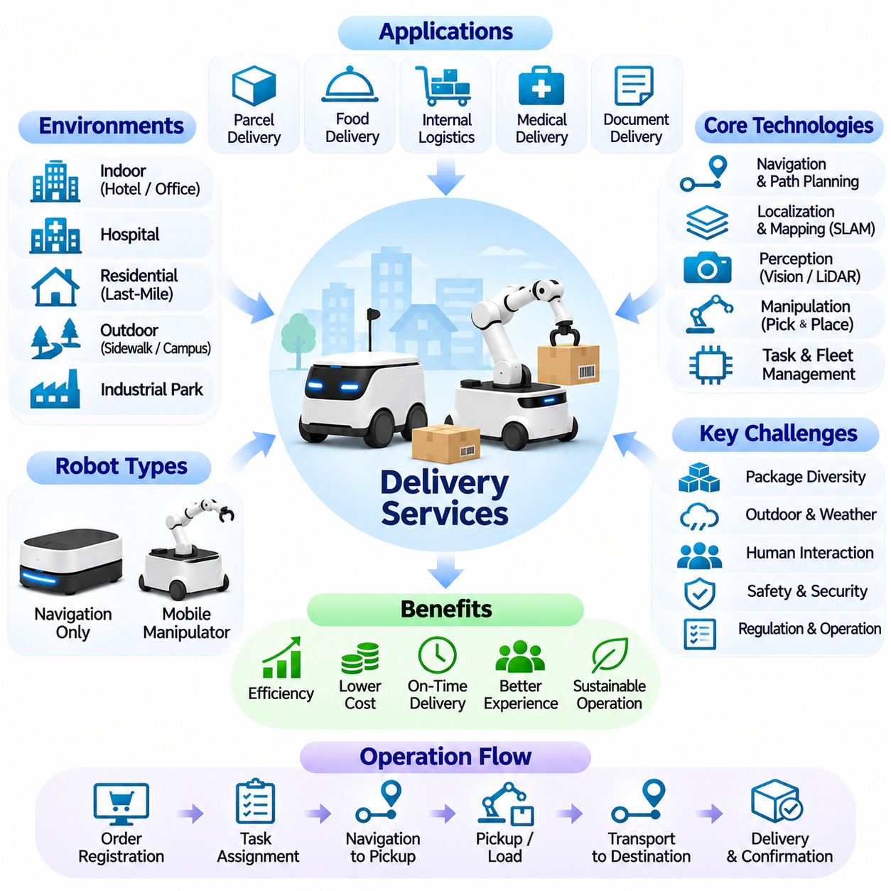
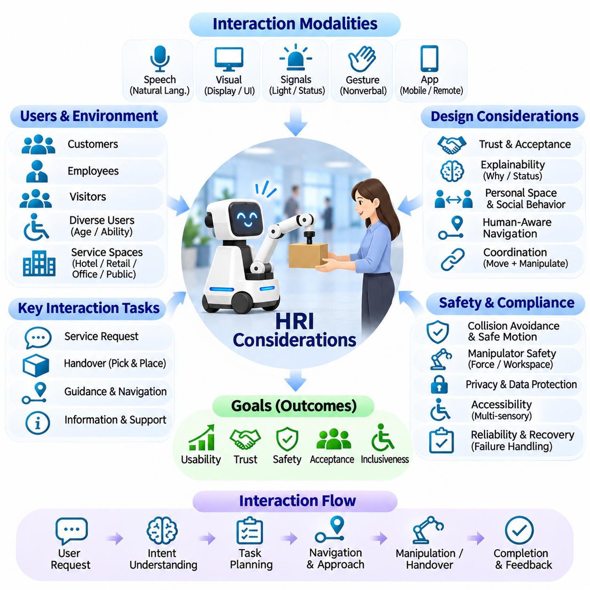
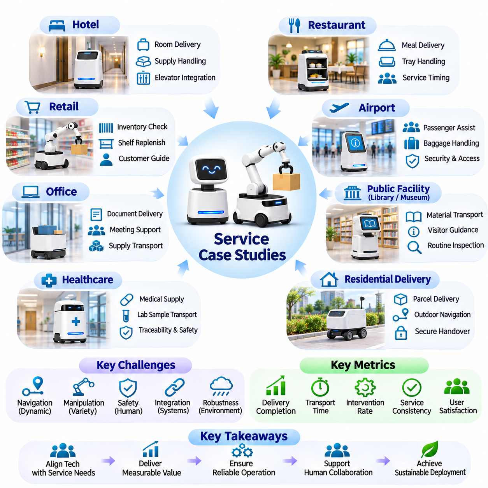

**Volume 01. Mobile Manipulator Foundations and System Architecture**


# Chapter 09. Service Robotics

## 01 Service Robot Market

{width="7.268055555555556in" height="7.268055555555556in"}

The service robot market represents an expanding segment of the robotics industry in which autonomous systems perform practical tasks in environments shared with people. Unlike conventional industrial robots operating within controlled production cells, service robots must navigate dynamic spaces, interact with diverse users, and respond to unpredictable conditions while maintaining operational safety and reliability.

Service robotics encompasses professional and consumer applications, although commercial mobile manipulators primarily target professional services. These systems combine autonomous mobility, robotic manipulation, environmental perception, and intelligent task execution. Their capabilities extend beyond transportation to include object handling, equipment interaction, customer assistance, cleaning support, and automated service delivery.

The development of the service robot market is influenced by labor availability, demographic changes, increasing operational costs, and growing expectations for continuous service. Organizations seek automation technologies that improve productivity without requiring extensive infrastructure modifications. Mobile manipulators address these requirements by performing physical tasks across multiple locations rather than remaining restricted to fixed workstations.

Professional service robotics includes applications in hospitality, retail, airports, offices, hospitals, and public facilities. Each environment introduces different operational requirements, but common objectives include reducing repetitive workloads, improving service consistency, and supporting human employees. Market adoption depends on whether robots can deliver measurable operational value while integrating into existing service workflows.

Hospitality environments provide opportunities for mobile robots to transport meals, collect used items, deliver amenities, and support housekeeping operations. Mobile manipulators can potentially extend these capabilities through autonomous loading, unloading, and object placement. Their economic value depends on task frequency, travel distance, interaction complexity, and the degree of human assistance required during operation.

Retail service robots support inventory inspection, shelf monitoring, customer guidance, and internal material movement. Mobile manipulators offer additional possibilities by retrieving products, organizing merchandise, and transferring goods between storage and display areas. Successful deployment requires reliable object recognition, safe navigation around customers, and compatibility with existing retail management systems.

Airports and transportation terminals represent demanding service environments because of high pedestrian density, complex layouts, and continuous operational activity. Robots may provide passenger assistance, baggage transportation, facility inspection, and logistics support. Mobile manipulation becomes particularly valuable when tasks require physical interaction with luggage, service equipment, or designated storage compartments.

Office environments create demand for autonomous document transportation, supply distribution, meeting-room support, and internal logistics. Mobile manipulators can perform tasks involving both navigation and object handling, reducing dependence on employees for repetitive movements. Their deployment requires integration with elevators, access-control systems, communication networks, and building management infrastructure.

Public facilities such as libraries, museums, government buildings, and exhibition centers provide additional opportunities for service robotics. Robots can assist visitors, transport materials, support maintenance activities, and perform routine inspections. Systems operating in these environments must accommodate diverse human behaviors, accessibility requirements, changing traffic patterns, and potentially limited technical supervision.

Autonomous delivery services constitute another important market segment, covering indoor transportation and selected outdoor operations. Conventional delivery robots primarily move goods between locations, while mobile manipulators can potentially complete additional tasks such as retrieving packages and transferring items to designated surfaces. These capabilities reduce manual handoffs but introduce greater mechanical and control complexity.

The service robot market can be classified according to application, operating environment, autonomy level, and physical interaction capability. Navigation-only robots generally require simpler hardware and control architectures, whereas mobile manipulators integrate robotic arms, end effectors, perception systems, and coordinated motion planning. This distinction strongly influences product pricing, deployment complexity, maintenance requirements, and customer expectations.

Market demand is not determined solely by technological sophistication. Customers typically evaluate robots according to measurable business outcomes, including labor-hour reduction, service availability, task completion rate, and operating cost. A technically advanced robot may fail commercially when its capabilities exceed practical requirements or when operational expenses outweigh the economic benefits of automation.

The total cost of ownership includes initial equipment acquisition, software licensing, installation, infrastructure adaptation, energy consumption, maintenance, and technical support. Additional expenses may arise from operator training, connectivity services, cybersecurity management, and component replacement. Accurate financial evaluation requires consideration of these recurring costs throughout the expected operational lifetime.

Robot-as-a-Service business models can reduce initial investment barriers by providing robotic capabilities through subscription or usage-based agreements. Customers may obtain hardware, software updates, maintenance, and operational support under a unified service contract. Providers must carefully manage equipment utilization, service-level commitments, repair costs, and fleet reliability to maintain sustainable profitability.

Technological progress in artificial intelligence, computer vision, simultaneous localization and mapping, and embedded computing continues to influence service robot capabilities. Improved perception enables robots to recognize objects and understand changing environments, while advanced planning algorithms support more flexible task execution. However, performance improvements must be validated under real operating conditions rather than assumed from laboratory demonstrations.

Mobile manipulators introduce additional opportunities through the integration of autonomous mobile robots and collaborative robotic arms. A mobile platform expands the physical workspace, while the manipulator enables interaction with objects and equipment. Effective coordination between these subsystems requires accurate localization, stable positioning, collision avoidance, and consistent transformation of coordinates between navigation and manipulation systems.

Human-robot interaction is a critical factor affecting commercial acceptance. Service robots frequently operate near customers, employees, visitors, and individuals unfamiliar with robotic systems. Their behavior must remain understandable, predictable, and socially appropriate. Clear communication, intuitive interfaces, safe movement, and effective recovery from unexpected situations contribute directly to user confidence and operational acceptance.

Safety requirements vary according to the robot\'s environment, physical characteristics, and intended tasks. Mobile manipulators introduce risks associated with vehicle motion, arm movement, payload handling, and simultaneous operation of multiple actuators. Appropriate safeguards may include protective sensing, speed limitations, emergency stopping, force monitoring, and risk-based operating restrictions tailored to the deployment environment.

The competitive landscape includes specialized robot manufacturers, autonomous navigation technology providers, robotic arm suppliers, system integrators, and software platform developers. Some companies focus on complete robotic products, while others provide modular hardware or autonomy software. Competitive differentiation increasingly depends on system reliability, application-specific performance, integration capability, and long-term customer support.

Standardization and interoperability can influence the scalability of service robot deployments. Organizations operating multiple robot types benefit from compatible communication interfaces, centralized fleet management, and consistent operational monitoring. Integration with enterprise software, building infrastructure, and cloud services reduces administrative complexity and enables coordinated operation across facilities and service departments.

Deployment environments strongly influence product design decisions. Indoor service robots typically require precise navigation through corridors, doorways, and crowded spaces, while outdoor systems face additional challenges involving weather, uneven terrain, lighting variations, and positioning uncertainty. Mobile manipulators must also maintain sufficient stability and manipulation accuracy despite variations in surface conditions and platform positioning.

The commercial maturity of service robot applications differs significantly across tasks. Repetitive transportation and structured delivery operations are generally easier to automate than unstructured object manipulation. Activities involving deformable objects, cluttered environments, or unpredictable human interaction demand more advanced perception and control. Consequently, market expansion is closely connected to the practical maturity of task-specific autonomy.

Pilot projects play an essential role in evaluating commercial feasibility before large-scale deployment. Initial trials should examine task success rates, intervention frequency, navigation reliability, manipulation accuracy, and user acceptance. Operational data collected during pilots helps organizations identify workflow limitations, estimate maintenance requirements, and determine whether broader deployment can achieve acceptable financial returns.

Service robot performance should be evaluated using application-specific indicators rather than isolated technical specifications. Useful measures include completed tasks per operating hour, autonomous operating time, human intervention rate, service response time, and equipment availability. For mobile manipulators, additional indicators include grasp success, object placement accuracy, recovery performance, and coordinated navigation-manipulation efficiency.

Scalability becomes increasingly important when organizations transition from individual robots to operational fleets. Multi-robot deployment requires task allocation, traffic coordination, charging management, remote monitoring, and maintenance scheduling. Fleet management platforms can improve resource utilization by distributing workloads according to robot availability, location, battery status, and task capability.

Regional market development is affected by labor economics, infrastructure readiness, regulatory frameworks, and customer willingness to adopt automation. Markets with high labor costs or workforce shortages may demonstrate stronger incentives for service robot deployment. Nevertheless, successful commercialization also depends on local technical support, service networks, procurement practices, and compliance with applicable regulations.

The integration of vision-language models, vision-language-action models, and embodied artificial intelligence may gradually expand the range of service tasks that robots can perform. These technologies offer possibilities for interpreting natural-language instructions, recognizing unfamiliar situations, and adapting behavior to changing environments. Their commercial adoption will depend on reliability, computational efficiency, safety assurance, and predictable task execution.

Future service robotics platforms may increasingly adopt modular architectures that support interchangeable manipulators, sensors, batteries, and software capabilities. Modular design allows manufacturers to address multiple applications while reusing common engineering components. However, standardization must be balanced against application-specific requirements involving payload, reach, mobility, environmental protection, and operating endurance.

The long-term development of the service robot market will depend on the transition from isolated automation functions toward integrated physical service systems. Mobile manipulators are positioned to contribute to this transition by combining transportation, perception, decision-making, and physical interaction. Their success will ultimately depend on delivering safe, reliable, economically sustainable services that complement human capabilities.

서비스 로봇 시장(Service Robot Market)은 자율 시스템(Autonomous System)이 사람과 공유하는 환경에서 실질적인 작업을 수행하는 로봇 산업(Robotics Industry)의 성장 분야이다. 통제된 생산 셀(Production Cell) 내부에서 작동하는 기존 산업용 로봇(Industrial Robot)과 달리, 서비스 로봇(Service Robot)은 동적으로 변화하는 공간을 이동하고 다양한 사용자와 상호작용하며 예측하기 어려운 상황에 대응해야 한다. 이러한 과정에서도 운영 안전성(Operational Safety)과 신뢰성(Reliability)을 지속적으로 유지해야 한다.

서비스 로보틱스(Service Robotics)는 전문 서비스(Professional Service)와 소비자 서비스(Consumer Service)를 모두 포함하지만, 상업용 이동형 매니퓰레이터(Mobile Manipulator)는 주로 전문 서비스 분야를 대상으로 한다. 이러한 시스템은 자율 이동(Autonomous Mobility), 로봇 조작(Robotic Manipulation), 환경 인식(Environmental Perception), 지능형 작업 실행(Intelligent Task Execution)을 결합한다. 단순 운송을 넘어 물체 취급, 장비 조작, 고객 지원, 청소 보조, 자동화된 서비스 제공까지 수행할 수 있다.

서비스 로봇 시장의 발전은 노동력 확보 문제(Labor Availability), 인구구조 변화(Demographic Changes), 운영 비용(Operational Cost) 증가, 지속적인 서비스 제공에 대한 기대 수준 향상에 영향을 받는다. 기업과 기관은 대규모 인프라 변경 없이 생산성을 향상할 수 있는 자동화 기술(Automation Technology)을 요구한다. 이동형 매니퓰레이터는 고정된 작업장에 제한되지 않고 여러 위치에서 물리적 작업을 수행함으로써 이러한 요구에 대응할 수 있다.

전문 서비스 로보틱스(Professional Service Robotics)는 호텔 및 숙박업(Hospitality), 소매업(Retail), 공항(Airport), 사무실(Office), 병원(Hospital), 공공시설(Public Facility) 등의 응용 분야를 포함한다. 각 환경은 서로 다른 운영 요구사항(Operational Requirements)을 가지지만, 반복 업무 감소, 서비스 일관성(Service Consistency) 향상, 직원 업무 지원이라는 공통된 목표를 갖는다. 시장 도입 여부는 기존 서비스 업무 흐름(Service Workflow)에 통합되면서 측정 가능한 운영 가치를 제공할 수 있는지에 따라 결정된다.

호텔 및 숙박 환경(Hospitality Environment)은 이동형 로봇(Mobile Robot)이 음식 운반, 사용한 물품 수거, 편의용품 배송, 객실 관리 지원을 수행할 수 있는 기회를 제공한다. 이동형 매니퓰레이터는 자율 적재(Autonomous Loading), 하역(Unloading), 물체 배치(Object Placement) 기능을 통해 이러한 역량을 확장할 수 있다. 경제적 가치는 작업 빈도(Task Frequency), 이동 거리(Travel Distance), 상호작용 복잡도(Interaction Complexity), 운영 중 필요한 사람의 지원 수준에 따라 달라진다.

소매 서비스 로봇(Retail Service Robot)은 재고 검사(Inventory Inspection), 진열대 모니터링(Shelf Monitoring), 고객 안내(Customer Guidance), 내부 물류 이동(Internal Material Movement)을 지원한다. 이동형 매니퓰레이터는 상품 인출(Product Retrieval), 상품 정리(Merchandise Organization), 보관 구역과 진열 구역 사이의 물품 이송 기능을 추가할 수 있다. 성공적인 도입을 위해서는 신뢰성 높은 물체 인식(Object Recognition), 고객 주변의 안전한 자율주행(Safe Navigation), 기존 소매 관리 시스템(Retail Management System)과의 호환성이 필요하다.

공항(Airport)과 교통 터미널(Transportation Terminal)은 높은 보행자 밀도(Pedestrian Density), 복잡한 공간 구조(Complex Layout), 연속적인 운영 활동으로 인해 까다로운 서비스 환경을 형성한다. 로봇은 승객 안내(Passenger Assistance), 수하물 운송(Baggage Transportation), 시설 점검(Facility Inspection), 물류 지원(Logistics Support)을 수행할 수 있다. 이동 조작(Mobile Manipulation)은 수하물, 서비스 장비, 지정된 보관 공간과 물리적으로 상호작용해야 하는 작업에서 특히 높은 가치를 제공한다.

사무실 환경(Office Environment)은 문서 운송(Document Transportation), 비품 배포(Supply Distribution), 회의실 지원(Meeting Room Support), 내부 물류(Internal Logistics)에 대한 자율화 수요를 창출한다. 이동형 매니퓰레이터는 이동과 물체 취급을 동시에 요구하는 작업을 수행하여 직원의 반복적인 이동 업무를 줄일 수 있다. 실제 도입에는 엘리베이터(Elevator), 출입 통제 시스템(Access Control System), 통신 네트워크(Communication Network), 건물 관리 인프라(Building Management Infrastructure)와의 통합이 필요하다.

도서관(Library), 박물관(Museum), 정부 청사(Government Building), 전시센터(Exhibition Center)와 같은 공공시설(Public Facility)에서도 서비스 로보틱스의 활용 기회가 확대되고 있다. 로봇은 방문객 안내(Visitor Assistance), 물품 운송(Material Transportation), 유지보수 지원(Maintenance Support), 정기 점검(Routine Inspection)을 수행할 수 있다. 이러한 환경에서 작동하는 시스템은 다양한 인간 행동(Human Behavior), 접근성 요구사항(Accessibility Requirements), 변화하는 이동 패턴(Traffic Pattern), 제한적인 기술 감독 조건에 대응해야 한다.

자율 배송 서비스(Autonomous Delivery Service)는 실내 운송(Indoor Transportation)과 일부 실외 운영(Outdoor Operation)을 포함하는 중요한 시장 분야이다. 기존 배송 로봇(Delivery Robot)은 주로 물품을 목적지까지 운송하지만, 이동형 매니퓰레이터는 물품 인출(Package Retrieval)과 지정된 위치로의 물체 전달(Object Transfer)까지 수행할 가능성이 있다. 이러한 기능은 사람의 직접적인 인계 작업(Manual Handoff)을 줄이지만 기계적 구조(Mechanical Structure)와 제어 시스템(Control System)의 복잡성을 증가시킨다.

서비스 로봇 시장은 응용 분야(Application), 운영 환경(Operating Environment), 자율성 수준(Autonomy Level), 물리적 상호작용 능력(Physical Interaction Capability)에 따라 분류할 수 있다. 이동 기능만 제공하는 로봇(Navigation-Only Robot)은 상대적으로 단순한 하드웨어(Hardware)와 제어 아키텍처(Control Architecture)를 사용한다. 반면 이동형 매니퓰레이터는 로봇 팔(Robot Arm), 말단장치(End Effector), 인식 시스템(Perception System), 협조 동작 계획(Coordinated Motion Planning)을 통합하므로 제품 가격, 도입 복잡도, 유지보수 요구사항에 큰 차이가 발생한다.

시장 수요(Market Demand)는 기술적 정교함(Technological Sophistication)만으로 결정되지 않는다. 고객은 일반적으로 노동시간 절감(Labor-Hour Reduction), 서비스 가용성(Service Availability), 작업 완료율(Task Completion Rate), 운영 비용(Operating Cost)과 같은 측정 가능한 사업 성과(Business Outcome)를 기준으로 로봇을 평가한다. 기술적으로 우수한 로봇이라도 실제 요구사항보다 기능이 과도하거나 운영 비용이 자동화의 경제적 이익을 초과하면 상업적으로 성공하기 어렵다.

총소유비용(Total Cost of Ownership, TCO)은 초기 장비 구매비(Equipment Acquisition Cost), 소프트웨어 라이선스(Software License), 설치(Installation), 인프라 변경(Infrastructure Adaptation), 에너지 소비(Energy Consumption), 유지보수(Maintenance), 기술 지원(Technical Support)을 포함한다. 운영자 교육(Operator Training), 연결 서비스(Connectivity Service), 사이버보안 관리(Cybersecurity Management), 부품 교체(Component Replacement)에서도 추가 비용이 발생할 수 있다. 정확한 재무 평가(Financial Evaluation)를 위해서는 예상 운영 수명(Operational Lifetime) 전체에 걸친 반복 비용을 고려해야 한다.

서비스형 로봇(Robot-as-a-Service, RaaS) 사업 모델(Business Model)은 구독형 계약(Subscription Agreement) 또는 사용량 기반 계약(Usage-Based Agreement)을 통해 초기 투자 장벽(Initial Investment Barrier)을 낮출 수 있다. 고객은 단일 서비스 계약(Service Contract)으로 하드웨어, 소프트웨어 업데이트(Software Update), 유지보수, 운영 지원을 제공받을 수 있다. 공급업체는 지속 가능한 수익성(Profitability)을 유지하기 위해 장비 활용률(Equipment Utilization), 서비스 수준 약정(Service-Level Agreement), 수리 비용(Repair Cost), 로봇 군집 신뢰성(Fleet Reliability)을 관리해야 한다.

인공지능(Artificial Intelligence, AI), 컴퓨터 비전(Computer Vision), 동시적 위치추정 및 지도작성(Simultaneous Localization and Mapping, SLAM), 임베디드 컴퓨팅(Embedded Computing)의 기술 발전은 서비스 로봇의 기능에 지속적으로 영향을 미친다. 향상된 환경 인식(Environmental Perception)은 물체 식별과 변화하는 주변 환경의 이해를 가능하게 하며, 고급 계획 알고리즘(Advanced Planning Algorithm)은 더욱 유연한 작업 실행을 지원한다. 그러나 이러한 성능 향상은 실험실 시연이 아니라 실제 운영 조건에서 검증되어야 한다.

이동형 매니퓰레이터는 자율이동로봇(Autonomous Mobile Robot, AMR)과 협동 로봇 팔(Collaborative Robot Arm)의 통합을 통해 새로운 활용 가능성을 제공한다. 이동 플랫폼(Mobile Platform)은 물리적 작업 공간(Physical Workspace)을 확장하고, 매니퓰레이터(Manipulator)는 물체와 장비에 대한 직접적인 상호작용을 가능하게 한다. 두 하위 시스템(Subsystem)의 효과적인 협조를 위해서는 정확한 위치추정(Localization), 안정적인 위치 정렬(Positioning), 충돌 회피(Collision Avoidance), 이동과 조작 사이의 일관된 좌표 변환(Coordinate Transformation)이 필요하다.

인간-로봇 상호작용(Human-Robot Interaction, HRI)은 상업적 수용성(Commercial Acceptance)에 영향을 미치는 핵심 요소이다. 서비스 로봇은 고객, 직원, 방문객, 로봇 시스템에 익숙하지 않은 사람들과 가까운 거리에서 작동하는 경우가 많다. 따라서 로봇의 행동은 이해하기 쉽고 예측 가능하며 사회적으로 적절해야 한다. 명확한 의사소통(Clear Communication), 직관적인 사용자 인터페이스(Intuitive User Interface), 안전한 이동(Safe Movement), 예기치 않은 상황에서의 효과적인 복구(Recovery)는 사용자 신뢰(User Confidence)와 운영 수용성을 높인다.

안전 요구사항(Safety Requirements)은 로봇의 운영 환경, 물리적 특성(Physical Characteristics), 수행 작업(Intended Task)에 따라 달라진다. 이동형 매니퓰레이터는 차량 이동(Vehicle Motion), 로봇 팔 동작(Arm Movement), 적재물 취급(Payload Handling), 여러 구동기(Actuator)의 동시 작동과 관련된 위험을 포함한다. 적절한 보호 조치(Safeguard)에는 보호 감지(Protective Sensing), 속도 제한(Speed Limitation), 비상정지(Emergency Stop), 힘 감시(Force Monitoring), 위험도 기반 운영 제한(Risk-Based Operating Restriction)이 포함될 수 있다.

서비스 로봇 시장의 경쟁 구도(Competitive Landscape)에는 전문 로봇 제조업체(Robot Manufacturer), 자율주행 기술 공급업체(Autonomous Navigation Provider), 로봇 팔 공급업체(Robotic Arm Supplier), 시스템 통합업체(System Integrator), 소프트웨어 플랫폼 개발업체(Software Platform Developer)가 포함된다. 일부 기업은 완성형 로봇 제품(Complete Robotic Product)에 집중하고, 다른 기업은 모듈형 하드웨어(Modular Hardware) 또는 자율화 소프트웨어(Autonomy Software)를 제공한다. 경쟁 차별화(Competitive Differentiation)는 시스템 신뢰성, 응용 분야별 성능, 통합 능력, 장기 고객 지원 역량에 점차 의존하고 있다.

표준화(Standardization)와 상호운용성(Interoperability)은 서비스 로봇 도입의 확장성(Scalability)에 영향을 미친다. 여러 종류의 로봇을 운영하는 조직은 호환 가능한 통신 인터페이스(Communication Interface), 중앙집중식 군집 관리(Centralized Fleet Management), 일관된 운영 모니터링(Operational Monitoring)을 통해 이점을 얻는다. 기업용 소프트웨어(Enterprise Software), 건물 인프라(Building Infrastructure), 클라우드 서비스(Cloud Service)와의 통합은 관리 복잡도를 줄이고 시설과 서비스 부서 간 협조 운영을 가능하게 한다.

도입 환경(Deployment Environment)은 제품 설계(Product Design)에 직접적인 영향을 미친다. 실내 서비스 로봇(Indoor Service Robot)은 복도, 출입문, 혼잡한 공간에서 정밀한 자율주행(Precise Navigation)이 필요하다. 실외 시스템(Outdoor System)은 날씨(Weather), 불규칙한 지형(Uneven Terrain), 조명 변화(Lighting Variation), 위치추정 불확실성(Localization Uncertainty)에 추가로 대응해야 한다. 이동형 매니퓰레이터는 지면 상태와 플랫폼 위치가 변하더라도 충분한 안정성(Stability)과 조작 정확도(Manipulation Accuracy)를 유지해야 한다.

서비스 로봇 응용 분야의 상업적 성숙도(Commercial Maturity)는 작업 유형에 따라 상당한 차이가 있다. 반복적인 운송(Repetitive Transportation)과 구조화된 배송 작업(Structured Delivery Operation)은 비정형 물체 조작(Unstructured Object Manipulation)보다 일반적으로 자동화하기 쉽다. 변형 가능한 물체(Deformable Object), 복잡하게 배치된 환경(Cluttered Environment), 예측하기 어려운 인간 상호작용은 더욱 발전된 인식 및 제어 기술을 요구한다. 따라서 시장 확대는 작업별 자율화 기술(Task-Specific Autonomy)의 실질적인 성숙도와 밀접하게 연결된다.

시범사업(Pilot Project)은 대규모 도입(Large-Scale Deployment) 이전에 상업적 실현 가능성(Commercial Feasibility)을 평가하는 중요한 과정이다. 초기 실증(Initial Trial)에서는 작업 성공률(Task Success Rate), 개입 빈도(Intervention Frequency), 주행 신뢰성(Navigation Reliability), 조작 정확도(Manipulation Accuracy), 사용자 수용성(User Acceptance)을 검토해야 한다. 시범 운영에서 수집한 운영 데이터(Operational Data)는 업무 흐름의 한계를 파악하고 유지보수 요구사항을 추정하며 확대 도입의 재무적 타당성을 판단하는 데 활용된다.

서비스 로봇 성능(Service Robot Performance)은 개별 기술 사양(Technical Specification)보다 응용 분야별 성과지표(Application-Specific Performance Indicator)를 중심으로 평가해야 한다. 주요 지표에는 시간당 완료 작업 수(Completed Tasks per Operating Hour), 자율 운영 시간(Autonomous Operating Time), 사람의 개입률(Human Intervention Rate), 서비스 응답 시간(Service Response Time), 장비 가용성(Equipment Availability)이 포함된다. 이동형 매니퓰레이터에는 파지 성공률(Grasp Success Rate), 물체 배치 정확도(Object Placement Accuracy), 복구 성능(Recovery Performance), 이동-조작 협조 효율(Coordinated Navigation-Manipulation Efficiency)도 중요하다.

확장성(Scalability)은 조직이 단일 로봇 운영에서 다수 로봇 운영으로 전환할 때 더욱 중요해진다. 다중 로봇 도입(Multi-Robot Deployment)에는 작업 할당(Task Allocation), 교통 조정(Traffic Coordination), 충전 관리(Charging Management), 원격 모니터링(Remote Monitoring), 유지보수 일정 관리(Maintenance Scheduling)가 필요하다. 군집 관리 플랫폼(Fleet Management Platform)은 로봇의 가용성(Availability), 위치(Location), 배터리 상태(Battery Status), 작업 수행 능력(Task Capability)에 따라 업무를 분배함으로써 자원 활용률(Resource Utilization)을 향상할 수 있다.

지역별 시장 발전(Regional Market Development)은 노동 경제성(Labor Economics), 인프라 준비도(Infrastructure Readiness), 규제 체계(Regulatory Framework), 고객의 자동화 수용 의지(Customer Willingness to Adopt Automation)에 영향을 받는다. 인건비가 높거나 노동력 부족이 심각한 시장에서는 서비스 로봇 도입에 대한 경제적 유인이 더 강하게 나타날 수 있다. 그러나 성공적인 상용화(Commercialization)를 위해서는 현지 기술 지원(Local Technical Support), 서비스 네트워크(Service Network), 조달 관행(Procurement Practice), 관련 규제 준수(Regulatory Compliance)도 중요하다.

비전-언어 모델(Vision-Language Model, VLM), 비전-언어-행동 모델(Vision-Language-Action Model, VLA), 체화 인공지능(Embodied Artificial Intelligence)의 통합은 서비스 로봇이 수행할 수 있는 작업 범위를 점진적으로 확장할 수 있다. 이러한 기술은 자연어 명령(Natural-Language Instruction)의 해석, 익숙하지 않은 상황의 인식, 변화하는 환경에 대한 행동 적응(Behavior Adaptation)을 가능하게 할 잠재력이 있다. 상업적 도입은 신뢰성, 계산 효율(Computational Efficiency), 안전성 보증(Safety Assurance), 예측 가능한 작업 실행(Predictable Task Execution)에 따라 결정될 것이다.

미래의 서비스 로보틱스 플랫폼(Service Robotics Platform)은 교체 가능한 매니퓰레이터(Interchangeable Manipulator), 센서(Sensor), 배터리(Battery), 소프트웨어 기능(Software Capability)을 지원하는 모듈형 아키텍처(Modular Architecture)를 점차 채택할 수 있다. 모듈형 설계(Modular Design)는 제조업체가 공통 엔지니어링 구성요소(Common Engineering Component)를 재사용하면서 다양한 응용 분야에 대응하도록 지원한다. 다만 표준화는 적재하중(Payload), 작업 도달거리(Reach), 이동성(Mobility), 환경 보호(Environmental Protection), 운영 지속시간(Operating Endurance)과 같은 응용 분야별 요구사항과 균형을 이루어야 한다.

서비스 로봇 시장의 장기적인 발전은 개별 자동화 기능(Isolated Automation Function)에서 통합된 물리적 서비스 시스템(Integrated Physical Service System)으로의 전환에 달려 있다. 이동형 매니퓰레이터는 운송(Transportation), 환경 인식(Perception), 의사결정(Decision-Making), 물리적 상호작용(Physical Interaction)을 결합함으로써 이러한 전환에 기여할 수 있다. 궁극적인 성공 여부는 인간의 능력을 보완하면서 안전하고 신뢰할 수 있으며 경제적으로 지속 가능한 서비스(Economically Sustainable Service)를 제공할 수 있는지에 따라 결정될 것이다.

## 02 Hospitality Robots

{width="7.268055555555556in" height="7.268055555555556in"}

Hospitality robots are autonomous service systems designed to support operations in hotels, restaurants, resorts, convention centers, and other guest-oriented environments. Their primary purpose is to improve service efficiency, reduce repetitive workloads, and enhance customer experiences. Unlike industrial robots, hospitality robots operate in shared spaces where human behavior, environmental conditions, and service demands change continuously.

The hospitality industry presents significant opportunities for robotic automation because many operational activities involve repetitive transportation, material handling, and routine assistance. Employees frequently move supplies, deliver meals, collect used items, and respond to guest requests. Autonomous mobile robots can reduce these repetitive activities, allowing human staff to concentrate on personalized services and complex customer interactions.

Hospitality robots can be classified according to their primary functions, including food delivery, room service, housekeeping support, guest assistance, and internal logistics. Some systems provide navigation and transportation capabilities, while advanced mobile manipulators combine autonomous movement with robotic arms. This integration enables robots to perform physical interactions that conventional delivery platforms cannot accomplish independently.

Restaurant delivery robots transport prepared meals from kitchen areas to designated tables or service stations. These systems typically use autonomous navigation, obstacle detection, localization, and route planning to move safely through crowded environments. Their operational effectiveness depends on accurate destination identification, stable payload transportation, efficient traffic management, and predictable interactions with customers and employees.

Mobile manipulators can extend restaurant automation beyond simple transportation by incorporating object grasping, tray handling, and automated placement capabilities. A robotic arm mounted on a mobile platform may retrieve prepared items, position dishes on accessible surfaces, or collect selected objects. However, reliable manipulation requires accurate perception, appropriate grippers, controlled forces, and careful consideration of food safety.

Hotel room service represents another important application of hospitality robotics. Autonomous robots can transport towels, beverages, toiletries, and other guest amenities from storage locations to individual rooms. Integration with elevators, automatic doors, and hotel management systems allows robots to navigate between floors and coordinate deliveries. Secure compartments and authentication mechanisms help protect guest belongings and delivery contents.

Advanced hotel service robots may incorporate robotic manipulators to support automated loading and unloading operations. Instead of relying entirely on employees to place items into delivery compartments, a mobile manipulator can potentially retrieve standardized packages from designated storage locations. Such systems require consistent object presentation, reliable grasp planning, accurate positioning, and effective recovery procedures when manipulation fails.

Housekeeping operations involve substantial physical movement and repetitive handling of supplies, linens, and cleaning equipment. Hospitality robots can transport housekeeping carts, deliver replacement materials, and collect designated items from service areas. Mobile manipulators may eventually assist with handling towels, arranging supplies, and transferring laundry containers, although deformable materials and cluttered environments remain technically challenging.

Guest assistance robots provide information, directions, and basic communication services in hotel lobbies, reception areas, and entertainment facilities. These systems may combine speech recognition, natural language processing, visual perception, and interactive displays. Their effectiveness depends on clear communication, multilingual support, accurate information retrieval, and the ability to recognize situations requiring intervention by human personnel.

Human-robot interaction is particularly important in hospitality environments because customer satisfaction depends on comfort, trust, and service quality. Robots must communicate their intentions through understandable movements, visual indicators, and appropriate audio messages. Navigation behavior should remain predictable, especially near children, elderly guests, and individuals with limited mobility. Effective interaction design reduces confusion and improves acceptance.

Autonomous navigation in hospitality facilities requires continuous adaptation to changing pedestrian traffic, furniture arrangements, temporary obstacles, and service activities. Robots commonly combine LiDAR, cameras, proximity sensors, and localization algorithms to estimate their surroundings. Navigation systems must identify safe paths while avoiding collisions and unnecessary interruptions, particularly in narrow corridors and crowded restaurant spaces.

Simultaneous localization and mapping enables robots to construct or maintain environmental representations while estimating their positions. In hospitality applications, maps may include guest rooms, service stations, elevators, restricted areas, and designated delivery locations. Reliable localization is essential because navigation errors can interrupt service, delay deliveries, or create unsafe situations near guests and employees.

Mobile manipulation introduces additional coordination requirements between the mobile platform and robotic arm. Before grasping or placing objects, the robot must establish a stable operating position and determine the relationship between its base, manipulator, and target object. Coordinated control prevents unexpected movements and maintains balance during manipulation, particularly when handling objects with varying weights or dimensions.

Payload capacity and mechanical stability influence the design of hospitality mobile manipulators. The system must accommodate the combined mass of its robotic arm, end effector, transported materials, batteries, and supporting hardware. Designers must evaluate center-of-gravity changes, acceleration limits, wheel traction, and potential tipping conditions when the manipulator extends beyond the mobile platform.

Power management is another critical consideration because hospitality robots may operate continuously throughout extended service periods. Battery capacity must support navigation, onboard computing, communication, sensing, and manipulation activities. Automatic charging stations can reduce manual intervention, while intelligent scheduling allows robots to recharge during periods of lower demand without disrupting essential service operations.

Hospitality robots often require integration with existing digital infrastructure, including property management systems, restaurant ordering platforms, elevator controllers, and building access systems. Application programming interfaces enable task requests, delivery confirmations, and operational monitoring. Secure communication and appropriate access permissions are essential because robots may interact with guest information and restricted facility resources.

Fleet management becomes important when multiple robots operate within the same hotel or restaurant. A centralized system can assign delivery tasks, monitor battery levels, coordinate traffic, and optimize resource utilization. Task allocation algorithms may consider robot location, payload capacity, estimated travel time, and service priority to distribute workloads efficiently across the available fleet.

Safety architecture must address both autonomous movement and physical manipulation. Protective sensing, speed control, emergency stopping, and collision avoidance reduce risks associated with navigation. Manipulator safety additionally requires force limitation, workspace monitoring, and appropriate handling of unexpected contact. Risk assessment should consider guests who may approach robots unpredictably or attempt to interact with moving components.

Operational reliability strongly influences commercial success because service interruptions can directly affect customer satisfaction. Robots must handle navigation failures, blocked routes, communication interruptions, and unsuccessful deliveries without creating additional operational burdens. Recovery mechanisms may include automatic replanning, controlled retries, remote operator assistance, and safe transitions to predefined standby locations.

The economic value of hospitality robotics depends on measurable improvements in operational productivity and service consistency. Relevant indicators include completed deliveries per hour, average response time, autonomous task completion rate, employee intervention frequency, and robot availability. Financial evaluation should also consider equipment acquisition, maintenance, software subscriptions, infrastructure integration, and technical support expenses.

Robot-as-a-Service models can make hospitality automation accessible to organizations seeking predictable operating expenses instead of substantial initial capital investment. Subscription agreements may combine hardware deployment, software maintenance, fleet monitoring, and technical assistance. Providers must ensure that service pricing reflects equipment utilization, maintenance requirements, customer support obligations, and expected operational lifetime.

The adoption of hospitality robots also requires organizational preparation and employee participation. Staff members need training in task assignment, basic troubleshooting, safe interaction, and operational supervision. Successful implementation typically involves redesigning selected workflows rather than simply replacing human activities with robotic movements. Clear responsibilities and escalation procedures improve cooperation between employees and automated systems.

Artificial intelligence can improve hospitality robot adaptability through object recognition, semantic navigation, natural language understanding, and task planning. Vision-language models may help robots interpret service requests and identify relevant objects or locations. However, generative reasoning must remain connected to verified environmental information and constrained execution policies to prevent unreliable or unsafe physical actions.

Future hospitality robots may combine advanced manipulation, multimodal perception, and embodied artificial intelligence to perform increasingly complex service activities. Potential capabilities include flexible object retrieval, autonomous preparation of standardized service materials, and coordinated interaction with building infrastructure. Their practical deployment will depend on improvements in manipulation reliability, safety validation, affordability, and maintenance efficiency.

Hospitality robotics demonstrates how mobile manipulation can transform service operations from simple autonomous transportation toward integrated physical assistance. The most successful systems will balance technical capabilities with operational simplicity, safety, and customer expectations. Rather than eliminating human hospitality, these technologies can support employees by automating repetitive tasks while preserving human attention for personalized and relationship-oriented services.

접객 서비스 로봇(Hospitality Robot)은 호텔(Hotel), 레스토랑(Restaurant), 리조트(Resort), 컨벤션 센터(Convention Center) 및 기타 고객 중심 환경에서 운영을 지원하도록 설계된 자율 서비스 시스템(Autonomous Service System)이다. 주요 목적은 서비스 효율성(Service Efficiency)을 향상하고 반복적인 업무 부담을 줄이며 고객 경험(Customer Experience)을 개선하는 것이다. 산업용 로봇(Industrial Robot)과 달리 접객 서비스 로봇은 인간의 행동, 환경 조건, 서비스 수요가 지속적으로 변화하는 공유 공간(Shared Space)에서 작동한다.

접객 산업(Hospitality Industry)은 많은 운영 활동이 반복적인 운송(Transportation), 물품 취급(Material Handling), 일상적인 지원 업무(Routine Assistance)로 구성되어 있어 로봇 자동화(Robotic Automation)에 상당한 기회를 제공한다. 직원들은 비품을 이동하고, 음식을 배달하며, 사용한 물품을 수거하고, 고객 요청에 대응하는 업무를 반복적으로 수행한다. 자율이동로봇(Autonomous Mobile Robot, AMR)은 이러한 반복 작업을 줄여 직원들이 개인화된 서비스(Personalized Service)와 복잡한 고객 상호작용(Customer Interaction)에 집중하도록 지원한다.

접객 서비스 로봇은 음식 배달(Food Delivery), 객실 서비스(Room Service), 객실 관리 지원(Housekeeping Support), 고객 안내(Guest Assistance), 내부 물류(Internal Logistics)와 같은 주요 기능에 따라 분류할 수 있다. 일부 시스템은 자율주행(Autonomous Navigation)과 운송 기능을 제공하지만, 고급 이동형 매니퓰레이터(Mobile Manipulator)는 자율 이동(Autonomous Mobility)과 로봇 팔(Robot Arm)을 결합한다. 이러한 통합은 기존 배송 플랫폼(Delivery Platform)이 독립적으로 수행하기 어려운 물리적 상호작용(Physical Interaction)을 가능하게 한다.

레스토랑 배송 로봇(Restaurant Delivery Robot)은 주방에서 준비된 음식을 지정된 테이블이나 서비스 구역으로 운송한다. 이러한 시스템은 일반적으로 자율주행(Autonomous Navigation), 장애물 감지(Obstacle Detection), 위치추정(Localization), 경로 계획(Route Planning)을 활용하여 혼잡한 환경에서도 안전하게 이동한다. 운영 효율성(Operational Effectiveness)은 정확한 목적지 식별(Destination Identification), 안정적인 적재물 운송(Payload Transportation), 효율적인 교통 관리(Traffic Management), 고객 및 직원과의 예측 가능한 상호작용에 따라 달라진다.

이동형 매니퓰레이터(Mobile Manipulator)는 물체 파지(Object Grasping), 트레이 취급(Tray Handling), 자동 배치(Automated Placement) 기능을 통합하여 레스토랑 자동화를 단순 운송 이상으로 확장할 수 있다. 이동 플랫폼(Mobile Platform)에 장착된 로봇 팔은 준비된 물품을 집어 들고 접근 가능한 표면에 접시를 배치하거나 지정된 물체를 수거할 수 있다. 그러나 신뢰성 높은 조작(Reliable Manipulation)을 위해서는 정확한 인식(Perception), 적절한 그리퍼(Gripper), 제어된 힘(Controlled Force), 식품 안전(Food Safety)에 대한 세심한 고려가 필요하다.

호텔 객실 서비스(Hotel Room Service)는 접객 서비스 로보틱스(Hospitality Robotics)의 또 다른 중요한 응용 분야이다. 자율 로봇(Autonomous Robot)은 수건, 음료, 세면도구 및 기타 고객 편의용품(Guest Amenities)을 보관 장소에서 개별 객실까지 운송할 수 있다. 엘리베이터(Elevator), 자동문(Automatic Door), 호텔 관리 시스템(Hotel Management System)과의 통합을 통해 층간 이동과 배송 조정이 가능하다. 보안 수납함(Secure Compartment)과 인증 메커니즘(Authentication Mechanism)은 고객의 소지품과 배송 물품을 보호하는 데 기여한다.

고급 호텔 서비스 로봇(Advanced Hotel Service Robot)은 자동 적재 및 하역(Automated Loading and Unloading)을 지원하기 위해 로봇 매니퓰레이터(Robotic Manipulator)를 통합할 수 있다. 직원이 배송 수납함에 모든 물품을 직접 넣는 대신, 이동형 매니퓰레이터가 지정된 보관 장소에서 표준화된 포장 물품(Standardized Package)을 자율적으로 인출할 수 있다. 이러한 시스템에는 일관된 물체 배치(Object Presentation), 신뢰성 높은 파지 계획(Grasp Planning), 정확한 위치 정렬(Positioning), 조작 실패 시 효과적인 복구 절차(Recovery Procedure)가 필요하다.

객실 관리 업무(Housekeeping Operation)는 비품, 침구류(Linen), 청소 장비(Cleaning Equipment)의 이동과 반복적인 취급을 많이 포함한다. 접객 서비스 로봇은 객실 관리 카트(Housekeeping Cart)를 운송하고, 교체용 물품을 전달하며, 지정된 서비스 구역에서 물품을 수거할 수 있다. 이동형 매니퓰레이터는 향후 수건 취급(Towel Handling), 비품 정리(Supply Arrangement), 세탁물 용기 이송(Laundry Container Transfer)을 지원할 수 있지만, 변형 가능한 물체(Deformable Object)와 복잡한 환경(Cluttered Environment)은 여전히 기술적으로 어려운 과제이다.

고객 안내 로봇(Guest Assistance Robot)은 호텔 로비(Hotel Lobby), 접수 구역(Reception Area), 엔터테인먼트 시설(Entertainment Facility)에서 정보 제공, 길 안내, 기본적인 의사소통 서비스를 수행한다. 이러한 시스템은 음성 인식(Speech Recognition), 자연어 처리(Natural Language Processing), 시각 인식(Visual Perception), 대화형 디스플레이(Interactive Display)를 결합할 수 있다. 효과적인 운영을 위해서는 명확한 의사소통(Clear Communication), 다국어 지원(Multilingual Support), 정확한 정보 검색(Information Retrieval), 직원의 개입이 필요한 상황을 인식하는 능력이 중요하다.

인간-로봇 상호작용(Human-Robot Interaction, HRI)은 고객 만족도(Customer Satisfaction)가 편안함, 신뢰, 서비스 품질(Service Quality)에 영향을 받는 접객 환경에서 특히 중요하다. 로봇은 이해하기 쉬운 움직임, 시각적 표시(Visual Indicator), 적절한 음성 메시지(Audio Message)를 통해 자신의 의도를 전달해야 한다. 특히 어린이, 고령자, 이동 능력이 제한된 사람 주변에서는 주행 행동(Navigation Behavior)이 예측 가능해야 한다. 효과적인 상호작용 설계(Interaction Design)는 혼란을 줄이고 사용자 수용성(User Acceptance)을 향상한다.

접객 시설에서의 자율주행(Autonomous Navigation)은 변화하는 보행자 이동(Pedestrian Traffic), 가구 배치(Furniture Arrangement), 임시 장애물(Temporary Obstacle), 서비스 활동(Service Activity)에 지속적으로 적응해야 한다. 로봇은 일반적으로 라이다(LiDAR), 카메라(Camera), 근접 센서(Proximity Sensor), 위치추정 알고리즘(Localization Algorithm)을 결합하여 주변 환경을 추정한다. 주행 시스템(Navigation System)은 특히 좁은 복도와 혼잡한 레스토랑 공간에서 충돌과 불필요한 운행 중단을 방지하면서 안전한 경로(Safe Path)를 식별해야 한다.

동시적 위치추정 및 지도작성(Simultaneous Localization and Mapping, SLAM)은 로봇이 자신의 위치를 추정하면서 환경 지도(Environmental Map)를 생성하거나 유지하도록 지원한다. 접객 서비스 응용 분야에서 지도에는 객실(Guest Room), 서비스 구역(Service Station), 엘리베이터(Elevator), 제한 구역(Restricted Area), 지정된 배송 위치(Delivery Location)가 포함될 수 있다. 신뢰성 높은 위치추정(Reliable Localization)은 필수적이며, 주행 오류(Navigation Error)는 서비스 중단, 배송 지연, 고객 및 직원 주변의 위험한 상황을 초래할 수 있다.

이동 조작(Mobile Manipulation)은 이동 플랫폼(Mobile Platform)과 로봇 팔(Robotic Arm) 사이에 추가적인 협조 제어(Coordinated Control)를 요구한다. 물체를 파지하거나 배치하기 전에 로봇은 안정적인 작업 위치(Operating Position)를 확보하고 로봇 베이스(Robot Base), 매니퓰레이터(Manipulator), 목표 물체(Target Object) 사이의 관계를 결정해야 한다. 협조 제어는 예상하지 못한 움직임을 방지하고 조작 중 균형(Balance)을 유지하며, 특히 무게나 크기가 서로 다른 물체를 취급할 때 중요하다.

적재하중(Payload Capacity)과 기계적 안정성(Mechanical Stability)은 접객 서비스용 이동형 매니퓰레이터의 설계에 영향을 미친다. 시스템은 로봇 팔(Robot Arm), 말단장치(End Effector), 운송 물품(Transported Material), 배터리(Battery), 지원 하드웨어(Supporting Hardware)의 총질량을 수용할 수 있어야 한다. 설계자는 매니퓰레이터가 이동 플랫폼 외부로 확장될 때 발생하는 무게중심 변화(Center-of-Gravity Change), 가속도 제한(Acceleration Limit), 바퀴 접지력(Wheel Traction), 전복 가능성(Tipping Condition)을 평가해야 한다.

전력 관리(Power Management)는 접객 서비스 로봇이 장시간 서비스 운영 기간 동안 지속적으로 작동할 수 있다는 점에서 중요한 고려사항이다. 배터리 용량(Battery Capacity)은 자율주행, 온보드 컴퓨팅(Onboard Computing), 통신(Communication), 센싱(Sensing), 조작(Manipulation)에 필요한 전력을 지원해야 한다. 자동 충전 스테이션(Automatic Charging Station)은 수동 개입을 줄이고, 지능형 일정 관리(Intelligent Scheduling)는 필수 서비스 운영을 방해하지 않으면서 수요가 낮은 시간에 로봇이 충전하도록 지원한다.

접객 서비스 로봇은 자산 관리 시스템(Property Management System, PMS), 레스토랑 주문 플랫폼(Restaurant Ordering Platform), 엘리베이터 제어기(Elevator Controller), 건물 출입 통제 시스템(Building Access System) 등 기존 디지털 인프라(Digital Infrastructure)와의 통합이 필요한 경우가 많다. 응용 프로그램 인터페이스(Application Programming Interface, API)는 작업 요청(Task Request), 배송 확인(Delivery Confirmation), 운영 모니터링(Operational Monitoring)을 가능하게 한다. 로봇이 고객 정보(Guest Information)와 시설 내 제한 자원(Restricted Facility Resource)에 접근할 수 있으므로 보안 통신(Secure Communication)과 적절한 접근 권한(Access Permission)이 필수적이다.

동일한 호텔이나 레스토랑에서 여러 로봇이 작동할 때는 군집 관리(Fleet Management)가 중요해진다. 중앙집중식 시스템(Centralized System)은 배송 작업을 할당하고, 배터리 수준(Battery Level)을 모니터링하며, 교통 흐름(Traffic Flow)을 조정하고, 자원 활용률(Resource Utilization)을 최적화할 수 있다. 작업 할당 알고리즘(Task Allocation Algorithm)은 로봇 위치(Robot Location), 적재하중(Payload Capacity), 예상 이동 시간(Estimated Travel Time), 서비스 우선순위(Service Priority)를 고려하여 가용한 로봇 군집(Robot Fleet)에 업무를 효율적으로 분배할 수 있다.

안전 아키텍처(Safety Architecture)는 자율 이동(Autonomous Movement)과 물리적 조작(Physical Manipulation)을 모두 고려해야 한다. 보호 감지(Protective Sensing), 속도 제어(Speed Control), 비상정지(Emergency Stop), 충돌 회피(Collision Avoidance)는 자율주행과 관련된 위험을 줄인다. 매니퓰레이터 안전(Manipulator Safety)을 위해서는 힘 제한(Force Limitation), 작업 공간 감시(Workspace Monitoring), 예상하지 못한 접촉(Unexpected Contact)에 대한 적절한 대응이 추가로 필요하다. 위험성 평가(Risk Assessment)에서는 로봇에 갑자기 접근하거나 움직이는 구성요소와 상호작용하려는 고객의 행동도 고려해야 한다.

운영 신뢰성(Operational Reliability)은 서비스 중단이 고객 만족도에 직접적인 영향을 줄 수 있기 때문에 상업적 성공에 중요한 요소이다. 로봇은 주행 실패(Navigation Failure), 경로 차단(Blocked Route), 통신 중단(Communication Interruption), 배송 실패(Unsuccessful Delivery)를 추가적인 운영 부담 없이 처리할 수 있어야 한다. 복구 메커니즘(Recovery Mechanism)에는 자동 재계획(Automatic Replanning), 제어된 재시도(Controlled Retry), 원격 운영자 지원(Remote Operator Assistance), 사전에 정의된 대기 위치(Standby Location)로의 안전한 전환이 포함될 수 있다.

접객 서비스 로보틱스의 경제적 가치(Economic Value)는 운영 생산성(Operational Productivity)과 서비스 일관성(Service Consistency)의 측정 가능한 개선에 따라 결정된다. 관련 성과지표(Performance Indicator)에는 시간당 완료 배송 건수(Completed Deliveries per Hour), 평균 응답 시간(Average Response Time), 자율 작업 완료율(Autonomous Task Completion Rate), 직원 개입 빈도(Employee Intervention Frequency), 로봇 가용성(Robot Availability)이 포함된다. 재무 평가(Financial Evaluation)에서는 장비 구매비, 유지보수 비용, 소프트웨어 구독료(Software Subscription), 인프라 통합 비용(Infrastructure Integration Cost), 기술 지원 비용도 고려해야 한다.

서비스형 로봇(Robot-as-a-Service, RaaS) 모델은 대규모 초기 자본 투자(Initial Capital Investment) 대신 예측 가능한 운영 비용(Predictable Operating Expense)을 원하는 조직이 접객 서비스 자동화를 도입하도록 지원할 수 있다. 구독 계약(Subscription Agreement)에는 하드웨어 배치(Hardware Deployment), 소프트웨어 유지보수(Software Maintenance), 군집 모니터링(Fleet Monitoring), 기술 지원(Technical Assistance)이 포함될 수 있다. 공급업체는 서비스 가격(Service Pricing)이 장비 활용률, 유지보수 요구사항, 고객 지원 의무(Customer Support Obligation), 예상 운영 수명(Operational Lifetime)을 반영하도록 관리해야 한다.

접객 서비스 로봇의 도입에는 조직적 준비(Organizational Preparation)와 직원 참여(Employee Participation)도 필요하다. 직원은 작업 할당(Task Assignment), 기본적인 문제 해결(Basic Troubleshooting), 안전한 상호작용(Safe Interaction), 운영 감독(Operational Supervision)에 관한 교육을 받아야 한다. 성공적인 구현(Implementation)은 일반적으로 인간의 활동을 로봇 동작으로 단순히 대체하는 것이 아니라 선택된 업무 흐름(Workflow)을 재설계하는 과정을 포함한다. 명확한 책임 분담(Responsibility Assignment)과 문제 대응 절차(Escalation Procedure)는 직원과 자동화 시스템 사이의 협력을 향상한다.

인공지능(Artificial Intelligence, AI)은 물체 인식(Object Recognition), 의미 기반 자율주행(Semantic Navigation), 자연어 이해(Natural Language Understanding), 작업 계획(Task Planning)을 통해 접객 서비스 로봇의 적응성(Adaptability)을 향상할 수 있다. 비전-언어 모델(Vision-Language Model, VLM)은 로봇이 서비스 요청(Service Request)을 해석하고 관련 물체나 위치를 식별하도록 지원할 수 있다. 그러나 생성형 추론(Generative Reasoning)은 신뢰할 수 없거나 위험한 물리적 행동을 방지하기 위해 검증된 환경 정보(Verified Environmental Information)와 제약된 실행 정책(Constrained Execution Policy)에 연결되어야 한다.

미래의 접객 서비스 로봇(Future Hospitality Robot)은 고급 조작(Advanced Manipulation), 다중모달 인식(Multimodal Perception), 체화 인공지능(Embodied Artificial Intelligence)을 결합하여 점점 더 복잡한 서비스 활동을 수행할 수 있다. 잠재적인 기능에는 유연한 물체 인출(Flexible Object Retrieval), 표준화된 서비스 물품의 자율 준비(Autonomous Preparation), 건물 인프라와의 협조 상호작용(Coordinated Interaction)이 포함된다. 실제 도입 여부는 조작 신뢰성(Manipulation Reliability), 안전성 검증(Safety Validation), 경제성(Affordability), 유지보수 효율성(Maintenance Efficiency)의 향상에 따라 달라질 것이다.

접객 서비스 로보틱스(Hospitality Robotics)는 이동 조작(Mobile Manipulation)이 단순한 자율 운송(Autonomous Transportation)에서 통합된 물리적 지원(Integrated Physical Assistance)으로 서비스 운영을 변화시킬 수 있음을 보여준다. 성공적인 시스템은 기술적 기능(Technical Capability)과 운영 단순성(Operational Simplicity), 안전성(Safety), 고객 기대(Customer Expectation) 사이의 균형을 유지해야 한다. 이러한 기술은 인간 중심의 접객 서비스(Human Hospitality)를 제거하기보다 반복적인 작업을 자동화하여 직원들이 개인화된 서비스(Personalized Service)와 관계 중심 서비스(Relationship-Oriented Service)에 집중하도록 지원할 수 있다.

## 03 Retail Robots

{width="7.268055555555556in" height="7.268055555555556in"}

Retail robots are autonomous systems designed to support operational activities in supermarkets, shopping centers, department stores, and specialized retail environments. Their primary objectives include improving inventory accuracy, reducing repetitive workloads, and enhancing customer service. Unlike industrial robots, retail robots operate in dynamic environments where customers, employees, merchandise, and temporary obstacles continuously influence robotic behavior.

Retail operations involve frequent product transportation, inventory inspection, shelf replenishment, and customer assistance. These activities require substantial employee time, particularly in large stores containing thousands of products. Autonomous mobile robots can automate selected repetitive tasks, while mobile manipulators extend these capabilities by physically interacting with merchandise, storage containers, shelves, and retail equipment.

Retail robots can be categorized according to their operational functions, including inventory monitoring, shelf inspection, customer guidance, product delivery, cleaning support, and automated merchandise handling. Navigation-only robots primarily perform transportation and sensing tasks. Mobile manipulators integrate robotic arms and end effectors, enabling additional operations such as product retrieval, shelf placement, and automated transfer between storage and display locations.

Inventory monitoring represents an important application because accurate stock information directly influences sales performance and supply chain efficiency. Mobile robots equipped with cameras, barcode readers, and RFID sensors can inspect shelves and identify discrepancies between physical inventory and digital records. Automated inspection reduces manual counting requirements and supports more frequent inventory updates without significantly interrupting normal store operations.

Shelf inspection robots analyze product availability, placement accuracy, pricing labels, and promotional displays. Computer vision algorithms can identify empty shelf locations, misplaced merchandise, and inconsistencies between displayed prices and inventory databases. Reliable operation requires accurate visual recognition under varying illumination, reflective packaging, partial occlusion, and densely arranged products commonly encountered in retail environments.

Mobile manipulators can potentially extend shelf inspection into automated replenishment by retrieving products from nearby storage locations and placing them on designated shelves. This capability requires coordinated navigation, object detection, grasp planning, and precise arm positioning. Product diversity introduces significant challenges because packaging dimensions, surface materials, weight distributions, and grasping requirements vary considerably across merchandise categories.

Automated shelf replenishment becomes more practical when products are presented in standardized containers or organized storage structures. Robots can identify target products, approach accessible shelf positions, and execute controlled placement operations. However, manipulation performance may decline when shelves are crowded, products are deformable, or customer activity restricts access to the intended workspace.

Customer assistance robots provide store navigation, product information, promotional guidance, and basic shopping support. These systems may combine speech recognition, natural language processing, interactive displays, and indoor localization. Effective customer interaction requires accurate information retrieval, multilingual communication, and clear procedures for transferring complex requests to human employees when automated assistance is insufficient.

Retail delivery robots transport merchandise between storage areas, service counters, and designated collection points. Their operations can reduce employee walking distances and improve internal material flow. Integration with order management systems allows delivery tasks to be generated automatically, while navigation software coordinates movement through aisles, corridors, and shared customer spaces.

Mobile manipulators introduce opportunities for automated order fulfillment within retail facilities. A robot may navigate to product locations, identify requested merchandise, retrieve accessible items, and transport them to packaging or collection stations. Such workflows combine perception, navigation, manipulation, and task planning, requiring reliable coordination between the mobile platform and robotic arm throughout the entire operation.

Retail environments present complex navigation challenges because pedestrian traffic and merchandise arrangements change frequently. Shopping carts, temporary displays, cleaning equipment, and customers may obstruct planned routes. Autonomous navigation systems must continuously update obstacle information and select safe alternative paths while maintaining predictable movement patterns that minimize disruption to normal shopping activities.

Simultaneous localization and mapping enables retail robots to maintain spatial representations of store layouts while estimating their positions. Maps may contain aisles, shelves, storage rooms, checkout counters, restricted areas, and service stations. Accurate localization supports both navigation and manipulation because robots must approach target shelves with sufficient positioning precision to perform reliable object interactions.

Visual perception is particularly important in retail robotics because products frequently have similar shapes, colors, and packaging designs. Object detection and classification models must distinguish merchandise despite changes in lighting, viewing angle, and shelf arrangement. Combining RGB cameras, depth sensors, barcode information, and inventory databases can improve identification reliability and reduce incorrect product selection.

Grasp planning presents additional technical challenges because retail merchandise includes rigid boxes, cylindrical containers, flexible packages, bottles, and irregularly shaped objects. Different products may require suction grippers, parallel-jaw grippers, or adaptive end effectors. Reliable manipulation requires estimating object geometry, selecting stable grasp points, controlling contact forces, and avoiding damage to products or surrounding merchandise.

The mechanical architecture of retail mobile manipulators must balance compact dimensions, payload capacity, reach, and stability. Narrow store aisles favor small mobile platforms, while high shelves require extended manipulation workspaces. Designers must evaluate center-of-gravity changes, arm extension limits, wheel traction, and tipping risks to ensure safe operation during product retrieval and placement.

Human-robot interaction is a central consideration because retail robots operate near customers who may behave unpredictably. Robots must communicate their intentions through understandable movements, visual signals, and appropriate audio messages. Safe operating behavior includes maintaining suitable separation distances, yielding to pedestrians, limiting speed in crowded areas, and responding appropriately when customers approach moving manipulators.

Retail robot safety architecture must address both mobile navigation and physical manipulation. Protective sensors, emergency stopping, collision avoidance, and controlled motion limits reduce operational risks. Manipulators additionally require workspace monitoring, force limitation, and safe recovery procedures. Risk assessment should consider falling merchandise, unstable loads, unexpected human contact, and interactions with shelves or display structures.

Integration with retail information systems is essential for transforming isolated robotic functions into coordinated business operations. Robots may exchange information with inventory management systems, warehouse management platforms, point-of-sale systems, and enterprise resource planning software. Application programming interfaces support task assignment, stock verification, product location updates, and operational reporting across connected systems.

Fleet management platforms coordinate multiple retail robots by distributing tasks according to location, availability, battery status, and operational priority. Centralized monitoring can reduce traffic conflicts and improve resource utilization. Intelligent scheduling may assign inventory inspection during low-traffic periods while prioritizing urgent product transportation or replenishment activities during normal store operations.

Battery capacity and energy management influence the practical operating duration of retail robots. Power consumption depends on navigation distance, onboard computing, sensing equipment, communication systems, and manipulator activity. Automatic charging stations and task-aware scheduling help maintain service availability while minimizing manual intervention and unnecessary interruptions to store operations.

Operational performance should be measured using indicators directly connected to retail productivity. Relevant metrics include inventory inspection coverage, stock identification accuracy, completed replenishment tasks, order fulfillment time, autonomous task success rate, and employee intervention frequency. For mobile manipulators, grasp success rate, placement accuracy, product damage rate, and recovery time provide additional measures of system effectiveness.

The economic feasibility of retail robotics depends on equipment costs, operational savings, maintenance requirements, and measurable service improvements. Total cost of ownership includes hardware acquisition, software licensing, infrastructure integration, technical support, and periodic component replacement. Return on investment should be evaluated against realistic task volumes, labor requirements, utilization rates, and expected equipment lifetime.

Robot-as-a-Service models can reduce adoption barriers by offering retail automation through subscription-based agreements. These arrangements may include robotic hardware, software updates, maintenance, remote monitoring, and operational support. Service providers must maintain reliable performance and predictable operating expenses, while retailers evaluate whether recurring subscription costs are justified by productivity improvements.

Artificial intelligence can expand retail robot capabilities through semantic scene understanding, product recognition, task planning, and adaptive manipulation. Vision-language models may enable robots to interpret product descriptions and connect natural-language requests with visual observations. However, physical actions must remain constrained by verified object identities, environmental conditions, and safety policies to prevent incorrect or unsafe manipulation.

Future retail robots may combine multimodal perception, advanced grasping, and embodied artificial intelligence to handle increasingly diverse merchandise and operational tasks. Potential developments include flexible shelf replenishment, autonomous item retrieval, and coordinated operation with human employees. Commercial success will depend on achieving sufficient reliability, affordability, safety, and maintainability under realistic retail conditions.

Retail robotics illustrates the transition from autonomous monitoring and transportation toward integrated mobile manipulation. By combining mobility, perception, decision-making, and physical interaction, retail robots can support inventory management, merchandise handling, and customer services within a unified operational framework. Their long-term value will depend on improving store efficiency while preserving safe, accessible, and customer-friendly shopping environments.

소매 서비스 로봇(Retail Robot)은 슈퍼마켓(Supermarket), 쇼핑센터(Shopping Center), 백화점(Department Store), 전문 소매점(Specialized Retail Environment)에서 운영 활동을 지원하도록 설계된 자율 시스템(Autonomous System)이다. 주요 목적은 재고 정확도(Inventory Accuracy)를 향상하고 반복적인 업무 부담을 줄이며 고객 서비스(Customer Service)를 개선하는 것이다. 산업용 로봇(Industrial Robot)과 달리 소매 서비스 로봇은 고객, 직원, 상품, 임시 장애물이 지속적으로 로봇의 행동에 영향을 미치는 동적 환경(Dynamic Environment)에서 작동한다.

소매 운영(Retail Operation)에는 빈번한 상품 운송(Product Transportation), 재고 검사(Inventory Inspection), 진열대 보충(Shelf Replenishment), 고객 지원(Customer Assistance)이 포함된다. 이러한 활동은 특히 수천 종류의 상품을 취급하는 대형 매장에서 상당한 직원 근무 시간을 요구한다. 자율이동로봇(Autonomous Mobile Robot, AMR)은 일부 반복 작업을 자동화할 수 있으며, 이동형 매니퓰레이터(Mobile Manipulator)는 상품, 보관 용기(Storage Container), 진열대(Shelf), 소매 장비(Retail Equipment)와 직접 물리적으로 상호작용함으로써 기능을 확장한다.

소매 서비스 로봇은 재고 모니터링(Inventory Monitoring), 진열대 검사(Shelf Inspection), 고객 안내(Customer Guidance), 상품 배송(Product Delivery), 청소 지원(Cleaning Support), 자동 상품 취급(Automated Merchandise Handling) 등 운영 기능에 따라 분류할 수 있다. 이동 전용 로봇(Navigation-Only Robot)은 주로 운송과 센싱(Sensing) 작업을 수행한다. 이동형 매니퓰레이터는 로봇 팔(Robotic Arm)과 말단장치(End Effector)를 통합하여 상품 인출(Product Retrieval), 진열대 배치(Shelf Placement), 보관 장소와 진열 장소 사이의 자동 이송(Automated Transfer)을 수행할 수 있다.

재고 모니터링(Inventory Monitoring)은 정확한 재고 정보(Stock Information)가 판매 성과(Sales Performance)와 공급망 효율성(Supply Chain Efficiency)에 직접적인 영향을 미치기 때문에 중요한 응용 분야이다. 카메라(Camera), 바코드 판독기(Barcode Reader), 무선주파수 식별 센서(Radio Frequency Identification Sensor, RFID Sensor)를 장착한 이동 로봇(Mobile Robot)은 진열대를 검사하고 실제 재고(Physical Inventory)와 디지털 기록(Digital Record) 사이의 불일치를 식별할 수 있다. 자동 검사는 수동 재고 조사(Manual Counting)의 필요성을 줄이고 정상적인 매장 운영을 크게 방해하지 않으면서 더욱 빈번한 재고 갱신(Inventory Update)을 지원한다.

진열대 검사 로봇(Shelf Inspection Robot)은 상품 가용성(Product Availability), 배치 정확도(Placement Accuracy), 가격표(Pricing Label), 판촉 진열물(Promotional Display)을 분석한다. 컴퓨터 비전 알고리즘(Computer Vision Algorithm)은 비어 있는 진열 공간(Empty Shelf Location), 잘못 배치된 상품(Misplaced Merchandise), 표시 가격과 재고 데이터베이스(Inventory Database) 사이의 불일치를 식별할 수 있다. 신뢰성 높은 작동을 위해서는 변화하는 조명(Illumination), 반사성 포장재(Reflective Packaging), 부분 가림(Partial Occlusion), 밀집된 상품 배치(Dense Product Arrangement)에서도 정확한 시각 인식(Visual Recognition)이 필요하다.

이동형 매니퓰레이터는 인근 보관 장소에서 상품을 인출하고 지정된 진열대에 배치함으로써 진열대 검사를 자동 보충(Automated Replenishment)으로 확장할 수 있다. 이러한 기능에는 협조 자율주행(Coordinated Navigation), 물체 검출(Object Detection), 파지 계획(Grasp Planning), 정밀한 로봇 팔 위치 제어(Precise Arm Positioning)가 필요하다. 상품의 다양성(Product Diversity)은 포장 크기(Packaging Dimension), 표면 재질(Surface Material), 무게 분포(Weight Distribution), 파지 요구사항(Grasping Requirement)이 상품 종류에 따라 크게 달라지므로 상당한 기술적 과제를 발생시킨다.

자동 진열대 보충(Automated Shelf Replenishment)은 상품이 표준화된 용기(Standardized Container)나 체계적인 보관 구조(Organized Storage Structure)에 배치되어 있을 때 더욱 실용적이다. 로봇은 목표 상품(Target Product)을 식별하고 접근 가능한 진열 위치에 이동한 다음 제어된 배치 작업(Controlled Placement Operation)을 수행할 수 있다. 그러나 진열대가 혼잡하거나 상품이 변형 가능하거나 고객 활동으로 인해 작업 공간(Workspace)에 접근하기 어려운 경우 조작 성능(Manipulation Performance)이 저하될 수 있다.

고객 지원 로봇(Customer Assistance Robot)은 매장 길 안내(Store Navigation), 상품 정보(Product Information), 판촉 안내(Promotional Guidance), 기본적인 쇼핑 지원(Shopping Support)을 제공한다. 이러한 시스템은 음성 인식(Speech Recognition), 자연어 처리(Natural Language Processing), 대화형 디스플레이(Interactive Display), 실내 위치추정(Indoor Localization)을 결합할 수 있다. 효과적인 고객 상호작용(Customer Interaction)을 위해서는 정확한 정보 검색(Information Retrieval), 다국어 의사소통(Multilingual Communication), 자동화된 지원만으로 해결하기 어려운 복잡한 요청을 직원에게 전달하는 명확한 절차가 필요하다.

소매 배송 로봇(Retail Delivery Robot)은 보관 구역(Storage Area), 서비스 카운터(Service Counter), 지정된 수령 장소(Collection Point) 사이에서 상품을 운송한다. 이러한 운영은 직원의 이동 거리(Employee Walking Distance)를 줄이고 내부 물류 흐름(Internal Material Flow)을 개선할 수 있다. 주문 관리 시스템(Order Management System)과 통합하면 배송 작업(Delivery Task)을 자동으로 생성할 수 있으며, 자율주행 소프트웨어(Navigation Software)는 통로(Aisle), 복도(Corridor), 고객과 공유하는 공간(Shared Customer Space)에서의 이동을 조정한다.

이동형 매니퓰레이터는 소매 시설 내부의 자동 주문 이행(Automated Order Fulfillment)을 위한 새로운 기회를 제공한다. 로봇은 상품 위치(Product Location)로 이동하여 요청된 상품을 식별하고 접근 가능한 물품을 인출한 다음 포장 구역(Packaging Station)이나 수령 장소(Collection Station)로 운송할 수 있다. 이러한 작업 흐름(Workflow)은 인식(Perception), 자율주행(Navigation), 조작(Manipulation), 작업 계획(Task Planning)을 결합하며, 전체 운영 과정에서 이동 플랫폼(Mobile Platform)과 로봇 팔(Robotic Arm) 사이의 신뢰성 높은 협조가 필요하다.

소매 환경(Retail Environment)은 보행자 이동(Pedestrian Traffic)과 상품 배치(Merchandise Arrangement)가 빈번하게 변화하기 때문에 복잡한 자율주행 과제(Navigation Challenge)를 제시한다. 쇼핑 카트(Shopping Cart), 임시 진열대(Temporary Display), 청소 장비(Cleaning Equipment), 고객은 계획된 경로(Planned Route)를 방해할 수 있다. 자율주행 시스템(Autonomous Navigation System)은 장애물 정보(Obstacle Information)를 지속적으로 갱신하고 안전한 대체 경로(Alternative Path)를 선택하면서 정상적인 쇼핑 활동을 최소한으로 방해하는 예측 가능한 이동 패턴(Movement Pattern)을 유지해야 한다.

동시적 위치추정 및 지도작성(Simultaneous Localization and Mapping, SLAM)은 소매 로봇이 자신의 위치를 추정하면서 매장 구조(Store Layout)의 공간 표현(Spatial Representation)을 유지하도록 지원한다. 지도(Map)에는 통로(Aisle), 진열대(Shelf), 창고(Storage Room), 계산대(Checkout Counter), 제한 구역(Restricted Area), 서비스 구역(Service Station)이 포함될 수 있다. 정확한 위치추정(Accurate Localization)은 자율주행과 조작 모두를 지원하며, 로봇이 목표 진열대에 충분한 위치 정밀도(Positioning Precision)로 접근해야 신뢰성 높은 물체 상호작용(Object Interaction)을 수행할 수 있다.

시각 인식(Visual Perception)은 상품의 형태(Shape), 색상(Color), 포장 디자인(Packaging Design)이 유사한 경우가 많기 때문에 소매 로보틱스(Retail Robotics)에서 특히 중요하다. 물체 검출 및 분류 모델(Object Detection and Classification Model)은 조명, 관찰 각도(Viewing Angle), 진열대 배치(Shelf Arrangement)가 변화하더라도 상품을 구별해야 한다. RGB 카메라(RGB Camera), 깊이 센서(Depth Sensor), 바코드 정보(Barcode Information), 재고 데이터베이스(Inventory Database)를 결합하면 식별 신뢰성(Identification Reliability)을 높이고 잘못된 상품 선택(Incorrect Product Selection)을 줄일 수 있다.

파지 계획(Grasp Planning)은 소매 상품에 단단한 상자(Rigid Box), 원통형 용기(Cylindrical Container), 유연한 포장재(Flexible Package), 병(Bottle), 불규칙한 형상의 물체(Irregularly Shaped Object)가 포함되기 때문에 추가적인 기술적 과제를 제시한다. 상품에 따라 흡착 그리퍼(Suction Gripper), 평행 조 그리퍼(Parallel-Jaw Gripper), 적응형 말단장치(Adaptive End Effector)가 필요할 수 있다. 신뢰성 높은 조작(Reliable Manipulation)을 위해서는 물체 형상(Object Geometry)을 추정하고 안정적인 파지점(Stable Grasp Point)을 선택하며 접촉력(Contact Force)을 제어하여 상품과 주변 물품의 손상을 방지해야 한다.

소매용 이동형 매니퓰레이터의 기계 아키텍처(Mechanical Architecture)는 소형 크기(Compact Dimension), 적재하중(Payload Capacity), 작업 도달거리(Reach), 안정성(Stability) 사이의 균형을 유지해야 한다. 좁은 매장 통로(Narrow Store Aisle)는 작은 이동 플랫폼을 요구하지만 높은 진열대(High Shelf)는 확장된 조작 작업 공간(Manipulation Workspace)을 필요로 한다. 설계자는 상품 인출과 배치 중 안전한 작동을 보장하기 위해 무게중심 변화(Center-of-Gravity Change), 로봇 팔 확장 한계(Arm Extension Limit), 바퀴 접지력(Wheel Traction), 전복 위험(Tipping Risk)을 평가해야 한다.

인간-로봇 상호작용(Human-Robot Interaction, HRI)은 예측하기 어려운 행동을 보일 수 있는 고객 가까이에서 소매 로봇이 작동하므로 핵심적인 고려사항이다. 로봇은 이해하기 쉬운 움직임(Understandable Movement), 시각적 신호(Visual Signal), 적절한 음성 메시지(Audio Message)를 통해 자신의 의도를 전달해야 한다. 안전한 운영 행동(Safe Operating Behavior)에는 적절한 이격 거리(Separation Distance) 유지, 보행자 우선 양보(Yielding to Pedestrians), 혼잡한 구역에서의 속도 제한(Speed Limitation), 고객이 움직이는 매니퓰레이터에 접근할 때의 적절한 대응이 포함된다.

소매 로봇의 안전 아키텍처(Safety Architecture)는 이동 자율주행(Mobile Navigation)과 물리적 조작(Physical Manipulation)을 모두 고려해야 한다. 보호 센서(Protective Sensor), 비상정지(Emergency Stop), 충돌 회피(Collision Avoidance), 제어된 동작 제한(Controlled Motion Limit)은 운영 위험(Operational Risk)을 줄인다. 매니퓰레이터에는 작업 공간 감시(Workspace Monitoring), 힘 제한(Force Limitation), 안전한 복구 절차(Safe Recovery Procedure)가 추가로 필요하다. 위험성 평가(Risk Assessment)에서는 상품 낙하(Falling Merchandise), 불안정한 적재물(Unstable Load), 예상하지 못한 인간 접촉(Unexpected Human Contact), 진열대 및 전시 구조물과의 상호작용도 고려해야 한다.

소매 정보 시스템(Retail Information System)과의 통합은 개별 로봇 기능을 협조된 사업 운영(Coordinated Business Operation)으로 전환하는 데 필수적이다. 로봇은 재고 관리 시스템(Inventory Management System), 창고 관리 플랫폼(Warehouse Management Platform), 판매시점정보관리 시스템(Point-of-Sale System, POS), 전사적 자원 관리 소프트웨어(Enterprise Resource Planning Software, ERP)와 정보를 교환할 수 있다. 응용 프로그램 인터페이스(Application Programming Interface, API)는 연결된 시스템 사이에서 작업 할당(Task Assignment), 재고 검증(Stock Verification), 상품 위치 갱신(Product Location Update), 운영 보고(Operational Reporting)를 지원한다.

군집 관리 플랫폼(Fleet Management Platform)은 위치(Location), 가용성(Availability), 배터리 상태(Battery Status), 운영 우선순위(Operational Priority)에 따라 작업을 분배하여 여러 소매 로봇을 조정한다. 중앙집중식 모니터링(Centralized Monitoring)은 교통 충돌(Traffic Conflict)을 줄이고 자원 활용률(Resource Utilization)을 향상할 수 있다. 지능형 일정 관리(Intelligent Scheduling)는 고객 이동이 적은 시간에 재고 검사를 수행하도록 배정하고, 정상 영업시간에는 긴급 상품 운송(Urgent Product Transportation)이나 진열대 보충(Replenishment)을 우선할 수 있다.

배터리 용량(Battery Capacity)과 에너지 관리(Energy Management)는 소매 로봇의 실제 운영 지속시간(Operating Duration)에 영향을 미친다. 전력 소비(Power Consumption)는 자율주행 거리(Navigation Distance), 온보드 컴퓨팅(Onboard Computing), 센싱 장비(Sensing Equipment), 통신 시스템(Communication System), 매니퓰레이터 활동(Manipulator Activity)에 따라 달라진다. 자동 충전 스테이션(Automatic Charging Station)과 작업 인식 기반 일정 관리(Task-Aware Scheduling)는 수동 개입을 최소화하고 매장 운영의 불필요한 중단을 줄이면서 서비스 가용성(Service Availability)을 유지하도록 지원한다.

운영 성능(Operational Performance)은 소매 생산성(Retail Productivity)과 직접적으로 연결된 지표를 사용하여 측정해야 한다. 관련 성과지표(Performance Metric)에는 재고 검사 범위(Inventory Inspection Coverage), 재고 식별 정확도(Stock Identification Accuracy), 완료된 보충 작업(Completed Replenishment Task), 주문 이행 시간(Order Fulfillment Time), 자율 작업 성공률(Autonomous Task Success Rate), 직원 개입 빈도(Employee Intervention Frequency)가 포함된다. 이동형 매니퓰레이터에서는 파지 성공률(Grasp Success Rate), 배치 정확도(Placement Accuracy), 상품 손상률(Product Damage Rate), 복구 시간(Recovery Time)이 시스템 효과성을 평가하는 추가 지표가 된다.

소매 로보틱스의 경제적 타당성(Economic Feasibility)은 장비 비용(Equipment Cost), 운영 비용 절감(Operational Savings), 유지보수 요구사항(Maintenance Requirement), 측정 가능한 서비스 개선(Service Improvement)에 따라 결정된다. 총소유비용(Total Cost of Ownership, TCO)에는 하드웨어 구매(Hardware Acquisition), 소프트웨어 라이선스(Software Licensing), 인프라 통합(Infrastructure Integration), 기술 지원(Technical Support), 정기적인 부품 교체(Periodic Component Replacement)가 포함된다. 투자수익률(Return on Investment, ROI)은 현실적인 작업량(Task Volume), 인력 요구사항(Labor Requirement), 활용률(Utilization Rate), 예상 장비 수명(Expected Equipment Lifetime)을 기준으로 평가해야 한다.

서비스형 로봇(Robot-as-a-Service, RaaS) 모델은 구독 기반 계약(Subscription-Based Agreement)을 통해 소매 자동화(Retail Automation)를 제공함으로써 도입 장벽(Adoption Barrier)을 낮출 수 있다. 이러한 계약에는 로봇 하드웨어(Robotic Hardware), 소프트웨어 업데이트(Software Update), 유지보수(Maintenance), 원격 모니터링(Remote Monitoring), 운영 지원(Operational Support)이 포함될 수 있다. 서비스 공급업체(Service Provider)는 신뢰성 높은 성능과 예측 가능한 운영 비용(Predictable Operating Expense)을 유지해야 하며, 소매업체는 반복적인 구독 비용(Recurring Subscription Cost)이 생산성 향상(Productivity Improvement)으로 정당화되는지 평가해야 한다.

인공지능(Artificial Intelligence, AI)은 의미 기반 장면 이해(Semantic Scene Understanding), 상품 인식(Product Recognition), 작업 계획(Task Planning), 적응형 조작(Adaptive Manipulation)을 통해 소매 로봇의 기능을 확장할 수 있다. 비전-언어 모델(Vision-Language Model, VLM)은 로봇이 상품 설명(Product Description)을 해석하고 자연어 요청(Natural-Language Request)을 시각적 관찰(Visual Observation)과 연결하도록 지원할 수 있다. 그러나 잘못되거나 위험한 조작을 방지하기 위해 물리적 행동(Physical Action)은 검증된 물체 식별 정보(Verified Object Identity), 환경 조건(Environmental Condition), 안전 정책(Safety Policy)에 의해 제한되어야 한다.

미래의 소매 로봇(Future Retail Robot)은 다중모달 인식(Multimodal Perception), 고급 파지 기술(Advanced Grasping), 체화 인공지능(Embodied Artificial Intelligence)을 결합하여 점점 더 다양한 상품과 운영 작업을 처리할 수 있다. 잠재적인 발전 방향에는 유연한 진열대 보충(Flexible Shelf Replenishment), 자율 상품 인출(Autonomous Item Retrieval), 직원과의 협조 운영(Coordinated Operation)이 포함된다. 상업적 성공(Commercial Success)은 실제 소매 환경에서 충분한 신뢰성(Reliability), 경제성(Affordability), 안전성(Safety), 유지보수성(Maintainability)을 확보할 수 있는지에 따라 결정될 것이다.

소매 로보틱스(Retail Robotics)는 자율 모니터링(Autonomous Monitoring)과 운송(Transportation)에서 통합 이동 조작(Integrated Mobile Manipulation)으로 발전하는 과정을 보여준다. 이동성(Mobility), 인식(Perception), 의사결정(Decision-Making), 물리적 상호작용(Physical Interaction)을 결합함으로써 소매 로봇은 통합 운영 체계(Unified Operational Framework) 안에서 재고 관리(Inventory Management), 상품 취급(Merchandise Handling), 고객 서비스(Customer Service)를 지원할 수 있다. 장기적인 가치는 안전하고 접근성이 높으며 고객 친화적인 쇼핑 환경(Customer-Friendly Shopping Environment)을 유지하면서 매장 운영 효율성(Store Efficiency)을 향상할 수 있는지에 따라 결정될 것이다.

## 04 Airport Robots

{width="7.268055555555556in" height="7.268055555555556in"}

Airport robots are autonomous service systems designed to support passenger services, baggage transportation, terminal logistics, facility maintenance, and operational assistance within airport environments. Airports present complex operating conditions involving high pedestrian density, strict security requirements, and continuous transportation activities. Robotic systems must maintain reliable performance while interacting safely with passengers, employees, and airport infrastructure.

Airport automation is increasingly relevant because large terminals require extensive movement of passengers, luggage, supplies, and operational equipment. Many activities involve repetitive transportation, inspection, and service tasks that consume substantial employee time. Autonomous mobile robots can reduce these workloads, while mobile manipulators extend automation by physically handling objects and interacting with airport facilities.

Airport robots can be categorized according to operational functions, including passenger guidance, baggage assistance, internal delivery, security patrol, cleaning, and equipment inspection. Navigation-only robots primarily provide transportation and information services. Mobile manipulators combine autonomous mobility with robotic arms, enabling object retrieval, baggage handling, and interaction with designated equipment or storage systems.

Passenger assistance robots provide directions, flight information, terminal navigation, and multilingual communication services. These systems may integrate speech recognition, natural language processing, interactive displays, and indoor positioning technologies. Effective operation requires accurate information retrieval, accessible interfaces, and reliable integration with airport information systems to ensure that passengers receive appropriate guidance.

Baggage transportation represents an important application because airports handle large quantities of luggage across extensive terminal areas. Autonomous robots can assist with moving baggage between designated collection points, storage locations, and service stations. Their effectiveness depends on payload capacity, navigation reliability, secure cargo handling, and coordination with existing baggage management procedures.

Mobile manipulators can potentially extend baggage transportation into automated loading and unloading operations. Robotic arms may grasp luggage handles, transfer standardized containers, or place selected items onto designated platforms. However, baggage varies considerably in size, shape, weight, and material, making reliable manipulation challenging. Advanced perception, adaptive gripping, and force-controlled handling are essential.

Airport logistics also involves transporting maintenance supplies, cleaning materials, spare parts, and operational equipment between distributed facilities. Autonomous mobile robots can support these internal delivery activities by following scheduled or dynamically assigned routes. Mobile manipulators may additionally retrieve supplies from structured storage locations and transfer materials to authorized personnel or designated workstations.

Terminal environments create demanding navigation conditions because passenger traffic changes rapidly according to flight schedules, boarding activities, and security procedures. Robots must respond to crowds, luggage carts, temporary barriers, and unexpected pedestrian movements. Autonomous navigation systems require continuous obstacle detection, dynamic path planning, and predictable movement behavior to minimize interference with passenger circulation.

Simultaneous localization and mapping enables airport robots to estimate their positions while maintaining spatial representations of complex terminal environments. Maps may include gates, corridors, elevators, service rooms, restricted zones, and delivery stations. Reliable localization is particularly important in large indoor spaces where satellite positioning signals may be unavailable or insufficiently accurate.

Airport robotic perception systems commonly combine LiDAR, RGB cameras, depth sensors, inertial measurement units, and proximity sensors. Sensor fusion improves environmental awareness and supports obstacle detection under varying lighting and crowd conditions. Perception algorithms must distinguish pedestrians, luggage, carts, structural obstacles, and temporary equipment while maintaining dependable performance in crowded public areas.

Mobile manipulation requires precise coordination between the mobile platform and robotic arm. Before handling baggage or supplies, the robot must establish a stable operating position and determine the spatial relationship between its base, manipulator, and target object. Coordinated control helps maintain positioning accuracy and prevents unsafe movement during grasping, lifting, transportation, and placement operations.

Payload capacity and mechanical stability are critical design considerations for airport mobile manipulators. The system must accommodate robotic arms, end effectors, transported luggage, batteries, and supporting equipment. Engineers must evaluate center-of-gravity changes, acceleration limits, braking performance, and tipping risks, particularly when manipulating heavy or irregularly shaped baggage.

Airport robots must integrate with existing infrastructure to operate efficiently across large facilities. Elevator controllers, automatic doors, access-control systems, and terminal management platforms may provide essential operational interfaces. Secure communication protocols and authorization mechanisms are necessary because robots may operate near restricted areas or interact with infrastructure subject to strict security policies.

Security requirements distinguish airport robotics from many other service applications. Robots must comply with applicable access restrictions, operational procedures, and cybersecurity requirements. Authentication, encrypted communication, event logging, and controlled software updates help protect robotic systems from unauthorized access. Security-sensitive tasks should remain subject to appropriate human supervision and airport authority approval.

Human-robot interaction is essential because airport robots encounter passengers with diverse languages, ages, mobility capabilities, and familiarity with automation. Robots should communicate intentions through clear visual signals, understandable audio messages, and predictable movements. Accessible interfaces and appropriate behavior near children, elderly passengers, and travelers with disabilities contribute to safe and inclusive operation.

Safety architecture must address autonomous navigation, physical manipulation, and interactions with airport infrastructure. Protective sensing, emergency stopping, speed limitations, and collision avoidance reduce risks associated with mobile movement. Manipulators require additional safeguards involving force limitation, workspace monitoring, and controlled recovery. Risk assessment should consider falling baggage, unexpected human contact, and congestion near boarding areas.

Fleet management becomes increasingly important when multiple robots operate throughout a terminal. Centralized platforms can assign tasks, monitor robot availability, coordinate traffic, and manage charging schedules. Task allocation may consider location, payload requirements, battery status, service priority, and estimated completion time to improve fleet utilization while avoiding unnecessary congestion.

Energy management influences airport robot availability because terminal operations may continue for extended periods or around the clock. Battery capacity must support navigation, onboard computing, sensing, communication, and manipulation activities. Automatic charging stations and intelligent scheduling can maintain operational readiness by coordinating charging periods with expected service demand and robot workload.

Operational reliability is particularly important because robotic failures may disrupt passenger services or airport logistics. Systems must handle blocked routes, communication interruptions, localization errors, and unsuccessful manipulation attempts without creating additional safety risks. Recovery mechanisms may include automatic replanning, controlled retries, remote operator assistance, and safe transitions to designated standby locations.

Airport robots may also support facility inspection and maintenance operations. Mobile platforms equipped with cameras and environmental sensors can inspect designated infrastructure, identify visible abnormalities, and collect operational data. Mobile manipulators may eventually perform selected physical interactions with inspection equipment, provided that task authorization, mechanical compatibility, and safety requirements are satisfied.

Performance evaluation should reflect the operational objectives of airport services. Relevant indicators include completed deliveries per hour, navigation success rate, average response time, autonomous task completion rate, passenger interaction quality, and robot availability. For mobile manipulators, grasp success, placement accuracy, payload handling reliability, and recovery performance provide additional measures of system effectiveness.

The economic feasibility of airport robotics depends on operational savings, service improvements, infrastructure requirements, and maintenance costs. Total cost of ownership includes hardware acquisition, software licensing, installation, cybersecurity management, technical support, and component replacement. Return on investment should consider realistic task volumes, labor requirements, equipment utilization, and expected operational lifetime.

Pilot deployments provide an essential foundation for evaluating airport robotics before large-scale implementation. Initial trials should examine navigation reliability, passenger acceptance, infrastructure integration, safety performance, and intervention frequency. Operational data helps identify limitations associated with crowd density, route accessibility, communication coverage, and maintenance requirements before expanding robotic services.

Artificial intelligence can enhance airport robot capabilities through semantic navigation, object recognition, natural language understanding, and adaptive task planning. Vision-language models may support interpretation of passenger requests and recognition of relevant objects or destinations. However, physical actions and security-sensitive decisions must remain constrained by verified information, authorized procedures, and validated safety controls.

Future airport robots may combine advanced mobile manipulation, multimodal perception, and embodied artificial intelligence to perform more complex assistance and logistics tasks. Potential applications include automated baggage transfer, flexible supply handling, and coordinated operation with airport service personnel. Commercial deployment will depend on achieving sufficient reliability, security, affordability, and compatibility with existing airport operations.

Airport robotics demonstrates how autonomous mobility and physical manipulation can support complex service environments requiring continuous coordination between people, infrastructure, and intelligent machines. Successful systems must balance technical capability with operational safety, passenger accessibility, and economic sustainability. Their long-term value lies in improving airport efficiency while supporting reliable, secure, and passenger-centered services.

공항 로봇(Airport Robot)은 공항 환경에서 승객 서비스(Passenger Service), 수하물 운송(Baggage Transportation), 터미널 물류(Terminal Logistics), 시설 유지보수(Facility Maintenance), 운영 지원(Operational Assistance)을 수행하도록 설계된 자율 서비스 시스템(Autonomous Service System)이다. 공항은 높은 보행자 밀도(Pedestrian Density), 엄격한 보안 요구사항(Security Requirements), 지속적인 운송 활동(Transportation Activities)이 결합된 복잡한 운영 환경을 형성한다. 로봇 시스템은 승객, 직원, 공항 인프라(Airport Infrastructure)와 안전하게 상호작용하면서 신뢰성 높은 성능을 유지해야 한다.

대형 공항 터미널(Airport Terminal)은 승객, 수하물, 비품, 운영 장비의 광범위한 이동을 요구하기 때문에 공항 자동화(Airport Automation)의 중요성이 점차 증가하고 있다. 많은 업무가 반복적인 운송(Transportation), 검사(Inspection), 서비스 작업(Service Task)으로 구성되어 상당한 직원 근무 시간을 소비한다. 자율이동로봇(Autonomous Mobile Robot, AMR)은 이러한 업무 부담을 줄일 수 있으며, 이동형 매니퓰레이터(Mobile Manipulator)는 물체를 직접 취급하고 공항 시설과 상호작용함으로써 자동화 범위를 확장한다.

공항 로봇은 승객 안내(Passenger Guidance), 수하물 지원(Baggage Assistance), 내부 배송(Internal Delivery), 보안 순찰(Security Patrol), 청소(Cleaning), 장비 검사(Equipment Inspection)와 같은 운영 기능에 따라 분류할 수 있다. 이동 전용 로봇(Navigation-Only Robot)은 주로 운송과 정보 제공 서비스를 수행한다. 이동형 매니퓰레이터는 자율 이동(Autonomous Mobility)과 로봇 팔(Robotic Arm)을 결합하여 물체 인출(Object Retrieval), 수하물 취급(Baggage Handling), 지정된 장비 또는 보관 시스템(Storage System)과의 상호작용을 가능하게 한다.

승객 지원 로봇(Passenger Assistance Robot)은 길 안내(Direction Guidance), 항공편 정보(Flight Information), 터미널 경로 안내(Terminal Navigation), 다국어 의사소통(Multilingual Communication) 서비스를 제공한다. 이러한 시스템은 음성 인식(Speech Recognition), 자연어 처리(Natural Language Processing), 대화형 디스플레이(Interactive Display), 실내 위치 측정 기술(Indoor Positioning Technology)을 통합할 수 있다. 효과적인 운영을 위해서는 정확한 정보 검색(Information Retrieval), 접근성 높은 인터페이스(Accessible Interface), 공항 정보 시스템(Airport Information System)과의 신뢰성 높은 통합이 필요하다.

수하물 운송(Baggage Transportation)은 공항이 넓은 터미널 구역에서 대량의 수하물을 처리하기 때문에 중요한 응용 분야이다. 자율 로봇(Autonomous Robot)은 지정된 수거 장소(Collection Point), 보관 위치(Storage Location), 서비스 구역(Service Station) 사이에서 수하물을 이동하는 작업을 지원할 수 있다. 운영 효과성(Operational Effectiveness)은 적재하중(Payload Capacity), 주행 신뢰성(Navigation Reliability), 안전한 화물 취급(Secure Cargo Handling), 기존 수하물 관리 절차(Baggage Management Procedure)와의 협조에 따라 달라진다.

이동형 매니퓰레이터는 수하물 운송을 자동 적재 및 하역(Automated Loading and Unloading) 작업으로 확장할 수 있다. 로봇 팔(Robotic Arm)은 수하물 손잡이(Luggage Handle)를 파지하거나 표준화된 용기(Standardized Container)를 이송하고 지정된 플랫폼(Designated Platform)에 물품을 배치할 수 있다. 그러나 수하물은 크기(Size), 형상(Shape), 무게(Weight), 재질(Material)이 매우 다양하므로 신뢰성 높은 조작(Reliable Manipulation)이 어렵다. 이를 위해 고급 인식(Advanced Perception), 적응형 파지(Adaptive Gripping), 힘 제어 기반 취급(Force-Controlled Handling)이 필수적이다.

공항 물류(Airport Logistics)에는 분산된 시설 사이에서 유지보수 비품(Maintenance Supplies), 청소 자재(Cleaning Materials), 예비 부품(Spare Parts), 운영 장비(Operational Equipment)를 운송하는 업무도 포함된다. 자율이동로봇은 사전에 계획되거나 동적으로 할당된 경로(Dynamically Assigned Route)를 따라 이러한 내부 배송 활동(Internal Delivery Activity)을 지원할 수 있다. 이동형 매니퓰레이터는 구조화된 보관 장소(Structured Storage Location)에서 비품을 인출하여 승인된 직원(Authorized Personnel)이나 지정된 작업장(Designated Workstation)으로 전달할 수도 있다.

터미널 환경(Terminal Environment)은 항공편 일정(Flight Schedule), 탑승 활동(Boarding Activity), 보안 절차(Security Procedure)에 따라 승객 이동량(Passenger Traffic)이 빠르게 변화하기 때문에 까다로운 자율주행 조건을 형성한다. 로봇은 군중(Crowd), 수하물 카트(Luggage Cart), 임시 차단물(Temporary Barrier), 예상하지 못한 보행자 움직임(Unexpected Pedestrian Movement)에 대응해야 한다. 자율주행 시스템(Autonomous Navigation System)은 지속적인 장애물 감지(Obstacle Detection), 동적 경로 계획(Dynamic Path Planning), 예측 가능한 이동 행동(Predictable Movement Behavior)을 통해 승객 이동에 대한 방해를 최소화해야 한다.

동시적 위치추정 및 지도작성(Simultaneous Localization and Mapping, SLAM)은 공항 로봇이 복잡한 터미널 환경의 공간 표현(Spatial Representation)을 유지하면서 자신의 위치를 추정하도록 지원한다. 지도(Map)에는 탑승구(Gate), 복도(Corridor), 엘리베이터(Elevator), 서비스실(Service Room), 제한 구역(Restricted Zone), 배송 구역(Delivery Station)이 포함될 수 있다. 대규모 실내 공간에서는 위성 위치 측정 신호(Satellite Positioning Signal)를 사용할 수 없거나 정확도가 충분하지 않을 수 있으므로 신뢰성 높은 위치추정(Reliable Localization)이 특히 중요하다.

공항 로봇의 인식 시스템(Perception System)은 일반적으로 라이다(LiDAR), RGB 카메라(RGB Camera), 깊이 센서(Depth Sensor), 관성측정장치(Inertial Measurement Unit, IMU), 근접 센서(Proximity Sensor)를 결합한다. 센서 융합(Sensor Fusion)은 환경 인식(Environmental Awareness)을 향상하고 다양한 조명과 군중 조건에서 장애물 감지(Obstacle Detection)를 지원한다. 인식 알고리즘(Perception Algorithm)은 혼잡한 공공장소에서도 신뢰성 높은 성능을 유지하면서 보행자(Pedestrian), 수하물(Luggage), 카트(Cart), 구조적 장애물(Structural Obstacle), 임시 장비(Temporary Equipment)를 구별해야 한다.

이동 조작(Mobile Manipulation)은 이동 플랫폼(Mobile Platform)과 로봇 팔(Robotic Arm) 사이의 정밀한 협조 제어(Coordinated Control)를 요구한다. 수하물이나 비품을 취급하기 전에 로봇은 안정적인 작업 위치(Operating Position)를 확보하고 로봇 베이스(Robot Base), 매니퓰레이터(Manipulator), 목표 물체(Target Object) 사이의 공간적 관계(Spatial Relationship)를 결정해야 한다. 협조 제어는 위치 정확도(Positioning Accuracy)를 유지하고 파지(Grasping), 들어 올리기(Lifting), 운송(Transportation), 배치(Placement) 과정에서 위험한 움직임을 방지하는 데 기여한다.

적재하중(Payload Capacity)과 기계적 안정성(Mechanical Stability)은 공항용 이동형 매니퓰레이터의 핵심 설계 고려사항이다. 시스템은 로봇 팔(Robotic Arm), 말단장치(End Effector), 운송 수하물(Transported Luggage), 배터리(Battery), 지원 장비(Supporting Equipment)의 무게를 수용할 수 있어야 한다. 엔지니어는 특히 무겁거나 불규칙한 형상의 수하물을 조작할 때 발생하는 무게중심 변화(Center-of-Gravity Change), 가속도 제한(Acceleration Limit), 제동 성능(Braking Performance), 전복 위험(Tipping Risk)을 평가해야 한다.

공항 로봇은 대규모 시설에서 효율적으로 운영되기 위해 기존 인프라(Existing Infrastructure)와 통합되어야 한다. 엘리베이터 제어기(Elevator Controller), 자동문(Automatic Door), 출입 통제 시스템(Access-Control System), 터미널 관리 플랫폼(Terminal Management Platform)은 필수적인 운영 인터페이스(Operational Interface)를 제공할 수 있다. 로봇이 제한 구역(Restricted Area) 근처에서 작동하거나 엄격한 보안 정책(Security Policy)이 적용되는 인프라와 상호작용할 수 있으므로 보안 통신 프로토콜(Secure Communication Protocol)과 권한 인증 메커니즘(Authorization Mechanism)이 필요하다.

보안 요구사항(Security Requirements)은 공항 로보틱스(Airport Robotics)를 다른 많은 서비스 응용 분야와 구별하는 중요한 특성이다. 로봇은 적용 가능한 접근 제한(Access Restriction), 운영 절차(Operational Procedure), 사이버보안 요구사항(Cybersecurity Requirements)을 준수해야 한다. 인증(Authentication), 암호화 통신(Encrypted Communication), 이벤트 기록(Event Logging), 통제된 소프트웨어 업데이트(Controlled Software Update)는 무단 접근(Unauthorized Access)으로부터 로봇 시스템을 보호하는 데 기여한다. 보안에 민감한 작업(Security-Sensitive Task)은 적절한 인간 감독(Human Supervision)과 공항 당국(Airport Authority)의 승인을 받아야 한다.

인간-로봇 상호작용(Human-Robot Interaction, HRI)은 공항 로봇이 다양한 언어, 연령, 이동 능력(Mobility Capability), 자동화 기술에 대한 친숙도(Familiarity with Automation)를 가진 승객을 만나기 때문에 필수적이다. 로봇은 명확한 시각적 신호(Visual Signal), 이해하기 쉬운 음성 메시지(Audio Message), 예측 가능한 움직임(Predictable Movement)을 통해 자신의 의도를 전달해야 한다. 접근성 높은 인터페이스(Accessible Interface)와 어린이, 고령 승객(Elderly Passenger), 장애가 있는 여행객(Traveler with Disability) 주변에서의 적절한 행동은 안전하고 포용적인 운영(Inclusive Operation)에 기여한다.

안전 아키텍처(Safety Architecture)는 자율주행(Autonomous Navigation), 물리적 조작(Physical Manipulation), 공항 인프라와의 상호작용(Interaction with Airport Infrastructure)을 모두 고려해야 한다. 보호 감지(Protective Sensing), 비상정지(Emergency Stop), 속도 제한(Speed Limitation), 충돌 회피(Collision Avoidance)는 이동과 관련된 위험을 줄인다. 매니퓰레이터에는 힘 제한(Force Limitation), 작업 공간 감시(Workspace Monitoring), 제어된 복구(Controlled Recovery)와 같은 추가 보호 조치(Safeguard)가 필요하다. 위험성 평가(Risk Assessment)에서는 수하물 낙하(Falling Baggage), 예상하지 못한 인간 접촉(Unexpected Human Contact), 탑승 구역(Boarding Area) 주변의 혼잡도 고려해야 한다.

여러 로봇이 터미널 전체에서 작동할 때 군집 관리(Fleet Management)의 중요성이 더욱 커진다. 중앙집중식 플랫폼(Centralized Platform)은 작업을 할당하고 로봇 가용성(Robot Availability)을 모니터링하며 교통 흐름(Traffic Flow)을 조정하고 충전 일정(Charging Schedule)을 관리할 수 있다. 작업 할당(Task Allocation)은 위치(Location), 적재하중 요구사항(Payload Requirement), 배터리 상태(Battery Status), 서비스 우선순위(Service Priority), 예상 완료 시간(Estimated Completion Time)을 고려하여 불필요한 혼잡을 방지하면서 군집 활용률(Fleet Utilization)을 향상할 수 있다.

에너지 관리(Energy Management)는 터미널 운영이 장시간 또는 24시간 지속될 수 있기 때문에 공항 로봇의 가용성(Availability)에 영향을 미친다. 배터리 용량(Battery Capacity)은 자율주행(Navigation), 온보드 컴퓨팅(Onboard Computing), 센싱(Sensing), 통신(Communication), 조작(Manipulation)에 필요한 전력을 지원해야 한다. 자동 충전 스테이션(Automatic Charging Station)과 지능형 일정 관리(Intelligent Scheduling)는 예상 서비스 수요(Expected Service Demand)와 로봇 작업량(Robot Workload)에 맞춰 충전 시간을 조정함으로써 운영 준비 상태(Operational Readiness)를 유지할 수 있다.

운영 신뢰성(Operational Reliability)은 로봇 고장이 승객 서비스(Passenger Service)나 공항 물류(Airport Logistics)를 방해할 수 있기 때문에 특히 중요하다. 시스템은 차단된 경로(Blocked Route), 통신 중단(Communication Interruption), 위치추정 오류(Localization Error), 조작 실패(Unsuccessful Manipulation Attempt)를 추가적인 안전 위험 없이 처리해야 한다. 복구 메커니즘(Recovery Mechanism)에는 자동 재계획(Automatic Replanning), 제어된 재시도(Controlled Retry), 원격 운영자 지원(Remote Operator Assistance), 지정된 대기 위치(Designated Standby Location)로의 안전한 전환이 포함될 수 있다.

공항 로봇은 시설 검사(Facility Inspection)와 유지보수 운영(Maintenance Operation)도 지원할 수 있다. 카메라(Camera)와 환경 센서(Environmental Sensor)를 장착한 이동 플랫폼(Mobile Platform)은 지정된 인프라를 검사하고 눈에 보이는 이상 상태(Visible Abnormality)를 식별하며 운영 데이터(Operational Data)를 수집할 수 있다. 이동형 매니퓰레이터는 작업 승인(Task Authorization), 기계적 호환성(Mechanical Compatibility), 안전 요구사항(Safety Requirements)이 충족되는 경우 검사 장비(Inspection Equipment)와 관련된 일부 물리적 상호작용을 수행할 수 있다.

성능 평가(Performance Evaluation)는 공항 서비스의 운영 목표(Operational Objective)를 반영해야 한다. 관련 성과지표(Performance Indicator)에는 시간당 완료 배송 건수(Completed Deliveries per Hour), 주행 성공률(Navigation Success Rate), 평균 응답 시간(Average Response Time), 자율 작업 완료율(Autonomous Task Completion Rate), 승객 상호작용 품질(Passenger Interaction Quality), 로봇 가용성(Robot Availability)이 포함된다. 이동형 매니퓰레이터에서는 파지 성공률(Grasp Success Rate), 배치 정확도(Placement Accuracy), 적재물 취급 신뢰성(Payload Handling Reliability), 복구 성능(Recovery Performance)이 시스템 효과성을 평가하는 추가 지표가 된다.

공항 로보틱스의 경제적 타당성(Economic Feasibility)은 운영 비용 절감(Operational Savings), 서비스 개선(Service Improvement), 인프라 요구사항(Infrastructure Requirement), 유지보수 비용(Maintenance Cost)에 따라 결정된다. 총소유비용(Total Cost of Ownership, TCO)에는 하드웨어 구매(Hardware Acquisition), 소프트웨어 라이선스(Software Licensing), 설치(Installation), 사이버보안 관리(Cybersecurity Management), 기술 지원(Technical Support), 부품 교체(Component Replacement)가 포함된다. 투자수익률(Return on Investment, ROI)은 현실적인 작업량(Task Volume), 인력 요구사항(Labor Requirement), 장비 활용률(Equipment Utilization), 예상 운영 수명(Expected Operational Lifetime)을 고려하여 평가해야 한다.

시범 도입(Pilot Deployment)은 대규모 구현(Large-Scale Implementation)에 앞서 공항 로보틱스를 평가하기 위한 필수적인 기반을 제공한다. 초기 실증(Initial Trial)에서는 주행 신뢰성(Navigation Reliability), 승객 수용성(Passenger Acceptance), 인프라 통합(Infrastructure Integration), 안전 성능(Safety Performance), 개입 빈도(Intervention Frequency)를 검토해야 한다. 운영 데이터(Operational Data)는 로봇 서비스 확대 이전에 군중 밀도(Crowd Density), 경로 접근성(Route Accessibility), 통신 범위(Communication Coverage), 유지보수 요구사항(Maintenance Requirement)과 관련된 한계를 파악하는 데 도움이 된다.

인공지능(Artificial Intelligence, AI)은 의미 기반 자율주행(Semantic Navigation), 물체 인식(Object Recognition), 자연어 이해(Natural Language Understanding), 적응형 작업 계획(Adaptive Task Planning)을 통해 공항 로봇의 기능을 향상할 수 있다. 비전-언어 모델(Vision-Language Model, VLM)은 승객 요청(Passenger Request)의 해석과 관련 물체 또는 목적지(Destination)의 인식을 지원할 수 있다. 그러나 물리적 행동(Physical Action)과 보안에 민감한 의사결정(Security-Sensitive Decision)은 검증된 정보(Verified Information), 승인된 절차(Authorized Procedure), 검증된 안전 제어(Validated Safety Control)에 의해 제한되어야 한다.

미래의 공항 로봇(Future Airport Robot)은 고급 이동 조작(Advanced Mobile Manipulation), 다중모달 인식(Multimodal Perception), 체화 인공지능(Embodied Artificial Intelligence)을 결합하여 더욱 복잡한 지원 및 물류 작업을 수행할 수 있다. 잠재적인 응용 분야에는 자동 수하물 이송(Automated Baggage Transfer), 유연한 비품 취급(Flexible Supply Handling), 공항 서비스 직원과의 협조 운영(Coordinated Operation)이 포함된다. 상업적 도입(Commercial Deployment)은 충분한 신뢰성(Reliability), 보안성(Security), 경제성(Affordability), 기존 공항 운영과의 호환성(Compatibility)을 확보할 수 있는지에 따라 결정될 것이다.

공항 로보틱스(Airport Robotics)는 자율 이동(Autonomous Mobility)과 물리적 조작(Physical Manipulation)이 사람, 인프라, 지능형 기계(Intelligent Machine) 사이의 지속적인 협조를 요구하는 복잡한 서비스 환경을 지원할 수 있음을 보여준다. 성공적인 시스템은 기술적 역량(Technical Capability), 운영 안전성(Operational Safety), 승객 접근성(Passenger Accessibility), 경제적 지속 가능성(Economic Sustainability) 사이의 균형을 유지해야 한다. 장기적인 가치는 신뢰할 수 있고 안전하며 승객 중심적인 서비스(Passenger-Centered Service)를 지원하면서 공항 운영 효율성(Airport Efficiency)을 향상하는 데 있다.

## 05 Office Assistants

{width="7.268055555555556in" height="7.268055555555556in"}

Office assistant robots are autonomous service systems designed to support administrative, logistical, and operational activities within modern workplaces. They operate in offices, corporate campuses, research facilities, and shared workspaces where employees perform diverse tasks. Their primary objectives include reducing repetitive workloads, improving internal service efficiency, and supporting productive human-robot collaboration.

Office environments contain numerous routine activities involving document transportation, supply distribution, meeting preparation, and equipment delivery. Employees frequently move between departments to exchange materials or complete administrative tasks. Autonomous mobile robots can automate selected transportation activities, while mobile manipulators extend these capabilities through physical interaction with office equipment and objects.

Office assistant robots can be classified according to their functions, including internal delivery, reception assistance, meeting-room support, inventory management, and facility inspection. Navigation-only robots primarily transport materials and provide information. Mobile manipulators integrate robotic arms and end effectors, enabling object retrieval, document handling, supply placement, and selected equipment interactions.

Document delivery represents a practical application because organizations often transfer printed materials, confidential records, and administrative packages between departments. Autonomous robots can transport documents through predefined routes while maintaining delivery records. Secure compartments, recipient authentication, and access-controlled workflows are particularly important when handling sensitive corporate information.

Mobile manipulators can potentially automate document retrieval and placement at designated workstations. A robotic arm may collect standardized document containers, transfer folders, or position packages on accessible surfaces. Reliable execution requires accurate object recognition, stable grasp planning, and careful handling of lightweight or flexible materials that may shift during transportation.

Office supply distribution involves delivering stationery, replacement components, consumables, and shared equipment to employees or designated storage areas. Autonomous robots can reduce unnecessary walking and support scheduled replenishment activities. Mobile manipulators may additionally retrieve standardized supplies from organized cabinets and place them in designated collection locations.

Meeting-room assistance provides another opportunity for robotic automation. Robots can transport presentation equipment, distribute prepared materials, and deliver refreshments before scheduled meetings. Integration with room reservation systems allows tasks to be initiated automatically. More advanced mobile manipulators may assist with arranging selected objects, although cluttered tables and fragile equipment require careful manipulation.

Reception assistant robots support visitor registration, employee notifications, navigation guidance, and basic information services. These systems may combine speech recognition, natural language processing, interactive displays, and indoor positioning technologies. Their effectiveness depends on accurate information retrieval, accessible communication, and reliable escalation procedures when visitors require human assistance.

Office navigation presents challenges because corridors, elevators, meeting rooms, and shared spaces experience changing pedestrian traffic. Furniture rearrangements, temporary obstacles, and unexpected human movements can disrupt planned routes. Autonomous navigation systems must continuously monitor their surroundings and select safe paths while minimizing interference with normal workplace activities.

Simultaneous localization and mapping enables office robots to maintain spatial representations of buildings while estimating their positions. Maps may contain corridors, departments, elevators, meeting rooms, charging stations, and restricted areas. Accurate localization supports reliable navigation and manipulation, particularly when robots must approach workstations or storage structures with sufficient positioning precision.

Office robotic perception systems commonly combine LiDAR, RGB cameras, depth sensors, and proximity sensors. Sensor fusion supports obstacle detection, environmental understanding, and object identification under changing lighting conditions. Perception algorithms must distinguish employees, furniture, office supplies, and temporary obstacles while maintaining dependable performance in shared environments.

Mobile manipulation requires precise coordination between the mobile platform and robotic arm. Before retrieving or placing objects, the robot must establish a stable operating position and determine the spatial relationship between its base, manipulator, and target. Coordinated control improves placement accuracy and reduces risks associated with unexpected movement, collisions, or unstable payload handling.

Mechanical design must balance compact dimensions, payload capacity, manipulation reach, and operational stability. Narrow office corridors favor small mobile platforms, while desks, cabinets, and storage shelves require sufficient robotic arm reach. Engineers must evaluate center-of-gravity changes, arm extension limits, wheel traction, and tipping risks during object retrieval and placement operations.

Human-robot interaction is essential because office robots operate near employees and visitors who may have different expectations or familiarity with automation. Robots should communicate intentions through predictable movements, visual indicators, and understandable audio messages. Appropriate speed control, pedestrian yielding, and accessible interfaces help establish trust and minimize disruption.

Safety architecture must address both autonomous movement and physical manipulation. Protective sensing, collision avoidance, emergency stopping, and controlled speed limits reduce navigation risks. Manipulators additionally require workspace monitoring, force limitation, and safe recovery procedures. Risk assessments should consider unexpected human contact, falling objects, and interactions with furniture or office equipment.

Office assistant robots often require integration with enterprise software and building infrastructure. Calendar systems, meeting-room reservation platforms, access-control systems, elevators, and facility management applications can provide task information and operational permissions. Application programming interfaces enable automated scheduling, task assignment, delivery confirmation, and monitoring across connected systems.

Cybersecurity and information privacy are especially important in corporate environments. Robots may access internal networks, employee information, room schedules, or confidential documents. Authentication, encrypted communication, access permissions, and audit logging help protect sensitive resources. Software updates and remote maintenance procedures should follow organizational security policies and established authorization requirements.

Fleet management becomes important when multiple office robots operate across departments or floors. Centralized platforms can assign tasks, coordinate routes, monitor battery status, and manage charging schedules. Intelligent task allocation considers robot location, payload requirements, service priority, and estimated completion time to improve resource utilization and reduce unnecessary movement.

Energy management influences robot availability during extended office operations. Battery capacity must support navigation, onboard computing, sensing, communication, and manipulation activities. Automatic charging stations and task-aware scheduling help maintain operational readiness. Charging periods can be coordinated with expected workload patterns to minimize interruptions during business hours.

Operational reliability determines whether office robots provide practical value without creating additional administrative burdens. Systems must handle blocked routes, communication failures, localization errors, and unsuccessful manipulation attempts. Recovery strategies may include automatic replanning, controlled retries, remote operator assistance, and safe transitions to designated standby locations.

Performance evaluation should focus on measurable workplace improvements. Relevant indicators include completed deliveries per hour, average response time, autonomous task success rate, employee intervention frequency, and robot availability. Mobile manipulators require additional evaluation of grasp success, placement accuracy, payload handling reliability, and recovery performance during physical interactions.

The economic feasibility of office assistant robots depends on operational savings, employee productivity improvements, and deployment costs. Total cost of ownership includes hardware acquisition, software licensing, infrastructure integration, maintenance, cybersecurity management, and technical support. Return on investment should consider realistic task frequency, equipment utilization, and expected operational lifetime.

Pilot deployments provide an effective method for evaluating office robots before broader implementation. Initial trials should examine navigation reliability, employee acceptance, task completion rates, infrastructure compatibility, and safety performance. Operational data helps identify workflow limitations and determine whether robotic assistance produces measurable benefits under realistic workplace conditions.

Artificial intelligence can improve office assistant capabilities through semantic navigation, object recognition, natural language understanding, and adaptive task planning. Vision-language models may allow robots to interpret employee requests and associate verbal instructions with physical objects or destinations. However, execution must remain constrained by verified information, authorized actions, and validated safety controls.

Future office assistant robots may combine advanced mobile manipulation, multimodal perception, and embodied artificial intelligence to perform increasingly flexible workplace tasks. Potential capabilities include autonomous supply retrieval, coordinated meeting preparation, and adaptive interaction with office equipment. Practical adoption will depend on reliability, affordability, cybersecurity, and compatibility with existing workplace systems.

Office assistant robotics illustrates the transition from simple autonomous transportation toward integrated physical assistance in professional environments. By combining mobility, perception, decision-making, and manipulation, these systems can support routine workplace operations while reducing repetitive employee workloads. Their long-term value depends on delivering safe, dependable, and economically sustainable assistance that complements human productivity.

사무실 보조 로봇(Office Assistant Robot)은 현대적인 업무 환경에서 행정(Administrative), 물류(Logistical), 운영(Operational) 활동을 지원하도록 설계된 자율 서비스 시스템(Autonomous Service System)이다. 이러한 로봇은 사무실(Office), 기업 캠퍼스(Corporate Campus), 연구시설(Research Facility), 공유 업무 공간(Shared Workspace)에서 다양한 업무를 수행하는 직원들과 함께 작동한다. 주요 목적은 반복적인 업무 부담을 줄이고 내부 서비스 효율성(Internal Service Efficiency)을 향상하며 생산적인 인간-로봇 협업(Human-Robot Collaboration)을 지원하는 것이다.

사무실 환경(Office Environment)에는 문서 운송(Document Transportation), 비품 배포(Supply Distribution), 회의 준비(Meeting Preparation), 장비 배송(Equipment Delivery)과 관련된 일상적인 활동이 많다. 직원들은 자료를 교환하거나 행정 업무를 완료하기 위해 부서 사이를 빈번하게 이동한다. 자율이동로봇(Autonomous Mobile Robot, AMR)은 일부 운송 활동을 자동화할 수 있으며, 이동형 매니퓰레이터(Mobile Manipulator)는 사무용 장비(Office Equipment) 및 물체와의 물리적 상호작용(Physical Interaction)을 통해 이러한 기능을 확장한다.

사무실 보조 로봇은 내부 배송(Internal Delivery), 접수 지원(Reception Assistance), 회의실 지원(Meeting-Room Support), 재고 관리(Inventory Management), 시설 검사(Facility Inspection)와 같은 기능에 따라 분류할 수 있다. 이동 전용 로봇(Navigation-Only Robot)은 주로 물품 운송과 정보 제공을 수행한다. 이동형 매니퓰레이터는 로봇 팔(Robotic Arm)과 말단장치(End Effector)를 통합하여 물체 인출(Object Retrieval), 문서 취급(Document Handling), 비품 배치(Supply Placement), 일부 장비 조작(Equipment Interaction)을 가능하게 한다.

문서 배송(Document Delivery)은 조직이 부서 사이에서 인쇄물(Printed Material), 기밀 기록(Confidential Record), 행정용 소포(Administrative Package)를 빈번하게 전달하기 때문에 실용적인 응용 분야이다. 자율 로봇(Autonomous Robot)은 사전에 정의된 경로(Predefined Route)를 따라 문서를 운송하면서 배송 기록(Delivery Record)을 유지할 수 있다. 보안 수납함(Secure Compartment), 수령인 인증(Recipient Authentication), 접근 통제 기반 업무 흐름(Access-Controlled Workflow)은 민감한 기업 정보(Sensitive Corporate Information)를 취급할 때 특히 중요하다.

이동형 매니퓰레이터는 지정된 작업장(Designated Workstation)에서 문서를 인출하고 배치하는 작업을 자동화할 수 있다. 로봇 팔(Robotic Arm)은 표준화된 문서 용기(Standardized Document Container)를 수거하거나 파일 폴더(Folder)를 이송하고 접근 가능한 표면에 소포를 배치할 수 있다. 신뢰성 높은 작업 실행(Reliable Execution)을 위해서는 정확한 물체 인식(Object Recognition), 안정적인 파지 계획(Grasp Planning), 운송 중 위치가 변할 수 있는 가볍거나 유연한 재료(Lightweight or Flexible Material)에 대한 세심한 취급이 필요하다.

사무용 비품 배포(Office Supply Distribution)는 문구류(Stationery), 교체 부품(Replacement Component), 소모품(Consumable), 공용 장비(Shared Equipment)를 직원이나 지정된 보관 장소로 전달하는 작업을 포함한다. 자율 로봇은 불필요한 보행 이동(Unnecessary Walking)을 줄이고 정기적인 보충 활동(Scheduled Replenishment Activity)을 지원할 수 있다. 이동형 매니퓰레이터는 정리된 보관함(Organized Cabinet)에서 표준화된 비품(Standardized Supply)을 인출하여 지정된 수령 장소(Collection Location)에 배치할 수도 있다.

회의실 지원(Meeting-Room Assistance)은 로봇 자동화(Robotic Automation)의 또 다른 활용 기회를 제공한다. 로봇은 회의 시작 전에 발표 장비(Presentation Equipment)를 운송하고 준비된 자료를 배포하며 다과(Refreshment)를 전달할 수 있다. 회의실 예약 시스템(Room Reservation System)과 통합하면 작업을 자동으로 시작할 수 있다. 고급 이동형 매니퓰레이터는 일부 물체의 배치를 지원할 수 있지만, 복잡하게 정리된 테이블(Cluttered Table)과 파손되기 쉬운 장비(Fragile Equipment)는 세심한 조작(Manipulation)을 요구한다.

접수 보조 로봇(Reception Assistant Robot)은 방문객 등록(Visitor Registration), 직원 알림(Employee Notification), 경로 안내(Navigation Guidance), 기본 정보 제공(Basic Information Service)을 지원한다. 이러한 시스템은 음성 인식(Speech Recognition), 자연어 처리(Natural Language Processing), 대화형 디스플레이(Interactive Display), 실내 위치 측정 기술(Indoor Positioning Technology)을 결합할 수 있다. 운영 효과성(Operational Effectiveness)은 정확한 정보 검색(Information Retrieval), 접근성 높은 의사소통(Accessible Communication), 방문객이 사람의 지원을 필요로 할 때 신뢰성 있게 업무를 이관하는 절차(Escalation Procedure)에 따라 달라진다.

사무실 자율주행(Office Navigation)은 복도(Corridor), 엘리베이터(Elevator), 회의실(Meeting Room), 공유 공간(Shared Space)에서 보행자 이동(Pedestrian Traffic)이 지속적으로 변화하기 때문에 여러 과제를 수반한다. 가구 재배치(Furniture Rearrangement), 임시 장애물(Temporary Obstacle), 예상하지 못한 사람의 움직임(Unexpected Human Movement)은 계획된 경로(Planned Route)를 방해할 수 있다. 자율주행 시스템(Autonomous Navigation System)은 주변 환경을 지속적으로 감시하고 정상적인 업무 활동에 대한 방해를 최소화하면서 안전한 경로(Safe Path)를 선택해야 한다.

동시적 위치추정 및 지도작성(Simultaneous Localization and Mapping, SLAM)은 사무실 로봇이 자신의 위치를 추정하면서 건물의 공간 표현(Spatial Representation)을 유지하도록 지원한다. 지도(Map)에는 복도(Corridor), 부서(Department), 엘리베이터(Elevator), 회의실(Meeting Room), 충전 스테이션(Charging Station), 제한 구역(Restricted Area)이 포함될 수 있다. 정확한 위치추정(Accurate Localization)은 신뢰성 높은 자율주행과 조작을 지원하며, 특히 로봇이 작업장이나 보관 구조물(Storage Structure)에 충분한 위치 정밀도(Positioning Precision)로 접근해야 할 때 중요하다.

사무실 로봇의 인식 시스템(Perception System)은 일반적으로 라이다(LiDAR), RGB 카메라(RGB Camera), 깊이 센서(Depth Sensor), 근접 센서(Proximity Sensor)를 결합한다. 센서 융합(Sensor Fusion)은 변화하는 조명 조건(Lighting Condition)에서 장애물 감지(Obstacle Detection), 환경 이해(Environmental Understanding), 물체 식별(Object Identification)을 지원한다. 인식 알고리즘(Perception Algorithm)은 공유 환경(Shared Environment)에서 신뢰성 높은 성능을 유지하면서 직원, 가구, 사무용 비품, 임시 장애물을 구별해야 한다.

이동 조작(Mobile Manipulation)은 이동 플랫폼(Mobile Platform)과 로봇 팔(Robotic Arm) 사이의 정밀한 협조 제어(Coordinated Control)를 요구한다. 물체를 인출하거나 배치하기 전에 로봇은 안정적인 작업 위치(Operating Position)를 확보하고 로봇 베이스(Robot Base), 매니퓰레이터(Manipulator), 목표 물체(Target Object) 사이의 공간적 관계(Spatial Relationship)를 결정해야 한다. 협조 제어는 배치 정확도(Placement Accuracy)를 향상하고 예상하지 못한 움직임, 충돌(Collision), 불안정한 적재물 취급(Unstable Payload Handling)과 관련된 위험을 줄인다.

기계 설계(Mechanical Design)는 소형 크기(Compact Dimension), 적재하중(Payload Capacity), 조작 도달거리(Manipulation Reach), 운영 안정성(Operational Stability) 사이의 균형을 유지해야 한다. 좁은 사무실 복도(Narrow Office Corridor)는 작은 이동 플랫폼을 선호하지만, 책상(Desk), 캐비닛(Cabinet), 보관 선반(Storage Shelf)에 접근하려면 충분한 로봇 팔 도달거리(Robotic Arm Reach)가 필요하다. 엔지니어는 물체 인출 및 배치 작업 중 무게중심 변화(Center-of-Gravity Change), 로봇 팔 확장 한계(Arm Extension Limit), 바퀴 접지력(Wheel Traction), 전복 위험(Tipping Risk)을 평가해야 한다.

인간-로봇 상호작용(Human-Robot Interaction, HRI)은 사무실 로봇이 자동화 기술(Automation Technology)에 대한 기대 수준이나 친숙도가 서로 다른 직원과 방문객 주변에서 작동하기 때문에 필수적이다. 로봇은 예측 가능한 움직임(Predictable Movement), 시각적 표시(Visual Indicator), 이해하기 쉬운 음성 메시지(Audio Message)를 통해 자신의 의도를 전달해야 한다. 적절한 속도 제어(Speed Control), 보행자 우선 양보(Pedestrian Yielding), 접근성 높은 인터페이스(Accessible Interface)는 신뢰를 형성하고 업무 방해를 최소화하는 데 기여한다.

안전 아키텍처(Safety Architecture)는 자율 이동(Autonomous Movement)과 물리적 조작(Physical Manipulation)을 모두 고려해야 한다. 보호 감지(Protective Sensing), 충돌 회피(Collision Avoidance), 비상정지(Emergency Stop), 제어된 속도 제한(Controlled Speed Limit)은 자율주행 위험(Navigation Risk)을 줄인다. 매니퓰레이터에는 작업 공간 감시(Workspace Monitoring), 힘 제한(Force Limitation), 안전한 복구 절차(Safe Recovery Procedure)가 추가로 필요하다. 위험성 평가(Risk Assessment)에서는 예상하지 못한 인간 접촉(Unexpected Human Contact), 물체 낙하(Falling Object), 가구 또는 사무용 장비와의 상호작용도 고려해야 한다.

사무실 보조 로봇은 기업용 소프트웨어(Enterprise Software) 및 건물 인프라(Building Infrastructure)와의 통합이 필요한 경우가 많다. 일정 관리 시스템(Calendar System), 회의실 예약 플랫폼(Meeting-Room Reservation Platform), 출입 통제 시스템(Access-Control System), 엘리베이터(Elevator), 시설 관리 애플리케이션(Facility Management Application)은 작업 정보(Task Information)와 운영 권한(Operational Permission)을 제공할 수 있다. 응용 프로그램 인터페이스(Application Programming Interface, API)는 연결된 시스템 사이에서 자동 일정 관리(Automated Scheduling), 작업 할당(Task Assignment), 배송 확인(Delivery Confirmation), 모니터링(Monitoring)을 가능하게 한다.

사이버보안(Cybersecurity)과 정보 프라이버시(Information Privacy)는 기업 환경(Corporate Environment)에서 특히 중요하다. 로봇은 내부 네트워크(Internal Network), 직원 정보(Employee Information), 회의실 일정(Room Schedule), 기밀 문서(Confidential Document)에 접근할 수 있다. 인증(Authentication), 암호화 통신(Encrypted Communication), 접근 권한(Access Permission), 감사 로그(Audit Logging)는 민감한 자원(Sensitive Resource)을 보호하는 데 기여한다. 소프트웨어 업데이트(Software Update)와 원격 유지보수(Remote Maintenance) 절차는 조직의 보안 정책(Security Policy)과 확립된 권한 승인 요구사항(Authorization Requirement)을 따라야 한다.

여러 사무실 로봇이 부서나 층을 가로질러 운영될 때 군집 관리(Fleet Management)가 중요해진다. 중앙집중식 플랫폼(Centralized Platform)은 작업을 할당하고 경로(Route)를 조정하며 배터리 상태(Battery Status)를 모니터링하고 충전 일정(Charging Schedule)을 관리할 수 있다. 지능형 작업 할당(Intelligent Task Allocation)은 로봇 위치(Robot Location), 적재하중 요구사항(Payload Requirement), 서비스 우선순위(Service Priority), 예상 완료 시간(Estimated Completion Time)을 고려하여 자원 활용률(Resource Utilization)을 높이고 불필요한 이동을 줄인다.

에너지 관리(Energy Management)는 장시간 사무실 운영에서 로봇 가용성(Robot Availability)에 영향을 미친다. 배터리 용량(Battery Capacity)은 자율주행(Navigation), 온보드 컴퓨팅(Onboard Computing), 센싱(Sensing), 통신(Communication), 조작(Manipulation)에 필요한 전력을 지원해야 한다. 자동 충전 스테이션(Automatic Charging Station)과 작업 인식 기반 일정 관리(Task-Aware Scheduling)는 운영 준비 상태(Operational Readiness)를 유지하는 데 도움이 된다. 충전 시간(Charging Period)은 예상 작업량 패턴(Expected Workload Pattern)에 맞춰 조정하여 업무시간 중 서비스 중단을 최소화할 수 있다.

운영 신뢰성(Operational Reliability)은 사무실 로봇이 추가적인 행정 부담(Administrative Burden)을 발생시키지 않으면서 실질적인 가치를 제공할 수 있는지를 결정한다. 시스템은 차단된 경로(Blocked Route), 통신 장애(Communication Failure), 위치추정 오류(Localization Error), 조작 실패(Unsuccessful Manipulation Attempt)에 대응할 수 있어야 한다. 복구 전략(Recovery Strategy)에는 자동 재계획(Automatic Replanning), 제어된 재시도(Controlled Retry), 원격 운영자 지원(Remote Operator Assistance), 지정된 대기 위치(Designated Standby Location)로의 안전한 전환이 포함될 수 있다.

성능 평가(Performance Evaluation)는 측정 가능한 업무 환경 개선(Measurable Workplace Improvement)에 초점을 맞춰야 한다. 관련 성과지표(Performance Indicator)에는 시간당 완료 배송 건수(Completed Deliveries per Hour), 평균 응답 시간(Average Response Time), 자율 작업 성공률(Autonomous Task Success Rate), 직원 개입 빈도(Employee Intervention Frequency), 로봇 가용성(Robot Availability)이 포함된다. 이동형 매니퓰레이터는 물리적 상호작용(Physical Interaction) 과정에서 파지 성공률(Grasp Success Rate), 배치 정확도(Placement Accuracy), 적재물 취급 신뢰성(Payload Handling Reliability), 복구 성능(Recovery Performance)을 추가로 평가해야 한다.

사무실 보조 로봇의 경제적 타당성(Economic Feasibility)은 운영 비용 절감(Operational Savings), 직원 생산성 향상(Employee Productivity Improvement), 도입 비용(Deployment Cost)에 따라 결정된다. 총소유비용(Total Cost of Ownership, TCO)에는 하드웨어 구매(Hardware Acquisition), 소프트웨어 라이선스(Software Licensing), 인프라 통합(Infrastructure Integration), 유지보수(Maintenance), 사이버보안 관리(Cybersecurity Management), 기술 지원(Technical Support)이 포함된다. 투자수익률(Return on Investment, ROI)은 현실적인 작업 빈도(Task Frequency), 장비 활용률(Equipment Utilization), 예상 운영 수명(Expected Operational Lifetime)을 고려해야 한다.

시범 도입(Pilot Deployment)은 사무실 로봇을 광범위하게 구현하기 전에 평가할 수 있는 효과적인 방법이다. 초기 실증(Initial Trial)에서는 주행 신뢰성(Navigation Reliability), 직원 수용성(Employee Acceptance), 작업 완료율(Task Completion Rate), 인프라 호환성(Infrastructure Compatibility), 안전 성능(Safety Performance)을 검토해야 한다. 운영 데이터(Operational Data)는 업무 흐름의 한계(Workflow Limitation)를 식별하고 로봇 지원(Robotic Assistance)이 실제 업무 환경(Realistic Workplace Condition)에서 측정 가능한 이점을 제공하는지 판단하는 데 도움이 된다.

인공지능(Artificial Intelligence, AI)은 의미 기반 자율주행(Semantic Navigation), 물체 인식(Object Recognition), 자연어 이해(Natural Language Understanding), 적응형 작업 계획(Adaptive Task Planning)을 통해 사무실 보조 로봇의 기능을 향상할 수 있다. 비전-언어 모델(Vision-Language Model, VLM)은 로봇이 직원의 요청(Employee Request)을 해석하고 언어적 지시(Verbal Instruction)를 물리적 물체(Physical Object)나 목적지(Destination)와 연결하도록 지원할 수 있다. 그러나 작업 실행(Execution)은 검증된 정보(Verified Information), 승인된 행동(Authorized Action), 검증된 안전 제어(Validated Safety Control)에 의해 제한되어야 한다.

미래의 사무실 보조 로봇(Future Office Assistant Robot)은 고급 이동 조작(Advanced Mobile Manipulation), 다중모달 인식(Multimodal Perception), 체화 인공지능(Embodied Artificial Intelligence)을 결합하여 더욱 유연한 업무 작업(Flexible Workplace Task)을 수행할 수 있다. 잠재적인 기능에는 자율 비품 인출(Autonomous Supply Retrieval), 협조 회의 준비(Coordinated Meeting Preparation), 사무용 장비와의 적응형 상호작용(Adaptive Interaction)이 포함된다. 실제 도입(Practical Adoption)은 신뢰성(Reliability), 경제성(Affordability), 사이버보안(Cybersecurity), 기존 업무 시스템과의 호환성(Compatibility)에 따라 결정될 것이다.

사무실 보조 로보틱스(Office Assistant Robotics)는 전문 업무 환경(Professional Environment)에서 단순한 자율 운송(Autonomous Transportation)에서 통합된 물리적 지원(Integrated Physical Assistance)으로 발전하는 과정을 보여준다. 이동성(Mobility), 인식(Perception), 의사결정(Decision-Making), 조작(Manipulation)을 결합함으로써 이러한 시스템은 반복적인 직원 업무 부담을 줄이면서 일상적인 사무실 운영(Routine Workplace Operation)을 지원할 수 있다. 장기적인 가치는 인간의 생산성(Human Productivity)을 보완하는 안전하고 신뢰할 수 있으며 경제적으로 지속 가능한 지원(Economically Sustainable Assistance)을 제공하는 데 달려 있다.

## 06 Public Facility Robots

{width="7.268055555555556in" height="7.268055555555556in"}

Public facility robots are autonomous service systems designed to support operations in government buildings, libraries, museums, community centers, and transportation facilities. These environments serve diverse populations and require reliable, accessible, and safe services. Robotic systems can improve operational efficiency by automating repetitive activities while assisting visitors, employees, and facility management personnel.

Public facilities involve numerous routine tasks, including information delivery, material transportation, cleaning support, equipment inspection, and visitor guidance. Employees often spend considerable time moving supplies or responding to repetitive inquiries. Autonomous mobile robots can perform selected transportation and information tasks, while mobile manipulators extend automation through physical interaction with objects and infrastructure.

Public facility robots can be classified into information assistance, internal logistics, inspection, maintenance support, and material handling systems. Navigation-only robots primarily provide guidance, monitoring, and transportation. Mobile manipulators combine autonomous mobility with robotic arms and end effectors, enabling object retrieval, document transfer, equipment interaction, and selected facility support operations.

Visitor assistance represents an important application because public buildings frequently receive people unfamiliar with their layouts or administrative procedures. Robots can provide directions, explain available services, and identify relevant service counters. Speech recognition, natural language processing, interactive displays, and indoor localization enable multilingual assistance and support more accessible public services.

Libraries provide opportunities for automated book transportation, inventory inspection, and material distribution. Autonomous robots can move books between collection points, storage rooms, and processing stations. Mobile manipulators may retrieve standardized book containers or handle selected volumes. Reliable book manipulation requires careful control because dimensions, cover materials, and storage arrangements vary considerably.

Museums and exhibition facilities can deploy robots for visitor guidance, exhibit information, and environmental monitoring. Mobile platforms may follow designated routes while presenting educational content through displays or spoken explanations. Mobile manipulators could support controlled handling of nonfragile exhibition equipment, but valuable artifacts require specialized protection and strict authorization.

Government offices and administrative centers may use robots to transport documents, distribute supplies, and assist visitors with procedural information. Secure compartments and recipient authentication are important when confidential records are involved. Integration with appointment systems and administrative databases can improve service coordination, provided that personal information and access permissions remain protected.

Community centers and public service buildings may benefit from robotic assistance with equipment delivery, room preparation, and supply replenishment. Mobile manipulators can potentially retrieve standardized materials and place them at accessible service locations. These tasks require reliable object identification, stable grasping, and appropriate coordination with employees responsible for public activities.

Public facility navigation presents challenges because pedestrian traffic varies with operating schedules, events, and visitor behavior. Temporary furniture, queues, cleaning equipment, and unexpected obstacles may block planned routes. Autonomous navigation systems must continuously update environmental information and select safe alternative paths while maintaining predictable movement around visitors.

Simultaneous localization and mapping enables robots to maintain spatial representations of public buildings while estimating their positions. Maps may include entrances, corridors, elevators, service counters, restricted areas, and charging stations. Accurate localization supports reliable navigation and enables mobile manipulators to approach designated workspaces with sufficient positioning precision.

Perception systems commonly combine LiDAR, RGB cameras, depth sensors, inertial measurement units, and proximity sensors. Sensor fusion improves obstacle detection and environmental understanding under changing lighting and crowd conditions. Robots must distinguish pedestrians, wheelchairs, furniture, and temporary equipment while avoiding assumptions about individual behavior or mobility capabilities.

Mobile manipulation requires coordinated control between the mobile base and robotic arm. Before retrieving or placing objects, the robot must establish a stable operating position and estimate the target object\'s location. Grasp planning, force control, and collision avoidance are essential when handling public materials or interacting with equipment near people.

Mechanical design must balance compact dimensions, payload capacity, manipulation reach, and stability. Narrow corridors and crowded service areas favor smaller platforms, while storage cabinets and counters require sufficient arm reach. Engineers must evaluate center-of-gravity changes, braking performance, arm extension limits, and tipping risks during transportation and manipulation.

Accessibility is a fundamental requirement because public facilities serve people with different ages, languages, sensory abilities, and mobility needs. Robot interfaces should support understandable instructions, readable displays, and alternative interaction methods. Robots must maintain appropriate clearance around wheelchairs and mobility aids while ensuring that automated services do not obstruct accessible routes.

Human-robot interaction should emphasize respectful communication, predictable movement, and transparent operational behavior. Robots may encounter children, elderly visitors, and individuals unfamiliar with autonomous systems. Clear visual indicators, appropriate audio messages, and accessible assistance procedures help reduce confusion and support safe interaction without replacing essential human services.

Safety architecture must address autonomous movement, physical manipulation, and shared public spaces. Protective sensing, emergency stopping, speed limitations, and collision avoidance reduce operational risks. Manipulators require additional safeguards involving force limitation and workspace monitoring. Risk assessments should consider falling objects, unexpected human contact, and congestion near entrances or service counters.

Integration with building infrastructure improves operational effectiveness. Elevators, automatic doors, access-control systems, facility management platforms, and service databases can provide essential interfaces. Secure application programming interfaces support task assignment, delivery confirmation, and equipment monitoring while restricting robot access to authorized locations and functions.

Cybersecurity and privacy protection are particularly important because public facilities may process personal information or operate sensitive administrative systems. Authentication, encrypted communication, access control, and audit logging help prevent unauthorized activities. Camera data and interaction records should be collected and retained only when necessary under applicable privacy policies.

Fleet management becomes important when multiple robots operate across floors, buildings, or service areas. Centralized platforms can distribute tasks, coordinate routes, monitor robot availability, and manage charging schedules. Task allocation should consider location, service priority, payload requirements, battery status, and accessibility constraints to avoid unnecessary congestion.

Energy management influences service continuity because public facilities may operate for extended periods. Battery capacity must support navigation, computing, sensing, communication, and manipulation activities. Automatic charging stations and task-aware scheduling can maintain operational readiness while minimizing interruptions during periods of high visitor demand.

Operational reliability determines whether robotic assistance reduces workloads or introduces additional maintenance responsibilities. Systems must handle blocked routes, communication failures, localization errors, and unsuccessful manipulation attempts. Recovery strategies include automatic replanning, controlled retries, remote operator assistance, and safe transitions to designated standby locations.

Facility inspection robots may support routine monitoring of corridors, equipment rooms, and designated infrastructure. Cameras and environmental sensors can collect observations about visible abnormalities or changing conditions. Mobile manipulators may perform selected physical interactions with inspection equipment when authorization, mechanical compatibility, and validated safety procedures permit.

Performance evaluation should focus on measurable improvements in public service delivery. Relevant indicators include completed tasks, response time, navigation success rate, visitor satisfaction, robot availability, and employee intervention frequency. Mobile manipulators require additional assessment of grasp success, placement accuracy, payload handling reliability, and recovery performance.

Economic feasibility depends on equipment costs, operational savings, maintenance requirements, and improvements in service accessibility. Total cost of ownership includes hardware, software, infrastructure integration, cybersecurity management, and technical support. Public organizations should evaluate return on investment alongside service quality, inclusion, reliability, and long-term operational sustainability.

Pilot deployments help determine whether robots can operate effectively under realistic public facility conditions. Initial trials should examine navigation reliability, visitor acceptance, accessibility, safety performance, and infrastructure compatibility. Operational data can identify limitations associated with crowd density, environmental changes, communication coverage, and maintenance needs before broader implementation.

Artificial intelligence can expand robotic capabilities through semantic navigation, object recognition, natural language understanding, and adaptive task planning. Vision-language models may help interpret visitor requests and identify relevant destinations or objects. However, physical actions and administrative interactions must remain constrained by verified information, authorized procedures, and validated safety controls.

Future public facility robots may combine multimodal perception, advanced manipulation, and embodied artificial intelligence to provide increasingly flexible assistance. Potential applications include autonomous material retrieval, adaptive visitor support, and coordinated facility operations. Successful deployment will depend on reliability, affordability, accessibility, cybersecurity, and compatibility with public service requirements.

Public facility robotics demonstrates how autonomous mobility and physical manipulation can support diverse civic environments. By integrating perception, navigation, decision-making, and object interaction, these systems can reduce repetitive workloads and improve service delivery. Their long-term value depends on providing safe, inclusive, dependable, and economically sustainable assistance while preserving human oversight and public trust.

공공시설 로봇(Public Facility Robot)은 정부 청사(Government Building), 도서관(Library), 박물관(Museum), 지역사회 센터(Community Center), 교통시설(Transportation Facility)에서 운영 업무를 지원하도록 설계된 자율 서비스 시스템(Autonomous Service System)이다. 이러한 환경은 다양한 계층의 시민에게 서비스를 제공하며 신뢰성(Reliability), 접근성(Accessibility), 안전성(Safety)을 요구한다. 로봇 시스템은 방문객, 직원, 시설 관리 담당자(Facility Management Personnel)를 지원하면서 반복적인 활동을 자동화하여 운영 효율성(Operational Efficiency)을 향상할 수 있다.

공공시설(Public Facility)에는 정보 제공(Information Delivery), 물품 운송(Material Transportation), 청소 지원(Cleaning Support), 장비 검사(Equipment Inspection), 방문객 안내(Visitor Guidance)와 같은 일상적인 업무가 많다. 직원들은 비품을 운반하거나 반복적인 문의에 응답하는 데 상당한 시간을 소비한다. 자율이동로봇(Autonomous Mobile Robot, AMR)은 일부 운송 및 정보 제공 업무를 수행할 수 있으며, 이동형 매니퓰레이터(Mobile Manipulator)는 물체와 인프라(Infrastructure)에 직접 물리적으로 상호작용함으로써 자동화 범위를 확장한다.

공공시설 로봇은 정보 지원(Information Assistance), 내부 물류(Internal Logistics), 검사(Inspection), 유지보수 지원(Maintenance Support), 물품 취급(Material Handling) 시스템으로 분류할 수 있다. 이동 전용 로봇(Navigation-Only Robot)은 주로 안내(Guidance), 모니터링(Monitoring), 운송(Transportation)을 수행한다. 이동형 매니퓰레이터는 자율 이동(Autonomous Mobility)과 로봇 팔(Robotic Arm), 말단장치(End Effector)를 결합하여 물체 인출(Object Retrieval), 문서 이송(Document Transfer), 장비 조작(Equipment Interaction), 일부 시설 지원 작업을 가능하게 한다.

방문객 지원(Visitor Assistance)은 공공건물이 내부 구조나 행정 절차에 익숙하지 않은 사람들을 자주 맞이하기 때문에 중요한 응용 분야이다. 로봇은 길을 안내하고 이용 가능한 서비스(Available Service)를 설명하며 관련 민원 창구(Service Counter)를 찾아줄 수 있다. 음성 인식(Speech Recognition), 자연어 처리(Natural Language Processing), 대화형 디스플레이(Interactive Display), 실내 위치추정(Indoor Localization)은 다국어 지원(Multilingual Assistance)을 가능하게 하고 접근성이 높은 공공서비스(Accessible Public Service)를 제공하는 데 기여한다.

도서관(Library)은 도서 자동 운송(Automated Book Transportation), 재고 검사(Inventory Inspection), 자료 배포(Material Distribution)에 로봇을 활용할 수 있는 환경이다. 자율 로봇(Autonomous Robot)은 도서를 수거 장소(Collection Point), 보관실(Storage Room), 자료 처리 구역(Processing Station) 사이에서 운송할 수 있다. 이동형 매니퓰레이터는 표준화된 도서 용기(Standardized Book Container)를 인출하거나 일부 도서를 직접 취급할 수 있다. 도서의 크기, 표지 재질(Cover Material), 보관 방식(Storage Arrangement)이 다양하므로 신뢰성 높은 도서 조작(Book Manipulation)을 위해서는 세심한 제어가 필요하다.

박물관(Museum)과 전시시설(Exhibition Facility)은 방문객 안내(Visitor Guidance), 전시물 정보 제공(Exhibit Information), 환경 모니터링(Environmental Monitoring)을 위해 로봇을 도입할 수 있다. 이동 플랫폼(Mobile Platform)은 지정된 경로를 따라 이동하면서 디스플레이(Display)나 음성 설명(Spoken Explanation)을 통해 교육 콘텐츠(Educational Content)를 제공할 수 있다. 이동형 매니퓰레이터는 파손 위험이 낮은 전시 장비(Exhibition Equipment)를 제한된 조건에서 취급할 수 있지만, 가치가 높은 유물(Valuable Artifact)은 전문적인 보호 조치(Specialized Protection)와 엄격한 작업 승인(Strict Authorization)이 필요하다.

정부 기관(Government Office)과 행정복지센터(Administrative Center)는 문서 운송(Document Transportation), 비품 배포(Supply Distribution), 방문객 대상 행정 절차 안내(Procedural Information)에 로봇을 활용할 수 있다. 기밀 기록(Confidential Record)을 취급하는 경우 보안 수납함(Secure Compartment)과 수령인 인증(Recipient Authentication)이 중요하다. 예약 시스템(Appointment System) 및 행정 데이터베이스(Administrative Database)와 통합하면 서비스 협조(Service Coordination)를 개선할 수 있지만 개인정보(Personal Information)와 접근 권한(Access Permission)은 반드시 보호되어야 한다.

지역사회 센터(Community Center)와 공공서비스 건물(Public Service Building)은 장비 배송(Equipment Delivery), 공간 준비(Room Preparation), 비품 보충(Supply Replenishment)을 위한 로봇 지원의 이점을 얻을 수 있다. 이동형 매니퓰레이터는 표준화된 물품(Standardized Material)을 인출하여 접근 가능한 서비스 장소(Accessible Service Location)에 배치할 수 있다. 이러한 작업에는 신뢰성 높은 물체 식별(Object Identification), 안정적인 파지(Stable Grasping), 공공 활동을 담당하는 직원과의 적절한 협조(Coordination)가 필요하다.

공공시설 자율주행(Public Facility Navigation)은 운영 일정(Operating Schedule), 행사(Event), 방문객 행동(Visitor Behavior)에 따라 보행자 이동량(Pedestrian Traffic)이 달라지므로 여러 기술적 과제를 수반한다. 임시 가구(Temporary Furniture), 대기 행렬(Queue), 청소 장비(Cleaning Equipment), 예상하지 못한 장애물(Unexpected Obstacle)은 계획된 경로(Planned Route)를 차단할 수 있다. 자율주행 시스템(Autonomous Navigation System)은 환경 정보(Environmental Information)를 지속적으로 갱신하고 방문객 주변에서 예측 가능한 움직임(Predictable Movement)을 유지하면서 안전한 대체 경로(Safe Alternative Path)를 선택해야 한다.

동시적 위치추정 및 지도작성(Simultaneous Localization and Mapping, SLAM)은 로봇이 자신의 위치를 추정하면서 공공건물의 공간 표현(Spatial Representation)을 유지하도록 지원한다. 지도(Map)에는 출입구(Entrance), 복도(Corridor), 엘리베이터(Elevator), 서비스 창구(Service Counter), 제한 구역(Restricted Area), 충전 스테이션(Charging Station)이 포함될 수 있다. 정확한 위치추정(Accurate Localization)은 신뢰성 높은 자율주행을 지원하며 이동형 매니퓰레이터가 지정된 작업 공간(Designated Workspace)에 충분한 위치 정밀도(Positioning Precision)로 접근하도록 한다.

인식 시스템(Perception System)은 일반적으로 라이다(LiDAR), RGB 카메라(RGB Camera), 깊이 센서(Depth Sensor), 관성측정장치(Inertial Measurement Unit, IMU), 근접 센서(Proximity Sensor)를 결합한다. 센서 융합(Sensor Fusion)은 변화하는 조명과 군중 조건에서 장애물 감지(Obstacle Detection)와 환경 이해(Environmental Understanding)를 향상한다. 로봇은 보행자(Pedestrian), 휠체어(Wheelchair), 가구(Furniture), 임시 장비(Temporary Equipment)를 구별해야 하며 개인의 행동이나 이동 능력(Mobility Capability)에 대해 근거 없는 가정을 해서는 안 된다.

이동 조작(Mobile Manipulation)은 이동 베이스(Mobile Base)와 로봇 팔(Robotic Arm) 사이의 협조 제어(Coordinated Control)를 요구한다. 물체를 인출하거나 배치하기 전에 로봇은 안정적인 작업 위치(Operating Position)를 확보하고 목표 물체(Target Object)의 위치를 추정해야 한다. 파지 계획(Grasp Planning), 힘 제어(Force Control), 충돌 회피(Collision Avoidance)는 공공 물품(Public Material)을 취급하거나 사람 가까이에서 장비와 상호작용할 때 필수적이다.

기계 설계(Mechanical Design)는 소형 크기(Compact Dimension), 적재하중(Payload Capacity), 조작 도달거리(Manipulation Reach), 안정성(Stability) 사이의 균형을 유지해야 한다. 좁은 복도(Narrow Corridor)와 혼잡한 서비스 구역(Crowded Service Area)에는 작은 이동 플랫폼이 적합하지만, 보관 캐비닛(Storage Cabinet)과 카운터(Counter)에 접근하려면 충분한 로봇 팔 도달거리(Arm Reach)가 필요하다. 엔지니어는 운송과 조작 중 무게중심 변화(Center-of-Gravity Change), 제동 성능(Braking Performance), 로봇 팔 확장 한계(Arm Extension Limit), 전복 위험(Tipping Risk)을 평가해야 한다.

접근성(Accessibility)은 공공시설이 서로 다른 연령, 언어, 감각 능력(Sensory Ability), 이동 요구사항(Mobility Need)을 가진 사람들에게 서비스를 제공하기 때문에 기본적인 요구사항이다. 로봇 인터페이스(Robot Interface)는 이해하기 쉬운 안내(Understandable Instruction), 읽기 쉬운 디스플레이(Readable Display), 대체 상호작용 방식(Alternative Interaction Method)을 지원해야 한다. 로봇은 휠체어와 이동 보조기구(Mobility Aid) 주변에서 적절한 이격 거리(Clearance)를 유지하고 자동화 서비스(Automated Service)가 접근 가능한 이동 경로(Accessible Route)를 방해하지 않도록 해야 한다.

인간-로봇 상호작용(Human-Robot Interaction, HRI)은 존중하는 의사소통(Respectful Communication), 예측 가능한 움직임(Predictable Movement), 투명한 운영 행동(Transparent Operational Behavior)을 강조해야 한다. 로봇은 어린이, 고령 방문객(Elderly Visitor), 자율 시스템(Autonomous System)에 익숙하지 않은 사람들을 만날 수 있다. 명확한 시각적 표시(Visual Indicator), 적절한 음성 메시지(Audio Message), 접근성 높은 지원 절차(Accessible Assistance Procedure)는 혼란을 줄이고 필수적인 대면 서비스(Human Service)를 대체하지 않으면서 안전한 상호작용을 지원한다.

안전 아키텍처(Safety Architecture)는 자율 이동(Autonomous Movement), 물리적 조작(Physical Manipulation), 공용 공간(Shared Public Space)을 모두 고려해야 한다. 보호 감지(Protective Sensing), 비상정지(Emergency Stop), 속도 제한(Speed Limitation), 충돌 회피(Collision Avoidance)는 운영 위험(Operational Risk)을 줄인다. 매니퓰레이터에는 힘 제한(Force Limitation)과 작업 공간 감시(Workspace Monitoring)를 포함하는 추가적인 안전 조치(Safeguard)가 필요하다. 위험성 평가(Risk Assessment)는 물체 낙하(Falling Object), 예상하지 못한 인간 접촉(Unexpected Human Contact), 출입구 또는 서비스 창구 주변의 혼잡(Congestion)을 고려해야 한다.

건물 인프라(Building Infrastructure)와의 통합은 운영 효과성(Operational Effectiveness)을 향상한다. 엘리베이터(Elevator), 자동문(Automatic Door), 출입 통제 시스템(Access-Control System), 시설 관리 플랫폼(Facility Management Platform), 서비스 데이터베이스(Service Database)는 필수적인 인터페이스(Interface)를 제공할 수 있다. 보안 응용 프로그램 인터페이스(Secure Application Programming Interface, Secure API)는 작업 할당(Task Assignment), 배송 확인(Delivery Confirmation), 장비 모니터링(Equipment Monitoring)을 지원하면서 로봇의 접근을 승인된 위치와 기능으로 제한한다.

사이버보안(Cybersecurity)과 개인정보 보호(Privacy Protection)는 공공시설이 개인정보(Personal Information)를 처리하거나 민감한 행정 시스템(Sensitive Administrative System)을 운영할 수 있기 때문에 특히 중요하다. 인증(Authentication), 암호화 통신(Encrypted Communication), 접근 제어(Access Control), 감사 로그(Audit Logging)는 승인되지 않은 활동(Unauthorized Activity)을 방지하는 데 도움이 된다. 카메라 데이터(Camera Data)와 상호작용 기록(Interaction Record)은 적용 가능한 개인정보 보호 정책(Privacy Policy)에 따라 필요한 경우에만 수집하고 보관해야 한다.

여러 로봇이 층, 건물, 서비스 구역에 걸쳐 운영될 때 군집 관리(Fleet Management)가 중요해진다. 중앙집중식 플랫폼(Centralized Platform)은 작업을 분배하고 경로(Route)를 조정하며 로봇 가용성(Robot Availability)을 모니터링하고 충전 일정(Charging Schedule)을 관리할 수 있다. 작업 할당(Task Allocation)은 불필요한 혼잡을 방지하기 위해 위치(Location), 서비스 우선순위(Service Priority), 적재하중 요구사항(Payload Requirement), 배터리 상태(Battery Status), 접근성 제약조건(Accessibility Constraint)을 고려해야 한다.

에너지 관리(Energy Management)는 공공시설이 장시간 운영될 수 있기 때문에 서비스 연속성(Service Continuity)에 영향을 미친다. 배터리 용량(Battery Capacity)은 자율주행(Navigation), 컴퓨팅(Computing), 센싱(Sensing), 통신(Communication), 조작(Manipulation)에 필요한 전력을 지원해야 한다. 자동 충전 스테이션(Automatic Charging Station)과 작업 인식 기반 일정 관리(Task-Aware Scheduling)는 방문객 수요(Visitor Demand)가 높은 시간대의 서비스 중단을 최소화하면서 운영 준비 상태(Operational Readiness)를 유지할 수 있다.

운영 신뢰성(Operational Reliability)은 로봇 지원(Robotic Assistance)이 업무 부담을 줄이는지 또는 추가적인 유지보수 책임(Maintenance Responsibility)을 발생시키는지를 결정한다. 시스템은 차단된 경로(Blocked Route), 통신 장애(Communication Failure), 위치추정 오류(Localization Error), 조작 실패(Unsuccessful Manipulation Attempt)를 처리할 수 있어야 한다. 복구 전략(Recovery Strategy)에는 자동 재계획(Automatic Replanning), 제어된 재시도(Controlled Retry), 원격 운영자 지원(Remote Operator Assistance), 지정된 대기 위치(Designated Standby Location)로의 안전한 전환이 포함된다.

시설 검사 로봇(Facility Inspection Robot)은 복도(Corridor), 장비실(Equipment Room), 지정된 인프라(Designated Infrastructure)의 정기적인 모니터링(Routine Monitoring)을 지원할 수 있다. 카메라(Camera)와 환경 센서(Environmental Sensor)는 눈에 보이는 이상 상태(Visible Abnormality)나 변화하는 조건(Changing Condition)에 관한 관측 정보를 수집할 수 있다. 이동형 매니퓰레이터는 작업 승인(Task Authorization), 기계적 호환성(Mechanical Compatibility), 검증된 안전 절차(Validated Safety Procedure)가 허용하는 경우 검사 장비(Inspection Equipment)와 제한적인 물리적 상호작용을 수행할 수 있다.

성능 평가(Performance Evaluation)는 공공서비스 제공(Public Service Delivery)의 측정 가능한 개선에 초점을 맞춰야 한다. 관련 성과지표(Performance Indicator)에는 완료 작업 수(Completed Task), 응답 시간(Response Time), 주행 성공률(Navigation Success Rate), 방문객 만족도(Visitor Satisfaction), 로봇 가용성(Robot Availability), 직원 개입 빈도(Employee Intervention Frequency)가 포함된다. 이동형 매니퓰레이터는 파지 성공률(Grasp Success Rate), 배치 정확도(Placement Accuracy), 적재물 취급 신뢰성(Payload Handling Reliability), 복구 성능(Recovery Performance)을 추가로 평가해야 한다.

경제적 타당성(Economic Feasibility)은 장비 비용(Equipment Cost), 운영 비용 절감(Operational Savings), 유지보수 요구사항(Maintenance Requirement), 서비스 접근성(Service Accessibility) 개선에 따라 결정된다. 총소유비용(Total Cost of Ownership, TCO)에는 하드웨어(Hardware), 소프트웨어(Software), 인프라 통합(Infrastructure Integration), 사이버보안 관리(Cybersecurity Management), 기술 지원(Technical Support)이 포함된다. 공공기관(Public Organization)은 투자수익률(Return on Investment, ROI)뿐 아니라 서비스 품질(Service Quality), 포용성(Inclusion), 신뢰성(Reliability), 장기적인 운영 지속 가능성(Operational Sustainability)도 함께 평가해야 한다.

시범 도입(Pilot Deployment)은 로봇이 실제 공공시설 환경(Realistic Public Facility Condition)에서 효과적으로 작동할 수 있는지 판단하는 데 도움이 된다. 초기 실증(Initial Trial)에서는 주행 신뢰성(Navigation Reliability), 방문객 수용성(Visitor Acceptance), 접근성(Accessibility), 안전 성능(Safety Performance), 인프라 호환성(Infrastructure Compatibility)을 검토해야 한다. 운영 데이터(Operational Data)는 광범위한 도입 이전에 군중 밀도(Crowd Density), 환경 변화(Environmental Change), 통신 범위(Communication Coverage), 유지보수 필요성(Maintenance Need)과 관련된 한계를 식별할 수 있다.

인공지능(Artificial Intelligence, AI)은 의미 기반 자율주행(Semantic Navigation), 물체 인식(Object Recognition), 자연어 이해(Natural Language Understanding), 적응형 작업 계획(Adaptive Task Planning)을 통해 로봇 기능을 확장할 수 있다. 비전-언어 모델(Vision-Language Model, VLM)은 방문객 요청(Visitor Request)을 해석하고 관련 목적지(Destination)나 물체(Object)를 식별하는 데 도움이 될 수 있다. 그러나 물리적 행동(Physical Action)과 행정적 상호작용(Administrative Interaction)은 검증된 정보(Verified Information), 승인된 절차(Authorized Procedure), 검증된 안전 제어(Validated Safety Control)에 의해 제한되어야 한다.

미래의 공공시설 로봇(Future Public Facility Robot)은 다중모달 인식(Multimodal Perception), 고급 조작(Advanced Manipulation), 체화 인공지능(Embodied Artificial Intelligence)을 결합하여 더욱 유연한 지원 서비스를 제공할 수 있다. 잠재적인 응용 분야에는 자율 물품 인출(Autonomous Material Retrieval), 적응형 방문객 지원(Adaptive Visitor Support), 협조 시설 운영(Coordinated Facility Operation)이 포함된다. 성공적인 도입(Successful Deployment)은 신뢰성(Reliability), 경제성(Affordability), 접근성(Accessibility), 사이버보안(Cybersecurity), 공공서비스 요구사항(Public Service Requirement)과의 호환성(Compatibility)에 따라 결정될 것이다.

공공시설 로보틱스(Public Facility Robotics)는 자율 이동(Autonomous Mobility)과 물리적 조작(Physical Manipulation)이 다양한 시민 생활 환경(Civic Environment)을 지원할 수 있음을 보여준다. 인식(Perception), 자율주행(Navigation), 의사결정(Decision-Making), 물체 상호작용(Object Interaction)을 통합함으로써 이러한 시스템은 반복적인 업무 부담을 줄이고 서비스 제공(Service Delivery)을 개선할 수 있다. 장기적인 가치는 인간의 감독(Human Oversight)과 공공의 신뢰(Public Trust)를 유지하면서 안전하고 포용적이며 신뢰할 수 있고 경제적으로 지속 가능한 지원(Economically Sustainable Assistance)을 제공하는 데 달려 있다.

## 07 Delivery Services

{width="7.268055555555556in" height="7.268055555555556in"}

Delivery service robots are autonomous systems designed to transport goods between designated locations in commercial, residential, and institutional environments. They support parcel distribution, food delivery, internal logistics, and last-mile transportation. By combining autonomous mobility with intelligent task coordination, these robots can reduce repetitive transportation workloads while improving delivery consistency and operational efficiency.

Delivery robotics includes indoor mobile robots, outdoor delivery platforms, and mobile manipulators capable of physically handling transported items. Navigation-only robots typically carry goods in secured compartments or containers. Mobile manipulators extend these capabilities by retrieving packages, loading delivery compartments, and transferring objects to designated receiving stations without continuous human assistance.

Indoor delivery robots operate in hospitals, hotels, offices, shopping centers, and residential buildings. Their tasks may include transporting documents, meals, medical supplies, and small parcels between floors or departments. Reliable operation requires accurate localization, obstacle avoidance, elevator integration, and coordination with building access systems to complete deliveries across complex indoor environments.

Outdoor delivery robots support short-distance transportation across sidewalks, campuses, industrial parks, and controlled residential areas. These systems must handle uneven surfaces, curb transitions, weather exposure, and unpredictable pedestrian movements. Their navigation architecture may combine cameras, LiDAR, GNSS, inertial sensors, and local mapping to maintain safe movement under changing environmental conditions.

Last-mile delivery represents an important application because transportation between distribution points and final recipients can involve substantial operational costs. Autonomous delivery robots may transport parcels from local hubs to nearby destinations. Their economic effectiveness depends on delivery density, travel distance, payload capacity, route accessibility, regulatory permissions, and the frequency of required human intervention.

Mobile manipulators can extend delivery automation beyond transportation by performing package pickup and placement. A robotic arm may retrieve standardized containers, transfer parcels onto loading platforms, or position delivered goods at accessible collection points. Reliable execution requires object recognition, grasp planning, force control, and coordinated movement between the mobile platform and manipulator.

Package diversity introduces significant challenges because delivered items vary in dimensions, weight, packaging material, and structural rigidity. Cardboard boxes, flexible bags, cylindrical containers, and irregular packages require different grasping strategies. Adaptive grippers and multimodal perception can improve handling flexibility, although standardized containers remain advantageous for reliable automated operations.

Delivery workflows typically begin with order registration and task assignment through a logistics management platform. The system identifies pickup locations, destinations, delivery priorities, and available robots. After receiving a mission, the robot navigates to the collection point, verifies the assigned cargo, performs transportation, and records delivery completion through the connected information system.

Route planning is essential for minimizing delivery time while maintaining safety and energy efficiency. Global planners select feasible paths using maps and operational constraints, while local planners respond to pedestrians and unexpected obstacles. Dynamic replanning enables robots to adjust routes when corridors become blocked, outdoor paths are inaccessible, or temporary restrictions affect the original delivery plan.

Simultaneous localization and mapping supports delivery robots operating in environments where reliable positioning infrastructure is unavailable. Indoor robots may use LiDAR-based localization, visual features, or fiducial markers. Outdoor platforms can combine GNSS with inertial measurements and local perception. Localization accuracy directly influences navigation reliability and precise docking at pickup or delivery stations.

Environmental perception enables robots to identify pedestrians, vehicles, bicycles, obstacles, and traversable surfaces. Cameras and depth sensors provide visual information, while LiDAR measures surrounding geometry. Sensor fusion improves robustness when individual sensors experience limitations. Perception systems must account for changing illumination, reflective surfaces, rain, and partial occlusion during delivery operations.

Human-robot interaction becomes important when robots operate near customers, employees, and pedestrians. Delivery robots should communicate their intentions through predictable motion, visual indicators, and understandable notifications. Recipient interfaces may include mobile applications, access codes, or authenticated compartments. Accessible interaction methods are necessary to accommodate users with different physical capabilities.

Safety architecture must address movement, cargo security, and physical manipulation. Protective sensing, emergency stopping, speed limitation, and collision avoidance reduce navigation risks. Mobile manipulators require additional workspace monitoring and force control. Risk assessments should consider unstable cargo, falling packages, unexpected human contact, and potentially hazardous interactions near roads or building entrances.

Mechanical design influences delivery performance through payload capacity, vehicle dimensions, ground clearance, and stability. Indoor platforms prioritize compact size and maneuverability, while outdoor robots require appropriate traction, suspension, and environmental protection. Mobile manipulators must additionally account for arm reach, center-of-gravity changes, and tipping risks during loading and unloading operations.

Delivery robots require dependable communication with fleet management systems and logistics platforms. Wireless connectivity supports mission updates, location reporting, delivery confirmation, and remote assistance. Communication interruptions should not compromise safety. Robots must maintain local protective functions and transition to predefined recovery behavior when network connectivity becomes unavailable.

Fleet management coordinates multiple delivery robots to improve utilization and reduce operational conflicts. Task allocation may consider robot location, battery status, payload compatibility, delivery deadlines, and route congestion. Centralized scheduling can optimize overall delivery throughput, while local autonomy allows individual robots to respond safely to immediate environmental conditions.

Energy management is critical because travel distance, payload weight, terrain, and onboard computing influence power consumption. Battery capacity determines the practical operating range and number of deliveries between charging sessions. Automatic charging stations and energy-aware task scheduling can improve fleet availability by assigning missions according to remaining battery capacity and expected energy demand.

Delivery security requires protecting transported goods and verifying authorized recipients. Secure compartments, electronic locks, authentication codes, and delivery records can reduce unauthorized access. Sensitive deliveries may require additional identity verification or controlled handover procedures. Cybersecurity measures must also protect communication channels, operational databases, and remote management interfaces.

Operational reliability depends on the robot\'s ability to recover from blocked routes, localization failures, docking errors, and unsuccessful manipulation attempts. Recovery procedures may include route replanning, controlled retries, alternative delivery points, or remote operator assistance. Robots should preserve cargo security and enter a safe state whenever autonomous recovery cannot be completed reliably.

Performance evaluation should consider delivery completion rate, average delivery time, distance traveled, energy consumption, and intervention frequency. Additional indicators include navigation success, docking accuracy, robot availability, and customer satisfaction. Mobile manipulators require measurements of grasp success, package placement accuracy, handling damage, and recovery time to assess physical delivery performance.

Economic feasibility depends on delivery volume, labor savings, equipment utilization, maintenance costs, and infrastructure requirements. Total cost of ownership includes robotic hardware, software licensing, charging facilities, connectivity, technical support, and component replacement. Return on investment should be evaluated using realistic delivery demand, service availability, and expected operating lifetime.

Regulatory compliance is especially important for outdoor delivery robots operating in public spaces. Requirements may address permitted operating areas, maximum speed, pedestrian safety, remote supervision, and liability. Indoor deployments must also comply with applicable building and workplace safety requirements. Regulatory conditions differ by jurisdiction and should be verified before commercial deployment.

Pilot deployments allow organizations to evaluate delivery robotics under realistic operational conditions. Initial trials should measure navigation reliability, delivery completion, recipient acceptance, infrastructure compatibility, and safety performance. Collected data can reveal limitations associated with route accessibility, environmental variation, communication coverage, and human intervention requirements before larger deployments.

Artificial intelligence can improve delivery robotics through semantic navigation, object recognition, predictive scheduling, and adaptive manipulation. Vision-language models may help interpret delivery instructions and identify relevant objects or destinations. However, physical actions must remain constrained by verified information, authorized procedures, and validated safety mechanisms to prevent incorrect deliveries or unsafe handling.

Future delivery robots may combine advanced mobile manipulation, multimodal perception, and embodied artificial intelligence to automate increasingly complex logistics workflows. Potential developments include autonomous package collection, flexible loading, and coordinated delivery across indoor and outdoor environments. Commercial success will depend on reliability, affordability, safety, regulatory acceptance, and operational scalability.

Delivery service robotics demonstrates the integration of autonomous transportation, intelligent logistics, and physical object handling. By combining navigation, perception, task planning, and manipulation, these systems can support more efficient movement of goods across diverse environments. Their long-term value depends on delivering dependable, secure, and economically sustainable services while maintaining safe interaction with people and infrastructure.

배송 서비스 로봇(Delivery Service Robot)은 상업시설(Commercial Facility), 주거 환경(Residential Environment), 기관 시설(Institutional Environment)에서 지정된 장소 사이의 물품 운송을 수행하도록 설계된 자율 시스템(Autonomous System)이다. 이러한 로봇은 소포 배송(Parcel Distribution), 음식 배달(Food Delivery), 내부 물류(Internal Logistics), 라스트마일 운송(Last-Mile Transportation)을 지원한다. 자율 이동(Autonomous Mobility)과 지능형 작업 조정(Intelligent Task Coordination)을 결합함으로써 반복적인 운송 업무 부담을 줄이고 배송 일관성(Delivery Consistency)과 운영 효율성(Operational Efficiency)을 향상할 수 있다.

배송 로보틱스(Delivery Robotics)에는 실내 이동 로봇(Indoor Mobile Robot), 실외 배송 플랫폼(Outdoor Delivery Platform), 운송 물품을 직접 취급할 수 있는 이동형 매니퓰레이터(Mobile Manipulator)가 포함된다. 이동 전용 로봇(Navigation-Only Robot)은 일반적으로 잠금 기능이 있는 수납함(Secured Compartment)이나 운송 용기(Container)에 물품을 적재한다. 이동형 매니퓰레이터는 지속적인 인간 지원 없이 소포 인출(Package Retrieval), 배송 수납함 적재(Delivery Compartment Loading), 지정된 수령 장소(Receiving Station)로의 물체 이송(Object Transfer)을 수행함으로써 기능을 확장한다.

실내 배송 로봇(Indoor Delivery Robot)은 병원(Hospital), 호텔(Hotel), 사무실(Office), 쇼핑센터(Shopping Center), 주거용 건물(Residential Building)에서 작동한다. 주요 작업에는 층이나 부서 사이에서 문서(Document), 식사(Meal), 의료용품(Medical Supply), 소형 소포(Small Parcel)를 운송하는 활동이 포함된다. 신뢰성 높은 운영을 위해서는 정확한 위치추정(Accurate Localization), 장애물 회피(Obstacle Avoidance), 엘리베이터 연동(Elevator Integration), 건물 출입 통제 시스템(Building Access System)과의 협조가 필요하다.

실외 배송 로봇(Outdoor Delivery Robot)은 보도(Sidewalk), 캠퍼스(Campus), 산업단지(Industrial Park), 관리되는 주거 구역(Controlled Residential Area)에서 단거리 운송(Short-Distance Transportation)을 지원한다. 이러한 시스템은 불규칙한 노면(Uneven Surface), 연석 통과(Curb Transition), 기상 노출(Weather Exposure), 예측하기 어려운 보행자 움직임(Unpredictable Pedestrian Movement)에 대응해야 한다. 자율주행 아키텍처(Navigation Architecture)는 카메라(Camera), 라이다(LiDAR), 위성항법시스템(Global Navigation Satellite System, GNSS), 관성 센서(Inertial Sensor), 지역 지도작성(Local Mapping)을 결합하여 변화하는 환경 조건에서 안전한 이동을 유지할 수 있다.

라스트마일 배송(Last-Mile Delivery)은 물류 거점(Distribution Point)에서 최종 수령인(Final Recipient)까지의 운송에 상당한 운영 비용이 발생할 수 있기 때문에 중요한 응용 분야이다. 자율 배송 로봇(Autonomous Delivery Robot)은 지역 물류 허브(Local Hub)에서 인근 목적지까지 소포를 운송할 수 있다. 경제적 효과성(Economic Effectiveness)은 배송 밀도(Delivery Density), 이동 거리(Travel Distance), 적재하중(Payload Capacity), 경로 접근성(Route Accessibility), 규제상 허가(Regulatory Permission), 인간 개입 빈도(Human Intervention Frequency)에 따라 달라진다.

이동형 매니퓰레이터는 소포 수거(Package Pickup)와 배치(Placement)를 수행함으로써 운송 중심의 배송 자동화(Delivery Automation)를 확장할 수 있다. 로봇 팔(Robotic Arm)은 표준화된 용기(Standardized Container)를 인출하거나 소포를 적재 플랫폼(Loading Platform)으로 이송하고 배송 물품을 접근 가능한 수령 장소(Collection Point)에 배치할 수 있다. 신뢰성 높은 작업 실행(Reliable Execution)을 위해서는 물체 인식(Object Recognition), 파지 계획(Grasp Planning), 힘 제어(Force Control), 이동 플랫폼(Mobile Platform)과 매니퓰레이터(Manipulator) 사이의 협조 동작(Coordinated Movement)이 필요하다.

소포 다양성(Package Diversity)은 배송 물품의 크기(Dimension), 무게(Weight), 포장 재질(Packaging Material), 구조적 강성(Structural Rigidity)이 서로 다르기 때문에 상당한 기술적 과제를 발생시킨다. 골판지 상자(Cardboard Box), 유연한 봉투(Flexible Bag), 원통형 용기(Cylindrical Container), 불규칙한 소포(Irregular Package)는 서로 다른 파지 전략(Grasping Strategy)을 요구한다. 적응형 그리퍼(Adaptive Gripper)와 다중모달 인식(Multimodal Perception)은 취급 유연성(Handling Flexibility)을 향상할 수 있지만, 표준화된 용기는 신뢰성 높은 자동화 운영에 여전히 유리하다.

배송 업무 흐름(Delivery Workflow)은 일반적으로 물류 관리 플랫폼(Logistics Management Platform)을 통한 주문 등록(Order Registration)과 작업 할당(Task Assignment)으로 시작된다. 시스템은 수거 위치(Pickup Location), 목적지(Destination), 배송 우선순위(Delivery Priority), 사용 가능한 로봇(Available Robot)을 식별한다. 임무(Mission)를 수신한 로봇은 수거 장소로 이동하고 할당된 화물(Assigned Cargo)을 확인한 다음 운송을 수행하며, 연결된 정보 시스템(Information System)을 통해 배송 완료(Delivery Completion)를 기록한다.

경로 계획(Route Planning)은 안전성과 에너지 효율성(Energy Efficiency)을 유지하면서 배송 시간을 최소화하는 데 필수적이다. 전역 경로 계획기(Global Planner)는 지도(Map)와 운영 제약조건(Operational Constraint)을 이용하여 실행 가능한 경로(Feasible Path)를 선택하고, 지역 경로 계획기(Local Planner)는 보행자와 예상하지 못한 장애물에 대응한다. 동적 재계획(Dynamic Replanning)은 복도가 차단되거나 실외 경로에 접근할 수 없거나 임시 제한사항(Temporary Restriction)이 기존 배송 계획에 영향을 미치는 경우 로봇이 경로를 조정하도록 한다.

동시적 위치추정 및 지도작성(Simultaneous Localization and Mapping, SLAM)은 신뢰성 높은 위치 측정 인프라(Positioning Infrastructure)를 사용할 수 없는 환경에서 배송 로봇의 운영을 지원한다. 실내 로봇은 라이다 기반 위치추정(LiDAR-Based Localization), 시각적 특징(Visual Feature), 기준 마커(Fiducial Marker)를 사용할 수 있다. 실외 플랫폼은 위성항법시스템(GNSS), 관성 측정(Inertial Measurement), 지역 환경 인식(Local Perception)을 결합할 수 있다. 위치추정 정확도(Localization Accuracy)는 주행 신뢰성(Navigation Reliability)과 수거 및 배송 스테이션에서의 정밀 도킹(Precise Docking)에 직접적인 영향을 미친다.

환경 인식(Environmental Perception)은 로봇이 보행자(Pedestrian), 차량(Vehicle), 자전거(Bicycle), 장애물(Obstacle), 주행 가능한 표면(Traversable Surface)을 식별하도록 한다. 카메라(Camera)와 깊이 센서(Depth Sensor)는 시각 정보를 제공하며, 라이다(LiDAR)는 주변 환경의 기하학적 구조(Surrounding Geometry)를 측정한다. 센서 융합(Sensor Fusion)은 개별 센서에 한계가 발생할 때 강건성(Robustness)을 향상한다. 인식 시스템은 배송 운영 중 변화하는 조명(Illumination), 반사 표면(Reflective Surface), 비(Rain), 부분 가림(Partial Occlusion)을 고려해야 한다.

인간-로봇 상호작용(Human-Robot Interaction, HRI)은 로봇이 고객, 직원, 보행자 주변에서 작동할 때 중요해진다. 배송 로봇은 예측 가능한 움직임(Predictable Motion), 시각적 표시(Visual Indicator), 이해하기 쉬운 알림(Notification)을 통해 자신의 의도를 전달해야 한다. 수령인 인터페이스(Recipient Interface)에는 모바일 애플리케이션(Mobile Application), 접근 코드(Access Code), 인증된 수납함(Authenticated Compartment)이 포함될 수 있다. 서로 다른 신체적 능력(Physical Capability)을 가진 사용자를 수용하기 위해 접근성 높은 상호작용 방식(Accessible Interaction Method)이 필요하다.

안전 아키텍처(Safety Architecture)는 이동(Movement), 화물 보안(Cargo Security), 물리적 조작(Physical Manipulation)을 모두 고려해야 한다. 보호 감지(Protective Sensing), 비상정지(Emergency Stop), 속도 제한(Speed Limitation), 충돌 회피(Collision Avoidance)는 자율주행 위험(Navigation Risk)을 줄인다. 이동형 매니퓰레이터에는 추가적인 작업 공간 감시(Workspace Monitoring)와 힘 제어(Force Control)가 필요하다. 위험성 평가(Risk Assessment)는 불안정한 화물(Unstable Cargo), 소포 낙하(Falling Package), 예상하지 못한 인간 접촉(Unexpected Human Contact), 도로나 건물 출입구 근처에서 발생할 수 있는 위험한 상호작용을 고려해야 한다.

기계 설계(Mechanical Design)는 적재하중(Payload Capacity), 차량 크기(Vehicle Dimension), 최저지상고(Ground Clearance), 안정성(Stability)을 통해 배송 성능(Delivery Performance)에 영향을 미친다. 실내 플랫폼(Indoor Platform)은 소형 크기(Compact Size)와 기동성(Maneuverability)을 우선하지만, 실외 로봇(Outdoor Robot)은 적절한 접지력(Traction), 서스펜션(Suspension), 환경 보호(Environmental Protection)가 필요하다. 이동형 매니퓰레이터는 적재 및 하역(Loading and Unloading) 중 로봇 팔 도달거리(Arm Reach), 무게중심 변화(Center-of-Gravity Change), 전복 위험(Tipping Risk)도 고려해야 한다.

배송 로봇은 군집 관리 시스템(Fleet Management System) 및 물류 플랫폼(Logistics Platform)과의 안정적인 통신(Dependable Communication)이 필요하다. 무선 연결(Wireless Connectivity)은 임무 갱신(Mission Update), 위치 보고(Location Reporting), 배송 확인(Delivery Confirmation), 원격 지원(Remote Assistance)을 지원한다. 통신 중단(Communication Interruption)이 안전성을 저해해서는 안 된다. 네트워크 연결(Network Connectivity)을 사용할 수 없게 되면 로봇은 자체 보호 기능(Local Protective Function)을 유지하고 사전에 정의된 복구 행동(Predefined Recovery Behavior)으로 전환해야 한다.

군집 관리(Fleet Management)는 여러 배송 로봇을 조정하여 활용률(Utilization)을 향상하고 운영 충돌(Operational Conflict)을 줄인다. 작업 할당(Task Allocation)은 로봇 위치(Robot Location), 배터리 상태(Battery Status), 적재물 호환성(Payload Compatibility), 배송 마감시간(Delivery Deadline), 경로 혼잡도(Route Congestion)를 고려할 수 있다. 중앙집중식 일정 관리(Centralized Scheduling)는 전체 배송 처리량(Delivery Throughput)을 최적화할 수 있으며, 개별 로봇의 지역 자율성(Local Autonomy)은 즉각적인 환경 조건에 안전하게 대응하도록 한다.

에너지 관리(Energy Management)는 이동 거리(Travel Distance), 적재물 무게(Payload Weight), 지형(Terrain), 온보드 컴퓨팅(Onboard Computing)이 전력 소비(Power Consumption)에 영향을 미치기 때문에 중요하다. 배터리 용량(Battery Capacity)은 실제 운영 가능 거리(Operating Range)와 충전 사이에 수행할 수 있는 배송 횟수를 결정한다. 자동 충전 스테이션(Automatic Charging Station)과 에너지 인식 기반 작업 일정 관리(Energy-Aware Task Scheduling)는 잔여 배터리 용량(Remaining Battery Capacity)과 예상 에너지 수요(Expected Energy Demand)에 따라 임무를 할당함으로써 군집 가용성(Fleet Availability)을 향상할 수 있다.

배송 보안(Delivery Security)은 운송 물품을 보호하고 승인된 수령인(Authorized Recipient)을 확인하는 것을 요구한다. 보안 수납함(Secure Compartment), 전자 잠금장치(Electronic Lock), 인증 코드(Authentication Code), 배송 기록(Delivery Record)은 무단 접근(Unauthorized Access)을 줄일 수 있다. 민감한 배송(Sensitive Delivery)에는 추가적인 신원 확인(Identity Verification)이나 통제된 인계 절차(Controlled Handover Procedure)가 필요할 수 있다. 사이버보안 조치(Cybersecurity Measure)는 통신 채널(Communication Channel), 운영 데이터베이스(Operational Database), 원격 관리 인터페이스(Remote Management Interface)도 보호해야 한다.

운영 신뢰성(Operational Reliability)은 로봇이 차단된 경로(Blocked Route), 위치추정 실패(Localization Failure), 도킹 오류(Docking Error), 조작 실패(Unsuccessful Manipulation Attempt)로부터 복구할 수 있는 능력에 따라 달라진다. 복구 절차(Recovery Procedure)에는 경로 재계획(Route Replanning), 제어된 재시도(Controlled Retry), 대체 배송 장소(Alternative Delivery Point), 원격 운영자 지원(Remote Operator Assistance)이 포함될 수 있다. 자율 복구(Autonomous Recovery)를 신뢰성 있게 완료할 수 없는 경우 로봇은 화물 보안(Cargo Security)을 유지하고 안전 상태(Safe State)로 전환해야 한다.

성능 평가(Performance Evaluation)는 배송 완료율(Delivery Completion Rate), 평균 배송 시간(Average Delivery Time), 이동 거리(Distance Traveled), 에너지 소비(Energy Consumption), 개입 빈도(Intervention Frequency)를 고려해야 한다. 추가적인 지표에는 주행 성공률(Navigation Success), 도킹 정확도(Docking Accuracy), 로봇 가용성(Robot Availability), 고객 만족도(Customer Satisfaction)가 포함된다. 이동형 매니퓰레이터는 물리적 배송 성능(Physical Delivery Performance)을 평가하기 위해 파지 성공률(Grasp Success Rate), 소포 배치 정확도(Package Placement Accuracy), 취급 중 손상(Handling Damage), 복구 시간(Recovery Time)을 측정해야 한다.

경제적 타당성(Economic Feasibility)은 배송 물량(Delivery Volume), 인건비 절감(Labor Savings), 장비 활용률(Equipment Utilization), 유지보수 비용(Maintenance Cost), 인프라 요구사항(Infrastructure Requirement)에 따라 결정된다. 총소유비용(Total Cost of Ownership, TCO)에는 로봇 하드웨어(Robotic Hardware), 소프트웨어 라이선스(Software Licensing), 충전 시설(Charging Facility), 통신 연결(Connectivity), 기술 지원(Technical Support), 부품 교체(Component Replacement)가 포함된다. 투자수익률(Return on Investment, ROI)은 현실적인 배송 수요(Delivery Demand), 서비스 가용성(Service Availability), 예상 운영 수명(Expected Operating Lifetime)을 기준으로 평가해야 한다.

규제 준수(Regulatory Compliance)는 공공장소(Public Space)에서 작동하는 실외 배송 로봇(Outdoor Delivery Robot)에 특히 중요하다. 요구사항에는 허용된 운영 구역(Permitted Operating Area), 최대 속도(Maximum Speed), 보행자 안전(Pedestrian Safety), 원격 감독(Remote Supervision), 법적 책임(Liability)이 포함될 수 있다. 실내 도입(Indoor Deployment)도 적용 가능한 건물 안전 요구사항(Building Safety Requirement)과 작업장 안전 요구사항(Workplace Safety Requirement)을 준수해야 한다. 규제 조건(Regulatory Condition)은 관할 지역(Jurisdiction)에 따라 다르므로 상업적 도입(Commercial Deployment) 전에 확인해야 한다.

시범 도입(Pilot Deployment)은 조직이 실제 운영 조건(Realistic Operational Condition)에서 배송 로보틱스를 평가할 수 있도록 한다. 초기 실증(Initial Trial)에서는 주행 신뢰성(Navigation Reliability), 배송 완료(Delivery Completion), 수령인 수용성(Recipient Acceptance), 인프라 호환성(Infrastructure Compatibility), 안전 성능(Safety Performance)을 측정해야 한다. 수집된 데이터(Collected Data)는 대규모 도입 이전에 경로 접근성(Route Accessibility), 환경 변화(Environmental Variation), 통신 범위(Communication Coverage), 인간 개입 요구사항(Human Intervention Requirement)과 관련된 한계를 파악하는 데 도움이 된다.

인공지능(Artificial Intelligence, AI)은 의미 기반 자율주행(Semantic Navigation), 물체 인식(Object Recognition), 예측 일정 관리(Predictive Scheduling), 적응형 조작(Adaptive Manipulation)을 통해 배송 로보틱스를 개선할 수 있다. 비전-언어 모델(Vision-Language Model, VLM)은 배송 지시(Delivery Instruction)를 해석하고 관련 물체나 목적지를 식별하는 데 도움이 될 수 있다. 그러나 잘못된 배송(Incorrect Delivery)이나 위험한 취급(Unsafe Handling)을 방지하기 위해 물리적 행동(Physical Action)은 검증된 정보(Verified Information), 승인된 절차(Authorized Procedure), 검증된 안전 메커니즘(Validated Safety Mechanism)에 의해 제한되어야 한다.

미래의 배송 로봇(Future Delivery Robot)은 고급 이동 조작(Advanced Mobile Manipulation), 다중모달 인식(Multimodal Perception), 체화 인공지능(Embodied Artificial Intelligence)을 결합하여 점점 더 복잡한 물류 업무 흐름(Complex Logistics Workflow)을 자동화할 수 있다. 잠재적인 발전 방향에는 자율 소포 수거(Autonomous Package Collection), 유연한 적재(Flexible Loading), 실내외 환경을 연결하는 협조 배송(Coordinated Delivery)이 포함된다. 상업적 성공(Commercial Success)은 신뢰성(Reliability), 경제성(Affordability), 안전성(Safety), 규제 수용성(Regulatory Acceptance), 운영 확장성(Operational Scalability)에 따라 결정될 것이다.

배송 서비스 로보틱스(Delivery Service Robotics)는 자율 운송(Autonomous Transportation), 지능형 물류(Intelligent Logistics), 물리적 물체 취급(Physical Object Handling)의 통합을 보여준다. 자율주행(Navigation), 인식(Perception), 작업 계획(Task Planning), 조작(Manipulation)을 결합함으로써 이러한 시스템은 다양한 환경에서 더욱 효율적인 물품 이동을 지원할 수 있다. 장기적인 가치는 사람 및 인프라와의 안전한 상호작용(Safe Interaction)을 유지하면서 신뢰할 수 있고 보안성이 높으며 경제적으로 지속 가능한 배송 서비스(Economically Sustainable Delivery Service)를 제공하는 데 달려 있다.

## 08 HRI Considerations

{width="7.268055555555556in" height="7.268055555555556in"}

Human-robot interaction is a fundamental consideration in service robotics because autonomous systems operate near people with different expectations, abilities, and behaviors. Mobile manipulators introduce additional complexity by combining autonomous movement with physical object handling. Effective interaction requires understandable communication, predictable behavior, appropriate safety mechanisms, and interfaces that support cooperation between humans and robots.

Service environments include customers, employees, visitors, and individuals unfamiliar with robotic technologies. Their reactions may differ according to age, cultural background, experience, and physical capabilities. Robots must accommodate these differences without assuming that every person understands automated behavior. Human-centered design emphasizes accessibility, intuitive interaction, and consistent operational responses.

Interaction modalities include speech, visual displays, gestures, lighting indicators, and mobile applications. Speech interfaces support natural communication, while displays provide instructions and task status. Visual signals can indicate movement intentions, warnings, or completed actions. Combining multiple modalities improves accessibility and reduces dependence on a single communication channel.

Natural language interaction enables users to request services without learning specialized commands. Speech recognition converts spoken instructions into text, while language understanding identifies user intentions and relevant task parameters. However, ambiguous requests require clarification before execution. Robots should avoid interpreting uncertain instructions as authorization for potentially unsafe physical actions.

Nonverbal communication is equally important because people often interpret robotic movement as an indication of intention. Gradual acceleration, predictable turning, and clear stopping behavior help pedestrians anticipate robot actions. Directional lights and displays can communicate planned movement. Sudden changes in speed or direction may create confusion even when collision avoidance remains technically effective.

Personal space and interpersonal distance influence human comfort around service robots. Appropriate separation depends on environmental density, task requirements, movement speed, and individual preferences. Robots should avoid unnecessarily approaching people or blocking their movement. Navigation policies must balance efficient travel with respectful behavior, particularly in crowded or confined public environments.

Human-aware navigation extends conventional obstacle avoidance by considering pedestrian intentions and social movement patterns. Robots may estimate walking direction, group formations, and likely crossing behavior to select appropriate paths. Such predictions remain uncertain and should not replace protective sensing. Safe navigation requires conservative responses when human behavior cannot be reliably anticipated.

Mobile manipulators must coordinate navigation and arm movement during interactions with people. A robot delivering an object should establish a stable position before extending its manipulator. The arm trajectory must avoid nearby people and obstacles while maintaining payload stability. Coordinated planning reduces the risk of unexpected contact and makes the overall interaction easier to understand.

Physical handover represents a challenging interaction because humans and robots temporarily share control of an object. The robot must estimate recipient readiness, maintain an appropriate grasp, and detect when transfer is complete. Force sensing, visual perception, and controlled release can support reliable handovers. The system should avoid releasing objects solely because a person approaches the manipulator.

Trust develops when robotic behavior is consistent, transparent, and aligned with actual capabilities. Robots should communicate task progress, limitations, and failures without exaggerating their autonomy. Excessive confidence may encourage unsafe reliance, while unpredictable behavior can reduce acceptance. Appropriate trust requires users to understand when the robot can operate independently and when assistance is necessary.

Explainability supports effective interaction by helping users understand robotic decisions. A robot may indicate that it has stopped because a pedestrian is crossing or that delivery is delayed because a route is blocked. Explanations should remain concise and relevant to the situation. Technical details can be provided to operators, while ordinary users generally benefit from clear operational messages.

Accessibility must be incorporated into interaction design from the beginning. Interfaces should accommodate users with different visual, auditory, cognitive, and mobility capabilities. Alternative communication methods, readable displays, adjustable audio, and reachable interaction points can improve usability. Robots must also preserve accessible routes and avoid obstructing wheelchairs or other mobility aids.

Privacy is important because service robots may collect images, speech, location information, and interaction records. Data collection should be limited to legitimate operational needs, with appropriate retention and access controls. Users should receive understandable information about relevant sensing activities. Sensitive information must be protected through secure processing, communication, and storage practices.

Safety architecture must address both autonomous mobility and physical manipulation. Protective sensing, emergency stopping, speed control, and collision avoidance reduce navigation risks. Manipulators require additional safeguards involving workspace monitoring, force limitation, and controlled recovery. Safety functions should remain effective even when higher-level perception or language models produce incorrect outputs.

Risk assessment should consider foreseeable human behavior rather than assuming ideal cooperation. People may unexpectedly approach robots, touch moving components, obstruct sensors, or attempt to retrieve objects prematurely. Children and distracted pedestrians may behave unpredictably. Designers should evaluate these interactions through realistic scenarios and implement safeguards appropriate to the operating environment.

Human supervision remains necessary when robotic systems encounter situations beyond their validated capabilities. Remote assistance can support navigation recovery, task clarification, and manipulation failures. Escalation procedures should identify when autonomous execution must stop and human intervention is required. Operators need sufficient contextual information to make safe decisions without relying on incomplete robot interpretations.

Interaction design should also consider employee workflows and organizational responsibilities. Robots must communicate task assignments, completion status, and operational exceptions to relevant personnel. Staff training should explain normal behavior, emergency procedures, and recovery methods. Successful adoption depends on integrating robotic assistance into existing services rather than introducing unnecessary operational complexity.

Evaluation of human-robot interaction requires both technical and human-centered performance measures. Relevant indicators include task completion rate, interaction time, communication accuracy, intervention frequency, and safety-related events. User satisfaction, perceived comfort, accessibility, and trust calibration provide additional insight. Evaluation should involve representative users under realistic operating conditions.

Artificial intelligence can improve interaction through multimodal perception, natural language understanding, and adaptive task planning. Vision-language models may connect spoken requests with observed objects and environmental context. However, language-based interpretations should be verified before physical execution. Deterministic safety controls and explicit authorization boundaries remain essential for dependable operation.

Embodied artificial intelligence may enable future service robots to learn more flexible interaction strategies from demonstrations and operational experience. Such systems could adapt object handovers, navigation behavior, and assistance procedures to changing contexts. Nevertheless, learning-based adaptation requires validation, monitoring, and constraints that prevent unsafe behavior or unauthorized actions.

Human-robot interaction ultimately determines whether service robots become useful participants in shared environments. Successful systems combine reliable autonomy with understandable communication, accessible interfaces, physical safety, and appropriate human oversight. For mobile manipulators, the central objective is not merely completing automated tasks but performing them in ways that people can anticipate, understand, and safely cooperate with.

인간-로봇 상호작용(Human-Robot Interaction, HRI)은 자율 시스템(Autonomous System)이 서로 다른 기대, 능력, 행동 특성을 가진 사람들 가까이에서 작동하기 때문에 서비스 로보틱스(Service Robotics)의 핵심 고려사항이다. 이동형 매니퓰레이터(Mobile Manipulator)는 자율 이동(Autonomous Movement)과 물리적 물체 취급(Physical Object Handling)을 결합하므로 추가적인 복잡성이 발생한다. 효과적인 상호작용(Effective Interaction)을 위해서는 이해하기 쉬운 의사소통(Understandable Communication), 예측 가능한 행동(Predictable Behavior), 적절한 안전 메커니즘(Safety Mechanism), 인간과 로봇의 협력을 지원하는 인터페이스(Interface)가 필요하다.

서비스 환경(Service Environment)에는 고객(Customer), 직원(Employee), 방문객(Visitor), 로봇 기술(Robotic Technology)에 익숙하지 않은 사람들이 포함된다. 이들의 반응은 연령(Age), 문화적 배경(Cultural Background), 경험(Experience), 신체적 능력(Physical Capability)에 따라 달라질 수 있다. 로봇은 모든 사람이 자동화된 행동(Automated Behavior)을 이해한다고 가정하지 않고 이러한 차이를 수용해야 한다. 인간 중심 설계(Human-Centered Design)는 접근성(Accessibility), 직관적인 상호작용(Intuitive Interaction), 일관된 운영 응답(Consistent Operational Response)을 강조한다.

상호작용 방식(Interaction Modality)에는 음성(Speech), 시각적 디스플레이(Visual Display), 제스처(Gesture), 조명 표시(Lighting Indicator), 모바일 애플리케이션(Mobile Application)이 포함된다. 음성 인터페이스(Speech Interface)는 자연스러운 의사소통을 지원하며, 디스플레이는 지침(Instruction)과 작업 상태(Task Status)를 제공한다. 시각적 신호(Visual Signal)는 이동 의도(Movement Intention), 경고(Warning), 작업 완료(Completed Action)를 나타낼 수 있다. 여러 상호작용 방식을 결합하면 접근성이 향상되고 단일 통신 채널(Communication Channel)에 대한 의존도를 줄일 수 있다.

자연어 상호작용(Natural Language Interaction)은 사용자가 전문적인 명령어(Specialized Command)를 학습하지 않고도 서비스를 요청할 수 있도록 한다. 음성 인식(Speech Recognition)은 발화된 지시(Spoken Instruction)를 텍스트로 변환하며, 언어 이해(Language Understanding)는 사용자 의도(User Intention)와 관련 작업 매개변수(Task Parameter)를 식별한다. 그러나 모호한 요청(Ambiguous Request)은 실행 전에 명확한 확인(Clarification)이 필요하다. 로봇은 불확실한 지시(Uncertain Instruction)를 잠재적으로 위험한 물리적 행동(Physical Action)에 대한 승인(Authorization)으로 해석해서는 안 된다.

비언어적 의사소통(Nonverbal Communication)도 중요하다. 사람들은 로봇의 움직임을 의도(Intention)의 표현으로 해석하는 경우가 많기 때문이다. 점진적인 가속(Gradual Acceleration), 예측 가능한 회전(Predictable Turning), 명확한 정지 행동(Clear Stopping Behavior)은 보행자가 로봇의 동작을 예상하는 데 도움이 된다. 방향 표시등(Directional Light)과 디스플레이(Display)는 계획된 이동(Planned Movement)을 전달할 수 있다. 충돌 회피(Collision Avoidance)가 기술적으로 정상 작동하더라도 갑작스러운 속도나 방향 변화는 혼란을 일으킬 수 있다.

개인 공간(Personal Space)과 대인 거리(Interpersonal Distance)는 서비스 로봇 주변에서 느끼는 인간의 편안함(Human Comfort)에 영향을 미친다. 적절한 이격 거리(Separation Distance)는 환경 밀도(Environmental Density), 작업 요구사항(Task Requirement), 이동 속도(Movement Speed), 개인적 선호(Individual Preference)에 따라 달라진다. 로봇은 불필요하게 사람에게 접근하거나 이동을 방해해서는 안 된다. 자율주행 정책(Navigation Policy)은 특히 혼잡하거나 제한된 공공 환경에서 효율적인 이동과 타인을 배려하는 행동(Respectful Behavior) 사이의 균형을 유지해야 한다.

인간 인식 기반 자율주행(Human-Aware Navigation)은 보행자 의도(Pedestrian Intention)와 사회적 이동 패턴(Social Movement Pattern)을 고려하여 기존의 장애물 회피(Obstacle Avoidance)를 확장한다. 로봇은 보행 방향(Walking Direction), 집단 형성(Group Formation), 예상 횡단 행동(Likely Crossing Behavior)을 추정하여 적절한 경로를 선택할 수 있다. 그러나 이러한 예측(Prediction)에는 불확실성이 존재하므로 보호 감지(Protective Sensing)를 대체해서는 안 된다. 안전한 자율주행(Safe Navigation)은 인간 행동을 신뢰성 있게 예측할 수 없는 경우 보수적인 대응(Conservative Response)을 요구한다.

이동형 매니퓰레이터는 사람과 상호작용하는 동안 자율주행(Navigation)과 로봇 팔 동작(Arm Movement)을 협조 제어(Coordinated Control)해야 한다. 물체를 전달하는 로봇은 매니퓰레이터(Manipulator)를 확장하기 전에 안정적인 위치(Stable Position)를 확보해야 한다. 로봇 팔 궤적(Arm Trajectory)은 적재물 안정성(Payload Stability)을 유지하면서 주변 사람과 장애물을 피해야 한다. 협조 계획(Coordinated Planning)은 예상하지 못한 접촉(Unexpected Contact)의 위험을 줄이고 전체 상호작용을 더욱 이해하기 쉽게 만든다.

물리적 물체 인계(Physical Handover)는 인간과 로봇이 일시적으로 물체에 대한 제어권(Control)을 공유하기 때문에 어려운 상호작용이다. 로봇은 수령인 준비 상태(Recipient Readiness)를 추정하고 적절한 파지(Grasp)를 유지하며 물체 전달이 완료된 시점(Transfer Completion)을 감지해야 한다. 힘 감지(Force Sensing), 시각 인식(Visual Perception), 제어된 해제(Controlled Release)는 신뢰성 높은 물체 인계를 지원할 수 있다. 시스템은 사람이 매니퓰레이터에 접근했다는 이유만으로 물체를 놓아서는 안 된다.

신뢰(Trust)는 로봇의 행동이 일관되고 투명하며 실제 기능(Actual Capability)과 일치할 때 형성된다. 로봇은 자율성(Autonomy)을 과장하지 않고 작업 진행 상태(Task Progress), 기능적 한계(Limitation), 실패(Failure)를 전달해야 한다. 과도한 자신감(Excessive Confidence)은 위험한 의존(Unsafe Reliance)을 유도할 수 있으며, 예측하기 어려운 행동(Unpredictable Behavior)은 수용성(Acceptance)을 떨어뜨릴 수 있다. 적절한 신뢰를 위해서는 사용자가 로봇이 독립적으로 작동할 수 있는 상황과 지원이 필요한 상황을 이해해야 한다.

설명 가능성(Explainability)은 사용자가 로봇의 의사결정(Robotic Decision)을 이해하도록 지원함으로써 효과적인 상호작용에 기여한다. 로봇은 보행자가 횡단하고 있기 때문에 정지했다거나 경로가 차단되어 배송이 지연된다는 사실을 알릴 수 있다. 설명(Explanation)은 간결하고 현재 상황과 관련성이 있어야 한다. 운영자(Operator)에게는 기술적 세부사항(Technical Detail)을 제공할 수 있지만, 일반 사용자는 명확한 운영 메시지(Operational Message)를 통해 더 쉽게 상황을 이해할 수 있다.

접근성(Accessibility)은 상호작용 설계(Interaction Design)의 초기 단계부터 반영되어야 한다. 인터페이스(Interface)는 서로 다른 시각적 능력(Visual Capability), 청각적 능력(Auditory Capability), 인지 능력(Cognitive Capability), 이동 능력(Mobility Capability)을 가진 사용자를 수용해야 한다. 대체 의사소통 방식(Alternative Communication Method), 읽기 쉬운 디스플레이(Readable Display), 조절 가능한 음량(Adjustable Audio), 접근 가능한 상호작용 지점(Reachable Interaction Point)은 사용성(Usability)을 향상할 수 있다. 로봇은 접근 가능한 이동 경로(Accessible Route)를 유지하고 휠체어(Wheelchair)나 기타 이동 보조기구(Mobility Aid)의 통행을 방해하지 않아야 한다.

개인정보 보호(Privacy)는 서비스 로봇이 이미지(Image), 음성(Speech), 위치 정보(Location Information), 상호작용 기록(Interaction Record)을 수집할 수 있기 때문에 중요하다. 데이터 수집(Data Collection)은 정당한 운영 목적(Legitimate Operational Need)에 필요한 범위로 제한하고 적절한 보존 정책(Retention Policy)과 접근 제어(Access Control)를 적용해야 한다. 사용자는 관련 감지 활동(Sensing Activity)에 대해 이해하기 쉬운 정보를 제공받아야 한다. 민감한 정보(Sensitive Information)는 안전한 처리(Secure Processing), 통신(Communication), 저장(Storage) 방식을 통해 보호되어야 한다.

안전 아키텍처(Safety Architecture)는 자율 이동(Autonomous Mobility)과 물리적 조작(Physical Manipulation)을 모두 고려해야 한다. 보호 감지(Protective Sensing), 비상정지(Emergency Stop), 속도 제어(Speed Control), 충돌 회피(Collision Avoidance)는 자율주행 위험(Navigation Risk)을 줄인다. 매니퓰레이터에는 작업 공간 감시(Workspace Monitoring), 힘 제한(Force Limitation), 제어된 복구(Controlled Recovery)를 포함하는 추가적인 안전 조치(Safeguard)가 필요하다. 상위 수준 인식 모델(Higher-Level Perception Model)이나 언어 모델(Language Model)이 잘못된 출력을 생성하더라도 안전 기능(Safety Function)은 효과적으로 유지되어야 한다.

위험성 평가(Risk Assessment)는 이상적인 협조(Ideal Cooperation)를 가정하기보다 예측 가능한 인간 행동(Foreseeable Human Behavior)을 고려해야 한다. 사람들은 예상하지 못한 순간에 로봇에 접근하거나 움직이는 부품(Moving Component)을 만지고 센서(Sensor)를 가리거나 물체를 너무 일찍 가져가려고 시도할 수 있다. 어린이(Child)와 주의가 분산된 보행자(Distracted Pedestrian)는 예측하기 어려운 행동을 보일 수 있다. 설계자는 현실적인 시나리오(Realistic Scenario)를 통해 이러한 상호작용을 평가하고 운영 환경(Operating Environment)에 적합한 안전 조치를 구현해야 한다.

인간 감독(Human Supervision)은 로봇 시스템이 검증된 기능 범위(Validated Capability)를 벗어나는 상황에 직면할 때 여전히 필요하다. 원격 지원(Remote Assistance)은 자율주행 복구(Navigation Recovery), 작업 명확화(Task Clarification), 조작 실패(Manipulation Failure)에 대응할 수 있다. 상위 대응 절차(Escalation Procedure)는 자율 실행(Autonomous Execution)을 중단하고 인간 개입(Human Intervention)이 필요한 시점을 정의해야 한다. 운영자는 불완전한 로봇 해석(Incomplete Robot Interpretation)에 의존하지 않고 안전한 결정을 내릴 수 있도록 충분한 상황 정보(Contextual Information)를 제공받아야 한다.

상호작용 설계(Interaction Design)는 직원의 업무 흐름(Employee Workflow)과 조직적 책임(Organizational Responsibility)도 고려해야 한다. 로봇은 작업 할당(Task Assignment), 완료 상태(Completion Status), 운영 예외 상황(Operational Exception)을 관련 담당자에게 전달해야 한다. 직원 교육(Staff Training)은 정상 동작(Normal Behavior), 비상 절차(Emergency Procedure), 복구 방법(Recovery Method)을 설명해야 한다. 성공적인 도입(Successful Adoption)은 불필요한 운영 복잡성(Operational Complexity)을 추가하는 것이 아니라 기존 서비스(Existing Service)에 로봇 지원(Robotic Assistance)을 통합하는 데 달려 있다.

인간-로봇 상호작용 평가(Human-Robot Interaction Evaluation)는 기술적 성능지표(Technical Performance Measure)와 인간 중심 성능지표(Human-Centered Performance Measure)를 모두 요구한다. 관련 지표에는 작업 완료율(Task Completion Rate), 상호작용 시간(Interaction Time), 의사소통 정확도(Communication Accuracy), 개입 빈도(Intervention Frequency), 안전 관련 사건(Safety-Related Event)이 포함된다. 사용자 만족도(User Satisfaction), 인지된 편안함(Perceived Comfort), 접근성(Accessibility), 신뢰 보정(Trust Calibration)은 추가적인 평가 정보를 제공한다. 평가는 현실적인 운영 조건(Realistic Operating Condition)에서 대표성 있는 사용자(Representative User)를 대상으로 수행해야 한다.

인공지능(Artificial Intelligence, AI)은 다중모달 인식(Multimodal Perception), 자연어 이해(Natural Language Understanding), 적응형 작업 계획(Adaptive Task Planning)을 통해 상호작용을 개선할 수 있다. 비전-언어 모델(Vision-Language Model, VLM)은 음성 요청(Spoken Request)을 관측된 물체(Observed Object) 및 환경 맥락(Environmental Context)과 연결할 수 있다. 그러나 언어 기반 해석(Language-Based Interpretation)은 물리적 실행(Physical Execution) 전에 검증되어야 한다. 결정론적 안전 제어(Deterministic Safety Control)와 명시적인 권한 경계(Explicit Authorization Boundary)는 신뢰성 높은 운영에 필수적이다.

체화 인공지능(Embodied Artificial Intelligence)은 미래의 서비스 로봇이 시연(Demonstration)과 운영 경험(Operational Experience)으로부터 더욱 유연한 상호작용 전략(Interaction Strategy)을 학습하도록 할 수 있다. 이러한 시스템은 물체 인계(Object Handover), 자율주행 행동(Navigation Behavior), 지원 절차(Assistance Procedure)를 변화하는 상황에 맞게 조정할 수 있다. 그러나 학습 기반 적응(Learning-Based Adaptation)에는 위험한 행동(Unsafe Behavior)이나 승인되지 않은 행동(Unauthorized Action)을 방지하기 위한 검증(Validation), 모니터링(Monitoring), 제약조건(Constraint)이 필요하다.

인간-로봇 상호작용(Human-Robot Interaction, HRI)은 궁극적으로 서비스 로봇이 공유 환경(Shared Environment)에서 유용한 참여자(Useful Participant)가 될 수 있는지를 결정한다. 성공적인 시스템은 신뢰성 높은 자율성(Reliable Autonomy), 이해하기 쉬운 의사소통(Understandable Communication), 접근성 높은 인터페이스(Accessible Interface), 물리적 안전성(Physical Safety), 적절한 인간 감독(Human Oversight)을 결합한다. 이동형 매니퓰레이터의 핵심 목표는 단순히 자동화된 작업(Automated Task)을 완료하는 것이 아니라, 사람들이 로봇의 행동을 예측하고 이해하며 안전하게 협력할 수 있는 방식으로 작업을 수행하는 것이다.

## 09 Service Case Studies

{width="7.268055555555556in" height="7.268055555555556in"}

Service robotics case studies illustrate how autonomous systems improve operational efficiency across hospitality, retail, transportation, offices, and public facilities. They also reveal practical limitations involving navigation, manipulation, safety, and system integration. Examining representative deployment scenarios helps engineers understand how technical capabilities must align with service requirements and measurable operational outcomes.

A hotel delivery scenario demonstrates the value of autonomous indoor transportation. A mobile robot receives a request, collects a prepared item, navigates through corridors, and reaches the assigned guest floor using an integrated elevator interface. Delivery confirmation is recorded through a service platform. Successful operation depends on reliable localization, secure compartments, and coordination with hotel management systems.

Hotel environments also demonstrate the potential benefits of mobile manipulation. A robotic arm could retrieve standardized supply containers from storage shelves and place them onto the mobile platform. At the destination, the system could transfer items to designated receiving surfaces. Such operations require stable positioning, object recognition, grasp planning, and collision avoidance near employees and guests.

Restaurant service provides another representative application. Autonomous robots can transport prepared meals between kitchens and dining areas, reducing repetitive walking by employees. Their routes must account for narrow passages, moving chairs, and unpredictable customer behavior. Navigation-only platforms are effective for tray transportation, while mobile manipulators could eventually support controlled pickup and placement tasks.

Restaurant deployments require careful evaluation of service timing and operational coordination. Robots must synchronize transportation with food preparation, table availability, and employee workflows. Delays may reduce food quality or disrupt customer service. Performance indicators include completed deliveries, transportation time, intervention frequency, and the consistency of service during peak operating periods.

Retail environments demonstrate the integration of customer assistance and inventory operations. Mobile robots can guide shoppers, inspect shelves, and transport merchandise between storage and sales areas. Cameras and product recognition systems help identify relevant items. Mobile manipulators may retrieve standardized packages or replenish selected shelves when product geometry and workspace conditions are sufficiently controlled.

Retail manipulation introduces challenges associated with product diversity and crowded environments. Packages vary in dimensions, weight, rigidity, and surface properties. Shelves may contain tightly arranged objects that are difficult to grasp. Reliable operation requires perception, collision-aware planning, adaptable end effectors, and recovery procedures when products cannot be safely retrieved.

Airport service robots illustrate the complexity of large public transportation facilities. Robots may provide directions, deliver information, or transport supplies across terminals. Their navigation systems must respond to dense pedestrian traffic, luggage, temporary barriers, and changing operational conditions. Multilingual interfaces and predictable movement are essential for interacting with international travelers.

Airport deployment also requires integration with facility infrastructure and security procedures. Robots may need authorized access to elevators, service corridors, or designated logistics areas. Fleet management systems coordinate multiple units while avoiding congestion. Operational success depends on route availability, communication reliability, cybersecurity, and compliance with applicable airport safety requirements.

Office assistance represents a relatively structured service environment. Autonomous robots can distribute documents, deliver equipment, and transport supplies between departments. Integration with calendars, access-control systems, and internal service platforms enables automated task scheduling. Secure compartments and recipient authentication become necessary when deliveries involve confidential documents or sensitive materials.

Mobile manipulators can extend office automation by retrieving standardized containers, placing supplies on designated surfaces, and assisting with meeting-room preparation. These tasks require precise docking and coordinated base-arm motion. Practical limitations include restricted workspace dimensions, object variability, and the need to avoid interference with employees performing normal activities.

Public facilities such as libraries and museums provide examples of service robotics focused on accessibility and visitor support. Robots can guide visitors, transport materials, and assist with routine inspections. Library applications may involve book-container transportation and inventory monitoring. Museum applications emphasize educational guidance, controlled movement, and protection of sensitive exhibits.

Healthcare-related service scenarios demonstrate the importance of reliability and controlled logistics. Robots may transport medical supplies, laboratory samples, or prepared materials between authorized departments. Delivery workflows require traceability, access control, and appropriate handling procedures. Mobile manipulation can support standardized container transfer, provided that contamination control and safety requirements are satisfied.

Residential delivery services illustrate the challenges of connecting logistics systems with individual recipients. Robots may transport parcels from collection points to designated delivery locations. Outdoor navigation must accommodate sidewalks, weather conditions, and pedestrian movement. Secure compartments and recipient verification help protect goods, while remote assistance supports recovery from unexpected obstacles.

Across these scenarios, navigation performance depends on environmental structure and operational uncertainty. Hotels and offices offer relatively predictable layouts, while airports and outdoor delivery routes involve greater variability. Engineers must select localization, mapping, perception, and planning methods according to the operating domain rather than assuming that one navigation architecture fits every application.

Manipulation requirements also differ significantly between service environments. Standardized containers simplify automated handling, while irregular consumer products require more flexible grasping. Physical handovers introduce additional uncertainty because humans and robots temporarily share control of objects. Reliable manipulation depends on object perception, force sensing, stable positioning, and validated release conditions.

Human-robot interaction influences acceptance across all service applications. Customers expect understandable instructions, predictable movement, and convenient service completion. Employees require clear task status and recovery procedures. Accessible interfaces should accommodate different languages and physical capabilities. Robots must communicate limitations without creating unrealistic expectations about autonomous performance.

Safety engineering remains essential because service robots operate in spaces shared with people. Protective sensing, emergency stopping, speed limitation, and collision avoidance address mobility risks. Mobile manipulators require additional force control and workspace monitoring. Risk assessments should include foreseeable human behavior, falling objects, restricted access areas, and unexpected equipment failures.

System integration frequently determines whether a technically capable robot becomes operationally useful. Elevators, automatic doors, enterprise software, inventory databases, and service management platforms must exchange information reliably. Application programming interfaces support mission assignment and status reporting. Secure authentication and controlled permissions prevent unauthorized operations.

Fleet management becomes increasingly important as deployment scale grows. Multiple robots must share corridors, charging stations, and service resources without creating unnecessary congestion. Scheduling algorithms consider task priority, robot location, battery capacity, and payload compatibility. Central coordination improves resource utilization, while onboard autonomy maintains local safety during execution.

Operational reliability requires systematic recovery from common failures. Blocked routes, localization errors, communication interruptions, and unsuccessful grasps should trigger controlled responses. Robots may replan routes, retry tasks, request remote assistance, or enter a safe standby state. Effective recovery reduces employee intervention and prevents minor faults from disrupting broader service operations.

Performance evaluation should combine technical metrics with service outcomes. Navigation success, manipulation accuracy, battery endurance, and system availability describe robotic capability. Delivery completion, response time, employee workload reduction, and customer satisfaction measure practical value. Comparing these indicators before and after deployment helps distinguish meaningful improvements from demonstrations.

Economic analysis must account for total cost of ownership rather than initial equipment price alone. Hardware, software, integration, charging infrastructure, maintenance, and technical support contribute to operating costs. Financial benefits depend on task frequency, robot utilization, and reduced manual workload. Service quality, accessibility, and operational resilience may provide additional nonfinancial value.

Pilot projects offer a practical method for validating assumptions before large-scale deployment. Initial testing should focus on representative tasks, realistic traffic conditions, and measurable acceptance criteria. Operational logs reveal recurring failures and integration limitations. Engineers can use these findings to refine hardware, navigation policies, manipulation procedures, and employee training programs.

Artificial intelligence may improve future service deployments through semantic understanding, multimodal perception, and adaptive task planning. Vision-language models can connect user requests with observed environments and relevant objects. However, physical execution requires verified task parameters, explicit authorization, and independent safety controls. Learning-based capabilities must be evaluated under realistic operational conditions.

These case studies demonstrate that successful service robotics depends on more than autonomous navigation or advanced manipulation alone. Effective systems integrate mechanical design, perception, planning, human interaction, safety, and enterprise infrastructure. Long-term deployment success requires reliable performance, measurable service improvements, economic sustainability, and appropriate human oversight.

서비스 로보틱스 사례 연구(Service Robotics Case Study)는 자율 시스템(Autonomous System)이 호텔 및 접객 서비스(Hospitality), 소매업(Retail), 교통시설(Transportation Facility), 사무실(Office), 공공시설(Public Facility)에서 운영 효율성(Operational Efficiency)을 어떻게 향상하는지 보여준다. 또한 자율주행(Navigation), 조작(Manipulation), 안전성(Safety), 시스템 통합(System Integration)과 관련된 실질적인 한계를 드러낸다. 대표적인 도입 시나리오(Deployment Scenario)를 분석하면 엔지니어가 기술적 기능(Technical Capability)을 서비스 요구사항(Service Requirement) 및 측정 가능한 운영 성과(Measurable Operational Outcome)와 어떻게 연계해야 하는지 이해할 수 있다.

호텔 배송 시나리오(Hotel Delivery Scenario)는 자율 실내 운송(Autonomous Indoor Transportation)의 가치를 보여준다. 이동 로봇(Mobile Robot)은 요청을 수신하고 준비된 물품을 수거한 다음 복도를 따라 이동하며 통합된 엘리베이터 인터페이스(Integrated Elevator Interface)를 이용해 지정된 객실 층에 도착한다. 배송 확인(Delivery Confirmation)은 서비스 플랫폼(Service Platform)을 통해 기록된다. 성공적인 운영은 신뢰성 높은 위치추정(Reliable Localization), 보안 수납함(Secure Compartment), 호텔 관리 시스템(Hotel Management System)과의 협조에 달려 있다.

호텔 환경(Hotel Environment)은 이동 조작(Mobile Manipulation)의 잠재적인 이점도 보여준다. 로봇 팔(Robotic Arm)은 보관 선반(Storage Shelf)에서 표준화된 비품 용기(Standardized Supply Container)를 인출하여 이동 플랫폼(Mobile Platform)에 배치할 수 있다. 목적지에서는 지정된 수령 표면(Designated Receiving Surface)으로 물품을 이송할 수 있다. 이러한 작업에는 안정적인 위치 확보(Stable Positioning), 물체 인식(Object Recognition), 파지 계획(Grasp Planning), 직원과 투숙객 주변에서의 충돌 회피(Collision Avoidance)가 필요하다.

레스토랑 서비스(Restaurant Service)는 또 다른 대표적인 응용 분야이다. 자율 로봇(Autonomous Robot)은 주방(Kitchen)과 식사 공간(Dining Area) 사이에서 준비된 음식을 운송하여 직원의 반복적인 이동을 줄일 수 있다. 로봇의 경로(Route)는 좁은 통로(Narrow Passage), 움직이는 의자(Moving Chair), 예측하기 어려운 고객 행동(Unpredictable Customer Behavior)을 고려해야 한다. 이동 전용 플랫폼(Navigation-Only Platform)은 트레이 운송(Tray Transportation)에 효과적이며, 이동형 매니퓰레이터(Mobile Manipulator)는 향후 통제된 물품 수거 및 배치(Controlled Pickup and Placement) 작업을 지원할 수 있다.

레스토랑 로봇 도입(Restaurant Robot Deployment)은 서비스 시점(Service Timing)과 운영 협조(Operational Coordination)에 대한 신중한 평가가 필요하다. 로봇은 음식 준비(Food Preparation), 테이블 가용성(Table Availability), 직원 업무 흐름(Employee Workflow)에 맞춰 운송 작업을 동기화해야 한다. 배송 지연(Delivery Delay)은 음식 품질(Food Quality)을 떨어뜨리거나 고객 서비스(Customer Service)를 방해할 수 있다. 성과지표(Performance Indicator)에는 완료된 배송 건수(Completed Delivery), 운송 시간(Transportation Time), 개입 빈도(Intervention Frequency), 운영 피크 시간대(Peak Operating Period)의 서비스 일관성(Service Consistency)이 포함된다.

소매 환경(Retail Environment)은 고객 지원(Customer Assistance)과 재고 운영(Inventory Operation)의 통합을 보여준다. 이동 로봇(Mobile Robot)은 쇼핑객을 안내하고 진열대를 검사하며 창고(Storage Area)와 판매 구역(Sales Area) 사이에서 상품을 운송할 수 있다. 카메라(Camera)와 제품 인식 시스템(Product Recognition System)은 관련 상품을 식별하는 데 도움이 된다. 이동형 매니퓰레이터는 제품 형상(Product Geometry)과 작업 공간 조건(Workspace Condition)이 충분히 통제되는 경우 표준화된 포장 상품(Standardized Package)을 인출하거나 일부 진열대의 상품을 보충할 수 있다.

소매업에서의 로봇 조작(Retail Manipulation)은 제품 다양성(Product Diversity)과 혼잡한 환경(Crowded Environment)으로 인한 과제를 수반한다. 포장 상품은 크기(Dimension), 무게(Weight), 강성(Rigidity), 표면 특성(Surface Property)이 서로 다르다. 진열대(Shelf)에는 물체가 촘촘하게 배치되어 있어 파지(Grasp)가 어려울 수 있다. 신뢰성 높은 운영을 위해서는 환경 인식(Perception), 충돌 인식 기반 계획(Collision-Aware Planning), 적응형 말단장치(Adaptable End Effector), 상품을 안전하게 인출할 수 없는 경우를 위한 복구 절차(Recovery Procedure)가 필요하다.

공항 서비스 로봇(Airport Service Robot)은 대규모 공공 교통시설(Large Public Transportation Facility)의 복잡성을 보여준다. 로봇은 터미널(Terminal) 전역에서 길 안내(Direction Guidance), 정보 제공(Information Delivery), 비품 운송(Supply Transportation)을 수행할 수 있다. 자율주행 시스템(Navigation System)은 높은 보행자 밀도(Dense Pedestrian Traffic), 수하물(Luggage), 임시 차단물(Temporary Barrier), 변화하는 운영 조건(Changing Operational Condition)에 대응해야 한다. 다국어 인터페이스(Multilingual Interface)와 예측 가능한 움직임(Predictable Movement)은 국제 여행객(International Traveler)과의 상호작용에 필수적이다.

공항 로봇 도입(Airport Robot Deployment)에는 시설 인프라(Facility Infrastructure) 및 보안 절차(Security Procedure)와의 통합도 필요하다. 로봇은 엘리베이터(Elevator), 서비스 복도(Service Corridor), 지정된 물류 구역(Designated Logistics Area)에 대한 승인된 접근 권한(Authorized Access)이 필요할 수 있다. 군집 관리 시스템(Fleet Management System)은 혼잡을 방지하면서 여러 로봇을 조정한다. 운영 성공(Operational Success)은 경로 가용성(Route Availability), 통신 신뢰성(Communication Reliability), 사이버보안(Cybersecurity), 적용 가능한 공항 안전 요구사항(Airport Safety Requirement)의 준수에 달려 있다.

사무실 지원(Office Assistance)은 비교적 구조화된 서비스 환경(Structured Service Environment)을 나타낸다. 자율 로봇(Autonomous Robot)은 부서 사이에서 문서를 배포하고 장비를 배송하며 비품을 운송할 수 있다. 일정 관리 시스템(Calendar System), 출입 통제 시스템(Access-Control System), 내부 서비스 플랫폼(Internal Service Platform)과의 통합은 자동화된 작업 일정 관리(Automated Task Scheduling)를 가능하게 한다. 기밀 문서(Confidential Document)나 민감한 자료(Sensitive Material)를 배송하는 경우 보안 수납함(Secure Compartment)과 수령인 인증(Recipient Authentication)이 필요하다.

이동형 매니퓰레이터(Mobile Manipulator)는 표준화된 용기(Standardized Container)를 인출하고 비품을 지정된 표면(Designated Surface)에 배치하며 회의실 준비(Meeting-Room Preparation)를 지원함으로써 사무실 자동화(Office Automation)를 확장할 수 있다. 이러한 작업에는 정밀 도킹(Precise Docking)과 이동 베이스-로봇 팔 협조 동작(Coordinated Base-Arm Motion)이 필요하다. 실질적인 한계에는 제한된 작업 공간 크기(Restricted Workspace Dimension), 물체 다양성(Object Variability), 정상적인 업무를 수행하는 직원과의 간섭을 방지해야 하는 요구사항이 포함된다.

도서관(Library)과 박물관(Museum) 같은 공공시설(Public Facility)은 접근성(Accessibility)과 방문객 지원(Visitor Support)에 중점을 둔 서비스 로보틱스 사례를 제공한다. 로봇은 방문객을 안내하고 자료를 운송하며 정기 검사(Routine Inspection)를 지원할 수 있다. 도서관 응용 분야에는 도서 용기 운송(Book-Container Transportation)과 재고 모니터링(Inventory Monitoring)이 포함될 수 있다. 박물관 응용 분야에서는 교육적 안내(Educational Guidance), 통제된 이동(Controlled Movement), 민감한 전시물(Sensitive Exhibit)의 보호를 강조한다.

의료 관련 서비스 시나리오(Healthcare-Related Service Scenario)는 신뢰성(Reliability)과 통제된 물류(Controlled Logistics)의 중요성을 보여준다. 로봇은 승인된 부서(Authorized Department) 사이에서 의료용품(Medical Supply), 검사실 검체(Laboratory Sample), 준비된 물품(Prepared Material)을 운송할 수 있다. 배송 업무 흐름(Delivery Workflow)에는 추적성(Traceability), 접근 제어(Access Control), 적절한 취급 절차(Handling Procedure)가 필요하다. 이동 조작(Mobile Manipulation)은 오염 관리(Contamination Control)와 안전 요구사항(Safety Requirement)이 충족되는 경우 표준화된 용기 이송(Standardized Container Transfer)을 지원할 수 있다.

주거 지역 배송 서비스(Residential Delivery Service)는 물류 시스템(Logistics System)과 개별 수령인(Individual Recipient)을 연결하는 과정의 어려움을 보여준다. 로봇은 물품 수거 장소(Collection Point)에서 지정된 배송 위치(Designated Delivery Location)까지 소포를 운송할 수 있다. 실외 자율주행(Outdoor Navigation)은 보도(Sidewalk), 기상 조건(Weather Condition), 보행자 움직임(Pedestrian Movement)을 고려해야 한다. 보안 수납함(Secure Compartment)과 수령인 확인(Recipient Verification)은 물품 보호에 도움이 되며, 원격 지원(Remote Assistance)은 예상하지 못한 장애물로부터의 복구를 지원한다.

이러한 시나리오 전반에서 자율주행 성능(Navigation Performance)은 환경 구조(Environmental Structure)와 운영 불확실성(Operational Uncertainty)에 따라 달라진다. 호텔과 사무실은 비교적 예측 가능한 배치(Predictable Layout)를 제공하지만, 공항과 실외 배송 경로(Outdoor Delivery Route)는 더 큰 변동성(Variability)을 수반한다. 엔지니어는 하나의 자율주행 아키텍처(Navigation Architecture)가 모든 응용 분야에 적합하다고 가정하기보다 운영 영역(Operating Domain)에 따라 위치추정(Localization), 지도작성(Mapping), 인식(Perception), 계획(Planning) 방법을 선택해야 한다.

조작 요구사항(Manipulation Requirement)도 서비스 환경에 따라 크게 달라진다. 표준화된 용기(Standardized Container)는 자동화된 물품 취급(Automated Handling)을 단순화하지만, 불규칙한 소비재(Irregular Consumer Product)는 더욱 유연한 파지(Flexible Grasping)를 요구한다. 물리적 물체 인계(Physical Handover)는 인간과 로봇이 일시적으로 물체에 대한 제어권(Control)을 공유하기 때문에 추가적인 불확실성(Uncertainty)을 발생시킨다. 신뢰성 높은 조작(Reliable Manipulation)은 물체 인식(Object Perception), 힘 감지(Force Sensing), 안정적인 위치 확보(Stable Positioning), 검증된 물체 해제 조건(Validated Release Condition)에 달려 있다.

인간-로봇 상호작용(Human-Robot Interaction, HRI)은 모든 서비스 응용 분야에서 수용성(Acceptance)에 영향을 미친다. 고객은 이해하기 쉬운 지침(Understandable Instruction), 예측 가능한 움직임(Predictable Movement), 편리한 서비스 완료(Convenient Service Completion)를 기대한다. 직원에게는 명확한 작업 상태(Task Status)와 복구 절차(Recovery Procedure)가 필요하다. 접근성 높은 인터페이스(Accessible Interface)는 서로 다른 언어와 신체적 능력(Physical Capability)을 수용해야 한다. 로봇은 자율 성능(Autonomous Performance)에 대한 비현실적인 기대(Unrealistic Expectation)를 유발하지 않으면서 기능적 한계(Limitation)를 전달해야 한다.

안전 공학(Safety Engineering)은 서비스 로봇이 사람들과 공유하는 공간(Shared Space)에서 작동하기 때문에 필수적이다. 보호 감지(Protective Sensing), 비상정지(Emergency Stop), 속도 제한(Speed Limitation), 충돌 회피(Collision Avoidance)는 이동 관련 위험(Mobility Risk)에 대응한다. 이동형 매니퓰레이터에는 추가적인 힘 제어(Force Control)와 작업 공간 감시(Workspace Monitoring)가 필요하다. 위험성 평가(Risk Assessment)는 예측 가능한 인간 행동(Foreseeable Human Behavior), 물체 낙하(Falling Object), 접근 제한 구역(Restricted Access Area), 예상하지 못한 장비 고장(Unexpected Equipment Failure)을 포함해야 한다.

시스템 통합(System Integration)은 기술적으로 우수한 로봇이 실제 운영에서 유용한 시스템이 될 수 있는지를 결정하는 경우가 많다. 엘리베이터(Elevator), 자동문(Automatic Door), 기업용 소프트웨어(Enterprise Software), 재고 데이터베이스(Inventory Database), 서비스 관리 플랫폼(Service Management Platform)은 신뢰성 있게 정보를 교환해야 한다. 응용 프로그램 인터페이스(Application Programming Interface, API)는 임무 할당(Mission Assignment)과 상태 보고(Status Reporting)를 지원한다. 보안 인증(Secure Authentication)과 통제된 권한(Controlled Permission)은 승인되지 않은 작업(Unauthorized Operation)을 방지한다.

도입 규모(Deployment Scale)가 커질수록 군집 관리(Fleet Management)는 더욱 중요해진다. 여러 로봇은 불필요한 혼잡을 발생시키지 않으면서 복도(Corridor), 충전 스테이션(Charging Station), 서비스 자원(Service Resource)을 공유해야 한다. 일정 관리 알고리즘(Scheduling Algorithm)은 작업 우선순위(Task Priority), 로봇 위치(Robot Location), 배터리 용량(Battery Capacity), 적재물 호환성(Payload Compatibility)을 고려한다. 중앙집중식 조정(Central Coordination)은 자원 활용률(Resource Utilization)을 향상하며, 온보드 자율성(Onboard Autonomy)은 작업 실행 중 지역 안전성(Local Safety)을 유지한다.

운영 신뢰성(Operational Reliability)을 확보하려면 일반적인 고장(Common Failure)으로부터 체계적으로 복구할 수 있어야 한다. 차단된 경로(Blocked Route), 위치추정 오류(Localization Error), 통신 중단(Communication Interruption), 파지 실패(Unsuccessful Grasp)는 통제된 대응(Controlled Response)을 유발해야 한다. 로봇은 경로를 재계획하거나 작업을 재시도하고 원격 지원(Remote Assistance)을 요청하거나 안전 대기 상태(Safe Standby State)로 전환할 수 있다. 효과적인 복구(Effective Recovery)는 직원 개입(Employee Intervention)을 줄이고 사소한 오류(Minor Fault)가 전체 서비스 운영을 방해하는 것을 방지한다.

성능 평가(Performance Evaluation)는 기술적 지표(Technical Metric)와 서비스 성과(Service Outcome)를 결합해야 한다. 주행 성공률(Navigation Success), 조작 정확도(Manipulation Accuracy), 배터리 지속시간(Battery Endurance), 시스템 가용성(System Availability)은 로봇의 기술적 능력(Robotic Capability)을 나타낸다. 배송 완료(Delivery Completion), 응답 시간(Response Time), 직원 업무 부담 감소(Employee Workload Reduction), 고객 만족도(Customer Satisfaction)는 실질적인 가치(Practical Value)를 측정한다. 도입 전후의 지표를 비교하면 의미 있는 개선(Meaningful Improvement)과 단순한 기술 시연(Demonstration)을 구별하는 데 도움이 된다.

경제성 분석(Economic Analysis)은 초기 장비 가격(Initial Equipment Price)뿐 아니라 총소유비용(Total Cost of Ownership, TCO)을 고려해야 한다. 하드웨어(Hardware), 소프트웨어(Software), 시스템 통합(Integration), 충전 인프라(Charging Infrastructure), 유지보수(Maintenance), 기술 지원(Technical Support)은 운영 비용(Operating Cost)을 구성한다. 재무적 이익(Financial Benefit)은 작업 빈도(Task Frequency), 로봇 활용률(Robot Utilization), 수작업 부담 감소(Reduced Manual Workload)에 따라 달라진다. 서비스 품질(Service Quality), 접근성(Accessibility), 운영 회복탄력성(Operational Resilience)은 추가적인 비재무적 가치(Nonfinancial Value)를 제공할 수 있다.

시범 프로젝트(Pilot Project)는 대규모 도입(Large-Scale Deployment) 이전에 가정(Assumption)을 검증하는 실용적인 방법이다. 초기 시험(Initial Testing)은 대표적인 작업(Representative Task), 현실적인 이동량 조건(Realistic Traffic Condition), 측정 가능한 인수 기준(Measurable Acceptance Criteria)에 집중해야 한다. 운영 로그(Operational Log)는 반복적인 고장(Recurring Failure)과 통합상의 한계(Integration Limitation)를 드러낸다. 엔지니어는 이러한 결과를 활용하여 하드웨어(Hardware), 자율주행 정책(Navigation Policy), 조작 절차(Manipulation Procedure), 직원 교육 프로그램(Employee Training Program)을 개선할 수 있다.

인공지능(Artificial Intelligence, AI)은 의미 기반 이해(Semantic Understanding), 다중모달 인식(Multimodal Perception), 적응형 작업 계획(Adaptive Task Planning)을 통해 미래의 서비스 로봇 도입을 개선할 수 있다. 비전-언어 모델(Vision-Language Model, VLM)은 사용자 요청(User Request)을 관측된 환경(Observed Environment) 및 관련 물체(Relevant Object)와 연결할 수 있다. 그러나 물리적 실행(Physical Execution)에는 검증된 작업 매개변수(Verified Task Parameter), 명시적인 승인(Explicit Authorization), 독립적인 안전 제어(Independent Safety Control)가 필요하다. 학습 기반 기능(Learning-Based Capability)은 현실적인 운영 조건(Realistic Operational Condition)에서 평가되어야 한다.

이러한 사례 연구(Case Study)는 성공적인 서비스 로보틱스(Successful Service Robotics)가 자율주행(Autonomous Navigation)이나 고급 조작(Advanced Manipulation)만으로 달성되지 않는다는 사실을 보여준다. 효과적인 시스템(Effective System)은 기계 설계(Mechanical Design), 인식(Perception), 계획(Planning), 인간 상호작용(Human Interaction), 안전성(Safety), 기업 인프라(Enterprise Infrastructure)를 통합한다. 장기적인 도입 성공(Long-Term Deployment Success)을 위해서는 신뢰성 높은 성능(Reliable Performance), 측정 가능한 서비스 개선(Measurable Service Improvement), 경제적 지속 가능성(Economic Sustainability), 적절한 인간 감독(Human Oversight)이 필요하다.
