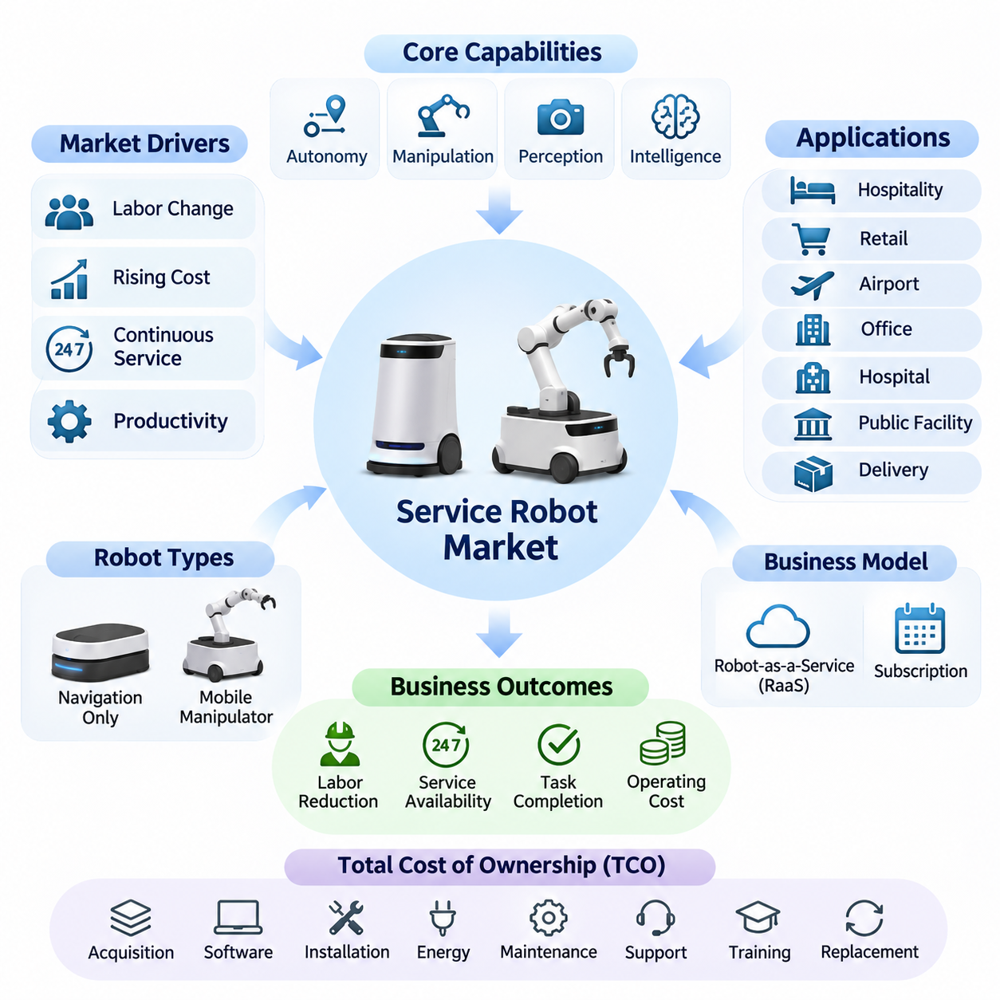
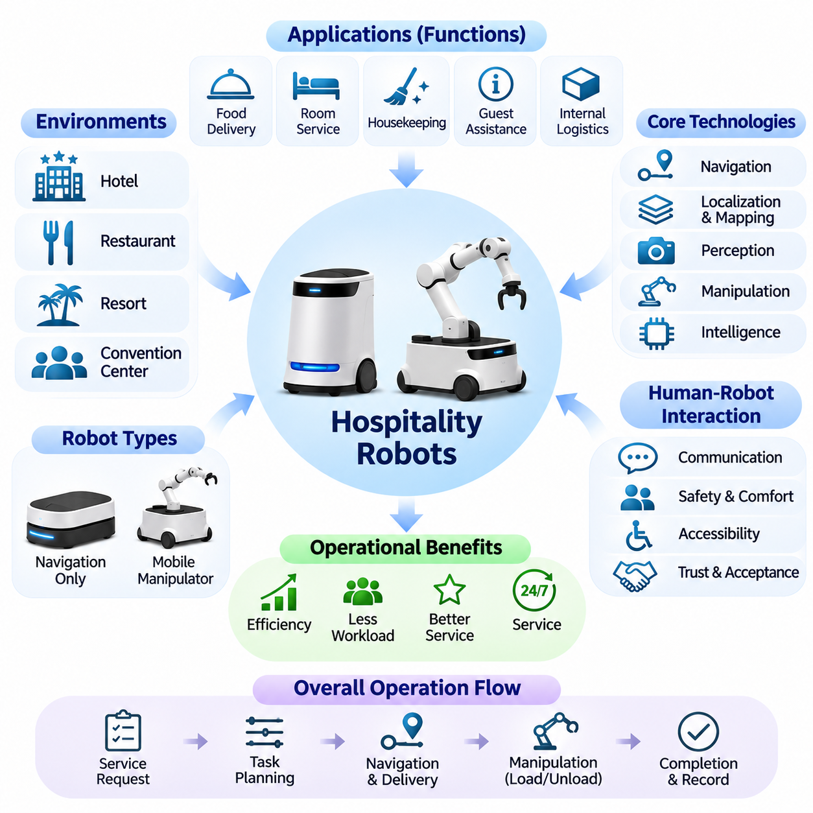
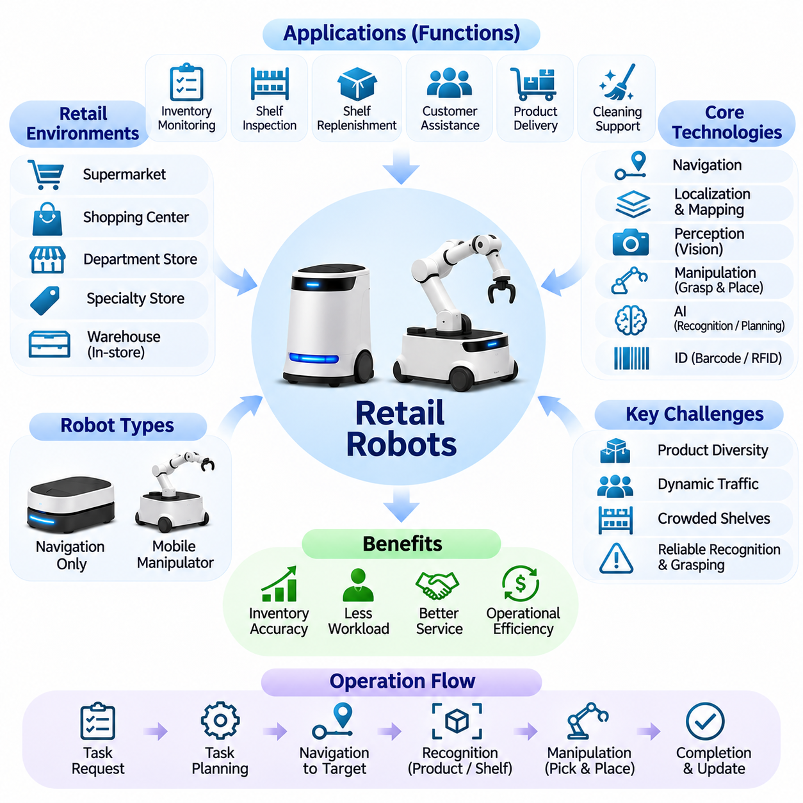
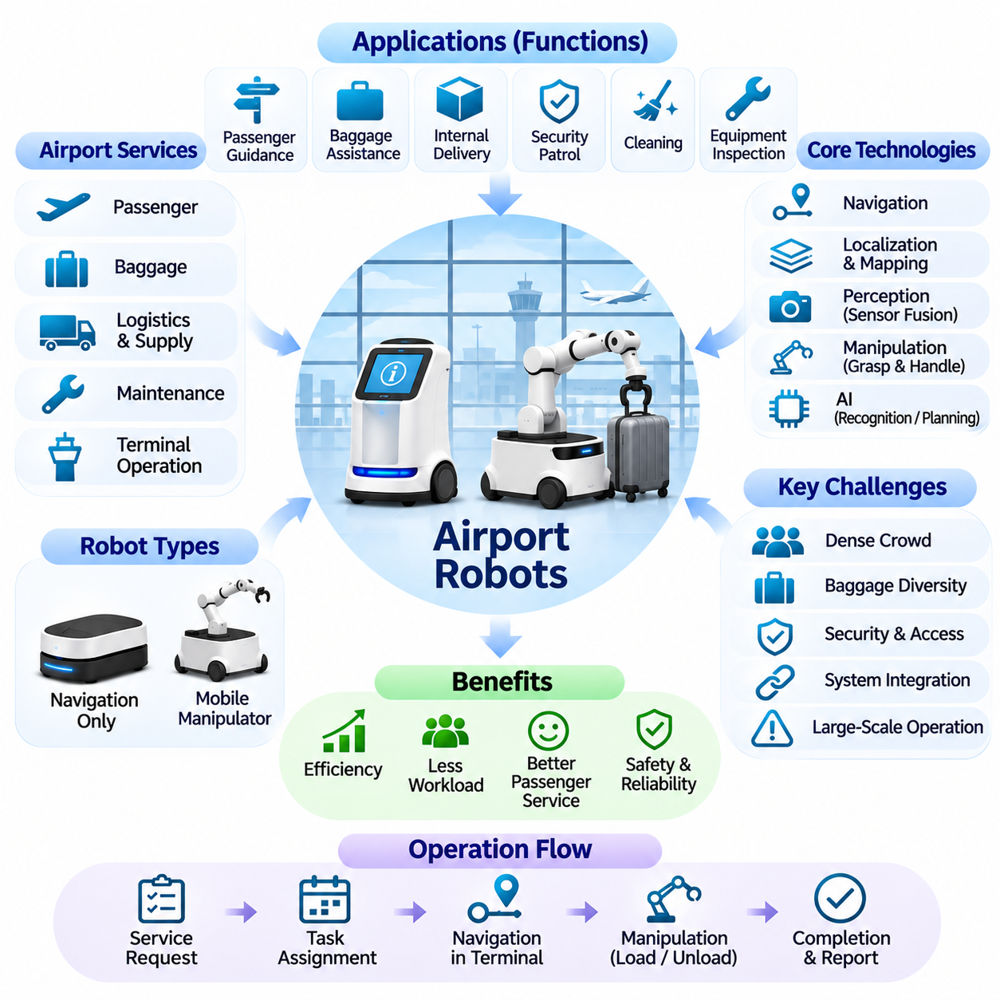
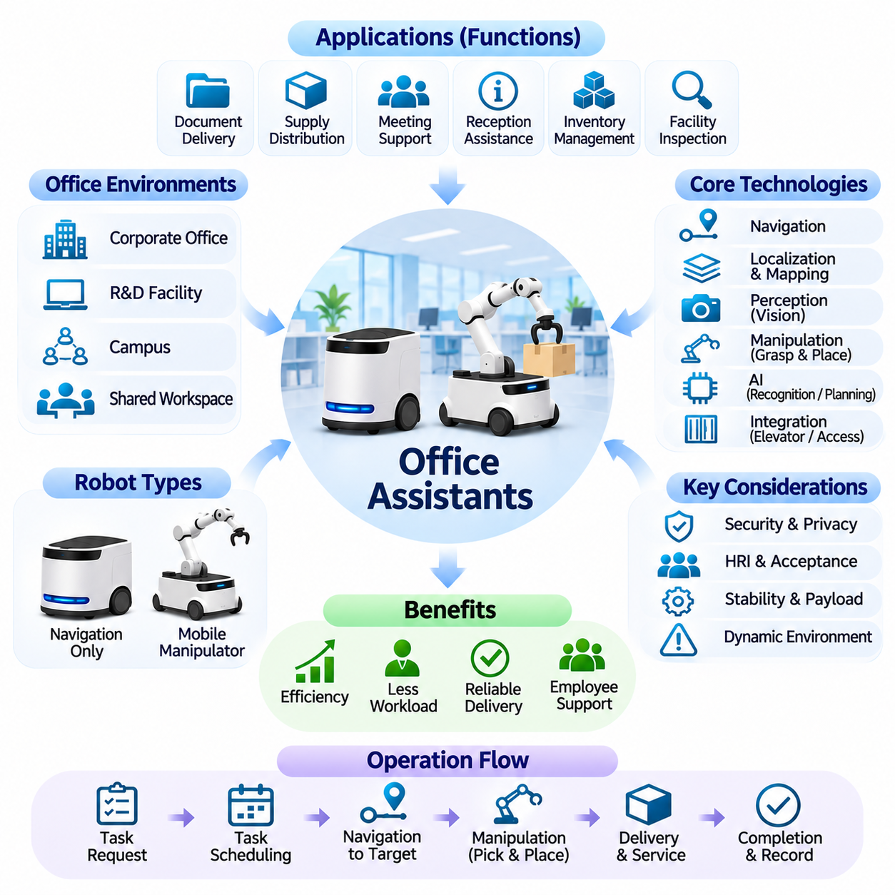
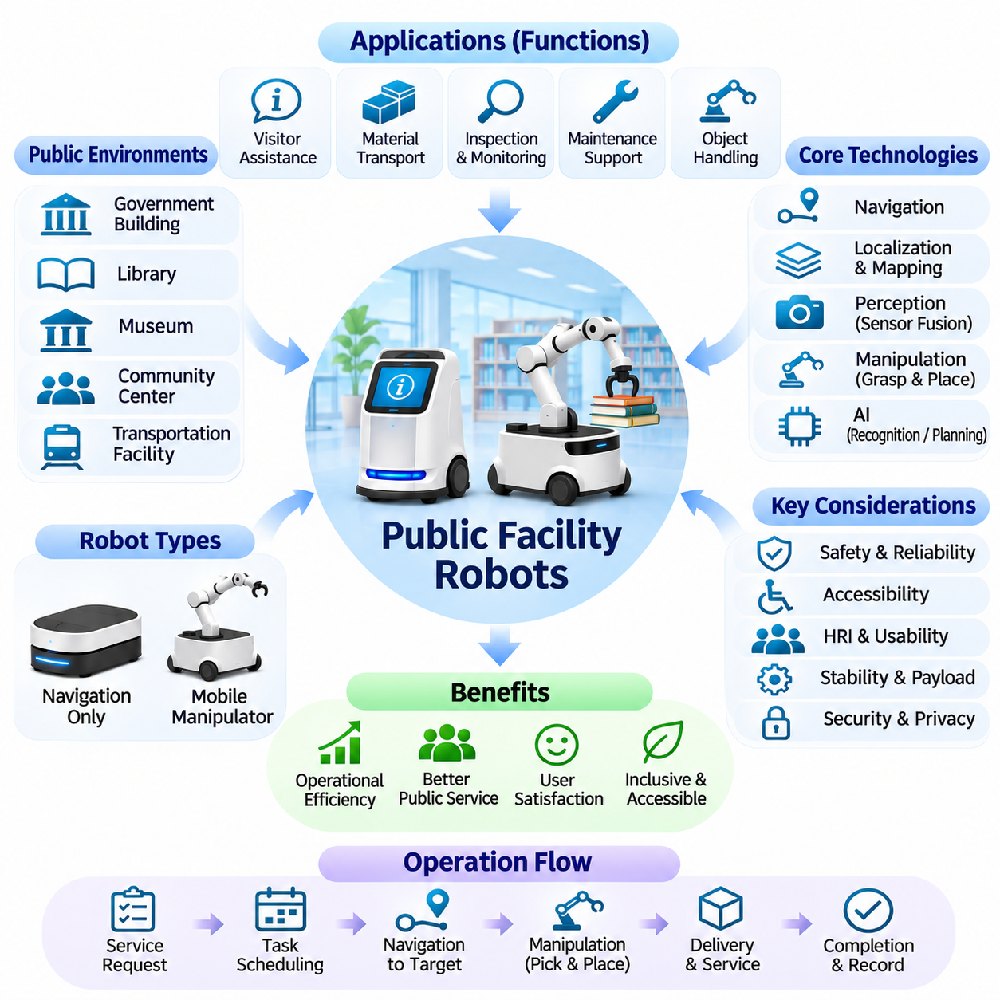
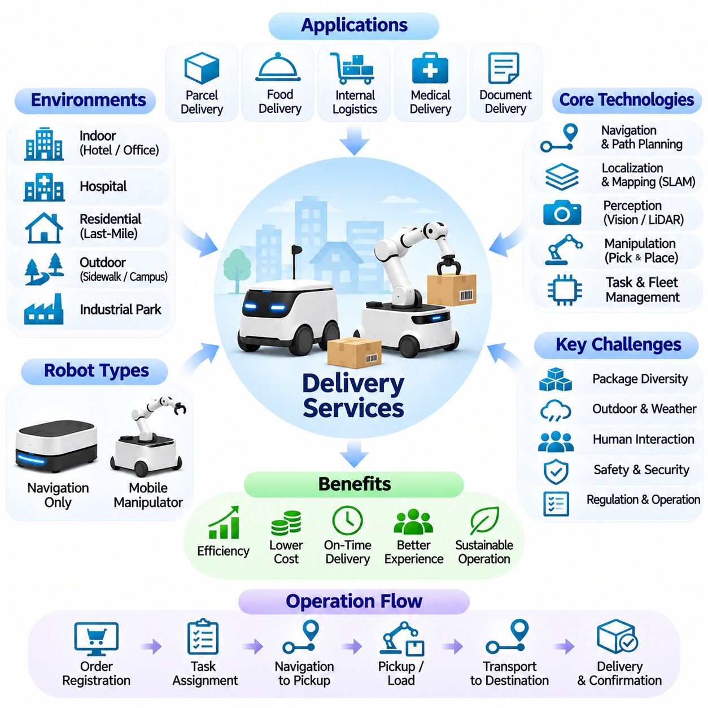
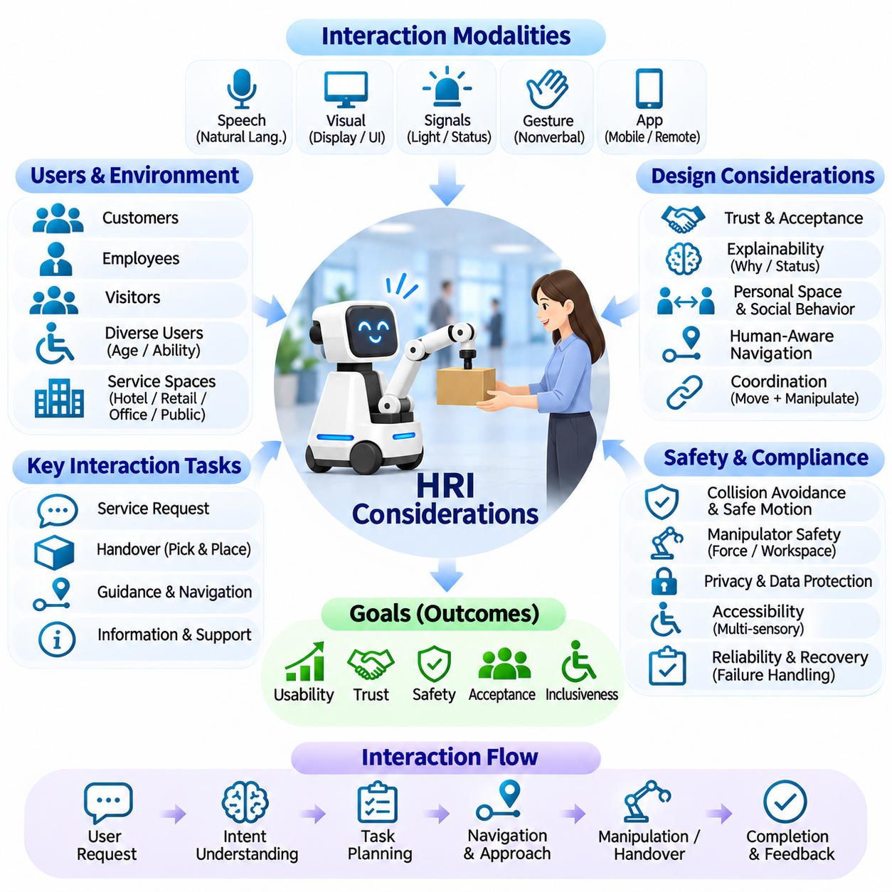
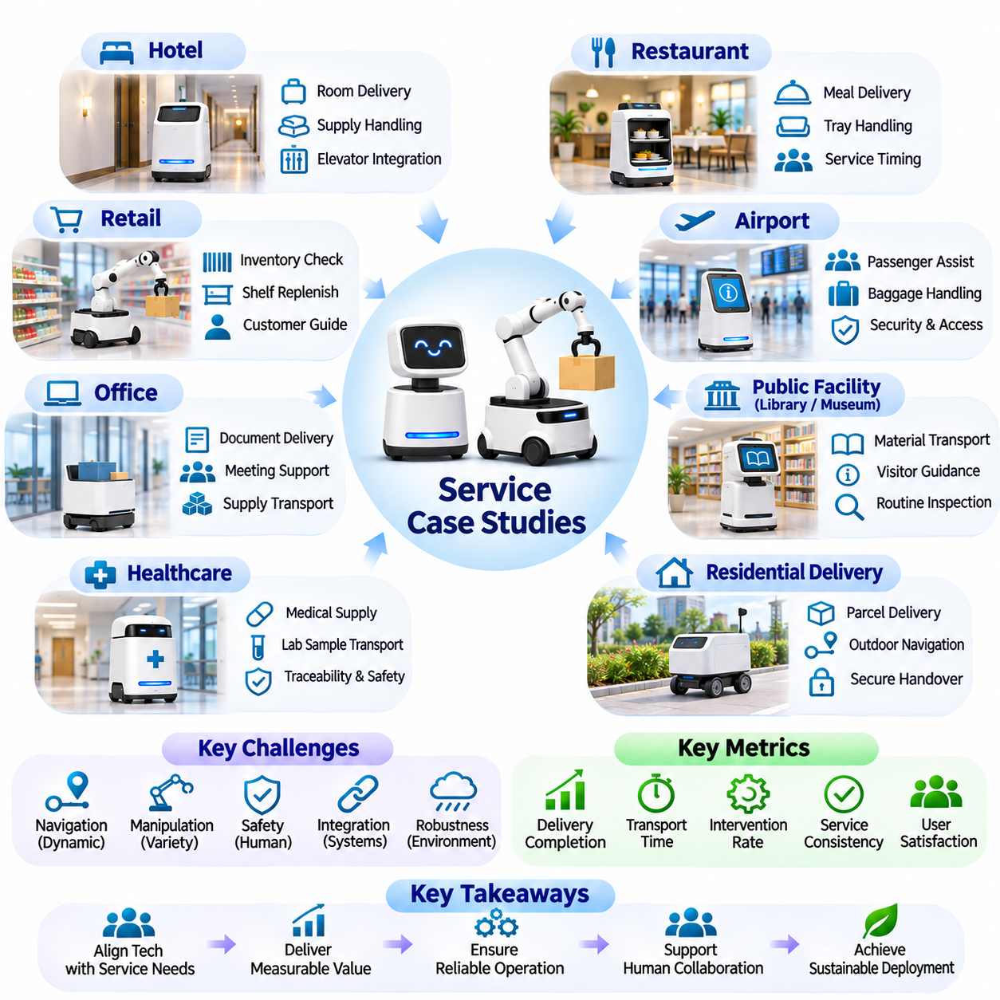

**Volume 01. Mobile Manipulator Foundations and System Architecture**

# Chapter 09. Service Robotics

## 01 Service Robot Market

{width="7.268055555555556in" height="7.268055555555556in"}

The service robot market represents an expanding segment of the robotics industry in which autonomous systems perform practical tasks in environments shared with people. Unlike conventional industrial robots operating within controlled production cells, service robots must navigate dynamic spaces, interact with diverse users, and respond to unpredictable conditions while maintaining operational safety and reliability.

Service robotics encompasses professional and consumer applications, although commercial mobile manipulators primarily target professional services. These systems combine autonomous mobility, robotic manipulation, environmental perception, and intelligent task execution. Their capabilities extend beyond transportation to include object handling, equipment interaction, customer assistance, cleaning support, and automated service delivery.

The development of the service robot market is influenced by labor availability, demographic changes, increasing operational costs, and growing expectations for continuous service. Organizations seek automation technologies that improve productivity without requiring extensive infrastructure modifications. Mobile manipulators address these requirements by performing physical tasks across multiple locations rather than remaining restricted to fixed workstations.

Professional service robotics includes applications in hospitality, retail, airports, offices, hospitals, and public facilities. Each environment introduces different operational requirements, but common objectives include reducing repetitive workloads, improving service consistency, and supporting human employees. Market adoption depends on whether robots can deliver measurable operational value while integrating into existing service workflows.

Hospitality environments provide opportunities for mobile robots to transport meals, collect used items, deliver amenities, and support housekeeping operations. Mobile manipulators can potentially extend these capabilities through autonomous loading, unloading, and object placement. Their economic value depends on task frequency, travel distance, interaction complexity, and the degree of human assistance required during operation.

Retail service robots support inventory inspection, shelf monitoring, customer guidance, and internal material movement. Mobile manipulators offer additional possibilities by retrieving products, organizing merchandise, and transferring goods between storage and display areas. Successful deployment requires reliable object recognition, safe navigation around customers, and compatibility with existing retail management systems.

Airports and transportation terminals represent demanding service environments because of high pedestrian density, complex layouts, and continuous operational activity. Robots may provide passenger assistance, baggage transportation, facility inspection, and logistics support. Mobile manipulation becomes particularly valuable when tasks require physical interaction with luggage, service equipment, or designated storage compartments.

Office environments create demand for autonomous document transportation, supply distribution, meeting-room support, and internal logistics. Mobile manipulators can perform tasks involving both navigation and object handling, reducing dependence on employees for repetitive movements. Their deployment requires integration with elevators, access-control systems, communication networks, and building management infrastructure.

Public facilities such as libraries, museums, government buildings, and exhibition centers provide additional opportunities for service robotics. Robots can assist visitors, transport materials, support maintenance activities, and perform routine inspections. Systems operating in these environments must accommodate diverse human behaviors, accessibility requirements, changing traffic patterns, and potentially limited technical supervision.

Autonomous delivery services constitute another important market segment, covering indoor transportation and selected outdoor operations. Conventional delivery robots primarily move goods between locations, while mobile manipulators can potentially complete additional tasks such as retrieving packages and transferring items to designated surfaces. These capabilities reduce manual handoffs but introduce greater mechanical and control complexity.

The service robot market can be classified according to application, operating environment, autonomy level, and physical interaction capability. Navigation-only robots generally require simpler hardware and control architectures, whereas mobile manipulators integrate robotic arms, end effectors, perception systems, and coordinated motion planning. This distinction strongly influences product pricing, deployment complexity, maintenance requirements, and customer expectations.

Market demand is not determined solely by technological sophistication. Customers typically evaluate robots according to measurable business outcomes, including labor-hour reduction, service availability, task completion rate, and operating cost. A technically advanced robot may fail commercially when its capabilities exceed practical requirements or when operational expenses outweigh the economic benefits of automation.

The total cost of ownership includes initial equipment acquisition, software licensing, installation, infrastructure adaptation, energy consumption, maintenance, and technical support. Additional expenses may arise from operator training, connectivity services, cybersecurity management, and component replacement. Accurate financial evaluation requires consideration of these recurring costs throughout the expected operational lifetime.

Robot-as-a-Service business models can reduce initial investment barriers by providing robotic capabilities through subscription or usage-based agreements. Customers may obtain hardware, software updates, maintenance, and operational support under a unified service contract. Providers must carefully manage equipment utilization, service-level commitments, repair costs, and fleet reliability to maintain sustainable profitability.

Technological progress in artificial intelligence, computer vision, simultaneous localization and mapping, and embedded computing continues to influence service robot capabilities. Improved perception enables robots to recognize objects and understand changing environments, while advanced planning algorithms support more flexible task execution. However, performance improvements must be validated under real operating conditions rather than assumed from laboratory demonstrations.

Mobile manipulators introduce additional opportunities through the integration of autonomous mobile robots and collaborative robotic arms. A mobile platform expands the physical workspace, while the manipulator enables interaction with objects and equipment. Effective coordination between these subsystems requires accurate localization, stable positioning, collision avoidance, and consistent transformation of coordinates between navigation and manipulation systems.

Human-robot interaction is a critical factor affecting commercial acceptance. Service robots frequently operate near customers, employees, visitors, and individuals unfamiliar with robotic systems. Their behavior must remain understandable, predictable, and socially appropriate. Clear communication, intuitive interfaces, safe movement, and effective recovery from unexpected situations contribute directly to user confidence and operational acceptance.

Safety requirements vary according to the robot\'s environment, physical characteristics, and intended tasks. Mobile manipulators introduce risks associated with vehicle motion, arm movement, payload handling, and simultaneous operation of multiple actuators. Appropriate safeguards may include protective sensing, speed limitations, emergency stopping, force monitoring, and risk-based operating restrictions tailored to the deployment environment.

The competitive landscape includes specialized robot manufacturers, autonomous navigation technology providers, robotic arm suppliers, system integrators, and software platform developers. Some companies focus on complete robotic products, while others provide modular hardware or autonomy software. Competitive differentiation increasingly depends on system reliability, application-specific performance, integration capability, and long-term customer support.

Standardization and interoperability can influence the scalability of service robot deployments. Organizations operating multiple robot types benefit from compatible communication interfaces, centralized fleet management, and consistent operational monitoring. Integration with enterprise software, building infrastructure, and cloud services reduces administrative complexity and enables coordinated operation across facilities and service departments.

Deployment environments strongly influence product design decisions. Indoor service robots typically require precise navigation through corridors, doorways, and crowded spaces, while outdoor systems face additional challenges involving weather, uneven terrain, lighting variations, and positioning uncertainty. Mobile manipulators must also maintain sufficient stability and manipulation accuracy despite variations in surface conditions and platform positioning.

The commercial maturity of service robot applications differs significantly across tasks. Repetitive transportation and structured delivery operations are generally easier to automate than unstructured object manipulation. Activities involving deformable objects, cluttered environments, or unpredictable human interaction demand more advanced perception and control. Consequently, market expansion is closely connected to the practical maturity of task-specific autonomy.

Pilot projects play an essential role in evaluating commercial feasibility before large-scale deployment. Initial trials should examine task success rates, intervention frequency, navigation reliability, manipulation accuracy, and user acceptance. Operational data collected during pilots helps organizations identify workflow limitations, estimate maintenance requirements, and determine whether broader deployment can achieve acceptable financial returns.

Service robot performance should be evaluated using application-specific indicators rather than isolated technical specifications. Useful measures include completed tasks per operating hour, autonomous operating time, human intervention rate, service response time, and equipment availability. For mobile manipulators, additional indicators include grasp success, object placement accuracy, recovery performance, and coordinated navigation-manipulation efficiency.

Scalability becomes increasingly important when organizations transition from individual robots to operational fleets. Multi-robot deployment requires task allocation, traffic coordination, charging management, remote monitoring, and maintenance scheduling. Fleet management platforms can improve resource utilization by distributing workloads according to robot availability, location, battery status, and task capability.

Regional market development is affected by labor economics, infrastructure readiness, regulatory frameworks, and customer willingness to adopt automation. Markets with high labor costs or workforce shortages may demonstrate stronger incentives for service robot deployment. Nevertheless, successful commercialization also depends on local technical support, service networks, procurement practices, and compliance with applicable regulations.

The integration of vision-language models, vision-language-action models, and embodied artificial intelligence may gradually expand the range of service tasks that robots can perform. These technologies offer possibilities for interpreting natural-language instructions, recognizing unfamiliar situations, and adapting behavior to changing environments. Their commercial adoption will depend on reliability, computational efficiency, safety assurance, and predictable task execution.

Future service robotics platforms may increasingly adopt modular architectures that support interchangeable manipulators, sensors, batteries, and software capabilities. Modular design allows manufacturers to address multiple applications while reusing common engineering components. However, standardization must be balanced against application-specific requirements involving payload, reach, mobility, environmental protection, and operating endurance.

The long-term development of the service robot market will depend on the transition from isolated automation functions toward integrated physical service systems. Mobile manipulators are positioned to contribute to this transition by combining transportation, perception, decision-making, and physical interaction. Their success will ultimately depend on delivering safe, reliable, economically sustainable services that complement human capabilities.

## 02 Hospitality Robots

{width="7.268055555555556in" height="7.268055555555556in"}

Hospitality robots are autonomous service systems designed to support operations in hotels, restaurants, resorts, convention centers, and other guest-oriented environments. Their primary purpose is to improve service efficiency, reduce repetitive workloads, and enhance customer experiences. Unlike industrial robots, hospitality robots operate in shared spaces where human behavior, environmental conditions, and service demands change continuously.

The hospitality industry presents significant opportunities for robotic automation because many operational activities involve repetitive transportation, material handling, and routine assistance. Employees frequently move supplies, deliver meals, collect used items, and respond to guest requests. Autonomous mobile robots can reduce these repetitive activities, allowing human staff to concentrate on personalized services and complex customer interactions.

Hospitality robots can be classified according to their primary functions, including food delivery, room service, housekeeping support, guest assistance, and internal logistics. Some systems provide navigation and transportation capabilities, while advanced mobile manipulators combine autonomous movement with robotic arms. This integration enables robots to perform physical interactions that conventional delivery platforms cannot accomplish independently.

Restaurant delivery robots transport prepared meals from kitchen areas to designated tables or service stations. These systems typically use autonomous navigation, obstacle detection, localization, and route planning to move safely through crowded environments. Their operational effectiveness depends on accurate destination identification, stable payload transportation, efficient traffic management, and predictable interactions with customers and employees.

Mobile manipulators can extend restaurant automation beyond simple transportation by incorporating object grasping, tray handling, and automated placement capabilities. A robotic arm mounted on a mobile platform may retrieve prepared items, position dishes on accessible surfaces, or collect selected objects. However, reliable manipulation requires accurate perception, appropriate grippers, controlled forces, and careful consideration of food safety.

Hotel room service represents another important application of hospitality robotics. Autonomous robots can transport towels, beverages, toiletries, and other guest amenities from storage locations to individual rooms. Integration with elevators, automatic doors, and hotel management systems allows robots to navigate between floors and coordinate deliveries. Secure compartments and authentication mechanisms help protect guest belongings and delivery contents.

Advanced hotel service robots may incorporate robotic manipulators to support automated loading and unloading operations. Instead of relying entirely on employees to place items into delivery compartments, a mobile manipulator can potentially retrieve standardized packages from designated storage locations. Such systems require consistent object presentation, reliable grasp planning, accurate positioning, and effective recovery procedures when manipulation fails.

Housekeeping operations involve substantial physical movement and repetitive handling of supplies, linens, and cleaning equipment. Hospitality robots can transport housekeeping carts, deliver replacement materials, and collect designated items from service areas. Mobile manipulators may eventually assist with handling towels, arranging supplies, and transferring laundry containers, although deformable materials and cluttered environments remain technically challenging.

Guest assistance robots provide information, directions, and basic communication services in hotel lobbies, reception areas, and entertainment facilities. These systems may combine speech recognition, natural language processing, visual perception, and interactive displays. Their effectiveness depends on clear communication, multilingual support, accurate information retrieval, and the ability to recognize situations requiring intervention by human personnel.

Human-robot interaction is particularly important in hospitality environments because customer satisfaction depends on comfort, trust, and service quality. Robots must communicate their intentions through understandable movements, visual indicators, and appropriate audio messages. Navigation behavior should remain predictable, especially near children, elderly guests, and individuals with limited mobility. Effective interaction design reduces confusion and improves acceptance.

Autonomous navigation in hospitality facilities requires continuous adaptation to changing pedestrian traffic, furniture arrangements, temporary obstacles, and service activities. Robots commonly combine LiDAR, cameras, proximity sensors, and localization algorithms to estimate their surroundings. Navigation systems must identify safe paths while avoiding collisions and unnecessary interruptions, particularly in narrow corridors and crowded restaurant spaces.

Simultaneous localization and mapping enables robots to construct or maintain environmental representations while estimating their positions. In hospitality applications, maps may include guest rooms, service stations, elevators, restricted areas, and designated delivery locations. Reliable localization is essential because navigation errors can interrupt service, delay deliveries, or create unsafe situations near guests and employees.

Mobile manipulation introduces additional coordination requirements between the mobile platform and robotic arm. Before grasping or placing objects, the robot must establish a stable operating position and determine the relationship between its base, manipulator, and target object. Coordinated control prevents unexpected movements and maintains balance during manipulation, particularly when handling objects with varying weights or dimensions.

Payload capacity and mechanical stability influence the design of hospitality mobile manipulators. The system must accommodate the combined mass of its robotic arm, end effector, transported materials, batteries, and supporting hardware. Designers must evaluate center-of-gravity changes, acceleration limits, wheel traction, and potential tipping conditions when the manipulator extends beyond the mobile platform.

Power management is another critical consideration because hospitality robots may operate continuously throughout extended service periods. Battery capacity must support navigation, onboard computing, communication, sensing, and manipulation activities. Automatic charging stations can reduce manual intervention, while intelligent scheduling allows robots to recharge during periods of lower demand without disrupting essential service operations.

Hospitality robots often require integration with existing digital infrastructure, including property management systems, restaurant ordering platforms, elevator controllers, and building access systems. Application programming interfaces enable task requests, delivery confirmations, and operational monitoring. Secure communication and appropriate access permissions are essential because robots may interact with guest information and restricted facility resources.

Fleet management becomes important when multiple robots operate within the same hotel or restaurant. A centralized system can assign delivery tasks, monitor battery levels, coordinate traffic, and optimize resource utilization. Task allocation algorithms may consider robot location, payload capacity, estimated travel time, and service priority to distribute workloads efficiently across the available fleet.

Safety architecture must address both autonomous movement and physical manipulation. Protective sensing, speed control, emergency stopping, and collision avoidance reduce risks associated with navigation. Manipulator safety additionally requires force limitation, workspace monitoring, and appropriate handling of unexpected contact. Risk assessment should consider guests who may approach robots unpredictably or attempt to interact with moving components.

Operational reliability strongly influences commercial success because service interruptions can directly affect customer satisfaction. Robots must handle navigation failures, blocked routes, communication interruptions, and unsuccessful deliveries without creating additional operational burdens. Recovery mechanisms may include automatic replanning, controlled retries, remote operator assistance, and safe transitions to predefined standby locations.

The economic value of hospitality robotics depends on measurable improvements in operational productivity and service consistency. Relevant indicators include completed deliveries per hour, average response time, autonomous task completion rate, employee intervention frequency, and robot availability. Financial evaluation should also consider equipment acquisition, maintenance, software subscriptions, infrastructure integration, and technical support expenses.

Robot-as-a-Service models can make hospitality automation accessible to organizations seeking predictable operating expenses instead of substantial initial capital investment. Subscription agreements may combine hardware deployment, software maintenance, fleet monitoring, and technical assistance. Providers must ensure that service pricing reflects equipment utilization, maintenance requirements, customer support obligations, and expected operational lifetime.

The adoption of hospitality robots also requires organizational preparation and employee participation. Staff members need training in task assignment, basic troubleshooting, safe interaction, and operational supervision. Successful implementation typically involves redesigning selected workflows rather than simply replacing human activities with robotic movements. Clear responsibilities and escalation procedures improve cooperation between employees and automated systems.

Artificial intelligence can improve hospitality robot adaptability through object recognition, semantic navigation, natural language understanding, and task planning. Vision-language models may help robots interpret service requests and identify relevant objects or locations. However, generative reasoning must remain connected to verified environmental information and constrained execution policies to prevent unreliable or unsafe physical actions.

Future hospitality robots may combine advanced manipulation, multimodal perception, and embodied artificial intelligence to perform increasingly complex service activities. Potential capabilities include flexible object retrieval, autonomous preparation of standardized service materials, and coordinated interaction with building infrastructure. Their practical deployment will depend on improvements in manipulation reliability, safety validation, affordability, and maintenance efficiency.

Hospitality robotics demonstrates how mobile manipulation can transform service operations from simple autonomous transportation toward integrated physical assistance. The most successful systems will balance technical capabilities with operational simplicity, safety, and customer expectations. Rather than eliminating human hospitality, these technologies can support employees by automating repetitive tasks while preserving human attention for personalized and relationship-oriented services.

## 03 Retail Robots

{width="7.268055555555556in" height="7.268055555555556in"}

Retail robots are autonomous systems designed to support operational activities in supermarkets, shopping centers, department stores, and specialized retail environments. Their primary objectives include improving inventory accuracy, reducing repetitive workloads, and enhancing customer service. Unlike industrial robots, retail robots operate in dynamic environments where customers, employees, merchandise, and temporary obstacles continuously influence robotic behavior.

Retail operations involve frequent product transportation, inventory inspection, shelf replenishment, and customer assistance. These activities require substantial employee time, particularly in large stores containing thousands of products. Autonomous mobile robots can automate selected repetitive tasks, while mobile manipulators extend these capabilities by physically interacting with merchandise, storage containers, shelves, and retail equipment.

Retail robots can be categorized according to their operational functions, including inventory monitoring, shelf inspection, customer guidance, product delivery, cleaning support, and automated merchandise handling. Navigation-only robots primarily perform transportation and sensing tasks. Mobile manipulators integrate robotic arms and end effectors, enabling additional operations such as product retrieval, shelf placement, and automated transfer between storage and display locations.

Inventory monitoring represents an important application because accurate stock information directly influences sales performance and supply chain efficiency. Mobile robots equipped with cameras, barcode readers, and RFID sensors can inspect shelves and identify discrepancies between physical inventory and digital records. Automated inspection reduces manual counting requirements and supports more frequent inventory updates without significantly interrupting normal store operations.

Shelf inspection robots analyze product availability, placement accuracy, pricing labels, and promotional displays. Computer vision algorithms can identify empty shelf locations, misplaced merchandise, and inconsistencies between displayed prices and inventory databases. Reliable operation requires accurate visual recognition under varying illumination, reflective packaging, partial occlusion, and densely arranged products commonly encountered in retail environments.

Mobile manipulators can potentially extend shelf inspection into automated replenishment by retrieving products from nearby storage locations and placing them on designated shelves. This capability requires coordinated navigation, object detection, grasp planning, and precise arm positioning. Product diversity introduces significant challenges because packaging dimensions, surface materials, weight distributions, and grasping requirements vary considerably across merchandise categories.

Automated shelf replenishment becomes more practical when products are presented in standardized containers or organized storage structures. Robots can identify target products, approach accessible shelf positions, and execute controlled placement operations. However, manipulation performance may decline when shelves are crowded, products are deformable, or customer activity restricts access to the intended workspace.

Customer assistance robots provide store navigation, product information, promotional guidance, and basic shopping support. These systems may combine speech recognition, natural language processing, interactive displays, and indoor localization. Effective customer interaction requires accurate information retrieval, multilingual communication, and clear procedures for transferring complex requests to human employees when automated assistance is insufficient.

Retail delivery robots transport merchandise between storage areas, service counters, and designated collection points. Their operations can reduce employee walking distances and improve internal material flow. Integration with order management systems allows delivery tasks to be generated automatically, while navigation software coordinates movement through aisles, corridors, and shared customer spaces.

Mobile manipulators introduce opportunities for automated order fulfillment within retail facilities. A robot may navigate to product locations, identify requested merchandise, retrieve accessible items, and transport them to packaging or collection stations. Such workflows combine perception, navigation, manipulation, and task planning, requiring reliable coordination between the mobile platform and robotic arm throughout the entire operation.

Retail environments present complex navigation challenges because pedestrian traffic and merchandise arrangements change frequently. Shopping carts, temporary displays, cleaning equipment, and customers may obstruct planned routes. Autonomous navigation systems must continuously update obstacle information and select safe alternative paths while maintaining predictable movement patterns that minimize disruption to normal shopping activities.

Simultaneous localization and mapping enables retail robots to maintain spatial representations of store layouts while estimating their positions. Maps may contain aisles, shelves, storage rooms, checkout counters, restricted areas, and service stations. Accurate localization supports both navigation and manipulation because robots must approach target shelves with sufficient positioning precision to perform reliable object interactions.

Visual perception is particularly important in retail robotics because products frequently have similar shapes, colors, and packaging designs. Object detection and classification models must distinguish merchandise despite changes in lighting, viewing angle, and shelf arrangement. Combining RGB cameras, depth sensors, barcode information, and inventory databases can improve identification reliability and reduce incorrect product selection.

Grasp planning presents additional technical challenges because retail merchandise includes rigid boxes, cylindrical containers, flexible packages, bottles, and irregularly shaped objects. Different products may require suction grippers, parallel-jaw grippers, or adaptive end effectors. Reliable manipulation requires estimating object geometry, selecting stable grasp points, controlling contact forces, and avoiding damage to products or surrounding merchandise.

The mechanical architecture of retail mobile manipulators must balance compact dimensions, payload capacity, reach, and stability. Narrow store aisles favor small mobile platforms, while high shelves require extended manipulation workspaces. Designers must evaluate center-of-gravity changes, arm extension limits, wheel traction, and tipping risks to ensure safe operation during product retrieval and placement.

Human-robot interaction is a central consideration because retail robots operate near customers who may behave unpredictably. Robots must communicate their intentions through understandable movements, visual signals, and appropriate audio messages. Safe operating behavior includes maintaining suitable separation distances, yielding to pedestrians, limiting speed in crowded areas, and responding appropriately when customers approach moving manipulators.

Retail robot safety architecture must address both mobile navigation and physical manipulation. Protective sensors, emergency stopping, collision avoidance, and controlled motion limits reduce operational risks. Manipulators additionally require workspace monitoring, force limitation, and safe recovery procedures. Risk assessment should consider falling merchandise, unstable loads, unexpected human contact, and interactions with shelves or display structures.

Integration with retail information systems is essential for transforming isolated robotic functions into coordinated business operations. Robots may exchange information with inventory management systems, warehouse management platforms, point-of-sale systems, and enterprise resource planning software. Application programming interfaces support task assignment, stock verification, product location updates, and operational reporting across connected systems.

Fleet management platforms coordinate multiple retail robots by distributing tasks according to location, availability, battery status, and operational priority. Centralized monitoring can reduce traffic conflicts and improve resource utilization. Intelligent scheduling may assign inventory inspection during low-traffic periods while prioritizing urgent product transportation or replenishment activities during normal store operations.

Battery capacity and energy management influence the practical operating duration of retail robots. Power consumption depends on navigation distance, onboard computing, sensing equipment, communication systems, and manipulator activity. Automatic charging stations and task-aware scheduling help maintain service availability while minimizing manual intervention and unnecessary interruptions to store operations.

Operational performance should be measured using indicators directly connected to retail productivity. Relevant metrics include inventory inspection coverage, stock identification accuracy, completed replenishment tasks, order fulfillment time, autonomous task success rate, and employee intervention frequency. For mobile manipulators, grasp success rate, placement accuracy, product damage rate, and recovery time provide additional measures of system effectiveness.

The economic feasibility of retail robotics depends on equipment costs, operational savings, maintenance requirements, and measurable service improvements. Total cost of ownership includes hardware acquisition, software licensing, infrastructure integration, technical support, and periodic component replacement. Return on investment should be evaluated against realistic task volumes, labor requirements, utilization rates, and expected equipment lifetime.

Robot-as-a-Service models can reduce adoption barriers by offering retail automation through subscription-based agreements. These arrangements may include robotic hardware, software updates, maintenance, remote monitoring, and operational support. Service providers must maintain reliable performance and predictable operating expenses, while retailers evaluate whether recurring subscription costs are justified by productivity improvements.

Artificial intelligence can expand retail robot capabilities through semantic scene understanding, product recognition, task planning, and adaptive manipulation. Vision-language models may enable robots to interpret product descriptions and connect natural-language requests with visual observations. However, physical actions must remain constrained by verified object identities, environmental conditions, and safety policies to prevent incorrect or unsafe manipulation.

Future retail robots may combine multimodal perception, advanced grasping, and embodied artificial intelligence to handle increasingly diverse merchandise and operational tasks. Potential developments include flexible shelf replenishment, autonomous item retrieval, and coordinated operation with human employees. Commercial success will depend on achieving sufficient reliability, affordability, safety, and maintainability under realistic retail conditions.

Retail robotics illustrates the transition from autonomous monitoring and transportation toward integrated mobile manipulation. By combining mobility, perception, decision-making, and physical interaction, retail robots can support inventory management, merchandise handling, and customer services within a unified operational framework. Their long-term value will depend on improving store efficiency while preserving safe, accessible, and customer-friendly shopping environments.

## 04 Airport Robots

{width="7.268055555555556in" height="7.268055555555556in"}

Airport robots are autonomous service systems designed to support passenger services, baggage transportation, terminal logistics, facility maintenance, and operational assistance within airport environments. Airports present complex operating conditions involving high pedestrian density, strict security requirements, and continuous transportation activities. Robotic systems must maintain reliable performance while interacting safely with passengers, employees, and airport infrastructure.

Airport automation is increasingly relevant because large terminals require extensive movement of passengers, luggage, supplies, and operational equipment. Many activities involve repetitive transportation, inspection, and service tasks that consume substantial employee time. Autonomous mobile robots can reduce these workloads, while mobile manipulators extend automation by physically handling objects and interacting with airport facilities.

Airport robots can be categorized according to operational functions, including passenger guidance, baggage assistance, internal delivery, security patrol, cleaning, and equipment inspection. Navigation-only robots primarily provide transportation and information services. Mobile manipulators combine autonomous mobility with robotic arms, enabling object retrieval, baggage handling, and interaction with designated equipment or storage systems.

Passenger assistance robots provide directions, flight information, terminal navigation, and multilingual communication services. These systems may integrate speech recognition, natural language processing, interactive displays, and indoor positioning technologies. Effective operation requires accurate information retrieval, accessible interfaces, and reliable integration with airport information systems to ensure that passengers receive appropriate guidance.

Baggage transportation represents an important application because airports handle large quantities of luggage across extensive terminal areas. Autonomous robots can assist with moving baggage between designated collection points, storage locations, and service stations. Their effectiveness depends on payload capacity, navigation reliability, secure cargo handling, and coordination with existing baggage management procedures.

Mobile manipulators can potentially extend baggage transportation into automated loading and unloading operations. Robotic arms may grasp luggage handles, transfer standardized containers, or place selected items onto designated platforms. However, baggage varies considerably in size, shape, weight, and material, making reliable manipulation challenging. Advanced perception, adaptive gripping, and force-controlled handling are essential.

Airport logistics also involves transporting maintenance supplies, cleaning materials, spare parts, and operational equipment between distributed facilities. Autonomous mobile robots can support these internal delivery activities by following scheduled or dynamically assigned routes. Mobile manipulators may additionally retrieve supplies from structured storage locations and transfer materials to authorized personnel or designated workstations.

Terminal environments create demanding navigation conditions because passenger traffic changes rapidly according to flight schedules, boarding activities, and security procedures. Robots must respond to crowds, luggage carts, temporary barriers, and unexpected pedestrian movements. Autonomous navigation systems require continuous obstacle detection, dynamic path planning, and predictable movement behavior to minimize interference with passenger circulation.

Simultaneous localization and mapping enables airport robots to estimate their positions while maintaining spatial representations of complex terminal environments. Maps may include gates, corridors, elevators, service rooms, restricted zones, and delivery stations. Reliable localization is particularly important in large indoor spaces where satellite positioning signals may be unavailable or insufficiently accurate.

Airport robotic perception systems commonly combine LiDAR, RGB cameras, depth sensors, inertial measurement units, and proximity sensors. Sensor fusion improves environmental awareness and supports obstacle detection under varying lighting and crowd conditions. Perception algorithms must distinguish pedestrians, luggage, carts, structural obstacles, and temporary equipment while maintaining dependable performance in crowded public areas.

Mobile manipulation requires precise coordination between the mobile platform and robotic arm. Before handling baggage or supplies, the robot must establish a stable operating position and determine the spatial relationship between its base, manipulator, and target object. Coordinated control helps maintain positioning accuracy and prevents unsafe movement during grasping, lifting, transportation, and placement operations.

Payload capacity and mechanical stability are critical design considerations for airport mobile manipulators. The system must accommodate robotic arms, end effectors, transported luggage, batteries, and supporting equipment. Engineers must evaluate center-of-gravity changes, acceleration limits, braking performance, and tipping risks, particularly when manipulating heavy or irregularly shaped baggage.

Airport robots must integrate with existing infrastructure to operate efficiently across large facilities. Elevator controllers, automatic doors, access-control systems, and terminal management platforms may provide essential operational interfaces. Secure communication protocols and authorization mechanisms are necessary because robots may operate near restricted areas or interact with infrastructure subject to strict security policies.

Security requirements distinguish airport robotics from many other service applications. Robots must comply with applicable access restrictions, operational procedures, and cybersecurity requirements. Authentication, encrypted communication, event logging, and controlled software updates help protect robotic systems from unauthorized access. Security-sensitive tasks should remain subject to appropriate human supervision and airport authority approval.

Human-robot interaction is essential because airport robots encounter passengers with diverse languages, ages, mobility capabilities, and familiarity with automation. Robots should communicate intentions through clear visual signals, understandable audio messages, and predictable movements. Accessible interfaces and appropriate behavior near children, elderly passengers, and travelers with disabilities contribute to safe and inclusive operation.

Safety architecture must address autonomous navigation, physical manipulation, and interactions with airport infrastructure. Protective sensing, emergency stopping, speed limitations, and collision avoidance reduce risks associated with mobile movement. Manipulators require additional safeguards involving force limitation, workspace monitoring, and controlled recovery. Risk assessment should consider falling baggage, unexpected human contact, and congestion near boarding areas.

Fleet management becomes increasingly important when multiple robots operate throughout a terminal. Centralized platforms can assign tasks, monitor robot availability, coordinate traffic, and manage charging schedules. Task allocation may consider location, payload requirements, battery status, service priority, and estimated completion time to improve fleet utilization while avoiding unnecessary congestion.

Energy management influences airport robot availability because terminal operations may continue for extended periods or around the clock. Battery capacity must support navigation, onboard computing, sensing, communication, and manipulation activities. Automatic charging stations and intelligent scheduling can maintain operational readiness by coordinating charging periods with expected service demand and robot workload.

Operational reliability is particularly important because robotic failures may disrupt passenger services or airport logistics. Systems must handle blocked routes, communication interruptions, localization errors, and unsuccessful manipulation attempts without creating additional safety risks. Recovery mechanisms may include automatic replanning, controlled retries, remote operator assistance, and safe transitions to designated standby locations.

Airport robots may also support facility inspection and maintenance operations. Mobile platforms equipped with cameras and environmental sensors can inspect designated infrastructure, identify visible abnormalities, and collect operational data. Mobile manipulators may eventually perform selected physical interactions with inspection equipment, provided that task authorization, mechanical compatibility, and safety requirements are satisfied.

Performance evaluation should reflect the operational objectives of airport services. Relevant indicators include completed deliveries per hour, navigation success rate, average response time, autonomous task completion rate, passenger interaction quality, and robot availability. For mobile manipulators, grasp success, placement accuracy, payload handling reliability, and recovery performance provide additional measures of system effectiveness.

The economic feasibility of airport robotics depends on operational savings, service improvements, infrastructure requirements, and maintenance costs. Total cost of ownership includes hardware acquisition, software licensing, installation, cybersecurity management, technical support, and component replacement. Return on investment should consider realistic task volumes, labor requirements, equipment utilization, and expected operational lifetime.

Pilot deployments provide an essential foundation for evaluating airport robotics before large-scale implementation. Initial trials should examine navigation reliability, passenger acceptance, infrastructure integration, safety performance, and intervention frequency. Operational data helps identify limitations associated with crowd density, route accessibility, communication coverage, and maintenance requirements before expanding robotic services.

Artificial intelligence can enhance airport robot capabilities through semantic navigation, object recognition, natural language understanding, and adaptive task planning. Vision-language models may support interpretation of passenger requests and recognition of relevant objects or destinations. However, physical actions and security-sensitive decisions must remain constrained by verified information, authorized procedures, and validated safety controls.

Future airport robots may combine advanced mobile manipulation, multimodal perception, and embodied artificial intelligence to perform more complex assistance and logistics tasks. Potential applications include automated baggage transfer, flexible supply handling, and coordinated operation with airport service personnel. Commercial deployment will depend on achieving sufficient reliability, security, affordability, and compatibility with existing airport operations.

Airport robotics demonstrates how autonomous mobility and physical manipulation can support complex service environments requiring continuous coordination between people, infrastructure, and intelligent machines. Successful systems must balance technical capability with operational safety, passenger accessibility, and economic sustainability. Their long-term value lies in improving airport efficiency while supporting reliable, secure, and passenger-centered services.

## 05 Office Assistants

{width="7.268055555555556in" height="7.268055555555556in"}

Office assistant robots are autonomous service systems designed to support administrative, logistical, and operational activities within modern workplaces. They operate in offices, corporate campuses, research facilities, and shared workspaces where employees perform diverse tasks. Their primary objectives include reducing repetitive workloads, improving internal service efficiency, and supporting productive human-robot collaboration.

Office environments contain numerous routine activities involving document transportation, supply distribution, meeting preparation, and equipment delivery. Employees frequently move between departments to exchange materials or complete administrative tasks. Autonomous mobile robots can automate selected transportation activities, while mobile manipulators extend these capabilities through physical interaction with office equipment and objects.

Office assistant robots can be classified according to their functions, including internal delivery, reception assistance, meeting-room support, inventory management, and facility inspection. Navigation-only robots primarily transport materials and provide information. Mobile manipulators integrate robotic arms and end effectors, enabling object retrieval, document handling, supply placement, and selected equipment interactions.

Document delivery represents a practical application because organizations often transfer printed materials, confidential records, and administrative packages between departments. Autonomous robots can transport documents through predefined routes while maintaining delivery records. Secure compartments, recipient authentication, and access-controlled workflows are particularly important when handling sensitive corporate information.

Mobile manipulators can potentially automate document retrieval and placement at designated workstations. A robotic arm may collect standardized document containers, transfer folders, or position packages on accessible surfaces. Reliable execution requires accurate object recognition, stable grasp planning, and careful handling of lightweight or flexible materials that may shift during transportation.

Office supply distribution involves delivering stationery, replacement components, consumables, and shared equipment to employees or designated storage areas. Autonomous robots can reduce unnecessary walking and support scheduled replenishment activities. Mobile manipulators may additionally retrieve standardized supplies from organized cabinets and place them in designated collection locations.

Meeting-room assistance provides another opportunity for robotic automation. Robots can transport presentation equipment, distribute prepared materials, and deliver refreshments before scheduled meetings. Integration with room reservation systems allows tasks to be initiated automatically. More advanced mobile manipulators may assist with arranging selected objects, although cluttered tables and fragile equipment require careful manipulation.

Reception assistant robots support visitor registration, employee notifications, navigation guidance, and basic information services. These systems may combine speech recognition, natural language processing, interactive displays, and indoor positioning technologies. Their effectiveness depends on accurate information retrieval, accessible communication, and reliable escalation procedures when visitors require human assistance.

Office navigation presents challenges because corridors, elevators, meeting rooms, and shared spaces experience changing pedestrian traffic. Furniture rearrangements, temporary obstacles, and unexpected human movements can disrupt planned routes. Autonomous navigation systems must continuously monitor their surroundings and select safe paths while minimizing interference with normal workplace activities.

Simultaneous localization and mapping enables office robots to maintain spatial representations of buildings while estimating their positions. Maps may contain corridors, departments, elevators, meeting rooms, charging stations, and restricted areas. Accurate localization supports reliable navigation and manipulation, particularly when robots must approach workstations or storage structures with sufficient positioning precision.

Office robotic perception systems commonly combine LiDAR, RGB cameras, depth sensors, and proximity sensors. Sensor fusion supports obstacle detection, environmental understanding, and object identification under changing lighting conditions. Perception algorithms must distinguish employees, furniture, office supplies, and temporary obstacles while maintaining dependable performance in shared environments.

Mobile manipulation requires precise coordination between the mobile platform and robotic arm. Before retrieving or placing objects, the robot must establish a stable operating position and determine the spatial relationship between its base, manipulator, and target. Coordinated control improves placement accuracy and reduces risks associated with unexpected movement, collisions, or unstable payload handling.

Mechanical design must balance compact dimensions, payload capacity, manipulation reach, and operational stability. Narrow office corridors favor small mobile platforms, while desks, cabinets, and storage shelves require sufficient robotic arm reach. Engineers must evaluate center-of-gravity changes, arm extension limits, wheel traction, and tipping risks during object retrieval and placement operations.

Human-robot interaction is essential because office robots operate near employees and visitors who may have different expectations or familiarity with automation. Robots should communicate intentions through predictable movements, visual indicators, and understandable audio messages. Appropriate speed control, pedestrian yielding, and accessible interfaces help establish trust and minimize disruption.

Safety architecture must address both autonomous movement and physical manipulation. Protective sensing, collision avoidance, emergency stopping, and controlled speed limits reduce navigation risks. Manipulators additionally require workspace monitoring, force limitation, and safe recovery procedures. Risk assessments should consider unexpected human contact, falling objects, and interactions with furniture or office equipment.

Office assistant robots often require integration with enterprise software and building infrastructure. Calendar systems, meeting-room reservation platforms, access-control systems, elevators, and facility management applications can provide task information and operational permissions. Application programming interfaces enable automated scheduling, task assignment, delivery confirmation, and monitoring across connected systems.

Cybersecurity and information privacy are especially important in corporate environments. Robots may access internal networks, employee information, room schedules, or confidential documents. Authentication, encrypted communication, access permissions, and audit logging help protect sensitive resources. Software updates and remote maintenance procedures should follow organizational security policies and established authorization requirements.

Fleet management becomes important when multiple office robots operate across departments or floors. Centralized platforms can assign tasks, coordinate routes, monitor battery status, and manage charging schedules. Intelligent task allocation considers robot location, payload requirements, service priority, and estimated completion time to improve resource utilization and reduce unnecessary movement.

Energy management influences robot availability during extended office operations. Battery capacity must support navigation, onboard computing, sensing, communication, and manipulation activities. Automatic charging stations and task-aware scheduling help maintain operational readiness. Charging periods can be coordinated with expected workload patterns to minimize interruptions during business hours.

Operational reliability determines whether office robots provide practical value without creating additional administrative burdens. Systems must handle blocked routes, communication failures, localization errors, and unsuccessful manipulation attempts. Recovery strategies may include automatic replanning, controlled retries, remote operator assistance, and safe transitions to designated standby locations.

Performance evaluation should focus on measurable workplace improvements. Relevant indicators include completed deliveries per hour, average response time, autonomous task success rate, employee intervention frequency, and robot availability. Mobile manipulators require additional evaluation of grasp success, placement accuracy, payload handling reliability, and recovery performance during physical interactions.

The economic feasibility of office assistant robots depends on operational savings, employee productivity improvements, and deployment costs. Total cost of ownership includes hardware acquisition, software licensing, infrastructure integration, maintenance, cybersecurity management, and technical support. Return on investment should consider realistic task frequency, equipment utilization, and expected operational lifetime.

Pilot deployments provide an effective method for evaluating office robots before broader implementation. Initial trials should examine navigation reliability, employee acceptance, task completion rates, infrastructure compatibility, and safety performance. Operational data helps identify workflow limitations and determine whether robotic assistance produces measurable benefits under realistic workplace conditions.

Artificial intelligence can improve office assistant capabilities through semantic navigation, object recognition, natural language understanding, and adaptive task planning. Vision-language models may allow robots to interpret employee requests and associate verbal instructions with physical objects or destinations. However, execution must remain constrained by verified information, authorized actions, and validated safety controls.

Future office assistant robots may combine advanced mobile manipulation, multimodal perception, and embodied artificial intelligence to perform increasingly flexible workplace tasks. Potential capabilities include autonomous supply retrieval, coordinated meeting preparation, and adaptive interaction with office equipment. Practical adoption will depend on reliability, affordability, cybersecurity, and compatibility with existing workplace systems.

Office assistant robotics illustrates the transition from simple autonomous transportation toward integrated physical assistance in professional environments. By combining mobility, perception, decision-making, and manipulation, these systems can support routine workplace operations while reducing repetitive employee workloads. Their long-term value depends on delivering safe, dependable, and economically sustainable assistance that complements human productivity.

## 06 Public Facility Robots

{width="7.268055555555556in" height="7.268055555555556in"}

Public facility robots are autonomous service systems designed to support operations in government buildings, libraries, museums, community centers, and transportation facilities. These environments serve diverse populations and require reliable, accessible, and safe services. Robotic systems can improve operational efficiency by automating repetitive activities while assisting visitors, employees, and facility management personnel.

Public facilities involve numerous routine tasks, including information delivery, material transportation, cleaning support, equipment inspection, and visitor guidance. Employees often spend considerable time moving supplies or responding to repetitive inquiries. Autonomous mobile robots can perform selected transportation and information tasks, while mobile manipulators extend automation through physical interaction with objects and infrastructure.

Public facility robots can be classified into information assistance, internal logistics, inspection, maintenance support, and material handling systems. Navigation-only robots primarily provide guidance, monitoring, and transportation. Mobile manipulators combine autonomous mobility with robotic arms and end effectors, enabling object retrieval, document transfer, equipment interaction, and selected facility support operations.

Visitor assistance represents an important application because public buildings frequently receive people unfamiliar with their layouts or administrative procedures. Robots can provide directions, explain available services, and identify relevant service counters. Speech recognition, natural language processing, interactive displays, and indoor localization enable multilingual assistance and support more accessible public services.

Libraries provide opportunities for automated book transportation, inventory inspection, and material distribution. Autonomous robots can move books between collection points, storage rooms, and processing stations. Mobile manipulators may retrieve standardized book containers or handle selected volumes. Reliable book manipulation requires careful control because dimensions, cover materials, and storage arrangements vary considerably.

Museums and exhibition facilities can deploy robots for visitor guidance, exhibit information, and environmental monitoring. Mobile platforms may follow designated routes while presenting educational content through displays or spoken explanations. Mobile manipulators could support controlled handling of nonfragile exhibition equipment, but valuable artifacts require specialized protection and strict authorization.

Government offices and administrative centers may use robots to transport documents, distribute supplies, and assist visitors with procedural information. Secure compartments and recipient authentication are important when confidential records are involved. Integration with appointment systems and administrative databases can improve service coordination, provided that personal information and access permissions remain protected.

Community centers and public service buildings may benefit from robotic assistance with equipment delivery, room preparation, and supply replenishment. Mobile manipulators can potentially retrieve standardized materials and place them at accessible service locations. These tasks require reliable object identification, stable grasping, and appropriate coordination with employees responsible for public activities.

Public facility navigation presents challenges because pedestrian traffic varies with operating schedules, events, and visitor behavior. Temporary furniture, queues, cleaning equipment, and unexpected obstacles may block planned routes. Autonomous navigation systems must continuously update environmental information and select safe alternative paths while maintaining predictable movement around visitors.

Simultaneous localization and mapping enables robots to maintain spatial representations of public buildings while estimating their positions. Maps may include entrances, corridors, elevators, service counters, restricted areas, and charging stations. Accurate localization supports reliable navigation and enables mobile manipulators to approach designated workspaces with sufficient positioning precision.

Perception systems commonly combine LiDAR, RGB cameras, depth sensors, inertial measurement units, and proximity sensors. Sensor fusion improves obstacle detection and environmental understanding under changing lighting and crowd conditions. Robots must distinguish pedestrians, wheelchairs, furniture, and temporary equipment while avoiding assumptions about individual behavior or mobility capabilities.

Mobile manipulation requires coordinated control between the mobile base and robotic arm. Before retrieving or placing objects, the robot must establish a stable operating position and estimate the target object\'s location. Grasp planning, force control, and collision avoidance are essential when handling public materials or interacting with equipment near people.

Mechanical design must balance compact dimensions, payload capacity, manipulation reach, and stability. Narrow corridors and crowded service areas favor smaller platforms, while storage cabinets and counters require sufficient arm reach. Engineers must evaluate center-of-gravity changes, braking performance, arm extension limits, and tipping risks during transportation and manipulation.

Accessibility is a fundamental requirement because public facilities serve people with different ages, languages, sensory abilities, and mobility needs. Robot interfaces should support understandable instructions, readable displays, and alternative interaction methods. Robots must maintain appropriate clearance around wheelchairs and mobility aids while ensuring that automated services do not obstruct accessible routes.

Human-robot interaction should emphasize respectful communication, predictable movement, and transparent operational behavior. Robots may encounter children, elderly visitors, and individuals unfamiliar with autonomous systems. Clear visual indicators, appropriate audio messages, and accessible assistance procedures help reduce confusion and support safe interaction without replacing essential human services.

Safety architecture must address autonomous movement, physical manipulation, and shared public spaces. Protective sensing, emergency stopping, speed limitations, and collision avoidance reduce operational risks. Manipulators require additional safeguards involving force limitation and workspace monitoring. Risk assessments should consider falling objects, unexpected human contact, and congestion near entrances or service counters.

Integration with building infrastructure improves operational effectiveness. Elevators, automatic doors, access-control systems, facility management platforms, and service databases can provide essential interfaces. Secure application programming interfaces support task assignment, delivery confirmation, and equipment monitoring while restricting robot access to authorized locations and functions.

Cybersecurity and privacy protection are particularly important because public facilities may process personal information or operate sensitive administrative systems. Authentication, encrypted communication, access control, and audit logging help prevent unauthorized activities. Camera data and interaction records should be collected and retained only when necessary under applicable privacy policies.

Fleet management becomes important when multiple robots operate across floors, buildings, or service areas. Centralized platforms can distribute tasks, coordinate routes, monitor robot availability, and manage charging schedules. Task allocation should consider location, service priority, payload requirements, battery status, and accessibility constraints to avoid unnecessary congestion.

Energy management influences service continuity because public facilities may operate for extended periods. Battery capacity must support navigation, computing, sensing, communication, and manipulation activities. Automatic charging stations and task-aware scheduling can maintain operational readiness while minimizing interruptions during periods of high visitor demand.

Operational reliability determines whether robotic assistance reduces workloads or introduces additional maintenance responsibilities. Systems must handle blocked routes, communication failures, localization errors, and unsuccessful manipulation attempts. Recovery strategies include automatic replanning, controlled retries, remote operator assistance, and safe transitions to designated standby locations.

Facility inspection robots may support routine monitoring of corridors, equipment rooms, and designated infrastructure. Cameras and environmental sensors can collect observations about visible abnormalities or changing conditions. Mobile manipulators may perform selected physical interactions with inspection equipment when authorization, mechanical compatibility, and validated safety procedures permit.

Performance evaluation should focus on measurable improvements in public service delivery. Relevant indicators include completed tasks, response time, navigation success rate, visitor satisfaction, robot availability, and employee intervention frequency. Mobile manipulators require additional assessment of grasp success, placement accuracy, payload handling reliability, and recovery performance.

Economic feasibility depends on equipment costs, operational savings, maintenance requirements, and improvements in service accessibility. Total cost of ownership includes hardware, software, infrastructure integration, cybersecurity management, and technical support. Public organizations should evaluate return on investment alongside service quality, inclusion, reliability, and long-term operational sustainability.

Pilot deployments help determine whether robots can operate effectively under realistic public facility conditions. Initial trials should examine navigation reliability, visitor acceptance, accessibility, safety performance, and infrastructure compatibility. Operational data can identify limitations associated with crowd density, environmental changes, communication coverage, and maintenance needs before broader implementation.

Artificial intelligence can expand robotic capabilities through semantic navigation, object recognition, natural language understanding, and adaptive task planning. Vision-language models may help interpret visitor requests and identify relevant destinations or objects. However, physical actions and administrative interactions must remain constrained by verified information, authorized procedures, and validated safety controls.

Future public facility robots may combine multimodal perception, advanced manipulation, and embodied artificial intelligence to provide increasingly flexible assistance. Potential applications include autonomous material retrieval, adaptive visitor support, and coordinated facility operations. Successful deployment will depend on reliability, affordability, accessibility, cybersecurity, and compatibility with public service requirements.

Public facility robotics demonstrates how autonomous mobility and physical manipulation can support diverse civic environments. By integrating perception, navigation, decision-making, and object interaction, these systems can reduce repetitive workloads and improve service delivery. Their long-term value depends on providing safe, inclusive, dependable, and economically sustainable assistance while preserving human oversight and public trust.

## 07 Delivery Services

{width="7.268055555555556in" height="7.268055555555556in"}

Delivery service robots are autonomous systems designed to transport goods between designated locations in commercial, residential, and institutional environments. They support parcel distribution, food delivery, internal logistics, and last-mile transportation. By combining autonomous mobility with intelligent task coordination, these robots can reduce repetitive transportation workloads while improving delivery consistency and operational efficiency.

Delivery robotics includes indoor mobile robots, outdoor delivery platforms, and mobile manipulators capable of physically handling transported items. Navigation-only robots typically carry goods in secured compartments or containers. Mobile manipulators extend these capabilities by retrieving packages, loading delivery compartments, and transferring objects to designated receiving stations without continuous human assistance.

Indoor delivery robots operate in hospitals, hotels, offices, shopping centers, and residential buildings. Their tasks may include transporting documents, meals, medical supplies, and small parcels between floors or departments. Reliable operation requires accurate localization, obstacle avoidance, elevator integration, and coordination with building access systems to complete deliveries across complex indoor environments.

Outdoor delivery robots support short-distance transportation across sidewalks, campuses, industrial parks, and controlled residential areas. These systems must handle uneven surfaces, curb transitions, weather exposure, and unpredictable pedestrian movements. Their navigation architecture may combine cameras, LiDAR, GNSS, inertial sensors, and local mapping to maintain safe movement under changing environmental conditions.

Last-mile delivery represents an important application because transportation between distribution points and final recipients can involve substantial operational costs. Autonomous delivery robots may transport parcels from local hubs to nearby destinations. Their economic effectiveness depends on delivery density, travel distance, payload capacity, route accessibility, regulatory permissions, and the frequency of required human intervention.

Mobile manipulators can extend delivery automation beyond transportation by performing package pickup and placement. A robotic arm may retrieve standardized containers, transfer parcels onto loading platforms, or position delivered goods at accessible collection points. Reliable execution requires object recognition, grasp planning, force control, and coordinated movement between the mobile platform and manipulator.

Package diversity introduces significant challenges because delivered items vary in dimensions, weight, packaging material, and structural rigidity. Cardboard boxes, flexible bags, cylindrical containers, and irregular packages require different grasping strategies. Adaptive grippers and multimodal perception can improve handling flexibility, although standardized containers remain advantageous for reliable automated operations.

Delivery workflows typically begin with order registration and task assignment through a logistics management platform. The system identifies pickup locations, destinations, delivery priorities, and available robots. After receiving a mission, the robot navigates to the collection point, verifies the assigned cargo, performs transportation, and records delivery completion through the connected information system.

Route planning is essential for minimizing delivery time while maintaining safety and energy efficiency. Global planners select feasible paths using maps and operational constraints, while local planners respond to pedestrians and unexpected obstacles. Dynamic replanning enables robots to adjust routes when corridors become blocked, outdoor paths are inaccessible, or temporary restrictions affect the original delivery plan.

Simultaneous localization and mapping supports delivery robots operating in environments where reliable positioning infrastructure is unavailable. Indoor robots may use LiDAR-based localization, visual features, or fiducial markers. Outdoor platforms can combine GNSS with inertial measurements and local perception. Localization accuracy directly influences navigation reliability and precise docking at pickup or delivery stations.

Environmental perception enables robots to identify pedestrians, vehicles, bicycles, obstacles, and traversable surfaces. Cameras and depth sensors provide visual information, while LiDAR measures surrounding geometry. Sensor fusion improves robustness when individual sensors experience limitations. Perception systems must account for changing illumination, reflective surfaces, rain, and partial occlusion during delivery operations.

Human-robot interaction becomes important when robots operate near customers, employees, and pedestrians. Delivery robots should communicate their intentions through predictable motion, visual indicators, and understandable notifications. Recipient interfaces may include mobile applications, access codes, or authenticated compartments. Accessible interaction methods are necessary to accommodate users with different physical capabilities.

Safety architecture must address movement, cargo security, and physical manipulation. Protective sensing, emergency stopping, speed limitation, and collision avoidance reduce navigation risks. Mobile manipulators require additional workspace monitoring and force control. Risk assessments should consider unstable cargo, falling packages, unexpected human contact, and potentially hazardous interactions near roads or building entrances.

Mechanical design influences delivery performance through payload capacity, vehicle dimensions, ground clearance, and stability. Indoor platforms prioritize compact size and maneuverability, while outdoor robots require appropriate traction, suspension, and environmental protection. Mobile manipulators must additionally account for arm reach, center-of-gravity changes, and tipping risks during loading and unloading operations.

Delivery robots require dependable communication with fleet management systems and logistics platforms. Wireless connectivity supports mission updates, location reporting, delivery confirmation, and remote assistance. Communication interruptions should not compromise safety. Robots must maintain local protective functions and transition to predefined recovery behavior when network connectivity becomes unavailable.

Fleet management coordinates multiple delivery robots to improve utilization and reduce operational conflicts. Task allocation may consider robot location, battery status, payload compatibility, delivery deadlines, and route congestion. Centralized scheduling can optimize overall delivery throughput, while local autonomy allows individual robots to respond safely to immediate environmental conditions.

Energy management is critical because travel distance, payload weight, terrain, and onboard computing influence power consumption. Battery capacity determines the practical operating range and number of deliveries between charging sessions. Automatic charging stations and energy-aware task scheduling can improve fleet availability by assigning missions according to remaining battery capacity and expected energy demand.

Delivery security requires protecting transported goods and verifying authorized recipients. Secure compartments, electronic locks, authentication codes, and delivery records can reduce unauthorized access. Sensitive deliveries may require additional identity verification or controlled handover procedures. Cybersecurity measures must also protect communication channels, operational databases, and remote management interfaces.

Operational reliability depends on the robot\'s ability to recover from blocked routes, localization failures, docking errors, and unsuccessful manipulation attempts. Recovery procedures may include route replanning, controlled retries, alternative delivery points, or remote operator assistance. Robots should preserve cargo security and enter a safe state whenever autonomous recovery cannot be completed reliably.

Performance evaluation should consider delivery completion rate, average delivery time, distance traveled, energy consumption, and intervention frequency. Additional indicators include navigation success, docking accuracy, robot availability, and customer satisfaction. Mobile manipulators require measurements of grasp success, package placement accuracy, handling damage, and recovery time to assess physical delivery performance.

Economic feasibility depends on delivery volume, labor savings, equipment utilization, maintenance costs, and infrastructure requirements. Total cost of ownership includes robotic hardware, software licensing, charging facilities, connectivity, technical support, and component replacement. Return on investment should be evaluated using realistic delivery demand, service availability, and expected operating lifetime.

Regulatory compliance is especially important for outdoor delivery robots operating in public spaces. Requirements may address permitted operating areas, maximum speed, pedestrian safety, remote supervision, and liability. Indoor deployments must also comply with applicable building and workplace safety requirements. Regulatory conditions differ by jurisdiction and should be verified before commercial deployment.

Pilot deployments allow organizations to evaluate delivery robotics under realistic operational conditions. Initial trials should measure navigation reliability, delivery completion, recipient acceptance, infrastructure compatibility, and safety performance. Collected data can reveal limitations associated with route accessibility, environmental variation, communication coverage, and human intervention requirements before larger deployments.

Artificial intelligence can improve delivery robotics through semantic navigation, object recognition, predictive scheduling, and adaptive manipulation. Vision-language models may help interpret delivery instructions and identify relevant objects or destinations. However, physical actions must remain constrained by verified information, authorized procedures, and validated safety mechanisms to prevent incorrect deliveries or unsafe handling.

Future delivery robots may combine advanced mobile manipulation, multimodal perception, and embodied artificial intelligence to automate increasingly complex logistics workflows. Potential developments include autonomous package collection, flexible loading, and coordinated delivery across indoor and outdoor environments. Commercial success will depend on reliability, affordability, safety, regulatory acceptance, and operational scalability.

Delivery service robotics demonstrates the integration of autonomous transportation, intelligent logistics, and physical object handling. By combining navigation, perception, task planning, and manipulation, these systems can support more efficient movement of goods across diverse environments. Their long-term value depends on delivering dependable, secure, and economically sustainable services while maintaining safe interaction with people and infrastructure.

## 08 HRI Considerations

{width="7.268055555555556in" height="7.268055555555556in"}

Human-robot interaction is a fundamental consideration in service robotics because autonomous systems operate near people with different expectations, abilities, and behaviors. Mobile manipulators introduce additional complexity by combining autonomous movement with physical object handling. Effective interaction requires understandable communication, predictable behavior, appropriate safety mechanisms, and interfaces that support cooperation between humans and robots.

Service environments include customers, employees, visitors, and individuals unfamiliar with robotic technologies. Their reactions may differ according to age, cultural background, experience, and physical capabilities. Robots must accommodate these differences without assuming that every person understands automated behavior. Human-centered design emphasizes accessibility, intuitive interaction, and consistent operational responses.

Interaction modalities include speech, visual displays, gestures, lighting indicators, and mobile applications. Speech interfaces support natural communication, while displays provide instructions and task status. Visual signals can indicate movement intentions, warnings, or completed actions. Combining multiple modalities improves accessibility and reduces dependence on a single communication channel.

Natural language interaction enables users to request services without learning specialized commands. Speech recognition converts spoken instructions into text, while language understanding identifies user intentions and relevant task parameters. However, ambiguous requests require clarification before execution. Robots should avoid interpreting uncertain instructions as authorization for potentially unsafe physical actions.

Nonverbal communication is equally important because people often interpret robotic movement as an indication of intention. Gradual acceleration, predictable turning, and clear stopping behavior help pedestrians anticipate robot actions. Directional lights and displays can communicate planned movement. Sudden changes in speed or direction may create confusion even when collision avoidance remains technically effective.

Personal space and interpersonal distance influence human comfort around service robots. Appropriate separation depends on environmental density, task requirements, movement speed, and individual preferences. Robots should avoid unnecessarily approaching people or blocking their movement. Navigation policies must balance efficient travel with respectful behavior, particularly in crowded or confined public environments.

Human-aware navigation extends conventional obstacle avoidance by considering pedestrian intentions and social movement patterns. Robots may estimate walking direction, group formations, and likely crossing behavior to select appropriate paths. Such predictions remain uncertain and should not replace protective sensing. Safe navigation requires conservative responses when human behavior cannot be reliably anticipated.

Mobile manipulators must coordinate navigation and arm movement during interactions with people. A robot delivering an object should establish a stable position before extending its manipulator. The arm trajectory must avoid nearby people and obstacles while maintaining payload stability. Coordinated planning reduces the risk of unexpected contact and makes the overall interaction easier to understand.

Physical handover represents a challenging interaction because humans and robots temporarily share control of an object. The robot must estimate recipient readiness, maintain an appropriate grasp, and detect when transfer is complete. Force sensing, visual perception, and controlled release can support reliable handovers. The system should avoid releasing objects solely because a person approaches the manipulator.

Trust develops when robotic behavior is consistent, transparent, and aligned with actual capabilities. Robots should communicate task progress, limitations, and failures without exaggerating their autonomy. Excessive confidence may encourage unsafe reliance, while unpredictable behavior can reduce acceptance. Appropriate trust requires users to understand when the robot can operate independently and when assistance is necessary.

Explainability supports effective interaction by helping users understand robotic decisions. A robot may indicate that it has stopped because a pedestrian is crossing or that delivery is delayed because a route is blocked. Explanations should remain concise and relevant to the situation. Technical details can be provided to operators, while ordinary users generally benefit from clear operational messages.

Accessibility must be incorporated into interaction design from the beginning. Interfaces should accommodate users with different visual, auditory, cognitive, and mobility capabilities. Alternative communication methods, readable displays, adjustable audio, and reachable interaction points can improve usability. Robots must also preserve accessible routes and avoid obstructing wheelchairs or other mobility aids.

Privacy is important because service robots may collect images, speech, location information, and interaction records. Data collection should be limited to legitimate operational needs, with appropriate retention and access controls. Users should receive understandable information about relevant sensing activities. Sensitive information must be protected through secure processing, communication, and storage practices.

Safety architecture must address both autonomous mobility and physical manipulation. Protective sensing, emergency stopping, speed control, and collision avoidance reduce navigation risks. Manipulators require additional safeguards involving workspace monitoring, force limitation, and controlled recovery. Safety functions should remain effective even when higher-level perception or language models produce incorrect outputs.

Risk assessment should consider foreseeable human behavior rather than assuming ideal cooperation. People may unexpectedly approach robots, touch moving components, obstruct sensors, or attempt to retrieve objects prematurely. Children and distracted pedestrians may behave unpredictably. Designers should evaluate these interactions through realistic scenarios and implement safeguards appropriate to the operating environment.

Human supervision remains necessary when robotic systems encounter situations beyond their validated capabilities. Remote assistance can support navigation recovery, task clarification, and manipulation failures. Escalation procedures should identify when autonomous execution must stop and human intervention is required. Operators need sufficient contextual information to make safe decisions without relying on incomplete robot interpretations.

Interaction design should also consider employee workflows and organizational responsibilities. Robots must communicate task assignments, completion status, and operational exceptions to relevant personnel. Staff training should explain normal behavior, emergency procedures, and recovery methods. Successful adoption depends on integrating robotic assistance into existing services rather than introducing unnecessary operational complexity.

Evaluation of human-robot interaction requires both technical and human-centered performance measures. Relevant indicators include task completion rate, interaction time, communication accuracy, intervention frequency, and safety-related events. User satisfaction, perceived comfort, accessibility, and trust calibration provide additional insight. Evaluation should involve representative users under realistic operating conditions.

Artificial intelligence can improve interaction through multimodal perception, natural language understanding, and adaptive task planning. Vision-language models may connect spoken requests with observed objects and environmental context. However, language-based interpretations should be verified before physical execution. Deterministic safety controls and explicit authorization boundaries remain essential for dependable operation.

Embodied artificial intelligence may enable future service robots to learn more flexible interaction strategies from demonstrations and operational experience. Such systems could adapt object handovers, navigation behavior, and assistance procedures to changing contexts. Nevertheless, learning-based adaptation requires validation, monitoring, and constraints that prevent unsafe behavior or unauthorized actions.

Human-robot interaction ultimately determines whether service robots become useful participants in shared environments. Successful systems combine reliable autonomy with understandable communication, accessible interfaces, physical safety, and appropriate human oversight. For mobile manipulators, the central objective is not merely completing automated tasks but performing them in ways that people can anticipate, understand, and safely cooperate with.

## 09 Service Case Studies

{width="7.268055555555556in" height="7.268055555555556in"}

Service robotics case studies illustrate how autonomous systems improve operational efficiency across hospitality, retail, transportation, offices, and public facilities. They also reveal practical limitations involving navigation, manipulation, safety, and system integration. Examining representative deployment scenarios helps engineers understand how technical capabilities must align with service requirements and measurable operational outcomes.

A hotel delivery scenario demonstrates the value of autonomous indoor transportation. A mobile robot receives a request, collects a prepared item, navigates through corridors, and reaches the assigned guest floor using an integrated elevator interface. Delivery confirmation is recorded through a service platform. Successful operation depends on reliable localization, secure compartments, and coordination with hotel management systems.

Hotel environments also demonstrate the potential benefits of mobile manipulation. A robotic arm could retrieve standardized supply containers from storage shelves and place them onto the mobile platform. At the destination, the system could transfer items to designated receiving surfaces. Such operations require stable positioning, object recognition, grasp planning, and collision avoidance near employees and guests.

Restaurant service provides another representative application. Autonomous robots can transport prepared meals between kitchens and dining areas, reducing repetitive walking by employees. Their routes must account for narrow passages, moving chairs, and unpredictable customer behavior. Navigation-only platforms are effective for tray transportation, while mobile manipulators could eventually support controlled pickup and placement tasks.

Restaurant deployments require careful evaluation of service timing and operational coordination. Robots must synchronize transportation with food preparation, table availability, and employee workflows. Delays may reduce food quality or disrupt customer service. Performance indicators include completed deliveries, transportation time, intervention frequency, and the consistency of service during peak operating periods.

Retail environments demonstrate the integration of customer assistance and inventory operations. Mobile robots can guide shoppers, inspect shelves, and transport merchandise between storage and sales areas. Cameras and product recognition systems help identify relevant items. Mobile manipulators may retrieve standardized packages or replenish selected shelves when product geometry and workspace conditions are sufficiently controlled.

Retail manipulation introduces challenges associated with product diversity and crowded environments. Packages vary in dimensions, weight, rigidity, and surface properties. Shelves may contain tightly arranged objects that are difficult to grasp. Reliable operation requires perception, collision-aware planning, adaptable end effectors, and recovery procedures when products cannot be safely retrieved.

Airport service robots illustrate the complexity of large public transportation facilities. Robots may provide directions, deliver information, or transport supplies across terminals. Their navigation systems must respond to dense pedestrian traffic, luggage, temporary barriers, and changing operational conditions. Multilingual interfaces and predictable movement are essential for interacting with international travelers.

Airport deployment also requires integration with facility infrastructure and security procedures. Robots may need authorized access to elevators, service corridors, or designated logistics areas. Fleet management systems coordinate multiple units while avoiding congestion. Operational success depends on route availability, communication reliability, cybersecurity, and compliance with applicable airport safety requirements.

Office assistance represents a relatively structured service environment. Autonomous robots can distribute documents, deliver equipment, and transport supplies between departments. Integration with calendars, access-control systems, and internal service platforms enables automated task scheduling. Secure compartments and recipient authentication become necessary when deliveries involve confidential documents or sensitive materials.

Mobile manipulators can extend office automation by retrieving standardized containers, placing supplies on designated surfaces, and assisting with meeting-room preparation. These tasks require precise docking and coordinated base-arm motion. Practical limitations include restricted workspace dimensions, object variability, and the need to avoid interference with employees performing normal activities.

Public facilities such as libraries and museums provide examples of service robotics focused on accessibility and visitor support. Robots can guide visitors, transport materials, and assist with routine inspections. Library applications may involve book-container transportation and inventory monitoring. Museum applications emphasize educational guidance, controlled movement, and protection of sensitive exhibits.

Healthcare-related service scenarios demonstrate the importance of reliability and controlled logistics. Robots may transport medical supplies, laboratory samples, or prepared materials between authorized departments. Delivery workflows require traceability, access control, and appropriate handling procedures. Mobile manipulation can support standardized container transfer, provided that contamination control and safety requirements are satisfied.

Residential delivery services illustrate the challenges of connecting logistics systems with individual recipients. Robots may transport parcels from collection points to designated delivery locations. Outdoor navigation must accommodate sidewalks, weather conditions, and pedestrian movement. Secure compartments and recipient verification help protect goods, while remote assistance supports recovery from unexpected obstacles.

Across these scenarios, navigation performance depends on environmental structure and operational uncertainty. Hotels and offices offer relatively predictable layouts, while airports and outdoor delivery routes involve greater variability. Engineers must select localization, mapping, perception, and planning methods according to the operating domain rather than assuming that one navigation architecture fits every application.

Manipulation requirements also differ significantly between service environments. Standardized containers simplify automated handling, while irregular consumer products require more flexible grasping. Physical handovers introduce additional uncertainty because humans and robots temporarily share control of objects. Reliable manipulation depends on object perception, force sensing, stable positioning, and validated release conditions.

Human-robot interaction influences acceptance across all service applications. Customers expect understandable instructions, predictable movement, and convenient service completion. Employees require clear task status and recovery procedures. Accessible interfaces should accommodate different languages and physical capabilities. Robots must communicate limitations without creating unrealistic expectations about autonomous performance.

Safety engineering remains essential because service robots operate in spaces shared with people. Protective sensing, emergency stopping, speed limitation, and collision avoidance address mobility risks. Mobile manipulators require additional force control and workspace monitoring. Risk assessments should include foreseeable human behavior, falling objects, restricted access areas, and unexpected equipment failures.

System integration frequently determines whether a technically capable robot becomes operationally useful. Elevators, automatic doors, enterprise software, inventory databases, and service management platforms must exchange information reliably. Application programming interfaces support mission assignment and status reporting. Secure authentication and controlled permissions prevent unauthorized operations.

Fleet management becomes increasingly important as deployment scale grows. Multiple robots must share corridors, charging stations, and service resources without creating unnecessary congestion. Scheduling algorithms consider task priority, robot location, battery capacity, and payload compatibility. Central coordination improves resource utilization, while onboard autonomy maintains local safety during execution.

Operational reliability requires systematic recovery from common failures. Blocked routes, localization errors, communication interruptions, and unsuccessful grasps should trigger controlled responses. Robots may replan routes, retry tasks, request remote assistance, or enter a safe standby state. Effective recovery reduces employee intervention and prevents minor faults from disrupting broader service operations.

Performance evaluation should combine technical metrics with service outcomes. Navigation success, manipulation accuracy, battery endurance, and system availability describe robotic capability. Delivery completion, response time, employee workload reduction, and customer satisfaction measure practical value. Comparing these indicators before and after deployment helps distinguish meaningful improvements from demonstrations.

Economic analysis must account for total cost of ownership rather than initial equipment price alone. Hardware, software, integration, charging infrastructure, maintenance, and technical support contribute to operating costs. Financial benefits depend on task frequency, robot utilization, and reduced manual workload. Service quality, accessibility, and operational resilience may provide additional nonfinancial value.

Pilot projects offer a practical method for validating assumptions before large-scale deployment. Initial testing should focus on representative tasks, realistic traffic conditions, and measurable acceptance criteria. Operational logs reveal recurring failures and integration limitations. Engineers can use these findings to refine hardware, navigation policies, manipulation procedures, and employee training programs.

Artificial intelligence may improve future service deployments through semantic understanding, multimodal perception, and adaptive task planning. Vision-language models can connect user requests with observed environments and relevant objects. However, physical execution requires verified task parameters, explicit authorization, and independent safety controls. Learning-based capabilities must be evaluated under realistic operational conditions.

These case studies demonstrate that successful service robotics depends on more than autonomous navigation or advanced manipulation alone. Effective systems integrate mechanical design, perception, planning, human interaction, safety, and enterprise infrastructure. Long-term deployment success requires reliable performance, measurable service improvements, economic sustainability, and appropriate human oversight.
