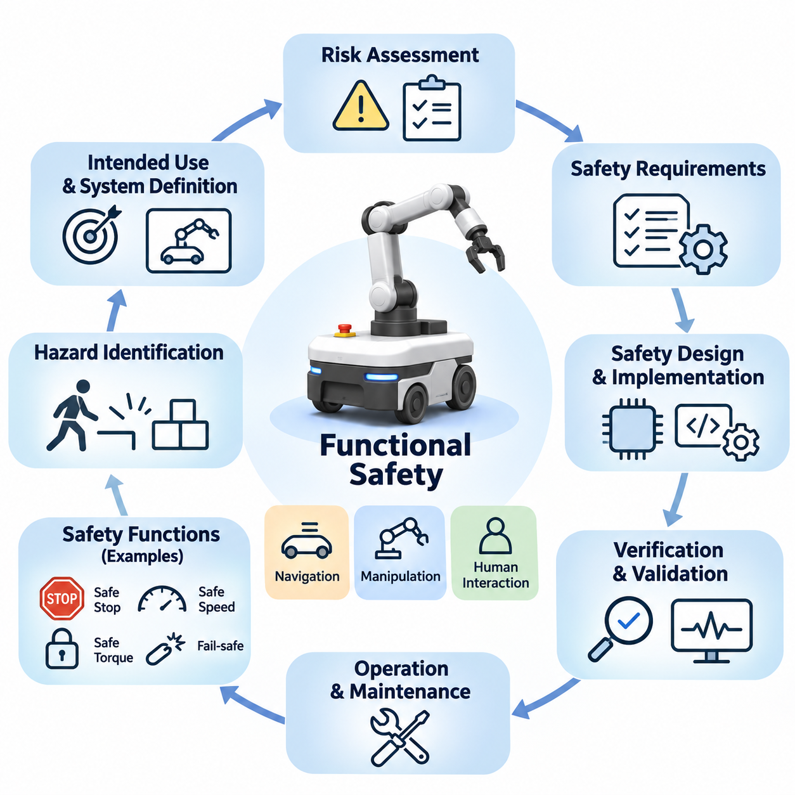
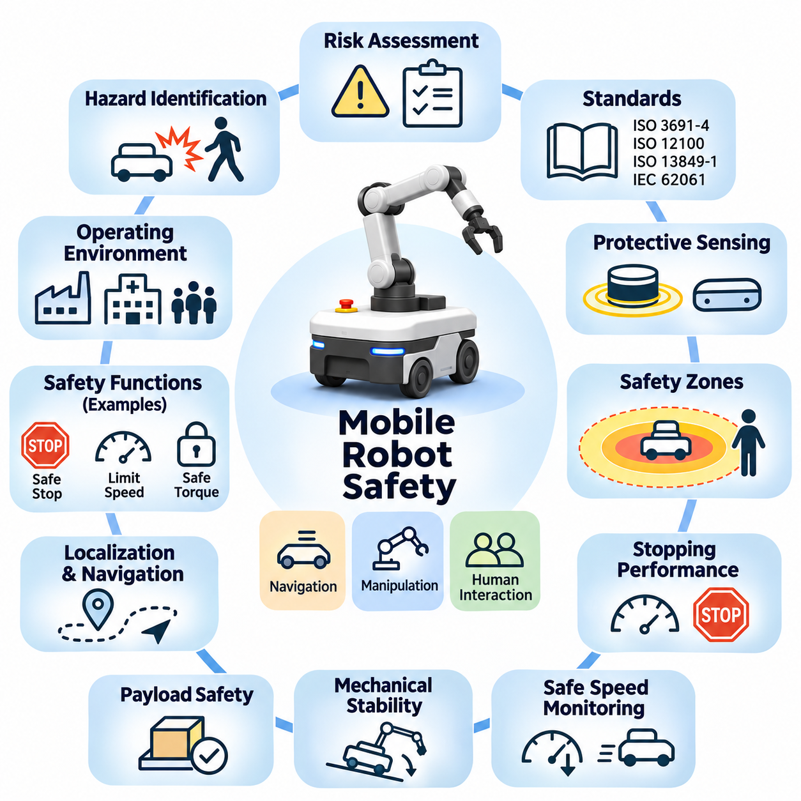
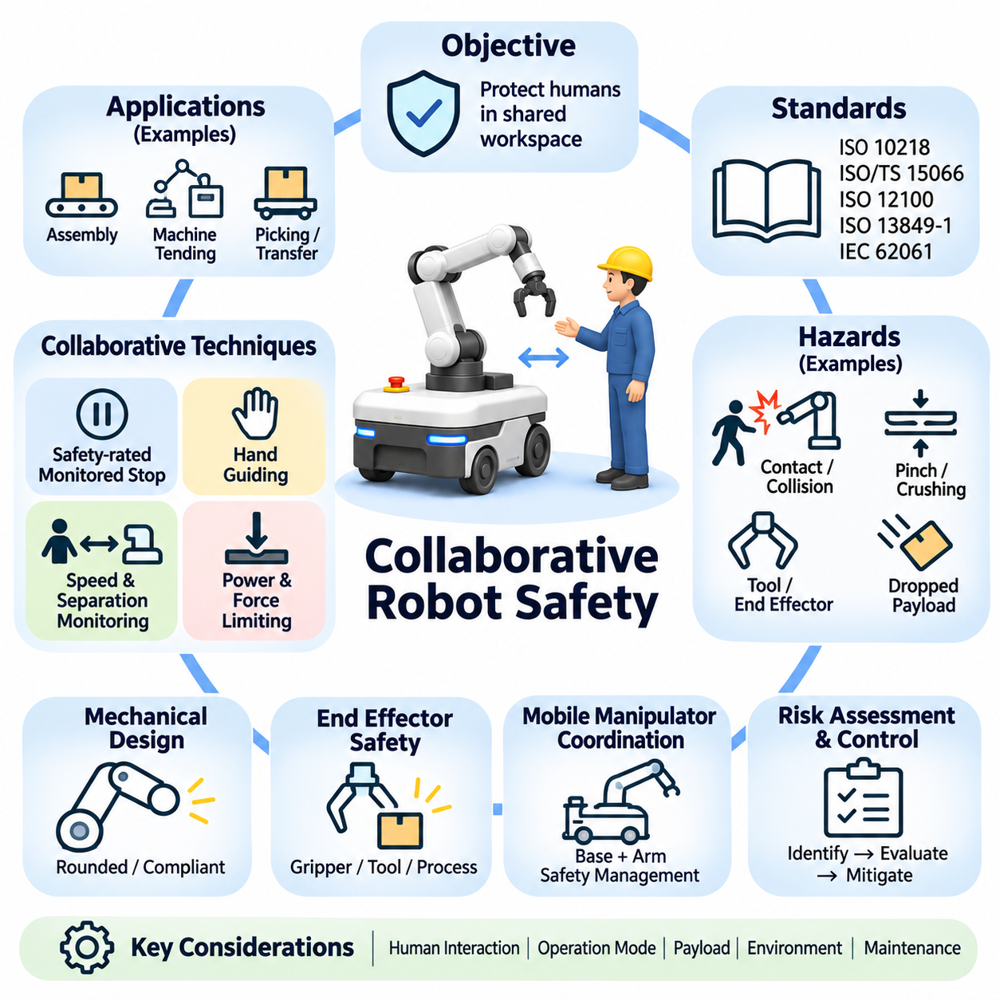
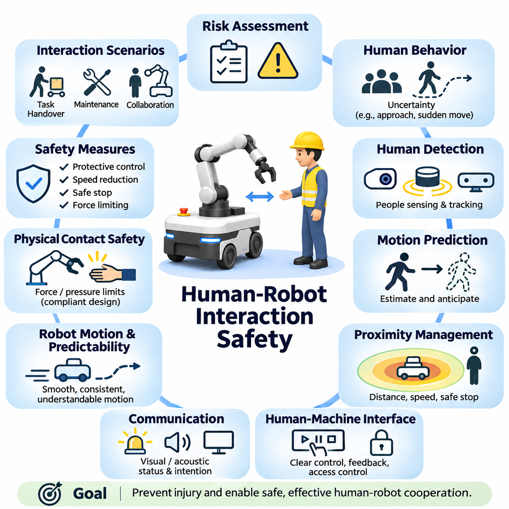
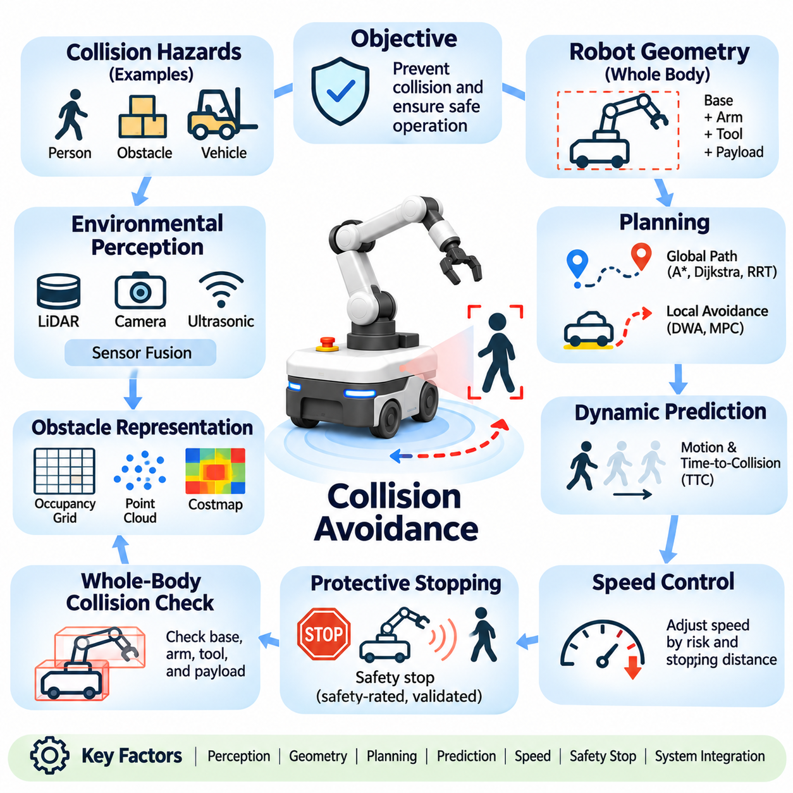
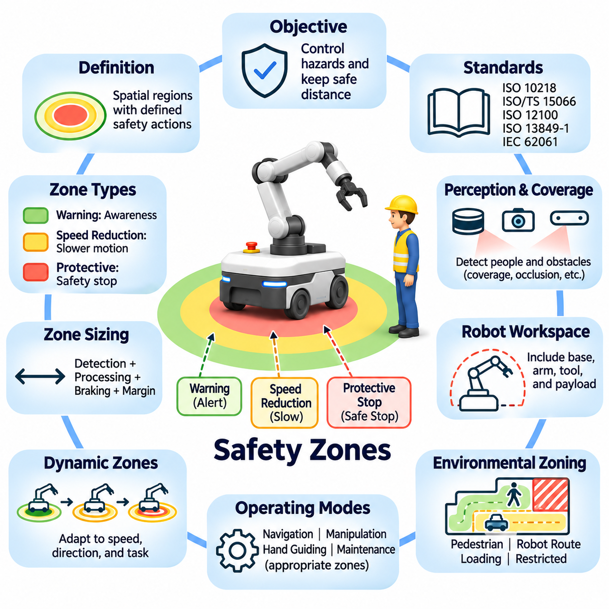
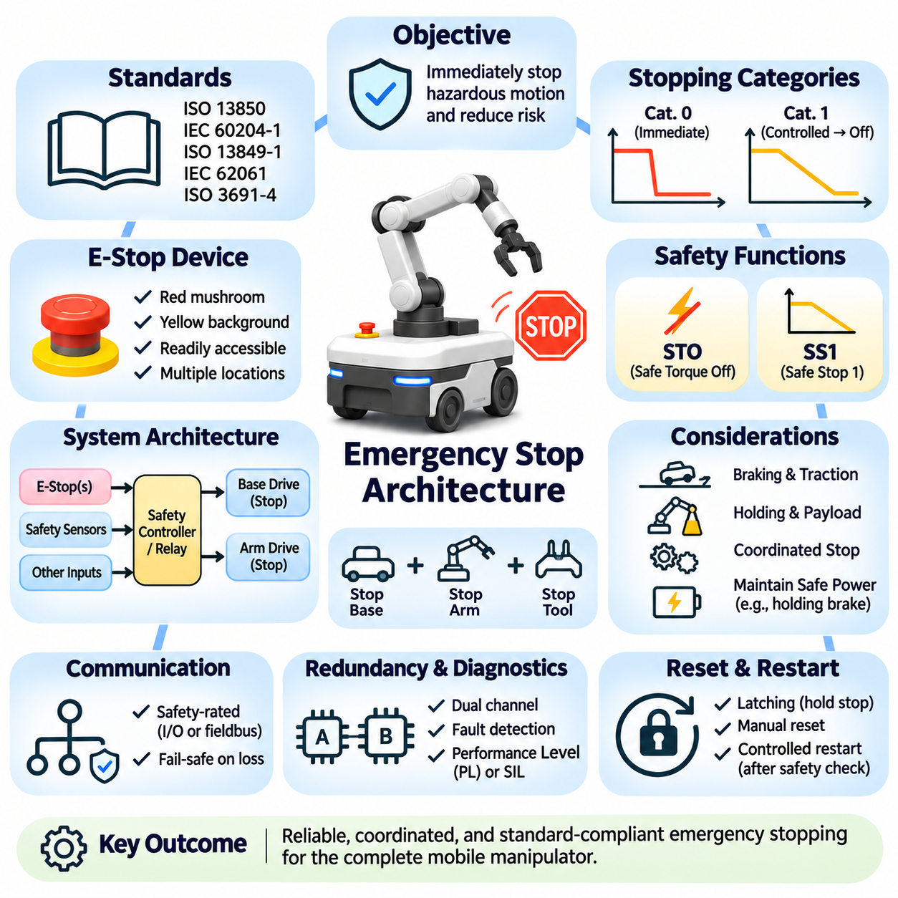
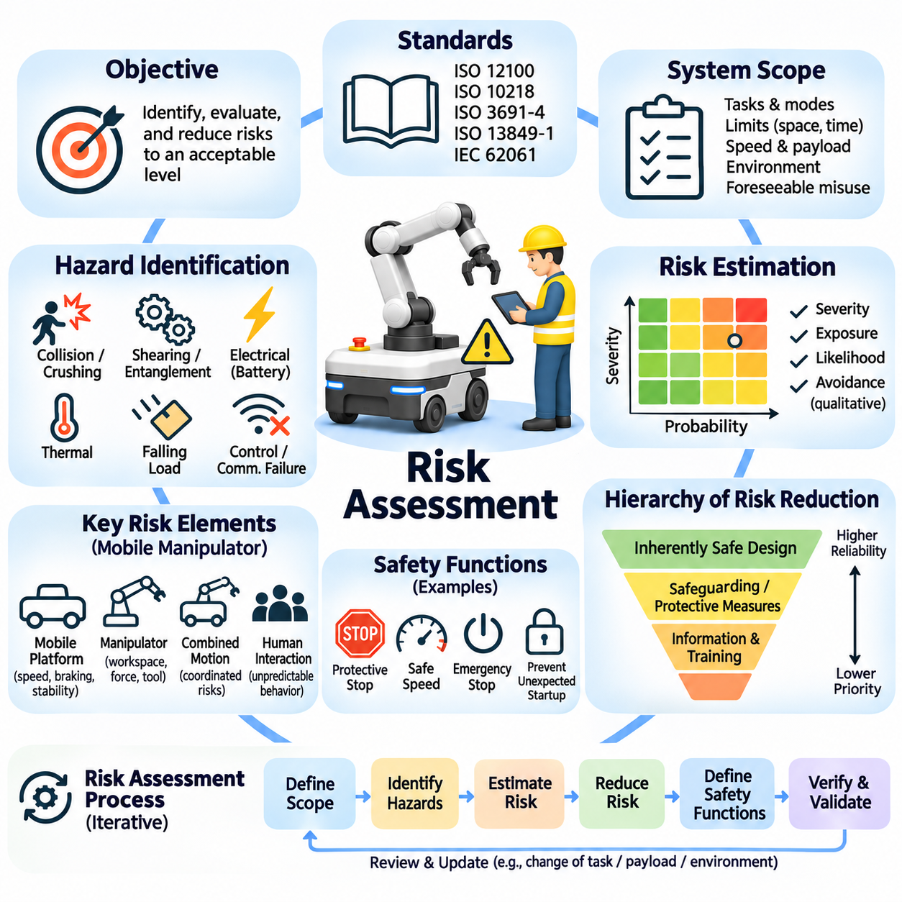
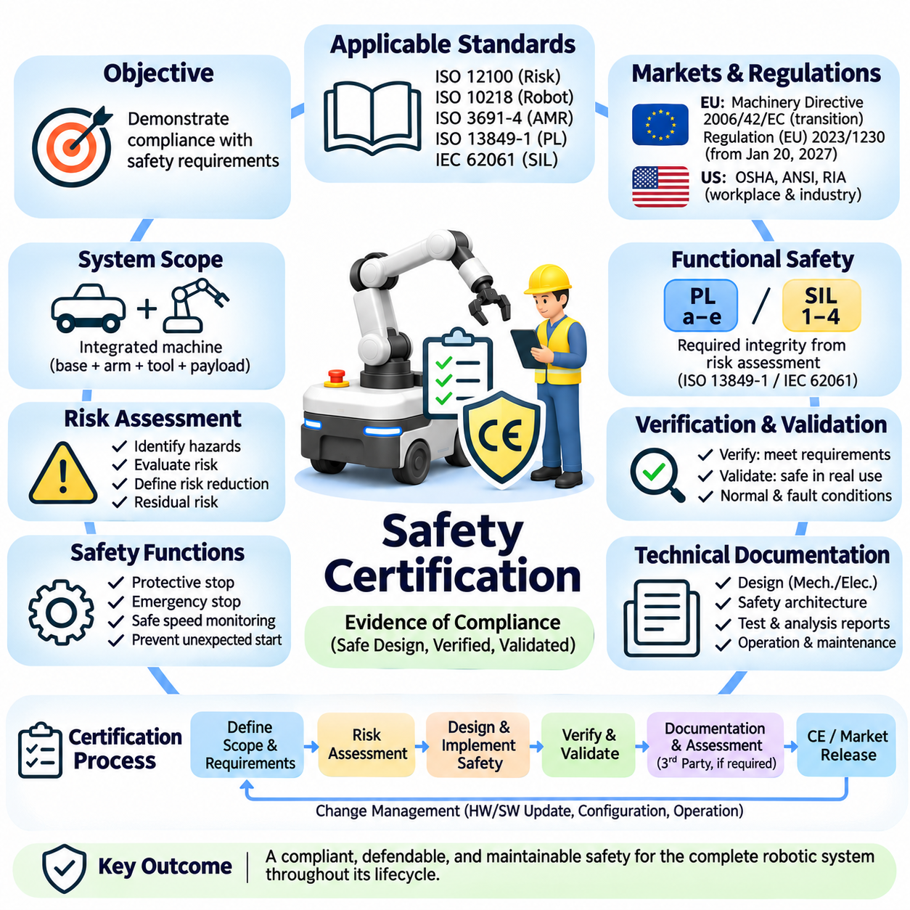

**Volume 01. Mobile Manipulator Foundations and System Architecture**


# Chapter 10. Safety Architecture

##  

## 01 Functional Safety

{width="7.268055555555556in" height="7.268055555555556in"}

Functional safety is a fundamental engineering discipline that ensures a mobile manipulator responds predictably to hazardous conditions, equipment failures, and abnormal operating states. Unlike conventional industrial robots operating within fixed protective enclosures, mobile manipulators combine autonomous navigation with articulated manipulation. Their changing positions, extended workspaces, and interactions with people create complex safety requirements that must be addressed throughout system design.

The primary objective of functional safety is to reduce risks arising from malfunctioning electrical, electronic, and programmable electronic control systems. Safety functions must detect dangerous conditions and initiate protective actions before unacceptable harm occurs. Examples include stopping the mobile platform when an obstacle enters a protective field, disabling manipulator torque during an emergency, and preventing unintended movement following a communication failure.

Functional safety differs from general operational reliability because it focuses specifically on preventing hazardous consequences of system failures. A robot may experience a navigation error without creating an immediate safety hazard, while a failed braking command can expose nearby personnel to serious injury. Consequently, functional safety engineering evaluates not only the probability of component failure but also the severity of potential consequences and the effectiveness of protective measures.

Mobile manipulators require a system-level safety architecture that considers interactions among the mobile base, robotic arm, end effector, sensors, power electronics, and supervisory controllers. A safety function implemented independently within one subsystem may be insufficient when other subsystems remain active. For example, stopping the mobile base does not necessarily eliminate hazards if the manipulator continues moving or an elevated payload becomes unstable.

The functional safety lifecycle begins with defining the intended application, operating environment, foreseeable misuse, and system boundaries. Engineers identify hazardous situations involving personnel, equipment, transported objects, and surrounding infrastructure. These situations are analyzed to determine necessary risk reduction measures. The resulting safety requirements establish the foundation for hardware selection, control architecture, software development, verification, and operational maintenance.

Hazard identification must consider both stationary and dynamic operating conditions. During navigation, hazards include collisions, excessive speed, unstable braking, and unexpected acceleration. During manipulation, hazards include crushing, shearing, entrapment, dropped objects, and uncontrolled joint motion. Combined operations introduce additional risks because arm extension changes the robot\'s effective footprint, center of gravity, and dynamic stability.

Risk assessment evaluates the severity of potential injury and the likelihood of exposure to hazardous conditions. Relevant factors include the frequency and duration of human exposure, the possibility of avoiding harm, and the probability of hazardous events. Engineers use these assessments to determine appropriate safety measures and required safety integrity. Risk evaluation must be repeated whenever operating conditions, payload characteristics, or robot configurations change significantly.

International functional safety frameworks provide systematic methods for developing safety-related control systems. IEC 61508 establishes general principles for electrical, electronic, and programmable electronic safety systems, while ISO 13849-1 and IEC 62061 address safety-related machinery control systems. Depending on the applicable framework, safety requirements may be expressed through Performance Levels or Safety Integrity Levels, which are determined through structured risk assessment.

A Performance Level represents the capability of a safety-related control system to perform its safety function under specified conditions. ISO 13849-1 defines levels from PL a through PL e, with increasing safety performance requirements. Evaluation considers architecture, component reliability, diagnostic coverage, and common-cause failures. The required Performance Level must be established for each safety function rather than assigned uniformly to the entire mobile manipulator.

Safety Integrity Levels provide another method for expressing the required integrity of safety functions. Under IEC 61508, SIL 1 through SIL 4 represent increasing levels of risk reduction capability, although machinery-specific applications commonly use the framework of IEC 62061. SIL and PL classifications are not directly interchangeable. Their application requires consideration of the relevant standard, operating mode, failure characteristics, and safety function.

Safety-related control architecture typically separates protective functions from ordinary motion planning and task execution. Navigation software, artificial intelligence models, and supervisory applications may generate movement commands, but safety controllers independently enforce critical operating constraints. This separation helps prevent failures in complex software from directly compromising protective functions. The architecture must nevertheless account for shared sensors, communication channels, and power dependencies.

Safety-rated sensors provide information necessary for detecting hazardous conditions and monitoring protective boundaries. Depending on the application, these devices may include safety laser scanners, position encoders, interlock switches, emergency stop devices, and safety-rated speed monitoring systems. Ordinary perception cameras and machine learning detectors can support situational awareness, but their outputs should not be assumed to satisfy functional safety requirements without appropriate validation and safety justification.

Redundancy and diagnostic monitoring are important techniques for improving fault tolerance. Dual-channel input circuits, independent monitoring paths, and cross-checking mechanisms can help detect failures that might otherwise remain hidden. However, redundancy alone does not guarantee functional safety because duplicated components may share common failure mechanisms. Designers must evaluate power supply faults, environmental disturbances, systematic software defects, and communication failures.

Safe Torque Off is a widely used drive safety function that prevents motor drives from generating torque capable of producing motion. It is particularly relevant to manipulator joints and mobile drive systems during emergency conditions. However, removing motor torque does not necessarily stop motion immediately or maintain a suspended load. Applications involving gravity, inertia, or unstable payloads may require controlled stopping, mechanical brakes, or additional safety functions.

Safe Stop 1 and Safe Stop 2 provide controlled stopping approaches under defined drive safety requirements. Safe Stop 1 initiates controlled deceleration followed by torque removal, whereas Safe Stop 2 maintains controlled stopping with power available for position holding. Selecting an appropriate stopping function depends on stopping distance, load stability, mechanical configuration, and hazard exposure. Engineers must verify actual stopping performance under representative operating conditions.

Communication safety is essential when protective functions are distributed across the mobile base, manipulator controller, and external automation equipment. Safety communication protocols incorporate mechanisms for detecting corrupted messages, transmission delays, incorrect sequencing, and communication loss. Examples include PROFIsafe, CIP Safety, and FSoE. Their implementation must ensure that detected communication faults lead to predefined safe reactions within acceptable response times.

Functional safety also requires systematic consideration of software behavior. Safety-related software should follow controlled development processes involving requirements traceability, architectural review, coding practices, verification, and configuration management. Software modifications must be evaluated for their effects on existing safety functions. Complex artificial intelligence components present additional challenges because learned behavior may be difficult to predict exhaustively across unfamiliar environments.

A mobile manipulator should implement clearly defined operating modes such as autonomous operation, manual control, maintenance, recovery, and emergency response. Each mode requires explicit authorization conditions and permitted motion limits. Transitions between modes must prevent unexpected activation of hazardous movements. After a protective stop, restarting should require verification that relevant safety conditions have been restored and should not occur merely because a fault signal disappears.

Verification and validation establish whether safety functions satisfy their specified requirements and adequately reduce identified risks. Verification examines implementation correctness through analysis, inspection, simulation, and testing. Validation evaluates whether the integrated system performs safely in its intended application. Representative tests include sensor failures, emergency stopping, communication interruptions, braking under maximum payload, and unexpected obstacles during coordinated movement.

Functional safety performance must remain effective throughout the operational lifetime of the robot. Maintenance procedures should include inspection of safety sensors, emergency stop devices, braking mechanisms, wiring, and safety controller diagnostics. Changes to payload capacity, navigation speed, manipulator reach, or software configuration may invalidate previous assumptions. Periodic reassessment ensures that protective measures remain appropriate as the application evolves.

Documentation is a critical part of demonstrating functional safety. Engineering records should include hazard analyses, risk assessments, safety requirements, architectural descriptions, component reliability data, verification results, validation evidence, and maintenance instructions. Traceability connects each identified hazard to its protective function and supporting test evidence. This structured documentation also facilitates technical reviews, conformity assessment, and future system modifications.

Ultimately, functional safety must be treated as an integrated system property rather than an isolated hardware feature. Effective protection emerges from coordinated mechanical design, electrical architecture, safety control, software engineering, operational procedures, and lifecycle management. For mobile manipulators working near people, a well-engineered functional safety architecture provides the foundation for dependable autonomy, controlled physical interaction, and responsible industrial deployment.

기능 안전(Functional Safety)은 이동형 매니퓰레이터(Mobile Manipulator)가 위험한 상황, 장비 고장 및 비정상적인 작동 상태에 예측 가능하게 대응하도록 보장하는 핵심 공학 분야이다. 고정된 보호 울타리 내부에서 작동하는 기존 산업용 로봇(Industrial Robot)과 달리, 이동형 매니퓰레이터는 자율주행(Autonomous Navigation)과 관절형 조작(Articulated Manipulation)을 결합한다. 따라서 변화하는 위치, 확장된 작업 공간 및 사람과의 상호작용을 고려한 복합적인 안전 요구사항(Safety Requirements)을 시스템 설계 전반에 반영해야 한다.

기능 안전(Functional Safety)의 주요 목적은 전기, 전자 및 프로그램 가능한 전자 제어 시스템(Electrical, Electronic, and Programmable Electronic Control Systems)의 오작동으로 발생하는 위험을 감소시키는 것이다. 안전 기능(Safety Function)은 위험한 상태를 감지하고 허용할 수 없는 피해가 발생하기 전에 보호 동작(Protective Action)을 수행해야 한다. 대표적인 사례로는 장애물이 보호 영역에 진입했을 때 이동 플랫폼을 정지시키거나, 비상 상황에서 매니퓰레이터의 토크를 차단하고, 통신 장애 이후 의도하지 않은 움직임을 방지하는 기능이 있다.

기능 안전(Functional Safety)은 시스템 고장이 초래할 수 있는 위험한 결과를 예방하는 데 초점을 맞춘다는 점에서 일반적인 운영 신뢰성(Operational Reliability)과 구별된다. 로봇에 내비게이션 오류(Navigation Error)가 발생하더라도 즉각적인 안전 위험으로 이어지지 않을 수 있지만, 제동 명령(Braking Command)의 실패는 주변 작업자에게 심각한 부상을 초래할 수 있다. 따라서 기능 안전 공학은 구성요소의 고장 확률뿐 아니라 잠재적인 결과의 심각성과 보호 조치의 효과까지 함께 평가한다.

이동형 매니퓰레이터는 이동 베이스(Mobile Base), 로봇 팔(Robot Arm), 말단장치(End Effector), 센서(Sensor), 전력 전자장치(Power Electronics) 및 상위 제어기(Supervisory Controller) 사이의 상호작용을 고려하는 시스템 수준의 안전 아키텍처(System-Level Safety Architecture)가 필요하다. 특정 하위 시스템에 독립적으로 구현된 안전 기능만으로는 다른 하위 시스템이 계속 작동하는 상황에 충분히 대응하지 못할 수 있다. 예를 들어 이동 베이스가 정지하더라도 매니퓰레이터가 계속 움직이거나 들어 올린 적재물이 불안정해지면 위험이 남는다.

기능 안전 생명주기(Functional Safety Lifecycle)는 의도된 응용 분야, 운영 환경, 합리적으로 예측 가능한 오용(Foreseeable Misuse) 및 시스템 경계(System Boundary)를 정의하는 것에서 시작한다. 엔지니어는 작업자, 장비, 운반 물체 및 주변 시설과 관련된 위험 상황을 식별한다. 이후 위험 분석(Hazard Analysis)을 통해 필요한 위험 감소 조치(Risk Reduction Measures)를 결정한다. 이렇게 도출된 안전 요구사항은 하드웨어 선정, 제어 아키텍처, 소프트웨어 개발, 검증 및 운영 유지보수의 기초가 된다.

위험 식별(Hazard Identification)은 정지 상태와 동적 작동 상태를 모두 고려해야 한다. 자율주행 중에는 충돌, 과속, 불안정한 제동 및 예상하지 못한 가속이 주요 위험이다. 조작 작업에서는 압착(Crushing), 전단(Shearing), 끼임(Entrapment), 물체 낙하 및 제어되지 않은 관절 움직임이 발생할 수 있다. 특히 이동과 조작을 결합한 작업에서는 로봇 팔의 확장으로 유효 점유 영역(Effective Footprint), 무게중심(Center of Gravity) 및 동적 안정성(Dynamic Stability)이 변화하므로 추가적인 위험이 발생한다.

위험성 평가(Risk Assessment)는 잠재적인 부상의 심각성과 위험 상황에 노출될 가능성을 분석한다. 주요 평가 요소에는 사람의 위험 노출 빈도와 지속시간, 위험 회피 가능성 및 위험 사건 발생 확률이 포함된다. 엔지니어는 이러한 평가를 바탕으로 적절한 안전 조치와 요구 안전 무결성(Required Safety Integrity)을 결정한다. 운영 조건, 적재물 특성 또는 로봇 구성이 크게 변경되는 경우에는 위험성 평가를 다시 수행해야 한다.

국제 기능 안전 표준(International Functional Safety Standards)은 안전 관련 제어 시스템을 체계적으로 개발하기 위한 방법론을 제공한다. IEC 61508은 전기, 전자 및 프로그램 가능한 전자 안전 시스템의 일반적인 원칙을 정의하며, ISO 13849-1과 IEC 62061은 기계류의 안전 관련 제어 시스템(Safety-Related Control Systems)을 다룬다. 적용되는 표준 체계에 따라 안전 요구사항은 성능 수준(Performance Level, PL) 또는 안전 무결성 수준(Safety Integrity Level, SIL)으로 표현되며, 이러한 수준은 체계적인 위험성 평가를 통해 결정된다.

성능 수준(Performance Level, PL)은 안전 관련 제어 시스템이 지정된 조건에서 안전 기능을 수행할 수 있는 능력을 나타낸다. ISO 13849-1은 PL a부터 PL e까지 다섯 가지 수준을 정의하며, 상위 수준일수록 더 높은 안전 성능을 요구한다. 평가 과정에서는 시스템 아키텍처(Architecture), 구성요소 신뢰성(Component Reliability), 진단 범위(Diagnostic Coverage) 및 공통 원인 고장(Common-Cause Failure)을 고려한다. 요구 성능 수준은 이동형 매니퓰레이터 전체에 일괄적으로 부여하는 것이 아니라 각각의 안전 기능에 대해 결정해야 한다.

안전 무결성 수준(Safety Integrity Level, SIL)은 안전 기능에 요구되는 무결성을 표현하는 또 다른 방법이다. IEC 61508에서는 SIL 1부터 SIL 4까지 위험 감소 능력이 증가하는 수준을 정의하며, 기계류 분야에서는 일반적으로 IEC 62061의 체계를 활용한다. SIL과 PL은 직접적으로 일대일 대응하거나 상호 교환할 수 있는 분류가 아니다. 따라서 적용 표준, 운영 모드(Operating Mode), 고장 특성(Failure Characteristics) 및 안전 기능의 특성을 고려하여 적절하게 적용해야 한다.

안전 관련 제어 아키텍처(Safety-Related Control Architecture)는 일반적으로 보호 기능을 통상적인 동작 계획(Motion Planning) 및 작업 실행(Task Execution) 기능과 분리한다. 내비게이션 소프트웨어, 인공지능 모델(AI Model) 및 상위 응용 프로그램이 이동 명령을 생성하더라도 안전 제어기(Safety Controller)는 중요한 운영 제한 조건을 독립적으로 강제한다. 이러한 분리는 복잡한 소프트웨어의 고장이 보호 기능을 직접적으로 손상시키는 것을 방지하는 데 도움이 된다. 다만 공유 센서, 통신 채널 및 전원 의존성도 함께 고려해야 한다.

안전 등급 센서(Safety-Rated Sensor)는 위험 상태를 감지하고 보호 경계를 감시하는 데 필요한 정보를 제공한다. 응용 분야에 따라 안전 레이저 스캐너(Safety Laser Scanner), 위치 엔코더(Position Encoder), 인터록 스위치(Interlock Switch), 비상 정지 장치(Emergency Stop Device) 및 안전 등급 속도 감시 시스템(Safety-Rated Speed Monitoring System)을 사용할 수 있다. 일반적인 인지 카메라와 머신러닝 탐지기는 상황 인식을 지원하지만, 적절한 검증과 안전성 입증 없이 기능 안전 요구사항을 충족한다고 가정해서는 안 된다.

이중화(Redundancy)와 진단 감시(Diagnostic Monitoring)는 내결함성(Fault Tolerance)을 향상시키는 중요한 기술이다. 이중 채널 입력 회로(Dual-Channel Input Circuit), 독립적인 감시 경로 및 교차 검증(Cross-Checking) 메커니즘은 감지되지 않고 남을 수 있는 고장을 식별하는 데 도움이 된다. 그러나 이중화만으로 기능 안전이 보장되지는 않는다. 복제된 구성요소도 공통 고장 원인을 공유할 수 있으므로 전원 장애, 환경적 교란, 체계적인 소프트웨어 결함 및 통신 장애를 함께 평가해야 한다.

안전 토크 차단(Safe Torque Off, STO)은 모터 드라이브가 움직임을 발생시키는 토크를 생성하지 못하도록 하는 대표적인 드라이브 안전 기능이다. 이 기능은 비상 상황에서 매니퓰레이터 관절과 이동 구동 시스템에 특히 중요하다. 그러나 모터 토크를 제거한다고 해서 움직임이 즉시 정지하거나 매달린 하중이 유지되는 것은 아니다. 중력, 관성 또는 불안정한 적재물이 관련된 응용 분야에서는 제어 정지(Controlled Stopping), 기계식 브레이크(Mechanical Brake) 또는 추가적인 안전 기능이 필요할 수 있다.

안전 정지 1(Safe Stop 1, SS1)과 안전 정지 2(Safe Stop 2, SS2)는 정의된 드라이브 안전 요구사항에 따라 제어 정지를 수행하는 방법이다. SS1은 제어된 감속을 시작한 후 토크를 제거하는 반면, SS2는 위치 유지를 위한 전원이 공급되는 상태에서 제어 정지 상태를 유지한다. 적절한 정지 기능은 정지 거리(Stopping Distance), 적재물 안정성(Load Stability), 기계적 구성 및 위험 노출 조건에 따라 선택해야 한다. 실제 정지 성능은 대표적인 운영 조건에서 검증해야 한다.

통신 안전(Communication Safety)은 보호 기능이 이동 베이스, 매니퓰레이터 제어기 및 외부 자동화 장비에 분산되어 있을 때 필수적이다. 안전 통신 프로토콜(Safety Communication Protocol)은 메시지 손상, 전송 지연, 잘못된 순서 및 통신 손실을 감지하기 위한 메커니즘을 포함한다. 대표적인 사례로 PROFIsafe, CIP Safety 및 FSoE가 있다. 이러한 프로토콜을 구현할 때는 통신 장애가 감지되면 허용 가능한 응답 시간 내에 사전에 정의된 안전 반응(Safe Reaction)이 수행되도록 보장해야 한다.

기능 안전(Functional Safety)은 소프트웨어 동작에 대한 체계적인 고려도 요구한다. 안전 관련 소프트웨어(Safety-Related Software)는 요구사항 추적성(Requirements Traceability), 아키텍처 검토(Architectural Review), 코딩 규칙(Coding Practices), 검증(Verification) 및 형상 관리(Configuration Management)를 포함하는 통제된 개발 절차를 따라야 한다. 소프트웨어 변경은 기존 안전 기능에 미치는 영향을 평가해야 한다. 특히 복잡한 인공지능 구성요소는 학습된 동작을 익숙하지 않은 환경까지 포괄하여 예측하기 어렵다는 추가적인 문제를 가진다.

이동형 매니퓰레이터는 자율 운전(Autonomous Operation), 수동 제어(Manual Control), 유지보수(Maintenance), 복구(Recovery) 및 비상 대응(Emergency Response)과 같은 운영 모드(Operating Mode)를 명확하게 정의해야 한다. 각 모드에는 명시적인 작동 승인 조건과 허용 동작 제한이 필요하다. 모드 전환 과정에서는 위험한 움직임이 예상하지 못하게 활성화되는 것을 방지해야 한다. 보호 정지 이후 재시작은 관련 안전 조건이 복구되었는지 확인한 후에만 허용되어야 하며, 단순히 고장 신호가 사라졌다는 이유만으로 자동 재시작해서는 안 된다.

검증(Verification)과 유효성 확인(Validation)은 안전 기능이 지정된 요구사항을 충족하고 식별된 위험을 충분히 감소시키는지 확인하는 과정이다. 검증은 분석, 검사, 시뮬레이션 및 시험을 통해 구현의 정확성을 확인한다. 유효성 확인은 통합 시스템이 의도된 응용 환경에서 안전하게 작동하는지를 평가한다. 대표적인 시험에는 센서 고장, 비상 정지, 통신 중단, 최대 적재 상태에서의 제동 및 이동과 조작이 결합된 동작 중 예상하지 못한 장애물 출현이 포함된다.

기능 안전 성능(Functional Safety Performance)은 로봇의 전체 운영 수명(Operational Lifetime) 동안 유지되어야 한다. 유지보수 절차에는 안전 센서, 비상 정지 장치, 제동 기구, 배선 및 안전 제어기 진단 기능에 대한 점검이 포함되어야 한다. 적재 용량(Payload Capacity), 주행 속도(Navigation Speed), 매니퓰레이터 도달 범위(Manipulator Reach) 또는 소프트웨어 구성이 변경되면 기존의 안전 가정이 더 이상 유효하지 않을 수 있다. 정기적인 재평가를 통해 응용 환경의 변화에 맞는 보호 조치가 유지되도록 해야 한다.

문서화(Documentation)는 기능 안전을 입증하는 데 중요한 요소이다. 엔지니어링 기록에는 위험 분석(Hazard Analysis), 위험성 평가(Risk Assessment), 안전 요구사항(Safety Requirements), 아키텍처 설명, 구성요소 신뢰성 데이터, 검증 결과, 유효성 확인 증거 및 유지보수 지침이 포함되어야 한다. 추적성(Traceability)은 식별된 각각의 위험을 대응하는 보호 기능 및 시험 증거와 연결한다. 이러한 체계적인 문서화는 기술 검토, 적합성 평가(Conformity Assessment) 및 향후 시스템 변경을 지원한다.

궁극적으로 기능 안전(Functional Safety)은 독립된 하드웨어 기능이 아니라 통합된 시스템 속성(System Property)으로 다루어야 한다. 효과적인 보호는 기계 설계(Mechanical Design), 전기 아키텍처(Electrical Architecture), 안전 제어(Safety Control), 소프트웨어 공학(Software Engineering), 운영 절차 및 생명주기 관리(Lifecycle Management)의 유기적인 결합을 통해 구현된다. 사람과 가까운 환경에서 작동하는 이동형 매니퓰레이터에서 체계적으로 설계된 기능 안전 아키텍처는 신뢰할 수 있는 자율성, 제어된 물리적 상호작용 및 책임 있는 산업 현장 적용을 위한 기반을 제공한다.

##  

## 02 Mobile Robot Safety

{width="7.268055555555556in" height="7.268055555555556in"}

Mobile robot safety is a critical engineering discipline that addresses hazards arising from autonomous movement, dynamic environments, and interactions with people and equipment. Unlike stationary industrial robots, mobile robots continuously change their positions and operating conditions. When a mobile platform supports a robotic manipulator, safety engineering must account for navigation behavior, mechanical stability, payload characteristics, and the combined motion of the mobile base and robotic arm.

The primary objective of mobile robot safety is to prevent injuries, equipment damage, and hazardous interactions during autonomous operation. Safety measures must address predictable operating conditions and reasonably foreseeable failures. These include collisions with pedestrians, unexpected acceleration, navigation errors, unstable braking, and loss of localization. Effective protection requires coordinated mechanical, electrical, sensing, and control architectures rather than relying on a single protective device.

Autonomous Mobile Robots operate in environments containing static obstacles, moving vehicles, pedestrians, and changing workspace configurations. Warehouses, factories, hospitals, and public facilities introduce different exposure conditions and operational constraints. Safety requirements must therefore reflect the intended application, traffic density, floor characteristics, environmental visibility, and frequency of human interaction. A safety strategy suitable for an isolated factory corridor may be inadequate in a crowded hospital.

Risk assessment provides the foundation for mobile robot safety engineering. Engineers identify hazardous situations associated with movement, stopping, turning, docking, and load handling. Each hazard is evaluated according to potential injury severity, exposure frequency, and the possibility of avoiding harm. The resulting risk assessment determines necessary protective measures and safety-related control requirements. Reassessment is essential when operating speeds, payloads, routes, or environmental conditions change.

International standards provide guidance for designing and evaluating mobile robot safety. ISO 3691-4 addresses safety requirements and verification for driverless industrial trucks and their systems, including applicable autonomous mobile platforms. ISO 12100 establishes principles for machinery risk assessment and risk reduction, while ISO 13849-1 and IEC 62061 support safety-related control system design. The applicability of each standard depends on the robot\'s classification, intended use, and operating environment.

Protective sensing is a central element of mobile robot safety architecture. Safety-rated laser scanners, protective bumpers, and other validated sensing devices detect hazardous conditions around the robot. These sensors establish protective regions that initiate speed reduction or stopping when necessary. Their placement must account for the robot\'s geometry, direction of travel, braking performance, and possible blind spots. Sensor coverage should remain effective during turning, reversing, and docking operations.

Safety zones define spatial regions in which the robot applies different protective responses. A warning zone may trigger reduced speed, while entry into a protective stopping zone initiates a safety-related stop. Zone dimensions depend on robot velocity, sensor response time, controller processing delay, braking distance, and required safety margins. Dynamic zone switching can support different operating modes, provided that switching logic and protective coverage satisfy the applicable safety requirements.

Stopping performance is particularly important because mobile robots possess kinetic energy that increases with mass and the square of velocity. A heavily loaded robot traveling at moderate speed may require substantial stopping distance. Engineers must consider braking torque, tire friction, floor slope, wheel slip, and payload distribution. Stopping distance should be validated under representative worst-case conditions, including maximum permitted payload, degraded traction, and relevant environmental variations.

Safe speed monitoring limits robot velocity when operating conditions become hazardous. Speed restrictions may be applied near pedestrian crossings, narrow corridors, docking stations, or shared workspaces. Safety-rated monitoring functions must detect excessive speed and initiate an appropriate protective response. Ordinary navigation software can request slower movement, but safety-critical speed enforcement should be implemented through validated safety-related control functions where required by the risk assessment.

Mechanical stability is another essential safety consideration for mobile manipulators. Extending a robotic arm changes the center of gravity and introduces additional moments around the mobile platform. Rapid acceleration, sharp turning, or sudden braking can increase tipping risk. Stability analysis must consider robot mass, wheelbase, track width, payload position, manipulator reach, and floor inclination. Operating limits should prevent combinations of movement and arm configuration that exceed validated stability boundaries.

Payload safety requires careful management of transported and manipulated objects. Unsecured loads may shift during acceleration or braking, while improperly grasped objects may fall during navigation. The safety architecture should account for payload mass, center of gravity, gripping force, and attachment reliability. Where necessary, load monitoring, mechanical retention, and restricted motion profiles reduce the probability of hazardous load movement or accidental release.

Localization and navigation failures can introduce dangerous behavior when the robot incorrectly estimates its position or surroundings. Sensor degradation, map inconsistencies, wheel odometry errors, and environmental changes may reduce localization confidence. The control system should recognize relevant abnormalities and transition to an appropriate restricted or safe state. However, localization confidence alone should not replace independently validated protective sensing and safety-related motion control.

Human interaction creates additional challenges because pedestrian movement is difficult to predict. People may suddenly cross a robot\'s path, approach from blind spots, or stand near docking stations. Safety design should consider visibility, predictable robot behavior, acoustic warnings, visual indicators, and appropriate travel speeds. Warning devices improve awareness but do not replace protective safety functions. Robot behavior should remain understandable and consistent during normal and abnormal operating conditions.

Emergency stopping provides a means to initiate protective action when hazardous situations are identified. Emergency stop devices should be accessible where required by the risk assessment and integrated with the robot\'s safety-related control architecture. The resulting stop must address relevant hazardous movements of both the mobile platform and manipulator. Emergency stopping is a complementary protective measure and should not be treated as a substitute for automatic safeguarding or inherently safe design.

Communication failures must also be considered in distributed mobile robot systems. A robot may exchange commands with fleet management software, remote operators, docking stations, and industrial equipment. Loss of ordinary network connectivity should not disable essential onboard protective functions. Safety-related communication channels require appropriate fault detection and defined responses to invalid or missing messages. Remote supervision should support operational coordination without becoming an uncontrolled dependency for immediate safety.

Battery and electrical safety are important because mobile robots operate using onboard energy storage and power conversion systems. Potential hazards include short circuits, overheating, insulation failures, unexpected energization, and battery thermal events. Battery management systems, protective devices, electrical isolation, and thermal monitoring contribute to risk reduction. Charging interfaces must also address connector integrity, unintended movement, electrical contact hazards, and abnormal charging conditions.

Docking and automated charging introduce additional risks because robots operate close to fixed structures and electrical equipment. Precise positioning may require low-speed movement in confined spaces, where crushing and trapping hazards can arise. Docking safety should include controlled approach behavior, appropriate obstacle detection, mechanical alignment, and safe electrical connection procedures. Protective functions must remain effective even when the robot operates near structures that partially obstruct sensors.

Mobile robot safety also depends on operating environment management. Floor conditions, ramps, thresholds, doorways, elevators, and pedestrian traffic influence system behavior. Site-specific risk assessments should identify areas requiring restricted speed, additional sensing, physical separation, or procedural controls. Environmental modifications such as improved markings, protected crossings, and designated robot routes can reduce exposure to hazards while improving operational predictability.

Verification and validation demonstrate whether the integrated safety architecture performs as intended. Testing should cover protective field detection, emergency stopping, braking distance, speed monitoring, stability limits, sensor faults, and communication interruptions. Representative scenarios must include loaded and unloaded operation, turning, reversing, and interactions with moving obstacles. Results should be documented against measurable acceptance criteria established during safety requirements development.

Operational safety requires continuous attention after deployment. Preventive maintenance should include inspection of brakes, wheels, safety sensors, emergency stop devices, and electrical connections. Software updates, route changes, new payloads, and modifications to surrounding infrastructure may affect previously validated assumptions. Periodic inspection, incident analysis, and controlled change management help maintain the effectiveness of protective measures throughout the robot\'s service life.

A comprehensive mobile robot safety architecture combines risk assessment, protective sensing, safety-related motion control, mechanical stability, electrical protection, and operational procedures. For mobile manipulators, these measures must extend across both navigation and manipulation activities. Effective safety engineering enables robots to operate productively in shared environments while maintaining predictable responses to hazards, failures, and changing operational conditions.

이동 로봇 안전(Mobile Robot Safety)은 자율 이동(Autonomous Movement), 동적 환경(Dynamic Environment), 사람 및 장비와의 상호작용에서 발생하는 위험을 다루는 핵심 공학 분야이다. 고정형 산업용 로봇(Stationary Industrial Robot)과 달리 이동 로봇은 위치와 운영 조건이 지속적으로 변화한다. 이동 플랫폼(Mobile Platform)에 로봇 매니퓰레이터(Robot Manipulator)가 장착된 경우, 안전 공학은 자율주행 동작, 기계적 안정성, 적재물 특성 및 이동 베이스와 로봇 팔의 복합적인 움직임을 함께 고려해야 한다.

이동 로봇 안전(Mobile Robot Safety)의 주요 목적은 자율 운전(Autonomous Operation) 중 발생할 수 있는 인명 피해, 장비 손상 및 위험한 상호작용을 예방하는 것이다. 안전 조치는 예측 가능한 운영 조건과 합리적으로 예상할 수 있는 고장을 모두 다루어야 한다. 여기에는 보행자와의 충돌, 예상하지 못한 가속, 내비게이션 오류(Navigation Error), 불안정한 제동 및 위치 추정(Localization) 실패가 포함된다. 효과적인 보호를 위해서는 단일 보호 장치에 의존하지 않고 기계, 전기, 센싱 및 제어 아키텍처를 통합적으로 구성해야 한다.

자율이동로봇(Autonomous Mobile Robot, AMR)은 고정 장애물(Static Obstacle), 이동 차량, 보행자 및 변화하는 작업 공간이 존재하는 환경에서 작동한다. 창고, 공장, 병원 및 공공시설은 서로 다른 위험 노출 조건과 운영 제약을 가진다. 따라서 안전 요구사항(Safety Requirements)은 적용 분야, 교통 밀도, 바닥 특성, 환경 가시성 및 사람과의 상호작용 빈도를 반영해야 한다. 격리된 공장 통로에 적합한 안전 전략이 혼잡한 병원 환경에서는 충분하지 않을 수 있다.

위험성 평가(Risk Assessment)는 이동 로봇 안전 공학의 기초를 제공한다. 엔지니어는 이동, 정지, 회전, 도킹(Docking) 및 적재물 취급 과정에서 발생할 수 있는 위험 상황을 식별한다. 각 위험은 잠재적인 부상의 심각도, 노출 빈도 및 위험 회피 가능성을 기준으로 평가한다. 평가 결과에 따라 필요한 보호 조치(Protective Measures)와 안전 관련 제어 요구사항(Safety-Related Control Requirements)을 결정한다. 운행 속도, 적재물, 이동 경로 또는 환경 조건이 변경되면 위험성 평가를 다시 수행해야 한다.

국제 표준(International Standards)은 이동 로봇 안전을 설계하고 평가하기 위한 지침을 제공한다. ISO 3691-4는 적용 대상인 자율이동 플랫폼을 포함하여 무인 산업용 운반차(Driverless Industrial Truck) 및 관련 시스템의 안전 요구사항과 검증 방법을 다룬다. ISO 12100은 기계류의 위험성 평가와 위험 감소 원칙을 정의하며, ISO 13849-1과 IEC 62061은 안전 관련 제어 시스템(Safety-Related Control System)의 설계를 지원한다. 각 표준의 적용 여부는 로봇의 분류, 의도된 사용 목적 및 운영 환경에 따라 결정된다.

보호 센싱(Protective Sensing)은 이동 로봇 안전 아키텍처(Safety Architecture)의 핵심 요소이다. 안전 등급 레이저 스캐너(Safety-Rated Laser Scanner), 보호 범퍼(Protective Bumper) 및 검증된 감지 장치는 로봇 주변의 위험 상태를 탐지한다. 이러한 센서는 필요한 경우 감속 또는 정지를 시작하는 보호 영역(Protective Region)을 설정한다. 센서 배치는 로봇 형상, 이동 방향, 제동 성능 및 사각지대(Blind Spot)를 고려해야 하며, 회전, 후진 및 도킹 중에도 감지 범위가 효과적으로 유지되어야 한다.

안전 구역(Safety Zone)은 로봇이 서로 다른 보호 반응을 적용하는 공간적 영역을 정의한다. 경고 구역(Warning Zone)에 진입하면 속도를 줄일 수 있으며, 보호 정지 구역(Protective Stopping Zone)에 진입하면 안전 관련 정지 기능이 작동한다. 구역 크기는 로봇 속도, 센서 응답 시간, 제어기 처리 지연, 제동 거리 및 필요한 안전 여유(Safety Margin)에 따라 결정된다. 동적 구역 전환(Dynamic Zone Switching)은 전환 논리와 보호 범위가 관련 안전 요구사항을 충족하는 조건에서 다양한 운영 모드를 지원할 수 있다.

정지 성능(Stopping Performance)은 이동 로봇의 운동에너지(Kinetic Energy)가 질량에 비례하고 속도의 제곱에 비례하여 증가하기 때문에 특히 중요하다. 무거운 적재물을 운반하는 로봇은 중간 수준의 속도로 이동하더라도 상당한 정지 거리가 필요할 수 있다. 엔지니어는 제동 토크(Braking Torque), 타이어 마찰력(Tire Friction), 바닥 경사, 바퀴 미끄러짐(Wheel Slip) 및 적재물 분포를 고려해야 한다. 정지 거리는 최대 허용 적재량, 접지력 저하 및 관련 환경 변화를 포함한 대표적인 최악 조건(Worst-Case Conditions)에서 검증해야 한다.

안전 속도 감시(Safe Speed Monitoring)는 운영 조건이 위험해질 때 로봇의 이동 속도를 제한한다. 보행자 횡단 구역, 좁은 통로, 도킹 스테이션(Docking Station) 또는 공동 작업 공간(Shared Workspace) 근처에서는 속도 제한이 적용될 수 있다. 안전 등급 감시 기능은 과속을 감지하고 적절한 보호 반응을 시작해야 한다. 일반적인 내비게이션 소프트웨어가 감속을 요청할 수 있지만, 위험성 평가에서 요구하는 안전 필수 속도 제한은 검증된 안전 관련 제어 기능을 통해 강제해야 한다.

기계적 안정성(Mechanical Stability)은 이동형 매니퓰레이터(Mobile Manipulator)의 또 다른 핵심 안전 요소이다. 로봇 팔이 확장되면 무게중심(Center of Gravity)이 이동하고 이동 플랫폼에 추가적인 모멘트(Moment)가 발생한다. 급가속, 급회전 또는 급제동은 전복 위험(Tipping Risk)을 증가시킬 수 있다. 안정성 분석(Stability Analysis)은 로봇 질량, 축간거리(Wheelbase), 윤거(Track Width), 적재물 위치, 매니퓰레이터 도달 범위 및 바닥 경사를 고려해야 한다. 운영 제한 조건은 검증된 안정성 한계를 초과하는 이동과 로봇 팔 자세의 조합을 방지해야 한다.

적재물 안전(Payload Safety)은 운반하거나 조작하는 물체를 신중하게 관리할 것을 요구한다. 고정되지 않은 적재물은 가속 또는 제동 중 이동할 수 있으며, 부적절하게 파지된 물체는 주행 중 떨어질 수 있다. 안전 아키텍처는 적재물 질량, 무게중심, 파지력(Gripping Force) 및 부착 신뢰성(Attachment Reliability)을 고려해야 한다. 필요한 경우 하중 감시(Load Monitoring), 기계적 고정(Mechanical Retention) 및 제한된 동작 프로파일(Restricted Motion Profile)을 통해 위험한 적재물 이동이나 우발적인 낙하 가능성을 줄일 수 있다.

위치 추정(Localization) 및 내비게이션(Navigation) 실패는 로봇이 자신의 위치나 주변 환경을 잘못 판단할 때 위험한 동작을 유발할 수 있다. 센서 성능 저하, 지도 불일치(Map Inconsistency), 바퀴 주행거리계 오차(Wheel Odometry Error) 및 환경 변화는 위치 추정 신뢰도(Localization Confidence)를 낮출 수 있다. 제어 시스템은 관련 이상 상태를 인식하고 적절한 제한 상태(Restricted State) 또는 안전 상태(Safe State)로 전환해야 한다. 그러나 위치 추정 신뢰도만으로 독립적으로 검증된 보호 센싱과 안전 관련 동작 제어를 대체해서는 안 된다.

사람과의 상호작용(Human Interaction)은 보행자의 움직임을 예측하기 어렵기 때문에 추가적인 안전 문제를 발생시킨다. 사람은 갑자기 로봇의 이동 경로를 가로지르거나 사각지대에서 접근하고 도킹 스테이션 근처에 머무를 수 있다. 안전 설계는 가시성(Visibility), 예측 가능한 로봇 동작(Predictable Robot Behavior), 음향 경고(Acoustic Warning), 시각 표시 장치(Visual Indicator) 및 적절한 주행 속도를 고려해야 한다. 경고 장치는 상황 인식을 향상시키지만 보호 안전 기능을 대체하지는 못한다. 로봇 동작은 정상 및 비정상 운영 조건에서 이해하기 쉽고 일관성을 유지해야 한다.

비상 정지(Emergency Stop)는 위험 상황이 확인되었을 때 보호 동작을 시작하는 수단을 제공한다. 비상 정지 장치(Emergency Stop Device)는 위험성 평가에서 요구하는 위치에 접근 가능하도록 배치하고 로봇의 안전 관련 제어 아키텍처와 통합해야 한다. 정지 동작은 이동 플랫폼과 매니퓰레이터의 관련 위험 움직임을 모두 처리해야 한다. 비상 정지는 보완적인 보호 조치(Complementary Protective Measure)이며, 자동 보호 기능(Automatic Safeguarding)이나 본질적으로 안전한 설계(Inherently Safe Design)를 대체하는 수단으로 취급해서는 안 된다.

분산형 이동 로봇 시스템(Distributed Mobile Robot System)에서는 통신 장애(Communication Failure)도 고려해야 한다. 로봇은 군집 관리 소프트웨어(Fleet Management Software), 원격 운영자(Remote Operator), 도킹 스테이션 및 산업용 장비와 명령을 교환할 수 있다. 일반 네트워크 연결이 끊어지더라도 필수적인 온보드 보호 기능(Onboard Protective Function)이 비활성화되어서는 안 된다. 안전 관련 통신 채널(Safety-Related Communication Channel)은 적절한 오류 감지와 잘못되거나 누락된 메시지에 대한 정의된 대응 기능을 갖추어야 한다. 원격 감독은 운영 조정을 지원하되 즉각적인 안전 확보를 위한 통제되지 않은 의존 요소가 되어서는 안 된다.

배터리 및 전기 안전(Battery and Electrical Safety)은 이동 로봇이 온보드 에너지 저장장치(Onboard Energy Storage)와 전력 변환 시스템(Power Conversion System)을 사용하기 때문에 중요하다. 잠재적인 위험에는 단락(Short Circuit), 과열(Overheating), 절연 고장(Insulation Failure), 의도하지 않은 전원 인가(Unexpected Energization) 및 배터리 열적 사고(Battery Thermal Event)가 포함된다. 배터리 관리 시스템(Battery Management System, BMS), 보호 장치, 전기적 절연(Electrical Isolation) 및 열 감시(Thermal Monitoring)는 위험 감소에 기여한다. 충전 인터페이스(Charging Interface)는 커넥터 무결성, 의도하지 않은 움직임, 전기 접촉 위험 및 비정상 충전 조건도 다루어야 한다.

도킹(Docking)과 자동 충전(Automated Charging)은 로봇이 고정 구조물과 전기 장비 가까이에서 작동하기 때문에 추가적인 위험을 발생시킨다. 정밀한 위치 정렬을 위해 제한된 공간에서 저속 이동이 필요할 수 있으며, 이 과정에서 압착(Crushing) 및 끼임(Trapping) 위험이 발생할 수 있다. 도킹 안전은 제어된 접근 동작(Controlled Approach Behavior), 적절한 장애물 감지, 기계적 정렬(Mechanical Alignment) 및 안전한 전기 연결 절차를 포함해야 한다. 로봇이 센서를 부분적으로 가리는 구조물 근처에서 작동하더라도 보호 기능은 유효하게 유지되어야 한다.

이동 로봇 안전은 운영 환경 관리(Operating Environment Management)에도 의존한다. 바닥 상태, 경사로(Ramp), 문턱(Threshold), 출입문(Doorway), 엘리베이터(Elevator) 및 보행자 통행은 시스템 동작에 영향을 미친다. 현장별 위험성 평가(Site-Specific Risk Assessment)는 속도 제한, 추가 센싱, 물리적 분리(Physical Separation) 또는 절차적 통제(Procedural Control)가 필요한 구역을 식별해야 한다. 바닥 표시 개선, 보호된 횡단 구역 및 지정된 로봇 이동 경로와 같은 환경 개선은 위험 노출을 줄이는 동시에 운영 예측 가능성을 높일 수 있다.

검증(Verification)과 유효성 확인(Validation)은 통합 안전 아키텍처가 의도한 대로 작동하는지 입증한다. 시험에는 보호 영역 감지, 비상 정지, 제동 거리, 속도 감시, 안정성 한계, 센서 고장 및 통신 중단이 포함되어야 한다. 대표적인 시험 시나리오(Test Scenario)는 적재 및 비적재 상태, 회전, 후진 및 이동 장애물과의 상호작용을 포함해야 한다. 시험 결과는 안전 요구사항 개발 과정에서 수립한 측정 가능한 합격 기준(Measurable Acceptance Criteria)에 따라 문서화해야 한다.

운영 안전(Operational Safety)은 배치 이후에도 지속적인 관리가 필요하다. 예방 정비(Preventive Maintenance)에는 브레이크, 바퀴, 안전 센서, 비상 정지 장치 및 전기 연결부의 점검이 포함되어야 한다. 소프트웨어 업데이트(Software Update), 경로 변경, 새로운 적재물 및 주변 시설의 변경은 이전에 검증된 가정에 영향을 줄 수 있다. 정기 점검(Periodic Inspection), 사고 분석(Incident Analysis) 및 통제된 변경 관리(Controlled Change Management)는 로봇의 사용 수명(Service Life) 전반에 걸쳐 보호 조치의 효과를 유지하는 데 도움이 된다.

포괄적인 이동 로봇 안전 아키텍처(Comprehensive Mobile Robot Safety Architecture)는 위험성 평가(Risk Assessment), 보호 센싱(Protective Sensing), 안전 관련 동작 제어(Safety-Related Motion Control), 기계적 안정성(Mechanical Stability), 전기적 보호(Electrical Protection) 및 운영 절차(Operational Procedures)를 통합한다. 이동형 매니퓰레이터에서는 이러한 조치가 자율주행과 조작 작업 모두에 적용되어야 한다. 효과적인 안전 공학(Safety Engineering)은 위험, 고장 및 변화하는 운영 조건에 대해 예측 가능한 대응을 유지하면서 로봇이 사람과 공유하는 환경에서 생산적으로 작동할 수 있도록 한다.

##  

## 03 Collaborative Robot Safety

{width="7.268055555555556in" height="7.268055555555556in"}

Collaborative robot safety focuses on protecting humans who work directly or indirectly with robotic systems in shared environments. Unlike traditional industrial robots separated from personnel by physical barriers, collaborative robots are designed for applications where human presence may be expected within the robot workspace. When integrated with an autonomous mobile platform, collaborative manipulation introduces additional safety challenges involving navigation, arm movement, payload handling, and changing human proximity.

The fundamental objective of collaborative robot safety is to reduce risks associated with physical contact, unexpected movement, and hazardous interactions. Collaboration does not automatically imply that unrestricted contact between humans and robots is safe. Instead, safety must be established through application-specific risk assessment, protective control functions, mechanical design, and operational procedures. The complete robotic application, rather than the collaborative robot arm alone, determines the required safety measures.

Collaborative robot applications may involve humans and robots working sequentially, sharing equipment, or performing coordinated tasks within overlapping workspaces. Examples include assembly assistance, machine tending, warehouse picking, and material transfer. Each application creates different exposure conditions because human positions, robot trajectories, and task requirements vary. Safety engineering must consider foreseeable interactions during normal operation, maintenance, recovery, and unexpected interruptions.

International standards provide a foundation for collaborative robot safety. ISO 10218 addresses industrial robot and robot application safety, while ISO/TS 15066 provides additional guidance for collaborative applications, including biomechanical considerations for physical contact. ISO 12100 supports risk assessment, and ISO 13849-1 or IEC 62061 may apply to safety-related control systems. Applicable requirements depend on the robot configuration, application, operating environment, and relevant standard editions.

Collaborative operations are commonly organized around four recognized techniques: safety-rated monitored stop, hand guiding, speed and separation monitoring, and power and force limiting. These techniques provide different methods for managing human exposure to robot motion. They may be implemented individually or combined within a single application. Selection depends on the required interaction, available protective technology, robot dynamics, and the results of the application-specific risk assessment.

Safety-rated monitored stop allows a robot to remain in a monitored stationary condition while a person enters the collaborative workspace. The safety system must detect conditions that invalidate the monitored stop and respond appropriately. This technique is useful when workers perform loading, inspection, or adjustment tasks near the manipulator. Motion may resume only after the necessary safety conditions are satisfied and the applicable restart requirements have been met.

Hand guiding enables an operator to direct robot movement through an appropriately designed guiding interface. This technique can support teaching, positioning, and certain cooperative handling tasks. Safety depends on controlled motion, suitable enabling devices, and appropriate speed limitations. The robot must respond predictably to operator input and abnormal conditions. Hand guiding should not be confused with unrestricted manual pushing of a robot that lacks validated collaborative safety functions.

Speed and separation monitoring maintains a protective distance between humans and moving robot components. As a person approaches, the robot may reduce speed or initiate a protective stop before separation becomes insufficient. Required separation depends on human approach speed, robot motion, stopping performance, sensing uncertainty, and system response time. Protective sensing and monitoring functions must satisfy the safety requirements established for the application.

Power and force limiting reduces the potential consequences of physical contact by controlling robot forces, pressures, energy, and motion characteristics. This approach may involve torque sensing, compliant mechanical structures, force monitoring, and restricted operating speeds. However, safe contact limits depend on the affected body region and contact conditions. Transient impacts and quasi-static crushing situations must be evaluated separately because their injury mechanisms differ.

Mechanical design strongly influences collaborative robot safety. Rounded surfaces, reduced exposed pinch points, compliant coverings, and appropriate joint configurations can reduce contact hazards. Nevertheless, a mechanically compliant robot can still create dangerous forces when carrying heavy objects or operating near rigid structures. Safety evaluation must therefore include the manipulator, end effector, transported payload, surrounding equipment, and any surfaces capable of creating trapping or crushing conditions.

End effectors introduce hazards that may not be addressed by the collaborative capabilities of the robot arm. Grippers can generate concentrated pressure, sharp tools may cause injury, and vacuum systems may release objects unexpectedly. Welding tools, cutting devices, and heated components introduce additional process-specific risks. Consequently, a collaborative robot arm does not automatically make its complete application collaborative or safe for direct human interaction.

Mobile manipulators require coordinated safety management between the autonomous base and robotic arm. A stationary manipulator may satisfy collaborative operating requirements while the moving platform creates collision or crushing hazards. Conversely, a safely stopped mobile base does not guarantee that arm movement is harmless. Integrated safety control must account for simultaneous motion, combined stopping behavior, and the changing protective envelope created by manipulator extension.

Human detection is essential for applications involving dynamic collaboration. Safety-rated scanners, protective sensors, and validated monitoring systems may detect human presence and determine when protective action is necessary. Conventional cameras and artificial intelligence perception can improve contextual awareness but should not be treated as safety-rated without appropriate evidence. Sensor placement must consider occlusion, lighting, reflective surfaces, and changing robot geometry.

Collision detection and contact response provide additional protection when physical interaction is possible. Joint torque measurements, motor current monitoring, and external force sensors can help identify unexpected resistance or contact. However, detection thresholds must account for payload variations, friction, acceleration, and sensor uncertainty. A collision detection algorithm cannot independently establish safe contact unless its performance and associated protective response satisfy the required safety criteria.

Safe motion control limits hazardous movement through monitored speed, position, torque, and stopping functions. Depending on the application, safety-rated drive functions may include Safe Torque Off, Safe Stop 1, Safe Stop 2, and safely limited speed. Their suitability depends on mechanical behavior and the identified hazards. Removing motor torque may not prevent gravity-driven movement or falling loads, making brakes and additional retention mechanisms necessary in some configurations.

Risk assessment must examine foreseeable human behavior rather than assuming ideal compliance with operating procedures. Workers may reach into the robot workspace unexpectedly, approach from blind spots, or attempt to recover dropped objects. Maintenance personnel may enter areas normally inaccessible during automatic operation. Safety design should address these situations through protective measures, clear operating modes, controlled recovery procedures, and appropriate personnel training.

Validation of collaborative safety requires testing the complete application under representative conditions. Engineers must examine separation monitoring, stopping distances, contact forces, pressure distribution, payload effects, and transitions between operating modes. Measurements should reflect relevant worst-case configurations and foreseeable interactions. Acceptance criteria must be derived from applicable requirements and risk assessment rather than relying solely on manufacturer specifications.

Operational changes can invalidate previously established collaborative safety assumptions. Increasing payload mass, replacing a gripper, changing robot speed, or modifying surrounding equipment may alter contact forces and protective distances. Software updates can also affect trajectory generation and motion behavior. A controlled change management process should determine whether modifications require renewed risk assessment, verification, or validation before the system returns to service.

Effective collaborative robot safety combines protective sensing, safety-related control, mechanical risk reduction, human-centered operation, and systematic validation. For mobile manipulators, these measures must address both the moving platform and the articulated arm as one integrated system. Safe collaboration is achieved not by eliminating every possible interaction, but by ensuring that foreseeable interactions remain within appropriately assessed and controlled risk boundaries.

협동 로봇 안전(Collaborative Robot Safety)은 공유 환경(Shared Environment)에서 로봇 시스템과 직접 또는 간접적으로 함께 작업하는 사람을 보호하는 데 중점을 둔다. 물리적 보호 장벽(Physical Barrier)을 통해 작업자와 분리된 기존 산업용 로봇(Industrial Robot)과 달리, 협동 로봇(Collaborative Robot)은 로봇 작업 공간(Robot Workspace) 내부에 사람이 존재할 수 있는 응용 환경을 고려하여 설계된다. 자율이동 플랫폼(Autonomous Mobile Platform)과 통합되면 협동 조작(Collaborative Manipulation)은 자율주행, 로봇 팔 움직임, 적재물 취급 및 변화하는 사람과의 거리에 따른 추가적인 안전 문제를 발생시킨다.

협동 로봇 안전(Collaborative Robot Safety)의 기본 목적은 물리적 접촉(Physical Contact), 예상하지 못한 움직임 및 위험한 상호작용으로 발생하는 위험을 줄이는 것이다. 협동 작업(Collaborative Operation)이 사람과 로봇 사이의 제한 없는 접촉이 자동으로 안전하다는 것을 의미하지는 않는다. 안전은 응용 분야별 위험성 평가(Application-Specific Risk Assessment), 보호 제어 기능(Protective Control Function), 기계적 설계(Mechanical Design) 및 운영 절차를 통해 확보해야 한다. 필요한 안전 조치는 협동 로봇 팔 자체가 아니라 전체 로봇 응용 시스템을 기준으로 결정된다.

협동 로봇 응용 분야(Collaborative Robot Application)에서는 사람과 로봇이 순차적으로 작업하거나 장비를 공유하고, 서로 겹치는 작업 공간에서 협력 작업을 수행할 수 있다. 대표적인 사례로 조립 지원(Assembly Assistance), 기계 장비 관리(Machine Tending), 창고 피킹(Warehouse Picking) 및 자재 이송(Material Transfer)이 있다. 각 응용 분야는 사람의 위치, 로봇 이동 궤적 및 작업 요구사항이 다르므로 서로 다른 위험 노출 조건을 형성한다. 안전 공학은 정상 운전, 유지보수, 복구 및 예상하지 못한 작업 중단 상황에서 발생할 수 있는 상호작용을 고려해야 한다.

국제 표준(International Standards)은 협동 로봇 안전을 위한 기본 체계를 제공한다. ISO 10218은 산업용 로봇과 로봇 응용 시스템의 안전을 다루며, ISO/TS 15066은 물리적 접촉에 대한 생체역학적 고려사항(Biomechanical Considerations)을 포함하여 협동 응용 분야에 대한 추가 지침을 제공한다. ISO 12100은 위험성 평가(Risk Assessment)를 지원하며, ISO 13849-1 또는 IEC 62061은 안전 관련 제어 시스템(Safety-Related Control System)에 적용될 수 있다. 적용 요구사항은 로봇 구성, 응용 분야, 운영 환경 및 관련 표준의 개정판에 따라 달라진다.

협동 작업(Collaborative Operation)은 일반적으로 안전 등급 감시 정지(Safety-Rated Monitored Stop), 수동 안내(Hand Guiding), 속도 및 분리 거리 감시(Speed and Separation Monitoring), 출력 및 힘 제한(Power and Force Limiting)의 네 가지 기술을 중심으로 구성된다. 이러한 기술은 로봇 움직임에 대한 사람의 위험 노출을 관리하는 서로 다른 방법을 제공한다. 각 기술은 독립적으로 적용하거나 하나의 응용 시스템에서 결합하여 사용할 수 있다. 기술 선택은 필요한 상호작용, 사용 가능한 보호 기술, 로봇 동역학(Robot Dynamics) 및 응용 분야별 위험성 평가 결과에 따라 결정된다.

안전 등급 감시 정지(Safety-Rated Monitored Stop)는 사람이 협동 작업 공간(Collaborative Workspace)에 진입하는 동안 로봇을 감시되는 정지 상태(Monitored Stationary Condition)로 유지하는 기능이다. 안전 시스템은 감시 정지 조건이 더 이상 유효하지 않은 상황을 감지하고 적절하게 대응해야 한다. 이 기술은 작업자가 매니퓰레이터 근처에서 적재, 검사 또는 조정 작업을 수행할 때 유용하다. 로봇의 움직임은 필요한 안전 조건이 충족되고 적용 가능한 재시작 요구사항(Restart Requirements)이 만족된 이후에만 재개할 수 있다.

수동 안내(Hand Guiding)는 작업자가 적절하게 설계된 안내 인터페이스(Guiding Interface)를 통해 로봇의 움직임을 직접 제어하는 기술이다. 이 방식은 티칭(Teaching), 위치 조정(Positioning) 및 일부 협력 운반 작업(Cooperative Handling Task)을 지원할 수 있다. 안전성은 제어된 움직임, 적절한 활성화 장치(Enabling Device) 및 속도 제한에 의존한다. 로봇은 작업자 입력과 비정상 상황에 예측 가능하게 대응해야 한다. 수동 안내는 검증된 협동 안전 기능이 없는 로봇을 제한 없이 손으로 밀어서 움직이는 행위와 구별해야 한다.

속도 및 분리 거리 감시(Speed and Separation Monitoring)는 사람과 움직이는 로봇 구성요소 사이에 보호 거리(Protective Distance)를 유지하는 기술이다. 사람이 접근하면 로봇은 분리 거리가 부족해지기 전에 속도를 줄이거나 보호 정지(Protective Stop)를 시작할 수 있다. 필요한 분리 거리는 사람의 접근 속도(Human Approach Speed), 로봇 움직임, 정지 성능(Stopping Performance), 센싱 불확실성(Sensing Uncertainty) 및 시스템 응답 시간(System Response Time)에 따라 결정된다. 보호 센싱과 감시 기능은 응용 시스템에 설정된 안전 요구사항을 충족해야 한다.

출력 및 힘 제한(Power and Force Limiting)은 로봇의 힘, 압력, 에너지 및 움직임 특성을 제어하여 물리적 접촉으로 발생할 수 있는 피해를 줄이는 기술이다. 이를 위해 토크 센싱(Torque Sensing), 유연한 기계 구조(Compliant Mechanical Structure), 힘 감시(Force Monitoring) 및 제한된 작동 속도를 활용할 수 있다. 그러나 안전한 접촉 한계(Safe Contact Limit)는 영향을 받는 신체 부위와 접촉 조건에 따라 달라진다. 순간적인 충격(Transient Impact)과 준정적 압착(Quasi-Static Crushing)은 부상 발생 메커니즘이 서로 다르므로 별도로 평가해야 한다.

기계적 설계(Mechanical Design)는 협동 로봇 안전에 큰 영향을 미친다. 둥근 외형(Rounded Surface), 노출된 끼임 지점(Pinch Point)의 감소, 유연한 보호 커버(Compliant Covering) 및 적절한 관절 구성(Joint Configuration)은 접촉 위험을 줄일 수 있다. 그러나 기계적으로 유연한 로봇이라도 무거운 물체를 운반하거나 단단한 구조물 근처에서 작동하면 위험한 힘을 발생시킬 수 있다. 따라서 안전성 평가는 매니퓰레이터, 말단장치(End Effector), 운반 적재물, 주변 장비 및 끼임이나 압착 상황을 유발할 수 있는 모든 표면을 포함해야 한다.

말단장치(End Effector)는 로봇 팔의 협동 기능만으로 해결할 수 없는 위험을 발생시킨다. 그리퍼(Gripper)는 집중된 압력을 생성할 수 있고, 날카로운 공구는 부상을 초래할 수 있으며, 진공 시스템(Vacuum System)은 물체를 예상하지 못하게 떨어뜨릴 수 있다. 용접 공구(Welding Tool), 절삭 장치(Cutting Device) 및 가열된 구성요소는 공정별 추가 위험(Process-Specific Risk)을 발생시킨다. 따라서 협동 로봇 팔을 사용한다고 해서 전체 응용 시스템이 자동으로 협동 작업에 적합하거나 사람과 직접 상호작용하기에 안전한 것은 아니다.

이동형 매니퓰레이터(Mobile Manipulator)는 자율이동 베이스(Autonomous Mobile Base)와 로봇 팔(Robot Arm) 사이의 통합된 안전 관리가 필요하다. 정지 상태의 매니퓰레이터가 협동 작업 요구사항을 충족하더라도 이동 플랫폼은 충돌이나 압착 위험을 발생시킬 수 있다. 반대로 이동 베이스가 안전하게 정지했다고 해서 로봇 팔의 움직임이 무해하다는 의미는 아니다. 통합 안전 제어(Integrated Safety Control)는 동시 움직임(Simultaneous Motion), 복합 정지 동작(Combined Stopping Behavior) 및 매니퓰레이터 확장에 따라 변화하는 보호 영역(Protective Envelope)을 고려해야 한다.

사람 감지(Human Detection)는 동적 협동 작업(Dynamic Collaboration)이 포함된 응용 분야에서 필수적이다. 안전 등급 스캐너(Safety-Rated Scanner), 보호 센서(Protective Sensor) 및 검증된 감시 시스템(Validated Monitoring System)은 사람의 존재를 감지하고 보호 조치가 필요한 시점을 판단할 수 있다. 일반 카메라와 인공지능 인지 시스템(AI Perception System)은 상황 인식(Contextual Awareness)을 향상시킬 수 있지만, 적절한 근거 없이 안전 등급 장치로 취급해서는 안 된다. 센서 배치는 가림 현상(Occlusion), 조명, 반사 표면 및 변화하는 로봇 형상을 고려해야 한다.

충돌 감지(Collision Detection)와 접촉 대응(Contact Response)은 물리적 상호작용이 가능한 상황에서 추가적인 보호 기능을 제공한다. 관절 토크 측정(Joint Torque Measurement), 모터 전류 감시(Motor Current Monitoring) 및 외부 힘 센서(External Force Sensor)는 예상하지 못한 저항이나 접촉을 식별하는 데 도움이 된다. 그러나 감지 임계값(Detection Threshold)은 적재물 변화, 마찰, 가속도 및 센서 불확실성을 고려해야 한다. 충돌 감지 알고리즘은 성능과 관련 보호 반응이 요구 안전 기준을 충족하지 않는 한 독립적으로 안전한 접촉을 보장할 수 없다.

안전 동작 제어(Safe Motion Control)는 감시되는 속도, 위치, 토크 및 정지 기능을 통해 위험한 움직임을 제한한다. 응용 분야에 따라 안전 등급 드라이브 기능(Safety-Rated Drive Function)에는 안전 토크 차단(Safe Torque Off, STO), 안전 정지 1(Safe Stop 1, SS1), 안전 정지 2(Safe Stop 2, SS2) 및 안전 제한 속도(Safely Limited Speed, SLS)가 포함될 수 있다. 적합성은 기계적 동작 특성과 식별된 위험에 따라 결정된다. 모터 토크를 제거하더라도 중력에 의한 움직임이나 적재물 낙하를 방지하지 못할 수 있으므로 일부 구성에서는 브레이크와 추가적인 고정 장치(Retention Mechanism)가 필요하다.

위험성 평가(Risk Assessment)는 작업자가 운영 절차를 이상적으로 준수한다고 가정하지 않고 합리적으로 예측 가능한 사람의 행동(Foreseeable Human Behavior)을 검토해야 한다. 작업자는 예상하지 못하게 로봇 작업 공간에 손을 넣거나 사각지대에서 접근하고 떨어진 물체를 회수하려고 시도할 수 있다. 유지보수 담당자는 자동 운전 중 일반적으로 접근할 수 없는 영역에 진입할 수도 있다. 안전 설계는 보호 조치, 명확한 운영 모드(Operating Mode), 통제된 복구 절차(Controlled Recovery Procedure) 및 적절한 작업자 교육(Personnel Training)을 통해 이러한 상황에 대응해야 한다.

협동 안전의 유효성 확인(Collaborative Safety Validation)은 대표적인 운영 조건에서 전체 응용 시스템을 시험해야 한다. 엔지니어는 분리 거리 감시(Separation Monitoring), 정지 거리(Stopping Distance), 접촉력(Contact Force), 압력 분포(Pressure Distribution), 적재물 영향(Payload Effect) 및 운영 모드 전환(Operating Mode Transition)을 검토해야 한다. 측정은 관련 최악 조건 구성(Worst-Case Configuration)과 예측 가능한 상호작용을 반영해야 한다. 합격 기준(Acceptance Criteria)은 제조업체 사양에만 의존하지 않고 적용 가능한 요구사항과 위험성 평가를 바탕으로 도출해야 한다.

운영 변경(Operational Change)은 이전에 수립한 협동 안전 가정(Collaborative Safety Assumption)을 무효화할 수 있다. 적재물 질량 증가, 그리퍼 교체, 로봇 속도 변경 또는 주변 장비 수정은 접촉력과 보호 거리를 변화시킬 수 있다. 소프트웨어 업데이트(Software Update)도 궤적 생성(Trajectory Generation)과 동작 특성에 영향을 줄 수 있다. 통제된 변경 관리 절차(Controlled Change Management Process)는 시스템을 다시 운영하기 전에 변경 사항에 대한 위험성 평가, 검증 또는 유효성 확인을 다시 수행해야 하는지 결정해야 한다.

효과적인 협동 로봇 안전(Collaborative Robot Safety)은 보호 센싱(Protective Sensing), 안전 관련 제어(Safety-Related Control), 기계적 위험 감소(Mechanical Risk Reduction), 인간 중심 운영(Human-Centered Operation) 및 체계적인 유효성 확인(Systematic Validation)을 결합한다. 이동형 매니퓰레이터에서는 이러한 조치가 이동 플랫폼과 관절형 로봇 팔을 하나의 통합 시스템으로 고려해야 한다. 안전한 협동 작업(Safe Collaboration)은 가능한 모든 상호작용을 제거하는 것이 아니라, 예측 가능한 상호작용에서 발생하는 위험이 적절하게 평가되고 통제된 위험 범위(Risk Boundary) 내에 유지되도록 보장함으로써 달성된다.

##  

## 04 Human Robot Interaction Safety

{width="7.268055555555556in" height="7.268055555555556in"}

Human-robot interaction safety addresses the protection of people who communicate, cooperate, or share physical spaces with robotic systems. In mobile manipulation, human interaction occurs during navigation, object transfer, task supervision, maintenance, and collaborative operations. Unlike isolated industrial automation, these systems must operate safely around people whose movements and intentions are not always predictable. Safety therefore requires both reliable protective mechanisms and understandable robot behavior.

The primary objective of human-robot interaction safety is to prevent injury while enabling effective cooperation between humans and autonomous machines. Safety engineering must consider physical contact, unexpected motion, communication failures, and misunderstandings of robot intentions. A robot may function correctly according to its programmed instructions while still creating hazards if people cannot anticipate its actions. Consequently, interaction safety combines technical safeguards with human-centered system design.

Human behavior introduces uncertainty into robotic operating environments. People may change direction unexpectedly, approach moving equipment, or enter restricted areas without recognizing potential hazards. Their responses also depend on attention, experience, physical ability, and environmental conditions. Safety systems should therefore account for foreseeable human behavior rather than assuming perfect compliance with operating procedures. Protective functions must remain effective when human actions differ from expected patterns.

Risk assessment forms the foundation of human-robot interaction safety. Engineers identify situations involving proximity, contact, shared workspaces, and task handovers. Each situation is evaluated according to potential injury severity, exposure frequency, and the possibility of avoiding harm. Particular attention is required when robots carry heavy objects, operate near vulnerable individuals, or perform movements that could trap a person against surrounding structures. Risk reduction measures must reflect the complete application.

Human detection is a critical capability for mobile manipulators operating in shared environments. Cameras, laser scanners, depth sensors, and other perception devices can identify people and estimate their positions relative to the robot. However, ordinary perception systems are not automatically suitable for safety-critical protection. Where risk reduction depends on reliable detection, appropriately validated safety-related sensing and control functions are required. Sensor coverage must consider occlusion, reflective surfaces, and changing environmental conditions.

Human motion prediction can improve the smoothness and efficiency of robot interactions. By estimating pedestrian trajectories, body orientation, and movement patterns, an autonomous system may anticipate potential conflicts before they become immediate hazards. Nevertheless, predictions remain uncertain because human behavior can change suddenly. Predictive algorithms should support navigation and interaction planning without replacing independent protective functions that enforce necessary safety limits.

Proximity management establishes appropriate distances between humans and moving robot components. Separation requirements depend on robot velocity, stopping performance, sensor response time, and the nature of the interaction. A robot may reduce speed as a person approaches and initiate a protective stop when the remaining distance becomes insufficient. These responses should be predictable and validated against applicable safety requirements. Dynamic separation monitoring is especially important when the mobile base and manipulator move simultaneously.

Physical contact safety becomes essential when direct interaction cannot be completely avoided. Contact may occur during object handovers, assisted manipulation, or unexpected encounters. Robot forces, pressures, velocities, and mechanical compliance influence the potential severity of injury. Safety assessment should distinguish transient impacts from sustained crushing or trapping conditions. Contact limits must account for relevant body regions, contact geometry, and the mechanical characteristics of the complete robotic system.

Robot motion should communicate intentions clearly to nearby people. Sudden acceleration, unexpected turns, and ambiguous stopping behavior can create confusion even when protective functions operate correctly. Smooth trajectories, consistent speed changes, and understandable movement patterns help people anticipate robot actions. In shared corridors, a mobile manipulator should avoid unnecessarily aggressive maneuvers and maintain behavior consistent with its operating context and established traffic rules.

Visual and acoustic communication can improve awareness of robot status and intentions. Indicator lights, display messages, audible alerts, and directional signals may communicate movement initiation, stopping, faults, or requests for human assistance. These interfaces should be understandable under realistic lighting and noise conditions. However, warnings are supplementary measures and cannot replace protective sensing or safety-related stopping functions when hazardous motion must be controlled automatically.

Human-machine interfaces should minimize ambiguity and reduce the likelihood of operator error. Commands for starting, stopping, pausing, and recovering robotic tasks must be clearly distinguishable. Interface feedback should indicate whether the robot is operating autonomously, awaiting authorization, or responding to a fault. Critical commands require appropriate access control and confirmation procedures. Interface design should also consider accessibility, operator workload, and the consequences of accidental activation.

Trust and predictability influence how people behave around autonomous robots. Excessive trust may encourage unsafe proximity, while insufficient trust can cause hesitation or unexpected avoidance movements. A well-designed system communicates its capabilities and limitations without implying that every situation is automatically safe. Consistent behavior, transparent status information, and appropriate training help users develop realistic expectations about robot operation and protective boundaries.

Task handovers introduce specific interaction risks because humans and robots temporarily share responsibility for an object. During transfer, the system must coordinate positioning, gripping force, release timing, and confirmation of object support. Premature release may cause dropped objects, while excessive gripping force can injure fingers or damage materials. Safe handover procedures should consider payload characteristics, human reach, and unexpected interruptions during the transfer process.

Mobile manipulators must coordinate navigation and arm movement during human interaction. Extending an arm can create hazards outside the mobile platform\'s original footprint, while base movement can alter the relative position of a gripper near a person. Safety control should account for the combined reachable workspace, simultaneous motion, and possible trapping locations. Operational constraints may require the platform to remain stationary during certain manipulation tasks involving close human proximity.

Emergency interaction procedures must be understandable to both trained operators and other exposed personnel. Emergency stop devices, protective stopping behavior, and recovery procedures should be designed around foreseeable hazardous situations. After a protective stop, restarting must not introduce unexpected motion or renewed exposure to danger. The system should communicate its current state and require appropriate authorization before resuming hazardous operations where necessary.

Human factors engineering considers how attention, fatigue, workload, and environmental stress influence interaction safety. Operators may overlook warnings during repetitive tasks or misunderstand instructions under time pressure. Public environments introduce additional challenges because visitors may have no prior knowledge of robot behavior. Safety measures should therefore remain effective without depending entirely on continuous human attention. Clear signage, intuitive interfaces, and appropriate operating restrictions support safer interaction.

Artificial intelligence can enhance human-robot interaction through activity recognition, gesture interpretation, and context-aware planning. Vision-language models and other learning-based systems may support natural communication and flexible task execution. However, generated instructions and inferred intentions can be incorrect or ambiguous. Safety-critical actions should remain subject to explicit constraints, validated protective functions, and appropriate authorization rather than relying solely on probabilistic model outputs.

Verification and validation must evaluate human-robot interaction under realistic operating conditions. Testing should include unexpected pedestrian movement, interrupted handovers, ambiguous commands, sensor occlusion, and transitions between operating modes. Engineers should measure stopping performance, protective separation, contact behavior, and interface response. Human participant studies may provide additional evidence about usability and predictability, but they do not replace technical safety validation.

Operational safety requires continuous monitoring and controlled management of changes. New tasks, altered routes, different payloads, and software updates may introduce interaction hazards not identified during initial deployment. Incident reports, near-miss observations, operator feedback, and maintenance records can reveal weaknesses in existing safeguards. Periodic reassessment helps ensure that safety measures remain appropriate as robot capabilities and operating environments evolve.

Effective human-robot interaction safety combines risk assessment, protective sensing, safe motion control, understandable communication, and human-centered design. For mobile manipulators, safety must address both physical interaction and the behavioral uncertainty of shared environments. The ultimate objective is to enable productive human-robot cooperation while ensuring that foreseeable hazards are identified, controlled, and continuously evaluated throughout the system lifecycle.

인간-로봇 상호작용 안전(Human-Robot Interaction Safety)은 로봇 시스템과 의사소통하거나 협력하고 물리적 공간을 공유하는 사람을 보호하는 데 중점을 둔다. 이동형 매니퓰레이터(Mobile Manipulator)에서는 자율주행(Navigation), 물체 전달(Object Transfer), 작업 감독(Task Supervision), 유지보수(Maintenance) 및 협동 작업(Collaborative Operation) 과정에서 사람과의 상호작용이 발생한다. 격리된 산업 자동화 시스템과 달리 이러한 시스템은 움직임과 의도를 항상 예측할 수 없는 사람들 주변에서 안전하게 작동해야 한다. 따라서 안전을 확보하려면 신뢰할 수 있는 보호 메커니즘(Protective Mechanism)과 이해하기 쉬운 로봇 동작(Robot Behavior)이 모두 필요하다.

인간-로봇 상호작용 안전(Human-Robot Interaction Safety)의 주요 목적은 사람과 자율 기계(Autonomous Machine) 사이의 효과적인 협력을 가능하게 하면서 부상을 예방하는 것이다. 안전 공학(Safety Engineering)은 물리적 접촉(Physical Contact), 예상하지 못한 움직임(Unexpected Motion), 통신 장애(Communication Failure) 및 로봇 의도에 대한 오해를 고려해야 한다. 로봇이 프로그래밍된 명령에 따라 정상적으로 작동하더라도 사람이 그 동작을 예측하지 못하면 위험이 발생할 수 있다. 따라서 상호작용 안전은 기술적 보호 장치(Technical Safeguard)와 인간 중심 시스템 설계(Human-Centered System Design)를 결합한다.

인간의 행동(Human Behavior)은 로봇 운영 환경에 불확실성(Uncertainty)을 발생시킨다. 사람은 예상하지 못하게 이동 방향을 변경하거나 움직이는 장비에 접근하고 잠재적인 위험을 인식하지 못한 상태에서 제한 구역(Restricted Area)에 진입할 수 있다. 사람의 반응은 주의력(Attention), 경험(Experience), 신체 능력(Physical Ability) 및 환경 조건(Environmental Condition)에 따라서도 달라진다. 따라서 안전 시스템은 운영 절차를 완벽하게 준수한다고 가정하지 않고 합리적으로 예측 가능한 인간 행동(Foreseeable Human Behavior)을 고려해야 한다. 보호 기능(Protective Function)은 사람의 행동이 예상된 패턴과 다르더라도 효과적으로 작동해야 한다.

위험성 평가(Risk Assessment)는 인간-로봇 상호작용 안전의 기초를 형성한다. 엔지니어는 근접(Proximity), 접촉(Contact), 공유 작업 공간(Shared Workspace) 및 작업 인계(Task Handover)와 관련된 상황을 식별한다. 각 상황은 잠재적인 부상의 심각도(Injury Severity), 노출 빈도(Exposure Frequency) 및 위험 회피 가능성(Possibility of Avoiding Harm)에 따라 평가한다. 특히 로봇이 무거운 물체를 운반하거나 취약한 사람 근처에서 작동하고 주변 구조물에 사람을 끼이게 할 수 있는 움직임을 수행하는 경우에는 특별한 주의가 필요하다. 위험 감소 조치(Risk Reduction Measure)는 전체 응용 시스템을 반영해야 한다.

사람 감지(Human Detection)는 공유 환경에서 작동하는 이동형 매니퓰레이터의 핵심 기능이다. 카메라(Camera), 레이저 스캐너(Laser Scanner), 깊이 센서(Depth Sensor) 및 기타 인지 장치(Perception Device)는 사람을 식별하고 로봇과의 상대적인 위치를 추정할 수 있다. 그러나 일반적인 인지 시스템이 자동으로 안전 필수 보호 기능(Safety-Critical Protection)에 적합한 것은 아니다. 위험 감소가 신뢰할 수 있는 감지에 의존하는 경우에는 적절하게 검증된 안전 관련 센싱 및 제어 기능(Safety-Related Sensing and Control Function)이 필요하다. 센서 감지 범위는 가림 현상(Occlusion), 반사 표면(Reflective Surface) 및 변화하는 환경 조건을 고려해야 한다.

인간 동작 예측(Human Motion Prediction)은 로봇 상호작용의 부드러움과 효율성을 향상시킬 수 있다. 보행자 이동 궤적(Pedestrian Trajectory), 신체 방향(Body Orientation) 및 움직임 패턴(Movement Pattern)을 추정함으로써 자율 시스템은 잠재적인 충돌 상황이 즉각적인 위험으로 발전하기 전에 이를 예측할 수 있다. 그러나 인간의 행동은 갑자기 변화할 수 있으므로 예측에는 불확실성이 존재한다. 예측 알고리즘(Predictive Algorithm)은 내비게이션 및 상호작용 계획(Interaction Planning)을 지원해야 하지만 필요한 안전 한계를 강제하는 독립적인 보호 기능을 대체해서는 안 된다.

근접 관리(Proximity Management)는 사람과 움직이는 로봇 구성요소 사이에 적절한 거리를 확보하는 기능이다. 분리 거리 요구사항(Separation Requirement)은 로봇 속도(Robot Velocity), 정지 성능(Stopping Performance), 센서 응답 시간(Sensor Response Time) 및 상호작용의 특성에 따라 달라진다. 사람이 접근하면 로봇은 속도를 줄이고 남은 거리가 충분하지 않을 경우 보호 정지(Protective Stop)를 시작할 수 있다. 이러한 반응은 예측 가능해야 하며 적용 가능한 안전 요구사항에 따라 검증되어야 한다. 동적 분리 거리 감시(Dynamic Separation Monitoring)는 이동 베이스와 매니퓰레이터가 동시에 움직이는 경우 특히 중요하다.

물리적 접촉 안전(Physical Contact Safety)은 직접적인 상호작용을 완전히 피할 수 없는 상황에서 필수적이다. 접촉은 물체 인계(Object Handover), 보조 조작(Assisted Manipulation) 또는 예상하지 못한 마주침에서 발생할 수 있다. 로봇의 힘(Force), 압력(Pressure), 속도(Velocity) 및 기계적 유연성(Mechanical Compliance)은 잠재적인 부상의 심각도에 영향을 미친다. 안전성 평가는 순간적인 충격(Transient Impact)과 지속적인 압착 또는 끼임(Sustained Crushing or Trapping)을 구분해야 한다. 접촉 한계(Contact Limit)는 관련 신체 부위(Body Region), 접촉 형상(Contact Geometry) 및 전체 로봇 시스템의 기계적 특성을 고려해야 한다.

로봇 움직임(Robot Motion)은 주변 사람에게 자신의 의도를 명확하게 전달할 수 있어야 한다. 갑작스러운 가속(Sudden Acceleration), 예상하지 못한 회전(Unexpected Turn) 및 모호한 정지 동작(Ambiguous Stopping Behavior)은 보호 기능이 정상적으로 작동하더라도 혼란을 일으킬 수 있다. 부드러운 이동 궤적(Smooth Trajectory), 일관된 속도 변화(Consistent Speed Change) 및 이해하기 쉬운 움직임 패턴은 사람이 로봇의 행동을 예측하는 데 도움이 된다. 공유 통로(Shared Corridor)에서 이동형 매니퓰레이터는 불필요하게 급격한 움직임을 피하고 운영 환경과 정해진 교통 규칙(Traffic Rule)에 부합하는 동작을 유지해야 한다.

시각 및 청각 의사소통(Visual and Acoustic Communication)은 로봇의 상태와 의도에 대한 인식을 향상시킬 수 있다. 표시등(Indicator Light), 디스플레이 메시지(Display Message), 음향 경고(Audible Alert) 및 방향 신호(Directional Signal)는 이동 시작, 정지, 고장 또는 사람의 지원 요청을 전달할 수 있다. 이러한 인터페이스(Interface)는 실제 조명 및 소음 조건에서도 이해할 수 있어야 한다. 그러나 경고 장치(Warning Device)는 보조적인 수단이며, 위험한 움직임을 자동으로 제어해야 하는 경우 보호 센싱(Protective Sensing)이나 안전 관련 정지 기능(Safety-Related Stopping Function)을 대체할 수 없다.

인간-기계 인터페이스(Human-Machine Interface, HMI)는 모호성을 최소화하고 작업자 오류(Operator Error)의 발생 가능성을 줄여야 한다. 로봇 작업의 시작(Start), 정지(Stop), 일시정지(Pause) 및 복구(Recovery) 명령은 명확하게 구별되어야 한다. 인터페이스 피드백(Interface Feedback)은 로봇이 자율 운전 중인지, 승인을 기다리는 상태인지 또는 고장에 대응하고 있는지를 표시해야 한다. 중요한 명령에는 적절한 접근 제어(Access Control)와 확인 절차(Confirmation Procedure)가 필요하다. 인터페이스 설계는 접근성(Accessibility), 작업자 업무 부담(Operator Workload) 및 우발적인 활성화(Accidental Activation)의 결과도 고려해야 한다.

신뢰(Trust)와 예측 가능성(Predictability)은 사람이 자율 로봇 주변에서 행동하는 방식에 영향을 미친다. 과도한 신뢰(Excessive Trust)는 위험한 근접 행동을 유발할 수 있으며, 신뢰 부족(Insufficient Trust)은 주저하거나 예상하지 못한 회피 움직임을 발생시킬 수 있다. 잘 설계된 시스템은 모든 상황이 자동으로 안전하다는 인상을 주지 않으면서 자신의 기능과 한계를 전달해야 한다. 일관된 동작(Consistent Behavior), 투명한 상태 정보(Transparent Status Information) 및 적절한 교육(Training)은 사용자가 로봇 작동과 보호 경계(Protective Boundary)에 대해 현실적인 기대를 형성하도록 돕는다.

작업 인계(Task Handover)는 사람과 로봇이 일시적으로 하나의 물체에 대한 책임을 공유하기 때문에 특별한 상호작용 위험을 발생시킨다. 물체를 전달하는 동안 시스템은 위치 조정(Positioning), 파지력(Gripping Force), 해제 시점(Release Timing) 및 물체 지지 상태 확인(Object Support Confirmation)을 조정해야 한다. 너무 이른 해제(Premature Release)는 물체 낙하를 유발할 수 있으며, 과도한 파지력(Excessive Gripping Force)은 손가락 부상이나 물체 손상을 초래할 수 있다. 안전한 인계 절차(Safe Handover Procedure)는 적재물 특성(Payload Characteristics), 사람의 도달 범위(Human Reach) 및 전달 과정에서 발생하는 예상하지 못한 중단을 고려해야 한다.

이동형 매니퓰레이터(Mobile Manipulator)는 사람과 상호작용하는 동안 자율주행(Navigation)과 로봇 팔 움직임(Arm Movement)을 조정해야 한다. 로봇 팔의 확장은 이동 플랫폼의 기존 점유 영역(Footprint) 밖에 새로운 위험을 발생시킬 수 있으며, 이동 베이스의 움직임은 사람 근처에 있는 그리퍼(Gripper)의 상대적인 위치를 변화시킬 수 있다. 안전 제어(Safety Control)는 통합 도달 작업 공간(Combined Reachable Workspace), 동시 움직임(Simultaneous Motion) 및 잠재적인 끼임 위치(Trapping Location)를 고려해야 한다. 운영 제한 조건(Operational Constraint)에 따라 사람과 가까운 거리에서 특정 조작 작업을 수행할 때 이동 플랫폼을 정지 상태로 유지해야 할 수 있다.

비상 상호작용 절차(Emergency Interaction Procedure)는 교육받은 작업자와 위험에 노출될 수 있는 다른 사람 모두가 이해할 수 있어야 한다. 비상 정지 장치(Emergency Stop Device), 보호 정지 동작(Protective Stopping Behavior) 및 복구 절차(Recovery Procedure)는 예측 가능한 위험 상황을 중심으로 설계해야 한다. 보호 정지 이후 재시작(Restart)은 예상하지 못한 움직임이나 위험에 대한 재노출을 발생시켜서는 안 된다. 시스템은 현재 상태(Current State)를 전달하고 필요한 경우 위험한 작업을 재개하기 전에 적절한 승인(Authorization)을 요구해야 한다.

인적 요소 공학(Human Factors Engineering)은 주의력(Attention), 피로(Fatigue), 업무 부담(Workload) 및 환경적 스트레스(Environmental Stress)가 상호작용 안전에 미치는 영향을 고려한다. 작업자는 반복적인 업무 중 경고를 놓치거나 시간적 압박 상황에서 지시를 잘못 이해할 수 있다. 공공 환경(Public Environment)에서는 방문자가 로봇 동작에 대한 사전 지식이 없을 수 있으므로 추가적인 문제가 발생한다. 따라서 안전 조치는 사람의 지속적인 주의에 전적으로 의존하지 않고 효과적으로 작동해야 한다. 명확한 안내 표지(Signage), 직관적인 인터페이스(Intuitive Interface) 및 적절한 운영 제한(Operating Restriction)은 더욱 안전한 상호작용을 지원한다.

인공지능(Artificial Intelligence, AI)은 활동 인식(Activity Recognition), 제스처 해석(Gesture Interpretation) 및 상황 인식 기반 계획(Context-Aware Planning)을 통해 인간-로봇 상호작용을 향상시킬 수 있다. 시각-언어 모델(Vision-Language Model, VLM)과 기타 학습 기반 시스템(Learning-Based System)은 자연스러운 의사소통과 유연한 작업 실행을 지원할 수 있다. 그러나 생성된 명령(Generated Instruction)과 추론된 의도(Inferred Intention)는 부정확하거나 모호할 수 있다. 안전 필수 동작(Safety-Critical Action)은 확률적 모델 출력(Probabilistic Model Output)에만 의존하지 않고 명시적인 제약 조건(Explicit Constraint), 검증된 보호 기능(Validated Protective Function) 및 적절한 승인 절차의 적용을 받아야 한다.

검증(Verification)과 유효성 확인(Validation)은 실제 운영 조건에서 인간-로봇 상호작용을 평가해야 한다. 시험에는 예상하지 못한 보행자 움직임(Unexpected Pedestrian Movement), 중단된 물체 인계(Interrupted Handover), 모호한 명령(Ambiguous Command), 센서 가림(Sensor Occlusion) 및 운영 모드 전환(Operating Mode Transition)이 포함되어야 한다. 엔지니어는 정지 성능(Stopping Performance), 보호 분리 거리(Protective Separation), 접촉 동작(Contact Behavior) 및 인터페이스 응답(Interface Response)을 측정해야 한다. 사람을 대상으로 한 사용자 연구(Human Participant Study)는 사용성과 예측 가능성에 대한 추가 근거를 제공할 수 있지만 기술적 안전성 검증(Technical Safety Validation)을 대체하지는 못한다.

운영 안전(Operational Safety)은 지속적인 감시(Continuous Monitoring)와 통제된 변경 관리(Controlled Change Management)를 요구한다. 새로운 작업, 변경된 이동 경로, 서로 다른 적재물 및 소프트웨어 업데이트는 초기 배치(Initial Deployment) 과정에서 식별되지 않았던 상호작용 위험을 발생시킬 수 있다. 사고 보고서(Incident Report), 아차사고 관찰 기록(Near-Miss Observation), 작업자 피드백(Operator Feedback) 및 유지보수 기록(Maintenance Record)은 기존 보호 조치의 취약점을 드러낼 수 있다. 정기적인 재평가(Periodic Reassessment)는 로봇 기능과 운영 환경이 변화하더라도 안전 조치가 적절하게 유지되도록 지원한다.

효과적인 인간-로봇 상호작용 안전(Human-Robot Interaction Safety)은 위험성 평가(Risk Assessment), 보호 센싱(Protective Sensing), 안전 동작 제어(Safe Motion Control), 이해하기 쉬운 의사소통(Understandable Communication) 및 인간 중심 설계(Human-Centered Design)를 결합한다. 이동형 매니퓰레이터에서는 물리적 상호작용(Physical Interaction)뿐 아니라 공유 환경에서 발생하는 행동 불확실성(Behavioral Uncertainty)도 안전 설계에 반영해야 한다. 궁극적인 목표는 예측 가능한 위험을 식별하고 통제하며 시스템 생명주기(System Lifecycle) 전반에 걸쳐 지속적으로 평가함으로써 생산적인 인간-로봇 협력(Human-Robot Cooperation)을 가능하게 하는 것이다.

##  

## 05 Collision Avoidance

{width="7.268055555555556in" height="7.268055555555556in"}

Collision avoidance is a fundamental safety capability that enables mobile manipulators to operate near people, equipment, and environmental obstacles without creating unacceptable collision risks. Unlike stationary robots, mobile manipulators continuously change their positions while articulated arms extend beyond the mobile platform. Effective collision avoidance must therefore consider the combined geometry, movement, and dynamic behavior of the entire robotic system.

The primary objective of collision avoidance is to identify potential collisions early enough to initiate appropriate preventive actions. These actions may include trajectory modification, speed reduction, controlled stopping, or task interruption. Collision avoidance differs from collision detection because avoidance attempts to prevent physical contact, whereas detection recognizes contact that has already occurred. Both capabilities contribute to safety, but their protective roles and performance requirements differ.

Collision hazards arise from interactions with static obstacles, moving objects, pedestrians, other robots, and surrounding machinery. In industrial environments, narrow passages, loading stations, and shared traffic corridors create complex collision scenarios. A mobile manipulator may also collide with nearby structures when its arm extends during navigation. Consequently, collision assessment must include the mobile base, manipulator links, end effector, and transported payload.

Environmental perception provides the information required to identify obstacles and estimate collision risks. Mobile robots commonly use laser scanners, depth cameras, ultrasonic sensors, and three-dimensional LiDAR to observe surrounding objects. Sensor fusion can improve environmental coverage and reduce uncertainty. However, ordinary perception sensors are not automatically safety-rated, and safety-critical protective functions require appropriately validated sensing and control systems.

Obstacle representation converts sensor observations into information suitable for collision checking and motion planning. Occupancy grids describe occupied and free regions, while point clouds preserve three-dimensional geometric information. Costmaps assign traversal costs to surrounding areas based on obstacle proximity and other constraints. For mobile manipulators, three-dimensional representations are particularly important because elevated obstacles may intersect the robotic arm without obstructing the mobile base.

Collision geometry must reflect the actual dimensions and operating configuration of the robot. Simplified geometric models such as circles, rectangles, capsules, and bounding volumes support efficient collision calculations. Safety margins compensate for localization errors, sensing uncertainty, control delays, and mechanical tolerances. When the manipulator changes configuration, the effective collision envelope must be updated to account for arm extension, tool orientation, and payload dimensions.

Global path planning determines a feasible route through the operating environment while avoiding known obstacles. Algorithms such as A\\\*, Dijkstra, and sampling-based planners can generate candidate paths using geometric and environmental constraints. However, a collision-free global path does not guarantee safe execution because obstacles may move or appear unexpectedly. Local planning and continuous monitoring are therefore necessary to adapt navigation behavior during operation.

Local collision avoidance evaluates nearby obstacles and modifies robot motion in response to changing conditions. Approaches such as the Dynamic Window Approach, Model Predictive Control, and velocity-based obstacle avoidance consider feasible motion commands and predicted obstacle interactions. These methods balance progress toward the destination with collision risk and motion constraints. Their effectiveness depends on accurate state estimation, suitable prediction horizons, and reliable control execution.

Dynamic obstacle prediction estimates the future positions of pedestrians, vehicles, and other moving objects. Relative velocity, movement direction, and observed trajectories help identify potential conflicts before objects enter immediate stopping regions. Time-to-collision calculations provide useful indicators of approaching hazards. Nevertheless, predictions remain uncertain, particularly when human behavior changes suddenly. Safety-critical protection must therefore remain effective even when predicted trajectories are inaccurate.

Speed control directly influences collision risk because stopping distance and impact energy increase with velocity. Robots should adjust their operating speed according to obstacle proximity, environmental complexity, and available stopping distance. Higher speeds generally require larger protective regions and earlier intervention. Safe speed monitoring can enforce defined limits independently of ordinary navigation planning when required by the application risk assessment.

Protective stopping provides a final preventive response when safe separation cannot be maintained. Safety-rated scanners and associated controllers may initiate stopping when obstacles enter defined protective fields. Required field dimensions depend on robot speed, detection response, processing delay, braking performance, and uncertainty margins. Protective stopping must be distinguished from ordinary navigation pauses because safety-related stopping functions require defined integrity and validated performance.

Mobile manipulators introduce collision risks that cannot be addressed through base navigation alone. A robotic arm may strike shelving, overhead structures, equipment, or people while the mobile platform remains clear of obstacles. Whole-body collision checking evaluates the combined configuration of the mobile base and manipulator. Coordinated motion planning must account for changing reachability, joint limits, swept volumes, and potential interference between robot components.

Self-collision avoidance prevents the manipulator from contacting its own structure, mobile base, mounted sensors, or transported equipment. Joint configurations that are kinematically reachable may still create mechanical interference. Collision models and joint constraints should therefore be integrated into manipulator planning. Self-collision checks are particularly important when the robot performs compact motions, reaches behind its base, or operates with large end effectors.

Human-aware collision avoidance requires additional consideration because people do not always follow predictable trajectories. Robots should maintain appropriate separation, avoid aggressive maneuvers, and respond conservatively to uncertain pedestrian movement. Socially aware navigation may improve comfort by considering personal space and movement conventions. However, comfort-oriented planning is separate from safety-rated protective functions and cannot independently establish acceptable collision risk.

Multi-robot environments create additional collision challenges because several autonomous systems may occupy intersecting routes. Fleet management can coordinate traffic priorities, intersection access, and shared workspace reservations. Decentralized avoidance algorithms may also negotiate local movement between robots. Nevertheless, communication delays or coordination failures must not eliminate essential onboard protection. Each robot should retain the safety functions necessary to respond to immediate hazards.

Sensor limitations must be considered when evaluating collision avoidance performance. Reflective surfaces, transparent objects, low obstacles, narrow structures, and occluded regions may reduce detection reliability. Environmental conditions such as dust, rain, fog, and changing illumination can further degrade perception. Sensor placement, complementary sensing technologies, diagnostic monitoring, and conservative operating restrictions help address these limitations, although residual risks must still be assessed.

Uncertainty management is essential because collision avoidance relies on imperfect estimates of robot position, obstacle geometry, and future movement. Localization errors can shift perceived obstacle positions, while delayed sensor updates may produce outdated environmental representations. Robust planning incorporates uncertainty margins and checks whether available stopping distance remains sufficient. When uncertainty exceeds acceptable limits, the system should reduce motion or enter an appropriate safe state.

Verification and validation must demonstrate collision avoidance performance under representative operating conditions. Testing should include static obstacles, crossing pedestrians, sudden obstacle appearance, narrow passages, reversing, and simultaneous base-arm movement. Engineers should evaluate detection coverage, minimum separation, response latency, stopping distance, and avoidance success. Safety acceptance criteria must be derived from applicable requirements and risk assessment rather than navigation performance alone.

Collision avoidance performance must remain effective throughout deployment and maintenance. Changes in payload dimensions, manipulator tools, sensor placement, navigation software, or operating speed can invalidate previous collision models and safety assumptions. Periodic testing, controlled software updates, incident analysis, and environmental reassessment support continued reliability. Operational monitoring should distinguish ordinary planning failures from failures affecting safety-related protective functions.

Effective collision avoidance combines environmental perception, geometric modeling, predictive planning, safe motion control, and independent protective mechanisms. For mobile manipulators, these capabilities must address the entire moving structure rather than treating navigation and manipulation as unrelated activities. The ultimate objective is to maintain acceptable separation from hazards, respond predictably to uncertainty, and support productive autonomous operation without compromising human safety.

충돌 회피(Collision Avoidance)는 이동형 매니퓰레이터(Mobile Manipulator)가 사람, 장비 및 환경 장애물 주변에서 허용할 수 없는 충돌 위험을 발생시키지 않고 작동하도록 하는 핵심 안전 기능이다. 고정형 로봇(Stationary Robot)과 달리 이동형 매니퓰레이터는 위치가 지속적으로 변화하며, 관절형 로봇 팔(Articulated Robot Arm)은 이동 플랫폼(Mobile Platform)의 외부까지 확장된다. 따라서 효과적인 충돌 회피는 전체 로봇 시스템의 통합 형상(Combined Geometry), 움직임 및 동적 거동(Dynamic Behavior)을 고려해야 한다.

충돌 회피(Collision Avoidance)의 주요 목적은 잠재적인 충돌을 충분히 일찍 식별하여 적절한 예방 동작(Preventive Action)을 시작하는 것이다. 이러한 동작에는 이동 궤적 수정(Trajectory Modification), 속도 감소(Speed Reduction), 제어 정지(Controlled Stopping) 또는 작업 중단(Task Interruption)이 포함될 수 있다. 충돌 회피는 물리적 접촉을 예방하려는 기능인 반면, 충돌 감지(Collision Detection)는 이미 발생한 접촉을 인식한다는 점에서 구별된다. 두 기능 모두 안전에 기여하지만 보호 역할과 성능 요구사항은 서로 다르다.

충돌 위험(Collision Hazard)은 고정 장애물(Static Obstacle), 이동 물체(Moving Object), 보행자(Pedestrian), 다른 로봇 및 주변 기계 장비와의 상호작용에서 발생한다. 산업 환경에서는 좁은 통로, 적재 스테이션(Loading Station) 및 공유 이동 통로(Shared Traffic Corridor)가 복잡한 충돌 상황을 형성한다. 이동형 매니퓰레이터는 자율주행 중 로봇 팔이 확장되면서 주변 구조물과 충돌할 수도 있다. 따라서 충돌 평가(Collision Assessment)는 이동 베이스(Mobile Base), 매니퓰레이터 링크(Manipulator Link), 말단장치(End Effector) 및 운반 적재물(Transported Payload)을 모두 포함해야 한다.

환경 인지(Environmental Perception)는 장애물을 식별하고 충돌 위험을 추정하는 데 필요한 정보를 제공한다. 이동 로봇은 일반적으로 레이저 스캐너(Laser Scanner), 깊이 카메라(Depth Camera), 초음파 센서(Ultrasonic Sensor) 및 3차원 라이다(3D LiDAR)를 사용하여 주변 물체를 관측한다. 센서 융합(Sensor Fusion)은 환경 감지 범위를 개선하고 불확실성을 줄일 수 있다. 그러나 일반적인 인지 센서가 자동으로 안전 등급(Safety-Rated)을 충족하는 것은 아니며, 안전 필수 보호 기능(Safety-Critical Protective Function)에는 적절하게 검증된 센싱 및 제어 시스템이 필요하다.

장애물 표현(Obstacle Representation)은 센서 관측 정보를 충돌 검사(Collision Checking)와 동작 계획(Motion Planning)에 적합한 정보로 변환한다. 점유 격자(Occupancy Grid)는 점유 영역과 자유 공간을 표현하며, 포인트 클라우드(Point Cloud)는 3차원 기하학적 정보를 유지한다. 비용 지도(Costmap)는 장애물 근접도와 기타 제약 조건에 따라 주변 영역에 이동 비용을 부여한다. 이동형 매니퓰레이터에서는 높은 위치의 장애물이 이동 베이스를 방해하지 않더라도 로봇 팔과 충돌할 수 있으므로 3차원 환경 표현이 특히 중요하다.

충돌 형상(Collision Geometry)은 로봇의 실제 치수와 작동 구성을 반영해야 한다. 원(Circle), 직사각형(Rectangle), 캡슐(Capsule) 및 경계 볼륨(Bounding Volume)과 같은 단순화된 기하학적 모델은 효율적인 충돌 계산을 지원한다. 안전 여유(Safety Margin)는 위치 추정 오차(Localization Error), 센싱 불확실성(Sensing Uncertainty), 제어 지연(Control Delay) 및 기계적 공차(Mechanical Tolerance)를 보상한다. 매니퓰레이터 구성이 변경되면 로봇 팔의 확장, 공구 방향 및 적재물 치수를 반영하여 유효 충돌 영역(Effective Collision Envelope)을 갱신해야 한다.

전역 경로 계획(Global Path Planning)은 알려진 장애물을 회피하면서 운영 환경을 통과할 수 있는 실행 가능한 경로를 결정한다. A\\\*, 다익스트라(Dijkstra) 및 샘플링 기반 경로 계획기(Sampling-Based Planner)와 같은 알고리즘은 기하학적 제약 조건과 환경 조건을 활용하여 후보 경로를 생성할 수 있다. 그러나 충돌이 없는 전역 경로가 안전한 실행을 보장하지는 않는다. 장애물이 움직이거나 예상하지 못하게 나타날 수 있기 때문이다. 따라서 운행 중 내비게이션 동작을 조정하기 위해 지역 경로 계획(Local Planning)과 지속적인 감시(Continuous Monitoring)가 필요하다.

지역 충돌 회피(Local Collision Avoidance)는 주변 장애물을 평가하고 변화하는 조건에 대응하여 로봇 움직임을 수정한다. 동적 윈도우 접근법(Dynamic Window Approach, DWA), 모델 예측 제어(Model Predictive Control, MPC) 및 속도 기반 장애물 회피(Velocity-Based Obstacle Avoidance)는 실행 가능한 동작 명령과 예측된 장애물 상호작용을 고려한다. 이러한 방법은 목적지까지의 이동 진행도와 충돌 위험 및 동작 제약 조건 사이의 균형을 조정한다. 효과적인 작동을 위해서는 정확한 상태 추정(State Estimation), 적절한 예측 시간 범위(Prediction Horizon) 및 신뢰할 수 있는 제어 실행이 필요하다.

동적 장애물 예측(Dynamic Obstacle Prediction)은 보행자, 차량 및 기타 이동 물체의 미래 위치를 추정한다. 상대 속도(Relative Velocity), 이동 방향(Movement Direction) 및 관측된 이동 궤적(Observed Trajectory)은 물체가 즉각적인 정지 영역에 진입하기 전에 잠재적인 충돌 상황을 식별하는 데 도움이 된다. 충돌 예상 시간(Time-to-Collision, TTC) 계산은 접근하는 위험을 판단하는 유용한 지표를 제공한다. 그러나 특히 사람의 행동이 갑자기 변화하는 경우 예측에는 불확실성이 존재한다. 따라서 안전 필수 보호 기능은 예측된 이동 궤적이 부정확하더라도 효과적으로 작동해야 한다.

속도 제어(Speed Control)는 정지 거리(Stopping Distance)와 충격 에너지(Impact Energy)가 속도에 따라 증가하기 때문에 충돌 위험에 직접적인 영향을 미친다. 로봇은 장애물 근접도(Obstacle Proximity), 환경 복잡도(Environmental Complexity) 및 확보 가능한 정지 거리에 따라 작동 속도를 조정해야 한다. 일반적으로 높은 속도에서는 더 넓은 보호 영역(Protective Region)과 더 이른 개입이 필요하다. 응용 분야의 위험성 평가(Risk Assessment)에서 요구하는 경우 안전 속도 감시(Safe Speed Monitoring)는 일반적인 내비게이션 계획과 독립적으로 정의된 속도 제한을 강제할 수 있다.

보호 정지(Protective Stopping)는 안전한 분리 거리(Safe Separation)를 유지할 수 없을 때 수행하는 최종적인 예방 대응이다. 안전 등급 스캐너(Safety-Rated Scanner)와 관련 제어기는 장애물이 정의된 보호 영역(Protective Field)에 진입하면 정지 동작을 시작할 수 있다. 필요한 보호 영역의 크기는 로봇 속도, 감지 응답 시간(Detection Response Time), 처리 지연(Processing Delay), 제동 성능(Braking Performance) 및 불확실성 여유(Uncertainty Margin)에 따라 결정된다. 보호 정지는 일반적인 내비게이션 일시정지(Navigation Pause)와 구별해야 한다. 안전 관련 정지 기능은 정의된 안전 무결성(Safety Integrity)과 검증된 성능을 요구하기 때문이다.

이동형 매니퓰레이터(Mobile Manipulator)는 이동 베이스의 내비게이션만으로 해결할 수 없는 충돌 위험을 발생시킨다. 로봇 팔은 이동 플랫폼이 장애물을 안전하게 통과하더라도 선반(Shelving), 상부 구조물(Overhead Structure), 장비 또는 사람과 충돌할 수 있다. 전신 충돌 검사(Whole-Body Collision Checking)는 이동 베이스와 매니퓰레이터의 통합 구성을 평가한다. 협조 동작 계획(Coordinated Motion Planning)은 변화하는 도달 가능성(Reachability), 관절 제한(Joint Limit), 이동 중 점유 체적(Swept Volume) 및 로봇 구성요소 사이의 잠재적인 간섭을 고려해야 한다.

자체 충돌 회피(Self-Collision Avoidance)는 매니퓰레이터가 자신의 구조물, 이동 베이스, 장착 센서 또는 운반 장비와 접촉하는 것을 방지한다. 운동학적으로 도달 가능한 관절 구성(Joint Configuration)이라도 기계적 간섭(Mechanical Interference)을 발생시킬 수 있다. 따라서 충돌 모델(Collision Model)과 관절 제약 조건(Joint Constraint)을 매니퓰레이터 동작 계획에 통합해야 한다. 자체 충돌 검사는 로봇이 좁은 공간에서 동작하거나 베이스 뒤쪽으로 팔을 뻗고 대형 말단장치를 사용하는 경우 특히 중요하다.

인간 인식 기반 충돌 회피(Human-Aware Collision Avoidance)는 사람이 항상 예측 가능한 이동 궤적을 따르지 않기 때문에 추가적인 고려가 필요하다. 로봇은 적절한 분리 거리를 유지하고 급격한 움직임을 피하며 불확실한 보행자 움직임에 보수적으로 대응해야 한다. 사회적 인식 기반 내비게이션(Socially Aware Navigation)은 개인 공간(Personal Space)과 이동 관행(Movement Convention)을 고려하여 사람의 편안함을 향상시킬 수 있다. 그러나 편안함을 위한 경로 계획은 안전 등급 보호 기능과 구별되며, 독립적으로 허용 가능한 충돌 위험 수준을 보장할 수 없다.

다중 로봇 환경(Multi-Robot Environment)은 여러 자율 시스템이 서로 교차하는 경로를 점유할 수 있기 때문에 추가적인 충돌 문제를 발생시킨다. 군집 관리(Fleet Management)는 통행 우선순위(Traffic Priority), 교차로 접근(Intersection Access) 및 공유 작업 공간 예약(Shared Workspace Reservation)을 조정할 수 있다. 분산형 충돌 회피 알고리즘(Decentralized Collision Avoidance Algorithm)은 로봇 사이의 지역 이동을 협의할 수도 있다. 그러나 통신 지연이나 협조 실패가 필수적인 온보드 보호 기능(Onboard Protection)을 제거해서는 안 된다. 각 로봇은 즉각적인 위험에 대응하는 데 필요한 안전 기능을 유지해야 한다.

충돌 회피 성능을 평가할 때는 센서 한계(Sensor Limitation)를 고려해야 한다. 반사 표면(Reflective Surface), 투명 물체(Transparent Object), 낮은 장애물(Low Obstacle), 가느다란 구조물(Narrow Structure) 및 가려진 영역(Occluded Region)은 감지 신뢰성을 저하시킬 수 있다. 먼지(Dust), 비(Rain), 안개(Fog) 및 변화하는 조명(Changing Illumination)과 같은 환경 조건도 인지 성능을 악화시킬 수 있다. 센서 배치, 상호 보완적인 센싱 기술(Complementary Sensing Technology), 진단 감시(Diagnostic Monitoring) 및 보수적인 운영 제한(Conservative Operating Restriction)은 이러한 한계를 완화하는 데 도움이 되지만 잔여 위험(Residual Risk)은 여전히 평가해야 한다.

불확실성 관리(Uncertainty Management)는 충돌 회피가 로봇 위치, 장애물 형상 및 미래 움직임에 대한 불완전한 추정에 의존하기 때문에 필수적이다. 위치 추정 오차(Localization Error)는 인식된 장애물 위치를 이동시킬 수 있으며, 지연된 센서 갱신(Delayed Sensor Update)은 오래된 환경 표현(Outdated Environmental Representation)을 생성할 수 있다. 강건한 경로 계획(Robust Planning)은 불확실성 여유(Uncertainty Margin)를 포함하고 확보 가능한 정지 거리가 충분한지 확인한다. 불확실성이 허용 가능한 한계를 초과하면 시스템은 움직임을 줄이거나 적절한 안전 상태(Safe State)로 전환해야 한다.

검증(Verification)과 유효성 확인(Validation)은 대표적인 운영 조건에서 충돌 회피 성능을 입증해야 한다. 시험에는 고정 장애물, 횡단하는 보행자(Crossing Pedestrian), 갑작스러운 장애물 출현(Sudden Obstacle Appearance), 좁은 통로, 후진 및 이동 베이스와 로봇 팔의 동시 움직임이 포함되어야 한다. 엔지니어는 감지 범위(Detection Coverage), 최소 분리 거리(Minimum Separation), 응답 지연(Response Latency), 정지 거리 및 회피 성공률(Avoidance Success Rate)을 평가해야 한다. 안전 합격 기준(Safety Acceptance Criteria)은 내비게이션 성능만이 아니라 적용 가능한 요구사항과 위험성 평가를 바탕으로 도출해야 한다.

충돌 회피 성능(Collision Avoidance Performance)은 배치 및 유지보수(Deployment and Maintenance) 전반에 걸쳐 효과적으로 유지되어야 한다. 적재물 치수(Payload Dimension), 매니퓰레이터 공구(Manipulator Tool), 센서 배치(Sensor Placement), 내비게이션 소프트웨어 또는 작동 속도의 변경은 기존 충돌 모델과 안전 가정(Safety Assumption)을 무효화할 수 있다. 정기적인 시험(Periodic Testing), 통제된 소프트웨어 업데이트(Controlled Software Update), 사고 분석(Incident Analysis) 및 환경 재평가(Environmental Reassessment)는 지속적인 신뢰성을 지원한다. 운영 감시(Operational Monitoring)는 일반적인 경로 계획 실패와 안전 관련 보호 기능에 영향을 미치는 실패를 구분해야 한다.

효과적인 충돌 회피(Collision Avoidance)는 환경 인지(Environmental Perception), 기하학적 모델링(Geometric Modeling), 예측 기반 경로 계획(Predictive Planning), 안전 동작 제어(Safe Motion Control) 및 독립적인 보호 메커니즘(Independent Protective Mechanism)을 결합한다. 이동형 매니퓰레이터에서는 자율주행과 조작 작업을 서로 관련 없는 활동으로 취급하지 않고 움직이는 전체 구조물을 대상으로 이러한 기능을 적용해야 한다. 궁극적인 목표는 위험 요소와의 허용 가능한 분리 거리(Acceptable Separation)를 유지하고 불확실성에 예측 가능하게 대응하며 인간의 안전을 저해하지 않으면서 생산적인 자율 운전(Productive Autonomous Operation)을 지원하는 것이다.

##  

## 06 Safety Zones

{width="7.268055555555556in" height="7.268055555555556in"}

Safety zones are defined regions around robotic systems where specific protective measures are applied to control hazardous interactions. In mobile manipulation, these regions must account for the movement of both the autonomous platform and articulated arm. Unlike fixed industrial installations, mobile robots operate in changing environments where protective boundaries may move with the robot. Effective safety zoning combines geometric definitions, sensing capabilities, motion constraints, and validated protective responses.

The primary purpose of safety zones is to establish controlled spatial relationships between robots, humans, equipment, and surrounding structures. Different regions may trigger warnings, speed reductions, protective stops, or restrictions on manipulation activities. Safety zones must be designed according to identified hazards rather than arbitrary distances. Their dimensions and associated responses depend on robot speed, stopping performance, sensing uncertainty, payload characteristics, and the operating environment.

A protective zone represents an area where intrusion requires a defined safety-related response. When a person or obstacle enters this region, the robot may initiate a protective stop to prevent hazardous contact. Protective zones are commonly monitored using safety-rated laser scanners or other suitable protective devices. Their effectiveness depends on detection coverage, response time, stopping distance, and the reliability of the complete safety-related control system.

Warning zones provide earlier awareness of approaching objects before protective intervention becomes necessary. Entry into a warning region may activate indicator lights, audible signals, or ordinary speed reduction. These responses can improve traffic flow and reduce unnecessary protective stops. However, a warning zone does not automatically constitute a safety-rated protective function. Safety engineering must distinguish supplementary operational warnings from measures required to achieve risk reduction.

Speed reduction zones support controlled movement when people or obstacles approach the robot. The system may progressively reduce velocity as separation decreases, allowing continued operation under appropriately assessed conditions. Reduced speed can shorten stopping distance and improve predictability. Nevertheless, speed reduction used as a safety function requires suitable monitoring and control integrity. Ordinary navigation software alone should not be assumed to enforce safety-critical speed limits.

Safety zone dimensions must reflect the distance traveled before a robot reaches a safe stopping condition. This includes sensor detection time, controller processing time, communication delays, brake response, and mechanical deceleration. Additional margins account for measurement uncertainty and installation tolerances. Protective distances should be calculated and validated for relevant operating conditions, including maximum permitted speed, payload mass, floor characteristics, and direction of travel.

Dynamic safety zones adapt their dimensions or configurations to changing robot operating conditions. A mobile robot may require a longer protective region when traveling quickly and a shorter region when moving slowly. Direction-dependent field switching can provide different coverage during forward movement, reversing, or turning. Such adaptations must be implemented through suitable safety-related functions when relied upon for protection, with validated transitions that do not create unprotected intervals.

Mobile manipulators require safety zones that account for the complete reachable workspace of the robotic arm. A scanner protecting the mobile base may not detect hazards near an elevated gripper or extended manipulator link. Three-dimensional protective coverage may therefore be necessary around the upper structure. Safety assessment must consider arm posture, tool geometry, transported objects, and potential crushing locations between the manipulator and surrounding equipment.

The robot footprint is not sufficient to define its full hazardous region. During rotation, an extended arm or oversized payload may sweep through areas outside the base boundary. Motion planning should account for swept volumes and the changing configuration of the complete robot. Safety-related protective measures must address hazardous movement wherever people can be exposed. This is particularly important during docking, loading, turning near machinery, and operation in confined spaces.

Safety zones can also be associated with specific operating modes and tasks. Navigation, manipulation, hand guiding, maintenance, and recovery may require different protective arrangements. For example, close human interaction may require the mobile base to remain stationary while the manipulator operates under defined restrictions. Mode transitions must be controlled so that protective functions remain appropriate throughout the change. Restart conditions must prevent unexpected hazardous movement.

Environmental zoning establishes restrictions associated with particular locations rather than only with the robot itself. Facilities may designate pedestrian corridors, robot-only routes, loading stations, and restricted maintenance areas. These regions can support traffic management and operational discipline. However, a software-defined restricted area does not necessarily provide a safety-rated barrier. Physical access control or independent protective measures may still be necessary where risk assessment requires them.

Safety zone monitoring depends on sensor placement and environmental visibility. Low-mounted laser scanners may detect legs and floor-level obstacles but miss objects positioned above their scanning plane. Occlusion, reflective materials, transparent surfaces, and narrow structures can reduce detection effectiveness. Multiple sensors may improve coverage, but their combined performance must be assessed. Unmonitored regions should be identified and addressed through design changes or operating restrictions.

Sensor redundancy and diagnostic monitoring can improve the dependability of protective zone functions. Independent sensing channels may help detect failures or reduce vulnerability to individual sensor faults. However, adding sensors does not automatically establish redundancy or the required safety integrity. Common-cause failures, communication architecture, diagnostic coverage, and controller behavior must be evaluated. The protective system should respond appropriately when essential sensing becomes unavailable or unreliable.

Safety zone configuration must be coordinated with robot localization and motion control. Position uncertainty can affect the relationship between a robot and facility-defined restricted regions. Delayed localization updates may cause incorrect field selection or inappropriate speed limits. When spatial information supports safety-related decisions, its reliability must satisfy the required safety performance. If position confidence becomes insufficient, the robot should adopt appropriately conservative behavior.

Human presence introduces additional complexity because people can approach from unexpected directions or enter previously clear regions. Safety zones should account for foreseeable pedestrian movement and possible access through blind spots. In collaborative applications, protective separation may change as people move closer to the robot. Warning, slowing, and stopping responses should remain understandable and consistent. Human-aware planning can improve comfort but does not replace validated protective zone monitoring.

Multi-robot operations require coordinated management of shared spaces and overlapping operating regions. Fleet systems may reserve intersections, assign traffic priorities, or restrict access to narrow passages. These operational zones can reduce congestion and collision opportunities. Nevertheless, fleet-level coordination must not be confused with independent safety protection. Each mobile robot should retain the necessary onboard protective functions when communication or centralized coordination becomes unavailable.

Validation of safety zones requires measurement and testing under representative operating conditions. Engineers should verify detection boundaries, field switching, response latency, stopping distance, and behavior during sensor faults. Testing should include maximum permitted speeds, representative payloads, turning maneuvers, reversing, and extended manipulator configurations. Acceptance criteria must follow applicable safety requirements and the results of risk assessment rather than relying solely on nominal sensor specifications.

Safety zone configuration must be maintained throughout the operational lifecycle. Changes to payload dimensions, sensor mounting positions, software parameters, braking components, or facility layouts may invalidate existing protective boundaries. Configuration management should preserve approved settings and record modifications. Periodic inspections and functional tests help detect degraded performance. Any significant change should trigger reassessment and, where necessary, renewed validation before operation resumes.

Effective safety zoning combines protective sensing, spatial modeling, controlled motion, and reliable safety-related responses. For mobile manipulators, protective boundaries must reflect the combined movement of the platform, arm, tools, and payload rather than treating each component independently. Properly engineered zones enable efficient operation while maintaining appropriate separation from hazards. Their effectiveness ultimately depends on validated performance under realistic conditions and continued configuration control.

안전 구역(Safety Zone)은 위험한 상호작용(Hazardous Interaction)을 제어하기 위해 특정 보호 조치(Protective Measure)가 적용되는 로봇 시스템 주변의 정의된 영역이다. 이동형 매니퓰레이터(Mobile Manipulator)에서는 이러한 영역이 자율이동 플랫폼(Autonomous Mobile Platform)과 관절형 로봇 팔(Articulated Robot Arm)의 움직임을 모두 고려해야 한다. 고정형 산업 설비와 달리 이동 로봇은 보호 경계(Protective Boundary)가 로봇과 함께 이동할 수 있는 변화하는 환경에서 작동한다. 효과적인 안전 구역 설정(Safety Zoning)은 기하학적 정의(Geometric Definition), 센싱 기능(Sensing Capability), 동작 제약 조건(Motion Constraint) 및 검증된 보호 대응(Validated Protective Response)을 결합한다.

안전 구역(Safety Zone)의 주요 목적은 로봇, 사람, 장비 및 주변 구조물 사이에 통제된 공간적 관계(Controlled Spatial Relationship)를 설정하는 것이다. 서로 다른 영역에서는 경고(Warning), 속도 감소(Speed Reduction), 보호 정지(Protective Stop) 또는 조작 작업 제한(Manipulation Restriction)이 실행될 수 있다. 안전 구역은 임의의 거리가 아니라 식별된 위험(Hazard)을 기준으로 설계해야 한다. 구역의 크기와 관련 대응 방식은 로봇 속도(Robot Speed), 정지 성능(Stopping Performance), 센싱 불확실성(Sensing Uncertainty), 적재물 특성(Payload Characteristics) 및 운영 환경(Operating Environment)에 따라 결정된다.

보호 구역(Protective Zone)은 물체나 사람이 침입할 경우 정의된 안전 관련 대응(Safety-Related Response)이 요구되는 영역이다. 사람이나 장애물이 이 영역에 진입하면 로봇은 위험한 접촉을 방지하기 위해 보호 정지(Protective Stop)를 시작할 수 있다. 보호 구역은 일반적으로 안전 등급 레이저 스캐너(Safety-Rated Laser Scanner) 또는 기타 적절한 보호 장치(Protective Device)를 사용하여 감시한다. 보호 기능의 효과는 감지 범위(Detection Coverage), 응답 시간(Response Time), 정지 거리(Stopping Distance) 및 전체 안전 관련 제어 시스템(Safety-Related Control System)의 신뢰성에 따라 결정된다.

경고 구역(Warning Zone)은 보호 개입(Protective Intervention)이 필요해지기 전에 접근하는 물체를 조기에 인식하도록 하는 영역이다. 경고 영역에 물체가 진입하면 표시등(Indicator Light), 음향 신호(Audible Signal) 또는 일반적인 속도 감소 기능이 활성화될 수 있다. 이러한 대응은 교통 흐름(Traffic Flow)을 개선하고 불필요한 보호 정지를 줄일 수 있다. 그러나 경고 구역이 자동으로 안전 등급 보호 기능(Safety-Rated Protective Function)을 구성하는 것은 아니다. 안전 공학(Safety Engineering)에서는 보조적인 운영 경고(Supplementary Operational Warning)와 위험 감소를 위해 요구되는 보호 조치를 명확하게 구분해야 한다.

속도 감소 구역(Speed Reduction Zone)은 사람이나 장애물이 로봇에 접근할 때 제어된 움직임(Controlled Movement)을 지원한다. 시스템은 분리 거리(Separation Distance)가 감소함에 따라 속도를 점진적으로 낮추어 적절하게 평가된 조건에서 작업을 계속할 수 있다. 감소된 속도는 정지 거리를 단축하고 동작의 예측 가능성(Predictability)을 향상시킬 수 있다. 그러나 안전 기능으로 사용되는 속도 감소에는 적절한 감시 및 제어 무결성(Control Integrity)이 필요하다. 일반적인 내비게이션 소프트웨어(Navigation Software)만으로 안전 필수 속도 제한(Safety-Critical Speed Limit)이 보장된다고 가정해서는 안 된다.

안전 구역의 크기(Safety Zone Dimension)는 로봇이 안전한 정지 상태(Safe Stopping Condition)에 도달하기 전까지 이동하는 거리를 반영해야 한다. 여기에는 센서 감지 시간(Sensor Detection Time), 제어기 처리 시간(Controller Processing Time), 통신 지연(Communication Delay), 브레이크 응답(Brake Response) 및 기계적 감속(Mechanical Deceleration)이 포함된다. 추가적인 여유 거리(Additional Margin)는 측정 불확실성(Measurement Uncertainty)과 설치 공차(Installation Tolerance)를 보상한다. 보호 거리(Protective Distance)는 최대 허용 속도(Maximum Permitted Speed), 적재물 질량(Payload Mass), 바닥 특성(Floor Characteristics) 및 이동 방향(Direction of Travel)을 포함한 관련 운영 조건에서 계산하고 검증해야 한다.

동적 안전 구역(Dynamic Safety Zone)은 변화하는 로봇 운영 조건에 따라 크기나 구성을 조정한다. 이동 로봇은 고속으로 주행할 때 더 긴 보호 영역(Protective Region)이 필요하고 저속으로 이동할 때는 상대적으로 짧은 보호 영역을 사용할 수 있다. 방향 의존적 보호 필드 전환(Direction-Dependent Field Switching)은 전진, 후진 또는 회전 중 서로 다른 감지 범위를 제공할 수 있다. 이러한 조정이 안전 보호에 사용되는 경우에는 적절한 안전 관련 기능(Safety-Related Function)을 통해 구현해야 하며, 보호되지 않는 시간 구간(Unprotected Interval)이 발생하지 않도록 전환 과정을 검증해야 한다.

이동형 매니퓰레이터(Mobile Manipulator)는 로봇 팔의 전체 도달 작업 공간(Reachable Workspace)을 고려한 안전 구역이 필요하다. 이동 베이스를 보호하는 스캐너는 높은 위치의 그리퍼(Gripper)나 확장된 매니퓰레이터 링크(Manipulator Link) 주변의 위험을 감지하지 못할 수 있다. 따라서 상부 구조물(Upper Structure) 주변에는 3차원 보호 범위(Three-Dimensional Protective Coverage)가 필요할 수 있다. 안전성 평가(Safety Assessment)는 로봇 팔 자세(Arm Posture), 공구 형상(Tool Geometry), 운반 물체(Transported Object) 및 매니퓰레이터와 주변 장비 사이에서 발생할 수 있는 압착 위치(Crushing Location)를 고려해야 한다.

로봇 점유 영역(Robot Footprint)만으로 전체 위험 영역(Hazardous Region)을 정의하기에는 충분하지 않다. 회전 중 확장된 로봇 팔이나 대형 적재물(Oversized Payload)은 이동 베이스 경계 밖의 영역을 통과할 수 있다. 동작 계획(Motion Planning)은 이동 중 점유 체적(Swept Volume)과 전체 로봇의 변화하는 구성(Changing Configuration)을 고려해야 한다. 안전 관련 보호 조치(Safety-Related Protective Measure)는 사람이 위험한 움직임에 노출될 수 있는 모든 위치를 다루어야 한다. 이는 도킹(Docking), 적재(Loading), 기계 장비 주변 회전 및 제한된 공간(Confined Space)에서의 작업 중 특히 중요하다.

안전 구역(Safety Zone)은 특정 운영 모드(Operating Mode) 및 작업(Task)과 연계하여 설정할 수도 있다. 자율주행(Navigation), 조작 작업(Manipulation), 수동 안내(Hand Guiding), 유지보수(Maintenance) 및 복구(Recovery)는 서로 다른 보호 구성을 요구할 수 있다. 예를 들어 사람과 가까운 거리에서 상호작용할 때는 매니퓰레이터가 정의된 제한 조건에 따라 작동하는 동안 이동 베이스를 정지 상태로 유지해야 할 수 있다. 모드 전환(Mode Transition)은 변경 과정 전체에서 보호 기능이 적절하게 유지되도록 제어해야 한다. 재시작 조건(Restart Condition)은 예상하지 못한 위험한 움직임을 방지해야 한다.

환경 구역 설정(Environmental Zoning)은 로봇 자체뿐 아니라 특정 위치에 연결된 제한 조건을 설정한다. 시설에서는 보행자 통로(Pedestrian Corridor), 로봇 전용 경로(Robot-Only Route), 적재 스테이션(Loading Station) 및 제한된 유지보수 구역(Restricted Maintenance Area)을 지정할 수 있다. 이러한 영역은 교통 관리(Traffic Management)와 운영 규율(Operational Discipline)을 지원한다. 그러나 소프트웨어로 정의된 제한 구역(Software-Defined Restricted Area)이 반드시 안전 등급 보호 장벽(Safety-Rated Barrier)을 제공하는 것은 아니다. 위험성 평가에서 요구하는 경우 물리적 접근 제어(Physical Access Control) 또는 독립적인 보호 조치(Independent Protective Measure)가 여전히 필요할 수 있다.

안전 구역 감시(Safety Zone Monitoring)는 센서 배치(Sensor Placement)와 환경 가시성(Environmental Visibility)에 의존한다. 낮은 위치에 장착된 레이저 스캐너(Laser Scanner)는 다리와 바닥 높이의 장애물을 감지할 수 있지만 스캔 평면(Scanning Plane) 위에 위치한 물체는 놓칠 수 있다. 가림 현상(Occlusion), 반사 재료(Reflective Material), 투명 표면(Transparent Surface) 및 가느다란 구조물(Narrow Structure)은 감지 효과를 감소시킬 수 있다. 여러 센서를 사용하면 감지 범위를 개선할 수 있지만 통합 성능(Combined Performance)을 평가해야 한다. 감시되지 않는 영역(Unmonitored Region)은 식별한 후 설계 변경(Design Change)이나 운영 제한(Operating Restriction)을 통해 해결해야 한다.

센서 이중화(Sensor Redundancy)와 진단 감시(Diagnostic Monitoring)는 보호 구역 기능의 신뢰성(Dependability)을 향상시킬 수 있다. 독립적인 센싱 채널(Independent Sensing Channel)은 고장을 감지하거나 개별 센서 고장에 대한 취약성을 줄이는 데 도움이 될 수 있다. 그러나 센서를 추가한다고 해서 자동으로 이중화나 요구되는 안전 무결성(Safety Integrity)이 확보되는 것은 아니다. 공통 원인 고장(Common-Cause Failure), 통신 아키텍처(Communication Architecture), 진단 범위(Diagnostic Coverage) 및 제어기 동작(Controller Behavior)을 평가해야 한다. 필수 센싱 기능이 사용 불가능하거나 신뢰할 수 없는 상태가 되면 보호 시스템은 적절하게 대응해야 한다.

안전 구역 구성(Safety Zone Configuration)은 로봇 위치 추정(Localization) 및 동작 제어(Motion Control)와 연계되어야 한다. 위치 불확실성(Position Uncertainty)은 로봇과 시설에 정의된 제한 구역(Facility-Defined Restricted Region) 사이의 공간적 관계에 영향을 미칠 수 있다. 위치 추정 정보의 갱신 지연(Delayed Localization Update)은 잘못된 보호 필드 선택(Field Selection)이나 부적절한 속도 제한(Speed Limit)을 초래할 수 있다. 공간 정보(Spatial Information)가 안전 관련 의사결정(Safety-Related Decision)에 사용되는 경우 해당 정보의 신뢰성은 요구되는 안전 성능(Safety Performance)을 충족해야 한다. 위치 신뢰도(Position Confidence)가 불충분해지면 로봇은 적절하게 보수적인 동작(Conservative Behavior)을 수행해야 한다.

사람의 존재(Human Presence)는 예상하지 못한 방향에서 접근하거나 이전에 장애물이 없었던 영역에 진입할 수 있기 때문에 추가적인 복잡성을 발생시킨다. 안전 구역은 예측 가능한 보행자 움직임(Foreseeable Pedestrian Movement)과 사각지대(Blind Spot)를 통한 접근 가능성을 고려해야 한다. 협동 응용 분야(Collaborative Application)에서는 사람이 로봇에 가까워짐에 따라 보호 분리 거리(Protective Separation)가 변화할 수 있다. 경고(Warning), 감속(Slowing) 및 정지(Stopping) 반응은 이해하기 쉽고 일관되게 유지되어야 한다. 인간 인식 기반 경로 계획(Human-Aware Planning)은 편안함을 향상시킬 수 있지만 검증된 보호 구역 감시(Validated Protective Zone Monitoring)를 대체하지는 못한다.

다중 로봇 운영(Multi-Robot Operation)에서는 공유 공간(Shared Space)과 중첩되는 운영 영역(Overlapping Operating Region)을 조정하여 관리해야 한다. 군집 관리 시스템(Fleet Management System)은 교차로(Intersection)를 예약하거나 통행 우선순위(Traffic Priority)를 할당하고 좁은 통로(Narrow Passage)에 대한 접근을 제한할 수 있다. 이러한 운영 구역(Operational Zone)은 혼잡과 충돌 가능성을 줄일 수 있다. 그러나 군집 수준의 조정(Fleet-Level Coordination)을 독립적인 안전 보호(Independent Safety Protection)와 혼동해서는 안 된다. 통신이나 중앙 집중식 조정(Centralized Coordination)이 불가능해지더라도 각 이동 로봇은 필요한 온보드 보호 기능(Onboard Protective Function)을 유지해야 한다.

안전 구역의 유효성 확인(Safety Zone Validation)은 대표적인 운영 조건에서 측정과 시험을 수행해야 한다. 엔지니어는 감지 경계(Detection Boundary), 보호 필드 전환(Field Switching), 응답 지연(Response Latency), 정지 거리(Stopping Distance) 및 센서 고장(Sensor Fault) 발생 시 동작을 검증해야 한다. 시험에는 최대 허용 속도(Maximum Permitted Speed), 대표적인 적재물(Representative Payload), 회전 동작(Turning Maneuver), 후진(Reversing) 및 확장된 매니퓰레이터 구성(Extended Manipulator Configuration)이 포함되어야 한다. 합격 기준(Acceptance Criteria)은 명목상 센서 사양(Nominal Sensor Specification)에만 의존하지 않고 적용 가능한 안전 요구사항과 위험성 평가 결과를 따라야 한다.

안전 구역 구성(Safety Zone Configuration)은 전체 운영 생명주기(Operational Lifecycle)에 걸쳐 유지되어야 한다. 적재물 치수(Payload Dimension), 센서 장착 위치(Sensor Mounting Position), 소프트웨어 매개변수(Software Parameter), 제동 구성요소(Braking Component) 또는 시설 배치(Facility Layout)의 변경은 기존 보호 경계(Protective Boundary)를 무효화할 수 있다. 구성 관리(Configuration Management)는 승인된 설정(Approved Setting)을 보존하고 변경 사항을 기록해야 한다. 정기 점검(Periodic Inspection)과 기능 시험(Functional Test)은 성능 저하(Degraded Performance)를 감지하는 데 도움이 된다. 중요한 변경이 발생하면 운영을 재개하기 전에 재평가(Reassessment)와 필요한 경우 새로운 유효성 확인(Validation)을 수행해야 한다.

효과적인 안전 구역 설정(Safety Zoning)은 보호 센싱(Protective Sensing), 공간 모델링(Spatial Modeling), 제어된 움직임(Controlled Motion) 및 신뢰할 수 있는 안전 관련 대응(Safety-Related Response)을 결합한다. 이동형 매니퓰레이터에서는 각 구성요소를 독립적으로 취급하지 않고 플랫폼, 로봇 팔, 공구 및 적재물의 통합된 움직임을 반영하여 보호 경계(Protective Boundary)를 설정해야 한다. 적절하게 설계된 안전 구역은 위험 요소와의 적절한 분리 거리(Appropriate Separation)를 유지하면서 효율적인 운영을 가능하게 한다. 궁극적으로 안전 구역의 효과는 실제 운영 조건에서 검증된 성능과 지속적인 구성 관리(Configuration Control)에 달려 있다.

##  

## 07 Emergency Stop Architecture

{width="7.268055555555556in" height="7.268055555555556in"}

Emergency stop architecture provides a means to terminate hazardous robot motion when an emergency condition requires immediate intervention. In mobile manipulators, the emergency stop function must address both the autonomous mobile base and the articulated arm. Because these subsystems may have separate drives, controllers, and power supplies, stopping one subsystem does not necessarily eliminate hazards from the other. A coordinated safety architecture is therefore essential.

The primary purpose of emergency stopping is to avert or reduce an existing or impending hazard through a manually initiated protective action. Emergency stop is a complementary protective measure rather than a substitute for guarding, obstacle detection, or safe motion control. It must remain available when foreseeable emergencies occur. The required stopping behavior depends on risk assessment, mechanical characteristics, and the consequences of removing power from actuators.

International standards establish requirements for emergency stop functions and safety-related control systems. ISO 13850 addresses emergency stop principles, while IEC 60204-1 defines relevant electrical equipment requirements and stopping categories. ISO 13849-1 and IEC 62061 provide methods for evaluating safety-related control performance. Mobile robot applications may also require consideration of ISO 3691-4 and applicable robot safety standards.

Emergency stop devices should be readily identifiable and accessible to people who may need to intervene. Common devices use red mushroom-shaped actuators with contrasting yellow backgrounds. Their placement must consider operator positions, maintenance access, and foreseeable emergency situations. Mobile manipulators may require devices at multiple locations around the platform. Accessibility must be evaluated throughout the robot\'s operating configurations.

Emergency stop architecture commonly includes input devices, safety logic, communication interfaces, and actuator shutdown mechanisms. When an emergency stop is activated, the safety-related control system evaluates the input and commands the required stopping response. Safety controllers or safety relays may coordinate multiple drive systems. The architecture must ensure that failures in ordinary navigation or manipulation software cannot prevent the required emergency stop action.

Stopping categories describe different methods of terminating hazardous motion. Category 0 involves stopping through immediate removal of power to relevant actuators, producing an uncontrolled stop. Category 1 performs a controlled stop before removing power. Category 2 maintains power after a controlled stop and is not an emergency stop category under ISO 13850. Selection between Category 0 and Category 1 depends on the hazards and required stopping behavior.

Safe Torque Off, or STO, prevents a drive from producing motor torque but does not necessarily stop a moving mechanism immediately. Safe Stop 1, or SS1, supports a controlled stopping sequence followed by torque removal. These functions may form part of an emergency stop implementation when appropriately designed and validated. However, torque removal alone cannot prevent gravity-driven motion, mechanical coasting, or falling loads.

Mobile platforms require careful consideration of braking behavior during emergency stopping. Abrupt torque removal may cause uncontrolled coasting if the vehicle lacks suitable mechanical braking. Conversely, excessive deceleration may destabilize the robot or displace its payload. Emergency stop design must consider wheel traction, floor conditions, vehicle mass, slope, and braking capacity. The selected response should reduce overall risk rather than introduce additional hazards.

Manipulator emergency stopping introduces different mechanical challenges. Vertical joints may require holding brakes to prevent gravity-induced movement after motor torque is removed. Heavy end effectors and transported objects can increase stopping loads and mechanical stress. The system must evaluate whether sudden deceleration could cause payload release or structural instability. Appropriate braking, retention, and controlled stopping functions are therefore essential.

A coordinated emergency stop architecture must define the stopping scope across the complete mobile manipulator. Activation may need to stop base propulsion, arm motion, and hazardous end-effector functions. Some auxiliary systems may remain energized when necessary to maintain safety, such as holding brakes or load retention mechanisms. The required response must be determined through risk assessment rather than assuming that disconnecting all electrical power is always safest.

Safety-related communication enables emergency stop signals to reach distributed controllers and drives. Hardwired circuits or suitable safety communication protocols may be used depending on the system architecture. Communication loss, corrupted messages, or controller faults must produce an appropriate protective response. Ordinary network commands without validated safety mechanisms should not be relied upon as the sole means of executing emergency stop functions.

Redundancy and diagnostic monitoring improve resistance to dangerous failures. Dual-channel input circuits, monitored contacts, and suitable safety controllers may detect certain wiring faults or component failures. However, redundancy alone does not guarantee the required performance level. Diagnostic coverage, common-cause failures, component reliability, and architectural constraints must be evaluated according to the applicable functional safety methodology.

Emergency stop devices normally use latching mechanisms that maintain the stop command until deliberately reset. Resetting the actuator must not automatically restart hazardous motion. Instead, the system should verify required safety conditions and require a separate restart action where appropriate. This prevents unexpected movement when personnel remain near the robot. Restart procedures must also consider whether autonomous tasks can safely resume from their interrupted states.

Emergency stop and protective stop functions serve different operational purposes. Emergency stop is initiated by a person responding to an emergency, whereas protective stopping may occur automatically when a safety sensor detects a hazardous condition. Both functions may use related stopping hardware, but their initiation, reset, and restart requirements can differ. Their architecture should preserve these distinctions while ensuring that each function achieves the required safety performance.

Power distribution design influences the effectiveness of emergency stopping. Mobile manipulators commonly contain traction batteries, motor drives, onboard computers, and auxiliary power converters. Emergency stop implementation may interrupt drive enable circuits or activate safety-rated drive functions without disconnecting every electrical load. Power isolation for maintenance is a separate requirement and must not be confused with emergency stopping.

Fault handling must address conditions in which emergency stop components become unavailable or unreliable. Broken wires, welded contacts, failed safety controllers, and defective drive interfaces can compromise the stopping function. Diagnostic mechanisms should identify relevant faults and initiate appropriate responses. Where the required safety function cannot be maintained, hazardous operation should be inhibited until the fault has been corrected and the system has been verified.

Verification and validation must demonstrate that emergency stop functions operate correctly under representative conditions. Testing should include maximum permitted speeds, relevant payload configurations, simultaneous base-arm movement, and foreseeable fault scenarios. Engineers should measure response latency, stopping distance, and final stopping behavior. Tests must also confirm actuator accessibility, reset behavior, restart prevention, and correct coordination between subsystems.

Maintenance procedures should include periodic inspection and functional testing of emergency stop devices and related safety components. Damaged actuators, loose wiring, contaminated contacts, or unauthorized software changes may reduce reliability. Configuration records should identify approved safety parameters and hardware revisions. Changes to drive systems, braking components, payloads, or controller architecture may require renewed risk assessment and validation.

Emergency stop architecture must remain effective across automatic operation, manual control, maintenance, and recovery modes. Remote supervision may provide additional stop commands, but network availability cannot be assumed during every emergency. Local emergency stop devices and essential onboard safety functions should remain operational according to the assessed risks. Mode transitions must not unintentionally disable required emergency stopping capabilities.

Effective emergency stop architecture integrates accessible actuators, dependable safety logic, coordinated drive stopping, fault detection, and controlled restart procedures. For mobile manipulators, the complete stopping response must account for vehicle dynamics, articulated mechanisms, payload retention, and distributed electrical systems. Its ultimate purpose is to provide a reliable means of reducing imminent danger while avoiding secondary hazards caused by the stopping action itself.

비상 정지 아키텍처(Emergency Stop Architecture)는 긴급 상황에서 즉각적인 개입이 필요할 때 위험한 로봇 움직임(Hazardous Robot Motion)을 중단할 수 있는 수단을 제공한다. 이동형 매니퓰레이터(Mobile Manipulator)에서는 비상 정지 기능(Emergency Stop Function)이 자율이동 베이스(Autonomous Mobile Base)와 관절형 로봇 팔(Articulated Arm)을 모두 대상으로 해야 한다. 이러한 하위 시스템은 별도의 구동 장치(Drive), 제어기(Controller) 및 전원 공급 장치(Power Supply)를 사용할 수 있으므로 하나의 하위 시스템을 정지시킨다고 해서 다른 시스템의 위험까지 제거되는 것은 아니다. 따라서 통합된 안전 아키텍처(Coordinated Safety Architecture)가 필수적이다.

비상 정지(Emergency Stop)의 주요 목적은 사람이 수동으로 시작하는 보호 조치(Manually Initiated Protective Action)를 통해 이미 발생했거나 임박한 위험을 방지하거나 감소시키는 것이다. 비상 정지는 보호 장벽(Guarding), 장애물 감지(Obstacle Detection) 또는 안전 동작 제어(Safe Motion Control)를 대체하는 기능이 아니라 보완적 보호 조치(Complementary Protective Measure)이다. 예측 가능한 비상 상황이 발생했을 때 항상 사용할 수 있어야 한다. 필요한 정지 동작(Stopping Behavior)은 위험성 평가(Risk Assessment), 기계적 특성(Mechanical Characteristics) 및 구동 장치의 전원을 제거했을 때 발생하는 결과에 따라 결정된다.

국제 표준(International Standards)은 비상 정지 기능과 안전 관련 제어 시스템(Safety-Related Control System)에 대한 요구사항을 규정한다. ISO 13850은 비상 정지 원칙(Emergency Stop Principles)을 다루며, IEC 60204-1은 관련 전기 장비 요구사항(Electrical Equipment Requirements)과 정지 범주(Stopping Category)를 정의한다. ISO 13849-1과 IEC 62061은 안전 관련 제어 성능(Safety-Related Control Performance)을 평가하는 방법을 제공한다. 이동 로봇 응용 분야에서는 ISO 3691-4와 적용 가능한 로봇 안전 표준(Robot Safety Standards)도 고려해야 할 수 있다.

비상 정지 장치(Emergency Stop Device)는 개입이 필요한 사람이 쉽게 식별하고 접근할 수 있어야 한다. 일반적인 장치는 대비되는 노란색 배경(Yellow Background)에 빨간색 버섯형 조작부(Red Mushroom-Shaped Actuator)를 사용한다. 장치 배치는 작업자 위치(Operator Position), 유지보수 접근성(Maintenance Access) 및 예측 가능한 비상 상황을 고려해야 한다. 이동형 매니퓰레이터에는 플랫폼 주변의 여러 위치에 비상 정지 장치를 설치해야 할 수 있다. 접근성(Accessibility)은 로봇의 다양한 작동 구성(Operating Configuration) 전체에서 평가해야 한다.

비상 정지 아키텍처(Emergency Stop Architecture)는 일반적으로 입력 장치(Input Device), 안전 로직(Safety Logic), 통신 인터페이스(Communication Interface) 및 액추에이터 차단 메커니즘(Actuator Shutdown Mechanism)으로 구성된다. 비상 정지가 활성화되면 안전 관련 제어 시스템(Safety-Related Control System)은 입력을 평가하고 필요한 정지 대응(Stopping Response)을 명령한다. 안전 제어기(Safety Controller) 또는 안전 릴레이(Safety Relay)는 여러 구동 시스템을 통합적으로 제어할 수 있다. 아키텍처는 일반적인 자율주행 또는 조작 소프트웨어에 고장이 발생하더라도 필요한 비상 정지 동작이 방해받지 않도록 보장해야 한다.

정지 범주(Stopping Category)는 위험한 움직임을 종료하는 서로 다른 방법을 설명한다. 범주 0(Category 0)은 관련 액추에이터의 전원을 즉시 제거하여 비제어 정지(Uncontrolled Stop)를 수행한다. 범주 1(Category 1)은 제어 정지(Controlled Stop)를 수행한 후 전원을 제거한다. 범주 2(Category 2)는 제어 정지 이후에도 전원을 유지하며, ISO 13850에 따른 비상 정지 범주에는 해당하지 않는다. 범주 0과 범주 1 중 어떤 방식을 선택할지는 위험 요소와 필요한 정지 동작에 따라 결정된다.

안전 토크 차단(Safe Torque Off, STO)은 드라이브가 모터 토크(Motor Torque)를 생성하지 못하도록 하지만 움직이는 기계 장치를 반드시 즉시 정지시키는 것은 아니다. 안전 정지 1(Safe Stop 1, SS1)은 제어된 정지 과정(Controlled Stopping Sequence)을 수행한 후 토크를 제거하는 기능이다. 이러한 기능은 적절하게 설계되고 검증된 경우 비상 정지 구현(Emergency Stop Implementation)의 일부로 사용될 수 있다. 그러나 토크 제거만으로는 중력에 의한 움직임(Gravity-Driven Motion), 기계적 관성 주행(Mechanical Coasting) 또는 적재물 낙하(Falling Load)를 방지할 수 없다.

이동 플랫폼(Mobile Platform)은 비상 정지 과정에서 제동 동작(Braking Behavior)을 신중하게 고려해야 한다. 적절한 기계식 제동 장치(Mechanical Braking)가 없는 차량에서 토크를 갑자기 제거하면 제어되지 않는 관성 주행(Uncontrolled Coasting)이 발생할 수 있다. 반대로 과도한 감속(Excessive Deceleration)은 로봇을 불안정하게 만들거나 적재물의 위치를 변화시킬 수 있다. 비상 정지 설계는 바퀴 접지력(Wheel Traction), 바닥 조건(Floor Condition), 차량 질량(Vehicle Mass), 경사(Slope) 및 제동 능력(Braking Capacity)을 고려해야 한다. 선택된 정지 방식은 추가적인 위험을 발생시키기보다 전체 위험을 감소시켜야 한다.

매니퓰레이터 비상 정지(Manipulator Emergency Stopping)는 서로 다른 기계적 문제를 발생시킨다. 수직 관절(Vertical Joint)은 모터 토크가 제거된 후 중력에 의한 움직임을 방지하기 위해 유지 브레이크(Holding Brake)가 필요할 수 있다. 무거운 말단장치(End Effector)와 운반 물체(Transported Object)는 정지 하중(Stopping Load)과 기계적 응력(Mechanical Stress)을 증가시킬 수 있다. 시스템은 급격한 감속이 적재물 이탈(Payload Release)이나 구조적 불안정성(Structural Instability)을 유발할 가능성을 평가해야 한다. 따라서 적절한 제동(Braking), 고정(Retention) 및 제어 정지 기능(Controlled Stopping Function)이 필수적이다.

통합 비상 정지 아키텍처(Coordinated Emergency Stop Architecture)는 전체 이동형 매니퓰레이터에 걸친 정지 범위(Stopping Scope)를 정의해야 한다. 비상 정지가 활성화되면 이동 베이스 구동(Base Propulsion), 로봇 팔 움직임(Arm Motion) 및 위험한 말단장치 기능(Hazardous End-Effector Function)을 정지시켜야 할 수 있다. 유지 브레이크(Holding Brake)나 적재물 고정 메커니즘(Load Retention Mechanism)처럼 안전 유지에 필요한 일부 보조 시스템(Auxiliary System)은 전원을 계속 공급받아야 할 수 있다. 필요한 대응은 모든 전원을 차단하는 것이 항상 가장 안전하다고 가정하지 않고 위험성 평가를 통해 결정해야 한다.

안전 관련 통신(Safety-Related Communication)은 비상 정지 신호(Emergency Stop Signal)가 분산 제어기(Distributed Controller)와 구동 장치에 전달되도록 한다. 시스템 아키텍처에 따라 유선 회로(Hardwired Circuit) 또는 적절한 안전 통신 프로토콜(Safety Communication Protocol)을 사용할 수 있다. 통신 손실(Communication Loss), 손상된 메시지(Corrupted Message) 또는 제어기 고장(Controller Fault)이 발생하면 적절한 보호 대응(Protective Response)이 이루어져야 한다. 검증된 안전 메커니즘(Validated Safety Mechanism)이 없는 일반 네트워크 명령(Ordinary Network Command)을 비상 정지 기능 실행을 위한 유일한 수단으로 사용해서는 안 된다.

이중화(Redundancy)와 진단 감시(Diagnostic Monitoring)는 위험한 고장(Dangerous Failure)에 대한 내성을 향상시킨다. 이중 채널 입력 회로(Dual-Channel Input Circuit), 감시 접점(Monitored Contact) 및 적절한 안전 제어기(Safety Controller)는 특정 배선 고장(Wiring Fault)이나 구성요소 고장(Component Failure)을 감지할 수 있다. 그러나 이중화만으로 요구 성능 수준(Required Performance Level)이 보장되는 것은 아니다. 진단 범위(Diagnostic Coverage), 공통 원인 고장(Common-Cause Failure), 구성요소 신뢰성(Component Reliability) 및 아키텍처 제약 조건(Architectural Constraint)은 적용 가능한 기능 안전 방법론(Functional Safety Methodology)에 따라 평가해야 한다.

비상 정지 장치(Emergency Stop Device)는 일반적으로 의도적으로 리셋할 때까지 정지 명령을 유지하는 래칭 메커니즘(Latching Mechanism)을 사용한다. 조작부를 리셋(Reset)하더라도 위험한 움직임이 자동으로 재시작되어서는 안 된다. 대신 시스템은 필요한 안전 조건(Safety Condition)을 확인하고 적절한 경우 별도의 재시작 동작(Restart Action)을 요구해야 한다. 이는 작업자가 로봇 근처에 남아 있는 상황에서 예상하지 못한 움직임을 방지한다. 재시작 절차(Restart Procedure)는 중단된 상태에서 자율 작업을 안전하게 재개할 수 있는지도 고려해야 한다.

비상 정지(Emergency Stop)와 보호 정지(Protective Stop)는 서로 다른 운영 목적을 수행한다. 비상 정지는 비상 상황에 대응하는 사람이 시작하는 반면, 보호 정지는 안전 센서(Safety Sensor)가 위험한 조건을 감지했을 때 자동으로 발생할 수 있다. 두 기능은 관련 정지 하드웨어(Stopping Hardware)를 공유할 수 있지만 작동 개시(Initiation), 리셋(Reset) 및 재시작(Restart) 요구사항은 서로 다를 수 있다. 아키텍처는 이러한 차이를 유지하면서 각 기능이 요구되는 안전 성능(Safety Performance)을 달성하도록 해야 한다.

전력 분배 설계(Power Distribution Design)는 비상 정지의 효과에 영향을 미친다. 이동형 매니퓰레이터는 일반적으로 구동 배터리(Traction Battery), 모터 드라이브(Motor Drive), 온보드 컴퓨터(Onboard Computer) 및 보조 전력 변환기(Auxiliary Power Converter)를 포함한다. 비상 정지 구현은 모든 전기 부하(Electrical Load)를 차단하지 않고 드라이브 활성화 회로(Drive Enable Circuit)를 차단하거나 안전 등급 드라이브 기능(Safety-Rated Drive Function)을 활성화할 수 있다. 유지보수를 위한 전원 격리(Power Isolation)는 별도의 요구사항이며 비상 정지와 혼동해서는 안 된다.

고장 처리(Fault Handling)는 비상 정지 구성요소를 사용할 수 없거나 신뢰할 수 없는 상태가 되는 상황을 다루어야 한다. 단선(Broken Wire), 접점 용착(Welded Contact), 안전 제어기 고장(Failed Safety Controller) 및 결함이 있는 드라이브 인터페이스(Defective Drive Interface)는 정지 기능을 손상시킬 수 있다. 진단 메커니즘(Diagnostic Mechanism)은 관련 고장을 식별하고 적절한 대응을 시작해야 한다. 요구되는 안전 기능을 유지할 수 없는 경우에는 고장이 수정되고 시스템이 검증될 때까지 위험한 작업(Hazardous Operation)을 금지해야 한다.

검증(Verification)과 유효성 확인(Validation)은 대표적인 운영 조건에서 비상 정지 기능이 올바르게 작동한다는 사실을 입증해야 한다. 시험에는 최대 허용 속도(Maximum Permitted Speed), 관련 적재물 구성(Payload Configuration), 이동 베이스와 로봇 팔의 동시 움직임(Simultaneous Base-Arm Movement) 및 예측 가능한 고장 시나리오(Foreseeable Fault Scenario)가 포함되어야 한다. 엔지니어는 응답 지연(Response Latency), 정지 거리(Stopping Distance) 및 최종 정지 동작(Final Stopping Behavior)을 측정해야 한다. 또한 장치 접근성(Actuator Accessibility), 리셋 동작(Reset Behavior), 재시작 방지(Restart Prevention) 및 하위 시스템 간 올바른 연계 동작을 확인해야 한다.

유지보수 절차(Maintenance Procedure)에는 비상 정지 장치와 관련 안전 구성요소(Safety Component)에 대한 정기 점검(Periodic Inspection)과 기능 시험(Functional Testing)이 포함되어야 한다. 손상된 조작부(Damaged Actuator), 느슨한 배선(Loose Wiring), 오염된 접점(Contaminated Contact) 또는 승인되지 않은 소프트웨어 변경(Unauthorized Software Change)은 신뢰성을 저하시킬 수 있다. 구성 기록(Configuration Record)은 승인된 안전 매개변수(Approved Safety Parameter)와 하드웨어 개정 이력(Hardware Revision)을 식별할 수 있어야 한다. 구동 시스템, 제동 구성요소, 적재물 또는 제어기 아키텍처의 변경은 새로운 위험성 평가와 유효성 확인을 요구할 수 있다.

비상 정지 아키텍처(Emergency Stop Architecture)는 자동 운전(Automatic Operation), 수동 제어(Manual Control), 유지보수(Maintenance) 및 복구 모드(Recovery Mode) 전반에서 효과적으로 작동해야 한다. 원격 감독(Remote Supervision)은 추가적인 정지 명령(Stop Command)을 제공할 수 있지만 모든 비상 상황에서 네트워크 가용성(Network Availability)이 보장된다고 가정해서는 안 된다. 현장 비상 정지 장치(Local Emergency Stop Device)와 필수 온보드 안전 기능(Onboard Safety Function)은 평가된 위험에 따라 계속 작동할 수 있어야 한다. 모드 전환(Mode Transition) 과정에서 필요한 비상 정지 기능이 의도하지 않게 비활성화되어서는 안 된다.

효과적인 비상 정지 아키텍처(Emergency Stop Architecture)는 접근하기 쉬운 조작부(Accessible Actuator), 신뢰할 수 있는 안전 로직(Dependable Safety Logic), 통합 구동 정지(Coordinated Drive Stopping), 고장 감지(Fault Detection) 및 통제된 재시작 절차(Controlled Restart Procedure)를 결합한다. 이동형 매니퓰레이터에서는 전체 정지 대응(Complete Stopping Response)이 차량 동역학(Vehicle Dynamics), 관절형 기구(Articulated Mechanism), 적재물 고정(Payload Retention) 및 분산 전기 시스템(Distributed Electrical System)을 고려해야 한다. 궁극적인 목적은 정지 동작 자체로 인한 2차 위험(Secondary Hazard)을 방지하면서 임박한 위험을 감소시키는 신뢰할 수 있는 수단을 제공하는 것이다.

##  

## 08 Risk Assessment

{width="7.268055555555556in" height="7.268055555555556in"}

Risk assessment is a systematic process for identifying hazards, estimating risks, and determining appropriate protective measures throughout a robotic system\'s lifecycle. For mobile manipulators, assessment must consider both autonomous navigation and articulated manipulation. Their combined operation introduces hazards that may not exist when either subsystem operates independently. A comprehensive assessment examines the complete robot, its tasks, surrounding environment, and foreseeable human interactions.

The primary objective of risk assessment is to reduce identified risks to an acceptable level through structured engineering decisions. Risk is generally evaluated by considering the severity of possible harm and the probability of its occurrence. Exposure frequency, hazardous event likelihood, and the possibility of avoiding harm influence this evaluation. Risk assessment is not merely a documentation exercise; its findings must directly influence system architecture, protective functions, and operational restrictions.

ISO 12100 provides general principles for machinery risk assessment and risk reduction. ISO 10218 addresses industrial robot applications, while ISO 3691-4 provides relevant requirements for driverless industrial trucks and their systems. ISO 13849-1 and IEC 62061 support the design of safety-related control functions. The applicable standards depend on the robot\'s intended use, operating environment, configuration, and regulatory classification.

The assessment begins by defining the limits of the robotic system. These include intended tasks, operating modes, physical dimensions, maximum speeds, payload capacities, and environmental conditions. Spatial limits describe accessible areas and restricted regions, while temporal limits address expected service life and maintenance intervals. Reasonably foreseeable misuse must also be considered, including unauthorized access, improper loading, and attempts to bypass protective functions.

Hazard identification examines sources of potential injury or damage during normal and abnormal operation. Mechanical hazards include collision, crushing, shearing, entanglement, and falling objects. Electrical hazards may arise from batteries, wiring, power converters, and charging equipment. Additional hazards include thermal exposure, unstable payloads, unexpected movement, and failures involving sensing, communication, or control. Each hazard must be associated with a specific hazardous situation.

Mobile platform hazards depend on vehicle dynamics and operating conditions. Excessive speed, insufficient braking, wheel slip, unstable turning, and operation on slopes can create dangerous situations. Narrow corridors and shared pedestrian areas increase the probability of hazardous encounters. Risk assessment must consider maximum vehicle mass, payload distribution, floor friction, stopping distance, and foreseeable obstacle behavior. Environmental changes can alter previously acceptable operating conditions.

Manipulator hazards arise from articulated movement, joint forces, tool geometry, and interaction with surrounding structures. An extended arm may create crushing points between the robot and fixed equipment. Heavy end effectors can increase impact energy, while vertical joints may move under gravity following power loss. Assessment must include the full reachable workspace, joint configurations, payload retention, and potential contact with people or equipment during manipulation.

Combined mobile manipulation creates additional hazards through simultaneous base and arm motion. Movement of the platform changes the manipulator\'s effective workspace and can introduce unexpected contact conditions. A payload extending beyond the vehicle footprint may strike nearby objects during turning. Risk assessment should evaluate coordinated motion, docking, object transfer, and transitions between navigation and manipulation. These scenarios require system-level analysis rather than separate subsystem evaluations.

Human interaction introduces uncertainty because people may behave differently from expected operating procedures. Workers may approach from blind spots, enter restricted areas, or attempt to recover dropped objects. Maintenance personnel may interact with partially energized equipment. Risk assessment should consider foreseeable behavior, operator experience, attention, and accessibility. Vulnerable users and untrained visitors may require additional protective measures in shared environments.

Risk estimation evaluates each hazardous situation using defined criteria. Severity considers the consequences of possible injury, while probability reflects exposure, hazardous event occurrence, and avoidance opportunities. Qualitative risk matrices or structured estimation methods may support consistent decisions. However, numerical scores should not create false precision. Assumptions, evidence, and uncertainties must be documented so that risk evaluations remain traceable and reproducible.

Risk reduction follows a hierarchy that prioritizes inherently safe design measures. Hazards should first be eliminated or reduced through mechanical design, limited speed, restricted force, stable structures, and appropriate geometry. Remaining risks are addressed through safeguarding and complementary protective measures. Information for use, warnings, and training address residual risks but should not replace feasible engineering protections. The hierarchy guides decisions toward more dependable solutions.

Safety-related control functions are derived from hazards requiring active protective responses. Examples include protective stopping, safe speed monitoring, emergency stopping, and prevention of unexpected startup. Each function must have defined triggering conditions, required responses, and performance requirements. ISO 13849-1 or IEC 62061 may be used to determine and evaluate the required integrity. The selected safety architecture must achieve the necessary risk reduction under foreseeable faults.

Failure analysis examines how component faults and system malfunctions can create hazardous conditions. Failure Mode and Effects Analysis can identify potential failure mechanisms and their consequences. Fault Tree Analysis may examine combinations of events leading to critical hazards. Relevant scenarios include sensor failure, localization loss, communication interruption, brake malfunction, and incorrect actuator commands. Diagnostic coverage and fault responses must be evaluated against the required safety performance.

Software and artificial intelligence introduce additional assessment challenges. Navigation planners, perception algorithms, and learned policies may produce unexpected behavior under unfamiliar conditions. Dataset limitations, distribution shifts, and uncertain predictions can affect operational reliability. Safety assessment should distinguish ordinary algorithmic performance from validated safety functions. Independent constraints, runtime monitoring, and conservative fallback behavior can reduce dependence on uncertain software outputs.

Risk assessment must cover the complete operational lifecycle rather than normal production alone. Installation, commissioning, teaching, maintenance, cleaning, recovery, and decommissioning may expose personnel to different hazards. Temporary disabling of protective equipment can create particularly dangerous conditions. Safe procedures, appropriate access control, and suitable operating modes must address these activities. Maintenance-related risks should be evaluated before equipment enters service.

Verification and validation determine whether selected risk reduction measures operate as intended. Engineers should test protective sensing, stopping performance, speed limits, emergency stop behavior, and fault responses under representative conditions. Testing must include relevant worst-case configurations and foreseeable human interactions. Verification confirms that requirements have been implemented, while validation evaluates whether the resulting system adequately addresses its intended safety needs.

Residual risk evaluation determines whether hazards remaining after protective measures are acceptable under the applicable criteria. Some risks cannot be eliminated completely without preventing the intended task. These risks must be documented, communicated, and managed through suitable operating restrictions and instructions. Acceptance should reflect regulatory requirements, applicable standards, and justified engineering evidence rather than subjective confidence in the robotic system.

Risk assessment documentation should preserve the relationship between identified hazards, estimated risks, protective measures, and verification results. A hazard register can record hazardous situations, causes, consequences, initial risk estimates, selected controls, and residual risk evaluations. Traceability supports design reviews, certification activities, and future modifications. Documentation should remain sufficiently detailed for independent review and consistent maintenance decisions.

Changes to hardware, software, payloads, operating routes, or environmental conditions may invalidate earlier risk assessments. A new gripper may introduce pinch points, while increased vehicle speed may require larger protective distances. Software updates can alter navigation behavior or safety-related interfaces. Change management should identify affected hazards and determine whether additional assessment, testing, or validation is necessary before modified equipment returns to operation.

Effective risk assessment is an iterative engineering process that connects hazard identification, risk estimation, protective design, and validation. For mobile manipulators, it must address the interaction of autonomous mobility, articulated motion, human behavior, and environmental uncertainty. Its ultimate purpose is to establish demonstrable safety through systematic evidence, ensuring that robotic capabilities remain compatible with acceptable risk throughout the operational lifecycle.

위험성 평가(Risk Assessment)는 로봇 시스템의 전체 생명주기(Lifecycle)에 걸쳐 위험 요소(Hazard)를 식별하고 위험도(Risk)를 추정하며 적절한 보호 조치(Protective Measure)를 결정하는 체계적인 과정이다. 이동형 매니퓰레이터(Mobile Manipulator)의 경우 자율주행(Autonomous Navigation)과 관절형 조작(Articulated Manipulation)을 모두 고려해야 한다. 두 기능의 통합 운영(Combined Operation)은 각각의 하위 시스템이 독립적으로 작동할 때는 존재하지 않는 위험을 발생시킬 수 있다. 포괄적인 위험성 평가는 전체 로봇, 수행 작업, 주변 환경 및 예측 가능한 인간 상호작용(Foreseeable Human Interaction)을 검토한다.

위험성 평가(Risk Assessment)의 주요 목적은 체계적인 공학적 의사결정(Structured Engineering Decision)을 통해 식별된 위험을 허용 가능한 수준(Acceptable Level)으로 감소시키는 것이다. 위험도(Risk)는 일반적으로 발생 가능한 피해의 심각도(Severity)와 발생 확률(Probability)을 고려하여 평가한다. 노출 빈도(Exposure Frequency), 위험 사건 발생 가능성(Hazardous Event Likelihood) 및 피해 회피 가능성(Possibility of Avoiding Harm)이 이러한 평가에 영향을 미친다. 위험성 평가는 단순한 문서화 작업(Documentation Exercise)이 아니며, 평가 결과는 시스템 아키텍처(System Architecture), 보호 기능(Protective Function) 및 운영 제한(Operational Restriction)에 직접 반영되어야 한다.

ISO 12100은 기계류 위험성 평가(Machinery Risk Assessment)와 위험 감소(Risk Reduction)에 대한 일반 원칙을 제공한다. ISO 10218은 산업용 로봇 응용 시스템(Industrial Robot Application)을 다루며, ISO 3691-4는 무인 산업용 트럭(Driverless Industrial Truck)과 관련 시스템에 적용되는 요구사항을 제공한다. ISO 13849-1과 IEC 62061은 안전 관련 제어 기능(Safety-Related Control Function)의 설계를 지원한다. 적용 가능한 표준은 로봇의 의도된 사용 목적(Intended Use), 운영 환경(Operating Environment), 구성(Configuration) 및 규제상 분류(Regulatory Classification)에 따라 결정된다.

위험성 평가는 로봇 시스템의 한계(System Limits)를 정의하는 것에서 시작한다. 여기에는 의도된 작업(Intended Task), 운영 모드(Operating Mode), 물리적 치수(Physical Dimension), 최대 속도(Maximum Speed), 적재 용량(Payload Capacity) 및 환경 조건(Environmental Condition)이 포함된다. 공간적 한계(Spatial Limit)는 접근 가능한 영역과 제한 구역을 설명하며, 시간적 한계(Temporal Limit)는 예상 사용 수명(Expected Service Life)과 유지보수 주기(Maintenance Interval)를 다룬다. 무단 접근(Unauthorized Access), 부적절한 적재(Improper Loading) 및 보호 기능 우회 시도(Attempt to Bypass Protective Function)를 포함한 합리적으로 예측 가능한 오용(Reasonably Foreseeable Misuse)도 고려해야 한다.

위험 요소 식별(Hazard Identification)은 정상 및 비정상 작동 중 발생할 수 있는 부상이나 손상의 원인을 검토한다. 기계적 위험(Mechanical Hazard)에는 충돌(Collision), 압착(Crushing), 전단(Shearing), 얽힘(Entanglement) 및 물체 낙하(Falling Object)가 포함된다. 전기적 위험(Electrical Hazard)은 배터리(Battery), 배선(Wiring), 전력 변환기(Power Converter) 및 충전 장비(Charging Equipment)에서 발생할 수 있다. 추가적인 위험에는 열 노출(Thermal Exposure), 불안정한 적재물(Unstable Payload), 예상하지 못한 움직임(Unexpected Movement) 및 센싱, 통신 또는 제어와 관련된 고장이 포함된다. 각 위험 요소는 구체적인 위험 상황(Hazardous Situation)과 연결되어야 한다.

이동 플랫폼 위험(Mobile Platform Hazard)은 차량 동역학(Vehicle Dynamics)과 운영 조건(Operating Condition)에 따라 달라진다. 과도한 속도(Excessive Speed), 불충분한 제동(Insufficient Braking), 바퀴 미끄러짐(Wheel Slip), 불안정한 회전(Unstable Turning) 및 경사로 주행(Operation on Slopes)은 위험한 상황을 발생시킬 수 있다. 좁은 통로(Narrow Corridor)와 보행자 공유 구역(Shared Pedestrian Area)은 위험한 접촉이 발생할 가능성을 증가시킨다. 위험성 평가는 최대 차량 질량(Maximum Vehicle Mass), 적재물 분포(Payload Distribution), 바닥 마찰(Floor Friction), 정지 거리(Stopping Distance) 및 예측 가능한 장애물 움직임(Foreseeable Obstacle Behavior)을 고려해야 한다. 환경 변화는 이전에 허용 가능했던 운영 조건을 변화시킬 수 있다.

매니퓰레이터 위험(Manipulator Hazard)은 관절 움직임(Articulated Movement), 관절 힘(Joint Force), 공구 형상(Tool Geometry) 및 주변 구조물과의 상호작용에서 발생한다. 확장된 로봇 팔(Extended Arm)은 로봇과 고정 장비(Fixed Equipment) 사이에 압착 지점(Crushing Point)을 형성할 수 있다. 무거운 말단장치(Heavy End Effector)는 충격 에너지(Impact Energy)를 증가시킬 수 있으며, 수직 관절(Vertical Joint)은 전원 손실(Power Loss) 이후 중력에 의해 움직일 수 있다. 평가는 전체 도달 작업 공간(Reachable Workspace), 관절 구성(Joint Configuration), 적재물 고정(Payload Retention) 및 조작 작업 중 사람이나 장비와의 잠재적인 접촉을 포함해야 한다.

통합 이동 조작(Combined Mobile Manipulation)은 이동 베이스와 로봇 팔의 동시 움직임(Simultaneous Base and Arm Motion)을 통해 추가적인 위험을 발생시킨다. 플랫폼의 움직임은 매니퓰레이터의 유효 작업 공간(Effective Workspace)을 변화시키고 예상하지 못한 접촉 조건(Unexpected Contact Condition)을 만들 수 있다. 차량 점유 영역(Vehicle Footprint) 밖으로 돌출된 적재물은 회전 중 주변 물체와 충돌할 수 있다. 위험성 평가는 협조 동작(Coordinated Motion), 도킹(Docking), 물체 전달(Object Transfer) 및 자율주행과 조작 작업 사이의 전환(Transition)을 평가해야 한다. 이러한 상황에는 개별 하위 시스템 평가가 아니라 시스템 수준 분석(System-Level Analysis)이 필요하다.

인간 상호작용(Human Interaction)은 사람이 예상된 운영 절차와 다르게 행동할 수 있기 때문에 불확실성(Uncertainty)을 발생시킨다. 작업자는 사각지대(Blind Spot)에서 접근하거나 제한 구역(Restricted Area)에 진입하고 떨어진 물체를 회수하려고 시도할 수 있다. 유지보수 담당자(Maintenance Personnel)는 일부 전원이 공급된 장비(Partially Energized Equipment)와 상호작용할 수 있다. 위험성 평가는 예측 가능한 행동(Foreseeable Behavior), 작업자 경험(Operator Experience), 주의력(Attention) 및 접근성(Accessibility)을 고려해야 한다. 공유 환경에서는 취약한 사용자(Vulnerable User)와 교육받지 않은 방문자(Untrained Visitor)를 위한 추가적인 보호 조치가 필요할 수 있다.

위험도 추정(Risk Estimation)은 정의된 기준(Defined Criteria)을 사용하여 각 위험 상황(Hazardous Situation)을 평가한다. 심각도(Severity)는 발생 가능한 부상의 결과를 고려하며, 발생 확률(Probability)은 노출(Exposure), 위험 사건 발생(Hazardous Event Occurrence) 및 회피 가능성(Avoidance Opportunity)을 반영한다. 정성적 위험 행렬(Qualitative Risk Matrix)이나 구조화된 추정 방법(Structured Estimation Method)은 일관된 의사결정을 지원할 수 있다. 그러나 수치 점수(Numerical Score)가 실제보다 과도한 정밀성(False Precision)을 나타내서는 안 된다. 가정(Assumption), 근거(Evidence) 및 불확실성(Uncertainty)을 문서화하여 위험 평가가 추적 가능하고 재현 가능하도록 해야 한다.

위험 감소(Risk Reduction)는 본질적으로 안전한 설계 조치(Inherently Safe Design Measure)를 우선하는 계층적 접근법(Hierarchy)을 따른다. 위험 요소는 먼저 기계적 설계(Mechanical Design), 제한된 속도(Limited Speed), 제한된 힘(Restricted Force), 안정적인 구조(Stable Structure) 및 적절한 형상(Appropriate Geometry)을 통해 제거하거나 감소시켜야 한다. 남아 있는 위험은 안전 방호(Safeguarding)와 보완적 보호 조치(Complementary Protective Measure)를 통해 해결한다. 사용 정보(Information for Use), 경고(Warning) 및 교육(Training)은 잔여 위험(Residual Risk)에 대응하지만 실행 가능한 공학적 보호 조치(Engineering Protection)를 대체해서는 안 된다. 이러한 계층적 접근법은 더욱 신뢰할 수 있는 해결책을 선택하도록 안내한다.

안전 관련 제어 기능(Safety-Related Control Function)은 능동적인 보호 대응(Active Protective Response)이 필요한 위험 요소로부터 도출된다. 대표적인 기능에는 보호 정지(Protective Stopping), 안전 속도 감시(Safe Speed Monitoring), 비상 정지(Emergency Stopping) 및 예상하지 못한 기동 방지(Prevention of Unexpected Startup)가 포함된다. 각 기능은 정의된 작동 조건(Triggering Condition), 필요한 대응(Required Response) 및 성능 요구사항(Performance Requirement)을 가져야 한다. ISO 13849-1 또는 IEC 62061은 요구되는 안전 무결성(Safety Integrity)을 결정하고 평가하는 데 사용할 수 있다. 선택된 안전 아키텍처(Safety Architecture)는 예측 가능한 고장 조건에서도 필요한 위험 감소 수준을 달성해야 한다.

고장 분석(Failure Analysis)은 구성요소 결함(Component Fault)과 시스템 오작동(System Malfunction)이 위험한 상황을 발생시키는 방식을 검토한다. 고장 형태 및 영향 분석(Failure Mode and Effects Analysis, FMEA)은 잠재적인 고장 메커니즘(Failure Mechanism)과 그 결과를 식별할 수 있다. 결함 수목 분석(Fault Tree Analysis, FTA)은 중대한 위험으로 이어지는 사건의 조합을 검토할 수 있다. 관련 시나리오에는 센서 고장(Sensor Failure), 위치 추정 상실(Localization Loss), 통신 중단(Communication Interruption), 브레이크 오작동(Brake Malfunction) 및 잘못된 액추에이터 명령(Incorrect Actuator Command)이 포함된다. 진단 범위(Diagnostic Coverage)와 고장 대응(Fault Response)은 요구되는 안전 성능(Safety Performance)을 기준으로 평가해야 한다.

소프트웨어(Software)와 인공지능(Artificial Intelligence, AI)은 위험성 평가에 추가적인 문제를 발생시킨다. 내비게이션 경로 계획기(Navigation Planner), 인지 알고리즘(Perception Algorithm) 및 학습된 정책(Learned Policy)은 익숙하지 않은 조건에서 예상하지 못한 동작을 생성할 수 있다. 데이터셋 한계(Dataset Limitation), 분포 변화(Distribution Shift) 및 불확실한 예측(Uncertain Prediction)은 운영 신뢰성(Operational Reliability)에 영향을 미칠 수 있다. 안전성 평가는 일반적인 알고리즘 성능(Algorithmic Performance)과 검증된 안전 기능(Validated Safety Function)을 구별해야 한다. 독립적인 제약 조건(Independent Constraint), 실행 시간 감시(Runtime Monitoring) 및 보수적인 대체 동작(Conservative Fallback Behavior)은 불확실한 소프트웨어 출력에 대한 의존도를 줄일 수 있다.

위험성 평가(Risk Assessment)는 정상 생산 작업뿐 아니라 전체 운영 생명주기(Operational Lifecycle)를 다루어야 한다. 설치(Installation), 시운전(Commissioning), 티칭(Teaching), 유지보수(Maintenance), 청소(Cleaning), 복구(Recovery) 및 폐기(Decommissioning)는 작업자를 서로 다른 위험에 노출시킬 수 있다. 보호 장비(Protective Equipment)를 일시적으로 비활성화하면 특히 위험한 상황이 발생할 수 있다. 안전 절차(Safe Procedure), 적절한 접근 제어(Access Control) 및 적합한 운영 모드(Operating Mode)를 통해 이러한 활동에 대응해야 한다. 유지보수 관련 위험(Maintenance-Related Risk)은 장비가 실제 운영에 투입되기 전에 평가해야 한다.

검증(Verification)과 유효성 확인(Validation)은 선택된 위험 감소 조치(Risk Reduction Measure)가 의도한 대로 작동하는지 판단한다. 엔지니어는 대표적인 조건에서 보호 센싱(Protective Sensing), 정지 성능(Stopping Performance), 속도 제한(Speed Limit), 비상 정지 동작(Emergency Stop Behavior) 및 고장 대응(Fault Response)을 시험해야 한다. 시험에는 관련 최악 조건 구성(Worst-Case Configuration)과 예측 가능한 인간 상호작용(Foreseeable Human Interaction)이 포함되어야 한다. 검증은 요구사항이 구현되었는지를 확인하며, 유효성 확인은 완성된 시스템이 의도된 안전 요구(Safety Need)를 적절하게 충족하는지를 평가한다.

잔여 위험 평가(Residual Risk Evaluation)는 보호 조치 적용 이후에도 남아 있는 위험이 적용 가능한 기준에 따라 허용 가능한지를 결정한다. 일부 위험은 의도된 작업(Intended Task)을 수행하지 못하게 하지 않고서는 완전히 제거할 수 없다. 이러한 위험은 문서화하고 전달하며 적절한 운영 제한(Operating Restriction)과 사용 지침(Instruction)을 통해 관리해야 한다. 위험 수용(Risk Acceptance)은 로봇 시스템에 대한 주관적인 확신이 아니라 규제 요구사항(Regulatory Requirement), 적용 가능한 표준(Applicable Standard) 및 정당화할 수 있는 공학적 근거(Engineering Evidence)를 반영해야 한다.

위험성 평가 문서(Risk Assessment Documentation)는 식별된 위험 요소(Identified Hazard), 추정된 위험도(Estimated Risk), 보호 조치(Protective Measure) 및 검증 결과(Verification Result) 사이의 관계를 보존해야 한다. 위험 요소 등록부(Hazard Register)는 위험 상황(Hazardous Situation), 원인(Cause), 결과(Consequence), 초기 위험도 추정(Initial Risk Estimate), 선택된 제어 조치(Selected Control) 및 잔여 위험 평가(Residual Risk Evaluation)를 기록할 수 있다. 추적성(Traceability)은 설계 검토(Design Review), 인증 활동(Certification Activity) 및 향후 변경 작업을 지원한다. 문서는 독립적인 검토(Independent Review)와 일관된 유지보수 의사결정(Consistent Maintenance Decision)을 지원할 수 있을 만큼 충분히 상세해야 한다.

하드웨어(Hardware), 소프트웨어(Software), 적재물(Payload), 운영 경로(Operating Route) 또는 환경 조건(Environmental Condition)의 변경은 이전 위험성 평가를 무효화할 수 있다. 새로운 그리퍼(Gripper)는 끼임 지점(Pinch Point)을 발생시킬 수 있으며, 차량 속도 증가는 더 큰 보호 거리(Protective Distance)를 요구할 수 있다. 소프트웨어 업데이트(Software Update)는 자율주행 동작(Navigation Behavior)이나 안전 관련 인터페이스(Safety-Related Interface)를 변경할 수 있다. 변경 관리(Change Management)는 영향을 받는 위험 요소를 식별하고 수정된 장비가 다시 운영되기 전에 추가적인 평가, 시험 또는 유효성 확인이 필요한지 결정해야 한다.

효과적인 위험성 평가(Risk Assessment)는 위험 요소 식별(Hazard Identification), 위험도 추정(Risk Estimation), 보호 설계(Protective Design) 및 유효성 확인(Validation)을 연결하는 반복적인 공학적 과정(Iterative Engineering Process)이다. 이동형 매니퓰레이터에서는 자율이동(Autonomous Mobility), 관절형 움직임(Articulated Motion), 인간 행동(Human Behavior) 및 환경 불확실성(Environmental Uncertainty)의 상호작용을 다루어야 한다. 궁극적인 목적은 체계적인 근거(Systematic Evidence)를 통해 입증 가능한 안전성(Demonstrable Safety)을 확립하고, 전체 운영 생명주기 동안 로봇의 기능이 허용 가능한 위험 수준(Acceptable Risk)과 양립하도록 보장하는 것이다.

##  

## 09 Safety Certification

{width="7.268055555555556in" height="7.268055555555556in"}

Safety certification is the process of demonstrating that a robotic system satisfies applicable safety requirements through documented engineering evidence, testing, and conformity assessment. For mobile manipulators, certification considerations extend beyond the mobile platform or robotic arm individually. The complete system must be evaluated according to its intended application, operating environment, and integration characteristics. Certification requirements vary by jurisdiction and product classification.

The primary objective of safety certification is to establish confidence that identified hazards have been adequately controlled and applicable regulatory obligations have been fulfilled. Certification does not imply that a robot is incapable of causing harm under every circumstance. Instead, it provides evidence that defined safety requirements have been addressed through appropriate design, verification, and validation. Continued safe operation also depends on correct installation, maintenance, and operational control.

Safety certification begins by identifying the regulatory framework applicable to the product and its destination market. Requirements may differ between industrial machinery, mobile equipment, collaborative robot applications, and service robots. Manufacturers must determine whether conformity assessment, third-party certification, or other approval procedures are required. Product classification should consider intended use, foreseeable operating conditions, system boundaries, and the responsibilities of manufacturers and integrators.

International standards provide technical foundations for demonstrating robotic safety. ISO 12100 establishes machinery risk assessment and risk reduction principles, while ISO 10218 addresses industrial robot safety. ISO 3691-4 provides requirements relevant to driverless industrial trucks and their systems. ISO 13849-1 and IEC 62061 support functional safety evaluation. Standards must be selected according to their actual scope, applicability, and relevant editions rather than treated as universally interchangeable.

European market access requires consideration of applicable machinery legislation and other relevant product requirements. The Machinery Directive 2006/42/EC remains applicable during its transition period, while Regulation (EU) 2023/1230 becomes applicable on January 20, 2027. Depending on product classification, manufacturers may follow prescribed conformity assessment procedures and apply CE marking. CE marking represents a declaration of conformity, not necessarily independent third-party certification.

In the United States, robotic safety obligations arise through workplace safety requirements, applicable regulations, and recognized industry standards. OSHA requirements establish relevant employer responsibilities, while ANSI and RIA standards may provide technical guidance for industrial robot applications. Independent testing or certification may be requested by customers, insurers, or specific market arrangements. Compliance strategies must distinguish legally binding obligations from voluntary standards and contractual requirements.

Functional safety assessment evaluates whether safety-related control systems achieve the required risk reduction. Performance Level under ISO 13849-1 and Safety Integrity Level under IEC 62061 provide structured approaches to evaluating control system reliability. Assessment considers architecture, component reliability, diagnostic coverage, systematic failures, and fault response. Required integrity must be derived from risk assessment, and achieved performance must be supported by appropriate evidence.

Certification of mobile manipulators requires evaluation of the integrated machine rather than assuming that certified components automatically establish system compliance. A safety-rated scanner, certified drive, or compliant robotic arm may contribute to risk reduction, but integration can introduce new hazards. Communication interfaces, stopping coordination, combined movement, and payload behavior must be assessed. The integrator\'s responsibilities depend on the applicable regulatory framework and contractual arrangements.

Risk assessment documentation forms a central part of the conformity evidence. It should identify system limits, intended tasks, foreseeable misuse, hazardous situations, and selected risk reduction measures. Each safety function should be traceable to the hazard it addresses and the required performance. Residual risks must be evaluated and communicated appropriately. A complete assessment provides the engineering rationale connecting system design decisions with applicable safety requirements.

Technical documentation supports review, testing, and regulatory conformity activities. Typical records include mechanical drawings, electrical schematics, safety architecture descriptions, component specifications, and software configuration information. Verification reports, validation results, maintenance instructions, and operating procedures may also be required. Documentation must accurately represent the delivered configuration and remain controlled when hardware or software changes occur.

Verification confirms that implemented safety functions satisfy their specified technical requirements. Engineers may examine protective stopping, emergency stop circuits, safe speed monitoring, sensor diagnostics, and prevention of unexpected startup. Tests should address normal operation and relevant fault conditions. Verification evidence may include calculations, inspections, functional tests, and component documentation. Results must demonstrate that each requirement has been implemented correctly.

Validation determines whether the completed robotic system achieves its intended safety objectives under representative operating conditions. Testing should consider maximum speeds, relevant payloads, braking behavior, sensor coverage, and simultaneous base-arm movement. Human interaction, docking, obstacle detection, and recovery scenarios may require additional evaluation. Validation must address system-level behavior rather than relying exclusively on isolated component test results.

Electromagnetic compatibility and electrical safety may introduce additional conformity requirements. Motor drives, wireless interfaces, power converters, and onboard computers can generate or experience electromagnetic interference. Electrical design must address insulation, protective bonding, overcurrent protection, and battery-related hazards where applicable. Relevant EMC and electrical requirements depend on the product classification and market. Successful functional testing alone does not establish compliance with these obligations.

Software assurance is increasingly important because robotic behavior depends on complex control and perception algorithms. Safety-related software should be developed and assessed using methods appropriate to its required integrity. Configuration control, change tracking, testing, and fault handling provide evidence of systematic reliability. Learning-based perception may support operational functions, but its use does not automatically establish safety compliance. Safety claims require evidence appropriate to the intended protective role.

Independent conformity assessment may be required for certain products or chosen voluntarily to strengthen assurance. Depending on the regulatory scheme, authorized bodies, notified bodies, or accredited certification organizations may review technical documentation and test results. Their responsibilities and authority differ across jurisdictions. Manufacturers should determine the required assessment route early in development to avoid redesign and delays during market introduction.

Production consistency is essential because certification evidence generally applies to defined product configurations. Changes in sensors, brakes, controllers, wiring, or safety parameters can affect conformity. Manufacturers should maintain configuration identification, supplier controls, inspection procedures, and production test records. Deviations must be evaluated for safety impact. A compliant prototype does not automatically demonstrate that every subsequently manufactured unit satisfies the same requirements.

Installation and commissioning influence whether the delivered system operates within its assessed safety conditions. Facility layouts, floor characteristics, traffic routes, and surrounding equipment can introduce application-specific hazards. Site acceptance testing should verify protective fields, stopping performance, communication behavior, and operating restrictions. Responsibilities between the manufacturer, integrator, and operator should be clearly defined. Site-specific validation may remain necessary even when the robot platform has undergone prior assessment.

Certification-related responsibilities continue after initial market introduction. Software updates, replacement components, new tools, and modified operating modes may affect previously established conformity. Change management should determine whether renewed assessment, testing, or documentation is required. Incident investigations and field performance records may reveal emerging safety concerns. Manufacturers and operators must address relevant findings according to their respective legal and operational responsibilities.

Safety certification should be integrated into product development rather than treated as a final administrative activity. Early identification of standards and regulatory obligations helps establish appropriate system boundaries, safety functions, and documentation requirements. Design reviews, risk assessments, and validation planning can reduce costly late-stage modifications. Certification readiness improves when evidence is collected continuously and technical decisions remain traceable throughout development.

Effective safety certification combines regulatory analysis, applicable standards, risk assessment, functional safety engineering, verification, validation, and controlled documentation. For mobile manipulators, conformity must reflect the interaction of autonomous mobility, articulated manipulation, electrical systems, and human exposure. The ultimate objective is to establish defensible evidence of compliance while maintaining safety throughout manufacturing, deployment, operation, and subsequent modification.

안전 인증(Safety Certification)은 문서화된 공학적 근거(Engineering Evidence), 시험(Testing) 및 적합성 평가(Conformity Assessment)를 통해 로봇 시스템이 적용 가능한 안전 요구사항(Safety Requirements)을 충족한다는 사실을 입증하는 과정이다. 이동형 매니퓰레이터(Mobile Manipulator)의 경우 안전 인증은 이동 플랫폼(Mobile Platform)이나 로봇 팔(Robotic Arm) 각각의 평가를 넘어선다. 전체 시스템은 의도된 응용 분야(Intended Application), 운영 환경(Operating Environment) 및 통합 특성(Integration Characteristics)에 따라 평가되어야 한다. 인증 요구사항은 국가별 관할권(Jurisdiction)과 제품 분류(Product Classification)에 따라 달라진다.

안전 인증(Safety Certification)의 주요 목적은 식별된 위험 요소(Identified Hazard)가 적절하게 제어되고 적용 가능한 규제 의무(Regulatory Obligation)가 충족되었다는 신뢰를 확보하는 것이다. 인증은 로봇이 모든 상황에서 피해를 발생시킬 가능성이 없다는 의미가 아니다. 대신 적절한 설계(Design), 검증(Verification) 및 유효성 확인(Validation)을 통해 정의된 안전 요구사항이 충족되었다는 근거를 제공한다. 지속적인 안전 운용(Safe Operation)은 올바른 설치(Installation), 유지보수(Maintenance) 및 운영 관리(Operational Control)에도 의존한다.

안전 인증은 제품과 목표 시장(Destination Market)에 적용되는 규제 체계(Regulatory Framework)를 식별하는 것에서 시작한다. 요구사항은 산업용 기계(Industrial Machinery), 이동 장비(Mobile Equipment), 협동 로봇 응용 시스템(Collaborative Robot Application) 및 서비스 로봇(Service Robot)에 따라 달라질 수 있다. 제조업체(Manufacturer)는 적합성 평가(Conformity Assessment), 제3자 인증(Third-Party Certification) 또는 기타 승인 절차(Approval Procedure)가 필요한지 결정해야 한다. 제품 분류는 의도된 사용 목적(Intended Use), 예측 가능한 운영 조건(Foreseeable Operating Condition), 시스템 경계(System Boundary) 및 제조업체와 시스템 통합업체(System Integrator)의 책임을 고려해야 한다.

국제 표준(International Standards)은 로봇 안전성을 입증하기 위한 기술적 기반(Technical Foundation)을 제공한다. ISO 12100은 기계류 위험성 평가(Machinery Risk Assessment)와 위험 감소(Risk Reduction)의 원칙을 규정하며, ISO 10218은 산업용 로봇 안전(Industrial Robot Safety)을 다룬다. ISO 3691-4는 무인 산업용 트럭(Driverless Industrial Truck)과 관련 시스템에 적용되는 요구사항을 제공한다. ISO 13849-1과 IEC 62061은 기능 안전 평가(Functional Safety Evaluation)를 지원한다. 표준은 모든 분야에 보편적으로 적용할 수 있는 것으로 간주하지 않고 실제 적용 범위(Scope), 적용 가능성(Applicability) 및 관련 판본(Relevant Edition)에 따라 선택해야 한다.

유럽 시장(European Market)에 진입하려면 적용 가능한 기계류 법규(Machinery Legislation)와 기타 관련 제품 요구사항(Product Requirements)을 고려해야 한다. 기계류 지침(Machinery Directive 2006/42/EC)은 전환 기간(Transition Period) 동안 계속 적용되며, 기계류 규정(Machinery Regulation (EU) 2023/1230)은 2027년 1월 20일부터 적용된다. 제품 분류에 따라 제조업체는 규정된 적합성 평가 절차(Conformity Assessment Procedure)를 수행하고 CE 마킹(CE Marking)을 부착할 수 있다. CE 마킹은 적합성 선언(Declaration of Conformity)을 의미하며 반드시 독립적인 제3자 인증을 의미하는 것은 아니다.

미국(United States)에서는 로봇 안전 의무(Robotic Safety Obligation)가 작업장 안전 요구사항(Workplace Safety Requirement), 적용 가능한 규정(Applicable Regulation) 및 인정된 산업 표준(Recognized Industry Standard)을 통해 형성된다. 미국 산업안전보건청(OSHA)의 요구사항은 관련 고용주 책임(Employer Responsibility)을 규정하며, ANSI 및 RIA 표준은 산업용 로봇 응용 시스템에 대한 기술적 지침(Technical Guidance)을 제공할 수 있다. 독립적인 시험(Independent Testing)이나 인증(Certification)은 고객, 보험사 또는 특정 시장 계약에 따라 요구될 수 있다. 규제 준수 전략(Compliance Strategy)은 법적 구속력이 있는 의무(Legally Binding Obligation)와 자발적 표준(Voluntary Standard), 계약상 요구사항(Contractual Requirement)을 구별해야 한다.

기능 안전 평가(Functional Safety Assessment)는 안전 관련 제어 시스템(Safety-Related Control System)이 요구되는 위험 감소(Risk Reduction)를 달성하는지 평가한다. ISO 13849-1의 성능 수준(Performance Level, PL)과 IEC 62061의 안전 무결성 수준(Safety Integrity Level, SIL)은 제어 시스템 신뢰성(Control System Reliability)을 평가하기 위한 체계적인 접근법을 제공한다. 평가에서는 아키텍처(Architecture), 구성요소 신뢰성(Component Reliability), 진단 범위(Diagnostic Coverage), 체계적 고장(Systematic Failure) 및 고장 대응(Fault Response)을 고려한다. 요구되는 안전 무결성(Required Safety Integrity)은 위험성 평가로부터 도출되어야 하며, 달성된 성능(Achieved Performance)은 적절한 근거로 뒷받침되어야 한다.

이동형 매니퓰레이터의 인증은 인증된 구성요소(Certified Component)가 자동으로 전체 시스템의 적합성을 보장한다고 가정하지 않고 통합된 기계(Integrated Machine)를 평가해야 한다. 안전 등급 스캐너(Safety-Rated Scanner), 인증된 드라이브(Certified Drive) 또는 표준에 적합한 로봇 팔(Compliant Robotic Arm)은 위험 감소에 기여할 수 있지만 시스템 통합 과정에서 새로운 위험이 발생할 수 있다. 통신 인터페이스(Communication Interface), 정지 동작의 연계(Stopping Coordination), 복합 움직임(Combined Movement) 및 적재물 동작(Payload Behavior)을 평가해야 한다. 시스템 통합업체의 책임은 적용 가능한 규제 체계와 계약 조건(Contractual Arrangement)에 따라 결정된다.

위험성 평가 문서(Risk Assessment Documentation)는 적합성 입증 자료(Conformity Evidence)의 핵심 요소이다. 문서는 시스템 한계(System Limit), 의도된 작업(Intended Task), 예측 가능한 오용(Foreseeable Misuse), 위험 상황(Hazardous Situation) 및 선택된 위험 감소 조치(Risk Reduction Measure)를 식별해야 한다. 각 안전 기능(Safety Function)은 대응하는 위험 요소와 요구 성능(Required Performance)까지 추적 가능해야 한다. 잔여 위험(Residual Risk)은 적절하게 평가하고 전달해야 한다. 완전한 위험성 평가는 시스템 설계 결정과 적용 가능한 안전 요구사항을 연결하는 공학적 근거(Engineering Rationale)를 제공한다.

기술 문서(Technical Documentation)는 검토(Review), 시험(Testing) 및 규제 적합성 활동(Regulatory Conformity Activity)을 지원한다. 일반적인 기록에는 기계 도면(Mechanical Drawing), 전기 회로도(Electrical Schematic), 안전 아키텍처 설명(Safety Architecture Description), 구성요소 사양(Component Specification) 및 소프트웨어 구성 정보(Software Configuration Information)가 포함된다. 검증 보고서(Verification Report), 유효성 확인 결과(Validation Result), 유지보수 지침(Maintenance Instruction) 및 운영 절차(Operating Procedure)도 요구될 수 있다. 문서는 실제 납품된 구성(Delivered Configuration)을 정확하게 반영해야 하며 하드웨어나 소프트웨어가 변경될 때 통제된 상태로 유지되어야 한다.

검증(Verification)은 구현된 안전 기능(Safety Function)이 명시된 기술 요구사항(Technical Requirement)을 충족하는지 확인한다. 엔지니어는 보호 정지(Protective Stopping), 비상 정지 회로(Emergency Stop Circuit), 안전 속도 감시(Safe Speed Monitoring), 센서 진단(Sensor Diagnostics) 및 예상하지 못한 기동 방지(Prevention of Unexpected Startup)를 검토할 수 있다. 시험은 정상 작동(Normal Operation)과 관련 고장 조건(Fault Condition)을 다루어야 한다. 검증 근거(Verification Evidence)에는 계산(Calculation), 검사(Inspection), 기능 시험(Functional Test) 및 구성요소 문서(Component Documentation)가 포함될 수 있다. 결과는 각 요구사항이 올바르게 구현되었음을 입증해야 한다.

유효성 확인(Validation)은 완성된 로봇 시스템이 대표적인 운영 조건(Representative Operating Condition)에서 의도된 안전 목표(Safety Objective)를 달성하는지 판단한다. 시험에서는 최대 속도(Maximum Speed), 관련 적재물(Relevant Payload), 제동 동작(Braking Behavior), 센서 감지 범위(Sensor Coverage) 및 이동 베이스와 로봇 팔의 동시 움직임(Simultaneous Base-Arm Movement)을 고려해야 한다. 인간 상호작용(Human Interaction), 도킹(Docking), 장애물 감지(Obstacle Detection) 및 복구 시나리오(Recovery Scenario)에는 추가 평가가 필요할 수 있다. 유효성 확인은 개별 구성요소 시험 결과에만 의존하지 않고 시스템 수준 동작(System-Level Behavior)을 다루어야 한다.

전자기 적합성(Electromagnetic Compatibility, EMC)과 전기 안전(Electrical Safety)은 추가적인 적합성 요구사항(Conformity Requirement)을 발생시킬 수 있다. 모터 드라이브(Motor Drive), 무선 인터페이스(Wireless Interface), 전력 변환기(Power Converter) 및 온보드 컴퓨터(Onboard Computer)는 전자기 간섭(Electromagnetic Interference)을 발생시키거나 그 영향을 받을 수 있다. 전기 설계(Electrical Design)는 적용 가능한 경우 절연(Insulation), 보호 본딩(Protective Bonding), 과전류 보호(Overcurrent Protection) 및 배터리 관련 위험(Battery-Related Hazard)을 다루어야 한다. 관련 전자기 적합성 및 전기 요구사항은 제품 분류와 시장에 따라 결정된다. 기능 시험(Functional Testing)에 성공했다는 사실만으로 이러한 의무에 대한 적합성이 입증되는 것은 아니다.

소프트웨어 보증(Software Assurance)은 로봇 동작이 복잡한 제어 및 인지 알고리즘(Control and Perception Algorithm)에 의존하기 때문에 점점 더 중요해지고 있다. 안전 관련 소프트웨어(Safety-Related Software)는 요구되는 안전 무결성에 적합한 방법을 사용하여 개발하고 평가해야 한다. 구성 관리(Configuration Control), 변경 추적(Change Tracking), 시험(Testing) 및 고장 처리(Fault Handling)는 체계적 신뢰성(Systematic Reliability)에 대한 근거를 제공한다. 학습 기반 인지(Learning-Based Perception)는 운영 기능을 지원할 수 있지만 이를 사용한다고 해서 안전 적합성(Safety Compliance)이 자동으로 확립되는 것은 아니다. 안전성 주장(Safety Claim)은 의도된 보호 역할(Protective Role)에 적합한 근거를 필요로 한다.

독립적인 적합성 평가(Independent Conformity Assessment)는 특정 제품에서 의무적으로 요구되거나 안전 보증(Assurance)을 강화하기 위해 자발적으로 선택될 수 있다. 규제 체계에 따라 권한을 부여받은 기관(Authorized Body), 인증기관(Notified Body) 또는 공인 인증기관(Accredited Certification Organization)이 기술 문서와 시험 결과를 검토할 수 있다. 이러한 기관의 책임과 권한은 국가별 관할권에 따라 다르다. 제조업체는 시장 출시(Market Introduction) 과정에서 재설계(Redesign)와 지연(Delay)을 방지하기 위해 개발 초기 단계에서 필요한 평가 경로(Assessment Route)를 결정해야 한다.

생산 일관성(Production Consistency)은 인증 근거(Certification Evidence)가 일반적으로 정의된 제품 구성(Product Configuration)에 적용되기 때문에 필수적이다. 센서(Sensor), 브레이크(Brake), 제어기(Controller), 배선(Wiring) 또는 안전 매개변수(Safety Parameter)의 변경은 적합성에 영향을 미칠 수 있다. 제조업체는 구성 식별(Configuration Identification), 공급업체 관리(Supplier Control), 검사 절차(Inspection Procedure) 및 생산 시험 기록(Production Test Record)을 유지해야 한다. 편차(Deviation)는 안전에 미치는 영향을 평가해야 한다. 적합한 시제품(Compliant Prototype)이 이후 제조되는 모든 제품이 동일한 요구사항을 충족한다는 사실을 자동으로 입증하는 것은 아니다.

설치(Installation)와 시운전(Commissioning)은 납품된 시스템이 평가된 안전 조건(Assessed Safety Condition) 내에서 작동하는지에 영향을 미친다. 시설 배치(Facility Layout), 바닥 특성(Floor Characteristic), 이동 경로(Traffic Route) 및 주변 장비(Surrounding Equipment)는 응용 분야별 위험(Application-Specific Hazard)을 발생시킬 수 있다. 현장 인수 시험(Site Acceptance Testing)은 보호 영역(Protective Field), 정지 성능(Stopping Performance), 통신 동작(Communication Behavior) 및 운영 제한(Operating Restriction)을 검증해야 한다. 제조업체(Manufacturer), 시스템 통합업체(System Integrator) 및 운영자(Operator) 사이의 책임을 명확하게 정의해야 한다. 로봇 플랫폼이 이전에 평가를 받았더라도 현장별 유효성 확인(Site-Specific Validation)이 여전히 필요할 수 있다.

인증 관련 책임(Certification-Related Responsibility)은 최초 시장 출시 이후에도 계속된다. 소프트웨어 업데이트(Software Update), 교체 구성요소(Replacement Component), 새로운 공구(New Tool) 및 수정된 운영 모드(Modified Operating Mode)는 이전에 확립된 적합성에 영향을 미칠 수 있다. 변경 관리(Change Management)는 새로운 평가, 시험 또는 문서화가 필요한지 결정해야 한다. 사고 조사(Incident Investigation)와 현장 성능 기록(Field Performance Record)은 새롭게 나타나는 안전 문제(Emerging Safety Concern)를 드러낼 수 있다. 제조업체와 운영자는 각각의 법적 책임(Legal Responsibility)과 운영상 책임(Operational Responsibility)에 따라 관련 문제에 대응해야 한다.

안전 인증(Safety Certification)은 최종적인 행정 절차(Final Administrative Activity)로 취급하기보다 제품 개발(Product Development)에 통합되어야 한다. 표준(Standards)과 규제 의무(Regulatory Obligation)를 조기에 식별하면 적절한 시스템 경계(System Boundary), 안전 기능(Safety Function) 및 문서화 요구사항(Documentation Requirement)을 수립하는 데 도움이 된다. 설계 검토(Design Review), 위험성 평가(Risk Assessment) 및 유효성 확인 계획(Validation Planning)은 개발 후반의 비용이 많이 드는 변경을 줄일 수 있다. 개발 전반에 걸쳐 근거를 지속적으로 수집하고 기술적 의사결정(Technical Decision)의 추적성을 유지하면 인증 준비도(Certification Readiness)가 향상된다.

효과적인 안전 인증(Safety Certification)은 규제 분석(Regulatory Analysis), 적용 가능한 표준(Applicable Standards), 위험성 평가(Risk Assessment), 기능 안전 엔지니어링(Functional Safety Engineering), 검증(Verification), 유효성 확인(Validation) 및 통제된 문서 관리(Controlled Documentation)를 결합한다. 이동형 매니퓰레이터의 적합성(Conformity)은 자율이동(Autonomous Mobility), 관절형 조작(Articulated Manipulation), 전기 시스템(Electrical System) 및 인간의 위험 노출(Human Exposure) 사이의 상호작용을 반영해야 한다. 궁극적인 목적은 규제 준수에 대한 방어 가능한 근거(Defensible Evidence of Compliance)를 확립하는 동시에 제조(Manufacturing), 배치(Deployment), 운영(Operation) 및 후속 변경(Subsequent Modification) 전반에 걸쳐 안전성을 유지하는 것이다.
