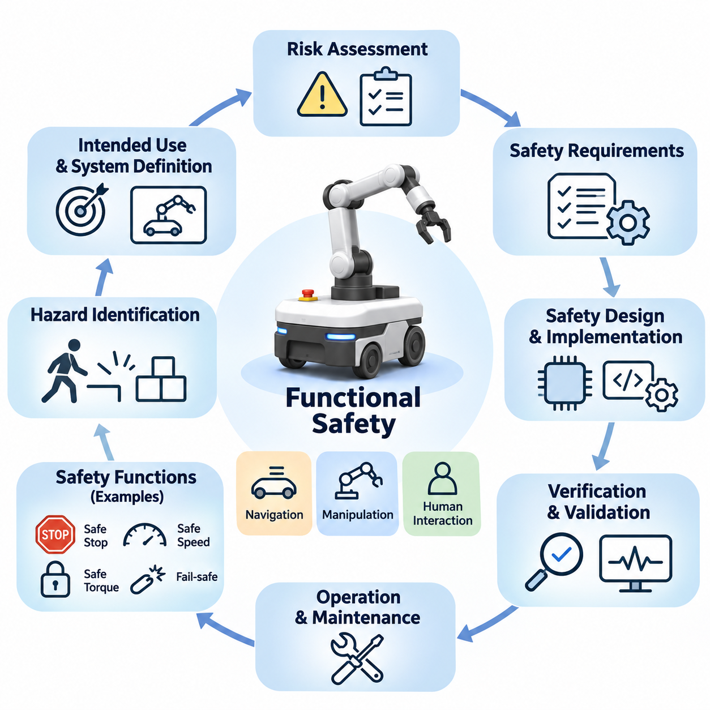
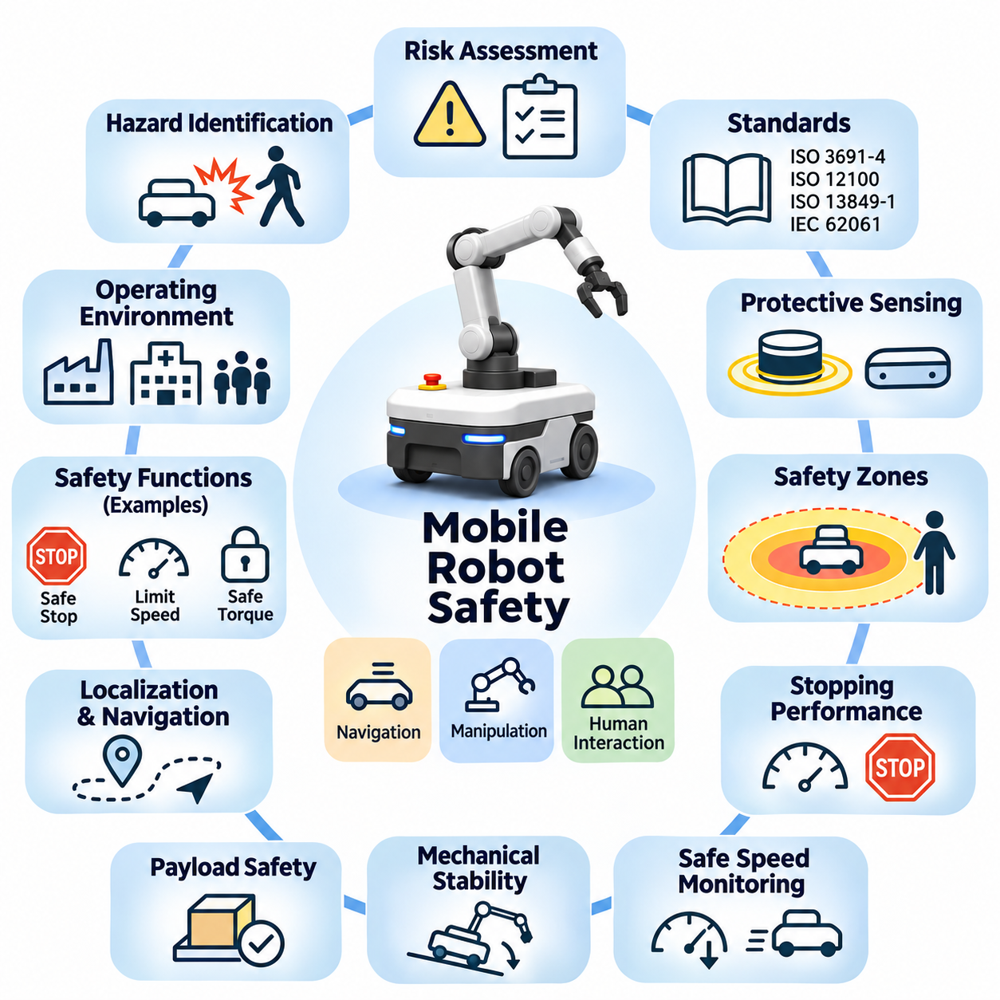
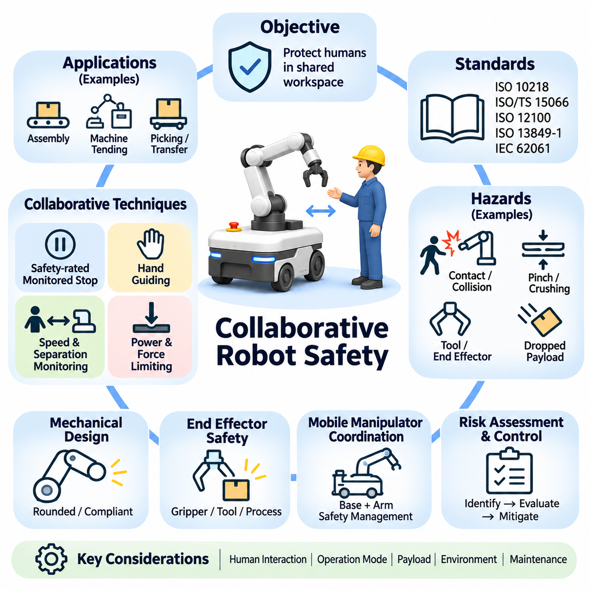
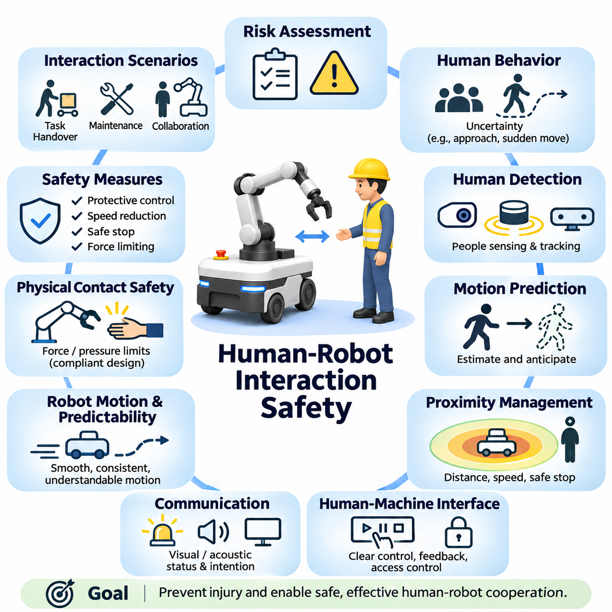
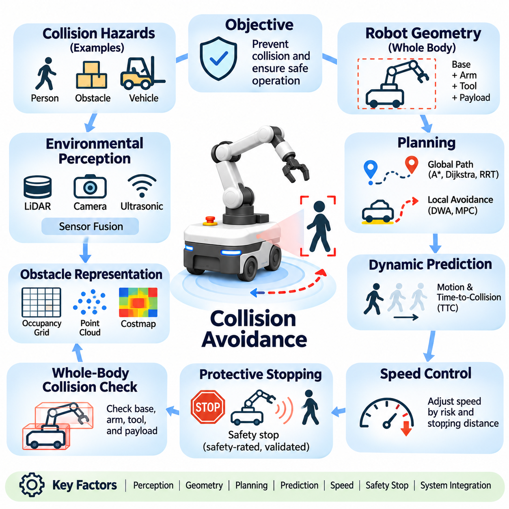
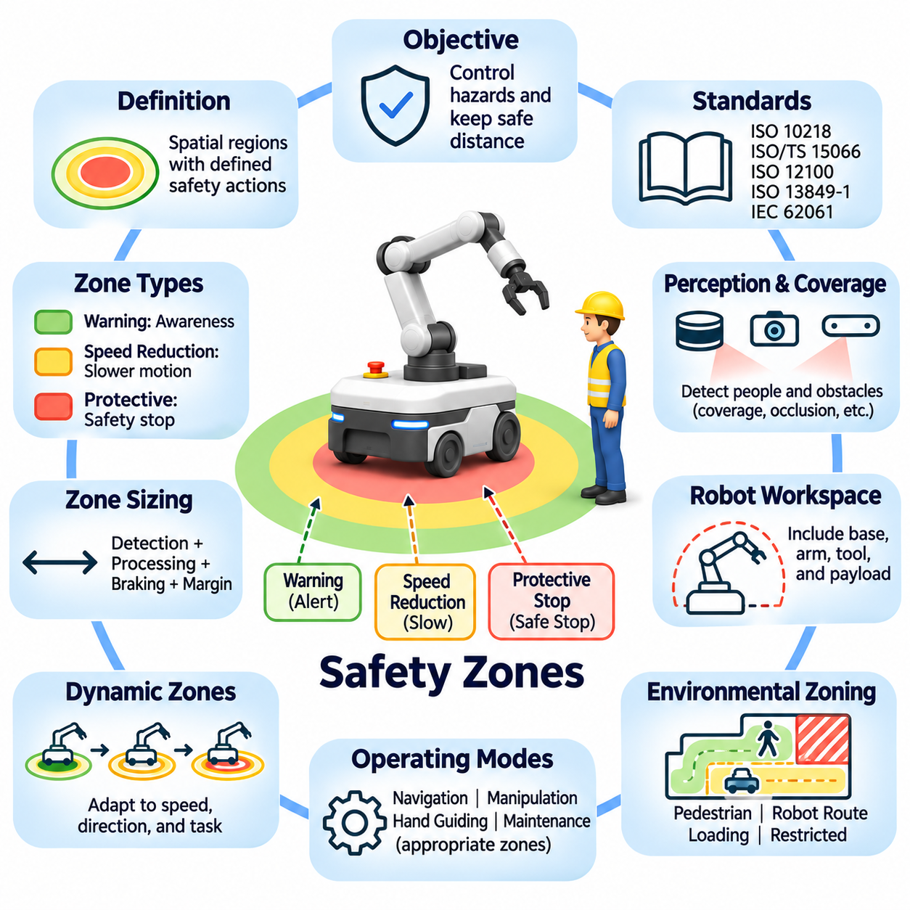
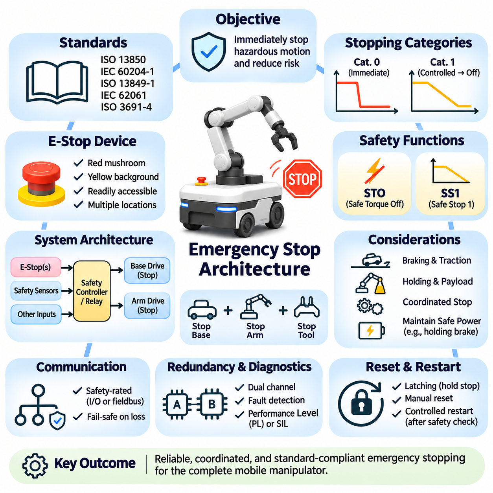
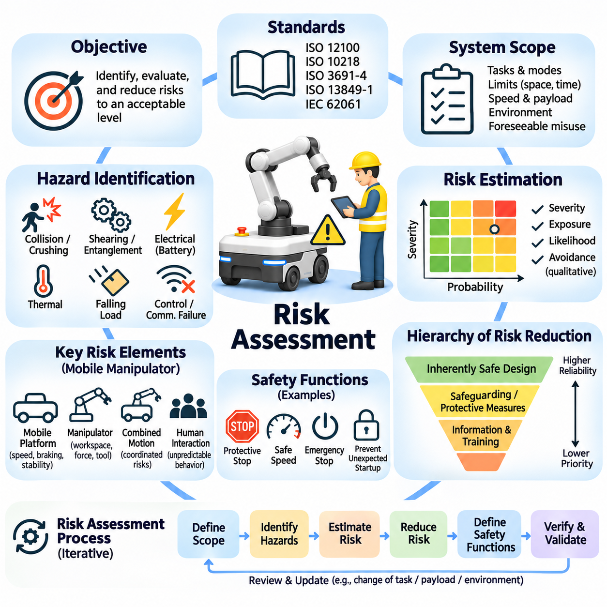
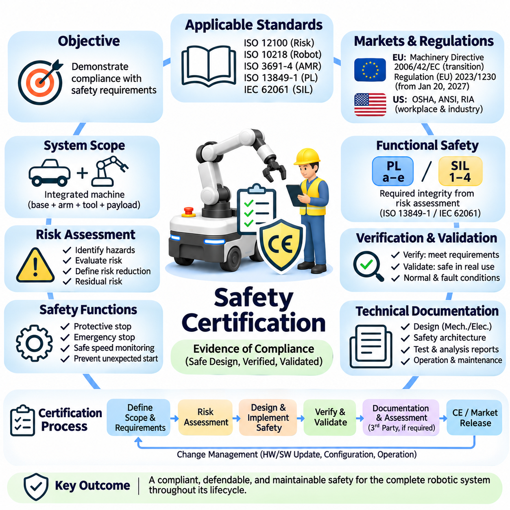

**Volume 01. Mobile Manipulator Foundations and System Architecture**

# Chapter 10. Safety Architecture

## 01 Functional Safety

{width="7.268055555555556in" height="7.268055555555556in"}

Functional safety is a fundamental engineering discipline that ensures a mobile manipulator responds predictably to hazardous conditions, equipment failures, and abnormal operating states. Unlike conventional industrial robots operating within fixed protective enclosures, mobile manipulators combine autonomous navigation with articulated manipulation. Their changing positions, extended workspaces, and interactions with people create complex safety requirements that must be addressed throughout system design.

The primary objective of functional safety is to reduce risks arising from malfunctioning electrical, electronic, and programmable electronic control systems. Safety functions must detect dangerous conditions and initiate protective actions before unacceptable harm occurs. Examples include stopping the mobile platform when an obstacle enters a protective field, disabling manipulator torque during an emergency, and preventing unintended movement following a communication failure.

Functional safety differs from general operational reliability because it focuses specifically on preventing hazardous consequences of system failures. A robot may experience a navigation error without creating an immediate safety hazard, while a failed braking command can expose nearby personnel to serious injury. Consequently, functional safety engineering evaluates not only the probability of component failure but also the severity of potential consequences and the effectiveness of protective measures.

Mobile manipulators require a system-level safety architecture that considers interactions among the mobile base, robotic arm, end effector, sensors, power electronics, and supervisory controllers. A safety function implemented independently within one subsystem may be insufficient when other subsystems remain active. For example, stopping the mobile base does not necessarily eliminate hazards if the manipulator continues moving or an elevated payload becomes unstable.

The functional safety lifecycle begins with defining the intended application, operating environment, foreseeable misuse, and system boundaries. Engineers identify hazardous situations involving personnel, equipment, transported objects, and surrounding infrastructure. These situations are analyzed to determine necessary risk reduction measures. The resulting safety requirements establish the foundation for hardware selection, control architecture, software development, verification, and operational maintenance.

Hazard identification must consider both stationary and dynamic operating conditions. During navigation, hazards include collisions, excessive speed, unstable braking, and unexpected acceleration. During manipulation, hazards include crushing, shearing, entrapment, dropped objects, and uncontrolled joint motion. Combined operations introduce additional risks because arm extension changes the robot\'s effective footprint, center of gravity, and dynamic stability.

Risk assessment evaluates the severity of potential injury and the likelihood of exposure to hazardous conditions. Relevant factors include the frequency and duration of human exposure, the possibility of avoiding harm, and the probability of hazardous events. Engineers use these assessments to determine appropriate safety measures and required safety integrity. Risk evaluation must be repeated whenever operating conditions, payload characteristics, or robot configurations change significantly.

International functional safety frameworks provide systematic methods for developing safety-related control systems. IEC 61508 establishes general principles for electrical, electronic, and programmable electronic safety systems, while ISO 13849-1 and IEC 62061 address safety-related machinery control systems. Depending on the applicable framework, safety requirements may be expressed through Performance Levels or Safety Integrity Levels, which are determined through structured risk assessment.

A Performance Level represents the capability of a safety-related control system to perform its safety function under specified conditions. ISO 13849-1 defines levels from PL a through PL e, with increasing safety performance requirements. Evaluation considers architecture, component reliability, diagnostic coverage, and common-cause failures. The required Performance Level must be established for each safety function rather than assigned uniformly to the entire mobile manipulator.

Safety Integrity Levels provide another method for expressing the required integrity of safety functions. Under IEC 61508, SIL 1 through SIL 4 represent increasing levels of risk reduction capability, although machinery-specific applications commonly use the framework of IEC 62061. SIL and PL classifications are not directly interchangeable. Their application requires consideration of the relevant standard, operating mode, failure characteristics, and safety function.

Safety-related control architecture typically separates protective functions from ordinary motion planning and task execution. Navigation software, artificial intelligence models, and supervisory applications may generate movement commands, but safety controllers independently enforce critical operating constraints. This separation helps prevent failures in complex software from directly compromising protective functions. The architecture must nevertheless account for shared sensors, communication channels, and power dependencies.

Safety-rated sensors provide information necessary for detecting hazardous conditions and monitoring protective boundaries. Depending on the application, these devices may include safety laser scanners, position encoders, interlock switches, emergency stop devices, and safety-rated speed monitoring systems. Ordinary perception cameras and machine learning detectors can support situational awareness, but their outputs should not be assumed to satisfy functional safety requirements without appropriate validation and safety justification.

Redundancy and diagnostic monitoring are important techniques for improving fault tolerance. Dual-channel input circuits, independent monitoring paths, and cross-checking mechanisms can help detect failures that might otherwise remain hidden. However, redundancy alone does not guarantee functional safety because duplicated components may share common failure mechanisms. Designers must evaluate power supply faults, environmental disturbances, systematic software defects, and communication failures.

Safe Torque Off is a widely used drive safety function that prevents motor drives from generating torque capable of producing motion. It is particularly relevant to manipulator joints and mobile drive systems during emergency conditions. However, removing motor torque does not necessarily stop motion immediately or maintain a suspended load. Applications involving gravity, inertia, or unstable payloads may require controlled stopping, mechanical brakes, or additional safety functions.

Safe Stop 1 and Safe Stop 2 provide controlled stopping approaches under defined drive safety requirements. Safe Stop 1 initiates controlled deceleration followed by torque removal, whereas Safe Stop 2 maintains controlled stopping with power available for position holding. Selecting an appropriate stopping function depends on stopping distance, load stability, mechanical configuration, and hazard exposure. Engineers must verify actual stopping performance under representative operating conditions.

Communication safety is essential when protective functions are distributed across the mobile base, manipulator controller, and external automation equipment. Safety communication protocols incorporate mechanisms for detecting corrupted messages, transmission delays, incorrect sequencing, and communication loss. Examples include PROFIsafe, CIP Safety, and FSoE. Their implementation must ensure that detected communication faults lead to predefined safe reactions within acceptable response times.

Functional safety also requires systematic consideration of software behavior. Safety-related software should follow controlled development processes involving requirements traceability, architectural review, coding practices, verification, and configuration management. Software modifications must be evaluated for their effects on existing safety functions. Complex artificial intelligence components present additional challenges because learned behavior may be difficult to predict exhaustively across unfamiliar environments.

A mobile manipulator should implement clearly defined operating modes such as autonomous operation, manual control, maintenance, recovery, and emergency response. Each mode requires explicit authorization conditions and permitted motion limits. Transitions between modes must prevent unexpected activation of hazardous movements. After a protective stop, restarting should require verification that relevant safety conditions have been restored and should not occur merely because a fault signal disappears.

Verification and validation establish whether safety functions satisfy their specified requirements and adequately reduce identified risks. Verification examines implementation correctness through analysis, inspection, simulation, and testing. Validation evaluates whether the integrated system performs safely in its intended application. Representative tests include sensor failures, emergency stopping, communication interruptions, braking under maximum payload, and unexpected obstacles during coordinated movement.

Functional safety performance must remain effective throughout the operational lifetime of the robot. Maintenance procedures should include inspection of safety sensors, emergency stop devices, braking mechanisms, wiring, and safety controller diagnostics. Changes to payload capacity, navigation speed, manipulator reach, or software configuration may invalidate previous assumptions. Periodic reassessment ensures that protective measures remain appropriate as the application evolves.

Documentation is a critical part of demonstrating functional safety. Engineering records should include hazard analyses, risk assessments, safety requirements, architectural descriptions, component reliability data, verification results, validation evidence, and maintenance instructions. Traceability connects each identified hazard to its protective function and supporting test evidence. This structured documentation also facilitates technical reviews, conformity assessment, and future system modifications.

Ultimately, functional safety must be treated as an integrated system property rather than an isolated hardware feature. Effective protection emerges from coordinated mechanical design, electrical architecture, safety control, software engineering, operational procedures, and lifecycle management. For mobile manipulators working near people, a well-engineered functional safety architecture provides the foundation for dependable autonomy, controlled physical interaction, and responsible industrial deployment.

## 02 Mobile Robot Safety

{width="7.268055555555556in" height="7.268055555555556in"}

Mobile robot safety is a critical engineering discipline that addresses hazards arising from autonomous movement, dynamic environments, and interactions with people and equipment. Unlike stationary industrial robots, mobile robots continuously change their positions and operating conditions. When a mobile platform supports a robotic manipulator, safety engineering must account for navigation behavior, mechanical stability, payload characteristics, and the combined motion of the mobile base and robotic arm.

The primary objective of mobile robot safety is to prevent injuries, equipment damage, and hazardous interactions during autonomous operation. Safety measures must address predictable operating conditions and reasonably foreseeable failures. These include collisions with pedestrians, unexpected acceleration, navigation errors, unstable braking, and loss of localization. Effective protection requires coordinated mechanical, electrical, sensing, and control architectures rather than relying on a single protective device.

Autonomous Mobile Robots operate in environments containing static obstacles, moving vehicles, pedestrians, and changing workspace configurations. Warehouses, factories, hospitals, and public facilities introduce different exposure conditions and operational constraints. Safety requirements must therefore reflect the intended application, traffic density, floor characteristics, environmental visibility, and frequency of human interaction. A safety strategy suitable for an isolated factory corridor may be inadequate in a crowded hospital.

Risk assessment provides the foundation for mobile robot safety engineering. Engineers identify hazardous situations associated with movement, stopping, turning, docking, and load handling. Each hazard is evaluated according to potential injury severity, exposure frequency, and the possibility of avoiding harm. The resulting risk assessment determines necessary protective measures and safety-related control requirements. Reassessment is essential when operating speeds, payloads, routes, or environmental conditions change.

International standards provide guidance for designing and evaluating mobile robot safety. ISO 3691-4 addresses safety requirements and verification for driverless industrial trucks and their systems, including applicable autonomous mobile platforms. ISO 12100 establishes principles for machinery risk assessment and risk reduction, while ISO 13849-1 and IEC 62061 support safety-related control system design. The applicability of each standard depends on the robot\'s classification, intended use, and operating environment.

Protective sensing is a central element of mobile robot safety architecture. Safety-rated laser scanners, protective bumpers, and other validated sensing devices detect hazardous conditions around the robot. These sensors establish protective regions that initiate speed reduction or stopping when necessary. Their placement must account for the robot\'s geometry, direction of travel, braking performance, and possible blind spots. Sensor coverage should remain effective during turning, reversing, and docking operations.

Safety zones define spatial regions in which the robot applies different protective responses. A warning zone may trigger reduced speed, while entry into a protective stopping zone initiates a safety-related stop. Zone dimensions depend on robot velocity, sensor response time, controller processing delay, braking distance, and required safety margins. Dynamic zone switching can support different operating modes, provided that switching logic and protective coverage satisfy the applicable safety requirements.

Stopping performance is particularly important because mobile robots possess kinetic energy that increases with mass and the square of velocity. A heavily loaded robot traveling at moderate speed may require substantial stopping distance. Engineers must consider braking torque, tire friction, floor slope, wheel slip, and payload distribution. Stopping distance should be validated under representative worst-case conditions, including maximum permitted payload, degraded traction, and relevant environmental variations.

Safe speed monitoring limits robot velocity when operating conditions become hazardous. Speed restrictions may be applied near pedestrian crossings, narrow corridors, docking stations, or shared workspaces. Safety-rated monitoring functions must detect excessive speed and initiate an appropriate protective response. Ordinary navigation software can request slower movement, but safety-critical speed enforcement should be implemented through validated safety-related control functions where required by the risk assessment.

Mechanical stability is another essential safety consideration for mobile manipulators. Extending a robotic arm changes the center of gravity and introduces additional moments around the mobile platform. Rapid acceleration, sharp turning, or sudden braking can increase tipping risk. Stability analysis must consider robot mass, wheelbase, track width, payload position, manipulator reach, and floor inclination. Operating limits should prevent combinations of movement and arm configuration that exceed validated stability boundaries.

Payload safety requires careful management of transported and manipulated objects. Unsecured loads may shift during acceleration or braking, while improperly grasped objects may fall during navigation. The safety architecture should account for payload mass, center of gravity, gripping force, and attachment reliability. Where necessary, load monitoring, mechanical retention, and restricted motion profiles reduce the probability of hazardous load movement or accidental release.

Localization and navigation failures can introduce dangerous behavior when the robot incorrectly estimates its position or surroundings. Sensor degradation, map inconsistencies, wheel odometry errors, and environmental changes may reduce localization confidence. The control system should recognize relevant abnormalities and transition to an appropriate restricted or safe state. However, localization confidence alone should not replace independently validated protective sensing and safety-related motion control.

Human interaction creates additional challenges because pedestrian movement is difficult to predict. People may suddenly cross a robot\'s path, approach from blind spots, or stand near docking stations. Safety design should consider visibility, predictable robot behavior, acoustic warnings, visual indicators, and appropriate travel speeds. Warning devices improve awareness but do not replace protective safety functions. Robot behavior should remain understandable and consistent during normal and abnormal operating conditions.

Emergency stopping provides a means to initiate protective action when hazardous situations are identified. Emergency stop devices should be accessible where required by the risk assessment and integrated with the robot\'s safety-related control architecture. The resulting stop must address relevant hazardous movements of both the mobile platform and manipulator. Emergency stopping is a complementary protective measure and should not be treated as a substitute for automatic safeguarding or inherently safe design.

Communication failures must also be considered in distributed mobile robot systems. A robot may exchange commands with fleet management software, remote operators, docking stations, and industrial equipment. Loss of ordinary network connectivity should not disable essential onboard protective functions. Safety-related communication channels require appropriate fault detection and defined responses to invalid or missing messages. Remote supervision should support operational coordination without becoming an uncontrolled dependency for immediate safety.

Battery and electrical safety are important because mobile robots operate using onboard energy storage and power conversion systems. Potential hazards include short circuits, overheating, insulation failures, unexpected energization, and battery thermal events. Battery management systems, protective devices, electrical isolation, and thermal monitoring contribute to risk reduction. Charging interfaces must also address connector integrity, unintended movement, electrical contact hazards, and abnormal charging conditions.

Docking and automated charging introduce additional risks because robots operate close to fixed structures and electrical equipment. Precise positioning may require low-speed movement in confined spaces, where crushing and trapping hazards can arise. Docking safety should include controlled approach behavior, appropriate obstacle detection, mechanical alignment, and safe electrical connection procedures. Protective functions must remain effective even when the robot operates near structures that partially obstruct sensors.

Mobile robot safety also depends on operating environment management. Floor conditions, ramps, thresholds, doorways, elevators, and pedestrian traffic influence system behavior. Site-specific risk assessments should identify areas requiring restricted speed, additional sensing, physical separation, or procedural controls. Environmental modifications such as improved markings, protected crossings, and designated robot routes can reduce exposure to hazards while improving operational predictability.

Verification and validation demonstrate whether the integrated safety architecture performs as intended. Testing should cover protective field detection, emergency stopping, braking distance, speed monitoring, stability limits, sensor faults, and communication interruptions. Representative scenarios must include loaded and unloaded operation, turning, reversing, and interactions with moving obstacles. Results should be documented against measurable acceptance criteria established during safety requirements development.

Operational safety requires continuous attention after deployment. Preventive maintenance should include inspection of brakes, wheels, safety sensors, emergency stop devices, and electrical connections. Software updates, route changes, new payloads, and modifications to surrounding infrastructure may affect previously validated assumptions. Periodic inspection, incident analysis, and controlled change management help maintain the effectiveness of protective measures throughout the robot\'s service life.

A comprehensive mobile robot safety architecture combines risk assessment, protective sensing, safety-related motion control, mechanical stability, electrical protection, and operational procedures. For mobile manipulators, these measures must extend across both navigation and manipulation activities. Effective safety engineering enables robots to operate productively in shared environments while maintaining predictable responses to hazards, failures, and changing operational conditions.

## 03 Collaborative Robot Safety

{width="7.268055555555556in" height="7.268055555555556in"}

Collaborative robot safety focuses on protecting humans who work directly or indirectly with robotic systems in shared environments. Unlike traditional industrial robots separated from personnel by physical barriers, collaborative robots are designed for applications where human presence may be expected within the robot workspace. When integrated with an autonomous mobile platform, collaborative manipulation introduces additional safety challenges involving navigation, arm movement, payload handling, and changing human proximity.

The fundamental objective of collaborative robot safety is to reduce risks associated with physical contact, unexpected movement, and hazardous interactions. Collaboration does not automatically imply that unrestricted contact between humans and robots is safe. Instead, safety must be established through application-specific risk assessment, protective control functions, mechanical design, and operational procedures. The complete robotic application, rather than the collaborative robot arm alone, determines the required safety measures.

Collaborative robot applications may involve humans and robots working sequentially, sharing equipment, or performing coordinated tasks within overlapping workspaces. Examples include assembly assistance, machine tending, warehouse picking, and material transfer. Each application creates different exposure conditions because human positions, robot trajectories, and task requirements vary. Safety engineering must consider foreseeable interactions during normal operation, maintenance, recovery, and unexpected interruptions.

International standards provide a foundation for collaborative robot safety. ISO 10218 addresses industrial robot and robot application safety, while ISO/TS 15066 provides additional guidance for collaborative applications, including biomechanical considerations for physical contact. ISO 12100 supports risk assessment, and ISO 13849-1 or IEC 62061 may apply to safety-related control systems. Applicable requirements depend on the robot configuration, application, operating environment, and relevant standard editions.

Collaborative operations are commonly organized around four recognized techniques: safety-rated monitored stop, hand guiding, speed and separation monitoring, and power and force limiting. These techniques provide different methods for managing human exposure to robot motion. They may be implemented individually or combined within a single application. Selection depends on the required interaction, available protective technology, robot dynamics, and the results of the application-specific risk assessment.

Safety-rated monitored stop allows a robot to remain in a monitored stationary condition while a person enters the collaborative workspace. The safety system must detect conditions that invalidate the monitored stop and respond appropriately. This technique is useful when workers perform loading, inspection, or adjustment tasks near the manipulator. Motion may resume only after the necessary safety conditions are satisfied and the applicable restart requirements have been met.

Hand guiding enables an operator to direct robot movement through an appropriately designed guiding interface. This technique can support teaching, positioning, and certain cooperative handling tasks. Safety depends on controlled motion, suitable enabling devices, and appropriate speed limitations. The robot must respond predictably to operator input and abnormal conditions. Hand guiding should not be confused with unrestricted manual pushing of a robot that lacks validated collaborative safety functions.

Speed and separation monitoring maintains a protective distance between humans and moving robot components. As a person approaches, the robot may reduce speed or initiate a protective stop before separation becomes insufficient. Required separation depends on human approach speed, robot motion, stopping performance, sensing uncertainty, and system response time. Protective sensing and monitoring functions must satisfy the safety requirements established for the application.

Power and force limiting reduces the potential consequences of physical contact by controlling robot forces, pressures, energy, and motion characteristics. This approach may involve torque sensing, compliant mechanical structures, force monitoring, and restricted operating speeds. However, safe contact limits depend on the affected body region and contact conditions. Transient impacts and quasi-static crushing situations must be evaluated separately because their injury mechanisms differ.

Mechanical design strongly influences collaborative robot safety. Rounded surfaces, reduced exposed pinch points, compliant coverings, and appropriate joint configurations can reduce contact hazards. Nevertheless, a mechanically compliant robot can still create dangerous forces when carrying heavy objects or operating near rigid structures. Safety evaluation must therefore include the manipulator, end effector, transported payload, surrounding equipment, and any surfaces capable of creating trapping or crushing conditions.

End effectors introduce hazards that may not be addressed by the collaborative capabilities of the robot arm. Grippers can generate concentrated pressure, sharp tools may cause injury, and vacuum systems may release objects unexpectedly. Welding tools, cutting devices, and heated components introduce additional process-specific risks. Consequently, a collaborative robot arm does not automatically make its complete application collaborative or safe for direct human interaction.

Mobile manipulators require coordinated safety management between the autonomous base and robotic arm. A stationary manipulator may satisfy collaborative operating requirements while the moving platform creates collision or crushing hazards. Conversely, a safely stopped mobile base does not guarantee that arm movement is harmless. Integrated safety control must account for simultaneous motion, combined stopping behavior, and the changing protective envelope created by manipulator extension.

Human detection is essential for applications involving dynamic collaboration. Safety-rated scanners, protective sensors, and validated monitoring systems may detect human presence and determine when protective action is necessary. Conventional cameras and artificial intelligence perception can improve contextual awareness but should not be treated as safety-rated without appropriate evidence. Sensor placement must consider occlusion, lighting, reflective surfaces, and changing robot geometry.

Collision detection and contact response provide additional protection when physical interaction is possible. Joint torque measurements, motor current monitoring, and external force sensors can help identify unexpected resistance or contact. However, detection thresholds must account for payload variations, friction, acceleration, and sensor uncertainty. A collision detection algorithm cannot independently establish safe contact unless its performance and associated protective response satisfy the required safety criteria.

Safe motion control limits hazardous movement through monitored speed, position, torque, and stopping functions. Depending on the application, safety-rated drive functions may include Safe Torque Off, Safe Stop 1, Safe Stop 2, and safely limited speed. Their suitability depends on mechanical behavior and the identified hazards. Removing motor torque may not prevent gravity-driven movement or falling loads, making brakes and additional retention mechanisms necessary in some configurations.

Risk assessment must examine foreseeable human behavior rather than assuming ideal compliance with operating procedures. Workers may reach into the robot workspace unexpectedly, approach from blind spots, or attempt to recover dropped objects. Maintenance personnel may enter areas normally inaccessible during automatic operation. Safety design should address these situations through protective measures, clear operating modes, controlled recovery procedures, and appropriate personnel training.

Validation of collaborative safety requires testing the complete application under representative conditions. Engineers must examine separation monitoring, stopping distances, contact forces, pressure distribution, payload effects, and transitions between operating modes. Measurements should reflect relevant worst-case configurations and foreseeable interactions. Acceptance criteria must be derived from applicable requirements and risk assessment rather than relying solely on manufacturer specifications.

Operational changes can invalidate previously established collaborative safety assumptions. Increasing payload mass, replacing a gripper, changing robot speed, or modifying surrounding equipment may alter contact forces and protective distances. Software updates can also affect trajectory generation and motion behavior. A controlled change management process should determine whether modifications require renewed risk assessment, verification, or validation before the system returns to service.

Effective collaborative robot safety combines protective sensing, safety-related control, mechanical risk reduction, human-centered operation, and systematic validation. For mobile manipulators, these measures must address both the moving platform and the articulated arm as one integrated system. Safe collaboration is achieved not by eliminating every possible interaction, but by ensuring that foreseeable interactions remain within appropriately assessed and controlled risk boundaries.

## 04 Human Robot Interaction Safety

{width="7.268055555555556in" height="7.268055555555556in"}

Human-robot interaction safety addresses the protection of people who communicate, cooperate, or share physical spaces with robotic systems. In mobile manipulation, human interaction occurs during navigation, object transfer, task supervision, maintenance, and collaborative operations. Unlike isolated industrial automation, these systems must operate safely around people whose movements and intentions are not always predictable. Safety therefore requires both reliable protective mechanisms and understandable robot behavior.

The primary objective of human-robot interaction safety is to prevent injury while enabling effective cooperation between humans and autonomous machines. Safety engineering must consider physical contact, unexpected motion, communication failures, and misunderstandings of robot intentions. A robot may function correctly according to its programmed instructions while still creating hazards if people cannot anticipate its actions. Consequently, interaction safety combines technical safeguards with human-centered system design.

Human behavior introduces uncertainty into robotic operating environments. People may change direction unexpectedly, approach moving equipment, or enter restricted areas without recognizing potential hazards. Their responses also depend on attention, experience, physical ability, and environmental conditions. Safety systems should therefore account for foreseeable human behavior rather than assuming perfect compliance with operating procedures. Protective functions must remain effective when human actions differ from expected patterns.

Risk assessment forms the foundation of human-robot interaction safety. Engineers identify situations involving proximity, contact, shared workspaces, and task handovers. Each situation is evaluated according to potential injury severity, exposure frequency, and the possibility of avoiding harm. Particular attention is required when robots carry heavy objects, operate near vulnerable individuals, or perform movements that could trap a person against surrounding structures. Risk reduction measures must reflect the complete application.

Human detection is a critical capability for mobile manipulators operating in shared environments. Cameras, laser scanners, depth sensors, and other perception devices can identify people and estimate their positions relative to the robot. However, ordinary perception systems are not automatically suitable for safety-critical protection. Where risk reduction depends on reliable detection, appropriately validated safety-related sensing and control functions are required. Sensor coverage must consider occlusion, reflective surfaces, and changing environmental conditions.

Human motion prediction can improve the smoothness and efficiency of robot interactions. By estimating pedestrian trajectories, body orientation, and movement patterns, an autonomous system may anticipate potential conflicts before they become immediate hazards. Nevertheless, predictions remain uncertain because human behavior can change suddenly. Predictive algorithms should support navigation and interaction planning without replacing independent protective functions that enforce necessary safety limits.

Proximity management establishes appropriate distances between humans and moving robot components. Separation requirements depend on robot velocity, stopping performance, sensor response time, and the nature of the interaction. A robot may reduce speed as a person approaches and initiate a protective stop when the remaining distance becomes insufficient. These responses should be predictable and validated against applicable safety requirements. Dynamic separation monitoring is especially important when the mobile base and manipulator move simultaneously.

Physical contact safety becomes essential when direct interaction cannot be completely avoided. Contact may occur during object handovers, assisted manipulation, or unexpected encounters. Robot forces, pressures, velocities, and mechanical compliance influence the potential severity of injury. Safety assessment should distinguish transient impacts from sustained crushing or trapping conditions. Contact limits must account for relevant body regions, contact geometry, and the mechanical characteristics of the complete robotic system.

Robot motion should communicate intentions clearly to nearby people. Sudden acceleration, unexpected turns, and ambiguous stopping behavior can create confusion even when protective functions operate correctly. Smooth trajectories, consistent speed changes, and understandable movement patterns help people anticipate robot actions. In shared corridors, a mobile manipulator should avoid unnecessarily aggressive maneuvers and maintain behavior consistent with its operating context and established traffic rules.

Visual and acoustic communication can improve awareness of robot status and intentions. Indicator lights, display messages, audible alerts, and directional signals may communicate movement initiation, stopping, faults, or requests for human assistance. These interfaces should be understandable under realistic lighting and noise conditions. However, warnings are supplementary measures and cannot replace protective sensing or safety-related stopping functions when hazardous motion must be controlled automatically.

Human-machine interfaces should minimize ambiguity and reduce the likelihood of operator error. Commands for starting, stopping, pausing, and recovering robotic tasks must be clearly distinguishable. Interface feedback should indicate whether the robot is operating autonomously, awaiting authorization, or responding to a fault. Critical commands require appropriate access control and confirmation procedures. Interface design should also consider accessibility, operator workload, and the consequences of accidental activation.

Trust and predictability influence how people behave around autonomous robots. Excessive trust may encourage unsafe proximity, while insufficient trust can cause hesitation or unexpected avoidance movements. A well-designed system communicates its capabilities and limitations without implying that every situation is automatically safe. Consistent behavior, transparent status information, and appropriate training help users develop realistic expectations about robot operation and protective boundaries.

Task handovers introduce specific interaction risks because humans and robots temporarily share responsibility for an object. During transfer, the system must coordinate positioning, gripping force, release timing, and confirmation of object support. Premature release may cause dropped objects, while excessive gripping force can injure fingers or damage materials. Safe handover procedures should consider payload characteristics, human reach, and unexpected interruptions during the transfer process.

Mobile manipulators must coordinate navigation and arm movement during human interaction. Extending an arm can create hazards outside the mobile platform\'s original footprint, while base movement can alter the relative position of a gripper near a person. Safety control should account for the combined reachable workspace, simultaneous motion, and possible trapping locations. Operational constraints may require the platform to remain stationary during certain manipulation tasks involving close human proximity.

Emergency interaction procedures must be understandable to both trained operators and other exposed personnel. Emergency stop devices, protective stopping behavior, and recovery procedures should be designed around foreseeable hazardous situations. After a protective stop, restarting must not introduce unexpected motion or renewed exposure to danger. The system should communicate its current state and require appropriate authorization before resuming hazardous operations where necessary.

Human factors engineering considers how attention, fatigue, workload, and environmental stress influence interaction safety. Operators may overlook warnings during repetitive tasks or misunderstand instructions under time pressure. Public environments introduce additional challenges because visitors may have no prior knowledge of robot behavior. Safety measures should therefore remain effective without depending entirely on continuous human attention. Clear signage, intuitive interfaces, and appropriate operating restrictions support safer interaction.

Artificial intelligence can enhance human-robot interaction through activity recognition, gesture interpretation, and context-aware planning. Vision-language models and other learning-based systems may support natural communication and flexible task execution. However, generated instructions and inferred intentions can be incorrect or ambiguous. Safety-critical actions should remain subject to explicit constraints, validated protective functions, and appropriate authorization rather than relying solely on probabilistic model outputs.

Verification and validation must evaluate human-robot interaction under realistic operating conditions. Testing should include unexpected pedestrian movement, interrupted handovers, ambiguous commands, sensor occlusion, and transitions between operating modes. Engineers should measure stopping performance, protective separation, contact behavior, and interface response. Human participant studies may provide additional evidence about usability and predictability, but they do not replace technical safety validation.

Operational safety requires continuous monitoring and controlled management of changes. New tasks, altered routes, different payloads, and software updates may introduce interaction hazards not identified during initial deployment. Incident reports, near-miss observations, operator feedback, and maintenance records can reveal weaknesses in existing safeguards. Periodic reassessment helps ensure that safety measures remain appropriate as robot capabilities and operating environments evolve.

Effective human-robot interaction safety combines risk assessment, protective sensing, safe motion control, understandable communication, and human-centered design. For mobile manipulators, safety must address both physical interaction and the behavioral uncertainty of shared environments. The ultimate objective is to enable productive human-robot cooperation while ensuring that foreseeable hazards are identified, controlled, and continuously evaluated throughout the system lifecycle.

## 05 Collision Avoidance

{width="7.268055555555556in" height="7.268055555555556in"}

Collision avoidance is a fundamental safety capability that enables mobile manipulators to operate near people, equipment, and environmental obstacles without creating unacceptable collision risks. Unlike stationary robots, mobile manipulators continuously change their positions while articulated arms extend beyond the mobile platform. Effective collision avoidance must therefore consider the combined geometry, movement, and dynamic behavior of the entire robotic system.

The primary objective of collision avoidance is to identify potential collisions early enough to initiate appropriate preventive actions. These actions may include trajectory modification, speed reduction, controlled stopping, or task interruption. Collision avoidance differs from collision detection because avoidance attempts to prevent physical contact, whereas detection recognizes contact that has already occurred. Both capabilities contribute to safety, but their protective roles and performance requirements differ.

Collision hazards arise from interactions with static obstacles, moving objects, pedestrians, other robots, and surrounding machinery. In industrial environments, narrow passages, loading stations, and shared traffic corridors create complex collision scenarios. A mobile manipulator may also collide with nearby structures when its arm extends during navigation. Consequently, collision assessment must include the mobile base, manipulator links, end effector, and transported payload.

Environmental perception provides the information required to identify obstacles and estimate collision risks. Mobile robots commonly use laser scanners, depth cameras, ultrasonic sensors, and three-dimensional LiDAR to observe surrounding objects. Sensor fusion can improve environmental coverage and reduce uncertainty. However, ordinary perception sensors are not automatically safety-rated, and safety-critical protective functions require appropriately validated sensing and control systems.

Obstacle representation converts sensor observations into information suitable for collision checking and motion planning. Occupancy grids describe occupied and free regions, while point clouds preserve three-dimensional geometric information. Costmaps assign traversal costs to surrounding areas based on obstacle proximity and other constraints. For mobile manipulators, three-dimensional representations are particularly important because elevated obstacles may intersect the robotic arm without obstructing the mobile base.

Collision geometry must reflect the actual dimensions and operating configuration of the robot. Simplified geometric models such as circles, rectangles, capsules, and bounding volumes support efficient collision calculations. Safety margins compensate for localization errors, sensing uncertainty, control delays, and mechanical tolerances. When the manipulator changes configuration, the effective collision envelope must be updated to account for arm extension, tool orientation, and payload dimensions.

Global path planning determines a feasible route through the operating environment while avoiding known obstacles. Algorithms such as A\\\*, Dijkstra, and sampling-based planners can generate candidate paths using geometric and environmental constraints. However, a collision-free global path does not guarantee safe execution because obstacles may move or appear unexpectedly. Local planning and continuous monitoring are therefore necessary to adapt navigation behavior during operation.

Local collision avoidance evaluates nearby obstacles and modifies robot motion in response to changing conditions. Approaches such as the Dynamic Window Approach, Model Predictive Control, and velocity-based obstacle avoidance consider feasible motion commands and predicted obstacle interactions. These methods balance progress toward the destination with collision risk and motion constraints. Their effectiveness depends on accurate state estimation, suitable prediction horizons, and reliable control execution.

Dynamic obstacle prediction estimates the future positions of pedestrians, vehicles, and other moving objects. Relative velocity, movement direction, and observed trajectories help identify potential conflicts before objects enter immediate stopping regions. Time-to-collision calculations provide useful indicators of approaching hazards. Nevertheless, predictions remain uncertain, particularly when human behavior changes suddenly. Safety-critical protection must therefore remain effective even when predicted trajectories are inaccurate.

Speed control directly influences collision risk because stopping distance and impact energy increase with velocity. Robots should adjust their operating speed according to obstacle proximity, environmental complexity, and available stopping distance. Higher speeds generally require larger protective regions and earlier intervention. Safe speed monitoring can enforce defined limits independently of ordinary navigation planning when required by the application risk assessment.

Protective stopping provides a final preventive response when safe separation cannot be maintained. Safety-rated scanners and associated controllers may initiate stopping when obstacles enter defined protective fields. Required field dimensions depend on robot speed, detection response, processing delay, braking performance, and uncertainty margins. Protective stopping must be distinguished from ordinary navigation pauses because safety-related stopping functions require defined integrity and validated performance.

Mobile manipulators introduce collision risks that cannot be addressed through base navigation alone. A robotic arm may strike shelving, overhead structures, equipment, or people while the mobile platform remains clear of obstacles. Whole-body collision checking evaluates the combined configuration of the mobile base and manipulator. Coordinated motion planning must account for changing reachability, joint limits, swept volumes, and potential interference between robot components.

Self-collision avoidance prevents the manipulator from contacting its own structure, mobile base, mounted sensors, or transported equipment. Joint configurations that are kinematically reachable may still create mechanical interference. Collision models and joint constraints should therefore be integrated into manipulator planning. Self-collision checks are particularly important when the robot performs compact motions, reaches behind its base, or operates with large end effectors.

Human-aware collision avoidance requires additional consideration because people do not always follow predictable trajectories. Robots should maintain appropriate separation, avoid aggressive maneuvers, and respond conservatively to uncertain pedestrian movement. Socially aware navigation may improve comfort by considering personal space and movement conventions. However, comfort-oriented planning is separate from safety-rated protective functions and cannot independently establish acceptable collision risk.

Multi-robot environments create additional collision challenges because several autonomous systems may occupy intersecting routes. Fleet management can coordinate traffic priorities, intersection access, and shared workspace reservations. Decentralized avoidance algorithms may also negotiate local movement between robots. Nevertheless, communication delays or coordination failures must not eliminate essential onboard protection. Each robot should retain the safety functions necessary to respond to immediate hazards.

Sensor limitations must be considered when evaluating collision avoidance performance. Reflective surfaces, transparent objects, low obstacles, narrow structures, and occluded regions may reduce detection reliability. Environmental conditions such as dust, rain, fog, and changing illumination can further degrade perception. Sensor placement, complementary sensing technologies, diagnostic monitoring, and conservative operating restrictions help address these limitations, although residual risks must still be assessed.

Uncertainty management is essential because collision avoidance relies on imperfect estimates of robot position, obstacle geometry, and future movement. Localization errors can shift perceived obstacle positions, while delayed sensor updates may produce outdated environmental representations. Robust planning incorporates uncertainty margins and checks whether available stopping distance remains sufficient. When uncertainty exceeds acceptable limits, the system should reduce motion or enter an appropriate safe state.

Verification and validation must demonstrate collision avoidance performance under representative operating conditions. Testing should include static obstacles, crossing pedestrians, sudden obstacle appearance, narrow passages, reversing, and simultaneous base-arm movement. Engineers should evaluate detection coverage, minimum separation, response latency, stopping distance, and avoidance success. Safety acceptance criteria must be derived from applicable requirements and risk assessment rather than navigation performance alone.

Collision avoidance performance must remain effective throughout deployment and maintenance. Changes in payload dimensions, manipulator tools, sensor placement, navigation software, or operating speed can invalidate previous collision models and safety assumptions. Periodic testing, controlled software updates, incident analysis, and environmental reassessment support continued reliability. Operational monitoring should distinguish ordinary planning failures from failures affecting safety-related protective functions.

Effective collision avoidance combines environmental perception, geometric modeling, predictive planning, safe motion control, and independent protective mechanisms. For mobile manipulators, these capabilities must address the entire moving structure rather than treating navigation and manipulation as unrelated activities. The ultimate objective is to maintain acceptable separation from hazards, respond predictably to uncertainty, and support productive autonomous operation without compromising human safety.

## 06 Safety Zones

{width="7.268055555555556in" height="7.268055555555556in"}

Safety zones are defined regions around robotic systems where specific protective measures are applied to control hazardous interactions. In mobile manipulation, these regions must account for the movement of both the autonomous platform and articulated arm. Unlike fixed industrial installations, mobile robots operate in changing environments where protective boundaries may move with the robot. Effective safety zoning combines geometric definitions, sensing capabilities, motion constraints, and validated protective responses.

The primary purpose of safety zones is to establish controlled spatial relationships between robots, humans, equipment, and surrounding structures. Different regions may trigger warnings, speed reductions, protective stops, or restrictions on manipulation activities. Safety zones must be designed according to identified hazards rather than arbitrary distances. Their dimensions and associated responses depend on robot speed, stopping performance, sensing uncertainty, payload characteristics, and the operating environment.

A protective zone represents an area where intrusion requires a defined safety-related response. When a person or obstacle enters this region, the robot may initiate a protective stop to prevent hazardous contact. Protective zones are commonly monitored using safety-rated laser scanners or other suitable protective devices. Their effectiveness depends on detection coverage, response time, stopping distance, and the reliability of the complete safety-related control system.

Warning zones provide earlier awareness of approaching objects before protective intervention becomes necessary. Entry into a warning region may activate indicator lights, audible signals, or ordinary speed reduction. These responses can improve traffic flow and reduce unnecessary protective stops. However, a warning zone does not automatically constitute a safety-rated protective function. Safety engineering must distinguish supplementary operational warnings from measures required to achieve risk reduction.

Speed reduction zones support controlled movement when people or obstacles approach the robot. The system may progressively reduce velocity as separation decreases, allowing continued operation under appropriately assessed conditions. Reduced speed can shorten stopping distance and improve predictability. Nevertheless, speed reduction used as a safety function requires suitable monitoring and control integrity. Ordinary navigation software alone should not be assumed to enforce safety-critical speed limits.

Safety zone dimensions must reflect the distance traveled before a robot reaches a safe stopping condition. This includes sensor detection time, controller processing time, communication delays, brake response, and mechanical deceleration. Additional margins account for measurement uncertainty and installation tolerances. Protective distances should be calculated and validated for relevant operating conditions, including maximum permitted speed, payload mass, floor characteristics, and direction of travel.

Dynamic safety zones adapt their dimensions or configurations to changing robot operating conditions. A mobile robot may require a longer protective region when traveling quickly and a shorter region when moving slowly. Direction-dependent field switching can provide different coverage during forward movement, reversing, or turning. Such adaptations must be implemented through suitable safety-related functions when relied upon for protection, with validated transitions that do not create unprotected intervals.

Mobile manipulators require safety zones that account for the complete reachable workspace of the robotic arm. A scanner protecting the mobile base may not detect hazards near an elevated gripper or extended manipulator link. Three-dimensional protective coverage may therefore be necessary around the upper structure. Safety assessment must consider arm posture, tool geometry, transported objects, and potential crushing locations between the manipulator and surrounding equipment.

The robot footprint is not sufficient to define its full hazardous region. During rotation, an extended arm or oversized payload may sweep through areas outside the base boundary. Motion planning should account for swept volumes and the changing configuration of the complete robot. Safety-related protective measures must address hazardous movement wherever people can be exposed. This is particularly important during docking, loading, turning near machinery, and operation in confined spaces.

Safety zones can also be associated with specific operating modes and tasks. Navigation, manipulation, hand guiding, maintenance, and recovery may require different protective arrangements. For example, close human interaction may require the mobile base to remain stationary while the manipulator operates under defined restrictions. Mode transitions must be controlled so that protective functions remain appropriate throughout the change. Restart conditions must prevent unexpected hazardous movement.

Environmental zoning establishes restrictions associated with particular locations rather than only with the robot itself. Facilities may designate pedestrian corridors, robot-only routes, loading stations, and restricted maintenance areas. These regions can support traffic management and operational discipline. However, a software-defined restricted area does not necessarily provide a safety-rated barrier. Physical access control or independent protective measures may still be necessary where risk assessment requires them.

Safety zone monitoring depends on sensor placement and environmental visibility. Low-mounted laser scanners may detect legs and floor-level obstacles but miss objects positioned above their scanning plane. Occlusion, reflective materials, transparent surfaces, and narrow structures can reduce detection effectiveness. Multiple sensors may improve coverage, but their combined performance must be assessed. Unmonitored regions should be identified and addressed through design changes or operating restrictions.

Sensor redundancy and diagnostic monitoring can improve the dependability of protective zone functions. Independent sensing channels may help detect failures or reduce vulnerability to individual sensor faults. However, adding sensors does not automatically establish redundancy or the required safety integrity. Common-cause failures, communication architecture, diagnostic coverage, and controller behavior must be evaluated. The protective system should respond appropriately when essential sensing becomes unavailable or unreliable.

Safety zone configuration must be coordinated with robot localization and motion control. Position uncertainty can affect the relationship between a robot and facility-defined restricted regions. Delayed localization updates may cause incorrect field selection or inappropriate speed limits. When spatial information supports safety-related decisions, its reliability must satisfy the required safety performance. If position confidence becomes insufficient, the robot should adopt appropriately conservative behavior.

Human presence introduces additional complexity because people can approach from unexpected directions or enter previously clear regions. Safety zones should account for foreseeable pedestrian movement and possible access through blind spots. In collaborative applications, protective separation may change as people move closer to the robot. Warning, slowing, and stopping responses should remain understandable and consistent. Human-aware planning can improve comfort but does not replace validated protective zone monitoring.

Multi-robot operations require coordinated management of shared spaces and overlapping operating regions. Fleet systems may reserve intersections, assign traffic priorities, or restrict access to narrow passages. These operational zones can reduce congestion and collision opportunities. Nevertheless, fleet-level coordination must not be confused with independent safety protection. Each mobile robot should retain the necessary onboard protective functions when communication or centralized coordination becomes unavailable.

Validation of safety zones requires measurement and testing under representative operating conditions. Engineers should verify detection boundaries, field switching, response latency, stopping distance, and behavior during sensor faults. Testing should include maximum permitted speeds, representative payloads, turning maneuvers, reversing, and extended manipulator configurations. Acceptance criteria must follow applicable safety requirements and the results of risk assessment rather than relying solely on nominal sensor specifications.

Safety zone configuration must be maintained throughout the operational lifecycle. Changes to payload dimensions, sensor mounting positions, software parameters, braking components, or facility layouts may invalidate existing protective boundaries. Configuration management should preserve approved settings and record modifications. Periodic inspections and functional tests help detect degraded performance. Any significant change should trigger reassessment and, where necessary, renewed validation before operation resumes.

Effective safety zoning combines protective sensing, spatial modeling, controlled motion, and reliable safety-related responses. For mobile manipulators, protective boundaries must reflect the combined movement of the platform, arm, tools, and payload rather than treating each component independently. Properly engineered zones enable efficient operation while maintaining appropriate separation from hazards. Their effectiveness ultimately depends on validated performance under realistic conditions and continued configuration control.

## 07 Emergency Stop Architecture

{width="7.268055555555556in" height="7.268055555555556in"}

Emergency stop architecture provides a means to terminate hazardous robot motion when an emergency condition requires immediate intervention. In mobile manipulators, the emergency stop function must address both the autonomous mobile base and the articulated arm. Because these subsystems may have separate drives, controllers, and power supplies, stopping one subsystem does not necessarily eliminate hazards from the other. A coordinated safety architecture is therefore essential.

The primary purpose of emergency stopping is to avert or reduce an existing or impending hazard through a manually initiated protective action. Emergency stop is a complementary protective measure rather than a substitute for guarding, obstacle detection, or safe motion control. It must remain available when foreseeable emergencies occur. The required stopping behavior depends on risk assessment, mechanical characteristics, and the consequences of removing power from actuators.

International standards establish requirements for emergency stop functions and safety-related control systems. ISO 13850 addresses emergency stop principles, while IEC 60204-1 defines relevant electrical equipment requirements and stopping categories. ISO 13849-1 and IEC 62061 provide methods for evaluating safety-related control performance. Mobile robot applications may also require consideration of ISO 3691-4 and applicable robot safety standards.

Emergency stop devices should be readily identifiable and accessible to people who may need to intervene. Common devices use red mushroom-shaped actuators with contrasting yellow backgrounds. Their placement must consider operator positions, maintenance access, and foreseeable emergency situations. Mobile manipulators may require devices at multiple locations around the platform. Accessibility must be evaluated throughout the robot\'s operating configurations.

Emergency stop architecture commonly includes input devices, safety logic, communication interfaces, and actuator shutdown mechanisms. When an emergency stop is activated, the safety-related control system evaluates the input and commands the required stopping response. Safety controllers or safety relays may coordinate multiple drive systems. The architecture must ensure that failures in ordinary navigation or manipulation software cannot prevent the required emergency stop action.

Stopping categories describe different methods of terminating hazardous motion. Category 0 involves stopping through immediate removal of power to relevant actuators, producing an uncontrolled stop. Category 1 performs a controlled stop before removing power. Category 2 maintains power after a controlled stop and is not an emergency stop category under ISO 13850. Selection between Category 0 and Category 1 depends on the hazards and required stopping behavior.

Safe Torque Off, or STO, prevents a drive from producing motor torque but does not necessarily stop a moving mechanism immediately. Safe Stop 1, or SS1, supports a controlled stopping sequence followed by torque removal. These functions may form part of an emergency stop implementation when appropriately designed and validated. However, torque removal alone cannot prevent gravity-driven motion, mechanical coasting, or falling loads.

Mobile platforms require careful consideration of braking behavior during emergency stopping. Abrupt torque removal may cause uncontrolled coasting if the vehicle lacks suitable mechanical braking. Conversely, excessive deceleration may destabilize the robot or displace its payload. Emergency stop design must consider wheel traction, floor conditions, vehicle mass, slope, and braking capacity. The selected response should reduce overall risk rather than introduce additional hazards.

Manipulator emergency stopping introduces different mechanical challenges. Vertical joints may require holding brakes to prevent gravity-induced movement after motor torque is removed. Heavy end effectors and transported objects can increase stopping loads and mechanical stress. The system must evaluate whether sudden deceleration could cause payload release or structural instability. Appropriate braking, retention, and controlled stopping functions are therefore essential.

A coordinated emergency stop architecture must define the stopping scope across the complete mobile manipulator. Activation may need to stop base propulsion, arm motion, and hazardous end-effector functions. Some auxiliary systems may remain energized when necessary to maintain safety, such as holding brakes or load retention mechanisms. The required response must be determined through risk assessment rather than assuming that disconnecting all electrical power is always safest.

Safety-related communication enables emergency stop signals to reach distributed controllers and drives. Hardwired circuits or suitable safety communication protocols may be used depending on the system architecture. Communication loss, corrupted messages, or controller faults must produce an appropriate protective response. Ordinary network commands without validated safety mechanisms should not be relied upon as the sole means of executing emergency stop functions.

Redundancy and diagnostic monitoring improve resistance to dangerous failures. Dual-channel input circuits, monitored contacts, and suitable safety controllers may detect certain wiring faults or component failures. However, redundancy alone does not guarantee the required performance level. Diagnostic coverage, common-cause failures, component reliability, and architectural constraints must be evaluated according to the applicable functional safety methodology.

Emergency stop devices normally use latching mechanisms that maintain the stop command until deliberately reset. Resetting the actuator must not automatically restart hazardous motion. Instead, the system should verify required safety conditions and require a separate restart action where appropriate. This prevents unexpected movement when personnel remain near the robot. Restart procedures must also consider whether autonomous tasks can safely resume from their interrupted states.

Emergency stop and protective stop functions serve different operational purposes. Emergency stop is initiated by a person responding to an emergency, whereas protective stopping may occur automatically when a safety sensor detects a hazardous condition. Both functions may use related stopping hardware, but their initiation, reset, and restart requirements can differ. Their architecture should preserve these distinctions while ensuring that each function achieves the required safety performance.

Power distribution design influences the effectiveness of emergency stopping. Mobile manipulators commonly contain traction batteries, motor drives, onboard computers, and auxiliary power converters. Emergency stop implementation may interrupt drive enable circuits or activate safety-rated drive functions without disconnecting every electrical load. Power isolation for maintenance is a separate requirement and must not be confused with emergency stopping.

Fault handling must address conditions in which emergency stop components become unavailable or unreliable. Broken wires, welded contacts, failed safety controllers, and defective drive interfaces can compromise the stopping function. Diagnostic mechanisms should identify relevant faults and initiate appropriate responses. Where the required safety function cannot be maintained, hazardous operation should be inhibited until the fault has been corrected and the system has been verified.

Verification and validation must demonstrate that emergency stop functions operate correctly under representative conditions. Testing should include maximum permitted speeds, relevant payload configurations, simultaneous base-arm movement, and foreseeable fault scenarios. Engineers should measure response latency, stopping distance, and final stopping behavior. Tests must also confirm actuator accessibility, reset behavior, restart prevention, and correct coordination between subsystems.

Maintenance procedures should include periodic inspection and functional testing of emergency stop devices and related safety components. Damaged actuators, loose wiring, contaminated contacts, or unauthorized software changes may reduce reliability. Configuration records should identify approved safety parameters and hardware revisions. Changes to drive systems, braking components, payloads, or controller architecture may require renewed risk assessment and validation.

Emergency stop architecture must remain effective across automatic operation, manual control, maintenance, and recovery modes. Remote supervision may provide additional stop commands, but network availability cannot be assumed during every emergency. Local emergency stop devices and essential onboard safety functions should remain operational according to the assessed risks. Mode transitions must not unintentionally disable required emergency stopping capabilities.

Effective emergency stop architecture integrates accessible actuators, dependable safety logic, coordinated drive stopping, fault detection, and controlled restart procedures. For mobile manipulators, the complete stopping response must account for vehicle dynamics, articulated mechanisms, payload retention, and distributed electrical systems. Its ultimate purpose is to provide a reliable means of reducing imminent danger while avoiding secondary hazards caused by the stopping action itself.

## 08 Risk Assessment

{width="7.268055555555556in" height="7.268055555555556in"}

Risk assessment is a systematic process for identifying hazards, estimating risks, and determining appropriate protective measures throughout a robotic system\'s lifecycle. For mobile manipulators, assessment must consider both autonomous navigation and articulated manipulation. Their combined operation introduces hazards that may not exist when either subsystem operates independently. A comprehensive assessment examines the complete robot, its tasks, surrounding environment, and foreseeable human interactions.

The primary objective of risk assessment is to reduce identified risks to an acceptable level through structured engineering decisions. Risk is generally evaluated by considering the severity of possible harm and the probability of its occurrence. Exposure frequency, hazardous event likelihood, and the possibility of avoiding harm influence this evaluation. Risk assessment is not merely a documentation exercise; its findings must directly influence system architecture, protective functions, and operational restrictions.

ISO 12100 provides general principles for machinery risk assessment and risk reduction. ISO 10218 addresses industrial robot applications, while ISO 3691-4 provides relevant requirements for driverless industrial trucks and their systems. ISO 13849-1 and IEC 62061 support the design of safety-related control functions. The applicable standards depend on the robot\'s intended use, operating environment, configuration, and regulatory classification.

The assessment begins by defining the limits of the robotic system. These include intended tasks, operating modes, physical dimensions, maximum speeds, payload capacities, and environmental conditions. Spatial limits describe accessible areas and restricted regions, while temporal limits address expected service life and maintenance intervals. Reasonably foreseeable misuse must also be considered, including unauthorized access, improper loading, and attempts to bypass protective functions.

Hazard identification examines sources of potential injury or damage during normal and abnormal operation. Mechanical hazards include collision, crushing, shearing, entanglement, and falling objects. Electrical hazards may arise from batteries, wiring, power converters, and charging equipment. Additional hazards include thermal exposure, unstable payloads, unexpected movement, and failures involving sensing, communication, or control. Each hazard must be associated with a specific hazardous situation.

Mobile platform hazards depend on vehicle dynamics and operating conditions. Excessive speed, insufficient braking, wheel slip, unstable turning, and operation on slopes can create dangerous situations. Narrow corridors and shared pedestrian areas increase the probability of hazardous encounters. Risk assessment must consider maximum vehicle mass, payload distribution, floor friction, stopping distance, and foreseeable obstacle behavior. Environmental changes can alter previously acceptable operating conditions.

Manipulator hazards arise from articulated movement, joint forces, tool geometry, and interaction with surrounding structures. An extended arm may create crushing points between the robot and fixed equipment. Heavy end effectors can increase impact energy, while vertical joints may move under gravity following power loss. Assessment must include the full reachable workspace, joint configurations, payload retention, and potential contact with people or equipment during manipulation.

Combined mobile manipulation creates additional hazards through simultaneous base and arm motion. Movement of the platform changes the manipulator\'s effective workspace and can introduce unexpected contact conditions. A payload extending beyond the vehicle footprint may strike nearby objects during turning. Risk assessment should evaluate coordinated motion, docking, object transfer, and transitions between navigation and manipulation. These scenarios require system-level analysis rather than separate subsystem evaluations.

Human interaction introduces uncertainty because people may behave differently from expected operating procedures. Workers may approach from blind spots, enter restricted areas, or attempt to recover dropped objects. Maintenance personnel may interact with partially energized equipment. Risk assessment should consider foreseeable behavior, operator experience, attention, and accessibility. Vulnerable users and untrained visitors may require additional protective measures in shared environments.

Risk estimation evaluates each hazardous situation using defined criteria. Severity considers the consequences of possible injury, while probability reflects exposure, hazardous event occurrence, and avoidance opportunities. Qualitative risk matrices or structured estimation methods may support consistent decisions. However, numerical scores should not create false precision. Assumptions, evidence, and uncertainties must be documented so that risk evaluations remain traceable and reproducible.

Risk reduction follows a hierarchy that prioritizes inherently safe design measures. Hazards should first be eliminated or reduced through mechanical design, limited speed, restricted force, stable structures, and appropriate geometry. Remaining risks are addressed through safeguarding and complementary protective measures. Information for use, warnings, and training address residual risks but should not replace feasible engineering protections. The hierarchy guides decisions toward more dependable solutions.

Safety-related control functions are derived from hazards requiring active protective responses. Examples include protective stopping, safe speed monitoring, emergency stopping, and prevention of unexpected startup. Each function must have defined triggering conditions, required responses, and performance requirements. ISO 13849-1 or IEC 62061 may be used to determine and evaluate the required integrity. The selected safety architecture must achieve the necessary risk reduction under foreseeable faults.

Failure analysis examines how component faults and system malfunctions can create hazardous conditions. Failure Mode and Effects Analysis can identify potential failure mechanisms and their consequences. Fault Tree Analysis may examine combinations of events leading to critical hazards. Relevant scenarios include sensor failure, localization loss, communication interruption, brake malfunction, and incorrect actuator commands. Diagnostic coverage and fault responses must be evaluated against the required safety performance.

Software and artificial intelligence introduce additional assessment challenges. Navigation planners, perception algorithms, and learned policies may produce unexpected behavior under unfamiliar conditions. Dataset limitations, distribution shifts, and uncertain predictions can affect operational reliability. Safety assessment should distinguish ordinary algorithmic performance from validated safety functions. Independent constraints, runtime monitoring, and conservative fallback behavior can reduce dependence on uncertain software outputs.

Risk assessment must cover the complete operational lifecycle rather than normal production alone. Installation, commissioning, teaching, maintenance, cleaning, recovery, and decommissioning may expose personnel to different hazards. Temporary disabling of protective equipment can create particularly dangerous conditions. Safe procedures, appropriate access control, and suitable operating modes must address these activities. Maintenance-related risks should be evaluated before equipment enters service.

Verification and validation determine whether selected risk reduction measures operate as intended. Engineers should test protective sensing, stopping performance, speed limits, emergency stop behavior, and fault responses under representative conditions. Testing must include relevant worst-case configurations and foreseeable human interactions. Verification confirms that requirements have been implemented, while validation evaluates whether the resulting system adequately addresses its intended safety needs.

Residual risk evaluation determines whether hazards remaining after protective measures are acceptable under the applicable criteria. Some risks cannot be eliminated completely without preventing the intended task. These risks must be documented, communicated, and managed through suitable operating restrictions and instructions. Acceptance should reflect regulatory requirements, applicable standards, and justified engineering evidence rather than subjective confidence in the robotic system.

Risk assessment documentation should preserve the relationship between identified hazards, estimated risks, protective measures, and verification results. A hazard register can record hazardous situations, causes, consequences, initial risk estimates, selected controls, and residual risk evaluations. Traceability supports design reviews, certification activities, and future modifications. Documentation should remain sufficiently detailed for independent review and consistent maintenance decisions.

Changes to hardware, software, payloads, operating routes, or environmental conditions may invalidate earlier risk assessments. A new gripper may introduce pinch points, while increased vehicle speed may require larger protective distances. Software updates can alter navigation behavior or safety-related interfaces. Change management should identify affected hazards and determine whether additional assessment, testing, or validation is necessary before modified equipment returns to operation.

Effective risk assessment is an iterative engineering process that connects hazard identification, risk estimation, protective design, and validation. For mobile manipulators, it must address the interaction of autonomous mobility, articulated motion, human behavior, and environmental uncertainty. Its ultimate purpose is to establish demonstrable safety through systematic evidence, ensuring that robotic capabilities remain compatible with acceptable risk throughout the operational lifecycle.

## 09 Safety Certification

{width="7.268055555555556in" height="7.268055555555556in"}

Safety certification is the process of demonstrating that a robotic system satisfies applicable safety requirements through documented engineering evidence, testing, and conformity assessment. For mobile manipulators, certification considerations extend beyond the mobile platform or robotic arm individually. The complete system must be evaluated according to its intended application, operating environment, and integration characteristics. Certification requirements vary by jurisdiction and product classification.

The primary objective of safety certification is to establish confidence that identified hazards have been adequately controlled and applicable regulatory obligations have been fulfilled. Certification does not imply that a robot is incapable of causing harm under every circumstance. Instead, it provides evidence that defined safety requirements have been addressed through appropriate design, verification, and validation. Continued safe operation also depends on correct installation, maintenance, and operational control.

Safety certification begins by identifying the regulatory framework applicable to the product and its destination market. Requirements may differ between industrial machinery, mobile equipment, collaborative robot applications, and service robots. Manufacturers must determine whether conformity assessment, third-party certification, or other approval procedures are required. Product classification should consider intended use, foreseeable operating conditions, system boundaries, and the responsibilities of manufacturers and integrators.

International standards provide technical foundations for demonstrating robotic safety. ISO 12100 establishes machinery risk assessment and risk reduction principles, while ISO 10218 addresses industrial robot safety. ISO 3691-4 provides requirements relevant to driverless industrial trucks and their systems. ISO 13849-1 and IEC 62061 support functional safety evaluation. Standards must be selected according to their actual scope, applicability, and relevant editions rather than treated as universally interchangeable.

European market access requires consideration of applicable machinery legislation and other relevant product requirements. The Machinery Directive 2006/42/EC remains applicable during its transition period, while Regulation (EU) 2023/1230 becomes applicable on January 20, 2027. Depending on product classification, manufacturers may follow prescribed conformity assessment procedures and apply CE marking. CE marking represents a declaration of conformity, not necessarily independent third-party certification.

In the United States, robotic safety obligations arise through workplace safety requirements, applicable regulations, and recognized industry standards. OSHA requirements establish relevant employer responsibilities, while ANSI and RIA standards may provide technical guidance for industrial robot applications. Independent testing or certification may be requested by customers, insurers, or specific market arrangements. Compliance strategies must distinguish legally binding obligations from voluntary standards and contractual requirements.

Functional safety assessment evaluates whether safety-related control systems achieve the required risk reduction. Performance Level under ISO 13849-1 and Safety Integrity Level under IEC 62061 provide structured approaches to evaluating control system reliability. Assessment considers architecture, component reliability, diagnostic coverage, systematic failures, and fault response. Required integrity must be derived from risk assessment, and achieved performance must be supported by appropriate evidence.

Certification of mobile manipulators requires evaluation of the integrated machine rather than assuming that certified components automatically establish system compliance. A safety-rated scanner, certified drive, or compliant robotic arm may contribute to risk reduction, but integration can introduce new hazards. Communication interfaces, stopping coordination, combined movement, and payload behavior must be assessed. The integrator\'s responsibilities depend on the applicable regulatory framework and contractual arrangements.

Risk assessment documentation forms a central part of the conformity evidence. It should identify system limits, intended tasks, foreseeable misuse, hazardous situations, and selected risk reduction measures. Each safety function should be traceable to the hazard it addresses and the required performance. Residual risks must be evaluated and communicated appropriately. A complete assessment provides the engineering rationale connecting system design decisions with applicable safety requirements.

Technical documentation supports review, testing, and regulatory conformity activities. Typical records include mechanical drawings, electrical schematics, safety architecture descriptions, component specifications, and software configuration information. Verification reports, validation results, maintenance instructions, and operating procedures may also be required. Documentation must accurately represent the delivered configuration and remain controlled when hardware or software changes occur.

Verification confirms that implemented safety functions satisfy their specified technical requirements. Engineers may examine protective stopping, emergency stop circuits, safe speed monitoring, sensor diagnostics, and prevention of unexpected startup. Tests should address normal operation and relevant fault conditions. Verification evidence may include calculations, inspections, functional tests, and component documentation. Results must demonstrate that each requirement has been implemented correctly.

Validation determines whether the completed robotic system achieves its intended safety objectives under representative operating conditions. Testing should consider maximum speeds, relevant payloads, braking behavior, sensor coverage, and simultaneous base-arm movement. Human interaction, docking, obstacle detection, and recovery scenarios may require additional evaluation. Validation must address system-level behavior rather than relying exclusively on isolated component test results.

Electromagnetic compatibility and electrical safety may introduce additional conformity requirements. Motor drives, wireless interfaces, power converters, and onboard computers can generate or experience electromagnetic interference. Electrical design must address insulation, protective bonding, overcurrent protection, and battery-related hazards where applicable. Relevant EMC and electrical requirements depend on the product classification and market. Successful functional testing alone does not establish compliance with these obligations.

Software assurance is increasingly important because robotic behavior depends on complex control and perception algorithms. Safety-related software should be developed and assessed using methods appropriate to its required integrity. Configuration control, change tracking, testing, and fault handling provide evidence of systematic reliability. Learning-based perception may support operational functions, but its use does not automatically establish safety compliance. Safety claims require evidence appropriate to the intended protective role.

Independent conformity assessment may be required for certain products or chosen voluntarily to strengthen assurance. Depending on the regulatory scheme, authorized bodies, notified bodies, or accredited certification organizations may review technical documentation and test results. Their responsibilities and authority differ across jurisdictions. Manufacturers should determine the required assessment route early in development to avoid redesign and delays during market introduction.

Production consistency is essential because certification evidence generally applies to defined product configurations. Changes in sensors, brakes, controllers, wiring, or safety parameters can affect conformity. Manufacturers should maintain configuration identification, supplier controls, inspection procedures, and production test records. Deviations must be evaluated for safety impact. A compliant prototype does not automatically demonstrate that every subsequently manufactured unit satisfies the same requirements.

Installation and commissioning influence whether the delivered system operates within its assessed safety conditions. Facility layouts, floor characteristics, traffic routes, and surrounding equipment can introduce application-specific hazards. Site acceptance testing should verify protective fields, stopping performance, communication behavior, and operating restrictions. Responsibilities between the manufacturer, integrator, and operator should be clearly defined. Site-specific validation may remain necessary even when the robot platform has undergone prior assessment.

Certification-related responsibilities continue after initial market introduction. Software updates, replacement components, new tools, and modified operating modes may affect previously established conformity. Change management should determine whether renewed assessment, testing, or documentation is required. Incident investigations and field performance records may reveal emerging safety concerns. Manufacturers and operators must address relevant findings according to their respective legal and operational responsibilities.

Safety certification should be integrated into product development rather than treated as a final administrative activity. Early identification of standards and regulatory obligations helps establish appropriate system boundaries, safety functions, and documentation requirements. Design reviews, risk assessments, and validation planning can reduce costly late-stage modifications. Certification readiness improves when evidence is collected continuously and technical decisions remain traceable throughout development.

Effective safety certification combines regulatory analysis, applicable standards, risk assessment, functional safety engineering, verification, validation, and controlled documentation. For mobile manipulators, conformity must reflect the interaction of autonomous mobility, articulated manipulation, electrical systems, and human exposure. The ultimate objective is to establish defensible evidence of compliance while maintaining safety throughout manufacturing, deployment, operation, and subsequent modification.
