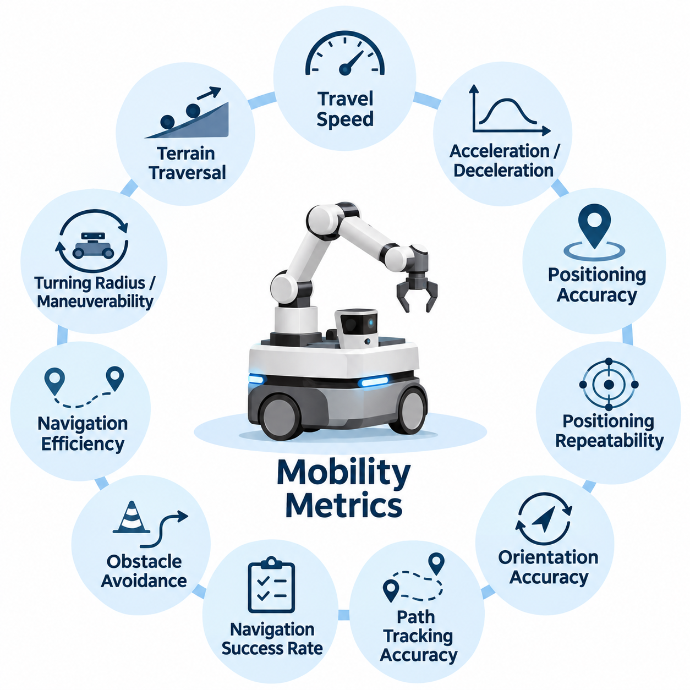
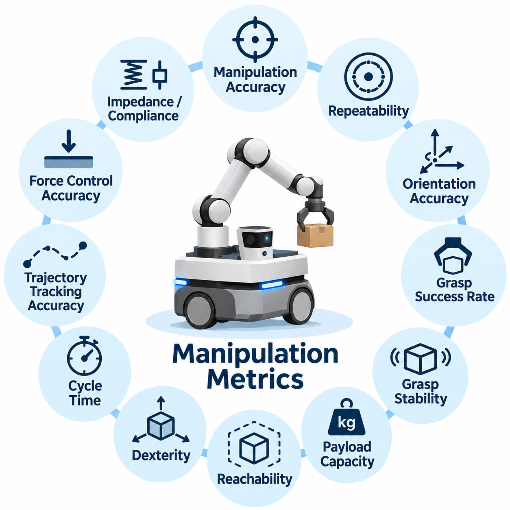
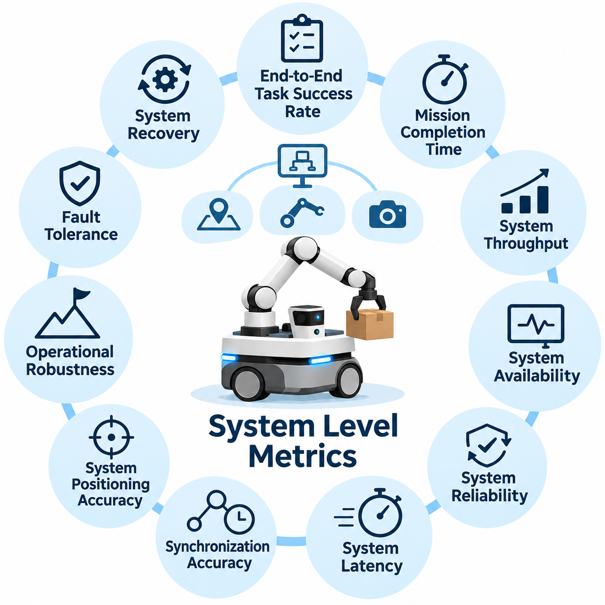
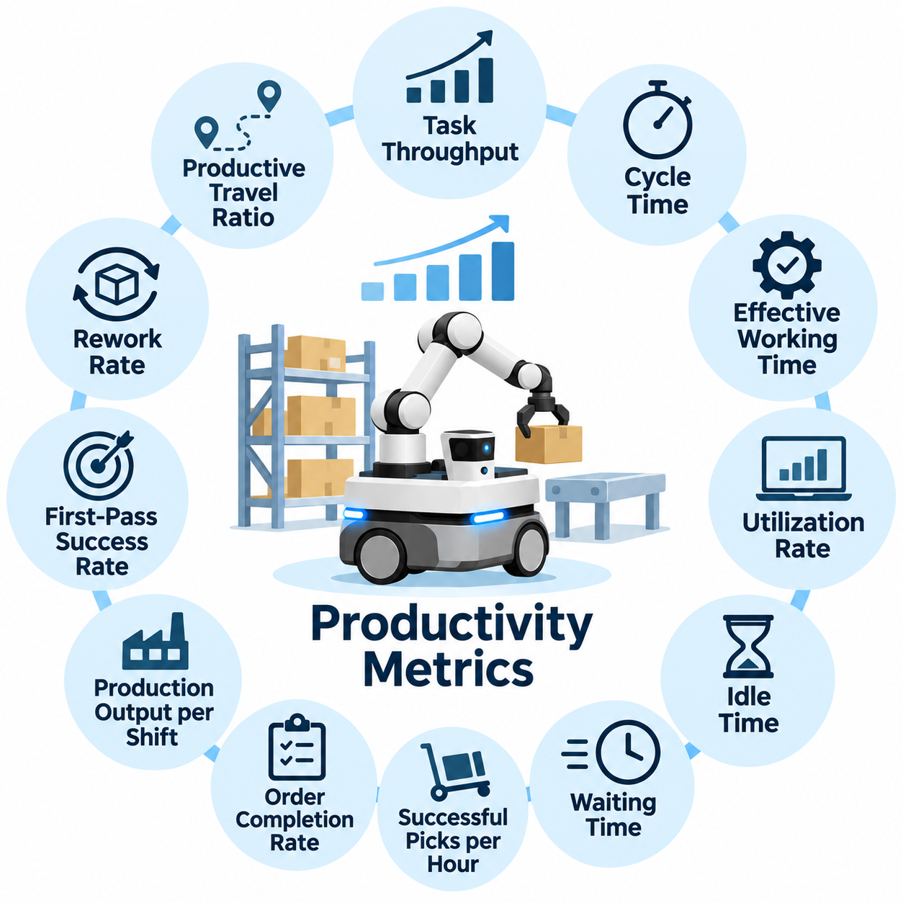
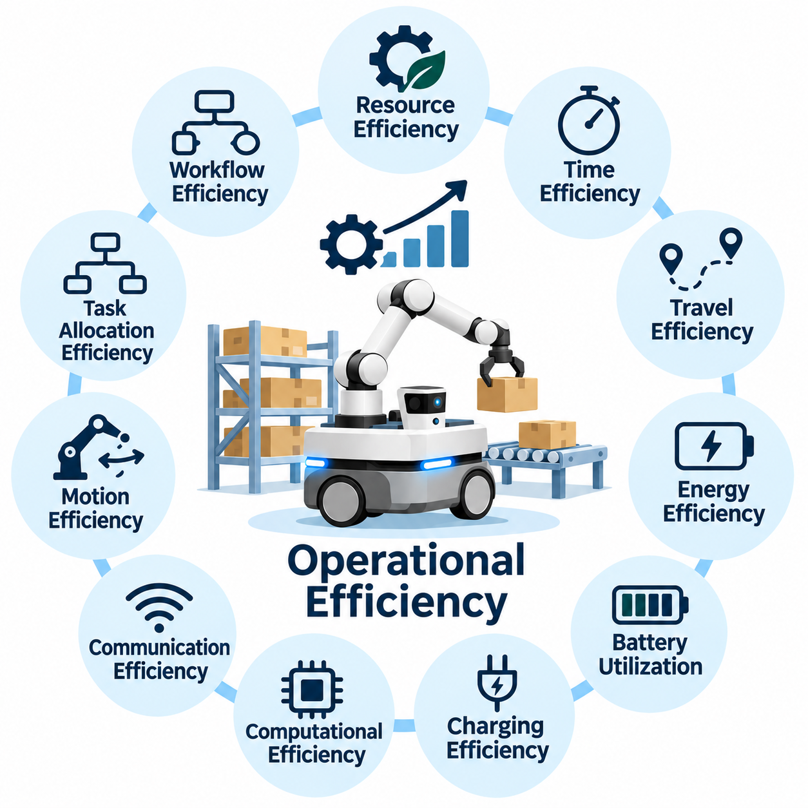
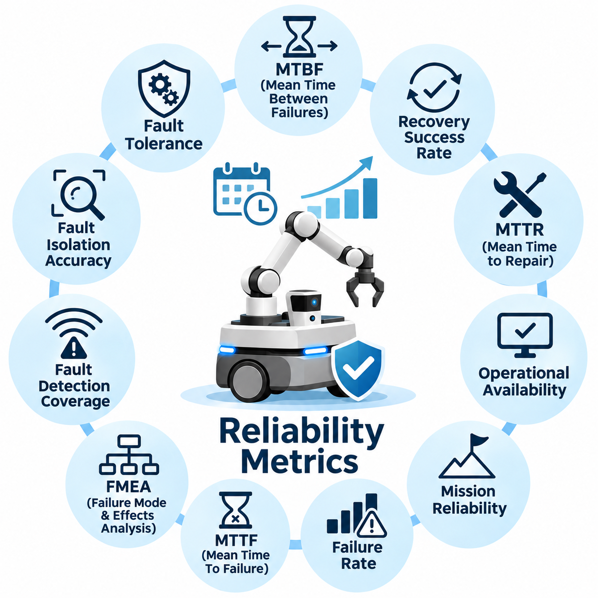
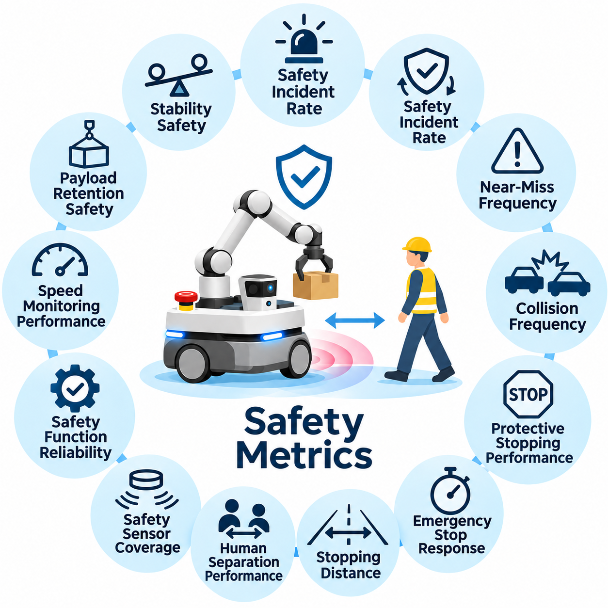
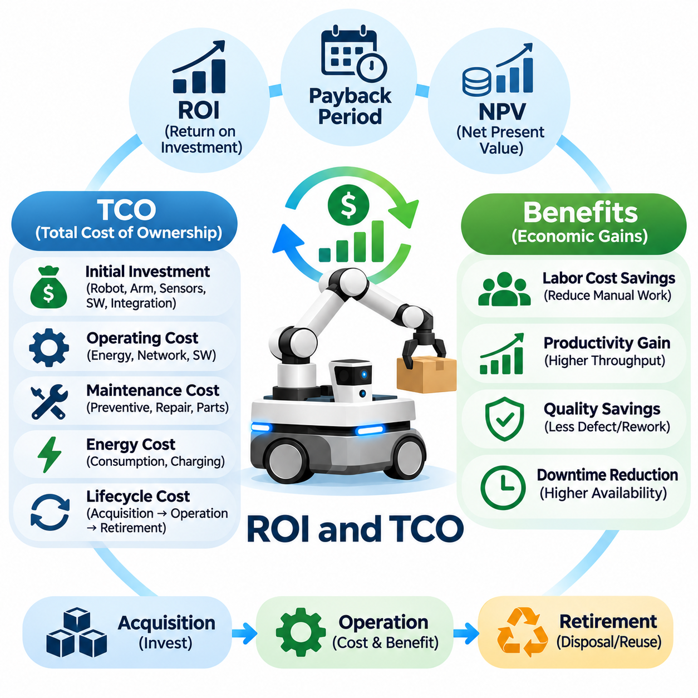
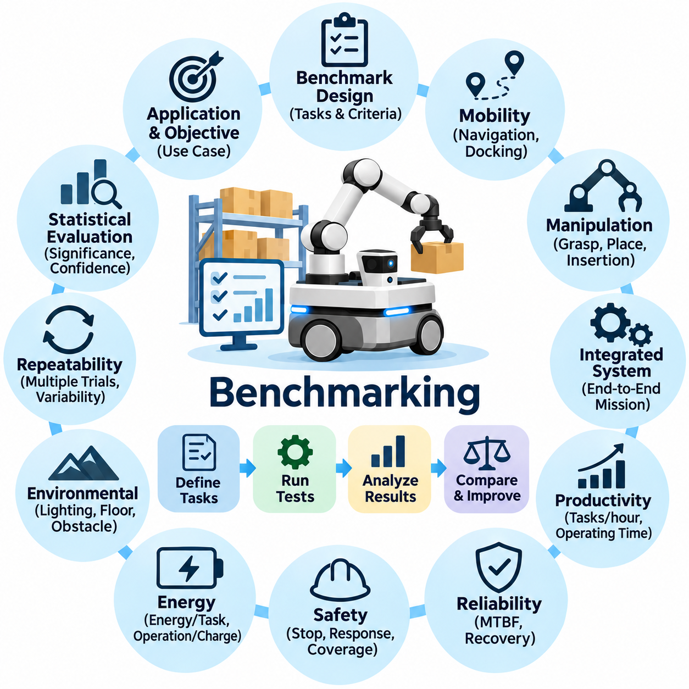

**Volume 01. Mobile Manipulator Foundations and System Architecture**


# Chapter 11. Performance Metrics

##  

## 01 Mobility Metrics

{width="7.268055555555556in" height="7.268055555555556in"}

Mobility metrics provide a quantitative foundation for evaluating how effectively a mobile manipulator moves through its operating environment. Unlike conventional autonomous mobile robots, mobile manipulators must maintain navigation performance while carrying robotic arms, end effectors, and variable payloads. Their mobility performance therefore depends on mechanical design, localization accuracy, motion control, environmental conditions, and coordination between the mobile platform and manipulator.

Travel speed is a fundamental mobility metric that describes the distance traveled per unit of time. Maximum speed represents the platform\'s physical capability, while nominal operating speed reflects practical movement under normal conditions. Average mission speed includes acceleration, deceleration, obstacle avoidance, and traffic interruptions. Evaluating these values separately helps engineers distinguish theoretical mobility capability from actual operational performance.

Acceleration and deceleration characteristics determine how efficiently a mobile manipulator changes velocity during navigation. Rapid acceleration may improve travel efficiency but can introduce vibration, wheel slip, and disturbances to the robotic arm. Controlled deceleration is particularly important when transporting fragile objects or approaching manipulation stations. Performance evaluation should consider acceleration limits, braking distance, motion smoothness, and payload stability.

Positioning accuracy measures the difference between a robot\'s estimated or commanded position and its actual physical location. Accurate positioning is essential when the manipulator must interact with shelves, machines, workstations, or docking interfaces. Positioning errors may originate from wheel odometry, localization algorithms, sensor calibration, or environmental changes. Evaluation should distinguish localization accuracy from final physical positioning accuracy.

Positioning repeatability describes the ability of a mobile platform to return consistently to the same target location across repeated trials. A robot may exhibit systematic positioning error while maintaining excellent repeatability, allowing calibration or local correction strategies to compensate. Conversely, inconsistent positioning creates difficulties for robotic manipulation. Repeatability is commonly evaluated through repeated docking experiments and statistical analysis of position deviations.

Orientation accuracy is another critical mobility metric because small angular errors can significantly affect the manipulator\'s reachable workspace. When a mobile robot approaches a workstation, incorrect heading may shift the effective position of its end effector. Orientation performance can be measured using angular error, heading repeatability, and rotational stability. These measurements are especially important for narrow workspaces and precision assembly operations.

Path tracking accuracy evaluates how closely a mobile manipulator follows a planned trajectory. Common measurements include lateral deviation, heading error, maximum tracking error, and root mean square trajectory error. Tracking performance depends on vehicle kinematics, controller parameters, localization quality, and environmental disturbances. Reliable path tracking reduces unnecessary corrections and supports predictable movement through industrial facilities.

Navigation success rate measures the proportion of navigation missions completed according to predefined acceptance criteria. A successful mission typically requires reaching the intended destination without collisions, unsafe behavior, or unacceptable positioning errors. Navigation failures may result from localization loss, inaccessible routes, dynamic obstacles, or controller limitations. Success rates should be evaluated across representative routes, operating conditions, and mission durations.

Obstacle avoidance performance measures the robot\'s ability to detect, interpret, and safely navigate around objects within its operating environment. Relevant measurements include detection-to-response latency, minimum obstacle clearance, avoidance success rate, and additional travel distance. Static obstacles provide controlled evaluation conditions, while moving pedestrians and vehicles introduce uncertainty. Testing should account for different obstacle sizes, movement patterns, and sensor visibility.

Navigation efficiency describes how effectively the robot reaches its destination relative to an appropriate reference route. Path efficiency can be expressed as the ratio between reference path length and actual traveled distance, provided the reference is feasible and comparable. Excessive detours increase energy consumption and mission duration. However, the shortest path is not necessarily optimal when safety constraints, congestion, or manipulation requirements influence route selection.

Turning radius and maneuverability determine whether a mobile manipulator can operate within constrained industrial spaces. Differential-drive platforms can rotate approximately around their own centers, while steering-based platforms may require larger turning areas. Omnidirectional configurations offer additional movement flexibility but introduce mechanical and control complexity. Maneuverability evaluation should include corridor width, turning clearance, lateral motion capability, and obstacle proximity.

Terrain traversal capability measures how effectively the mobile platform operates across different surface conditions. Relevant factors include maximum negotiable slope, floor discontinuities, obstacle crossing height, surface friction, and wheel traction. Uneven terrain may affect localization, payload stability, and manipulator calibration. Testing should represent the actual deployment environment rather than relying exclusively on ideal laboratory floors.

Payload-dependent mobility performance is especially important because a mobile manipulator\'s mass distribution changes during operation. Payload weight, arm extension, and object placement influence the center of gravity, traction, braking behavior, and tipping resistance. A robot carrying a heavy object with an extended arm may require reduced acceleration or turning speed. Mobility tests should therefore cover representative payload configurations and manipulator postures.

Motion stability evaluates unwanted vibration, oscillation, and body movement during travel. Excessive platform vibration can reduce sensor measurement quality, disturb transported objects, and increase mechanical wear. Stability measurements may include linear acceleration, angular velocity, vibration amplitude, and settling time. These metrics become particularly important when mobile manipulators transport delicate components or perform precision operations immediately after navigation.

Docking accuracy measures the ability of a mobile manipulator to approach and align with a designated workstation or interface. Successful docking may require precise longitudinal, lateral, and angular positioning. Mechanical guides, visual markers, laser localization, and local correction algorithms can improve alignment. Evaluation should include docking success rate, final pose error, docking duration, and the number of corrective movements required.

Localization robustness describes the ability to maintain reliable position estimation under changing environmental conditions. Industrial facilities may contain reflective surfaces, repetitive structures, temporary obstacles, and areas with limited visual features. These conditions can degrade LiDAR, camera, or odometry-based localization. Robustness testing should examine localization failures, recovery time, pose estimation uncertainty, and performance during environmental changes.

Recovery performance evaluates how effectively a mobile manipulator resumes navigation after encountering unexpected conditions. Recovery scenarios may include blocked routes, temporary localization failures, emergency stops, or communication interruptions. Useful measurements include recovery success rate, average recovery duration, and the frequency of human intervention. Effective recovery mechanisms improve operational continuity without compromising safety or introducing unpredictable movements.

Energy efficiency during mobility describes the electrical energy required to move the robot through representative operating conditions. Energy consumption depends on travel distance, velocity, acceleration, payload mass, terrain, and drive system efficiency. Measurements such as watt-hours per kilometer support comparisons between mobility configurations. For mobile manipulators, propulsion energy should be distinguished from manipulator, perception, computing, and auxiliary power consumption.

Mission travel time measures the elapsed duration between departure and arrival at a designated destination. Unlike nominal speed, this metric captures practical delays caused by route planning, obstacle avoidance, congestion, and positioning adjustments. Travel time distributions reveal operational variability that average values may conceal. Percentile-based measurements are useful when evaluating whether a robot can satisfy predictable production schedules.

Mobility availability describes the proportion of required operating time during which the navigation subsystem remains capable of performing assigned movements. Mobility interruptions may arise from drive faults, sensor failures, localization problems, or control system errors. Availability measurements should distinguish planned maintenance from unexpected failures. This distinction helps engineers identify whether performance limitations originate from mechanical reliability, software robustness, or operational procedures.

Mobility benchmarking requires standardized test conditions to ensure meaningful comparisons between platforms. Test protocols should specify payload mass, floor characteristics, route geometry, obstacle arrangements, velocity limits, and environmental conditions. Each experiment should include sufficient repetitions to estimate variability. Reporting average performance together with dispersion, worst-case observations, and failure frequency provides a more complete understanding of mobility capability.

Real-world mobility evaluation should combine controlled laboratory measurements with representative operational trials. Laboratory testing supports repeatable characterization of positioning, tracking, acceleration, and docking behavior. Field testing exposes interactions with pedestrians, equipment, traffic congestion, and changing layouts. Comparing these results reveals the difference between nominal technical performance and the capabilities achievable during sustained deployment.

Mobility metrics must ultimately be interpreted within the complete mobile manipulation workflow. High travel speed offers limited value if inaccurate docking increases arm alignment time or causes grasp failures. Similarly, excellent positioning accuracy may not justify excessive navigation delays. Effective system evaluation connects mobility measurements with manipulation readiness, mission completion, safety constraints, and overall task performance to support balanced engineering decisions.

이동 성능 지표(Mobility Metrics)는 이동형 매니퓰레이터(Mobile Manipulator)가 운영 환경에서 얼마나 효과적으로 이동하는지를 정량적으로 평가하기 위한 기반을 제공한다. 기존 자율이동로봇(Autonomous Mobile Robot, AMR)과 달리 이동형 매니퓰레이터는 로봇 팔(Robot Arm), 말단장치(End Effector), 가변 적재하중(Variable Payload)을 탑재한 상태에서도 주행 성능을 유지해야 한다. 따라서 이동 성능은 기계 설계(Mechanical Design), 위치 추정 정확도(Localization Accuracy), 운동 제어(Motion Control), 환경 조건(Environmental Conditions), 이동 플랫폼과 매니퓰레이터 사이의 협조 제어(Coordination Control)에 의해 결정된다.

주행 속도(Travel Speed)는 단위 시간당 이동한 거리를 나타내는 기본적인 이동 성능 지표이다. 최고 속도(Maximum Speed)는 이동 플랫폼의 물리적 성능 한계를 나타내며, 정격 운행 속도(Nominal Operating Speed)는 정상적인 운영 조건에서 실제로 사용하는 속도를 의미한다. 평균 임무 속도(Average Mission Speed)에는 가속, 감속, 장애물 회피, 교통 흐름에 따른 지연이 포함된다. 이러한 속도를 구분하여 평가하면 이론적인 이동 성능과 실제 운영 성능 사이의 차이를 명확하게 파악할 수 있다.

가속 및 감속 특성(Acceleration and Deceleration Characteristics)은 이동형 매니퓰레이터가 주행 중 속도를 얼마나 효율적으로 변경할 수 있는지를 결정한다. 빠른 가속은 이동 효율을 높일 수 있지만 진동(Vibration), 바퀴 미끄러짐(Wheel Slip), 로봇 팔의 동적 교란(Dynamic Disturbance)을 유발할 수 있다. 특히 파손되기 쉬운 물체를 운반하거나 작업 위치에 접근할 때는 안정적인 감속이 중요하다. 성능 평가에서는 가속도 제한(Acceleration Limits), 제동 거리(Braking Distance), 운동 평활성(Motion Smoothness), 적재물 안정성(Payload Stability)을 함께 고려해야 한다.

위치 정확도(Positioning Accuracy)는 로봇이 추정하거나 명령받은 위치와 실제 물리적 위치 사이의 차이를 측정한다. 매니퓰레이터가 선반, 기계, 작업대 또는 도킹 인터페이스(Docking Interface)와 상호작용하려면 정확한 위치 결정이 필수적이다. 위치 오차(Positioning Error)는 바퀴 주행거리 추정(Wheel Odometry), 위치 추정 알고리즘(Localization Algorithm), 센서 보정(Sensor Calibration), 환경 변화(Environmental Changes) 등에서 발생할 수 있다. 평가 과정에서는 위치 추정 정확도와 최종 물리적 위치 정확도를 구분해야 한다.

위치 반복정밀도(Positioning Repeatability)는 이동 플랫폼이 반복적인 시험에서 동일한 목표 위치로 얼마나 일관되게 복귀하는지를 나타낸다. 로봇에 일정한 위치 편차(Systematic Positioning Error)가 존재하더라도 반복정밀도가 우수하면 보정(Calibration)이나 국부 위치 수정(Local Correction)을 통해 오차를 보상할 수 있다. 반대로 위치 편차가 불규칙하면 정밀한 로봇 조작이 어려워진다. 반복정밀도는 일반적으로 반복 도킹 시험(Repeated Docking Test)과 위치 편차의 통계적 분석(Statistical Analysis)을 통해 평가한다.

방향 정확도(Orientation Accuracy)는 작은 각도 오차(Angular Error)도 매니퓰레이터의 도달 작업공간(Reachable Workspace)에 상당한 영향을 줄 수 있기 때문에 중요한 이동 성능 지표이다. 이동 로봇이 작업대에 접근할 때 방향이 부정확하면 말단장치의 실제 작업 위치가 달라질 수 있다. 방향 성능은 각도 오차, 방향 반복정밀도(Heading Repeatability), 회전 안정성(Rotational Stability)을 통해 측정할 수 있다. 이러한 측정은 협소한 작업공간과 정밀 조립(Precision Assembly) 작업에서 특히 중요하다.

경로 추종 정확도(Path Tracking Accuracy)는 이동형 매니퓰레이터가 계획된 궤적(Planned Trajectory)을 얼마나 정확하게 따라가는지를 평가한다. 대표적인 측정 항목에는 횡방향 편차(Lateral Deviation), 방향 오차(Heading Error), 최대 추종 오차(Maximum Tracking Error), 평균제곱근 궤적 오차(Root Mean Square Trajectory Error)가 포함된다. 추종 성능은 차량 운동학(Vehicle Kinematics), 제어기 매개변수(Controller Parameters), 위치 추정 품질(Localization Quality), 환경적 교란(Environmental Disturbance)에 영향을 받는다. 정확한 경로 추종은 불필요한 보정 동작을 줄이고 예측 가능한 주행을 지원한다.

자율주행 성공률(Navigation Success Rate)은 사전에 정의된 허용 기준(Acceptance Criteria)에 따라 완료된 주행 임무의 비율을 나타낸다. 성공적인 임무는 일반적으로 충돌, 위험 동작 또는 허용 범위를 초과하는 위치 오차 없이 목표 지점에 도달하는 것을 의미한다. 주행 실패(Navigation Failure)는 위치 추정 손실(Localization Loss), 접근 불가능한 경로(Inaccessible Route), 동적 장애물(Dynamic Obstacle), 제어기 한계(Controller Limitation) 등으로 발생할 수 있다. 성공률은 대표적인 경로, 운영 조건, 임무 지속시간을 고려하여 평가해야 한다.

장애물 회피 성능(Obstacle Avoidance Performance)은 로봇이 운영 환경의 장애물을 감지하고 해석하여 안전하게 우회하는 능력을 측정한다. 주요 지표에는 감지 후 대응 지연시간(Detection-to-Response Latency), 최소 장애물 이격거리(Minimum Obstacle Clearance), 회피 성공률(Avoidance Success Rate), 추가 이동거리(Additional Travel Distance)가 포함된다. 정적 장애물(Static Obstacle)은 통제된 시험 조건을 제공하지만 이동하는 보행자와 차량은 불확실성을 증가시킨다. 시험에서는 장애물 크기, 이동 패턴, 센서 가시성(Sensor Visibility)을 고려해야 한다.

주행 효율(Navigation Efficiency)은 적절한 기준 경로(Reference Route)와 비교하여 로봇이 목표 지점까지 얼마나 효율적으로 이동하는지를 나타낸다. 경로 효율(Path Efficiency)은 기준 경로가 실제로 주행 가능하고 비교 조건이 동일한 경우 기준 경로 길이와 실제 이동거리의 비율로 표현할 수 있다. 과도한 우회는 에너지 소비와 임무 수행시간을 증가시킨다. 그러나 안전 제약(Safety Constraints), 교통 혼잡(Traffic Congestion), 조작 작업 요구사항(Manipulation Requirements)을 고려하면 최단 경로가 반드시 최적 경로는 아니다.

회전 반경(Turning Radius)과 기동성(Maneuverability)은 이동형 매니퓰레이터가 제한된 산업 공간에서 운용될 수 있는지를 결정한다. 차동구동 플랫폼(Differential-Drive Platform)은 자체 중심을 기준으로 거의 제자리 회전이 가능하지만 조향 기반 플랫폼(Steering-Based Platform)은 더 넓은 회전 공간이 필요할 수 있다. 전방향 이동 구조(Omnidirectional Configuration)는 이동 유연성을 높이지만 기계 및 제어 복잡성을 증가시킨다. 기동성 평가에는 통로 폭(Corridor Width), 회전 여유 공간(Turning Clearance), 횡방향 이동 능력(Lateral Motion Capability), 장애물 근접도(Obstacle Proximity)가 포함되어야 한다.

지형 주행 능력(Terrain Traversal Capability)은 이동 플랫폼이 다양한 노면 조건에서 얼마나 효과적으로 작동하는지를 측정한다. 주요 요소에는 최대 등판 경사(Maximum Negotiable Slope), 바닥 단차(Floor Discontinuity), 장애물 극복 높이(Obstacle Crossing Height), 노면 마찰(Surface Friction), 바퀴 접지력(Wheel Traction)이 포함된다. 불균일한 지형은 위치 추정, 적재물 안정성, 매니퓰레이터 보정에 영향을 줄 수 있다. 따라서 시험은 이상적인 실험실 바닥뿐 아니라 실제 배치 환경(Deployment Environment)을 대표해야 한다.

적재하중에 따른 이동 성능(Payload-Dependent Mobility Performance)은 이동형 매니퓰레이터의 질량 분포(Mass Distribution)가 작업 중 지속적으로 변화하기 때문에 중요하다. 적재물 무게(Payload Weight), 로봇 팔의 확장 거리(Arm Extension), 물체 배치(Object Placement)는 무게중심(Center of Gravity), 접지력(Traction), 제동 특성(Braking Behavior), 전복 저항성(Tipping Resistance)에 영향을 준다. 무거운 물체를 팔을 뻗은 상태로 운반하는 로봇은 가속도나 회전 속도를 낮춰야 할 수 있다. 따라서 대표적인 적재 조건과 매니퓰레이터 자세를 포함하여 이동 성능을 시험해야 한다.

운동 안정성(Motion Stability)은 주행 중 발생하는 불필요한 진동, 진동성 운동(Oscillation), 차체 움직임(Body Movement)을 평가한다. 과도한 플랫폼 진동은 센서 측정 품질을 저하시키고 운반 물체를 흔들며 기계적 마모(Mechanical Wear)를 증가시킬 수 있다. 안정성 측정에는 선형 가속도(Linear Acceleration), 각속도(Angular Velocity), 진동 진폭(Vibration Amplitude), 안정화 시간(Settling Time)이 포함된다. 이러한 지표는 정밀 부품을 운반하거나 주행 직후 정밀 작업을 수행하는 이동형 매니퓰레이터에서 특히 중요하다.

도킹 정확도(Docking Accuracy)는 이동형 매니퓰레이터가 지정된 작업대나 인터페이스에 접근하여 정렬하는 능력을 측정한다. 성공적인 도킹에는 종방향(Longitudinal), 횡방향(Lateral), 각도 방향(Angular)의 정밀한 위치 결정이 필요할 수 있다. 기계적 가이드(Mechanical Guide), 시각 마커(Visual Marker), 레이저 기반 위치 추정(Laser Localization), 국부 보정 알고리즘(Local Correction Algorithm)은 정렬 정확도를 향상시킨다. 평가에는 도킹 성공률(Docking Success Rate), 최종 자세 오차(Final Pose Error), 도킹 시간(Docking Duration), 보정 동작 횟수(Number of Corrective Movements)가 포함되어야 한다.

위치 추정 강건성(Localization Robustness)은 변화하는 환경 조건에서도 신뢰할 수 있는 위치 추정을 유지하는 능력을 나타낸다. 산업 시설에는 반사 표면(Reflective Surface), 반복 구조(Repetitive Structure), 임시 장애물(Temporary Obstacle), 시각적 특징이 부족한 영역(Low-Feature Area)이 존재할 수 있다. 이러한 조건은 라이다(LiDAR), 카메라(Camera), 주행거리 추정(Odometry) 기반 위치 추정 성능을 저하시킬 수 있다. 강건성 시험에서는 위치 추정 실패, 복구 시간(Recovery Time), 자세 추정 불확실성(Pose Estimation Uncertainty), 환경 변화에 따른 성능을 평가해야 한다.

복구 성능(Recovery Performance)은 이동형 매니퓰레이터가 예상하지 못한 상황에 직면한 후 주행을 얼마나 효과적으로 재개하는지를 평가한다. 복구 상황에는 경로 차단(Blocked Route), 일시적인 위치 추정 실패(Temporary Localization Failure), 비상 정지(Emergency Stop), 통신 중단(Communication Interruption)이 포함될 수 있다. 주요 지표에는 복구 성공률(Recovery Success Rate), 평균 복구 시간(Average Recovery Duration), 작업자 개입 빈도(Human Intervention Frequency)가 있다. 효과적인 복구 기능은 안전성을 저해하거나 예측 불가능한 움직임을 발생시키지 않으면서 운영 연속성을 향상시킨다.

이동 에너지 효율(Mobility Energy Efficiency)은 대표적인 운영 조건에서 로봇을 이동시키는 데 필요한 전기 에너지를 나타낸다. 에너지 소비(Energy Consumption)는 이동거리, 속도, 가속도, 적재물 질량, 지형, 구동계 효율(Drive System Efficiency)에 따라 달라진다. 킬로미터당 와트시(Watt-hours per Kilometer)와 같은 측정값은 이동 플랫폼 구조 사이의 비교를 지원한다. 이동형 매니퓰레이터에서는 추진 에너지(Propulsion Energy)를 매니퓰레이터, 인지 시스템(Perception System), 컴퓨팅(Computing), 보조장치(Auxiliary System)의 전력 소비와 구분해야 한다.

임무 이동시간(Mission Travel Time)은 출발 지점에서 지정된 목적지에 도착할 때까지 경과한 시간을 측정한다. 정격 속도와 달리 이 지표에는 경로 계획(Path Planning), 장애물 회피, 교통 혼잡, 위치 보정으로 발생하는 실제 지연이 반영된다. 이동시간 분포(Travel Time Distribution)는 평균값만으로 파악하기 어려운 운영 변동성(Operational Variability)을 보여준다. 백분위수 기반 측정(Percentile-Based Measurement)은 로봇이 예측 가능한 생산 일정(Production Schedule)을 충족할 수 있는지 평가하는 데 유용하다.

이동 가용성(Mobility Availability)은 요구되는 운영시간 중 주행 하위 시스템(Navigation Subsystem)이 할당된 이동 작업을 수행할 수 있는 상태로 유지되는 시간의 비율을 나타낸다. 이동 중단(Mobility Interruption)은 구동장치 고장(Drive Fault), 센서 고장(Sensor Failure), 위치 추정 문제(Localization Problem), 제어 시스템 오류(Control System Error) 등으로 발생할 수 있다. 가용성 측정에서는 계획 정비(Planned Maintenance)와 예기치 않은 고장(Unexpected Failure)을 구분해야 한다. 이를 통해 성능 한계가 기계적 신뢰성(Mechanical Reliability), 소프트웨어 강건성(Software Robustness), 운영 절차(Operational Procedure) 중 어디에서 발생하는지 파악할 수 있다.

이동 성능 벤치마킹(Mobility Benchmarking)은 플랫폼 사이의 의미 있는 비교를 위해 표준화된 시험 조건(Standardized Test Conditions)을 필요로 한다. 시험 프로토콜(Test Protocol)에는 적재물 질량, 바닥 특성(Floor Characteristics), 경로 형상(Route Geometry), 장애물 배치(Obstacle Arrangement), 속도 제한(Velocity Limits), 환경 조건을 명시해야 한다. 각 실험은 변동성을 추정할 수 있도록 충분히 반복해야 한다. 평균 성능과 함께 분산 정도(Dispersion), 최악 조건 관측값(Worst-Case Observations), 고장 발생 빈도(Failure Frequency)를 보고하면 이동 성능을 더욱 종합적으로 이해할 수 있다.

실제 환경 이동 성능 평가(Real-World Mobility Evaluation)는 통제된 실험실 측정과 대표적인 운영 현장 시험(Operational Field Trial)을 결합해야 한다. 실험실 시험(Laboratory Testing)은 위치 결정, 경로 추종, 가속, 도킹 성능을 반복 가능한 조건에서 분석하도록 지원한다. 현장 시험(Field Testing)은 보행자, 장비, 교통 혼잡, 변화하는 시설 배치와의 상호작용을 드러낸다. 두 시험 결과를 비교하면 정격 기술 성능(Nominal Technical Performance)과 지속적인 실제 운영에서 달성할 수 있는 성능 사이의 차이를 확인할 수 있다.

이동 성능 지표는 궁극적으로 전체 이동 조작 작업흐름(Mobile Manipulation Workflow) 안에서 해석해야 한다. 높은 주행 속도도 부정확한 도킹으로 로봇 팔 정렬시간(Arm Alignment Time)이 증가하거나 파지 실패(Grasp Failure)가 발생한다면 실질적인 가치가 제한된다. 마찬가지로 뛰어난 위치 정확도를 확보하더라도 과도한 주행 지연이 발생한다면 효율성이 낮아질 수 있다. 효과적인 시스템 평가(System Evaluation)는 이동 성능 측정값을 조작 준비 상태(Manipulation Readiness), 임무 완료(Mission Completion), 안전 제약(Safety Constraints), 전체 작업 성능(Overall Task Performance)과 연계하여 균형 잡힌 공학적 의사결정(Engineering Decision-Making)을 지원해야 한다.

##  

## 02 Manipulation Metrics

{width="7.268055555555556in" height="7.268055555555556in"}

Manipulation metrics provide a quantitative framework for evaluating how effectively a mobile manipulator performs physical interactions with objects and its surrounding environment. Unlike fixed industrial robots, mobile manipulators operate from platforms whose positioning accuracy and stability may vary between tasks. Manipulation performance therefore depends on robotic arm precision, perception quality, grasp stability, motion planning, force control, and coordination with the mobile base.

Manipulation accuracy measures the difference between the commanded end-effector position and its actual position during task execution. This metric is essential for applications involving assembly, machine tending, object placement, and precision handling. Position errors may originate from joint calibration, mechanical deformation, sensor uncertainty, or mobile platform misalignment. Accuracy should be evaluated under representative payloads, arm configurations, and operating conditions.

Manipulation repeatability describes the ability of a robotic arm to return consistently to the same target pose across repeated operations. A manipulator may exhibit systematic positioning errors while maintaining excellent repeatability, allowing calibration procedures to improve absolute accuracy. Repeatability is particularly important in repetitive industrial processes where consistent object placement is required. Evaluation typically involves repeated movements and statistical analysis of positional deviations.

End-effector orientation accuracy measures how closely the actual tool orientation matches the commanded orientation. Angular errors can significantly affect insertion, assembly, gripping, and surface interaction tasks. Orientation performance depends on joint encoder resolution, kinematic calibration, mechanical backlash, and controller precision. Evaluation should consider angular deviations around relevant rotational axes and their influence on successful task execution.

Grasp success rate represents the proportion of attempted grasps that satisfy predefined success criteria. A successful grasp may require secure object acquisition, stable lifting, transport, and controlled release without unintended slipping or damage. Grasp performance depends on object geometry, surface friction, perception accuracy, and gripper design. Testing should include representative objects, orientations, environmental conditions, and repeated trials.

Grasp stability measures the ability of an end effector to maintain secure contact with an object during movement and external disturbances. Stability depends on contact geometry, friction, applied forces, and the object\'s center of mass. Unstable grasps may cause slipping, rotation, or accidental release. Evaluation can incorporate slip frequency, object displacement, contact force variation, and resistance to controlled disturbances during manipulation.

Payload capacity describes the maximum object mass that a manipulator can safely handle under specified operating conditions. However, nominal payload ratings do not fully represent performance across the entire workspace. Arm extension, joint torque limits, acceleration, and mobile platform stability influence practical handling capability. Payload evaluation should consider object mass, center-of-mass offset, tool weight, dynamic loading, and allowable motion profiles.

Reachability measures the manipulator\'s ability to position its end effector at required locations within the operating environment. The reachable workspace is determined by arm geometry, joint limits, collision constraints, and mobile base placement. Not every reachable position supports every tool orientation or payload. Reachability evaluation should distinguish geometric reach from task-feasible reach and consider whether required manipulation poses can be achieved reliably.

Dexterity describes the manipulator\'s ability to perform controlled movements across different positions and orientations. High dexterity enables flexible object handling, complex assembly, and operation within constrained spaces. Dexterity can be analyzed using kinematic manipulability, joint configuration flexibility, and proximity to singularities. These measurements help identify regions where precise motion or force generation becomes difficult despite geometric reachability.

Manipulation cycle time measures the elapsed duration required to complete a defined manipulation operation. A typical cycle may include object detection, grasp planning, arm positioning, gripping, lifting, transfer, placement, and release. Cycle time varies with object complexity, motion distance, payload, and controller performance. Separating planning time from physical execution time helps identify whether computational delays or mechanical limitations dominate task performance.

Trajectory tracking accuracy evaluates how closely the manipulator follows a planned motion path during execution. Common measurements include Cartesian position error, orientation error, joint tracking error, and maximum trajectory deviation. Tracking performance is influenced by controller bandwidth, actuator dynamics, payload inertia, and mechanical flexibility. Accurate trajectory tracking is especially important for insertion, dispensing, welding, and collision-sensitive operations.

Force control accuracy measures the difference between commanded interaction forces and actual forces applied to objects or surfaces. This metric is essential for contact-rich tasks such as polishing, assembly, insertion, and delicate object handling. Force errors may result from sensor calibration, actuator friction, control latency, or structural compliance. Evaluation should consider steady-state force error, transient response, overshoot, and force stability during contact.

Impedance and compliance performance describe how a manipulator responds to external forces and environmental constraints. Appropriate compliance allows controlled physical interaction while reducing excessive contact forces. Performance can be evaluated through effective stiffness, damping behavior, displacement under applied loads, and response to disturbances. These characteristics are particularly important when manipulating uncertain objects or interacting with equipment that has limited positioning tolerance.

Manipulation planning success rate measures the proportion of task requests for which the planning system produces valid, executable motions. Planning failures may arise from unreachable targets, joint limits, singularities, collisions, or computational constraints. A valid planned trajectory does not necessarily guarantee successful physical execution. Therefore, planning success should be measured separately from execution success, with both evaluated across representative task scenarios.

Collision avoidance performance evaluates the manipulator\'s ability to execute movements without unintended contact with surrounding objects, equipment, or the mobile platform. Relevant metrics include minimum clearance, collision frequency, trajectory feasibility, and planning latency. Collision checking should account for the entire arm, attached tools, and transported objects. Dynamic environments introduce additional challenges because obstacles may move during execution.

Object placement accuracy measures the difference between the intended object pose and its final pose after release. Placement performance depends on grasp quality, end-effector calibration, object geometry, release dynamics, and environmental contact. Even accurate arm positioning may produce poor placement when objects shift during release. Evaluation should measure translational and rotational placement errors, repeatability, and successful completion within specified tolerances.

Manipulation robustness describes the ability to maintain acceptable performance despite variations in objects, environmental conditions, and system parameters. Changes in lighting, object orientation, surface friction, payload distribution, or mobile platform positioning can influence task outcomes. Robustness testing should systematically introduce controlled variations and measure their effects on success rates, execution time, and recovery requirements.

Recovery performance evaluates the manipulator\'s ability to respond to unsuccessful grasps, unexpected contact, object displacement, or motion execution failures. Effective recovery may involve releasing an unstable grasp, repositioning the tool, updating perception, or generating a new motion plan. Relevant metrics include recovery success rate, recovery duration, repeated failure frequency, and human intervention requirements. Recovery behavior must remain within defined safety constraints.

Manipulation energy consumption measures the electrical energy required to execute physical tasks. Energy demand depends on actuator efficiency, payload mass, joint motion, acceleration, holding torque, and task duration. Measurements such as watt-hours per completed manipulation cycle support comparisons between control strategies and hardware configurations. Energy analysis should distinguish arm actuation from gripper operation, perception processing, and mobile platform consumption.

Task completion rate measures the proportion of manipulation tasks successfully completed according to application-specific acceptance criteria. Unlike grasp success rate, this metric evaluates the complete operation, including acquisition, movement, placement, and any required verification. A grasp may succeed while the overall task fails because of incorrect placement or incomplete interaction. Task completion rate therefore provides a broader measure of functional manipulation capability.

Mobile base and arm coordination accuracy evaluates how effectively the two subsystems maintain consistent spatial relationships during manipulation. Errors in base localization, coordinate transformations, or platform stabilization can propagate into end-effector positioning errors. Coordinated motion may improve workspace coverage but introduces additional control complexity. Evaluation should consider relative pose accuracy, synchronization delays, and manipulation performance during base movement.

Manipulation benchmarking requires standardized objects, task definitions, operating conditions, and acceptance criteria. Test procedures should specify payloads, object geometries, target poses, environmental constraints, and permitted recovery actions. Repeated trials are necessary to estimate performance variability and identify systematic failure patterns. Reporting success rates alongside accuracy, cycle time, and failure distributions supports meaningful comparisons between robotic systems.

Manipulation metrics must ultimately be interpreted within the complete mobile manipulation workflow. Excellent arm accuracy provides limited operational value if unreliable navigation prevents access to workstations or unstable grasps cause repeated failures. Similarly, rapid manipulation may be undesirable when it increases object damage or safety risks. Effective evaluation combines precision, reliability, speed, robustness, and physical interaction quality to support balanced system-level optimization.

조작 성능 지표(Manipulation Metrics)는 이동형 매니퓰레이터(Mobile Manipulator)가 물체 및 주변 환경과의 물리적 상호작용(Physical Interaction)을 얼마나 효과적으로 수행하는지를 정량적으로 평가하기 위한 체계를 제공한다. 고정형 산업용 로봇(Fixed Industrial Robot)과 달리 이동형 매니퓰레이터는 작업마다 위치 정확도(Positioning Accuracy)와 안정성(Stability)이 달라질 수 있는 이동 플랫폼에서 작동한다. 따라서 조작 성능은 로봇 팔 정밀도(Robotic Arm Precision), 인지 품질(Perception Quality), 파지 안정성(Grasp Stability), 운동 계획(Motion Planning), 힘 제어(Force Control), 이동 플랫폼과의 협조 제어(Coordination Control)에 따라 결정된다.

조작 정확도(Manipulation Accuracy)는 명령된 말단장치 위치(Commanded End-Effector Position)와 작업 수행 중 실제 위치 사이의 차이를 측정한다. 이 지표는 조립(Assembly), 공작기계 작업 지원(Machine Tending), 물체 배치(Object Placement), 정밀 취급(Precision Handling)과 같은 응용 분야에서 필수적이다. 위치 오차(Position Error)는 관절 보정(Joint Calibration), 기계적 변형(Mechanical Deformation), 센서 불확실성(Sensor Uncertainty), 이동 플랫폼 정렬 오차(Mobile Platform Misalignment) 등에서 발생할 수 있다. 정확도는 대표적인 적재하중(Payload), 로봇 팔 구성(Arm Configuration), 운영 조건(Operating Conditions)에서 평가해야 한다.

조작 반복정밀도(Manipulation Repeatability)는 로봇 팔이 반복적인 작업에서 동일한 목표 자세(Target Pose)로 얼마나 일관되게 복귀하는지를 나타낸다. 매니퓰레이터에 일정한 위치 오차(Systematic Positioning Error)가 존재하더라도 반복정밀도가 우수하면 보정 절차(Calibration Procedure)를 통해 절대 정확도(Absolute Accuracy)를 향상시킬 수 있다. 반복정밀도는 일관된 물체 배치가 필요한 반복 산업 공정(Repetitive Industrial Process)에서 특히 중요하다. 평가는 일반적으로 반복 동작(Repeated Movement)과 위치 편차(Positional Deviation)의 통계적 분석(Statistical Analysis)을 통해 수행한다.

말단장치 방향 정확도(End-Effector Orientation Accuracy)는 실제 도구 방향(Actual Tool Orientation)이 명령된 방향(Commanded Orientation)과 얼마나 일치하는지를 측정한다. 각도 오차(Angular Error)는 삽입(Insertion), 조립(Assembly), 파지(Gripping), 표면 접촉 작업(Surface Interaction Task)에 상당한 영향을 줄 수 있다. 방향 성능은 관절 엔코더 분해능(Joint Encoder Resolution), 운동학적 보정(Kinematic Calibration), 기계적 백래시(Mechanical Backlash), 제어기 정밀도(Controller Precision)에 따라 달라진다. 평가에서는 관련 회전축의 각도 편차와 작업 성공에 미치는 영향을 고려해야 한다.

파지 성공률(Grasp Success Rate)은 사전에 정의된 성공 기준(Success Criteria)을 충족한 파지 시도의 비율을 나타낸다. 성공적인 파지는 물체를 안정적으로 획득하고 들어 올린 후 운반하며, 의도하지 않은 미끄러짐(Slipping)이나 손상(Damage) 없이 제어된 방식으로 놓는 과정까지 포함할 수 있다. 파지 성능은 물체 형상(Object Geometry), 표면 마찰(Surface Friction), 인지 정확도(Perception Accuracy), 그리퍼 설계(Gripper Design)에 영향을 받는다. 시험에는 대표적인 물체, 방향, 환경 조건과 반복 시도가 포함되어야 한다.

파지 안정성(Grasp Stability)은 말단장치가 이동 및 외부 교란(External Disturbance) 중에도 물체와 안정적인 접촉을 유지하는 능력을 측정한다. 안정성은 접촉 형상(Contact Geometry), 마찰(Friction), 작용 힘(Applied Force), 물체의 무게중심(Center of Mass)에 따라 달라진다. 불안정한 파지는 미끄러짐(Slip), 회전(Rotation), 의도하지 않은 물체 이탈(Accidental Release)을 유발할 수 있다. 평가에는 미끄러짐 빈도(Slip Frequency), 물체 변위(Object Displacement), 접촉력 변화(Contact Force Variation), 제어된 교란에 대한 저항성(Disturbance Resistance)을 활용할 수 있다.

적재하중 용량(Payload Capacity)은 지정된 운영 조건에서 매니퓰레이터가 안전하게 취급할 수 있는 최대 물체 질량을 나타낸다. 그러나 정격 적재하중(Nominal Payload Rating)만으로는 전체 작업공간(Workspace)에서의 성능을 완전히 설명할 수 없다. 로봇 팔 확장 거리(Arm Extension), 관절 토크 제한(Joint Torque Limits), 가속도(Acceleration), 이동 플랫폼 안정성(Mobile Platform Stability)이 실제 취급 능력에 영향을 준다. 적재하중 평가는 물체 질량, 무게중심 편차(Center-of-Mass Offset), 도구 무게(Tool Weight), 동적 하중(Dynamic Loading), 허용 운동 프로파일(Allowable Motion Profile)을 고려해야 한다.

도달 가능성(Reachability)은 매니퓰레이터가 운영 환경의 요구 위치에 말단장치를 배치할 수 있는 능력을 측정한다. 도달 가능한 작업공간(Reachable Workspace)은 로봇 팔 형상(Arm Geometry), 관절 제한(Joint Limits), 충돌 제약(Collision Constraints), 이동 플랫폼 위치(Mobile Base Placement)에 의해 결정된다. 도달 가능한 모든 위치에서 모든 도구 방향이나 적재하중을 지원할 수 있는 것은 아니다. 따라서 도달 가능성 평가는 기하학적 도달 범위(Geometric Reach)와 작업 수행이 가능한 도달 범위(Task-Feasible Reach)를 구분하고 요구되는 조작 자세를 안정적으로 구현할 수 있는지 고려해야 한다.

조작성(Dexterity)은 매니퓰레이터가 다양한 위치와 방향에서 제어된 움직임을 수행하는 능력을 나타낸다. 높은 조작성은 유연한 물체 취급(Flexible Object Handling), 복잡한 조립(Complex Assembly), 제한된 공간에서의 작업을 가능하게 한다. 조작성은 운동학적 조작성(Kinematic Manipulability), 관절 구성 유연성(Joint Configuration Flexibility), 특이점 근접도(Proximity to Singularities)를 통해 분석할 수 있다. 이러한 측정은 기하학적으로 도달할 수 있더라도 정밀한 운동이나 힘 생성이 어려워지는 영역을 식별하는 데 도움이 된다.

조작 사이클 시간(Manipulation Cycle Time)은 정의된 조작 작업을 완료하는 데 필요한 경과 시간을 측정한다. 일반적인 작업 사이클(Task Cycle)에는 물체 검출(Object Detection), 파지 계획(Grasp Planning), 로봇 팔 위치 결정(Arm Positioning), 파지(Gripping), 들어 올리기(Lifting), 이송(Transfer), 배치(Placement), 해제(Release)가 포함될 수 있다. 사이클 시간은 물체 복잡도(Object Complexity), 이동거리(Motion Distance), 적재하중, 제어기 성능에 따라 달라진다. 계획 시간(Planning Time)과 물리적 실행 시간(Physical Execution Time)을 구분하면 계산 지연과 기계적 한계 중 어떤 요소가 성능을 지배하는지 파악할 수 있다.

궤적 추종 정확도(Trajectory Tracking Accuracy)는 매니퓰레이터가 실행 중 계획된 운동 경로(Planned Motion Path)를 얼마나 정확하게 따라가는지를 평가한다. 대표적인 측정 항목에는 직교좌표 위치 오차(Cartesian Position Error), 방향 오차(Orientation Error), 관절 추종 오차(Joint Tracking Error), 최대 궤적 편차(Maximum Trajectory Deviation)가 포함된다. 추종 성능은 제어기 대역폭(Controller Bandwidth), 액추에이터 동역학(Actuator Dynamics), 적재물 관성(Payload Inertia), 기계적 유연성(Mechanical Flexibility)에 영향을 받는다. 정확한 궤적 추종은 삽입, 도포(Dispensing), 용접(Welding), 충돌에 민감한 작업에서 특히 중요하다.

힘 제어 정확도(Force Control Accuracy)는 명령된 상호작용 힘(Commanded Interaction Force)과 물체 또는 표면에 실제로 가해진 힘 사이의 차이를 측정한다. 이 지표는 연마(Polishing), 조립, 삽입, 섬세한 물체 취급과 같은 접촉 중심 작업(Contact-Rich Task)에서 필수적이다. 힘 오차(Force Error)는 센서 보정(Sensor Calibration), 액추에이터 마찰(Actuator Friction), 제어 지연(Control Latency), 구조적 컴플라이언스(Structural Compliance)에서 발생할 수 있다. 평가에서는 정상상태 힘 오차(Steady-State Force Error), 과도응답(Transient Response), 오버슈트(Overshoot), 접촉 중 힘 안정성(Force Stability)을 고려해야 한다.

임피던스 및 컴플라이언스 성능(Impedance and Compliance Performance)은 매니퓰레이터가 외부 힘과 환경 제약(Environmental Constraints)에 어떻게 반응하는지를 나타낸다. 적절한 컴플라이언스(Compliance)는 과도한 접촉력을 줄이면서 제어된 물리적 상호작용을 가능하게 한다. 성능은 유효 강성(Effective Stiffness), 감쇠 특성(Damping Behavior), 작용 하중에 따른 변위(Displacement Under Applied Loads), 교란 응답(Disturbance Response)을 통해 평가할 수 있다. 이러한 특성은 불확실한 물체를 조작하거나 위치 허용오차가 제한된 장비와 상호작용할 때 특히 중요하다.

조작 계획 성공률(Manipulation Planning Success Rate)은 작업 요청 중 계획 시스템(Planning System)이 유효하고 실행 가능한 운동을 생성하는 비율을 측정한다. 계획 실패(Planning Failure)는 도달할 수 없는 목표(Unreachable Target), 관절 제한, 특이점(Singularity), 충돌(Collision), 계산 제약(Computational Constraint) 등으로 발생할 수 있다. 유효한 계획 궤적(Valid Planned Trajectory)이 반드시 성공적인 물리적 실행을 보장하지는 않는다. 따라서 계획 성공률은 실행 성공률(Execution Success Rate)과 별도로 측정하고, 두 지표 모두 대표적인 작업 시나리오(Task Scenario)에서 평가해야 한다.

충돌 회피 성능(Collision Avoidance Performance)은 매니퓰레이터가 주변 물체, 장비 또는 이동 플랫폼과 의도하지 않은 접촉 없이 움직임을 실행하는 능력을 평가한다. 관련 지표에는 최소 이격거리(Minimum Clearance), 충돌 빈도(Collision Frequency), 궤적 실행 가능성(Trajectory Feasibility), 계획 지연시간(Planning Latency)이 포함된다. 충돌 검사(Collision Checking)는 로봇 팔 전체, 부착된 도구, 운반 중인 물체를 고려해야 한다. 동적 환경(Dynamic Environment)에서는 실행 중 장애물이 이동할 수 있으므로 추가적인 어려움이 발생한다.

물체 배치 정확도(Object Placement Accuracy)는 의도한 물체 자세(Intended Object Pose)와 해제 후 최종 자세(Final Pose) 사이의 차이를 측정한다. 배치 성능은 파지 품질(Grasp Quality), 말단장치 보정(End-Effector Calibration), 물체 형상, 해제 동역학(Release Dynamics), 환경 접촉(Environmental Contact)에 따라 달라진다. 로봇 팔의 위치 결정이 정확하더라도 물체가 해제 과정에서 이동하면 배치 정확도가 저하될 수 있다. 평가에서는 병진 및 회전 배치 오차(Translational and Rotational Placement Errors), 반복정밀도, 지정된 허용오차(Tolerance) 내 작업 완료 여부를 측정해야 한다.

조작 강건성(Manipulation Robustness)은 물체, 환경 조건, 시스템 매개변수(System Parameters)가 변화하더라도 허용 가능한 성능을 유지하는 능력을 나타낸다. 조명(Lighting), 물체 방향(Object Orientation), 표면 마찰, 적재하중 분포(Payload Distribution), 이동 플랫폼 위치의 변화는 작업 결과에 영향을 줄 수 있다. 강건성 시험(Robustness Testing)은 통제된 변화를 체계적으로 도입하고 성공률(Success Rate), 실행 시간(Execution Time), 복구 요구사항(Recovery Requirements)에 미치는 영향을 측정해야 한다.

복구 성능(Recovery Performance)은 매니퓰레이터가 파지 실패(Unsuccessful Grasp), 예상하지 못한 접촉(Unexpected Contact), 물체 변위(Object Displacement), 운동 실행 실패(Motion Execution Failure)에 대응하는 능력을 평가한다. 효과적인 복구에는 불안정한 파지 해제, 도구 위치 재조정(Tool Repositioning), 인지 정보 갱신(Perception Update), 새로운 운동 계획 생성(Motion Replanning)이 포함될 수 있다. 관련 지표에는 복구 성공률(Recovery Success Rate), 복구 시간(Recovery Duration), 반복 실패 빈도(Repeated Failure Frequency), 작업자 개입 요구사항(Human Intervention Requirements)이 포함된다. 복구 동작은 정의된 안전 제약(Safety Constraints) 내에서 수행되어야 한다.

조작 에너지 소비(Manipulation Energy Consumption)는 물리적 작업을 실행하는 데 필요한 전기 에너지를 측정한다. 에너지 요구량(Energy Demand)은 액추에이터 효율(Actuator Efficiency), 적재물 질량, 관절 운동(Joint Motion), 가속도, 유지 토크(Holding Torque), 작업 지속시간(Task Duration)에 따라 달라진다. 완료된 조작 사이클당 와트시(Watt-hours per Completed Manipulation Cycle)와 같은 측정값은 제어 전략(Control Strategy)과 하드웨어 구성(Hardware Configuration)을 비교하는 데 유용하다. 에너지 분석에서는 로봇 팔 구동(Arm Actuation)을 그리퍼 작동(Gripper Operation), 인지 처리(Perception Processing), 이동 플랫폼 소비전력과 구분해야 한다.

작업 완료율(Task Completion Rate)은 응용 분야별 허용 기준(Application-Specific Acceptance Criteria)에 따라 성공적으로 완료된 조작 작업의 비율을 측정한다. 파지 성공률과 달리 이 지표는 물체 획득(Object Acquisition), 이동(Movement), 배치(Placement), 필요한 검증(Verification)을 포함한 전체 작업을 평가한다. 파지에 성공하더라도 잘못된 배치나 불완전한 상호작용으로 전체 작업이 실패할 수 있다. 따라서 작업 완료율은 기능적 조작 능력(Functional Manipulation Capability)을 더욱 포괄적으로 나타내는 지표이다.

이동 플랫폼과 로봇 팔의 협조 정확도(Mobile Base and Arm Coordination Accuracy)는 두 하위 시스템(Subsystem)이 조작 중 일관된 공간적 관계(Spatial Relationship)를 얼마나 효과적으로 유지하는지를 평가한다. 플랫폼 위치 추정 오차(Base Localization Error), 좌표 변환(Coordinate Transformation), 플랫폼 안정화(Platform Stabilization)의 오류는 말단장치 위치 오차로 전파될 수 있다. 협조 운동(Coordinated Motion)은 작업공간 범위를 확장할 수 있지만 제어 복잡성(Control Complexity)을 증가시킨다. 평가에서는 상대 자세 정확도(Relative Pose Accuracy), 동기화 지연(Synchronization Delay), 플랫폼 이동 중 조작 성능을 고려해야 한다.

조작 성능 벤치마킹(Manipulation Benchmarking)은 표준화된 물체(Standardized Objects), 작업 정의(Task Definitions), 운영 조건, 허용 기준을 필요로 한다. 시험 절차(Test Procedure)에는 적재하중, 물체 형상, 목표 자세(Target Pose), 환경 제약, 허용되는 복구 동작(Permitted Recovery Actions)을 명시해야 한다. 성능 변동성(Performance Variability)을 추정하고 체계적인 실패 패턴(Systematic Failure Patterns)을 식별하려면 반복 시험(Repeated Trials)이 필요하다. 성공률과 함께 정확도, 사이클 시간, 실패 분포(Failure Distribution)를 보고하면 로봇 시스템 사이의 의미 있는 비교가 가능하다.

조작 성능 지표는 궁극적으로 전체 이동 조작 작업흐름(Mobile Manipulation Workflow) 안에서 해석해야 한다. 로봇 팔의 정확도가 뛰어나더라도 불안정한 자율주행(Unreliable Navigation)으로 작업대에 접근하지 못하거나 불안정한 파지로 반복적인 실패가 발생하면 운영상 가치가 제한된다. 마찬가지로 빠른 조작 속도도 물체 손상(Object Damage)이나 안전 위험(Safety Risk)을 증가시킨다면 바람직하지 않을 수 있다. 효과적인 평가는 정밀도(Precision), 신뢰성(Reliability), 속도(Speed), 강건성(Robustness), 물리적 상호작용 품질(Physical Interaction Quality)을 통합하여 균형 잡힌 시스템 수준 최적화(System-Level Optimization)를 지원해야 한다.

##  

## 03 System Level Metrics

{width="7.268055555555556in" height="7.268055555555556in"}

System-level metrics provide an integrated framework for evaluating the overall performance of a mobile manipulator as a coordinated robotic system. Unlike individual mobility or manipulation measurements, these metrics examine how navigation, perception, planning, control, communication, and physical interaction contribute to mission execution. A system may contain high-performance components yet deliver poor results when subsystem integration introduces delays, errors, or operational conflicts.

End-to-end task success rate measures the proportion of complete missions that satisfy predefined acceptance criteria. A typical mission may involve navigating to a workstation, identifying an object, grasping it, transporting it, and placing it at a destination. Failure at any critical stage can prevent successful completion. This metric captures the combined effectiveness of mobility, manipulation, perception, and task coordination rather than evaluating each capability independently.

Mission completion time represents the total elapsed duration required to execute an assigned workflow. It includes navigation, localization, object recognition, manipulation planning, physical execution, verification, and recovery operations. Measuring only arm movement or travel time can underestimate actual system delays. Decomposing mission duration into functional stages helps engineers identify bottlenecks and prioritize improvements that produce meaningful operational benefits.

System throughput measures the number of successfully completed tasks within a specified operating period. Throughput depends on navigation efficiency, manipulation cycle time, task scheduling, resource availability, and environmental conditions. Increasing the speed of one subsystem may not improve throughput if another subsystem remains the limiting factor. System-level throughput analysis therefore emphasizes coordinated optimization rather than isolated component acceleration.

System availability describes the proportion of scheduled operating time during which the complete mobile manipulator remains capable of performing assigned tasks. Availability can be reduced by mechanical failures, software faults, sensor problems, communication interruptions, or required maintenance. A functioning mobile base does not guarantee system availability when the robotic arm or perception subsystem is unavailable. Evaluation must therefore consider the operational readiness of all mission-critical components.

System reliability measures the probability that a mobile manipulator performs its intended functions without failure during a defined period or mission. Reliability depends on hardware durability, software stability, sensor performance, and integration quality. Repeated minor failures may significantly reduce operational effectiveness even when individual components appear reliable. Mission reliability should be evaluated using representative workloads, environmental conditions, and sufficiently long observation periods.

System latency measures the delay between an event, command, or sensor observation and the corresponding system response. Latency may originate from perception processing, network communication, task planning, motion control, or actuator execution. Excessive delays can reduce productivity and compromise coordinated behavior. Evaluation should distinguish average latency from worst-case response times, particularly when timing constraints influence safety or physical interaction.

Synchronization accuracy evaluates how consistently distributed subsystems coordinate their operations in time. Mobile manipulators frequently combine sensors, navigation controllers, robotic arms, and edge computing devices operating at different update rates. Timing inconsistencies can produce outdated coordinate transformations or delayed control commands. Synchronization performance can be characterized through timestamp alignment, communication jitter, and coordinated motion errors.

System positioning accuracy measures the final spatial accuracy achieved by the complete mobile manipulation system. Unlike isolated arm accuracy, this metric incorporates mobile base positioning, localization uncertainty, coordinate transformations, mechanical compliance, and tool calibration. Small errors from multiple subsystems may accumulate at the end effector. Evaluating final task-space accuracy provides a more realistic measure of the system\'s ability to perform precision operations.

Operational robustness describes the ability of the integrated system to maintain acceptable performance under changing conditions. Variations in lighting, floor friction, object placement, network quality, and environmental layout can influence multiple subsystems simultaneously. Robustness testing should introduce representative disturbances while measuring mission success, execution time, and recovery behavior. This approach reveals weaknesses that may remain hidden during isolated component testing.

Fault tolerance measures the ability of a mobile manipulator to continue operating safely when selected components experience failures or degraded performance. Redundant sensors, alternative communication paths, diagnostic monitoring, and fallback operating modes can improve fault tolerance. However, not every failure permits continued operation. Evaluation should determine whether the system detects faults, transitions to an appropriate state, and preserves essential safety requirements.

System recovery performance evaluates how effectively the robot restores normal operation after interruptions or unsuccessful task execution. Recovery may involve relocalization, motion replanning, object reinspection, manipulator repositioning, or controlled task restarting. Relevant measurements include recovery success rate, recovery duration, repeated failure frequency, and human intervention requirements. Recovery mechanisms should avoid unnecessary repetition and prevent unsafe continuation after critical failures.

Resource utilization measures how efficiently the integrated system uses computational, electrical, mechanical, and communication resources. CPU and GPU utilization, memory consumption, network bandwidth, and actuator duty cycles can reveal performance constraints. High resource utilization does not necessarily indicate efficient operation if excessive processing introduces delays or thermal limitations. Evaluation should connect resource consumption with completed tasks and operational requirements.

Energy efficiency at the system level measures the total electrical energy consumed during complete missions. Unlike mobility-only or manipulation-only measurements, it includes propulsion, robotic arm actuation, perception sensors, computing hardware, communication equipment, and auxiliary systems. Energy per successful task provides a practical comparison between system configurations. Idle consumption, charging losses, and unsuccessful task attempts should also be considered when defining evaluation boundaries.

System stability describes the ability of the mobile manipulator to maintain controlled behavior during navigation, manipulation, and transitions between operating modes. Movement of the robotic arm can alter platform loading and introduce dynamic disturbances. Simultaneous base and arm motion increases coordination requirements. Stability evaluation should consider vibration, body motion, control oscillations, payload displacement, and settling time before precision manipulation.

Perception-to-action performance measures how effectively sensor information is transformed into appropriate physical behavior. The process may include sensor acquisition, object detection, pose estimation, decision-making, motion planning, and actuator control. Errors or delays at any stage can degrade task execution. End-to-end evaluation should consider perception accuracy, information freshness, decision latency, and the resulting physical task outcome.

Communication performance evaluates the reliability and responsiveness of data exchange between system components. Mobile manipulators may depend on internal field buses, Ethernet networks, wireless connections, and external fleet management systems. Packet loss, excessive jitter, or communication interruptions can disrupt coordination. Relevant measurements include message delivery success, bandwidth utilization, communication latency, and recovery behavior following connection loss.

Autonomy level describes the extent to which a mobile manipulator can complete assigned missions without direct human control. Autonomy evaluation should consider independent task execution, environmental adaptation, exception handling, and recovery capability. A system that performs routine tasks automatically but frequently requires assistance during unexpected conditions may have limited practical autonomy. Human intervention frequency and intervention duration provide useful operational measurements.

Scalability measures how effectively system performance is maintained when task complexity, operating area, or the number of robots increases. Larger deployments introduce communication traffic, scheduling conflicts, shared resource constraints, and additional coordination requirements. Performance may degrade even when individual robots remain technically capable. Scalability testing should examine throughput, latency, resource utilization, and mission success across increasing workloads.

System integration quality reflects how consistently mechanical, electrical, computational, and software components operate together. Interface mismatches, inconsistent coordinate frames, incompatible timing assumptions, and incomplete fault handling can undermine otherwise capable subsystems. Integration performance can be evaluated through interface error frequency, system initialization success, configuration consistency, and cross-subsystem fault propagation.

Mission consistency measures the variability of system performance across repeated executions of equivalent tasks. Two systems may achieve similar average completion times while exhibiting substantially different operational predictability. High variability can complicate production scheduling and resource allocation. Statistical measurements such as standard deviation, percentile completion time, and repeated mission success provide insight into consistency under representative operating conditions.

System-level benchmarking requires standardized mission definitions, environmental conditions, payload configurations, and acceptance criteria. Benchmarks should evaluate complete workflows rather than relying exclusively on isolated navigation or manipulation tests. Repeated trials help quantify performance variability and identify interactions between subsystems. Results should report success rates, completion times, resource consumption, recovery events, and relevant safety constraints.

Effective system-level performance evaluation requires balancing competing engineering objectives. Higher speed may increase energy consumption, aggressive motion may reduce stability, and additional sensing may improve robustness while increasing computational latency. No single metric can fully describe mobile manipulator capability. A comprehensive evaluation framework connects mission success, reliability, timing, precision, autonomy, and resource efficiency to support practical system optimization.

시스템 수준 성능 지표(System-Level Metrics)는 이동형 매니퓰레이터(Mobile Manipulator)를 통합된 로봇 시스템(Integrated Robotic System)으로 평가하기 위한 종합적인 체계를 제공한다. 개별적인 이동 성능(Mobility Performance)이나 조작 성능(Manipulation Performance) 측정과 달리, 이러한 지표는 자율주행(Navigation), 인지(Perception), 계획(Planning), 제어(Control), 통신(Communication), 물리적 상호작용(Physical Interaction)이 임무 수행에 어떻게 기여하는지를 평가한다. 개별 구성요소의 성능이 우수하더라도 하위 시스템 통합(Subsystem Integration) 과정에서 지연, 오차 또는 운영상 충돌이 발생하면 전체 시스템 성능은 저하될 수 있다.

종단 간 작업 성공률(End-to-End Task Success Rate)은 사전에 정의된 허용 기준(Acceptance Criteria)을 충족한 전체 임무의 비율을 측정한다. 일반적인 임무에는 작업대로 이동하고, 물체를 인식하고, 파지한 후 운반하여 목적지에 배치하는 과정이 포함될 수 있다. 핵심 단계 중 어느 하나라도 실패하면 전체 임무를 성공적으로 완료하지 못할 수 있다. 이 지표는 각 기능을 독립적으로 평가하는 대신 이동, 조작, 인지, 작업 협조(Task Coordination)의 통합적인 효과를 나타낸다.

임무 완료시간(Mission Completion Time)은 할당된 작업흐름(Workflow)을 실행하는 데 필요한 전체 경과 시간을 의미한다. 여기에는 자율주행, 위치 추정(Localization), 물체 인식(Object Recognition), 조작 계획(Manipulation Planning), 물리적 실행(Physical Execution), 검증(Verification), 복구 작업(Recovery Operation)이 포함된다. 로봇 팔의 이동시간이나 주행시간만 측정하면 실제 시스템 지연을 과소평가할 수 있다. 임무 수행시간을 기능별 단계로 분해하면 병목 현상(Bottleneck)을 식별하고 실질적인 운영 개선 효과를 제공하는 영역에 우선순위를 부여할 수 있다.

시스템 처리량(System Throughput)은 지정된 운영시간 동안 성공적으로 완료한 작업의 수를 측정한다. 처리량은 주행 효율(Navigation Efficiency), 조작 사이클 시간(Manipulation Cycle Time), 작업 스케줄링(Task Scheduling), 자원 가용성(Resource Availability), 환경 조건(Environmental Conditions)에 따라 달라진다. 특정 하위 시스템의 속도를 높이더라도 다른 하위 시스템이 성능 제한 요소로 남아 있다면 전체 처리량은 향상되지 않을 수 있다. 따라서 시스템 수준 처리량 분석은 개별 구성요소의 속도 향상보다 협조적인 최적화(Coordinated Optimization)를 강조한다.

시스템 가용성(System Availability)은 예정된 운영시간 중 전체 이동형 매니퓰레이터가 할당된 작업을 수행할 수 있는 상태로 유지되는 시간의 비율을 나타낸다. 가용성은 기계적 고장(Mechanical Failure), 소프트웨어 오류(Software Fault), 센서 문제(Sensor Problem), 통신 중단(Communication Interruption), 필수 유지보수(Required Maintenance)에 의해 감소할 수 있다. 이동 플랫폼이 정상적으로 작동하더라도 로봇 팔이나 인지 하위 시스템(Perception Subsystem)을 사용할 수 없다면 전체 시스템의 가용성이 보장되지 않는다. 따라서 평가에서는 모든 임무 필수 구성요소(Mission-Critical Component)의 운영 준비 상태(Operational Readiness)를 고려해야 한다.

시스템 신뢰성(System Reliability)은 이동형 매니퓰레이터가 정의된 시간이나 임무 동안 고장 없이 의도된 기능을 수행할 확률을 측정한다. 신뢰성은 하드웨어 내구성(Hardware Durability), 소프트웨어 안정성(Software Stability), 센서 성능(Sensor Performance), 통합 품질(Integration Quality)에 따라 결정된다. 개별 구성요소가 신뢰할 수 있는 수준으로 보이더라도 반복적인 경미한 고장(Minor Failure)은 전체 운영 효율을 크게 저하시킬 수 있다. 임무 신뢰성(Mission Reliability)은 대표적인 작업 부하(Workload), 환경 조건, 충분히 긴 관찰 기간(Observation Period)을 통해 평가해야 한다.

시스템 지연시간(System Latency)은 이벤트(Event), 명령(Command), 센서 관측(Sensor Observation)이 발생한 시점부터 해당 시스템 응답(System Response)이 나타날 때까지의 지연을 측정한다. 지연은 인지 처리(Perception Processing), 네트워크 통신(Network Communication), 작업 계획(Task Planning), 운동 제어(Motion Control), 액추에이터 실행(Actuator Execution)에서 발생할 수 있다. 과도한 지연은 생산성을 낮추고 협조 동작(Coordinated Behavior)을 저해할 수 있다. 특히 시간 제약(Timing Constraints)이 안전이나 물리적 상호작용에 영향을 미치는 경우 평균 지연시간(Average Latency)과 최악 조건 응답시간(Worst-Case Response Time)을 구분하여 평가해야 한다.

동기화 정확도(Synchronization Accuracy)는 분산된 하위 시스템(Distributed Subsystems)이 시간적으로 얼마나 일관되게 동작을 조정하는지를 평가한다. 이동형 매니퓰레이터는 서로 다른 갱신 주기(Update Rate)로 작동하는 센서, 자율주행 제어기(Navigation Controller), 로봇 팔, 엣지 컴퓨팅 장치(Edge Computing Device)를 결합하는 경우가 많다. 시간 불일치(Timing Inconsistency)는 오래된 좌표 변환 정보(Outdated Coordinate Transformation)나 지연된 제어 명령(Delayed Control Command)을 발생시킬 수 있다. 동기화 성능은 타임스탬프 정렬(Timestamp Alignment), 통신 지터(Communication Jitter), 협조 운동 오차(Coordinated Motion Error)를 통해 평가할 수 있다.

시스템 위치 정확도(System Positioning Accuracy)는 전체 이동 조작 시스템(Mobile Manipulation System)이 달성하는 최종 공간적 정확도(Final Spatial Accuracy)를 측정한다. 개별 로봇 팔 정확도와 달리 이 지표에는 이동 플랫폼 위치 결정(Mobile Base Positioning), 위치 추정 불확실성(Localization Uncertainty), 좌표 변환(Coordinate Transformation), 기계적 컴플라이언스(Mechanical Compliance), 도구 보정(Tool Calibration)이 포함된다. 여러 하위 시스템에서 발생한 작은 오차가 말단장치(End Effector)에서 누적될 수 있다. 최종 작업공간 정확도(Task-Space Accuracy)를 평가하면 정밀 작업 수행 능력을 더욱 현실적으로 파악할 수 있다.

운영 강건성(Operational Robustness)은 변화하는 조건에서도 통합 시스템이 허용 가능한 성능을 유지하는 능력을 나타낸다. 조명(Lighting), 바닥 마찰(Floor Friction), 물체 배치(Object Placement), 네트워크 품질(Network Quality), 환경 배치(Environmental Layout)의 변화는 여러 하위 시스템에 동시에 영향을 줄 수 있다. 강건성 시험(Robustness Testing)에서는 대표적인 교란(Disturbance)을 도입하면서 임무 성공률(Mission Success Rate), 실행 시간(Execution Time), 복구 동작(Recovery Behavior)을 측정해야 한다. 이러한 접근은 개별 구성요소 시험에서 발견되지 않을 수 있는 취약점을 드러낸다.

고장 허용성(Fault Tolerance)은 일부 구성요소에 고장이나 성능 저하가 발생하더라도 이동형 매니퓰레이터가 안전하게 운영을 지속할 수 있는 능력을 측정한다. 중복 센서(Redundant Sensor), 대체 통신 경로(Alternative Communication Path), 진단 모니터링(Diagnostic Monitoring), 대체 운영 모드(Fallback Operating Mode)는 고장 허용성을 향상시킬 수 있다. 그러나 모든 고장 상황에서 지속적인 운영이 허용되는 것은 아니다. 평가에서는 시스템이 고장을 감지하고 적절한 상태로 전환하며 필수 안전 요구사항(Essential Safety Requirements)을 유지하는지를 확인해야 한다.

시스템 복구 성능(System Recovery Performance)은 중단이나 작업 실행 실패 이후 로봇이 정상 운영을 얼마나 효과적으로 복원하는지를 평가한다. 복구에는 재위치 추정(Relocalization), 운동 재계획(Motion Replanning), 물체 재검사(Object Reinspection), 매니퓰레이터 재배치(Manipulator Repositioning), 제어된 작업 재시작(Controlled Task Restart)이 포함될 수 있다. 관련 지표에는 복구 성공률(Recovery Success Rate), 복구 시간(Recovery Duration), 반복 고장 빈도(Repeated Failure Frequency), 작업자 개입 요구사항(Human Intervention Requirements)이 포함된다. 복구 기능은 불필요한 반복을 방지하고 치명적인 고장(Critical Failure) 이후 위험한 작업 재개를 차단해야 한다.

자원 활용률(Resource Utilization)은 통합 시스템이 계산 자원(Computational Resources), 전기 자원(Electrical Resources), 기계적 자원(Mechanical Resources), 통신 자원(Communication Resources)을 얼마나 효율적으로 사용하는지를 측정한다. CPU 및 GPU 활용률, 메모리 사용량(Memory Consumption), 네트워크 대역폭(Network Bandwidth), 액추에이터 작동 듀티 사이클(Actuator Duty Cycle)은 성능 제약을 파악하는 데 도움이 된다. 높은 자원 활용률이 반드시 효율적인 운영을 의미하지는 않으며, 과도한 처리는 지연이나 열적 한계(Thermal Limitation)를 초래할 수 있다. 따라서 자원 소비를 완료된 작업 및 운영 요구사항과 연계하여 평가해야 한다.

시스템 수준 에너지 효율(System-Level Energy Efficiency)은 전체 임무 수행 중 소비되는 총 전기 에너지를 측정한다. 이동 성능이나 조작 성능만을 대상으로 하는 측정과 달리 추진 구동(Propulsion), 로봇 팔 구동(Robotic Arm Actuation), 인지 센서(Perception Sensor), 컴퓨팅 하드웨어(Computing Hardware), 통신 장비(Communication Equipment), 보조 시스템(Auxiliary System)의 소비전력을 모두 포함한다. 성공적으로 완료한 작업당 에너지 소비량(Energy per Successful Task)은 시스템 구성 간 실용적인 비교 기준을 제공한다. 평가 범위를 정의할 때는 유휴 전력 소비(Idle Consumption), 충전 손실(Charging Losses), 실패한 작업 시도의 에너지 소비도 고려해야 한다.

시스템 안정성(System Stability)은 이동형 매니퓰레이터가 자율주행, 조작, 운영 모드 전환(Operating Mode Transition) 과정에서 제어된 동작을 유지하는 능력을 나타낸다. 로봇 팔의 움직임은 플랫폼의 하중 분포(Platform Loading)를 변화시키고 동적 교란(Dynamic Disturbance)을 발생시킬 수 있다. 이동 플랫폼과 로봇 팔의 동시 운동(Simultaneous Base and Arm Motion)은 협조 제어 요구사항을 증가시킨다. 안정성 평가에서는 진동(Vibration), 차체 움직임(Body Motion), 제어 진동(Control Oscillation), 적재물 변위(Payload Displacement), 정밀 조작 전 안정화 시간(Settling Time)을 고려해야 한다.

인지-행동 성능(Perception-to-Action Performance)은 센서 정보(Sensor Information)가 적절한 물리적 동작(Physical Behavior)으로 얼마나 효과적으로 변환되는지를 측정한다. 이 과정에는 센서 데이터 획득(Sensor Acquisition), 물체 검출(Object Detection), 자세 추정(Pose Estimation), 의사결정(Decision-Making), 운동 계획(Motion Planning), 액추에이터 제어(Actuator Control)가 포함될 수 있다. 어느 단계에서든 오차나 지연이 발생하면 작업 실행 성능이 저하될 수 있다. 종단 간 평가(End-to-End Evaluation)에서는 인지 정확도(Perception Accuracy), 정보 최신성(Information Freshness), 의사결정 지연시간(Decision Latency), 최종 물리적 작업 결과(Physical Task Outcome)를 고려해야 한다.

통신 성능(Communication Performance)은 시스템 구성요소 사이에서 이루어지는 데이터 교환(Data Exchange)의 신뢰성과 응답성을 평가한다. 이동형 매니퓰레이터는 내부 필드버스(Field Bus), 이더넷 네트워크(Ethernet Network), 무선 연결(Wireless Connection), 외부 군집 관리 시스템(Fleet Management System)에 의존할 수 있다. 패킷 손실(Packet Loss), 과도한 지터(Jitter), 통신 중단(Communication Interruption)은 협조 동작을 방해할 수 있다. 관련 측정 항목에는 메시지 전달 성공률(Message Delivery Success Rate), 대역폭 활용률(Bandwidth Utilization), 통신 지연시간(Communication Latency), 연결 손실 이후 복구 동작(Recovery Behavior)이 포함된다.

자율성 수준(Autonomy Level)은 이동형 매니퓰레이터가 직접적인 인간 제어(Human Control) 없이 할당된 임무를 완료할 수 있는 정도를 나타낸다. 자율성 평가는 독립적인 작업 실행(Independent Task Execution), 환경 적응(Environmental Adaptation), 예외 처리(Exception Handling), 복구 능력(Recovery Capability)을 고려해야 한다. 일상적인 작업을 자동으로 수행하더라도 예상하지 못한 상황에서 빈번하게 지원이 필요하다면 실질적인 자율성은 제한될 수 있다. 작업자 개입 빈도(Human Intervention Frequency)와 개입 시간(Intervention Duration)은 유용한 운영 측정 지표를 제공한다.

확장성(Scalability)은 작업 복잡도(Task Complexity), 운영 영역(Operating Area), 로봇 수(Number of Robots)가 증가할 때 시스템 성능이 얼마나 효과적으로 유지되는지를 측정한다. 대규모 배치(Large-Scale Deployment)는 통신 트래픽(Communication Traffic), 스케줄링 충돌(Scheduling Conflict), 공유 자원 제약(Shared Resource Constraints), 추가적인 협조 요구사항(Coordination Requirements)을 발생시킨다. 개별 로봇이 기술적으로 정상 작동하더라도 전체 시스템 성능은 저하될 수 있다. 확장성 시험에서는 작업 부하가 증가함에 따라 처리량(Throughput), 지연시간(Latency), 자원 활용률, 임무 성공률이 어떻게 변화하는지 평가해야 한다.

시스템 통합 품질(System Integration Quality)은 기계, 전기, 컴퓨팅, 소프트웨어 구성요소가 얼마나 일관되게 함께 작동하는지를 나타낸다. 인터페이스 불일치(Interface Mismatch), 일관되지 않은 좌표계(Inconsistent Coordinate Frame), 호환되지 않는 시간 동기화 가정(Incompatible Timing Assumption), 불완전한 고장 처리(Incomplete Fault Handling)는 개별 하위 시스템의 우수한 성능을 저해할 수 있다. 통합 성능은 인터페이스 오류 빈도(Interface Error Frequency), 시스템 초기화 성공률(System Initialization Success), 구성 일관성(Configuration Consistency), 하위 시스템 간 고장 전파(Cross-Subsystem Fault Propagation)를 통해 평가할 수 있다.

임무 일관성(Mission Consistency)은 동일한 조건의 작업을 반복 수행할 때 시스템 성능이 얼마나 변동하는지를 측정한다. 두 시스템의 평균 완료시간(Average Completion Time)이 유사하더라도 운영 예측 가능성(Operational Predictability)은 크게 다를 수 있다. 높은 변동성(High Variability)은 생산 일정 관리(Production Scheduling)와 자원 할당(Resource Allocation)을 어렵게 만들 수 있다. 표준편차(Standard Deviation), 백분위수 완료시간(Percentile Completion Time), 반복 임무 성공률(Repeated Mission Success Rate)과 같은 통계적 측정값은 대표적인 운영 조건에서의 일관성을 파악하는 데 도움이 된다.

시스템 수준 벤치마킹(System-Level Benchmarking)은 표준화된 임무 정의(Standardized Mission Definition), 환경 조건, 적재하중 구성(Payload Configuration), 허용 기준을 필요로 한다. 벤치마크(Benchmark)는 개별 자율주행 시험이나 조작 시험에만 의존하지 않고 전체 작업흐름(Complete Workflow)을 평가해야 한다. 반복 시험(Repeated Trial)은 성능 변동성을 정량화하고 하위 시스템 사이의 상호작용을 식별하는 데 도움이 된다. 결과에는 성공률(Success Rate), 완료시간(Completion Time), 자원 소비(Resource Consumption), 복구 이벤트(Recovery Event), 관련 안전 제약(Safety Constraints)이 포함되어야 한다.

효과적인 시스템 수준 성능 평가(System-Level Performance Evaluation)는 서로 상충하는 공학적 목표(Engineering Objectives) 사이의 균형을 필요로 한다. 높은 속도는 에너지 소비를 증가시킬 수 있고, 공격적인 운동 제어(Aggressive Motion Control)는 안정성을 저하시킬 수 있으며, 추가적인 센싱(Additional Sensing)은 강건성을 향상시키는 동시에 계산 지연(Computational Latency)을 증가시킬 수 있다. 단일 지표만으로는 이동형 매니퓰레이터의 전체 성능을 완전히 설명할 수 없다. 종합적인 평가 체계(Comprehensive Evaluation Framework)는 임무 성공률, 신뢰성, 시간 성능(Timing Performance), 정밀도(Precision), 자율성, 자원 효율(Resource Efficiency)을 연계하여 실질적인 시스템 최적화(System Optimization)를 지원해야 한다.

##  

## 04 Productivity Metrics

{width="7.268055555555556in" height="7.268055555555556in"}

Productivity metrics measure how effectively a mobile manipulator converts available operating time and system resources into completed work. Unlike mobility or manipulation metrics, productivity evaluation emphasizes practical output within real operational workflows. A robot may demonstrate excellent technical performance but deliver limited productivity when excessive waiting, repeated failures, or inefficient scheduling reduce its contribution to industrial operations.

Task throughput represents the number of successfully completed operations within a defined period. Depending on the application, throughput may be expressed as picks per hour, transferred containers per shift, or completed machine-tending cycles per day. Accurate measurement requires consistent task definitions and acceptance criteria. Throughput should reflect successful outputs rather than attempted operations to avoid overstating actual production capability.

Cycle time measures the elapsed duration required to complete one standardized work sequence. For a mobile manipulator, the sequence may include navigation, object identification, grasp planning, picking, transportation, placement, and verification. Cycle time analysis identifies which activities dominate operational duration. Separating productive execution from waiting and recovery delays helps engineers determine where process improvements will generate the greatest benefit.

Effective working time describes the portion of scheduled operating time spent performing activities that directly contribute to task completion. Travel, manipulation, and necessary verification may qualify as productive activities depending on workflow requirements. Unplanned waiting, unnecessary repositioning, and repeated unsuccessful actions reduce effective working time. Clear activity classification is essential for consistent productivity measurement across different deployments.

Utilization rate measures the proportion of available operating time during which a robot is actively engaged in assigned work. High utilization may indicate effective resource allocation, but continuous operation does not necessarily imply high productivity. A robot repeatedly performing unsuccessful tasks may remain highly utilized while producing little useful output. Utilization should therefore be interpreted alongside task success rate, throughput, and cycle efficiency.

Idle time measures periods when a mobile manipulator is operationally available but not executing assigned tasks. Idle conditions may result from insufficient work requests, unavailable workstations, traffic restrictions, or coordination delays. Excessive idle time can indicate poor scheduling or mismatched production capacity. Distinguishing planned idle periods from avoidable waiting helps determine whether operational adjustments can improve productivity.

Waiting time analysis examines delays caused by dependencies between robotic tasks and external processes. A mobile manipulator may wait for machine completion, human authorization, material availability, or access to shared equipment. These delays can dominate mission duration even when navigation and manipulation are efficient. Measuring waiting time by cause allows production planners to improve scheduling, workstation coordination, and task sequencing.

Successful picks per hour is a practical productivity indicator for warehouse and material-handling applications. It measures the number of objects correctly acquired and transferred within an hour of operation. Performance depends on object diversity, grasp reliability, travel distance, and placement requirements. Counting only successful picks prevents repeated attempts from artificially increasing reported productivity and supports realistic comparisons between systems.

Order completion rate evaluates the proportion of assigned orders fulfilled within specified operational requirements. An order may involve collecting multiple items from different storage locations and delivering them to a designated destination. Individual picking success does not guarantee order completion when missing items or incorrect placement remain unresolved. This metric connects robotic activity with meaningful warehouse and logistics outcomes.

Production output per shift measures the total quantity of acceptable work completed during a scheduled operating period. Shift-level productivity captures effects that short laboratory tests may overlook, including charging interruptions, workstation congestion, operator assistance, and task variability. Comparing output across shifts can reveal recurring operational limitations. Results should account for differences in workload, staffing, and operating conditions.

First-pass success rate measures the proportion of tasks completed correctly without retries, corrections, or recovery procedures. High first-pass performance reduces wasted motion, repeated perception processing, and unnecessary equipment interaction. A system with rapid nominal cycle time may perform poorly when frequent retries increase actual completion time. First-pass success therefore provides an important connection between task quality and productivity.

Rework rate measures the proportion of completed operations requiring additional corrective action before meeting acceptance criteria. Rework may result from inaccurate placement, incomplete assembly, incorrect object selection, or unsuccessful verification. Repeated corrections consume operating time and can interfere with downstream processes. Tracking rework frequency and associated duration helps quantify productivity losses caused by quality-related problems.

Productive travel ratio compares travel directly required for task execution with total robot travel distance. Excessive repositioning, unnecessary return trips, and inefficient task allocation increase nonproductive movement. Route optimization and intelligent task grouping can improve this ratio without increasing robot speed. Evaluation should distinguish necessary empty travel from avoidable movement and account for safety-related detours.

Task scheduling efficiency measures how effectively available work is assigned and sequenced to minimize delays and resource conflicts. Scheduling decisions influence travel distance, workstation availability, battery consumption, and overall throughput. Poor scheduling can create congestion even when individual robots operate efficiently. Performance evaluation should consider task completion time, waiting duration, workload balance, and scheduling overhead.

Workstation service rate describes how frequently a mobile manipulator successfully completes interactions with designated production stations. Applications may include loading CNC machines, transferring components, replenishing materials, or collecting finished products. Service performance depends on docking accuracy, manipulation reliability, and equipment readiness. Measuring completed service cycles helps determine whether robotic support matches workstation production requirements.

Human intervention frequency measures how often operators must assist a mobile manipulator during normal production. Interventions may involve object repositioning, navigation recovery, task confirmation, or fault resolution. Frequent assistance reduces the effective value of automation and can introduce unpredictable delays. Intervention duration and operator workload should be recorded alongside event frequency to estimate the true productivity impact.

Labor productivity contribution evaluates how robotic automation changes the amount of acceptable work produced per unit of human labor. Mobile manipulators may reduce repetitive handling while allowing personnel to focus on supervision, quality assurance, and complex operations. Productivity improvements should be measured against a defined baseline rather than assumed from robot deployment. Human support, maintenance, and exception-handling time must remain included in the analysis.

Multi-robot productivity evaluates the combined output of several mobile manipulators operating within a shared environment. Adding robots does not necessarily produce proportional throughput improvements because congestion, workstation capacity, and scheduling conflicts may become limiting factors. Fleet productivity should consider aggregate completed tasks, workload distribution, and interference between robots. These measurements support decisions about appropriate fleet size.

Productivity consistency describes how stable task output remains across repeated operating periods. Average throughput alone may conceal significant fluctuations caused by object variability, congestion, or intermittent failures. Consistent performance improves production planning and downstream resource allocation. Statistical measurements such as throughput variation, percentile cycle time, and shift-to-shift output differences provide useful indicators of operational predictability.

Bottleneck analysis identifies the process stage that limits overall production capacity. A mobile manipulator may spend relatively little time grasping objects while waiting extensively for workstation access or task authorization. Improving a noncritical activity may have little effect on final throughput. Productivity optimization should therefore prioritize constraints that directly restrict completed work rather than focusing exclusively on the fastest measurable operations.

Productivity benchmarking requires standardized workloads, task definitions, operating periods, and success criteria. Comparisons should account for object complexity, travel distance, payload requirements, environmental conditions, and permitted human assistance. Short demonstrations may exaggerate sustained performance by excluding interruptions and recovery activities. Representative trials provide more reliable evidence of practical productivity.

Productivity metrics must ultimately connect robotic performance with the operational objectives of the deployment environment. High utilization, rapid movement, or short manipulation cycles are valuable only when they contribute to acceptable completed work. Effective evaluation combines throughput, cycle time, first-pass success, waiting time, human intervention, and output consistency. This integrated perspective supports practical improvements in mobile manipulation productivity.

생산성 지표(Productivity Metrics)는 이동형 매니퓰레이터(Mobile Manipulator)가 사용 가능한 운영시간(Operating Time)과 시스템 자원(System Resources)을 실제 완료된 작업으로 얼마나 효과적으로 전환하는지를 측정한다. 이동 성능 지표(Mobility Metrics)나 조작 성능 지표(Manipulation Metrics)와 달리 생산성 평가는 실제 운영 작업흐름(Operational Workflow)에서 발생하는 실질적인 산출물(Practical Output)에 중점을 둔다. 로봇의 기술적 성능이 우수하더라도 과도한 대기, 반복적인 실패, 비효율적인 작업 일정 관리(Scheduling)로 인해 산업 운영에 대한 기여도가 제한될 수 있다.

작업 처리량(Task Throughput)은 정해진 시간 동안 성공적으로 완료한 작업의 수를 나타낸다. 응용 분야에 따라 시간당 피킹 횟수(Picks per Hour), 교대근무당 이송 컨테이너 수(Transferred Containers per Shift), 일일 공작기계 작업 지원 사이클 수(Completed Machine-Tending Cycles per Day) 등으로 표현할 수 있다. 정확한 측정을 위해서는 일관된 작업 정의(Task Definition)와 허용 기준(Acceptance Criteria)이 필요하다. 실제 생산 능력을 과대평가하지 않도록 처리량은 시도한 작업이 아니라 성공적으로 완료한 작업을 기준으로 산정해야 한다.

사이클 시간(Cycle Time)은 표준화된 작업 순서(Standardized Work Sequence)를 한 번 완료하는 데 필요한 경과 시간을 측정한다. 이동형 매니퓰레이터의 작업 순서에는 자율주행(Navigation), 물체 식별(Object Identification), 파지 계획(Grasp Planning), 피킹(Picking), 운송(Transportation), 배치(Placement), 검증(Verification)이 포함될 수 있다. 사이클 시간 분석(Cycle Time Analysis)은 전체 운영시간에서 가장 큰 비중을 차지하는 활동을 식별한다. 생산적인 실행 시간(Productive Execution Time)과 대기 및 복구 지연(Waiting and Recovery Delays)을 구분하면 공정 개선(Process Improvement)의 효과가 가장 큰 영역을 파악할 수 있다.

유효 작업시간(Effective Working Time)은 예정된 운영시간 중 작업 완료에 직접적으로 기여하는 활동에 사용된 시간을 의미한다. 작업흐름 요구사항(Workflow Requirements)에 따라 이동, 조작, 필수 검증 활동이 생산적인 작업(Productive Activity)에 포함될 수 있다. 계획되지 않은 대기(Unplanned Waiting), 불필요한 위치 재조정(Unnecessary Repositioning), 반복적인 실패 동작은 유효 작업시간을 감소시킨다. 서로 다른 운영 환경에서 생산성을 일관되게 측정하려면 활동 분류(Activity Classification)를 명확하게 정의해야 한다.

가동 활용률(Utilization Rate)은 사용 가능한 운영시간 중 로봇이 할당된 작업을 실제로 수행하는 시간의 비율을 측정한다. 높은 활용률은 효율적인 자원 할당(Resource Allocation)을 나타낼 수 있지만 지속적인 작동이 반드시 높은 생산성을 의미하지는 않는다. 로봇이 실패하는 작업을 반복적으로 수행하면 활용률은 높게 나타나더라도 유효한 산출물은 거의 발생하지 않을 수 있다. 따라서 활용률은 작업 성공률(Task Success Rate), 처리량(Throughput), 사이클 효율(Cycle Efficiency)과 함께 해석해야 한다.

유휴시간(Idle Time)은 이동형 매니퓰레이터가 운영 가능한 상태이지만 할당된 작업을 수행하지 않는 시간을 측정한다. 유휴 상태(Idle Condition)는 작업 요청 부족(Insufficient Work Requests), 작업대 사용 불가(Unavailable Workstations), 교통 제한(Traffic Restrictions), 협조 지연(Coordination Delays) 등으로 발생할 수 있다. 과도한 유휴시간은 비효율적인 작업 일정 관리(Poor Scheduling)나 생산 능력 불균형(Mismatched Production Capacity)을 나타낼 수 있다. 계획된 유휴시간(Planned Idle Period)과 회피 가능한 대기(Avoidable Waiting)를 구분하면 운영 조정을 통한 생산성 개선 가능성을 판단할 수 있다.

대기시간 분석(Waiting Time Analysis)은 로봇 작업과 외부 공정(External Process) 사이의 의존성(Dependency)으로 발생하는 지연을 평가한다. 이동형 매니퓰레이터는 기계 작업 완료(Machine Completion), 작업자 승인(Human Authorization), 자재 공급(Material Availability), 공유 장비 접근(Shared Equipment Access)을 기다릴 수 있다. 이러한 지연은 자율주행과 조작이 효율적이더라도 전체 임무 수행시간(Mission Duration)의 상당 부분을 차지할 수 있다. 원인별 대기시간을 측정하면 생산 계획 담당자가 작업 일정, 작업대 협조(Workstation Coordination), 작업 순서(Task Sequencing)를 개선할 수 있다.

시간당 성공 피킹 횟수(Successful Picks per Hour)는 창고 및 자재 취급(Warehouse and Material Handling) 분야에서 실용적인 생산성 지표이다. 이 지표는 한 시간 동안 정확하게 획득하고 이송한 물체의 수를 측정한다. 성능은 물체 다양성(Object Diversity), 파지 신뢰성(Grasp Reliability), 이동거리(Travel Distance), 배치 요구사항(Placement Requirements)에 따라 달라진다. 성공한 피킹만 계산하면 반복적인 시도로 인해 보고된 생산성이 인위적으로 증가하는 것을 방지할 수 있으며, 시스템 사이의 현실적인 비교를 지원한다.

주문 완료율(Order Completion Rate)은 지정된 운영 요구사항(Operational Requirements)에 따라 완료된 주문의 비율을 평가한다. 하나의 주문에는 여러 보관 위치(Storage Location)에서 물품을 수집하고 지정된 목적지로 운송하는 작업이 포함될 수 있다. 개별 피킹에 성공하더라도 누락된 물품(Missing Item)이나 잘못된 배치(Incorrect Placement)가 해결되지 않으면 주문 완료를 보장할 수 없다. 이 지표는 로봇의 개별 활동을 창고 및 물류 운영(Warehouse and Logistics Operations)의 실질적인 성과와 연결한다.

교대근무당 생산량(Production Output per Shift)은 예정된 운영시간 동안 완료한 적합한 작업(Acceptable Work)의 총량을 측정한다. 교대근무 수준 생산성(Shift-Level Productivity)은 충전 중단(Charging Interruption), 작업대 혼잡(Workstation Congestion), 작업자 지원(Operator Assistance), 작업 변동성(Task Variability) 등 짧은 실험실 시험에서 확인하기 어려운 영향을 반영한다. 교대근무별 생산량을 비교하면 반복적으로 발생하는 운영상의 한계를 식별할 수 있다. 결과 분석에서는 작업 부하(Workload), 인력 배치(Staffing), 운영 조건의 차이를 고려해야 한다.

최초 시도 성공률(First-Pass Success Rate)은 재시도(Retry), 수정(Correction), 복구 절차(Recovery Procedure) 없이 처음부터 정확하게 완료한 작업의 비율을 측정한다. 높은 최초 시도 성공률은 불필요한 움직임(Wasted Motion), 반복적인 인지 처리(Repeated Perception Processing), 불필요한 장비 상호작용(Unnecessary Equipment Interaction)을 줄인다. 정격 사이클 시간(Nominal Cycle Time)이 짧더라도 빈번한 재시도로 실제 완료시간이 증가하면 시스템 성능은 낮아질 수 있다. 따라서 최초 시도 성공률은 작업 품질(Task Quality)과 생산성을 연결하는 중요한 지표이다.

재작업률(Rework Rate)은 허용 기준(Acceptance Criteria)을 충족하기 위해 추가적인 수정 작업(Corrective Action)이 필요한 완료 작업의 비율을 측정한다. 재작업(Rework)은 부정확한 배치(Inaccurate Placement), 불완전한 조립(Incomplete Assembly), 잘못된 물체 선택(Incorrect Object Selection), 검증 실패(Unsuccessful Verification) 등으로 발생할 수 있다. 반복적인 수정 작업은 운영시간을 소비하고 후속 공정(Downstream Process)에 영향을 줄 수 있다. 재작업 빈도(Rework Frequency)와 관련 소요시간(Associated Duration)을 추적하면 품질 문제로 발생하는 생산성 손실(Productivity Loss)을 정량화할 수 있다.

생산적 이동 비율(Productive Travel Ratio)은 작업 수행에 직접적으로 필요한 이동거리와 로봇의 전체 이동거리를 비교한다. 과도한 위치 재조정(Excessive Repositioning), 불필요한 복귀 이동(Unnecessary Return Trips), 비효율적인 작업 할당(Inefficient Task Allocation)은 비생산적 이동(Nonproductive Movement)을 증가시킨다. 경로 최적화(Route Optimization)와 지능형 작업 그룹화(Intelligent Task Grouping)는 로봇의 속도를 높이지 않고도 이 비율을 개선할 수 있다. 평가에서는 필요한 공차 이동(Necessary Empty Travel)과 회피 가능한 이동(Avoidable Movement)을 구분하고 안전을 위한 우회(Safety-Related Detours)를 고려해야 한다.

작업 스케줄링 효율(Task Scheduling Efficiency)은 사용 가능한 작업을 얼마나 효과적으로 할당하고 순서를 결정하여 지연과 자원 충돌(Resource Conflict)을 최소화하는지를 측정한다. 스케줄링 결정(Scheduling Decision)은 이동거리, 작업대 가용성(Workstation Availability), 배터리 소비(Battery Consumption), 전체 처리량에 영향을 준다. 개별 로봇이 효율적으로 작동하더라도 잘못된 스케줄링은 혼잡(Congestion)을 발생시킬 수 있다. 성능 평가에서는 작업 완료시간(Task Completion Time), 대기시간(Waiting Duration), 작업 부하 균형(Workload Balance), 스케줄링 오버헤드(Scheduling Overhead)를 고려해야 한다.

작업대 서비스율(Workstation Service Rate)은 이동형 매니퓰레이터가 지정된 생산 작업대(Production Station)와의 상호작용을 얼마나 자주 성공적으로 완료하는지를 나타낸다. 응용 분야에는 CNC 공작기계 적재(CNC Machine Loading), 부품 이송(Component Transfer), 자재 보충(Material Replenishment), 완제품 수거(Finished Product Collection)가 포함될 수 있다. 서비스 성능(Service Performance)은 도킹 정확도(Docking Accuracy), 조작 신뢰성(Manipulation Reliability), 장비 준비 상태(Equipment Readiness)에 따라 달라진다. 완료된 서비스 사이클(Completed Service Cycle)을 측정하면 로봇의 지원 능력이 작업대 생산 요구사항(Workstation Production Requirements)에 부합하는지 판단할 수 있다.

작업자 개입 빈도(Human Intervention Frequency)는 정상 생산 중 작업자가 이동형 매니퓰레이터를 지원해야 하는 횟수를 측정한다. 개입에는 물체 위치 재조정(Object Repositioning), 자율주행 복구(Navigation Recovery), 작업 확인(Task Confirmation), 고장 해결(Fault Resolution)이 포함될 수 있다. 빈번한 지원은 자동화의 실질적인 가치(Effective Value of Automation)를 감소시키고 예측하기 어려운 지연을 발생시킬 수 있다. 생산성에 미치는 실제 영향을 추정하려면 개입 횟수와 함께 개입 시간(Intervention Duration) 및 작업자 업무량(Operator Workload)을 기록해야 한다.

노동 생산성 기여도(Labor Productivity Contribution)는 로봇 자동화(Robotic Automation)가 인간 노동 단위당 생산되는 적합한 작업량(Acceptable Work per Unit of Human Labor)을 어떻게 변화시키는지를 평가한다. 이동형 매니퓰레이터는 반복적인 취급 작업(Repetitive Handling)을 줄이는 동시에 작업자가 감독(Supervision), 품질보증(Quality Assurance), 복잡한 작업(Complex Operations)에 집중하도록 지원할 수 있다. 생산성 향상은 로봇 도입만으로 가정해서는 안 되며 정의된 기준 성능(Baseline)과 비교하여 측정해야 한다. 분석에는 작업자 지원(Human Support), 유지보수(Maintenance), 예외 처리(Exception Handling)에 필요한 시간도 포함되어야 한다.

다중 로봇 생산성(Multi-Robot Productivity)은 공유 환경(Shared Environment)에서 여러 이동형 매니퓰레이터가 함께 작업할 때 발생하는 통합 산출량(Combined Output)을 평가한다. 로봇 수를 늘리더라도 혼잡, 작업대 처리 용량(Workstation Capacity), 스케줄링 충돌(Scheduling Conflict)이 제한 요소가 되면 처리량이 비례하여 증가하지 않을 수 있다. 로봇 군집 생산성(Fleet Productivity)은 전체 완료 작업 수(Aggregate Completed Tasks), 작업 부하 분배(Workload Distribution), 로봇 간 간섭(Interference Between Robots)을 고려해야 한다. 이러한 측정은 적절한 로봇 군집 규모(Fleet Size)를 결정하는 데 도움이 된다.

생산성 일관성(Productivity Consistency)은 반복적인 운영 기간 동안 작업 산출량(Task Output)이 얼마나 안정적으로 유지되는지를 나타낸다. 평균 처리량(Average Throughput)만으로는 물체 변동성(Object Variability), 혼잡, 간헐적인 고장(Intermittent Failure)으로 발생하는 상당한 변동을 파악하기 어려울 수 있다. 일관된 성능은 생산 계획(Production Planning)과 후속 자원 할당(Downstream Resource Allocation)을 개선한다. 처리량 변동(Throughput Variation), 백분위수 사이클 시간(Percentile Cycle Time), 교대근무 간 생산량 차이(Shift-to-Shift Output Differences)와 같은 통계적 측정값은 운영 예측 가능성(Operational Predictability)을 평가하는 데 유용하다.

병목 분석(Bottleneck Analysis)은 전체 생산 능력(Overall Production Capacity)을 제한하는 공정 단계를 식별한다. 이동형 매니퓰레이터는 물체를 파지하는 데 비교적 짧은 시간을 사용하면서도 작업대 접근(Workstation Access)이나 작업 승인(Task Authorization)을 기다리는 데 많은 시간을 소비할 수 있다. 핵심 제약이 아닌 활동(Noncritical Activity)을 개선하더라도 최종 처리량에는 거의 영향을 주지 않을 수 있다. 따라서 생산성 최적화(Productivity Optimization)는 단순히 측정 가능한 작업의 속도를 높이는 것보다 완료된 작업량을 직접 제한하는 제약 요소(Constraint)를 우선적으로 개선해야 한다.

생산성 벤치마킹(Productivity Benchmarking)은 표준화된 작업 부하(Standardized Workload), 작업 정의(Task Definition), 운영 기간(Operating Period), 성공 기준(Success Criteria)을 필요로 한다. 비교에서는 물체 복잡도(Object Complexity), 이동거리, 적재하중 요구사항(Payload Requirements), 환경 조건, 허용되는 작업자 지원(Permitted Human Assistance)을 고려해야 한다. 짧은 시연(Short Demonstration)은 중단과 복구 활동을 제외하여 지속적인 성능(Sustained Performance)을 과대평가할 수 있다. 대표적인 시험(Representative Trial)은 실제 생산성에 대한 더욱 신뢰할 수 있는 근거를 제공한다.

생산성 지표는 궁극적으로 로봇 성능을 배치 환경(Deployment Environment)의 운영 목표(Operational Objectives)와 연결해야 한다. 높은 활용률, 빠른 이동, 짧은 조작 사이클은 적합한 완료 작업(Acceptable Completed Work)의 증가에 기여할 때 의미가 있다. 효과적인 평가는 처리량(Throughput), 사이클 시간(Cycle Time), 최초 시도 성공률(First-Pass Success Rate), 대기시간(Waiting Time), 작업자 개입(Human Intervention), 산출량 일관성(Output Consistency)을 통합한다. 이러한 종합적인 관점은 이동 조작 생산성(Mobile Manipulation Productivity)의 실질적인 개선을 지원한다.

##  

## 05 Operational Efficiency

{width="7.268055555555556in" height="7.268055555555556in"}

Operational efficiency describes how effectively a mobile manipulator uses time, energy, equipment, and supporting resources to complete assigned missions. While productivity metrics emphasize completed output, operational efficiency examines the resources consumed to achieve that output. An efficient system minimizes unnecessary movement, waiting, computation, and human intervention while maintaining acceptable task quality, reliability, and safety throughout sustained industrial operations.

Resource efficiency measures the relationship between useful completed work and the resources required for execution. Mobile manipulators consume electrical energy, computing capacity, actuator operating time, and maintenance resources. Evaluating these resources independently may conceal important tradeoffs. A comprehensive assessment relates resource consumption to successful tasks, allowing engineers to compare alternative hardware configurations, control strategies, and operational procedures.

Time efficiency evaluates how much of the total operating period contributes directly to mission execution. Productive activities may include navigation, object handling, verification, and necessary repositioning. Nonproductive activities include avoidable waiting, repeated unsuccessful actions, and unnecessary system initialization. Time efficiency analysis requires consistent activity classifications and detailed event logs to distinguish essential operational steps from preventable delays.

Travel efficiency measures how effectively the mobile platform moves between required task locations. Excessive detours, repeated repositioning, and poorly sequenced missions increase travel distance and energy consumption. Route optimization can reduce unnecessary movement without increasing operating speed. Evaluation should compare actual travel against feasible reference routes while accounting for obstacle avoidance, traffic restrictions, and safe access to manipulation stations.

Energy efficiency evaluates the amount of electrical energy required to complete useful work. Total consumption includes propulsion, robotic arm actuation, perception sensors, computing devices, communication systems, and auxiliary equipment. Energy per successful mission provides a practical measure of system efficiency. Evaluation should also account for idle consumption, charging losses, payload variation, and unsuccessful attempts that consume energy without producing acceptable output.

Battery utilization efficiency describes how effectively stored electrical energy supports productive operation. Battery capacity alone does not determine useful operating duration because discharge characteristics, thermal conditions, and auxiliary loads influence available energy. Frequent unnecessary charging may reduce operational flexibility, while excessive discharge can affect battery longevity. Evaluation should consider usable capacity, energy consumption profiles, charging frequency, and mission completion between charging events.

Charging efficiency measures the operational impact of replenishing battery energy. Relevant factors include charging duration, charger conversion losses, docking reliability, and the availability of charging stations. Poorly coordinated charging can interrupt production even when sufficient battery capacity exists. Intelligent charging schedules can distribute charging demand across low-activity periods while preserving adequate energy reserves for assigned missions and unexpected recovery operations.

Computational efficiency evaluates how effectively processing resources support perception, planning, and control. CPU and GPU utilization, memory consumption, inference latency, and processing throughput reveal potential bottlenecks. Excessive computational demand can increase power consumption and thermal loading without improving task performance. Efficient software architecture balances model complexity, processing frequency, and response requirements to deliver reliable robotic behavior within available hardware limits.

Communication efficiency measures how effectively information is exchanged between robotic subsystems and external infrastructure. Unnecessary message transmission, excessive data duplication, and inefficient synchronization can consume network bandwidth and increase latency. Communication optimization may involve message prioritization, data compression, local processing, and event-driven updates. Evaluation should preserve essential reliability and timing requirements rather than minimizing network traffic alone.

Motion efficiency describes how effectively the robotic arm completes manipulation tasks with minimal unnecessary movement. Poorly optimized trajectories may increase joint travel, acceleration demands, mechanical wear, and execution time. Motion planning should consider collision constraints, joint limits, payload characteristics, and energy consumption. Efficient trajectories balance movement distance and execution speed with stability, precision, and safe physical interaction.

Task allocation efficiency evaluates whether available robots and workstations receive assignments that minimize operational waste. Poor allocation may cause long empty travel, uneven workloads, or congestion around shared resources. Effective allocation considers robot location, task priority, payload capability, battery state, and workstation readiness. Performance can be assessed through completed tasks, assignment delays, resource conflicts, and the distribution of workload across available systems.

Workflow efficiency examines how effectively individual activities are organized into complete operational sequences. A mobile manipulator may perform each technical function successfully while losing time through unnecessary transitions between navigation, inspection, and manipulation. Workflow optimization reduces redundant actions and coordinates dependent processes. Evaluation should identify repeated operations, avoidable transitions, and delays introduced by poorly structured task sequences.

Equipment utilization efficiency measures how effectively robotic hardware and supporting infrastructure contribute to useful operations. High equipment utilization does not necessarily indicate efficiency when robots remain occupied with unsuccessful or unnecessary tasks. Evaluation should consider productive operating time, completed missions, equipment availability, and maintenance requirements. Balanced utilization avoids both excessive idle capacity and continuous operation that increases wear or reduces recovery flexibility.

Maintenance efficiency evaluates the resources required to preserve reliable system operation. Preventive maintenance, inspection, calibration, software updates, and component replacement consume time and labor but can prevent costly failures. Maintenance performance can be assessed through service duration, maintenance frequency, fault recurrence, and restoration time. Efficient maintenance strategies balance planned intervention costs against the operational consequences of unexpected equipment failures.

Human resource efficiency describes how effectively robotic automation reduces unnecessary manual effort while preserving appropriate supervision and support. Operators may still perform task authorization, exception handling, maintenance, and quality verification. Frequent intervention can offset the benefits of automated operation. Evaluation should measure operator time per successful mission, intervention frequency, and the distribution of responsibilities between personnel and robotic systems.

Recovery efficiency measures how effectively a mobile manipulator restores productive operation after task failures or interruptions. Recovery procedures may include relocalization, object reinspection, motion replanning, or controlled task restarting. Repeated unsuccessful recovery attempts waste time and energy while potentially increasing operational risk. Evaluation should consider recovery success, elapsed recovery time, additional resource consumption, and the frequency of required human assistance.

Fleet efficiency evaluates the combined operational performance of multiple mobile manipulators sharing workspaces and infrastructure. Increasing fleet size may improve capacity but can also introduce traffic congestion, charging conflicts, and scheduling overhead. Efficient fleet coordination balances task distribution, travel distance, workstation access, and resource availability. Evaluation should compare aggregate useful output with the total resources consumed by the entire fleet.

Operational flexibility measures how efficiently the system adapts to changing workloads, task priorities, and environmental conditions. Flexible mobile manipulators can support different workstations or handling operations without extensive mechanical modification. However, frequent configuration changes may introduce calibration delays and operational complexity. Evaluation should consider changeover time, task adaptation effort, configuration reliability, and performance after operational transitions.

Operational efficiency benchmarking requires standardized task definitions, workload conditions, resource accounting, and measurement boundaries. Comparisons should include successful output, operating time, energy consumption, human intervention, and maintenance requirements. Short demonstrations may overlook charging, recovery, and long-term resource costs. Representative operating trials provide a more realistic understanding of efficiency across different robotic configurations and deployment environments.

Efficiency optimization requires balancing resource consumption against performance, reliability, and safety. Minimizing energy use may increase mission duration, while aggressive scheduling may reduce waiting but increase congestion. Similarly, reducing computational demand may compromise perception quality or response capability. Effective optimization identifies operating conditions that minimize resource waste without violating task requirements or essential safety constraints.

Operational efficiency should ultimately be evaluated as part of the complete mobile manipulation system. Isolated improvements in travel distance, arm motion, or computing utilization may provide limited benefits when other processes dominate resource consumption. A comprehensive assessment connects time, energy, maintenance, communication, and human effort with successfully completed work. This integrated approach supports sustainable and economically effective robotic operations.

운영 효율성(Operational Efficiency)은 이동형 매니퓰레이터(Mobile Manipulator)가 할당된 임무를 완료하기 위해 시간(Time), 에너지(Energy), 장비(Equipment), 지원 자원(Supporting Resources)을 얼마나 효과적으로 활용하는지를 나타낸다. 생산성 지표(Productivity Metrics)가 완료된 산출물(Completed Output)에 중점을 두는 반면, 운영 효율성은 해당 산출물을 달성하기 위해 소비된 자원을 평가한다. 효율적인 시스템은 지속적인 산업 운영(Sustained Industrial Operations)에서 허용 가능한 작업 품질(Task Quality), 신뢰성(Reliability), 안전성(Safety)을 유지하면서 불필요한 이동, 대기, 계산 처리, 작업자 개입을 최소화한다.

자원 효율성(Resource Efficiency)은 유효하게 완료된 작업(Useful Completed Work)과 이를 수행하는 데 필요한 자원 사이의 관계를 측정한다. 이동형 매니퓰레이터는 전기 에너지(Electrical Energy), 컴퓨팅 용량(Computing Capacity), 액추에이터 작동시간(Actuator Operating Time), 유지보수 자원(Maintenance Resources)을 소비한다. 이러한 자원을 개별적으로 평가하면 중요한 상충관계(Tradeoff)를 파악하지 못할 수 있다. 종합적인 평가는 자원 소비를 성공적으로 완료된 작업과 연계하여 엔지니어가 다양한 하드웨어 구성(Hardware Configuration), 제어 전략(Control Strategy), 운영 절차(Operational Procedure)를 비교할 수 있도록 한다.

시간 효율성(Time Efficiency)은 전체 운영시간 중 임무 수행(Mission Execution)에 직접적으로 기여하는 시간의 비율을 평가한다. 생산적인 활동(Productive Activities)에는 자율주행(Navigation), 물체 취급(Object Handling), 검증(Verification), 필요한 위치 재조정(Necessary Repositioning)이 포함될 수 있다. 비생산적인 활동(Nonproductive Activities)에는 회피 가능한 대기(Avoidable Waiting), 반복적인 실패 동작(Repeated Unsuccessful Actions), 불필요한 시스템 초기화(Unnecessary System Initialization)가 포함된다. 시간 효율성 분석에서는 필수 운영 단계와 예방 가능한 지연을 구분하기 위해 일관된 활동 분류(Activity Classification)와 상세한 이벤트 로그(Event Log)가 필요하다.

이동 효율성(Travel Efficiency)은 이동 플랫폼이 필요한 작업 위치 사이를 얼마나 효과적으로 이동하는지를 측정한다. 과도한 우회(Excessive Detours), 반복적인 위치 재조정(Repeated Repositioning), 비효율적인 임무 순서(Poorly Sequenced Missions)는 이동거리와 에너지 소비를 증가시킨다. 경로 최적화(Route Optimization)는 운행 속도를 높이지 않고도 불필요한 이동을 줄일 수 있다. 평가에서는 장애물 회피(Obstacle Avoidance), 교통 제한(Traffic Restrictions), 조작 작업대(Manipulation Station)에 대한 안전한 접근을 고려하면서 실제 이동 경로를 실행 가능한 기준 경로(Feasible Reference Route)와 비교해야 한다.

에너지 효율성(Energy Efficiency)은 유효한 작업을 완료하는 데 필요한 전기 에너지의 양을 평가한다. 총에너지 소비(Total Energy Consumption)에는 추진 구동(Propulsion), 로봇 팔 구동(Robotic Arm Actuation), 인지 센서(Perception Sensors), 컴퓨팅 장치(Computing Devices), 통신 시스템(Communication Systems), 보조 장비(Auxiliary Equipment)가 포함된다. 성공한 임무당 에너지 소비량(Energy per Successful Mission)은 시스템 효율성을 측정하는 실용적인 지표를 제공한다. 평가에서는 유휴 전력 소비(Idle Consumption), 충전 손실(Charging Losses), 적재하중 변화(Payload Variation), 유효한 산출물 없이 에너지만 소비하는 실패한 작업 시도도 고려해야 한다.

배터리 활용 효율(Battery Utilization Efficiency)은 저장된 전기 에너지가 생산적인 운영을 얼마나 효과적으로 지원하는지를 나타낸다. 배터리 용량(Battery Capacity)만으로는 실제 사용 가능한 운영시간을 결정할 수 없으며, 방전 특성(Discharge Characteristics), 열적 조건(Thermal Conditions), 보조 부하(Auxiliary Loads)가 사용 가능한 에너지에 영향을 준다. 불필요하게 빈번한 충전은 운영 유연성(Operational Flexibility)을 감소시킬 수 있으며, 과도한 방전(Excessive Discharge)은 배터리 수명(Battery Longevity)에 영향을 줄 수 있다. 평가에서는 사용 가능 용량(Usable Capacity), 에너지 소비 프로파일(Energy Consumption Profile), 충전 빈도(Charging Frequency), 충전 사이에 완료한 임무를 고려해야 한다.

충전 효율(Charging Efficiency)은 배터리 에너지 보충(Energy Replenishment)이 운영에 미치는 영향을 측정한다. 관련 요소에는 충전시간(Charging Duration), 충전기 변환 손실(Charger Conversion Losses), 도킹 신뢰성(Docking Reliability), 충전소 가용성(Charging Station Availability)이 포함된다. 충전 과정의 협조가 원활하지 않으면 충분한 배터리 용량을 확보하고 있더라도 생산이 중단될 수 있다. 지능형 충전 스케줄(Intelligent Charging Schedule)은 활동량이 적은 시간대로 충전 수요를 분산하면서 할당된 임무와 예상하지 못한 복구 작업에 필요한 에너지 예비량(Energy Reserves)을 유지할 수 있다.

컴퓨팅 효율성(Computational Efficiency)은 처리 자원(Processing Resources)이 인지(Perception), 계획(Planning), 제어(Control)를 얼마나 효과적으로 지원하는지를 평가한다. CPU 및 GPU 활용률(Utilization), 메모리 소비(Memory Consumption), 추론 지연시간(Inference Latency), 처리량(Processing Throughput)은 잠재적인 병목 현상(Bottleneck)을 식별하는 데 도움이 된다. 과도한 계산 요구량(Computational Demand)은 작업 성능을 향상시키지 못하면서 전력 소비와 열부하(Thermal Loading)를 증가시킬 수 있다. 효율적인 소프트웨어 아키텍처(Software Architecture)는 모델 복잡도(Model Complexity), 처리 주기(Processing Frequency), 응답 요구사항(Response Requirements)의 균형을 유지하여 사용 가능한 하드웨어 한계 내에서 신뢰할 수 있는 로봇 동작을 제공한다.

통신 효율성(Communication Efficiency)은 로봇 하위 시스템(Robotic Subsystems)과 외부 인프라(External Infrastructure) 사이에서 정보가 얼마나 효과적으로 교환되는지를 측정한다. 불필요한 메시지 전송(Unnecessary Message Transmission), 과도한 데이터 중복(Excessive Data Duplication), 비효율적인 동기화(Inefficient Synchronization)는 네트워크 대역폭(Network Bandwidth)을 소비하고 지연시간(Latency)을 증가시킬 수 있다. 통신 최적화(Communication Optimization)에는 메시지 우선순위 지정(Message Prioritization), 데이터 압축(Data Compression), 로컬 처리(Local Processing), 이벤트 기반 갱신(Event-Driven Updates)이 포함될 수 있다. 평가에서는 단순히 네트워크 트래픽을 최소화하기보다 필수적인 신뢰성과 시간 요구사항을 유지해야 한다.

운동 효율성(Motion Efficiency)은 로봇 팔이 불필요한 움직임을 최소화하면서 조작 작업(Manipulation Task)을 얼마나 효과적으로 완료하는지를 나타낸다. 최적화되지 않은 궤적(Poorly Optimized Trajectory)은 관절 이동거리(Joint Travel), 가속도 요구량(Acceleration Demands), 기계적 마모(Mechanical Wear), 실행 시간(Execution Time)을 증가시킬 수 있다. 운동 계획(Motion Planning)에서는 충돌 제약(Collision Constraints), 관절 제한(Joint Limits), 적재하중 특성(Payload Characteristics), 에너지 소비를 고려해야 한다. 효율적인 궤적(Efficient Trajectory)은 이동거리와 실행 속도를 안정성(Stability), 정밀도(Precision), 안전한 물리적 상호작용(Safe Physical Interaction)과 균형 있게 조정한다.

작업 할당 효율(Task Allocation Efficiency)은 사용 가능한 로봇과 작업대(Workstation)에 운영상 낭비(Operational Waste)를 최소화하도록 작업이 배정되는지를 평가한다. 비효율적인 할당(Poor Allocation)은 장거리 공차 이동(Long Empty Travel), 불균등한 작업 부하(Uneven Workloads), 공유 자원 주변의 혼잡(Congestion)을 유발할 수 있다. 효과적인 작업 할당은 로봇 위치(Robot Location), 작업 우선순위(Task Priority), 적재하중 능력(Payload Capability), 배터리 상태(Battery State), 작업대 준비 상태(Workstation Readiness)를 고려한다. 성능은 완료된 작업 수(Completed Tasks), 할당 지연(Assignment Delays), 자원 충돌(Resource Conflicts), 사용 가능한 시스템 간 작업 부하 분포(Workload Distribution)를 통해 평가할 수 있다.

작업흐름 효율성(Workflow Efficiency)은 개별 활동이 완전한 운영 순서(Operational Sequence)로 얼마나 효과적으로 구성되는지를 평가한다. 이동형 매니퓰레이터는 각 기술적 기능을 성공적으로 수행하더라도 자율주행, 검사(Inspection), 조작 사이의 불필요한 전환(Unnecessary Transitions)으로 시간을 낭비할 수 있다. 작업흐름 최적화(Workflow Optimization)는 중복 동작(Redundant Actions)을 줄이고 상호 의존적인 공정(Dependent Processes)을 조정한다. 평가에서는 반복 작업(Repeated Operations), 회피 가능한 전환(Avoidable Transitions), 비효율적으로 구성된 작업 순서(Poorly Structured Task Sequences)에서 발생하는 지연을 식별해야 한다.

장비 활용 효율(Equipment Utilization Efficiency)은 로봇 하드웨어(Robotic Hardware)와 지원 인프라(Supporting Infrastructure)가 유효한 운영에 얼마나 효과적으로 기여하는지를 측정한다. 로봇이 실패하거나 불필요한 작업을 수행하는 데 계속 사용된다면 높은 장비 활용률(Equipment Utilization)이 반드시 높은 효율성을 의미하지는 않는다. 평가에서는 생산적 운영시간(Productive Operating Time), 완료된 임무(Completed Missions), 장비 가용성(Equipment Availability), 유지보수 요구사항(Maintenance Requirements)을 고려해야 한다. 균형 잡힌 활용은 과도한 유휴 용량(Idle Capacity)과 마모를 증가시키거나 복구 유연성(Recovery Flexibility)을 감소시키는 연속 운전을 모두 방지한다.

유지보수 효율(Maintenance Efficiency)은 신뢰할 수 있는 시스템 운영을 유지하는 데 필요한 자원을 평가한다. 예방 정비(Preventive Maintenance), 검사(Inspection), 보정(Calibration), 소프트웨어 업데이트(Software Updates), 부품 교체(Component Replacement)는 시간과 노동력을 소비하지만 비용이 큰 고장을 예방할 수 있다. 유지보수 성능은 정비 소요시간(Service Duration), 유지보수 빈도(Maintenance Frequency), 고장 재발(Fault Recurrence), 복구 시간(Restoration Time)을 통해 평가할 수 있다. 효율적인 유지보수 전략(Maintenance Strategy)은 계획된 정비 비용(Planned Intervention Costs)과 예상하지 못한 장비 고장(Unexpected Equipment Failure)의 운영상 영향을 균형 있게 고려한다.

인적 자원 효율(Human Resource Efficiency)은 로봇 자동화(Robotic Automation)가 적절한 감독(Supervision)과 지원(Support)을 유지하면서 불필요한 수작업(Manual Effort)을 얼마나 효과적으로 줄이는지를 나타낸다. 작업자는 여전히 작업 승인(Task Authorization), 예외 처리(Exception Handling), 유지보수(Maintenance), 품질 검증(Quality Verification)을 수행할 수 있다. 빈번한 작업자 개입(Human Intervention)은 자동화의 이점을 상쇄할 수 있다. 평가에서는 성공한 임무당 작업자 투입시간(Operator Time per Successful Mission), 개입 빈도(Intervention Frequency), 인력과 로봇 시스템 사이의 책임 분배(Distribution of Responsibilities)를 측정해야 한다.

복구 효율(Recovery Efficiency)은 이동형 매니퓰레이터가 작업 실패(Task Failure)나 운영 중단(Operational Interruption) 이후 생산적인 운영을 얼마나 효과적으로 복원하는지를 측정한다. 복구 절차(Recovery Procedure)에는 재위치 추정(Relocalization), 물체 재검사(Object Reinspection), 운동 재계획(Motion Replanning), 제어된 작업 재시작(Controlled Task Restart)이 포함될 수 있다. 반복적인 복구 실패(Repeated Unsuccessful Recovery Attempts)는 시간과 에너지를 낭비하고 운영 위험(Operational Risk)을 증가시킬 수 있다. 평가에서는 복구 성공률(Recovery Success), 복구 소요시간(Elapsed Recovery Time), 추가 자원 소비(Additional Resource Consumption), 작업자 지원 필요 빈도(Frequency of Human Assistance)를 고려해야 한다.

로봇 군집 효율(Fleet Efficiency)은 작업공간(Workspace)과 인프라(Infrastructure)를 공유하는 여러 이동형 매니퓰레이터의 통합 운영 성능(Combined Operational Performance)을 평가한다. 로봇 군집 규모(Fleet Size)를 확대하면 처리 용량(Capacity)이 증가할 수 있지만 교통 혼잡(Traffic Congestion), 충전 충돌(Charging Conflicts), 스케줄링 오버헤드(Scheduling Overhead)도 발생할 수 있다. 효율적인 군집 협조(Fleet Coordination)는 작업 분배(Task Distribution), 이동거리(Travel Distance), 작업대 접근(Workstation Access), 자원 가용성(Resource Availability)의 균형을 유지한다. 평가에서는 전체 군집이 소비한 총자원과 통합된 유효 산출량(Aggregate Useful Output)을 비교해야 한다.

운영 유연성(Operational Flexibility)은 변화하는 작업 부하(Workloads), 작업 우선순위(Task Priorities), 환경 조건(Environmental Conditions)에 시스템이 얼마나 효율적으로 적응하는지를 측정한다. 유연한 이동형 매니퓰레이터는 광범위한 기계적 개조(Mechanical Modification) 없이 다양한 작업대나 취급 작업(Handling Operations)을 지원할 수 있다. 그러나 빈번한 구성 변경(Configuration Changes)은 보정 지연(Calibration Delays)과 운영 복잡성(Operational Complexity)을 증가시킬 수 있다. 평가에서는 작업 전환시간(Changeover Time), 작업 적응 노력(Task Adaptation Effort), 구성 신뢰성(Configuration Reliability), 운영 전환 이후 성능(Performance After Operational Transitions)을 고려해야 한다.

운영 효율성 벤치마킹(Operational Efficiency Benchmarking)은 표준화된 작업 정의(Standardized Task Definitions), 작업 부하 조건(Workload Conditions), 자원 산정(Resource Accounting), 측정 범위(Measurement Boundaries)를 필요로 한다. 비교에는 성공적인 산출물(Successful Output), 운영시간(Operating Time), 에너지 소비(Energy Consumption), 작업자 개입(Human Intervention), 유지보수 요구사항(Maintenance Requirements)이 포함되어야 한다. 짧은 시연(Short Demonstration)은 충전, 복구, 장기적인 자원 비용(Long-Term Resource Costs)을 간과할 수 있다. 대표적인 운영 시험(Representative Operating Trials)은 서로 다른 로봇 구성과 배치 환경(Deployment Environments)의 효율성을 더욱 현실적으로 이해할 수 있도록 한다.

효율성 최적화(Efficiency Optimization)는 자원 소비(Resource Consumption)와 성능(Performance), 신뢰성(Reliability), 안전성(Safety) 사이의 균형을 필요로 한다. 에너지 사용을 최소화하면 임무 수행시간(Mission Duration)이 증가할 수 있으며, 공격적인 스케줄링(Aggressive Scheduling)은 대기시간을 줄이면서도 혼잡을 증가시킬 수 있다. 마찬가지로 계산 요구량(Computational Demand)을 줄이면 인지 품질(Perception Quality)이나 응답 능력(Response Capability)이 저하될 수 있다. 효과적인 최적화는 작업 요구사항(Task Requirements)이나 필수 안전 제약(Essential Safety Constraints)을 위반하지 않으면서 자원 낭비(Resource Waste)를 최소화하는 운영 조건을 식별한다.

운영 효율성은 궁극적으로 전체 이동 조작 시스템(Mobile Manipulation System)의 일부로 평가해야 한다. 이동거리, 로봇 팔 운동(Arm Motion), 컴퓨팅 활용률(Computing Utilization)을 개별적으로 개선하더라도 다른 공정이 자원 소비의 대부분을 차지한다면 전체적인 이점은 제한적일 수 있다. 종합적인 평가(Comprehensive Assessment)는 시간(Time), 에너지(Energy), 유지보수(Maintenance), 통신(Communication), 인적 노력(Human Effort)을 성공적으로 완료된 작업(Successfully Completed Work)과 연결한다. 이러한 통합적 접근(Integrated Approach)은 지속 가능하고 경제적으로 효과적인 로봇 운영(Sustainable and Economically Effective Robotic Operations)을 지원한다.

##  

## 06 Reliability Metrics

{width="7.268055555555556in" height="7.268055555555556in"}

Reliability metrics evaluate the ability of a mobile manipulator to perform required functions consistently under specified operating conditions and over defined periods. Reliability extends beyond individual component durability because navigation, perception, manipulation, communication, and control must operate together. A single subsystem failure may interrupt an entire mission. Effective reliability assessment therefore considers both component-level failures and their consequences for complete robotic workflows.

Mean Time Between Failures, or MTBF, measures the average operating time between failures in a repairable system. It is commonly estimated by dividing accumulated operating time by the number of observed failures under a defined counting policy. MTBF helps characterize failure frequency but does not guarantee that a robot will operate without interruption for that duration. Meaningful comparisons require consistent failure definitions, operating conditions, and observation periods.

Mean Time To Repair, or MTTR, measures the average time required to restore a failed system to an operational state. Repair activities may include fault diagnosis, component replacement, software recovery, recalibration, and functional verification. Shorter repair times reduce production interruptions and improve maintainability. Evaluation should clearly distinguish active repair time from logistical delays, waiting for replacement parts, and broader service restoration time.

Operational availability measures the proportion of required operating time during which the mobile manipulator is capable of performing assigned functions. Availability depends on failure frequency, restoration duration, preventive maintenance, and operational support. A robot with relatively frequent failures may still achieve acceptable availability when recovery is rapid. However, availability alone cannot describe whether completed missions meet quality and performance requirements.

Mission reliability represents the probability that a mobile manipulator completes an assigned mission without a defined failure. A mission may require navigation, docking, object recognition, grasping, transportation, and placement. The reliability of the complete sequence depends on interactions among these stages. Measuring mission reliability across representative workloads reveals failure patterns that isolated component tests may overlook.

Failure rate describes how frequently failures occur relative to operating time, mission count, or another defined exposure measure. Different failure mechanisms may depend on operating hours, motion cycles, distance traveled, or manipulation attempts. Failure rates should therefore use denominators appropriate to the underlying mechanism. Trend analysis can reveal degradation, environmental sensitivity, or recurring integration problems before they cause major operational interruptions.

Mean Time To Failure, or MTTF, characterizes the expected operating duration before failure for a nonrepairable item or a component evaluated until its first failure. Sensors, electronic modules, and mechanical elements may be studied using this measure under specified conditions. MTTF differs from MTBF because the underlying repair and renewal assumptions differ. Engineers should avoid treating these measures as interchangeable without defining the reliability model.

Failure Mode and Effects Analysis, or FMEA, provides a structured method for identifying potential failures and evaluating their consequences. Mobile manipulator failure modes may include localization loss, actuator malfunction, sensor obstruction, communication interruption, or unsuccessful grasping. Each failure mode can be assessed for severity, occurrence, and detectability. The analysis supports preventive measures, diagnostic requirements, and reliability improvement priorities.

Fault detection coverage measures the proportion of relevant faults that diagnostic mechanisms can identify within defined detection conditions. Monitoring may include actuator current, sensor health, communication status, controller heartbeat signals, and localization confidence. High detection coverage improves fault visibility but does not automatically guarantee safe recovery. Evaluation should also consider detection latency, false alarms, missed faults, and the effectiveness of subsequent system responses.

Fault isolation accuracy measures how correctly diagnostic mechanisms identify the source of an observed malfunction. Similar symptoms may arise from different causes, such as localization drift, wheel slip, calibration errors, or communication delays. Incorrect fault isolation can increase maintenance time and lead to unnecessary component replacement. Reliable diagnosis requires consistent event records, subsystem health information, and validation against known failure scenarios.

Recovery success rate measures the proportion of recoverable failures that are resolved without requiring manual intervention. Recovery procedures may include relocalization, trajectory replanning, controller restarting, object reinspection, or controlled task repetition. Recovery effectiveness depends on accurate fault classification and suitable fallback strategies. Evaluation should distinguish successful restoration from repeated attempts that temporarily conceal unresolved underlying problems.

Fault tolerance describes the ability of a system to maintain specified functionality despite selected component failures. Redundant sensing, alternative communication paths, and degraded operating modes may support continued operation. However, fault tolerance must be evaluated against explicit failure assumptions and safety constraints. Some faults require immediate controlled stopping rather than continued execution, particularly when reliable motion control cannot be maintained.

Hardware reliability evaluates the durability and failure behavior of mechanical, electrical, and electronic components. Motors, gearboxes, steering assemblies, robotic joints, connectors, batteries, and sensors experience different stresses during operation. Reliability testing should consider vibration, temperature, humidity, contamination, payload variation, and duty cycles. Component performance under laboratory conditions may differ significantly from sustained industrial deployment.

Software reliability measures the ability of control and application software to execute required functions without causing defined failures. Memory leaks, concurrency defects, unhandled exceptions, and incorrect state transitions can interrupt robotic missions. Software reliability testing should include long-duration execution, fault injection, interface validation, and regression testing. Version changes must be monitored because new functionality can introduce unexpected failure mechanisms.

Communication reliability evaluates the consistency of data exchange among controllers, sensors, computing devices, and external infrastructure. Packet loss, network congestion, synchronization errors, and connection interruptions can affect coordinated robotic behavior. Relevant measures include message delivery success, communication outage frequency, reconnection time, and deadline violations. Reliability requirements should reflect the criticality of each communication channel.

Sensor reliability measures the ability of perception and localization devices to provide valid information throughout operation. Cameras, LiDAR sensors, encoders, inertial sensors, and force sensors may experience contamination, calibration drift, environmental interference, or hardware faults. Reliability evaluation should consider data validity, dropout frequency, degradation detection, and recovery behavior. Sensor redundancy is useful only when failures are sufficiently independent.

Manipulation reliability measures the consistency of grasping, handling, and placement operations under representative conditions. Object geometry, surface friction, payload variation, and end-effector wear can influence task success. Repeated manipulation failures may damage objects or interrupt downstream processes. Evaluation should include first-attempt success, dropped-object frequency, placement errors, and performance degradation over extended operating periods.

Navigation reliability measures the ability of the mobile platform to reach required destinations without defined navigation failures. Localization loss, path planning errors, wheel slip, unexpected obstacles, and environmental changes can interrupt travel. Reliability evaluation should include destination arrival success, docking success, recovery frequency, and navigation-related mission interruptions. Testing should represent realistic traffic patterns and environmental variability.

Reliability growth describes improvements achieved through repeated testing, failure analysis, corrective actions, and design refinement. Early prototypes may exhibit frequent integration faults that decrease as engineering changes are validated. Tracking failure occurrence across successive development stages helps determine whether reliability is improving. Comparisons must account for changing workloads, system configurations, and operating exposure to avoid misleading conclusions.

Reliability demonstration testing evaluates whether available evidence supports a specified reliability requirement with an appropriate level of statistical confidence. Test duration, sample size, observed failures, and assumed failure distributions influence the strength of conclusions. Zero failures during a short demonstration does not establish high reliability. Test plans should define acceptance criteria, operating profiles, confidence requirements, and procedures for handling interrupted or invalid trials.

Reliability metrics should ultimately connect component behavior with mission continuity and operational consequences. High MTBF, rapid repair, effective diagnostics, and successful recovery contribute differently to dependable operation. No single indicator fully describes system reliability. A comprehensive evaluation combines failure frequency, mission success, maintainability, fault detection, recovery capability, and long-term performance under representative conditions.

신뢰성 지표(Reliability Metrics)는 이동형 매니퓰레이터(Mobile Manipulator)가 지정된 운영 조건(Operating Conditions)과 정의된 기간 동안 요구되는 기능을 일관되게 수행할 수 있는 능력을 평가한다. 신뢰성(Reliability)은 개별 구성요소의 내구성(Component Durability)을 넘어서는 개념으로, 자율주행(Navigation), 인지(Perception), 조작(Manipulation), 통신(Communication), 제어(Control)가 함께 정상적으로 작동해야 한다. 하나의 하위 시스템 고장(Subsystem Failure)만으로도 전체 임무가 중단될 수 있다. 따라서 효과적인 신뢰성 평가(Reliability Assessment)는 구성요소 수준의 고장과 전체 로봇 작업흐름(Robotic Workflow)에 미치는 영향을 모두 고려해야 한다.

평균 고장 간격(Mean Time Between Failures, MTBF)은 수리 가능한 시스템(Repairable System)에서 연속적인 고장 사이의 평균 운영시간을 측정한다. 일반적으로 정의된 고장 집계 기준(Failure Counting Policy)에 따라 누적 운영시간(Accumulated Operating Time)을 관측된 고장 횟수(Number of Observed Failures)로 나누어 추정한다. MTBF는 고장 발생 빈도(Failure Frequency)를 파악하는 데 도움이 되지만, 로봇이 해당 시간 동안 중단 없이 작동한다는 것을 보장하지는 않는다. 의미 있는 비교를 위해서는 일관된 고장 정의(Failure Definition), 운영 조건, 관찰 기간(Observation Period)이 필요하다.

평균 수리시간(Mean Time To Repair, MTTR)은 고장 난 시스템을 정상적인 운영 상태(Operational State)로 복원하는 데 필요한 평균 시간을 측정한다. 수리 활동(Repair Activities)에는 고장 진단(Fault Diagnosis), 부품 교체(Component Replacement), 소프트웨어 복구(Software Recovery), 재보정(Recalibration), 기능 검증(Functional Verification)이 포함될 수 있다. 수리시간이 짧을수록 생산 중단(Production Interruption)이 감소하고 유지보수성(Maintainability)이 향상된다. 평가에서는 실제 수리시간(Active Repair Time)을 물류 지연(Logistical Delays), 교체 부품 대기시간(Waiting for Replacement Parts), 전체 서비스 복원시간(Service Restoration Time)과 명확하게 구분해야 한다.

운영 가용성(Operational Availability)은 요구되는 운영시간 중 이동형 매니퓰레이터가 할당된 기능을 수행할 수 있는 상태로 유지되는 시간의 비율을 측정한다. 가용성(Availability)은 고장 발생 빈도(Failure Frequency), 복원 소요시간(Restoration Duration), 예방 정비(Preventive Maintenance), 운영 지원(Operational Support)에 따라 달라진다. 비교적 고장이 자주 발생하는 로봇이라도 복구가 빠르게 이루어지면 허용 가능한 가용성을 달성할 수 있다. 그러나 가용성만으로는 완료된 임무가 품질 및 성능 요구사항(Quality and Performance Requirements)을 충족하는지 설명할 수 없다.

임무 신뢰성(Mission Reliability)은 이동형 매니퓰레이터가 정의된 고장(Defined Failure) 없이 할당된 임무를 완료할 확률을 나타낸다. 하나의 임무에는 자율주행(Navigation), 도킹(Docking), 물체 인식(Object Recognition), 파지(Grasping), 운송(Transportation), 배치(Placement)가 포함될 수 있다. 전체 작업 순서의 신뢰성은 이러한 단계 사이의 상호작용(Interaction)에 따라 달라진다. 대표적인 작업 부하(Representative Workloads)에서 임무 신뢰성을 측정하면 개별 구성요소 시험(Component Test)에서 발견하지 못할 수 있는 고장 패턴(Failure Pattern)을 식별할 수 있다.

고장률(Failure Rate)은 운영시간, 임무 횟수(Mission Count), 기타 정의된 노출량(Exposure Measure)에 대한 고장 발생 빈도를 나타낸다. 서로 다른 고장 메커니즘(Failure Mechanisms)은 운영시간(Operating Hours), 운동 사이클(Motion Cycles), 주행거리(Distance Traveled), 조작 시도 횟수(Manipulation Attempts)에 따라 달라질 수 있다. 따라서 고장률을 계산할 때는 해당 고장 메커니즘에 적합한 분모(Denominator)를 사용해야 한다. 추세 분석(Trend Analysis)은 심각한 운영 중단이 발생하기 전에 성능 저하(Degradation), 환경 민감성(Environmental Sensitivity), 반복적인 통합 문제(Recurring Integration Problems)를 파악하는 데 도움이 된다.

평균 고장시간(Mean Time To Failure, MTTF)은 수리하지 않는 구성품(Nonrepairable Item)이나 최초 고장(First Failure)까지 평가하는 구성요소의 예상 운영 지속시간(Expected Operating Duration)을 나타낸다. 센서(Sensors), 전자 모듈(Electronic Modules), 기계적 구성요소(Mechanical Elements)는 지정된 조건에서 이 지표를 사용하여 평가할 수 있다. MTTF는 수리 및 갱신 가정(Repair and Renewal Assumptions)이 다르기 때문에 MTBF와 구별된다. 엔지니어는 신뢰성 모델(Reliability Model)을 정의하지 않은 상태에서 이러한 지표를 서로 동일한 개념으로 취급하지 않아야 한다.

고장 형태 및 영향 분석(Failure Mode and Effects Analysis, FMEA)은 잠재적인 고장(Potential Failures)을 식별하고 그 영향을 평가하기 위한 체계적인 방법을 제공한다. 이동형 매니퓰레이터의 고장 형태(Failure Modes)에는 위치 추정 상실(Localization Loss), 액추에이터 오작동(Actuator Malfunction), 센서 차폐(Sensor Obstruction), 통신 중단(Communication Interruption), 파지 실패(Unsuccessful Grasping)가 포함될 수 있다. 각 고장 형태는 심각도(Severity), 발생도(Occurrence), 검출도(Detectability)를 기준으로 평가할 수 있다. 이러한 분석은 예방 대책(Preventive Measures), 진단 요구사항(Diagnostic Requirements), 신뢰성 개선 우선순위(Reliability Improvement Priorities)를 결정하는 데 도움이 된다.

고장 검출 범위(Fault Detection Coverage)는 정의된 검출 조건(Detection Conditions)에서 진단 메커니즘(Diagnostic Mechanisms)이 식별할 수 있는 관련 고장(Relevant Faults)의 비율을 측정한다. 모니터링(Monitoring)에는 액추에이터 전류(Actuator Current), 센서 상태(Sensor Health), 통신 상태(Communication Status), 제어기 하트비트 신호(Controller Heartbeat Signals), 위치 추정 신뢰도(Localization Confidence)가 포함될 수 있다. 높은 검출 범위는 고장 가시성(Fault Visibility)을 향상시키지만 안전한 복구(Safe Recovery)를 자동으로 보장하지는 않는다. 평가에서는 검출 지연시간(Detection Latency), 오경보(False Alarms), 미검출 고장(Missed Faults), 후속 시스템 대응(Subsequent System Responses)의 효과도 고려해야 한다.

고장 분리 정확도(Fault Isolation Accuracy)는 진단 메커니즘이 관측된 오작동(Observed Malfunction)의 원인을 얼마나 정확하게 식별하는지를 측정한다. 위치 추정 드리프트(Localization Drift), 휠 슬립(Wheel Slip), 보정 오차(Calibration Errors), 통신 지연(Communication Delays)처럼 서로 다른 원인에서도 유사한 증상이 나타날 수 있다. 잘못된 고장 분리(Incorrect Fault Isolation)는 유지보수 시간을 증가시키고 불필요한 부품 교체(Unnecessary Component Replacement)를 유발할 수 있다. 신뢰할 수 있는 진단(Reliable Diagnosis)을 위해서는 일관된 이벤트 기록(Event Records), 하위 시스템 상태 정보(Subsystem Health Information), 알려진 고장 시나리오(Known Failure Scenarios)에 대한 검증이 필요하다.

복구 성공률(Recovery Success Rate)은 복구 가능한 고장(Recoverable Failures) 중 수동 개입(Manual Intervention) 없이 해결된 고장의 비율을 측정한다. 복구 절차(Recovery Procedures)에는 재위치 추정(Relocalization), 궤적 재계획(Trajectory Replanning), 제어기 재시작(Controller Restarting), 물체 재검사(Object Reinspection), 제어된 작업 반복(Controlled Task Repetition)이 포함될 수 있다. 복구 효과(Recovery Effectiveness)는 정확한 고장 분류(Fault Classification)와 적절한 대체 전략(Fallback Strategies)에 따라 달라진다. 평가에서는 성공적인 복원(Successful Restoration)과 해결되지 않은 근본적인 문제(Underlying Problems)를 일시적으로 감추는 반복 시도를 구분해야 한다.

고장 허용성(Fault Tolerance)은 일부 구성요소에 고장이 발생하더라도 시스템이 지정된 기능(Specified Functionality)을 유지할 수 있는 능력을 나타낸다. 중복 센싱(Redundant Sensing), 대체 통신 경로(Alternative Communication Paths), 성능 저하 운영 모드(Degraded Operating Modes)는 지속적인 운영을 지원할 수 있다. 그러나 고장 허용성은 명시적인 고장 가정(Failure Assumptions)과 안전 제약(Safety Constraints)을 기준으로 평가해야 한다. 특히 신뢰할 수 있는 운동 제어(Reliable Motion Control)를 유지할 수 없는 경우에는 작업을 계속하기보다 즉각적인 제어 정지(Controlled Stopping)가 필요한 고장도 존재한다.

하드웨어 신뢰성(Hardware Reliability)은 기계, 전기, 전자 구성요소(Mechanical, Electrical, and Electronic Components)의 내구성과 고장 특성(Failure Behavior)을 평가한다. 모터(Motors), 감속기(Gearboxes), 조향 장치(Steering Assemblies), 로봇 관절(Robotic Joints), 커넥터(Connectors), 배터리(Batteries), 센서(Sensors)는 운영 중 서로 다른 응력(Stress)을 받는다. 신뢰성 시험(Reliability Testing)에서는 진동(Vibration), 온도(Temperature), 습도(Humidity), 오염(Contamination), 적재하중 변화(Payload Variation), 듀티 사이클(Duty Cycles)을 고려해야 한다. 실험실 조건(Laboratory Conditions)에서의 구성요소 성능은 장기간의 산업 현장 운영(Sustained Industrial Deployment)에서 나타나는 성능과 크게 다를 수 있다.

소프트웨어 신뢰성(Software Reliability)은 제어 및 응용 소프트웨어(Control and Application Software)가 정의된 고장을 발생시키지 않고 요구 기능을 수행할 수 있는 능력을 측정한다. 메모리 누수(Memory Leaks), 동시성 결함(Concurrency Defects), 처리되지 않은 예외(Unhandled Exceptions), 잘못된 상태 전환(Incorrect State Transitions)은 로봇 임무를 중단시킬 수 있다. 소프트웨어 신뢰성 시험에는 장시간 실행(Long-Duration Execution), 고장 주입(Fault Injection), 인터페이스 검증(Interface Validation), 회귀 시험(Regression Testing)이 포함되어야 한다. 새로운 기능이 예상하지 못한 고장 메커니즘을 도입할 수 있으므로 버전 변경(Version Changes)을 지속적으로 모니터링해야 한다.

통신 신뢰성(Communication Reliability)은 제어기(Controllers), 센서(Sensors), 컴퓨팅 장치(Computing Devices), 외부 인프라(External Infrastructure) 사이에서 이루어지는 데이터 교환(Data Exchange)의 일관성을 평가한다. 패킷 손실(Packet Loss), 네트워크 혼잡(Network Congestion), 동기화 오류(Synchronization Errors), 연결 중단(Connection Interruptions)은 로봇의 협조 동작(Coordinated Robotic Behavior)에 영향을 줄 수 있다. 관련 지표에는 메시지 전달 성공률(Message Delivery Success), 통신 장애 빈도(Communication Outage Frequency), 재연결 시간(Reconnection Time), 마감시간 위반(Deadline Violations)이 포함된다. 신뢰성 요구사항(Reliability Requirements)은 각 통신 채널(Communication Channel)의 중요도(Criticality)를 반영해야 한다.

센서 신뢰성(Sensor Reliability)은 인지 및 위치 추정 장치(Perception and Localization Devices)가 운영 중 유효한 정보를 지속적으로 제공할 수 있는 능력을 측정한다. 카메라(Cameras), 라이다(LiDAR Sensors), 엔코더(Encoders), 관성 센서(Inertial Sensors), 힘 센서(Force Sensors)는 오염(Contamination), 보정 드리프트(Calibration Drift), 환경 간섭(Environmental Interference), 하드웨어 고장(Hardware Faults)을 경험할 수 있다. 신뢰성 평가에서는 데이터 유효성(Data Validity), 데이터 누락 빈도(Dropout Frequency), 성능 저하 검출(Degradation Detection), 복구 동작(Recovery Behavior)을 고려해야 한다. 센서 중복성(Sensor Redundancy)은 고장이 충분히 독립적(Independent)일 때에만 효과적이다.

조작 신뢰성(Manipulation Reliability)은 대표적인 운영 조건에서 파지(Grasping), 취급(Handling), 배치(Placement) 작업이 얼마나 일관되게 수행되는지를 측정한다. 물체 형상(Object Geometry), 표면 마찰(Surface Friction), 적재하중 변화(Payload Variation), 말단장치 마모(End-Effector Wear)는 작업 성공에 영향을 줄 수 있다. 반복적인 조작 실패(Repeated Manipulation Failures)는 물체를 손상시키거나 후속 공정(Downstream Processes)을 중단시킬 수 있다. 평가에는 최초 시도 성공률(First-Attempt Success), 물체 낙하 빈도(Dropped-Object Frequency), 배치 오차(Placement Errors), 장기간 운영 중 성능 저하(Performance Degradation)가 포함되어야 한다.

자율주행 신뢰성(Navigation Reliability)은 이동 플랫폼(Mobile Platform)이 정의된 자율주행 고장(Navigation Failures) 없이 필요한 목적지에 도달할 수 있는 능력을 측정한다. 위치 추정 상실(Localization Loss), 경로 계획 오류(Path Planning Errors), 휠 슬립(Wheel Slip), 예상하지 못한 장애물(Unexpected Obstacles), 환경 변화(Environmental Changes)는 이동을 중단시킬 수 있다. 신뢰성 평가에는 목적지 도착 성공률(Destination Arrival Success), 도킹 성공률(Docking Success), 복구 빈도(Recovery Frequency), 자율주행 관련 임무 중단(Navigation-Related Mission Interruptions)이 포함되어야 한다. 시험은 현실적인 교통 패턴(Traffic Patterns)과 환경 변동성(Environmental Variability)을 반영해야 한다.

신뢰성 성장(Reliability Growth)은 반복 시험(Repeated Testing), 고장 분석(Failure Analysis), 시정 조치(Corrective Actions), 설계 개선(Design Refinement)을 통해 달성되는 신뢰성 향상을 나타낸다. 초기 시제품(Early Prototypes)에서는 통합 고장(Integration Faults)이 빈번하게 발생할 수 있지만 공학적 변경(Engineering Changes)이 검증되면서 이러한 고장이 감소할 수 있다. 연속적인 개발 단계(Development Stages)에 걸쳐 고장 발생을 추적하면 신뢰성이 개선되고 있는지를 판단할 수 있다. 잘못된 결론을 방지하기 위해서는 작업 부하, 시스템 구성(System Configurations), 운영 노출량(Operating Exposure)의 변화를 고려하여 비교해야 한다.

신뢰성 입증 시험(Reliability Demonstration Testing)은 확보된 시험 근거(Test Evidence)가 적절한 통계적 신뢰수준(Statistical Confidence Level)에서 지정된 신뢰성 요구사항(Specified Reliability Requirement)을 뒷받침하는지를 평가한다. 시험 기간(Test Duration), 표본 크기(Sample Size), 관측된 고장(Observed Failures), 가정된 고장 분포(Assumed Failure Distributions)는 결론의 신뢰도에 영향을 준다. 짧은 시연에서 고장이 발생하지 않았다는 사실만으로 높은 신뢰성이 입증되는 것은 아니다. 시험 계획(Test Plans)에는 허용 기준(Acceptance Criteria), 운영 프로파일(Operating Profiles), 신뢰수준 요구사항(Confidence Requirements), 중단되거나 유효하지 않은 시험(Interrupted or Invalid Trials)의 처리 절차가 정의되어야 한다.

신뢰성 지표는 궁극적으로 구성요소의 동작(Component Behavior)을 임무 연속성(Mission Continuity) 및 운영상 결과(Operational Consequences)와 연결해야 한다. 높은 평균 고장 간격(MTBF), 신속한 수리(Rapid Repair), 효과적인 진단(Effective Diagnostics), 성공적인 복구(Successful Recovery)는 각각 서로 다른 방식으로 안정적인 운영(Dependable Operation)에 기여한다. 단일 지표만으로는 시스템 신뢰성을 완전하게 설명할 수 없다. 종합적인 평가(Comprehensive Evaluation)는 고장 발생 빈도(Failure Frequency), 임무 성공률(Mission Success), 유지보수성(Maintainability), 고장 검출(Fault Detection), 복구 능력(Recovery Capability), 대표적인 운영 조건에서의 장기 성능(Long-Term Performance)을 통합해야 한다.

##  

## 07 Safety Metrics

{width="7.268055555555556in" height="7.268055555555556in"}

Safety metrics evaluate how effectively a mobile manipulator prevents hazardous events and limits their consequences during operation. Unlike productivity or reliability measurements, safety evaluation focuses on risks to people, equipment, products, and the surrounding environment. A system may complete missions reliably while still presenting unacceptable hazards. Effective safety assessment therefore combines incident records, protective system performance, exposure conditions, and verification of risk reduction measures.

Safety incident rate measures the frequency of defined harmful events relative to operating hours, completed missions, or another appropriate exposure measure. Incidents may include collisions, injuries, dropped payloads, or equipment damage. Clear event definitions are essential for consistent reporting. Incident rates should be interpreted alongside operating conditions and exposure levels because low incident counts alone cannot establish that a system is sufficiently safe.

Near-miss frequency measures events in which hazardous outcomes were narrowly avoided without actual injury or damage. Examples include unexpected proximity to personnel, unstable payload movement, and emergency braking before potential contact. Near-miss records can reveal weaknesses before serious incidents occur. Evaluation should examine event severity, environmental circumstances, repeated patterns, and the effectiveness of corrective actions rather than relying only on event counts.

Collision frequency measures the number of unintended contacts involving the mobile base, robotic arm, payload, or surrounding objects. Collisions should be classified by contact location, operating mode, consequence, and exposure. Minor contact during a permitted collaborative operation differs from an uncontrolled impact. Collision analysis helps identify limitations in perception, motion planning, protective functions, and workspace management.

Protective stopping performance measures how reliably the system enters a defined safe condition when a protective function is triggered. Relevant events include safety scanner activation, emergency stop commands, protective guard opening, and detected control faults. Evaluation should consider response time, stopping distance, stopping behavior, and restart conditions. Different stopping functions require distinct acceptance criteria based on their intended safety roles.

Emergency stop response time measures the interval between activation of an emergency stop device and achievement of the specified stopped condition. The measured interval may include input processing, safety control response, actuator reaction, and mechanical deceleration. Results depend on speed, payload, surface conditions, and robot configuration. Emergency stopping should be evaluated under representative worst-case conditions rather than nominal operating conditions alone.

Stopping distance measures the distance traveled after a defined stop demand until the relevant hazardous motion ceases. For mobile manipulators, stopping behavior may involve both platform translation and robotic arm movement. Braking capability, payload mass, floor friction, and control delays influence the result. Safety evaluation should use measured stopping performance and applicable margins when determining protective field dimensions and separation requirements.

Human separation performance evaluates whether the system maintains the protective distances required by its selected operating strategy. Dynamic environments introduce uncertainty in human movement, robot speed, sensing, and stopping capability. Separation monitoring must account for the relevant hazards of both the mobile base and manipulator. Evaluation should examine detection reliability, distance estimation accuracy, response latency, and violations of defined protective boundaries.

Safety sensor coverage measures how effectively protective sensing detects relevant hazards throughout the robot\'s operating environment. Safety laser scanners, protective devices, and other safety-rated sensors may cover different regions and hazard types. Blind zones, occlusion, reflective surfaces, and changing robot geometry can reduce coverage. Evaluation should verify the sensing arrangement against identified hazards rather than assuming that ordinary perception sensors provide protective functions.

Safety function reliability evaluates whether designated protective functions operate correctly when demanded. Examples include safe torque removal, protective stopping, speed limitation, and monitored operating modes. Assessment may involve diagnostic coverage, fault response, systematic integrity, and hardware reliability. Required performance levels depend on risk assessment and applicable standards. Successful functional tests alone do not establish the integrity of a safety-related control system.

Speed monitoring performance measures how accurately the system maintains motion within defined safety limits. Mobile base speed, joint velocity, and tool movement may require separate monitoring depending on operating conditions. Measurement errors, controller delays, and unexpected acceleration can affect protective behavior. Evaluation should verify speed limits across relevant configurations, including loaded operation and transitions between operating modes.

Payload retention safety measures the ability of the manipulator to prevent unintended release or displacement of handled objects. Gripper failures, power interruptions, excessive acceleration, and incorrect grasping can create falling-object hazards. Evaluation should consider payload mass, geometry, gripping force, operating orientation, and foreseeable disturbances. Protective measures may include mechanical retention, load monitoring, and controlled responses to detected grasp instability.

Stability safety evaluates the risk of tipping, excessive tilting, or loss of controlled balance during movement and manipulation. Extending the robotic arm or lifting a heavy payload changes the combined center of gravity and loading conditions. Acceleration, braking, turning, and uneven surfaces can further reduce stability margins. Evaluation should cover representative load configurations and foreseeable dynamic conditions while respecting the platform\'s operating limits.

Human-robot interaction safety measures the effectiveness of protective measures during activities involving nearby personnel. Workers may approach the robot for loading, inspection, maintenance, or collaborative tasks. Evaluation should consider contact hazards, unexpected motion, operator awareness, and access to emergency controls. Safe interaction depends on the selected operating mode and verified protective functions, not simply on reducing nominal robot speed.

Safety-related fault detection measures the ability to identify faults that could compromise protective functions. Examples include sensor channel failures, actuator feedback inconsistencies, communication faults, and invalid safety configurations. Relevant metrics include diagnostic coverage, detection latency, and response to detected faults. Evaluation must distinguish ordinary operational diagnostics from mechanisms designed and validated for safety-related applications.

Safety intervention frequency measures how often protective functions interrupt normal operation. Frequent protective stops may indicate environmental conflicts, inadequate workspace design, or inappropriate operating parameters. However, reducing intervention frequency must never override necessary risk controls. Analysis should distinguish valid protective demands from nuisance activations and determine whether process changes can improve efficiency without weakening safety performance.

Residual risk assessment evaluates hazards that remain after protective measures have been implemented. Risk cannot be characterized by a single incident count because severity, exposure, and the possibility of avoiding harm also matter. Residual risks may require additional safeguards, operating restrictions, training, or warnings. Evaluation should document assumptions, foreseeable misuse, and the evidence supporting acceptance of remaining risks.

Safety validation measures whether implemented protective measures satisfy defined safety requirements under representative conditions. Validation may include functional testing, fault injection, stopping measurements, configuration inspection, and examination of safety-related documentation. Tests should address normal operation, foreseeable abnormal conditions, and relevant operating transitions. Results must be traceable to identified hazards and explicit acceptance criteria.

Safety performance monitoring tracks protective system behavior throughout the operational lifecycle. Changes in payloads, software versions, workstations, traffic patterns, or environmental conditions can introduce new hazards. Monitoring should include incidents, near misses, protective stops, faults, and configuration changes. Periodic review helps determine whether existing risk controls remain appropriate and whether renewed assessment or validation is necessary.

Safety benchmarking requires consistent hazard definitions, operating scenarios, exposure measures, and evaluation procedures. Comparing incident rates alone can be misleading when robots operate under different risks or human interaction patterns. Benchmarks should include protective function behavior, stopping performance, detection capability, and documented risk controls. Relevant standards and application-specific requirements provide the basis for determining appropriate acceptance criteria.

Safety metrics must ultimately support risk reduction rather than merely demonstrate low incident frequency. A mobile manipulator with no recorded accidents may still contain unrecognized hazards or inadequately validated protective functions. Comprehensive evaluation connects hazard identification, protective performance, fault response, operational exposure, and lifecycle monitoring. This approach supports dependable mobile manipulation while maintaining safety as an essential system design constraint.

안전성 지표(Safety Metrics)는 이동형 매니퓰레이터(Mobile Manipulator)가 운영 중 위험 사건(Hazardous Events)을 얼마나 효과적으로 예방하고 그 결과를 제한하는지를 평가한다. 생산성(Productivity)이나 신뢰성(Reliability) 측정과 달리 안전성 평가는 사람(Personnel), 장비(Equipment), 제품(Products), 주변 환경(Surrounding Environment)에 대한 위험(Risk)에 중점을 둔다. 시스템이 임무를 안정적으로 완료하더라도 허용할 수 없는 위험요소(Unacceptable Hazards)가 존재할 수 있다. 따라서 효과적인 안전성 평가(Safety Assessment)는 사고 기록(Incident Records), 보호 시스템 성능(Protective System Performance), 위험 노출 조건(Exposure Conditions), 위험 감소 조치(Risk Reduction Measures)의 검증을 통합해야 한다.

안전사고 발생률(Safety Incident Rate)은 운영시간(Operating Hours), 완료된 임무(Completed Missions), 기타 적절한 노출량(Exposure Measure)에 대한 정의된 유해 사건(Harmful Events)의 발생 빈도를 측정한다. 사고에는 충돌(Collisions), 부상(Injuries), 적재물 낙하(Dropped Payloads), 장비 손상(Equipment Damage)이 포함될 수 있다. 일관된 보고를 위해서는 명확한 사건 정의(Event Definitions)가 필수적이다. 사고 발생률은 운영 조건(Operating Conditions)과 위험 노출 수준(Exposure Levels)을 함께 고려하여 해석해야 하며, 사고 건수가 적다는 사실만으로 시스템이 충분히 안전하다고 판단할 수는 없다.

아차사고 발생 빈도(Near-Miss Frequency)는 실제 부상이나 손상이 발생하지 않았지만 위험한 결과를 가까스로 피한 사건의 빈도를 측정한다. 예를 들어 작업자와의 예상하지 못한 근접 상황(Unexpected Proximity to Personnel), 불안정한 적재물 움직임(Unstable Payload Movement), 잠재적인 접촉 직전의 비상 제동(Emergency Braking)이 포함될 수 있다. 아차사고 기록(Near-Miss Records)은 심각한 사고가 발생하기 전에 시스템의 취약점을 발견하는 데 도움이 된다. 평가에서는 단순한 사건 횟수보다 사건의 심각도(Event Severity), 환경적 상황(Environmental Circumstances), 반복 패턴(Repeated Patterns), 시정 조치(Corrective Actions)의 효과를 분석해야 한다.

충돌 빈도(Collision Frequency)는 이동 플랫폼(Mobile Base), 로봇 팔(Robotic Arm), 적재물(Payload), 주변 물체(Surrounding Objects) 사이에서 발생하는 의도하지 않은 접촉(Unintended Contact)의 횟수를 측정한다. 충돌은 접촉 위치(Contact Location), 운영 모드(Operating Mode), 결과(Consequence), 노출 조건(Exposure)에 따라 분류해야 한다. 허용된 협동 작업(Collaborative Operation)에서 발생하는 경미한 접촉은 제어되지 않은 충격(Uncontrolled Impact)과 구별된다. 충돌 분석(Collision Analysis)은 인지(Perception), 운동 계획(Motion Planning), 보호 기능(Protective Functions), 작업공간 관리(Workspace Management)의 한계를 식별하는 데 도움이 된다.

보호 정지 성능(Protective Stopping Performance)은 보호 기능(Protective Function)이 작동할 때 시스템이 정의된 안전 상태(Safe Condition)로 얼마나 신뢰성 있게 전환되는지를 측정한다. 관련 사건에는 안전 스캐너 작동(Safety Scanner Activation), 비상정지 명령(Emergency Stop Commands), 보호 가드 개방(Protective Guard Opening), 제어 고장 검출(Detected Control Faults)이 포함된다. 평가에서는 응답시간(Response Time), 정지거리(Stopping Distance), 정지 동작(Stopping Behavior), 재시작 조건(Restart Conditions)을 고려해야 한다. 서로 다른 정지 기능은 의도된 안전 역할(Safety Roles)에 따라 구분된 허용 기준(Acceptance Criteria)을 적용해야 한다.

비상정지 응답시간(Emergency Stop Response Time)은 비상정지 장치(Emergency Stop Device)가 작동한 시점부터 지정된 정지 상태(Specified Stopped Condition)에 도달할 때까지의 시간을 측정한다. 측정 구간에는 입력 처리(Input Processing), 안전 제어 응답(Safety Control Response), 액추에이터 반응(Actuator Reaction), 기계적 감속(Mechanical Deceleration)이 포함될 수 있다. 결과는 속도(Speed), 적재하중(Payload), 바닥 상태(Surface Conditions), 로봇 구성(Robot Configuration)에 따라 달라진다. 비상정지 성능은 정상적인 운영 조건뿐 아니라 대표적인 최악 조건(Representative Worst-Case Conditions)에서도 평가해야 한다.

정지거리(Stopping Distance)는 정의된 정지 요구(Stop Demand)가 발생한 시점부터 관련 위험 운동(Hazardous Motion)이 완전히 멈출 때까지 이동한 거리를 측정한다. 이동형 매니퓰레이터에서는 정지 동작에 플랫폼의 병진 운동(Platform Translation)과 로봇 팔의 움직임(Robotic Arm Movement)이 모두 포함될 수 있다. 제동 능력(Braking Capability), 적재물 질량(Payload Mass), 바닥 마찰(Floor Friction), 제어 지연(Control Delays)이 결과에 영향을 준다. 안전성 평가에서는 보호 영역 크기(Protective Field Dimensions)와 이격거리 요구사항(Separation Requirements)을 결정할 때 실제 측정된 정지 성능(Measured Stopping Performance)과 적용 가능한 안전 여유(Safety Margins)를 사용해야 한다.

사람과의 이격거리 유지 성능(Human Separation Performance)은 시스템이 선택된 운영 전략(Operating Strategy)에 필요한 보호 이격거리(Protective Distances)를 유지하는지를 평가한다. 동적 환경(Dynamic Environments)에서는 사람의 움직임(Human Movement), 로봇 속도(Robot Speed), 센싱(Sensing), 정지 능력(Stopping Capability)에 불확실성(Uncertainty)이 존재한다. 이격거리 감시(Separation Monitoring)는 이동 플랫폼과 매니퓰레이터의 관련 위험요소를 모두 고려해야 한다. 평가에서는 검출 신뢰성(Detection Reliability), 거리 추정 정확도(Distance Estimation Accuracy), 응답 지연시간(Response Latency), 정의된 보호 경계(Protective Boundaries)의 위반 여부를 분석해야 한다.

안전 센서 감지 범위(Safety Sensor Coverage)는 보호 센싱(Protective Sensing)이 로봇의 운영 환경에서 관련 위험요소를 얼마나 효과적으로 검출하는지를 측정한다. 안전 레이저 스캐너(Safety Laser Scanners), 보호 장치(Protective Devices), 기타 안전 등급 센서(Safety-Rated Sensors)는 서로 다른 영역과 위험 유형을 감시할 수 있다. 사각지대(Blind Zones), 가림(Occlusion), 반사 표면(Reflective Surfaces), 변화하는 로봇 형상(Changing Robot Geometry)은 감지 범위를 감소시킬 수 있다. 평가에서는 일반적인 인지 센서(Ordinary Perception Sensors)가 보호 기능을 제공한다고 가정하기보다 식별된 위험요소(Identified Hazards)를 기준으로 센서 구성을 검증해야 한다.

안전 기능 신뢰성(Safety Function Reliability)은 지정된 보호 기능(Designated Protective Functions)이 요구될 때 올바르게 작동하는지를 평가한다. 예를 들어 안전 토크 차단(Safe Torque Removal), 보호 정지(Protective Stopping), 속도 제한(Speed Limitation), 감시되는 운영 모드(Monitored Operating Modes)가 포함된다. 평가에는 진단 범위(Diagnostic Coverage), 고장 대응(Fault Response), 체계적 무결성(Systematic Integrity), 하드웨어 신뢰성(Hardware Reliability)이 포함될 수 있다. 요구되는 성능 수준(Performance Levels)은 위험성 평가(Risk Assessment)와 적용 가능한 표준(Applicable Standards)에 따라 결정된다. 기능 시험(Functional Tests)의 성공만으로 안전 관련 제어 시스템(Safety-Related Control System)의 무결성이 입증되는 것은 아니다.

속도 감시 성능(Speed Monitoring Performance)은 시스템이 정의된 안전 속도 제한(Safety Speed Limits) 내에서 움직임을 얼마나 정확하게 유지하는지를 측정한다. 운영 조건에 따라 이동 플랫폼 속도(Mobile Base Speed), 관절 속도(Joint Velocity), 도구 이동(Tool Movement)을 별도로 감시해야 할 수 있다. 측정 오차(Measurement Errors), 제어기 지연(Controller Delays), 예상하지 못한 가속(Unexpected Acceleration)은 보호 동작(Protective Behavior)에 영향을 줄 수 있다. 평가에서는 적재 상태(Loaded Operation)와 운영 모드 전환(Operating Mode Transitions)을 포함한 관련 구성에서 속도 제한을 검증해야 한다.

적재물 유지 안전성(Payload Retention Safety)은 매니퓰레이터가 취급 중인 물체의 의도하지 않은 이탈(Unintended Release)이나 변위(Displacement)를 방지하는 능력을 측정한다. 그리퍼 고장(Gripper Failures), 전원 중단(Power Interruptions), 과도한 가속(Excessive Acceleration), 부정확한 파지(Incorrect Grasping)는 낙하물 위험(Falling-Object Hazards)을 발생시킬 수 있다. 평가에서는 적재물 질량(Payload Mass), 형상(Geometry), 파지력(Gripping Force), 작업 자세(Operating Orientation), 예측 가능한 교란(Foreseeable Disturbances)을 고려해야 한다. 보호 조치(Protective Measures)에는 기계적 유지 장치(Mechanical Retention), 하중 감시(Load Monitoring), 파지 불안정성(Grasp Instability) 검출 시 제어된 대응이 포함될 수 있다.

안정성 안전 평가(Stability Safety)는 이동 및 조작 과정에서 전복(Tipping), 과도한 기울어짐(Excessive Tilting), 제어된 균형 상실(Loss of Controlled Balance)의 위험을 평가한다. 로봇 팔을 뻗거나 무거운 적재물을 들어 올리면 통합 무게중심(Combined Center of Gravity)과 하중 조건(Loading Conditions)이 변화한다. 가속(Acceleration), 제동(Braking), 선회(Turning), 불균일한 노면(Uneven Surfaces)은 안정성 여유(Stability Margins)를 추가로 감소시킬 수 있다. 평가에서는 플랫폼의 운영 한계(Operating Limits)를 준수하면서 대표적인 하중 구성(Representative Load Configurations)과 예측 가능한 동적 조건(Foreseeable Dynamic Conditions)을 포함해야 한다.

인간-로봇 상호작용 안전성(Human-Robot Interaction Safety)은 주변 작업자가 관여하는 활동에서 보호 조치(Protective Measures)가 얼마나 효과적으로 작동하는지를 측정한다. 작업자는 적재(Loading), 검사(Inspection), 유지보수(Maintenance), 협동 작업(Collaborative Tasks)을 위해 로봇에 접근할 수 있다. 평가에서는 접촉 위험(Contact Hazards), 예상하지 못한 움직임(Unexpected Motion), 작업자 상황 인식(Operator Awareness), 비상 제어장치 접근성(Access to Emergency Controls)을 고려해야 한다. 안전한 상호작용(Safe Interaction)은 단순히 로봇의 정격 속도(Nominal Robot Speed)를 낮추는 것이 아니라 선택된 운영 모드와 검증된 보호 기능(Verified Protective Functions)에 따라 결정된다.

안전 관련 고장 검출(Safety-Related Fault Detection)은 보호 기능을 손상시킬 수 있는 고장을 식별하는 능력을 측정한다. 예를 들어 센서 채널 고장(Sensor Channel Failures), 액추에이터 피드백 불일치(Actuator Feedback Inconsistencies), 통신 고장(Communication Faults), 유효하지 않은 안전 구성(Invalid Safety Configurations)이 포함된다. 관련 지표에는 진단 범위(Diagnostic Coverage), 검출 지연시간(Detection Latency), 검출된 고장에 대한 대응(Response to Detected Faults)이 포함된다. 평가에서는 일반적인 운영 진단(Operational Diagnostics)과 안전 관련 응용(Safety-Related Applications)을 위해 설계되고 검증된 메커니즘을 구분해야 한다.

안전 개입 빈도(Safety Intervention Frequency)는 보호 기능(Protective Functions)이 정상 운영을 중단시키는 빈도를 측정한다. 빈번한 보호 정지(Protective Stops)는 환경적 충돌(Environmental Conflicts), 부적절한 작업공간 설계(Inadequate Workspace Design), 적합하지 않은 운영 매개변수(Inappropriate Operating Parameters)를 나타낼 수 있다. 그러나 개입 빈도를 줄이기 위해 필요한 위험 통제(Risk Controls)를 무력화해서는 안 된다. 분석에서는 정당한 보호 요구(Valid Protective Demands)와 불필요한 작동(Nuisance Activations)을 구분하고, 안전 성능을 약화시키지 않으면서 공정 변경(Process Changes)을 통해 효율성을 개선할 수 있는지 판단해야 한다.

잔여 위험 평가(Residual Risk Assessment)는 보호 조치를 적용한 이후에도 남아 있는 위험요소(Hazards)를 평가한다. 위험(Risk)은 단일 사고 건수만으로 설명할 수 없으며, 피해의 심각도(Severity), 노출(Exposure), 피해 회피 가능성(Possibility of Avoiding Harm)도 중요하다. 잔여 위험(Residual Risks)에 따라 추가적인 안전장치(Additional Safeguards), 운영 제한(Operating Restrictions), 교육(Training), 경고(Warnings)가 필요할 수 있다. 평가에서는 가정(Assumptions), 합리적으로 예견 가능한 오사용(Foreseeable Misuse), 남아 있는 위험의 수용(Acceptance of Remaining Risks)을 뒷받침하는 근거를 문서화해야 한다.

안전 검증(Safety Validation)은 구현된 보호 조치(Implemented Protective Measures)가 대표적인 조건에서 정의된 안전 요구사항(Safety Requirements)을 충족하는지를 측정한다. 검증에는 기능 시험(Functional Testing), 고장 주입(Fault Injection), 정지 성능 측정(Stopping Measurements), 구성 검사(Configuration Inspection), 안전 관련 문서(Safety-Related Documentation) 검토가 포함될 수 있다. 시험은 정상 운영(Normal Operation), 예측 가능한 비정상 조건(Foreseeable Abnormal Conditions), 관련 운영 전환(Operating Transitions)을 다루어야 한다. 결과는 식별된 위험요소(Identified Hazards)와 명시적인 허용 기준(Explicit Acceptance Criteria)에 추적 가능하게 연결되어야 한다.

안전 성능 모니터링(Safety Performance Monitoring)은 전체 운영 수명주기(Operational Lifecycle)에 걸쳐 보호 시스템의 동작을 추적한다. 적재물(Payloads), 소프트웨어 버전(Software Versions), 작업대(Workstations), 교통 패턴(Traffic Patterns), 환경 조건(Environmental Conditions)의 변화는 새로운 위험요소를 발생시킬 수 있다. 모니터링에는 사고(Incidents), 아차사고(Near Misses), 보호 정지(Protective Stops), 고장(Faults), 구성 변경(Configuration Changes)이 포함되어야 한다. 정기적인 검토(Periodic Review)는 기존 위험 통제(Existing Risk Controls)가 여전히 적절한지, 재평가(Reassessment)나 재검증(Revalidation)이 필요한지를 판단하는 데 도움이 된다.

안전성 벤치마킹(Safety Benchmarking)은 일관된 위험 정의(Hazard Definitions), 운영 시나리오(Operating Scenarios), 노출량(Exposure Measures), 평가 절차(Evaluation Procedures)를 필요로 한다. 서로 다른 위험 수준이나 인간-로봇 상호작용 패턴(Human Interaction Patterns)에서 작동하는 로봇의 사고 발생률만 비교하면 잘못된 결론을 얻을 수 있다. 벤치마크(Benchmarks)에는 보호 기능 동작(Protective Function Behavior), 정지 성능(Stopping Performance), 검출 능력(Detection Capability), 문서화된 위험 통제(Documented Risk Controls)가 포함되어야 한다. 관련 표준(Relevant Standards)과 응용 분야별 요구사항(Application-Specific Requirements)은 적절한 허용 기준을 결정하는 근거를 제공한다.

안전성 지표는 궁극적으로 단순히 낮은 사고 발생 빈도를 입증하는 것이 아니라 위험 감소(Risk Reduction)를 지원해야 한다. 기록된 사고가 없는 이동형 매니퓰레이터라도 인식되지 않은 위험요소(Unrecognized Hazards)나 충분히 검증되지 않은 보호 기능(Inadequately Validated Protective Functions)이 존재할 수 있다. 종합적인 평가(Comprehensive Evaluation)는 위험요소 식별(Hazard Identification), 보호 기능 성능(Protective Performance), 고장 대응(Fault Response), 운영상 위험 노출(Operational Exposure), 수명주기 모니터링(Lifecycle Monitoring)을 연결한다. 이러한 접근은 안전성을 필수적인 시스템 설계 제약(System Design Constraint)으로 유지하면서 신뢰할 수 있는 이동 조작(Dependable Mobile Manipulation)을 지원한다.

##  

## 08 ROI and TCO

{width="7.268055555555556in" height="7.268055555555556in"}

Return on Investment, or ROI, and Total Cost of Ownership, or TCO, provide complementary financial measures for evaluating mobile manipulator deployments. ROI examines the economic benefits generated relative to investment costs, while TCO estimates the complete cost of acquiring, operating, and maintaining a system throughout its lifecycle. Together, these measures help organizations determine whether robotic automation delivers sustainable economic value beyond technical performance.

Initial investment cost includes the expenses required to acquire and prepare a mobile manipulator for operational use. Typical elements include the mobile platform, robotic arm, end effector, sensors, computing hardware, batteries, and safety equipment. Software licenses, integration engineering, installation, and commissioning may represent substantial additional costs. Accurate investment estimates must include all resources required before productive operation begins.

Total Cost of Ownership represents the cumulative cost of a robotic system over a defined evaluation period. TCO includes initial acquisition, installation, energy consumption, maintenance, software support, operator training, replacement components, and eventual retirement. Depending on the accounting perspective, financing and infrastructure expenses may also be included. Lifecycle analysis prevents organizations from selecting systems based solely on low purchase prices.

Operating expenditure includes recurring costs associated with daily robotic operations. Electricity, network services, software subscriptions, consumables, inspection, and routine maintenance contribute to operating expenses. Costs may vary with operating hours, payload requirements, environmental conditions, and workload intensity. Separating fixed and variable expenditures allows engineers to estimate how operating costs change when deployment scale or production volume increases.

Maintenance cost analysis evaluates the financial impact of preserving equipment reliability throughout its service life. Preventive maintenance, corrective repairs, calibration, replacement parts, and technical support all contribute to lifecycle expenditure. Unexpected failures may also generate production losses and emergency service costs. Maintenance estimates should incorporate realistic component lifetimes, service intervals, repair labor, and anticipated spare-part availability.

Energy cost evaluates the electricity expenses associated with completing robotic missions. Consumption includes propulsion, manipulation, sensing, computing, charging losses, and auxiliary equipment. Energy cost per successful task enables comparisons between different hardware configurations and control strategies. Financial models should consider local electricity tariffs, operating schedules, battery charging behavior, and changes in energy consumption as equipment ages.

Labor cost savings represent reductions in human work required to perform activities transferred to robotic automation. Mobile manipulators may reduce repetitive material handling, machine loading, inspection support, and internal transportation. However, automation does not necessarily eliminate corresponding labor expenditure. Savings should reflect actual staffing changes, avoided overtime, reassigned productive capacity, and remaining supervision or maintenance requirements.

Productivity-related financial benefits arise when robotic automation increases acceptable output or reduces process delays. Faster material movement, improved workstation utilization, and consistent task execution may expand production capacity. Additional throughput creates financial value only when downstream demand and production constraints permit the output to be used or sold. Economic evaluation should distinguish theoretical capacity improvements from measurable realized benefits.

Quality-related savings result from reductions in defects, damaged products, misplaced materials, and corrective work. Precise and repeatable robotic handling may improve process consistency under suitable operating conditions. However, poorly integrated automation can introduce new failure mechanisms and quality losses. Financial estimates should use measured changes in scrap, rework, inspection effort, and customer-related costs rather than assuming that automation automatically improves quality.

Downtime cost measures the economic consequences of interruptions to robotic operations. Equipment failures, charging delays, software faults, and unavailable workstations may reduce production output or require manual intervention. Downtime cost depends on whether the robot is a critical production resource and whether alternative capacity exists. Financial models should distinguish direct repair expenditure from lost contribution margin, schedule disruption, and recovery labor.

Return on Investment measures financial return relative to the investment required to generate it. A common simplified calculation divides net investment gain by investment cost and expresses the result as a percentage. The evaluation period and included benefits must be explicitly defined. ROI estimates can become misleading when projected savings are treated as guaranteed or when recurring costs, implementation delays, and residual asset value are excluded.

Payback period measures the time required for cumulative net cash benefits to recover the initial investment. Shorter payback periods generally indicate faster capital recovery, although they do not necessarily imply greater long-term value. Simple payback calculations ignore the time value of money and benefits occurring after recovery. Discounted payback provides an alternative when financing conditions and the timing of cash flows materially influence investment decisions.

Net Present Value, or NPV, evaluates investment profitability by discounting future cash flows to their present value. The calculation incorporates initial expenditure, operating savings, recurring costs, and potential residual value. A positive NPV indicates that projected benefits exceed costs under the selected discount rate and assumptions. NPV is particularly useful when comparing robotic alternatives with different acquisition costs, service lives, and cash-flow profiles.

Internal Rate of Return, or IRR, represents the discount rate at which the net present value of projected cash flows becomes zero. IRR can help compare automation investments with organizational financial requirements. However, unusual cash-flow patterns may produce ambiguous results, and IRR does not directly express total value created. Financial decisions should therefore consider IRR alongside NPV, project scale, investment risk, and operational feasibility.

Cost per successful task connects lifecycle expenditure with measurable robotic output. It can be estimated by dividing the relevant total cost over a period by the number of acceptable tasks completed during that period. This metric incorporates productivity, reliability, and operating efficiency into an economic measure. Comparisons require consistent task definitions, cost boundaries, utilization assumptions, and treatment of unsuccessful attempts.

Utilization strongly influences the financial performance of mobile manipulators because acquisition and infrastructure costs are distributed across completed work. Low utilization increases the fixed cost allocated to each task, while higher utilization may improve capital efficiency. Nevertheless, excessive utilization can increase maintenance requirements and operational risk. Economic models should identify realistic utilization ranges rather than assuming continuous maximum-capacity operation.

Deployment scalability affects the relationship between fleet size and total ownership cost. Additional robots may share charging infrastructure, software services, maintenance resources, and fleet management systems. Economies of scale can reduce certain costs per robot, but congestion and infrastructure expansion may offset these benefits. Fleet-level financial analysis should consider incremental investment, shared costs, operational coordination, and marginal productivity gains.

Integration and change-management costs can significantly influence project economics. Workflow redesign, safety validation, facility modifications, employee training, and enterprise software integration may require substantial engineering effort. Deployment schedules can also delay the realization of expected benefits. Financial planning should include commissioning uncertainty, temporary production disruption, and the resources required to stabilize operations after installation.

Sensitivity analysis examines how financial outcomes change when important assumptions vary. Robot utilization, labor rates, maintenance expenses, task success rates, energy prices, and service life can substantially influence ROI and TCO. Evaluating optimistic, expected, and conservative scenarios reveals the robustness of an investment decision. Sensitivity analysis also identifies which operational improvements would produce the greatest financial benefit.

Risk-adjusted financial evaluation considers uncertainty in technical performance, deployment schedules, component availability, and future operating requirements. Unexpected integration problems or reliability limitations may increase costs and postpone benefits. Contingency budgets and probability-weighted scenarios can improve investment planning. Organizations should distinguish verified operational evidence from engineering estimates and commercial assumptions when preparing financial projections.

Residual value and end-of-life costs influence the final economic outcome of robotic ownership. Some hardware components may be reused, refurbished, upgraded, or resold, while others require disposal or replacement. Software compatibility and component obsolescence can limit practical service life. Lifecycle estimates should consider decommissioning, data removal, battery recycling, equipment disposal, and any realistically recoverable asset value.

ROI and TCO should ultimately be evaluated together with productivity, reliability, safety, and operational efficiency. A low-cost robot may become expensive when frequent failures and manual assistance reduce useful output. Conversely, a higher initial investment may deliver superior lifecycle economics through dependable operation and lower intervention requirements. Comprehensive financial evaluation connects verified system performance with realistic cash flows and long-term deployment objectives.

투자수익률(Return on Investment, ROI)과 총소유비용(Total Cost of Ownership, TCO)은 이동형 매니퓰레이터(Mobile Manipulator) 도입을 평가하기 위한 상호보완적인 재무 지표(Financial Measures)를 제공한다. ROI는 투자비용(Investment Costs) 대비 창출된 경제적 편익(Economic Benefits)을 평가하는 반면, TCO는 시스템의 전체 수명주기(Lifecycle)에 걸쳐 획득, 운영, 유지보수에 필요한 총비용을 추정한다. 이러한 지표를 함께 활용하면 조직은 로봇 자동화(Robotic Automation)가 기술적 성능을 넘어 지속 가능한 경제적 가치(Sustainable Economic Value)를 제공하는지 판단할 수 있다.

초기 투자비용(Initial Investment Cost)은 이동형 매니퓰레이터를 획득하고 실제 운영에 투입하기 위해 필요한 비용을 포함한다. 일반적인 구성요소에는 이동 플랫폼(Mobile Platform), 로봇 팔(Robotic Arm), 말단장치(End Effector), 센서(Sensors), 컴퓨팅 하드웨어(Computing Hardware), 배터리(Batteries), 안전 장비(Safety Equipment)가 포함된다. 소프트웨어 라이선스(Software Licenses), 시스템 통합 엔지니어링(Integration Engineering), 설치(Installation), 시운전(Commissioning)에도 상당한 추가 비용이 발생할 수 있다. 정확한 투자비용 추정(Investment Estimate)을 위해서는 생산적인 운영(Productive Operation)이 시작되기 전에 필요한 모든 자원을 포함해야 한다.

총소유비용(Total Cost of Ownership, TCO)은 정의된 평가 기간(Evaluation Period) 동안 로봇 시스템에 발생하는 누적 비용(Cumulative Cost)을 나타낸다. TCO에는 초기 구매(Initial Acquisition), 설치(Installation), 에너지 소비(Energy Consumption), 유지보수(Maintenance), 소프트웨어 지원(Software Support), 작업자 교육(Operator Training), 교체 부품(Replacement Components), 최종 폐기(Eventual Retirement)가 포함된다. 회계적 관점(Accounting Perspective)에 따라 금융비용(Financing Expenses)과 인프라 비용(Infrastructure Expenses)도 포함할 수 있다. 수명주기 분석(Lifecycle Analysis)은 조직이 낮은 구매가격(Purchase Price)만을 기준으로 시스템을 선택하는 것을 방지한다.

운영비용(Operating Expenditure, OPEX)은 일상적인 로봇 운영(Daily Robotic Operations)과 관련하여 반복적으로 발생하는 비용을 포함한다. 전기요금(Electricity), 네트워크 서비스(Network Services), 소프트웨어 구독(Software Subscriptions), 소모품(Consumables), 검사(Inspection), 정기 유지보수(Routine Maintenance)가 운영비용을 구성한다. 비용은 운영시간(Operating Hours), 적재하중 요구사항(Payload Requirements), 환경 조건(Environmental Conditions), 작업 부하 강도(Workload Intensity)에 따라 달라질 수 있다. 고정비(Fixed Expenditures)와 변동비(Variable Expenditures)를 구분하면 배치 규모(Deployment Scale)나 생산량(Production Volume)이 증가할 때 운영비용이 어떻게 변화하는지 추정할 수 있다.

유지보수 비용 분석(Maintenance Cost Analysis)은 장비의 사용 수명(Service Life) 동안 신뢰성(Reliability)을 유지하는 데 필요한 재무적 영향을 평가한다. 예방 정비(Preventive Maintenance), 고장 수리(Corrective Repairs), 보정(Calibration), 교체 부품(Replacement Parts), 기술 지원(Technical Support)은 모두 수명주기 비용(Lifecycle Expenditure)에 포함된다. 예상하지 못한 고장(Unexpected Failures)은 생산 손실(Production Losses)과 긴급 서비스 비용(Emergency Service Costs)을 발생시킬 수도 있다. 유지보수 비용 추정에는 현실적인 구성요소 수명(Component Lifetimes), 정비 주기(Service Intervals), 수리 인건비(Repair Labor), 예상되는 예비 부품 가용성(Spare-Part Availability)을 반영해야 한다.

에너지 비용(Energy Cost)은 로봇 임무(Robotic Missions)를 완료하는 데 필요한 전기요금을 평가한다. 에너지 소비에는 추진 구동(Propulsion), 조작(Manipulation), 센싱(Sensing), 컴퓨팅(Computing), 충전 손실(Charging Losses), 보조 장비(Auxiliary Equipment)가 포함된다. 성공한 작업당 에너지 비용(Energy Cost per Successful Task)은 서로 다른 하드웨어 구성(Hardware Configurations)과 제어 전략(Control Strategies)을 비교할 수 있도록 한다. 재무 모델(Financial Models)에서는 지역별 전기요금 체계(Local Electricity Tariffs), 운영 일정(Operating Schedules), 배터리 충전 동작(Battery Charging Behavior), 장비 노후화에 따른 에너지 소비 변화를 고려해야 한다.

인건비 절감(Labor Cost Savings)은 로봇 자동화로 전환된 작업을 수행하는 데 필요한 인간 노동(Human Work)의 감소를 나타낸다. 이동형 매니퓰레이터는 반복적인 자재 취급(Repetitive Material Handling), 공작기계 적재(Machine Loading), 검사 지원(Inspection Support), 내부 운송(Internal Transportation)을 줄일 수 있다. 그러나 자동화가 반드시 해당 인건비(Labor Expenditure)를 완전히 제거하는 것은 아니다. 절감액은 실제 인력 배치 변화(Staffing Changes), 회피된 초과근무(Avoided Overtime), 다른 생산적 업무로 재배치된 작업 능력(Reassigned Productive Capacity), 지속적으로 필요한 감독(Supervision) 및 유지보수 요구사항을 반영해야 한다.

생산성 관련 재무적 편익(Productivity-Related Financial Benefits)은 로봇 자동화가 적합한 산출량(Acceptable Output)을 증가시키거나 공정 지연(Process Delays)을 감소시킬 때 발생한다. 신속한 자재 이동(Faster Material Movement), 향상된 작업대 활용률(Improved Workstation Utilization), 일관된 작업 실행(Consistent Task Execution)은 생산 능력(Production Capacity)을 확대할 수 있다. 그러나 추가 처리량(Additional Throughput)은 후속 공정의 수요(Downstream Demand)와 생산 제약(Production Constraints)이 해당 산출물을 활용하거나 판매할 수 있을 때에만 재무적 가치를 창출한다. 경제성 평가(Economic Evaluation)에서는 이론적인 생산 능력 향상(Theoretical Capacity Improvements)과 실제로 실현된 편익(Measurable Realized Benefits)을 구분해야 한다.

품질 관련 비용 절감(Quality-Related Savings)은 결함(Defects), 제품 손상(Damaged Products), 자재 오배치(Misplaced Materials), 수정 작업(Corrective Work)의 감소로 발생한다. 정밀하고 반복 가능한 로봇 취급(Precise and Repeatable Robotic Handling)은 적절한 운영 조건에서 공정 일관성(Process Consistency)을 향상시킬 수 있다. 그러나 통합이 불완전한 자동화(Poorly Integrated Automation)는 새로운 고장 메커니즘(Failure Mechanisms)과 품질 손실(Quality Losses)을 발생시킬 수 있다. 재무적 추정(Financial Estimates)은 자동화가 품질을 자동으로 개선한다고 가정하기보다 불량 폐기(Scrap), 재작업(Rework), 검사 노력(Inspection Effort), 고객 관련 비용(Customer-Related Costs)의 측정된 변화를 활용해야 한다.

가동 중단 비용(Downtime Cost)은 로봇 운영 중단(Interruptions to Robotic Operations)으로 발생하는 경제적 영향을 측정한다. 장비 고장(Equipment Failures), 충전 지연(Charging Delays), 소프트웨어 오류(Software Faults), 작업대 사용 불가(Unavailable Workstations)는 생산량을 감소시키거나 수동 개입(Manual Intervention)을 필요로 할 수 있다. 가동 중단 비용은 로봇이 핵심 생산 자원(Critical Production Resource)인지, 대체 생산 능력(Alternative Capacity)이 존재하는지에 따라 달라진다. 재무 모델에서는 직접 수리비용(Direct Repair Expenditure)을 상실된 공헌이익(Lost Contribution Margin), 일정 차질(Schedule Disruption), 복구 인건비(Recovery Labor)와 구분해야 한다.

투자수익률(Return on Investment, ROI)은 투자에 필요한 비용 대비 재무적 수익(Financial Return)을 측정한다. 일반적인 단순 계산(Simplified Calculation)은 순투자이익(Net Investment Gain)을 투자비용(Investment Cost)으로 나눈 후 백분율(Percentage)로 표현한다. 평가 기간(Evaluation Period)과 포함되는 편익(Included Benefits)은 명확하게 정의해야 한다. 예상 절감액(Projected Savings)을 보장된 수익으로 취급하거나 반복 비용(Recurring Costs), 구축 지연(Implementation Delays), 잔존 자산 가치(Residual Asset Value)를 제외하면 ROI 추정 결과가 왜곡될 수 있다.

투자 회수기간(Payback Period)은 누적 순현금 편익(Cumulative Net Cash Benefits)이 초기 투자금(Initial Investment)을 회수하는 데 필요한 시간을 측정한다. 회수기간이 짧을수록 일반적으로 투자금 회수가 빠르지만 반드시 장기적인 가치(Long-Term Value)가 더 높다는 의미는 아니다. 단순 투자 회수기간(Simple Payback Period) 계산은 화폐의 시간가치(Time Value of Money)와 투자금 회수 이후 발생하는 편익을 고려하지 않는다. 금융 조건(Financing Conditions)과 현금흐름 발생 시점(Cash Flow Timing)이 투자 의사결정에 중요한 영향을 미치는 경우 할인 회수기간(Discounted Payback Period)을 대안으로 사용할 수 있다.

순현재가치(Net Present Value, NPV)는 미래 현금흐름(Future Cash Flows)을 현재가치(Present Value)로 할인하여 투자의 수익성(Investment Profitability)을 평가한다. 계산에는 초기 지출(Initial Expenditure), 운영비 절감(Operating Savings), 반복 비용(Recurring Costs), 잠재적인 잔존 가치(Potential Residual Value)가 포함된다. 양의 순현재가치(Positive NPV)는 선택된 할인율(Discount Rate)과 가정(Assumptions)하에서 예상 편익이 비용을 초과한다는 것을 의미한다. NPV는 구매비용(Acquisition Costs), 사용 수명(Service Lives), 현금흐름 구조(Cash-Flow Profiles)가 서로 다른 로봇 대안을 비교할 때 특히 유용하다.

내부수익률(Internal Rate of Return, IRR)은 예상 현금흐름(Projected Cash Flows)의 순현재가치가 0이 되는 할인율(Discount Rate)을 나타낸다. IRR은 자동화 투자(Automation Investments)를 조직의 재무적 요구사항(Financial Requirements)과 비교하는 데 도움이 된다. 그러나 비정상적인 현금흐름 패턴(Unusual Cash-Flow Patterns)은 모호한 결과를 발생시킬 수 있으며, IRR 자체가 창출된 총가치(Total Value Created)를 직접적으로 나타내지는 않는다. 따라서 재무적 의사결정(Financial Decisions)에서는 IRR을 NPV, 프로젝트 규모(Project Scale), 투자 위험(Investment Risk), 운영 실현 가능성(Operational Feasibility)과 함께 고려해야 한다.

성공한 작업당 비용(Cost per Successful Task)은 수명주기 비용(Lifecycle Expenditure)을 측정 가능한 로봇 산출물(Measurable Robotic Output)과 연결한다. 이 지표는 특정 기간의 관련 총비용(Relevant Total Cost)을 해당 기간에 완료된 적합한 작업(Acceptable Tasks)의 수로 나누어 추정할 수 있다. 이를 통해 생산성(Productivity), 신뢰성(Reliability), 운영 효율성(Operating Efficiency)을 하나의 경제적 지표(Economic Measure)에 통합할 수 있다. 비교를 위해서는 일관된 작업 정의(Task Definitions), 비용 산정 범위(Cost Boundaries), 활용률 가정(Utilization Assumptions), 실패한 작업 시도(Unsuccessful Attempts)의 처리 기준이 필요하다.

활용률(Utilization)은 이동형 매니퓰레이터의 재무적 성과(Financial Performance)에 큰 영향을 미친다. 구매비용(Acquisition Costs)과 인프라 비용(Infrastructure Costs)이 완료된 작업에 배분되기 때문이다. 낮은 활용률(Low Utilization)은 작업당 배분되는 고정비(Fixed Cost)를 증가시키며, 높은 활용률(Higher Utilization)은 자본 효율성(Capital Efficiency)을 개선할 수 있다. 그러나 과도한 활용(Excessive Utilization)은 유지보수 요구사항(Maintenance Requirements)과 운영 위험(Operational Risk)을 증가시킬 수 있다. 경제성 모델(Economic Models)에서는 최대 용량의 연속 운전(Continuous Maximum-Capacity Operation)을 가정하기보다 현실적인 활용률 범위(Realistic Utilization Ranges)를 식별해야 한다.

배치 확장성(Deployment Scalability)은 로봇 군집 규모(Fleet Size)와 총소유비용(Total Ownership Cost) 사이의 관계에 영향을 준다. 추가 로봇은 충전 인프라(Charging Infrastructure), 소프트웨어 서비스(Software Services), 유지보수 자원(Maintenance Resources), 군집 관리 시스템(Fleet Management Systems)을 공유할 수 있다. 규모의 경제(Economies of Scale)는 로봇당 일부 비용을 감소시킬 수 있지만 혼잡(Congestion)과 인프라 확장(Infrastructure Expansion)이 이러한 이점을 상쇄할 수 있다. 로봇 군집 수준의 재무 분석(Fleet-Level Financial Analysis)에서는 추가 투자(Incremental Investment), 공유 비용(Shared Costs), 운영 협조(Operational Coordination), 한계 생산성 증가(Marginal Productivity Gains)를 고려해야 한다.

시스템 통합 및 변화 관리 비용(Integration and Change-Management Costs)은 프로젝트의 경제성(Project Economics)에 상당한 영향을 줄 수 있다. 작업흐름 재설계(Workflow Redesign), 안전 검증(Safety Validation), 시설 개조(Facility Modifications), 직원 교육(Employee Training), 기업용 소프트웨어 통합(Enterprise Software Integration)에는 상당한 엔지니어링 노력(Engineering Effort)이 필요할 수 있다. 구축 일정(Deployment Schedules)은 예상 편익(Expected Benefits)의 실현을 지연시킬 수도 있다. 재무 계획(Financial Planning)에는 시운전 불확실성(Commissioning Uncertainty), 일시적인 생산 중단(Temporary Production Disruption), 설치 후 운영 안정화(Stabilization of Operations)에 필요한 자원을 포함해야 한다.

민감도 분석(Sensitivity Analysis)은 중요한 가정(Important Assumptions)이 변화할 때 재무적 결과(Financial Outcomes)가 어떻게 달라지는지를 평가한다. 로봇 활용률(Robot Utilization), 인건비 수준(Labor Rates), 유지보수 비용(Maintenance Expenses), 작업 성공률(Task Success Rates), 에너지 가격(Energy Prices), 사용 수명(Service Life)은 ROI와 TCO에 상당한 영향을 줄 수 있다. 낙관적 시나리오(Optimistic Scenario), 예상 시나리오(Expected Scenario), 보수적 시나리오(Conservative Scenario)를 평가하면 투자 의사결정(Investment Decision)의 강건성(Robustness)을 파악할 수 있다. 민감도 분석은 어떤 운영 개선(Operational Improvements)이 가장 큰 재무적 편익을 창출하는지도 식별한다.

위험 조정 재무 평가(Risk-Adjusted Financial Evaluation)는 기술적 성능(Technical Performance), 구축 일정(Deployment Schedules), 부품 가용성(Component Availability), 미래 운영 요구사항(Future Operating Requirements)에 존재하는 불확실성(Uncertainty)을 고려한다. 예상하지 못한 통합 문제(Integration Problems)나 신뢰성 한계(Reliability Limitations)는 비용을 증가시키고 편익 실현을 지연시킬 수 있다. 예비비(Contingency Budgets)와 확률 가중 시나리오(Probability-Weighted Scenarios)는 투자 계획(Investment Planning)을 개선할 수 있다. 조직은 재무 전망(Financial Projections)을 작성할 때 검증된 운영 근거(Verified Operational Evidence)를 공학적 추정(Engineering Estimates) 및 상업적 가정(Commercial Assumptions)과 구분해야 한다.

잔존 가치(Residual Value)와 수명 종료 비용(End-of-Life Costs)은 로봇 소유의 최종 경제적 결과(Final Economic Outcome)에 영향을 준다. 일부 하드웨어 구성요소(Hardware Components)는 재사용(Reuse), 재정비(Refurbishment), 업그레이드(Upgrade), 재판매(Resale)가 가능하지만 다른 구성요소는 폐기(Disposal)나 교체(Replacement)가 필요하다. 소프트웨어 호환성(Software Compatibility)과 부품 노후화(Component Obsolescence)는 실제 사용 수명(Practical Service Life)을 제한할 수 있다. 수명주기 비용 추정(Lifecycle Estimates)에서는 운영 종료(Decommissioning), 데이터 삭제(Data Removal), 배터리 재활용(Battery Recycling), 장비 폐기(Equipment Disposal), 현실적으로 회수 가능한 자산 가치(Recoverable Asset Value)를 고려해야 한다.

투자수익률(ROI)과 총소유비용(TCO)은 궁극적으로 생산성(Productivity), 신뢰성(Reliability), 안전성(Safety), 운영 효율성(Operational Efficiency)과 함께 평가해야 한다. 저렴한 로봇이라도 빈번한 고장(Frequent Failures)과 수동 지원(Manual Assistance)으로 유효 산출량(Useful Output)이 감소하면 장기적으로 높은 비용이 발생할 수 있다. 반대로 초기 투자비용(Initial Investment)이 높더라도 안정적인 운영(Dependable Operation)과 낮은 개입 요구사항(Lower Intervention Requirements)을 통해 더 우수한 수명주기 경제성(Lifecycle Economics)을 달성할 수 있다. 종합적인 재무 평가(Comprehensive Financial Evaluation)는 검증된 시스템 성능(Verified System Performance)을 현실적인 현금흐름(Realistic Cash Flows) 및 장기 배치 목표(Long-Term Deployment Objectives)와 연결해야 한다.

##  

## 09 Benchmarking

{width="7.268055555555556in" height="7.268055555555556in"}

Benchmarking provides a systematic method for comparing the performance of mobile manipulators under defined and repeatable conditions. It enables engineers to evaluate mobility, manipulation, productivity, reliability, safety, and economic efficiency using consistent measurements. Unlike isolated demonstrations, benchmarking emphasizes reproducibility and objective evidence. Effective benchmarks reveal technical limitations, support design decisions, and establish measurable targets for system improvement.

A benchmarking framework begins by defining the intended application and the performance characteristics that matter most. Warehouse handling, industrial inspection, machine tending, and hospital logistics impose different operational requirements. A benchmark suitable for one environment may provide limited information about another. Evaluation objectives should therefore reflect representative tasks, operating conditions, workload characteristics, and expected interactions with people and infrastructure.

Benchmark design requires clearly defined tasks with measurable completion criteria. A mobile manipulator may be required to navigate to a workstation, identify an object, grasp it, transport it, and place it at a destination. Each stage should have explicit success conditions and failure definitions. End-to-end task evaluation captures interactions between subsystems that may remain invisible when navigation and manipulation are tested independently.

Mobility benchmarking evaluates navigation performance under controlled environmental conditions. Relevant measures include travel time, path length, localization accuracy, docking precision, obstacle avoidance, and energy consumption. Test environments should specify floor conditions, corridor widths, obstacle configurations, and traffic patterns. Repeated trials help determine whether observed performance reflects stable capability rather than favorable individual outcomes.

Manipulation benchmarking evaluates the ability to interact with objects accurately and consistently. Test tasks may involve grasping, lifting, placing, insertion, and controlled contact. Object dimensions, mass, geometry, surface properties, and initial poses should be documented. Performance measures include task success rate, positioning accuracy, cycle time, and recovery frequency. Standardized object sets improve comparability across different robotic configurations.

Integrated system benchmarking examines the combined performance of the mobile platform, robotic arm, perception system, and control architecture. A robot may demonstrate excellent navigation and manipulation independently while performing poorly during coordinated tasks. Base positioning errors can affect grasping, while arm movements may influence stability. Integrated evaluation should measure complete mission success, execution time, intervention frequency, and coordinated motion quality.

Productivity benchmarking measures useful work completed within a defined operating period. Tasks per hour, successful picks per shift, workstation service rate, and effective operating time provide practical indicators. Results should account for failed attempts, waiting periods, charging, and human assistance. Comparing raw task counts without considering task complexity or operating conditions can produce misleading conclusions about relative productivity.

Reliability benchmarking evaluates system behavior across repeated missions and extended operating periods. Relevant measures include failure frequency, mission completion probability, mean time between failures, repair duration, and recovery success. Long-duration testing helps reveal intermittent software faults, component degradation, and environmental sensitivity. Failure definitions and observation periods must remain consistent to support meaningful comparisons between systems.

Safety benchmarking examines the performance of protective measures under specified hazardous conditions. Evaluations may include stopping distance, protective response time, safety sensor coverage, and behavior following detected faults. Safety testing must follow applicable requirements and avoid creating uncontrolled hazards. Benchmark results can support verification, but comparative performance alone cannot establish compliance or replace a complete application-specific risk assessment.

Energy benchmarking measures the resources consumed to complete representative robotic tasks. Energy per successful mission, energy per transported payload, and operating duration per charge provide useful comparisons. Test conditions should account for payload mass, travel distance, manipulation workload, and auxiliary computing consumption. Battery state, temperature, and charging losses can influence results and should be documented when relevant.

Environmental benchmarking evaluates performance under variations in operating conditions. Lighting changes, reflective surfaces, floor irregularities, narrow passages, and dynamic obstacles may affect sensing and motion control. Tests should distinguish expected operating conditions from stress scenarios outside the intended application. Environmental robustness is best assessed through systematic variation rather than a single demonstration in a favorable setting.

Repeatability is essential because robotic performance may vary between trials even when the nominal task remains unchanged. Differences in object placement, localization estimates, sensor noise, and planning outcomes can influence results. Benchmarks should use sufficient repeated trials and report performance distributions rather than only average values. Variability, worst observed outcomes, and uncertainty intervals provide additional information about operational consistency.

Statistical evaluation helps determine whether measured performance differences are meaningful. Sample size, trial independence, failure counts, and outcome variability influence the confidence of benchmark conclusions. Small differences between systems may not justify strong claims when measurement uncertainty is substantial. Reports should identify statistical assumptions, confidence intervals where appropriate, and limitations caused by incomplete or unbalanced test data.

Benchmark reproducibility depends on detailed documentation of hardware, software, calibration, and experimental procedures. Robot configuration, firmware versions, sensor placement, control parameters, and environmental conditions should be recorded. Dataset versions and random seeds may also matter for perception and planning experiments. Without this information, apparently identical tests can produce different results and undermine comparisons.

Simulation-based benchmarking allows engineers to evaluate many scenarios without repeatedly exposing physical hardware to operational risks. Simulated environments can support systematic testing of obstacle layouts, object variations, and failure conditions. However, simulated performance depends on modeling assumptions and may not reproduce friction, sensing artifacts, or hardware delays accurately. Results should therefore be interpreted alongside physical validation.

Real-world benchmarking evaluates robotic systems under the physical constraints and uncertainties of actual deployment. Manufacturing facilities, warehouses, and service environments introduce traffic variation, human interaction, equipment wear, and infrastructure limitations. Field testing provides evidence of practical operational capability. Nevertheless, uncontrolled environmental differences can complicate direct comparisons, making careful test documentation essential.

Benchmark fairness requires comparable task definitions, workloads, and evaluation boundaries. Robots with different payload capacities, sensing systems, or computing resources may not be directly comparable without qualification. Human assistance, external computing, infrastructure modifications, and preparation time should be disclosed. Fair comparison does not require identical hardware, but it requires transparent reporting of the resources used to achieve measured results.

Multi-objective benchmarking considers tradeoffs among speed, accuracy, energy consumption, reliability, and safety. A faster robot may consume more energy, while conservative motion planning may improve robustness at the expense of throughput. Combining all outcomes into a single score can conceal important limitations. Reporting individual metrics alongside clearly defined aggregate measures allows stakeholders to select systems according to application priorities.

Benchmark datasets and standardized test procedures can support broader comparison across research and industrial systems. Shared object sets, navigation environments, task descriptions, and evaluation scripts reduce ambiguity in experimental results. However, benchmark familiarity may encourage optimization for specific tests rather than general capability. Periodic updates and evaluation on previously unseen scenarios help assess whether improvements transfer beyond the benchmark.

Benchmarking should also support continuous improvement throughout system development and deployment. Baseline measurements establish initial performance, while subsequent tests reveal the effects of hardware changes, software updates, and control optimization. Regression testing helps detect unexpected deterioration. Tracking results across versions provides evidence for engineering decisions and helps prevent local improvements from degrading overall system behavior.

Economic benchmarking connects technical outcomes with deployment costs and operational value. Cost per successful task, productivity per unit of investment, maintenance expenditure, and energy cost can reveal differences that technical scores alone cannot explain. Financial comparisons should use consistent accounting boundaries and evaluation periods. Economic benchmarks are most meaningful when based on representative utilization, realistic operating assumptions, and verified performance.

Effective benchmarking ultimately transforms robotic performance claims into measurable and reproducible engineering evidence. No single benchmark can fully represent every application or operating condition. A comprehensive approach combines component tests, integrated missions, long-duration operation, environmental variation, and economic evaluation. This enables informed system selection, objective progress tracking, and reliable assessment of mobile manipulation capabilities.

벤치마킹(Benchmarking)은 정의되고 반복 가능한 조건(Defined and Repeatable Conditions)에서 이동형 매니퓰레이터(Mobile Manipulator)의 성능을 비교하기 위한 체계적인 방법(Systematic Method)을 제공한다. 이를 통해 엔지니어는 일관된 측정 기준(Consistent Measurements)을 사용하여 이동 성능(Mobility), 조작 성능(Manipulation), 생산성(Productivity), 신뢰성(Reliability), 안전성(Safety), 경제적 효율성(Economic Efficiency)을 평가할 수 있다. 개별적인 시연(Isolated Demonstrations)과 달리 벤치마킹은 재현성(Reproducibility)과 객관적인 근거(Objective Evidence)를 강조한다. 효과적인 벤치마크(Effective Benchmarks)는 기술적 한계(Technical Limitations)를 파악하고 설계 의사결정(Design Decisions)을 지원하며 시스템 개선(System Improvement)을 위한 측정 가능한 목표(Measurable Targets)를 수립한다.

벤치마킹 프레임워크(Benchmarking Framework)는 대상 응용 분야(Intended Application)와 가장 중요한 성능 특성(Performance Characteristics)을 정의하는 것에서 시작한다. 창고 물류 처리(Warehouse Handling), 산업 검사(Industrial Inspection), 공작기계 작업 지원(Machine Tending), 병원 물류(Hospital Logistics)는 서로 다른 운영 요구사항(Operational Requirements)을 가진다. 특정 환경에 적합한 벤치마크가 다른 환경에서는 제한적인 정보만 제공할 수 있다. 따라서 평가 목표(Evaluation Objectives)는 대표적인 작업(Representative Tasks), 운영 조건(Operating Conditions), 작업 부하 특성(Workload Characteristics), 사람 및 인프라와의 예상 상호작용(Expected Interactions)을 반영해야 한다.

벤치마크 설계(Benchmark Design)에는 측정 가능한 완료 기준(Measurable Completion Criteria)을 갖춘 명확한 작업 정의(Task Definitions)가 필요하다. 이동형 매니퓰레이터는 작업대(Workstation)까지 이동하고, 물체를 식별하고, 파지하고, 운송한 다음, 목적지에 배치하도록 요구받을 수 있다. 각 단계에는 명시적인 성공 조건(Success Conditions)과 실패 정의(Failure Definitions)가 있어야 한다. 종단 간 작업 평가(End-to-End Task Evaluation)는 자율주행(Navigation)과 조작(Manipulation)을 독립적으로 시험할 때 드러나지 않을 수 있는 하위 시스템 간 상호작용(Subsystem Interactions)을 포착한다.

이동 성능 벤치마킹(Mobility Benchmarking)은 통제된 환경 조건(Controlled Environmental Conditions)에서 자율주행 성능(Navigation Performance)을 평가한다. 관련 지표에는 이동시간(Travel Time), 경로 길이(Path Length), 위치 추정 정확도(Localization Accuracy), 도킹 정밀도(Docking Precision), 장애물 회피(Obstacle Avoidance), 에너지 소비(Energy Consumption)가 포함된다. 시험 환경(Test Environments)에서는 바닥 상태(Floor Conditions), 통로 폭(Corridor Widths), 장애물 배치(Obstacle Configurations), 교통 패턴(Traffic Patterns)을 명시해야 한다. 반복 시험(Repeated Trials)은 관측된 성능이 우연히 유리했던 개별 결과가 아니라 안정적인 능력(Stable Capability)을 반영하는지 판단하는 데 도움이 된다.

조작 성능 벤치마킹(Manipulation Benchmarking)은 물체와 정확하고 일관되게 상호작용하는 능력을 평가한다. 시험 작업(Test Tasks)에는 파지(Grasping), 들어 올리기(Lifting), 배치(Placing), 삽입(Insertion), 제어된 접촉(Controlled Contact)이 포함될 수 있다. 물체 크기(Object Dimensions), 질량(Mass), 형상(Geometry), 표면 특성(Surface Properties), 초기 자세(Initial Poses)를 문서화해야 한다. 성능 지표(Performance Measures)에는 작업 성공률(Task Success Rate), 위치 정확도(Positioning Accuracy), 사이클 시간(Cycle Time), 복구 빈도(Recovery Frequency)가 포함된다. 표준화된 물체 집합(Standardized Object Sets)은 서로 다른 로봇 구성(Robotic Configurations) 사이의 비교 가능성(Comparability)을 향상시킨다.

통합 시스템 벤치마킹(Integrated System Benchmarking)은 이동 플랫폼(Mobile Platform), 로봇 팔(Robotic Arm), 인지 시스템(Perception System), 제어 아키텍처(Control Architecture)의 결합된 성능을 평가한다. 로봇은 자율주행과 조작을 개별적으로 수행할 때 우수한 성능을 보이더라도 협조 작업(Coordinated Tasks)에서는 낮은 성능을 나타낼 수 있다. 이동 플랫폼의 위치 오차(Base Positioning Errors)는 파지에 영향을 줄 수 있으며, 로봇 팔의 움직임(Arm Movements)은 안정성(Stability)에 영향을 줄 수 있다. 통합 평가(Integrated Evaluation)에서는 전체 임무 성공률(Complete Mission Success), 실행시간(Execution Time), 개입 빈도(Intervention Frequency), 협조 운동 품질(Coordinated Motion Quality)을 측정해야 한다.

생산성 벤치마킹(Productivity Benchmarking)은 정의된 운영 기간(Operating Period) 동안 완료된 유효 작업(Useful Work)을 측정한다. 시간당 작업 수(Tasks per Hour), 교대근무당 성공적인 파지 횟수(Successful Picks per Shift), 작업대 서비스율(Workstation Service Rate), 유효 운영시간(Effective Operating Time)은 실용적인 지표를 제공한다. 결과에는 실패한 시도(Failed Attempts), 대기시간(Waiting Periods), 충전(Charging), 사람의 지원(Human Assistance)을 반영해야 한다. 작업 복잡도(Task Complexity)나 운영 조건을 고려하지 않고 단순한 작업 횟수(Raw Task Counts)만 비교하면 상대적인 생산성(Relative Productivity)에 대해 잘못된 결론을 얻을 수 있다.

신뢰성 벤치마킹(Reliability Benchmarking)은 반복적인 임무(Repeated Missions)와 장시간 운영(Extended Operating Periods)에서 시스템의 동작을 평가한다. 관련 지표에는 고장 발생 빈도(Failure Frequency), 임무 완료 확률(Mission Completion Probability), 평균 고장 간격(Mean Time Between Failures), 수리 소요시간(Repair Duration), 복구 성공률(Recovery Success)이 포함된다. 장시간 시험(Long-Duration Testing)은 간헐적인 소프트웨어 고장(Intermittent Software Faults), 구성요소 성능 저하(Component Degradation), 환경 민감성(Environmental Sensitivity)을 발견하는 데 도움이 된다. 시스템 간 의미 있는 비교를 위해서는 고장 정의(Failure Definitions)와 관찰 기간(Observation Periods)을 일관되게 유지해야 한다.

안전성 벤치마킹(Safety Benchmarking)은 지정된 위험 조건(Specified Hazardous Conditions)에서 보호 조치(Protective Measures)의 성능을 평가한다. 평가에는 정지거리(Stopping Distance), 보호 기능 응답시간(Protective Response Time), 안전 센서 감지 범위(Safety Sensor Coverage), 고장 검출 이후의 동작(Behavior Following Detected Faults)이 포함될 수 있다. 안전 시험(Safety Testing)은 적용 가능한 요구사항(Applicable Requirements)을 준수해야 하며 통제되지 않은 위험(Uncontrolled Hazards)을 발생시키지 않아야 한다. 벤치마크 결과는 검증(Verification)을 지원할 수 있지만 비교 성능(Comparative Performance)만으로 규정 준수(Compliance)를 입증하거나 응용 분야별 위험성 평가(Application-Specific Risk Assessment)를 대체할 수는 없다.

에너지 벤치마킹(Energy Benchmarking)은 대표적인 로봇 작업(Representative Robotic Tasks)을 완료하는 데 소비되는 자원(Resources)을 측정한다. 성공한 임무당 에너지(Energy per Successful Mission), 운송된 적재물당 에너지(Energy per Transported Payload), 충전당 운영시간(Operating Duration per Charge)은 유용한 비교 지표를 제공한다. 시험 조건(Test Conditions)에서는 적재물 질량(Payload Mass), 이동거리(Travel Distance), 조작 작업 부하(Manipulation Workload), 보조 컴퓨팅 전력 소비(Auxiliary Computing Consumption)를 고려해야 한다. 배터리 충전 상태(Battery State), 온도(Temperature), 충전 손실(Charging Losses)은 결과에 영향을 줄 수 있으므로 관련성이 있는 경우 문서화해야 한다.

환경 벤치마킹(Environmental Benchmarking)은 운영 조건의 변화(Variations in Operating Conditions)에 따른 성능을 평가한다. 조명 변화(Lighting Changes), 반사 표면(Reflective Surfaces), 바닥 불규칙성(Floor Irregularities), 좁은 통로(Narrow Passages), 동적 장애물(Dynamic Obstacles)은 센싱(Sensing)과 운동 제어(Motion Control)에 영향을 줄 수 있다. 시험에서는 예상 운영 조건(Expected Operating Conditions)과 의도된 응용 범위를 벗어나는 스트레스 시나리오(Stress Scenarios)를 구분해야 한다. 환경 강건성(Environmental Robustness)은 유리한 환경에서 수행한 단일 시연보다 체계적인 조건 변화(Systematic Variation)를 통해 평가하는 것이 적절하다.

반복성(Repeatability)은 명목상 동일한 작업을 수행하더라도 시험마다 로봇 성능이 달라질 수 있기 때문에 필수적이다. 물체 배치(Object Placement), 위치 추정 결과(Localization Estimates), 센서 잡음(Sensor Noise), 계획 결과(Planning Outcomes)의 차이가 성능에 영향을 줄 수 있다. 벤치마크에서는 충분한 반복 시험(Sufficient Repeated Trials)을 수행하고 평균값(Average Values)뿐 아니라 성능 분포(Performance Distributions)를 보고해야 한다. 변동성(Variability), 관측된 최악의 결과(Worst Observed Outcomes), 불확실성 구간(Uncertainty Intervals)은 운영 일관성(Operational Consistency)에 대한 추가 정보를 제공한다.

통계적 평가(Statistical Evaluation)는 측정된 성능 차이(Measured Performance Differences)가 의미 있는지를 판단하는 데 도움이 된다. 표본 크기(Sample Size), 시험의 독립성(Trial Independence), 고장 횟수(Failure Counts), 결과 변동성(Outcome Variability)은 벤치마크 결론의 신뢰도(Confidence)에 영향을 준다. 측정 불확실성(Measurement Uncertainty)이 큰 경우 시스템 간 작은 성능 차이만으로 강한 결론을 내리기 어렵다. 보고서에는 통계적 가정(Statistical Assumptions), 적절한 경우 신뢰구간(Confidence Intervals), 불완전하거나 불균형한 시험 데이터(Incomplete or Unbalanced Test Data)로 인한 한계를 명시해야 한다.

벤치마크 재현성(Benchmark Reproducibility)은 하드웨어(Hardware), 소프트웨어(Software), 보정(Calibration), 실험 절차(Experimental Procedures)에 대한 상세한 문서화에 달려 있다. 로봇 구성(Robot Configuration), 펌웨어 버전(Firmware Versions), 센서 배치(Sensor Placement), 제어 매개변수(Control Parameters), 환경 조건(Environmental Conditions)을 기록해야 한다. 인지 및 계획 실험(Perception and Planning Experiments)에서는 데이터셋 버전(Dataset Versions)과 난수 시드(Random Seeds)도 중요할 수 있다. 이러한 정보가 없으면 외형상 동일한 시험에서도 서로 다른 결과가 발생하여 비교의 신뢰성이 저하될 수 있다.

시뮬레이션 기반 벤치마킹(Simulation-Based Benchmarking)은 물리적 하드웨어(Physical Hardware)를 반복적으로 운영 위험에 노출시키지 않고 다양한 시나리오를 평가할 수 있도록 한다. 시뮬레이션 환경(Simulated Environments)은 장애물 배치(Obstacle Layouts), 물체 변화(Object Variations), 고장 조건(Failure Conditions)에 대한 체계적인 시험을 지원할 수 있다. 그러나 시뮬레이션 성능(Simulated Performance)은 모델링 가정(Modeling Assumptions)에 따라 달라지며 마찰(Friction), 센싱 아티팩트(Sensing Artifacts), 하드웨어 지연(Hardware Delays)을 정확하게 재현하지 못할 수 있다. 따라서 시뮬레이션 결과는 물리적 검증(Physical Validation)과 함께 해석해야 한다.

실환경 벤치마킹(Real-World Benchmarking)은 실제 배치(Actual Deployment)의 물리적 제약(Physical Constraints)과 불확실성(Uncertainties) 속에서 로봇 시스템을 평가한다. 제조 시설(Manufacturing Facilities), 창고(Warehouses), 서비스 환경(Service Environments)에는 교통량 변화(Traffic Variation), 인간과의 상호작용(Human Interaction), 장비 마모(Equipment Wear), 인프라 한계(Infrastructure Limitations)가 존재한다. 현장 시험(Field Testing)은 실질적인 운영 능력(Practical Operational Capability)에 대한 근거를 제공한다. 그러나 통제되지 않은 환경 차이(Uncontrolled Environmental Differences)는 직접적인 비교를 어렵게 만들 수 있으므로 세심한 시험 문서화(Test Documentation)가 필수적이다.

벤치마크 공정성(Benchmark Fairness)을 확보하려면 비교 가능한 작업 정의(Task Definitions), 작업 부하(Workloads), 평가 범위(Evaluation Boundaries)가 필요하다. 적재 능력(Payload Capacities), 센싱 시스템(Sensing Systems), 컴퓨팅 자원(Computing Resources)이 서로 다른 로봇은 추가적인 조건 설명 없이 직접 비교하기 어려울 수 있다. 사람의 지원(Human Assistance), 외부 컴퓨팅(External Computing), 인프라 변경(Infrastructure Modifications), 준비시간(Preparation Time)을 공개해야 한다. 공정한 비교(Fair Comparison)가 반드시 동일한 하드웨어를 요구하는 것은 아니지만 측정 결과를 달성하는 데 사용된 자원(Resources)을 투명하게 보고해야 한다.

다목적 벤치마킹(Multi-Objective Benchmarking)은 속도(Speed), 정확도(Accuracy), 에너지 소비(Energy Consumption), 신뢰성(Reliability), 안전성(Safety) 사이의 절충관계(Tradeoffs)를 고려한다. 더 빠른 로봇은 더 많은 에너지를 소비할 수 있으며, 보수적인 운동 계획(Conservative Motion Planning)은 처리량(Throughput)을 희생하는 대신 강건성(Robustness)을 향상시킬 수 있다. 모든 결과를 단일 점수(Single Score)로 통합하면 중요한 한계가 가려질 수 있다. 개별 지표(Individual Metrics)를 명확하게 정의된 종합 지표(Aggregate Measures)와 함께 보고하면 이해관계자(Stakeholders)가 응용 분야의 우선순위(Application Priorities)에 따라 시스템을 선택할 수 있다.

벤치마크 데이터셋(Benchmark Datasets)과 표준화된 시험 절차(Standardized Test Procedures)는 연구 및 산업용 시스템(Research and Industrial Systems) 전반에 걸친 폭넓은 비교를 지원할 수 있다. 공유 물체 집합(Shared Object Sets), 자율주행 환경(Navigation Environments), 작업 설명(Task Descriptions), 평가 스크립트(Evaluation Scripts)는 실험 결과의 모호성(Ambiguity)을 줄인다. 그러나 벤치마크에 대한 높은 친숙도(Benchmark Familiarity)는 일반적인 능력(General Capability)보다 특정 시험에 최적화하도록 유도할 수 있다. 정기적인 업데이트(Periodic Updates)와 이전에 접하지 않은 시나리오(Previously Unseen Scenarios)에 대한 평가는 개선 효과가 벤치마크 외부로 전이되는지 판단하는 데 도움이 된다.

벤치마킹은 시스템 개발(System Development)과 배치(Deployment)의 전체 과정에서 지속적인 개선(Continuous Improvement)을 지원해야 한다. 기준 성능 측정(Baseline Measurements)은 초기 성능을 확립하며, 후속 시험(Subsequent Tests)은 하드웨어 변경(Hardware Changes), 소프트웨어 업데이트(Software Updates), 제어 최적화(Control Optimization)의 효과를 보여준다. 회귀 시험(Regression Testing)은 예상하지 못한 성능 저하(Unexpected Deterioration)를 발견하는 데 도움이 된다. 버전별 결과 추적(Tracking Results Across Versions)은 엔지니어링 의사결정(Engineering Decisions)의 근거를 제공하고 부분적인 개선(Local Improvements)이 전체 시스템 동작(Overall System Behavior)을 악화시키는 것을 방지한다.

경제성 벤치마킹(Economic Benchmarking)은 기술적 결과(Technical Outcomes)를 배치 비용(Deployment Costs) 및 운영 가치(Operational Value)와 연결한다. 성공한 작업당 비용(Cost per Successful Task), 투자 단위당 생산성(Productivity per Unit of Investment), 유지보수 지출(Maintenance Expenditure), 에너지 비용(Energy Cost)은 기술적 점수(Technical Scores)만으로 설명할 수 없는 차이를 보여줄 수 있다. 재무적 비교(Financial Comparisons)에서는 일관된 회계 범위(Accounting Boundaries)와 평가 기간(Evaluation Periods)을 사용해야 한다. 경제성 벤치마크는 대표적인 활용률(Representative Utilization), 현실적인 운영 가정(Realistic Operating Assumptions), 검증된 성능(Verified Performance)을 기반으로 할 때 가장 의미가 있다.

효과적인 벤치마킹(Effective Benchmarking)은 궁극적으로 로봇 성능에 대한 주장(Robotic Performance Claims)을 측정 가능하고 재현 가능한 공학적 근거(Measurable and Reproducible Engineering Evidence)로 전환한다. 단일 벤치마크(Single Benchmark)만으로 모든 응용 분야와 운영 조건을 완전하게 대표할 수는 없다. 종합적인 접근(Comprehensive Approach)은 구성요소 시험(Component Tests), 통합 임무(Integrated Missions), 장시간 운영(Long-Duration Operation), 환경 변화(Environmental Variation), 경제성 평가(Economic Evaluation)를 결합한다. 이를 통해 합리적인 시스템 선정(Informed System Selection), 객관적인 발전 추적(Objective Progress Tracking), 이동 조작 능력(Mobile Manipulation Capabilities)에 대한 신뢰성 있는 평가(Reliable Assessment)가 가능해진다.
