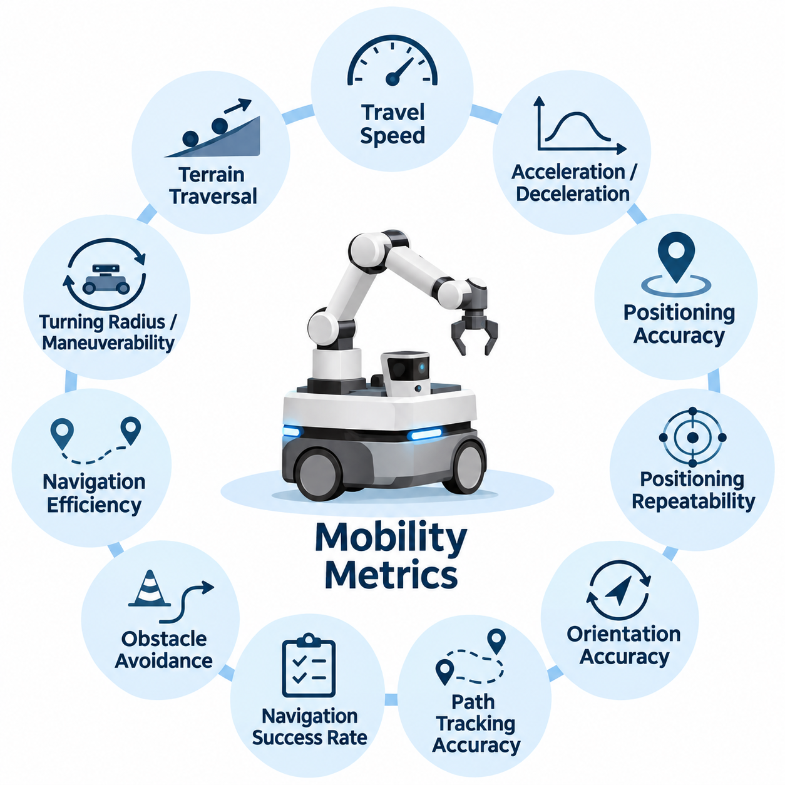
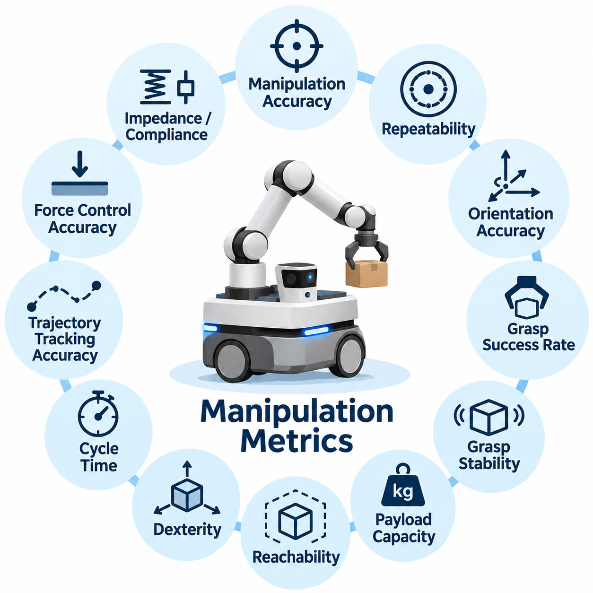
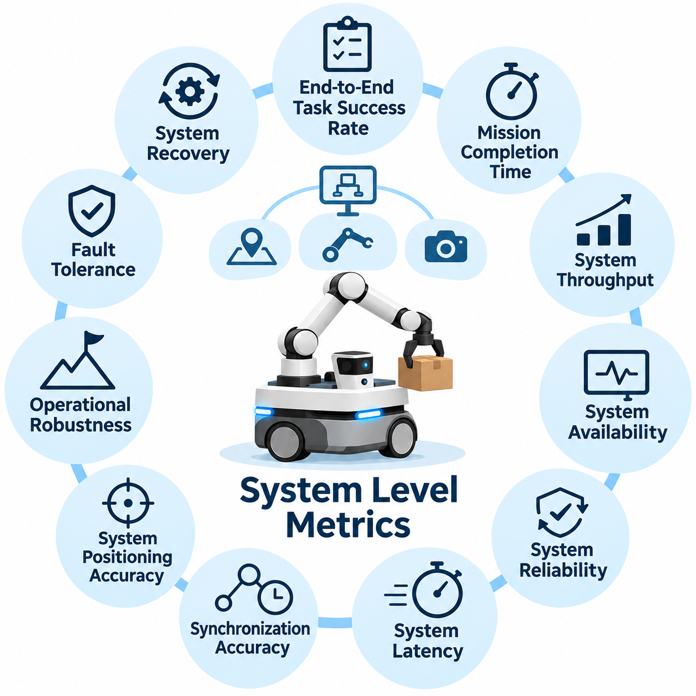
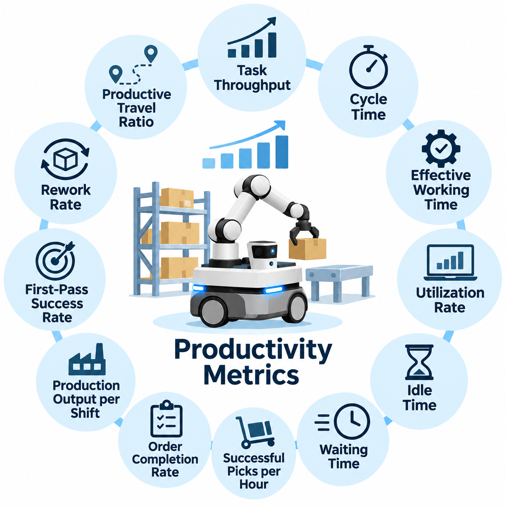
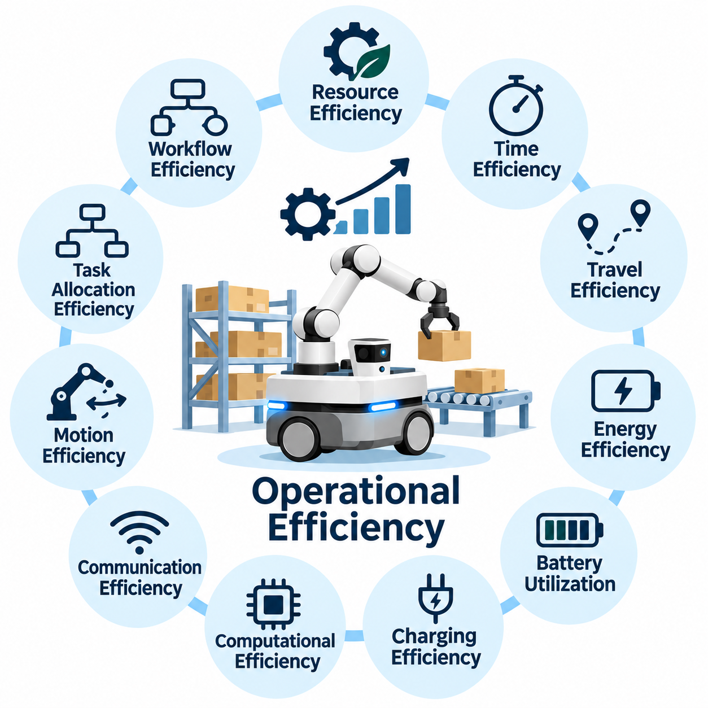
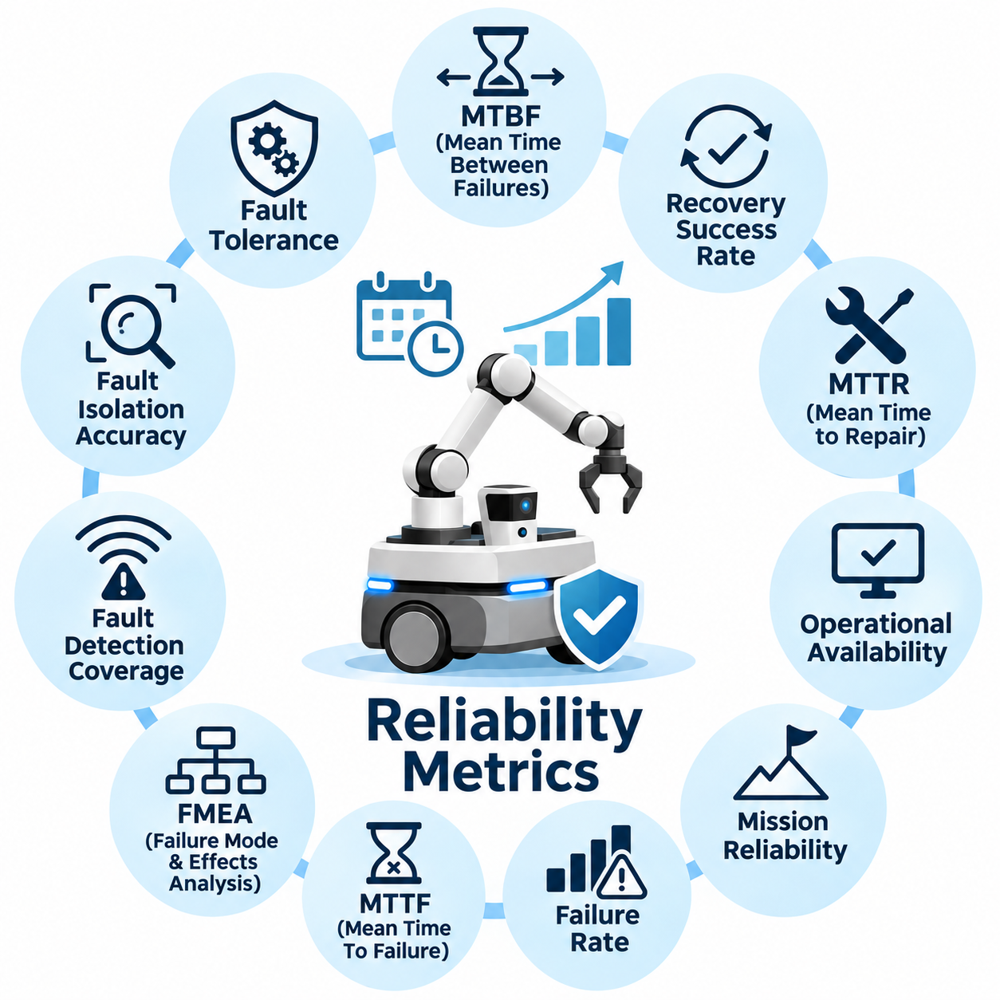
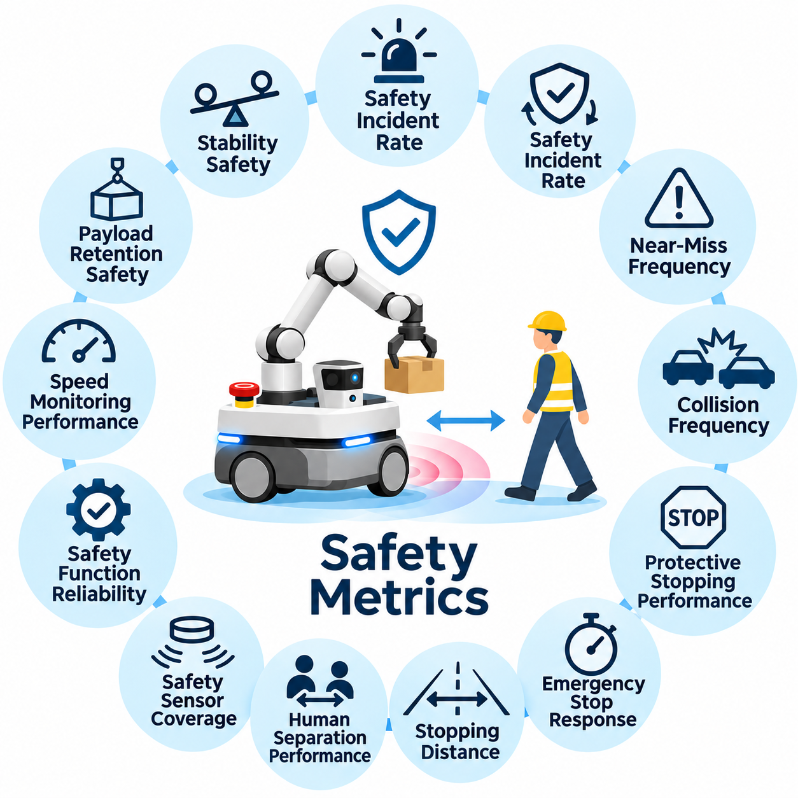
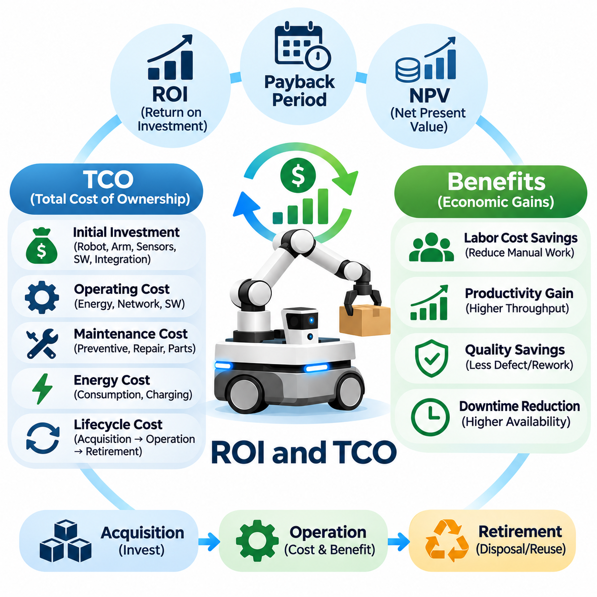
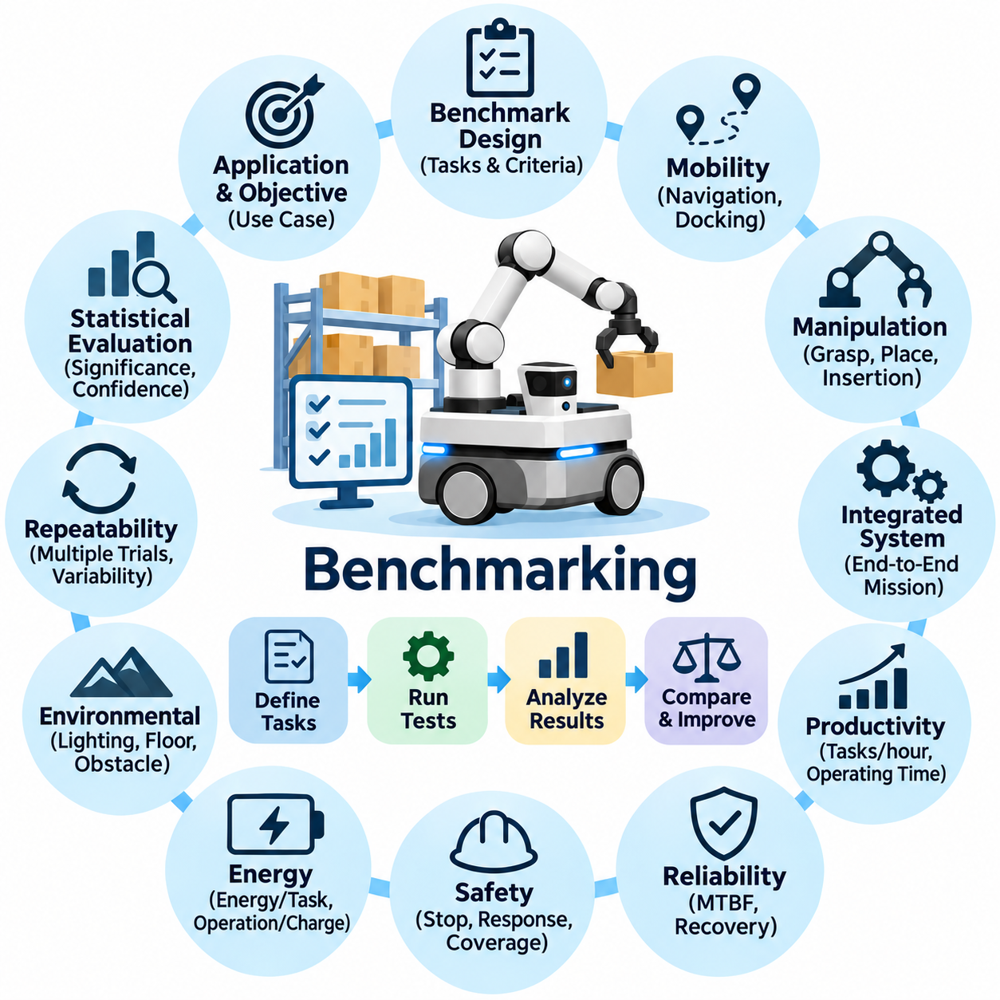

**Volume 01. Mobile Manipulator Foundations and System Architecture**

# Chapter 11. Performance Metrics

## 01 Mobility Metrics

{width="7.268055555555556in" height="7.268055555555556in"}

Mobility metrics provide a quantitative foundation for evaluating how effectively a mobile manipulator moves through its operating environment. Unlike conventional autonomous mobile robots, mobile manipulators must maintain navigation performance while carrying robotic arms, end effectors, and variable payloads. Their mobility performance therefore depends on mechanical design, localization accuracy, motion control, environmental conditions, and coordination between the mobile platform and manipulator.

Travel speed is a fundamental mobility metric that describes the distance traveled per unit of time. Maximum speed represents the platform\'s physical capability, while nominal operating speed reflects practical movement under normal conditions. Average mission speed includes acceleration, deceleration, obstacle avoidance, and traffic interruptions. Evaluating these values separately helps engineers distinguish theoretical mobility capability from actual operational performance.

Acceleration and deceleration characteristics determine how efficiently a mobile manipulator changes velocity during navigation. Rapid acceleration may improve travel efficiency but can introduce vibration, wheel slip, and disturbances to the robotic arm. Controlled deceleration is particularly important when transporting fragile objects or approaching manipulation stations. Performance evaluation should consider acceleration limits, braking distance, motion smoothness, and payload stability.

Positioning accuracy measures the difference between a robot\'s estimated or commanded position and its actual physical location. Accurate positioning is essential when the manipulator must interact with shelves, machines, workstations, or docking interfaces. Positioning errors may originate from wheel odometry, localization algorithms, sensor calibration, or environmental changes. Evaluation should distinguish localization accuracy from final physical positioning accuracy.

Positioning repeatability describes the ability of a mobile platform to return consistently to the same target location across repeated trials. A robot may exhibit systematic positioning error while maintaining excellent repeatability, allowing calibration or local correction strategies to compensate. Conversely, inconsistent positioning creates difficulties for robotic manipulation. Repeatability is commonly evaluated through repeated docking experiments and statistical analysis of position deviations.

Orientation accuracy is another critical mobility metric because small angular errors can significantly affect the manipulator\'s reachable workspace. When a mobile robot approaches a workstation, incorrect heading may shift the effective position of its end effector. Orientation performance can be measured using angular error, heading repeatability, and rotational stability. These measurements are especially important for narrow workspaces and precision assembly operations.

Path tracking accuracy evaluates how closely a mobile manipulator follows a planned trajectory. Common measurements include lateral deviation, heading error, maximum tracking error, and root mean square trajectory error. Tracking performance depends on vehicle kinematics, controller parameters, localization quality, and environmental disturbances. Reliable path tracking reduces unnecessary corrections and supports predictable movement through industrial facilities.

Navigation success rate measures the proportion of navigation missions completed according to predefined acceptance criteria. A successful mission typically requires reaching the intended destination without collisions, unsafe behavior, or unacceptable positioning errors. Navigation failures may result from localization loss, inaccessible routes, dynamic obstacles, or controller limitations. Success rates should be evaluated across representative routes, operating conditions, and mission durations.

Obstacle avoidance performance measures the robot\'s ability to detect, interpret, and safely navigate around objects within its operating environment. Relevant measurements include detection-to-response latency, minimum obstacle clearance, avoidance success rate, and additional travel distance. Static obstacles provide controlled evaluation conditions, while moving pedestrians and vehicles introduce uncertainty. Testing should account for different obstacle sizes, movement patterns, and sensor visibility.

Navigation efficiency describes how effectively the robot reaches its destination relative to an appropriate reference route. Path efficiency can be expressed as the ratio between reference path length and actual traveled distance, provided the reference is feasible and comparable. Excessive detours increase energy consumption and mission duration. However, the shortest path is not necessarily optimal when safety constraints, congestion, or manipulation requirements influence route selection.

Turning radius and maneuverability determine whether a mobile manipulator can operate within constrained industrial spaces. Differential-drive platforms can rotate approximately around their own centers, while steering-based platforms may require larger turning areas. Omnidirectional configurations offer additional movement flexibility but introduce mechanical and control complexity. Maneuverability evaluation should include corridor width, turning clearance, lateral motion capability, and obstacle proximity.

Terrain traversal capability measures how effectively the mobile platform operates across different surface conditions. Relevant factors include maximum negotiable slope, floor discontinuities, obstacle crossing height, surface friction, and wheel traction. Uneven terrain may affect localization, payload stability, and manipulator calibration. Testing should represent the actual deployment environment rather than relying exclusively on ideal laboratory floors.

Payload-dependent mobility performance is especially important because a mobile manipulator\'s mass distribution changes during operation. Payload weight, arm extension, and object placement influence the center of gravity, traction, braking behavior, and tipping resistance. A robot carrying a heavy object with an extended arm may require reduced acceleration or turning speed. Mobility tests should therefore cover representative payload configurations and manipulator postures.

Motion stability evaluates unwanted vibration, oscillation, and body movement during travel. Excessive platform vibration can reduce sensor measurement quality, disturb transported objects, and increase mechanical wear. Stability measurements may include linear acceleration, angular velocity, vibration amplitude, and settling time. These metrics become particularly important when mobile manipulators transport delicate components or perform precision operations immediately after navigation.

Docking accuracy measures the ability of a mobile manipulator to approach and align with a designated workstation or interface. Successful docking may require precise longitudinal, lateral, and angular positioning. Mechanical guides, visual markers, laser localization, and local correction algorithms can improve alignment. Evaluation should include docking success rate, final pose error, docking duration, and the number of corrective movements required.

Localization robustness describes the ability to maintain reliable position estimation under changing environmental conditions. Industrial facilities may contain reflective surfaces, repetitive structures, temporary obstacles, and areas with limited visual features. These conditions can degrade LiDAR, camera, or odometry-based localization. Robustness testing should examine localization failures, recovery time, pose estimation uncertainty, and performance during environmental changes.

Recovery performance evaluates how effectively a mobile manipulator resumes navigation after encountering unexpected conditions. Recovery scenarios may include blocked routes, temporary localization failures, emergency stops, or communication interruptions. Useful measurements include recovery success rate, average recovery duration, and the frequency of human intervention. Effective recovery mechanisms improve operational continuity without compromising safety or introducing unpredictable movements.

Energy efficiency during mobility describes the electrical energy required to move the robot through representative operating conditions. Energy consumption depends on travel distance, velocity, acceleration, payload mass, terrain, and drive system efficiency. Measurements such as watt-hours per kilometer support comparisons between mobility configurations. For mobile manipulators, propulsion energy should be distinguished from manipulator, perception, computing, and auxiliary power consumption.

Mission travel time measures the elapsed duration between departure and arrival at a designated destination. Unlike nominal speed, this metric captures practical delays caused by route planning, obstacle avoidance, congestion, and positioning adjustments. Travel time distributions reveal operational variability that average values may conceal. Percentile-based measurements are useful when evaluating whether a robot can satisfy predictable production schedules.

Mobility availability describes the proportion of required operating time during which the navigation subsystem remains capable of performing assigned movements. Mobility interruptions may arise from drive faults, sensor failures, localization problems, or control system errors. Availability measurements should distinguish planned maintenance from unexpected failures. This distinction helps engineers identify whether performance limitations originate from mechanical reliability, software robustness, or operational procedures.

Mobility benchmarking requires standardized test conditions to ensure meaningful comparisons between platforms. Test protocols should specify payload mass, floor characteristics, route geometry, obstacle arrangements, velocity limits, and environmental conditions. Each experiment should include sufficient repetitions to estimate variability. Reporting average performance together with dispersion, worst-case observations, and failure frequency provides a more complete understanding of mobility capability.

Real-world mobility evaluation should combine controlled laboratory measurements with representative operational trials. Laboratory testing supports repeatable characterization of positioning, tracking, acceleration, and docking behavior. Field testing exposes interactions with pedestrians, equipment, traffic congestion, and changing layouts. Comparing these results reveals the difference between nominal technical performance and the capabilities achievable during sustained deployment.

Mobility metrics must ultimately be interpreted within the complete mobile manipulation workflow. High travel speed offers limited value if inaccurate docking increases arm alignment time or causes grasp failures. Similarly, excellent positioning accuracy may not justify excessive navigation delays. Effective system evaluation connects mobility measurements with manipulation readiness, mission completion, safety constraints, and overall task performance to support balanced engineering decisions.

## 02 Manipulation Metrics

{width="7.268055555555556in" height="7.268055555555556in"}

Manipulation metrics provide a quantitative framework for evaluating how effectively a mobile manipulator performs physical interactions with objects and its surrounding environment. Unlike fixed industrial robots, mobile manipulators operate from platforms whose positioning accuracy and stability may vary between tasks. Manipulation performance therefore depends on robotic arm precision, perception quality, grasp stability, motion planning, force control, and coordination with the mobile base.

Manipulation accuracy measures the difference between the commanded end-effector position and its actual position during task execution. This metric is essential for applications involving assembly, machine tending, object placement, and precision handling. Position errors may originate from joint calibration, mechanical deformation, sensor uncertainty, or mobile platform misalignment. Accuracy should be evaluated under representative payloads, arm configurations, and operating conditions.

Manipulation repeatability describes the ability of a robotic arm to return consistently to the same target pose across repeated operations. A manipulator may exhibit systematic positioning errors while maintaining excellent repeatability, allowing calibration procedures to improve absolute accuracy. Repeatability is particularly important in repetitive industrial processes where consistent object placement is required. Evaluation typically involves repeated movements and statistical analysis of positional deviations.

End-effector orientation accuracy measures how closely the actual tool orientation matches the commanded orientation. Angular errors can significantly affect insertion, assembly, gripping, and surface interaction tasks. Orientation performance depends on joint encoder resolution, kinematic calibration, mechanical backlash, and controller precision. Evaluation should consider angular deviations around relevant rotational axes and their influence on successful task execution.

Grasp success rate represents the proportion of attempted grasps that satisfy predefined success criteria. A successful grasp may require secure object acquisition, stable lifting, transport, and controlled release without unintended slipping or damage. Grasp performance depends on object geometry, surface friction, perception accuracy, and gripper design. Testing should include representative objects, orientations, environmental conditions, and repeated trials.

Grasp stability measures the ability of an end effector to maintain secure contact with an object during movement and external disturbances. Stability depends on contact geometry, friction, applied forces, and the object\'s center of mass. Unstable grasps may cause slipping, rotation, or accidental release. Evaluation can incorporate slip frequency, object displacement, contact force variation, and resistance to controlled disturbances during manipulation.

Payload capacity describes the maximum object mass that a manipulator can safely handle under specified operating conditions. However, nominal payload ratings do not fully represent performance across the entire workspace. Arm extension, joint torque limits, acceleration, and mobile platform stability influence practical handling capability. Payload evaluation should consider object mass, center-of-mass offset, tool weight, dynamic loading, and allowable motion profiles.

Reachability measures the manipulator\'s ability to position its end effector at required locations within the operating environment. The reachable workspace is determined by arm geometry, joint limits, collision constraints, and mobile base placement. Not every reachable position supports every tool orientation or payload. Reachability evaluation should distinguish geometric reach from task-feasible reach and consider whether required manipulation poses can be achieved reliably.

Dexterity describes the manipulator\'s ability to perform controlled movements across different positions and orientations. High dexterity enables flexible object handling, complex assembly, and operation within constrained spaces. Dexterity can be analyzed using kinematic manipulability, joint configuration flexibility, and proximity to singularities. These measurements help identify regions where precise motion or force generation becomes difficult despite geometric reachability.

Manipulation cycle time measures the elapsed duration required to complete a defined manipulation operation. A typical cycle may include object detection, grasp planning, arm positioning, gripping, lifting, transfer, placement, and release. Cycle time varies with object complexity, motion distance, payload, and controller performance. Separating planning time from physical execution time helps identify whether computational delays or mechanical limitations dominate task performance.

Trajectory tracking accuracy evaluates how closely the manipulator follows a planned motion path during execution. Common measurements include Cartesian position error, orientation error, joint tracking error, and maximum trajectory deviation. Tracking performance is influenced by controller bandwidth, actuator dynamics, payload inertia, and mechanical flexibility. Accurate trajectory tracking is especially important for insertion, dispensing, welding, and collision-sensitive operations.

Force control accuracy measures the difference between commanded interaction forces and actual forces applied to objects or surfaces. This metric is essential for contact-rich tasks such as polishing, assembly, insertion, and delicate object handling. Force errors may result from sensor calibration, actuator friction, control latency, or structural compliance. Evaluation should consider steady-state force error, transient response, overshoot, and force stability during contact.

Impedance and compliance performance describe how a manipulator responds to external forces and environmental constraints. Appropriate compliance allows controlled physical interaction while reducing excessive contact forces. Performance can be evaluated through effective stiffness, damping behavior, displacement under applied loads, and response to disturbances. These characteristics are particularly important when manipulating uncertain objects or interacting with equipment that has limited positioning tolerance.

Manipulation planning success rate measures the proportion of task requests for which the planning system produces valid, executable motions. Planning failures may arise from unreachable targets, joint limits, singularities, collisions, or computational constraints. A valid planned trajectory does not necessarily guarantee successful physical execution. Therefore, planning success should be measured separately from execution success, with both evaluated across representative task scenarios.

Collision avoidance performance evaluates the manipulator\'s ability to execute movements without unintended contact with surrounding objects, equipment, or the mobile platform. Relevant metrics include minimum clearance, collision frequency, trajectory feasibility, and planning latency. Collision checking should account for the entire arm, attached tools, and transported objects. Dynamic environments introduce additional challenges because obstacles may move during execution.

Object placement accuracy measures the difference between the intended object pose and its final pose after release. Placement performance depends on grasp quality, end-effector calibration, object geometry, release dynamics, and environmental contact. Even accurate arm positioning may produce poor placement when objects shift during release. Evaluation should measure translational and rotational placement errors, repeatability, and successful completion within specified tolerances.

Manipulation robustness describes the ability to maintain acceptable performance despite variations in objects, environmental conditions, and system parameters. Changes in lighting, object orientation, surface friction, payload distribution, or mobile platform positioning can influence task outcomes. Robustness testing should systematically introduce controlled variations and measure their effects on success rates, execution time, and recovery requirements.

Recovery performance evaluates the manipulator\'s ability to respond to unsuccessful grasps, unexpected contact, object displacement, or motion execution failures. Effective recovery may involve releasing an unstable grasp, repositioning the tool, updating perception, or generating a new motion plan. Relevant metrics include recovery success rate, recovery duration, repeated failure frequency, and human intervention requirements. Recovery behavior must remain within defined safety constraints.

Manipulation energy consumption measures the electrical energy required to execute physical tasks. Energy demand depends on actuator efficiency, payload mass, joint motion, acceleration, holding torque, and task duration. Measurements such as watt-hours per completed manipulation cycle support comparisons between control strategies and hardware configurations. Energy analysis should distinguish arm actuation from gripper operation, perception processing, and mobile platform consumption.

Task completion rate measures the proportion of manipulation tasks successfully completed according to application-specific acceptance criteria. Unlike grasp success rate, this metric evaluates the complete operation, including acquisition, movement, placement, and any required verification. A grasp may succeed while the overall task fails because of incorrect placement or incomplete interaction. Task completion rate therefore provides a broader measure of functional manipulation capability.

Mobile base and arm coordination accuracy evaluates how effectively the two subsystems maintain consistent spatial relationships during manipulation. Errors in base localization, coordinate transformations, or platform stabilization can propagate into end-effector positioning errors. Coordinated motion may improve workspace coverage but introduces additional control complexity. Evaluation should consider relative pose accuracy, synchronization delays, and manipulation performance during base movement.

Manipulation benchmarking requires standardized objects, task definitions, operating conditions, and acceptance criteria. Test procedures should specify payloads, object geometries, target poses, environmental constraints, and permitted recovery actions. Repeated trials are necessary to estimate performance variability and identify systematic failure patterns. Reporting success rates alongside accuracy, cycle time, and failure distributions supports meaningful comparisons between robotic systems.

Manipulation metrics must ultimately be interpreted within the complete mobile manipulation workflow. Excellent arm accuracy provides limited operational value if unreliable navigation prevents access to workstations or unstable grasps cause repeated failures. Similarly, rapid manipulation may be undesirable when it increases object damage or safety risks. Effective evaluation combines precision, reliability, speed, robustness, and physical interaction quality to support balanced system-level optimization.

## 03 System Level Metrics

{width="7.268055555555556in" height="7.268055555555556in"}

System-level metrics provide an integrated framework for evaluating the overall performance of a mobile manipulator as a coordinated robotic system. Unlike individual mobility or manipulation measurements, these metrics examine how navigation, perception, planning, control, communication, and physical interaction contribute to mission execution. A system may contain high-performance components yet deliver poor results when subsystem integration introduces delays, errors, or operational conflicts.

End-to-end task success rate measures the proportion of complete missions that satisfy predefined acceptance criteria. A typical mission may involve navigating to a workstation, identifying an object, grasping it, transporting it, and placing it at a destination. Failure at any critical stage can prevent successful completion. This metric captures the combined effectiveness of mobility, manipulation, perception, and task coordination rather than evaluating each capability independently.

Mission completion time represents the total elapsed duration required to execute an assigned workflow. It includes navigation, localization, object recognition, manipulation planning, physical execution, verification, and recovery operations. Measuring only arm movement or travel time can underestimate actual system delays. Decomposing mission duration into functional stages helps engineers identify bottlenecks and prioritize improvements that produce meaningful operational benefits.

System throughput measures the number of successfully completed tasks within a specified operating period. Throughput depends on navigation efficiency, manipulation cycle time, task scheduling, resource availability, and environmental conditions. Increasing the speed of one subsystem may not improve throughput if another subsystem remains the limiting factor. System-level throughput analysis therefore emphasizes coordinated optimization rather than isolated component acceleration.

System availability describes the proportion of scheduled operating time during which the complete mobile manipulator remains capable of performing assigned tasks. Availability can be reduced by mechanical failures, software faults, sensor problems, communication interruptions, or required maintenance. A functioning mobile base does not guarantee system availability when the robotic arm or perception subsystem is unavailable. Evaluation must therefore consider the operational readiness of all mission-critical components.

System reliability measures the probability that a mobile manipulator performs its intended functions without failure during a defined period or mission. Reliability depends on hardware durability, software stability, sensor performance, and integration quality. Repeated minor failures may significantly reduce operational effectiveness even when individual components appear reliable. Mission reliability should be evaluated using representative workloads, environmental conditions, and sufficiently long observation periods.

System latency measures the delay between an event, command, or sensor observation and the corresponding system response. Latency may originate from perception processing, network communication, task planning, motion control, or actuator execution. Excessive delays can reduce productivity and compromise coordinated behavior. Evaluation should distinguish average latency from worst-case response times, particularly when timing constraints influence safety or physical interaction.

Synchronization accuracy evaluates how consistently distributed subsystems coordinate their operations in time. Mobile manipulators frequently combine sensors, navigation controllers, robotic arms, and edge computing devices operating at different update rates. Timing inconsistencies can produce outdated coordinate transformations or delayed control commands. Synchronization performance can be characterized through timestamp alignment, communication jitter, and coordinated motion errors.

System positioning accuracy measures the final spatial accuracy achieved by the complete mobile manipulation system. Unlike isolated arm accuracy, this metric incorporates mobile base positioning, localization uncertainty, coordinate transformations, mechanical compliance, and tool calibration. Small errors from multiple subsystems may accumulate at the end effector. Evaluating final task-space accuracy provides a more realistic measure of the system\'s ability to perform precision operations.

Operational robustness describes the ability of the integrated system to maintain acceptable performance under changing conditions. Variations in lighting, floor friction, object placement, network quality, and environmental layout can influence multiple subsystems simultaneously. Robustness testing should introduce representative disturbances while measuring mission success, execution time, and recovery behavior. This approach reveals weaknesses that may remain hidden during isolated component testing.

Fault tolerance measures the ability of a mobile manipulator to continue operating safely when selected components experience failures or degraded performance. Redundant sensors, alternative communication paths, diagnostic monitoring, and fallback operating modes can improve fault tolerance. However, not every failure permits continued operation. Evaluation should determine whether the system detects faults, transitions to an appropriate state, and preserves essential safety requirements.

System recovery performance evaluates how effectively the robot restores normal operation after interruptions or unsuccessful task execution. Recovery may involve relocalization, motion replanning, object reinspection, manipulator repositioning, or controlled task restarting. Relevant measurements include recovery success rate, recovery duration, repeated failure frequency, and human intervention requirements. Recovery mechanisms should avoid unnecessary repetition and prevent unsafe continuation after critical failures.

Resource utilization measures how efficiently the integrated system uses computational, electrical, mechanical, and communication resources. CPU and GPU utilization, memory consumption, network bandwidth, and actuator duty cycles can reveal performance constraints. High resource utilization does not necessarily indicate efficient operation if excessive processing introduces delays or thermal limitations. Evaluation should connect resource consumption with completed tasks and operational requirements.

Energy efficiency at the system level measures the total electrical energy consumed during complete missions. Unlike mobility-only or manipulation-only measurements, it includes propulsion, robotic arm actuation, perception sensors, computing hardware, communication equipment, and auxiliary systems. Energy per successful task provides a practical comparison between system configurations. Idle consumption, charging losses, and unsuccessful task attempts should also be considered when defining evaluation boundaries.

System stability describes the ability of the mobile manipulator to maintain controlled behavior during navigation, manipulation, and transitions between operating modes. Movement of the robotic arm can alter platform loading and introduce dynamic disturbances. Simultaneous base and arm motion increases coordination requirements. Stability evaluation should consider vibration, body motion, control oscillations, payload displacement, and settling time before precision manipulation.

Perception-to-action performance measures how effectively sensor information is transformed into appropriate physical behavior. The process may include sensor acquisition, object detection, pose estimation, decision-making, motion planning, and actuator control. Errors or delays at any stage can degrade task execution. End-to-end evaluation should consider perception accuracy, information freshness, decision latency, and the resulting physical task outcome.

Communication performance evaluates the reliability and responsiveness of data exchange between system components. Mobile manipulators may depend on internal field buses, Ethernet networks, wireless connections, and external fleet management systems. Packet loss, excessive jitter, or communication interruptions can disrupt coordination. Relevant measurements include message delivery success, bandwidth utilization, communication latency, and recovery behavior following connection loss.

Autonomy level describes the extent to which a mobile manipulator can complete assigned missions without direct human control. Autonomy evaluation should consider independent task execution, environmental adaptation, exception handling, and recovery capability. A system that performs routine tasks automatically but frequently requires assistance during unexpected conditions may have limited practical autonomy. Human intervention frequency and intervention duration provide useful operational measurements.

Scalability measures how effectively system performance is maintained when task complexity, operating area, or the number of robots increases. Larger deployments introduce communication traffic, scheduling conflicts, shared resource constraints, and additional coordination requirements. Performance may degrade even when individual robots remain technically capable. Scalability testing should examine throughput, latency, resource utilization, and mission success across increasing workloads.

System integration quality reflects how consistently mechanical, electrical, computational, and software components operate together. Interface mismatches, inconsistent coordinate frames, incompatible timing assumptions, and incomplete fault handling can undermine otherwise capable subsystems. Integration performance can be evaluated through interface error frequency, system initialization success, configuration consistency, and cross-subsystem fault propagation.

Mission consistency measures the variability of system performance across repeated executions of equivalent tasks. Two systems may achieve similar average completion times while exhibiting substantially different operational predictability. High variability can complicate production scheduling and resource allocation. Statistical measurements such as standard deviation, percentile completion time, and repeated mission success provide insight into consistency under representative operating conditions.

System-level benchmarking requires standardized mission definitions, environmental conditions, payload configurations, and acceptance criteria. Benchmarks should evaluate complete workflows rather than relying exclusively on isolated navigation or manipulation tests. Repeated trials help quantify performance variability and identify interactions between subsystems. Results should report success rates, completion times, resource consumption, recovery events, and relevant safety constraints.

Effective system-level performance evaluation requires balancing competing engineering objectives. Higher speed may increase energy consumption, aggressive motion may reduce stability, and additional sensing may improve robustness while increasing computational latency. No single metric can fully describe mobile manipulator capability. A comprehensive evaluation framework connects mission success, reliability, timing, precision, autonomy, and resource efficiency to support practical system optimization.

## 04 Productivity Metrics

{width="7.268055555555556in" height="7.268055555555556in"}

Productivity metrics measure how effectively a mobile manipulator converts available operating time and system resources into completed work. Unlike mobility or manipulation metrics, productivity evaluation emphasizes practical output within real operational workflows. A robot may demonstrate excellent technical performance but deliver limited productivity when excessive waiting, repeated failures, or inefficient scheduling reduce its contribution to industrial operations.

Task throughput represents the number of successfully completed operations within a defined period. Depending on the application, throughput may be expressed as picks per hour, transferred containers per shift, or completed machine-tending cycles per day. Accurate measurement requires consistent task definitions and acceptance criteria. Throughput should reflect successful outputs rather than attempted operations to avoid overstating actual production capability.

Cycle time measures the elapsed duration required to complete one standardized work sequence. For a mobile manipulator, the sequence may include navigation, object identification, grasp planning, picking, transportation, placement, and verification. Cycle time analysis identifies which activities dominate operational duration. Separating productive execution from waiting and recovery delays helps engineers determine where process improvements will generate the greatest benefit.

Effective working time describes the portion of scheduled operating time spent performing activities that directly contribute to task completion. Travel, manipulation, and necessary verification may qualify as productive activities depending on workflow requirements. Unplanned waiting, unnecessary repositioning, and repeated unsuccessful actions reduce effective working time. Clear activity classification is essential for consistent productivity measurement across different deployments.

Utilization rate measures the proportion of available operating time during which a robot is actively engaged in assigned work. High utilization may indicate effective resource allocation, but continuous operation does not necessarily imply high productivity. A robot repeatedly performing unsuccessful tasks may remain highly utilized while producing little useful output. Utilization should therefore be interpreted alongside task success rate, throughput, and cycle efficiency.

Idle time measures periods when a mobile manipulator is operationally available but not executing assigned tasks. Idle conditions may result from insufficient work requests, unavailable workstations, traffic restrictions, or coordination delays. Excessive idle time can indicate poor scheduling or mismatched production capacity. Distinguishing planned idle periods from avoidable waiting helps determine whether operational adjustments can improve productivity.

Waiting time analysis examines delays caused by dependencies between robotic tasks and external processes. A mobile manipulator may wait for machine completion, human authorization, material availability, or access to shared equipment. These delays can dominate mission duration even when navigation and manipulation are efficient. Measuring waiting time by cause allows production planners to improve scheduling, workstation coordination, and task sequencing.

Successful picks per hour is a practical productivity indicator for warehouse and material-handling applications. It measures the number of objects correctly acquired and transferred within an hour of operation. Performance depends on object diversity, grasp reliability, travel distance, and placement requirements. Counting only successful picks prevents repeated attempts from artificially increasing reported productivity and supports realistic comparisons between systems.

Order completion rate evaluates the proportion of assigned orders fulfilled within specified operational requirements. An order may involve collecting multiple items from different storage locations and delivering them to a designated destination. Individual picking success does not guarantee order completion when missing items or incorrect placement remain unresolved. This metric connects robotic activity with meaningful warehouse and logistics outcomes.

Production output per shift measures the total quantity of acceptable work completed during a scheduled operating period. Shift-level productivity captures effects that short laboratory tests may overlook, including charging interruptions, workstation congestion, operator assistance, and task variability. Comparing output across shifts can reveal recurring operational limitations. Results should account for differences in workload, staffing, and operating conditions.

First-pass success rate measures the proportion of tasks completed correctly without retries, corrections, or recovery procedures. High first-pass performance reduces wasted motion, repeated perception processing, and unnecessary equipment interaction. A system with rapid nominal cycle time may perform poorly when frequent retries increase actual completion time. First-pass success therefore provides an important connection between task quality and productivity.

Rework rate measures the proportion of completed operations requiring additional corrective action before meeting acceptance criteria. Rework may result from inaccurate placement, incomplete assembly, incorrect object selection, or unsuccessful verification. Repeated corrections consume operating time and can interfere with downstream processes. Tracking rework frequency and associated duration helps quantify productivity losses caused by quality-related problems.

Productive travel ratio compares travel directly required for task execution with total robot travel distance. Excessive repositioning, unnecessary return trips, and inefficient task allocation increase nonproductive movement. Route optimization and intelligent task grouping can improve this ratio without increasing robot speed. Evaluation should distinguish necessary empty travel from avoidable movement and account for safety-related detours.

Task scheduling efficiency measures how effectively available work is assigned and sequenced to minimize delays and resource conflicts. Scheduling decisions influence travel distance, workstation availability, battery consumption, and overall throughput. Poor scheduling can create congestion even when individual robots operate efficiently. Performance evaluation should consider task completion time, waiting duration, workload balance, and scheduling overhead.

Workstation service rate describes how frequently a mobile manipulator successfully completes interactions with designated production stations. Applications may include loading CNC machines, transferring components, replenishing materials, or collecting finished products. Service performance depends on docking accuracy, manipulation reliability, and equipment readiness. Measuring completed service cycles helps determine whether robotic support matches workstation production requirements.

Human intervention frequency measures how often operators must assist a mobile manipulator during normal production. Interventions may involve object repositioning, navigation recovery, task confirmation, or fault resolution. Frequent assistance reduces the effective value of automation and can introduce unpredictable delays. Intervention duration and operator workload should be recorded alongside event frequency to estimate the true productivity impact.

Labor productivity contribution evaluates how robotic automation changes the amount of acceptable work produced per unit of human labor. Mobile manipulators may reduce repetitive handling while allowing personnel to focus on supervision, quality assurance, and complex operations. Productivity improvements should be measured against a defined baseline rather than assumed from robot deployment. Human support, maintenance, and exception-handling time must remain included in the analysis.

Multi-robot productivity evaluates the combined output of several mobile manipulators operating within a shared environment. Adding robots does not necessarily produce proportional throughput improvements because congestion, workstation capacity, and scheduling conflicts may become limiting factors. Fleet productivity should consider aggregate completed tasks, workload distribution, and interference between robots. These measurements support decisions about appropriate fleet size.

Productivity consistency describes how stable task output remains across repeated operating periods. Average throughput alone may conceal significant fluctuations caused by object variability, congestion, or intermittent failures. Consistent performance improves production planning and downstream resource allocation. Statistical measurements such as throughput variation, percentile cycle time, and shift-to-shift output differences provide useful indicators of operational predictability.

Bottleneck analysis identifies the process stage that limits overall production capacity. A mobile manipulator may spend relatively little time grasping objects while waiting extensively for workstation access or task authorization. Improving a noncritical activity may have little effect on final throughput. Productivity optimization should therefore prioritize constraints that directly restrict completed work rather than focusing exclusively on the fastest measurable operations.

Productivity benchmarking requires standardized workloads, task definitions, operating periods, and success criteria. Comparisons should account for object complexity, travel distance, payload requirements, environmental conditions, and permitted human assistance. Short demonstrations may exaggerate sustained performance by excluding interruptions and recovery activities. Representative trials provide more reliable evidence of practical productivity.

Productivity metrics must ultimately connect robotic performance with the operational objectives of the deployment environment. High utilization, rapid movement, or short manipulation cycles are valuable only when they contribute to acceptable completed work. Effective evaluation combines throughput, cycle time, first-pass success, waiting time, human intervention, and output consistency. This integrated perspective supports practical improvements in mobile manipulation productivity.

## 05 Operational Efficiency

{width="7.268055555555556in" height="7.268055555555556in"}

Operational efficiency describes how effectively a mobile manipulator uses time, energy, equipment, and supporting resources to complete assigned missions. While productivity metrics emphasize completed output, operational efficiency examines the resources consumed to achieve that output. An efficient system minimizes unnecessary movement, waiting, computation, and human intervention while maintaining acceptable task quality, reliability, and safety throughout sustained industrial operations.

Resource efficiency measures the relationship between useful completed work and the resources required for execution. Mobile manipulators consume electrical energy, computing capacity, actuator operating time, and maintenance resources. Evaluating these resources independently may conceal important tradeoffs. A comprehensive assessment relates resource consumption to successful tasks, allowing engineers to compare alternative hardware configurations, control strategies, and operational procedures.

Time efficiency evaluates how much of the total operating period contributes directly to mission execution. Productive activities may include navigation, object handling, verification, and necessary repositioning. Nonproductive activities include avoidable waiting, repeated unsuccessful actions, and unnecessary system initialization. Time efficiency analysis requires consistent activity classifications and detailed event logs to distinguish essential operational steps from preventable delays.

Travel efficiency measures how effectively the mobile platform moves between required task locations. Excessive detours, repeated repositioning, and poorly sequenced missions increase travel distance and energy consumption. Route optimization can reduce unnecessary movement without increasing operating speed. Evaluation should compare actual travel against feasible reference routes while accounting for obstacle avoidance, traffic restrictions, and safe access to manipulation stations.

Energy efficiency evaluates the amount of electrical energy required to complete useful work. Total consumption includes propulsion, robotic arm actuation, perception sensors, computing devices, communication systems, and auxiliary equipment. Energy per successful mission provides a practical measure of system efficiency. Evaluation should also account for idle consumption, charging losses, payload variation, and unsuccessful attempts that consume energy without producing acceptable output.

Battery utilization efficiency describes how effectively stored electrical energy supports productive operation. Battery capacity alone does not determine useful operating duration because discharge characteristics, thermal conditions, and auxiliary loads influence available energy. Frequent unnecessary charging may reduce operational flexibility, while excessive discharge can affect battery longevity. Evaluation should consider usable capacity, energy consumption profiles, charging frequency, and mission completion between charging events.

Charging efficiency measures the operational impact of replenishing battery energy. Relevant factors include charging duration, charger conversion losses, docking reliability, and the availability of charging stations. Poorly coordinated charging can interrupt production even when sufficient battery capacity exists. Intelligent charging schedules can distribute charging demand across low-activity periods while preserving adequate energy reserves for assigned missions and unexpected recovery operations.

Computational efficiency evaluates how effectively processing resources support perception, planning, and control. CPU and GPU utilization, memory consumption, inference latency, and processing throughput reveal potential bottlenecks. Excessive computational demand can increase power consumption and thermal loading without improving task performance. Efficient software architecture balances model complexity, processing frequency, and response requirements to deliver reliable robotic behavior within available hardware limits.

Communication efficiency measures how effectively information is exchanged between robotic subsystems and external infrastructure. Unnecessary message transmission, excessive data duplication, and inefficient synchronization can consume network bandwidth and increase latency. Communication optimization may involve message prioritization, data compression, local processing, and event-driven updates. Evaluation should preserve essential reliability and timing requirements rather than minimizing network traffic alone.

Motion efficiency describes how effectively the robotic arm completes manipulation tasks with minimal unnecessary movement. Poorly optimized trajectories may increase joint travel, acceleration demands, mechanical wear, and execution time. Motion planning should consider collision constraints, joint limits, payload characteristics, and energy consumption. Efficient trajectories balance movement distance and execution speed with stability, precision, and safe physical interaction.

Task allocation efficiency evaluates whether available robots and workstations receive assignments that minimize operational waste. Poor allocation may cause long empty travel, uneven workloads, or congestion around shared resources. Effective allocation considers robot location, task priority, payload capability, battery state, and workstation readiness. Performance can be assessed through completed tasks, assignment delays, resource conflicts, and the distribution of workload across available systems.

Workflow efficiency examines how effectively individual activities are organized into complete operational sequences. A mobile manipulator may perform each technical function successfully while losing time through unnecessary transitions between navigation, inspection, and manipulation. Workflow optimization reduces redundant actions and coordinates dependent processes. Evaluation should identify repeated operations, avoidable transitions, and delays introduced by poorly structured task sequences.

Equipment utilization efficiency measures how effectively robotic hardware and supporting infrastructure contribute to useful operations. High equipment utilization does not necessarily indicate efficiency when robots remain occupied with unsuccessful or unnecessary tasks. Evaluation should consider productive operating time, completed missions, equipment availability, and maintenance requirements. Balanced utilization avoids both excessive idle capacity and continuous operation that increases wear or reduces recovery flexibility.

Maintenance efficiency evaluates the resources required to preserve reliable system operation. Preventive maintenance, inspection, calibration, software updates, and component replacement consume time and labor but can prevent costly failures. Maintenance performance can be assessed through service duration, maintenance frequency, fault recurrence, and restoration time. Efficient maintenance strategies balance planned intervention costs against the operational consequences of unexpected equipment failures.

Human resource efficiency describes how effectively robotic automation reduces unnecessary manual effort while preserving appropriate supervision and support. Operators may still perform task authorization, exception handling, maintenance, and quality verification. Frequent intervention can offset the benefits of automated operation. Evaluation should measure operator time per successful mission, intervention frequency, and the distribution of responsibilities between personnel and robotic systems.

Recovery efficiency measures how effectively a mobile manipulator restores productive operation after task failures or interruptions. Recovery procedures may include relocalization, object reinspection, motion replanning, or controlled task restarting. Repeated unsuccessful recovery attempts waste time and energy while potentially increasing operational risk. Evaluation should consider recovery success, elapsed recovery time, additional resource consumption, and the frequency of required human assistance.

Fleet efficiency evaluates the combined operational performance of multiple mobile manipulators sharing workspaces and infrastructure. Increasing fleet size may improve capacity but can also introduce traffic congestion, charging conflicts, and scheduling overhead. Efficient fleet coordination balances task distribution, travel distance, workstation access, and resource availability. Evaluation should compare aggregate useful output with the total resources consumed by the entire fleet.

Operational flexibility measures how efficiently the system adapts to changing workloads, task priorities, and environmental conditions. Flexible mobile manipulators can support different workstations or handling operations without extensive mechanical modification. However, frequent configuration changes may introduce calibration delays and operational complexity. Evaluation should consider changeover time, task adaptation effort, configuration reliability, and performance after operational transitions.

Operational efficiency benchmarking requires standardized task definitions, workload conditions, resource accounting, and measurement boundaries. Comparisons should include successful output, operating time, energy consumption, human intervention, and maintenance requirements. Short demonstrations may overlook charging, recovery, and long-term resource costs. Representative operating trials provide a more realistic understanding of efficiency across different robotic configurations and deployment environments.

Efficiency optimization requires balancing resource consumption against performance, reliability, and safety. Minimizing energy use may increase mission duration, while aggressive scheduling may reduce waiting but increase congestion. Similarly, reducing computational demand may compromise perception quality or response capability. Effective optimization identifies operating conditions that minimize resource waste without violating task requirements or essential safety constraints.

Operational efficiency should ultimately be evaluated as part of the complete mobile manipulation system. Isolated improvements in travel distance, arm motion, or computing utilization may provide limited benefits when other processes dominate resource consumption. A comprehensive assessment connects time, energy, maintenance, communication, and human effort with successfully completed work. This integrated approach supports sustainable and economically effective robotic operations.

## 06 Reliability Metrics

{width="7.268055555555556in" height="7.268055555555556in"}

Reliability metrics evaluate the ability of a mobile manipulator to perform required functions consistently under specified operating conditions and over defined periods. Reliability extends beyond individual component durability because navigation, perception, manipulation, communication, and control must operate together. A single subsystem failure may interrupt an entire mission. Effective reliability assessment therefore considers both component-level failures and their consequences for complete robotic workflows.

Mean Time Between Failures, or MTBF, measures the average operating time between failures in a repairable system. It is commonly estimated by dividing accumulated operating time by the number of observed failures under a defined counting policy. MTBF helps characterize failure frequency but does not guarantee that a robot will operate without interruption for that duration. Meaningful comparisons require consistent failure definitions, operating conditions, and observation periods.

Mean Time To Repair, or MTTR, measures the average time required to restore a failed system to an operational state. Repair activities may include fault diagnosis, component replacement, software recovery, recalibration, and functional verification. Shorter repair times reduce production interruptions and improve maintainability. Evaluation should clearly distinguish active repair time from logistical delays, waiting for replacement parts, and broader service restoration time.

Operational availability measures the proportion of required operating time during which the mobile manipulator is capable of performing assigned functions. Availability depends on failure frequency, restoration duration, preventive maintenance, and operational support. A robot with relatively frequent failures may still achieve acceptable availability when recovery is rapid. However, availability alone cannot describe whether completed missions meet quality and performance requirements.

Mission reliability represents the probability that a mobile manipulator completes an assigned mission without a defined failure. A mission may require navigation, docking, object recognition, grasping, transportation, and placement. The reliability of the complete sequence depends on interactions among these stages. Measuring mission reliability across representative workloads reveals failure patterns that isolated component tests may overlook.

Failure rate describes how frequently failures occur relative to operating time, mission count, or another defined exposure measure. Different failure mechanisms may depend on operating hours, motion cycles, distance traveled, or manipulation attempts. Failure rates should therefore use denominators appropriate to the underlying mechanism. Trend analysis can reveal degradation, environmental sensitivity, or recurring integration problems before they cause major operational interruptions.

Mean Time To Failure, or MTTF, characterizes the expected operating duration before failure for a nonrepairable item or a component evaluated until its first failure. Sensors, electronic modules, and mechanical elements may be studied using this measure under specified conditions. MTTF differs from MTBF because the underlying repair and renewal assumptions differ. Engineers should avoid treating these measures as interchangeable without defining the reliability model.

Failure Mode and Effects Analysis, or FMEA, provides a structured method for identifying potential failures and evaluating their consequences. Mobile manipulator failure modes may include localization loss, actuator malfunction, sensor obstruction, communication interruption, or unsuccessful grasping. Each failure mode can be assessed for severity, occurrence, and detectability. The analysis supports preventive measures, diagnostic requirements, and reliability improvement priorities.

Fault detection coverage measures the proportion of relevant faults that diagnostic mechanisms can identify within defined detection conditions. Monitoring may include actuator current, sensor health, communication status, controller heartbeat signals, and localization confidence. High detection coverage improves fault visibility but does not automatically guarantee safe recovery. Evaluation should also consider detection latency, false alarms, missed faults, and the effectiveness of subsequent system responses.

Fault isolation accuracy measures how correctly diagnostic mechanisms identify the source of an observed malfunction. Similar symptoms may arise from different causes, such as localization drift, wheel slip, calibration errors, or communication delays. Incorrect fault isolation can increase maintenance time and lead to unnecessary component replacement. Reliable diagnosis requires consistent event records, subsystem health information, and validation against known failure scenarios.

Recovery success rate measures the proportion of recoverable failures that are resolved without requiring manual intervention. Recovery procedures may include relocalization, trajectory replanning, controller restarting, object reinspection, or controlled task repetition. Recovery effectiveness depends on accurate fault classification and suitable fallback strategies. Evaluation should distinguish successful restoration from repeated attempts that temporarily conceal unresolved underlying problems.

Fault tolerance describes the ability of a system to maintain specified functionality despite selected component failures. Redundant sensing, alternative communication paths, and degraded operating modes may support continued operation. However, fault tolerance must be evaluated against explicit failure assumptions and safety constraints. Some faults require immediate controlled stopping rather than continued execution, particularly when reliable motion control cannot be maintained.

Hardware reliability evaluates the durability and failure behavior of mechanical, electrical, and electronic components. Motors, gearboxes, steering assemblies, robotic joints, connectors, batteries, and sensors experience different stresses during operation. Reliability testing should consider vibration, temperature, humidity, contamination, payload variation, and duty cycles. Component performance under laboratory conditions may differ significantly from sustained industrial deployment.

Software reliability measures the ability of control and application software to execute required functions without causing defined failures. Memory leaks, concurrency defects, unhandled exceptions, and incorrect state transitions can interrupt robotic missions. Software reliability testing should include long-duration execution, fault injection, interface validation, and regression testing. Version changes must be monitored because new functionality can introduce unexpected failure mechanisms.

Communication reliability evaluates the consistency of data exchange among controllers, sensors, computing devices, and external infrastructure. Packet loss, network congestion, synchronization errors, and connection interruptions can affect coordinated robotic behavior. Relevant measures include message delivery success, communication outage frequency, reconnection time, and deadline violations. Reliability requirements should reflect the criticality of each communication channel.

Sensor reliability measures the ability of perception and localization devices to provide valid information throughout operation. Cameras, LiDAR sensors, encoders, inertial sensors, and force sensors may experience contamination, calibration drift, environmental interference, or hardware faults. Reliability evaluation should consider data validity, dropout frequency, degradation detection, and recovery behavior. Sensor redundancy is useful only when failures are sufficiently independent.

Manipulation reliability measures the consistency of grasping, handling, and placement operations under representative conditions. Object geometry, surface friction, payload variation, and end-effector wear can influence task success. Repeated manipulation failures may damage objects or interrupt downstream processes. Evaluation should include first-attempt success, dropped-object frequency, placement errors, and performance degradation over extended operating periods.

Navigation reliability measures the ability of the mobile platform to reach required destinations without defined navigation failures. Localization loss, path planning errors, wheel slip, unexpected obstacles, and environmental changes can interrupt travel. Reliability evaluation should include destination arrival success, docking success, recovery frequency, and navigation-related mission interruptions. Testing should represent realistic traffic patterns and environmental variability.

Reliability growth describes improvements achieved through repeated testing, failure analysis, corrective actions, and design refinement. Early prototypes may exhibit frequent integration faults that decrease as engineering changes are validated. Tracking failure occurrence across successive development stages helps determine whether reliability is improving. Comparisons must account for changing workloads, system configurations, and operating exposure to avoid misleading conclusions.

Reliability demonstration testing evaluates whether available evidence supports a specified reliability requirement with an appropriate level of statistical confidence. Test duration, sample size, observed failures, and assumed failure distributions influence the strength of conclusions. Zero failures during a short demonstration does not establish high reliability. Test plans should define acceptance criteria, operating profiles, confidence requirements, and procedures for handling interrupted or invalid trials.

Reliability metrics should ultimately connect component behavior with mission continuity and operational consequences. High MTBF, rapid repair, effective diagnostics, and successful recovery contribute differently to dependable operation. No single indicator fully describes system reliability. A comprehensive evaluation combines failure frequency, mission success, maintainability, fault detection, recovery capability, and long-term performance under representative conditions.

## 07 Safety Metrics

{width="7.268055555555556in" height="7.268055555555556in"}

Safety metrics evaluate how effectively a mobile manipulator prevents hazardous events and limits their consequences during operation. Unlike productivity or reliability measurements, safety evaluation focuses on risks to people, equipment, products, and the surrounding environment. A system may complete missions reliably while still presenting unacceptable hazards. Effective safety assessment therefore combines incident records, protective system performance, exposure conditions, and verification of risk reduction measures.

Safety incident rate measures the frequency of defined harmful events relative to operating hours, completed missions, or another appropriate exposure measure. Incidents may include collisions, injuries, dropped payloads, or equipment damage. Clear event definitions are essential for consistent reporting. Incident rates should be interpreted alongside operating conditions and exposure levels because low incident counts alone cannot establish that a system is sufficiently safe.

Near-miss frequency measures events in which hazardous outcomes were narrowly avoided without actual injury or damage. Examples include unexpected proximity to personnel, unstable payload movement, and emergency braking before potential contact. Near-miss records can reveal weaknesses before serious incidents occur. Evaluation should examine event severity, environmental circumstances, repeated patterns, and the effectiveness of corrective actions rather than relying only on event counts.

Collision frequency measures the number of unintended contacts involving the mobile base, robotic arm, payload, or surrounding objects. Collisions should be classified by contact location, operating mode, consequence, and exposure. Minor contact during a permitted collaborative operation differs from an uncontrolled impact. Collision analysis helps identify limitations in perception, motion planning, protective functions, and workspace management.

Protective stopping performance measures how reliably the system enters a defined safe condition when a protective function is triggered. Relevant events include safety scanner activation, emergency stop commands, protective guard opening, and detected control faults. Evaluation should consider response time, stopping distance, stopping behavior, and restart conditions. Different stopping functions require distinct acceptance criteria based on their intended safety roles.

Emergency stop response time measures the interval between activation of an emergency stop device and achievement of the specified stopped condition. The measured interval may include input processing, safety control response, actuator reaction, and mechanical deceleration. Results depend on speed, payload, surface conditions, and robot configuration. Emergency stopping should be evaluated under representative worst-case conditions rather than nominal operating conditions alone.

Stopping distance measures the distance traveled after a defined stop demand until the relevant hazardous motion ceases. For mobile manipulators, stopping behavior may involve both platform translation and robotic arm movement. Braking capability, payload mass, floor friction, and control delays influence the result. Safety evaluation should use measured stopping performance and applicable margins when determining protective field dimensions and separation requirements.

Human separation performance evaluates whether the system maintains the protective distances required by its selected operating strategy. Dynamic environments introduce uncertainty in human movement, robot speed, sensing, and stopping capability. Separation monitoring must account for the relevant hazards of both the mobile base and manipulator. Evaluation should examine detection reliability, distance estimation accuracy, response latency, and violations of defined protective boundaries.

Safety sensor coverage measures how effectively protective sensing detects relevant hazards throughout the robot\'s operating environment. Safety laser scanners, protective devices, and other safety-rated sensors may cover different regions and hazard types. Blind zones, occlusion, reflective surfaces, and changing robot geometry can reduce coverage. Evaluation should verify the sensing arrangement against identified hazards rather than assuming that ordinary perception sensors provide protective functions.

Safety function reliability evaluates whether designated protective functions operate correctly when demanded. Examples include safe torque removal, protective stopping, speed limitation, and monitored operating modes. Assessment may involve diagnostic coverage, fault response, systematic integrity, and hardware reliability. Required performance levels depend on risk assessment and applicable standards. Successful functional tests alone do not establish the integrity of a safety-related control system.

Speed monitoring performance measures how accurately the system maintains motion within defined safety limits. Mobile base speed, joint velocity, and tool movement may require separate monitoring depending on operating conditions. Measurement errors, controller delays, and unexpected acceleration can affect protective behavior. Evaluation should verify speed limits across relevant configurations, including loaded operation and transitions between operating modes.

Payload retention safety measures the ability of the manipulator to prevent unintended release or displacement of handled objects. Gripper failures, power interruptions, excessive acceleration, and incorrect grasping can create falling-object hazards. Evaluation should consider payload mass, geometry, gripping force, operating orientation, and foreseeable disturbances. Protective measures may include mechanical retention, load monitoring, and controlled responses to detected grasp instability.

Stability safety evaluates the risk of tipping, excessive tilting, or loss of controlled balance during movement and manipulation. Extending the robotic arm or lifting a heavy payload changes the combined center of gravity and loading conditions. Acceleration, braking, turning, and uneven surfaces can further reduce stability margins. Evaluation should cover representative load configurations and foreseeable dynamic conditions while respecting the platform\'s operating limits.

Human-robot interaction safety measures the effectiveness of protective measures during activities involving nearby personnel. Workers may approach the robot for loading, inspection, maintenance, or collaborative tasks. Evaluation should consider contact hazards, unexpected motion, operator awareness, and access to emergency controls. Safe interaction depends on the selected operating mode and verified protective functions, not simply on reducing nominal robot speed.

Safety-related fault detection measures the ability to identify faults that could compromise protective functions. Examples include sensor channel failures, actuator feedback inconsistencies, communication faults, and invalid safety configurations. Relevant metrics include diagnostic coverage, detection latency, and response to detected faults. Evaluation must distinguish ordinary operational diagnostics from mechanisms designed and validated for safety-related applications.

Safety intervention frequency measures how often protective functions interrupt normal operation. Frequent protective stops may indicate environmental conflicts, inadequate workspace design, or inappropriate operating parameters. However, reducing intervention frequency must never override necessary risk controls. Analysis should distinguish valid protective demands from nuisance activations and determine whether process changes can improve efficiency without weakening safety performance.

Residual risk assessment evaluates hazards that remain after protective measures have been implemented. Risk cannot be characterized by a single incident count because severity, exposure, and the possibility of avoiding harm also matter. Residual risks may require additional safeguards, operating restrictions, training, or warnings. Evaluation should document assumptions, foreseeable misuse, and the evidence supporting acceptance of remaining risks.

Safety validation measures whether implemented protective measures satisfy defined safety requirements under representative conditions. Validation may include functional testing, fault injection, stopping measurements, configuration inspection, and examination of safety-related documentation. Tests should address normal operation, foreseeable abnormal conditions, and relevant operating transitions. Results must be traceable to identified hazards and explicit acceptance criteria.

Safety performance monitoring tracks protective system behavior throughout the operational lifecycle. Changes in payloads, software versions, workstations, traffic patterns, or environmental conditions can introduce new hazards. Monitoring should include incidents, near misses, protective stops, faults, and configuration changes. Periodic review helps determine whether existing risk controls remain appropriate and whether renewed assessment or validation is necessary.

Safety benchmarking requires consistent hazard definitions, operating scenarios, exposure measures, and evaluation procedures. Comparing incident rates alone can be misleading when robots operate under different risks or human interaction patterns. Benchmarks should include protective function behavior, stopping performance, detection capability, and documented risk controls. Relevant standards and application-specific requirements provide the basis for determining appropriate acceptance criteria.

Safety metrics must ultimately support risk reduction rather than merely demonstrate low incident frequency. A mobile manipulator with no recorded accidents may still contain unrecognized hazards or inadequately validated protective functions. Comprehensive evaluation connects hazard identification, protective performance, fault response, operational exposure, and lifecycle monitoring. This approach supports dependable mobile manipulation while maintaining safety as an essential system design constraint.

## 08 ROI and TCO

{width="7.268055555555556in" height="7.268055555555556in"}

Return on Investment, or ROI, and Total Cost of Ownership, or TCO, provide complementary financial measures for evaluating mobile manipulator deployments. ROI examines the economic benefits generated relative to investment costs, while TCO estimates the complete cost of acquiring, operating, and maintaining a system throughout its lifecycle. Together, these measures help organizations determine whether robotic automation delivers sustainable economic value beyond technical performance.

Initial investment cost includes the expenses required to acquire and prepare a mobile manipulator for operational use. Typical elements include the mobile platform, robotic arm, end effector, sensors, computing hardware, batteries, and safety equipment. Software licenses, integration engineering, installation, and commissioning may represent substantial additional costs. Accurate investment estimates must include all resources required before productive operation begins.

Total Cost of Ownership represents the cumulative cost of a robotic system over a defined evaluation period. TCO includes initial acquisition, installation, energy consumption, maintenance, software support, operator training, replacement components, and eventual retirement. Depending on the accounting perspective, financing and infrastructure expenses may also be included. Lifecycle analysis prevents organizations from selecting systems based solely on low purchase prices.

Operating expenditure includes recurring costs associated with daily robotic operations. Electricity, network services, software subscriptions, consumables, inspection, and routine maintenance contribute to operating expenses. Costs may vary with operating hours, payload requirements, environmental conditions, and workload intensity. Separating fixed and variable expenditures allows engineers to estimate how operating costs change when deployment scale or production volume increases.

Maintenance cost analysis evaluates the financial impact of preserving equipment reliability throughout its service life. Preventive maintenance, corrective repairs, calibration, replacement parts, and technical support all contribute to lifecycle expenditure. Unexpected failures may also generate production losses and emergency service costs. Maintenance estimates should incorporate realistic component lifetimes, service intervals, repair labor, and anticipated spare-part availability.

Energy cost evaluates the electricity expenses associated with completing robotic missions. Consumption includes propulsion, manipulation, sensing, computing, charging losses, and auxiliary equipment. Energy cost per successful task enables comparisons between different hardware configurations and control strategies. Financial models should consider local electricity tariffs, operating schedules, battery charging behavior, and changes in energy consumption as equipment ages.

Labor cost savings represent reductions in human work required to perform activities transferred to robotic automation. Mobile manipulators may reduce repetitive material handling, machine loading, inspection support, and internal transportation. However, automation does not necessarily eliminate corresponding labor expenditure. Savings should reflect actual staffing changes, avoided overtime, reassigned productive capacity, and remaining supervision or maintenance requirements.

Productivity-related financial benefits arise when robotic automation increases acceptable output or reduces process delays. Faster material movement, improved workstation utilization, and consistent task execution may expand production capacity. Additional throughput creates financial value only when downstream demand and production constraints permit the output to be used or sold. Economic evaluation should distinguish theoretical capacity improvements from measurable realized benefits.

Quality-related savings result from reductions in defects, damaged products, misplaced materials, and corrective work. Precise and repeatable robotic handling may improve process consistency under suitable operating conditions. However, poorly integrated automation can introduce new failure mechanisms and quality losses. Financial estimates should use measured changes in scrap, rework, inspection effort, and customer-related costs rather than assuming that automation automatically improves quality.

Downtime cost measures the economic consequences of interruptions to robotic operations. Equipment failures, charging delays, software faults, and unavailable workstations may reduce production output or require manual intervention. Downtime cost depends on whether the robot is a critical production resource and whether alternative capacity exists. Financial models should distinguish direct repair expenditure from lost contribution margin, schedule disruption, and recovery labor.

Return on Investment measures financial return relative to the investment required to generate it. A common simplified calculation divides net investment gain by investment cost and expresses the result as a percentage. The evaluation period and included benefits must be explicitly defined. ROI estimates can become misleading when projected savings are treated as guaranteed or when recurring costs, implementation delays, and residual asset value are excluded.

Payback period measures the time required for cumulative net cash benefits to recover the initial investment. Shorter payback periods generally indicate faster capital recovery, although they do not necessarily imply greater long-term value. Simple payback calculations ignore the time value of money and benefits occurring after recovery. Discounted payback provides an alternative when financing conditions and the timing of cash flows materially influence investment decisions.

Net Present Value, or NPV, evaluates investment profitability by discounting future cash flows to their present value. The calculation incorporates initial expenditure, operating savings, recurring costs, and potential residual value. A positive NPV indicates that projected benefits exceed costs under the selected discount rate and assumptions. NPV is particularly useful when comparing robotic alternatives with different acquisition costs, service lives, and cash-flow profiles.

Internal Rate of Return, or IRR, represents the discount rate at which the net present value of projected cash flows becomes zero. IRR can help compare automation investments with organizational financial requirements. However, unusual cash-flow patterns may produce ambiguous results, and IRR does not directly express total value created. Financial decisions should therefore consider IRR alongside NPV, project scale, investment risk, and operational feasibility.

Cost per successful task connects lifecycle expenditure with measurable robotic output. It can be estimated by dividing the relevant total cost over a period by the number of acceptable tasks completed during that period. This metric incorporates productivity, reliability, and operating efficiency into an economic measure. Comparisons require consistent task definitions, cost boundaries, utilization assumptions, and treatment of unsuccessful attempts.

Utilization strongly influences the financial performance of mobile manipulators because acquisition and infrastructure costs are distributed across completed work. Low utilization increases the fixed cost allocated to each task, while higher utilization may improve capital efficiency. Nevertheless, excessive utilization can increase maintenance requirements and operational risk. Economic models should identify realistic utilization ranges rather than assuming continuous maximum-capacity operation.

Deployment scalability affects the relationship between fleet size and total ownership cost. Additional robots may share charging infrastructure, software services, maintenance resources, and fleet management systems. Economies of scale can reduce certain costs per robot, but congestion and infrastructure expansion may offset these benefits. Fleet-level financial analysis should consider incremental investment, shared costs, operational coordination, and marginal productivity gains.

Integration and change-management costs can significantly influence project economics. Workflow redesign, safety validation, facility modifications, employee training, and enterprise software integration may require substantial engineering effort. Deployment schedules can also delay the realization of expected benefits. Financial planning should include commissioning uncertainty, temporary production disruption, and the resources required to stabilize operations after installation.

Sensitivity analysis examines how financial outcomes change when important assumptions vary. Robot utilization, labor rates, maintenance expenses, task success rates, energy prices, and service life can substantially influence ROI and TCO. Evaluating optimistic, expected, and conservative scenarios reveals the robustness of an investment decision. Sensitivity analysis also identifies which operational improvements would produce the greatest financial benefit.

Risk-adjusted financial evaluation considers uncertainty in technical performance, deployment schedules, component availability, and future operating requirements. Unexpected integration problems or reliability limitations may increase costs and postpone benefits. Contingency budgets and probability-weighted scenarios can improve investment planning. Organizations should distinguish verified operational evidence from engineering estimates and commercial assumptions when preparing financial projections.

Residual value and end-of-life costs influence the final economic outcome of robotic ownership. Some hardware components may be reused, refurbished, upgraded, or resold, while others require disposal or replacement. Software compatibility and component obsolescence can limit practical service life. Lifecycle estimates should consider decommissioning, data removal, battery recycling, equipment disposal, and any realistically recoverable asset value.

ROI and TCO should ultimately be evaluated together with productivity, reliability, safety, and operational efficiency. A low-cost robot may become expensive when frequent failures and manual assistance reduce useful output. Conversely, a higher initial investment may deliver superior lifecycle economics through dependable operation and lower intervention requirements. Comprehensive financial evaluation connects verified system performance with realistic cash flows and long-term deployment objectives.

## 09 Benchmarking

{width="7.268055555555556in" height="7.268055555555556in"}

Benchmarking provides a systematic method for comparing the performance of mobile manipulators under defined and repeatable conditions. It enables engineers to evaluate mobility, manipulation, productivity, reliability, safety, and economic efficiency using consistent measurements. Unlike isolated demonstrations, benchmarking emphasizes reproducibility and objective evidence. Effective benchmarks reveal technical limitations, support design decisions, and establish measurable targets for system improvement.

A benchmarking framework begins by defining the intended application and the performance characteristics that matter most. Warehouse handling, industrial inspection, machine tending, and hospital logistics impose different operational requirements. A benchmark suitable for one environment may provide limited information about another. Evaluation objectives should therefore reflect representative tasks, operating conditions, workload characteristics, and expected interactions with people and infrastructure.

Benchmark design requires clearly defined tasks with measurable completion criteria. A mobile manipulator may be required to navigate to a workstation, identify an object, grasp it, transport it, and place it at a destination. Each stage should have explicit success conditions and failure definitions. End-to-end task evaluation captures interactions between subsystems that may remain invisible when navigation and manipulation are tested independently.

Mobility benchmarking evaluates navigation performance under controlled environmental conditions. Relevant measures include travel time, path length, localization accuracy, docking precision, obstacle avoidance, and energy consumption. Test environments should specify floor conditions, corridor widths, obstacle configurations, and traffic patterns. Repeated trials help determine whether observed performance reflects stable capability rather than favorable individual outcomes.

Manipulation benchmarking evaluates the ability to interact with objects accurately and consistently. Test tasks may involve grasping, lifting, placing, insertion, and controlled contact. Object dimensions, mass, geometry, surface properties, and initial poses should be documented. Performance measures include task success rate, positioning accuracy, cycle time, and recovery frequency. Standardized object sets improve comparability across different robotic configurations.

Integrated system benchmarking examines the combined performance of the mobile platform, robotic arm, perception system, and control architecture. A robot may demonstrate excellent navigation and manipulation independently while performing poorly during coordinated tasks. Base positioning errors can affect grasping, while arm movements may influence stability. Integrated evaluation should measure complete mission success, execution time, intervention frequency, and coordinated motion quality.

Productivity benchmarking measures useful work completed within a defined operating period. Tasks per hour, successful picks per shift, workstation service rate, and effective operating time provide practical indicators. Results should account for failed attempts, waiting periods, charging, and human assistance. Comparing raw task counts without considering task complexity or operating conditions can produce misleading conclusions about relative productivity.

Reliability benchmarking evaluates system behavior across repeated missions and extended operating periods. Relevant measures include failure frequency, mission completion probability, mean time between failures, repair duration, and recovery success. Long-duration testing helps reveal intermittent software faults, component degradation, and environmental sensitivity. Failure definitions and observation periods must remain consistent to support meaningful comparisons between systems.

Safety benchmarking examines the performance of protective measures under specified hazardous conditions. Evaluations may include stopping distance, protective response time, safety sensor coverage, and behavior following detected faults. Safety testing must follow applicable requirements and avoid creating uncontrolled hazards. Benchmark results can support verification, but comparative performance alone cannot establish compliance or replace a complete application-specific risk assessment.

Energy benchmarking measures the resources consumed to complete representative robotic tasks. Energy per successful mission, energy per transported payload, and operating duration per charge provide useful comparisons. Test conditions should account for payload mass, travel distance, manipulation workload, and auxiliary computing consumption. Battery state, temperature, and charging losses can influence results and should be documented when relevant.

Environmental benchmarking evaluates performance under variations in operating conditions. Lighting changes, reflective surfaces, floor irregularities, narrow passages, and dynamic obstacles may affect sensing and motion control. Tests should distinguish expected operating conditions from stress scenarios outside the intended application. Environmental robustness is best assessed through systematic variation rather than a single demonstration in a favorable setting.

Repeatability is essential because robotic performance may vary between trials even when the nominal task remains unchanged. Differences in object placement, localization estimates, sensor noise, and planning outcomes can influence results. Benchmarks should use sufficient repeated trials and report performance distributions rather than only average values. Variability, worst observed outcomes, and uncertainty intervals provide additional information about operational consistency.

Statistical evaluation helps determine whether measured performance differences are meaningful. Sample size, trial independence, failure counts, and outcome variability influence the confidence of benchmark conclusions. Small differences between systems may not justify strong claims when measurement uncertainty is substantial. Reports should identify statistical assumptions, confidence intervals where appropriate, and limitations caused by incomplete or unbalanced test data.

Benchmark reproducibility depends on detailed documentation of hardware, software, calibration, and experimental procedures. Robot configuration, firmware versions, sensor placement, control parameters, and environmental conditions should be recorded. Dataset versions and random seeds may also matter for perception and planning experiments. Without this information, apparently identical tests can produce different results and undermine comparisons.

Simulation-based benchmarking allows engineers to evaluate many scenarios without repeatedly exposing physical hardware to operational risks. Simulated environments can support systematic testing of obstacle layouts, object variations, and failure conditions. However, simulated performance depends on modeling assumptions and may not reproduce friction, sensing artifacts, or hardware delays accurately. Results should therefore be interpreted alongside physical validation.

Real-world benchmarking evaluates robotic systems under the physical constraints and uncertainties of actual deployment. Manufacturing facilities, warehouses, and service environments introduce traffic variation, human interaction, equipment wear, and infrastructure limitations. Field testing provides evidence of practical operational capability. Nevertheless, uncontrolled environmental differences can complicate direct comparisons, making careful test documentation essential.

Benchmark fairness requires comparable task definitions, workloads, and evaluation boundaries. Robots with different payload capacities, sensing systems, or computing resources may not be directly comparable without qualification. Human assistance, external computing, infrastructure modifications, and preparation time should be disclosed. Fair comparison does not require identical hardware, but it requires transparent reporting of the resources used to achieve measured results.

Multi-objective benchmarking considers tradeoffs among speed, accuracy, energy consumption, reliability, and safety. A faster robot may consume more energy, while conservative motion planning may improve robustness at the expense of throughput. Combining all outcomes into a single score can conceal important limitations. Reporting individual metrics alongside clearly defined aggregate measures allows stakeholders to select systems according to application priorities.

Benchmark datasets and standardized test procedures can support broader comparison across research and industrial systems. Shared object sets, navigation environments, task descriptions, and evaluation scripts reduce ambiguity in experimental results. However, benchmark familiarity may encourage optimization for specific tests rather than general capability. Periodic updates and evaluation on previously unseen scenarios help assess whether improvements transfer beyond the benchmark.

Benchmarking should also support continuous improvement throughout system development and deployment. Baseline measurements establish initial performance, while subsequent tests reveal the effects of hardware changes, software updates, and control optimization. Regression testing helps detect unexpected deterioration. Tracking results across versions provides evidence for engineering decisions and helps prevent local improvements from degrading overall system behavior.

Economic benchmarking connects technical outcomes with deployment costs and operational value. Cost per successful task, productivity per unit of investment, maintenance expenditure, and energy cost can reveal differences that technical scores alone cannot explain. Financial comparisons should use consistent accounting boundaries and evaluation periods. Economic benchmarks are most meaningful when based on representative utilization, realistic operating assumptions, and verified performance.

Effective benchmarking ultimately transforms robotic performance claims into measurable and reproducible engineering evidence. No single benchmark can fully represent every application or operating condition. A comprehensive approach combines component tests, integrated missions, long-duration operation, environmental variation, and economic evaluation. This enables informed system selection, objective progress tracking, and reliable assessment of mobile manipulation capabilities.
