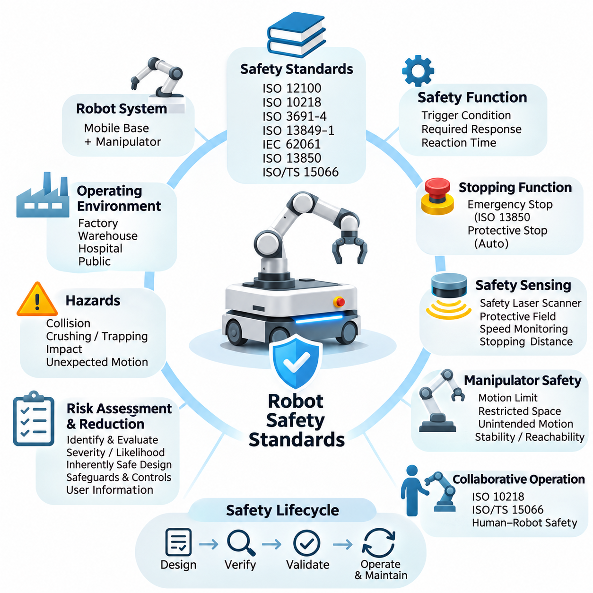
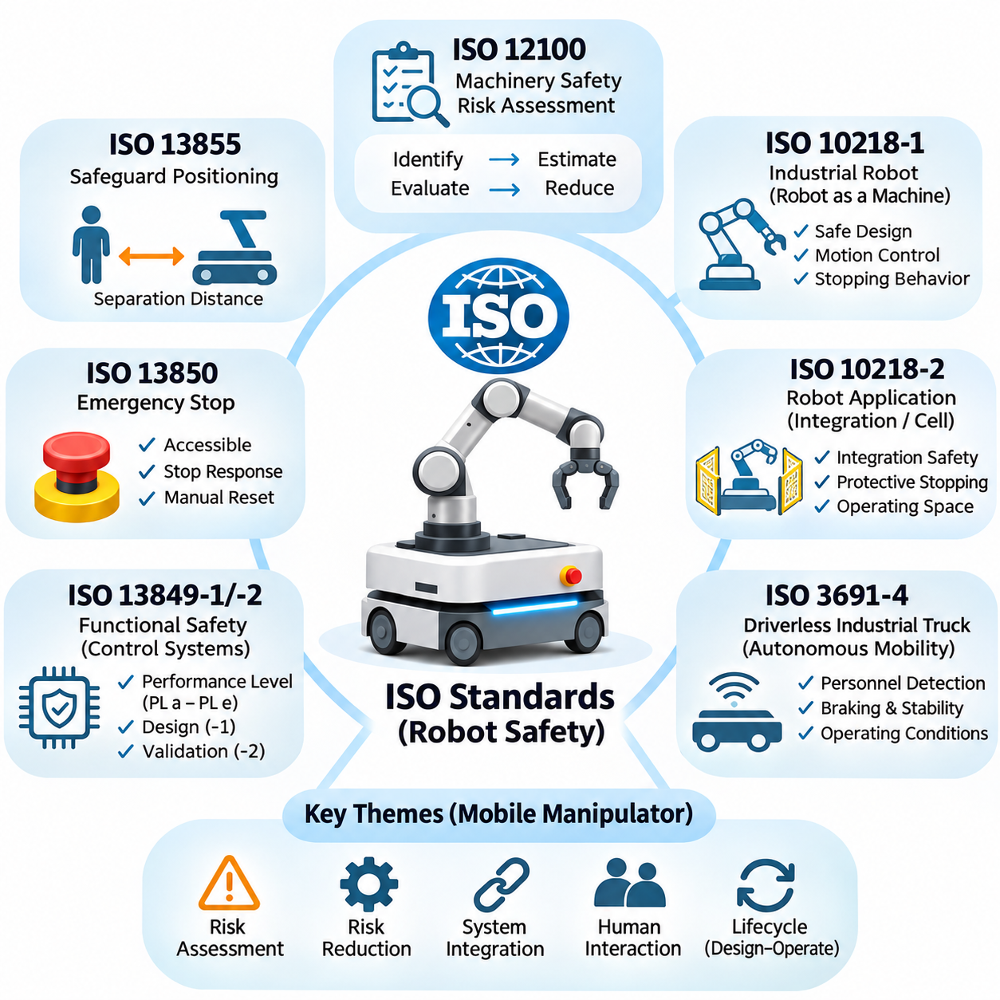
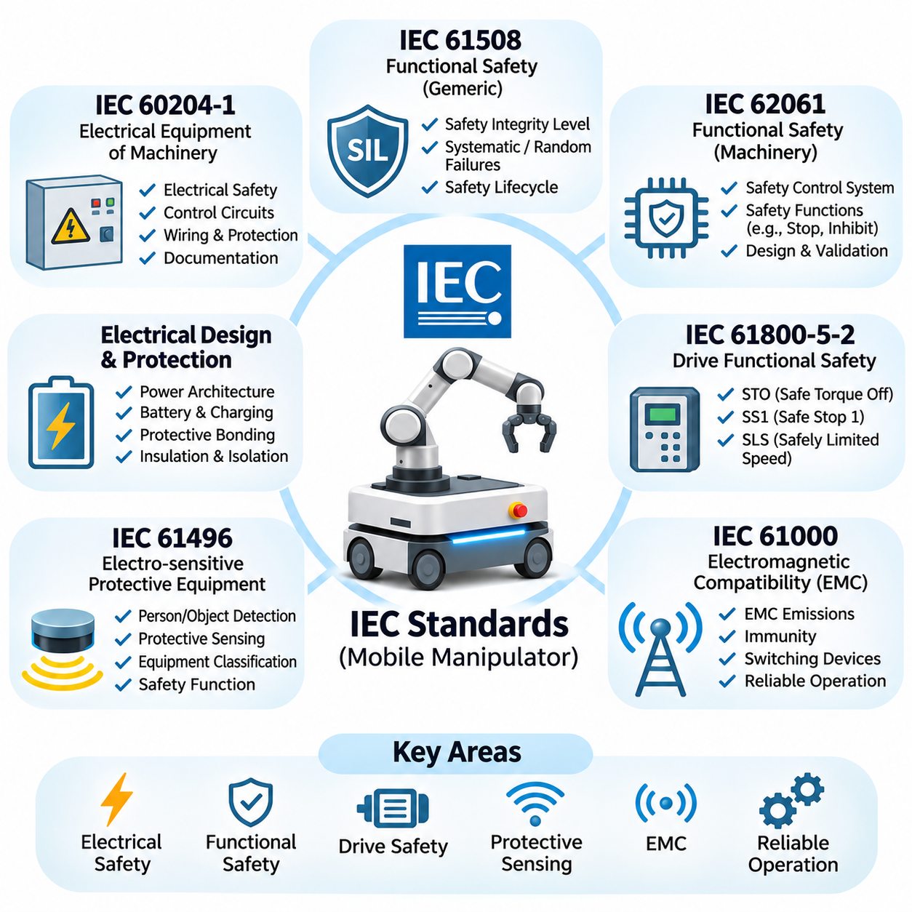
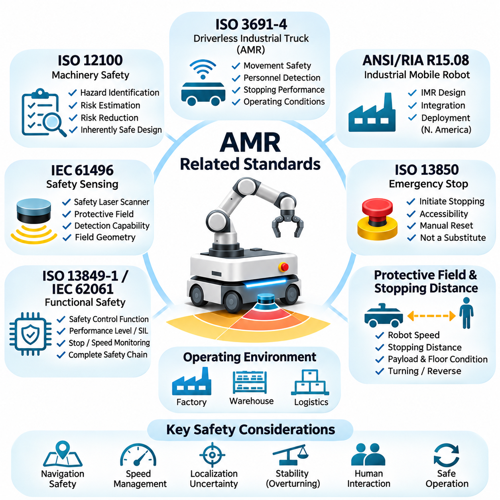
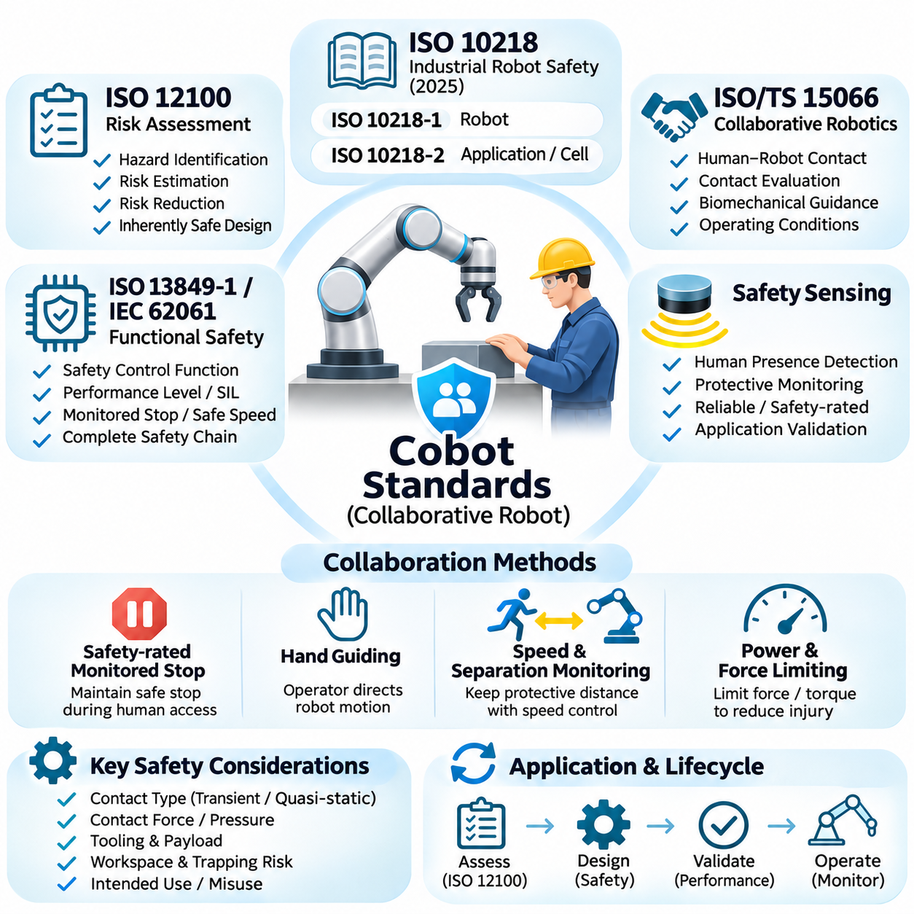
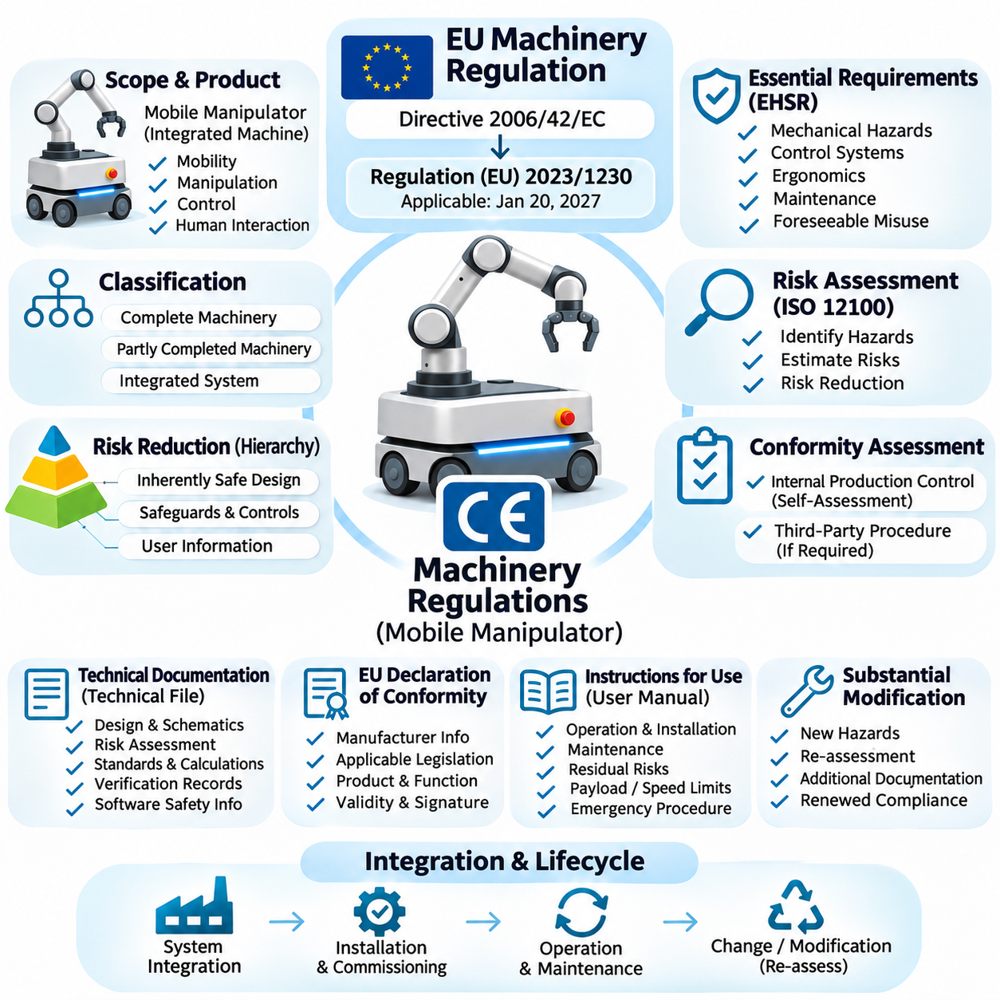
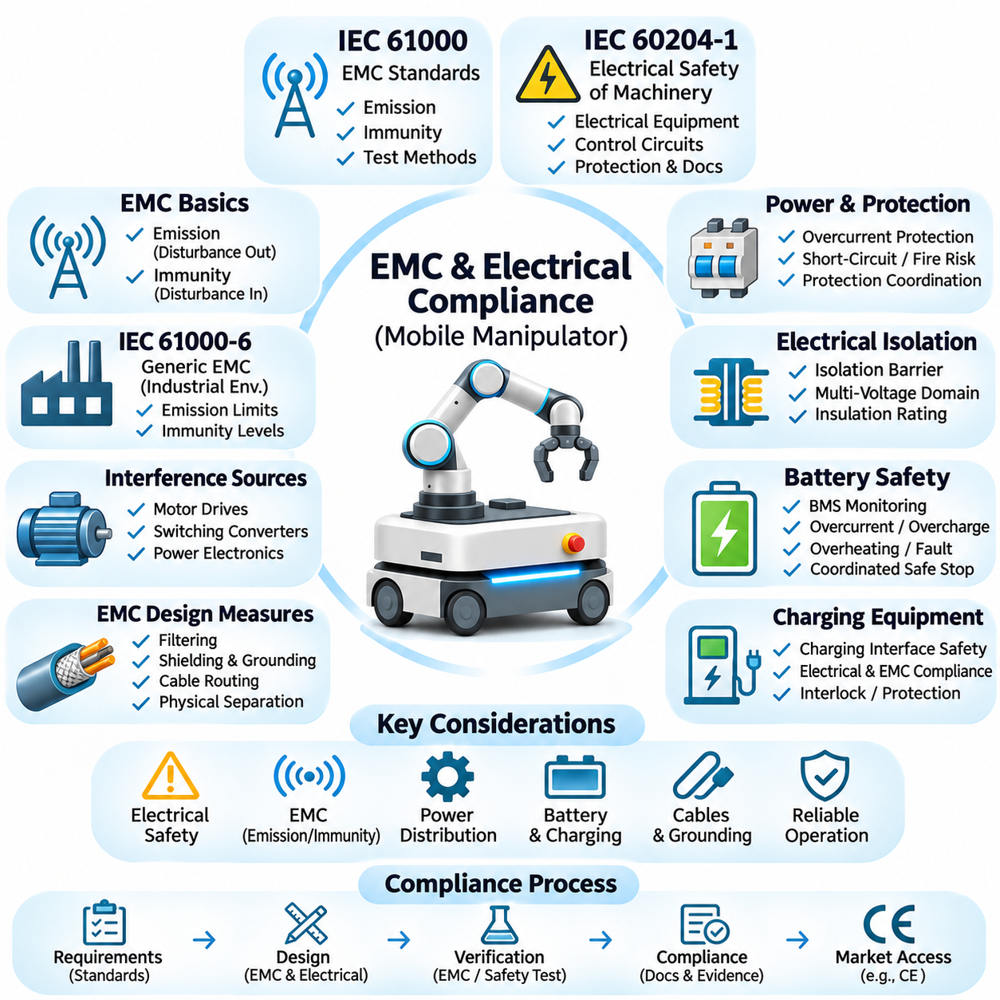
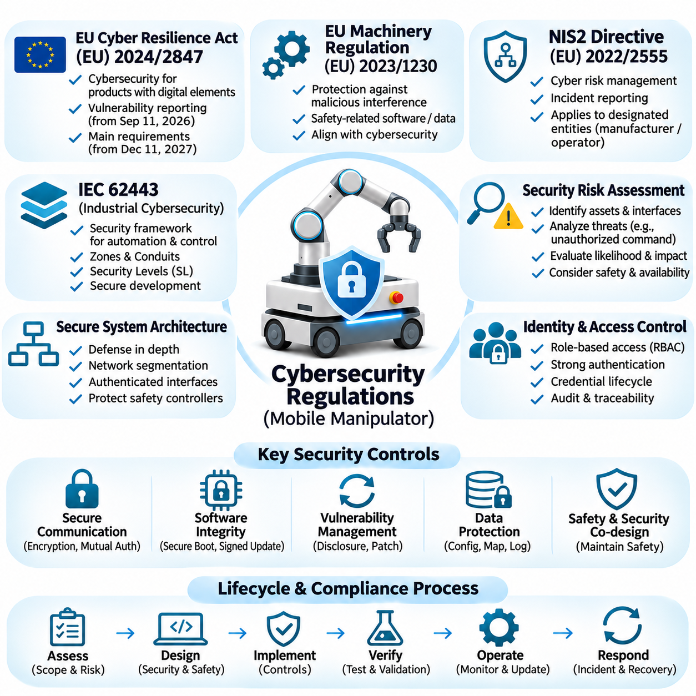
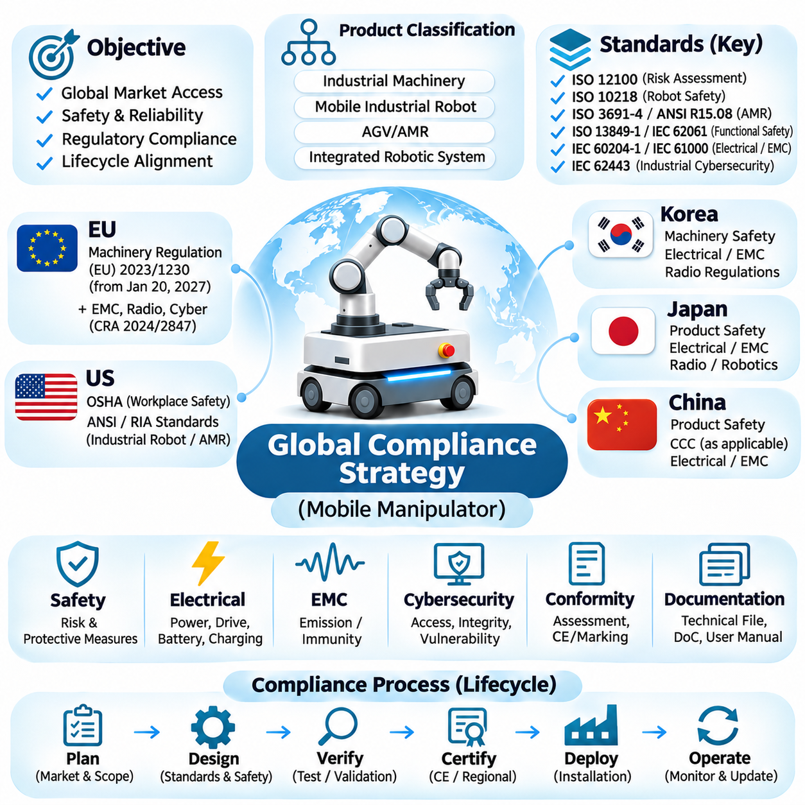

**Volume 01. Mobile Manipulator Foundations and System Architecture**


# Chapter 12. Standards and Regulations

##  

## 01 Robot Safety Standards

{width="7.268055555555556in" height="7.268055555555556in"}

Robot safety standards establish the technical principles and engineering requirements necessary to protect people, equipment, and surrounding environments during robotic operations. For mobile manipulators, safety extends beyond conventional industrial robot protection because autonomous navigation and articulated manipulation occur within the same operating system. Compliance therefore requires coordinated consideration of mobility, mechanical motion, control reliability, and human interaction.

A mobile manipulator combines an autonomous mobile robot with a robotic arm, creating hazards that may occur independently or simultaneously. The mobile platform can collide with obstacles or pedestrians, while the manipulator may introduce crushing, trapping, impact, and unexpected movement risks. Safety engineering must address these combined hazards through systematic risk assessment, protective measures, and verification procedures covering the complete operational lifecycle.

International safety standards provide a common foundation for designing and evaluating robotic systems. ISO 12100 establishes general machinery risk assessment and risk reduction principles, while ISO 10218 addresses industrial robot and robot system safety. ISO 3691-4 covers driverless industrial trucks and their systems, including relevant autonomous mobile platforms. Their applicability depends on the robot\'s intended use, configuration, and operating environment.

Robot safety requirements begin with defining the intended application and foreseeable operating conditions. Engineers must identify whether the system operates inside factories, warehouses, hospitals, or public facilities, because each environment introduces different exposure scenarios. The analysis should consider pedestrian density, floor conditions, payload characteristics, operating speeds, maintenance activities, and reasonably foreseeable misuse before selecting protective measures.

Risk assessment provides the foundation for determining appropriate safety functions and protective architectures. Each identified hazard is evaluated according to potential injury severity and the likelihood of harm, considering exposure and possibilities for avoiding dangerous situations. Risk reduction follows a structured hierarchy that prioritizes inherently safe design, protective devices and control measures, and supplementary information for users.

Functional safety standards address the reliability of electrical, electronic, and programmable systems performing safety-related functions. ISO 13849-1 provides a framework based on Performance Levels, while IEC 62061 addresses functional safety of machinery control systems using Safety Integrity Levels. These approaches help engineers determine whether safety-related control functions provide sufficient risk reduction under expected operating and fault conditions.

A safety function must be defined through its triggering conditions, required response, and acceptable reaction time. Examples include protective stopping when a person enters a hazardous zone, preventing unintended arm motion, and inhibiting mobile movement during unsafe manipulation. The required performance depends on the associated risk assessment rather than a universal safety rating assigned to every robot subsystem.

Emergency stop systems provide a means for operators to initiate stopping when dangerous situations arise. ISO 13850 establishes principles for emergency stop functions, including accessibility, deliberate actuation, and manual reset requirements. However, emergency stopping is a complementary protective measure and cannot replace appropriate safeguarding. Resetting an emergency stop must not independently initiate hazardous movement or automatically resume an interrupted task.

Protective stopping and emergency stopping serve different operational purposes. Protective stops may be triggered automatically by safety scanners, interlocks, or monitored safety conditions, whereas emergency stops are manually initiated in response to an emergency. Both require defined stopping behavior, appropriate energy management, and controlled restart procedures. Their implementation must account for the motion and stored energy of both the mobile base and manipulator.

Mobile robot safety frequently relies on safety-rated sensing systems that monitor surrounding spaces. Safety laser scanners, protective fields, and speed-dependent monitoring zones can detect hazardous proximity and initiate protective responses. The design must consider sensor coverage, blind spots, stopping distance, braking performance, and environmental interference. Ordinary navigation sensors cannot automatically be assumed to provide certified safety functions.

Stopping distance represents an essential parameter in mobile robot safety engineering. It depends on initial velocity, braking capability, controller response time, sensor detection delay, payload, and floor friction. Protective field dimensions must provide sufficient separation to stop the robot before hazardous contact occurs. Verification should include representative worst-case conditions, particularly maximum operating loads and reduced-friction surfaces.

Manipulator safety introduces additional requirements because articulated arms can generate complex trajectories and concentrated contact forces. Industrial robot safety principles address restricted spaces, protective stopping, motion limits, and safeguards against unintended movement. When an arm is mounted on a mobile platform, the system must also consider changes in stability, reachability, and collision geometry caused by simultaneous base and arm motion.

Collaborative operation requires particular attention when humans and robots share workspaces. ISO 10218 and ISO/TS 15066 provide relevant industrial collaborative robotics guidance, including concepts such as safety-rated monitored stop, hand guiding, speed and separation monitoring, and power and force limiting. Collaborative operation does not automatically make a robot safe; each application requires risk assessment and validation of its protective measures.

Power and force limiting strategies seek to reduce injury risks associated with physical contact. Their implementation may involve joint torque sensing, compliant actuators, force monitoring, mechanical design, and motion control. Nevertheless, measured contact forces alone do not establish complete safety. Contact location, pressure, robot geometry, transient impact behavior, and the possibility of trapping must also be considered during application-specific validation.

System integration introduces safety challenges that cannot be resolved by evaluating individual components separately. A compliant mobile platform and a separately compliant robotic arm do not necessarily form a compliant integrated machine. Mounting arrangements, combined stopping behavior, communication interfaces, payload transfer, and coordinated motion can introduce new hazards. Consequently, the complete mobile manipulator requires an integrated risk assessment and safety validation.

Safety-related communication must preserve the integrity of critical commands and status information exchanged between controllers, sensors, and actuators. Communication failures, excessive latency, corrupted messages, or synchronization errors may compromise protective functions. Engineers should define fault detection, communication timeout behavior, safe-state transitions, and recovery procedures. Safety-critical communication must be supported by an appropriately validated architecture.

Electrical safety standards complement mechanical and functional safety requirements. IEC 60204-1 provides requirements for electrical equipment of machinery, including protective bonding, electrical protection, control circuits, and related provisions. Mobile manipulators additionally require attention to battery systems, charging interfaces, power distribution, insulation, and emergency power isolation. Electrical faults must not create uncontrolled movement or unacceptable thermal hazards.

Mechanical stability is especially important when a manipulator operates from a mobile base. Arm extension, payload displacement, acceleration, and braking can shift the combined center of gravity and increase overturning risks. Engineers should evaluate static and dynamic stability across representative operating configurations. Safety measures may include restricted arm workspaces, reduced acceleration, payload limits, stabilizing mechanisms, and operating restrictions on slopes.

Safety validation demonstrates whether implemented protective functions satisfy their specified requirements. Testing should include normal operation, foreseeable faults, sensor failures, communication interruptions, emergency stops, protective stops, and recovery sequences. ISO 13849-2 provides guidance for validating safety-related control system functions where applicable. Evidence should include test procedures, measured results, identified deviations, and documented corrective actions.

Safety documentation supports traceability throughout design, manufacturing, installation, and maintenance. Essential records include intended-use definitions, hazard analyses, risk reduction decisions, safety requirements, control architecture descriptions, verification results, and operating instructions. Changes to hardware, software, sensors, payloads, or operational environments may require reassessment because previously validated assumptions can become invalid after system modifications.

Regulatory compliance depends on the market in which the robot is supplied and operated. International standards provide technical frameworks, while national legislation establishes applicable legal obligations. Manufacturers must determine the relevant machinery, electrical, electromagnetic compatibility, and product safety requirements for each jurisdiction. Compliance planning should begin during system architecture development rather than being postponed until final certification or commercial deployment.

Emerging AI-driven mobile manipulators introduce additional challenges because perception, planning, and autonomous decision-making may change with software updates or operating conditions. Safety-critical behavior should remain governed by defined constraints and independently validated protective mechanisms. Continuous monitoring, controlled updates, configuration management, and regression testing are essential for maintaining safety assurance throughout the operational lifecycle.

A mature robot safety strategy integrates standards interpretation, risk assessment, functional safety engineering, mechanical protection, electrical compliance, and operational validation into a unified development process. For mobile manipulators, the central objective is not simply to satisfy individual component requirements but to demonstrate that the complete system can perform its intended tasks while reducing foreseeable risks to acceptable levels throughout deployment and maintenance.

로봇 안전 표준(Robot Safety Standards)은 로봇 작동 중 사람, 장비 및 주변 환경을 보호하기 위한 기술적 원칙과 공학적 요구사항을 규정한다. 모바일 매니퓰레이터(Mobile Manipulator)의 안전은 자율주행(Autonomous Navigation)과 관절형 조작(Articulated Manipulation)이 동일한 시스템에서 수행되므로 기존 산업용 로봇(Industrial Robot)의 보호 범위를 넘어선다. 따라서 표준 준수를 위해서는 이동성(Mobility), 기계적 운동(Mechanical Motion), 제어 신뢰성(Control Reliability), 인간과 로봇의 상호작용(Human-Robot Interaction)을 통합적으로 고려해야 한다.

모바일 매니퓰레이터는 자율이동로봇(Autonomous Mobile Robot, AMR)과 로봇 팔(Robot Arm)을 결합한 시스템으로, 각각 독립적으로 발생하거나 동시에 나타날 수 있는 위험요소(Hazards)를 포함한다. 이동 플랫폼(Mobile Platform)은 장애물이나 보행자와 충돌할 수 있으며, 매니퓰레이터(Manipulator)는 압착(Crushing), 끼임(Trapping), 충격(Impact), 예기치 않은 움직임(Unexpected Movement) 등의 위험을 유발할 수 있다. 안전공학(Safety Engineering)은 체계적인 위험성 평가(Risk Assessment), 보호조치(Protective Measures), 검증 절차(Verification Procedures)를 통해 시스템의 전체 운영 수명주기(Operational Lifecycle)에 걸쳐 이러한 복합 위험을 관리해야 한다.

국제 안전 표준(International Safety Standards)은 로봇 시스템의 설계와 평가를 위한 공통 기반을 제공한다. ISO 12100은 기계류의 위험성 평가(Risk Assessment)와 위험 감소(Risk Reduction)에 관한 일반 원칙을 규정하며, ISO 10218은 산업용 로봇 및 로봇 시스템의 안전 요구사항을 다룬다. ISO 3691-4는 관련 자율이동 플랫폼을 포함한 무인 산업용 트럭(Driverless Industrial Trucks)과 해당 시스템의 안전 요구사항을 규정한다. 각 표준의 적용 가능성은 로봇의 의도된 사용 목적(Intended Use), 시스템 구성(Configuration), 운영 환경(Operating Environment)에 따라 결정된다.

로봇 안전 요구사항(Robot Safety Requirements)은 의도된 응용 분야와 예측 가능한 운영 조건을 정의하는 것에서 시작된다. 엔지니어는 시스템이 공장, 창고, 병원 또는 공공시설 중 어디에서 작동하는지 확인해야 하며, 각 환경에서 발생할 수 있는 위험 노출 상황(Exposure Scenarios)을 분석해야 한다. 보호조치를 선정하기 전에 보행자 밀도(Pedestrian Density), 바닥 상태(Floor Conditions), 적재물 특성(Payload Characteristics), 운행 속도(Operating Speed), 유지보수 작업(Maintenance Activities), 합리적으로 예측 가능한 오사용(Reasonably Foreseeable Misuse)을 고려해야 한다.

위험성 평가(Risk Assessment)는 적절한 안전 기능(Safety Functions)과 보호 아키텍처(Protective Architecture)를 결정하는 기초가 된다. 식별된 각 위험요소는 잠재적인 상해의 심각도(Injury Severity)와 위해 발생 가능성(Likelihood of Harm)을 기준으로 평가하며, 위험 노출 빈도와 위험 상황을 회피할 가능성도 함께 고려한다. 위험 감소(Risk Reduction)는 본질적으로 안전한 설계(Inherently Safe Design), 보호장치 및 제어조치(Protective Devices and Control Measures), 사용자에게 제공하는 보충 정보(Supplementary Information)를 우선순위에 따라 적용하는 체계적인 절차를 따른다.

기능 안전 표준(Functional Safety Standards)은 안전 관련 기능을 수행하는 전기, 전자 및 프로그래머블 시스템(Electrical, Electronic, and Programmable Systems)의 신뢰성을 다룬다. ISO 13849-1은 성능 수준(Performance Level, PL)에 기반한 평가 체계를 제공하며, IEC 62061은 안전 무결성 수준(Safety Integrity Level, SIL)을 활용하여 기계류 제어 시스템의 기능 안전을 평가한다. 이러한 접근방식은 엔지니어가 안전 관련 제어 기능(Safety-Related Control Functions)이 예상되는 운영 조건과 고장 조건에서 충분한 위험 감소 성능을 제공하는지 판단하도록 지원한다.

안전 기능(Safety Function)은 작동 조건(Triggering Conditions), 요구되는 대응 동작(Required Response), 허용 가능한 반응 시간(Acceptable Reaction Time)을 기준으로 명확하게 정의해야 한다. 대표적인 사례로는 사람이 위험구역(Hazardous Zone)에 진입했을 때 보호정지(Protective Stop)를 수행하거나, 의도하지 않은 로봇 팔의 움직임을 방지하고, 안전하지 않은 조작 작업 중 이동 플랫폼의 주행을 제한하는 기능이 있다. 필요한 안전 성능은 모든 로봇 하위 시스템에 동일하게 적용되는 보편적인 등급이 아니라 해당 위험성 평가 결과에 따라 결정된다.

비상정지 시스템(Emergency Stop System)은 위험한 상황이 발생했을 때 작업자가 로봇의 정지 동작을 시작할 수 있도록 한다. ISO 13850은 접근성(Accessibility), 의도적인 작동(Deliberate Actuation), 수동 재설정(Manual Reset) 요구사항을 포함하여 비상정지 기능의 설계 원칙을 규정한다. 그러나 비상정지는 보완적 보호조치(Complementary Protective Measure)이므로 적절한 안전 방호(Safeguarding)를 대체할 수 없다. 비상정지를 해제하더라도 위험한 움직임이 자동으로 시작되거나 중단된 작업이 즉시 재개되어서는 안 된다.

보호정지(Protective Stop)와 비상정지(Emergency Stop)는 서로 다른 운영 목적을 가진다. 보호정지는 안전 스캐너(Safety Scanner), 인터록(Interlock), 감시되는 안전 조건(Monitored Safety Conditions)에 의해 자동으로 작동할 수 있지만, 비상정지는 긴급 상황에 대응하기 위해 작업자가 수동으로 작동시킨다. 두 기능 모두 명확한 정지 동작(Stopping Behavior), 적절한 에너지 관리(Energy Management), 통제된 재시작 절차(Controlled Restart Procedures)를 필요로 한다. 구현 과정에서는 이동 플랫폼과 매니퓰레이터의 운동 상태 및 저장 에너지(Stored Energy)를 함께 고려해야 한다.

이동 로봇 안전(Mobile Robot Safety)은 주변 공간을 감시하는 안전 등급 센싱 시스템(Safety-Rated Sensing Systems)에 크게 의존한다. 안전 레이저 스캐너(Safety Laser Scanner), 보호 필드(Protective Field), 속도 의존형 감시구역(Speed-Dependent Monitoring Zone)은 위험한 접근 상황을 감지하고 보호 동작을 실행할 수 있다. 설계 과정에서는 센서 감지 범위(Sensor Coverage), 사각지대(Blind Spots), 정지거리(Stopping Distance), 제동 성능(Braking Performance), 환경적 간섭(Environmental Interference)을 고려해야 한다. 일반적인 자율주행 센서가 자동으로 인증된 안전 기능을 제공한다고 가정해서는 안 된다.

정지거리(Stopping Distance)는 이동 로봇 안전공학에서 핵심적인 설계 변수이다. 정지거리는 초기 속도(Initial Velocity), 제동 능력(Braking Capability), 제어기 응답시간(Controller Response Time), 센서 감지 지연(Sensor Detection Delay), 적재하중(Payload), 바닥 마찰계수(Floor Friction)에 따라 달라진다. 보호 필드의 크기는 위험한 접촉이 발생하기 전에 로봇이 완전히 정지할 수 있도록 충분한 분리거리(Separation Distance)를 확보해야 한다. 검증 과정에서는 최대 적재 조건과 마찰력이 감소한 바닥 상태를 포함하여 대표적인 최악 조건(Worst-Case Conditions)을 평가해야 한다.

매니퓰레이터 안전(Manipulator Safety)은 관절형 로봇 팔이 복잡한 궤적(Complex Trajectories)과 집중된 접촉력(Concentrated Contact Forces)을 발생시킬 수 있으므로 추가적인 요구사항을 포함한다. 산업용 로봇 안전 원칙은 제한 공간(Restricted Space), 보호정지(Protective Stop), 운동 제한(Motion Limits), 의도하지 않은 움직임에 대한 보호조치를 다룬다. 로봇 팔이 이동 플랫폼에 장착되면 플랫폼과 로봇 팔의 동시 운동으로 발생하는 안정성(Stability), 도달 가능 영역(Reachability), 충돌 형상(Collision Geometry)의 변화까지 고려해야 한다.

협동 작업(Collaborative Operation)은 사람과 로봇이 작업공간을 공유할 때 특별한 주의가 필요하다. ISO 10218과 ISO/TS 15066은 안전 등급 감시정지(Safety-Rated Monitored Stop), 수동 안내(Hand Guiding), 속도 및 분리거리 감시(Speed and Separation Monitoring), 동력 및 힘 제한(Power and Force Limiting)과 같은 산업용 협동로봇(Collaborative Robot) 관련 지침을 제공한다. 협동 작업이 가능하다는 사실만으로 로봇의 안전성이 자동으로 보장되는 것은 아니며, 각 응용 분야에 대한 위험성 평가와 보호조치 검증이 필요하다.

동력 및 힘 제한(Power and Force Limiting) 전략은 물리적 접촉으로 발생할 수 있는 상해 위험을 감소시키는 것을 목표로 한다. 구현에는 관절 토크 센싱(Joint Torque Sensing), 유연 구동기(Compliant Actuators), 힘 감시(Force Monitoring), 기계적 설계(Mechanical Design), 운동 제어(Motion Control)가 활용될 수 있다. 그러나 측정된 접촉력만으로 전체 안전성을 입증할 수는 없다. 접촉 위치(Contact Location), 접촉 압력(Contact Pressure), 로봇 형상(Robot Geometry), 순간 충격 특성(Transient Impact Behavior), 끼임 가능성(Trapping Possibility)을 응용 분야별 검증 과정에서 함께 고려해야 한다.

시스템 통합(System Integration)은 개별 구성요소의 평가만으로 해결할 수 없는 안전 문제를 발생시킨다. 안전 요구사항을 충족하는 이동 플랫폼과 별도로 안전 요구사항을 충족하는 로봇 팔을 결합했다고 해서 통합 기계(Integrated Machine)가 자동으로 안전 요구사항을 충족하는 것은 아니다. 장착 구조(Mounting Arrangement), 통합 정지 동작(Combined Stopping Behavior), 통신 인터페이스(Communication Interface), 적재물 전달(Payload Transfer), 협조 운동(Coordinated Motion)은 새로운 위험을 발생시킬 수 있다. 따라서 전체 모바일 매니퓰레이터에 대한 통합 위험성 평가(Integrated Risk Assessment)와 안전 검증(Safety Validation)이 필요하다.

안전 관련 통신(Safety-Related Communication)은 제어기, 센서 및 구동기 사이에서 교환되는 핵심 명령과 상태 정보의 무결성(Integrity)을 유지해야 한다. 통신 장애(Communication Failure), 과도한 지연(Excessive Latency), 메시지 손상(Corrupted Messages), 동기화 오류(Synchronization Errors)는 보호 기능을 저하시킬 수 있다. 엔지니어는 고장 감지(Fault Detection), 통신 시간 초과 동작(Communication Timeout Behavior), 안전 상태 전환(Safe-State Transition), 복구 절차(Recovery Procedures)를 정의해야 한다. 안전 필수 통신(Safety-Critical Communication)은 적절하게 검증된 아키텍처에 의해 지원되어야 한다.

전기 안전 표준(Electrical Safety Standards)은 기계적 안전(Mechanical Safety)과 기능 안전(Functional Safety) 요구사항을 보완한다. IEC 60204-1은 보호 본딩(Protective Bonding), 전기적 보호(Electrical Protection), 제어회로(Control Circuits) 등을 포함한 기계류 전기장비(Electrical Equipment of Machinery)의 요구사항을 제공한다. 모바일 매니퓰레이터는 배터리 시스템(Battery System), 충전 인터페이스(Charging Interface), 전력 분배(Power Distribution), 절연(Insulation), 비상 전원 차단(Emergency Power Isolation)도 고려해야 한다. 전기적 고장이 제어되지 않은 움직임이나 허용할 수 없는 열적 위험(Thermal Hazards)을 발생시켜서는 안 된다.

기계적 안정성(Mechanical Stability)은 매니퓰레이터가 이동 플랫폼 위에서 작동할 때 특히 중요하다. 로봇 팔의 확장(Arm Extension), 적재물 변위(Payload Displacement), 가속(Acceleration), 제동(Braking)은 통합 시스템의 무게중심(Center of Gravity)을 이동시켜 전복 위험(Overturning Risk)을 증가시킬 수 있다. 엔지니어는 대표적인 운영 구성에서 정적 안정성(Static Stability)과 동적 안정성(Dynamic Stability)을 평가해야 한다. 안전조치에는 로봇 팔 작업영역 제한(Restricted Arm Workspace), 가속도 감소(Reduced Acceleration), 적재하중 제한(Payload Limits), 안정화 장치(Stabilizing Mechanisms), 경사면 운영 제한(Slope Operating Restrictions)이 포함될 수 있다.

안전 검증(Safety Validation)은 구현된 보호 기능이 명시된 요구사항을 충족하는지 입증하는 과정이다. 시험에는 정상 작동(Normal Operation), 예측 가능한 고장(Foreseeable Faults), 센서 고장(Sensor Failures), 통신 중단(Communication Interruptions), 비상정지(Emergency Stop), 보호정지(Protective Stop), 복구 절차(Recovery Sequences)가 포함되어야 한다. ISO 13849-2는 적용 가능한 경우 안전 관련 제어 시스템 기능의 검증 지침을 제공한다. 검증 증거에는 시험 절차(Test Procedures), 측정 결과(Measured Results), 확인된 편차(Identified Deviations), 문서화된 시정조치(Documented Corrective Actions)가 포함되어야 한다.

안전 문서화(Safety Documentation)는 설계, 제조, 설치 및 유지보수 전 과정에서 추적성(Traceability)을 지원한다. 핵심 기록에는 의도된 사용 목적(Intended-Use Definition), 위험요소 분석(Hazard Analysis), 위험 감소 결정(Risk Reduction Decisions), 안전 요구사항(Safety Requirements), 제어 아키텍처 설명(Control Architecture Description), 검증 결과(Verification Results), 운영 지침(Operating Instructions)이 포함된다. 하드웨어, 소프트웨어, 센서, 적재물 또는 운영 환경이 변경되면 이전에 검증된 가정이 더 이상 유효하지 않을 수 있으므로 안전성을 재평가해야 할 수 있다.

규제 준수(Regulatory Compliance)는 로봇이 공급되고 운영되는 시장에 따라 달라진다. 국제 표준(International Standards)은 기술적 체계를 제공하지만, 국가별 법률(National Legislation)은 적용되는 법적 의무(Legal Obligations)를 규정한다. 제조업체는 각 국가 및 지역에서 적용되는 기계류(Machinery), 전기 안전(Electrical Safety), 전자기 적합성(Electromagnetic Compatibility, EMC), 제품 안전(Product Safety) 요구사항을 확인해야 한다. 규제 준수 계획(Compliance Planning)은 최종 인증(Final Certification)이나 상용 배포(Commercial Deployment) 단계까지 미루지 않고 시스템 아키텍처 개발 초기부터 수립해야 한다.

인공지능 기반 모바일 매니퓰레이터(AI-Driven Mobile Manipulator)는 인지(Perception), 계획(Planning), 자율 의사결정(Autonomous Decision-Making)이 소프트웨어 업데이트나 운영 조건에 따라 변화할 수 있으므로 추가적인 안전 문제를 발생시킨다. 안전 필수 동작(Safety-Critical Behavior)은 명확하게 정의된 제약조건(Defined Constraints)과 독립적으로 검증된 보호 메커니즘(Independently Validated Protective Mechanisms)에 의해 관리되어야 한다. 지속적 감시(Continuous Monitoring), 통제된 업데이트(Controlled Updates), 구성 관리(Configuration Management), 회귀 시험(Regression Testing)은 전체 운영 수명주기 동안 안전 보증(Safety Assurance)을 유지하는 데 필수적이다.

성숙한 로봇 안전 전략(Robot Safety Strategy)은 표준 해석(Standards Interpretation), 위험성 평가(Risk Assessment), 기능 안전공학(Functional Safety Engineering), 기계적 보호(Mechanical Protection), 전기적 규제 준수(Electrical Compliance), 운영 검증(Operational Validation)을 하나의 통합 개발 프로세스(Unified Development Process)로 결합한다. 모바일 매니퓰레이터의 핵심 목표는 개별 구성요소의 요구사항을 충족하는 것에 그치지 않고, 전체 시스템이 배포와 유지보수를 포함한 운영 수명주기 전반에서 예측 가능한 위험을 허용 가능한 수준(Acceptable Risk Level)으로 감소시키면서 의도된 작업을 안전하게 수행할 수 있음을 입증하는 것이다.

##  

## 02 ISO Standards

{width="7.268055555555556in" height="7.268055555555556in"}

International Organization for Standardization (ISO) standards provide a systematic framework for ensuring the safety, reliability, and interoperability of robotic systems. For mobile manipulators, these standards address machinery risk assessment, industrial robot safety, autonomous mobility, functional safety, and human interaction. Their combined application helps manufacturers establish consistent engineering requirements throughout design, integration, deployment, and maintenance.

ISO 12100 establishes fundamental principles for machinery safety through hazard identification, risk estimation, risk evaluation, and risk reduction. It requires designers to consider intended use, reasonably foreseeable misuse, and potential hazards throughout the machinery lifecycle. For mobile manipulators, this includes collisions, crushing, instability, electrical faults, and unexpected movements arising from interactions between the mobile platform and robotic arm.

The risk reduction methodology defined by ISO 12100 follows a structured hierarchy of protective measures. Inherently safe design should eliminate hazards or reduce risks wherever practical before additional safeguards are introduced. Protective devices, safety-related control functions, and information for use address remaining risks. This approach prevents manufacturers from relying exclusively on emergency stops or operator instructions to compensate for unsafe mechanical designs.

ISO 10218 addresses safety requirements for industrial robots and industrial robot applications. Its two-part structure distinguishes requirements for the robot itself from those associated with robot applications and cells. For mobile manipulators operating in industrial environments, the standard provides relevant principles for protective stopping, restricted operating spaces, motion control, safeguarding, and integration responsibilities.

ISO 10218-1 focuses on the industrial robot as a machine, including safety-related design and protective functions. Important considerations include controlled movement, stopping behavior, operating modes, and prevention of unintended motion. When an industrial manipulator is installed on an autonomous mobile platform, engineers must verify that its safety functions remain effective despite changes in mounting conditions, mobility, payload distribution, and system-level control.

ISO 10218-2 addresses the safety of industrial robot applications and robot cells, emphasizing integration and operational safeguards. A mobile manipulator may create hazards that are absent when the same arm operates on a stationary foundation. Consequently, risk assessment must consider simultaneous base and arm motion, changing workspaces, pedestrian access, and interactions with surrounding equipment throughout the complete operating sequence.

ISO 3691-4 specifies safety requirements and verification methods for driverless industrial trucks and their systems. It is particularly relevant to autonomous mobile platforms used in industrial material handling. The standard addresses operational hazards associated with driverless movement, including personnel detection, braking, stability, and operating conditions. Its applicability to a mobile manipulator depends on the classification and intended function of the integrated machine.

The relationship between ISO 3691-4 and ISO 10218 is important for mobile manipulation architectures. The mobile base may be assessed against relevant driverless industrial truck requirements, while the robotic arm and industrial application require consideration of robot safety requirements. However, compliance of individual subsystems does not automatically demonstrate the safety of the integrated machine, which requires additional system-level risk assessment and validation.

ISO 13849-1 provides a methodology for designing safety-related parts of control systems. It defines Performance Levels, ranging from PL a to PL e, to characterize the ability of safety-related control functions to perform under foreseeable conditions. Required performance is determined through risk assessment, while achieved performance depends on factors including architecture, component reliability, diagnostic coverage, and resistance to common-cause failures.

For mobile manipulators, ISO 13849-1 can support the development of safety functions such as emergency stopping, protective stopping, safe motion inhibition, and monitored access protection. Engineers must define each safety function independently and determine its required Performance Level. A safety-rated scanner or controller alone cannot guarantee the required system performance unless the complete sensing, logic, and actuation chain is appropriately designed.

ISO 13849-2 complements the design requirements by addressing validation of safety-related control systems. Validation involves analysis and testing to determine whether specified safety functions and performance requirements have been achieved. Mobile manipulator testing should examine sensor faults, actuator failures, communication interruptions, unexpected startup, and stopping behavior under representative operating conditions, including relevant combinations of platform and arm motion.

ISO 13850 establishes principles for emergency stop functions in machinery. Emergency stop devices must be readily accessible and capable of initiating the required stopping response when dangerous situations occur. For mobile manipulators, the emergency stop architecture must consider both locomotion and manipulation. Resetting an emergency stop must not automatically restart hazardous movement, and emergency stopping cannot substitute for other necessary protective measures.

ISO 13855 addresses the positioning of safeguards with respect to the approach of the human body. Its principles are relevant when determining separation distances between personnel and hazardous robotic movements. For mobile manipulators, protective field dimensions must consider approach speed, detection capability, total stopping time, and relevant uncertainty. Moving workspaces and changing robot configurations require particular attention during safeguarding design.

ISO 13857 provides safety distance principles intended to prevent hazardous zones from being reached by upper and lower limbs. These requirements are especially relevant to protective enclosures, restricted access openings, and fixed machinery interfaces. Although mobile manipulators frequently operate without permanent fencing, the standard remains useful when designing guarded workstations, docking equipment, and machinery interfaces where access to hazardous mechanisms must be controlled.

ISO/TS 15066 provides supplementary guidance for collaborative industrial robot applications. It addresses collaborative operating methods and considerations for limiting risks associated with human-robot contact. Relevant concepts include safety-rated monitored stopping, hand guiding, speed and separation monitoring, and power and force limiting. Its application requires assessment of the actual robot, tooling, workpieces, contact conditions, and operating environment.

Collaborative operation becomes more complex when an industrial manipulator is mounted on an autonomous vehicle. The mobile platform changes the relative position between people and the robot arm, potentially altering separation distances and contact conditions. Engineers must consider combined velocities, manipulator reach, base stopping performance, and human movement. Collaborative operation must therefore be evaluated as a complete application rather than as an isolated arm capability.

ISO 13482 addresses safety requirements for personal care robots, including certain mobile servant, physical assistant, and person carrier robots. Its relevance depends on the intended application and robot classification. Service-oriented mobile manipulators operating in human-centered environments may benefit from its safety principles, but the standard should not automatically be applied to industrial systems or medical robots outside its defined scope.

ISO 9283 specifies performance criteria and related test methods for industrial robots. Although primarily concerned with performance rather than safety certification, its measurement principles support repeatable evaluation of positioning accuracy, repeatability, and motion characteristics. For mobile manipulators, these measurements can contribute to understanding manipulation performance, particularly when mobile base positioning uncertainty affects the accuracy of tasks performed by the robotic arm.

ISO 10218, ISO 3691-4, and ISO 13849 should be considered complementary rather than interchangeable standards. Each addresses a different aspect of robot safety, including industrial robot requirements, driverless industrial vehicle operation, and safety-related control performance. Their appropriate combination depends on the intended machine function, operating environment, hazard assessment, and applicable regulatory framework rather than a universal certification formula.

Standards compliance also requires careful management of software and control architecture. Autonomous navigation, task planning, perception, and manipulation controllers may introduce complex dependencies between operational functions and protective functions. Safety-related behavior should remain predictable under software faults, communication delays, and degraded sensor conditions. Any safety function implemented through programmable control must satisfy the applicable functional safety requirements.

Verification activities should translate ISO requirements into measurable engineering acceptance criteria. Examples include stopping time, protective field response, emergency stop behavior, stability under maximum payload, and prevention of unexpected startup. Test conditions must represent foreseeable operating scenarios and relevant faults. Traceability between identified hazards, safety requirements, implemented functions, and verification evidence provides the foundation for a defensible safety assessment.

ISO standards are periodically revised to reflect technological developments and accumulated safety experience. Manufacturers must identify the applicable editions, amendments, and national adoptions when establishing compliance plans. In particular, changes to industrial robot safety requirements may influence integration practices and collaborative applications. Compliance documentation should record the selected editions and explain their relevance to the intended product and target markets.

A practical ISO compliance strategy begins during requirements definition and continues through system architecture, detailed engineering, prototype testing, and field deployment. The manufacturer should maintain a standards applicability matrix, risk assessment records, safety function specifications, and validation evidence. This structured process helps ensure that safety decisions remain consistent as mobile manipulators evolve from experimental prototypes into commercially deployed robotic products.

The principal value of ISO standards lies in establishing a disciplined relationship between identified hazards, engineering controls, and demonstrated safety performance. For mobile manipulators, effective implementation requires coordinated evaluation of the autonomous mobile base, robotic arm, end effector, software, and human operating environment. System-level integration and documented validation ultimately determine whether the complete robot can operate with acceptable residual risk.

국제표준화기구(International Organization for Standardization, ISO)의 표준은 로봇 시스템의 안전성(Safety), 신뢰성(Reliability), 상호운용성(Interoperability)을 보장하기 위한 체계적인 프레임워크를 제공한다. 모바일 매니퓰레이터(Mobile Manipulator)의 경우 이러한 표준은 기계류 위험성 평가(Machinery Risk Assessment), 산업용 로봇 안전(Industrial Robot Safety), 자율이동(Autonomous Mobility), 기능 안전(Functional Safety), 인간과 로봇의 상호작용(Human-Robot Interaction)을 다룬다. 관련 표준을 통합적으로 적용하면 제조업체는 설계, 통합, 배포 및 유지보수 전반에 걸쳐 일관된 공학적 요구사항을 수립할 수 있다.

ISO 12100은 위험요소 식별(Hazard Identification), 위험 추정(Risk Estimation), 위험 평가(Risk Evaluation), 위험 감소(Risk Reduction)를 통해 기계류 안전(Machinery Safety)의 기본 원칙을 규정한다. 이 표준은 설계자가 기계의 전체 수명주기(Machinery Lifecycle)에 걸쳐 의도된 사용(Intended Use), 합리적으로 예측 가능한 오사용(Reasonably Foreseeable Misuse), 잠재적 위험요소(Potential Hazards)를 고려하도록 요구한다. 모바일 매니퓰레이터에서는 이동 플랫폼과 로봇 팔의 상호작용으로 발생하는 충돌(Collision), 압착(Crushing), 불안정성(Instability), 전기적 고장(Electrical Fault), 예기치 않은 움직임(Unexpected Movement) 등이 포함된다.

ISO 12100에서 정의하는 위험 감소 방법론(Risk Reduction Methodology)은 보호조치(Protective Measures)의 체계적인 우선순위를 따른다. 본질적으로 안전한 설계(Inherently Safe Design)는 추가적인 안전 방호장치를 도입하기 전에 가능한 범위에서 위험요소를 제거하거나 위험을 감소시켜야 한다. 보호장치(Protective Devices), 안전 관련 제어 기능(Safety-Related Control Functions), 사용 정보(Information for Use)는 남아 있는 위험을 관리한다. 이러한 접근방식은 제조업체가 안전하지 않은 기계 설계를 보완하기 위해 비상정지(Emergency Stop)나 작업자 지침(Operator Instructions)에만 의존하는 것을 방지한다.

ISO 10218은 산업용 로봇(Industrial Robots)과 산업용 로봇 응용 시스템(Industrial Robot Applications)의 안전 요구사항을 다룬다. 이 표준은 두 부분으로 구성되며, 로봇 자체에 대한 요구사항과 로봇 응용 시스템 및 로봇 셀(Robot Cells)에 대한 요구사항을 구분한다. 산업 환경에서 작동하는 모바일 매니퓰레이터의 경우 보호정지(Protective Stopping), 제한된 작업공간(Restricted Operating Spaces), 운동 제어(Motion Control), 안전 방호(Safeguarding), 시스템 통합 책임(Integration Responsibilities)에 관한 중요한 원칙을 제공한다.

ISO 10218-1은 산업용 로봇 자체를 하나의 기계로 간주하고 안전 관련 설계(Safety-Related Design)와 보호 기능(Protective Functions)에 초점을 맞춘다. 주요 고려사항에는 제어된 움직임(Controlled Movement), 정지 동작(Stopping Behavior), 운전 모드(Operating Modes), 의도하지 않은 움직임 방지(Prevention of Unintended Motion)가 포함된다. 산업용 매니퓰레이터를 자율이동 플랫폼에 설치할 경우 엔지니어는 장착 조건(Mounting Conditions), 이동성(Mobility), 적재하중 분포(Payload Distribution), 시스템 수준 제어(System-Level Control)가 변경되더라도 안전 기능이 유효하게 유지되는지 검증해야 한다.

ISO 10218-2는 산업용 로봇 응용 시스템과 로봇 셀의 안전을 다루며, 시스템 통합(System Integration)과 운영상 보호조치(Operational Safeguards)를 강조한다. 모바일 매니퓰레이터는 동일한 로봇 팔이 고정된 기반에서 작동할 때 존재하지 않는 새로운 위험요소를 발생시킬 수 있다. 따라서 위험성 평가(Risk Assessment)는 이동 플랫폼과 로봇 팔의 동시 운동(Simultaneous Motion), 변화하는 작업공간(Changing Workspaces), 보행자 접근(Pedestrian Access), 주변 장비와의 상호작용(Equipment Interaction)을 전체 작업 순서(Operating Sequence)에 걸쳐 고려해야 한다.

ISO 3691-4는 무인 산업용 트럭(Driverless Industrial Trucks)과 관련 시스템에 대한 안전 요구사항(Safety Requirements) 및 검증 방법(Verification Methods)을 규정한다. 이 표준은 산업용 자재 취급(Material Handling)에 사용되는 자율이동 플랫폼(Autonomous Mobile Platforms)에 특히 중요하다. 무인 이동과 관련된 작업자 감지(Personnel Detection), 제동(Braking), 안정성(Stability), 운영 조건(Operating Conditions) 등의 위험을 다룬다. 모바일 매니퓰레이터에 대한 적용 가능성은 통합 기계의 분류(Classification)와 의도된 기능(Intended Function)에 따라 결정된다.

ISO 3691-4와 ISO 10218의 관계는 모바일 매니퓰레이션 아키텍처(Mobile Manipulation Architecture)에서 중요하다. 이동 플랫폼은 관련 무인 산업용 트럭 안전 요구사항을 기준으로 평가할 수 있으며, 로봇 팔과 산업용 응용 시스템에는 로봇 안전 요구사항을 적용하여 검토해야 한다. 그러나 개별 하위 시스템(Subsystems)이 각각 표준을 준수한다고 해서 통합 기계(Integrated Machine)의 안전성이 자동으로 입증되는 것은 아니다. 전체 시스템에 대한 추가적인 위험성 평가(System-Level Risk Assessment)와 검증(Validation)이 필요하다.

ISO 13849-1은 제어 시스템의 안전 관련 부분(Safety-Related Parts of Control Systems)을 설계하기 위한 방법론을 제공한다. 이 표준은 안전 관련 제어 기능이 예측 가능한 조건에서 정상적으로 수행될 수 있는 능력을 나타내기 위해 PL a부터 PL e까지의 성능 수준(Performance Levels)을 정의한다. 요구 성능 수준(Required Performance Level)은 위험성 평가를 통해 결정되며, 달성 성능 수준(Achieved Performance Level)은 아키텍처(Architecture), 구성요소 신뢰성(Component Reliability), 진단 범위(Diagnostic Coverage), 공통원인고장(Common-Cause Failures)에 대한 저항성 등의 요소에 따라 달라진다.

모바일 매니퓰레이터에서 ISO 13849-1은 비상정지(Emergency Stopping), 보호정지(Protective Stopping), 안전 운동 억제(Safe Motion Inhibition), 감시되는 접근 보호(Monitored Access Protection)와 같은 안전 기능의 개발을 지원할 수 있다. 엔지니어는 각 안전 기능(Safety Function)을 독립적으로 정의하고 필요한 성능 수준(Required Performance Level)을 결정해야 한다. 안전 등급 스캐너(Safety-Rated Scanner)나 안전 제어기(Safety Controller)를 사용하는 것만으로 요구되는 시스템 성능이 보장되지는 않으며, 센싱(Sensing), 논리 처리(Logic), 구동(Actuation)으로 구성된 전체 안전 기능 경로가 적절하게 설계되어야 한다.

ISO 13849-2는 안전 관련 제어 시스템(Safety-Related Control Systems)의 검증(Validation)을 다룸으로써 설계 요구사항을 보완한다. 검증은 명시된 안전 기능과 성능 요구사항이 달성되었는지 판단하기 위한 분석(Analysis)과 시험(Testing)을 포함한다. 모바일 매니퓰레이터의 시험에서는 센서 고장(Sensor Faults), 구동기 고장(Actuator Failures), 통신 중단(Communication Interruptions), 예기치 않은 기동(Unexpected Startup), 정지 동작(Stopping Behavior)을 평가해야 하며, 이동 플랫폼과 로봇 팔의 관련 복합 운동 조건도 포함해야 한다.

ISO 13850은 기계류의 비상정지 기능(Emergency Stop Functions)에 관한 원칙을 규정한다. 비상정지 장치(Emergency Stop Devices)는 작업자가 쉽게 접근할 수 있어야 하며, 위험한 상황이 발생하면 필요한 정지 동작을 시작할 수 있어야 한다. 모바일 매니퓰레이터의 비상정지 아키텍처(Emergency Stop Architecture)는 주행(Locomotion)과 조작(Manipulation)을 모두 고려해야 한다. 비상정지를 재설정하더라도 위험한 움직임이 자동으로 재시작되어서는 안 되며, 비상정지가 다른 필수 보호조치(Protective Measures)를 대체해서도 안 된다.

ISO 13855는 인체의 접근(Approach of the Human Body)을 고려한 안전 방호장치(Safeguards)의 배치 원칙을 다룬다. 이 원칙은 작업자와 위험한 로봇 움직임 사이의 분리거리(Separation Distance)를 결정할 때 중요하다. 모바일 매니퓰레이터에서는 보호 필드(Protective Field)의 크기를 결정할 때 접근 속도(Approach Speed), 감지 능력(Detection Capability), 전체 정지시간(Total Stopping Time), 관련 불확실성(Uncertainty)을 고려해야 한다. 이동하는 작업공간(Moving Workspace)과 변화하는 로봇 구성(Robot Configuration)은 안전 방호 설계에서 특별한 주의가 필요하다.

ISO 13857은 상지와 하지(Upper and Lower Limbs)가 위험구역(Hazardous Zones)에 도달하는 것을 방지하기 위한 안전거리(Safety Distances)의 원칙을 제공한다. 이러한 요구사항은 보호 울타리(Protective Enclosures), 접근이 제한된 개구부(Restricted Access Openings), 고정식 기계 인터페이스(Fixed Machinery Interfaces)에 특히 중요하다. 모바일 매니퓰레이터는 영구적인 울타리 없이 작동하는 경우가 많지만, 위험한 기계장치에 대한 접근을 통제해야 하는 보호 작업장(Guarded Workstations), 도킹 장비(Docking Equipment), 기계 인터페이스(Machinery Interfaces)를 설계할 때 이 표준을 활용할 수 있다.

ISO/TS 15066은 산업용 협동로봇 응용 시스템(Collaborative Industrial Robot Applications)에 대한 보충 지침을 제공한다. 이 표준은 협동 작업 방식(Collaborative Operating Methods)과 인간과 로봇의 접촉(Human-Robot Contact)에 따른 위험을 제한하기 위한 고려사항을 다룬다. 주요 개념에는 안전 등급 감시정지(Safety-Rated Monitored Stop), 수동 안내(Hand Guiding), 속도 및 분리거리 감시(Speed and Separation Monitoring), 동력 및 힘 제한(Power and Force Limiting)이 포함된다. 적용 과정에서는 실제 로봇, 공구(Tooling), 작업물(Workpieces), 접촉 조건(Contact Conditions), 운영 환경(Operating Environment)을 평가해야 한다.

산업용 매니퓰레이터가 자율이동 차량(Autonomous Vehicle)에 장착되면 협동 작업(Collaborative Operation)은 더욱 복잡해진다. 이동 플랫폼은 사람과 로봇 팔 사이의 상대 위치(Relative Position)를 변화시켜 분리거리(Separation Distance)와 접촉 조건(Contact Conditions)에 영향을 줄 수 있다. 엔지니어는 결합 속도(Combined Velocities), 매니퓰레이터 도달 범위(Manipulator Reach), 이동 플랫폼의 정지 성능(Base Stopping Performance), 사람의 움직임(Human Movement)을 고려해야 한다. 따라서 협동 작업은 독립적인 로봇 팔의 기능이 아니라 전체 응용 시스템(Complete Application)을 기준으로 평가해야 한다.

ISO 13482는 개인 지원 로봇(Personal Care Robots)의 안전 요구사항을 다루며, 특정 이동 서비스 로봇(Mobile Servant Robots), 신체 보조 로봇(Physical Assistant Robots), 탑승형 로봇(Person Carrier Robots)을 포함한다. 이 표준의 적용 가능성은 의도된 응용 분야(Intended Application)와 로봇 분류(Robot Classification)에 따라 결정된다. 사람 중심 환경(Human-Centered Environments)에서 작동하는 서비스형 모바일 매니퓰레이터는 해당 안전 원칙을 활용할 수 있지만, 정의된 적용 범위를 벗어나는 산업용 시스템이나 의료용 로봇(Medical Robots)에 자동으로 적용해서는 안 된다.

ISO 9283은 산업용 로봇(Industrial Robots)의 성능 기준(Performance Criteria)과 관련 시험 방법(Test Methods)을 규정한다. 이 표준은 안전 인증(Safety Certification)보다는 성능 평가(Performance Evaluation)에 초점을 맞추지만, 측정 원칙은 위치 정확도(Positioning Accuracy), 반복정밀도(Repeatability), 운동 특성(Motion Characteristics)을 반복 가능하게 평가하는 데 도움이 된다. 모바일 매니퓰레이터에서는 이동 플랫폼의 위치 불확실성(Positioning Uncertainty)이 로봇 팔의 작업 정확도(Task Accuracy)에 영향을 미치는 경우, 이러한 측정 결과를 조작 성능(Manipulation Performance) 분석에 활용할 수 있다.

ISO 10218, ISO 3691-4, ISO 13849는 서로 대체 가능한 표준이 아니라 상호 보완적인 표준(Complementary Standards)으로 이해해야 한다. 각 표준은 산업용 로봇 요구사항(Industrial Robot Requirements), 무인 산업용 차량 운용(Driverless Industrial Vehicle Operation), 안전 관련 제어 성능(Safety-Related Control Performance) 등 서로 다른 안전 영역을 다룬다. 적절한 표준 조합은 보편적인 인증 공식(Universal Certification Formula)이 아니라 기계의 의도된 기능(Intended Machine Function), 운영 환경(Operating Environment), 위험성 평가(Hazard Assessment), 적용 가능한 규제 체계(Regulatory Framework)에 따라 결정된다.

표준 준수(Standards Compliance)를 위해서는 소프트웨어(Software)와 제어 아키텍처(Control Architecture)에 대한 체계적인 관리도 필요하다. 자율주행(Autonomous Navigation), 작업 계획(Task Planning), 인지(Perception), 매니퓰레이션 제어기(Manipulation Controllers)는 운영 기능(Operational Functions)과 보호 기능(Protective Functions) 사이에 복잡한 의존관계(Dependencies)를 형성할 수 있다. 안전 관련 동작(Safety-Related Behavior)은 소프트웨어 고장(Software Faults), 통신 지연(Communication Delays), 센서 성능 저하(Degraded Sensor Conditions) 상황에서도 예측 가능해야 한다. 프로그래머블 제어(Programmable Control)로 구현된 모든 안전 기능은 적용 가능한 기능 안전 요구사항(Functional Safety Requirements)을 충족해야 한다.

검증 활동(Verification Activities)은 ISO 요구사항을 측정 가능한 공학적 합격 기준(Engineering Acceptance Criteria)으로 변환해야 한다. 대표적인 항목에는 정지시간(Stopping Time), 보호 필드 응답(Protective Field Response), 비상정지 동작(Emergency Stop Behavior), 최대 적재하중 조건의 안정성(Stability Under Maximum Payload), 예기치 않은 기동 방지(Prevention of Unexpected Startup)가 포함된다. 시험 조건(Test Conditions)은 예측 가능한 운영 상황과 관련 고장을 반영해야 한다. 식별된 위험요소(Identified Hazards), 안전 요구사항(Safety Requirements), 구현된 기능(Implemented Functions), 검증 증거(Verification Evidence) 사이의 추적성(Traceability)은 신뢰할 수 있는 안전성 평가(Safety Assessment)의 기반이 된다.

ISO 표준은 기술 발전(Technological Developments)과 축적된 안전 경험(Accumulated Safety Experience)을 반영하기 위해 주기적으로 개정된다. 제조업체는 규제 준수 계획(Compliance Plans)을 수립할 때 적용 가능한 표준 판본(Applicable Editions), 개정사항(Amendments), 국가별 채택 표준(National Adoptions)을 확인해야 한다. 특히 산업용 로봇 안전 요구사항(Industrial Robot Safety Requirements)의 변경은 시스템 통합 방식(Integration Practices)과 협동 응용 시스템(Collaborative Applications)에 영향을 줄 수 있다. 규제 준수 문서(Compliance Documentation)에는 선택한 표준 판본과 해당 제품 및 목표 시장(Target Markets)에 대한 적용 근거를 기록해야 한다.

실용적인 ISO 규제 준수 전략(ISO Compliance Strategy)은 요구사항 정의(Requirements Definition) 단계에서 시작하여 시스템 아키텍처(System Architecture), 상세 설계(Detailed Engineering), 시제품 시험(Prototype Testing), 현장 배포(Field Deployment)까지 지속되어야 한다. 제조업체는 표준 적용성 매트릭스(Standards Applicability Matrix), 위험성 평가 기록(Risk Assessment Records), 안전 기능 명세서(Safety Function Specifications), 검증 증거(Validation Evidence)를 유지해야 한다. 이러한 체계적인 프로세스는 모바일 매니퓰레이터가 실험용 시제품(Experimental Prototypes)에서 상용 로봇 제품(Commercially Deployed Robotic Products)으로 발전하는 과정에서도 안전 관련 의사결정의 일관성을 유지하도록 지원한다.

ISO 표준의 핵심 가치는 식별된 위험요소(Identified Hazards), 공학적 제어조치(Engineering Controls), 입증된 안전 성능(Demonstrated Safety Performance) 사이에 체계적인 관계를 확립하는 데 있다. 모바일 매니퓰레이터에서 효과적인 표준 적용을 위해서는 자율이동 플랫폼(Autonomous Mobile Base), 로봇 팔(Robotic Arm), 말단효과기(End Effector), 소프트웨어(Software), 인간의 운영 환경(Human Operating Environment)을 통합적으로 평가해야 한다. 궁극적으로 전체 로봇이 허용 가능한 잔여 위험(Acceptable Residual Risk) 수준에서 작동할 수 있는지는 시스템 수준 통합(System-Level Integration)과 문서화된 검증(Documented Validation)을 통해 결정된다.

##  

## 03 IEC Standards

{width="7.268055555555556in" height="7.268055555555556in"}

The International Electrotechnical Commission (IEC) develops international standards addressing electrical safety, electronic systems, functional safety, and electromagnetic compatibility. For mobile manipulators, IEC standards establish engineering requirements for power distribution, control systems, electrical protection, and reliable operation. Their application supports the integration of autonomous mobile platforms, robotic arms, sensors, and programmable controllers into safe robotic systems.

IEC 60204-1 specifies requirements for electrical equipment of machinery, including protective measures against electric shock, control circuit design, wiring practices, and electrical documentation. Mobile manipulators contain interconnected electrical subsystems that must operate safely under normal and abnormal conditions. Compliance requires careful consideration of protective bonding, insulation, power isolation, emergency switching, and the prevention of electrical hazards.

Electrical architecture design begins with identifying power sources, operating voltages, load characteristics, and possible fault conditions. Mobile manipulators commonly use rechargeable battery packs, DC distribution networks, motor drives, and auxiliary power converters. IEC 60204-1 provides relevant machinery electrical safety principles, while additional standards may apply to batteries and charging equipment. Engineers must coordinate protection devices and conductor ratings with expected electrical loads.

Protective bonding and insulation are essential for preventing hazardous electric shock. Exposed conductive parts must be appropriately connected to protective circuits where required, while insulation systems must withstand expected electrical stresses. Battery-powered robots introduce additional considerations because their electrical configurations differ from conventional mains-powered machinery. Engineers must evaluate fault currents, accessible conductive surfaces, grounding arrangements, and isolation requirements.

IEC 61508 establishes a general framework for functional safety of electrical, electronic, and programmable electronic safety-related systems. It introduces Safety Integrity Levels, which characterize the required reliability of safety functions. Although IEC 61508 is a generic standard, its principles influence sector-specific functional safety requirements. Mobile manipulator developers can use these concepts to understand systematic failures, random hardware failures, and safety lifecycle management.

IEC 62061 addresses functional safety of safety-related control systems for machinery. It provides methods for specifying, designing, integrating, and validating safety-related control functions. For mobile manipulators, relevant functions may include protective stopping, motion inhibition, monitored speed limits, and fault-triggered transitions to safe states. Required safety integrity must be determined through risk assessment and supported by appropriate architectural and diagnostic measures.

Safety-related control systems typically include sensing elements, logic processing, and final control elements. A protective stop function may depend on a safety laser scanner, safety controller, and motor drive capable of executing the required stopping response. IEC 62061 emphasizes evaluating the complete safety function rather than individual components alone. Communication faults, diagnostic limitations, and common-cause failures must also be considered.

IEC 61800-5-2 addresses functional safety requirements for adjustable-speed electrical power drive systems. It defines drive-related safety functions such as Safe Torque Off, Safe Stop 1, and Safely Limited Speed. These functions are particularly relevant to mobile robot traction drives and manipulator joint actuators. Their implementation must account for mechanical braking, stored energy, load conditions, and the consequences of removing motor torque.

Safe Torque Off prevents the drive from generating torque-producing power but does not necessarily stop an already moving mechanism immediately. A mobile platform may continue moving because of inertia, while a vertically loaded manipulator joint may move under gravity. Consequently, safe stopping strategies must consider braking sequences and mechanical holding devices. Selecting a drive safety function requires evaluating the actual hazard and required stopping behavior.

IEC 61496 addresses electro-sensitive protective equipment used to detect people or objects entering hazardous areas. Such equipment may include safety light curtains and certain active optoelectronic protective devices. Mobile manipulators frequently employ safety-rated scanners and protective sensing systems to monitor surrounding spaces. The applicable IEC 61496 requirements depend on the sensing technology, equipment classification, and intended protective function.

Protective sensing performance must be evaluated together with robot speed, response time, and stopping capability. Detection coverage alone cannot guarantee safety if the robot cannot stop before hazardous contact occurs. Engineers must account for sensor response delays, controller processing, actuator reaction, and mechanical braking performance. Environmental factors such as reflective surfaces, contamination, and sensor obstruction may also affect protective performance.

IEC 61000 provides a broad family of standards addressing electromagnetic compatibility, including electromagnetic emissions and immunity. Mobile manipulators contain switching power converters, motor drives, wireless communication modules, and high-performance computing devices that can generate electromagnetic disturbances. EMC engineering seeks to prevent these disturbances from disrupting nearby equipment while ensuring that the robot remains sufficiently immune to external interference.

Electromagnetic interference can affect encoders, communication networks, perception sensors, and control electronics. Disturbances may originate from motor switching, charging equipment, electrostatic discharge, or nearby industrial machinery. Engineers should apply appropriate shielding, filtering, cable routing, grounding, and circuit separation practices. EMC testing must consider representative operating modes, including acceleration, manipulation, charging, and simultaneous subsystem activity.

IEC 61000-6 standards provide generic EMC requirements for environments where suitable product-specific standards are unavailable. Industrial environments often involve higher electromagnetic disturbance levels than residential or commercial locations. Selecting appropriate emission and immunity requirements depends on the intended installation environment and applicable regulations. Engineers should verify the relevant standard editions and avoid assuming that generic requirements automatically replace product-specific EMC standards.

IEC 62443 establishes cybersecurity requirements for industrial automation and control systems. Its principles are relevant when mobile manipulators connect to factory networks, fleet management systems, remote maintenance services, or cloud infrastructure. Cybersecurity weaknesses can compromise operational availability and potentially influence safety-related behavior. Secure architecture should therefore consider authentication, access control, network segmentation, vulnerability management, and controlled software updates.

Cybersecurity and functional safety address different objectives but increasingly interact in connected robotic systems. Unauthorized commands, malicious software modifications, or compromised communication channels may cause unexpected robot behavior. Safety-critical functions should remain protected against inappropriate external influence. Engineers must establish clear boundaries between operational networks, remote services, and independently validated safety mechanisms while maintaining secure monitoring and maintenance capabilities.

IEC 60529 defines degrees of protection provided by enclosures through the IP Code. Mobile manipulators operating in factories, warehouses, or outdoor environments may encounter dust, water, and accidental contact with hazardous internal parts. Appropriate enclosure protection depends on environmental exposure and equipment requirements. IP ratings should be selected for individual components and verified without assuming that enclosure protection alone establishes overall robot safety.

IEC 62133-2 specifies safety requirements for portable sealed secondary lithium cells and batteries within its scope. Battery systems used in larger industrial mobile robots may require different or additional standards depending on their classification and application. Engineers must evaluate cell protection, overcurrent conditions, thermal behavior, charging safety, and battery management functions. Battery compliance should be determined from the actual system design and intended market.

Battery management systems monitor parameters such as voltage, current, temperature, and operating state to reduce electrical and thermal risks. Fault conditions may require charging inhibition, power limitation, controlled shutdown, or electrical isolation. For mobile manipulators, battery protection must be coordinated with safety-related stopping requirements. Abrupt power removal could create secondary hazards if braking systems or vertically loaded joints depend on electrical power.

IEC standards also influence verification and documentation practices throughout product development. Electrical schematics, protection calculations, functional safety specifications, EMC test reports, and component compliance records provide evidence supporting conformity assessment. Verification should cover normal operation, foreseeable faults, environmental disturbances, and relevant maintenance conditions. Traceability between requirements, design decisions, and test results improves engineering consistency.

The interaction between IEC and ISO standards is particularly important for integrated mobile manipulators. ISO standards commonly address machinery hazards, robot safety, and risk assessment, while IEC standards provide detailed requirements for electrical equipment, functional safety, electromagnetic compatibility, and cybersecurity. Their combined application helps engineers establish coherent safety architectures across mechanical, electrical, electronic, and software domains.

Standards applicability must be evaluated according to product classification, intended use, operating environment, and target market. Not every IEC standard applies to every mobile manipulator, and compliance with individual components does not establish conformity of the complete system. Manufacturers must identify applicable editions, national adoptions, and regulatory obligations. Integration testing is essential because new hazards may emerge from interactions between otherwise compliant subsystems.

A practical IEC compliance process begins during system requirements definition and continues through architecture design, component selection, prototype verification, and production validation. Electrical safety, functional safety, EMC, and cybersecurity should be treated as coordinated engineering disciplines rather than isolated certification activities. Early identification of requirements reduces redesign risks and supports efficient commercialization.

The fundamental objective of IEC standards is to establish predictable and demonstrable safety performance in electrical and electronic systems. For mobile manipulators, effective implementation requires coordinated protection of power systems, motor drives, sensors, controllers, communication networks, and battery equipment. A disciplined combination of risk assessment, standards-based engineering, testing, and lifecycle management supports reliable operation and acceptable residual risk.

국제전기기술위원회(International Electrotechnical Commission, IEC)는 전기 안전(Electrical Safety), 전자 시스템(Electronic Systems), 기능 안전(Functional Safety), 전자기 적합성(Electromagnetic Compatibility)을 다루는 국제 표준을 개발한다. 모바일 매니퓰레이터(Mobile Manipulator)의 경우 IEC 표준은 전력 분배(Power Distribution), 제어 시스템(Control Systems), 전기적 보호(Electrical Protection), 신뢰성 있는 작동(Reliable Operation)에 관한 공학적 요구사항을 규정한다. 이러한 표준의 적용은 자율이동 플랫폼(Autonomous Mobile Platform), 로봇 팔(Robotic Arm), 센서(Sensors), 프로그래머블 제어기(Programmable Controllers)를 안전한 로봇 시스템으로 통합하는 데 기여한다.

IEC 60204-1은 감전 보호(Protection Against Electric Shock), 제어회로 설계(Control Circuit Design), 배선 방식(Wiring Practices), 전기 문서화(Electrical Documentation)를 포함하여 기계류 전기장비(Electrical Equipment of Machinery)의 요구사항을 규정한다. 모바일 매니퓰레이터는 정상 및 비정상 조건에서 안전하게 작동해야 하는 상호 연결된 전기 하위 시스템(Electrical Subsystems)으로 구성된다. 표준 준수를 위해서는 보호 본딩(Protective Bonding), 절연(Insulation), 전원 차단(Power Isolation), 비상 개폐(Emergency Switching), 전기적 위험 방지(Prevention of Electrical Hazards)를 신중하게 고려해야 한다.

전기 아키텍처 설계(Electrical Architecture Design)는 전원 공급원(Power Sources), 동작 전압(Operating Voltages), 부하 특성(Load Characteristics), 발생 가능한 고장 조건(Possible Fault Conditions)을 식별하는 것에서 시작된다. 모바일 매니퓰레이터는 일반적으로 충전식 배터리 팩(Rechargeable Battery Packs), 직류 배전망(DC Distribution Networks), 모터 드라이브(Motor Drives), 보조 전력 변환기(Auxiliary Power Converters)를 사용한다. IEC 60204-1은 관련 기계류 전기 안전 원칙을 제공하며, 배터리와 충전 장비에는 추가적인 표준이 적용될 수 있다. 엔지니어는 예상 전기 부하에 맞춰 보호장치(Protection Devices)의 정격과 도체 정격(Conductor Ratings)을 적절하게 조정해야 한다.

보호 본딩(Protective Bonding)과 절연(Insulation)은 위험한 감전(Electric Shock)을 방지하는 데 필수적이다. 노출된 도전성 부품(Exposed Conductive Parts)은 필요한 경우 보호회로(Protective Circuits)에 적절하게 연결되어야 하며, 절연 시스템(Insulation Systems)은 예상되는 전기적 스트레스(Electrical Stresses)를 견딜 수 있어야 한다. 배터리 구동 로봇(Battery-Powered Robots)은 기존의 상용 전원 기반 기계류(Mains-Powered Machinery)와 전기적 구성이 다르므로 추가적인 고려가 필요하다. 엔지니어는 고장전류(Fault Currents), 접근 가능한 도전성 표면(Accessible Conductive Surfaces), 접지 구성(Grounding Arrangements), 절연 요구사항(Isolation Requirements)을 평가해야 한다.

IEC 61508은 전기, 전자 및 프로그래머블 전자 안전 관련 시스템(Electrical, Electronic, and Programmable Electronic Safety-Related Systems)의 기능 안전(Functional Safety)에 대한 일반적인 프레임워크를 제공한다. 이 표준은 안전 기능(Safety Functions)에 요구되는 신뢰성을 나타내는 안전 무결성 수준(Safety Integrity Levels, SIL)을 도입한다. IEC 61508은 범용 표준(Generic Standard)이지만, 그 원칙은 산업 분야별 기능 안전 요구사항에 영향을 미친다. 모바일 매니퓰레이터 개발자는 이러한 개념을 활용하여 체계적 고장(Systematic Failures), 무작위 하드웨어 고장(Random Hardware Failures), 안전 수명주기 관리(Safety Lifecycle Management)를 이해할 수 있다.

IEC 62061은 기계류의 안전 관련 제어 시스템(Safety-Related Control Systems)에 대한 기능 안전 요구사항을 다룬다. 이 표준은 안전 관련 제어 기능(Safety-Related Control Functions)을 명세하고 설계하며 통합하고 검증하기 위한 방법을 제공한다. 모바일 매니퓰레이터에서는 보호정지(Protective Stopping), 운동 억제(Motion Inhibition), 감시되는 속도 제한(Monitored Speed Limits), 고장 발생 시 안전 상태 전환(Fault-Triggered Transitions to Safe States) 등이 관련 기능에 포함될 수 있다. 요구되는 안전 무결성(Required Safety Integrity)은 위험성 평가(Risk Assessment)를 통해 결정되어야 하며, 적절한 아키텍처 및 진단 조치(Architectural and Diagnostic Measures)를 통해 뒷받침되어야 한다.

안전 관련 제어 시스템(Safety-Related Control Systems)은 일반적으로 센싱 요소(Sensing Elements), 논리 처리(Logic Processing), 최종 제어 요소(Final Control Elements)로 구성된다. 보호정지 기능(Protective Stop Function)은 안전 레이저 스캐너(Safety Laser Scanner), 안전 제어기(Safety Controller), 요구되는 정지 동작을 실행할 수 있는 모터 드라이브(Motor Drive)에 의존할 수 있다. IEC 62061은 개별 구성요소만이 아니라 전체 안전 기능(Complete Safety Function)을 평가하는 것을 강조한다. 통신 고장(Communication Faults), 진단 한계(Diagnostic Limitations), 공통원인고장(Common-Cause Failures)도 함께 고려해야 한다.

IEC 61800-5-2는 가변속 전기 구동 시스템(Adjustable-Speed Electrical Power Drive Systems)의 기능 안전 요구사항을 다룬다. 이 표준은 안전 토크 차단(Safe Torque Off, STO), 안전 정지 1(Safe Stop 1, SS1), 안전 제한 속도(Safely Limited Speed, SLS)와 같은 구동 관련 안전 기능(Drive-Related Safety Functions)을 정의한다. 이러한 기능은 이동 로봇의 주행 구동장치(Traction Drives)와 매니퓰레이터 관절 구동기(Joint Actuators)에 특히 중요하다. 구현 과정에서는 기계적 제동(Mechanical Braking), 저장 에너지(Stored Energy), 부하 조건(Load Conditions), 모터 토크 제거에 따른 영향을 고려해야 한다.

안전 토크 차단(Safe Torque Off, STO)은 드라이브가 토크를 발생시키는 전력을 공급하지 못하도록 하지만, 이미 움직이고 있는 기계장치를 반드시 즉시 정지시키는 것은 아니다. 이동 플랫폼(Mobile Platform)은 관성(Inertia)으로 인해 계속 움직일 수 있으며, 수직 방향의 하중을 받는 매니퓰레이터 관절(Vertically Loaded Manipulator Joint)은 중력(Gravity)에 의해 움직일 수 있다. 따라서 안전 정지 전략(Safe Stopping Strategies)은 제동 순서(Braking Sequences)와 기계적 유지장치(Mechanical Holding Devices)를 고려해야 한다. 구동 안전 기능의 선정은 실제 위험요소와 요구되는 정지 동작에 대한 평가를 기반으로 해야 한다.

IEC 61496은 사람이나 물체가 위험구역(Hazardous Areas)에 진입하는 것을 감지하는 전기 감응형 보호장비(Electro-Sensitive Protective Equipment)의 요구사항을 다룬다. 이러한 장비에는 안전 라이트 커튼(Safety Light Curtains)과 특정 능동 광전자 보호장치(Active Optoelectronic Protective Devices)가 포함될 수 있다. 모바일 매니퓰레이터는 주변 공간을 감시하기 위해 안전 등급 스캐너(Safety-Rated Scanners)와 보호 센싱 시스템(Protective Sensing Systems)을 자주 사용한다. 적용되는 IEC 61496 요구사항은 센싱 기술(Sensing Technology), 장비 분류(Equipment Classification), 의도된 보호 기능(Intended Protective Function)에 따라 달라진다.

보호 센싱 성능(Protective Sensing Performance)은 로봇 속도(Robot Speed), 응답시간(Response Time), 정지 능력(Stopping Capability)과 함께 평가해야 한다. 로봇이 위험한 접촉이 발생하기 전에 정지할 수 없다면 감지 범위(Detection Coverage)만으로 안전성을 보장할 수 없다. 엔지니어는 센서 응답 지연(Sensor Response Delays), 제어기 처리 시간(Controller Processing), 구동기 반응(Actuator Reaction), 기계적 제동 성능(Mechanical Braking Performance)을 고려해야 한다. 반사 표면(Reflective Surfaces), 오염(Contamination), 센서 가림(Sensor Obstruction)과 같은 환경적 요인도 보호 성능에 영향을 미칠 수 있다.

IEC 61000은 전자기 방출(Electromagnetic Emissions)과 전자기 내성(Electromagnetic Immunity)을 포함한 전자기 적합성(Electromagnetic Compatibility, EMC)을 다루는 광범위한 표준군이다. 모바일 매니퓰레이터에는 스위칭 전력 변환기(Switching Power Converters), 모터 드라이브(Motor Drives), 무선 통신 모듈(Wireless Communication Modules), 고성능 컴퓨팅 장치(High-Performance Computing Devices)가 포함되며, 이러한 장치는 전자기 교란(Electromagnetic Disturbances)을 발생시킬 수 있다. EMC 엔지니어링은 이러한 교란이 주변 장비를 방해하지 않도록 하면서 로봇이 외부 간섭에 대해 충분한 내성을 유지하도록 하는 것을 목표로 한다.

전자기 간섭(Electromagnetic Interference, EMI)은 엔코더(Encoders), 통신 네트워크(Communication Networks), 인지 센서(Perception Sensors), 제어 전자장치(Control Electronics)에 영향을 미칠 수 있다. 교란은 모터 스위칭(Motor Switching), 충전 장비(Charging Equipment), 정전기 방전(Electrostatic Discharge), 주변 산업용 기계(Nearby Industrial Machinery)에서 발생할 수 있다. 엔지니어는 적절한 차폐(Shielding), 필터링(Filtering), 케이블 배선 경로(Cable Routing), 접지(Grounding), 회로 분리(Circuit Separation)를 적용해야 한다. EMC 시험(EMC Testing)은 가속(Acceleration), 조작(Manipulation), 충전(Charging), 여러 하위 시스템의 동시 작동(Simultaneous Subsystem Activity)을 포함한 대표적인 운영 모드를 고려해야 한다.

IEC 61000-6 표준군은 적절한 제품별 표준(Product-Specific Standards)이 없는 환경에서 적용할 수 있는 일반 전자기 적합성 요구사항(Generic EMC Requirements)을 제공한다. 산업 환경(Industrial Environments)은 주거 및 상업 환경(Residential and Commercial Environments)보다 높은 수준의 전자기 교란(Electromagnetic Disturbances)이 발생하는 경우가 많다. 적절한 방출 및 내성 요구사항(Emission and Immunity Requirements)의 선정은 의도된 설치 환경(Intended Installation Environment)과 적용 규정(Applicable Regulations)에 따라 달라진다. 엔지니어는 관련 표준의 판본(Standard Editions)을 확인하고 일반 요구사항이 제품별 EMC 표준을 자동으로 대체한다고 가정해서는 안 된다.

IEC 62443은 산업 자동화 및 제어 시스템(Industrial Automation and Control Systems)의 사이버보안(Cybersecurity) 요구사항을 규정한다. 이 표준의 원칙은 모바일 매니퓰레이터가 공장 네트워크(Factory Networks), 군집 관리 시스템(Fleet Management Systems), 원격 유지보수 서비스(Remote Maintenance Services), 클라우드 인프라(Cloud Infrastructure)에 연결될 때 중요하다. 사이버보안 취약점(Cybersecurity Vulnerabilities)은 운영 가용성(Operational Availability)을 저하시키고 안전 관련 동작(Safety-Related Behavior)에 영향을 미칠 가능성이 있다. 따라서 보안 아키텍처(Secure Architecture)는 인증(Authentication), 접근 제어(Access Control), 네트워크 분할(Network Segmentation), 취약점 관리(Vulnerability Management), 통제된 소프트웨어 업데이트(Controlled Software Updates)를 고려해야 한다.

사이버보안(Cybersecurity)과 기능 안전(Functional Safety)은 서로 다른 목표를 다루지만, 연결된 로봇 시스템(Connected Robotic Systems)에서는 두 영역의 상호작용이 점점 중요해지고 있다. 승인되지 않은 명령(Unauthorized Commands), 악의적인 소프트웨어 변경(Malicious Software Modifications), 침해된 통신 채널(Compromised Communication Channels)은 예기치 않은 로봇 동작을 유발할 수 있다. 안전 필수 기능(Safety-Critical Functions)은 부적절한 외부 영향으로부터 보호되어야 한다. 엔지니어는 안전한 감시 및 유지보수 기능을 유지하면서 운영 네트워크(Operational Networks), 원격 서비스(Remote Services), 독립적으로 검증된 안전 메커니즘(Independently Validated Safety Mechanisms) 사이에 명확한 경계를 설정해야 한다.

IEC 60529는 IP 코드(IP Code)를 통해 외함(Enclosures)이 제공하는 보호 등급(Degrees of Protection)을 정의한다. 공장, 창고 또는 실외 환경에서 작동하는 모바일 매니퓰레이터는 먼지(Dust), 물(Water), 위험한 내부 부품(Hazardous Internal Parts)에 대한 우발적인 접촉에 노출될 수 있다. 적절한 외함 보호(Enclosure Protection)는 환경 노출(Environmental Exposure)과 장비 요구사항(Equipment Requirements)에 따라 결정된다. IP 등급(IP Ratings)은 개별 구성요소에 맞게 선정하고 검증해야 하며, 외함 보호만으로 로봇 전체의 안전성이 확보된다고 가정해서는 안 된다.

IEC 62133-2는 적용 범위에 포함되는 휴대용 밀폐형 이차 리튬 셀 및 배터리(Portable Sealed Secondary Lithium Cells and Batteries)의 안전 요구사항을 규정한다. 대형 산업용 이동 로봇(Large Industrial Mobile Robots)에 사용되는 배터리 시스템(Battery Systems)은 분류(Classification)와 응용 분야(Application)에 따라 다른 표준이나 추가 표준이 필요할 수 있다. 엔지니어는 셀 보호(Cell Protection), 과전류 조건(Overcurrent Conditions), 열적 거동(Thermal Behavior), 충전 안전(Charging Safety), 배터리 관리 기능(Battery Management Functions)을 평가해야 한다. 배터리 규제 준수(Battery Compliance)는 실제 시스템 설계와 목표 시장(Intended Market)을 기준으로 결정해야 한다.

배터리 관리 시스템(Battery Management System, BMS)은 전압(Voltage), 전류(Current), 온도(Temperature), 작동 상태(Operating State)와 같은 매개변수를 감시하여 전기적 및 열적 위험(Electrical and Thermal Risks)을 감소시킨다. 고장 조건(Fault Conditions)에 따라 충전 억제(Charging Inhibition), 전력 제한(Power Limitation), 제어된 종료(Controlled Shutdown), 전기적 격리(Electrical Isolation)가 필요할 수 있다. 모바일 매니퓰레이터에서는 배터리 보호(Battery Protection)를 안전 관련 정지 요구사항(Safety-Related Stopping Requirements)과 연계해야 한다. 제동 시스템(Braking Systems)이나 수직 하중을 받는 관절(Vertically Loaded Joints)이 전력에 의존하는 경우, 갑작스러운 전원 차단(Abrupt Power Removal)은 2차 위험(Secondary Hazards)을 발생시킬 수 있다.

IEC 표준은 제품 개발(Product Development) 전반의 검증(Verification)과 문서화(Documentation) 방식에도 영향을 미친다. 전기 회로도(Electrical Schematics), 보호 계산서(Protection Calculations), 기능 안전 명세서(Functional Safety Specifications), EMC 시험 보고서(EMC Test Reports), 구성요소 규제 준수 기록(Component Compliance Records)은 적합성 평가(Conformity Assessment)를 뒷받침하는 증거를 제공한다. 검증은 정상 작동(Normal Operation), 예측 가능한 고장(Foreseeable Faults), 환경적 교란(Environmental Disturbances), 관련 유지보수 조건(Maintenance Conditions)을 포함해야 한다. 요구사항(Requirements), 설계 결정(Design Decisions), 시험 결과(Test Results) 사이의 추적성(Traceability)은 공학적 일관성을 향상시킨다.

IEC 표준과 ISO 표준 사이의 상호작용은 통합 모바일 매니퓰레이터(Integrated Mobile Manipulators)에서 특히 중요하다. ISO 표준은 일반적으로 기계류 위험요소(Machinery Hazards), 로봇 안전(Robot Safety), 위험성 평가(Risk Assessment)를 다루며, IEC 표준은 전기장비(Electrical Equipment), 기능 안전(Functional Safety), 전자기 적합성(Electromagnetic Compatibility), 사이버보안(Cybersecurity)에 대한 상세 요구사항을 제공한다. 두 표준 체계를 함께 적용하면 엔지니어는 기계(Mechanical), 전기(Electrical), 전자(Electronic), 소프트웨어(Software) 영역 전반에서 일관된 안전 아키텍처(Safety Architecture)를 수립할 수 있다.

표준 적용성(Standards Applicability)은 제품 분류(Product Classification), 의도된 사용(Intended Use), 운영 환경(Operating Environment), 목표 시장(Target Market)에 따라 평가해야 한다. 모든 IEC 표준이 모든 모바일 매니퓰레이터에 적용되는 것은 아니며, 개별 구성요소의 규제 준수(Component Compliance)가 전체 시스템의 적합성(System Conformity)을 보장하지도 않는다. 제조업체는 적용 가능한 표준 판본(Applicable Editions), 국가별 채택 표준(National Adoptions), 규제 의무(Regulatory Obligations)를 확인해야 한다. 개별적으로 표준을 충족하는 하위 시스템 사이의 상호작용에서도 새로운 위험요소가 발생할 수 있으므로 통합 시험(Integration Testing)이 필수적이다.

실용적인 IEC 규제 준수 프로세스(IEC Compliance Process)는 시스템 요구사항 정의(System Requirements Definition) 단계에서 시작하여 아키텍처 설계(Architecture Design), 구성요소 선정(Component Selection), 시제품 검증(Prototype Verification), 생산 검증(Production Validation)까지 지속된다. 전기 안전(Electrical Safety), 기능 안전(Functional Safety), 전자기 적합성(EMC), 사이버보안(Cybersecurity)은 독립적인 인증 활동(Isolated Certification Activities)이 아니라 상호 연계된 공학 분야(Coordinated Engineering Disciplines)로 관리해야 한다. 요구사항을 조기에 식별하면 재설계 위험(Redesign Risks)을 줄이고 효율적인 상용화(Efficient Commercialization)를 지원할 수 있다.

IEC 표준의 근본적인 목적은 전기 및 전자 시스템(Electrical and Electronic Systems)에서 예측 가능하고 입증 가능한 안전 성능(Predictable and Demonstrable Safety Performance)을 확립하는 것이다. 모바일 매니퓰레이터에서 이를 효과적으로 구현하려면 전력 시스템(Power Systems), 모터 드라이브(Motor Drives), 센서(Sensors), 제어기(Controllers), 통신 네트워크(Communication Networks), 배터리 장비(Battery Equipment)에 대한 보호를 통합적으로 조정해야 한다. 위험성 평가(Risk Assessment), 표준 기반 엔지니어링(Standards-Based Engineering), 시험(Testing), 수명주기 관리(Lifecycle Management)를 체계적으로 결합하면 신뢰성 있는 작동(Reliable Operation)과 허용 가능한 잔여 위험(Acceptable Residual Risk)을 확보하는 데 기여할 수 있다.

##  

## 04 AMR Related Standards

{width="7.268055555555556in" height="7.268055555555556in"}

Autonomous Mobile Robot (AMR) standards establish technical requirements for safe navigation, autonomous movement, operational reliability, and interaction with people and equipment. Unlike fixed industrial robots, AMRs continuously change their positions within shared environments. Their safety architecture must therefore address dynamic obstacles, unpredictable pedestrian movement, localization uncertainty, and changing operating conditions throughout autonomous missions.

ISO 3691-4 provides a central safety framework for driverless industrial trucks and their systems. It addresses safety requirements and verification methods for relevant autonomous industrial vehicles operating in material-handling environments. The standard covers hazards associated with movement, personnel detection, stopping performance, and operating conditions. Its applicability depends on the vehicle classification, intended use, and integrated equipment.

AMR safety assessment begins by defining the operating environment and identifying foreseeable hazards. Factories, warehouses, logistics centers, and production facilities contain different combinations of pedestrians, vehicles, machinery, and infrastructure. Risk assessment must consider traffic intersections, restricted passages, loading stations, floor conditions, and unexpected obstacles. Safety requirements should reflect actual deployment conditions rather than idealized laboratory scenarios.

ISO 12100 provides general machinery risk assessment principles that complement AMR-specific requirements. Engineers must identify hazards, estimate associated risks, and implement suitable risk reduction measures. For mobile robots, hazards may include collisions, crushing against fixed structures, instability, falling loads, and unintended movement. Risk reduction should prioritize inherently safe design before protective devices and operational instructions.

ANSI/RIA R15.08 provides safety requirements for industrial mobile robots and their applications. Its framework addresses industrial mobile robot design, integration, and deployment considerations. The standard is particularly relevant to North American industrial installations. Manufacturers must determine the applicable parts and editions, because requirements may differ between the mobile robot itself and its integration into a complete industrial application.

AMR navigation safety requires coordination between perception systems, motion planning, and safety-related controls. Navigation algorithms may use LiDAR, cameras, inertial sensors, and localization maps to estimate surrounding conditions. However, ordinary navigation performance does not automatically establish functional safety. Protective functions must be implemented using appropriately designed and validated safety-related sensing and control architectures.

Safety laser scanners are commonly used to establish protective fields around industrial mobile robots. These fields detect personnel or obstacles entering designated hazardous regions and initiate protective responses. Their design must account for sensor detection capability, mounting position, field geometry, and environmental limitations. Relevant requirements may include applicable parts of IEC 61496, depending on the protective equipment technology.

Protective field dimensions must reflect robot velocity, stopping distance, detection response time, and operating conditions. Higher travel speeds generally require greater protective distances because additional time and space are needed to stop safely. Engineers should evaluate braking performance under maximum payload and representative floor conditions. Protective fields must also account for turning maneuvers, reverse movement, and changes in robot geometry.

ISO 13849-1 and IEC 62061 provide frameworks for developing safety-related control functions. These standards support the specification and evaluation of functions such as protective stopping, emergency stopping, speed monitoring, and prevention of unintended motion. Required safety performance must be established through risk assessment. The complete safety chain, including sensors, controllers, communication, and actuators, must satisfy the specified requirements.

Emergency stop functions are governed by principles established in ISO 13850. AMRs must provide suitable means for initiating emergency stopping when dangerous situations arise. Emergency stop devices should be accessible according to the intended operating and maintenance conditions. Resetting an emergency stop must not automatically restart hazardous movement, and emergency stopping must not replace the protective functions needed during normal autonomous operation.

Speed management is an important element of AMR operational safety. Robots may need to reduce speed near intersections, workstations, pedestrian crossings, or areas with limited visibility. Speed limits can also depend on payload, turning radius, and available stopping distance. When speed reduction is relied upon for risk reduction, the associated monitoring and control functions must meet the required safety performance.

Localization uncertainty introduces additional challenges because autonomous robots rely on estimated positions rather than fixed mechanical references. Errors in LiDAR-based localization, visual positioning, or map alignment can cause deviations from intended routes. Safety engineering should define appropriate behavior when localization confidence becomes insufficient. Such responses may include controlled stopping, restricted movement, or transition to a predefined safe operating state.

AMR stability must be evaluated under representative dynamic conditions. Acceleration, braking, cornering, slopes, and uneven floors can influence the center of gravity and increase overturning risks. Payload mass and distribution further affect stability. Engineers should establish operating limits based on mechanical design and validated performance. These limits may include maximum speed, allowable gradients, payload restrictions, and permitted turning behavior.

Load handling creates additional hazards when AMRs transport materials or interact with industrial equipment. Unsecured loads may shift or fall during acceleration and braking, while automated transfer mechanisms can introduce crushing and trapping points. Safety assessment should include loading, unloading, docking, and transfer operations. Protective measures must consider both vehicle movement and the mechanical behavior of attached handling equipment.

Mobile manipulators introduce further complexity by combining autonomous mobility with articulated manipulation. The mobile base may be assessed using relevant industrial mobile robot requirements, while the manipulator and its application require consideration of ISO 10218. Integrated risk assessment must address simultaneous movement, changing reach envelopes, payload transfer, and interactions between the arm and surrounding personnel.

Docking and workstation interaction require particular attention because robots often operate close to fixed machinery. Positioning errors, unexpected equipment movement, or communication failures may create hazardous conditions. Safe docking strategies should define approach speeds, alignment tolerances, movement permissions, and interlocking conditions. Verification must confirm that failures do not produce uncontrolled motion or unsafe equipment interaction.

Fleet operation introduces risks associated with multiple autonomous robots sharing routes and workspaces. Fleet management systems may coordinate traffic, assign missions, and resolve congestion, but operational coordination does not automatically provide safety-rated collision prevention. Each robot must retain the necessary protective capabilities. System designers should also consider communication loss, blocked routes, unexpected robot stops, and recovery procedures.

Communication reliability is important for coordinated AMR operations, particularly when robots interact with production equipment or centralized management systems. Wireless interruptions, delayed commands, and inconsistent system states may affect operational behavior. Safety-critical functions should not depend solely on unverified network availability. Engineers must define safe responses to communication failures and establish clear boundaries between mission control and safety-related control.

Interoperability standards and industry specifications support communication between robots, fleet management platforms, and industrial systems. Interfaces such as VDA 5050 can facilitate standardized exchange of orders and status information between mobile robots and fleet control systems. However, interoperability specifications do not replace machinery safety standards. Communication compatibility and functional safety must be evaluated as separate engineering requirements.

Electrical safety and electromagnetic compatibility also influence AMR compliance. IEC 60204-1 provides relevant machinery electrical safety requirements, while IEC 61000 standards address electromagnetic emissions and immunity. Battery systems, charging interfaces, motor drives, and communication equipment must operate reliably under expected conditions. Electrical faults or electromagnetic disturbances must not compromise required protective functions.

Environmental protection requirements depend on the intended deployment conditions. Industrial AMRs may encounter dust, moisture, temperature variation, vibration, and mechanical impacts. IEC 60529 provides enclosure protection classifications through IP ratings. Appropriate environmental testing should verify that protective sensors, electrical systems, and mechanical components maintain their required performance. Outdoor applications may require additional environmental and operational assessments.

AMR safety verification should reproduce realistic operating scenarios rather than relying exclusively on component certification. Testing should include pedestrian detection, emergency stopping, maximum-load braking, turning behavior, localization degradation, and communication interruption. Engineers should document acceptance criteria, measured results, and corrective actions. Validation must demonstrate that integrated protective functions achieve the risk reduction established during system design.

Regulatory requirements vary according to geographic market, product classification, and intended application. Manufacturers should determine the applicable ISO, IEC, ANSI, and national requirements before commercialization. Compliance documentation should include risk assessments, technical specifications, safety function descriptions, and verification records. Changes to hardware, software, payload, or operating environments may require reassessment of previously validated safety assumptions.

A comprehensive AMR standards strategy integrates machinery safety, functional safety, autonomous navigation, electrical compliance, and operational validation. For mobile manipulators, this strategy must extend beyond the mobile platform to include robotic arms, end effectors, and coordinated motion. The objective is to demonstrate that the complete robotic system can perform autonomous tasks while maintaining acceptable residual risk throughout deployment, operation, and maintenance.

자율이동로봇(Autonomous Mobile Robot, AMR) 관련 표준은 안전한 자율주행(Safe Navigation), 자율 이동(Autonomous Movement), 운영 신뢰성(Operational Reliability), 사람 및 장비와의 상호작용(Interaction with People and Equipment)에 대한 기술적 요구사항을 규정한다. 고정형 산업용 로봇(Fixed Industrial Robots)과 달리 AMR은 공유 환경(Shared Environments) 내에서 위치를 지속적으로 변경한다. 따라서 안전 아키텍처(Safety Architecture)는 동적 장애물(Dynamic Obstacles), 예측하기 어려운 보행자 움직임(Unpredictable Pedestrian Movement), 위치 추정 불확실성(Localization Uncertainty), 자율 임무(Autonomous Missions) 전반에서 변화하는 운영 조건(Operating Conditions)을 고려해야 한다.

ISO 3691-4는 무인 산업용 트럭(Driverless Industrial Trucks)과 관련 시스템의 안전을 위한 핵심 프레임워크를 제공한다. 이 표준은 자재 취급 환경(Material-Handling Environments)에서 작동하는 관련 자율 산업용 차량(Autonomous Industrial Vehicles)의 안전 요구사항(Safety Requirements)과 검증 방법(Verification Methods)을 다룬다. 이동(Movement), 작업자 감지(Personnel Detection), 정지 성능(Stopping Performance), 운영 조건(Operating Conditions)과 관련된 위험요소를 포함한다. 적용 가능성은 차량 분류(Vehicle Classification), 의도된 사용(Intended Use), 통합 장비(Integrated Equipment)에 따라 결정된다.

AMR 안전성 평가(AMR Safety Assessment)는 운영 환경(Operating Environment)을 정의하고 예측 가능한 위험요소(Foreseeable Hazards)를 식별하는 것에서 시작된다. 공장(Factories), 창고(Warehouses), 물류센터(Logistics Centers), 생산시설(Production Facilities)은 보행자, 차량, 기계 및 기반시설의 구성이 서로 다르다. 위험성 평가(Risk Assessment)는 교통 교차로(Traffic Intersections), 제한된 통로(Restricted Passages), 적재 작업장(Loading Stations), 바닥 상태(Floor Conditions), 예상하지 못한 장애물(Unexpected Obstacles)을 고려해야 한다. 안전 요구사항은 이상적인 실험실 환경이 아니라 실제 배포 조건(Actual Deployment Conditions)을 반영해야 한다.

ISO 12100은 AMR 전용 요구사항을 보완하는 일반적인 기계류 위험성 평가(Machinery Risk Assessment) 원칙을 제공한다. 엔지니어는 위험요소(Hazards)를 식별하고 관련 위험(Risks)을 추정하며 적절한 위험 감소 조치(Risk Reduction Measures)를 구현해야 한다. 이동 로봇(Mobile Robots)의 위험요소에는 충돌(Collisions), 고정 구조물과의 압착(Crushing Against Fixed Structures), 불안정성(Instability), 적재물 낙하(Falling Loads), 의도하지 않은 움직임(Unintended Movement)이 포함될 수 있다. 위험 감소는 보호장치(Protective Devices)와 운영 지침(Operational Instructions)을 적용하기 전에 본질적으로 안전한 설계(Inherently Safe Design)를 우선해야 한다.

ANSI/RIA R15.08은 산업용 이동 로봇(Industrial Mobile Robots)과 관련 응용 시스템(Applications)에 대한 안전 요구사항을 제공한다. 이 표준의 프레임워크는 산업용 이동 로봇의 설계(Design), 통합(Integration), 배포(Deployment)에 관한 고려사항을 다룬다. 특히 북미 산업시설(North American Industrial Installations)에 중요하다. 제조업체는 적용 가능한 표준의 부분(Parts)과 판본(Editions)을 확인해야 하며, 이동 로봇 자체와 완전한 산업용 응용 시스템(Complete Industrial Application)에 통합되는 경우의 요구사항이 서로 다를 수 있다는 점을 고려해야 한다.

AMR 주행 안전(AMR Navigation Safety)은 인지 시스템(Perception Systems), 운동 계획(Motion Planning), 안전 관련 제어(Safety-Related Controls) 사이의 협조를 필요로 한다. 주행 알고리즘(Navigation Algorithms)은 라이다(LiDAR), 카메라(Cameras), 관성 센서(Inertial Sensors), 위치 추정 지도(Localization Maps)를 활용하여 주변 환경을 추정할 수 있다. 그러나 일반적인 주행 성능(Navigation Performance)이 기능 안전(Functional Safety)을 자동으로 보장하는 것은 아니다. 보호 기능(Protective Functions)은 적절하게 설계되고 검증된 안전 관련 센싱 및 제어 아키텍처(Safety-Related Sensing and Control Architectures)를 통해 구현해야 한다.

안전 레이저 스캐너(Safety Laser Scanners)는 산업용 이동 로봇 주변에 보호 필드(Protective Fields)를 설정하는 데 일반적으로 사용된다. 이러한 보호 필드는 지정된 위험구역(Hazardous Regions)에 진입하는 작업자나 장애물을 감지하고 보호 동작(Protective Responses)을 실행한다. 설계 과정에서는 센서 감지 능력(Sensor Detection Capability), 장착 위치(Mounting Position), 필드 형상(Field Geometry), 환경적 한계(Environmental Limitations)를 고려해야 한다. 보호장비의 기술(Protective Equipment Technology)에 따라 IEC 61496의 관련 요구사항이 적용될 수 있다.

보호 필드의 크기(Protective Field Dimensions)는 로봇 속도(Robot Velocity), 정지거리(Stopping Distance), 감지 응답시간(Detection Response Time), 운영 조건(Operating Conditions)을 반영해야 한다. 일반적으로 주행 속도가 높아질수록 안전한 정지에 더 많은 시간과 공간이 필요하므로 보호거리(Protective Distance)가 증가한다. 엔지니어는 최대 적재하중(Maximum Payload)과 대표적인 바닥 조건(Representative Floor Conditions)에서 제동 성능(Braking Performance)을 평가해야 한다. 보호 필드는 회전 동작(Turning Maneuvers), 후진 이동(Reverse Movement), 로봇 형상의 변화(Changes in Robot Geometry)도 고려해야 한다.

ISO 13849-1과 IEC 62061은 안전 관련 제어 기능(Safety-Related Control Functions)을 개발하기 위한 프레임워크를 제공한다. 이러한 표준은 보호정지(Protective Stopping), 비상정지(Emergency Stopping), 속도 감시(Speed Monitoring), 의도하지 않은 움직임 방지(Prevention of Unintended Motion)와 같은 기능의 명세 및 평가를 지원한다. 요구되는 안전 성능(Required Safety Performance)은 위험성 평가(Risk Assessment)를 통해 결정해야 한다. 센서(Sensors), 제어기(Controllers), 통신(Communication), 구동기(Actuators)를 포함한 전체 안전 기능 경로(Complete Safety Chain)는 명시된 요구사항을 충족해야 한다.

비상정지 기능(Emergency Stop Functions)은 ISO 13850에서 규정하는 원칙을 따른다. AMR은 위험한 상황이 발생했을 때 비상정지를 시작할 수 있는 적절한 수단을 제공해야 한다. 비상정지 장치(Emergency Stop Devices)는 의도된 운영 및 유지보수 조건(Intended Operating and Maintenance Conditions)에 따라 접근할 수 있어야 한다. 비상정지를 재설정하더라도 위험한 움직임이 자동으로 재시작되어서는 안 되며, 비상정지가 정상적인 자율운행(Normal Autonomous Operation) 중 필요한 보호 기능을 대체해서도 안 된다.

속도 관리(Speed Management)는 AMR 운영 안전(AMR Operational Safety)의 중요한 요소이다. 로봇은 교차로(Intersections), 작업장(Workstations), 보행자 횡단구역(Pedestrian Crossings), 시야가 제한된 구역(Areas with Limited Visibility) 근처에서 속도를 줄여야 할 수 있다. 속도 제한(Speed Limits)은 적재하중(Payload), 회전반경(Turning Radius), 확보 가능한 정지거리(Available Stopping Distance)에 따라 달라질 수 있다. 속도 감소를 위험 감소(Risk Reduction) 수단으로 활용하는 경우, 관련 감시 및 제어 기능(Monitoring and Control Functions)은 요구되는 안전 성능을 충족해야 한다.

위치 추정 불확실성(Localization Uncertainty)은 자율이동로봇이 고정된 기계적 기준(Fixed Mechanical References)이 아니라 추정된 위치(Estimated Positions)에 의존하기 때문에 추가적인 문제를 발생시킨다. 라이다 기반 위치 추정(LiDAR-Based Localization), 시각적 위치 결정(Visual Positioning), 지도 정합(Map Alignment)의 오류는 의도된 경로(Intended Routes)에서 벗어나는 원인이 될 수 있다. 안전공학(Safety Engineering)은 위치 추정 신뢰도(Localization Confidence)가 충분하지 않을 때 적절한 동작을 정의해야 한다. 이러한 대응에는 제어된 정지(Controlled Stopping), 이동 제한(Restricted Movement), 사전에 정의된 안전 운전 상태(Predefined Safe Operating State)로의 전환이 포함될 수 있다.

AMR 안정성(AMR Stability)은 대표적인 동적 조건(Representative Dynamic Conditions)에서 평가해야 한다. 가속(Acceleration), 제동(Braking), 선회(Cornering), 경사면(Slopes), 불균일한 바닥(Uneven Floors)은 무게중심(Center of Gravity)에 영향을 미치고 전복 위험(Overturning Risks)을 증가시킬 수 있다. 적재물의 질량(Payload Mass)과 분포(Distribution)도 안정성에 영향을 준다. 엔지니어는 기계적 설계(Mechanical Design)와 검증된 성능(Validated Performance)을 기반으로 운영 한계(Operating Limits)를 설정해야 한다. 이러한 한계에는 최대 속도(Maximum Speed), 허용 경사도(Allowable Gradients), 적재하중 제한(Payload Restrictions), 허용된 선회 동작(Permitted Turning Behavior)이 포함될 수 있다.

적재물 취급(Load Handling)은 AMR이 자재를 운송하거나 산업용 장비와 상호작용할 때 추가적인 위험요소를 발생시킨다. 고정되지 않은 적재물(Unsecured Loads)은 가속과 제동 중 이동하거나 낙하할 수 있으며, 자동 이송 메커니즘(Automated Transfer Mechanisms)은 압착점(Crushing Points)과 끼임 지점(Trapping Points)을 형성할 수 있다. 안전성 평가(Safety Assessment)에는 적재(Loading), 하역(Unloading), 도킹(Docking), 이송 작업(Transfer Operations)이 포함되어야 한다. 보호조치(Protective Measures)는 차량 이동(Vehicle Movement)과 부착된 취급 장비(Attached Handling Equipment)의 기계적 동작을 모두 고려해야 한다.

모바일 매니퓰레이터(Mobile Manipulators)는 자율이동(Autonomous Mobility)과 관절형 조작(Articulated Manipulation)을 결합하므로 추가적인 복잡성을 발생시킨다. 이동 플랫폼(Mobile Base)은 관련 산업용 이동 로봇 요구사항(Industrial Mobile Robot Requirements)을 기준으로 평가할 수 있으며, 매니퓰레이터와 해당 응용 시스템(Manipulator and Application)은 ISO 10218을 고려해야 한다. 통합 위험성 평가(Integrated Risk Assessment)는 동시 운동(Simultaneous Movement), 변화하는 도달 영역(Changing Reach Envelopes), 적재물 전달(Payload Transfer), 로봇 팔과 주변 작업자 사이의 상호작용(Interactions with Surrounding Personnel)을 다루어야 한다.

도킹(Docking)과 작업장 상호작용(Workstation Interaction)은 로봇이 고정된 기계류(Fixed Machinery)에 근접하여 작동하는 경우가 많으므로 특별한 주의가 필요하다. 위치 결정 오류(Positioning Errors), 예기치 않은 장비 움직임(Unexpected Equipment Movement), 통신 장애(Communication Failures)는 위험한 상황을 발생시킬 수 있다. 안전한 도킹 전략(Safe Docking Strategies)은 접근 속도(Approach Speeds), 정렬 허용오차(Alignment Tolerances), 이동 허가(Movement Permissions), 인터록 조건(Interlocking Conditions)을 정의해야 한다. 검증(Verification)을 통해 고장이 제어되지 않은 움직임이나 안전하지 않은 장비 상호작용으로 이어지지 않음을 확인해야 한다.

군집 운영(Fleet Operation)은 여러 자율이동로봇이 경로와 작업공간을 공유하면서 발생하는 위험을 포함한다. 군집 관리 시스템(Fleet Management Systems)은 교통 흐름을 조정하고 임무를 할당하며 혼잡을 해결할 수 있지만, 운영 조정(Operational Coordination)이 자동으로 안전 등급 충돌 방지(Safety-Rated Collision Prevention)를 제공하는 것은 아니다. 각 로봇은 필요한 보호 능력(Protective Capabilities)을 독립적으로 유지해야 한다. 시스템 설계자는 통신 손실(Communication Loss), 경로 차단(Blocked Routes), 예기치 않은 로봇 정지(Unexpected Robot Stops), 복구 절차(Recovery Procedures)도 고려해야 한다.

통신 신뢰성(Communication Reliability)은 특히 로봇이 생산 장비(Production Equipment)나 중앙 관리 시스템(Centralized Management Systems)과 상호작용하는 협조형 AMR 운영(Coordinated AMR Operations)에서 중요하다. 무선 통신 중단(Wireless Interruptions), 명령 지연(Delayed Commands), 일관되지 않은 시스템 상태(Inconsistent System States)는 운영 동작(Operational Behavior)에 영향을 미칠 수 있다. 안전 필수 기능(Safety-Critical Functions)은 검증되지 않은 네트워크 가용성(Unverified Network Availability)에만 의존해서는 안 된다. 엔지니어는 통신 장애에 대한 안전한 대응(Safe Responses)을 정의하고 임무 제어(Mission Control)와 안전 관련 제어(Safety-Related Control) 사이에 명확한 경계를 설정해야 한다.

상호운용성 표준(Interoperability Standards)과 산업 규격(Industry Specifications)은 로봇, 군집 관리 플랫폼(Fleet Management Platforms), 산업용 시스템(Industrial Systems) 사이의 통신을 지원한다. VDA 5050과 같은 인터페이스는 이동 로봇(Mobile Robots)과 군집 제어 시스템(Fleet Control Systems) 사이에서 작업 명령(Orders)과 상태 정보(Status Information)를 표준화된 방식으로 교환하도록 지원할 수 있다. 그러나 상호운용성 규격(Interoperability Specifications)이 기계류 안전 표준(Machinery Safety Standards)을 대체하는 것은 아니다. 통신 호환성(Communication Compatibility)과 기능 안전(Functional Safety)은 별도의 공학적 요구사항으로 평가해야 한다.

전기 안전(Electrical Safety)과 전자기 적합성(Electromagnetic Compatibility, EMC)도 AMR의 규제 준수(AMR Compliance)에 영향을 미친다. IEC 60204-1은 관련 기계류 전기 안전 요구사항(Machinery Electrical Safety Requirements)을 제공하며, IEC 61000 표준군은 전자기 방출(Electromagnetic Emissions)과 내성(Immunity)을 다룬다. 배터리 시스템(Battery Systems), 충전 인터페이스(Charging Interfaces), 모터 드라이브(Motor Drives), 통신 장비(Communication Equipment)는 예상되는 조건에서 신뢰성 있게 작동해야 한다. 전기적 고장(Electrical Faults)이나 전자기 교란(Electromagnetic Disturbances)이 필수 보호 기능(Required Protective Functions)을 손상시켜서는 안 된다.

환경 보호 요구사항(Environmental Protection Requirements)은 의도된 배포 조건(Intended Deployment Conditions)에 따라 달라진다. 산업용 AMR은 먼지(Dust), 습기(Moisture), 온도 변화(Temperature Variation), 진동(Vibration), 기계적 충격(Mechanical Impacts)에 노출될 수 있다. IEC 60529는 IP 등급(IP Ratings)을 통해 외함 보호 분류(Enclosure Protection Classifications)를 제공한다. 적절한 환경 시험(Environmental Testing)은 보호 센서(Protective Sensors), 전기 시스템(Electrical Systems), 기계적 구성요소(Mechanical Components)가 요구되는 성능을 유지하는지 검증해야 한다. 실외 응용(Outdoor Applications)은 추가적인 환경 및 운영 평가(Environmental and Operational Assessments)가 필요할 수 있다.

AMR 안전 검증(AMR Safety Verification)은 구성요소 인증(Component Certification)에만 의존하지 않고 현실적인 운영 시나리오(Realistic Operating Scenarios)를 재현해야 한다. 시험에는 보행자 감지(Pedestrian Detection), 비상정지(Emergency Stopping), 최대 적재하중 제동(Maximum-Load Braking), 선회 동작(Turning Behavior), 위치 추정 성능 저하(Localization Degradation), 통신 중단(Communication Interruption)이 포함되어야 한다. 엔지니어는 합격 기준(Acceptance Criteria), 측정 결과(Measured Results), 시정조치(Corrective Actions)를 문서화해야 한다. 검증(Validation)은 통합 보호 기능(Integrated Protective Functions)이 시스템 설계 단계에서 설정된 위험 감소 수준(Risk Reduction)을 달성한다는 사실을 입증해야 한다.

규제 요구사항(Regulatory Requirements)은 지역별 시장(Geographic Market), 제품 분류(Product Classification), 의도된 응용 분야(Intended Application)에 따라 달라진다. 제조업체는 상용화(Commercialization) 이전에 적용 가능한 ISO, IEC, ANSI 및 국가별 요구사항(National Requirements)을 결정해야 한다. 규제 준수 문서(Compliance Documentation)에는 위험성 평가(Risk Assessments), 기술 명세서(Technical Specifications), 안전 기능 설명(Safety Function Descriptions), 검증 기록(Verification Records)이 포함되어야 한다. 하드웨어(Hardware), 소프트웨어(Software), 적재하중(Payload), 운영 환경(Operating Environments)의 변경은 이전에 검증된 안전 가정(Safety Assumptions)에 대한 재평가를 필요로 할 수 있다.

포괄적인 AMR 표준 전략(Comprehensive AMR Standards Strategy)은 기계류 안전(Machinery Safety), 기능 안전(Functional Safety), 자율주행(Autonomous Navigation), 전기적 규제 준수(Electrical Compliance), 운영 검증(Operational Validation)을 통합한다. 모바일 매니퓰레이터의 경우 이러한 전략은 이동 플랫폼을 넘어 로봇 팔(Robotic Arms), 말단효과기(End Effectors), 협조 운동(Coordinated Motion)까지 포함해야 한다. 궁극적인 목표는 전체 로봇 시스템(Complete Robotic System)이 배포(Deployment), 운영(Operation), 유지보수(Maintenance) 전반에서 허용 가능한 잔여 위험(Acceptable Residual Risk)을 유지하면서 자율 작업(Autonomous Tasks)을 수행할 수 있음을 입증하는 것이다.

##  

## 05 Cobot Standards

{width="7.268055555555556in" height="7.268055555555556in"}

Collaborative robot standards establish safety principles for robotic systems designed to operate in shared workspaces with human personnel. Unlike conventional industrial robots that frequently rely on physical separation, collaborative robots may perform tasks near operators under defined protective conditions. Their safety depends on coordinated mechanical design, sensing, control reliability, and application-specific risk assessment rather than the collaborative designation alone.

ISO 10218 provides the primary international safety framework for industrial robots and industrial robot applications. The 2025 editions address robot design, integration, safeguarding, and collaborative operation. ISO 10218-1 focuses on the industrial robot, while ISO 10218-2 addresses robot applications and cells. Together, they establish requirements for integrating collaborative capabilities into industrial environments while controlling foreseeable hazards.

ISO/TS 15066:2016 provides supplementary guidance for collaborative industrial robot applications, including methods for evaluating human-robot contact and collaborative operating conditions. Its technical guidance remains valuable when interpreting contact-related risks, although applicable requirements must be checked against newer ISO 10218 editions. Engineers should distinguish between robot capabilities, application-level safeguards, and the conditions under which collaboration is permitted.

Collaborative operation is commonly associated with four methods: safety-rated monitored stop, hand guiding, speed and separation monitoring, and power and force limiting. These methods represent different approaches to managing human exposure to robotic motion. Their selection depends on the task, workspace geometry, tooling, payload, and foreseeable contact scenarios. Multiple methods may be combined when a single protective strategy cannot adequately reduce risk.

Safety-rated monitored stop allows a robot to remain in a defined stopped condition while personnel enter a collaborative workspace. The safety-related control system must monitor the required stopping condition and prevent hazardous motion during human access. Restart conditions must be carefully defined to avoid unexpected movement. This approach is particularly useful when operators intermittently enter robotic workspaces for loading, inspection, adjustment, or material handling.

Hand guiding enables an operator to direct robot movement through an appropriate guiding interface. The system must control movement according to defined operating conditions and applicable safety requirements. Designers should consider operator position, enabling devices, movement limits, and potential trapping hazards. Hand guiding does not eliminate the need for risk assessment because the robot, attached tooling, and transported objects may still generate hazardous forces.

Speed and separation monitoring maintains a protective distance between personnel and moving robotic equipment. The required separation depends on human approach speed, robot motion, sensing performance, stopping time, and relevant uncertainties. When the available distance decreases, the robot may need to reduce speed or initiate protective stopping. Safety-rated monitoring must remain effective across the operating configurations and trajectories permitted by the application.

Power and force limiting seeks to reduce injury risks when contact between humans and robots is possible. Implementations may use torque sensing, force monitoring, compliant mechanisms, rounded surfaces, and restricted movement parameters. However, limiting actuator torque alone does not establish safe contact conditions. Engineers must evaluate contact force, pressure, impact dynamics, body location, and the possibility of trapping against surrounding structures.

Contact assessment distinguishes between transient and quasi-static interactions. Transient contact occurs when a person can move away from the robot, whereas quasi-static contact may involve a body part being constrained between the robot and another surface. These conditions can produce different injury mechanisms even at similar robot speeds. Contact evaluation must consider tooling geometry, effective moving mass, and application-specific exposure conditions.

ISO/TS 15066 includes biomechanical guidance that can support evaluation of permissible contact conditions. Such values should not be treated as universal guarantees of safety or applied without considering the relevant assumptions. Contact measurements must reflect realistic operating configurations and representative worst-case conditions. Changes in end effectors, payloads, movement speeds, or workspace geometry can invalidate previously established contact assessments.

ISO 12100 provides the underlying risk assessment methodology for collaborative robotic applications. Hazard identification must cover intended tasks, reasonably foreseeable misuse, maintenance activities, and human interaction. Risk reduction should prioritize inherently safe design before implementing protective devices and operating procedures. A collaborative robot must be assessed as part of its complete application rather than evaluated solely through the specifications of its manipulator.

ISO 13849-1 and IEC 62061 support the development of safety-related control functions used in collaborative applications. These functions may include monitored stopping, safe speed supervision, movement inhibition, and protective separation monitoring. Required performance must be determined from the associated risk assessment. The complete safety function, including sensors, processing logic, communication, and actuators, must achieve the specified safety integrity.

Safety-rated sensing is essential for collaborative applications that depend on detecting human presence or maintaining separation. Protective devices may include safety laser scanners, light curtains, and other appropriately rated sensing equipment. Their selection depends on the detection task and applicable standards, including relevant IEC 61496 requirements. Ordinary machine vision or AI-based human detection cannot automatically be assumed to satisfy functional safety requirements.

Collaborative robot integration becomes more challenging when the manipulator is mounted on an autonomous mobile platform. Mobile manipulators combine changing robot positions with articulated motion, creating variable workspaces and dynamic separation conditions. The mobile base introduces additional collision and crushing hazards that stationary collaborative robots do not experience in the same way. Integrated risk assessment must therefore cover mobility and manipulation together.

The combined motion of a mobile base and robotic arm can increase effective contact velocity and alter stopping distances. A manipulator that satisfies contact-related requirements when stationary may behave differently while its supporting platform moves. Engineers must evaluate combined trajectories, payload inertia, relative human motion, and coordinated stopping behavior. Restricting simultaneous movement may be necessary when protective functions cannot adequately manage combined risks.

Mobile collaborative systems may require consideration of both ISO 10218 and relevant industrial mobile robot standards, such as ISO 3691-4 or ANSI/RIA R15.08. These standards address different aspects of the integrated system and should not be treated as interchangeable. Applicability depends on the machine classification and intended operation. Compliance of the mobile base and manipulator separately does not establish conformity of the complete mobile manipulation application.

End effectors and workpieces strongly influence collaborative safety. A robot arm equipped with a smooth gripper may present different hazards from one carrying sharp tools, heavy components, or heated materials. Contact risks can change significantly during gripping, lifting, insertion, or release operations. Safety assessment must consider the complete moving assembly, including attachments and transported objects, rather than focusing exclusively on the robot structure.

Workspace design remains important even when collaborative operation is permitted. Fixed equipment, shelves, conveyors, and walls can create trapping or crushing points during robot movement. Engineers should evaluate clearance, access routes, protective zones, and the locations where personnel perform tasks. Collaborative operation does not remove the need for physical safeguarding when foreseeable hazards cannot be adequately controlled through monitored movement or force limitation.

Emergency stopping and protective stopping must be coordinated with collaborative operating modes. ISO 13850 provides relevant emergency stop principles, while robot safety standards address protective stopping and restart behavior. Resetting a protective device or emergency stop must not independently initiate hazardous movement. Designers must ensure that transitions between automatic, collaborative, and maintenance modes do not introduce unexpected motion or bypass required safeguards.

Validation of collaborative robot safety requires application-specific testing under representative operating conditions. Engineers should measure stopping performance, verify monitored safety functions, and evaluate relevant contact scenarios. Testing must consider maximum payloads, permitted speeds, tooling configurations, and foreseeable human positions. Documentation should connect identified hazards with protective measures, acceptance criteria, measured results, and corrective actions.

Collaborative operation also introduces human factors considerations. Operators must understand permitted interactions, warning indications, emergency procedures, and the limits of robotic assistance. Training and instructions complement engineering safeguards but cannot replace them. Clear operating modes, predictable robot behavior, and understandable status information help reduce confusion during shared tasks and support safer human-robot coordination.

AI-enabled collaborative robots introduce additional uncertainty because perception and motion planning may respond dynamically to changing environments. Learning-based functions should operate within validated safety constraints when their behavior could affect human exposure. Safety-critical protective mechanisms must not depend solely on unverified AI predictions. Software updates, model changes, and modified operating conditions require controlled evaluation to preserve established safety assumptions.

A comprehensive collaborative robot compliance strategy combines ISO 10218, relevant ISO/TS 15066 guidance, machinery risk assessment, functional safety requirements, and application-level validation. For mobile manipulators, this framework must also address autonomous movement, integrated stopping behavior, and changing human-robot separation. The objective is to demonstrate that collaboration can occur under defined operating conditions while maintaining acceptable residual risk throughout the system lifecycle.

협동로봇 표준(Collaborative Robot Standards)은 사람과 공유 작업공간(Shared Workspace)에서 작동하도록 설계된 로봇 시스템의 안전 원칙(Safety Principles)을 규정한다. 일반적으로 물리적 분리(Physical Separation)에 의존하는 기존 산업용 로봇(Conventional Industrial Robots)과 달리 협동로봇(Collaborative Robots)은 정의된 보호 조건(Protective Conditions)에서 작업자 가까이에서 작업을 수행할 수 있다. 협동로봇의 안전성은 협동로봇이라는 명칭 자체가 아니라 기계적 설계(Mechanical Design), 센싱(Sensing), 제어 신뢰성(Control Reliability), 응용 분야별 위험성 평가(Application-Specific Risk Assessment)의 통합적 적용에 의해 결정된다.

ISO 10218은 산업용 로봇(Industrial Robots)과 산업용 로봇 응용 시스템(Industrial Robot Applications)의 안전을 위한 핵심 국제 표준 프레임워크를 제공한다. 2025년 개정판은 로봇 설계(Robot Design), 시스템 통합(System Integration), 안전 방호(Safeguarding), 협동 작업(Collaborative Operation)을 다룬다. ISO 10218-1은 산업용 로봇 자체에 초점을 맞추며, ISO 10218-2는 로봇 응용 시스템과 로봇 셀(Robot Cells)을 다룬다. 두 표준은 예측 가능한 위험요소(Foreseeable Hazards)를 제어하면서 협동 기능(Collaborative Capabilities)을 산업 환경에 통합하기 위한 요구사항을 수립한다.

ISO/TS 15066:2016은 인간과 로봇의 접촉(Human-Robot Contact) 및 협동 작업 조건(Collaborative Operating Conditions)을 평가하는 방법을 포함하여 산업용 협동로봇 응용 시스템(Collaborative Industrial Robot Applications)에 대한 보충 지침(Supplementary Guidance)을 제공한다. 접촉 관련 위험(Contact-Related Risks)을 해석하는 데 여전히 유용한 기술적 지침이지만, 적용 가능한 요구사항은 최신 ISO 10218 개정판과 비교하여 확인해야 한다. 엔지니어는 로봇 자체의 기능(Robot Capabilities), 응용 시스템 수준의 보호조치(Application-Level Safeguards), 협동 작업이 허용되는 조건(Conditions for Collaboration)을 구분해야 한다.

협동 작업(Collaborative Operation)은 일반적으로 안전 등급 감시정지(Safety-Rated Monitored Stop), 수동 안내(Hand Guiding), 속도 및 분리거리 감시(Speed and Separation Monitoring), 동력 및 힘 제한(Power and Force Limiting)의 네 가지 방식과 관련된다. 이러한 방식은 로봇 움직임에 대한 사람의 위험 노출(Human Exposure)을 관리하는 서로 다른 접근법을 나타낸다. 적용 방식의 선정은 작업(Task), 작업공간 형상(Workspace Geometry), 공구(Tooling), 적재하중(Payload), 예측 가능한 접촉 상황(Foreseeable Contact Scenarios)에 따라 달라진다. 하나의 보호 전략으로 위험을 충분히 감소시킬 수 없는 경우 여러 방식을 결합할 수 있다.

안전 등급 감시정지(Safety-Rated Monitored Stop)는 작업자가 협동 작업공간(Collaborative Workspace)에 진입하는 동안 로봇을 정의된 정지 상태(Defined Stopped Condition)로 유지하도록 한다. 안전 관련 제어 시스템(Safety-Related Control System)은 요구되는 정지 상태를 감시하고 사람이 접근하는 동안 위험한 움직임을 방지해야 한다. 예기치 않은 움직임(Unexpected Movement)을 방지하기 위해 재시작 조건(Restart Conditions)을 신중하게 정의해야 한다. 이 방식은 작업자가 적재(Loading), 검사(Inspection), 조정(Adjustment), 자재 취급(Material Handling)을 위해 로봇 작업공간에 간헐적으로 진입하는 경우에 특히 유용하다.

수동 안내(Hand Guiding)는 작업자가 적절한 안내 인터페이스(Guiding Interface)를 통해 로봇의 움직임을 직접 제어할 수 있도록 한다. 시스템은 정의된 운영 조건(Operating Conditions)과 적용 가능한 안전 요구사항(Safety Requirements)에 따라 움직임을 제어해야 한다. 설계자는 작업자 위치(Operator Position), 활성화 장치(Enabling Devices), 운동 제한(Movement Limits), 잠재적인 끼임 위험(Trapping Hazards)을 고려해야 한다. 수동 안내는 위험성 평가(Risk Assessment)의 필요성을 제거하지 않으며, 로봇과 부착된 공구(Attached Tooling), 운반 물체(Transported Objects)는 여전히 위험한 힘(Hazardous Forces)을 발생시킬 수 있다.

속도 및 분리거리 감시(Speed and Separation Monitoring)는 작업자와 움직이는 로봇 장비 사이의 보호거리(Protective Distance)를 유지한다. 필요한 분리거리는 사람의 접근 속도(Human Approach Speed), 로봇 움직임(Robot Motion), 센싱 성능(Sensing Performance), 정지시간(Stopping Time), 관련 불확실성(Relevant Uncertainties)에 따라 결정된다. 확보 가능한 거리가 감소하면 로봇은 속도를 줄이거나 보호정지(Protective Stopping)를 시작해야 할 수 있다. 안전 등급 감시(Safety-Rated Monitoring)는 해당 응용 시스템에서 허용되는 운영 구성(Operating Configurations)과 궤적(Trajectories) 전반에 걸쳐 유효하게 유지되어야 한다.

동력 및 힘 제한(Power and Force Limiting)은 사람과 로봇 사이의 접촉이 발생할 수 있는 상황에서 상해 위험(Injury Risks)을 감소시키는 것을 목표로 한다. 구현에는 토크 센싱(Torque Sensing), 힘 감시(Force Monitoring), 유연 메커니즘(Compliant Mechanisms), 둥근 표면(Rounded Surfaces), 제한된 운동 매개변수(Restricted Movement Parameters)가 활용될 수 있다. 그러나 구동기 토크(Actuator Torque)를 제한하는 것만으로 안전한 접촉 조건(Safe Contact Conditions)이 확보되는 것은 아니다. 엔지니어는 접촉력(Contact Force), 압력(Pressure), 충격 동역학(Impact Dynamics), 신체 접촉 위치(Body Location), 주변 구조물과의 끼임 가능성(Trapping Possibility)을 평가해야 한다.

접촉 평가(Contact Assessment)는 순간 접촉(Transient Contact)과 준정적 접촉(Quasi-Static Contact)을 구분한다. 순간 접촉은 사람이 로봇으로부터 벗어날 수 있는 상황에서 발생하지만, 준정적 접촉은 신체 일부가 로봇과 다른 표면 사이에 구속되는 상황을 포함할 수 있다. 이러한 조건은 로봇 속도가 비슷하더라도 서로 다른 상해 메커니즘(Injury Mechanisms)을 발생시킬 수 있다. 접촉 평가에서는 공구 형상(Tooling Geometry), 유효 이동 질량(Effective Moving Mass), 응용 분야별 노출 조건(Application-Specific Exposure Conditions)을 고려해야 한다.

ISO/TS 15066은 허용 가능한 접촉 조건(Permissible Contact Conditions)의 평가를 지원할 수 있는 생체역학적 지침(Biomechanical Guidance)을 포함한다. 이러한 수치를 보편적인 안전 보장 기준(Universal Safety Guarantees)으로 간주하거나 관련 가정(Relevant Assumptions)을 고려하지 않고 적용해서는 안 된다. 접촉 측정(Contact Measurements)은 현실적인 운영 구성(Realistic Operating Configurations)과 대표적인 최악 조건(Representative Worst-Case Conditions)을 반영해야 한다. 말단효과기(End Effectors), 적재하중(Payloads), 이동 속도(Movement Speeds), 작업공간 형상(Workspace Geometry)의 변경은 이전에 수립된 접촉 평가 결과를 무효화할 수 있다.

ISO 12100은 협동로봇 응용 시스템(Collaborative Robotic Applications)을 위한 기본적인 위험성 평가 방법론(Risk Assessment Methodology)을 제공한다. 위험요소 식별(Hazard Identification)은 의도된 작업(Intended Tasks), 합리적으로 예측 가능한 오사용(Reasonably Foreseeable Misuse), 유지보수 활동(Maintenance Activities), 인간과 로봇의 상호작용(Human-Robot Interaction)을 포함해야 한다. 위험 감소(Risk Reduction)는 보호장치(Protective Devices)와 운영 절차(Operating Procedures)를 적용하기 전에 본질적으로 안전한 설계(Inherently Safe Design)를 우선해야 한다. 협동로봇은 매니퓰레이터 자체의 사양만으로 평가하는 것이 아니라 전체 응용 시스템(Complete Application)의 일부로 평가해야 한다.

ISO 13849-1과 IEC 62061은 협동 응용 시스템(Collaborative Applications)에 사용되는 안전 관련 제어 기능(Safety-Related Control Functions)의 개발을 지원한다. 이러한 기능에는 감시정지(Monitored Stopping), 안전 속도 감시(Safe Speed Supervision), 운동 억제(Movement Inhibition), 보호 분리거리 감시(Protective Separation Monitoring)가 포함될 수 있다. 요구되는 성능(Required Performance)은 관련 위험성 평가(Risk Assessment)를 통해 결정해야 한다. 센서(Sensors), 처리 논리(Processing Logic), 통신(Communication), 구동기(Actuators)를 포함한 전체 안전 기능(Complete Safety Function)은 명시된 안전 무결성(Safety Integrity)을 달성해야 한다.

안전 등급 센싱(Safety-Rated Sensing)은 사람의 존재를 감지하거나 분리거리를 유지하는 데 의존하는 협동 응용 시스템에서 필수적이다. 보호장치(Protective Devices)에는 안전 레이저 스캐너(Safety Laser Scanners), 라이트 커튼(Light Curtains), 기타 적절한 안전 등급 센싱 장비(Safety-Rated Sensing Equipment)가 포함될 수 있다. 장비 선정은 감지 작업(Detection Task)과 IEC 61496의 관련 요구사항을 포함한 적용 표준(Applicable Standards)에 따라 달라진다. 일반적인 머신 비전(Machine Vision)이나 인공지능 기반 사람 감지(AI-Based Human Detection)가 기능 안전 요구사항(Functional Safety Requirements)을 자동으로 충족한다고 가정해서는 안 된다.

매니퓰레이터를 자율이동 플랫폼(Autonomous Mobile Platform)에 장착하면 협동로봇 통합(Collaborative Robot Integration)은 더욱 복잡해진다. 모바일 매니퓰레이터(Mobile Manipulators)는 변화하는 로봇 위치(Changing Robot Positions)와 관절형 운동(Articulated Motion)을 결합하므로 가변적인 작업공간(Variable Workspaces)과 동적인 분리거리 조건(Dynamic Separation Conditions)이 발생한다. 이동 플랫폼(Mobile Base)은 고정형 협동로봇(Stationary Collaborative Robots)과는 다른 형태의 충돌 및 압착 위험(Collision and Crushing Hazards)을 추가한다. 따라서 통합 위험성 평가(Integrated Risk Assessment)는 이동성(Mobility)과 조작(Manipulation)을 함께 다루어야 한다.

이동 플랫폼과 로봇 팔의 결합 운동(Combined Motion)은 유효 접촉 속도(Effective Contact Velocity)를 증가시키고 정지거리(Stopping Distance)를 변화시킬 수 있다. 정지 상태에서 접촉 관련 요구사항(Contact-Related Requirements)을 충족하는 매니퓰레이터라도 지지 플랫폼(Supporting Platform)이 이동하는 동안에는 다른 동작 특성을 나타낼 수 있다. 엔지니어는 결합 궤적(Combined Trajectories), 적재물 관성(Payload Inertia), 사람과 로봇의 상대 운동(Relative Human Motion), 협조 정지 동작(Coordinated Stopping Behavior)을 평가해야 한다. 보호 기능이 결합된 위험을 충분히 관리하지 못하는 경우 동시 운동(Simultaneous Movement)을 제한해야 할 수 있다.

이동형 협동 시스템(Mobile Collaborative Systems)은 ISO 10218과 함께 ISO 3691-4 또는 ANSI/RIA R15.08과 같은 관련 산업용 이동 로봇 표준(Industrial Mobile Robot Standards)을 고려해야 할 수 있다. 이러한 표준은 통합 시스템(Integrated System)의 서로 다른 측면을 다루므로 상호 대체 가능한 것으로 간주해서는 안 된다. 적용 가능성(Applicability)은 기계 분류(Machine Classification)와 의도된 운영(Intended Operation)에 따라 결정된다. 이동 플랫폼과 매니퓰레이터가 개별적으로 표준을 준수하더라도 전체 모바일 매니퓰레이션 응용 시스템(Complete Mobile Manipulation Application)의 적합성(Conformity)이 자동으로 확보되는 것은 아니다.

말단효과기(End Effectors)와 작업물(Workpieces)은 협동 안전(Collaborative Safety)에 큰 영향을 미친다. 매끄러운 그리퍼(Smooth Gripper)가 장착된 로봇 팔은 날카로운 공구(Sharp Tools), 무거운 부품(Heavy Components), 가열된 재료(Heated Materials)를 취급하는 로봇 팔과 서로 다른 위험요소를 가질 수 있다. 접촉 위험(Contact Risks)은 파지(Gripping), 들어 올리기(Lifting), 삽입(Insertion), 해제(Release) 작업 중 크게 변화할 수 있다. 안전성 평가(Safety Assessment)는 로봇 구조(Robot Structure)에만 초점을 맞추지 않고 부착물(Attachments)과 운반 물체(Transported Objects)를 포함한 전체 이동 조립체(Complete Moving Assembly)를 고려해야 한다.

협동 작업(Collaborative Operation)이 허용되는 경우에도 작업공간 설계(Workspace Design)는 중요하다. 고정 장비(Fixed Equipment), 선반(Shelves), 컨베이어(Conveyors), 벽(Walls)은 로봇이 움직이는 동안 끼임 또는 압착 지점(Trapping or Crushing Points)을 형성할 수 있다. 엔지니어는 이격 공간(Clearance), 접근 경로(Access Routes), 보호구역(Protective Zones), 작업자가 작업을 수행하는 위치(Operator Task Locations)를 평가해야 한다. 감시되는 움직임(Monitored Movement)이나 힘 제한(Force Limitation)만으로 예측 가능한 위험을 충분히 제어할 수 없다면 협동 작업이 가능하더라도 물리적 안전 방호(Physical Safeguarding)가 필요하다.

비상정지(Emergency Stopping)와 보호정지(Protective Stopping)는 협동 운전 모드(Collaborative Operating Modes)와 연계되어야 한다. ISO 13850은 관련 비상정지 원칙(Emergency Stop Principles)을 제공하며, 로봇 안전 표준(Robot Safety Standards)은 보호정지와 재시작 동작(Restart Behavior)을 다룬다. 보호장치(Protective Device)나 비상정지 장치를 재설정하더라도 위험한 움직임이 독립적으로 시작되어서는 안 된다. 설계자는 자동 운전 모드(Automatic Mode), 협동 운전 모드(Collaborative Mode), 유지보수 모드(Maintenance Mode) 사이의 전환이 예기치 않은 움직임을 발생시키거나 필수 보호조치를 우회하지 않도록 해야 한다.

협동로봇 안전 검증(Collaborative Robot Safety Validation)은 대표적인 운영 조건(Representative Operating Conditions)에서 응용 분야별 시험(Application-Specific Testing)을 수행해야 한다. 엔지니어는 정지 성능(Stopping Performance)을 측정하고 감시되는 안전 기능(Monitored Safety Functions)을 검증하며 관련 접촉 상황(Contact Scenarios)을 평가해야 한다. 시험은 최대 적재하중(Maximum Payloads), 허용 속도(Permitted Speeds), 공구 구성(Tooling Configurations), 예측 가능한 사람의 위치(Foreseeable Human Positions)를 고려해야 한다. 문서화(Documentation)는 식별된 위험요소(Identified Hazards)를 보호조치(Protective Measures), 합격 기준(Acceptance Criteria), 측정 결과(Measured Results), 시정조치(Corrective Actions)와 연결해야 한다.

협동 작업(Collaborative Operation)은 인간공학적 고려사항(Human Factors Considerations)도 추가한다. 작업자는 허용되는 상호작용(Permitted Interactions), 경고 표시(Warning Indications), 비상 절차(Emergency Procedures), 로봇 지원의 한계(Limits of Robotic Assistance)를 이해해야 한다. 교육(Training)과 운영 지침(Instructions)은 공학적 보호조치(Engineering Safeguards)를 보완하지만 이를 대체할 수는 없다. 명확한 운전 모드(Clear Operating Modes), 예측 가능한 로봇 동작(Predictable Robot Behavior), 이해하기 쉬운 상태 정보(Understandable Status Information)는 공유 작업(Shared Tasks) 중 혼란을 줄이고 더욱 안전한 인간과 로봇의 협조(Human-Robot Coordination)를 지원한다.

인공지능 기반 협동로봇(AI-Enabled Collaborative Robots)은 인지(Perception)와 운동 계획(Motion Planning)이 변화하는 환경에 동적으로 대응할 수 있으므로 추가적인 불확실성(Uncertainty)을 발생시킨다. 학습 기반 기능(Learning-Based Functions)의 동작이 사람의 위험 노출(Human Exposure)에 영향을 미칠 수 있다면 검증된 안전 제약조건(Validated Safety Constraints) 내에서 작동해야 한다. 안전 필수 보호 메커니즘(Safety-Critical Protective Mechanisms)은 검증되지 않은 인공지능 예측(Unverified AI Predictions)에만 의존해서는 안 된다. 소프트웨어 업데이트(Software Updates), 모델 변경(Model Changes), 운영 조건 변경(Modified Operating Conditions)은 기존 안전 가정(Safety Assumptions)을 유지하기 위해 통제된 평가(Controlled Evaluation)를 필요로 한다.

포괄적인 협동로봇 규제 준수 전략(Comprehensive Collaborative Robot Compliance Strategy)은 ISO 10218, 관련 ISO/TS 15066 지침, 기계류 위험성 평가(Machinery Risk Assessment), 기능 안전 요구사항(Functional Safety Requirements), 응용 시스템 수준 검증(Application-Level Validation)을 통합한다. 모바일 매니퓰레이터의 경우 이러한 프레임워크는 자율이동(Autonomous Movement), 통합 정지 동작(Integrated Stopping Behavior), 변화하는 인간과 로봇 사이의 분리거리(Changing Human-Robot Separation)까지 다루어야 한다. 궁극적인 목표는 전체 시스템 수명주기(System Lifecycle)에 걸쳐 허용 가능한 잔여 위험(Acceptable Residual Risk)을 유지하면서 정의된 운영 조건(Defined Operating Conditions)에서 안전한 협동 작업이 가능함을 입증하는 것이다.

##  

## 06 Machinery Regulations

{width="7.268055555555556in" height="7.268055555555556in"}

Machinery regulations establish legal requirements for the design, manufacture, installation, and operation of equipment that may create mechanical or electrical hazards. For mobile manipulators, regulatory compliance extends beyond individual components to the complete integrated machine. Manufacturers must evaluate autonomous movement, robotic manipulation, control systems, and foreseeable human interaction before placing equipment on the market.

The European Union has established a comprehensive machinery regulatory framework addressing product safety and market access. Directive 2006/42/EC remains applicable during the transition to Regulation (EU) 2023/1230. The new Machinery Regulation becomes applicable on January 20, 2027, replacing the previous directive. Manufacturers must plan product development and conformity assessment according to the legal requirements applicable when machinery is placed on the market.

The Machinery Regulation establishes essential health and safety requirements covering mechanical hazards, control systems, ergonomics, maintenance, and foreseeable misuse. These requirements are legally binding, while harmonized standards provide technical methods for demonstrating conformity. For mobile manipulators, compliance requires coordinated evaluation of the mobile platform, robotic arm, end effector, power system, and associated control architecture.

Machinery classification determines which regulatory obligations apply to a product. A mobile manipulator may qualify as complete machinery, partly completed machinery, or part of a larger integrated manufacturing system, depending on its supplied configuration and intended function. Classification affects documentation, conformity assessment, and responsibilities. Manufacturers must evaluate the actual product rather than relying exclusively on commercial terminology.

Risk assessment is a fundamental obligation under European machinery legislation. Manufacturers must identify hazards throughout the machine lifecycle, estimate associated risks, and implement appropriate protective measures. ISO 12100 provides a widely used methodology supporting this process. Relevant mobile manipulator hazards include collisions, crushing, falling loads, unexpected movement, electrical faults, and hazardous interactions between mobile and articulated mechanisms.

The regulatory risk reduction process emphasizes inherently safe design before additional safeguarding and user information. Engineers should first eliminate hazards through mechanical layout, restricted motion, stable structures, and suitable component selection. Remaining risks may require protective sensors, safety-related controls, or physical barriers. Warnings and operating instructions address residual risks but cannot substitute for technically feasible protective measures.

Conformity assessment establishes whether machinery satisfies applicable regulatory requirements before market placement or commissioning. Depending on the machinery category and relevant legal provisions, assessment may involve internal production control or procedures requiring third-party participation. Manufacturers must identify the applicable assessment route rather than assuming that every robotic system requires notified body certification.

CE marking indicates that a manufacturer declares conformity with applicable European Union harmonization legislation requiring that marking. For mobile manipulators, relevant obligations may extend beyond machinery legislation to electromagnetic compatibility, radio equipment, and other applicable regulatory areas. CE marking is not a universal safety certification issued by an external authority. Its validity depends on the conformity assessment and supporting evidence.

Technical documentation provides the evidence supporting machinery conformity. A technical file typically contains design descriptions, electrical schematics, risk assessments, applicable standards, calculations, and verification records. Software-related information may also be necessary when programmable functions influence safety. Documentation must demonstrate how identified hazards were addressed and how essential requirements were satisfied.

The EU Declaration of Conformity identifies the manufacturer and declares that the machinery meets applicable legislation. It references relevant legal instruments and other required information. Partly completed machinery follows different documentation and declaration procedures. Manufacturers must ensure that declarations accurately reflect the supplied product, its intended function, and the applicable regulatory framework.

Instructions for use are an essential part of machinery compliance. They must communicate intended operation, installation requirements, maintenance procedures, residual risks, and foreseeable limitations. Mobile manipulator instructions should address payload restrictions, operating surfaces, speed limits, emergency procedures, and human interaction conditions. Documentation must be appropriate for the target market and supplied in the required languages.

Substantial modifications can create new regulatory responsibilities when existing machinery is altered. Changes to robotic arms, mobile bases, safety controllers, or operating capabilities may introduce hazards not covered by the original conformity assessment. The EU Machinery Regulation expressly addresses substantial modification under defined conditions. Engineers must evaluate whether modifications require renewed assessment and additional documentation.

System integrators play a critical role when mobile manipulators are incorporated into production lines or automated facilities. Integration can introduce hazards involving conveyors, fixtures, doors, workstations, and other machinery. The responsible economic operator must determine whether the installation constitutes an assembly of machinery requiring conformity assessment. Individual component declarations do not automatically establish compliance of the integrated system.

Functional safety requirements support machinery compliance when protective measures depend on electrical or programmable control systems. ISO 13849-1 and IEC 62061 provide methods for specifying and evaluating safety-related control functions. Emergency stopping, protective stopping, speed monitoring, and movement inhibition may require defined safety performance. Regulatory compliance requires demonstrating that these functions achieve the necessary risk reduction.

Autonomous operation creates regulatory challenges because mobile robots interact with changing environments. Navigation errors, unexpected obstacles, localization failures, and communication interruptions may produce hazardous behavior. Manufacturers must define operating boundaries and protective responses for foreseeable abnormal conditions. Autonomous capabilities do not remove the obligation to demonstrate safety under the machine\'s intended operating conditions.

Collaborative applications require additional assessment when humans and robotic manipulators share workspaces. ISO 10218 provides industrial robot safety requirements, while relevant collaborative operation guidance supports application-specific evaluation. Contact forces, separation distances, tooling hazards, and stopping performance must be considered. A robot marketed as collaborative does not automatically make the complete application compliant.

Cybersecurity increasingly intersects with machinery safety because connected control systems can be affected by unauthorized access or software manipulation. Regulation (EU) 2023/1230 addresses protection against corruption where relevant to machinery safety. Manufacturers should evaluate how communication interfaces, software updates, and remote access could affect protective functions. Cybersecurity controls must support rather than undermine validated safety behavior.

Outside the European Union, machinery compliance follows different legal frameworks. In the United States, OSHA requirements, applicable electrical rules, and recognized industry standards influence industrial robot installations. ANSI and RIA standards provide important technical guidance but are not automatically equivalent to federal regulations. Manufacturers and integrators must distinguish mandatory legal obligations from voluntary consensus standards.

Other markets establish their own machinery safety, electrical compliance, and product certification requirements. National adoption of ISO and IEC standards may support technical harmonization, but legal procedures and documentation obligations can differ. Importers, distributors, manufacturers, and system integrators may carry different responsibilities. A global compliance strategy should identify market-specific obligations before finalizing product architecture.

Product changes and software updates require controlled compliance management throughout the machine lifecycle. Modified navigation algorithms, increased payloads, altered speed limits, or new manipulator tools may change previously assessed risks. Manufacturers should maintain configuration records, verification evidence, and change approval procedures. Safety-related updates must be evaluated against the original operating assumptions and applicable regulatory obligations.

Market surveillance authorities may investigate machinery that presents safety risks or lacks required conformity documentation. Noncompliance can result in corrective actions, sales restrictions, recalls, or other legal consequences. Manufacturers should maintain traceable records of design decisions, component selection, testing, and production controls. Effective post-market monitoring supports early identification of safety issues and systematic corrective action.

A practical regulatory compliance process begins with product classification and identification of target markets. Engineers then determine applicable legislation, establish essential requirements, perform risk assessment, and select supporting standards. Design verification and application-level validation provide evidence for conformity assessment. Regulatory documentation should be maintained as part of engineering development rather than assembled only before product release.

For mobile manipulators, machinery regulations ultimately require demonstrating safety at the complete system level. The mobile base, manipulator, tooling, sensors, software, and operating environment must be evaluated as interacting elements. Effective compliance combines legal interpretation, standards-based engineering, documented verification, and lifecycle change control. This integrated approach supports market access while reducing foreseeable risks during deployment and operation.

기계류 규정(Machinery Regulations)은 기계적 또는 전기적 위험(Mechanical or Electrical Hazards)을 발생시킬 수 있는 장비의 설계(Design), 제조(Manufacture), 설치(Installation), 운영(Operation)에 관한 법적 요구사항(Legal Requirements)을 규정한다. 모바일 매니퓰레이터(Mobile Manipulators)의 경우 규제 준수(Regulatory Compliance)는 개별 구성요소를 넘어 완전히 통합된 기계(Complete Integrated Machine)까지 확대된다. 제조업체는 장비를 시장에 출시하기 전에 자율이동(Autonomous Movement), 로봇 조작(Robotic Manipulation), 제어 시스템(Control Systems), 예측 가능한 인간과 로봇의 상호작용(Foreseeable Human Interaction)을 평가해야 한다.

유럽연합(European Union, EU)은 제품 안전(Product Safety)과 시장 접근(Market Access)을 다루는 포괄적인 기계류 규제 프레임워크(Machinery Regulatory Framework)를 수립하였다. 지침 2006/42/EC(Directive 2006/42/EC)는 규정 (EU) 2023/1230(Regulation (EU) 2023/1230)으로 전환되는 기간에도 계속 적용된다. 새로운 기계류 규정(Machinery Regulation)은 2027년 1월 20일부터 적용되며 기존 지침을 대체한다. 제조업체는 기계류가 시장에 출시되는 시점에 적용되는 법적 요구사항에 따라 제품 개발(Product Development)과 적합성 평가(Conformity Assessment)를 계획해야 한다.

기계류 규정(Machinery Regulation)은 기계적 위험(Mechanical Hazards), 제어 시스템(Control Systems), 인간공학(Ergonomics), 유지보수(Maintenance), 예측 가능한 오사용(Foreseeable Misuse)을 포괄하는 필수 보건 및 안전 요구사항(Essential Health and Safety Requirements)을 규정한다. 이러한 요구사항은 법적 구속력(Legally Binding)을 가지며, 조화 표준(Harmonized Standards)은 적합성을 입증하기 위한 기술적 방법을 제공한다. 모바일 매니퓰레이터의 규제 준수에는 이동 플랫폼(Mobile Platform), 로봇 팔(Robotic Arm), 말단효과기(End Effector), 전력 시스템(Power System), 관련 제어 아키텍처(Control Architecture)에 대한 통합적인 평가가 필요하다.

기계류 분류(Machinery Classification)는 제품에 적용되는 규제 의무(Regulatory Obligations)를 결정한다. 모바일 매니퓰레이터는 공급 구성(Supplied Configuration)과 의도된 기능(Intended Function)에 따라 완성 기계류(Complete Machinery), 부분 완성 기계류(Partly Completed Machinery), 또는 더 큰 통합 제조 시스템(Integrated Manufacturing System)의 일부로 분류될 수 있다. 이러한 분류는 문서화(Documentation), 적합성 평가(Conformity Assessment), 책임(Responsibilities)에 영향을 미친다. 제조업체는 상업적 명칭(Commercial Terminology)에만 의존하지 않고 실제 제품을 기준으로 평가해야 한다.

위험성 평가(Risk Assessment)는 유럽 기계류 법규(European Machinery Legislation)에 따른 기본적인 의무이다. 제조업체는 기계의 전체 수명주기(Machine Lifecycle)에 걸쳐 위험요소(Hazards)를 식별하고 관련 위험(Risks)을 추정하며 적절한 보호조치(Protective Measures)를 구현해야 한다. ISO 12100은 이러한 과정을 지원하는 널리 사용되는 방법론(Methodology)을 제공한다. 모바일 매니퓰레이터의 주요 위험요소에는 충돌(Collisions), 압착(Crushing), 적재물 낙하(Falling Loads), 의도하지 않은 움직임(Unexpected Movement), 전기적 고장(Electrical Faults), 이동 및 관절형 메커니즘 사이의 위험한 상호작용(Hazardous Interactions)이 포함된다.

규제상 위험 감소 절차(Regulatory Risk Reduction Process)는 추가적인 안전 방호(Safeguarding)와 사용자 정보(User Information)를 적용하기 전에 본질적으로 안전한 설계(Inherently Safe Design)를 우선한다. 엔지니어는 기계적 배치(Mechanical Layout), 운동 제한(Restricted Motion), 안정적인 구조(Stable Structures), 적절한 구성요소 선정(Suitable Component Selection)을 통해 위험요소를 먼저 제거해야 한다. 남아 있는 위험에는 보호 센서(Protective Sensors), 안전 관련 제어(Safety-Related Controls), 물리적 방호벽(Physical Barriers)이 필요할 수 있다. 경고(Warning)와 운영 지침(Operating Instructions)은 잔여 위험(Residual Risks)을 다루지만 기술적으로 구현 가능한 보호조치(Protective Measures)를 대체할 수는 없다.

적합성 평가(Conformity Assessment)는 기계류가 시장에 출시되거나 사용되기 전에 적용 가능한 규제 요구사항(Regulatory Requirements)을 충족하는지 확인하는 절차이다. 기계류의 분류(Machinery Category)와 관련 법률 조항(Legal Provisions)에 따라 내부 생산관리(Internal Production Control) 또는 제3자 참여(Third-Party Participation)가 필요한 절차가 적용될 수 있다. 제조업체는 모든 로봇 시스템에 인증기관(Notified Body)의 인증이 필요하다고 가정하지 말고 해당 제품에 적용되는 적합성 평가 경로(Conformity Assessment Route)를 확인해야 한다.

CE 마킹(CE Marking)은 제조업체가 해당 표시를 요구하는 유럽연합 조화 법규(European Union Harmonization Legislation)에 대한 적합성을 선언한다는 것을 의미한다. 모바일 매니퓰레이터의 관련 의무는 기계류 법규(Machinery Legislation)를 넘어 전자기 적합성(Electromagnetic Compatibility), 무선 장비(Radio Equipment), 기타 적용 가능한 규제 영역으로 확대될 수 있다. CE 마킹은 외부 기관이 발급하는 보편적인 안전 인증(Universal Safety Certification)이 아니다. 그 유효성(Validity)은 적합성 평가(Conformity Assessment)와 이를 뒷받침하는 증빙자료(Supporting Evidence)에 따라 결정된다.

기술 문서(Technical Documentation)는 기계류 적합성(Machinery Conformity)을 뒷받침하는 증거를 제공한다. 기술 파일(Technical File)에는 일반적으로 설계 설명(Design Descriptions), 전기 회로도(Electrical Schematics), 위험성 평가(Risk Assessments), 적용 표준(Applicable Standards), 계산서(Calculations), 검증 기록(Verification Records)이 포함된다. 프로그래머블 기능(Programmable Functions)이 안전에 영향을 미치는 경우 소프트웨어 관련 정보(Software-Related Information)도 필요할 수 있다. 문서는 식별된 위험요소가 어떻게 처리되었으며 필수 요구사항(Essential Requirements)을 어떻게 충족했는지 입증해야 한다.

EU 적합성 선언서(EU Declaration of Conformity)는 제조업체를 식별하고 기계류가 적용 가능한 법규(Applicable Legislation)를 충족한다는 사실을 선언한다. 이 문서는 관련 법적 규정(Legal Instruments)과 기타 필수 정보를 명시한다. 부분 완성 기계류(Partly Completed Machinery)에는 별도의 문서화 및 선언 절차(Documentation and Declaration Procedures)가 적용된다. 제조업체는 선언 내용이 공급되는 제품(Supplied Product), 의도된 기능(Intended Function), 적용 가능한 규제 프레임워크(Applicable Regulatory Framework)를 정확하게 반영하도록 해야 한다.

사용 설명서(Instructions for Use)는 기계류 규제 준수(Machinery Compliance)의 필수 요소이다. 사용 설명서는 의도된 작동(Intended Operation), 설치 요구사항(Installation Requirements), 유지보수 절차(Maintenance Procedures), 잔여 위험(Residual Risks), 예측 가능한 한계(Foreseeable Limitations)를 전달해야 한다. 모바일 매니퓰레이터의 사용 설명서에는 적재하중 제한(Payload Restrictions), 운행 표면(Operating Surfaces), 속도 제한(Speed Limits), 비상 절차(Emergency Procedures), 인간과 로봇의 상호작용 조건(Human Interaction Conditions)이 포함되어야 한다. 문서는 목표 시장(Target Market)에 적합해야 하며 요구되는 언어(Required Languages)로 제공되어야 한다.

기존 기계류(Existing Machinery)를 변경하는 경우 중대한 개조(Substantial Modifications)로 인해 새로운 규제상 책임(Regulatory Responsibilities)이 발생할 수 있다. 로봇 팔(Robotic Arms), 이동 플랫폼(Mobile Bases), 안전 제어기(Safety Controllers), 운영 기능(Operating Capabilities)의 변경은 최초 적합성 평가(Original Conformity Assessment)에서 다루지 않았던 위험요소를 발생시킬 수 있다. EU 기계류 규정(EU Machinery Regulation)은 정의된 조건에서 중대한 개조(Substantial Modification)를 명시적으로 다룬다. 엔지니어는 개조에 따라 새로운 평가(Renewed Assessment)와 추가 문서화(Additional Documentation)가 필요한지 검토해야 한다.

시스템 통합업체(System Integrators)는 모바일 매니퓰레이터를 생산라인(Production Lines)이나 자동화 시설(Automated Facilities)에 통합할 때 중요한 역할을 수행한다. 시스템 통합은 컨베이어(Conveyors), 지그 및 고정장치(Fixtures), 출입문(Doors), 작업장(Workstations), 기타 기계류(Other Machinery)와 관련된 위험요소를 발생시킬 수 있다. 책임 있는 경제 주체(Responsible Economic Operator)는 해당 설비가 적합성 평가(Conformity Assessment)를 필요로 하는 기계류 조립체(Assembly of Machinery)에 해당하는지 판단해야 한다. 개별 구성요소의 적합성 선언(Component Declarations)이 통합 시스템의 규제 준수를 자동으로 보장하지는 않는다.

보호조치(Protective Measures)가 전기 또는 프로그래머블 제어 시스템(Electrical or Programmable Control Systems)에 의존하는 경우 기능 안전 요구사항(Functional Safety Requirements)은 기계류 규제 준수(Machinery Compliance)를 지원한다. ISO 13849-1과 IEC 62061은 안전 관련 제어 기능(Safety-Related Control Functions)을 명세하고 평가하는 방법을 제공한다. 비상정지(Emergency Stopping), 보호정지(Protective Stopping), 속도 감시(Speed Monitoring), 운동 억제(Movement Inhibition)에는 정의된 안전 성능(Safety Performance)이 필요할 수 있다. 규제 준수를 위해서는 이러한 기능이 필요한 위험 감소 수준(Required Risk Reduction)을 달성한다는 사실을 입증해야 한다.

자율운영(Autonomous Operation)은 이동 로봇이 변화하는 환경(Changing Environments)과 상호작용하기 때문에 규제상 문제를 발생시킨다. 주행 오류(Navigation Errors), 예기치 않은 장애물(Unexpected Obstacles), 위치 추정 실패(Localization Failures), 통신 중단(Communication Interruptions)은 위험한 동작(Hazardous Behavior)을 유발할 수 있다. 제조업체는 예측 가능한 비정상 조건(Foreseeable Abnormal Conditions)에 대한 운영 경계(Operating Boundaries)와 보호 대응(Protective Responses)을 정의해야 한다. 자율 기능(Autonomous Capabilities)이 기계의 의도된 운영 조건(Intended Operating Conditions)에서 안전성을 입증해야 하는 의무를 면제하지는 않는다.

협동 응용 시스템(Collaborative Applications)은 사람과 로봇 매니퓰레이터(Robotic Manipulators)가 작업공간을 공유하는 경우 추가적인 평가가 필요하다. ISO 10218은 산업용 로봇 안전 요구사항(Industrial Robot Safety Requirements)을 제공하며, 관련 협동 작업 지침(Collaborative Operation Guidance)은 응용 분야별 평가(Application-Specific Evaluation)를 지원한다. 접촉력(Contact Forces), 분리거리(Separation Distances), 공구 위험요소(Tooling Hazards), 정지 성능(Stopping Performance)을 고려해야 한다. 협동로봇(Collaborative Robot)으로 판매되는 제품이라고 해서 전체 응용 시스템(Complete Application)이 자동으로 규정을 준수하는 것은 아니다.

연결된 제어 시스템(Connected Control Systems)은 무단 접근(Unauthorized Access)이나 소프트웨어 조작(Software Manipulation)의 영향을 받을 수 있으므로 사이버보안(Cybersecurity)은 기계류 안전(Machinery Safety)과 점점 더 밀접하게 연관되고 있다. 규정 (EU) 2023/1230(Regulation (EU) 2023/1230)은 기계류 안전과 관련된 경우 변조 방지(Protection Against Corruption)를 다룬다. 제조업체는 통신 인터페이스(Communication Interfaces), 소프트웨어 업데이트(Software Updates), 원격 접근(Remote Access)이 보호 기능(Protective Functions)에 미칠 수 있는 영향을 평가해야 한다. 사이버보안 통제(Cybersecurity Controls)는 검증된 안전 동작(Validated Safety Behavior)을 저해하지 않고 지원해야 한다.

유럽연합 외부 지역(Outside the European Union)에서는 기계류 규제 준수(Machinery Compliance)에 서로 다른 법적 프레임워크(Legal Frameworks)가 적용된다. 미국(United States)에서는 미국 산업안전보건청(OSHA)의 요구사항, 적용 가능한 전기 관련 규정(Electrical Rules), 인정된 산업 표준(Recognized Industry Standards)이 산업용 로봇 설치(Industrial Robot Installations)에 영향을 미친다. ANSI 및 RIA 표준은 중요한 기술적 지침(Technical Guidance)을 제공하지만 연방 규정(Federal Regulations)과 자동으로 동등한 법적 효력을 가지는 것은 아니다. 제조업체와 시스템 통합업체는 의무적인 법적 요구사항(Mandatory Legal Obligations)과 자발적 합의 표준(Voluntary Consensus Standards)을 구분해야 한다.

다른 시장(Other Markets)에서도 자체적인 기계류 안전(Machinery Safety), 전기적 규제 준수(Electrical Compliance), 제품 인증(Product Certification) 요구사항을 수립하고 있다. ISO 및 IEC 표준의 국가별 채택(National Adoption)은 기술적 조화(Technical Harmonization)를 지원할 수 있지만, 법적 절차(Legal Procedures)와 문서화 의무(Documentation Obligations)는 서로 다를 수 있다. 수입업체(Importers), 유통업체(Distributors), 제조업체(Manufacturers), 시스템 통합업체(System Integrators)는 서로 다른 책임을 부담할 수 있다. 글로벌 규제 준수 전략(Global Compliance Strategy)은 최종 제품 아키텍처(Product Architecture)를 확정하기 전에 시장별 의무(Market-Specific Obligations)를 식별해야 한다.

제품 변경(Product Changes)과 소프트웨어 업데이트(Software Updates)는 기계의 전체 수명주기(Machine Lifecycle)에 걸쳐 통제된 규제 준수 관리(Controlled Compliance Management)를 필요로 한다. 변경된 주행 알고리즘(Modified Navigation Algorithms), 증가된 적재하중(Increased Payloads), 변경된 속도 제한(Altered Speed Limits), 새로운 매니퓰레이터 공구(New Manipulator Tools)는 이전에 평가된 위험을 변화시킬 수 있다. 제조업체는 구성 관리 기록(Configuration Records), 검증 증거(Verification Evidence), 변경 승인 절차(Change Approval Procedures)를 유지해야 한다. 안전 관련 업데이트(Safety-Related Updates)는 최초 운영 가정(Original Operating Assumptions)과 적용 가능한 규제 의무(Applicable Regulatory Obligations)를 기준으로 평가해야 한다.

시장감시기관(Market Surveillance Authorities)은 안전 위험(Safety Risks)을 발생시키거나 필수 적합성 문서(Required Conformity Documentation)가 부족한 기계류를 조사할 수 있다. 규정 미준수(Noncompliance)는 시정조치(Corrective Actions), 판매 제한(Sales Restrictions), 제품 리콜(Product Recalls), 기타 법적 결과(Legal Consequences)로 이어질 수 있다. 제조업체는 설계 결정(Design Decisions), 구성요소 선정(Component Selection), 시험(Testing), 생산관리(Production Controls)에 관한 추적 가능한 기록(Traceable Records)을 유지해야 한다. 효과적인 시판 후 모니터링(Post-Market Monitoring)은 안전 문제(Safety Issues)를 조기에 식별하고 체계적인 시정조치(Systematic Corrective Action)를 수행하는 데 기여한다.

실용적인 규제 준수 절차(Regulatory Compliance Process)는 제품 분류(Product Classification)와 목표 시장(Target Markets)의 식별에서 시작된다. 이후 엔지니어는 적용 가능한 법규(Applicable Legislation)를 결정하고 필수 요구사항(Essential Requirements)을 수립하며 위험성 평가(Risk Assessment)를 수행하고 이를 뒷받침하는 표준(Supporting Standards)을 선정한다. 설계 검증(Design Verification)과 응용 시스템 수준의 타당성 검증(Application-Level Validation)은 적합성 평가(Conformity Assessment)에 필요한 증거를 제공한다. 규제 문서(Regulatory Documentation)는 제품 출시 직전에만 작성하는 것이 아니라 엔지니어링 개발(Engineering Development)의 일부로 지속적으로 관리해야 한다.

모바일 매니퓰레이터의 경우 기계류 규정(Machinery Regulations)은 궁극적으로 전체 시스템 수준(Complete System Level)에서 안전성을 입증하도록 요구한다. 이동 플랫폼(Mobile Base), 매니퓰레이터(Manipulator), 공구(Tooling), 센서(Sensors), 소프트웨어(Software), 운영 환경(Operating Environment)은 상호작용하는 요소(Interacting Elements)로 평가해야 한다. 효과적인 규제 준수(Effective Compliance)는 법적 해석(Legal Interpretation), 표준 기반 엔지니어링(Standards-Based Engineering), 문서화된 검증(Documented Verification), 수명주기 변경 관리(Lifecycle Change Control)를 결합한다. 이러한 통합적 접근(Integrated Approach)은 배포(Deployment)와 운영(Operation) 과정에서 예측 가능한 위험(Foreseeable Risks)을 감소시키면서 시장 접근(Market Access)을 지원한다.

##  

## 07 EMC and Electrical Compliance

{width="7.268055555555556in" height="7.268055555555556in"}

Electromagnetic compatibility (EMC) and electrical compliance are essential requirements for mobile manipulators operating in industrial environments. These systems combine high-power motor drives, switching converters, sensors, computers, and wireless communication equipment. Electrical compliance addresses hazards such as electric shock and overheating, while EMC ensures that electromagnetic disturbances neither disrupt the robot nor interfere excessively with nearby equipment.

EMC engineering addresses two complementary characteristics: electromagnetic emissions and electromagnetic immunity. Emissions describe disturbances generated by equipment, while immunity represents its ability to operate correctly when exposed to external disturbances. Mobile manipulators must satisfy both objectives under representative operating conditions. Compliance requires coordinated electrical design, component selection, installation practices, and verification testing.

The IEC 61000 family provides standards covering electromagnetic disturbances, measurement methods, and immunity testing. Relevant phenomena include electrostatic discharge, radiated electromagnetic fields, conducted disturbances, and electrical transients. Applicable requirements depend on the equipment category and operating environment. Engineers must identify suitable product-specific standards before relying on generic EMC requirements.

IEC 61000-6 standards establish generic emission and immunity requirements for defined electromagnetic environments. Industrial facilities may contain welding equipment, variable-frequency drives, switching power supplies, and large electrical machines. These devices can create substantial electromagnetic interference. Mobile manipulator designers must select applicable limits and test levels according to the intended installation environment and relevant regulations.

Motor drives are major potential sources of electromagnetic interference because power semiconductors switch rapidly during operation. High switching frequencies and voltage transitions can generate conducted and radiated disturbances. These disturbances may propagate through power cables, chassis structures, and nearby signal wiring. Appropriate filtering, cable shielding, grounding, and physical separation help reduce unwanted electromagnetic coupling.

Switching DC-DC converters introduce additional EMC challenges in battery-powered robots. A mobile manipulator may distribute power through several voltage rails supporting traction motors, robotic joints, sensors, and computing equipment. Converter switching noise can enter shared power networks and affect sensitive electronics. Designers should evaluate conducted noise, input filtering, output regulation, and interactions between converters.

Cable routing significantly influences electromagnetic compatibility. High-current motor cables should be separated from sensitive encoder, communication, and sensor wiring whenever practical. Shielded cables can reduce interference when their termination and installation are properly designed. Cable crossings, connector construction, and grounding arrangements must also be considered. Poor installation practices can undermine the performance of otherwise compliant components.

Grounding and bonding provide important paths for electrical fault currents and electromagnetic disturbances, but their design objectives are not identical. Protective bonding addresses electrical safety, while functional grounding and shielding support signal integrity and EMC performance. Battery-powered mobile robots may use isolated or floating electrical configurations. Engineers must distinguish protective requirements from functional grounding strategies and evaluate possible fault conditions.

Electrical safety requirements for machinery are addressed by IEC 60204-1 within its applicable scope. The standard covers electrical equipment, protective measures, control circuits, and relevant documentation. Mobile manipulators require coordinated protection across battery distribution, motor drives, control cabinets, and auxiliary circuits. Designers must identify applicable requirements while considering the differences between battery-powered machinery and conventional mains-connected equipment.

Overcurrent protection is necessary to prevent conductor overheating, equipment damage, and fire hazards. Fuses, circuit breakers, and electronic protection devices should be selected according to expected currents and fault conditions. Protection coordination must account for battery short-circuit capability, cable ratings, and downstream equipment characteristics. A fault in one subsystem should not unnecessarily disable unrelated equipment or compromise required safety functions.

Electrical isolation is particularly important where robots contain multiple voltage domains or external charging interfaces. Isolation barriers may protect users, maintenance personnel, and sensitive control electronics from hazardous electrical conditions. Their design must consider insulation ratings, transient voltages, and environmental stresses. Isolation requirements should be determined from the actual circuit architecture and applicable electrical safety standards.

Battery systems introduce electrical and thermal hazards that require dedicated protection. Lithium-based batteries may experience overcurrent, overcharging, overheating, or internal faults. Battery management systems monitor operating conditions and initiate protective responses when necessary. Relevant battery standards depend on the battery classification and intended application. Battery safety must also be coordinated with robotic stopping and power management requirements.

Charging equipment creates additional compliance considerations because mobile robots may connect to external electrical supplies. Charging interfaces must address insulation, contact protection, overcurrent conditions, and abnormal connection scenarios. Automatic docking chargers require reliable alignment and electrical contact management. Designers should also evaluate EMC disturbances generated during charging and ensure that charging faults cannot initiate hazardous robot movement.

IEC 61800-5-1 provides electrical, thermal, and energy safety requirements for adjustable-speed electrical power drive systems. These requirements are relevant to traction drives and manipulator joint drives within the standard\'s scope. Drive selection should consider insulation, temperature limits, protective measures, and operating conditions. Electrical safety compliance must be distinguished from the functional safety requirements addressed by IEC 61800-5-2.

Electromagnetic disturbances can influence sensors used for navigation and manipulation. Encoders, inertial measurement units, force sensors, and industrial cameras may exhibit errors when exposed to interference. Communication networks can experience corrupted data, delayed messages, or temporary disconnections. Engineers should evaluate sensor performance under representative electromagnetic conditions and implement suitable fault detection and recovery mechanisms.

Wireless communication introduces additional regulatory and engineering requirements. Mobile manipulators may use Wi-Fi, Bluetooth, cellular networks, or other radio technologies for coordination and monitoring. Radio equipment must satisfy applicable spectrum and equipment regulations in target markets. In the European Union, the Radio Equipment Directive may apply to relevant products. Radio compliance and EMC requirements must be evaluated together without assuming they are interchangeable.

EMC testing should reproduce operating conditions that generate representative electrical disturbances. Relevant modes may include rapid acceleration, simultaneous arm movement, maximum computing load, wireless transmission, and battery charging. Testing only during idle operation may overlook significant emission sources. Engineers should document operating configurations, cable arrangements, software states, and environmental conditions to support repeatable measurements.

Immunity testing evaluates whether equipment maintains acceptable performance when exposed to specified electromagnetic disturbances. The required behavior depends on the applicable standard and the function being evaluated. Temporary degradation may be acceptable for some noncritical functions but unacceptable for safety-related functions. Engineers must define performance criteria and verify that disturbances do not cause hazardous movement or disable essential protective mechanisms.

Functional safety and EMC are closely related because electromagnetic interference can affect safety sensors, controllers, and actuators. A safety function must remain effective under the environmental conditions assumed during its design. Engineers should assess common-cause disturbances that could affect multiple channels simultaneously. EMC verification must therefore support the overall safety argument rather than being treated solely as a product certification activity.

Pre-compliance testing helps identify electrical and EMC weaknesses before formal certification. Engineers can use spectrum analyzers, current probes, near-field probes, and appropriate test equipment to investigate disturbance sources. Early measurements support improvements in filtering, shielding, grounding, and circuit layout. Although pre-compliance testing does not replace accredited conformity assessment where required, it reduces redesign risks and development costs.

Electrical and EMC documentation should include circuit diagrams, component specifications, protective device ratings, cable installation requirements, and relevant test results. Compliance evidence must reflect the actual production configuration. Changes to motor drives, power converters, cables, computing equipment, or charging systems may affect previous assessments. Configuration management and controlled engineering changes help preserve compliance throughout product development.

Global electrical compliance requires identifying the regulatory frameworks applicable to each target market. European requirements may involve machinery legislation, EMC legislation, and radio equipment rules, while other regions apply different certification procedures. IEC standards can support technical harmonization but do not automatically establish legal compliance everywhere. Manufacturers must evaluate national requirements, product classification, and applicable standard editions.

A comprehensive EMC and electrical compliance strategy begins during system architecture development and continues through component integration, verification, and production. Electrical protection, electromagnetic compatibility, functional safety, and communication reliability should be addressed together. For mobile manipulators, the objective is to maintain safe electrical operation and predictable robotic behavior while minimizing interference with surrounding industrial equipment.

전자기 적합성(Electromagnetic Compatibility, EMC)과 전기적 규제 준수(Electrical Compliance)는 산업 환경(Industrial Environments)에서 작동하는 모바일 매니퓰레이터(Mobile Manipulators)의 필수 요구사항이다. 이러한 시스템은 고출력 모터 드라이브(High-Power Motor Drives), 스위칭 컨버터(Switching Converters), 센서(Sensors), 컴퓨터(Computers), 무선 통신 장비(Wireless Communication Equipment)를 결합한다. 전기적 규제 준수는 감전(Electric Shock)과 과열(Overheating) 등의 위험요소를 다루며, EMC는 전자기 교란(Electromagnetic Disturbances)이 로봇의 작동을 방해하거나 주변 장비에 과도한 간섭을 발생시키지 않도록 보장한다.

EMC 엔지니어링(EMC Engineering)은 전자기 방출(Electromagnetic Emissions)과 전자기 내성(Electromagnetic Immunity)이라는 두 가지 상호 보완적인 특성을 다룬다. 방출(Emissions)은 장비에서 발생하는 교란을 의미하며, 내성(Immunity)은 외부 교란에 노출되었을 때 장비가 정상적으로 작동할 수 있는 능력을 나타낸다. 모바일 매니퓰레이터는 대표적인 운영 조건(Representative Operating Conditions)에서 두 가지 목표를 모두 충족해야 한다. 규제 준수에는 전기 설계(Electrical Design), 구성요소 선정(Component Selection), 설치 방식(Installation Practices), 검증 시험(Verification Testing)의 통합적인 관리가 필요하다.

IEC 61000 표준군(IEC 61000 Family)은 전자기 교란(Electromagnetic Disturbances), 측정 방법(Measurement Methods), 내성 시험(Immunity Testing)을 다루는 표준을 제공한다. 관련 현상에는 정전기 방전(Electrostatic Discharge), 방사 전자기장(Radiated Electromagnetic Fields), 전도성 교란(Conducted Disturbances), 전기적 과도현상(Electrical Transients)이 포함된다. 적용 가능한 요구사항은 장비 분류(Equipment Category)와 운영 환경(Operating Environment)에 따라 달라진다. 엔지니어는 일반 EMC 요구사항(Generic EMC Requirements)에 의존하기 전에 적절한 제품별 표준(Product-Specific Standards)을 확인해야 한다.

IEC 61000-6 표준군은 정의된 전자기 환경(Electromagnetic Environments)에 대한 일반적인 방출 및 내성 요구사항(Generic Emission and Immunity Requirements)을 규정한다. 산업시설(Industrial Facilities)에는 용접 장비(Welding Equipment), 가변주파수 드라이브(Variable-Frequency Drives), 스위칭 전원장치(Switching Power Supplies), 대형 전기기계(Large Electrical Machines)가 설치될 수 있다. 이러한 장비는 상당한 전자기 간섭(Electromagnetic Interference)을 발생시킬 수 있다. 모바일 매니퓰레이터 설계자는 의도된 설치 환경(Intended Installation Environment)과 관련 규정(Relevant Regulations)에 따라 적용 가능한 허용 한계(Applicable Limits)와 시험 수준(Test Levels)을 선정해야 한다.

모터 드라이브(Motor Drives)는 작동 중 전력 반도체(Power Semiconductors)가 빠르게 스위칭되기 때문에 전자기 간섭(Electromagnetic Interference)의 주요 잠재적 발생원이다. 높은 스위칭 주파수(High Switching Frequencies)와 전압 전이(Voltage Transitions)는 전도성 및 방사성 교란(Conducted and Radiated Disturbances)을 발생시킬 수 있다. 이러한 교란은 전력 케이블(Power Cables), 섀시 구조(Chassis Structures), 인접한 신호 배선(Signal Wiring)을 통해 전파될 수 있다. 적절한 필터링(Filtering), 케이블 차폐(Cable Shielding), 접지(Grounding), 물리적 분리(Physical Separation)는 원하지 않는 전자기 결합(Electromagnetic Coupling)을 줄이는 데 도움이 된다.

스위칭 직류-직류 컨버터(Switching DC-DC Converters)는 배터리 구동 로봇(Battery-Powered Robots)에 추가적인 EMC 문제를 발생시킨다. 모바일 매니퓰레이터는 주행 모터(Traction Motors), 로봇 관절(Robotic Joints), 센서(Sensors), 컴퓨팅 장비(Computing Equipment)에 전력을 공급하기 위해 여러 전압 레일(Voltage Rails)을 사용할 수 있다. 컨버터의 스위칭 잡음(Switching Noise)은 공유 전력망(Shared Power Networks)으로 유입되어 민감한 전자장치(Sensitive Electronics)에 영향을 미칠 수 있다. 설계자는 전도성 잡음(Conducted Noise), 입력 필터링(Input Filtering), 출력 전압 조정(Output Regulation), 컨버터 간 상호작용(Interactions Between Converters)을 평가해야 한다.

케이블 배선 경로(Cable Routing)는 전자기 적합성(Electromagnetic Compatibility)에 상당한 영향을 미친다. 가능한 경우 대전류 모터 케이블(High-Current Motor Cables)은 민감한 엔코더(Encoder), 통신(Communication), 센서 배선(Sensor Wiring)과 분리해야 한다. 차폐 케이블(Shielded Cables)은 종단 처리(Termination)와 설치가 적절하게 설계된 경우 간섭을 줄일 수 있다. 케이블 교차(Cable Crossings), 커넥터 구조(Connector Construction), 접지 구성(Grounding Arrangements)도 고려해야 한다. 부적절한 설치 방식(Poor Installation Practices)은 개별적으로 규정을 준수하는 구성요소의 성능까지 저하시킬 수 있다.

접지(Grounding)와 본딩(Bonding)은 전기적 고장전류(Electrical Fault Currents)와 전자기 교란(Electromagnetic Disturbances)에 대한 중요한 경로를 제공하지만 설계 목적이 완전히 동일하지는 않다. 보호 본딩(Protective Bonding)은 전기 안전(Electrical Safety)을 다루며, 기능 접지(Functional Grounding)와 차폐(Shielding)는 신호 무결성(Signal Integrity)과 EMC 성능을 지원한다. 배터리 구동 이동 로봇(Battery-Powered Mobile Robots)은 절연형 또는 부유형 전기 구성(Isolated or Floating Electrical Configurations)을 사용할 수 있다. 엔지니어는 보호 요구사항(Protective Requirements)과 기능 접지 전략(Functional Grounding Strategies)을 구분하고 발생 가능한 고장 조건(Fault Conditions)을 평가해야 한다.

기계류의 전기 안전 요구사항(Electrical Safety Requirements)은 적용 범위 내에서 IEC 60204-1에 의해 다루어진다. 이 표준은 전기장비(Electrical Equipment), 보호조치(Protective Measures), 제어회로(Control Circuits), 관련 문서화(Documentation)를 포함한다. 모바일 매니퓰레이터는 배터리 배전(Battery Distribution), 모터 드라이브(Motor Drives), 제어반(Control Cabinets), 보조회로(Auxiliary Circuits) 전반에 걸쳐 조정된 보호체계(Coordinated Protection)를 필요로 한다. 설계자는 배터리 구동 기계류(Battery-Powered Machinery)와 기존 상용 전원 연결 장비(Conventional Mains-Connected Equipment)의 차이를 고려하면서 적용 가능한 요구사항을 확인해야 한다.

과전류 보호(Overcurrent Protection)는 도체 과열(Conductor Overheating), 장비 손상(Equipment Damage), 화재 위험(Fire Hazards)을 방지하기 위해 필요하다. 퓨즈(Fuses), 회로차단기(Circuit Breakers), 전자식 보호장치(Electronic Protection Devices)는 예상 전류(Expected Currents)와 고장 조건(Fault Conditions)에 따라 선정해야 한다. 보호 협조(Protection Coordination)는 배터리 단락전류 공급 능력(Battery Short-Circuit Capability), 케이블 정격(Cable Ratings), 하위 장비 특성(Downstream Equipment Characteristics)을 고려해야 한다. 하나의 하위 시스템에서 발생한 고장이 불필요하게 다른 장비를 정지시키거나 필수 안전 기능(Required Safety Functions)을 손상시켜서는 안 된다.

전기적 절연(Electrical Isolation)은 로봇이 여러 전압 영역(Voltage Domains)이나 외부 충전 인터페이스(External Charging Interfaces)를 포함하는 경우 특히 중요하다. 절연 장벽(Isolation Barriers)은 사용자(Users), 유지보수 작업자(Maintenance Personnel), 민감한 제어 전자장치(Sensitive Control Electronics)를 위험한 전기적 조건(Hazardous Electrical Conditions)으로부터 보호할 수 있다. 절연 설계는 절연 정격(Insulation Ratings), 과도전압(Transient Voltages), 환경적 스트레스(Environmental Stresses)를 고려해야 한다. 절연 요구사항(Isolation Requirements)은 실제 회로 아키텍처(Actual Circuit Architecture)와 적용 가능한 전기 안전 표준(Electrical Safety Standards)을 기준으로 결정해야 한다.

배터리 시스템(Battery Systems)은 전용 보호조치(Dedicated Protection)가 필요한 전기적 및 열적 위험(Electrical and Thermal Hazards)을 발생시킨다. 리튬 기반 배터리(Lithium-Based Batteries)는 과전류(Overcurrent), 과충전(Overcharging), 과열(Overheating), 내부 고장(Internal Faults)을 경험할 수 있다. 배터리 관리 시스템(Battery Management Systems, BMS)은 작동 조건(Operating Conditions)을 감시하고 필요한 경우 보호 대응(Protective Responses)을 실행한다. 관련 배터리 표준(Battery Standards)은 배터리 분류(Battery Classification)와 의도된 응용 분야(Intended Application)에 따라 달라진다. 배터리 안전(Battery Safety)은 로봇의 정지 요구사항(Stopping Requirements) 및 전력 관리 요구사항(Power Management Requirements)과도 연계되어야 한다.

충전 장비(Charging Equipment)는 이동 로봇이 외부 전원(External Electrical Supplies)에 연결될 수 있기 때문에 추가적인 규제 준수 고려사항(Compliance Considerations)을 발생시킨다. 충전 인터페이스(Charging Interfaces)는 절연(Insulation), 접촉 보호(Contact Protection), 과전류 조건(Overcurrent Conditions), 비정상 연결 상황(Abnormal Connection Scenarios)을 다루어야 한다. 자동 도킹 충전기(Automatic Docking Chargers)는 신뢰성 있는 정렬(Reliable Alignment)과 전기 접점 관리(Electrical Contact Management)를 필요로 한다. 설계자는 충전 중 발생하는 EMC 교란(EMC Disturbances)도 평가하고 충전 고장이 위험한 로봇 움직임(Hazardous Robot Movement)을 유발하지 않도록 해야 한다.

IEC 61800-5-1은 가변속 전기 구동 시스템(Adjustable-Speed Electrical Power Drive Systems)의 전기적 안전(Electrical Safety), 열적 안전(Thermal Safety), 에너지 안전(Energy Safety) 요구사항을 제공한다. 이러한 요구사항은 표준의 적용 범위 내에서 주행 드라이브(Traction Drives)와 매니퓰레이터 관절 드라이브(Manipulator Joint Drives)에 관련된다. 드라이브 선정(Drive Selection)은 절연(Insulation), 온도 제한(Temperature Limits), 보호조치(Protective Measures), 운영 조건(Operating Conditions)을 고려해야 한다. 전기 안전 규제 준수(Electrical Safety Compliance)는 IEC 61800-5-2에서 다루는 기능 안전 요구사항(Functional Safety Requirements)과 구분해야 한다.

전자기 교란(Electromagnetic Disturbances)은 주행(Navigation)과 조작(Manipulation)에 사용되는 센서에 영향을 미칠 수 있다. 엔코더(Encoders), 관성측정장치(Inertial Measurement Units, IMUs), 힘 센서(Force Sensors), 산업용 카메라(Industrial Cameras)는 간섭에 노출될 경우 측정 오류(Measurement Errors)를 나타낼 수 있다. 통신 네트워크(Communication Networks)에서는 데이터 손상(Corrupted Data), 메시지 지연(Delayed Messages), 일시적인 연결 중단(Temporary Disconnections)이 발생할 수 있다. 엔지니어는 대표적인 전자기 조건(Representative Electromagnetic Conditions)에서 센서 성능(Sensor Performance)을 평가하고 적절한 고장 감지 및 복구 메커니즘(Fault Detection and Recovery Mechanisms)을 구현해야 한다.

무선 통신(Wireless Communication)은 추가적인 규제 및 공학적 요구사항(Regulatory and Engineering Requirements)을 발생시킨다. 모바일 매니퓰레이터는 협조 제어(Coordination)와 모니터링(Monitoring)을 위해 와이파이(Wi-Fi), 블루투스(Bluetooth), 셀룰러 네트워크(Cellular Networks), 기타 무선 기술(Radio Technologies)을 사용할 수 있다. 무선 장비(Radio Equipment)는 목표 시장(Target Markets)에 적용되는 주파수 및 장비 규정(Spectrum and Equipment Regulations)을 충족해야 한다. 유럽연합에서는 관련 제품에 무선장비 지침(Radio Equipment Directive)이 적용될 수 있다. 무선 규제 준수(Radio Compliance)와 EMC 요구사항(EMC Requirements)은 서로 대체 가능한 것으로 가정하지 않고 함께 평가해야 한다.

EMC 시험(EMC Testing)은 대표적인 전기적 교란(Representative Electrical Disturbances)을 발생시키는 운영 조건을 재현해야 한다. 관련 작동 모드(Operating Modes)에는 급가속(Rapid Acceleration), 로봇 팔의 동시 운동(Simultaneous Arm Movement), 최대 컴퓨팅 부하(Maximum Computing Load), 무선 송신(Wireless Transmission), 배터리 충전(Battery Charging)이 포함될 수 있다. 유휴 상태(Idle Operation)에서만 시험하면 중요한 방출원(Emission Sources)을 놓칠 수 있다. 엔지니어는 반복 가능한 측정(Repeatable Measurements)을 지원하기 위해 운영 구성(Operating Configurations), 케이블 배치(Cable Arrangements), 소프트웨어 상태(Software States), 환경 조건(Environmental Conditions)을 문서화해야 한다.

내성 시험(Immunity Testing)은 장비가 지정된 전자기 교란(Specified Electromagnetic Disturbances)에 노출되었을 때 허용 가능한 성능(Acceptable Performance)을 유지하는지 평가한다. 요구되는 동작(Required Behavior)은 적용 표준(Applicable Standard)과 평가 대상 기능(Function Being Evaluated)에 따라 달라진다. 일부 비필수 기능(Noncritical Functions)에서는 일시적인 성능 저하(Temporary Degradation)가 허용될 수 있지만 안전 관련 기능(Safety-Related Functions)에서는 허용되지 않을 수 있다. 엔지니어는 성능 기준(Performance Criteria)을 정의하고 교란이 위험한 움직임(Hazardous Movement)을 유발하거나 필수 보호 메커니즘(Essential Protective Mechanisms)을 무력화하지 않는지 검증해야 한다.

기능 안전(Functional Safety)과 EMC는 전자기 간섭(Electromagnetic Interference)이 안전 센서(Safety Sensors), 제어기(Controllers), 구동기(Actuators)에 영향을 미칠 수 있기 때문에 밀접하게 연관되어 있다. 안전 기능(Safety Function)은 설계 과정에서 가정한 환경 조건(Environmental Conditions)에서도 유효하게 유지되어야 한다. 엔지니어는 여러 채널(Multiple Channels)에 동시에 영향을 미칠 수 있는 공통원인 교란(Common-Cause Disturbances)을 평가해야 한다. 따라서 EMC 검증(EMC Verification)은 단순한 제품 인증 활동(Product Certification Activity)이 아니라 전체 안전성 입증(Overall Safety Argument)을 지원해야 한다.

사전 적합성 시험(Pre-Compliance Testing)은 공식 인증(Formal Certification) 이전에 전기적 및 EMC 취약점(Electrical and EMC Weaknesses)을 식별하는 데 도움이 된다. 엔지니어는 스펙트럼 분석기(Spectrum Analyzers), 전류 프로브(Current Probes), 근접장 프로브(Near-Field Probes), 적절한 시험 장비(Test Equipment)를 활용하여 교란 발생원(Disturbance Sources)을 조사할 수 있다. 초기 측정(Early Measurements)은 필터링(Filtering), 차폐(Shielding), 접지(Grounding), 회로 배치(Circuit Layout)의 개선을 지원한다. 사전 적합성 시험은 필요한 경우 공인 적합성 평가(Accredited Conformity Assessment)를 대체하지 못하지만 재설계 위험(Redesign Risks)과 개발 비용(Development Costs)을 줄이는 데 기여한다.

전기 및 EMC 문서(Electrical and EMC Documentation)에는 회로도(Circuit Diagrams), 구성요소 사양(Component Specifications), 보호장치 정격(Protective Device Ratings), 케이블 설치 요구사항(Cable Installation Requirements), 관련 시험 결과(Test Results)가 포함되어야 한다. 규제 준수 증거(Compliance Evidence)는 실제 양산 구성(Actual Production Configuration)을 반영해야 한다. 모터 드라이브(Motor Drives), 전력 변환기(Power Converters), 케이블(Cables), 컴퓨팅 장비(Computing Equipment), 충전 시스템(Charging Systems)의 변경은 이전 평가 결과에 영향을 미칠 수 있다. 구성 관리(Configuration Management)와 통제된 설계 변경(Controlled Engineering Changes)은 제품 개발 전반에서 규제 준수를 유지하는 데 도움이 된다.

글로벌 전기적 규제 준수(Global Electrical Compliance)를 위해서는 각 목표 시장(Target Market)에 적용되는 규제 프레임워크(Regulatory Frameworks)를 식별해야 한다. 유럽의 요구사항(European Requirements)에는 기계류 법규(Machinery Legislation), EMC 법규(EMC Legislation), 무선 장비 규정(Radio Equipment Rules)이 포함될 수 있으며, 다른 지역에서는 서로 다른 인증 절차(Certification Procedures)를 적용한다. IEC 표준은 기술적 조화(Technical Harmonization)를 지원할 수 있지만 모든 지역에서 법적 규제 준수(Legal Compliance)를 자동으로 보장하지는 않는다. 제조업체는 국가별 요구사항(National Requirements), 제품 분류(Product Classification), 적용 가능한 표준 판본(Applicable Standard Editions)을 평가해야 한다.

포괄적인 EMC 및 전기적 규제 준수 전략(Comprehensive EMC and Electrical Compliance Strategy)은 시스템 아키텍처 개발(System Architecture Development) 단계에서 시작하여 구성요소 통합(Component Integration), 검증(Verification), 생산(Production)까지 지속된다. 전기적 보호(Electrical Protection), 전자기 적합성(Electromagnetic Compatibility), 기능 안전(Functional Safety), 통신 신뢰성(Communication Reliability)은 통합적으로 다루어야 한다. 모바일 매니퓰레이터의 궁극적인 목표는 주변 산업 장비(Surrounding Industrial Equipment)에 대한 간섭을 최소화하면서 안전한 전기적 작동(Safe Electrical Operation)과 예측 가능한 로봇 동작(Predictable Robotic Behavior)을 유지하는 것이다.

##  

## 08 Cybersecurity Regulations

{width="7.268055555555556in" height="7.268055555555556in"}

Cybersecurity regulations establish requirements for protecting connected robotic systems against unauthorized access, malicious modification, and disruption of essential functions. Mobile manipulators combine autonomous navigation, industrial control, wireless communication, and remote management, creating multiple attack surfaces. Security failures may compromise operational continuity, sensitive information, and physical safety.

Cybersecurity differs from functional safety, although the two disciplines increasingly overlap. Functional safety addresses hazardous behavior caused by failures, while cybersecurity considers intentional attacks and unauthorized manipulation. A compromised navigation command or safety-related configuration can create physical hazards. Manufacturers must therefore evaluate security threats that could undermine established safety assumptions.

The European Union has introduced the Cyber Resilience Act, Regulation (EU) 2024/2847, establishing horizontal cybersecurity requirements for products with digital elements. Connected robots may fall within its scope when supplied as commercial products. Most substantive obligations apply from December 11, 2027, while vulnerability reporting obligations begin earlier, on September 11, 2026.

The Cyber Resilience Act requires manufacturers to address cybersecurity throughout product design, development, production, and vulnerability handling. Requirements include risk-based security controls, secure default configurations, vulnerability management, and appropriate security updates. Manufacturers must assess whether their products fall within specific regulatory categories and determine applicable conformity assessment procedures.

European machinery legislation also addresses cybersecurity where malicious interference can affect machinery safety. Regulation (EU) 2023/1230 includes requirements concerning protection against corruption of safety-related software and data. These provisions complement broader cybersecurity legislation rather than replacing it. Mobile manipulator manufacturers should coordinate cybersecurity assessments with machinery risk assessments and safety validation.

The NIS2 Directive, Directive (EU) 2022/2555, establishes cybersecurity risk-management and incident-reporting obligations for covered entities in designated sectors. Its application depends on organizational characteristics, activities, and national implementation. A robot manufacturer or operator may face obligations under NIS2 independently of product-level requirements. Product compliance and organizational cybersecurity governance must therefore be distinguished.

IEC 62443 provides a widely recognized framework for industrial automation and control system cybersecurity. Its standards address system security, component requirements, secure development processes, and organizational responsibilities. Mobile manipulators integrated into industrial facilities can benefit from this framework. Security architecture should consider the robot, fleet management infrastructure, industrial networks, and remote service interfaces.

IEC 62443 introduces concepts such as security zones, conduits, and security levels to structure protection against defined threats. Zones group assets with comparable security requirements, while conduits control communication between zones. A mobile robot deployment may separate motion controllers, safety controllers, onboard computers, and fleet servers. Security levels should be derived from risk assessment rather than assigned solely by equipment type.

Cybersecurity risk assessment begins by identifying assets, interfaces, potential threats, and operational consequences. Critical assets include navigation maps, robot configurations, control commands, software images, credentials, and operational logs. Attack scenarios may involve unauthorized motion commands, altered mission parameters, malicious firmware, or disrupted communication. Assessment should consider both likelihood and consequences for safety and availability.

Secure system architecture applies defense in depth across hardware, software, networks, and operational procedures. Network segmentation, authenticated interfaces, least-privilege access, and restricted services reduce exposure to attacks. Safety-critical controllers should not rely on unrestricted access from general-purpose computing environments. Security boundaries must remain effective during maintenance, diagnostics, remote support, and emergency recovery.

Identity and access management ensures that only authorized users and systems can perform permitted actions. Role-based access control can distinguish operators, maintenance technicians, administrators, and remote service personnel. Strong authentication and credential lifecycle management reduce unauthorized access risks. Privileged operations such as changing safety parameters or deploying firmware should require controlled authorization and traceable records.

Secure communication protects data exchanged between robots, fleet management systems, cloud services, and external equipment. Encryption and mutual authentication can reduce interception and impersonation risks. Protocol selection must consider latency, reliability, computational resources, and industrial interoperability. Security mechanisms should not introduce unacceptable delays into time-sensitive control or interfere with independently validated safety functions.

Software integrity is essential because mobile manipulators depend on complex operating systems, middleware, navigation algorithms, and device firmware. Secure boot, signed updates, and integrity verification can prevent unauthorized software execution. Manufacturers should establish trusted software delivery processes and protect signing credentials. Recovery mechanisms must support restoration after failed updates without creating unsafe operating conditions.

Vulnerability management requires continuous identification, assessment, remediation, and communication of security weaknesses. Manufacturers should monitor relevant components, maintain vulnerability disclosure channels, and provide updates according to applicable obligations. Software bills of materials can improve visibility into third-party dependencies. Vulnerability handling processes should cover both onboard software and supporting fleet or remote management services.

Open-source software is widely used in robotics, including ROS 2, Linux, communication libraries, and perception frameworks. Open-source adoption does not eliminate manufacturer responsibility for cybersecurity. Dependencies may contain vulnerabilities or become unsupported during a robot\'s service life. Manufacturers should maintain component inventories, monitor security advisories, evaluate patches, and establish controlled software maintenance procedures.

Remote fleet management introduces risks because centralized systems may issue commands to numerous mobile manipulators. Compromised fleet credentials or servers could affect multiple robots simultaneously. Security controls should limit command authority, isolate tenants where applicable, and maintain audit trails. Robots should retain appropriate local protective behavior when fleet communication is unavailable or potentially compromised.

Wireless connectivity expands the attack surface of mobile robotic systems. Wi-Fi, cellular, Bluetooth, and other radio interfaces require secure configuration and appropriate authentication. Network disruptions, spoofing attempts, and unauthorized access points may affect robot operations. Designers should distinguish ordinary communication failures from malicious interference and ensure that either condition leads to controlled operational responses.

Data protection regulations may apply when robots collect personal information through cameras, microphones, access logs, or other sensors. The EU General Data Protection Regulation establishes obligations concerning lawful processing, data minimization, security, and individual rights. Applicability depends on the nature and context of the data processing. Manufacturers and operators must clarify their respective responsibilities for personal data.

Cybersecurity testing should include threat modeling, vulnerability scanning, configuration review, and penetration testing where appropriate. Testing must reflect realistic deployment architectures and exposed interfaces. Industrial robotic systems require particular care because intrusive tests can disrupt physical equipment. Test plans should establish safe conditions, authorization boundaries, recovery procedures, and acceptance criteria before execution.

Incident response planning addresses security events that could affect robot availability, information integrity, or physical safety. Organizations should establish procedures for detection, containment, investigation, recovery, and required notifications. Operational teams must understand when robots should enter a controlled stop or restricted operating mode. Incident records and lessons learned should inform future software updates and security architecture improvements.

Cybersecurity compliance requires evidence demonstrating that relevant requirements have been implemented and maintained. Documentation may include threat models, security requirements, architecture descriptions, software inventories, test reports, and vulnerability handling procedures. Manufacturers should maintain traceability between identified threats and implemented controls. Evidence must reflect the actual deployed configuration and supported software versions.

International cybersecurity obligations differ across jurisdictions and application sectors. Some markets emphasize product cybersecurity, while others regulate critical infrastructure operators, data protection, or industrial networks. IEC 62443 and related standards can support technical alignment but do not automatically satisfy every legal requirement. Global manufacturers should establish jurisdiction-specific compliance matrices and monitor regulatory developments.

A comprehensive cybersecurity strategy integrates secure development, regulatory analysis, operational monitoring, and lifecycle support. For mobile manipulators, cybersecurity must protect both digital assets and the physical processes controlled by robotic systems. Effective governance connects manufacturers, integrators, operators, and service providers through clearly assigned responsibilities. The objective is resilient robotic operation despite evolving threats and changing deployment conditions.

사이버보안 규정(Cybersecurity Regulations)은 연결된 로봇 시스템(Connected Robotic Systems)을 무단 접근(Unauthorized Access), 악의적인 변경(Malicious Modification), 필수 기능의 중단(Disruption of Essential Functions)으로부터 보호하기 위한 요구사항을 수립한다. 모바일 매니퓰레이터(Mobile Manipulators)는 자율주행(Autonomous Navigation), 산업용 제어(Industrial Control), 무선 통신(Wireless Communication), 원격 관리(Remote Management)를 결합하므로 다양한 공격 표면(Attack Surfaces)이 형성된다. 보안 실패(Security Failures)는 운영 연속성(Operational Continuity), 민감한 정보(Sensitive Information), 물리적 안전(Physical Safety)을 위협할 수 있다.

사이버보안(Cybersecurity)은 기능 안전(Functional Safety)과 구별되지만 두 분야의 연관성은 점점 더 커지고 있다. 기능 안전은 고장(Failures)으로 인해 발생하는 위험한 동작(Hazardous Behavior)을 다루는 반면, 사이버보안은 의도적인 공격(Intentional Attacks)과 무단 조작(Unauthorized Manipulation)을 고려한다. 침해된 주행 명령(Navigation Command)이나 안전 관련 설정(Safety-Related Configuration)은 물리적 위험(Physical Hazards)을 발생시킬 수 있다. 따라서 제조업체는 기존의 안전 가정(Safety Assumptions)을 무력화할 수 있는 보안 위협(Security Threats)을 평가해야 한다.

유럽연합(European Union)은 디지털 요소가 포함된 제품(Products with Digital Elements)에 대한 수평적 사이버보안 요구사항(Horizontal Cybersecurity Requirements)을 수립하기 위해 사이버 복원력법(Cyber Resilience Act, CRA), 규정 (EU) 2024/2847(Regulation (EU) 2024/2847)을 도입하였다. 연결형 로봇(Connected Robots)은 상용 제품(Commercial Products)으로 공급되는 경우 해당 규정의 적용 대상에 포함될 수 있다. 대부분의 실질적인 의무(Substantive Obligations)는 2027년 12월 11일부터 적용되며, 취약점 보고 의무(Vulnerability Reporting Obligations)는 그보다 앞선 2026년 9월 11일부터 적용된다.

사이버 복원력법(Cyber Resilience Act)은 제조업체가 제품 설계(Product Design), 개발(Development), 생산(Production), 취약점 처리(Vulnerability Handling)의 전 과정에서 사이버보안을 고려하도록 요구한다. 요구사항에는 위험 기반 보안 통제(Risk-Based Security Controls), 안전한 기본 설정(Secure Default Configurations), 취약점 관리(Vulnerability Management), 적절한 보안 업데이트(Security Updates)가 포함된다. 제조업체는 제품이 특정 규제 분류(Regulatory Categories)에 해당하는지 평가하고 적용 가능한 적합성 평가 절차(Conformity Assessment Procedures)를 결정해야 한다.

유럽의 기계류 법규(European Machinery Legislation)도 악의적인 간섭(Malicious Interference)이 기계류 안전(Machinery Safety)에 영향을 미칠 수 있는 경우 사이버보안을 다룬다. 규정 (EU) 2023/1230(Regulation (EU) 2023/1230)은 안전 관련 소프트웨어(Safety-Related Software)와 데이터(Data)의 변조 방지(Protection Against Corruption)에 관한 요구사항을 포함한다. 이러한 조항은 광범위한 사이버보안 법규(Broader Cybersecurity Legislation)를 대체하는 것이 아니라 보완한다. 모바일 매니퓰레이터 제조업체는 사이버보안 평가(Cybersecurity Assessment)를 기계류 위험성 평가(Machinery Risk Assessment) 및 안전 검증(Safety Validation)과 연계해야 한다.

NIS2 지침(NIS2 Directive), 지침 (EU) 2022/2555(Directive (EU) 2022/2555)는 지정된 산업 분야(Designated Sectors)의 적용 대상 조직(Covered Entities)에 대해 사이버보안 위험 관리(Cybersecurity Risk Management)와 사고 보고(Incident Reporting) 의무를 수립한다. 적용 여부는 조직의 특성(Organizational Characteristics), 활동(Activities), 국가별 이행 법률(National Implementation)에 따라 달라진다. 로봇 제조업체(Robot Manufacturer)나 운영업체(Operator)는 제품 수준의 요구사항(Product-Level Requirements)과 별개로 NIS2에 따른 의무를 부담할 수 있다. 따라서 제품 규제 준수(Product Compliance)와 조직 차원의 사이버보안 거버넌스(Organizational Cybersecurity Governance)를 구분해야 한다.

IEC 62443은 산업 자동화 및 제어 시스템(Industrial Automation and Control Systems)의 사이버보안을 위한 널리 인정받는 프레임워크(Framework)를 제공한다. 이 표준군은 시스템 보안(System Security), 구성요소 요구사항(Component Requirements), 보안 개발 프로세스(Secure Development Processes), 조직의 책임(Organizational Responsibilities)을 다룬다. 산업시설(Industrial Facilities)에 통합되는 모바일 매니퓰레이터는 이러한 프레임워크를 활용할 수 있다. 보안 아키텍처(Security Architecture)는 로봇(Robot), 군집 관리 인프라(Fleet Management Infrastructure), 산업용 네트워크(Industrial Networks), 원격 서비스 인터페이스(Remote Service Interfaces)를 고려해야 한다.

IEC 62443은 정의된 위협(Defined Threats)에 대한 보호체계를 구성하기 위해 보안 구역(Security Zones), 통신 경로(Conduits), 보안 수준(Security Levels) 등의 개념을 도입한다. 보안 구역은 유사한 보안 요구사항(Security Requirements)을 가진 자산(Assets)을 그룹화하며, 통신 경로는 구역 간 통신(Communication Between Zones)을 제어한다. 이동 로봇 배치(Mobile Robot Deployment)에서는 운동 제어기(Motion Controllers), 안전 제어기(Safety Controllers), 온보드 컴퓨터(Onboard Computers), 군집 서버(Fleet Servers)를 분리할 수 있다. 보안 수준은 장비 유형(Equipment Type)만으로 지정하지 않고 위험성 평가(Risk Assessment)를 통해 도출해야 한다.

사이버보안 위험성 평가(Cybersecurity Risk Assessment)는 자산(Assets), 인터페이스(Interfaces), 잠재적 위협(Potential Threats), 운영상 결과(Operational Consequences)를 식별하는 것에서 시작한다. 핵심 자산(Critical Assets)에는 주행 지도(Navigation Maps), 로봇 설정(Robot Configurations), 제어 명령(Control Commands), 소프트웨어 이미지(Software Images), 인증정보(Credentials), 운영 로그(Operational Logs)가 포함된다. 공격 시나리오(Attack Scenarios)에는 무단 운동 명령(Unauthorized Motion Commands), 변경된 임무 매개변수(Altered Mission Parameters), 악성 펌웨어(Malicious Firmware), 통신 장애(Disrupted Communication)가 포함될 수 있다. 평가는 안전(Safety)과 가용성(Availability)에 대한 발생 가능성(Likelihood)과 영향(Consequences)을 모두 고려해야 한다.

안전한 시스템 아키텍처(Secure System Architecture)는 하드웨어(Hardware), 소프트웨어(Software), 네트워크(Networks), 운영 절차(Operational Procedures) 전반에 걸쳐 심층 방어(Defense in Depth)를 적용한다. 네트워크 분할(Network Segmentation), 인증된 인터페이스(Authenticated Interfaces), 최소 권한 접근(Least-Privilege Access), 서비스 제한(Restricted Services)은 공격에 대한 노출(Exposure)을 줄인다. 안전 필수 제어기(Safety-Critical Controllers)는 범용 컴퓨팅 환경(General-Purpose Computing Environments)의 무제한 접근에 의존해서는 안 된다. 보안 경계(Security Boundaries)는 유지보수(Maintenance), 진단(Diagnostics), 원격 지원(Remote Support), 비상 복구(Emergency Recovery) 중에도 유효하게 유지되어야 한다.

신원 및 접근 관리(Identity and Access Management)는 승인된 사용자와 시스템(Authorized Users and Systems)만 허용된 작업(Permitted Actions)을 수행하도록 보장한다. 역할 기반 접근 제어(Role-Based Access Control, RBAC)는 운영자(Operators), 유지보수 기술자(Maintenance Technicians), 관리자(Administrators), 원격 서비스 담당자(Remote Service Personnel)를 구분할 수 있다. 강력한 인증(Strong Authentication)과 인증정보 수명주기 관리(Credential Lifecycle Management)는 무단 접근 위험(Unauthorized Access Risks)을 감소시킨다. 안전 매개변수(Safety Parameters)의 변경이나 펌웨어 배포(Firmware Deployment)와 같은 특권 작업(Privileged Operations)에는 통제된 승인(Controlled Authorization)과 추적 가능한 기록(Traceable Records)이 필요하다.

보안 통신(Secure Communication)은 로봇(Robots), 군집 관리 시스템(Fleet Management Systems), 클라우드 서비스(Cloud Services), 외부 장비(External Equipment) 사이에서 교환되는 데이터를 보호한다. 암호화(Encryption)와 상호 인증(Mutual Authentication)은 도청(Interception)과 사칭(Impersonation) 위험을 줄일 수 있다. 통신 프로토콜 선정(Protocol Selection)은 지연시간(Latency), 신뢰성(Reliability), 컴퓨팅 자원(Computational Resources), 산업용 상호운용성(Industrial Interoperability)을 고려해야 한다. 보안 메커니즘(Security Mechanisms)은 시간에 민감한 제어(Time-Sensitive Control)에 허용할 수 없는 지연을 발생시키거나 독립적으로 검증된 안전 기능(Independently Validated Safety Functions)을 방해해서는 안 된다.

소프트웨어 무결성(Software Integrity)은 모바일 매니퓰레이터가 복잡한 운영체제(Operating Systems), 미들웨어(Middleware), 주행 알고리즘(Navigation Algorithms), 장치 펌웨어(Device Firmware)에 의존하기 때문에 필수적이다. 보안 부팅(Secure Boot), 서명된 업데이트(Signed Updates), 무결성 검증(Integrity Verification)은 무단 소프트웨어 실행(Unauthorized Software Execution)을 방지할 수 있다. 제조업체는 신뢰할 수 있는 소프트웨어 배포 프로세스(Trusted Software Delivery Processes)를 수립하고 서명용 인증정보(Signing Credentials)를 보호해야 한다. 복구 메커니즘(Recovery Mechanisms)은 업데이트 실패(Failed Updates) 이후에도 안전하지 않은 운영 조건(Unsafe Operating Conditions)을 발생시키지 않으면서 복원을 지원해야 한다.

취약점 관리(Vulnerability Management)는 보안 취약점(Security Weaknesses)의 지속적인 식별(Identification), 평가(Assessment), 개선(Remediation), 정보 전달(Communication)을 필요로 한다. 제조업체는 관련 구성요소(Relevant Components)를 모니터링하고 취약점 공개 채널(Vulnerability Disclosure Channels)을 유지하며 적용 가능한 의무에 따라 업데이트를 제공해야 한다. 소프트웨어 자재명세서(Software Bill of Materials, SBOM)는 제3자 의존성(Third-Party Dependencies)에 대한 가시성(Visibility)을 향상시킬 수 있다. 취약점 처리 프로세스(Vulnerability Handling Processes)는 온보드 소프트웨어(Onboard Software)뿐 아니라 지원용 군집 관리 서비스(Fleet Management Services)와 원격 관리 서비스(Remote Management Services)까지 포함해야 한다.

오픈소스 소프트웨어(Open-Source Software)는 ROS 2, Linux, 통신 라이브러리(Communication Libraries), 인지 프레임워크(Perception Frameworks)를 포함하여 로보틱스 분야에서 널리 사용된다. 오픈소스의 채택(Open-Source Adoption)이 제조업체의 사이버보안 책임(Manufacturer Responsibility)을 면제하지는 않는다. 의존성(Dependencies)에는 취약점(Vulnerabilities)이 존재하거나 로봇의 서비스 수명(Service Life) 중 지원이 종료될 수 있다. 제조업체는 구성요소 목록(Component Inventories)을 유지하고 보안 권고(Security Advisories)를 모니터링하며 패치(Patches)를 평가하고 통제된 소프트웨어 유지보수 절차(Controlled Software Maintenance Procedures)를 수립해야 한다.

원격 군집 관리(Remote Fleet Management)는 중앙 집중형 시스템(Centralized Systems)이 다수의 모바일 매니퓰레이터에 명령을 전달할 수 있기 때문에 추가적인 위험을 발생시킨다. 군집 관리 인증정보(Fleet Credentials)나 서버(Servers)가 침해되면 여러 로봇이 동시에 영향을 받을 수 있다. 보안 통제(Security Controls)는 명령 권한(Command Authority)을 제한하고 필요한 경우 테넌트(Tenants)를 격리하며 감사 추적 기록(Audit Trails)을 유지해야 한다. 로봇은 군집 관리 통신(Fleet Communication)을 사용할 수 없거나 통신이 침해되었을 가능성이 있는 경우에도 적절한 로컬 보호 동작(Local Protective Behavior)을 유지해야 한다.

무선 연결(Wireless Connectivity)은 이동 로봇 시스템(Mobile Robotic Systems)의 공격 표면(Attack Surface)을 확대한다. 와이파이(Wi-Fi), 셀룰러 통신(Cellular), 블루투스(Bluetooth), 기타 무선 인터페이스(Radio Interfaces)는 안전한 설정(Secure Configuration)과 적절한 인증(Appropriate Authentication)을 필요로 한다. 네트워크 중단(Network Disruptions), 스푸핑 시도(Spoofing Attempts), 무단 액세스 포인트(Unauthorized Access Points)는 로봇 운영에 영향을 미칠 수 있다. 설계자는 일반적인 통신 장애(Ordinary Communication Failures)와 악의적인 간섭(Malicious Interference)을 구분하고 두 조건 모두 통제된 운영 대응(Controlled Operational Responses)으로 이어지도록 해야 한다.

로봇이 카메라(Cameras), 마이크로폰(Microphones), 접근 로그(Access Logs), 기타 센서(Sensors)를 통해 개인정보(Personal Information)를 수집하는 경우 데이터 보호 규정(Data Protection Regulations)이 적용될 수 있다. EU 일반개인정보보호법(General Data Protection Regulation, GDPR)은 적법한 처리(Lawful Processing), 데이터 최소화(Data Minimization), 보안(Security), 정보주체의 권리(Individual Rights)에 관한 의무를 규정한다. 적용 여부는 데이터 처리(Data Processing)의 성격과 맥락(Nature and Context)에 따라 달라진다. 제조업체와 운영업체는 개인정보(Personal Data)에 대한 각자의 책임(Respective Responsibilities)을 명확히 해야 한다.

사이버보안 시험(Cybersecurity Testing)에는 위협 모델링(Threat Modeling), 취약점 스캐닝(Vulnerability Scanning), 설정 검토(Configuration Review), 필요한 경우 침투 시험(Penetration Testing)이 포함되어야 한다. 시험은 실제 배포 아키텍처(Realistic Deployment Architectures)와 노출된 인터페이스(Exposed Interfaces)를 반영해야 한다. 산업용 로봇 시스템(Industrial Robotic Systems)은 침습적인 시험(Intrusive Tests)이 물리적 장비(Physical Equipment)의 작동을 방해할 수 있으므로 특별한 주의가 필요하다. 시험 계획(Test Plans)은 실행 전에 안전한 조건(Safe Conditions), 승인 범위(Authorization Boundaries), 복구 절차(Recovery Procedures), 합격 기준(Acceptance Criteria)을 수립해야 한다.

사고 대응 계획(Incident Response Planning)은 로봇의 가용성(Availability), 정보 무결성(Information Integrity), 물리적 안전(Physical Safety)에 영향을 미칠 수 있는 보안 사고(Security Events)를 다룬다. 조직은 탐지(Detection), 격리(Containment), 조사(Investigation), 복구(Recovery), 필수 통지(Required Notifications)에 관한 절차를 수립해야 한다. 운영팀(Operational Teams)은 로봇이 언제 통제된 정지(Controlled Stop) 또는 제한된 운영 모드(Restricted Operating Mode)로 전환되어야 하는지 이해해야 한다. 사고 기록(Incident Records)과 교훈(Lessons Learned)은 향후 소프트웨어 업데이트(Software Updates)와 보안 아키텍처 개선(Security Architecture Improvements)에 반영되어야 한다.

사이버보안 규제 준수(Cybersecurity Compliance)는 관련 요구사항(Relevant Requirements)이 구현되고 유지되고 있음을 입증하는 증거(Evidence)를 필요로 한다. 문서에는 위협 모델(Threat Models), 보안 요구사항(Security Requirements), 아키텍처 설명(Architecture Descriptions), 소프트웨어 목록(Software Inventories), 시험 보고서(Test Reports), 취약점 처리 절차(Vulnerability Handling Procedures)가 포함될 수 있다. 제조업체는 식별된 위협(Identified Threats)과 구현된 통제(Implemented Controls) 사이의 추적성(Traceability)을 유지해야 한다. 증거는 실제 배포 구성(Actual Deployed Configuration)과 지원되는 소프트웨어 버전(Supported Software Versions)을 반영해야 한다.

국제적인 사이버보안 의무(International Cybersecurity Obligations)는 관할권(Jurisdictions)과 응용 분야(Application Sectors)에 따라 달라진다. 일부 시장은 제품 사이버보안(Product Cybersecurity)을 강조하는 반면, 다른 시장은 핵심 기반시설 운영자(Critical Infrastructure Operators), 데이터 보호(Data Protection), 산업용 네트워크(Industrial Networks)를 규제한다. IEC 62443과 관련 표준(Related Standards)은 기술적 정합성(Technical Alignment)을 지원할 수 있지만 모든 법적 요구사항(Legal Requirements)을 자동으로 충족하지는 않는다. 글로벌 제조업체(Global Manufacturers)는 관할권별 규제 준수 매트릭스(Jurisdiction-Specific Compliance Matrices)를 수립하고 규제 동향(Regulatory Developments)을 모니터링해야 한다.

포괄적인 사이버보안 전략(Comprehensive Cybersecurity Strategy)은 보안 개발(Secure Development), 규제 분석(Regulatory Analysis), 운영 모니터링(Operational Monitoring), 수명주기 지원(Lifecycle Support)을 통합한다. 모바일 매니퓰레이터의 경우 사이버보안은 디지털 자산(Digital Assets)뿐 아니라 로봇 시스템이 제어하는 물리적 공정(Physical Processes)도 보호해야 한다. 효과적인 거버넌스(Effective Governance)는 명확하게 할당된 책임(Clearly Assigned Responsibilities)을 통해 제조업체(Manufacturers), 시스템 통합업체(Integrators), 운영업체(Operators), 서비스 제공업체(Service Providers)를 연결한다. 궁극적인 목표는 진화하는 위협(Evolving Threats)과 변화하는 배포 조건(Changing Deployment Conditions)에도 불구하고 복원력 있는 로봇 운영(Resilient Robotic Operation)을 유지하는 것이다.

##  

## 09 Global Compliance Strategy

{width="7.268055555555556in" height="7.268055555555556in"}

Global compliance strategy for mobile manipulators establishes a coordinated approach to meeting safety, electrical, electromagnetic, cybersecurity, and market-access requirements across jurisdictions. These robots combine autonomous mobility with industrial manipulation, creating regulatory obligations that extend beyond individual components. Effective compliance planning must begin during product architecture development rather than after engineering completion.

International regulatory frameworks differ in legal authority, product classification, conformity assessment, and documentation requirements. ISO and IEC standards support technical harmonization, but adopting an international standard does not automatically satisfy national legislation. Manufacturers must distinguish mandatory regulations from voluntary technical standards. This distinction determines which requirements establish legal obligations and which provide evidence of conformity.

Product classification is the foundation of a global compliance strategy. A mobile manipulator may be classified as industrial machinery, a mobile industrial robot, an automated guided vehicle, or an integrated robotic system, depending on its functions and operating environment. Classification affects applicable standards, certification procedures, and responsible parties. Engineers should document classification assumptions before selecting the compliance pathway.

The European Union applies machinery legislation together with other relevant product regulations. Regulation (EU) 2023/1230 becomes applicable on January 20, 2027, replacing Directive 2006/42/EC. Depending on product configuration, EMC, radio equipment, and cybersecurity legislation may also apply. Manufacturers must identify all applicable instruments and determine the appropriate conformity assessment route before placing products on the market.

In the United States, industrial robot compliance involves occupational safety requirements, electrical installation rules, and recognized consensus standards. OSHA regulations establish certain employer obligations, while ANSI and RIA standards provide technical guidance for robotic applications. Product certification and installation acceptance may involve additional authorities or contractual requirements. Compliance responsibilities must be allocated between manufacturers, integrators, and facility operators.

Asian markets establish distinct certification and regulatory systems. South Korea applies relevant machinery safety, electrical, electromagnetic compatibility, and radio equipment requirements according to product classification. Japan and China maintain their own product safety and market-access frameworks. Manufacturers should not assume that certification obtained in one country is automatically recognized elsewhere, even when technical requirements reference similar international standards.

A regulatory applicability matrix provides a practical mechanism for managing international requirements. The matrix links target markets, product classifications, applicable legislation, standards, conformity assessment procedures, and required evidence. Each requirement should have an assigned owner and verification status. This approach helps engineering teams identify regulatory gaps early and prevents inconsistent interpretations across product variants.

Standards selection should reflect the complete robotic application rather than individual equipment categories alone. ISO 10218 addresses industrial robot safety, while ISO 3691-4 and ANSI/RIA R15.08 may be relevant to mobile industrial robot applications. ISO 12100 supports risk assessment, and ISO 13849-1 or IEC 62061 supports safety-related controls. Applicability must be evaluated against the actual machine configuration and intended use.

A unified risk assessment process can reduce duplication across jurisdictions while preserving local requirements. Engineers should identify hazards associated with navigation, manipulation, charging, maintenance, and human interaction. Risk reduction measures must be documented and validated under representative operating conditions. Regional compliance differences should be recorded as additional requirements rather than silently incorporated into a single undocumented design assumption.

Functional safety architecture should be established early because later modifications can require substantial redesign. Emergency stopping, protective stopping, speed supervision, and movement inhibition must achieve the required safety performance. Mobile manipulators also require coordinated responses between the mobile base and robotic arm. Compliance evidence should demonstrate that combined movements and foreseeable faults do not defeat protective functions.

Electrical and EMC compliance requires coordinated evaluation of power distribution, motor drives, battery systems, charging equipment, and communication interfaces. IEC 60204-1, IEC 61000 standards, and applicable drive or battery standards may support engineering verification. Regional differences can affect testing, marking, and documentation. Early pre-compliance testing helps identify weaknesses before formal assessment and reduces costly redesign.

Cybersecurity regulations increasingly influence robotic product development and lifecycle management. The EU Cyber Resilience Act introduces obligations for products with digital elements, while industrial cybersecurity standards such as IEC 62443 provide supporting engineering methods. Security requirements should address access control, software integrity, vulnerability handling, and remote connectivity. Manufacturers must distinguish product obligations from requirements imposed on operators.

Technical documentation should be organized around traceable engineering evidence rather than separate, inconsistent files for each market. Core records include system specifications, risk assessments, safety calculations, electrical drawings, software configurations, and validation reports. Regional documentation packages can reference this common evidence base. Version control is essential because product changes may invalidate previously completed conformity assessments.

Conformity assessment planning should identify whether manufacturer self-assessment, third-party testing, or designated certification procedures are required. Requirements depend on product classification and applicable jurisdiction. Testing laboratories may support EMC, electrical safety, radio, or functional safety verification. Manufacturers should confirm the scope of each assessment and avoid treating a component certificate as proof of complete system compliance.

Supplier management is an important part of global compliance. Mobile manipulators incorporate batteries, motor drives, sensors, controllers, wireless modules, and robotic arms obtained from different manufacturers. Supplier declarations and test reports can support integration, but they do not remove system-level responsibility. Procurement specifications should define required certifications, documentation, component traceability, and change notification obligations.

Product variants require careful configuration management because regional adaptations can alter compliance assumptions. Changes to wireless modules, battery packs, power supplies, safety sensors, or operating speeds may trigger additional verification. A common hardware and software baseline can simplify certification when supported by documented variant controls. Engineering change procedures should identify regulatory consequences before modifications are released.

Installation and commissioning create obligations beyond product manufacturing. Site-specific conditions such as floor geometry, pedestrian traffic, environmental interference, and interaction with surrounding machinery can introduce new hazards. System integrators must validate protective measures within the actual deployment environment. Factory acceptance testing and site acceptance testing should provide complementary evidence without being confused with statutory conformity assessment.

Operational compliance continues after deployment through inspection, maintenance, software updates, and incident management. Manufacturers and operators should define responsibilities for maintaining safety configurations and applying security patches. Changes to navigation algorithms, manipulator tools, or fleet management behavior require impact assessment. Records of maintenance, validation, and corrective actions support continued compliance throughout the equipment lifecycle.

Global compliance governance benefits from clearly assigned responsibilities across engineering, quality assurance, regulatory affairs, suppliers, and system integrators. Decision records should identify applicable requirements, evidence owners, unresolved risks, and approval authorities. Periodic reviews are necessary because legislation and standards evolve. A controlled compliance register can connect regulatory changes to engineering actions and product release decisions.

Market surveillance and post-market obligations must be incorporated into the compliance strategy. Authorities may request technical documentation, investigate unsafe equipment, or require corrective measures. Manufacturers should maintain procedures for handling complaints, reported incidents, and discovered vulnerabilities. Traceability between deployed units, hardware revisions, and software versions enables targeted corrective actions without unnecessarily affecting unaffected products.

A phased compliance roadmap can align regulatory activities with engineering milestones. Early development establishes product classification and regulatory scope, followed by architecture reviews and preliminary risk assessments. Integration stages focus on verification, pre-compliance testing, and documentation. Final release requires completion of applicable conformity procedures, while post-market processes maintain the compliance baseline.

The objective of global compliance strategy is not merely to obtain certificates but to establish repeatable, evidence-based engineering governance. A well-designed mobile manipulator platform can reuse validated safety functions, electrical architectures, cybersecurity controls, and documentation across multiple markets. Regional differences remain explicit and traceable. This approach supports scalable international deployment while maintaining consistent safety and regulatory accountability.

모바일 매니퓰레이터(Mobile Manipulators)를 위한 글로벌 규제 준수 전략(Global Compliance Strategy)은 여러 국가와 지역의 안전(Safety), 전기(Electrical), 전자기 적합성(Electromagnetic Compatibility), 사이버보안(Cybersecurity), 시장 접근(Market Access) 요구사항을 충족하기 위한 통합적인 접근법을 수립한다. 이러한 로봇은 자율이동(Autonomous Mobility)과 산업용 조작(Industrial Manipulation)을 결합하므로 개별 구성요소를 넘어서는 규제 의무(Regulatory Obligations)가 발생한다. 효과적인 규제 준수 계획(Compliance Planning)은 엔지니어링 개발이 완료된 이후가 아니라 제품 아키텍처 개발(Product Architecture Development) 단계에서 시작되어야 한다.

국제 규제 프레임워크(International Regulatory Frameworks)는 법적 권한(Legal Authority), 제품 분류(Product Classification), 적합성 평가(Conformity Assessment), 문서화 요구사항(Documentation Requirements)에서 차이를 보인다. ISO 및 IEC 표준은 기술적 조화(Technical Harmonization)를 지원하지만 국제 표준(International Standards)을 채택했다고 해서 국가별 법규(National Legislation)를 자동으로 충족하는 것은 아니다. 제조업체는 의무적인 규정(Mandatory Regulations)과 자발적인 기술 표준(Voluntary Technical Standards)을 구분해야 한다. 이러한 구분은 어떤 요구사항이 법적 의무(Legal Obligations)를 형성하고 어떤 요구사항이 적합성 증거(Evidence of Conformity)를 제공하는지 결정한다.

제품 분류(Product Classification)는 글로벌 규제 준수 전략(Global Compliance Strategy)의 기초이다. 모바일 매니퓰레이터는 기능(Functions)과 운영 환경(Operating Environment)에 따라 산업용 기계류(Industrial Machinery), 이동형 산업용 로봇(Mobile Industrial Robot), 무인운반차량(Automated Guided Vehicle), 통합 로봇 시스템(Integrated Robotic System)으로 분류될 수 있다. 이러한 분류는 적용 표준(Applicable Standards), 인증 절차(Certification Procedures), 책임 주체(Responsible Parties)에 영향을 미친다. 엔지니어는 규제 준수 경로(Compliance Pathway)를 선정하기 전에 제품 분류에 관한 가정(Classification Assumptions)을 문서화해야 한다.

유럽연합(European Union)은 기계류 법규(Machinery Legislation)와 기타 관련 제품 규정(Product Regulations)을 함께 적용한다. 규정 (EU) 2023/1230(Regulation (EU) 2023/1230)은 2027년 1월 20일부터 적용되며 기존 지침 2006/42/EC(Directive 2006/42/EC)를 대체한다. 제품 구성(Product Configuration)에 따라 전자기 적합성(EMC), 무선 장비(Radio Equipment), 사이버보안(Cybersecurity) 관련 법규도 적용될 수 있다. 제조업체는 제품을 시장에 출시하기 전에 모든 적용 가능한 법적 규정(Applicable Legal Instruments)을 식별하고 적절한 적합성 평가 경로(Conformity Assessment Route)를 결정해야 한다.

미국(United States)에서는 산업용 로봇의 규제 준수(Industrial Robot Compliance)에 산업안전 요구사항(Occupational Safety Requirements), 전기설비 규정(Electrical Installation Rules), 인정된 합의 표준(Recognized Consensus Standards)이 관련된다. 미국 산업안전보건청(OSHA)의 규정은 고용주(Employers)의 특정 의무를 규정하며, ANSI 및 RIA 표준은 로봇 응용 시스템(Robotic Applications)에 대한 기술적 지침(Technical Guidance)을 제공한다. 제품 인증(Product Certification)과 설치 승인(Installation Acceptance)에는 추가적인 기관(Authorities)이나 계약상 요구사항(Contractual Requirements)이 관여할 수 있다. 규제 준수 책임(Compliance Responsibilities)은 제조업체(Manufacturers), 시스템 통합업체(Integrators), 시설 운영업체(Facility Operators) 사이에 명확하게 배분되어야 한다.

아시아 시장(Asian Markets)은 서로 다른 인증 및 규제 시스템(Certification and Regulatory Systems)을 운영한다. 대한민국(South Korea)은 제품 분류(Product Classification)에 따라 관련 기계류 안전(Machinery Safety), 전기(Electrical), 전자기 적합성(Electromagnetic Compatibility), 무선 장비(Radio Equipment) 요구사항을 적용한다. 일본(Japan)과 중국(China)도 자체적인 제품 안전(Product Safety) 및 시장 접근(Market Access) 프레임워크를 유지한다. 제조업체는 기술적 요구사항이 유사한 국제 표준(International Standards)을 참조하더라도 한 국가에서 획득한 인증(Certification)이 다른 국가에서 자동으로 인정된다고 가정해서는 안 된다.

규제 적용성 매트릭스(Regulatory Applicability Matrix)는 국제적인 요구사항(International Requirements)을 관리하기 위한 실용적인 수단을 제공한다. 이 매트릭스는 목표 시장(Target Markets), 제품 분류(Product Classifications), 적용 법규(Applicable Legislation), 표준(Standards), 적합성 평가 절차(Conformity Assessment Procedures), 필수 증거(Required Evidence)를 연결한다. 각 요구사항에는 담당 책임자(Assigned Owner)와 검증 상태(Verification Status)를 지정해야 한다. 이러한 접근법은 엔지니어링 팀(Engineering Teams)이 규제상 누락 사항(Regulatory Gaps)을 조기에 식별하고 제품 변형 모델(Product Variants) 간의 일관되지 않은 해석(Inconsistent Interpretations)을 방지하는 데 도움이 된다.

표준 선정(Standards Selection)은 개별 장비 분류(Equipment Categories)만이 아니라 전체 로봇 응용 시스템(Complete Robotic Application)을 반영해야 한다. ISO 10218은 산업용 로봇 안전(Industrial Robot Safety)을 다루며, ISO 3691-4와 ANSI/RIA R15.08은 이동형 산업용 로봇 응용 시스템(Mobile Industrial Robot Applications)에 관련될 수 있다. ISO 12100은 위험성 평가(Risk Assessment)를 지원하고, ISO 13849-1 또는 IEC 62061은 안전 관련 제어(Safety-Related Controls)를 지원한다. 적용 가능성(Applicability)은 실제 기계 구성(Actual Machine Configuration)과 의도된 사용(Intended Use)을 기준으로 평가해야 한다.

통합 위험성 평가 프로세스(Unified Risk Assessment Process)는 지역별 요구사항(Local Requirements)을 유지하면서 국가 간 중복 작업(Duplication)을 줄일 수 있다. 엔지니어는 주행(Navigation), 조작(Manipulation), 충전(Charging), 유지보수(Maintenance), 인간과 로봇의 상호작용(Human Interaction)과 관련된 위험요소(Hazards)를 식별해야 한다. 위험 감소 조치(Risk Reduction Measures)는 문서화하고 대표적인 운영 조건(Representative Operating Conditions)에서 검증해야 한다. 지역별 규제 차이(Regional Compliance Differences)는 문서화되지 않은 단일 설계 가정(Undocumented Design Assumption)에 암묵적으로 포함시키지 않고 추가 요구사항(Additional Requirements)으로 기록해야 한다.

기능 안전 아키텍처(Functional Safety Architecture)는 이후의 변경이 상당한 재설계(Substantial Redesign)를 요구할 수 있으므로 개발 초기 단계에서 수립해야 한다. 비상정지(Emergency Stopping), 보호정지(Protective Stopping), 속도 감시(Speed Supervision), 운동 억제(Movement Inhibition)는 요구되는 안전 성능(Required Safety Performance)을 달성해야 한다. 모바일 매니퓰레이터는 이동 플랫폼(Mobile Base)과 로봇 팔(Robotic Arm) 사이의 조정된 대응(Coordinated Responses)도 필요로 한다. 규제 준수 증거(Compliance Evidence)는 결합 운동(Combined Movements)과 예측 가능한 고장(Foreseeable Faults)이 보호 기능(Protective Functions)을 무력화하지 않는다는 사실을 입증해야 한다.

전기 및 EMC 규제 준수(Electrical and EMC Compliance)는 배전(Power Distribution), 모터 드라이브(Motor Drives), 배터리 시스템(Battery Systems), 충전 장비(Charging Equipment), 통신 인터페이스(Communication Interfaces)에 대한 통합적인 평가를 필요로 한다. IEC 60204-1, IEC 61000 표준군, 적용 가능한 드라이브 또는 배터리 표준(Drive or Battery Standards)은 엔지니어링 검증(Engineering Verification)을 지원할 수 있다. 지역별 차이(Regional Differences)는 시험(Testing), 표시(Marking), 문서화(Documentation)에 영향을 미칠 수 있다. 초기 사전 적합성 시험(Early Pre-Compliance Testing)은 공식 평가(Formal Assessment) 이전에 취약점을 식별하고 비용이 많이 드는 재설계(Costly Redesign)를 줄이는 데 도움이 된다.

사이버보안 규정(Cybersecurity Regulations)은 로봇 제품 개발(Robotic Product Development)과 수명주기 관리(Lifecycle Management)에 점점 더 큰 영향을 미치고 있다. EU 사이버 복원력법(Cyber Resilience Act)은 디지털 요소가 포함된 제품(Products with Digital Elements)에 대한 의무를 도입하며, IEC 62443과 같은 산업용 사이버보안 표준(Industrial Cybersecurity Standards)은 이를 지원하는 엔지니어링 방법(Engineering Methods)을 제공한다. 보안 요구사항(Security Requirements)은 접근 제어(Access Control), 소프트웨어 무결성(Software Integrity), 취약점 처리(Vulnerability Handling), 원격 연결(Remote Connectivity)을 다루어야 한다. 제조업체는 제품 자체의 의무(Product Obligations)와 운영업체에 부과되는 요구사항(Operator Requirements)을 구분해야 한다.

기술 문서(Technical Documentation)는 각 시장마다 별도로 작성된 일관성 없는 파일(Inconsistent Files)이 아니라 추적 가능한 엔지니어링 증거(Traceable Engineering Evidence)를 중심으로 구성해야 한다. 핵심 기록(Core Records)에는 시스템 사양(System Specifications), 위험성 평가(Risk Assessments), 안전 계산서(Safety Calculations), 전기 도면(Electrical Drawings), 소프트웨어 구성(Software Configurations), 검증 보고서(Validation Reports)가 포함된다. 지역별 문서 패키지(Regional Documentation Packages)는 이러한 공통 증거 기반(Common Evidence Base)을 참조할 수 있다. 제품 변경(Product Changes)이 이전에 완료된 적합성 평가(Conformity Assessments)를 무효화할 수 있으므로 버전 관리(Version Control)는 필수적이다.

적합성 평가 계획(Conformity Assessment Planning)은 제조업체 자체 평가(Manufacturer Self-Assessment), 제3자 시험(Third-Party Testing), 지정된 인증 절차(Designated Certification Procedures) 중 어떤 방식이 필요한지 식별해야 한다. 요구사항은 제품 분류(Product Classification)와 적용 관할권(Applicable Jurisdiction)에 따라 달라진다. 시험기관(Testing Laboratories)은 EMC, 전기 안전(Electrical Safety), 무선 통신(Radio), 기능 안전(Functional Safety) 검증을 지원할 수 있다. 제조업체는 각 평가의 범위(Scope of Assessment)를 확인하고 구성요소 인증서(Component Certificate)를 전체 시스템 규제 준수(Complete System Compliance)의 증거로 간주하지 않아야 한다.

공급업체 관리(Supplier Management)는 글로벌 규제 준수(Global Compliance)의 중요한 부분이다. 모바일 매니퓰레이터에는 서로 다른 제조업체에서 공급받은 배터리(Batteries), 모터 드라이브(Motor Drives), 센서(Sensors), 제어기(Controllers), 무선 모듈(Wireless Modules), 로봇 팔(Robotic Arms)이 통합된다. 공급업체의 적합성 선언서(Supplier Declarations)와 시험 보고서(Test Reports)는 시스템 통합(System Integration)을 지원할 수 있지만 시스템 수준의 책임(System-Level Responsibility)을 제거하지는 않는다. 구매 사양서(Procurement Specifications)는 필수 인증(Required Certifications), 문서화(Documentation), 구성요소 추적성(Component Traceability), 변경 통지 의무(Change Notification Obligations)를 정의해야 한다.

제품 변형 모델(Product Variants)은 지역별 변경(Regional Adaptations)이 규제 준수 가정(Compliance Assumptions)을 변화시킬 수 있으므로 신중한 구성 관리(Configuration Management)가 필요하다. 무선 모듈(Wireless Modules), 배터리 팩(Battery Packs), 전원장치(Power Supplies), 안전 센서(Safety Sensors), 운영 속도(Operating Speeds)의 변경은 추가 검증(Additional Verification)을 요구할 수 있다. 공통 하드웨어 및 소프트웨어 기준 구성(Common Hardware and Software Baseline)은 문서화된 변형 모델 관리(Variant Controls)가 뒷받침되는 경우 인증 절차(Certification)를 단순화할 수 있다. 설계 변경 절차(Engineering Change Procedures)는 변경사항이 출시되기 전에 규제상 영향(Regulatory Consequences)을 식별해야 한다.

설치(Installation)와 시운전(Commissioning)은 제품 제조(Product Manufacturing)를 넘어서는 의무를 발생시킨다. 바닥 형상(Floor Geometry), 보행자 통행(Pedestrian Traffic), 환경적 간섭(Environmental Interference), 주변 기계류와의 상호작용(Interaction with Surrounding Machinery)과 같은 현장별 조건(Site-Specific Conditions)은 새로운 위험요소를 발생시킬 수 있다. 시스템 통합업체(System Integrators)는 실제 배포 환경(Actual Deployment Environment)에서 보호조치(Protective Measures)를 검증해야 한다. 공장 인수시험(Factory Acceptance Testing, FAT)과 현장 인수시험(Site Acceptance Testing, SAT)은 상호 보완적인 증거를 제공해야 하지만 법정 적합성 평가(Statutory Conformity Assessment)와 혼동해서는 안 된다.

운영 단계의 규제 준수(Operational Compliance)는 배포 이후에도 검사(Inspection), 유지보수(Maintenance), 소프트웨어 업데이트(Software Updates), 사고 관리(Incident Management)를 통해 지속된다. 제조업체와 운영업체는 안전 설정(Safety Configurations)의 유지와 보안 패치(Security Patches)의 적용에 관한 책임을 정의해야 한다. 주행 알고리즘(Navigation Algorithms), 매니퓰레이터 공구(Manipulator Tools), 군집 관리 동작(Fleet Management Behavior)의 변경에는 영향 평가(Impact Assessment)가 필요하다. 유지보수(Maintenance), 검증(Validation), 시정조치(Corrective Actions)에 관한 기록은 장비의 전체 수명주기(Equipment Lifecycle)에 걸쳐 지속적인 규제 준수(Continued Compliance)를 지원한다.

글로벌 규제 준수 거버넌스(Global Compliance Governance)는 엔지니어링(Engineering), 품질보증(Quality Assurance), 규제 업무(Regulatory Affairs), 공급업체(Suppliers), 시스템 통합업체(System Integrators) 사이에 책임을 명확하게 할당할 때 효과적이다. 의사결정 기록(Decision Records)은 적용 요구사항(Applicable Requirements), 증거 담당자(Evidence Owners), 미해결 위험(Unresolved Risks), 승인 권한(Approval Authorities)을 식별해야 한다. 법규(Legislation)와 표준(Standards)은 지속적으로 변화하므로 정기적인 검토(Periodic Reviews)가 필요하다. 통제된 규제 준수 등록부(Controlled Compliance Register)는 규제 변경(Regulatory Changes)을 엔지니어링 조치(Engineering Actions) 및 제품 출시 결정(Product Release Decisions)과 연결할 수 있다.

시장감시(Market Surveillance)와 시판 후 의무(Post-Market Obligations)는 규제 준수 전략(Compliance Strategy)에 포함되어야 한다. 규제기관(Authorities)은 기술 문서(Technical Documentation)를 요청하거나 안전하지 않은 장비(Unsafe Equipment)를 조사하고 시정조치(Corrective Measures)를 요구할 수 있다. 제조업체는 고객 불만(Complaints), 보고된 사고(Reported Incidents), 발견된 취약점(Discovered Vulnerabilities)을 처리하기 위한 절차를 유지해야 한다. 배포된 장비(Deployed Units), 하드웨어 개정판(Hardware Revisions), 소프트웨어 버전(Software Versions) 사이의 추적성(Traceability)은 영향을 받지 않은 제품에 불필요한 조치를 취하지 않으면서 대상별 시정조치(Targeted Corrective Actions)를 가능하게 한다.

단계별 규제 준수 로드맵(Phased Compliance Roadmap)은 규제 관련 활동(Regulatory Activities)을 엔지니어링 주요 일정(Engineering Milestones)과 연계할 수 있다. 초기 개발 단계(Early Development)에서는 제품 분류(Product Classification)와 규제 적용 범위(Regulatory Scope)를 수립하고, 이후 아키텍처 검토(Architecture Reviews)와 예비 위험성 평가(Preliminary Risk Assessments)를 수행한다. 통합 단계(Integration Stages)에서는 검증(Verification), 사전 적합성 시험(Pre-Compliance Testing), 문서화(Documentation)에 집중한다. 최종 출시(Final Release)에는 적용 가능한 적합성 절차(Conformity Procedures)의 완료가 필요하며, 시판 후 프로세스(Post-Market Processes)는 규제 준수 기준 구성(Compliance Baseline)을 유지한다.

글로벌 규제 준수 전략(Global Compliance Strategy)의 목적은 단순히 인증서(Certificates)를 획득하는 것이 아니라 반복 가능하고 증거에 기반한 엔지니어링 거버넌스(Repeatable, Evidence-Based Engineering Governance)를 수립하는 것이다. 잘 설계된 모바일 매니퓰레이터 플랫폼(Mobile Manipulator Platform)은 검증된 안전 기능(Validated Safety Functions), 전기 아키텍처(Electrical Architectures), 사이버보안 통제(Cybersecurity Controls), 문서화(Documentation)를 여러 시장에서 재사용할 수 있다. 지역별 차이(Regional Differences)는 명시적이고 추적 가능한 상태(Explicit and Traceable)로 유지되어야 한다. 이러한 접근법은 일관된 안전성(Consistent Safety)과 규제상 책임성(Regulatory Accountability)을 유지하면서 확장 가능한 국제적 배포(Scalable International Deployment)를 지원한다.
