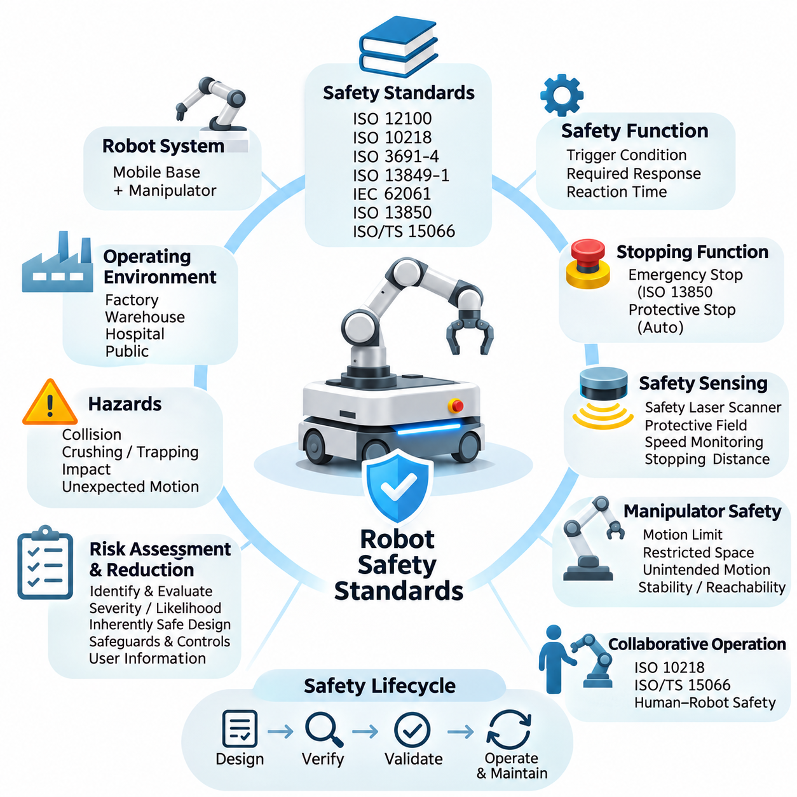
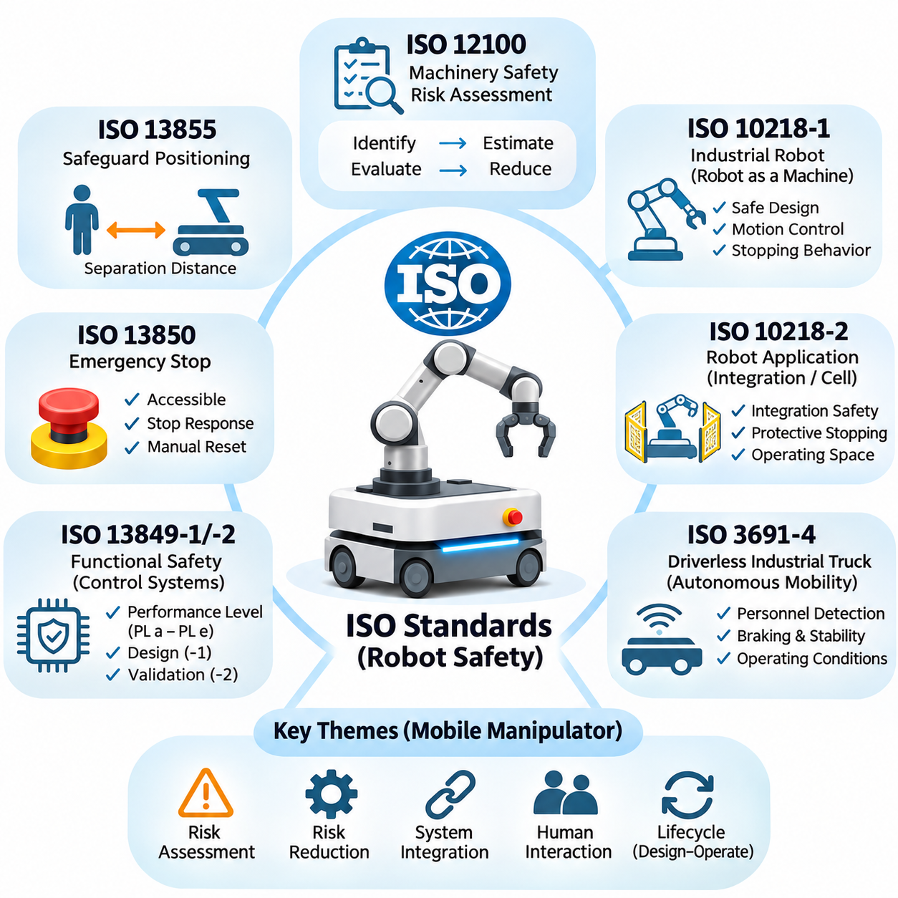
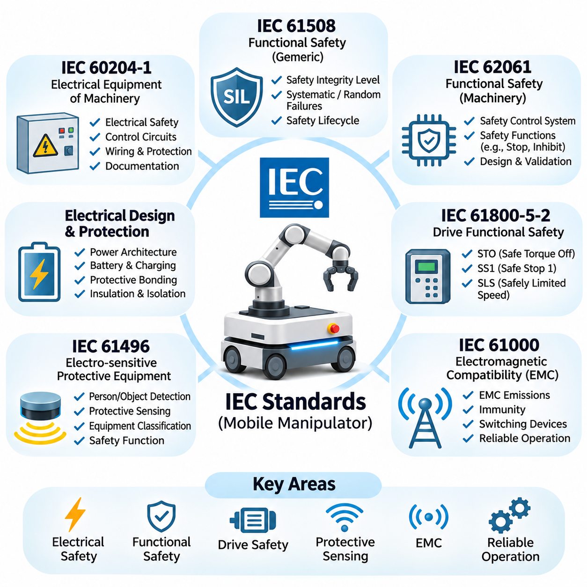
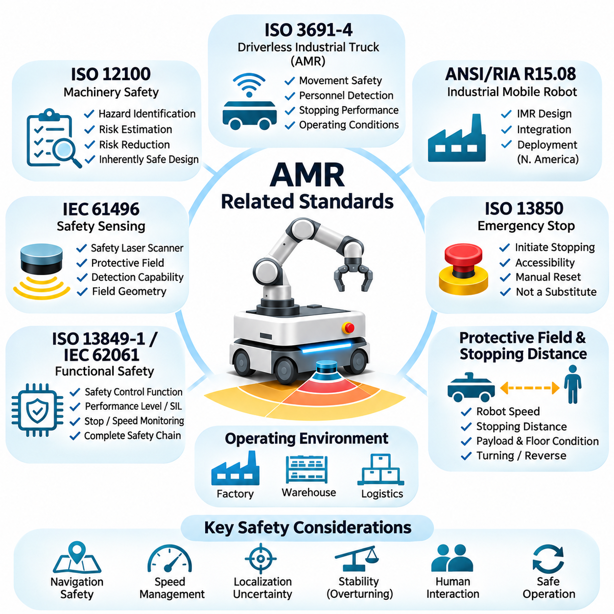
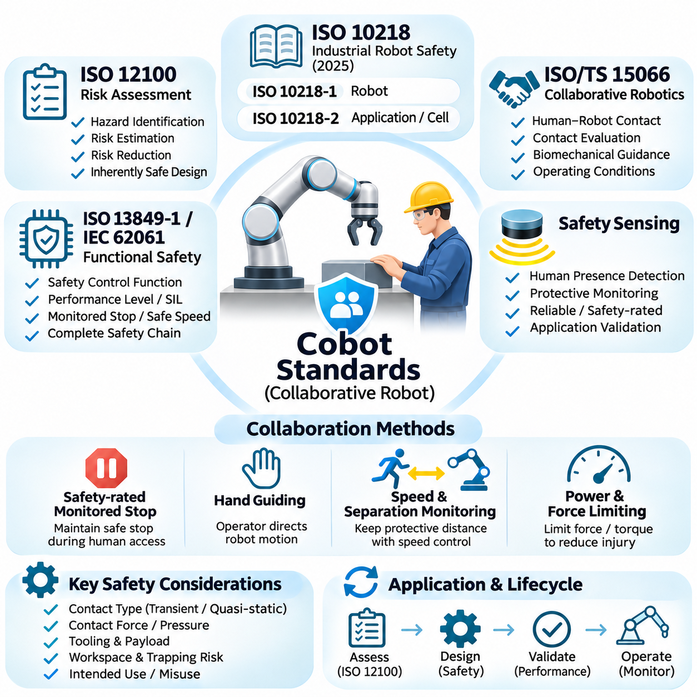
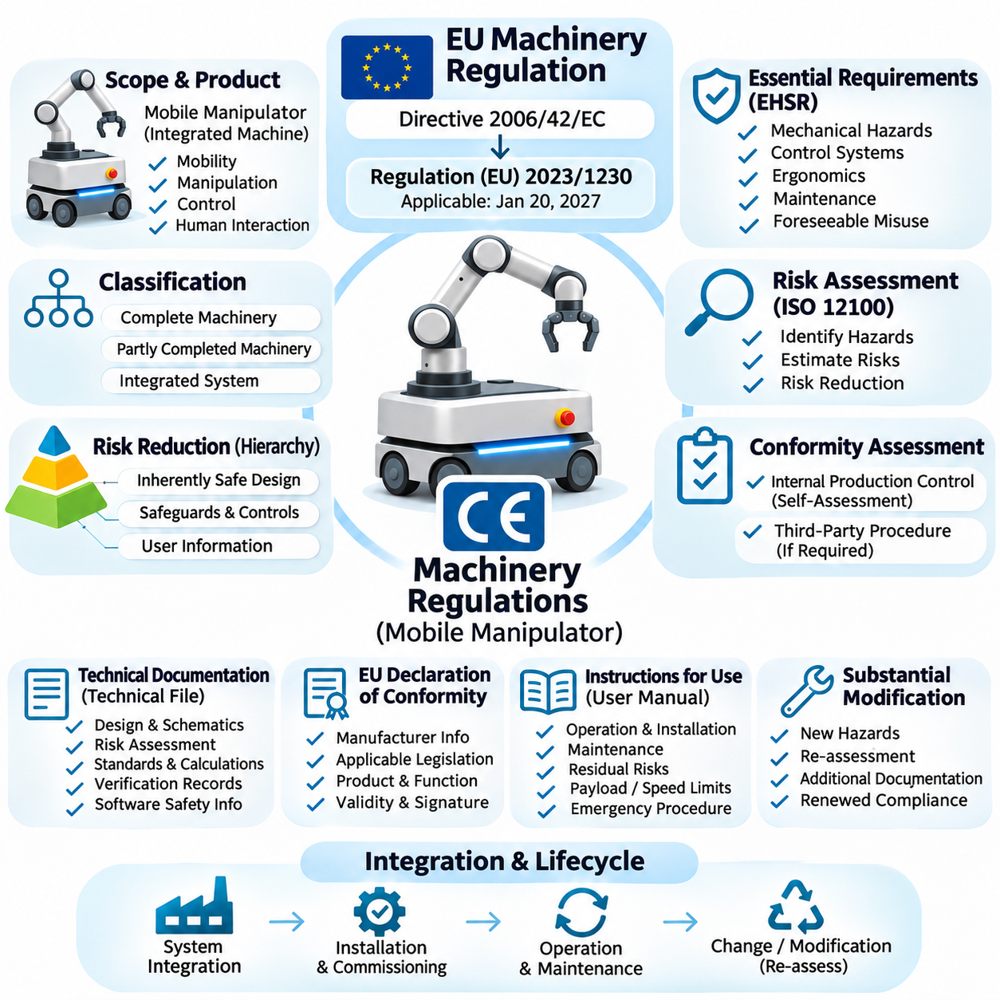
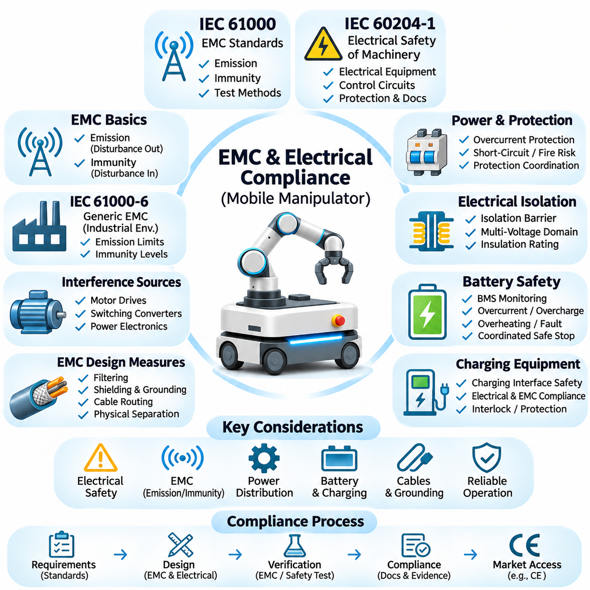
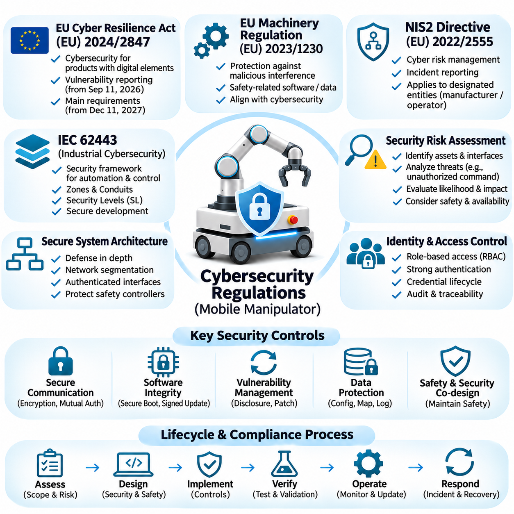
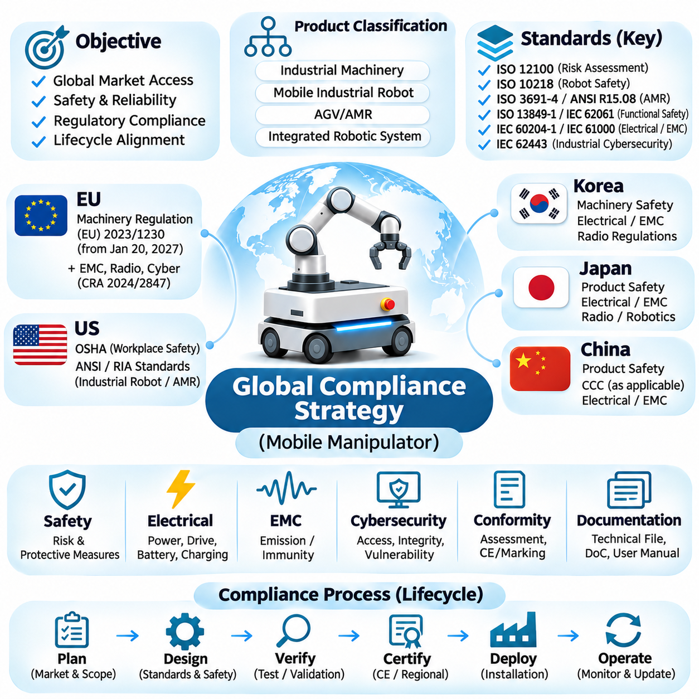

**Volume 01. Mobile Manipulator Foundations and System Architecture**

# Chapter 12. Standards and Regulations

## 01 Robot Safety Standards

{width="7.268055555555556in" height="7.268055555555556in"}

Robot safety standards establish the technical principles and engineering requirements necessary to protect people, equipment, and surrounding environments during robotic operations. For mobile manipulators, safety extends beyond conventional industrial robot protection because autonomous navigation and articulated manipulation occur within the same operating system. Compliance therefore requires coordinated consideration of mobility, mechanical motion, control reliability, and human interaction.

A mobile manipulator combines an autonomous mobile robot with a robotic arm, creating hazards that may occur independently or simultaneously. The mobile platform can collide with obstacles or pedestrians, while the manipulator may introduce crushing, trapping, impact, and unexpected movement risks. Safety engineering must address these combined hazards through systematic risk assessment, protective measures, and verification procedures covering the complete operational lifecycle.

International safety standards provide a common foundation for designing and evaluating robotic systems. ISO 12100 establishes general machinery risk assessment and risk reduction principles, while ISO 10218 addresses industrial robot and robot system safety. ISO 3691-4 covers driverless industrial trucks and their systems, including relevant autonomous mobile platforms. Their applicability depends on the robot\'s intended use, configuration, and operating environment.

Robot safety requirements begin with defining the intended application and foreseeable operating conditions. Engineers must identify whether the system operates inside factories, warehouses, hospitals, or public facilities, because each environment introduces different exposure scenarios. The analysis should consider pedestrian density, floor conditions, payload characteristics, operating speeds, maintenance activities, and reasonably foreseeable misuse before selecting protective measures.

Risk assessment provides the foundation for determining appropriate safety functions and protective architectures. Each identified hazard is evaluated according to potential injury severity and the likelihood of harm, considering exposure and possibilities for avoiding dangerous situations. Risk reduction follows a structured hierarchy that prioritizes inherently safe design, protective devices and control measures, and supplementary information for users.

Functional safety standards address the reliability of electrical, electronic, and programmable systems performing safety-related functions. ISO 13849-1 provides a framework based on Performance Levels, while IEC 62061 addresses functional safety of machinery control systems using Safety Integrity Levels. These approaches help engineers determine whether safety-related control functions provide sufficient risk reduction under expected operating and fault conditions.

A safety function must be defined through its triggering conditions, required response, and acceptable reaction time. Examples include protective stopping when a person enters a hazardous zone, preventing unintended arm motion, and inhibiting mobile movement during unsafe manipulation. The required performance depends on the associated risk assessment rather than a universal safety rating assigned to every robot subsystem.

Emergency stop systems provide a means for operators to initiate stopping when dangerous situations arise. ISO 13850 establishes principles for emergency stop functions, including accessibility, deliberate actuation, and manual reset requirements. However, emergency stopping is a complementary protective measure and cannot replace appropriate safeguarding. Resetting an emergency stop must not independently initiate hazardous movement or automatically resume an interrupted task.

Protective stopping and emergency stopping serve different operational purposes. Protective stops may be triggered automatically by safety scanners, interlocks, or monitored safety conditions, whereas emergency stops are manually initiated in response to an emergency. Both require defined stopping behavior, appropriate energy management, and controlled restart procedures. Their implementation must account for the motion and stored energy of both the mobile base and manipulator.

Mobile robot safety frequently relies on safety-rated sensing systems that monitor surrounding spaces. Safety laser scanners, protective fields, and speed-dependent monitoring zones can detect hazardous proximity and initiate protective responses. The design must consider sensor coverage, blind spots, stopping distance, braking performance, and environmental interference. Ordinary navigation sensors cannot automatically be assumed to provide certified safety functions.

Stopping distance represents an essential parameter in mobile robot safety engineering. It depends on initial velocity, braking capability, controller response time, sensor detection delay, payload, and floor friction. Protective field dimensions must provide sufficient separation to stop the robot before hazardous contact occurs. Verification should include representative worst-case conditions, particularly maximum operating loads and reduced-friction surfaces.

Manipulator safety introduces additional requirements because articulated arms can generate complex trajectories and concentrated contact forces. Industrial robot safety principles address restricted spaces, protective stopping, motion limits, and safeguards against unintended movement. When an arm is mounted on a mobile platform, the system must also consider changes in stability, reachability, and collision geometry caused by simultaneous base and arm motion.

Collaborative operation requires particular attention when humans and robots share workspaces. ISO 10218 and ISO/TS 15066 provide relevant industrial collaborative robotics guidance, including concepts such as safety-rated monitored stop, hand guiding, speed and separation monitoring, and power and force limiting. Collaborative operation does not automatically make a robot safe; each application requires risk assessment and validation of its protective measures.

Power and force limiting strategies seek to reduce injury risks associated with physical contact. Their implementation may involve joint torque sensing, compliant actuators, force monitoring, mechanical design, and motion control. Nevertheless, measured contact forces alone do not establish complete safety. Contact location, pressure, robot geometry, transient impact behavior, and the possibility of trapping must also be considered during application-specific validation.

System integration introduces safety challenges that cannot be resolved by evaluating individual components separately. A compliant mobile platform and a separately compliant robotic arm do not necessarily form a compliant integrated machine. Mounting arrangements, combined stopping behavior, communication interfaces, payload transfer, and coordinated motion can introduce new hazards. Consequently, the complete mobile manipulator requires an integrated risk assessment and safety validation.

Safety-related communication must preserve the integrity of critical commands and status information exchanged between controllers, sensors, and actuators. Communication failures, excessive latency, corrupted messages, or synchronization errors may compromise protective functions. Engineers should define fault detection, communication timeout behavior, safe-state transitions, and recovery procedures. Safety-critical communication must be supported by an appropriately validated architecture.

Electrical safety standards complement mechanical and functional safety requirements. IEC 60204-1 provides requirements for electrical equipment of machinery, including protective bonding, electrical protection, control circuits, and related provisions. Mobile manipulators additionally require attention to battery systems, charging interfaces, power distribution, insulation, and emergency power isolation. Electrical faults must not create uncontrolled movement or unacceptable thermal hazards.

Mechanical stability is especially important when a manipulator operates from a mobile base. Arm extension, payload displacement, acceleration, and braking can shift the combined center of gravity and increase overturning risks. Engineers should evaluate static and dynamic stability across representative operating configurations. Safety measures may include restricted arm workspaces, reduced acceleration, payload limits, stabilizing mechanisms, and operating restrictions on slopes.

Safety validation demonstrates whether implemented protective functions satisfy their specified requirements. Testing should include normal operation, foreseeable faults, sensor failures, communication interruptions, emergency stops, protective stops, and recovery sequences. ISO 13849-2 provides guidance for validating safety-related control system functions where applicable. Evidence should include test procedures, measured results, identified deviations, and documented corrective actions.

Safety documentation supports traceability throughout design, manufacturing, installation, and maintenance. Essential records include intended-use definitions, hazard analyses, risk reduction decisions, safety requirements, control architecture descriptions, verification results, and operating instructions. Changes to hardware, software, sensors, payloads, or operational environments may require reassessment because previously validated assumptions can become invalid after system modifications.

Regulatory compliance depends on the market in which the robot is supplied and operated. International standards provide technical frameworks, while national legislation establishes applicable legal obligations. Manufacturers must determine the relevant machinery, electrical, electromagnetic compatibility, and product safety requirements for each jurisdiction. Compliance planning should begin during system architecture development rather than being postponed until final certification or commercial deployment.

Emerging AI-driven mobile manipulators introduce additional challenges because perception, planning, and autonomous decision-making may change with software updates or operating conditions. Safety-critical behavior should remain governed by defined constraints and independently validated protective mechanisms. Continuous monitoring, controlled updates, configuration management, and regression testing are essential for maintaining safety assurance throughout the operational lifecycle.

A mature robot safety strategy integrates standards interpretation, risk assessment, functional safety engineering, mechanical protection, electrical compliance, and operational validation into a unified development process. For mobile manipulators, the central objective is not simply to satisfy individual component requirements but to demonstrate that the complete system can perform its intended tasks while reducing foreseeable risks to acceptable levels throughout deployment and maintenance.

## 02 ISO Standards

{width="7.268055555555556in" height="7.268055555555556in"}

International Organization for Standardization (ISO) standards provide a systematic framework for ensuring the safety, reliability, and interoperability of robotic systems. For mobile manipulators, these standards address machinery risk assessment, industrial robot safety, autonomous mobility, functional safety, and human interaction. Their combined application helps manufacturers establish consistent engineering requirements throughout design, integration, deployment, and maintenance.

ISO 12100 establishes fundamental principles for machinery safety through hazard identification, risk estimation, risk evaluation, and risk reduction. It requires designers to consider intended use, reasonably foreseeable misuse, and potential hazards throughout the machinery lifecycle. For mobile manipulators, this includes collisions, crushing, instability, electrical faults, and unexpected movements arising from interactions between the mobile platform and robotic arm.

The risk reduction methodology defined by ISO 12100 follows a structured hierarchy of protective measures. Inherently safe design should eliminate hazards or reduce risks wherever practical before additional safeguards are introduced. Protective devices, safety-related control functions, and information for use address remaining risks. This approach prevents manufacturers from relying exclusively on emergency stops or operator instructions to compensate for unsafe mechanical designs.

ISO 10218 addresses safety requirements for industrial robots and industrial robot applications. Its two-part structure distinguishes requirements for the robot itself from those associated with robot applications and cells. For mobile manipulators operating in industrial environments, the standard provides relevant principles for protective stopping, restricted operating spaces, motion control, safeguarding, and integration responsibilities.

ISO 10218-1 focuses on the industrial robot as a machine, including safety-related design and protective functions. Important considerations include controlled movement, stopping behavior, operating modes, and prevention of unintended motion. When an industrial manipulator is installed on an autonomous mobile platform, engineers must verify that its safety functions remain effective despite changes in mounting conditions, mobility, payload distribution, and system-level control.

ISO 10218-2 addresses the safety of industrial robot applications and robot cells, emphasizing integration and operational safeguards. A mobile manipulator may create hazards that are absent when the same arm operates on a stationary foundation. Consequently, risk assessment must consider simultaneous base and arm motion, changing workspaces, pedestrian access, and interactions with surrounding equipment throughout the complete operating sequence.

ISO 3691-4 specifies safety requirements and verification methods for driverless industrial trucks and their systems. It is particularly relevant to autonomous mobile platforms used in industrial material handling. The standard addresses operational hazards associated with driverless movement, including personnel detection, braking, stability, and operating conditions. Its applicability to a mobile manipulator depends on the classification and intended function of the integrated machine.

The relationship between ISO 3691-4 and ISO 10218 is important for mobile manipulation architectures. The mobile base may be assessed against relevant driverless industrial truck requirements, while the robotic arm and industrial application require consideration of robot safety requirements. However, compliance of individual subsystems does not automatically demonstrate the safety of the integrated machine, which requires additional system-level risk assessment and validation.

ISO 13849-1 provides a methodology for designing safety-related parts of control systems. It defines Performance Levels, ranging from PL a to PL e, to characterize the ability of safety-related control functions to perform under foreseeable conditions. Required performance is determined through risk assessment, while achieved performance depends on factors including architecture, component reliability, diagnostic coverage, and resistance to common-cause failures.

For mobile manipulators, ISO 13849-1 can support the development of safety functions such as emergency stopping, protective stopping, safe motion inhibition, and monitored access protection. Engineers must define each safety function independently and determine its required Performance Level. A safety-rated scanner or controller alone cannot guarantee the required system performance unless the complete sensing, logic, and actuation chain is appropriately designed.

ISO 13849-2 complements the design requirements by addressing validation of safety-related control systems. Validation involves analysis and testing to determine whether specified safety functions and performance requirements have been achieved. Mobile manipulator testing should examine sensor faults, actuator failures, communication interruptions, unexpected startup, and stopping behavior under representative operating conditions, including relevant combinations of platform and arm motion.

ISO 13850 establishes principles for emergency stop functions in machinery. Emergency stop devices must be readily accessible and capable of initiating the required stopping response when dangerous situations occur. For mobile manipulators, the emergency stop architecture must consider both locomotion and manipulation. Resetting an emergency stop must not automatically restart hazardous movement, and emergency stopping cannot substitute for other necessary protective measures.

ISO 13855 addresses the positioning of safeguards with respect to the approach of the human body. Its principles are relevant when determining separation distances between personnel and hazardous robotic movements. For mobile manipulators, protective field dimensions must consider approach speed, detection capability, total stopping time, and relevant uncertainty. Moving workspaces and changing robot configurations require particular attention during safeguarding design.

ISO 13857 provides safety distance principles intended to prevent hazardous zones from being reached by upper and lower limbs. These requirements are especially relevant to protective enclosures, restricted access openings, and fixed machinery interfaces. Although mobile manipulators frequently operate without permanent fencing, the standard remains useful when designing guarded workstations, docking equipment, and machinery interfaces where access to hazardous mechanisms must be controlled.

ISO/TS 15066 provides supplementary guidance for collaborative industrial robot applications. It addresses collaborative operating methods and considerations for limiting risks associated with human-robot contact. Relevant concepts include safety-rated monitored stopping, hand guiding, speed and separation monitoring, and power and force limiting. Its application requires assessment of the actual robot, tooling, workpieces, contact conditions, and operating environment.

Collaborative operation becomes more complex when an industrial manipulator is mounted on an autonomous vehicle. The mobile platform changes the relative position between people and the robot arm, potentially altering separation distances and contact conditions. Engineers must consider combined velocities, manipulator reach, base stopping performance, and human movement. Collaborative operation must therefore be evaluated as a complete application rather than as an isolated arm capability.

ISO 13482 addresses safety requirements for personal care robots, including certain mobile servant, physical assistant, and person carrier robots. Its relevance depends on the intended application and robot classification. Service-oriented mobile manipulators operating in human-centered environments may benefit from its safety principles, but the standard should not automatically be applied to industrial systems or medical robots outside its defined scope.

ISO 9283 specifies performance criteria and related test methods for industrial robots. Although primarily concerned with performance rather than safety certification, its measurement principles support repeatable evaluation of positioning accuracy, repeatability, and motion characteristics. For mobile manipulators, these measurements can contribute to understanding manipulation performance, particularly when mobile base positioning uncertainty affects the accuracy of tasks performed by the robotic arm.

ISO 10218, ISO 3691-4, and ISO 13849 should be considered complementary rather than interchangeable standards. Each addresses a different aspect of robot safety, including industrial robot requirements, driverless industrial vehicle operation, and safety-related control performance. Their appropriate combination depends on the intended machine function, operating environment, hazard assessment, and applicable regulatory framework rather than a universal certification formula.

Standards compliance also requires careful management of software and control architecture. Autonomous navigation, task planning, perception, and manipulation controllers may introduce complex dependencies between operational functions and protective functions. Safety-related behavior should remain predictable under software faults, communication delays, and degraded sensor conditions. Any safety function implemented through programmable control must satisfy the applicable functional safety requirements.

Verification activities should translate ISO requirements into measurable engineering acceptance criteria. Examples include stopping time, protective field response, emergency stop behavior, stability under maximum payload, and prevention of unexpected startup. Test conditions must represent foreseeable operating scenarios and relevant faults. Traceability between identified hazards, safety requirements, implemented functions, and verification evidence provides the foundation for a defensible safety assessment.

ISO standards are periodically revised to reflect technological developments and accumulated safety experience. Manufacturers must identify the applicable editions, amendments, and national adoptions when establishing compliance plans. In particular, changes to industrial robot safety requirements may influence integration practices and collaborative applications. Compliance documentation should record the selected editions and explain their relevance to the intended product and target markets.

A practical ISO compliance strategy begins during requirements definition and continues through system architecture, detailed engineering, prototype testing, and field deployment. The manufacturer should maintain a standards applicability matrix, risk assessment records, safety function specifications, and validation evidence. This structured process helps ensure that safety decisions remain consistent as mobile manipulators evolve from experimental prototypes into commercially deployed robotic products.

The principal value of ISO standards lies in establishing a disciplined relationship between identified hazards, engineering controls, and demonstrated safety performance. For mobile manipulators, effective implementation requires coordinated evaluation of the autonomous mobile base, robotic arm, end effector, software, and human operating environment. System-level integration and documented validation ultimately determine whether the complete robot can operate with acceptable residual risk.

## 03 IEC Standards

{width="7.268055555555556in" height="7.268055555555556in"}

The International Electrotechnical Commission (IEC) develops international standards addressing electrical safety, electronic systems, functional safety, and electromagnetic compatibility. For mobile manipulators, IEC standards establish engineering requirements for power distribution, control systems, electrical protection, and reliable operation. Their application supports the integration of autonomous mobile platforms, robotic arms, sensors, and programmable controllers into safe robotic systems.

IEC 60204-1 specifies requirements for electrical equipment of machinery, including protective measures against electric shock, control circuit design, wiring practices, and electrical documentation. Mobile manipulators contain interconnected electrical subsystems that must operate safely under normal and abnormal conditions. Compliance requires careful consideration of protective bonding, insulation, power isolation, emergency switching, and the prevention of electrical hazards.

Electrical architecture design begins with identifying power sources, operating voltages, load characteristics, and possible fault conditions. Mobile manipulators commonly use rechargeable battery packs, DC distribution networks, motor drives, and auxiliary power converters. IEC 60204-1 provides relevant machinery electrical safety principles, while additional standards may apply to batteries and charging equipment. Engineers must coordinate protection devices and conductor ratings with expected electrical loads.

Protective bonding and insulation are essential for preventing hazardous electric shock. Exposed conductive parts must be appropriately connected to protective circuits where required, while insulation systems must withstand expected electrical stresses. Battery-powered robots introduce additional considerations because their electrical configurations differ from conventional mains-powered machinery. Engineers must evaluate fault currents, accessible conductive surfaces, grounding arrangements, and isolation requirements.

IEC 61508 establishes a general framework for functional safety of electrical, electronic, and programmable electronic safety-related systems. It introduces Safety Integrity Levels, which characterize the required reliability of safety functions. Although IEC 61508 is a generic standard, its principles influence sector-specific functional safety requirements. Mobile manipulator developers can use these concepts to understand systematic failures, random hardware failures, and safety lifecycle management.

IEC 62061 addresses functional safety of safety-related control systems for machinery. It provides methods for specifying, designing, integrating, and validating safety-related control functions. For mobile manipulators, relevant functions may include protective stopping, motion inhibition, monitored speed limits, and fault-triggered transitions to safe states. Required safety integrity must be determined through risk assessment and supported by appropriate architectural and diagnostic measures.

Safety-related control systems typically include sensing elements, logic processing, and final control elements. A protective stop function may depend on a safety laser scanner, safety controller, and motor drive capable of executing the required stopping response. IEC 62061 emphasizes evaluating the complete safety function rather than individual components alone. Communication faults, diagnostic limitations, and common-cause failures must also be considered.

IEC 61800-5-2 addresses functional safety requirements for adjustable-speed electrical power drive systems. It defines drive-related safety functions such as Safe Torque Off, Safe Stop 1, and Safely Limited Speed. These functions are particularly relevant to mobile robot traction drives and manipulator joint actuators. Their implementation must account for mechanical braking, stored energy, load conditions, and the consequences of removing motor torque.

Safe Torque Off prevents the drive from generating torque-producing power but does not necessarily stop an already moving mechanism immediately. A mobile platform may continue moving because of inertia, while a vertically loaded manipulator joint may move under gravity. Consequently, safe stopping strategies must consider braking sequences and mechanical holding devices. Selecting a drive safety function requires evaluating the actual hazard and required stopping behavior.

IEC 61496 addresses electro-sensitive protective equipment used to detect people or objects entering hazardous areas. Such equipment may include safety light curtains and certain active optoelectronic protective devices. Mobile manipulators frequently employ safety-rated scanners and protective sensing systems to monitor surrounding spaces. The applicable IEC 61496 requirements depend on the sensing technology, equipment classification, and intended protective function.

Protective sensing performance must be evaluated together with robot speed, response time, and stopping capability. Detection coverage alone cannot guarantee safety if the robot cannot stop before hazardous contact occurs. Engineers must account for sensor response delays, controller processing, actuator reaction, and mechanical braking performance. Environmental factors such as reflective surfaces, contamination, and sensor obstruction may also affect protective performance.

IEC 61000 provides a broad family of standards addressing electromagnetic compatibility, including electromagnetic emissions and immunity. Mobile manipulators contain switching power converters, motor drives, wireless communication modules, and high-performance computing devices that can generate electromagnetic disturbances. EMC engineering seeks to prevent these disturbances from disrupting nearby equipment while ensuring that the robot remains sufficiently immune to external interference.

Electromagnetic interference can affect encoders, communication networks, perception sensors, and control electronics. Disturbances may originate from motor switching, charging equipment, electrostatic discharge, or nearby industrial machinery. Engineers should apply appropriate shielding, filtering, cable routing, grounding, and circuit separation practices. EMC testing must consider representative operating modes, including acceleration, manipulation, charging, and simultaneous subsystem activity.

IEC 61000-6 standards provide generic EMC requirements for environments where suitable product-specific standards are unavailable. Industrial environments often involve higher electromagnetic disturbance levels than residential or commercial locations. Selecting appropriate emission and immunity requirements depends on the intended installation environment and applicable regulations. Engineers should verify the relevant standard editions and avoid assuming that generic requirements automatically replace product-specific EMC standards.

IEC 62443 establishes cybersecurity requirements for industrial automation and control systems. Its principles are relevant when mobile manipulators connect to factory networks, fleet management systems, remote maintenance services, or cloud infrastructure. Cybersecurity weaknesses can compromise operational availability and potentially influence safety-related behavior. Secure architecture should therefore consider authentication, access control, network segmentation, vulnerability management, and controlled software updates.

Cybersecurity and functional safety address different objectives but increasingly interact in connected robotic systems. Unauthorized commands, malicious software modifications, or compromised communication channels may cause unexpected robot behavior. Safety-critical functions should remain protected against inappropriate external influence. Engineers must establish clear boundaries between operational networks, remote services, and independently validated safety mechanisms while maintaining secure monitoring and maintenance capabilities.

IEC 60529 defines degrees of protection provided by enclosures through the IP Code. Mobile manipulators operating in factories, warehouses, or outdoor environments may encounter dust, water, and accidental contact with hazardous internal parts. Appropriate enclosure protection depends on environmental exposure and equipment requirements. IP ratings should be selected for individual components and verified without assuming that enclosure protection alone establishes overall robot safety.

IEC 62133-2 specifies safety requirements for portable sealed secondary lithium cells and batteries within its scope. Battery systems used in larger industrial mobile robots may require different or additional standards depending on their classification and application. Engineers must evaluate cell protection, overcurrent conditions, thermal behavior, charging safety, and battery management functions. Battery compliance should be determined from the actual system design and intended market.

Battery management systems monitor parameters such as voltage, current, temperature, and operating state to reduce electrical and thermal risks. Fault conditions may require charging inhibition, power limitation, controlled shutdown, or electrical isolation. For mobile manipulators, battery protection must be coordinated with safety-related stopping requirements. Abrupt power removal could create secondary hazards if braking systems or vertically loaded joints depend on electrical power.

IEC standards also influence verification and documentation practices throughout product development. Electrical schematics, protection calculations, functional safety specifications, EMC test reports, and component compliance records provide evidence supporting conformity assessment. Verification should cover normal operation, foreseeable faults, environmental disturbances, and relevant maintenance conditions. Traceability between requirements, design decisions, and test results improves engineering consistency.

The interaction between IEC and ISO standards is particularly important for integrated mobile manipulators. ISO standards commonly address machinery hazards, robot safety, and risk assessment, while IEC standards provide detailed requirements for electrical equipment, functional safety, electromagnetic compatibility, and cybersecurity. Their combined application helps engineers establish coherent safety architectures across mechanical, electrical, electronic, and software domains.

Standards applicability must be evaluated according to product classification, intended use, operating environment, and target market. Not every IEC standard applies to every mobile manipulator, and compliance with individual components does not establish conformity of the complete system. Manufacturers must identify applicable editions, national adoptions, and regulatory obligations. Integration testing is essential because new hazards may emerge from interactions between otherwise compliant subsystems.

A practical IEC compliance process begins during system requirements definition and continues through architecture design, component selection, prototype verification, and production validation. Electrical safety, functional safety, EMC, and cybersecurity should be treated as coordinated engineering disciplines rather than isolated certification activities. Early identification of requirements reduces redesign risks and supports efficient commercialization.

The fundamental objective of IEC standards is to establish predictable and demonstrable safety performance in electrical and electronic systems. For mobile manipulators, effective implementation requires coordinated protection of power systems, motor drives, sensors, controllers, communication networks, and battery equipment. A disciplined combination of risk assessment, standards-based engineering, testing, and lifecycle management supports reliable operation and acceptable residual risk.

## 04 AMR Related Standards

{width="7.268055555555556in" height="7.268055555555556in"}

Autonomous Mobile Robot (AMR) standards establish technical requirements for safe navigation, autonomous movement, operational reliability, and interaction with people and equipment. Unlike fixed industrial robots, AMRs continuously change their positions within shared environments. Their safety architecture must therefore address dynamic obstacles, unpredictable pedestrian movement, localization uncertainty, and changing operating conditions throughout autonomous missions.

ISO 3691-4 provides a central safety framework for driverless industrial trucks and their systems. It addresses safety requirements and verification methods for relevant autonomous industrial vehicles operating in material-handling environments. The standard covers hazards associated with movement, personnel detection, stopping performance, and operating conditions. Its applicability depends on the vehicle classification, intended use, and integrated equipment.

AMR safety assessment begins by defining the operating environment and identifying foreseeable hazards. Factories, warehouses, logistics centers, and production facilities contain different combinations of pedestrians, vehicles, machinery, and infrastructure. Risk assessment must consider traffic intersections, restricted passages, loading stations, floor conditions, and unexpected obstacles. Safety requirements should reflect actual deployment conditions rather than idealized laboratory scenarios.

ISO 12100 provides general machinery risk assessment principles that complement AMR-specific requirements. Engineers must identify hazards, estimate associated risks, and implement suitable risk reduction measures. For mobile robots, hazards may include collisions, crushing against fixed structures, instability, falling loads, and unintended movement. Risk reduction should prioritize inherently safe design before protective devices and operational instructions.

ANSI/RIA R15.08 provides safety requirements for industrial mobile robots and their applications. Its framework addresses industrial mobile robot design, integration, and deployment considerations. The standard is particularly relevant to North American industrial installations. Manufacturers must determine the applicable parts and editions, because requirements may differ between the mobile robot itself and its integration into a complete industrial application.

AMR navigation safety requires coordination between perception systems, motion planning, and safety-related controls. Navigation algorithms may use LiDAR, cameras, inertial sensors, and localization maps to estimate surrounding conditions. However, ordinary navigation performance does not automatically establish functional safety. Protective functions must be implemented using appropriately designed and validated safety-related sensing and control architectures.

Safety laser scanners are commonly used to establish protective fields around industrial mobile robots. These fields detect personnel or obstacles entering designated hazardous regions and initiate protective responses. Their design must account for sensor detection capability, mounting position, field geometry, and environmental limitations. Relevant requirements may include applicable parts of IEC 61496, depending on the protective equipment technology.

Protective field dimensions must reflect robot velocity, stopping distance, detection response time, and operating conditions. Higher travel speeds generally require greater protective distances because additional time and space are needed to stop safely. Engineers should evaluate braking performance under maximum payload and representative floor conditions. Protective fields must also account for turning maneuvers, reverse movement, and changes in robot geometry.

ISO 13849-1 and IEC 62061 provide frameworks for developing safety-related control functions. These standards support the specification and evaluation of functions such as protective stopping, emergency stopping, speed monitoring, and prevention of unintended motion. Required safety performance must be established through risk assessment. The complete safety chain, including sensors, controllers, communication, and actuators, must satisfy the specified requirements.

Emergency stop functions are governed by principles established in ISO 13850. AMRs must provide suitable means for initiating emergency stopping when dangerous situations arise. Emergency stop devices should be accessible according to the intended operating and maintenance conditions. Resetting an emergency stop must not automatically restart hazardous movement, and emergency stopping must not replace the protective functions needed during normal autonomous operation.

Speed management is an important element of AMR operational safety. Robots may need to reduce speed near intersections, workstations, pedestrian crossings, or areas with limited visibility. Speed limits can also depend on payload, turning radius, and available stopping distance. When speed reduction is relied upon for risk reduction, the associated monitoring and control functions must meet the required safety performance.

Localization uncertainty introduces additional challenges because autonomous robots rely on estimated positions rather than fixed mechanical references. Errors in LiDAR-based localization, visual positioning, or map alignment can cause deviations from intended routes. Safety engineering should define appropriate behavior when localization confidence becomes insufficient. Such responses may include controlled stopping, restricted movement, or transition to a predefined safe operating state.

AMR stability must be evaluated under representative dynamic conditions. Acceleration, braking, cornering, slopes, and uneven floors can influence the center of gravity and increase overturning risks. Payload mass and distribution further affect stability. Engineers should establish operating limits based on mechanical design and validated performance. These limits may include maximum speed, allowable gradients, payload restrictions, and permitted turning behavior.

Load handling creates additional hazards when AMRs transport materials or interact with industrial equipment. Unsecured loads may shift or fall during acceleration and braking, while automated transfer mechanisms can introduce crushing and trapping points. Safety assessment should include loading, unloading, docking, and transfer operations. Protective measures must consider both vehicle movement and the mechanical behavior of attached handling equipment.

Mobile manipulators introduce further complexity by combining autonomous mobility with articulated manipulation. The mobile base may be assessed using relevant industrial mobile robot requirements, while the manipulator and its application require consideration of ISO 10218. Integrated risk assessment must address simultaneous movement, changing reach envelopes, payload transfer, and interactions between the arm and surrounding personnel.

Docking and workstation interaction require particular attention because robots often operate close to fixed machinery. Positioning errors, unexpected equipment movement, or communication failures may create hazardous conditions. Safe docking strategies should define approach speeds, alignment tolerances, movement permissions, and interlocking conditions. Verification must confirm that failures do not produce uncontrolled motion or unsafe equipment interaction.

Fleet operation introduces risks associated with multiple autonomous robots sharing routes and workspaces. Fleet management systems may coordinate traffic, assign missions, and resolve congestion, but operational coordination does not automatically provide safety-rated collision prevention. Each robot must retain the necessary protective capabilities. System designers should also consider communication loss, blocked routes, unexpected robot stops, and recovery procedures.

Communication reliability is important for coordinated AMR operations, particularly when robots interact with production equipment or centralized management systems. Wireless interruptions, delayed commands, and inconsistent system states may affect operational behavior. Safety-critical functions should not depend solely on unverified network availability. Engineers must define safe responses to communication failures and establish clear boundaries between mission control and safety-related control.

Interoperability standards and industry specifications support communication between robots, fleet management platforms, and industrial systems. Interfaces such as VDA 5050 can facilitate standardized exchange of orders and status information between mobile robots and fleet control systems. However, interoperability specifications do not replace machinery safety standards. Communication compatibility and functional safety must be evaluated as separate engineering requirements.

Electrical safety and electromagnetic compatibility also influence AMR compliance. IEC 60204-1 provides relevant machinery electrical safety requirements, while IEC 61000 standards address electromagnetic emissions and immunity. Battery systems, charging interfaces, motor drives, and communication equipment must operate reliably under expected conditions. Electrical faults or electromagnetic disturbances must not compromise required protective functions.

Environmental protection requirements depend on the intended deployment conditions. Industrial AMRs may encounter dust, moisture, temperature variation, vibration, and mechanical impacts. IEC 60529 provides enclosure protection classifications through IP ratings. Appropriate environmental testing should verify that protective sensors, electrical systems, and mechanical components maintain their required performance. Outdoor applications may require additional environmental and operational assessments.

AMR safety verification should reproduce realistic operating scenarios rather than relying exclusively on component certification. Testing should include pedestrian detection, emergency stopping, maximum-load braking, turning behavior, localization degradation, and communication interruption. Engineers should document acceptance criteria, measured results, and corrective actions. Validation must demonstrate that integrated protective functions achieve the risk reduction established during system design.

Regulatory requirements vary according to geographic market, product classification, and intended application. Manufacturers should determine the applicable ISO, IEC, ANSI, and national requirements before commercialization. Compliance documentation should include risk assessments, technical specifications, safety function descriptions, and verification records. Changes to hardware, software, payload, or operating environments may require reassessment of previously validated safety assumptions.

A comprehensive AMR standards strategy integrates machinery safety, functional safety, autonomous navigation, electrical compliance, and operational validation. For mobile manipulators, this strategy must extend beyond the mobile platform to include robotic arms, end effectors, and coordinated motion. The objective is to demonstrate that the complete robotic system can perform autonomous tasks while maintaining acceptable residual risk throughout deployment, operation, and maintenance.

## 05 Cobot Standards

{width="7.268055555555556in" height="7.268055555555556in"}

Collaborative robot standards establish safety principles for robotic systems designed to operate in shared workspaces with human personnel. Unlike conventional industrial robots that frequently rely on physical separation, collaborative robots may perform tasks near operators under defined protective conditions. Their safety depends on coordinated mechanical design, sensing, control reliability, and application-specific risk assessment rather than the collaborative designation alone.

ISO 10218 provides the primary international safety framework for industrial robots and industrial robot applications. The 2025 editions address robot design, integration, safeguarding, and collaborative operation. ISO 10218-1 focuses on the industrial robot, while ISO 10218-2 addresses robot applications and cells. Together, they establish requirements for integrating collaborative capabilities into industrial environments while controlling foreseeable hazards.

ISO/TS 15066:2016 provides supplementary guidance for collaborative industrial robot applications, including methods for evaluating human-robot contact and collaborative operating conditions. Its technical guidance remains valuable when interpreting contact-related risks, although applicable requirements must be checked against newer ISO 10218 editions. Engineers should distinguish between robot capabilities, application-level safeguards, and the conditions under which collaboration is permitted.

Collaborative operation is commonly associated with four methods: safety-rated monitored stop, hand guiding, speed and separation monitoring, and power and force limiting. These methods represent different approaches to managing human exposure to robotic motion. Their selection depends on the task, workspace geometry, tooling, payload, and foreseeable contact scenarios. Multiple methods may be combined when a single protective strategy cannot adequately reduce risk.

Safety-rated monitored stop allows a robot to remain in a defined stopped condition while personnel enter a collaborative workspace. The safety-related control system must monitor the required stopping condition and prevent hazardous motion during human access. Restart conditions must be carefully defined to avoid unexpected movement. This approach is particularly useful when operators intermittently enter robotic workspaces for loading, inspection, adjustment, or material handling.

Hand guiding enables an operator to direct robot movement through an appropriate guiding interface. The system must control movement according to defined operating conditions and applicable safety requirements. Designers should consider operator position, enabling devices, movement limits, and potential trapping hazards. Hand guiding does not eliminate the need for risk assessment because the robot, attached tooling, and transported objects may still generate hazardous forces.

Speed and separation monitoring maintains a protective distance between personnel and moving robotic equipment. The required separation depends on human approach speed, robot motion, sensing performance, stopping time, and relevant uncertainties. When the available distance decreases, the robot may need to reduce speed or initiate protective stopping. Safety-rated monitoring must remain effective across the operating configurations and trajectories permitted by the application.

Power and force limiting seeks to reduce injury risks when contact between humans and robots is possible. Implementations may use torque sensing, force monitoring, compliant mechanisms, rounded surfaces, and restricted movement parameters. However, limiting actuator torque alone does not establish safe contact conditions. Engineers must evaluate contact force, pressure, impact dynamics, body location, and the possibility of trapping against surrounding structures.

Contact assessment distinguishes between transient and quasi-static interactions. Transient contact occurs when a person can move away from the robot, whereas quasi-static contact may involve a body part being constrained between the robot and another surface. These conditions can produce different injury mechanisms even at similar robot speeds. Contact evaluation must consider tooling geometry, effective moving mass, and application-specific exposure conditions.

ISO/TS 15066 includes biomechanical guidance that can support evaluation of permissible contact conditions. Such values should not be treated as universal guarantees of safety or applied without considering the relevant assumptions. Contact measurements must reflect realistic operating configurations and representative worst-case conditions. Changes in end effectors, payloads, movement speeds, or workspace geometry can invalidate previously established contact assessments.

ISO 12100 provides the underlying risk assessment methodology for collaborative robotic applications. Hazard identification must cover intended tasks, reasonably foreseeable misuse, maintenance activities, and human interaction. Risk reduction should prioritize inherently safe design before implementing protective devices and operating procedures. A collaborative robot must be assessed as part of its complete application rather than evaluated solely through the specifications of its manipulator.

ISO 13849-1 and IEC 62061 support the development of safety-related control functions used in collaborative applications. These functions may include monitored stopping, safe speed supervision, movement inhibition, and protective separation monitoring. Required performance must be determined from the associated risk assessment. The complete safety function, including sensors, processing logic, communication, and actuators, must achieve the specified safety integrity.

Safety-rated sensing is essential for collaborative applications that depend on detecting human presence or maintaining separation. Protective devices may include safety laser scanners, light curtains, and other appropriately rated sensing equipment. Their selection depends on the detection task and applicable standards, including relevant IEC 61496 requirements. Ordinary machine vision or AI-based human detection cannot automatically be assumed to satisfy functional safety requirements.

Collaborative robot integration becomes more challenging when the manipulator is mounted on an autonomous mobile platform. Mobile manipulators combine changing robot positions with articulated motion, creating variable workspaces and dynamic separation conditions. The mobile base introduces additional collision and crushing hazards that stationary collaborative robots do not experience in the same way. Integrated risk assessment must therefore cover mobility and manipulation together.

The combined motion of a mobile base and robotic arm can increase effective contact velocity and alter stopping distances. A manipulator that satisfies contact-related requirements when stationary may behave differently while its supporting platform moves. Engineers must evaluate combined trajectories, payload inertia, relative human motion, and coordinated stopping behavior. Restricting simultaneous movement may be necessary when protective functions cannot adequately manage combined risks.

Mobile collaborative systems may require consideration of both ISO 10218 and relevant industrial mobile robot standards, such as ISO 3691-4 or ANSI/RIA R15.08. These standards address different aspects of the integrated system and should not be treated as interchangeable. Applicability depends on the machine classification and intended operation. Compliance of the mobile base and manipulator separately does not establish conformity of the complete mobile manipulation application.

End effectors and workpieces strongly influence collaborative safety. A robot arm equipped with a smooth gripper may present different hazards from one carrying sharp tools, heavy components, or heated materials. Contact risks can change significantly during gripping, lifting, insertion, or release operations. Safety assessment must consider the complete moving assembly, including attachments and transported objects, rather than focusing exclusively on the robot structure.

Workspace design remains important even when collaborative operation is permitted. Fixed equipment, shelves, conveyors, and walls can create trapping or crushing points during robot movement. Engineers should evaluate clearance, access routes, protective zones, and the locations where personnel perform tasks. Collaborative operation does not remove the need for physical safeguarding when foreseeable hazards cannot be adequately controlled through monitored movement or force limitation.

Emergency stopping and protective stopping must be coordinated with collaborative operating modes. ISO 13850 provides relevant emergency stop principles, while robot safety standards address protective stopping and restart behavior. Resetting a protective device or emergency stop must not independently initiate hazardous movement. Designers must ensure that transitions between automatic, collaborative, and maintenance modes do not introduce unexpected motion or bypass required safeguards.

Validation of collaborative robot safety requires application-specific testing under representative operating conditions. Engineers should measure stopping performance, verify monitored safety functions, and evaluate relevant contact scenarios. Testing must consider maximum payloads, permitted speeds, tooling configurations, and foreseeable human positions. Documentation should connect identified hazards with protective measures, acceptance criteria, measured results, and corrective actions.

Collaborative operation also introduces human factors considerations. Operators must understand permitted interactions, warning indications, emergency procedures, and the limits of robotic assistance. Training and instructions complement engineering safeguards but cannot replace them. Clear operating modes, predictable robot behavior, and understandable status information help reduce confusion during shared tasks and support safer human-robot coordination.

AI-enabled collaborative robots introduce additional uncertainty because perception and motion planning may respond dynamically to changing environments. Learning-based functions should operate within validated safety constraints when their behavior could affect human exposure. Safety-critical protective mechanisms must not depend solely on unverified AI predictions. Software updates, model changes, and modified operating conditions require controlled evaluation to preserve established safety assumptions.

A comprehensive collaborative robot compliance strategy combines ISO 10218, relevant ISO/TS 15066 guidance, machinery risk assessment, functional safety requirements, and application-level validation. For mobile manipulators, this framework must also address autonomous movement, integrated stopping behavior, and changing human-robot separation. The objective is to demonstrate that collaboration can occur under defined operating conditions while maintaining acceptable residual risk throughout the system lifecycle.

## 06 Machinery Regulations

{width="7.268055555555556in" height="7.268055555555556in"}

Machinery regulations establish legal requirements for the design, manufacture, installation, and operation of equipment that may create mechanical or electrical hazards. For mobile manipulators, regulatory compliance extends beyond individual components to the complete integrated machine. Manufacturers must evaluate autonomous movement, robotic manipulation, control systems, and foreseeable human interaction before placing equipment on the market.

The European Union has established a comprehensive machinery regulatory framework addressing product safety and market access. Directive 2006/42/EC remains applicable during the transition to Regulation (EU) 2023/1230. The new Machinery Regulation becomes applicable on January 20, 2027, replacing the previous directive. Manufacturers must plan product development and conformity assessment according to the legal requirements applicable when machinery is placed on the market.

The Machinery Regulation establishes essential health and safety requirements covering mechanical hazards, control systems, ergonomics, maintenance, and foreseeable misuse. These requirements are legally binding, while harmonized standards provide technical methods for demonstrating conformity. For mobile manipulators, compliance requires coordinated evaluation of the mobile platform, robotic arm, end effector, power system, and associated control architecture.

Machinery classification determines which regulatory obligations apply to a product. A mobile manipulator may qualify as complete machinery, partly completed machinery, or part of a larger integrated manufacturing system, depending on its supplied configuration and intended function. Classification affects documentation, conformity assessment, and responsibilities. Manufacturers must evaluate the actual product rather than relying exclusively on commercial terminology.

Risk assessment is a fundamental obligation under European machinery legislation. Manufacturers must identify hazards throughout the machine lifecycle, estimate associated risks, and implement appropriate protective measures. ISO 12100 provides a widely used methodology supporting this process. Relevant mobile manipulator hazards include collisions, crushing, falling loads, unexpected movement, electrical faults, and hazardous interactions between mobile and articulated mechanisms.

The regulatory risk reduction process emphasizes inherently safe design before additional safeguarding and user information. Engineers should first eliminate hazards through mechanical layout, restricted motion, stable structures, and suitable component selection. Remaining risks may require protective sensors, safety-related controls, or physical barriers. Warnings and operating instructions address residual risks but cannot substitute for technically feasible protective measures.

Conformity assessment establishes whether machinery satisfies applicable regulatory requirements before market placement or commissioning. Depending on the machinery category and relevant legal provisions, assessment may involve internal production control or procedures requiring third-party participation. Manufacturers must identify the applicable assessment route rather than assuming that every robotic system requires notified body certification.

CE marking indicates that a manufacturer declares conformity with applicable European Union harmonization legislation requiring that marking. For mobile manipulators, relevant obligations may extend beyond machinery legislation to electromagnetic compatibility, radio equipment, and other applicable regulatory areas. CE marking is not a universal safety certification issued by an external authority. Its validity depends on the conformity assessment and supporting evidence.

Technical documentation provides the evidence supporting machinery conformity. A technical file typically contains design descriptions, electrical schematics, risk assessments, applicable standards, calculations, and verification records. Software-related information may also be necessary when programmable functions influence safety. Documentation must demonstrate how identified hazards were addressed and how essential requirements were satisfied.

The EU Declaration of Conformity identifies the manufacturer and declares that the machinery meets applicable legislation. It references relevant legal instruments and other required information. Partly completed machinery follows different documentation and declaration procedures. Manufacturers must ensure that declarations accurately reflect the supplied product, its intended function, and the applicable regulatory framework.

Instructions for use are an essential part of machinery compliance. They must communicate intended operation, installation requirements, maintenance procedures, residual risks, and foreseeable limitations. Mobile manipulator instructions should address payload restrictions, operating surfaces, speed limits, emergency procedures, and human interaction conditions. Documentation must be appropriate for the target market and supplied in the required languages.

Substantial modifications can create new regulatory responsibilities when existing machinery is altered. Changes to robotic arms, mobile bases, safety controllers, or operating capabilities may introduce hazards not covered by the original conformity assessment. The EU Machinery Regulation expressly addresses substantial modification under defined conditions. Engineers must evaluate whether modifications require renewed assessment and additional documentation.

System integrators play a critical role when mobile manipulators are incorporated into production lines or automated facilities. Integration can introduce hazards involving conveyors, fixtures, doors, workstations, and other machinery. The responsible economic operator must determine whether the installation constitutes an assembly of machinery requiring conformity assessment. Individual component declarations do not automatically establish compliance of the integrated system.

Functional safety requirements support machinery compliance when protective measures depend on electrical or programmable control systems. ISO 13849-1 and IEC 62061 provide methods for specifying and evaluating safety-related control functions. Emergency stopping, protective stopping, speed monitoring, and movement inhibition may require defined safety performance. Regulatory compliance requires demonstrating that these functions achieve the necessary risk reduction.

Autonomous operation creates regulatory challenges because mobile robots interact with changing environments. Navigation errors, unexpected obstacles, localization failures, and communication interruptions may produce hazardous behavior. Manufacturers must define operating boundaries and protective responses for foreseeable abnormal conditions. Autonomous capabilities do not remove the obligation to demonstrate safety under the machine\'s intended operating conditions.

Collaborative applications require additional assessment when humans and robotic manipulators share workspaces. ISO 10218 provides industrial robot safety requirements, while relevant collaborative operation guidance supports application-specific evaluation. Contact forces, separation distances, tooling hazards, and stopping performance must be considered. A robot marketed as collaborative does not automatically make the complete application compliant.

Cybersecurity increasingly intersects with machinery safety because connected control systems can be affected by unauthorized access or software manipulation. Regulation (EU) 2023/1230 addresses protection against corruption where relevant to machinery safety. Manufacturers should evaluate how communication interfaces, software updates, and remote access could affect protective functions. Cybersecurity controls must support rather than undermine validated safety behavior.

Outside the European Union, machinery compliance follows different legal frameworks. In the United States, OSHA requirements, applicable electrical rules, and recognized industry standards influence industrial robot installations. ANSI and RIA standards provide important technical guidance but are not automatically equivalent to federal regulations. Manufacturers and integrators must distinguish mandatory legal obligations from voluntary consensus standards.

Other markets establish their own machinery safety, electrical compliance, and product certification requirements. National adoption of ISO and IEC standards may support technical harmonization, but legal procedures and documentation obligations can differ. Importers, distributors, manufacturers, and system integrators may carry different responsibilities. A global compliance strategy should identify market-specific obligations before finalizing product architecture.

Product changes and software updates require controlled compliance management throughout the machine lifecycle. Modified navigation algorithms, increased payloads, altered speed limits, or new manipulator tools may change previously assessed risks. Manufacturers should maintain configuration records, verification evidence, and change approval procedures. Safety-related updates must be evaluated against the original operating assumptions and applicable regulatory obligations.

Market surveillance authorities may investigate machinery that presents safety risks or lacks required conformity documentation. Noncompliance can result in corrective actions, sales restrictions, recalls, or other legal consequences. Manufacturers should maintain traceable records of design decisions, component selection, testing, and production controls. Effective post-market monitoring supports early identification of safety issues and systematic corrective action.

A practical regulatory compliance process begins with product classification and identification of target markets. Engineers then determine applicable legislation, establish essential requirements, perform risk assessment, and select supporting standards. Design verification and application-level validation provide evidence for conformity assessment. Regulatory documentation should be maintained as part of engineering development rather than assembled only before product release.

For mobile manipulators, machinery regulations ultimately require demonstrating safety at the complete system level. The mobile base, manipulator, tooling, sensors, software, and operating environment must be evaluated as interacting elements. Effective compliance combines legal interpretation, standards-based engineering, documented verification, and lifecycle change control. This integrated approach supports market access while reducing foreseeable risks during deployment and operation.

## 07 EMC and Electrical Compliance

{width="7.268055555555556in" height="7.268055555555556in"}

Electromagnetic compatibility (EMC) and electrical compliance are essential requirements for mobile manipulators operating in industrial environments. These systems combine high-power motor drives, switching converters, sensors, computers, and wireless communication equipment. Electrical compliance addresses hazards such as electric shock and overheating, while EMC ensures that electromagnetic disturbances neither disrupt the robot nor interfere excessively with nearby equipment.

EMC engineering addresses two complementary characteristics: electromagnetic emissions and electromagnetic immunity. Emissions describe disturbances generated by equipment, while immunity represents its ability to operate correctly when exposed to external disturbances. Mobile manipulators must satisfy both objectives under representative operating conditions. Compliance requires coordinated electrical design, component selection, installation practices, and verification testing.

The IEC 61000 family provides standards covering electromagnetic disturbances, measurement methods, and immunity testing. Relevant phenomena include electrostatic discharge, radiated electromagnetic fields, conducted disturbances, and electrical transients. Applicable requirements depend on the equipment category and operating environment. Engineers must identify suitable product-specific standards before relying on generic EMC requirements.

IEC 61000-6 standards establish generic emission and immunity requirements for defined electromagnetic environments. Industrial facilities may contain welding equipment, variable-frequency drives, switching power supplies, and large electrical machines. These devices can create substantial electromagnetic interference. Mobile manipulator designers must select applicable limits and test levels according to the intended installation environment and relevant regulations.

Motor drives are major potential sources of electromagnetic interference because power semiconductors switch rapidly during operation. High switching frequencies and voltage transitions can generate conducted and radiated disturbances. These disturbances may propagate through power cables, chassis structures, and nearby signal wiring. Appropriate filtering, cable shielding, grounding, and physical separation help reduce unwanted electromagnetic coupling.

Switching DC-DC converters introduce additional EMC challenges in battery-powered robots. A mobile manipulator may distribute power through several voltage rails supporting traction motors, robotic joints, sensors, and computing equipment. Converter switching noise can enter shared power networks and affect sensitive electronics. Designers should evaluate conducted noise, input filtering, output regulation, and interactions between converters.

Cable routing significantly influences electromagnetic compatibility. High-current motor cables should be separated from sensitive encoder, communication, and sensor wiring whenever practical. Shielded cables can reduce interference when their termination and installation are properly designed. Cable crossings, connector construction, and grounding arrangements must also be considered. Poor installation practices can undermine the performance of otherwise compliant components.

Grounding and bonding provide important paths for electrical fault currents and electromagnetic disturbances, but their design objectives are not identical. Protective bonding addresses electrical safety, while functional grounding and shielding support signal integrity and EMC performance. Battery-powered mobile robots may use isolated or floating electrical configurations. Engineers must distinguish protective requirements from functional grounding strategies and evaluate possible fault conditions.

Electrical safety requirements for machinery are addressed by IEC 60204-1 within its applicable scope. The standard covers electrical equipment, protective measures, control circuits, and relevant documentation. Mobile manipulators require coordinated protection across battery distribution, motor drives, control cabinets, and auxiliary circuits. Designers must identify applicable requirements while considering the differences between battery-powered machinery and conventional mains-connected equipment.

Overcurrent protection is necessary to prevent conductor overheating, equipment damage, and fire hazards. Fuses, circuit breakers, and electronic protection devices should be selected according to expected currents and fault conditions. Protection coordination must account for battery short-circuit capability, cable ratings, and downstream equipment characteristics. A fault in one subsystem should not unnecessarily disable unrelated equipment or compromise required safety functions.

Electrical isolation is particularly important where robots contain multiple voltage domains or external charging interfaces. Isolation barriers may protect users, maintenance personnel, and sensitive control electronics from hazardous electrical conditions. Their design must consider insulation ratings, transient voltages, and environmental stresses. Isolation requirements should be determined from the actual circuit architecture and applicable electrical safety standards.

Battery systems introduce electrical and thermal hazards that require dedicated protection. Lithium-based batteries may experience overcurrent, overcharging, overheating, or internal faults. Battery management systems monitor operating conditions and initiate protective responses when necessary. Relevant battery standards depend on the battery classification and intended application. Battery safety must also be coordinated with robotic stopping and power management requirements.

Charging equipment creates additional compliance considerations because mobile robots may connect to external electrical supplies. Charging interfaces must address insulation, contact protection, overcurrent conditions, and abnormal connection scenarios. Automatic docking chargers require reliable alignment and electrical contact management. Designers should also evaluate EMC disturbances generated during charging and ensure that charging faults cannot initiate hazardous robot movement.

IEC 61800-5-1 provides electrical, thermal, and energy safety requirements for adjustable-speed electrical power drive systems. These requirements are relevant to traction drives and manipulator joint drives within the standard\'s scope. Drive selection should consider insulation, temperature limits, protective measures, and operating conditions. Electrical safety compliance must be distinguished from the functional safety requirements addressed by IEC 61800-5-2.

Electromagnetic disturbances can influence sensors used for navigation and manipulation. Encoders, inertial measurement units, force sensors, and industrial cameras may exhibit errors when exposed to interference. Communication networks can experience corrupted data, delayed messages, or temporary disconnections. Engineers should evaluate sensor performance under representative electromagnetic conditions and implement suitable fault detection and recovery mechanisms.

Wireless communication introduces additional regulatory and engineering requirements. Mobile manipulators may use Wi-Fi, Bluetooth, cellular networks, or other radio technologies for coordination and monitoring. Radio equipment must satisfy applicable spectrum and equipment regulations in target markets. In the European Union, the Radio Equipment Directive may apply to relevant products. Radio compliance and EMC requirements must be evaluated together without assuming they are interchangeable.

EMC testing should reproduce operating conditions that generate representative electrical disturbances. Relevant modes may include rapid acceleration, simultaneous arm movement, maximum computing load, wireless transmission, and battery charging. Testing only during idle operation may overlook significant emission sources. Engineers should document operating configurations, cable arrangements, software states, and environmental conditions to support repeatable measurements.

Immunity testing evaluates whether equipment maintains acceptable performance when exposed to specified electromagnetic disturbances. The required behavior depends on the applicable standard and the function being evaluated. Temporary degradation may be acceptable for some noncritical functions but unacceptable for safety-related functions. Engineers must define performance criteria and verify that disturbances do not cause hazardous movement or disable essential protective mechanisms.

Functional safety and EMC are closely related because electromagnetic interference can affect safety sensors, controllers, and actuators. A safety function must remain effective under the environmental conditions assumed during its design. Engineers should assess common-cause disturbances that could affect multiple channels simultaneously. EMC verification must therefore support the overall safety argument rather than being treated solely as a product certification activity.

Pre-compliance testing helps identify electrical and EMC weaknesses before formal certification. Engineers can use spectrum analyzers, current probes, near-field probes, and appropriate test equipment to investigate disturbance sources. Early measurements support improvements in filtering, shielding, grounding, and circuit layout. Although pre-compliance testing does not replace accredited conformity assessment where required, it reduces redesign risks and development costs.

Electrical and EMC documentation should include circuit diagrams, component specifications, protective device ratings, cable installation requirements, and relevant test results. Compliance evidence must reflect the actual production configuration. Changes to motor drives, power converters, cables, computing equipment, or charging systems may affect previous assessments. Configuration management and controlled engineering changes help preserve compliance throughout product development.

Global electrical compliance requires identifying the regulatory frameworks applicable to each target market. European requirements may involve machinery legislation, EMC legislation, and radio equipment rules, while other regions apply different certification procedures. IEC standards can support technical harmonization but do not automatically establish legal compliance everywhere. Manufacturers must evaluate national requirements, product classification, and applicable standard editions.

A comprehensive EMC and electrical compliance strategy begins during system architecture development and continues through component integration, verification, and production. Electrical protection, electromagnetic compatibility, functional safety, and communication reliability should be addressed together. For mobile manipulators, the objective is to maintain safe electrical operation and predictable robotic behavior while minimizing interference with surrounding industrial equipment.

## 08 Cybersecurity Regulations

{width="7.268055555555556in" height="7.268055555555556in"}

Cybersecurity regulations establish requirements for protecting connected robotic systems against unauthorized access, malicious modification, and disruption of essential functions. Mobile manipulators combine autonomous navigation, industrial control, wireless communication, and remote management, creating multiple attack surfaces. Security failures may compromise operational continuity, sensitive information, and physical safety.

Cybersecurity differs from functional safety, although the two disciplines increasingly overlap. Functional safety addresses hazardous behavior caused by failures, while cybersecurity considers intentional attacks and unauthorized manipulation. A compromised navigation command or safety-related configuration can create physical hazards. Manufacturers must therefore evaluate security threats that could undermine established safety assumptions.

The European Union has introduced the Cyber Resilience Act, Regulation (EU) 2024/2847, establishing horizontal cybersecurity requirements for products with digital elements. Connected robots may fall within its scope when supplied as commercial products. Most substantive obligations apply from December 11, 2027, while vulnerability reporting obligations begin earlier, on September 11, 2026.

The Cyber Resilience Act requires manufacturers to address cybersecurity throughout product design, development, production, and vulnerability handling. Requirements include risk-based security controls, secure default configurations, vulnerability management, and appropriate security updates. Manufacturers must assess whether their products fall within specific regulatory categories and determine applicable conformity assessment procedures.

European machinery legislation also addresses cybersecurity where malicious interference can affect machinery safety. Regulation (EU) 2023/1230 includes requirements concerning protection against corruption of safety-related software and data. These provisions complement broader cybersecurity legislation rather than replacing it. Mobile manipulator manufacturers should coordinate cybersecurity assessments with machinery risk assessments and safety validation.

The NIS2 Directive, Directive (EU) 2022/2555, establishes cybersecurity risk-management and incident-reporting obligations for covered entities in designated sectors. Its application depends on organizational characteristics, activities, and national implementation. A robot manufacturer or operator may face obligations under NIS2 independently of product-level requirements. Product compliance and organizational cybersecurity governance must therefore be distinguished.

IEC 62443 provides a widely recognized framework for industrial automation and control system cybersecurity. Its standards address system security, component requirements, secure development processes, and organizational responsibilities. Mobile manipulators integrated into industrial facilities can benefit from this framework. Security architecture should consider the robot, fleet management infrastructure, industrial networks, and remote service interfaces.

IEC 62443 introduces concepts such as security zones, conduits, and security levels to structure protection against defined threats. Zones group assets with comparable security requirements, while conduits control communication between zones. A mobile robot deployment may separate motion controllers, safety controllers, onboard computers, and fleet servers. Security levels should be derived from risk assessment rather than assigned solely by equipment type.

Cybersecurity risk assessment begins by identifying assets, interfaces, potential threats, and operational consequences. Critical assets include navigation maps, robot configurations, control commands, software images, credentials, and operational logs. Attack scenarios may involve unauthorized motion commands, altered mission parameters, malicious firmware, or disrupted communication. Assessment should consider both likelihood and consequences for safety and availability.

Secure system architecture applies defense in depth across hardware, software, networks, and operational procedures. Network segmentation, authenticated interfaces, least-privilege access, and restricted services reduce exposure to attacks. Safety-critical controllers should not rely on unrestricted access from general-purpose computing environments. Security boundaries must remain effective during maintenance, diagnostics, remote support, and emergency recovery.

Identity and access management ensures that only authorized users and systems can perform permitted actions. Role-based access control can distinguish operators, maintenance technicians, administrators, and remote service personnel. Strong authentication and credential lifecycle management reduce unauthorized access risks. Privileged operations such as changing safety parameters or deploying firmware should require controlled authorization and traceable records.

Secure communication protects data exchanged between robots, fleet management systems, cloud services, and external equipment. Encryption and mutual authentication can reduce interception and impersonation risks. Protocol selection must consider latency, reliability, computational resources, and industrial interoperability. Security mechanisms should not introduce unacceptable delays into time-sensitive control or interfere with independently validated safety functions.

Software integrity is essential because mobile manipulators depend on complex operating systems, middleware, navigation algorithms, and device firmware. Secure boot, signed updates, and integrity verification can prevent unauthorized software execution. Manufacturers should establish trusted software delivery processes and protect signing credentials. Recovery mechanisms must support restoration after failed updates without creating unsafe operating conditions.

Vulnerability management requires continuous identification, assessment, remediation, and communication of security weaknesses. Manufacturers should monitor relevant components, maintain vulnerability disclosure channels, and provide updates according to applicable obligations. Software bills of materials can improve visibility into third-party dependencies. Vulnerability handling processes should cover both onboard software and supporting fleet or remote management services.

Open-source software is widely used in robotics, including ROS 2, Linux, communication libraries, and perception frameworks. Open-source adoption does not eliminate manufacturer responsibility for cybersecurity. Dependencies may contain vulnerabilities or become unsupported during a robot\'s service life. Manufacturers should maintain component inventories, monitor security advisories, evaluate patches, and establish controlled software maintenance procedures.

Remote fleet management introduces risks because centralized systems may issue commands to numerous mobile manipulators. Compromised fleet credentials or servers could affect multiple robots simultaneously. Security controls should limit command authority, isolate tenants where applicable, and maintain audit trails. Robots should retain appropriate local protective behavior when fleet communication is unavailable or potentially compromised.

Wireless connectivity expands the attack surface of mobile robotic systems. Wi-Fi, cellular, Bluetooth, and other radio interfaces require secure configuration and appropriate authentication. Network disruptions, spoofing attempts, and unauthorized access points may affect robot operations. Designers should distinguish ordinary communication failures from malicious interference and ensure that either condition leads to controlled operational responses.

Data protection regulations may apply when robots collect personal information through cameras, microphones, access logs, or other sensors. The EU General Data Protection Regulation establishes obligations concerning lawful processing, data minimization, security, and individual rights. Applicability depends on the nature and context of the data processing. Manufacturers and operators must clarify their respective responsibilities for personal data.

Cybersecurity testing should include threat modeling, vulnerability scanning, configuration review, and penetration testing where appropriate. Testing must reflect realistic deployment architectures and exposed interfaces. Industrial robotic systems require particular care because intrusive tests can disrupt physical equipment. Test plans should establish safe conditions, authorization boundaries, recovery procedures, and acceptance criteria before execution.

Incident response planning addresses security events that could affect robot availability, information integrity, or physical safety. Organizations should establish procedures for detection, containment, investigation, recovery, and required notifications. Operational teams must understand when robots should enter a controlled stop or restricted operating mode. Incident records and lessons learned should inform future software updates and security architecture improvements.

Cybersecurity compliance requires evidence demonstrating that relevant requirements have been implemented and maintained. Documentation may include threat models, security requirements, architecture descriptions, software inventories, test reports, and vulnerability handling procedures. Manufacturers should maintain traceability between identified threats and implemented controls. Evidence must reflect the actual deployed configuration and supported software versions.

International cybersecurity obligations differ across jurisdictions and application sectors. Some markets emphasize product cybersecurity, while others regulate critical infrastructure operators, data protection, or industrial networks. IEC 62443 and related standards can support technical alignment but do not automatically satisfy every legal requirement. Global manufacturers should establish jurisdiction-specific compliance matrices and monitor regulatory developments.

A comprehensive cybersecurity strategy integrates secure development, regulatory analysis, operational monitoring, and lifecycle support. For mobile manipulators, cybersecurity must protect both digital assets and the physical processes controlled by robotic systems. Effective governance connects manufacturers, integrators, operators, and service providers through clearly assigned responsibilities. The objective is resilient robotic operation despite evolving threats and changing deployment conditions.

## 09 Global Compliance Strategy

{width="7.268055555555556in" height="7.268055555555556in"}

Global compliance strategy for mobile manipulators establishes a coordinated approach to meeting safety, electrical, electromagnetic, cybersecurity, and market-access requirements across jurisdictions. These robots combine autonomous mobility with industrial manipulation, creating regulatory obligations that extend beyond individual components. Effective compliance planning must begin during product architecture development rather than after engineering completion.

International regulatory frameworks differ in legal authority, product classification, conformity assessment, and documentation requirements. ISO and IEC standards support technical harmonization, but adopting an international standard does not automatically satisfy national legislation. Manufacturers must distinguish mandatory regulations from voluntary technical standards. This distinction determines which requirements establish legal obligations and which provide evidence of conformity.

Product classification is the foundation of a global compliance strategy. A mobile manipulator may be classified as industrial machinery, a mobile industrial robot, an automated guided vehicle, or an integrated robotic system, depending on its functions and operating environment. Classification affects applicable standards, certification procedures, and responsible parties. Engineers should document classification assumptions before selecting the compliance pathway.

The European Union applies machinery legislation together with other relevant product regulations. Regulation (EU) 2023/1230 becomes applicable on January 20, 2027, replacing Directive 2006/42/EC. Depending on product configuration, EMC, radio equipment, and cybersecurity legislation may also apply. Manufacturers must identify all applicable instruments and determine the appropriate conformity assessment route before placing products on the market.

In the United States, industrial robot compliance involves occupational safety requirements, electrical installation rules, and recognized consensus standards. OSHA regulations establish certain employer obligations, while ANSI and RIA standards provide technical guidance for robotic applications. Product certification and installation acceptance may involve additional authorities or contractual requirements. Compliance responsibilities must be allocated between manufacturers, integrators, and facility operators.

Asian markets establish distinct certification and regulatory systems. South Korea applies relevant machinery safety, electrical, electromagnetic compatibility, and radio equipment requirements according to product classification. Japan and China maintain their own product safety and market-access frameworks. Manufacturers should not assume that certification obtained in one country is automatically recognized elsewhere, even when technical requirements reference similar international standards.

A regulatory applicability matrix provides a practical mechanism for managing international requirements. The matrix links target markets, product classifications, applicable legislation, standards, conformity assessment procedures, and required evidence. Each requirement should have an assigned owner and verification status. This approach helps engineering teams identify regulatory gaps early and prevents inconsistent interpretations across product variants.

Standards selection should reflect the complete robotic application rather than individual equipment categories alone. ISO 10218 addresses industrial robot safety, while ISO 3691-4 and ANSI/RIA R15.08 may be relevant to mobile industrial robot applications. ISO 12100 supports risk assessment, and ISO 13849-1 or IEC 62061 supports safety-related controls. Applicability must be evaluated against the actual machine configuration and intended use.

A unified risk assessment process can reduce duplication across jurisdictions while preserving local requirements. Engineers should identify hazards associated with navigation, manipulation, charging, maintenance, and human interaction. Risk reduction measures must be documented and validated under representative operating conditions. Regional compliance differences should be recorded as additional requirements rather than silently incorporated into a single undocumented design assumption.

Functional safety architecture should be established early because later modifications can require substantial redesign. Emergency stopping, protective stopping, speed supervision, and movement inhibition must achieve the required safety performance. Mobile manipulators also require coordinated responses between the mobile base and robotic arm. Compliance evidence should demonstrate that combined movements and foreseeable faults do not defeat protective functions.

Electrical and EMC compliance requires coordinated evaluation of power distribution, motor drives, battery systems, charging equipment, and communication interfaces. IEC 60204-1, IEC 61000 standards, and applicable drive or battery standards may support engineering verification. Regional differences can affect testing, marking, and documentation. Early pre-compliance testing helps identify weaknesses before formal assessment and reduces costly redesign.

Cybersecurity regulations increasingly influence robotic product development and lifecycle management. The EU Cyber Resilience Act introduces obligations for products with digital elements, while industrial cybersecurity standards such as IEC 62443 provide supporting engineering methods. Security requirements should address access control, software integrity, vulnerability handling, and remote connectivity. Manufacturers must distinguish product obligations from requirements imposed on operators.

Technical documentation should be organized around traceable engineering evidence rather than separate, inconsistent files for each market. Core records include system specifications, risk assessments, safety calculations, electrical drawings, software configurations, and validation reports. Regional documentation packages can reference this common evidence base. Version control is essential because product changes may invalidate previously completed conformity assessments.

Conformity assessment planning should identify whether manufacturer self-assessment, third-party testing, or designated certification procedures are required. Requirements depend on product classification and applicable jurisdiction. Testing laboratories may support EMC, electrical safety, radio, or functional safety verification. Manufacturers should confirm the scope of each assessment and avoid treating a component certificate as proof of complete system compliance.

Supplier management is an important part of global compliance. Mobile manipulators incorporate batteries, motor drives, sensors, controllers, wireless modules, and robotic arms obtained from different manufacturers. Supplier declarations and test reports can support integration, but they do not remove system-level responsibility. Procurement specifications should define required certifications, documentation, component traceability, and change notification obligations.

Product variants require careful configuration management because regional adaptations can alter compliance assumptions. Changes to wireless modules, battery packs, power supplies, safety sensors, or operating speeds may trigger additional verification. A common hardware and software baseline can simplify certification when supported by documented variant controls. Engineering change procedures should identify regulatory consequences before modifications are released.

Installation and commissioning create obligations beyond product manufacturing. Site-specific conditions such as floor geometry, pedestrian traffic, environmental interference, and interaction with surrounding machinery can introduce new hazards. System integrators must validate protective measures within the actual deployment environment. Factory acceptance testing and site acceptance testing should provide complementary evidence without being confused with statutory conformity assessment.

Operational compliance continues after deployment through inspection, maintenance, software updates, and incident management. Manufacturers and operators should define responsibilities for maintaining safety configurations and applying security patches. Changes to navigation algorithms, manipulator tools, or fleet management behavior require impact assessment. Records of maintenance, validation, and corrective actions support continued compliance throughout the equipment lifecycle.

Global compliance governance benefits from clearly assigned responsibilities across engineering, quality assurance, regulatory affairs, suppliers, and system integrators. Decision records should identify applicable requirements, evidence owners, unresolved risks, and approval authorities. Periodic reviews are necessary because legislation and standards evolve. A controlled compliance register can connect regulatory changes to engineering actions and product release decisions.

Market surveillance and post-market obligations must be incorporated into the compliance strategy. Authorities may request technical documentation, investigate unsafe equipment, or require corrective measures. Manufacturers should maintain procedures for handling complaints, reported incidents, and discovered vulnerabilities. Traceability between deployed units, hardware revisions, and software versions enables targeted corrective actions without unnecessarily affecting unaffected products.

A phased compliance roadmap can align regulatory activities with engineering milestones. Early development establishes product classification and regulatory scope, followed by architecture reviews and preliminary risk assessments. Integration stages focus on verification, pre-compliance testing, and documentation. Final release requires completion of applicable conformity procedures, while post-market processes maintain the compliance baseline.

The objective of global compliance strategy is not merely to obtain certificates but to establish repeatable, evidence-based engineering governance. A well-designed mobile manipulator platform can reuse validated safety functions, electrical architectures, cybersecurity controls, and documentation across multiple markets. Regional differences remain explicit and traceable. This approach supports scalable international deployment while maintaining consistent safety and regulatory accountability.
