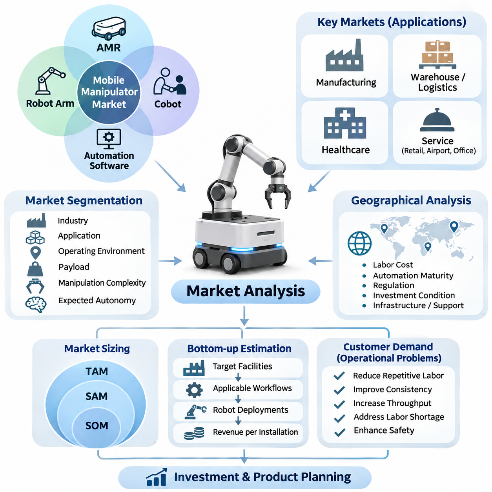
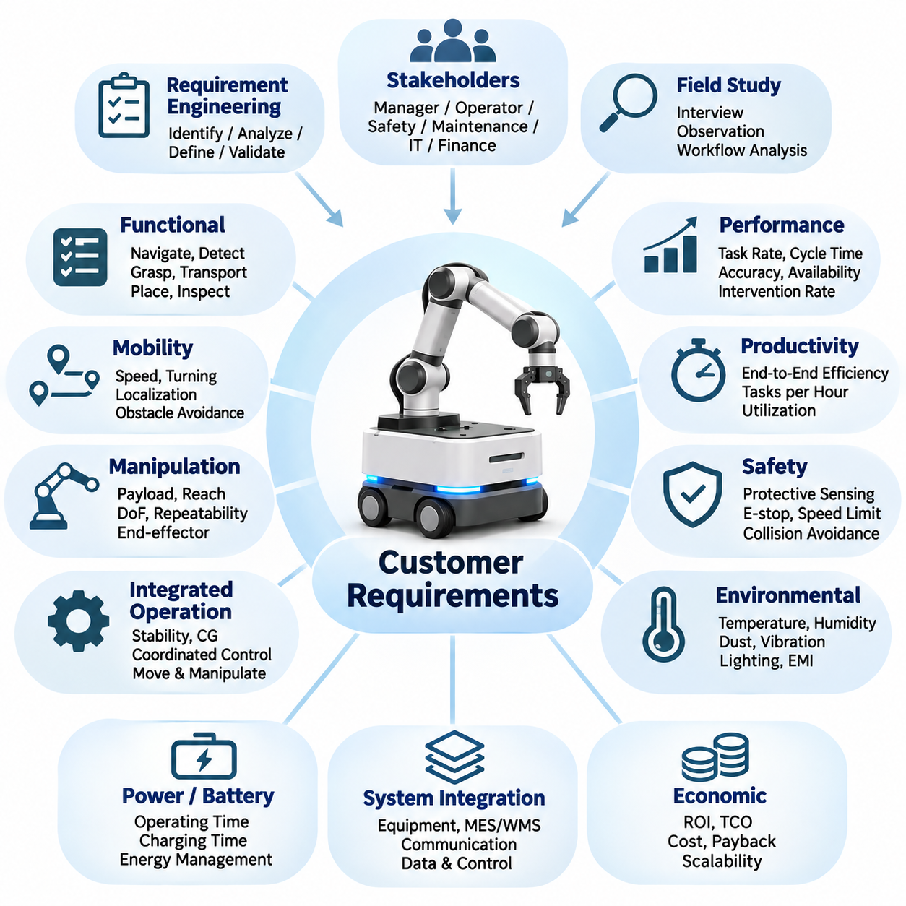
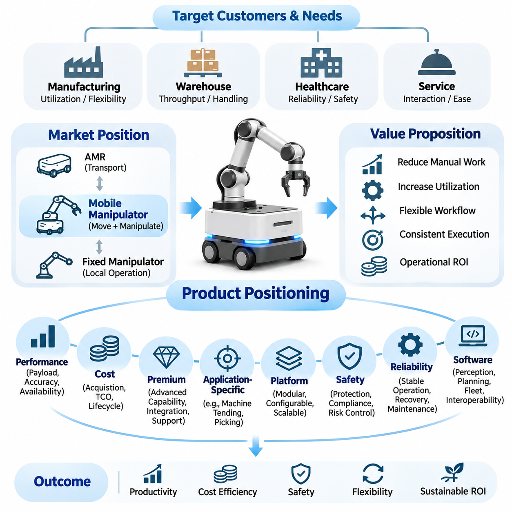
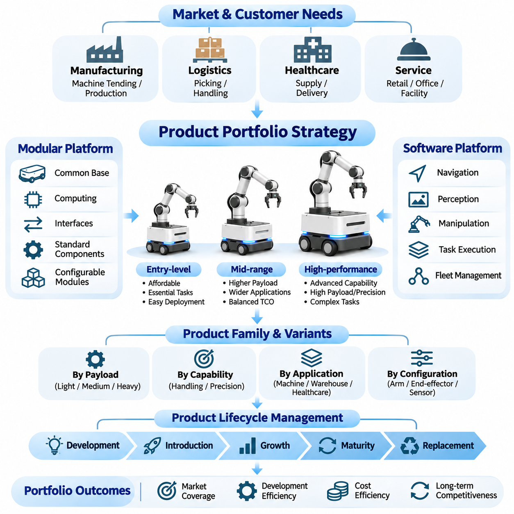
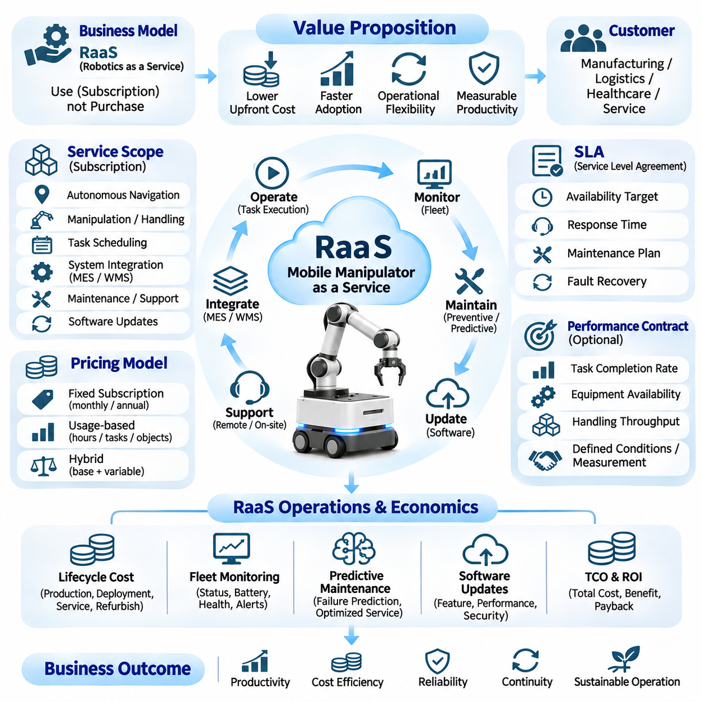
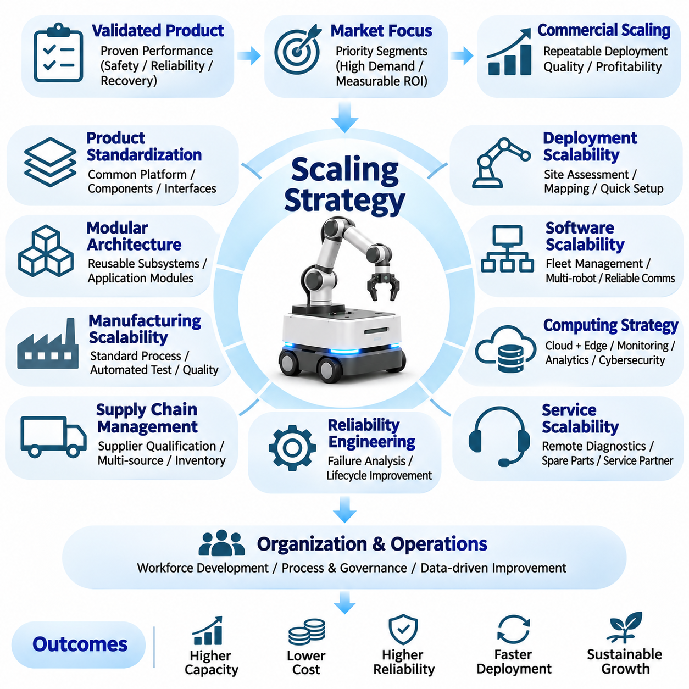
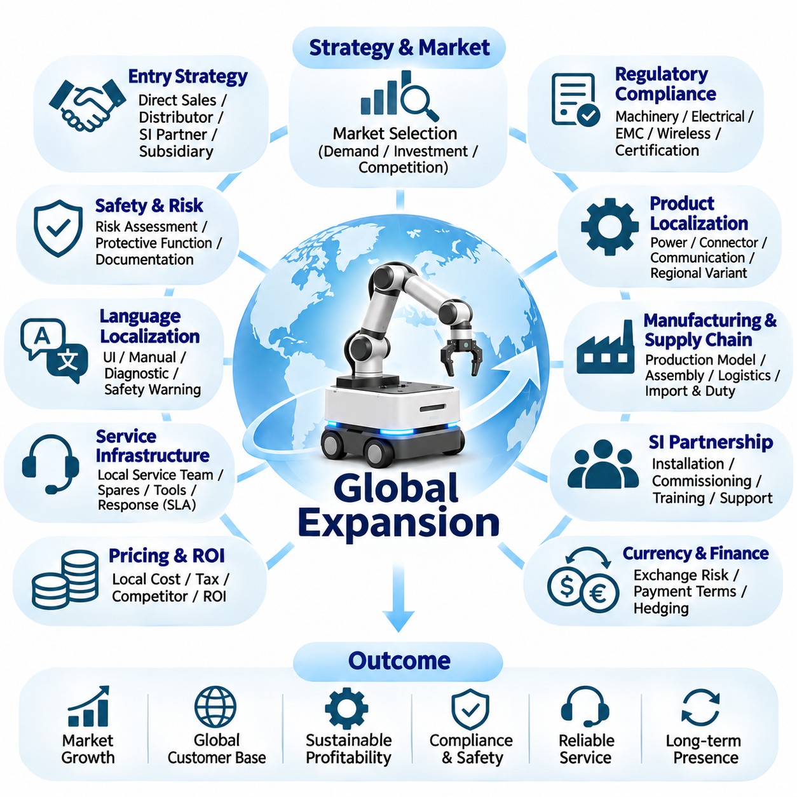
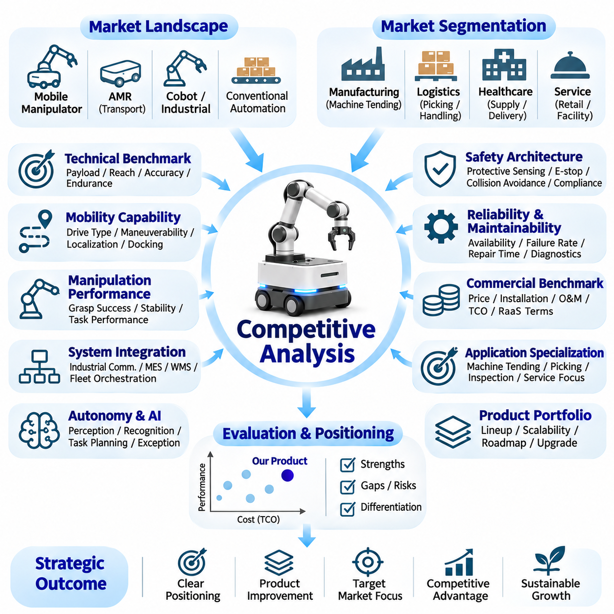
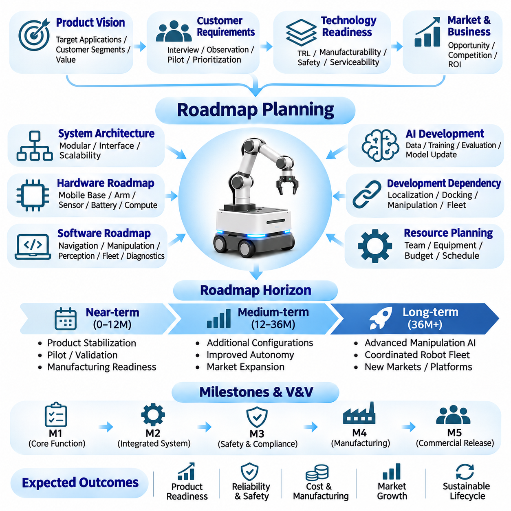

**Volume 01. Mobile Manipulator Foundations and System Architecture**

# Chapter 13. Product Strategy

## 01 Market Analysis

{width="7.268055555555556in" height="7.268055555555556in"}

Market analysis for mobile manipulators begins with understanding how autonomous mobility and robotic manipulation create new opportunities across industrial and service environments. Unlike conventional industrial robots operating at fixed workstations, mobile manipulators can travel between locations, interact with physical objects, and execute multiple tasks. Their commercial potential depends on measurable productivity improvements, operational flexibility, and the economic value of automation.

The mobile manipulator market exists at the intersection of autonomous mobile robots, industrial robotic arms, collaborative robots, and intelligent automation software. Each segment contributes technologies, suppliers, and established customer expectations. However, combining these capabilities introduces additional complexity in navigation, manipulation, safety, and system integration. Market analysis must therefore evaluate the complete solution rather than treating the robot as a collection of independent components.

Industrial manufacturing represents an important potential market because production facilities increasingly require flexible automation across multiple workstations. Mobile manipulators can support machine tending, component transportation, inspection, and material handling without requiring permanent robot installations at every location. Their economic attractiveness increases when one robot can perform several tasks while maintaining acceptable cycle times, positioning accuracy, and operational reliability.

Warehouse and logistics operations provide another promising application environment. Traditional autonomous mobile robots primarily transport goods, while mobile manipulators can additionally retrieve, place, sort, and transfer individual objects. This combination may reduce manual handling between transportation and processing stages. Market demand depends on order variability, inventory characteristics, picking complexity, throughput requirements, and the availability of alternative automation solutions.

Healthcare facilities present opportunities for mobile manipulators capable of transporting medical supplies and interacting with storage equipment. Potential applications include pharmacy logistics, laboratory sample handling, linen distribution, and automated inventory replenishment. However, hospitals impose demanding requirements for hygiene, reliability, human interaction, and operational continuity. Commercial feasibility depends on integrating robotic workflows with existing hospital infrastructure and administrative procedures.

Service robotics introduces additional market segments, including hospitality, retail, airports, offices, and public facilities. Mobile manipulators may support inventory handling, object delivery, equipment assistance, and repetitive service activities. These environments are often less structured than industrial facilities and require sophisticated perception and interaction capabilities. Market adoption depends on customer acceptance, operational safety, task reliability, and the practical benefits compared with conventional service methods.

Market segmentation should consider industry, application, operating environment, payload requirements, manipulation complexity, and expected autonomy. A manufacturing customer requiring precise machine loading has fundamentally different needs from a hospital seeking automated supply distribution. These differences influence hardware architecture, software functionality, safety design, and pricing. Effective segmentation identifies groups of customers sharing sufficiently similar requirements to support scalable product development.

Geographical market analysis must account for differences in labor costs, industrial automation maturity, regulatory frameworks, and investment conditions. Regions with established manufacturing ecosystems may prioritize productivity and equipment integration, while logistics-intensive economies may emphasize flexible material handling. Local infrastructure, technical support availability, and customer procurement practices also influence adoption. Regional opportunities should be assessed using comparable operational and economic criteria.

Market sizing provides a quantitative foundation for investment and product planning. Total Addressable Market represents the broad revenue opportunity under defined assumptions, while Serviceable Available Market narrows that opportunity to applications the product can realistically address. Serviceable Obtainable Market estimates the portion potentially captured within a specific planning period. These calculations require transparent assumptions regarding customer populations, deployment quantities, pricing, replacement cycles, and adoption rates.

A bottom-up market estimation approach is particularly useful for emerging robotic products because broad automation statistics may not accurately represent mobile manipulation opportunities. Analysts can estimate the number of suitable facilities, identify applicable workflows, calculate potential robot deployments, and determine expected revenue per installation. Sensitivity analysis should examine how changes in adoption rates, robot utilization, system pricing, and deployment constraints affect the estimated market opportunity.

Customer demand should be evaluated through operational problems rather than technological enthusiasm alone. Organizations generally invest in robotics to reduce repetitive labor, improve process consistency, increase throughput, address workforce shortages, or enhance workplace safety. A mobile manipulator must demonstrate a credible connection between its capabilities and these objectives. Customer interviews, facility observations, workflow measurements, and pilot projects provide evidence of whether proposed applications solve meaningful operational problems.

The competitive landscape includes manufacturers of autonomous mobile robots, industrial manipulators, collaborative robots, integrated robotic systems, and specialized automation equipment. Competition also comes from fixed automation, conveyors, manually operated vehicles, and conventional labor-intensive processes. Market analysis must compare these alternatives according to complete workflow performance. A technically advanced mobile manipulator may still be commercially unattractive if simpler equipment provides equivalent productivity at lower cost.

Technology readiness significantly influences the timing of market adoption. Navigation, localization, object recognition, grasp planning, and coordinated motion control must operate reliably under realistic conditions. Demonstrations in controlled environments do not necessarily establish commercial readiness. Market assessments should distinguish experimental capabilities from validated production performance, considering failure recovery, maintenance requirements, environmental variability, and the degree of human supervision needed during routine operations.

Economic evaluation should extend beyond the initial purchase price. Total Cost of Ownership includes integration, infrastructure modifications, software licensing, maintenance, energy consumption, operator training, and technical support. Return on Investment depends on measurable benefits such as labor-hour savings, increased equipment utilization, reduced handling errors, and improved operational availability. Financial models should also account for deployment delays, utilization uncertainty, and the cost of manual intervention.

Different commercial models may influence customer adoption. Direct equipment sales provide asset ownership but often require substantial initial capital expenditure. Leasing and Robotics as a Service can distribute costs over time and potentially reduce financial barriers. Subscription arrangements may include maintenance, software updates, fleet monitoring, and operational support. Market analysis should evaluate customer preferences for capital expenditure versus operating expenditure alongside the provider\'s financing and service obligations.

Adoption barriers frequently arise from integration complexity rather than robot capability alone. Manufacturing facilities may require connections to production execution systems, programmable logic controllers, and industrial equipment. Warehouses may depend on warehouse management systems, while hospitals operate specialized information platforms. Successful deployment requires compatible interfaces, reliable communication, cybersecurity controls, and clear operational responsibilities. These requirements can substantially influence project costs and implementation schedules.

Safety and regulatory requirements also shape market accessibility. Mobile manipulators combine moving platforms with articulated mechanisms, creating hazards that differ from those associated with stationary industrial robots or transportation-only mobile robots. Customers must consider collision risks, emergency stopping, human proximity, and environmental constraints. Applicable standards and conformity assessment obligations vary by deployment context and jurisdiction. Compliance readiness can become a competitive advantage when supported by documented verification procedures.

Market growth is influenced by broader developments in artificial intelligence, edge computing, sensor technology, battery systems, and robotic software. Improvements in perception and task planning may expand the range of objects and environments that mobile manipulators can handle. Nevertheless, increased computational capability does not automatically produce commercially reliable autonomy. Product planners must distinguish technological potential from capabilities that have been validated under representative operational conditions.

Workforce conditions represent another important demand factor. Labor shortages, employee turnover, repetitive work, and ergonomic risks can encourage organizations to investigate robotic automation. However, automation does not eliminate the need for human participation. Operators may remain responsible for exception handling, supervision, maintenance, and process improvement. Market analysis should evaluate how robotic deployment changes workforce responsibilities and whether customers possess the organizational capabilities required to manage these transitions.

Early market opportunities are often concentrated in workflows with predictable objects, controlled environments, and measurable performance targets. These characteristics reduce technical uncertainty and simplify economic validation. Applications involving highly variable objects, unstructured environments, or complex human interaction may require additional development before widespread deployment. Prioritizing technically feasible and economically valuable applications allows manufacturers to accumulate operational evidence while progressively expanding product capabilities.

Pilot deployment analysis provides an essential bridge between market assumptions and commercial decisions. A pilot should establish baseline performance, define measurable acceptance criteria, and evaluate the robot under representative operating conditions. Important observations include successful task completion, intervention frequency, cycle time, system availability, and integration effort. Results should be compared with the original business case to determine whether broader deployment is justified or additional engineering work is necessary.

Market analysis must also consider the scalability of the supplier\'s business model. A product requiring extensive customization for every installation may generate early project revenue but struggle to achieve sustainable growth. Standardized hardware platforms, configurable software modules, reusable integration interfaces, and repeatable deployment procedures can improve scalability. The proportion of engineering effort that can be reused across customers is therefore an important indicator of long-term commercial viability.

Distribution channels and partnerships influence market penetration. System integrators, industrial equipment suppliers, software providers, and regional service organizations may help manufacturers reach customers and deliver complete solutions. Partnerships can reduce deployment barriers by combining specialized technical capabilities and established customer relationships. However, channel strategies must clarify responsibility for integration, warranties, maintenance, cybersecurity, and operational performance to prevent fragmented customer support.

Competitive differentiation should be based on attributes that customers can verify and value. Potential differentiators include manipulation accuracy, navigation reliability, payload capacity, task flexibility, deployment simplicity, safety performance, and software interoperability. Superior specifications alone may not justify premium pricing. Sustainable differentiation emerges when technical advantages produce measurable operational benefits and are supported by reliable service, documented performance, and continuous product improvement.

Long-term market forecasting requires multiple scenarios because emerging robotics markets contain substantial uncertainty. Conservative scenarios may assume slow customer adoption, extensive integration requirements, and limited autonomous task coverage. More optimistic scenarios may reflect improved hardware affordability, standardized interfaces, and advances in robotic intelligence. Scenario planning helps manufacturers align research investment, production capacity, staffing, and financial commitments with plausible commercial outcomes rather than a single growth projection.

A comprehensive market analysis ultimately connects customer needs, technological feasibility, competitive alternatives, and financial performance. Its purpose is not merely to estimate how many robots might be sold, but to determine where mobile manipulation creates defensible economic value. By continuously validating market assumptions against customer evidence and operational results, manufacturers can establish realistic product priorities, reduce commercialization risks, and build a foundation for sustainable expansion across industrial and service markets.

## 02 Customer Requirements

{width="7.268055555555556in" height="7.268055555555556in"}

Customer requirements form the foundation of successful mobile manipulator product development because they connect technological capabilities with practical operational needs. A mobile manipulator must satisfy expectations related to mobility, manipulation, safety, reliability, and economic performance. Understanding these requirements allows manufacturers to avoid unnecessary complexity while developing systems that deliver measurable value within specific industrial and service environments.

Requirements engineering begins by identifying stakeholders who influence the purchasing, deployment, operation, and maintenance of robotic systems. These stakeholders may include production managers, warehouse supervisors, safety engineers, maintenance technicians, information technology specialists, and financial decision-makers. Each group evaluates the robot from a different perspective, making systematic stakeholder analysis essential for establishing balanced product requirements.

Customer interviews and operational observations provide important information about existing workflows and automation opportunities. Interviews reveal perceived problems, while direct observations expose physical constraints, repetitive activities, and operational exceptions that customers may overlook. Engineers should examine how materials move, how workers interact with equipment, and where delays occur before proposing a mobile manipulation solution.

Functional requirements describe the activities a mobile manipulator must perform to satisfy its intended purpose. These activities may include autonomous navigation, object detection, grasping, transportation, placement, inspection, and interaction with industrial equipment. Requirements should define complete workflows rather than isolated capabilities because commercial value depends on successful task execution across multiple interconnected operations.

Mobility requirements establish how the robot travels through its operating environment. Important considerations include maximum speed, turning radius, localization accuracy, obstacle avoidance, floor conditions, and navigation reliability. A robot operating in a narrow warehouse aisle requires different mobility characteristics from one serving large manufacturing areas. Environmental measurements should guide the selection of drive mechanisms, sensors, and navigation algorithms.

Manipulation requirements define the robot\'s ability to interact with physical objects and equipment. Payload capacity, reach, degrees of freedom, positioning repeatability, grasp stability, and end-effector compatibility are important design parameters. These characteristics must correspond to actual object dimensions, weights, materials, and handling conditions. Excessive specifications can increase system cost without improving customer productivity.

Mobility and manipulation must also be evaluated as an integrated system. Arm movement changes the robot\'s center of gravity and may influence stability, particularly when handling heavy objects at extended reach. Customers may require manipulation while stationary or during controlled movement. These operating modes create different requirements for base stabilization, coordinated control, localization accuracy, and collision prevention.

Performance requirements translate customer expectations into measurable engineering targets. Typical indicators include task completion rate, cycle time, navigation accuracy, manipulation success rate, system availability, and intervention frequency. Requirements should specify operating conditions and acceptance thresholds so that performance can be verified objectively. Ambiguous expectations such as fast operation or high reliability are insufficient for engineering validation.

Operational productivity is frequently more important than maximum theoretical robot speed. A mobile manipulator may navigate quickly but lose productivity through slow grasp planning, repeated localization adjustments, or frequent recovery operations. Customer requirements should therefore emphasize end-to-end workflow efficiency. Measuring completed tasks per hour, successful transfers per shift, and effective utilization provides a more meaningful assessment of operational value.

Safety requirements are essential because mobile manipulators operate near people, machinery, and valuable equipment. Customers may require protective sensing, emergency stopping, speed limitation, collision avoidance, and controlled recovery procedures. Safety engineering must consider hazards arising from both the mobile platform and articulated manipulator. Risk assessment should identify foreseeable misuse, environmental hazards, and interactions between automated and manual activities.

Environmental requirements determine whether a robot can operate reliably under actual facility conditions. Temperature, humidity, dust, vibration, lighting variation, floor irregularities, and electromagnetic interference may influence system performance. Industrial environments can expose sensors and actuators to contamination or mechanical disturbances. Requirements should identify acceptable environmental ranges and specify protective measures necessary for continuous operation.

Power and battery requirements directly affect operational availability. Customers may specify minimum operating duration, charging time, energy consumption, and battery replacement procedures. These expectations must account for simultaneous navigation, manipulation, perception, and computing workloads. Automated charging and mission resumption may be necessary for extended operation. Energy management should support the customer\'s shift patterns rather than rely solely on nominal battery capacity.

System integration requirements describe how the robot communicates with existing equipment and software infrastructure. Manufacturing customers may require interfaces to programmable logic controllers, manufacturing execution systems, and production machinery. Warehouse operators may require warehouse management system connectivity. Standardized communication protocols, documented application programming interfaces, and reliable data exchange reduce integration complexity and support future system expansion.

Human-robot interaction requirements define how operators supervise, command, and collaborate with mobile manipulators. User interfaces should provide clear mission status, understandable fault messages, and accessible recovery procedures. Operators may need manual control, task reassignment, or emergency intervention capabilities. Effective interaction design reduces training requirements and prevents operational errors while maintaining appropriate separation between routine controls and safety functions.

Reliability and maintainability requirements strongly influence long-term customer satisfaction. Customers expect predictable operation, manageable maintenance intervals, and rapid restoration after failures. Requirements may include diagnostic logging, modular component replacement, remote monitoring, and spare-parts availability. Mean Time Between Failures and Mean Time to Repair provide useful reliability indicators when measured under representative operating conditions and supported by sufficient operational data.

Cybersecurity requirements become increasingly important as mobile manipulators connect to enterprise networks, cloud services, and fleet management platforms. Customers may require encrypted communication, authentication, access control, secure software updates, and audit logging. Security architecture should protect operational commands and sensitive information without compromising real-time control. Requirements must also address software maintenance, vulnerability management, and responsibilities throughout the product lifecycle.

Scalability requirements determine whether a solution can expand from an initial pilot deployment to multiple robots across facilities. Customers may expect centralized mission scheduling, traffic coordination, fleet monitoring, and consistent software configuration. Product architecture should support additional robots without requiring extensive redesign. Scalability evaluation must consider communication bandwidth, infrastructure capacity, task allocation efficiency, and operational management complexity.

Economic requirements define the financial boundaries within which a product must operate. Customers may specify acquisition budgets, operating costs, expected payback periods, and acceptable maintenance expenses. These constraints influence hardware selection, software licensing, deployment methods, and service arrangements. A technically capable robot may still fail commercially if integration and operational costs exceed the measurable benefits delivered to the customer.

Customer requirements also vary according to industry-specific workflows. Manufacturing facilities may prioritize precision and equipment synchronization, while warehouses emphasize throughput and inventory handling. Hospitals may require hygiene, quiet operation, and dependable interaction with staff. Service environments may place greater importance on appearance, accessibility, and user acceptance. Product teams should distinguish common platform requirements from application-specific adaptations.

Requirements prioritization is necessary because customers often request capabilities that conflict with cost, schedule, or technical feasibility. A larger payload may require heavier actuators and batteries, while increased mobility may demand a compact platform. Engineers should evaluate these tradeoffs using operational value, implementation risk, and development cost. Prioritization helps identify essential functions and separates immediate product needs from potential future enhancements.

Traceability connects customer expectations to system specifications, engineering decisions, and verification results. Each important requirement should have an identifiable source, measurable acceptance criterion, and corresponding validation method. Traceability allows development teams to evaluate the consequences of design changes and identify unresolved requirements. It also supports communication between customers, system architects, software developers, and safety engineers throughout development.

Prototypes and pilot deployments provide opportunities to validate requirements before commercial production. Real-world testing may reveal unexpected obstacles, object variations, workflow dependencies, or operator preferences. Feedback should be translated into documented requirement updates rather than informal design modifications. Iterative validation reduces the risk of delivering a technically successful system that does not adequately support the customer\'s actual operations.

Requirement management must continue after deployment because customer workflows and operating conditions can change. New products, facility layouts, production schedules, and regulatory expectations may introduce additional demands. Software updates and modular hardware improvements can address some changes without replacing the entire robot. A structured change-management process helps maintain compatibility, safety, and product consistency while supporting evolving customer needs.

Successful customer requirement analysis ultimately transforms operational problems into clear, measurable, and economically justified product specifications. It aligns mobility, manipulation, software, safety, and service capabilities with the conditions under which customers actually operate. By maintaining continuous communication and validating assumptions through practical evidence, manufacturers can develop mobile manipulators that achieve reliable performance, customer acceptance, and sustainable commercial value.

## 03 Product Positioning

{width="7.268055555555556in" height="7.268055555555556in"}

Product positioning defines how a mobile manipulator is perceived by target customers relative to competing robotic solutions and conventional automation methods. It establishes the product\'s intended market role, primary value proposition, and distinguishing characteristics. Effective positioning connects technical capabilities with operational benefits, allowing customers to understand why a particular mobile manipulator is appropriate for their applications and investment priorities.

The positioning process begins with identifying the target customer segment and its most important operational challenges. Manufacturing companies may prioritize equipment utilization and flexible production, while warehouses emphasize throughput and material handling efficiency. Hospitals and service organizations may value reliability, safety, and ease of interaction. A product designed to satisfy every market simultaneously may lack the specialization required to achieve meaningful competitive differentiation.

A value proposition explains the measurable benefits customers receive from adopting a mobile manipulator. These benefits may include reduced manual handling, increased equipment utilization, improved workflow flexibility, and more consistent task execution. Strong positioning communicates outcomes rather than merely listing technical specifications. Customers should understand how autonomous navigation and robotic manipulation combine to solve problems that conventional mobile robots or fixed manipulators cannot address efficiently.

Mobile manipulators occupy a distinctive position between autonomous mobile robots and stationary industrial robotic systems. Autonomous mobile robots primarily transport materials, while fixed manipulators perform localized physical operations. Mobile manipulators integrate both capabilities to execute distributed manipulation tasks across multiple locations. Their positioning should emphasize this integration while acknowledging additional system complexity, safety considerations, and operational limitations.

Performance-based positioning focuses on measurable characteristics such as payload capacity, manipulation accuracy, navigation reliability, task completion rate, and operational availability. These attributes are especially important in industrial environments where productivity and process consistency determine purchasing decisions. Performance claims should be supported by standardized testing and representative deployment results rather than isolated demonstrations under favorable conditions.

Cost-oriented positioning targets customers seeking economically accessible automation solutions. A competitively priced mobile manipulator may prioritize standardized components, simplified integration, and essential task capabilities over advanced optional functions. However, low acquisition cost does not necessarily produce low total ownership cost. Effective positioning must consider installation expenses, maintenance requirements, software licensing, energy consumption, and expected operational lifetime.

Premium positioning emphasizes advanced capabilities, high reliability, extensive integration options, and comprehensive technical support. Such products may incorporate sophisticated perception systems, precision manipulators, redundant sensing, and advanced task planning. Customers may accept higher prices when these capabilities address demanding applications or reduce operational risks. Premium positioning requires demonstrable benefits that justify additional investment throughout the product lifecycle.

Application-specific positioning can provide stronger differentiation than general-purpose capability claims. A mobile manipulator optimized for CNC machine tending may emphasize precise docking, equipment communication, and repeatable part handling. A warehouse picking robot may prioritize object recognition, grasp success, and order fulfillment throughput. Specialization allows manufacturers to align hardware, software, and service capabilities with clearly defined customer workflows.

Platform positioning emphasizes modularity and adaptability across multiple applications. A common mobile base may support different robotic arms, end effectors, sensor configurations, and software modules. This approach can reduce development duplication and simplify maintenance while supporting a broader product portfolio. Nevertheless, excessive configurability may increase integration complexity, making standardized interfaces and validated configurations essential for scalable deployment.

Safety-oriented positioning is particularly relevant when robots operate near human workers or within sensitive environments. Customers may value protective sensing, controlled motion, emergency stopping, and documented risk assessment procedures. Safety should not be presented merely as an optional premium feature because fundamental protection is necessary for responsible deployment. Differentiation may instead arise from verified safety performance, transparent documentation, and simplified compliance processes.

Reliability-based positioning emphasizes predictable operation and reduced operational disruption. Industrial customers often prioritize system availability, recovery capability, and maintenance efficiency over experimental autonomy features. Products with comprehensive diagnostics, modular replacement procedures, and dependable technical support may provide greater practical value than systems offering impressive demonstrations but uncertain production performance. Reliability claims require sustained operational evidence.

Software capabilities increasingly influence product positioning because mobile manipulators depend on perception, navigation, manipulation planning, and fleet coordination. Products may differentiate through intuitive task configuration, interoperability, remote monitoring, and software update mechanisms. Advanced artificial intelligence can expand task flexibility, but commercial positioning should distinguish validated autonomous capabilities from experimental functions that still require extensive supervision.

Integration simplicity can become a major competitive advantage in facilities with existing automation infrastructure. Customers may prefer robots that communicate with manufacturing execution systems, warehouse management platforms, and industrial controllers through documented interfaces. Reduced deployment time and predictable integration effort can improve investment returns. Positioning should therefore emphasize complete system compatibility rather than isolated hardware performance.

Customer experience also contributes to market differentiation. Clear user interfaces, understandable diagnostic messages, straightforward operator training, and responsive technical support can improve adoption. In environments where employees interact frequently with robots, usability influences both productivity and acceptance. Manufacturers should evaluate the complete customer journey, including purchasing, installation, commissioning, operation, maintenance, and future upgrades.

Brand positioning communicates the manufacturer\'s identity and long-term commitment to the market. A robotics company may emphasize engineering reliability, industrial expertise, artificial intelligence innovation, or customer-focused service. These claims should remain consistent with demonstrated capabilities and organizational resources. Credible branding depends on alignment between marketing communication, product performance, technical documentation, and customer experience.

Competitive positioning requires systematic comparison with alternative solutions. Relevant competitors include mobile robot manufacturers, collaborative robot suppliers, integrated automation providers, and conventional equipment vendors. Comparisons should consider complete workflows, deployment requirements, operating costs, and achievable productivity. A positioning strategy becomes more credible when it identifies specific advantages and limitations rather than claiming universal superiority.

Pricing strategy must reinforce the intended market position. Entry-level products may use standardized configurations and transparent pricing to reduce purchasing complexity. Higher-end systems may justify premium prices through advanced functionality, specialized engineering, and comprehensive support. Subscription services and Robotics as a Service arrangements can further influence positioning by shifting customer attention from equipment ownership toward delivered operational outcomes.

Market positioning should also reflect the customer\'s technology adoption readiness. Early adopters may accept greater technical uncertainty in exchange for innovative capabilities and strategic advantages. Mainstream industrial customers typically require proven reliability, predictable integration, and established service arrangements. Manufacturers must align product maturity, validation evidence, and commercial commitments with the expectations of their intended customer segment.

Regional differences can influence positioning because labor economics, industrial practices, infrastructure, and regulatory requirements vary across markets. A product positioned around labor efficiency in one region may be marketed primarily for operational flexibility or quality consistency elsewhere. Localization may require changes in interfaces, documentation, certification, and service delivery. The core value proposition should remain coherent while accommodating legitimate regional requirements.

Positioning decisions directly influence product architecture and development priorities. A system marketed for precision industrial manipulation requires appropriate mechanical rigidity, localization accuracy, and calibration procedures. A product emphasizing rapid deployment may prioritize modular hardware and simplified software configuration. When positioning and engineering decisions are inconsistent, manufacturers risk creating products that fail to satisfy their advertised value proposition.

Product positioning should be validated through customer interviews, competitive evaluations, and pilot deployments. Customers can assess whether proposed benefits correspond to meaningful operational improvements and whether the product differs sufficiently from available alternatives. Feedback may reveal that initially emphasized features are less valuable than reliability, service quality, or integration simplicity. Evidence-based refinement helps prevent positioning strategies from becoming disconnected from market realities.

Positioning must evolve as technology and customer expectations change. Improvements in robotic perception, manipulation intelligence, computing hardware, and system integration may alter competitive boundaries. Capabilities that initially differentiate a product can eventually become standard market expectations. Manufacturers should continuously monitor competitive developments and customer feedback while preserving a consistent strategic identity and avoiding unnecessary product complexity.

Successful product positioning establishes a clear relationship between target customers, operational problems, technical capabilities, and economic value. It guides product architecture, pricing, marketing, service strategy, and future development priorities. By emphasizing verifiable benefits and maintaining consistency between commercial promises and actual system performance, manufacturers can build differentiated mobile manipulator products with sustainable market relevance.

## 04 Product Portfolio Strategy

{width="7.268055555555556in" height="7.268055555555556in"}

Product portfolio strategy defines how a robotics manufacturer organizes multiple mobile manipulator products to address different customer needs while maintaining technological consistency and commercial efficiency. Rather than developing independent solutions for every application, manufacturers can establish coordinated product families sharing common architectures, components, and software platforms. This approach supports market coverage, development efficiency, and long-term competitiveness.

A successful portfolio begins with clear market segmentation and an understanding of customer requirements. Manufacturing, logistics, healthcare, and service environments demand different combinations of payload capacity, manipulation accuracy, mobility, autonomy, and safety. Portfolio planning translates these differences into structured product categories. Each category should address a recognizable customer problem while contributing to the manufacturer\'s overall strategic objectives.

Product families can be organized according to payload, operating environment, manipulation capability, or application specialization. Lightweight systems may support inspection and small-object handling, while medium-duty platforms serve warehouse picking and machine tending. Heavy-duty configurations may address industrial material handling. These categories should reflect validated customer demand rather than arbitrary technical distinctions or unnecessary product variations.

A modular platform architecture enables manufacturers to develop multiple products from shared technical foundations. Common mobile bases, computing modules, communication interfaces, and control software can support different robotic arms and end effectors. Standardized mechanical and electrical interfaces reduce integration complexity. Modularity also simplifies maintenance, component replacement, and future upgrades while preserving flexibility for application-specific requirements.

The relationship between platform standardization and product differentiation requires careful management. Excessive standardization may prevent products from meeting specialized customer requirements, while excessive customization increases engineering cost and operational complexity. Portfolio strategy should identify components that benefit from commonality and functions requiring dedicated designs. This balance determines whether a product family can scale economically without compromising application performance.

Entry-level products can target customers beginning their automation journey or operating relatively simple workflows. These systems may emphasize essential navigation, basic manipulation, standardized safety functions, and straightforward deployment. Their commercial value depends on affordability and predictable operation rather than maximum technical capability. Entry-level platforms can also introduce customers to a manufacturer\'s broader software ecosystem and future upgrade opportunities.

Mid-range products may serve customers requiring greater payload capacity, improved manipulation accuracy, and more sophisticated workflow integration. These systems can support machine tending, warehouse handling, and multi-station automation. Their positioning should balance performance, flexibility, and total ownership cost. A well-designed mid-range platform may become the portfolio\'s primary commercial offering when it addresses repeatable applications across multiple industries.

High-performance products can target demanding industrial applications requiring advanced perception, precise manipulation, increased payload, or complex task coordination. Such systems may incorporate higher-capacity computing, specialized sensors, and enhanced mechanical structures. Premium configurations should justify their additional cost through measurable operational benefits. Advanced features must be supported by reliable integration, maintainability, and validated performance under representative conditions.

Application-specific variants allow manufacturers to address specialized workflows without developing entirely independent robotic systems. A machine-tending configuration may include precision docking and industrial equipment interfaces, while a warehouse variant may prioritize shelf access and adaptive grasping. Healthcare configurations may require specialized handling mechanisms and hygiene-compatible materials. Shared platforms reduce duplication while dedicated modules address distinct operational requirements.

Software architecture is a central element of portfolio consistency. Navigation, perception, manipulation planning, task execution, diagnostics, and fleet management should use reusable software components wherever practical. Common software foundations simplify testing, updates, and technical support. Application-specific capabilities can be introduced through configurable modules, provided that compatibility, cybersecurity, and safety-related dependencies remain controlled.

Hardware scalability should be considered during early portfolio planning. Different customers may require variations in battery capacity, actuator performance, sensor coverage, and computing resources. A scalable electrical and mechanical architecture allows manufacturers to introduce configurations without redesigning every subsystem. However, changes in payload or manipulator reach may affect stability and safety, requiring independent verification of each relevant configuration.

Portfolio planning must account for the complete product lifecycle, including development, introduction, growth, maturity, and eventual replacement. New products may require substantial engineering investment before achieving commercial scale. Mature platforms can generate stable revenue and support incremental improvements. Manufacturers should coordinate product transitions to avoid unnecessary discontinuities in customer support, spare-parts availability, and software compatibility.

Technology roadmaps provide a structured connection between current products and future capabilities. Improvements in robotic perception, artificial intelligence, edge computing, and manipulation control may be introduced progressively across the portfolio. A roadmap should distinguish validated technologies from experimental research. This separation prevents premature commercial commitments while allowing product teams to prepare architectures that accommodate future developments.

Portfolio economics require analysis beyond individual product profitability. Shared research, common components, manufacturing processes, and software infrastructure create opportunities for economies of scale. However, maintaining too many variants can increase inventory, testing, documentation, and support expenses. Portfolio evaluation should consider development cost, gross margin, service burden, component commonality, and expected lifetime revenue across the complete product family.

Manufacturing strategy must align with portfolio architecture. Standardized components and assembly procedures can improve procurement efficiency, production consistency, and quality assurance. Configurable production processes may support multiple robot variants without requiring separate manufacturing lines. Nevertheless, configuration management must ensure that each delivered system matches its approved specifications and has completed the necessary verification and acceptance procedures.

Supply chain resilience becomes increasingly important as the number of product configurations grows. Critical components such as robotic actuators, batteries, computing modules, and safety sensors may have different availability and replacement cycles. Manufacturers should evaluate supplier concentration, alternative sourcing, and component obsolescence risks. Standardization can simplify procurement, but excessive dependence on a single component supplier may create portfolio-wide vulnerabilities.

Service and maintenance strategies should also benefit from product commonality. Shared diagnostic tools, replacement components, training materials, and maintenance procedures can reduce support costs. Customers operating multiple robot models may prefer consistent interfaces and management systems. A unified service architecture improves operational continuity while enabling manufacturers to scale technical support without increasing organizational complexity at the same rate as product diversity.

Commercial packaging can extend the portfolio beyond physical robot configurations. Manufacturers may offer software subscriptions, fleet management services, application modules, maintenance agreements, and Robotics as a Service arrangements. These offerings can create recurring revenue while addressing different customer purchasing preferences. Portfolio strategy should define how hardware and service packages interact without creating confusing or overlapping commercial propositions.

Portfolio governance establishes decision-making processes for introducing, modifying, and retiring products. New variants should be justified through customer demand, technical feasibility, financial projections, and strategic alignment. Engineering teams must assess whether requested features belong in the common platform or a specialized configuration. Formal review processes reduce uncontrolled customization and help preserve a coherent product architecture across successive generations.

Internal competition between products can weaken portfolio performance if models overlap excessively. Customers may struggle to distinguish configurations that offer similar capabilities at different prices. Clear performance boundaries, application definitions, and upgrade paths reduce confusion. Portfolio managers should evaluate whether each product attracts a distinct customer segment or provides a meaningful progression within the manufacturer\'s broader product ecosystem.

Customer migration and upgrade strategies influence long-term portfolio value. Organizations may begin with a single mobile manipulator and later require additional payload, manipulation capabilities, or fleet coordination. Modular upgrades and software compatibility can reduce replacement costs and strengthen customer relationships. However, upgrade promises must reflect actual hardware limitations and verified compatibility rather than assumptions that every platform can support all future functions.

Global expansion introduces additional portfolio considerations involving certification, environmental conditions, regional service infrastructure, and customer preferences. A common platform may support multiple markets, but certain configurations may require regional electrical interfaces, communication modules, or compliance documentation. Manufacturers should minimize unnecessary regional fragmentation while ensuring that products satisfy applicable local requirements and operational expectations.

Portfolio performance should be monitored using financial, technical, and customer-centered indicators. Relevant measures include revenue contribution, gross margin, development expenditure, component reuse, deployment success, reliability, and customer retention. These indicators help identify products requiring additional investment, redesign, repositioning, or retirement. Decisions should reflect both individual product results and their contribution to the overall platform ecosystem.

A successful product portfolio strategy ultimately balances market coverage, technological differentiation, operational efficiency, and sustainable profitability. Shared architectures provide economies of scale, while carefully selected variants address distinct customer requirements. By coordinating product development, manufacturing, software, service, and commercial planning, robotics manufacturers can establish scalable mobile manipulator families that evolve with customer needs and technological progress.

## 05 RaaS Business Model

{width="7.268055555555556in" height="7.268055555555556in"}

Robotics as a Service (RaaS) is a business model in which customers access robotic capabilities through recurring payments rather than purchasing and owning equipment outright. For mobile manipulators, RaaS can combine autonomous mobility, robotic manipulation, software, maintenance, and operational support into an integrated service. This approach shifts customer attention from hardware acquisition toward measurable productivity and service outcomes.

The primary commercial advantage of RaaS is reducing the initial capital investment required for robotic automation. Customers can distribute expenditure across monthly or annual service payments instead of committing substantial funds to equipment purchases. This structure may accelerate adoption among organizations with limited capital budgets. However, financial attractiveness depends on contract duration, financing costs, utilization, and total payments over the service lifecycle.

A mobile manipulator RaaS offering should define the operational capabilities included in the subscription. These may involve autonomous navigation, object handling, task scheduling, remote monitoring, software updates, and preventive maintenance. Additional services can include integration with manufacturing execution systems or warehouse management platforms. Clearly defined service boundaries prevent misunderstandings regarding customization, infrastructure preparation, and customer responsibilities.

Subscription pricing can follow several structures depending on customer requirements and operational characteristics. Fixed monthly fees provide predictable expenditure, while usage-based pricing links charges to operating hours, completed tasks, or handled objects. Hybrid arrangements combine a base subscription with variable charges. Pricing should reflect equipment depreciation, maintenance expenses, technical support, financing costs, operational risks, and the expected profitability of each deployment.

Performance-based contracts connect provider compensation to measurable operational outcomes. A manufacturer may establish service targets involving task completion, equipment availability, or material handling throughput. Such arrangements can align supplier incentives with customer productivity. Nevertheless, performance guarantees require carefully defined operating conditions, measurement methods, exclusions, and responsibilities for factors outside the provider\'s control.

Service Level Agreements (SLAs) establish expectations for reliability, technical support, and operational continuity. Agreements may define availability targets, response times, maintenance schedules, and fault recovery procedures. For mobile manipulators, availability calculations should distinguish planned maintenance from unexpected failures. Contract terms should also clarify how customer infrastructure problems, network outages, and operational misuse affect service performance measurements.

The financial structure of RaaS differs substantially from traditional equipment sales. Manufacturers often incur hardware production, installation, and commissioning expenses before recovering their investment through recurring revenue. This creates working capital requirements and potential cash flow pressure during expansion. Sustainable RaaS operations therefore depend on disciplined financing, accurate cost forecasting, and sufficient contract revenue to cover long-term obligations.

Total Cost of Ownership remains important even when customers do not purchase the robot directly. Subscription fees, facility modifications, network infrastructure, operator training, and internal supervision contribute to the customer\'s total expenditure. Financial comparisons should examine equivalent operating periods and service levels. RaaS is economically attractive when its combined costs and operational benefits compare favorably with equipment ownership and alternative automation methods.

Provider profitability depends on lifecycle cost management rather than subscription revenue alone. Important cost elements include robot manufacturing, financing, deployment, maintenance, spare parts, connectivity, cloud infrastructure, insurance, and eventual refurbishment. Unexpected service visits or premature component failures can significantly reduce margins. Financial models should incorporate realistic failure rates, utilization patterns, residual values, and contract termination risks.

Fleet monitoring provides an essential technical foundation for scalable RaaS operations. Connected mobile manipulators can report mission status, battery condition, operating hours, fault events, and component health. Centralized monitoring allows service teams to identify recurring problems and prioritize maintenance activities. Data collection must follow appropriate cybersecurity and privacy requirements while supporting reliable operational analysis.

Predictive maintenance can improve service economics by identifying potential failures before they interrupt customer operations. Sensor measurements, diagnostic logs, actuator performance, and battery health indicators may reveal developing equipment problems. Maintenance scheduling can then consider actual operating conditions rather than fixed intervals alone. However, predictive models require sufficient historical evidence and should not replace established safety inspections or mandatory maintenance procedures.

Software updates are another important component of the RaaS value proposition. Providers can introduce improvements in navigation, perception, manipulation planning, and task management throughout the subscription period. Remote deployment mechanisms may reduce service costs and accelerate feature delivery. Updates must nevertheless undergo appropriate verification, compatibility assessment, and rollback preparation, particularly when changes affect safety-related functions or production workflows.

RaaS platforms can support modular service packages for different customer segments. Manufacturing customers may require machine tending and equipment integration, while logistics operators prioritize picking and material transfer. Healthcare facilities may need specialized handling procedures and additional operational controls. Shared hardware and software foundations reduce service complexity, while application modules allow providers to address distinct requirements without excessive customization.

Deployment efficiency strongly influences the profitability of recurring service contracts. Extensive site-specific engineering can delay revenue generation and increase initial investment. Standardized commissioning procedures, reusable software interfaces, and validated robot configurations can reduce deployment time. Providers should evaluate facility readiness before installation and establish clear responsibilities for environmental modifications, equipment connectivity, and operational acceptance testing.

Contract duration should reflect equipment economics and customer operating requirements. Longer agreements may improve revenue predictability and support hardware investment recovery, while shorter contracts provide customers with greater flexibility. Early termination provisions, equipment relocation rights, renewal conditions, and upgrade options require careful definition. Contract structures should balance customer accessibility with the provider\'s exposure to unrecovered capital and operational liabilities.

Asset ownership introduces responsibilities that extend beyond normal product warranty obligations. RaaS providers may remain responsible for equipment condition, scheduled maintenance, component replacement, and end-of-life processing. Asset tracking systems should record deployment history, configuration, service events, and ownership status. Effective lifecycle management supports refurbishment, redeployment, and residual value recovery while maintaining appropriate safety and quality standards.

Customer onboarding and training are critical because service subscriptions do not eliminate operational integration requirements. Operators must understand mission assignment, status monitoring, exception handling, and emergency procedures. Maintenance personnel and facility managers need clearly defined responsibilities. Structured onboarding reduces avoidable interruptions and helps customers achieve expected productivity without depending excessively on continuous provider intervention.

Risk allocation is a central consideration in RaaS agreements. Providers may assume equipment reliability and maintenance risks, while customers remain responsible for suitable operating environments and authorized usage. Cybersecurity incidents, physical damage, process interruptions, and third-party system failures require explicit contractual treatment. Insurance coverage and liability provisions should reflect applicable regulations, operational hazards, and the actual distribution of responsibilities.

Scalability requires the provider to support increasing robot populations without proportionally increasing service costs. Remote diagnostics, standardized components, automated software deployment, and regional maintenance partnerships can improve operational efficiency. Fleet-level analytics can identify common failures and guide product improvements. Scaling decisions should consider service capacity, spare-parts logistics, financing availability, and the geographic concentration of deployed systems.

RaaS can strengthen customer relationships by creating continuous interaction between providers and users. Operational data and service feedback reveal opportunities to improve workflows, expand robot capabilities, and introduce additional deployments. Customer retention depends on reliable service and demonstrated economic value rather than contractual restrictions alone. Transparent performance reporting helps customers evaluate whether automation continues to satisfy their changing requirements.

Business performance should be measured through recurring revenue, gross margin, customer retention, deployment utilization, service cost, and capital recovery. Additional indicators include customer acquisition cost, contract lifetime value, fleet availability, and maintenance expense per operating hour. These metrics reveal whether subscription growth translates into sustainable profitability. Rapid deployment expansion without adequate lifecycle economics can create financial exposure despite increasing reported revenue.

A successful RaaS business model ultimately integrates robotic engineering, financial management, software operations, and customer service into a coordinated commercial system. For mobile manipulators, recurring revenue becomes sustainable when equipment reliability, deployment efficiency, and operational productivity reinforce one another. By defining transparent contracts and delivering verifiable outcomes, manufacturers can transform advanced robotic systems into accessible and scalable automation services.

## 06 Scaling Strategy

{width="7.268055555555556in" height="7.268055555555556in"}

Scaling strategy defines how a mobile manipulator manufacturer expands production, deployment, and service operations while maintaining product quality and financial sustainability. Successful scaling requires more than increasing robot sales because engineering capacity, manufacturing processes, software infrastructure, and customer support must grow together. A coordinated strategy transforms validated robotic solutions into repeatable commercial offerings.

The foundation of scaling is a product that has demonstrated reliable performance in representative operating environments. Early prototypes may function successfully under controlled conditions but encounter unexpected challenges during continuous industrial operation. Manufacturers should validate navigation, manipulation, safety, and recovery capabilities before pursuing large deployments. Evidence from pilot projects helps establish realistic expectations for performance and service requirements.

Market selection determines where scaling investments can generate the greatest commercial impact. Manufacturers should prioritize customer segments with recurring operational problems, sufficient automation budgets, and measurable productivity opportunities. Concentrating initially on a limited number of applications reduces engineering variation. Expansion into adjacent markets becomes more practical after the company establishes repeatable deployment methods and reliable customer references.

Product standardization is essential for transforming customized robotic projects into scalable solutions. Common mobile platforms, robotic arms, sensor configurations, and software components reduce design duplication and simplify procurement. Standardized interfaces also improve manufacturing consistency and maintenance efficiency. Application-specific modules can preserve flexibility without requiring fundamental architectural changes for every customer deployment.

Modular architecture supports scaling by separating reusable platform capabilities from specialized application functions. Navigation, perception, manipulation planning, safety supervision, and fleet coordination can be developed as common subsystems. Specialized end effectors and task modules address individual workflows. This separation allows engineering teams to improve shared capabilities while minimizing the cost of introducing new product configurations.

Manufacturing scalability requires predictable assembly procedures, component availability, and quality control. Production processes should evolve from prototype-oriented craftsmanship toward documented manufacturing workflows. Standardized work instructions, automated testing, and configuration management reduce variation between units. Manufacturers must ensure that increased production volume does not compromise mechanical integrity, electrical safety, or system reliability.

Supply chain management becomes increasingly important as production volumes expand. Critical components such as motors, batteries, computing modules, and safety sensors may have long procurement lead times. Manufacturers should establish supplier qualification procedures, alternative sourcing options, and appropriate inventory policies. Demand forecasting must balance the risk of component shortages against the financial burden of excessive inventory.

Deployment scalability depends on reducing the engineering effort required to commission each additional robot. Reusable site assessment procedures, mapping workflows, calibration methods, and acceptance tests can shorten installation schedules. Standardized integration interfaces simplify connections with factory and warehouse systems. Deployment teams should document environmental assumptions and identify conditions requiring additional engineering before committing to delivery schedules.

Software scalability requires architectures capable of supporting increasing robot populations and operational complexity. Fleet management systems must coordinate missions, monitor equipment status, and manage traffic across shared environments. Communication services should tolerate temporary network disruptions and recover safely. System performance must be evaluated under realistic fleet sizes rather than assuming that successful single-robot operation guarantees scalable coordination.

Cloud and on-premises computing resources may support centralized monitoring, analytics, software distribution, and fleet coordination. Edge computing remains important for time-critical perception, motion control, and safety-related operations. Scaling strategies should allocate functions according to latency, reliability, bandwidth, and cybersecurity requirements. Critical robot behavior must remain appropriately controlled when remote connectivity becomes unavailable.

Service scalability is necessary because every deployed robot introduces potential maintenance and support obligations. Remote diagnostics, standardized spare parts, and documented troubleshooting procedures can reduce the need for specialist intervention. Regional service partners may extend geographic coverage. Manufacturers should monitor service workload per robot and ensure that technical support capacity grows efficiently alongside the installed fleet.

Reliability engineering directly influences the economics of scaling. A failure that occurs infrequently during pilot operation may become a major service burden when hundreds of robots are deployed. Failure analysis, component lifetime testing, and corrective action processes should identify recurring weaknesses. Operational data from deployed fleets provides evidence for improving hardware design, software stability, and maintenance schedules.

Workforce development must accompany technical and commercial expansion. Engineering, manufacturing, deployment, sales, and service teams require clearly defined responsibilities and repeatable processes. Training programs should transfer specialized knowledge into documented organizational capabilities. Excessive dependence on individual experts creates bottlenecks and operational risks as project volume increases.

Financial scaling requires careful coordination between revenue growth and capital expenditure. Manufacturing expansion, inventory, recruitment, and service infrastructure can consume substantial resources before corresponding revenue is realized. Companies should evaluate gross margin, working capital, customer acquisition cost, and cash conversion cycles. Sustainable growth depends on maintaining sufficient financial capacity to support existing commitments while funding new opportunities.

Commercial scaling benefits from repeatable sales processes and clearly defined product offerings. Standard quotations, application qualification criteria, and realistic implementation schedules reduce uncertainty during customer acquisition. Demonstrated performance and documented customer references can shorten sales cycles. Sales teams should avoid promising unsupported customization that creates engineering burdens or undermines standardized product architecture.

Partnership ecosystems can accelerate expansion without requiring manufacturers to develop every capability internally. System integrators, equipment suppliers, software providers, and regional service organizations may contribute specialized expertise. Successful partnerships require clear technical interfaces, contractual responsibilities, and quality expectations. Manufacturers should retain sufficient architectural control to preserve product consistency and customer accountability.

Customer success management becomes increasingly important as the installed base expands. Deployment completion alone does not guarantee that customers achieve expected productivity improvements. Ongoing performance reviews can identify workflow problems, training needs, and opportunities for additional automation. Strong customer relationships support renewals, expansion orders, and credible references while providing valuable feedback for product development.

Operational metrics should guide scaling decisions through measurable evidence. Relevant indicators include manufacturing throughput, deployment lead time, robot availability, task success rate, service cost, and customer retention. Financial indicators should be evaluated alongside technical performance. Monitoring these measures helps management distinguish sustainable growth from expansion that merely increases revenue while accumulating operational liabilities.

Scaling should proceed through controlled stages rather than uncontrolled geographic or product expansion. Initial deployments establish technical feasibility, repeated installations demonstrate process reproducibility, and larger fleets validate operational scalability. Each stage should have explicit acceptance criteria and financial thresholds. Expansion decisions should depend on verified readiness rather than optimistic sales forecasts or isolated demonstrations.

Geographic expansion introduces additional requirements involving regulations, certification, language support, logistics, and local service capabilities. Products that operate successfully in one region may require modifications for different environmental conditions or industrial practices. Manufacturers should evaluate market readiness and support infrastructure before entering new territories. Regional expansion must not exceed the organization\'s ability to maintain consistent service quality.

Technology evolution creates opportunities and risks during scaling. Improvements in artificial intelligence, sensors, processors, and robotic manipulation may increase product competitiveness. However, frequent architectural changes can disrupt manufacturing, maintenance, and software compatibility. Manufacturers should manage technology transitions through planned product generations, controlled validation, and clear support policies for previously deployed systems.

Risk management must address the consequences of operating larger and more distributed robot fleets. Cybersecurity vulnerabilities, component defects, software failures, and supply disruptions can affect many customers simultaneously. Manufacturers should establish incident response procedures, configuration traceability, and controlled update mechanisms. Fleet-wide risks require systematic prevention and recovery strategies rather than isolated troubleshooting.

A successful scaling strategy combines product maturity, standardized engineering, efficient manufacturing, repeatable deployment, and sustainable service operations. Growth should strengthen rather than weaken reliability, customer satisfaction, and profitability. By aligning technical capabilities with organizational capacity and financial resources, mobile manipulator manufacturers can expand from individual installations to large-scale commercial operations while preserving long-term competitiveness.

## 07 Global Expansion

{width="7.268055555555556in" height="7.268055555555556in"}

Global expansion enables mobile manipulator manufacturers to extend their commercial operations beyond domestic markets and address international demand for flexible automation. Successful expansion requires more than exporting robotic hardware because regulatory compliance, customer expectations, technical support, and industrial infrastructure differ across regions. A coordinated strategy connects market opportunities with organizational readiness and sustainable operational capabilities.

International market selection should begin with systematic evaluation of industrial demand, labor availability, automation investment, and competitive conditions. Regions with strong manufacturing, logistics, or healthcare sectors may offer attractive opportunities for mobile manipulation. However, market size alone does not guarantee commercial success. Manufacturers must consider customer purchasing behavior, integration requirements, distribution channels, and the availability of qualified service partners.

Market entry strategies can include direct sales, local distributors, system integrators, strategic partnerships, and regional subsidiaries. Direct sales provide greater control over customer relationships but require substantial organizational resources. Partnerships may accelerate market access through established commercial networks and technical expertise. The appropriate model depends on market maturity, expected sales volume, regulatory complexity, and long-term strategic priorities.

Regulatory compliance is a fundamental requirement for international deployment. Mobile manipulators may be subject to machinery safety, electrical safety, electromagnetic compatibility, wireless communication, and workplace regulations. Applicable requirements depend on the destination market and intended application. Manufacturers should evaluate relevant standards and conformity assessment procedures early in product development rather than treating certification as a final export activity.

Safety requirements can vary according to regional regulations, workplace practices, and operational environments. Risk assessments must consider mobile navigation, robotic manipulation, human interaction, and foreseeable misuse. Documentation should describe protective functions, operating limitations, emergency procedures, and residual risks. A globally deployable product should maintain a consistent safety architecture while accommodating market-specific compliance obligations.

Product localization extends beyond translating software interfaces and operating manuals. Regional requirements may affect electrical connectors, power supplies, wireless frequencies, environmental protection, and communication infrastructure. Industrial facilities may also use different equipment protocols and operational procedures. Manufacturers should design configurable interfaces and validated regional variants to reduce localization costs without compromising system reliability.

Language localization is especially important for systems operated by technicians, supervisors, and non-specialist personnel. User interfaces, diagnostic messages, maintenance instructions, and safety warnings must communicate clearly in the intended language. Technical translations should preserve terminology and operational meaning. Localized documentation should be validated with representative users to prevent misunderstandings that could reduce productivity or create safety risks.

International manufacturing and supply chain planning must account for transportation costs, import duties, customs procedures, and component availability. Shipping complete robotic systems may simplify quality control but increase logistics expenses. Regional assembly can reduce certain costs while introducing additional production management requirements. Manufacturers should compare these alternatives using realistic demand forecasts and total landed costs rather than assumptions about local manufacturing advantages.

Regional service infrastructure is essential for maintaining customer confidence after deployment. Mobile manipulators combine mechanical, electrical, software, and automation technologies that may require specialized maintenance expertise. Local service teams should have access to diagnostic tools, replacement parts, technical documentation, and escalation procedures. Service response commitments must reflect actual geographic coverage and available technical resources.

Partnerships with local system integrators can reduce deployment complexity by providing knowledge of industrial facilities, customer workflows, and regional equipment standards. These partners may assist with installation, commissioning, training, and maintenance. However, partnership agreements should define responsibilities for system modifications, safety validation, warranty claims, and customer support. Consistent qualification procedures help preserve product quality across international deployments.

Pricing strategy must account for regional purchasing power, competitive alternatives, import expenses, taxation, and service costs. A product positioned as premium automation in one market may face different expectations elsewhere. Manufacturers should evaluate customer return on investment using local labor costs, operating schedules, and productivity assumptions. Pricing decisions must support sustainable margins while remaining aligned with the product\'s intended market position.

Currency fluctuations introduce additional uncertainty into international commercial operations. Revenue may be collected in local currencies while manufacturing expenses remain concentrated in another currency. Exchange-rate movements can affect profitability, equipment pricing, and long-term service contracts. Financial planning should evaluate currency exposure, payment terms, and appropriate risk management measures without assuming that exchange rates will remain stable.

Customer requirements may differ significantly across regions because industrial processes, workforce practices, and automation maturity are not uniform. Some customers may prioritize labor efficiency, while others emphasize production flexibility, quality consistency, or worker safety. Manufacturers should conduct local customer research before adapting product specifications. Regional customization should remain compatible with the broader product platform whenever practical.

Global product architecture should distinguish common technical foundations from market-specific configurations. Shared navigation, manipulation planning, diagnostics, and fleet management software can reduce development duplication. Regional modules may address language, connectivity, regulatory documentation, or equipment integration. Configuration management must ensure that each market receives validated hardware and software combinations with appropriate traceability.

Cybersecurity and data governance become increasingly complex when robotic systems operate across national boundaries. Remote monitoring, cloud services, software updates, and operational analytics may involve sensitive industrial information. Manufacturers should evaluate applicable privacy, data protection, and cybersecurity requirements in each market. System architectures should support appropriate access controls, secure communications, and clearly defined data ownership arrangements.

Intellectual property protection is another important consideration during international expansion. Robotics products incorporate mechanical designs, control algorithms, software, and proprietary integration methods that may be exposed through distribution or partnerships. Manufacturers should evaluate patent strategies, software licensing, confidentiality agreements, and contractual protections. Intellectual property planning should support legitimate collaboration while protecting commercially important technical assets.

Brand development requires consistency across international markets while respecting regional customer expectations. Manufacturers should communicate a clear value proposition supported by validated technical performance and credible customer references. Marketing claims must remain consistent with actual product capabilities and applicable regulations. Local demonstrations and pilot deployments can establish trust more effectively than promotional statements unsupported by operational evidence.

International pilot projects provide opportunities to validate both technical performance and commercial assumptions. Demonstrations should evaluate navigation reliability, manipulation accuracy, workflow integration, operator acceptance, and service requirements under local conditions. Pilot results can reveal unexpected infrastructure constraints or customer expectations. Manufacturers should use predefined acceptance criteria to determine whether a deployment model is ready for broader replication.

Regional expansion should follow a staged process that balances opportunity with operational readiness. Initial markets can be selected based on strategic relevance, accessible partnerships, and manageable regulatory requirements. Successful deployments establish reference customers and repeatable service procedures. Expansion into additional countries should depend on demonstrated profitability, product maturity, and the organization\'s ability to maintain consistent support quality.

Organizational capabilities must evolve as international operations expand. Sales teams require market-specific commercial knowledge, while engineering teams must understand regional technical requirements. Service personnel need standardized training and effective communication channels with central development organizations. Clear governance structures help coordinate product decisions, regulatory responsibilities, partner performance, and customer commitments across geographically distributed teams.

Global performance management should combine financial, operational, and customer-centered indicators. Relevant measures include regional revenue, gross margin, deployment lead time, service response time, robot availability, and customer retention. Comparing results across markets can reveal differences in implementation efficiency and commercial sustainability. Performance evaluation should account for regional conditions rather than assuming identical operating economics everywhere.

Geopolitical developments, trade restrictions, transportation disruptions, and changes in regulation can affect international robotics operations. Manufacturers should evaluate supplier concentration, export control obligations, component availability, and regional business continuity risks. Diversified sourcing and documented contingency procedures can improve resilience. Expansion plans should preserve flexibility when external conditions change unexpectedly.

Successful global expansion ultimately depends on balancing standardized technology with regional adaptability. Common platforms support engineering efficiency and consistent quality, while localized products, partnerships, and services address specific market requirements. By coordinating regulatory compliance, commercial strategy, technical integration, and customer support, mobile manipulator manufacturers can establish sustainable international operations and strengthen long-term competitiveness.

## 08 Competitive Analysis

{width="7.268055555555556in" height="7.268055555555556in"}

Competitive analysis evaluates how mobile manipulator products compare with alternative robotic systems and conventional automation solutions. It identifies market participants, technical capabilities, commercial strengths, and operational limitations that influence customer purchasing decisions. Effective analysis extends beyond comparing specifications to examine deployment complexity, reliability, service quality, and total economic value across realistic industrial applications.

The competitive landscape includes mobile manipulator manufacturers, autonomous mobile robot suppliers, collaborative robot vendors, and industrial automation integrators. Traditional material handling equipment and manual workflows also represent important alternatives. Customers often compare complete operational solutions rather than individual robots. Competitive analysis must therefore consider the full range of technologies capable of addressing the same business problem.

Market segmentation provides the foundation for meaningful competitor comparisons. Manufacturing customers may prioritize machine tending, precision handling, and production integration, while logistics operators emphasize picking efficiency and material flow. Healthcare organizations may focus on safety and operational reliability. Competitors should be grouped according to target applications, customer requirements, and deployment environments rather than product appearance alone.

Technical benchmarking examines payload capacity, manipulator reach, positioning accuracy, navigation performance, and operational endurance. These characteristics influence whether a system can complete required tasks within physical and environmental constraints. Comparisons must distinguish manufacturer specifications from independently verified performance. Testing conditions should be documented because laboratory results may differ substantially from continuous operation in industrial facilities.

Mobility capabilities represent an important competitive dimension. Mobile manipulators may employ differential drive, omnidirectional wheels, or independently steered platforms. Each architecture introduces tradeoffs involving maneuverability, mechanical complexity, cost, and maintenance. Navigation performance should be evaluated through localization reliability, obstacle avoidance, docking precision, and recovery behavior under representative environmental conditions.

Manipulation performance requires separate assessment because mobile platforms introduce challenges absent from fixed robotic installations. Relevant factors include arm payload, reachability, repeatability, grasp success, and base stability. Dynamic interactions between the manipulator and mobile chassis may affect precision. Competitive evaluation should measure complete task performance rather than assuming that robotic arm specifications remain unchanged after mobile integration.

System integration capability can provide greater differentiation than individual hardware specifications. Competitors may support industrial communication protocols, manufacturing execution systems, warehouse management platforms, and fleet orchestration software. Integration complexity influences commissioning time and operational reliability. Products with standardized interfaces and documented deployment procedures may offer stronger commercial value despite similar mechanical capabilities.

Autonomy and artificial intelligence capabilities increasingly influence competitive positioning. Products may differ in perception accuracy, object recognition, task planning, adaptive manipulation, and exception handling. Marketing descriptions of autonomous operation should be examined carefully. Competitive analysis must distinguish demonstrated capabilities from experimental features and evaluate the amount of human supervision required during normal operation.

Safety architecture is a critical comparison criterion for robots operating near people and equipment. Relevant capabilities include protective sensing, emergency stopping, speed monitoring, collision avoidance, and safety-related control functions. Compliance claims should be evaluated against applicable standards and documented assessments. Advanced autonomy does not eliminate the need for independent safety mechanisms and clearly defined operating limitations.

Reliability and maintainability strongly influence purchasing decisions in production environments. Competitors should be evaluated using operational availability, failure frequency, repair time, diagnostic capabilities, and spare-parts accessibility. Long-term field evidence is more informative than isolated demonstrations. Maintenance procedures and service infrastructure can determine whether technically capable systems remain economically practical throughout their operating lifetime.

Commercial benchmarking should compare acquisition price, installation expenses, software licensing, maintenance costs, and expected productivity improvements. Total Cost of Ownership provides a more comprehensive measure than equipment price alone. Robotics as a Service offerings introduce additional considerations involving subscription terms, service guarantees, and contract duration. Financial comparisons should use equivalent operating assumptions and clearly defined cost boundaries.

Competitive differentiation may arise from application specialization rather than superior general-purpose specifications. A machine-tending robot may compete through precise docking and reliable equipment communication, while a warehouse manipulation system may emphasize picking success and throughput. Products optimized for particular workflows can outperform broader platforms within their intended applications. Competitive analysis should identify where specialization creates measurable customer value.

Product portfolio breadth influences competitive positioning and customer purchasing preferences. Manufacturers offering multiple payload classes, manipulator configurations, and software options may address a wider range of applications. However, extensive portfolios can increase complexity and support costs. Competitors should be assessed according to platform commonality, upgrade paths, and configuration flexibility rather than the number of advertised models alone.

Manufacturing capability and supply chain resilience also affect competitive strength. Companies with standardized production processes, qualified suppliers, and consistent quality control may achieve more predictable delivery schedules. Component shortages and frequent design changes can undermine commercial reliability. Competitive analysis should examine production maturity, component availability, and the ability to support increasing deployment volumes.

Service coverage represents an important differentiator in geographically distributed markets. Customers may favor suppliers offering local maintenance, remote diagnostics, operator training, and dependable technical support. Regional partnerships can extend service availability, but their effectiveness depends on technical competence and clear responsibilities. Competitors with strong service infrastructure may maintain advantages even when alternative products offer comparable technical performance.

Brand reputation and customer references influence perceived purchasing risk. Established suppliers may benefit from demonstrated deployments, documented operational results, and long-term customer relationships. Emerging manufacturers may compete through innovation, flexibility, or specialized expertise. Competitive analysis should distinguish verified customer outcomes from promotional claims and consider how reputation affects procurement decisions.

Competitive pricing strategies reflect differences in manufacturing scale, product maturity, service models, and target customers. Low-cost competitors may emphasize standardized functionality, while premium suppliers justify higher prices through advanced capabilities and support. Aggressive pricing can accelerate adoption but may weaken service sustainability. Manufacturers should avoid responding to every price reduction without evaluating differences in delivered value and lifecycle economics.

Strategic partnerships can strengthen competitors by combining complementary technologies and market access. Mobile platform manufacturers may collaborate with robotic arm suppliers, software developers, and industrial system integrators. Such relationships can accelerate product development and deployment. Competitive analysis should consider partner dependencies, integration ownership, and the extent to which strategic alliances create sustainable advantages.

Market share and commercial traction provide useful indicators of competitive position, although reliable data may be limited in emerging robotics markets. Deployment counts, repeat purchases, customer retention, and recurring revenue can reveal adoption patterns. These measures should be interpreted carefully because pilot installations differ from sustained production deployments. Commercial success is better assessed through verified operational adoption than announced partnerships alone.

Competitive intelligence should be collected through ethical and verifiable methods. Public technical documentation, product demonstrations, customer case studies, regulatory filings, and industry exhibitions can provide useful evidence. Direct product testing offers additional insight when legally and commercially appropriate. Analysts should distinguish confirmed facts, reasonable estimates, and unverified claims to prevent strategic decisions from relying on misleading comparisons.

Structured competitive evaluation can use weighted criteria reflecting target customer priorities. Performance, safety, integration, reliability, cost, and service capabilities may receive different weights depending on the application. Sensitivity analysis can reveal how rankings change when assumptions or priorities vary. Evaluation methods should remain transparent and avoid artificial precision when evidence is incomplete or competitors use incompatible measurement conditions.

Competitive analysis should guide product development and strategic positioning rather than simply produce rankings. Identified weaknesses may justify improvements in navigation, manipulation, integration, or maintenance. Recognized strengths can support differentiated marketing and customer targeting. Manufacturers should prioritize improvements that create meaningful operational value instead of pursuing every feature introduced by competing products.

The competitive environment evolves as artificial intelligence, robotic hardware, and automation platforms advance. New entrants may introduce disruptive technologies, while established suppliers improve reliability and expand service networks. Continuous monitoring helps manufacturers recognize changing customer expectations and emerging substitutes. A sustainable competitive strategy combines evidence-based benchmarking, focused differentiation, and consistent delivery of measurable customer outcomes.

## 09 Roadmap Planning

{width="7.268055555555556in" height="7.268055555555556in"}

Roadmap planning defines how mobile manipulator manufacturers translate long-term product ambitions into coordinated engineering, commercial, and operational activities. An effective roadmap connects customer requirements, technology development, manufacturing readiness, and market opportunities. It establishes priorities, milestones, and resource commitments while allowing adjustments as technical evidence and business conditions evolve.

Strategic roadmaps should begin with a clear product vision and defined target applications. Manufacturers must identify the operational problems their robots will solve and the customer segments they intend to serve. These decisions influence payload requirements, navigation capabilities, manipulation performance, and integration architecture. A focused vision prevents development teams from pursuing unrelated features that increase complexity without creating sufficient customer value.

Roadmap horizons commonly distinguish near-term execution, medium-term capability expansion, and long-term innovation. Near-term activities emphasize product stabilization, customer validation, and manufacturing readiness. Medium-term plans may introduce additional configurations and improved autonomy. Long-term objectives can include advanced manipulation intelligence, coordinated robot fleets, and new markets, although their timing depends on technical and commercial feasibility.

Customer requirements provide essential inputs for roadmap prioritization. Interviews, operational observations, pilot deployments, and service records reveal practical limitations and unmet needs. Requirements should be translated into measurable engineering objectives rather than broad feature descriptions. Manufacturers must distinguish critical customer needs from optional preferences and evaluate whether requested capabilities support multiple customers or only isolated applications.

Technology readiness assessment helps determine whether proposed capabilities are suitable for commercial deployment. Technology Readiness Levels can describe progression from conceptual research to validated operation. However, technical maturity alone does not establish product readiness. Manufacturers should also evaluate manufacturability, safety compliance, serviceability, supply availability, and integration complexity before committing technologies to commercial release schedules.

System architecture planning should precede major feature expansion. Mobile manipulators combine locomotion, robotic arms, perception, computation, communication, and safety control. Poorly coordinated architectural changes can create integration problems and maintenance burdens. A modular architecture with stable interfaces enables teams to introduce new capabilities while preserving compatibility with existing products and deployed systems.

Hardware roadmaps should address mobile platforms, manipulator configurations, sensors, batteries, and computing resources. Product generations may introduce increased payload capacity, improved endurance, or greater positioning precision. Each hardware change requires evaluation of mechanical integration, power consumption, thermal behavior, and safety implications. Manufacturers should avoid frequent component substitutions that disrupt procurement, validation, and maintenance.

Software roadmaps should coordinate navigation, manipulation planning, perception, fleet management, and system diagnostics. Improvements must be prioritized according to operational value and integration dependencies. Advanced autonomy may require additional sensing, computing capacity, or training data. Software releases should include compatibility testing, rollback procedures, and clearly documented changes to protect the reliability of deployed robot fleets.

Artificial intelligence development requires a roadmap that connects data availability with model capabilities and deployment constraints. Perception and manipulation models should be evaluated using representative industrial data. Simulation can accelerate experimentation, but real-world validation remains essential. Manufacturers should plan data collection, annotation, training, evaluation, and model updating as recurring engineering activities rather than isolated research tasks.

Development dependencies determine the practical sequence of roadmap activities. Precision manipulation may depend on reliable localization and docking, while coordinated fleet operation requires stable communication and mission management. These relationships should be identified before scheduling development milestones. Dependency analysis helps prevent teams from committing to advanced functions before the underlying platform capabilities are sufficiently mature.

Resource planning translates roadmap priorities into engineering capacity, equipment, budgets, and development schedules. Mechanical, electrical, software, artificial intelligence, and safety teams must coordinate their contributions. Specialized test facilities and prototype hardware may become critical constraints. Resource allocation should reflect technical uncertainty and integration workload rather than assuming that every development activity progresses independently.

Milestone planning should define measurable deliverables and explicit acceptance criteria. Examples include validated navigation performance, successful manipulation trials, completed safety assessments, and repeatable manufacturing tests. Milestones should represent demonstrated capabilities rather than the completion of documentation alone. Objective evidence allows management to determine whether development should proceed, require corrective action, or undergo reassessment.

Verification and validation activities must be integrated throughout the roadmap. Component testing confirms individual subsystem behavior, while system testing examines interactions between mobility, manipulation, and safety functions. Field trials evaluate performance under representative operating conditions. Acceptance criteria should include reliability, recovery behavior, operational endurance, and task completion quality rather than relying exclusively on nominal performance specifications.

Product release planning requires coordination between engineering readiness and commercial commitments. A technically functional prototype may not yet be suitable for customer delivery because documentation, spare parts, training, and service procedures remain incomplete. Release decisions should consider manufacturing consistency and support readiness. Formal readiness reviews can reduce the risk of introducing products before operational responsibilities are adequately established.

Manufacturing roadmaps should anticipate production volume, component standardization, supplier qualification, and quality assurance requirements. Early production may rely on manual assembly and intensive engineering support. Increasing demand requires documented processes, repeatable testing, and stable configurations. Manufacturing readiness should advance alongside product development so that commercial growth does not exceed production capability.

Commercial roadmaps should align product introductions with customer acquisition, market positioning, and distribution development. Initial deployments may focus on applications with manageable integration requirements and measurable productivity benefits. Successful references can support expansion into adjacent markets. Sales forecasts should account for qualification periods, installation schedules, and customer purchasing cycles rather than assuming immediate adoption after product release.

Service and lifecycle planning must accompany every product generation. Manufacturers should anticipate preventive maintenance, spare-parts availability, software support, and component obsolescence. New releases must remain manageable within the installed fleet. Clear lifecycle policies help customers understand upgrade options and support commitments while preventing uncontrolled growth in incompatible hardware and software configurations.

Financial roadmap planning should connect investment requirements with expected commercial outcomes. Research expenditure, prototype development, certification, manufacturing preparation, and service infrastructure create costs before revenue becomes predictable. Scenario analysis can evaluate alternative development schedules and market adoption rates. Funding decisions should preserve sufficient resources for validation and customer support rather than prioritizing rapid feature expansion alone.

Risk management should address technical uncertainty, supplier dependencies, regulatory changes, cybersecurity, and market adoption. High-risk activities may require early experiments or alternative design paths. Contingency plans should identify the consequences of delayed components or unsuccessful validation. Regular risk reviews help management revise priorities before individual problems develop into major schedule disruptions.

Roadmap governance establishes how priorities are approved, progress is reviewed, and changes are controlled. Engineering, product management, commercial, manufacturing, and service representatives should participate in decisions affecting shared resources. Change requests must consider cost, schedule, compatibility, and customer impact. Transparent decision records reduce conflicting commitments and support coordination across organizational functions.

Roadmaps should remain adaptable without losing strategic consistency. Customer feedback, competitive developments, and emerging technologies may justify changes to planned capabilities. However, frequent uncontrolled revisions can weaken execution and create uncertainty. Periodic reviews should distinguish necessary strategic adjustments from short-term reactions, using verified performance evidence and clearly defined business priorities.

Successful roadmap planning combines technical feasibility, customer value, organizational capacity, and financial sustainability. It transforms long-term objectives into staged development activities supported by measurable evidence and disciplined governance. By coordinating product architecture, validation, manufacturing, deployment, and lifecycle management, mobile manipulator manufacturers can introduce competitive products while maintaining reliability and supporting sustainable commercial growth.
