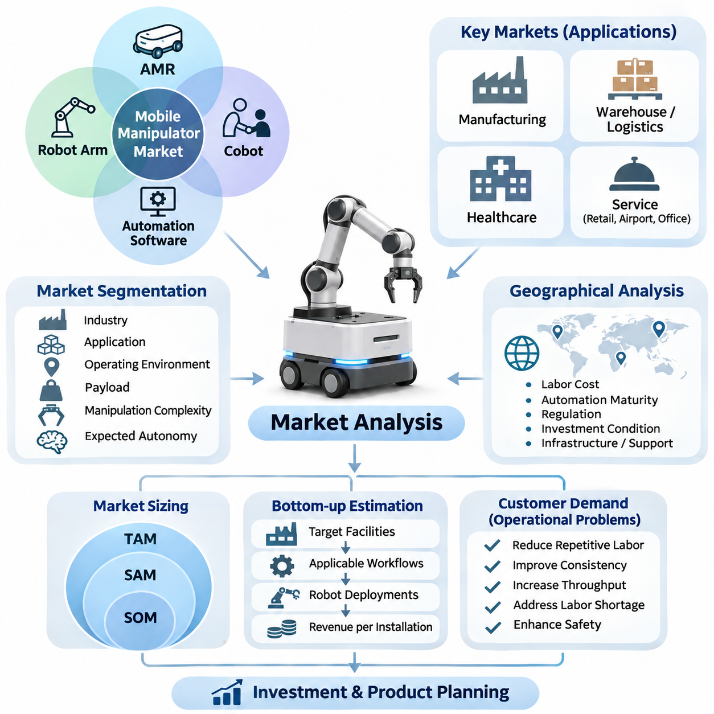
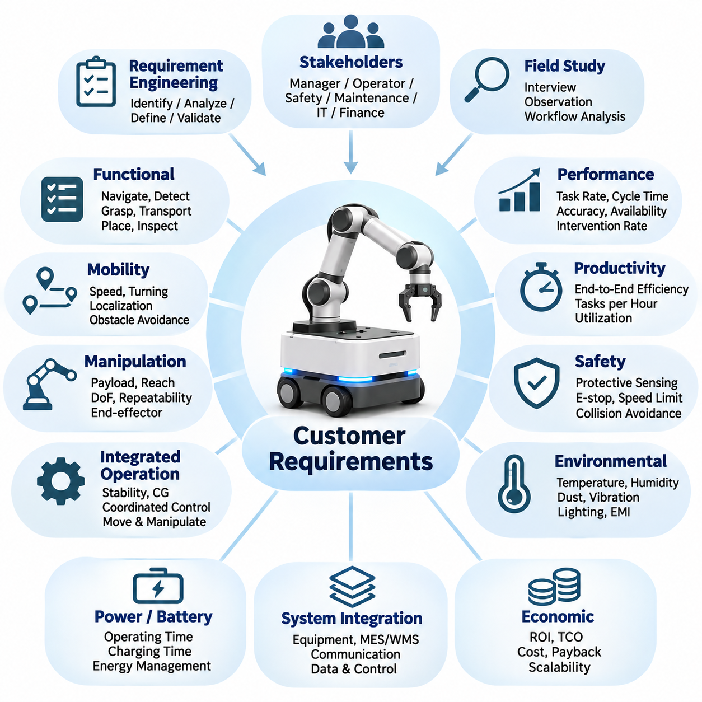
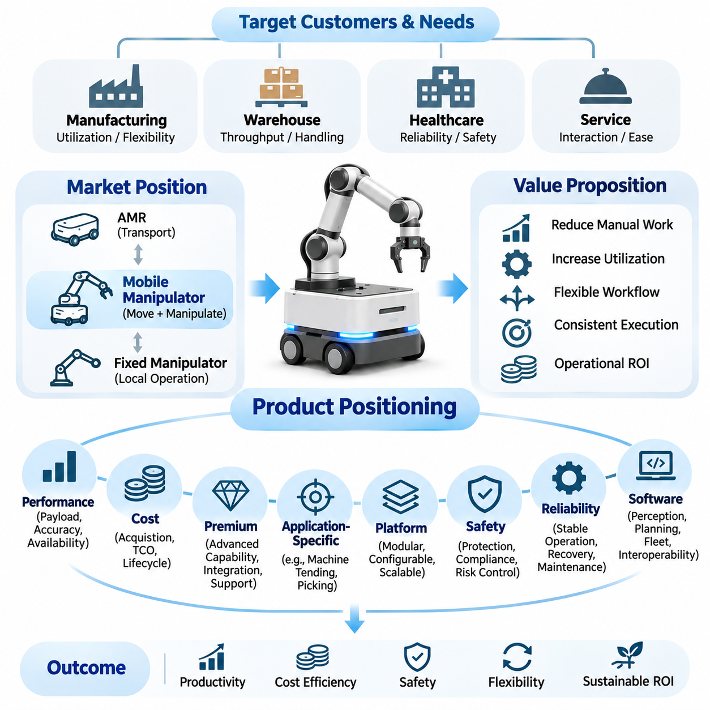
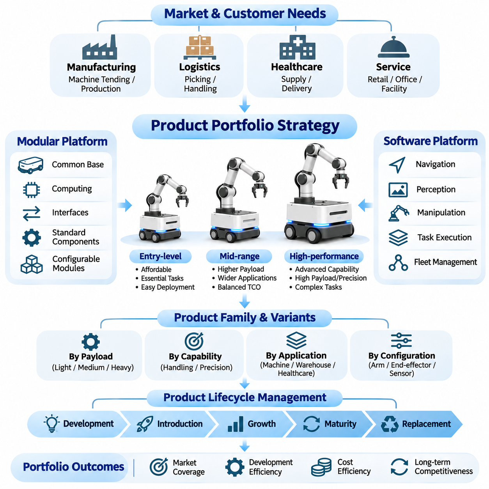
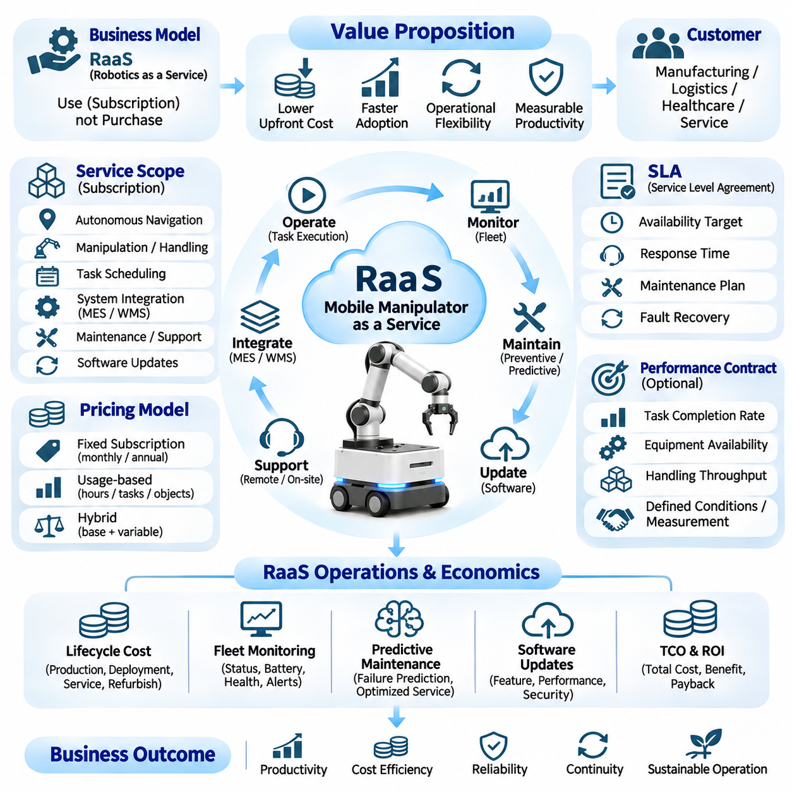
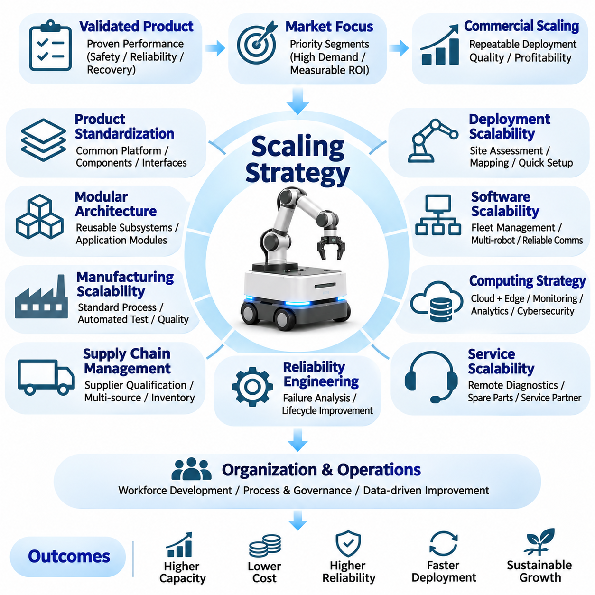
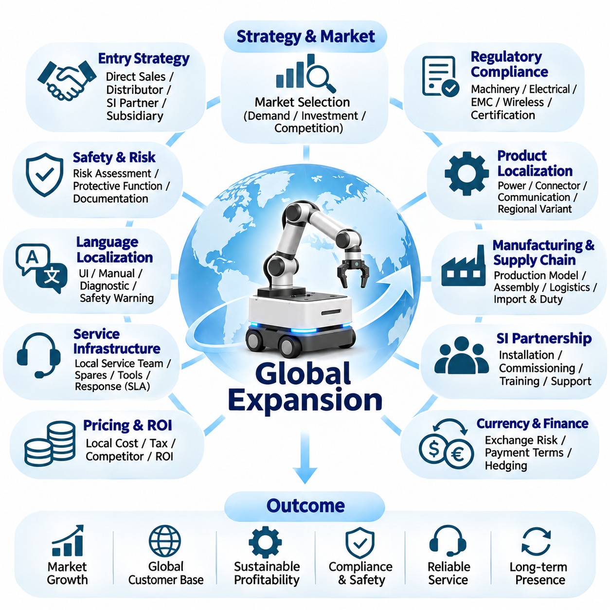
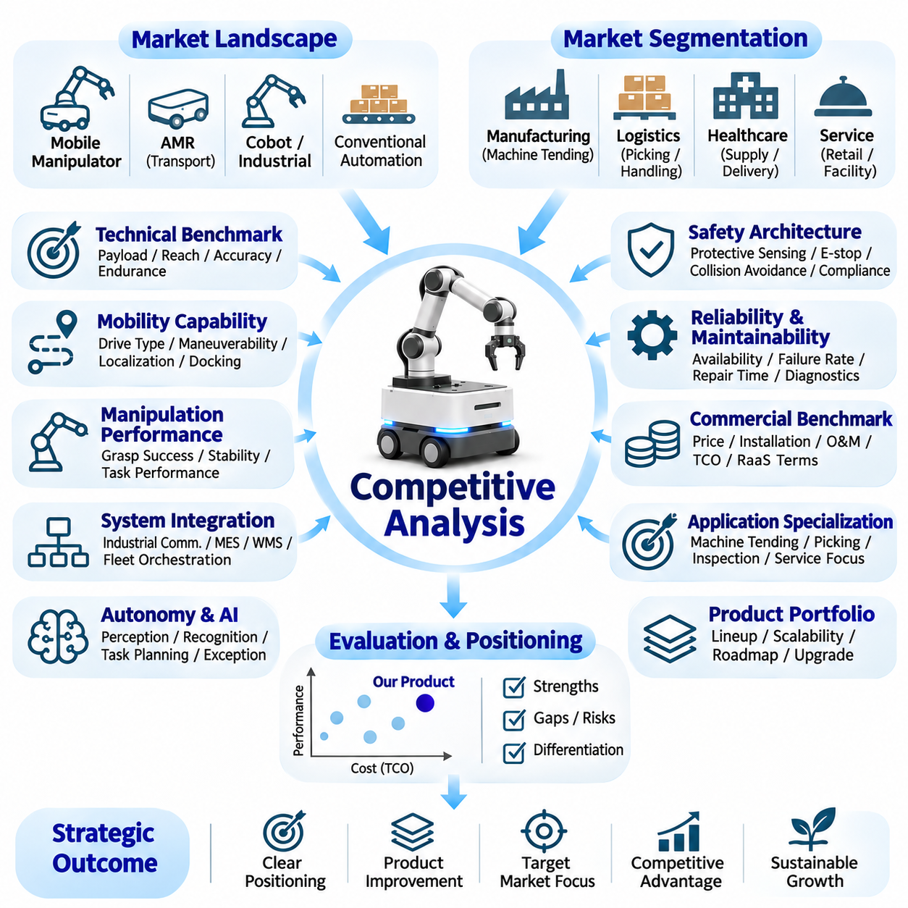
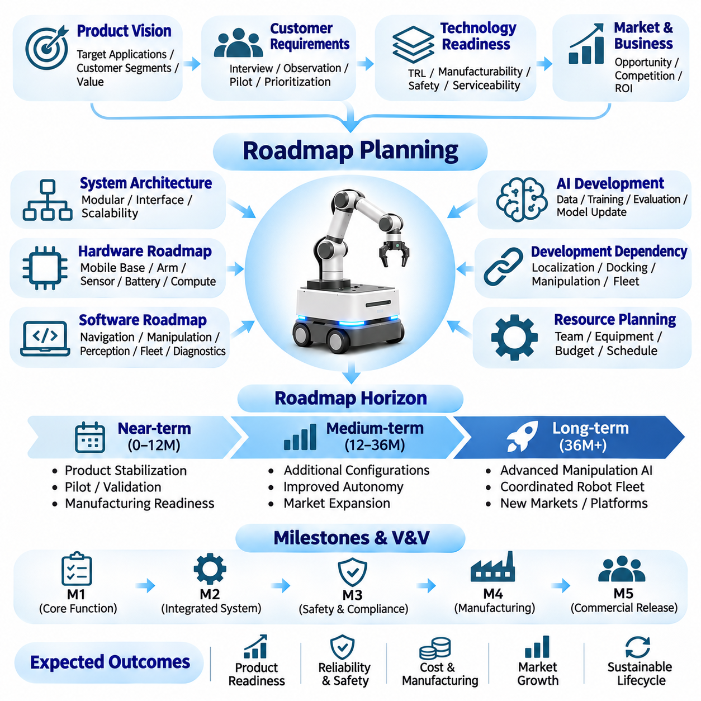

# Chapter 13. Product Strategy

## 01 Market Analysis

{width="7.268055555555556in" height="7.268055555555556in"}

모바일 매니퓰레이터(Mobile Manipulator)의 시장 분석(Market Analysis)은 자율 이동(Autonomous Mobility)과 로봇 조작(Robotic Manipulation) 기술이 산업 및 서비스 환경에서 어떻게 새로운 사업 기회를 창출하는지 이해하는 것에서 시작된다. 고정된 작업장에서 작동하는 기존 산업용 로봇(Industrial Robot)과 달리 모바일 매니퓰레이터는 여러 위치를 이동하면서 물리적 객체와 상호작용하고 다양한 작업을 수행할 수 있다. 이러한 기술의 상업적 잠재력은 생산성 향상, 운영 유연성(Operational Flexibility), 자동화의 경제적 가치에 따라 결정된다.

모바일 매니퓰레이터 시장은 자율 이동 로봇(Autonomous Mobile Robot, AMR), 산업용 로봇 팔(Industrial Robot Arm), 협동 로봇(Collaborative Robot), 지능형 자동화 소프트웨어(Intelligent Automation Software)가 교차하는 영역에 형성된다. 각 분야는 고유한 기술과 공급업체, 고객의 기대 수준을 제공한다. 그러나 이러한 기능을 통합하면 내비게이션(Navigation), 조작 제어(Manipulation Control), 안전성(Safety), 시스템 통합(System Integration)의 복잡성이 증가하므로 개별 부품이 아닌 전체 솔루션 관점에서 시장을 평가해야 한다.

산업 제조(Industrial Manufacturing)는 여러 작업장에 걸친 유연한 자동화(Flexible Automation)의 필요성이 증가하고 있기 때문에 중요한 잠재 시장이다. 모바일 매니퓰레이터는 모든 작업 위치에 고정형 로봇을 설치하지 않고도 기계 작업 지원(Machine Tending), 부품 운송, 검사(Inspection), 자재 취급(Material Handling)을 수행할 수 있다. 하나의 로봇이 허용 가능한 작업 주기(Cycle Time), 위치 정확도(Positioning Accuracy), 운영 신뢰성(Operational Reliability)을 유지하면서 여러 작업을 처리할 때 경제적 매력도가 높아진다.

창고 및 물류(Warehouse and Logistics) 운영은 또 다른 유망한 적용 환경이다. 기존 자율 이동 로봇은 주로 물품을 운송하지만, 모바일 매니퓰레이터는 개별 물체를 집어 올리고, 배치하고, 분류하고, 이송하는 작업까지 수행할 수 있다. 이러한 기능의 결합은 운송 단계와 처리 단계 사이에서 발생하는 수작업을 줄일 수 있다. 시장 수요는 주문 변동성(Order Variability), 재고 특성, 피킹 복잡도(Picking Complexity), 처리량(Throughput) 요구사항, 대체 자동화 솔루션의 가용성에 따라 달라진다.

의료 시설(Healthcare Facility)은 의료 물품을 운송하고 보관 장비와 상호작용할 수 있는 모바일 매니퓰레이터에 새로운 기회를 제공한다. 잠재적인 적용 분야에는 약국 물류(Pharmacy Logistics), 실험실 검체 취급(Laboratory Sample Handling), 린넨 배송(Linen Distribution), 자동 재고 보충(Automated Inventory Replenishment)이 포함된다. 그러나 병원은 위생, 신뢰성, 인간과의 상호작용, 운영 연속성에 대해 높은 수준의 요구사항을 적용한다. 상업적 실현 가능성은 기존 병원 인프라와 관리 절차에 로봇 작업 흐름을 얼마나 효과적으로 통합하는지에 따라 결정된다.

서비스 로보틱스(Service Robotics)는 호텔, 소매업, 공항, 사무실, 공공시설 등 추가적인 시장 분야를 형성한다. 모바일 매니퓰레이터는 재고 취급, 물품 배송, 장비 지원, 반복적인 서비스 활동을 수행할 수 있다. 이러한 환경은 산업 시설보다 비정형적인 경우가 많아 고도화된 인식(Perception)과 상호작용(Interaction) 기능이 필요하다. 시장 도입은 고객 수용성(Customer Acceptance), 운영 안전성(Operational Safety), 작업 신뢰성(Task Reliability), 기존 서비스 방식과 비교한 실질적인 이점에 따라 달라진다.

시장 세분화(Market Segmentation)는 산업 분야, 적용 작업, 운영 환경, 적재하중(Payload) 요구사항, 조작 복잡도(Manipulation Complexity), 예상 자율성 수준(Autonomy Level)을 고려해야 한다. 정밀한 기계 적재 작업을 요구하는 제조 고객과 자동화된 의료 물품 배송을 원하는 병원 고객은 근본적으로 서로 다른 요구사항을 가진다. 이러한 차이는 하드웨어 아키텍처(Hardware Architecture), 소프트웨어 기능, 안전 설계, 가격 정책에 영향을 준다. 효과적인 시장 세분화는 확장 가능한 제품 개발을 지원할 만큼 유사한 요구사항을 가진 고객 집단을 식별한다.

지역별 시장 분석(Geographical Market Analysis)은 인건비, 산업 자동화 성숙도(Industrial Automation Maturity), 규제 체계(Regulatory Framework), 투자 환경의 차이를 고려해야 한다. 제조업 기반이 발달한 지역은 생산성과 장비 통합을 우선시할 수 있으며, 물류 중심 경제에서는 유연한 자재 취급을 더욱 중요하게 평가할 수 있다. 지역 인프라, 기술 지원 가용성, 고객 구매 관행도 도입에 영향을 준다. 지역별 사업 기회는 비교 가능한 운영 및 경제적 기준을 사용하여 평가해야 한다.

시장 규모 산정(Market Sizing)은 투자와 제품 계획을 위한 정량적 기반을 제공한다. 전체 잠재 시장(Total Addressable Market, TAM)은 정의된 가정에 따른 광범위한 매출 기회를 나타내며, 실제 서비스 가능 시장(Serviceable Available Market, SAM)은 제품이 현실적으로 대응할 수 있는 적용 분야로 범위를 좁힌다. 실제 확보 가능 시장(Serviceable Obtainable Market, SOM)은 특정 계획 기간에 확보할 수 있는 시장 규모를 추정한다. 이러한 계산에는 고객 수, 배치 수량, 가격, 교체 주기, 도입률에 대한 명확한 가정이 필요하다.

상향식 시장 추정(Bottom-Up Market Estimation)은 광범위한 자동화 산업 통계가 모바일 매니퓰레이션(Mobile Manipulation)의 실제 사업 기회를 정확하게 반영하지 못할 수 있기 때문에 신흥 로봇 제품에 특히 유용하다. 분석가는 적합한 시설 수를 추정하고, 적용 가능한 작업 흐름을 식별하며, 예상 로봇 배치 수량과 설치당 매출을 계산할 수 있다. 민감도 분석(Sensitivity Analysis)은 도입률, 로봇 활용률, 시스템 가격, 배치 제약의 변화가 시장 기회에 미치는 영향을 검토해야 한다.

고객 수요(Customer Demand)는 기술 자체에 대한 기대보다 실제 운영 문제를 중심으로 평가해야 한다. 기업은 일반적으로 반복 노동 감소, 공정 일관성(Process Consistency) 향상, 처리량 증가, 인력 부족 대응, 작업장 안전성 향상을 위해 로봇에 투자한다. 모바일 매니퓰레이터는 이러한 목표와 자체 기능 사이의 명확한 연관성을 입증해야 한다. 고객 인터뷰(Customer Interview), 시설 관찰, 작업 흐름 측정, 시범 프로젝트(Pilot Project)는 제안된 적용 분야가 실질적인 운영 문제를 해결하는지 판단하는 근거를 제공한다.

경쟁 환경(Competitive Landscape)에는 자율 이동 로봇 제조업체, 산업용 매니퓰레이터 제조업체, 협동 로봇 공급업체, 통합 로봇 시스템 업체, 전문 자동화 장비 업체가 포함된다. 고정형 자동화(Fixed Automation), 컨베이어(Conveyor), 수동 운전 차량, 기존 노동집약적 공정도 경쟁 대안이다. 시장 분석은 전체 작업 흐름의 성능을 기준으로 이러한 대안을 비교해야 한다. 기술적으로 발전된 모바일 매니퓰레이터라도 단순한 장비가 더 낮은 비용으로 동일한 생산성을 제공한다면 상업적 매력이 낮아질 수 있다.

기술 성숙도(Technology Readiness)는 시장 도입 시점에 큰 영향을 미친다. 내비게이션, 위치 추정(Localization), 객체 인식(Object Recognition), 파지 계획(Grasp Planning), 협조 동작 제어(Coordinated Motion Control)는 실제 운영 조건에서 안정적으로 작동해야 한다. 통제된 환경의 시연이 반드시 상용화 준비 수준을 의미하지는 않는다. 시장 평가에서는 실험적 기능과 검증된 생산 성능을 구분하고, 장애 복구(Failure Recovery), 유지보수, 환경 변화, 일상 운영에 필요한 인간 감독 수준을 고려해야 한다.

경제성 평가(Economic Evaluation)는 초기 구매 가격을 넘어 전체 비용을 포함해야 한다. 총소유비용(Total Cost of Ownership, TCO)에는 시스템 통합, 인프라 변경, 소프트웨어 라이선스, 유지보수, 에너지 소비, 운영자 교육, 기술 지원 비용이 포함된다. 투자수익률(Return on Investment, ROI)은 노동시간 절감, 설비 활용률 증가, 취급 오류 감소, 운영 가용성(Operational Availability) 향상과 같은 측정 가능한 이익에 따라 결정된다. 재무 모델(Financial Model)은 배치 지연, 활용률 불확실성, 수동 개입 비용도 반영해야 한다.

다양한 사업 모델(Business Model)은 고객의 도입 결정에 영향을 줄 수 있다. 장비 직접 판매(Direct Equipment Sales)는 고객에게 자산 소유권을 제공하지만 상당한 초기 자본 지출(Capital Expenditure, CAPEX)을 요구할 수 있다. 리스(Leasing)와 서비스형 로봇(Robotics as a Service, RaaS)은 비용을 시간에 따라 분산하여 재무적 진입 장벽을 낮출 수 있다. 구독형 계약(Subscription Agreement)에는 유지보수, 소프트웨어 업데이트, 로봇군 모니터링(Fleet Monitoring), 운영 지원이 포함될 수 있다. 시장 분석은 고객의 자본 지출과 운영비용(Operating Expenditure, OPEX) 선호도뿐 아니라 공급업체의 금융 및 서비스 의무도 평가해야 한다.

도입 장벽(Adoption Barrier)은 로봇 자체의 기능보다 시스템 통합의 복잡성에서 발생하는 경우가 많다. 제조 시설에서는 제조실행시스템(Manufacturing Execution System, MES), 프로그래머블 로직 컨트롤러(Programmable Logic Controller, PLC), 산업 장비와의 연결이 필요할 수 있다. 창고는 창고관리시스템(Warehouse Management System, WMS)에 의존하며, 병원은 전문 정보 플랫폼을 운영한다. 성공적인 배치를 위해서는 호환 가능한 인터페이스, 안정적인 통신, 사이버보안(Cybersecurity) 통제, 명확한 운영 책임이 필요하다.

안전 및 규제 요구사항(Safety and Regulatory Requirements)도 시장 접근성을 결정한다. 모바일 매니퓰레이터는 이동 플랫폼과 관절형 기구(Articulated Mechanism)를 결합하므로 고정형 산업용 로봇이나 운송 전용 이동 로봇과는 다른 위험을 발생시킨다. 고객은 충돌 위험, 비상 정지(Emergency Stop), 인간과의 근접 작업, 환경적 제약을 고려해야 한다. 적용 표준과 적합성 평가(Conformity Assessment) 의무는 배치 환경과 국가에 따라 달라진다. 문서화된 검증 절차를 갖춘 규제 준수 준비(Compliance Readiness)는 경쟁 우위가 될 수 있다.

시장 성장은 인공지능(Artificial Intelligence, AI), 엣지 컴퓨팅(Edge Computing), 센서 기술(Sensor Technology), 배터리 시스템(Battery System), 로봇 소프트웨어의 발전에 영향을 받는다. 인식과 작업 계획(Task Planning)의 개선은 모바일 매니퓰레이터가 처리할 수 있는 객체와 환경의 범위를 확대할 수 있다. 그러나 컴퓨팅 성능 향상이 자동으로 상업적으로 신뢰할 수 있는 자율성을 보장하지는 않는다. 제품 기획자는 기술적 잠재력과 실제 운영 조건에서 검증된 기능을 구분해야 한다.

노동시장 환경(Workforce Conditions)은 또 다른 중요한 수요 요인이다. 인력 부족, 높은 이직률, 반복 작업, 인간공학적 위험(Ergonomic Risk)은 기업이 로봇 자동화를 검토하도록 유도할 수 있다. 그러나 자동화가 인간의 참여를 완전히 제거하는 것은 아니다. 운영자는 예외 처리(Exception Handling), 감독, 유지보수, 공정 개선을 계속 담당할 수 있다. 시장 분석은 로봇 배치가 인력의 역할을 어떻게 변화시키며 고객 조직이 이러한 전환을 관리할 역량을 갖추고 있는지 평가해야 한다.

초기 시장 기회(Early Market Opportunity)는 예측 가능한 객체, 통제된 환경, 측정 가능한 성능 목표를 가진 작업 흐름에 집중되는 경우가 많다. 이러한 특성은 기술적 불확실성을 줄이고 경제성 검증을 단순화한다. 객체의 변동성이 크거나 환경이 비정형적이며 인간과의 상호작용이 복잡한 응용 분야는 광범위한 배치 이전에 추가 개발이 필요할 수 있다. 기술적으로 실현 가능하면서 경제적 가치가 높은 응용 분야를 우선하면 제조업체는 운영 실적을 축적하면서 제품 기능을 점진적으로 확장할 수 있다.

시범 배치 분석(Pilot Deployment Analysis)은 시장 가정과 상업적 의사결정을 연결하는 중요한 단계이다. 시범 프로젝트는 기준 성능(Baseline Performance)을 설정하고, 측정 가능한 인수 기준(Acceptance Criteria)을 정의하며, 대표적인 운영 조건에서 로봇을 평가해야 한다. 주요 관찰 항목에는 작업 성공률(Task Success Rate), 개입 빈도(Intervention Frequency), 작업 주기, 시스템 가용성(System Availability), 통합 작업량이 포함된다. 평가 결과는 최초 사업성 분석(Business Case)과 비교하여 확대 배치의 타당성이나 추가 엔지니어링 필요성을 판단해야 한다.

시장 분석은 공급업체 사업 모델의 확장성(Scalability)도 고려해야 한다. 설치할 때마다 광범위한 맞춤화(Customization)가 필요한 제품은 초기 프로젝트 매출을 창출할 수 있지만 지속 가능한 성장에는 어려움을 겪을 수 있다. 표준화된 하드웨어 플랫폼(Standardized Hardware Platform), 구성 가능한 소프트웨어 모듈(Configurable Software Module), 재사용 가능한 통합 인터페이스(Reusable Integration Interface), 반복 가능한 배치 절차는 확장성을 향상시킨다. 고객 간 재사용할 수 있는 엔지니어링 작업의 비율은 장기적인 상업적 실현 가능성을 나타내는 중요한 지표이다.

유통 채널(Distribution Channel)과 파트너십(Partnership)은 시장 침투(Market Penetration)에 영향을 미친다. 시스템 통합업체(System Integrator), 산업 장비 공급업체, 소프트웨어 제공업체, 지역 서비스 조직은 제조업체가 고객에게 접근하고 완전한 솔루션을 제공하도록 지원할 수 있다. 파트너십은 전문 기술 역량과 기존 고객 관계를 결합하여 배치 장벽을 낮출 수 있다. 그러나 고객 지원이 분산되지 않도록 통합, 보증, 유지보수, 사이버보안, 운영 성능에 대한 책임을 명확히 해야 한다.

경쟁 차별화(Competitive Differentiation)는 고객이 검증하고 가치를 인정할 수 있는 특성을 기반으로 해야 한다. 잠재적인 차별화 요소에는 조작 정확도(Manipulation Accuracy), 내비게이션 신뢰성(Navigation Reliability), 적재하중, 작업 유연성(Task Flexibility), 배치 용이성(Deployment Simplicity), 안전 성능(Safety Performance), 소프트웨어 상호운용성(Software Interoperability)이 포함된다. 우수한 기술 사양만으로 높은 가격이 정당화되는 것은 아니다. 지속 가능한 차별화는 기술적 장점이 측정 가능한 운영 이익을 제공하고 안정적인 서비스와 검증된 성능으로 뒷받침될 때 형성된다.

장기 시장 예측(Long-Term Market Forecasting)은 신흥 로봇 시장에 상당한 불확실성이 존재하므로 여러 시나리오(Scenario)를 필요로 한다. 보수적 시나리오(Conservative Scenario)는 느린 고객 도입, 광범위한 통합 요구사항, 제한된 자율 작업 범위를 가정할 수 있다. 낙관적 시나리오(Optimistic Scenario)는 하드웨어 가격 하락, 표준화된 인터페이스, 로봇 지능(Robotic Intelligence)의 발전을 반영할 수 있다. 시나리오 계획(Scenario Planning)은 제조업체가 연구 투자, 생산 능력, 인력 구성, 재무적 약속을 단일 성장 예측이 아닌 현실적인 사업 전망에 맞추도록 지원한다.

종합적인 시장 분석(Comprehensive Market Analysis)은 궁극적으로 고객 요구사항(Customer Requirements), 기술적 실현 가능성(Technical Feasibility), 경쟁 대안(Competitive Alternatives), 재무 성과(Financial Performance)를 연결한다. 그 목적은 단순히 판매 가능한 로봇 수량을 추정하는 것이 아니라 모바일 매니퓰레이션이 지속 가능한 경제적 가치(Economic Value)를 창출할 수 있는 영역을 결정하는 데 있다. 고객의 실제 증거와 운영 결과를 통해 시장 가정을 지속적으로 검증함으로써 제조업체는 현실적인 제품 우선순위를 수립하고, 상용화 위험(Commercialization Risk)을 줄이며, 산업 및 서비스 시장 전반에서 지속 가능한 확장(Sustainable Expansion)의 기반을 구축할 수 있다.

## 02 Customer Requirements

{width="7.268055555555556in" height="7.268055555555556in"}

고객 요구사항(Customer Requirements)은 기술적 역량(Technological Capabilities)과 실제 운영 요구(Operational Needs)를 연결하기 때문에 성공적인 모바일 매니퓰레이터(Mobile Manipulator) 제품 개발의 기반이 된다. 모바일 매니퓰레이터는 이동성(Mobility), 조작 기능(Manipulation), 안전성(Safety), 신뢰성(Reliability), 경제적 성과(Economic Performance)에 관한 기대를 충족해야 한다. 이러한 요구사항을 이해하면 제조업체는 불필요한 복잡성을 줄이면서 특정 산업 및 서비스 환경에서 측정 가능한 가치를 제공하는 시스템을 개발할 수 있다.

요구사항 엔지니어링(Requirements Engineering)은 로봇 시스템의 구매, 배치, 운영, 유지보수에 영향을 미치는 이해관계자(Stakeholders)를 식별하는 것에서 시작된다. 이해관계자에는 생산 관리자, 창고 감독자, 안전 엔지니어, 유지보수 기술자, 정보기술 전문가, 재무 의사결정자가 포함될 수 있다. 각 집단은 서로 다른 관점에서 로봇을 평가하므로 균형 잡힌 제품 요구사항을 수립하기 위해서는 체계적인 이해관계자 분석(Stakeholder Analysis)이 필수적이다.

고객 인터뷰(Customer Interview)와 운영 현장 관찰(Operational Observation)은 기존 작업 흐름(Workflow)과 자동화 기회(Automation Opportunities)에 관한 중요한 정보를 제공한다. 인터뷰는 고객이 인식하는 문제를 파악하는 데 도움이 되며, 직접 관찰은 고객이 간과할 수 있는 물리적 제약, 반복 활동, 운영 예외 상황을 드러낸다. 엔지니어는 모바일 매니퓰레이션 솔루션을 제안하기 전에 자재의 이동 방식, 작업자와 장비의 상호작용, 작업 지연이 발생하는 위치를 조사해야 한다.

기능 요구사항(Functional Requirements)은 모바일 매니퓰레이터가 의도된 목적을 달성하기 위해 수행해야 하는 활동을 정의한다. 이러한 활동에는 자율 주행(Autonomous Navigation), 객체 탐지(Object Detection), 파지(Grasping), 운송(Transportation), 배치(Placement), 검사(Inspection), 산업 장비와의 상호작용이 포함될 수 있다. 상업적 가치는 서로 연결된 여러 작업의 성공적인 수행에 따라 결정되므로 개별 기능보다는 전체 작업 흐름을 기준으로 요구사항을 정의해야 한다.

이동성 요구사항(Mobility Requirements)은 로봇이 운영 환경에서 이동하는 방식을 규정한다. 주요 고려사항에는 최대 속도(Maximum Speed), 회전 반경(Turning Radius), 위치 추정 정확도(Localization Accuracy), 장애물 회피(Obstacle Avoidance), 바닥 상태(Floor Conditions), 주행 신뢰성(Navigation Reliability)이 포함된다. 좁은 창고 통로에서 작동하는 로봇은 넓은 제조 시설에서 운용되는 로봇과 다른 이동 특성을 요구한다. 환경 측정 결과는 구동 메커니즘, 센서, 주행 알고리즘의 선정 기준이 되어야 한다.

조작 요구사항(Manipulation Requirements)은 로봇이 물리적 객체 및 장비와 상호작용하는 능력을 정의한다. 적재하중(Payload Capacity), 작업 도달 범위(Reach), 자유도(Degrees of Freedom, DoF), 위치 반복정밀도(Positioning Repeatability), 파지 안정성(Grasp Stability), 엔드 이펙터 호환성(End-Effector Compatibility)은 중요한 설계 변수이다. 이러한 특성은 실제 객체의 크기, 무게, 재질, 취급 조건과 일치해야 한다. 과도한 사양은 고객 생산성을 향상시키지 못하면서 시스템 비용만 증가시킬 수 있다.

이동성과 조작 기능은 통합 시스템(Integrated System) 관점에서도 평가해야 한다. 로봇 팔(Robot Arm)의 움직임은 로봇의 무게중심(Center of Gravity)을 변화시키며, 특히 무거운 물체를 최대 도달 거리에서 취급할 때 안정성(Stability)에 영향을 줄 수 있다. 고객은 정지 상태에서의 조작이나 제어된 이동 중 조작을 요구할 수 있다. 이러한 운영 모드는 베이스 안정화(Base Stabilization), 협조 제어(Coordinated Control), 위치 추정 정확도, 충돌 방지(Collision Prevention)에 서로 다른 요구사항을 발생시킨다.

성능 요구사항(Performance Requirements)은 고객의 기대를 측정 가능한 엔지니어링 목표(Engineering Targets)로 변환한다. 대표적인 지표에는 작업 완료율(Task Completion Rate), 작업 주기(Cycle Time), 주행 정확도(Navigation Accuracy), 조작 성공률(Manipulation Success Rate), 시스템 가용성(System Availability), 개입 빈도(Intervention Frequency)가 포함된다. 성능을 객관적으로 검증할 수 있도록 운영 조건과 인수 기준(Acceptance Thresholds)을 명시해야 한다. 빠른 작동이나 높은 신뢰성과 같은 모호한 기대만으로는 엔지니어링 검증을 수행하기 어렵다.

운영 생산성(Operational Productivity)은 로봇의 이론적인 최대 속도보다 중요한 경우가 많다. 모바일 매니퓰레이터가 빠르게 주행하더라도 느린 파지 계획(Grasp Planning), 반복적인 위치 추정 보정(Localization Adjustment), 빈번한 복구 작업(Recovery Operation)으로 인해 생산성이 저하될 수 있다. 따라서 고객 요구사항은 종단 간 작업 흐름 효율성(End-to-End Workflow Efficiency)을 강조해야 한다. 시간당 완료 작업 수, 교대근무당 성공적인 이송 횟수, 실질 활용률(Effective Utilization)을 측정하면 운영 가치를 더욱 의미 있게 평가할 수 있다.

안전 요구사항(Safety Requirements)은 모바일 매니퓰레이터가 사람, 기계, 고가 장비 주변에서 작동하기 때문에 필수적이다. 고객은 보호 감지(Protective Sensing), 비상 정지(Emergency Stop), 속도 제한(Speed Limitation), 충돌 회피(Collision Avoidance), 통제된 복구 절차(Controlled Recovery Procedures)를 요구할 수 있다. 안전 엔지니어링(Safety Engineering)은 이동 플랫폼과 관절형 매니퓰레이터(Articulated Manipulator)에서 발생하는 위험을 모두 고려해야 한다. 위험 평가(Risk Assessment)는 예측 가능한 오사용, 환경적 위험, 자동 작업과 수동 작업 사이의 상호작용을 식별해야 한다.

환경 요구사항(Environmental Requirements)은 로봇이 실제 시설 조건에서 안정적으로 작동할 수 있는지를 결정한다. 온도(Temperature), 습도(Humidity), 먼지(Dust), 진동(Vibration), 조명 변화(Lighting Variation), 바닥 불규칙성(Floor Irregularities), 전자기 간섭(Electromagnetic Interference, EMI)은 시스템 성능에 영향을 줄 수 있다. 산업 환경에서는 센서와 액추에이터(Actuator)가 오염이나 기계적 교란에 노출될 수 있다. 요구사항에는 허용 가능한 환경 범위와 연속 운전에 필요한 보호 대책을 명시해야 한다.

전력 및 배터리 요구사항(Power and Battery Requirements)은 운영 가용성(Operational Availability)에 직접적인 영향을 미친다. 고객은 최소 작동 시간(Minimum Operating Duration), 충전 시간(Charging Time), 에너지 소비량(Energy Consumption), 배터리 교체 절차(Battery Replacement Procedures)를 지정할 수 있다. 이러한 기대에는 주행, 조작, 인식, 컴퓨팅 작업이 동시에 수행될 때의 전력 부하가 반영되어야 한다. 장시간 운전을 위해 자동 충전(Automated Charging)과 임무 재개(Mission Resumption)가 필요할 수 있다. 에너지 관리(Energy Management)는 명목상 배터리 용량에만 의존하지 않고 고객의 교대근무 패턴을 지원해야 한다.

시스템 통합 요구사항(System Integration Requirements)은 로봇이 기존 장비 및 소프트웨어 인프라와 통신하는 방식을 정의한다. 제조 고객은 프로그래머블 로직 컨트롤러(Programmable Logic Controller, PLC), 제조실행시스템(Manufacturing Execution System, MES), 생산 장비와의 인터페이스를 요구할 수 있다. 창고 운영자는 창고관리시스템(Warehouse Management System, WMS)과의 연결을 요구할 수 있다. 표준화된 통신 프로토콜(Standardized Communication Protocols), 문서화된 응용 프로그램 인터페이스(Application Programming Interface, API), 안정적인 데이터 교환은 통합 복잡성을 줄이고 향후 시스템 확장을 지원한다.

인간-로봇 상호작용 요구사항(Human-Robot Interaction Requirements)은 운영자가 모바일 매니퓰레이터를 감독하고 명령하며 협업하는 방식을 정의한다. 사용자 인터페이스(User Interface)는 명확한 임무 상태(Mission Status), 이해하기 쉬운 오류 메시지(Fault Messages), 접근하기 쉬운 복구 절차(Recovery Procedures)를 제공해야 한다. 운영자에게는 수동 제어(Manual Control), 작업 재할당(Task Reassignment), 비상 개입(Emergency Intervention) 기능이 필요할 수 있다. 효과적인 상호작용 설계는 일상적인 제어 기능과 안전 기능을 적절히 분리하면서 교육 요구사항과 운영 오류를 줄인다.

신뢰성 및 유지보수성 요구사항(Reliability and Maintainability Requirements)은 장기적인 고객 만족도에 큰 영향을 미친다. 고객은 예측 가능한 작동, 관리 가능한 유지보수 주기(Maintenance Intervals), 장애 발생 후 신속한 복구를 기대한다. 요구사항에는 진단 로그(Diagnostic Logging), 모듈식 부품 교체(Modular Component Replacement), 원격 모니터링(Remote Monitoring), 예비 부품 가용성(Spare-Parts Availability)이 포함될 수 있다. 평균고장간격(Mean Time Between Failures, MTBF)과 평균수리시간(Mean Time to Repair, MTTR)은 대표적인 운영 조건에서 충분한 데이터를 바탕으로 측정할 때 유용한 신뢰성 지표가 된다.

사이버보안 요구사항(Cybersecurity Requirements)은 모바일 매니퓰레이터가 기업 네트워크(Enterprise Network), 클라우드 서비스(Cloud Services), 로봇군 관리 플랫폼(Fleet Management Platform)에 연결되면서 더욱 중요해지고 있다. 고객은 암호화 통신(Encrypted Communication), 인증(Authentication), 접근 제어(Access Control), 보안 소프트웨어 업데이트(Secure Software Updates), 감사 로그(Audit Logging)를 요구할 수 있다. 보안 아키텍처(Security Architecture)는 실시간 제어(Real-Time Control)를 저해하지 않으면서 운영 명령과 민감한 정보를 보호해야 한다. 요구사항은 제품 수명주기(Product Lifecycle) 전반의 소프트웨어 유지보수, 취약점 관리(Vulnerability Management), 책임 범위도 다루어야 한다.

확장성 요구사항(Scalability Requirements)은 초기 시범 배치(Pilot Deployment)에서 여러 시설의 다수 로봇으로 솔루션을 확장할 수 있는지를 결정한다. 고객은 중앙 집중식 임무 스케줄링(Centralized Mission Scheduling), 교통 조정(Traffic Coordination), 로봇군 모니터링(Fleet Monitoring), 일관된 소프트웨어 구성(Software Configuration)을 기대할 수 있다. 제품 아키텍처(Product Architecture)는 대규모 재설계 없이 로봇을 추가할 수 있도록 지원해야 한다. 확장성 평가에는 통신 대역폭(Communication Bandwidth), 인프라 용량(Infrastructure Capacity), 작업 할당 효율성(Task Allocation Efficiency), 운영 관리 복잡성을 고려해야 한다.

경제적 요구사항(Economic Requirements)은 제품이 충족해야 하는 재무적 한계(Financial Boundaries)를 정의한다. 고객은 구매 예산(Acquisition Budget), 운영비용(Operating Costs), 예상 투자 회수 기간(Expected Payback Period), 허용 가능한 유지보수 비용을 지정할 수 있다. 이러한 제약은 하드웨어 선정, 소프트웨어 라이선스(Software Licensing), 배치 방식, 서비스 계약(Service Arrangements)에 영향을 미친다. 기술적으로 우수한 로봇이라도 통합 및 운영비용이 고객에게 제공하는 측정 가능한 이익을 초과한다면 상업적으로 실패할 수 있다.

고객 요구사항은 산업별 작업 흐름(Industry-Specific Workflows)에 따라서도 달라진다. 제조 시설은 정밀도(Precision)와 장비 동기화(Equipment Synchronization)를 우선시할 수 있으며, 창고는 처리량(Throughput)과 재고 취급(Inventory Handling)을 강조한다. 병원은 위생(Hygiene), 저소음 작동(Quiet Operation), 의료진과의 안정적인 상호작용을 요구할 수 있다. 서비스 환경은 외관(Appearance), 접근성(Accessibility), 사용자 수용성(User Acceptance)을 더욱 중요하게 평가할 수 있다. 제품 개발팀은 공통 플랫폼 요구사항(Common Platform Requirements)과 응용 분야별 조정 사항(Application-Specific Adaptations)을 구분해야 한다.

요구사항 우선순위 결정(Requirements Prioritization)은 고객이 비용, 일정, 기술적 실현 가능성(Technical Feasibility)과 충돌하는 기능을 요구하는 경우가 많기 때문에 필요하다. 적재하중을 증가시키면 더 무거운 액추에이터와 배터리가 필요할 수 있으며, 이동성을 높이려면 소형 플랫폼(Compact Platform)이 요구될 수 있다. 엔지니어는 운영 가치(Operational Value), 구현 위험(Implementation Risk), 개발 비용(Development Cost)을 기준으로 이러한 상충관계(Tradeoffs)를 평가해야 한다. 우선순위 결정은 필수 기능을 식별하고 즉각적인 제품 요구와 향후 개선 가능성을 구분하는 데 도움이 된다.

추적성(Traceability)은 고객의 기대를 시스템 사양(System Specifications), 엔지니어링 의사결정(Engineering Decisions), 검증 결과(Verification Results)와 연결한다. 중요한 요구사항마다 식별 가능한 출처(Identifiable Source), 측정 가능한 인수 기준(Measurable Acceptance Criteria), 대응하는 검증 방법(Validation Method)이 있어야 한다. 추적성은 개발팀이 설계 변경의 영향을 평가하고 해결되지 않은 요구사항을 식별하도록 지원한다. 또한 개발 과정 전반에서 고객, 시스템 아키텍트(System Architect), 소프트웨어 개발자, 안전 엔지니어 사이의 의사소통을 지원한다.

프로토타입(Prototype)과 시범 배치(Pilot Deployment)는 상용 생산(Commercial Production) 이전에 요구사항을 검증할 기회를 제공한다. 실제 환경 시험(Real-World Testing)에서는 예상하지 못한 장애물, 객체의 변동성(Object Variations), 작업 흐름의 의존관계(Workflow Dependencies), 운영자 선호도가 드러날 수 있다. 피드백(Feedback)은 비공식적인 설계 수정이 아니라 문서화된 요구사항 업데이트(Requirement Updates)로 전환해야 한다. 반복적 검증(Iterative Validation)은 기술적으로는 성공했지만 고객의 실제 운영을 충분히 지원하지 못하는 시스템을 제공할 위험을 줄인다.

요구사항 관리(Requirement Management)는 고객의 작업 흐름과 운영 조건이 변화할 수 있으므로 배치 이후에도 지속되어야 한다. 새로운 제품, 시설 배치(Facility Layouts), 생산 일정(Production Schedules), 규제 기대사항(Regulatory Expectations)은 추가 요구를 발생시킬 수 있다. 소프트웨어 업데이트(Software Updates)와 모듈식 하드웨어 개선(Modular Hardware Improvements)은 전체 로봇을 교체하지 않고도 일부 변화를 수용할 수 있다. 체계적인 변경 관리 프로세스(Change-Management Process)는 변화하는 고객 요구를 지원하면서 호환성(Compatibility), 안전성, 제품 일관성(Product Consistency)을 유지하도록 돕는다.

성공적인 고객 요구사항 분석(Customer Requirement Analysis)은 궁극적으로 운영 문제를 명확하고 측정 가능하며 경제적으로 정당화된 제품 사양(Product Specifications)으로 변환한다. 이는 이동성, 조작 기능, 소프트웨어, 안전성, 서비스 역량을 고객의 실제 운영 조건에 맞추는 과정이다. 지속적인 의사소통과 실질적인 증거를 통한 가정 검증(Assumption Validation)을 유지함으로써 제조업체는 신뢰할 수 있는 성능(Reliable Performance), 고객 수용성(Customer Acceptance), 지속 가능한 상업적 가치(Sustainable Commercial Value)를 달성하는 모바일 매니퓰레이터를 개발할 수 있다.

## 03 Product Positioning

{width="7.268055555555556in" height="7.268055555555556in"}

제품 포지셔닝(Product Positioning)은 모바일 매니퓰레이터(Mobile Manipulator)가 경쟁 로봇 솔루션 및 기존 자동화 방식과 비교하여 목표 고객(Target Customers)에게 어떻게 인식되는지를 정의한다. 이는 제품의 목표 시장 역할(Intended Market Role), 핵심 가치 제안(Value Proposition), 차별화 특성(Distinguishing Characteristics)을 확립한다. 효과적인 제품 포지셔닝은 기술적 역량(Technical Capabilities)을 운영상의 이점(Operational Benefits)과 연결하여 고객이 특정 모바일 매니퓰레이터가 자신의 응용 분야와 투자 우선순위에 적합한 이유를 이해하도록 지원한다.

포지셔닝 과정(Positioning Process)은 목표 고객 세분시장(Target Customer Segment)과 가장 중요한 운영상의 문제(Operational Challenges)를 식별하는 것에서 시작된다. 제조업체는 설비 활용률(Equipment Utilization)과 유연한 생산(Flexible Production)을 우선시할 수 있으며, 창고 운영자는 처리량(Throughput)과 자재 취급 효율성(Material Handling Efficiency)을 강조한다. 병원과 서비스 조직은 신뢰성(Reliability), 안전성(Safety), 상호작용의 용이성(Ease of Interaction)을 중요하게 평가할 수 있다. 모든 시장을 동시에 만족시키도록 설계된 제품은 의미 있는 경쟁 차별화(Competitive Differentiation)에 필요한 전문성이 부족할 수 있다.

가치 제안(Value Proposition)은 고객이 모바일 매니퓰레이터를 도입함으로써 얻는 측정 가능한 이익을 설명한다. 이러한 이익에는 수작업 취급 감소(Reduced Manual Handling), 설비 활용률 증가(Increased Equipment Utilization), 작업 흐름 유연성(Workflow Flexibility) 향상, 작업 수행의 일관성(Consistent Task Execution) 개선이 포함될 수 있다. 강력한 포지셔닝은 기술 사양을 단순히 나열하기보다 실제 성과(Outcomes)를 전달한다. 고객은 자율 주행(Autonomous Navigation)과 로봇 조작(Robotic Manipulation)이 결합되어 기존 이동 로봇이나 고정형 매니퓰레이터가 효율적으로 해결하기 어려운 문제를 어떻게 해결하는지 이해할 수 있어야 한다.

모바일 매니퓰레이터는 자율 이동 로봇(Autonomous Mobile Robot, AMR)과 고정형 산업용 로봇 시스템(Stationary Industrial Robotic System) 사이에서 독특한 위치를 차지한다. 자율 이동 로봇은 주로 자재를 운송하는 반면, 고정형 매니퓰레이터는 제한된 작업 영역에서 물리적 작업을 수행한다. 모바일 매니퓰레이터는 두 기능을 통합하여 여러 위치에 분산된 조작 작업(Distributed Manipulation Tasks)을 수행한다. 제품 포지셔닝은 이러한 통합의 장점을 강조하면서 추가적인 시스템 복잡성(System Complexity), 안전 고려사항(Safety Considerations), 운영상 한계(Operational Limitations)도 인정해야 한다.

성능 중심 포지셔닝(Performance-Based Positioning)은 적재하중(Payload Capacity), 조작 정확도(Manipulation Accuracy), 주행 신뢰성(Navigation Reliability), 작업 완료율(Task Completion Rate), 운영 가용성(Operational Availability)과 같은 측정 가능한 특성에 초점을 맞춘다. 이러한 속성은 생산성과 공정 일관성(Process Consistency)이 구매 결정에 영향을 미치는 산업 환경에서 특히 중요하다. 성능에 관한 주장은 유리한 조건에서 수행된 개별 시연이 아니라 표준화된 시험(Standardized Testing)과 대표적인 현장 배치 결과(Representative Deployment Results)를 통해 뒷받침되어야 한다.

비용 중심 포지셔닝(Cost-Oriented Positioning)은 경제적으로 접근 가능한 자동화 솔루션을 원하는 고객을 대상으로 한다. 가격 경쟁력이 있는 모바일 매니퓰레이터는 고급 선택 기능보다 표준화된 부품(Standardized Components), 단순화된 시스템 통합(Simplified Integration), 필수 작업 기능(Essential Task Capabilities)을 우선할 수 있다. 그러나 낮은 초기 구매 비용(Acquisition Cost)이 반드시 낮은 총소유비용(Total Cost of Ownership, TCO)을 의미하지는 않는다. 효과적인 포지셔닝은 설치 비용, 유지보수 요구사항, 소프트웨어 라이선스, 에너지 소비, 예상 운영 수명을 함께 고려해야 한다.

프리미엄 포지셔닝(Premium Positioning)은 고급 기능(Advanced Capabilities), 높은 신뢰성(High Reliability), 광범위한 통합 옵션(Integration Options), 종합적인 기술 지원(Technical Support)을 강조한다. 이러한 제품에는 정교한 인식 시스템(Perception Systems), 정밀 매니퓰레이터(Precision Manipulators), 중복 센싱(Redundant Sensing), 고급 작업 계획(Advanced Task Planning)이 적용될 수 있다. 고객은 이러한 기능이 까다로운 응용 분야의 요구를 충족하거나 운영 위험을 줄일 때 높은 가격을 수용할 수 있다. 프리미엄 포지셔닝은 제품 수명주기(Product Lifecycle) 전반에 걸쳐 추가 투자를 정당화할 수 있는 입증 가능한 이점을 요구한다.

응용 분야별 포지셔닝(Application-Specific Positioning)은 범용 기능(General-Purpose Capabilities)을 강조하는 것보다 강력한 차별화를 제공할 수 있다. CNC 기계 작업 지원(CNC Machine Tending)에 최적화된 모바일 매니퓰레이터는 정밀 도킹(Precise Docking), 장비 통신(Equipment Communication), 반복 가능한 부품 취급(Repeatable Part Handling)을 강조할 수 있다. 창고 피킹 로봇(Warehouse Picking Robot)은 객체 인식(Object Recognition), 파지 성공률(Grasp Success Rate), 주문 처리량(Order Fulfillment Throughput)을 우선할 수 있다. 전문화(Specialization)는 제조업체가 하드웨어, 소프트웨어, 서비스 역량을 명확하게 정의된 고객 작업 흐름에 맞추도록 지원한다.

플랫폼 포지셔닝(Platform Positioning)은 여러 응용 분야에 대한 모듈성(Modularity)과 적응성(Adaptability)을 강조한다. 공통 이동 베이스(Common Mobile Base)는 서로 다른 로봇 팔(Robot Arms), 엔드 이펙터(End Effectors), 센서 구성(Sensor Configurations), 소프트웨어 모듈(Software Modules)을 지원할 수 있다. 이러한 접근 방식은 개발 중복(Development Duplication)을 줄이고 유지보수를 단순화하면서 더 넓은 제품 포트폴리오(Product Portfolio)를 지원할 수 있다. 그러나 지나치게 높은 구성 가능성(Configurability)은 통합 복잡성을 증가시킬 수 있으므로 확장 가능한 배치를 위해서는 표준화된 인터페이스(Standardized Interfaces)와 검증된 구성이 필수적이다.

안전 중심 포지셔닝(Safety-Oriented Positioning)은 로봇이 작업자 주변이나 민감한 환경에서 작동할 때 특히 중요하다. 고객은 보호 감지(Protective Sensing), 제어된 동작(Controlled Motion), 비상 정지(Emergency Stopping), 문서화된 위험 평가 절차(Documented Risk Assessment Procedures)를 중요하게 평가할 수 있다. 기본적인 보호 기능은 책임 있는 배치를 위해 필수적이므로 안전성을 단순한 선택형 프리미엄 기능으로 제시해서는 안 된다. 차별화는 검증된 안전 성능(Verified Safety Performance), 투명한 문서화(Transparent Documentation), 단순화된 규제 준수 절차(Simplified Compliance Processes)에서 형성될 수 있다.

신뢰성 기반 포지셔닝(Reliability-Based Positioning)은 예측 가능한 작동(Predictable Operation)과 운영 중단(Operational Disruption)의 감소를 강조한다. 산업 고객은 실험적인 자율 기능(Experimental Autonomy Features)보다 시스템 가용성(System Availability), 복구 능력(Recovery Capability), 유지보수 효율성(Maintenance Efficiency)을 우선하는 경우가 많다. 종합적인 진단 기능(Comprehensive Diagnostics), 모듈식 교체 절차(Modular Replacement Procedures), 안정적인 기술 지원을 제공하는 제품은 인상적인 시연 기능을 갖추었지만 실제 생산 성능이 불확실한 시스템보다 높은 실질적 가치를 제공할 수 있다. 신뢰성에 관한 주장은 장기간 축적된 운영 근거(Operational Evidence)를 필요로 한다.

소프트웨어 역량(Software Capabilities)은 모바일 매니퓰레이터가 인식(Perception), 내비게이션(Navigation), 조작 계획(Manipulation Planning), 로봇군 조정(Fleet Coordination)에 의존하기 때문에 제품 포지셔닝에 점점 더 큰 영향을 미친다. 제품은 직관적인 작업 구성(Intuitive Task Configuration), 상호운용성(Interoperability), 원격 모니터링(Remote Monitoring), 소프트웨어 업데이트 메커니즘(Software Update Mechanisms)을 통해 차별화할 수 있다. 고급 인공지능(Advanced Artificial Intelligence)은 작업 유연성을 확장할 수 있지만, 상업적 포지셔닝에서는 검증된 자율 기능(Validated Autonomous Capabilities)과 여전히 광범위한 감독이 필요한 실험적 기능을 구분해야 한다.

통합의 단순성(Integration Simplicity)은 기존 자동화 인프라(Automation Infrastructure)를 갖춘 시설에서 중요한 경쟁 우위(Competitive Advantage)가 될 수 있다. 고객은 문서화된 인터페이스(Documented Interfaces)를 통해 제조실행시스템(Manufacturing Execution System, MES), 창고관리시스템(Warehouse Management System, WMS), 산업용 컨트롤러(Industrial Controllers)와 통신할 수 있는 로봇을 선호할 수 있다. 배치 시간(Deployment Time) 단축과 예측 가능한 통합 작업량(Predictable Integration Effort)은 투자수익률(Return on Investment, ROI)을 개선할 수 있다. 따라서 포지셔닝은 개별 하드웨어 성능보다 전체 시스템 호환성(System Compatibility)을 강조해야 한다.

고객 경험(Customer Experience)도 시장 차별화(Market Differentiation)에 기여한다. 명확한 사용자 인터페이스(User Interfaces), 이해하기 쉬운 진단 메시지(Diagnostic Messages), 간단한 운영자 교육(Operator Training), 신속한 기술 지원(Responsive Technical Support)은 제품 도입을 촉진할 수 있다. 직원이 로봇과 자주 상호작용하는 환경에서는 사용성(Usability)이 생산성과 수용성(Acceptance)에 모두 영향을 미친다. 제조업체는 구매, 설치, 시운전(Commissioning), 운영, 유지보수, 향후 업그레이드까지 포함하는 전체 고객 여정(Customer Journey)을 평가해야 한다.

브랜드 포지셔닝(Brand Positioning)은 제조업체의 정체성(Identity)과 시장에 대한 장기적인 의지(Long-Term Commitment)를 전달한다. 로봇 기업은 엔지니어링 신뢰성(Engineering Reliability), 산업 전문성(Industrial Expertise), 인공지능 혁신(Artificial Intelligence Innovation), 고객 중심 서비스(Customer-Focused Service)를 강조할 수 있다. 이러한 주장은 입증된 역량(Demonstrated Capabilities)과 조직 자원(Organizational Resources)에 부합해야 한다. 신뢰할 수 있는 브랜딩(Credible Branding)은 마케팅 커뮤니케이션(Marketing Communication), 제품 성능(Product Performance), 기술 문서(Technical Documentation), 고객 경험 사이의 일관성에 기반한다.

경쟁 포지셔닝(Competitive Positioning)은 대체 솔루션(Alternative Solutions)과의 체계적인 비교를 필요로 한다. 관련 경쟁업체에는 이동 로봇 제조업체(Mobile Robot Manufacturers), 협동 로봇 공급업체(Collaborative Robot Suppliers), 통합 자동화 제공업체(Integrated Automation Providers), 기존 장비 공급업체(Conventional Equipment Vendors)가 포함된다. 비교에는 전체 작업 흐름, 배치 요구사항, 운영비용, 달성 가능한 생산성을 고려해야 한다. 포지셔닝 전략은 모든 측면에서 우월하다고 주장하기보다 구체적인 장점과 한계를 식별할 때 더욱 신뢰성을 확보할 수 있다.

가격 전략(Pricing Strategy)은 의도한 시장 포지셔닝을 강화해야 한다. 보급형 제품(Entry-Level Products)은 표준화된 구성(Standardized Configurations)과 투명한 가격 정책(Transparent Pricing)을 통해 구매 복잡성을 줄일 수 있다. 고급 시스템(High-End Systems)은 고급 기능, 전문 엔지니어링(Specialized Engineering), 종합적인 지원 서비스를 통해 높은 가격을 정당화할 수 있다. 구독형 서비스(Subscription Services)와 서비스형 로봇(Robotics as a Service, RaaS)은 고객의 관심을 장비 소유권(Equipment Ownership)에서 실제 제공되는 운영 성과(Operational Outcomes)로 전환함으로써 포지셔닝에 추가적인 영향을 줄 수 있다.

시장 포지셔닝은 고객의 기술 도입 준비도(Technology Adoption Readiness)도 반영해야 한다. 초기 수용자(Early Adopters)는 혁신적인 기능(Innovative Capabilities)과 전략적 이점(Strategic Advantages)을 얻기 위해 더 높은 기술적 불확실성(Technical Uncertainty)을 수용할 수 있다. 반면 주류 산업 고객(Mainstream Industrial Customers)은 일반적으로 검증된 신뢰성(Proven Reliability), 예측 가능한 통합(Predictable Integration), 확립된 서비스 체계(Established Service Arrangements)를 요구한다. 제조업체는 제품 성숙도(Product Maturity), 검증 근거(Validation Evidence), 상업적 약속(Commercial Commitments)을 목표 고객 집단의 기대 수준에 맞추어야 한다.

지역별 차이(Regional Differences)는 노동 경제성(Labor Economics), 산업 관행(Industrial Practices), 인프라(Infrastructure), 규제 요구사항(Regulatory Requirements)이 시장마다 다르기 때문에 포지셔닝에 영향을 줄 수 있다. 한 지역에서 노동 효율성(Labor Efficiency)을 중심으로 포지셔닝된 제품이 다른 지역에서는 운영 유연성(Operational Flexibility)이나 품질 일관성(Quality Consistency)을 중심으로 판매될 수 있다. 현지화(Localization)에는 인터페이스, 문서, 인증(Certification), 서비스 제공 방식의 변경이 필요할 수 있다. 핵심 가치 제안(Core Value Proposition)은 정당한 지역별 요구사항을 수용하면서도 일관성을 유지해야 한다.

포지셔닝 결정(Positioning Decisions)은 제품 아키텍처(Product Architecture)와 개발 우선순위(Development Priorities)에 직접적인 영향을 미친다. 정밀 산업 조작(Precision Industrial Manipulation)을 위해 판매되는 시스템에는 적절한 기계적 강성(Mechanical Rigidity), 위치 추정 정확도(Localization Accuracy), 보정 절차(Calibration Procedures)가 필요하다. 신속한 배치(Rapid Deployment)를 강조하는 제품은 모듈식 하드웨어(Modular Hardware)와 단순화된 소프트웨어 구성(Simplified Software Configuration)을 우선할 수 있다. 포지셔닝과 엔지니어링 결정이 일치하지 않으면 제조업체는 광고한 가치 제안(Advertised Value Proposition)을 충족하지 못하는 제품을 개발할 위험이 있다.

제품 포지셔닝은 고객 인터뷰(Customer Interviews), 경쟁 평가(Competitive Evaluations), 시범 배치(Pilot Deployments)를 통해 검증해야 한다. 고객은 제안된 이점이 의미 있는 운영 개선(Operational Improvements)에 해당하는지, 제품이 기존 대안과 충분히 차별화되는지 평가할 수 있다. 피드백(Feedback)을 통해 처음 강조했던 기능보다 신뢰성, 서비스 품질(Service Quality), 통합의 단순성이 더 중요하다는 사실이 드러날 수 있다. 근거 기반 개선(Evidence-Based Refinement)은 포지셔닝 전략이 실제 시장 상황(Market Realities)과 분리되는 것을 방지한다.

포지셔닝은 기술과 고객 기대가 변화함에 따라 발전해야 한다. 로봇 인식(Robotic Perception), 조작 지능(Manipulation Intelligence), 컴퓨팅 하드웨어(Computing Hardware), 시스템 통합(System Integration)의 발전은 경쟁 구도(Competitive Boundaries)를 변화시킬 수 있다. 초기에는 제품을 차별화하던 기능이 시간이 지나면 시장의 기본 기대사항(Standard Market Expectations)이 될 수 있다. 제조업체는 일관된 전략적 정체성(Strategic Identity)을 유지하고 불필요한 제품 복잡성을 피하면서 경쟁 기술의 발전과 고객 피드백을 지속적으로 모니터링해야 한다.

성공적인 제품 포지셔닝(Product Positioning)은 목표 고객(Target Customers), 운영 문제(Operational Problems), 기술적 역량(Technical Capabilities), 경제적 가치(Economic Value) 사이에 명확한 관계를 확립한다. 이는 제품 아키텍처, 가격 정책(Pricing), 마케팅(Marketing), 서비스 전략(Service Strategy), 향후 개발 우선순위를 안내한다. 검증 가능한 이점(Verifiable Benefits)을 강조하고 상업적 약속(Commercial Promises)과 실제 시스템 성능(Actual System Performance) 사이의 일관성을 유지함으로써 제조업체는 지속 가능한 시장 경쟁력(Sustainable Market Relevance)을 갖춘 차별화된 모바일 매니퓰레이터 제품을 구축할 수 있다.

## 04 Product Portfolio Strategy

{width="7.268055555555556in" height="7.268055555555556in"}

제품 포트폴리오 전략(Product Portfolio Strategy)은 로봇 제조업체가 기술적 일관성(Technological Consistency)과 상업적 효율성(Commercial Efficiency)을 유지하면서 다양한 고객 요구사항에 대응하기 위해 여러 모바일 매니퓰레이터(Mobile Manipulator) 제품을 구성하는 방식을 정의한다. 제조업체는 모든 응용 분야에 독립적인 솔루션을 개발하기보다 공통 아키텍처(Common Architecture), 부품(Components), 소프트웨어 플랫폼(Software Platform)을 공유하는 체계적인 제품군(Product Families)을 구축할 수 있다. 이러한 접근 방식은 시장 대응 범위(Market Coverage), 개발 효율성(Development Efficiency), 장기적인 경쟁력(Long-Term Competitiveness)을 지원한다.

성공적인 제품 포트폴리오(Product Portfolio)는 명확한 시장 세분화(Market Segmentation)와 고객 요구사항(Customer Requirements)에 대한 이해에서 시작된다. 제조업(Manufacturing), 물류(Logistics), 의료(Healthcare), 서비스 환경(Service Environments)은 적재하중(Payload Capacity), 조작 정확도(Manipulation Accuracy), 이동성(Mobility), 자율성(Autonomy), 안전성(Safety)에 대해 서로 다른 조합을 요구한다. 포트폴리오 계획(Portfolio Planning)은 이러한 차이를 체계적인 제품 범주(Product Categories)로 전환한다. 각 범주는 명확하게 인식할 수 있는 고객 문제를 해결하면서 제조업체의 전체 전략적 목표(Strategic Objectives)에 기여해야 한다.

제품군(Product Families)은 적재하중, 운영 환경(Operating Environment), 조작 능력(Manipulation Capability), 응용 분야별 전문화(Application Specialization)를 기준으로 구성할 수 있다. 경량 시스템(Lightweight Systems)은 검사(Inspection)와 소형 물체 취급(Small-Object Handling)을 지원할 수 있으며, 중형 플랫폼(Medium-Duty Platforms)은 창고 피킹(Warehouse Picking)과 기계 작업 지원(Machine Tending)에 활용될 수 있다. 중량형 구성(Heavy-Duty Configurations)은 산업용 자재 취급(Industrial Material Handling)에 대응할 수 있다. 이러한 범주는 임의적인 기술적 구분이나 불필요한 제품 변형이 아니라 검증된 고객 수요(Validated Customer Demand)를 반영해야 한다.

모듈식 플랫폼 아키텍처(Modular Platform Architecture)는 제조업체가 공통 기술 기반(Shared Technical Foundations)에서 여러 제품을 개발할 수 있도록 한다. 공통 이동 베이스(Common Mobile Base), 컴퓨팅 모듈(Computing Modules), 통신 인터페이스(Communication Interfaces), 제어 소프트웨어(Control Software)는 서로 다른 로봇 팔(Robot Arms)과 엔드 이펙터(End Effectors)를 지원할 수 있다. 표준화된 기계 및 전기 인터페이스(Standardized Mechanical and Electrical Interfaces)는 통합 복잡성(Integration Complexity)을 줄인다. 모듈화(Modularity)는 응용 분야별 요구사항에 대한 유연성을 유지하면서 유지보수, 부품 교체, 향후 업그레이드를 단순화한다.

플랫폼 표준화(Platform Standardization)와 제품 차별화(Product Differentiation) 사이의 관계는 신중하게 관리해야 한다. 지나친 표준화는 제품이 특수한 고객 요구사항을 충족하지 못하게 할 수 있으며, 과도한 맞춤화(Customization)는 엔지니어링 비용(Engineering Cost)과 운영 복잡성(Operational Complexity)을 증가시킨다. 포트폴리오 전략은 공통화(Commonality)를 통해 이점을 얻는 부품과 전용 설계(Dedicated Designs)가 필요한 기능을 구분해야 한다. 이러한 균형은 응용 분야별 성능을 저하시키지 않으면서 제품군을 경제적으로 확장할 수 있는지를 결정한다.

보급형 제품(Entry-Level Products)은 자동화를 처음 도입하거나 비교적 단순한 작업 흐름(Workflows)을 운영하는 고객을 대상으로 할 수 있다. 이러한 시스템은 필수 주행 기능(Essential Navigation), 기본 조작 기능(Basic Manipulation), 표준화된 안전 기능(Standardized Safety Functions), 간단한 배치(Straightforward Deployment)를 강조할 수 있다. 상업적 가치는 최대 기술 성능보다 경제성(Affordability)과 예측 가능한 작동(Predictable Operation)에 따라 결정된다. 보급형 플랫폼은 고객이 제조업체의 소프트웨어 생태계(Software Ecosystem)를 경험하고 향후 업그레이드 기회를 확보하는 출발점이 될 수 있다.

중급 제품(Mid-Range Products)은 더 높은 적재하중, 향상된 조작 정확도, 정교한 작업 흐름 통합(Workflow Integration)을 요구하는 고객에게 적합할 수 있다. 이러한 시스템은 기계 작업 지원, 창고 자재 취급(Warehouse Handling), 다중 작업장 자동화(Multi-Station Automation)를 지원할 수 있다. 제품 포지셔닝(Product Positioning)은 성능(Performance), 유연성(Flexibility), 총소유비용(Total Cost of Ownership, TCO) 사이의 균형을 유지해야 한다. 잘 설계된 중급 플랫폼은 여러 산업에서 반복적으로 적용할 수 있는 응용 분야를 충족할 경우 제품 포트폴리오의 핵심 상업 제품(Primary Commercial Offering)이 될 수 있다.

고성능 제품(High-Performance Products)은 고급 인식(Advanced Perception), 정밀 조작(Precise Manipulation), 높은 적재하중(Increased Payload), 복잡한 작업 조정(Complex Task Coordination)이 필요한 산업 응용 분야를 대상으로 할 수 있다. 이러한 시스템에는 고성능 컴퓨팅(High-Capacity Computing), 특수 센서(Specialized Sensors), 강화된 기계 구조(Enhanced Mechanical Structures)가 적용될 수 있다. 프리미엄 구성(Premium Configurations)은 측정 가능한 운영상의 이점(Operational Benefits)을 통해 추가 비용을 정당화해야 한다. 고급 기능은 대표적인 운영 조건에서 검증된 성능, 안정적인 통합, 유지보수성(Maintainability)을 바탕으로 제공되어야 한다.

응용 분야별 변형 제품(Application-Specific Variants)은 완전히 독립적인 로봇 시스템을 개발하지 않고도 특수한 작업 흐름에 대응할 수 있도록 한다. 기계 작업 지원 구성(Machine-Tending Configuration)에는 정밀 도킹(Precision Docking)과 산업 장비 인터페이스(Industrial Equipment Interfaces)가 포함될 수 있으며, 창고용 변형 제품(Warehouse Variant)은 선반 접근(Shelf Access)과 적응형 파지(Adaptive Grasping)를 우선할 수 있다. 의료용 구성(Healthcare Configurations)은 특수 취급 메커니즘(Specialized Handling Mechanisms)과 위생에 적합한 소재(Hygiene-Compatible Materials)를 요구할 수 있다. 공통 플랫폼은 개발 중복을 줄이고 전용 모듈(Dedicated Modules)은 서로 다른 운영 요구사항을 충족한다.

소프트웨어 아키텍처(Software Architecture)는 포트폴리오 일관성(Portfolio Consistency)의 핵심 요소이다. 내비게이션(Navigation), 인식(Perception), 조작 계획(Manipulation Planning), 작업 실행(Task Execution), 진단(Diagnostics), 로봇군 관리(Fleet Management)는 가능한 범위에서 재사용 가능한 소프트웨어 구성요소(Reusable Software Components)를 활용해야 한다. 공통 소프트웨어 기반(Common Software Foundations)은 시험, 업데이트, 기술 지원을 단순화한다. 응용 분야별 기능은 호환성(Compatibility), 사이버보안(Cybersecurity), 안전 관련 의존성(Safety-Related Dependencies)이 통제되는 조건에서 구성 가능한 모듈(Configurable Modules)을 통해 추가할 수 있다.

하드웨어 확장성(Hardware Scalability)은 초기 포트폴리오 계획 단계에서 고려해야 한다. 고객마다 배터리 용량(Battery Capacity), 액추에이터 성능(Actuator Performance), 센서 감지 범위(Sensor Coverage), 컴퓨팅 자원(Computing Resources)에 대한 요구가 다를 수 있다. 확장 가능한 전기 및 기계 아키텍처(Scalable Electrical and Mechanical Architecture)는 모든 하위 시스템(Subsystems)을 재설계하지 않고도 새로운 구성을 도입할 수 있도록 한다. 그러나 적재하중이나 매니퓰레이터 도달 범위(Manipulator Reach)의 변화는 안정성과 안전성에 영향을 줄 수 있으므로 관련 구성마다 독립적인 검증(Independent Verification)이 필요하다.

포트폴리오 계획은 개발(Development), 도입(Introduction), 성장(Growth), 성숙(Maturity), 최종 교체(Replacement)를 포함하는 전체 제품 수명주기(Product Lifecycle)를 고려해야 한다. 신제품은 상업적 규모(Commercial Scale)에 도달하기 전에 상당한 엔지니어링 투자가 필요할 수 있다. 성숙한 플랫폼(Mature Platforms)은 안정적인 매출을 창출하고 점진적인 개선(Incremental Improvements)을 지원할 수 있다. 제조업체는 고객 지원(Customer Support), 예비 부품 가용성(Spare-Parts Availability), 소프트웨어 호환성(Software Compatibility)에 불필요한 단절이 발생하지 않도록 제품 전환(Product Transitions)을 조정해야 한다.

기술 로드맵(Technology Roadmaps)은 현재 제품과 미래 기능(Future Capabilities)을 연결하는 체계적인 구조를 제공한다. 로봇 인식(Robotic Perception), 인공지능(Artificial Intelligence, AI), 엣지 컴퓨팅(Edge Computing), 조작 제어(Manipulation Control)의 개선 사항은 제품 포트폴리오 전반에 점진적으로 도입할 수 있다. 로드맵은 검증된 기술(Validated Technologies)과 실험적 연구(Experimental Research)를 구분해야 한다. 이러한 구분은 성급한 상업적 약속(Premature Commercial Commitments)을 방지하면서 제품 개발팀이 미래 기술을 수용할 수 있는 아키텍처를 준비하도록 지원한다.

포트폴리오 경제성(Portfolio Economics)은 개별 제품의 수익성을 넘어서는 분석을 요구한다. 공동 연구(Shared Research), 공통 부품(Common Components), 제조 공정(Manufacturing Processes), 소프트웨어 인프라(Software Infrastructure)는 규모의 경제(Economies of Scale)를 실현할 기회를 제공한다. 그러나 지나치게 많은 변형 제품을 유지하면 재고(Inventory), 시험(Testing), 문서화(Documentation), 지원 비용(Support Expenses)이 증가할 수 있다. 포트폴리오 평가는 전체 제품군의 개발 비용(Development Cost), 매출총이익률(Gross Margin), 서비스 부담(Service Burden), 부품 공통화(Component Commonality), 예상 수명주기 매출(Expected Lifetime Revenue)을 고려해야 한다.

제조 전략(Manufacturing Strategy)은 포트폴리오 아키텍처(Portfolio Architecture)와 일치해야 한다. 표준화된 부품과 조립 절차(Standardized Assembly Procedures)는 조달 효율성(Procurement Efficiency), 생산 일관성(Production Consistency), 품질보증(Quality Assurance)을 향상시킬 수 있다. 구성 가능한 생산 공정(Configurable Production Processes)은 별도의 제조 라인(Manufacturing Lines) 없이 여러 로봇 변형 제품을 지원할 수 있다. 그러나 구성 관리(Configuration Management)는 출하되는 모든 시스템이 승인된 사양(Approved Specifications)과 일치하고 필요한 검증 및 인수 절차(Verification and Acceptance Procedures)를 완료하도록 보장해야 한다.

공급망 회복탄력성(Supply Chain Resilience)은 제품 구성의 수가 증가할수록 더욱 중요해진다. 로봇 액추에이터(Robotic Actuators), 배터리(Batteries), 컴퓨팅 모듈(Computing Modules), 안전 센서(Safety Sensors)와 같은 핵심 부품은 서로 다른 공급 가능성과 교체 주기(Replacement Cycles)를 가질 수 있다. 제조업체는 공급업체 집중도(Supplier Concentration), 대체 조달(Alternative Sourcing), 부품 단종 위험(Component Obsolescence Risks)을 평가해야 한다. 표준화는 조달을 단순화할 수 있지만 단일 부품 공급업체에 지나치게 의존하면 포트폴리오 전체에 영향을 미치는 취약성(Portfolio-Wide Vulnerabilities)이 발생할 수 있다.

서비스 및 유지보수 전략(Service and Maintenance Strategies)도 제품 공통화(Product Commonality)의 이점을 활용해야 한다. 공통 진단 도구(Shared Diagnostic Tools), 교체 부품(Replacement Components), 교육 자료(Training Materials), 유지보수 절차(Maintenance Procedures)는 지원 비용을 줄일 수 있다. 여러 로봇 모델을 운영하는 고객은 일관된 인터페이스(Consistent Interfaces)와 관리 시스템(Management Systems)을 선호할 수 있다. 통합 서비스 아키텍처(Unified Service Architecture)는 제품 다양성이 증가하는 속도와 동일하게 조직 복잡성을 증가시키지 않으면서 기술 지원을 확장하고 운영 연속성(Operational Continuity)을 개선한다.

상업적 패키징(Commercial Packaging)은 물리적 로봇 구성을 넘어 포트폴리오를 확장할 수 있다. 제조업체는 소프트웨어 구독(Software Subscriptions), 로봇군 관리 서비스(Fleet Management Services), 응용 프로그램 모듈(Application Modules), 유지보수 계약(Maintenance Agreements), 서비스형 로봇(Robotics as a Service, RaaS)을 제공할 수 있다. 이러한 상품은 반복 매출(Recurring Revenue)을 창출하면서 고객의 다양한 구매 선호도(Purchasing Preferences)에 대응할 수 있다. 포트폴리오 전략은 혼란스럽거나 중복되는 상업적 제안(Commercial Propositions)을 만들지 않으면서 하드웨어와 서비스 패키지가 상호작용하는 방식을 정의해야 한다.

포트폴리오 거버넌스(Portfolio Governance)는 제품의 도입, 수정, 단종을 위한 의사결정 프로세스(Decision-Making Processes)를 수립한다. 새로운 변형 제품(New Variants)은 고객 수요(Customer Demand), 기술적 실현 가능성(Technical Feasibility), 재무 예측(Financial Projections), 전략적 정합성(Strategic Alignment)을 통해 정당화되어야 한다. 엔지니어링 팀은 요청된 기능이 공통 플랫폼(Common Platform)에 포함되어야 하는지 또는 특수 구성(Specialized Configuration)에 적용되어야 하는지 평가해야 한다. 공식적인 검토 절차(Formal Review Processes)는 통제되지 않은 맞춤화를 줄이고 연속적인 제품 세대(Product Generations)에 걸쳐 일관된 제품 아키텍처를 유지하도록 지원한다.

제품 간 내부 경쟁(Internal Competition)은 모델이 지나치게 중복될 경우 포트폴리오 성과(Portfolio Performance)를 약화시킬 수 있다. 고객은 유사한 기능을 서로 다른 가격으로 제공하는 구성을 구분하는 데 어려움을 겪을 수 있다. 명확한 성능 경계(Performance Boundaries), 응용 분야 정의(Application Definitions), 업그레이드 경로(Upgrade Paths)는 이러한 혼란을 줄인다. 포트폴리오 관리자는 각 제품이 서로 다른 고객 세분시장(Customer Segment)을 확보하는지 또는 제조업체의 전체 제품 생태계(Product Ecosystem) 내에서 의미 있는 발전 단계를 제공하는지 평가해야 한다.

고객 마이그레이션(Customer Migration)과 업그레이드 전략(Upgrade Strategies)은 장기적인 포트폴리오 가치(Long-Term Portfolio Value)에 영향을 미친다. 조직은 단일 모바일 매니퓰레이터로 시작한 후 더 높은 적재하중, 향상된 조작 기능(Manipulation Capabilities), 로봇군 조정(Fleet Coordination)을 요구할 수 있다. 모듈식 업그레이드(Modular Upgrades)와 소프트웨어 호환성(Software Compatibility)은 교체 비용(Replacement Costs)을 줄이고 고객 관계(Customer Relationships)를 강화할 수 있다. 그러나 업그레이드 약속은 모든 플랫폼이 미래의 모든 기능을 지원할 수 있다는 가정이 아니라 실제 하드웨어 한계(Hardware Limitations)와 검증된 호환성(Verified Compatibility)을 반영해야 한다.

글로벌 확장(Global Expansion)은 인증(Certification), 환경 조건(Environmental Conditions), 지역 서비스 인프라(Regional Service Infrastructure), 고객 선호도(Customer Preferences)와 관련된 추가적인 포트폴리오 고려사항을 발생시킨다. 공통 플랫폼은 여러 시장을 지원할 수 있지만 일부 구성에는 지역별 전기 인터페이스(Regional Electrical Interfaces), 통신 모듈(Communication Modules), 규제 준수 문서(Compliance Documentation)가 필요할 수 있다. 제조업체는 불필요한 지역별 제품 분화(Regional Fragmentation)를 최소화하면서 해당 지역의 요구사항과 운영 기대를 충족하도록 해야 한다.

포트폴리오 성과(Portfolio Performance)는 재무적(Financial), 기술적(Technical), 고객 중심(Customer-Centered) 지표를 활용하여 모니터링해야 한다. 관련 측정 항목에는 매출 기여도(Revenue Contribution), 매출총이익률(Gross Margin), 개발 지출(Development Expenditure), 부품 재사용(Component Reuse), 배치 성공률(Deployment Success), 신뢰성(Reliability), 고객 유지율(Customer Retention)이 포함된다. 이러한 지표는 추가 투자, 재설계(Redesign), 재포지셔닝(Repositioning), 단종(Retirement)이 필요한 제품을 식별하는 데 도움이 된다. 의사결정은 개별 제품의 성과와 전체 플랫폼 생태계(Platform Ecosystem)에 대한 기여도를 함께 반영해야 한다.

성공적인 제품 포트폴리오 전략(Product Portfolio Strategy)은 궁극적으로 시장 대응 범위(Market Coverage), 기술적 차별화(Technological Differentiation), 운영 효율성(Operational Efficiency), 지속 가능한 수익성(Sustainable Profitability) 사이의 균형을 유지한다. 공통 아키텍처(Shared Architectures)는 규모의 경제(Economies of Scale)를 제공하며, 신중하게 선정된 변형 제품(Carefully Selected Variants)은 서로 다른 고객 요구사항을 충족한다. 로봇 제조업체는 제품 개발(Product Development), 제조(Manufacturing), 소프트웨어(Software), 서비스(Service), 상업적 계획(Commercial Planning)을 통합적으로 조정함으로써 고객 요구와 기술 발전에 따라 진화하는 확장 가능한 모바일 매니퓰레이터 제품군(Scalable Mobile Manipulator Families)을 구축할 수 있다.

## 05 RaaS Business Model

{width="7.268055555555556in" height="7.268055555555556in"}

서비스형 로봇(Robotics as a Service, RaaS)은 고객이 장비를 직접 구매하고 소유하는 대신 정기적인 비용을 지불하여 로봇 기능을 이용하는 사업 모델(Business Model)이다. 모바일 매니퓰레이터(Mobile Manipulator)의 경우 RaaS는 자율 이동(Autonomous Mobility), 로봇 조작(Robotic Manipulation), 소프트웨어(Software), 유지보수(Maintenance), 운영 지원(Operational Support)을 통합 서비스(Integrated Service)로 제공할 수 있다. 이러한 접근 방식은 고객의 관심을 하드웨어 구매에서 측정 가능한 생산성과 서비스 성과(Service Outcomes)로 전환한다.

RaaS의 주요 상업적 이점(Commercial Advantage)은 로봇 자동화(Robotic Automation)에 필요한 초기 자본 투자(Initial Capital Investment)를 줄이는 것이다. 고객은 장비 구매에 상당한 자금을 한 번에 투입하는 대신 월간 또는 연간 서비스 요금(Service Payments)으로 비용을 분산할 수 있다. 이러한 구조는 자본 예산(Capital Budget)이 제한된 조직의 도입을 촉진할 수 있다. 그러나 재무적 매력도(Financial Attractiveness)는 계약 기간(Contract Duration), 금융 비용(Financing Costs), 활용률(Utilization), 서비스 수명주기(Service Lifecycle) 전체의 총지불액에 따라 달라진다.

모바일 매니퓰레이터 RaaS 상품(RaaS Offering)은 구독 서비스(Subscription)에 포함되는 운영 기능(Operational Capabilities)을 명확히 정의해야 한다. 여기에는 자율 주행(Autonomous Navigation), 객체 취급(Object Handling), 작업 스케줄링(Task Scheduling), 원격 모니터링(Remote Monitoring), 소프트웨어 업데이트(Software Updates), 예방 정비(Preventive Maintenance)가 포함될 수 있다. 추가 서비스에는 제조실행시스템(Manufacturing Execution System, MES) 또는 창고관리시스템(Warehouse Management System, WMS)과의 통합이 포함될 수 있다. 명확한 서비스 범위(Service Boundaries)는 맞춤화(Customization), 인프라 준비(Infrastructure Preparation), 고객 책임(Customer Responsibilities)에 관한 오해를 방지한다.

구독 가격 정책(Subscription Pricing)은 고객 요구사항과 운영 특성에 따라 여러 구조를 적용할 수 있다. 고정 월정액(Fixed Monthly Fees)은 예측 가능한 지출을 제공하며, 사용량 기반 가격 정책(Usage-Based Pricing)은 운영 시간(Operating Hours), 완료 작업 수(Completed Tasks), 취급 객체 수(Handled Objects)에 요금을 연동한다. 혼합형 계약(Hybrid Arrangements)은 기본 구독료(Base Subscription)와 변동 요금(Variable Charges)을 결합한다. 가격은 장비 감가상각(Equipment Depreciation), 유지보수 비용, 기술 지원, 금융 비용, 운영 위험, 배치별 예상 수익성을 반영해야 한다.

성과 기반 계약(Performance-Based Contracts)은 공급업체의 보상을 측정 가능한 운영 성과(Operational Outcomes)와 연결한다. 제조업체는 작업 완료(Task Completion), 장비 가용성(Equipment Availability), 자재 취급 처리량(Material Handling Throughput)에 관한 서비스 목표(Service Targets)를 설정할 수 있다. 이러한 계약은 공급업체의 인센티브(Supplier Incentives)를 고객 생산성과 일치시킬 수 있다. 그러나 성능 보증(Performance Guarantees)을 위해서는 운영 조건, 측정 방법, 제외 사항(Exclusions), 공급업체가 통제할 수 없는 요인에 대한 책임을 명확히 정의해야 한다.

서비스 수준 협약(Service Level Agreement, SLA)은 신뢰성(Reliability), 기술 지원(Technical Support), 운영 연속성(Operational Continuity)에 관한 기대 수준을 설정한다. 협약에는 가용성 목표(Availability Targets), 대응 시간(Response Times), 유지보수 일정(Maintenance Schedules), 장애 복구 절차(Fault Recovery Procedures)가 포함될 수 있다. 모바일 매니퓰레이터의 가용성 계산(Availability Calculation)은 계획된 유지보수(Planned Maintenance)와 예기치 않은 장애(Unexpected Failures)를 구분해야 한다. 계약 조건은 고객 인프라 문제, 네트워크 장애(Network Outages), 운영상 오사용(Operational Misuse)이 서비스 성능 측정에 미치는 영향도 명확히 해야 한다.

RaaS의 재무 구조(Financial Structure)는 기존 장비 판매(Traditional Equipment Sales)와 상당히 다르다. 제조업체는 반복 매출(Recurring Revenue)을 통해 투자금을 회수하기 전에 하드웨어 생산(Hardware Production), 설치(Installation), 시운전(Commissioning) 비용을 먼저 부담하는 경우가 많다. 이는 운전자본 요구사항(Working Capital Requirements)과 사업 확장 과정의 현금흐름 압박(Cash Flow Pressure)을 발생시킨다. 따라서 지속 가능한 RaaS 운영은 체계적인 자금 조달(Disciplined Financing), 정확한 비용 예측(Cost Forecasting), 장기 의무를 충당할 충분한 계약 매출(Contract Revenue)에 의존한다.

총소유비용(Total Cost of Ownership, TCO)은 고객이 로봇을 직접 구매하지 않는 경우에도 중요하다. 구독료(Subscription Fees), 시설 변경(Facility Modifications), 네트워크 인프라(Network Infrastructure), 운영자 교육(Operator Training), 내부 감독(Internal Supervision)은 고객의 총지출(Total Expenditure)에 포함된다. 재무 비교(Financial Comparisons)는 동일한 운영 기간(Operating Periods)과 서비스 수준(Service Levels)을 기준으로 수행해야 한다. RaaS는 전체 비용과 운영상의 이점이 장비 직접 소유(Equipment Ownership) 및 대체 자동화 방식(Alternative Automation Methods)보다 유리할 때 경제적 매력을 가진다.

서비스 제공업체의 수익성(Provider Profitability)은 구독 매출뿐 아니라 수명주기 비용 관리(Lifecycle Cost Management)에 따라 결정된다. 주요 비용 요소에는 로봇 제조(Robot Manufacturing), 금융 조달(Financing), 배치(Deployment), 유지보수, 예비 부품(Spare Parts), 연결 서비스(Connectivity), 클라우드 인프라(Cloud Infrastructure), 보험(Insurance), 최종 재정비(Refurbishment)가 포함된다. 예상하지 못한 현장 서비스 방문(Service Visits)이나 조기 부품 고장(Premature Component Failures)은 이익률을 크게 감소시킬 수 있다. 재무 모델(Financial Models)은 현실적인 고장률(Failure Rates), 활용 패턴(Utilization Patterns), 잔존가치(Residual Values), 계약 조기 종료 위험(Contract Termination Risks)을 반영해야 한다.

로봇군 모니터링(Fleet Monitoring)은 확장 가능한 RaaS 운영을 위한 핵심 기술 기반(Technical Foundation)을 제공한다. 네트워크에 연결된 모바일 매니퓰레이터는 임무 상태(Mission Status), 배터리 상태(Battery Condition), 운영 시간, 장애 이벤트(Fault Events), 부품 상태(Component Health)를 보고할 수 있다. 중앙 집중식 모니터링(Centralized Monitoring)은 서비스팀이 반복적으로 발생하는 문제를 식별하고 유지보수 활동의 우선순위를 결정하도록 지원한다. 데이터 수집(Data Collection)은 적절한 사이버보안(Cybersecurity) 및 개인정보 보호(Privacy) 요구사항을 준수하면서 신뢰할 수 있는 운영 분석(Operational Analysis)을 지원해야 한다.

예지보전(Predictive Maintenance)은 고객 운영이 중단되기 전에 잠재적인 장애(Potential Failures)를 식별함으로써 서비스 경제성(Service Economics)을 개선할 수 있다. 센서 측정값(Sensor Measurements), 진단 로그(Diagnostic Logs), 액추에이터 성능(Actuator Performance), 배터리 상태 지표(Battery Health Indicators)는 장비 문제의 진행 징후를 나타낼 수 있다. 유지보수 일정(Maintenance Scheduling)은 고정 주기뿐 아니라 실제 운영 조건(Actual Operating Conditions)을 고려하여 수립할 수 있다. 그러나 예측 모델(Predictive Models)은 충분한 과거 데이터(Historical Evidence)가 필요하며 기존 안전 점검(Safety Inspections)이나 의무 유지보수 절차(Mandatory Maintenance Procedures)를 대체해서는 안 된다.

소프트웨어 업데이트(Software Updates)는 RaaS 가치 제안(Value Proposition)의 또 다른 중요한 구성요소이다. 서비스 제공업체는 구독 기간 동안 내비게이션(Navigation), 인식(Perception), 조작 계획(Manipulation Planning), 작업 관리(Task Management) 기능을 지속적으로 개선할 수 있다. 원격 배포 메커니즘(Remote Deployment Mechanisms)은 서비스 비용을 줄이고 기능 제공 속도를 높일 수 있다. 그러나 업데이트는 특히 안전 관련 기능(Safety-Related Functions)이나 생산 작업 흐름(Production Workflows)에 영향을 미치는 경우 적절한 검증(Verification), 호환성 평가(Compatibility Assessment), 롤백 준비(Rollback Preparation)를 거쳐야 한다.

RaaS 플랫폼(RaaS Platforms)은 서로 다른 고객 세분시장(Customer Segments)에 맞춘 모듈식 서비스 패키지(Modular Service Packages)를 지원할 수 있다. 제조 고객은 기계 작업 지원(Machine Tending)과 장비 통합(Equipment Integration)을 요구할 수 있으며, 물류 운영자는 피킹(Picking)과 자재 이송(Material Transfer)을 우선한다. 의료 시설은 특수 취급 절차(Specialized Handling Procedures)와 추가 운영 통제(Operational Controls)가 필요할 수 있다. 공통 하드웨어 및 소프트웨어 기반(Shared Hardware and Software Foundations)은 서비스 복잡성을 줄이며, 응용 모듈(Application Modules)은 과도한 맞춤화 없이 서로 다른 요구사항에 대응하도록 지원한다.

배치 효율성(Deployment Efficiency)은 반복 서비스 계약(Recurring Service Contracts)의 수익성에 큰 영향을 미친다. 광범위한 현장별 엔지니어링(Site-Specific Engineering)은 매출 발생 시점을 지연시키고 초기 투자(Initial Investment)를 증가시킬 수 있다. 표준화된 시운전 절차(Standardized Commissioning Procedures), 재사용 가능한 소프트웨어 인터페이스(Reusable Software Interfaces), 검증된 로봇 구성(Validated Robot Configurations)은 배치 시간을 단축할 수 있다. 서비스 제공업체는 설치 전에 시설 준비도(Facility Readiness)를 평가하고 환경 변경(Environmental Modifications), 장비 연결(Equipment Connectivity), 운영 인수시험(Operational Acceptance Testing)에 대한 책임을 명확히 설정해야 한다.

계약 기간(Contract Duration)은 장비 경제성(Equipment Economics)과 고객 운영 요구사항을 반영해야 한다. 장기 계약(Long-Term Agreements)은 매출 예측 가능성(Revenue Predictability)을 높이고 하드웨어 투자 회수(Hardware Investment Recovery)를 지원할 수 있으며, 단기 계약(Short-Term Contracts)은 고객에게 더 높은 유연성을 제공한다. 조기 종료 조항(Early Termination Provisions), 장비 이전 권한(Equipment Relocation Rights), 갱신 조건(Renewal Conditions), 업그레이드 옵션(Upgrade Options)은 신중하게 정의해야 한다. 계약 구조는 고객 접근성(Customer Accessibility)과 미회수 자본(Unrecovered Capital) 및 운영상 책임(Operational Liabilities)에 대한 공급업체의 위험 노출 사이에서 균형을 유지해야 한다.

자산 소유권(Asset Ownership)은 일반적인 제품 보증(Product Warranty) 의무를 넘어서는 책임을 발생시킨다. RaaS 제공업체는 장비 상태(Equipment Condition), 정기 유지보수(Scheduled Maintenance), 부품 교체(Component Replacement), 수명 종료 처리(End-of-Life Processing)에 대한 책임을 계속 부담할 수 있다. 자산 추적 시스템(Asset Tracking Systems)은 배치 이력(Deployment History), 구성 정보(Configuration), 서비스 이벤트(Service Events), 소유권 상태(Ownership Status)를 기록해야 한다. 효과적인 수명주기 관리(Lifecycle Management)는 적절한 안전 및 품질 기준을 유지하면서 재정비(Refurbishment), 재배치(Redeployment), 잔존가치 회수(Residual Value Recovery)를 지원한다.

고객 온보딩(Customer Onboarding)과 교육(Training)은 서비스 구독이 운영 통합 요구사항(Operational Integration Requirements)을 제거하지 않기 때문에 중요하다. 운영자는 임무 할당(Mission Assignment), 상태 모니터링(Status Monitoring), 예외 처리(Exception Handling), 비상 절차(Emergency Procedures)를 이해해야 한다. 유지보수 담당자와 시설 관리자(Facility Managers)는 명확하게 정의된 책임을 가져야 한다. 체계적인 온보딩(Structured Onboarding)은 피할 수 있는 운영 중단(Avoidable Interruptions)을 줄이고 고객이 서비스 제공업체의 지속적인 개입에 과도하게 의존하지 않으면서 예상 생산성을 달성하도록 지원한다.

위험 배분(Risk Allocation)은 RaaS 계약의 핵심 고려사항이다. 서비스 제공업체는 장비 신뢰성(Equipment Reliability)과 유지보수 위험(Maintenance Risks)을 부담할 수 있으며, 고객은 적절한 운영 환경(Suitable Operating Environments)과 승인된 사용(Authorized Usage)에 대한 책임을 유지할 수 있다. 사이버보안 사고(Cybersecurity Incidents), 물리적 손상(Physical Damage), 공정 중단(Process Interruptions), 제3자 시스템 장애(Third-Party System Failures)는 계약에서 명시적으로 다루어야 한다. 보험 보장(Insurance Coverage)과 책임 조항(Liability Provisions)은 적용 규정(Applicable Regulations), 운영 위험(Operational Hazards), 실제 책임 분담을 반영해야 한다.

확장성(Scalability)은 서비스 비용이 로봇 수량에 비례하여 증가하지 않으면서 더 많은 로봇을 지원할 수 있는 능력을 요구한다. 원격 진단(Remote Diagnostics), 표준화된 부품(Standardized Components), 자동화된 소프트웨어 배포(Automated Software Deployment), 지역 유지보수 파트너십(Regional Maintenance Partnerships)은 운영 효율성(Operational Efficiency)을 개선할 수 있다. 로봇군 수준의 분석(Fleet-Level Analytics)은 공통 장애(Common Failures)를 식별하고 제품 개선(Product Improvements)을 지원할 수 있다. 확장 결정은 서비스 역량(Service Capacity), 예비 부품 물류(Spare-Parts Logistics), 자금 조달 가능성(Financing Availability), 배치된 시스템의 지리적 집중도(Geographic Concentration)를 고려해야 한다.

RaaS는 서비스 제공업체와 사용자 사이의 지속적인 상호작용(Continuous Interaction)을 통해 고객 관계(Customer Relationships)를 강화할 수 있다. 운영 데이터(Operational Data)와 서비스 피드백(Service Feedback)은 작업 흐름을 개선하고 로봇 기능을 확장하며 추가 배치를 도입할 기회를 보여준다. 고객 유지율(Customer Retention)은 계약상 제한(Contractual Restrictions)만이 아니라 안정적인 서비스와 입증된 경제적 가치(Demonstrated Economic Value)에 따라 결정된다. 투명한 성능 보고(Transparent Performance Reporting)는 고객이 자동화가 변화하는 요구사항을 계속 충족하는지 평가하도록 지원한다.

사업 성과(Business Performance)는 반복 매출(Recurring Revenue), 매출총이익률(Gross Margin), 고객 유지율(Customer Retention), 배치 활용률(Deployment Utilization), 서비스 비용(Service Cost), 자본 회수(Capital Recovery)를 통해 측정해야 한다. 추가 지표에는 고객 획득 비용(Customer Acquisition Cost, CAC), 고객 생애가치(Customer Lifetime Value, CLV), 로봇군 가용성(Fleet Availability), 운영 시간당 유지보수 비용(Maintenance Expense per Operating Hour)이 포함된다. 이러한 지표는 구독 매출 증가가 지속 가능한 수익성(Sustainable Profitability)으로 이어지는지 보여준다. 충분한 수명주기 경제성(Lifecycle Economics)을 확보하지 않은 상태에서 배치를 급격히 확대하면 보고된 매출이 증가하더라도 재무적 위험(Financial Exposure)이 발생할 수 있다.

성공적인 RaaS 사업 모델(RaaS Business Model)은 궁극적으로 로봇 엔지니어링(Robotic Engineering), 재무 관리(Financial Management), 소프트웨어 운영(Software Operations), 고객 서비스(Customer Service)를 하나의 조정된 상업 시스템(Coordinated Commercial System)으로 통합한다. 모바일 매니퓰레이터의 경우 장비 신뢰성(Equipment Reliability), 배치 효율성(Deployment Efficiency), 운영 생산성(Operational Productivity)이 서로 강화될 때 반복 매출이 지속 가능해진다. 제조업체는 투명한 계약(Transparent Contracts)을 정의하고 검증 가능한 성과(Verifiable Outcomes)를 제공함으로써 첨단 로봇 시스템(Advanced Robotic Systems)을 접근 가능하고 확장 가능한 자동화 서비스(Accessible and Scalable Automation Services)로 전환할 수 있다.

## 06 Scaling Strategy

{width="7.268055555555556in" height="7.268055555555556in"}

확장 전략(Scaling Strategy)은 모바일 매니퓰레이터(Mobile Manipulator) 제조업체가 제품 품질(Product Quality)과 재무적 지속 가능성(Financial Sustainability)을 유지하면서 생산(Production), 배치(Deployment), 서비스 운영(Service Operations)을 확대하는 방식을 정의한다. 성공적인 확장은 단순히 로봇 판매량을 증가시키는 것 이상을 요구하며, 엔지니어링 역량(Engineering Capacity), 제조 공정(Manufacturing Processes), 소프트웨어 인프라(Software Infrastructure), 고객 지원(Customer Support)이 함께 성장해야 한다. 체계적으로 조정된 전략(Coordinated Strategy)은 검증된 로봇 솔루션(Validated Robotic Solutions)을 반복적으로 제공할 수 있는 상용 제품(Repeatable Commercial Offerings)으로 전환한다.

확장의 기반은 대표적인 운영 환경(Representative Operating Environments)에서 신뢰할 수 있는 성능(Reliable Performance)을 입증한 제품이다. 초기 프로토타입(Early Prototypes)은 통제된 조건(Controlled Conditions)에서는 성공적으로 작동할 수 있지만, 지속적인 산업 운영(Continuous Industrial Operation) 과정에서 예상하지 못한 문제에 직면할 수 있다. 제조업체는 대규모 배치(Large Deployments)를 추진하기 전에 주행(Navigation), 조작(Manipulation), 안전(Safety), 복구 능력(Recovery Capabilities)을 검증해야 한다. 시범 프로젝트(Pilot Projects)에서 확보한 근거는 성능과 서비스 요구사항(Service Requirements)에 대한 현실적인 기대 수준을 설정하는 데 도움이 된다.

시장 선택(Market Selection)은 확장 투자(Scaling Investments)가 가장 큰 상업적 효과(Commercial Impact)를 창출할 수 있는 영역을 결정한다. 제조업체는 반복적으로 발생하는 운영 문제(Recurring Operational Problems), 충분한 자동화 예산(Automation Budgets), 측정 가능한 생산성 개선 기회(Measurable Productivity Opportunities)를 가진 고객 세분시장(Customer Segments)을 우선해야 한다. 초기에는 제한된 수의 응용 분야(Applications)에 집중함으로써 엔지니어링 변동성(Engineering Variation)을 줄일 수 있다. 기업이 반복 가능한 배치 방법(Repeatable Deployment Methods)과 신뢰할 수 있는 고객 실적(Customer References)을 확보한 이후에는 인접 시장(Adjacent Markets)으로의 확장이 더욱 현실적이 된다.

제품 표준화(Product Standardization)는 맞춤형 로봇 프로젝트(Customized Robotic Projects)를 확장 가능한 솔루션(Scalable Solutions)으로 전환하는 데 필수적이다. 공통 이동 플랫폼(Common Mobile Platforms), 로봇 팔(Robotic Arms), 센서 구성(Sensor Configurations), 소프트웨어 구성요소(Software Components)는 설계 중복(Design Duplication)을 줄이고 조달(Procurement)을 단순화한다. 표준화된 인터페이스(Standardized Interfaces)는 제조 일관성(Manufacturing Consistency)과 유지보수 효율성(Maintenance Efficiency)도 향상시킨다. 응용 분야별 모듈(Application-Specific Modules)은 고객별 배치마다 기본 아키텍처(Fundamental Architecture)를 변경하지 않으면서 유연성을 유지할 수 있도록 한다.

모듈식 아키텍처(Modular Architecture)는 재사용 가능한 플랫폼 기능(Reusable Platform Capabilities)과 특수 응용 기능(Specialized Application Functions)을 분리하여 확장을 지원한다. 주행(Navigation), 인식(Perception), 조작 계획(Manipulation Planning), 안전 감독(Safety Supervision), 로봇군 조정(Fleet Coordination)은 공통 하위 시스템(Common Subsystems)으로 개발할 수 있다. 특수 엔드 이펙터(Specialized End Effectors)와 작업 모듈(Task Modules)은 개별 작업 흐름(Workflows)에 대응한다. 이러한 분리는 엔지니어링 팀이 공통 기능을 개선하면서 새로운 제품 구성(Product Configurations)을 도입하는 비용을 최소화하도록 지원한다.

제조 확장성(Manufacturing Scalability)은 예측 가능한 조립 절차(Assembly Procedures), 부품 가용성(Component Availability), 품질 관리(Quality Control)를 요구한다. 생산 공정(Production Processes)은 프로토타입 중심의 수작업 제작(Prototype-Oriented Craftsmanship)에서 문서화된 제조 작업 흐름(Documented Manufacturing Workflows)으로 발전해야 한다. 표준화된 작업 지침(Standardized Work Instructions), 자동화된 시험(Automated Testing), 구성 관리(Configuration Management)는 제품 간 편차(Variation Between Units)를 줄인다. 제조업체는 생산량(Production Volume)이 증가하더라도 기계적 무결성(Mechanical Integrity), 전기적 안전(Electrical Safety), 시스템 신뢰성(System Reliability)이 저하되지 않도록 해야 한다.

공급망 관리(Supply Chain Management)는 생산량이 확대될수록 더욱 중요해진다. 모터(Motors), 배터리(Batteries), 컴퓨팅 모듈(Computing Modules), 안전 센서(Safety Sensors)와 같은 핵심 부품(Critical Components)은 조달 리드타임(Procurement Lead Times)이 길 수 있다. 제조업체는 공급업체 적격성 평가 절차(Supplier Qualification Procedures), 대체 조달 방안(Alternative Sourcing Options), 적절한 재고 정책(Inventory Policies)을 수립해야 한다. 수요 예측(Demand Forecasting)은 부품 부족(Component Shortages)의 위험과 과도한 재고(Excessive Inventory)에 따른 재무적 부담 사이에서 균형을 유지해야 한다.

배치 확장성(Deployment Scalability)은 추가 로봇을 설치하고 시운전(Commissioning)하는 데 필요한 엔지니어링 작업량(Engineering Effort)을 줄이는 데 달려 있다. 재사용 가능한 현장 평가 절차(Site Assessment Procedures), 지도 작성 작업 흐름(Mapping Workflows), 보정 방법(Calibration Methods), 인수시험(Acceptance Tests)은 설치 일정을 단축할 수 있다. 표준화된 통합 인터페이스(Standardized Integration Interfaces)는 공장 및 창고 시스템과의 연결을 단순화한다. 배치팀(Deployment Teams)은 환경적 가정(Environmental Assumptions)을 문서화하고 납품 일정(Delivery Schedules)을 확정하기 전에 추가 엔지니어링이 필요한 조건을 식별해야 한다.

소프트웨어 확장성(Software Scalability)은 증가하는 로봇 수와 운영 복잡성(Operational Complexity)을 지원할 수 있는 아키텍처를 요구한다. 로봇군 관리 시스템(Fleet Management Systems)은 임무(Missions)를 조정하고 장비 상태(Equipment Status)를 모니터링하며 공유 환경(Shared Environments)에서 교통 흐름(Traffic)을 관리해야 한다. 통신 서비스(Communication Services)는 일시적인 네트워크 중단(Temporary Network Disruptions)을 견디고 안전하게 복구할 수 있어야 한다. 단일 로봇(Single-Robot)의 성공적인 운영이 확장 가능한 협조 제어(Scalable Coordination)를 보장한다고 가정하기보다 실제 로봇군 규모(Realistic Fleet Sizes)에서 시스템 성능을 평가해야 한다.

클라우드 컴퓨팅(Cloud Computing)과 온프레미스 컴퓨팅(On-Premises Computing) 자원은 중앙 집중식 모니터링(Centralized Monitoring), 분석(Analytics), 소프트웨어 배포(Software Distribution), 로봇군 조정(Fleet Coordination)을 지원할 수 있다. 엣지 컴퓨팅(Edge Computing)은 시간에 민감한 인식(Time-Critical Perception), 동작 제어(Motion Control), 안전 관련 운영(Safety-Related Operations)에 여전히 중요하다. 확장 전략은 지연시간(Latency), 신뢰성(Reliability), 대역폭(Bandwidth), 사이버보안(Cybersecurity) 요구사항에 따라 기능을 배분해야 한다. 원격 연결(Remote Connectivity)이 불가능해지는 경우에도 로봇의 핵심 동작(Critical Robot Behavior)은 적절하게 제어된 상태를 유지해야 한다.

서비스 확장성(Service Scalability)이 필요한 이유는 배치된 모든 로봇이 잠재적인 유지보수 및 지원 의무(Maintenance and Support Obligations)를 발생시키기 때문이다. 원격 진단(Remote Diagnostics), 표준화된 예비 부품(Standardized Spare Parts), 문서화된 문제 해결 절차(Documented Troubleshooting Procedures)는 전문 인력의 직접적인 개입 필요성을 줄일 수 있다. 지역 서비스 파트너(Regional Service Partners)는 지리적 서비스 범위(Geographic Coverage)를 확장할 수 있다. 제조업체는 로봇당 서비스 작업량(Service Workload per Robot)을 모니터링하고 설치된 로봇군(Installed Fleet)의 증가에 맞춰 기술 지원 역량(Technical Support Capacity)이 효율적으로 확장되도록 해야 한다.

신뢰성 엔지니어링(Reliability Engineering)은 확장의 경제성(Scaling Economics)에 직접적인 영향을 미친다. 시범 운영(Pilot Operation)에서는 드물게 발생하는 고장도 수백 대의 로봇이 배치되면 상당한 서비스 부담(Service Burden)이 될 수 있다. 고장 분석(Failure Analysis), 부품 수명 시험(Component Lifetime Testing), 시정 조치 프로세스(Corrective Action Processes)는 반복적으로 발생하는 취약점을 식별해야 한다. 배치된 로봇군에서 수집한 운영 데이터(Operational Data)는 하드웨어 설계(Hardware Design), 소프트웨어 안정성(Software Stability), 유지보수 일정(Maintenance Schedules)을 개선하기 위한 근거를 제공한다.

인력 개발(Workforce Development)은 기술적 및 상업적 확장(Technical and Commercial Expansion)과 함께 진행되어야 한다. 엔지니어링(Engineering), 제조(Manufacturing), 배치(Deployment), 영업(Sales), 서비스(Service) 조직에는 명확하게 정의된 책임과 반복 가능한 프로세스(Repeatable Processes)가 필요하다. 교육 프로그램(Training Programs)은 전문 지식(Specialized Knowledge)을 문서화된 조직 역량(Documented Organizational Capabilities)으로 전환해야 한다. 특정 전문가(Individual Experts)에 대한 과도한 의존은 프로젝트 규모(Project Volume)가 증가할수록 병목 현상(Bottlenecks)과 운영 위험(Operational Risks)을 발생시킨다.

재무적 확장(Financial Scaling)은 매출 성장(Revenue Growth)과 자본적 지출(Capital Expenditure) 사이의 신중한 조정을 요구한다. 제조 확대(Manufacturing Expansion), 재고(Inventory), 인력 채용(Recruitment), 서비스 인프라(Service Infrastructure)는 관련 매출이 발생하기 전에 상당한 자원을 소비할 수 있다. 기업은 매출총이익률(Gross Margin), 운전자본(Working Capital), 고객 획득 비용(Customer Acquisition Cost), 현금전환주기(Cash Conversion Cycle)를 평가해야 한다. 지속 가능한 성장(Sustainable Growth)은 새로운 사업 기회(New Opportunities)에 투자하면서 기존 계약상 의무(Existing Commitments)를 이행할 충분한 재무 역량(Financial Capacity)을 유지하는 데 달려 있다.

상업적 확장(Commercial Scaling)은 반복 가능한 영업 프로세스(Repeatable Sales Processes)와 명확하게 정의된 제품 구성(Product Offerings)을 통해 효율성을 높일 수 있다. 표준 견적(Standard Quotations), 응용 분야 적합성 평가 기준(Application Qualification Criteria), 현실적인 구현 일정(Realistic Implementation Schedules)은 고객 확보(Customer Acquisition) 과정의 불확실성을 줄인다. 입증된 성능(Demonstrated Performance)과 문서화된 고객 적용 사례(Documented Customer References)는 영업 주기(Sales Cycles)를 단축할 수 있다. 영업팀은 엔지니어링 부담을 증가시키거나 표준화된 제품 아키텍처를 약화시키는 검증되지 않은 맞춤화(Unsupported Customization)를 약속하지 않아야 한다.

파트너십 생태계(Partnership Ecosystems)는 제조업체가 모든 역량을 내부적으로 개발하지 않고도 확장을 가속할 수 있도록 한다. 시스템 통합업체(System Integrators), 장비 공급업체(Equipment Suppliers), 소프트웨어 제공업체(Software Providers), 지역 서비스 조직(Regional Service Organizations)은 전문 역량을 제공할 수 있다. 성공적인 파트너십은 명확한 기술 인터페이스(Technical Interfaces), 계약상 책임(Contractual Responsibilities), 품질 기대 수준(Quality Expectations)을 요구한다. 제조업체는 제품 일관성(Product Consistency)과 고객에 대한 책임(Customer Accountability)을 유지할 수 있도록 충분한 아키텍처 통제권(Architectural Control)을 확보해야 한다.

고객 성공 관리(Customer Success Management)는 설치 기반(Installed Base)이 확대될수록 더욱 중요해진다. 배치 완료(Deployment Completion)만으로 고객이 기대한 생산성 개선(Productivity Improvements)을 달성한다고 보장할 수는 없다. 지속적인 성능 검토(Ongoing Performance Reviews)는 작업 흐름 문제(Workflow Problems), 교육 요구사항(Training Needs), 추가 자동화 기회(Additional Automation Opportunities)를 식별할 수 있다. 강력한 고객 관계(Customer Relationships)는 계약 갱신(Renewals), 추가 주문(Expansion Orders), 신뢰할 수 있는 고객 사례(Credible References)를 지원하는 동시에 제품 개발(Product Development)에 유용한 피드백을 제공한다.

운영 지표(Operational Metrics)는 측정 가능한 근거(Measurable Evidence)를 통해 확장 의사결정(Scaling Decisions)을 지원해야 한다. 관련 지표에는 제조 처리량(Manufacturing Throughput), 배치 리드타임(Deployment Lead Time), 로봇 가용성(Robot Availability), 작업 성공률(Task Success Rate), 서비스 비용(Service Cost), 고객 유지율(Customer Retention)이 포함된다. 재무 지표(Financial Indicators)는 기술 성능(Technical Performance)과 함께 평가해야 한다. 이러한 지표를 모니터링하면 경영진은 지속 가능한 성장과 매출만 증가시키면서 운영상 부채(Operational Liabilities)를 누적하는 확장을 구분할 수 있다.

확장은 통제되지 않은 지역적 또는 제품적 확대(Uncontrolled Geographic or Product Expansion)가 아니라 관리 가능한 단계(Controlled Stages)를 통해 진행되어야 한다. 초기 배치(Initial Deployments)는 기술적 실현 가능성(Technical Feasibility)을 확인하고, 반복 설치(Repeated Installations)는 프로세스 재현성(Process Reproducibility)을 입증하며, 대규모 로봇군(Larger Fleets)은 운영 확장성(Operational Scalability)을 검증한다. 각 단계에는 명확한 인수 기준(Acceptance Criteria)과 재무적 임계값(Financial Thresholds)이 있어야 한다. 확장 결정은 낙관적인 매출 예측(Optimistic Sales Forecasts)이나 개별 시연(Isolated Demonstrations)이 아니라 검증된 준비도(Verified Readiness)에 기반해야 한다.

지리적 확장(Geographic Expansion)은 규제(Regulations), 인증(Certification), 언어 지원(Language Support), 물류(Logistics), 현지 서비스 역량(Local Service Capabilities)과 관련된 추가 요구사항을 발생시킨다. 한 지역에서 성공적으로 작동하는 제품도 다른 환경 조건(Environmental Conditions)이나 산업 관행(Industrial Practices)에 맞춰 수정해야 할 수 있다. 제조업체는 새로운 지역 시장(New Territories)에 진입하기 전에 시장 준비도(Market Readiness)와 지원 인프라(Support Infrastructure)를 평가해야 한다. 지역 확장은 조직이 일관된 서비스 품질(Consistent Service Quality)을 유지할 수 있는 능력을 초과해서는 안 된다.

기술 발전(Technology Evolution)은 확장 과정에서 기회와 위험을 동시에 발생시킨다. 인공지능(Artificial Intelligence), 센서(Sensors), 프로세서(Processors), 로봇 조작(Robotic Manipulation)의 개선은 제품 경쟁력(Product Competitiveness)을 높일 수 있다. 그러나 빈번한 아키텍처 변경(Architectural Changes)은 제조, 유지보수, 소프트웨어 호환성(Software Compatibility)에 혼란을 초래할 수 있다. 제조업체는 계획된 제품 세대(Planned Product Generations), 통제된 검증(Controlled Validation), 기존 배치 시스템(Previously Deployed Systems)에 대한 명확한 지원 정책(Support Policies)을 통해 기술 전환(Technology Transitions)을 관리해야 한다.

위험 관리(Risk Management)는 규모가 크고 지리적으로 분산된 로봇군(Larger and More Distributed Robot Fleets)을 운영할 때 발생하는 영향을 다루어야 한다. 사이버보안 취약점(Cybersecurity Vulnerabilities), 부품 결함(Component Defects), 소프트웨어 장애(Software Failures), 공급망 중단(Supply Disruptions)은 동시에 여러 고객에게 영향을 미칠 수 있다. 제조업체는 사고 대응 절차(Incident Response Procedures), 구성 추적성(Configuration Traceability), 통제된 업데이트 메커니즘(Controlled Update Mechanisms)을 구축해야 한다. 로봇군 전체에 영향을 미치는 위험(Fleet-Wide Risks)은 개별적인 문제 해결(Isolated Troubleshooting)이 아니라 체계적인 예방 및 복구 전략(Systematic Prevention and Recovery Strategies)을 요구한다.

성공적인 확장 전략(Scaling Strategy)은 제품 성숙도(Product Maturity), 표준화된 엔지니어링(Standardized Engineering), 효율적인 제조(Efficient Manufacturing), 반복 가능한 배치(Repeatable Deployment), 지속 가능한 서비스 운영(Sustainable Service Operations)을 결합한다. 성장은 신뢰성(Reliability), 고객 만족도(Customer Satisfaction), 수익성(Profitability)을 약화시키는 것이 아니라 강화해야 한다. 모바일 매니퓰레이터 제조업체는 기술적 역량(Technical Capabilities)을 조직 역량(Organizational Capacity) 및 재무 자원(Financial Resources)과 일치시킴으로써 장기적인 경쟁력(Long-Term Competitiveness)을 유지하면서 개별 설치(Individual Installations)에서 대규모 상업 운영(Large-Scale Commercial Operations)으로 확장할 수 있다.

## 07 Global Expansion

{width="7.268055555555556in" height="7.268055555555556in"}

글로벌 확장(Global Expansion)은 모바일 매니퓰레이터(Mobile Manipulator) 제조업체가 국내 시장(Domestic Markets)을 넘어 상업적 운영(Commercial Operations)을 확대하고 유연한 자동화(Flexible Automation)에 대한 국제적 수요(International Demand)에 대응할 수 있도록 한다. 성공적인 확장은 단순한 로봇 하드웨어 수출 이상의 노력을 요구하며, 규제 준수(Regulatory Compliance), 고객 기대(Customer Expectations), 기술 지원(Technical Support), 산업 인프라(Industrial Infrastructure)가 지역마다 다르다는 점을 고려해야 한다. 체계적인 전략(Coordinated Strategy)은 시장 기회(Market Opportunities)를 조직의 준비도(Organizational Readiness) 및 지속 가능한 운영 역량(Sustainable Operational Capabilities)과 연결한다.

국제 시장 선정(International Market Selection)은 산업 수요(Industrial Demand), 노동력 가용성(Labor Availability), 자동화 투자(Automation Investment), 경쟁 환경(Competitive Conditions)에 대한 체계적인 평가에서 시작해야 한다. 제조업(Manufacturing), 물류(Logistics), 의료(Healthcare) 산업이 발달한 지역은 모바일 조작(Mobile Manipulation)에 매력적인 기회를 제공할 수 있다. 그러나 시장 규모(Market Size)만으로 상업적 성공(Commercial Success)이 보장되지는 않는다. 제조업체는 고객 구매 행동(Customer Purchasing Behavior), 통합 요구사항(Integration Requirements), 유통 채널(Distribution Channels), 자격을 갖춘 서비스 파트너(Qualified Service Partners)의 확보 가능성을 고려해야 한다.

시장 진입 전략(Market Entry Strategies)에는 직접 판매(Direct Sales), 현지 유통업체(Local Distributors), 시스템 통합업체(System Integrators), 전략적 파트너십(Strategic Partnerships), 지역 자회사(Regional Subsidiaries)가 포함될 수 있다. 직접 판매는 고객 관계(Customer Relationships)에 대한 높은 통제력을 제공하지만 상당한 조직 자원(Organizational Resources)을 필요로 한다. 파트너십은 기존 상업 네트워크(Commercial Networks)와 기술 전문성(Technical Expertise)을 활용하여 시장 접근(Market Access)을 가속할 수 있다. 적절한 진입 모델(Entry Model)은 시장 성숙도(Market Maturity), 예상 판매량(Expected Sales Volume), 규제 복잡성(Regulatory Complexity), 장기적인 전략적 우선순위(Long-Term Strategic Priorities)에 따라 결정된다.

규제 준수(Regulatory Compliance)는 국제적 배치(International Deployment)를 위한 기본 요구사항이다. 모바일 매니퓰레이터에는 기계 안전(Machinery Safety), 전기 안전(Electrical Safety), 전자기 적합성(Electromagnetic Compatibility, EMC), 무선 통신(Wireless Communication), 작업장 규정(Workplace Regulations)이 적용될 수 있다. 적용되는 요구사항은 목적지 시장(Destination Market)과 의도된 응용 분야(Intended Application)에 따라 달라진다. 제조업체는 인증(Certification)을 최종 수출 활동으로 취급하기보다 제품 개발 초기 단계에서 관련 표준(Relevant Standards)과 적합성 평가 절차(Conformity Assessment Procedures)를 검토해야 한다.

안전 요구사항(Safety Requirements)은 지역별 규정(Regional Regulations), 작업장 관행(Workplace Practices), 운영 환경(Operational Environments)에 따라 달라질 수 있다. 위험성 평가(Risk Assessments)는 이동 주행(Mobile Navigation), 로봇 조작(Robotic Manipulation), 인간과 로봇의 상호작용(Human-Robot Interaction), 예측 가능한 오사용(Foreseeable Misuse)을 고려해야 한다. 기술 문서(Documentation)는 보호 기능(Protective Functions), 운영 제한사항(Operating Limitations), 비상 절차(Emergency Procedures), 잔여 위험(Residual Risks)을 설명해야 한다. 전 세계에 배치할 수 있는 제품(Globally Deployable Product)은 시장별 규제 준수 의무(Market-Specific Compliance Obligations)를 수용하면서 일관된 안전 아키텍처(Safety Architecture)를 유지해야 한다.

제품 현지화(Product Localization)는 소프트웨어 인터페이스(Software Interfaces)와 운영 매뉴얼(Operating Manuals)의 번역을 넘어선다. 지역별 요구사항은 전기 커넥터(Electrical Connectors), 전원 공급장치(Power Supplies), 무선 주파수(Wireless Frequencies), 환경 보호(Environmental Protection), 통신 인프라(Communication Infrastructure)에 영향을 미칠 수 있다. 산업 시설은 서로 다른 장비 프로토콜(Equipment Protocols)과 운영 절차(Operational Procedures)를 사용할 수도 있다. 제조업체는 시스템 신뢰성(System Reliability)을 저하시키지 않으면서 현지화 비용(Localization Costs)을 줄이기 위해 구성 가능한 인터페이스(Configurable Interfaces)와 검증된 지역별 변형 제품(Validated Regional Variants)을 설계해야 한다.

언어 현지화(Language Localization)는 기술자(Technicians), 감독자(Supervisors), 비전문 운영자(Non-Specialist Personnel)가 사용하는 시스템에서 특히 중요하다. 사용자 인터페이스(User Interfaces), 진단 메시지(Diagnostic Messages), 유지보수 지침(Maintenance Instructions), 안전 경고(Safety Warnings)는 대상 언어(Intended Language)로 명확하게 전달되어야 한다. 기술 번역(Technical Translations)은 전문 용어(Terminology)와 운영상 의미(Operational Meaning)를 정확하게 유지해야 한다. 현지화된 문서(Localized Documentation)는 생산성을 저하시키거나 안전 위험(Safety Risks)을 초래할 수 있는 오해를 방지하기 위해 대표 사용자(Representative Users)를 대상으로 검증해야 한다.

국제 제조 및 공급망 계획(International Manufacturing and Supply Chain Planning)은 운송 비용(Transportation Costs), 수입 관세(Import Duties), 통관 절차(Customs Procedures), 부품 가용성(Component Availability)을 고려해야 한다. 완성된 로봇 시스템(Complete Robotic Systems)을 운송하면 품질 관리(Quality Control)를 단순화할 수 있지만 물류 비용(Logistics Expenses)이 증가할 수 있다. 지역 조립(Regional Assembly)은 일부 비용을 절감할 수 있지만 추가적인 생산 관리 요구사항(Production Management Requirements)을 발생시킨다. 제조업체는 현지 제조의 이점에 대한 가정보다 현실적인 수요 예측(Demand Forecasts)과 총도착원가(Total Landed Costs)를 기준으로 이러한 대안을 비교해야 한다.

지역 서비스 인프라(Regional Service Infrastructure)는 배치 이후 고객 신뢰(Customer Confidence)를 유지하는 데 필수적이다. 모바일 매니퓰레이터는 기계(Mechanical), 전기(Electrical), 소프트웨어(Software), 자동화(Automation) 기술을 결합하므로 전문적인 유지보수 역량(Specialized Maintenance Expertise)이 필요할 수 있다. 현지 서비스팀(Local Service Teams)은 진단 도구(Diagnostic Tools), 교체 부품(Replacement Parts), 기술 문서(Technical Documentation), 상위 지원 요청 절차(Escalation Procedures)에 접근할 수 있어야 한다. 서비스 대응 약속(Service Response Commitments)은 실제 지리적 서비스 범위(Geographic Coverage)와 이용 가능한 기술 자원(Technical Resources)을 반영해야 한다.

현지 시스템 통합업체(Local System Integrators)와의 파트너십(Partnerships)은 산업 시설(Industrial Facilities), 고객 작업 흐름(Customer Workflows), 지역별 장비 표준(Regional Equipment Standards)에 대한 지식을 제공하여 배치 복잡성(Deployment Complexity)을 줄일 수 있다. 이러한 파트너는 설치(Installation), 시운전(Commissioning), 교육(Training), 유지보수(Maintenance)를 지원할 수 있다. 그러나 파트너십 계약(Partnership Agreements)은 시스템 변경(System Modifications), 안전 검증(Safety Validation), 보증 청구(Warranty Claims), 고객 지원(Customer Support)에 대한 책임을 정의해야 한다. 일관된 적격성 평가 절차(Consistent Qualification Procedures)는 국제적 배치 전반에서 제품 품질(Product Quality)을 유지하도록 지원한다.

가격 전략(Pricing Strategy)은 지역별 구매력(Purchasing Power), 경쟁 대안(Competitive Alternatives), 수입 비용(Import Expenses), 세금(Taxation), 서비스 비용(Service Costs)을 고려해야 한다. 한 시장에서 프리미엄 자동화(Premium Automation)로 포지셔닝된 제품이 다른 시장에서는 서로 다른 기대 수준에 직면할 수 있다. 제조업체는 현지 인건비(Local Labor Costs), 운영 일정(Operating Schedules), 생산성 가정(Productivity Assumptions)을 활용하여 고객의 투자수익률(Return on Investment, ROI)을 평가해야 한다. 가격 결정은 제품의 목표 시장 포지셔닝(Intended Market Position)과 일치하면서 지속 가능한 이익률(Sustainable Margins)을 지원해야 한다.

환율 변동(Currency Fluctuations)은 국제 상업 운영(International Commercial Operations)에 추가적인 불확실성을 발생시킨다. 매출(Revenue)은 현지 통화(Local Currencies)로 수취하는 반면 제조 비용(Manufacturing Expenses)은 다른 통화에 집중될 수 있다. 환율 변화(Exchange-Rate Movements)는 수익성(Profitability), 장비 가격(Equipment Pricing), 장기 서비스 계약(Long-Term Service Contracts)에 영향을 미칠 수 있다. 재무 계획(Financial Planning)은 환율이 안정적으로 유지될 것이라고 가정하지 않고 환위험 노출(Currency Exposure), 지급 조건(Payment Terms), 적절한 위험 관리 수단(Risk Management Measures)을 평가해야 한다.

고객 요구사항(Customer Requirements)은 산업 공정(Industrial Processes), 노동 관행(Workforce Practices), 자동화 성숙도(Automation Maturity)가 지역마다 동일하지 않기 때문에 상당한 차이를 보일 수 있다. 일부 고객은 노동 효율성(Labor Efficiency)을 우선하는 반면 다른 고객은 생산 유연성(Production Flexibility), 품질 일관성(Quality Consistency), 작업자 안전(Worker Safety)을 강조할 수 있다. 제조업체는 제품 사양(Product Specifications)을 조정하기 전에 현지 고객 조사(Local Customer Research)를 수행해야 한다. 지역별 맞춤화(Regional Customization)는 가능한 범위에서 전체 제품 플랫폼(Broader Product Platform)과 호환성을 유지해야 한다.

글로벌 제품 아키텍처(Global Product Architecture)는 공통 기술 기반(Common Technical Foundations)과 시장별 구성(Market-Specific Configurations)을 구분해야 한다. 공통 주행 소프트웨어(Navigation Software), 조작 계획(Manipulation Planning), 진단(Diagnostics), 로봇군 관리 소프트웨어(Fleet Management Software)는 개발 중복(Development Duplication)을 줄일 수 있다. 지역별 모듈(Regional Modules)은 언어(Language), 연결성(Connectivity), 규제 문서(Regulatory Documentation), 장비 통합(Equipment Integration)에 대응할 수 있다. 구성 관리(Configuration Management)는 각 시장에 적절한 추적성(Traceability)을 갖춘 검증된 하드웨어 및 소프트웨어 조합(Validated Hardware and Software Combinations)이 제공되도록 보장해야 한다.

사이버보안(Cybersecurity)과 데이터 거버넌스(Data Governance)는 로봇 시스템이 국가 간 경계를 넘어 운영될 때 더욱 복잡해진다. 원격 모니터링(Remote Monitoring), 클라우드 서비스(Cloud Services), 소프트웨어 업데이트(Software Updates), 운영 분석(Operational Analytics)은 민감한 산업 정보(Sensitive Industrial Information)를 포함할 수 있다. 제조업체는 각 시장에 적용되는 개인정보 보호(Privacy), 데이터 보호(Data Protection), 사이버보안 요구사항을 평가해야 한다. 시스템 아키텍처(System Architectures)는 적절한 접근 제어(Access Controls), 보안 통신(Secure Communications), 명확하게 정의된 데이터 소유권 계약(Data Ownership Arrangements)을 지원해야 한다.

지식재산권 보호(Intellectual Property Protection)는 국제적 확장 과정에서 또 다른 중요한 고려사항이다. 로봇 제품에는 기계 설계(Mechanical Designs), 제어 알고리즘(Control Algorithms), 소프트웨어(Software), 독점적인 통합 방법(Proprietary Integration Methods)이 포함되며, 이러한 기술은 유통이나 파트너십을 통해 외부에 노출될 수 있다. 제조업체는 특허 전략(Patent Strategies), 소프트웨어 라이선스(Software Licensing), 비밀유지계약(Confidentiality Agreements), 계약상 보호 장치(Contractual Protections)를 평가해야 한다. 지식재산권 계획(Intellectual Property Planning)은 상업적으로 중요한 기술 자산(Technical Assets)을 보호하면서 정당한 협력(Legitimate Collaboration)을 지원해야 한다.

브랜드 개발(Brand Development)은 지역별 고객 기대(Regional Customer Expectations)를 존중하면서 국제 시장 전반에 걸친 일관성(Consistency)을 요구한다. 제조업체는 검증된 기술 성능(Validated Technical Performance)과 신뢰할 수 있는 고객 적용 사례(Credible Customer References)에 기반한 명확한 가치 제안(Value Proposition)을 전달해야 한다. 마케팅 주장(Marketing Claims)은 실제 제품 기능(Actual Product Capabilities) 및 적용 규정(Applicable Regulations)과 일치해야 한다. 현지 시연(Local Demonstrations)과 시범 배치(Pilot Deployments)는 운영상 근거(Operational Evidence)가 없는 홍보 문구보다 효과적으로 신뢰를 구축할 수 있다.

국제 시범 프로젝트(International Pilot Projects)는 기술 성능(Technical Performance)과 상업적 가정(Commercial Assumptions)을 모두 검증할 기회를 제공한다. 시연(Demonstrations)은 현지 조건(Local Conditions)에서 주행 신뢰성(Navigation Reliability), 조작 정확도(Manipulation Accuracy), 작업 흐름 통합(Workflow Integration), 운영자 수용성(Operator Acceptance), 서비스 요구사항(Service Requirements)을 평가해야 한다. 시범 결과(Pilot Results)는 예상하지 못한 인프라 제약(Infrastructure Constraints)이나 고객 기대를 드러낼 수 있다. 제조업체는 사전에 정의된 인수 기준(Predefined Acceptance Criteria)을 활용하여 배치 모델(Deployment Model)이 광범위한 반복 적용(Broader Replication)에 적합한지 판단해야 한다.

지역 확장(Regional Expansion)은 시장 기회(Market Opportunity)와 운영 준비도(Operational Readiness) 사이의 균형을 유지하는 단계적 프로세스(Staged Process)를 따라야 한다. 초기 시장(Initial Markets)은 전략적 관련성(Strategic Relevance), 접근 가능한 파트너십(Accessible Partnerships), 관리 가능한 규제 요구사항(Manageable Regulatory Requirements)을 기준으로 선정할 수 있다. 성공적인 배치는 레퍼런스 고객(Reference Customers)과 반복 가능한 서비스 절차(Repeatable Service Procedures)를 확립한다. 추가 국가로의 확장은 입증된 수익성(Demonstrated Profitability), 제품 성숙도(Product Maturity), 일관된 지원 품질(Consistent Support Quality)을 유지할 수 있는 조직 역량에 따라 결정해야 한다.

국제 운영(International Operations)이 확대됨에 따라 조직 역량(Organizational Capabilities)도 발전해야 한다. 영업팀(Sales Teams)은 시장별 상업 지식(Market-Specific Commercial Knowledge)을 필요로 하며, 엔지니어링 팀(Engineering Teams)은 지역별 기술 요구사항(Regional Technical Requirements)을 이해해야 한다. 서비스 인력(Service Personnel)은 표준화된 교육(Standardized Training)과 중앙 개발 조직(Central Development Organizations)과의 효과적인 의사소통 채널(Communication Channels)이 필요하다. 명확한 거버넌스 구조(Governance Structures)는 지리적으로 분산된 팀 사이에서 제품 의사결정(Product Decisions), 규제 책임(Regulatory Responsibilities), 파트너 성과(Partner Performance), 고객 약속(Customer Commitments)을 조정하도록 지원한다.

글로벌 성과 관리(Global Performance Management)는 재무적(Financial), 운영적(Operational), 고객 중심(Customer-Centered) 지표를 결합해야 한다. 관련 측정 항목에는 지역별 매출(Regional Revenue), 매출총이익률(Gross Margin), 배치 리드타임(Deployment Lead Time), 서비스 대응 시간(Service Response Time), 로봇 가용성(Robot Availability), 고객 유지율(Customer Retention)이 포함된다. 시장 간 결과 비교(Comparing Results Across Markets)는 구현 효율성(Implementation Efficiency)과 상업적 지속 가능성(Commercial Sustainability)의 차이를 드러낼 수 있다. 성과 평가(Performance Evaluation)는 모든 지역의 운영 경제성(Operating Economics)이 동일하다고 가정하지 않고 지역별 조건을 반영해야 한다.

지정학적 변화(Geopolitical Developments), 무역 제한(Trade Restrictions), 운송 중단(Transportation Disruptions), 규제 변경(Regulatory Changes)은 국제 로봇 사업(International Robotics Operations)에 영향을 미칠 수 있다. 제조업체는 공급업체 집중도(Supplier Concentration), 수출 통제 의무(Export Control Obligations), 부품 가용성(Component Availability), 지역별 사업 연속성 위험(Regional Business Continuity Risks)을 평가해야 한다. 공급원 다변화(Diversified Sourcing)와 문서화된 비상 대응 절차(Documented Contingency Procedures)는 회복탄력성(Resilience)을 향상시킬 수 있다. 확장 계획(Expansion Plans)은 외부 환경(External Conditions)이 예상하지 못하게 변화할 때 유연성을 유지할 수 있어야 한다.

성공적인 글로벌 확장(Global Expansion)은 궁극적으로 표준화된 기술(Standardized Technology)과 지역별 적응성(Regional Adaptability) 사이의 균형에 달려 있다. 공통 플랫폼(Common Platforms)은 엔지니어링 효율성(Engineering Efficiency)과 일관된 품질(Consistent Quality)을 지원하며, 현지화된 제품(Localized Products), 파트너십(Partnerships), 서비스(Services)는 시장별 요구사항(Specific Market Requirements)에 대응한다. 모바일 매니퓰레이터 제조업체는 규제 준수(Regulatory Compliance), 상업 전략(Commercial Strategy), 기술 통합(Technical Integration), 고객 지원(Customer Support)을 체계적으로 조정함으로써 지속 가능한 국제 운영(Sustainable International Operations)을 구축하고 장기적인 경쟁력(Long-Term Competitiveness)을 강화할 수 있다.

## 08 Competitive Analysis

{width="7.268055555555556in" height="7.268055555555556in"}

경쟁 분석(Competitive Analysis)은 모바일 매니퓰레이터(Mobile Manipulator) 제품이 대체 로봇 시스템(Alternative Robotic Systems) 및 기존 자동화 솔루션(Conventional Automation Solutions)과 비교하여 어떠한 경쟁력을 갖추고 있는지 평가한다. 이는 고객의 구매 결정(Purchasing Decisions)에 영향을 미치는 시장 참여자(Market Participants), 기술적 역량(Technical Capabilities), 상업적 강점(Commercial Strengths), 운영상 한계(Operational Limitations)를 식별한다. 효과적인 분석은 단순한 사양 비교를 넘어 실제 산업 응용 분야에서 배치 복잡성(Deployment Complexity), 신뢰성(Reliability), 서비스 품질(Service Quality), 총경제적 가치(Total Economic Value)를 검토한다.

경쟁 환경(Competitive Landscape)에는 모바일 매니퓰레이터 제조업체(Mobile Manipulator Manufacturers), 자율 이동 로봇 공급업체(Autonomous Mobile Robot Suppliers), 협동 로봇 공급업체(Collaborative Robot Vendors), 산업 자동화 시스템 통합업체(Industrial Automation Integrators)가 포함된다. 기존 자재 취급 장비(Traditional Material Handling Equipment)와 수작업 공정(Manual Workflows)도 중요한 대체 수단(Alternatives)에 해당한다. 고객은 개별 로봇보다 전체 운영 솔루션(Complete Operational Solutions)을 비교하는 경우가 많다. 따라서 경쟁 분석은 동일한 사업 문제(Business Problem)를 해결할 수 있는 모든 기술적 대안을 고려해야 한다.

시장 세분화(Market Segmentation)는 의미 있는 경쟁업체 비교(Competitor Comparisons)를 위한 기반을 제공한다. 제조업 고객(Manufacturing Customers)은 기계 작업 지원(Machine Tending), 정밀 취급(Precision Handling), 생산 시스템 통합(Production Integration)을 우선할 수 있으며, 물류 운영업체(Logistics Operators)는 피킹 효율성(Picking Efficiency)과 자재 흐름(Material Flow)을 강조한다. 의료 기관(Healthcare Organizations)은 안전성(Safety)과 운영 신뢰성(Operational Reliability)에 집중할 수 있다. 경쟁업체는 단순한 제품 외형(Product Appearance)이 아니라 목표 응용 분야(Target Applications), 고객 요구사항(Customer Requirements), 배치 환경(Deployment Environments)을 기준으로 분류해야 한다.

기술 벤치마킹(Technical Benchmarking)은 적재하중(Payload Capacity), 매니퓰레이터 도달 범위(Manipulator Reach), 위치 정확도(Positioning Accuracy), 주행 성능(Navigation Performance), 운영 지속시간(Operational Endurance)을 검토한다. 이러한 특성은 시스템이 물리적 및 환경적 제약(Physical and Environmental Constraints) 내에서 필요한 작업을 완료할 수 있는지에 영향을 미친다. 비교 과정에서는 제조업체가 제시한 사양(Manufacturer Specifications)과 독립적으로 검증된 성능(Independently Verified Performance)을 구분해야 한다. 실험실 결과(Laboratory Results)는 산업 시설에서의 연속 운영(Continuous Operation) 결과와 상당한 차이를 보일 수 있으므로 시험 조건(Testing Conditions)을 문서화해야 한다.

이동 성능(Mobility Capabilities)은 중요한 경쟁 평가 요소(Competitive Dimension)이다. 모바일 매니퓰레이터는 차동 구동(Differential Drive), 전방향 휠(Omnidirectional Wheels), 독립 조향 플랫폼(Independently Steered Platforms)을 사용할 수 있다. 각 아키텍처(Architecture)는 기동성(Maneuverability), 기계적 복잡성(Mechanical Complexity), 비용(Cost), 유지보수(Maintenance) 측면에서 서로 다른 절충관계(Tradeoffs)를 가진다. 주행 성능은 대표적인 환경 조건(Representative Environmental Conditions)에서 위치 추정 신뢰성(Localization Reliability), 장애물 회피(Obstacle Avoidance), 도킹 정밀도(Docking Precision), 복구 동작(Recovery Behavior)을 통해 평가해야 한다.

조작 성능(Manipulation Performance)은 이동 플랫폼이 고정형 로봇 설치(Fixed Robotic Installations)에는 없는 문제를 발생시키므로 별도로 평가해야 한다. 관련 요소에는 로봇 팔 적재하중(Arm Payload), 도달 가능성(Reachability), 반복정밀도(Repeatability), 파지 성공률(Grasp Success), 이동 베이스 안정성(Base Stability)이 포함된다. 매니퓰레이터와 이동 섀시(Mobile Chassis) 사이의 동적 상호작용(Dynamic Interactions)은 정밀도(Precision)에 영향을 미칠 수 있다. 경쟁 평가는 로봇 팔이 이동 플랫폼에 통합된 이후에도 기존 사양이 그대로 유지된다고 가정하기보다 전체 작업 성능(Complete Task Performance)을 측정해야 한다.

시스템 통합 역량(System Integration Capability)은 개별 하드웨어 사양보다 더 큰 차별화(Differentiation)를 제공할 수 있다. 경쟁 제품은 산업용 통신 프로토콜(Industrial Communication Protocols), 제조실행시스템(Manufacturing Execution Systems, MES), 창고관리시스템(Warehouse Management Systems, WMS), 로봇군 오케스트레이션 소프트웨어(Fleet Orchestration Software)를 지원할 수 있다. 통합 복잡성(Integration Complexity)은 시운전 시간(Commissioning Time)과 운영 신뢰성(Operational Reliability)에 영향을 미친다. 표준화된 인터페이스(Standardized Interfaces)와 문서화된 배치 절차(Documented Deployment Procedures)를 갖춘 제품은 기계적 성능이 유사하더라도 더 높은 상업적 가치(Commercial Value)를 제공할 수 있다.

자율성(Autonomy)과 인공지능 역량(Artificial Intelligence Capabilities)은 경쟁 포지셔닝(Competitive Positioning)에 점점 더 큰 영향을 미친다. 제품은 인식 정확도(Perception Accuracy), 객체 인식(Object Recognition), 작업 계획(Task Planning), 적응형 조작(Adaptive Manipulation), 예외 처리(Exception Handling)에서 차이를 보일 수 있다. 자율 운영(Autonomous Operation)에 관한 마케팅 설명(Marketing Descriptions)은 신중하게 검토해야 한다. 경쟁 분석은 입증된 기능(Demonstrated Capabilities)과 실험적 기능(Experimental Features)을 구분하고 정상 운영(Normal Operation) 과정에서 필요한 인간 감독(Human Supervision)의 수준을 평가해야 한다.

안전 아키텍처(Safety Architecture)는 사람과 장비 주변에서 작동하는 로봇의 핵심 비교 기준(Comparison Criterion)이다. 관련 기능에는 보호 감지(Protective Sensing), 비상 정지(Emergency Stopping), 속도 모니터링(Speed Monitoring), 충돌 회피(Collision Avoidance), 안전 관련 제어 기능(Safety-Related Control Functions)이 포함된다. 규제 준수 주장(Compliance Claims)은 적용 가능한 표준(Applicable Standards)과 문서화된 평가(Documented Assessments)를 기준으로 검토해야 한다. 고급 자율 기능(Advanced Autonomy)이 독립적인 안전 메커니즘(Independent Safety Mechanisms)과 명확하게 정의된 운영 제한사항(Operating Limitations)의 필요성을 제거하는 것은 아니다.

신뢰성(Reliability)과 유지보수성(Maintainability)은 생산 환경(Production Environments)에서 구매 결정에 큰 영향을 미친다. 경쟁 제품은 운영 가용성(Operational Availability), 고장 빈도(Failure Frequency), 수리 시간(Repair Time), 진단 기능(Diagnostic Capabilities), 예비 부품 접근성(Spare-Parts Accessibility)을 기준으로 평가해야 한다. 장기간 축적된 현장 근거(Long-Term Field Evidence)는 개별 시연(Isolated Demonstrations)보다 더 유용한 정보를 제공한다. 유지보수 절차(Maintenance Procedures)와 서비스 인프라(Service Infrastructure)는 기술적으로 우수한 시스템이 전체 운영 수명(Operating Lifetime) 동안 경제적으로 실용적인지를 결정할 수 있다.

상업적 벤치마킹(Commercial Benchmarking)은 초기 구매 가격(Acquisition Price), 설치 비용(Installation Expenses), 소프트웨어 라이선스(Software Licensing), 유지보수 비용(Maintenance Costs), 예상 생산성 개선(Expected Productivity Improvements)을 비교해야 한다. 총소유비용(Total Cost of Ownership, TCO)은 장비 가격만으로 평가하는 것보다 포괄적인 기준을 제공한다. 서비스형 로봇(Robotics as a Service, RaaS)은 구독 조건(Subscription Terms), 서비스 보증(Service Guarantees), 계약 기간(Contract Duration)에 관한 추가적인 고려사항을 발생시킨다. 재무 비교(Financial Comparisons)는 동등한 운영 가정(Operating Assumptions)과 명확하게 정의된 비용 범위(Cost Boundaries)를 사용해야 한다.

경쟁 차별화(Competitive Differentiation)는 범용 사양(General-Purpose Specifications)의 우월성보다 응용 분야별 전문화(Application Specialization)에서 발생할 수 있다. 기계 작업 지원 로봇(Machine-Tending Robot)은 정밀 도킹(Precise Docking)과 신뢰할 수 있는 장비 통신(Equipment Communication)을 통해 경쟁할 수 있으며, 창고 조작 시스템(Warehouse Manipulation System)은 피킹 성공률(Picking Success)과 처리량(Throughput)을 강조할 수 있다. 특정 작업 흐름(Workflows)에 최적화된 제품은 목표 응용 분야에서 범용 플랫폼(Broader Platforms)보다 우수한 성능을 발휘할 수 있다. 경쟁 분석은 전문화가 측정 가능한 고객 가치(Measurable Customer Value)를 창출하는 영역을 식별해야 한다.

제품 포트폴리오의 다양성(Product Portfolio Breadth)은 경쟁 포지셔닝과 고객의 구매 선호도(Customer Purchasing Preferences)에 영향을 미친다. 다양한 적재하중 등급(Payload Classes), 매니퓰레이터 구성(Manipulator Configurations), 소프트웨어 옵션(Software Options)을 제공하는 제조업체는 더 넓은 응용 분야에 대응할 수 있다. 그러나 광범위한 포트폴리오는 복잡성과 지원 비용(Support Costs)을 증가시킬 수 있다. 경쟁업체는 광고하는 모델 수보다 플랫폼 공통화(Platform Commonality), 업그레이드 경로(Upgrade Paths), 구성 유연성(Configuration Flexibility)을 기준으로 평가해야 한다.

제조 역량(Manufacturing Capability)과 공급망 회복탄력성(Supply Chain Resilience)도 경쟁력(Competitive Strength)에 영향을 미친다. 표준화된 생산 공정(Standardized Production Processes), 검증된 공급업체(Qualified Suppliers), 일관된 품질 관리(Consistent Quality Control)를 갖춘 기업은 보다 예측 가능한 납품 일정(Delivery Schedules)을 달성할 수 있다. 부품 부족(Component Shortages)과 빈번한 설계 변경(Design Changes)은 상업적 신뢰성(Commercial Reliability)을 약화시킬 수 있다. 경쟁 분석은 생산 성숙도(Production Maturity), 부품 가용성(Component Availability), 증가하는 배치 물량(Deployment Volumes)을 지원할 수 있는 능력을 검토해야 한다.

서비스 제공 범위(Service Coverage)는 지리적으로 분산된 시장(Geographically Distributed Markets)에서 중요한 차별화 요소(Differentiator)이다. 고객은 현지 유지보수(Local Maintenance), 원격 진단(Remote Diagnostics), 운영자 교육(Operator Training), 신뢰할 수 있는 기술 지원(Dependable Technical Support)을 제공하는 공급업체를 선호할 수 있다. 지역 파트너십(Regional Partnerships)은 서비스 가용성(Service Availability)을 확장할 수 있지만 그 효과는 기술적 전문성(Technical Competence)과 명확한 책임 분담(Clear Responsibilities)에 달려 있다. 강력한 서비스 인프라(Strong Service Infrastructure)를 갖춘 경쟁업체는 대체 제품이 유사한 기술 성능을 제공하더라도 경쟁 우위를 유지할 수 있다.

브랜드 평판(Brand Reputation)과 고객 적용 사례(Customer References)는 구매 위험에 대한 인식(Perceived Purchasing Risk)에 영향을 미친다. 기존 공급업체(Established Suppliers)는 입증된 배치(Demonstrated Deployments), 문서화된 운영 결과(Documented Operational Results), 장기적인 고객 관계(Long-Term Customer Relationships)를 통해 이점을 얻을 수 있다. 신생 제조업체(Emerging Manufacturers)는 혁신(Innovation), 유연성(Flexibility), 전문 기술(Specialized Expertise)을 통해 경쟁할 수 있다. 경쟁 분석은 검증된 고객 성과(Verified Customer Outcomes)와 홍보성 주장(Promotional Claims)을 구분하고 평판이 조달 의사결정(Procurement Decisions)에 미치는 영향을 고려해야 한다.

경쟁 가격 전략(Competitive Pricing Strategies)은 제조 규모(Manufacturing Scale), 제품 성숙도(Product Maturity), 서비스 모델(Service Models), 목표 고객(Target Customers)의 차이를 반영한다. 저가 경쟁업체(Low-Cost Competitors)는 표준화된 기능(Standardized Functionality)을 강조할 수 있으며, 프리미엄 공급업체(Premium Suppliers)는 고급 기능(Advanced Capabilities)과 지원 서비스를 통해 높은 가격을 정당화한다. 공격적인 가격 정책(Aggressive Pricing)은 도입을 가속할 수 있지만 서비스 지속 가능성(Service Sustainability)을 약화시킬 수 있다. 제조업체는 제공 가치(Delivered Value)와 수명주기 경제성(Lifecycle Economics)의 차이를 평가하지 않은 상태에서 모든 가격 인하에 대응하는 것을 피해야 한다.

전략적 파트너십(Strategic Partnerships)은 상호 보완적인 기술(Complementary Technologies)과 시장 접근성(Market Access)을 결합하여 경쟁업체의 역량을 강화할 수 있다. 이동 플랫폼 제조업체(Mobile Platform Manufacturers)는 로봇 팔 공급업체(Robotic Arm Suppliers), 소프트웨어 개발업체(Software Developers), 산업용 시스템 통합업체(Industrial System Integrators)와 협력할 수 있다. 이러한 관계는 제품 개발(Product Development)과 배치(Deployment)를 가속할 수 있다. 경쟁 분석은 파트너 의존성(Partner Dependencies), 통합 책임(Integration Ownership), 전략적 제휴(Strategic Alliances)가 지속 가능한 경쟁 우위(Sustainable Advantages)를 창출하는 정도를 고려해야 한다.

시장점유율(Market Share)과 상업적 시장 성과(Commercial Traction)는 경쟁적 위치(Competitive Position)를 보여주는 유용한 지표이지만, 신흥 로봇 시장(Emerging Robotics Markets)에서는 신뢰할 수 있는 데이터가 제한적일 수 있다. 배치 대수(Deployment Counts), 반복 구매(Repeat Purchases), 고객 유지율(Customer Retention), 반복 매출(Recurring Revenue)은 도입 패턴(Adoption Patterns)을 보여줄 수 있다. 그러나 시범 설치(Pilot Installations)는 지속적인 생산 현장 배치(Sustained Production Deployments)와 다르므로 이러한 지표는 신중하게 해석해야 한다. 상업적 성공은 발표된 파트너십만이 아니라 검증된 실제 운영 도입(Verified Operational Adoption)을 통해 평가하는 것이 바람직하다.

경쟁 정보(Competitive Intelligence)는 윤리적이고 검증 가능한 방법(Ethical and Verifiable Methods)을 통해 수집해야 한다. 공개 기술 문서(Public Technical Documentation), 제품 시연(Product Demonstrations), 고객 사례 연구(Customer Case Studies), 규제 관련 제출 자료(Regulatory Filings), 산업 전시회(Industry Exhibitions)는 유용한 근거를 제공할 수 있다. 법적 및 상업적으로 적절한 경우 직접 제품 시험(Direct Product Testing)은 추가적인 통찰(Insight)을 제공한다. 분석가는 확인된 사실(Confirmed Facts), 합리적인 추정(Reasonable Estimates), 검증되지 않은 주장(Unverified Claims)을 구분하여 잘못된 비교(Misleading Comparisons)에 기반한 전략적 의사결정을 방지해야 한다.

체계적인 경쟁 평가(Structured Competitive Evaluation)는 목표 고객의 우선순위(Target Customer Priorities)를 반영한 가중치 기준(Weighted Criteria)을 활용할 수 있다. 성능(Performance), 안전성(Safety), 통합(Integration), 신뢰성(Reliability), 비용(Cost), 서비스 역량(Service Capabilities)은 응용 분야에 따라 서로 다른 가중치를 가질 수 있다. 민감도 분석(Sensitivity Analysis)은 가정(Assumptions)이나 우선순위(Priorities)가 변경될 때 경쟁 순위(Rankings)가 어떻게 달라지는지 보여줄 수 있다. 평가 방법(Evaluation Methods)은 투명성을 유지해야 하며, 근거가 불완전하거나 경쟁업체가 서로 다른 측정 조건(Incompatible Measurement Conditions)을 사용하는 경우 인위적으로 과도한 정밀성(Artificial Precision)을 부여해서는 안 된다.

경쟁 분석은 단순히 순위(Rankings)를 산출하는 것이 아니라 제품 개발(Product Development)과 전략적 포지셔닝(Strategic Positioning)을 안내해야 한다. 식별된 약점(Identified Weaknesses)은 주행(Navigation), 조작(Manipulation), 통합(Integration), 유지보수(Maintenance)의 개선 필요성을 뒷받침할 수 있다. 확인된 강점(Recognized Strengths)은 차별화된 마케팅(Differentiated Marketing)과 고객 타기팅(Customer Targeting)을 지원할 수 있다. 제조업체는 경쟁 제품에 도입된 모든 기능을 추구하기보다 의미 있는 운영 가치(Meaningful Operational Value)를 창출하는 개선 사항을 우선해야 한다.

경쟁 환경(Competitive Environment)은 인공지능(Artificial Intelligence), 로봇 하드웨어(Robotic Hardware), 자동화 플랫폼(Automation Platforms)의 발전에 따라 변화한다. 신규 진입업체(New Entrants)는 파괴적 기술(Disruptive Technologies)을 도입할 수 있으며, 기존 공급업체(Established Suppliers)는 신뢰성을 개선하고 서비스 네트워크(Service Networks)를 확장할 수 있다. 지속적인 모니터링(Continuous Monitoring)은 제조업체가 변화하는 고객 기대(Changing Customer Expectations)와 새로운 대체 기술(Emerging Substitutes)을 인식하도록 지원한다. 지속 가능한 경쟁 전략(Sustainable Competitive Strategy)은 근거 기반 벤치마킹(Evidence-Based Benchmarking), 집중적인 차별화(Focused Differentiation), 측정 가능한 고객 성과(Measurable Customer Outcomes)의 일관된 제공을 결합한다.

## 09 Roadmap Planning

{width="7.268055555555556in" height="7.268055555555556in"}

로드맵 계획(Roadmap Planning)은 모바일 매니퓰레이터(Mobile Manipulator) 제조업체가 장기적인 제품 목표(Long-Term Product Ambitions)를 체계적으로 조정된 엔지니어링(Engineering), 상업(Commercial), 운영(Operational) 활동으로 전환하는 방법을 정의한다. 효과적인 로드맵(Effective Roadmap)은 고객 요구사항(Customer Requirements), 기술 개발(Technology Development), 제조 준비도(Manufacturing Readiness), 시장 기회(Market Opportunities)를 연결한다. 또한 기술적 근거(Technical Evidence)와 사업 환경(Business Conditions)의 변화에 따라 조정할 수 있는 유연성을 유지하면서 우선순위(Priorities), 마일스톤(Milestones), 자원 투입 계획(Resource Commitments)을 수립한다.

전략적 로드맵(Strategic Roadmaps)은 명확한 제품 비전(Product Vision)과 정의된 목표 응용 분야(Target Applications)에서 시작해야 한다. 제조업체는 로봇이 해결할 운영 문제(Operational Problems)와 서비스를 제공할 목표 고객군(Customer Segments)을 식별해야 한다. 이러한 결정은 적재하중 요구사항(Payload Requirements), 주행 기능(Navigation Capabilities), 조작 성능(Manipulation Performance), 통합 아키텍처(Integration Architecture)에 영향을 미친다. 명확하게 집중된 비전(Focused Vision)은 충분한 고객 가치(Customer Value)를 창출하지 못하면서 복잡성만 증가시키는 관련성 낮은 기능을 개발팀이 추구하지 않도록 한다.

로드맵 계획 기간(Roadmap Horizons)은 일반적으로 단기 실행(Near-Term Execution), 중기 역량 확장(Medium-Term Capability Expansion), 장기 혁신(Long-Term Innovation)으로 구분된다. 단기 활동(Near-Term Activities)은 제품 안정화(Product Stabilization), 고객 검증(Customer Validation), 제조 준비도(Manufacturing Readiness)에 중점을 둔다. 중기 계획(Medium-Term Plans)은 추가 제품 구성(Additional Configurations)과 향상된 자율성(Improved Autonomy)을 도입할 수 있다. 장기 목표(Long-Term Objectives)에는 고급 조작 지능(Advanced Manipulation Intelligence), 협조형 로봇군(Coordinated Robot Fleets), 신규 시장(New Markets)이 포함될 수 있지만, 실현 시점은 기술적 및 상업적 타당성(Technical and Commercial Feasibility)에 따라 결정된다.

고객 요구사항(Customer Requirements)은 로드맵 우선순위 결정(Roadmap Prioritization)에 필수적인 입력 정보를 제공한다. 고객 인터뷰(Interviews), 운영 관찰(Operational Observations), 시범 배치(Pilot Deployments), 서비스 기록(Service Records)은 실제적인 제약사항(Practical Limitations)과 충족되지 않은 요구(Unmet Needs)를 드러낸다. 요구사항은 포괄적인 기능 설명(Broad Feature Descriptions)이 아니라 측정 가능한 엔지니어링 목표(Measurable Engineering Objectives)로 전환되어야 한다. 제조업체는 필수적인 고객 요구(Critical Customer Needs)와 선택적 선호사항(Optional Preferences)을 구분하고, 요청된 기능이 다수의 고객을 지원하는지 아니면 특정 응용 분야에만 해당하는지 평가해야 한다.

기술 준비도 평가(Technology Readiness Assessment)는 제안된 기능이 상용 배치(Commercial Deployment)에 적합한지를 판단하는 데 도움이 된다. 기술성숙도(Technology Readiness Levels, TRL)는 개념 연구(Conceptual Research)에서 검증된 운영(Validated Operation)까지의 발전 단계를 설명할 수 있다. 그러나 기술적 성숙도(Technical Maturity)만으로 제품 준비도(Product Readiness)가 확보되는 것은 아니다. 제조업체는 기술을 상용 출시 일정(Commercial Release Schedules)에 포함하기 전에 제조 가능성(Manufacturability), 안전 규제 준수(Safety Compliance), 유지보수성(Serviceability), 공급 가용성(Supply Availability), 통합 복잡성(Integration Complexity)도 평가해야 한다.

시스템 아키텍처 계획(System Architecture Planning)은 주요 기능 확장(Major Feature Expansion)에 앞서 수행되어야 한다. 모바일 매니퓰레이터는 이동 구동(Locomotion), 로봇 팔(Robotic Arms), 인식(Perception), 컴퓨팅(Computation), 통신(Communication), 안전 제어(Safety Control)를 결합한다. 충분히 조정되지 않은 아키텍처 변경(Architectural Changes)은 통합 문제(Integration Problems)와 유지보수 부담(Maintenance Burdens)을 발생시킬 수 있다. 안정적인 인터페이스(Stable Interfaces)를 갖춘 모듈식 아키텍처(Modular Architecture)는 기존 제품(Existing Products)과 배치된 시스템(Deployed Systems)의 호환성(Compatibility)을 유지하면서 새로운 기능을 도입할 수 있도록 한다.

하드웨어 로드맵(Hardware Roadmaps)은 이동 플랫폼(Mobile Platforms), 매니퓰레이터 구성(Manipulator Configurations), 센서(Sensors), 배터리(Batteries), 컴퓨팅 자원(Computing Resources)을 다루어야 한다. 새로운 제품 세대(Product Generations)는 적재하중 용량(Payload Capacity) 증가, 운영 지속시간(Endurance) 향상, 위치 정밀도(Positioning Precision) 개선을 도입할 수 있다. 모든 하드웨어 변경(Hardware Changes)은 기계적 통합(Mechanical Integration), 전력 소비(Power Consumption), 열적 거동(Thermal Behavior), 안전 영향(Safety Implications)에 대한 평가를 필요로 한다. 제조업체는 조달(Procurement), 검증(Validation), 유지보수(Maintenance)에 혼란을 초래하는 빈번한 부품 대체(Component Substitutions)를 피해야 한다.

소프트웨어 로드맵(Software Roadmaps)은 주행(Navigation), 조작 계획(Manipulation Planning), 인식(Perception), 로봇군 관리(Fleet Management), 시스템 진단(System Diagnostics)을 체계적으로 조정해야 한다. 개선 사항은 운영 가치(Operational Value)와 통합 의존성(Integration Dependencies)에 따라 우선순위를 결정해야 한다. 고급 자율성(Advanced Autonomy)은 추가적인 센싱(Sensing), 컴퓨팅 용량(Computing Capacity), 학습 데이터(Training Data)를 요구할 수 있다. 소프트웨어 릴리스(Software Releases)에는 배치된 로봇군의 신뢰성을 보호하기 위한 호환성 시험(Compatibility Testing), 롤백 절차(Rollback Procedures), 명확하게 문서화된 변경사항(Documented Changes)이 포함되어야 한다.

인공지능 개발(Artificial Intelligence Development)에는 데이터 가용성(Data Availability)을 모델 기능(Model Capabilities) 및 배치 제약사항(Deployment Constraints)과 연결하는 로드맵이 필요하다. 인식 모델(Perception Models)과 조작 모델(Manipulation Models)은 대표적인 산업 데이터(Representative Industrial Data)를 사용하여 평가해야 한다. 시뮬레이션(Simulation)은 실험(Experimentation)을 가속할 수 있지만 실제 환경 검증(Real-World Validation)은 여전히 필수적이다. 제조업체는 데이터 수집(Data Collection), 어노테이션(Annotation), 학습(Training), 평가(Evaluation), 모델 업데이트(Model Updating)를 일회성 연구 과제(Isolated Research Tasks)가 아니라 반복적인 엔지니어링 활동(Recurring Engineering Activities)으로 계획해야 한다.

개발 의존성(Development Dependencies)은 로드맵 활동의 실질적인 수행 순서(Practical Sequence)를 결정한다. 정밀 조작(Precision Manipulation)은 신뢰할 수 있는 위치 추정(Localization)과 도킹(Docking)에 의존할 수 있으며, 협조형 로봇군 운영(Coordinated Fleet Operation)은 안정적인 통신(Communication)과 임무 관리(Mission Management)를 필요로 한다. 이러한 관계는 개발 마일스톤(Development Milestones)을 계획하기 전에 식별해야 한다. 의존성 분석(Dependency Analysis)은 기반 플랫폼 기능(Underlying Platform Capabilities)이 충분히 성숙하기 전에 개발팀이 고급 기능(Advanced Functions)의 구현을 약속하는 상황을 방지하는 데 도움이 된다.

자원 계획(Resource Planning)은 로드맵 우선순위(Roadmap Priorities)를 엔지니어링 역량(Engineering Capacity), 장비(Equipment), 예산(Budgets), 개발 일정(Development Schedules)으로 구체화한다. 기계(Mechanical), 전기(Electrical), 소프트웨어(Software), 인공지능(Artificial Intelligence), 안전(Safety) 분야의 팀은 각자의 기여 활동을 조정해야 한다. 전문 시험 시설(Specialized Test Facilities)과 프로토타입 하드웨어(Prototype Hardware)는 핵심 제약요인(Critical Constraints)이 될 수 있다. 자원 배분(Resource Allocation)은 모든 개발 활동이 독립적으로 진행된다고 가정하기보다 기술적 불확실성(Technical Uncertainty)과 통합 작업량(Integration Workload)을 반영해야 한다.

마일스톤 계획(Milestone Planning)은 측정 가능한 산출물(Measurable Deliverables)과 명확한 인수 기준(Explicit Acceptance Criteria)을 정의해야 한다. 예를 들어 검증된 주행 성능(Validated Navigation Performance), 성공적인 조작 시험(Successful Manipulation Trials), 완료된 안전 평가(Completed Safety Assessments), 반복 가능한 제조 시험(Repeatable Manufacturing Tests)이 포함될 수 있다. 마일스톤은 단순히 문서 작업(Documentation)의 완료가 아니라 입증된 기능(Demonstrated Capabilities)을 나타내야 한다. 객관적인 근거(Objective Evidence)를 통해 경영진은 개발을 계속 진행할지, 시정 조치(Corrective Action)가 필요한지, 재평가(Reassessment)를 수행해야 하는지 판단할 수 있다.

검증 및 유효성 확인(Verification and Validation, V&V) 활동은 로드맵 전반에 통합되어야 한다. 구성요소 시험(Component Testing)은 개별 하위 시스템(Individual Subsystems)의 동작을 확인하며, 시스템 시험(System Testing)은 이동(Mobility), 조작(Manipulation), 안전 기능(Safety Functions) 사이의 상호작용을 검토한다. 현장 시험(Field Trials)은 대표적인 운영 조건(Representative Operating Conditions)에서 성능을 평가한다. 인수 기준(Acceptance Criteria)은 명목 성능 사양(Nominal Performance Specifications)에만 의존하지 않고 신뢰성(Reliability), 복구 동작(Recovery Behavior), 운영 지속시간(Operational Endurance), 작업 완료 품질(Task Completion Quality)을 포함해야 한다.

제품 출시 계획(Product Release Planning)은 엔지니어링 준비도(Engineering Readiness)와 상업적 약속(Commercial Commitments) 사이의 조정을 요구한다. 기술적으로 작동하는 프로토타입(Technically Functional Prototype)이라도 기술 문서(Documentation), 예비 부품(Spare Parts), 교육(Training), 서비스 절차(Service Procedures)가 완성되지 않았다면 고객 납품(Customer Delivery)에 적합하지 않을 수 있다. 출시 결정(Release Decisions)은 제조 일관성(Manufacturing Consistency)과 지원 준비도(Support Readiness)를 고려해야 한다. 공식적인 준비도 검토(Formal Readiness Reviews)는 운영상 책임(Operational Responsibilities)이 충분히 확립되기 전에 제품을 도입하는 위험을 줄일 수 있다.

제조 로드맵(Manufacturing Roadmaps)은 생산량(Production Volume), 부품 표준화(Component Standardization), 공급업체 적격성 평가(Supplier Qualification), 품질 보증(Quality Assurance) 요구사항을 예상해야 한다. 초기 생산(Early Production)은 수작업 조립(Manual Assembly)과 집중적인 엔지니어링 지원(Intensive Engineering Support)에 의존할 수 있다. 수요 증가(Increasing Demand)는 문서화된 공정(Documented Processes), 반복 가능한 시험(Repeatable Testing), 안정적인 제품 구성(Stable Configurations)을 요구한다. 제조 준비도(Manufacturing Readiness)는 상업적 성장(Commercial Growth)이 생산 역량(Production Capability)을 초과하지 않도록 제품 개발(Product Development)과 함께 발전해야 한다.

상업적 로드맵(Commercial Roadmaps)은 제품 출시(Product Introductions)를 고객 확보(Customer Acquisition), 시장 포지셔닝(Market Positioning), 유통망 개발(Distribution Development)과 일치시켜야 한다. 초기 배치(Initial Deployments)는 관리 가능한 통합 요구사항(Manageable Integration Requirements)과 측정 가능한 생산성 이점(Measurable Productivity Benefits)을 가진 응용 분야에 집중할 수 있다. 성공적인 고객 적용 사례(Customer References)는 인접 시장(Adjacent Markets)으로의 확장을 지원할 수 있다. 매출 예측(Sales Forecasts)은 제품 출시 직후 즉각적인 도입(Immediate Adoption)이 이루어진다고 가정하기보다 고객 적격성 평가 기간(Qualification Periods), 설치 일정(Installation Schedules), 고객 구매 주기(Customer Purchasing Cycles)를 고려해야 한다.

서비스 및 수명주기 계획(Service and Lifecycle Planning)은 모든 제품 세대(Product Generation)에 수반되어야 한다. 제조업체는 예방 정비(Preventive Maintenance), 예비 부품 가용성(Spare-Parts Availability), 소프트웨어 지원(Software Support), 부품 단종(Component Obsolescence)을 예상해야 한다. 새로운 릴리스(New Releases)는 기존에 설치된 로봇군(Installed Fleet) 내에서 관리 가능한 상태를 유지해야 한다. 명확한 수명주기 정책(Lifecycle Policies)은 고객이 업그레이드 옵션(Upgrade Options)과 지원 약속(Support Commitments)을 이해하도록 돕는 동시에 호환되지 않는 하드웨어 및 소프트웨어 구성(Incompatible Hardware and Software Configurations)이 통제 없이 증가하는 것을 방지한다.

재무 로드맵 계획(Financial Roadmap Planning)은 투자 요구사항(Investment Requirements)을 예상되는 상업적 성과(Expected Commercial Outcomes)와 연결해야 한다. 연구개발 지출(Research Expenditure), 프로토타입 개발(Prototype Development), 인증(Certification), 제조 준비(Manufacturing Preparation), 서비스 인프라(Service Infrastructure)는 매출을 예측할 수 있게 되기 전에 비용을 발생시킨다. 시나리오 분석(Scenario Analysis)은 대체 개발 일정(Alternative Development Schedules)과 시장 도입률(Market Adoption Rates)을 평가할 수 있다. 자금 조달 결정(Funding Decisions)은 빠른 기능 확장(Rapid Feature Expansion)만을 우선하기보다 검증(Validation)과 고객 지원(Customer Support)에 충분한 자원을 확보할 수 있도록 해야 한다.

위험 관리(Risk Management)는 기술적 불확실성(Technical Uncertainty), 공급업체 의존성(Supplier Dependencies), 규제 변경(Regulatory Changes), 사이버보안(Cybersecurity), 시장 도입(Market Adoption)을 다루어야 한다. 고위험 활동(High-Risk Activities)은 조기 실험(Early Experiments)이나 대체 설계 경로(Alternative Design Paths)를 필요로 할 수 있다. 비상 대응 계획(Contingency Plans)은 부품 공급 지연(Delayed Components)이나 검증 실패(Unsuccessful Validation)가 초래할 결과를 식별해야 한다. 정기적인 위험 검토(Regular Risk Reviews)는 개별 문제가 심각한 일정 차질(Major Schedule Disruptions)로 발전하기 전에 경영진이 우선순위를 조정하도록 지원한다.

로드맵 거버넌스(Roadmap Governance)는 우선순위를 승인하고 진행 상황을 검토하며 변경사항을 통제하는 방법을 수립한다. 엔지니어링(Engineering), 제품 관리(Product Management), 영업 및 사업 부문(Commercial), 제조(Manufacturing), 서비스(Service) 담당자는 공동 자원(Shared Resources)에 영향을 미치는 의사결정에 참여해야 한다. 변경 요청(Change Requests)은 비용(Cost), 일정(Schedule), 호환성(Compatibility), 고객 영향(Customer Impact)을 고려해야 한다. 투명한 의사결정 기록(Transparent Decision Records)은 상충되는 약속(Conflicting Commitments)을 줄이고 조직 기능 간 조정(Coordination Across Organizational Functions)을 지원한다.

로드맵은 전략적 일관성(Strategic Consistency)을 잃지 않으면서 적응 가능성(Adaptability)을 유지해야 한다. 고객 피드백(Customer Feedback), 경쟁 환경 변화(Competitive Developments), 신기술(Emerging Technologies)은 계획된 기능(Planned Capabilities)의 변경을 정당화할 수 있다. 그러나 빈번하고 통제되지 않은 수정(Uncontrolled Revisions)은 실행력(Execution)을 약화시키고 불확실성(Uncertainty)을 발생시킬 수 있다. 정기적인 검토(Periodic Reviews)는 검증된 성능 근거(Verified Performance Evidence)와 명확하게 정의된 사업 우선순위(Business Priorities)를 활용하여 필요한 전략적 조정(Necessary Strategic Adjustments)과 단기적인 대응(Short-Term Reactions)을 구분해야 한다.

성공적인 로드맵 계획(Roadmap Planning)은 기술적 실현 가능성(Technical Feasibility), 고객 가치(Customer Value), 조직 역량(Organizational Capacity), 재무적 지속 가능성(Financial Sustainability)을 결합한다. 이는 장기 목표(Long-Term Objectives)를 측정 가능한 근거(Measurable Evidence)와 체계적인 거버넌스(Disciplined Governance)에 의해 뒷받침되는 단계별 개발 활동(Staged Development Activities)으로 전환한다. 모바일 매니퓰레이터 제조업체는 제품 아키텍처(Product Architecture), 검증(Validation), 제조(Manufacturing), 배치(Deployment), 수명주기 관리(Lifecycle Management)를 체계적으로 조정함으로써 신뢰성(Reliability)을 유지하고 지속 가능한 상업적 성장(Sustainable Commercial Growth)을 지원하면서 경쟁력 있는 제품(Competitive Products)을 출시할 수 있다.
