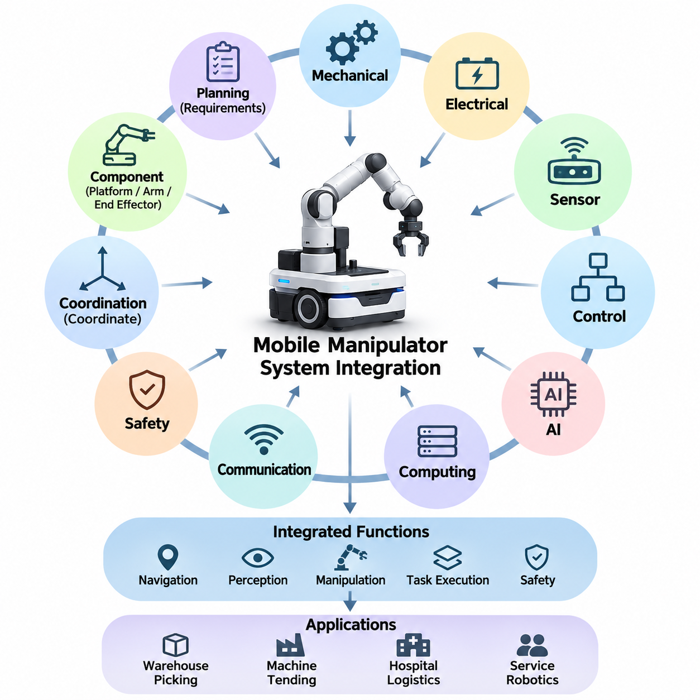
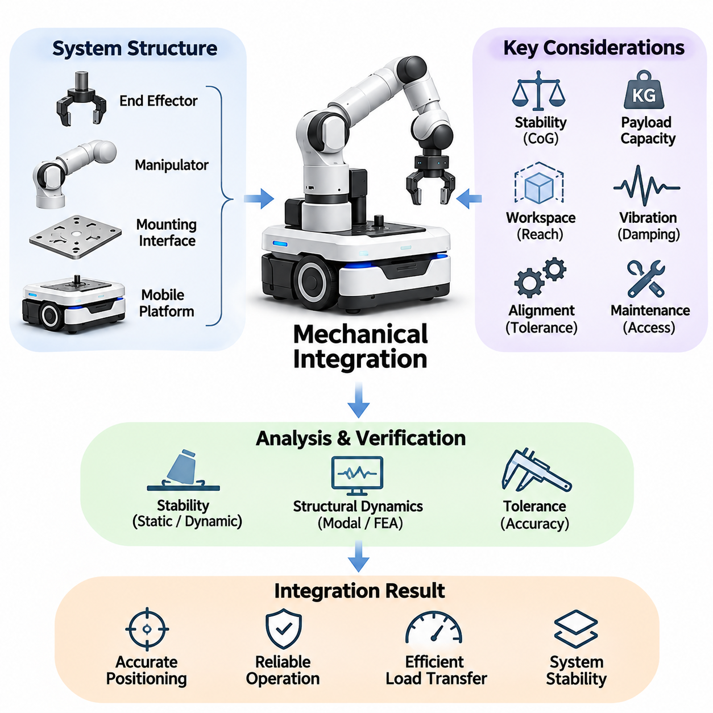
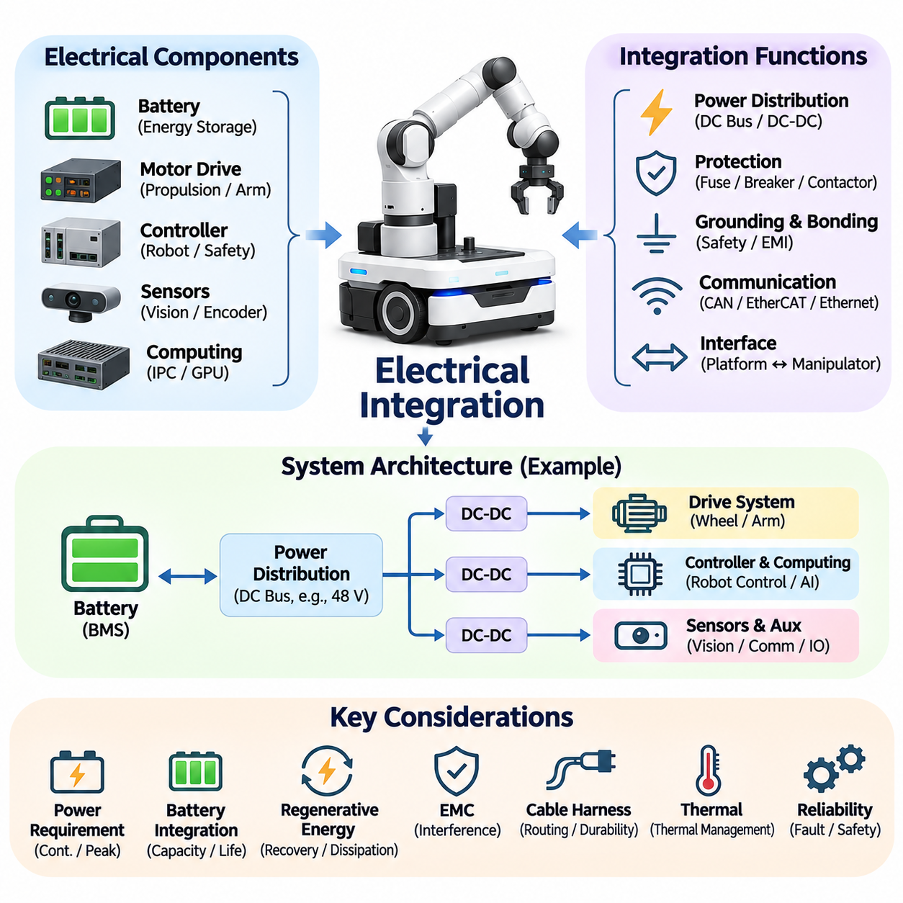
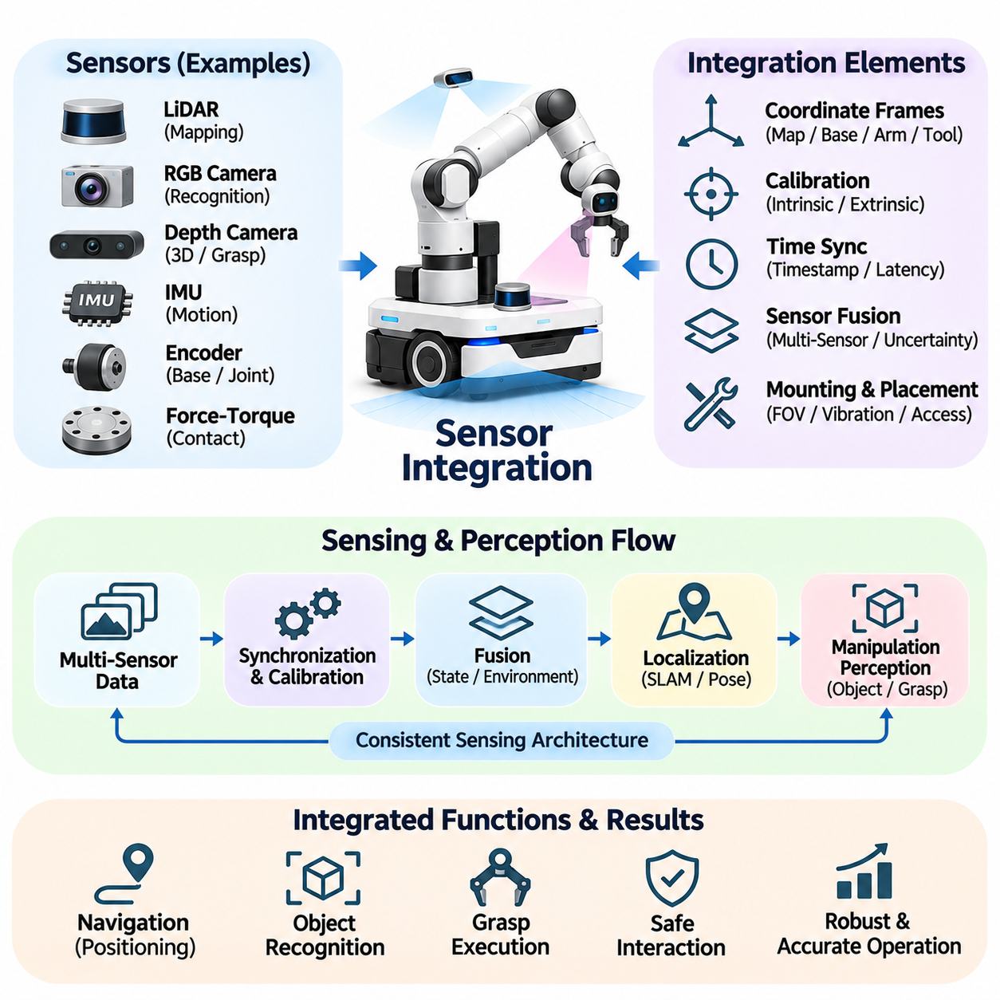
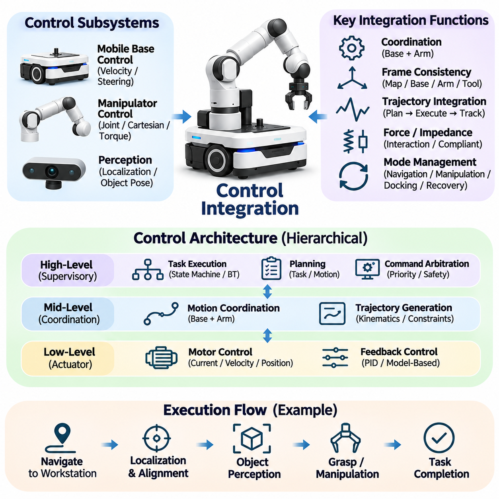
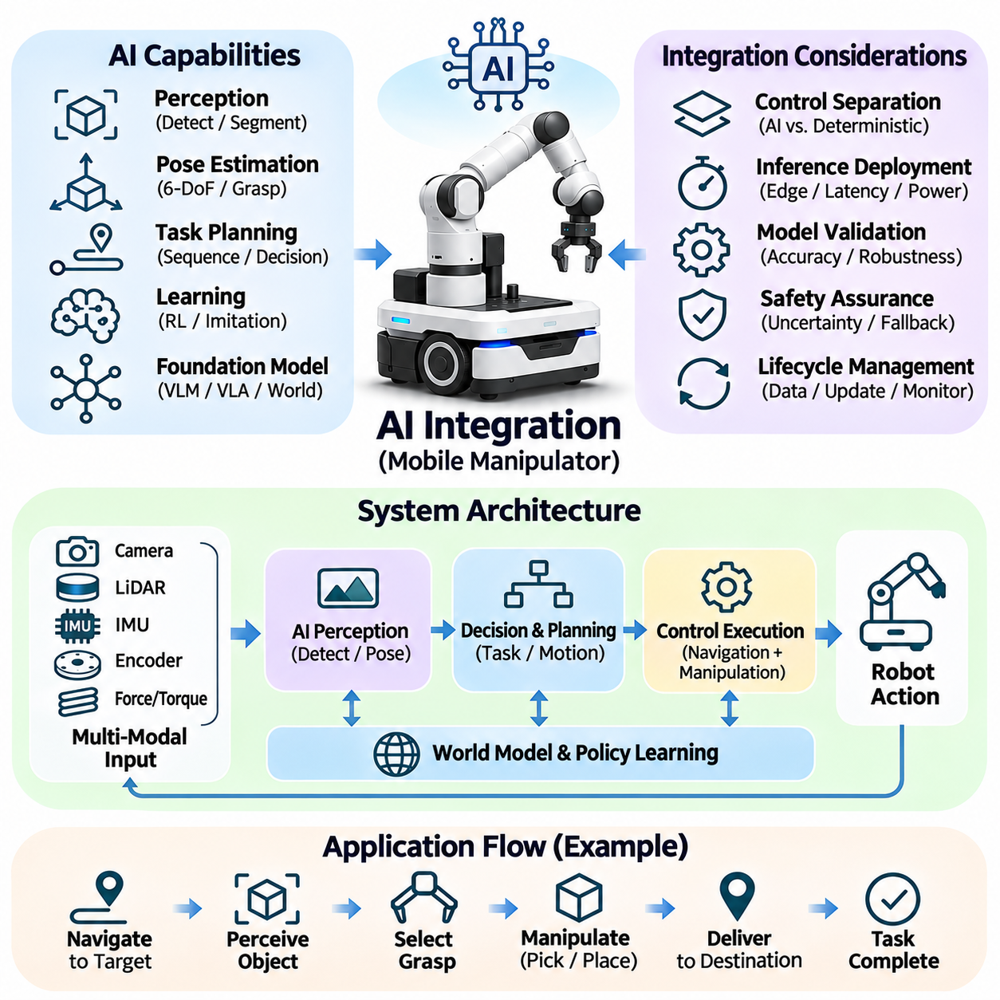
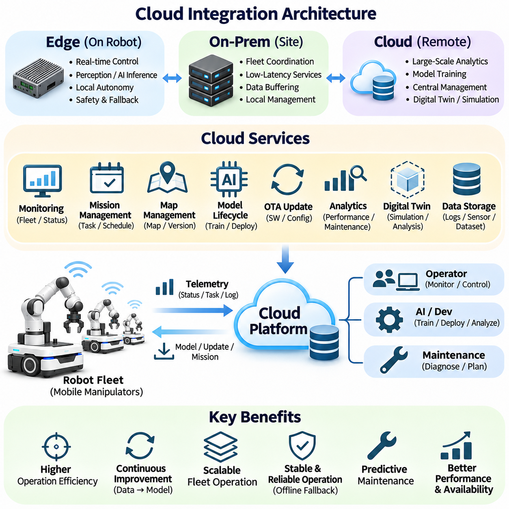
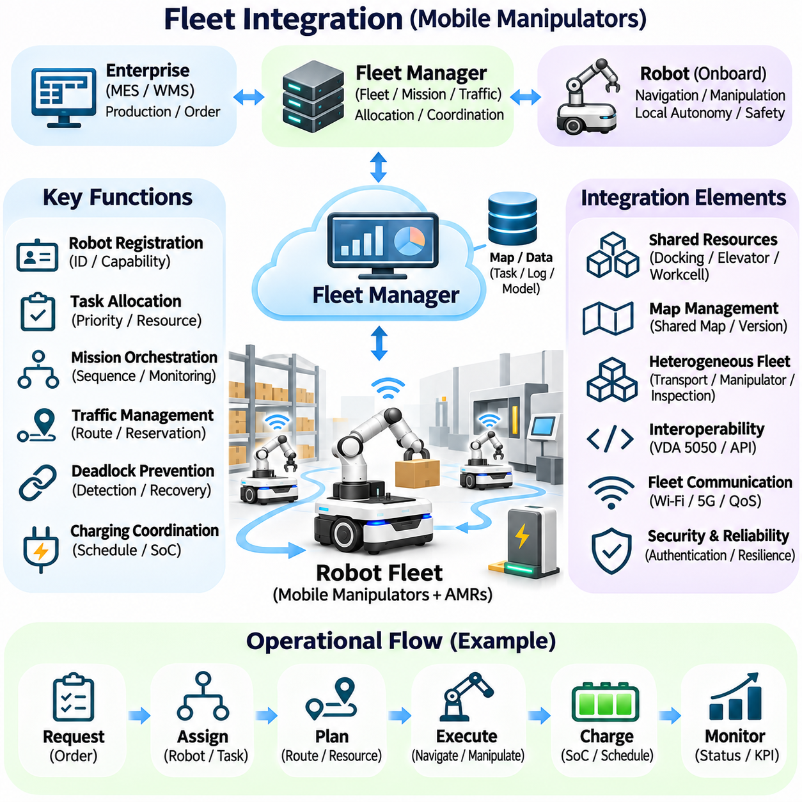
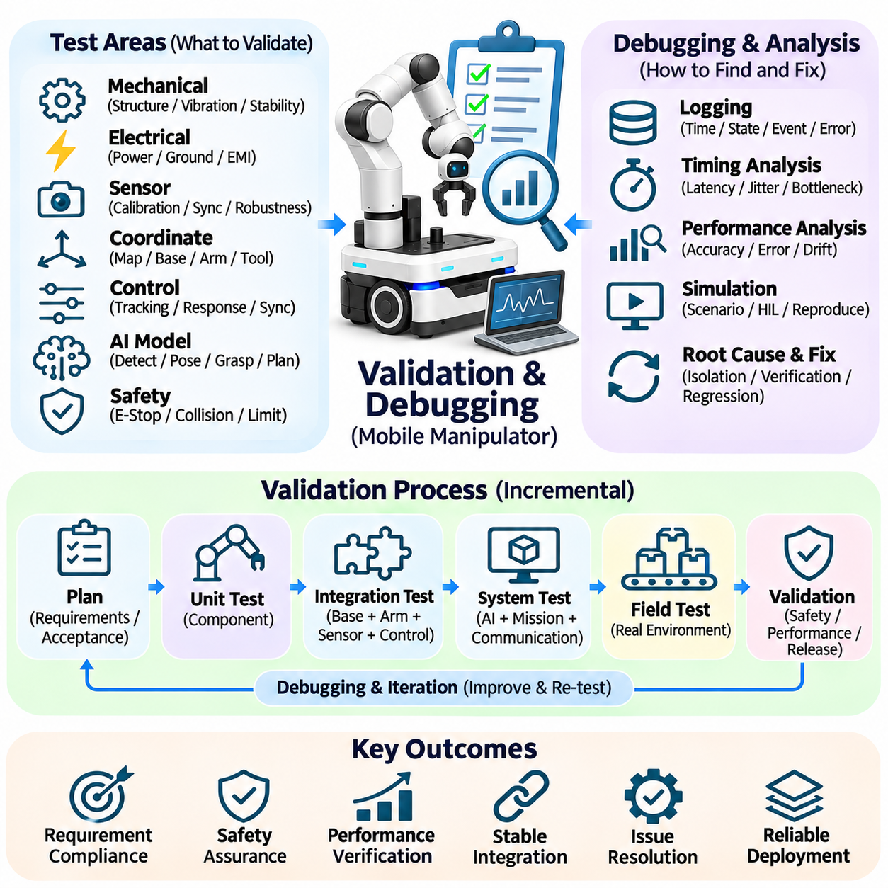

**Volume 01. Mobile Manipulator Foundations and System Architecture**


# Chapter 14. System Integration

## 01 System Integration Overview

{width="7.268055555555556in" height="7.268055555555556in"}

System integration is the engineering process of combining mechanical structures, electrical systems, sensors, controllers, artificial intelligence, and communication networks into a unified mobile manipulation platform. Unlike conventional industrial robots, mobile manipulators must coordinate locomotion and manipulation while operating in dynamic environments. Successful integration ensures that individual subsystems function together as a reliable, safe, and efficient robotic system.

A mobile manipulator typically consists of an autonomous mobile robot platform, a robotic arm, an end effector, perception sensors, computing hardware, and supporting infrastructure. Each component may operate successfully during independent testing, yet integration introduces additional dependencies. Mechanical vibrations, communication delays, power fluctuations, and inconsistent coordinate references can reduce overall performance even when individual components satisfy their specifications.

The primary objective of system integration is to transform independently developed components into a coordinated operational architecture. This requires defining subsystem responsibilities, communication interfaces, operating constraints, and shared performance requirements. Integration engineering must address both physical connectivity and functional interoperability, ensuring that navigation, perception, manipulation, and safety mechanisms operate consistently throughout the complete task lifecycle.

Integration planning begins with system-level requirements derived from intended applications. Warehouse picking, industrial machine tending, hospital logistics, and service robotics impose different demands on payload capacity, positioning accuracy, operating duration, and environmental awareness. These requirements determine component selection and integration priorities. Engineers must evaluate subsystem compatibility before finalizing the mechanical layout, electrical distribution, computing architecture, and software interfaces.

Mechanical integration establishes the physical relationship between the mobile platform and robotic manipulator. The mounting structure must withstand static loads, dynamic forces, acceleration, and manipulation-induced moments without excessive deformation. Arm placement influences the center of gravity, reachable workspace, and platform stability. Engineers must also consider maintenance accessibility, cable routing, vibration isolation, and mechanical tolerances to ensure reliable operation under realistic conditions.

Electrical integration connects batteries, power distribution units, motor drives, embedded controllers, sensors, and computing devices. Mobile manipulators frequently combine components operating at different voltage levels and power demands. Proper electrical architecture must accommodate peak motor currents, regenerative energy, grounding requirements, electromagnetic compatibility, and emergency power isolation. Electrical protection and power monitoring are essential for maintaining operational reliability and preventing cascading failures.

Sensor integration enables the robot to understand its surroundings and internal operating conditions. LiDAR, cameras, inertial measurement units, wheel encoders, force sensors, and joint feedback devices provide complementary information. Their measurements must be synchronized and transformed into consistent coordinate systems. Sensor placement, calibration, timestamp accuracy, and communication reliability directly influence localization, object recognition, grasp planning, and collision avoidance performance.

Control integration coordinates the mobile base, manipulator, and end effector through a hierarchical control architecture. Low-level controllers regulate wheel velocities, joint positions, motor torques, and actuator responses, while higher-level controllers manage navigation, trajectory generation, and task execution. Effective coordination requires predictable command execution, feedback exchange, and operating-state transitions. Control interfaces must also define how subsystems respond when commands fail or operating constraints are violated.

Mobile manipulation introduces coordination challenges because base movement changes the manipulator\'s position relative to surrounding objects. A grasp target detected before navigation may require updated localization and perception after the platform reaches its destination. The integration architecture must therefore maintain consistent spatial relationships among the map, mobile base, manipulator, sensors, and target objects. Coordinate transformations and calibration procedures are fundamental to achieving repeatable manipulation performance.

Artificial intelligence integration connects perception, decision-making, and action generation with the robot\'s physical control systems. Object detection, semantic segmentation, pose estimation, grasp prediction, and task planning may operate as independent computational modules. Their outputs must be converted into actionable commands with defined confidence thresholds and execution constraints. AI components should provide uncertainty information and failure indications rather than assuming every prediction is sufficiently reliable.

Computing architecture determines where robotic algorithms execute and how processing resources are allocated. Real-time motor control generally requires deterministic execution, while perception and learning-based inference may demand GPU acceleration. Edge computing reduces dependence on external connectivity and supports immediate decision-making. Integration engineers must balance computational throughput, memory consumption, thermal limitations, communication latency, and energy efficiency across the complete hardware platform.

Communication integration establishes reliable data exchange between embedded devices, robot controllers, edge computers, and external systems. Technologies such as CAN, industrial Ethernet, and wireless networking may serve different communication requirements. Middleware frameworks, including ROS 2, can provide standardized messaging and distributed software interfaces. However, message definitions, quality-of-service settings, network congestion, and fault recovery must be configured according to operational requirements.

Software integration organizes navigation, manipulation, perception, diagnostics, and mission management into a maintainable architecture. Modular components simplify development, but they also require clearly defined interfaces and lifecycle management. Integration teams must establish consistent software versions, configuration parameters, coordinate conventions, and communication protocols. Containerization, automated testing, and configuration management can improve reproducibility while reducing incompatibilities during deployment and maintenance.

Safety integration must address hazards arising from the combined behavior of the mobile platform and manipulator. A stationary arm may operate safely within a defined workspace, but movement of the base introduces additional collision and stability risks. Safety functions must consider simultaneous motion, obstacle proximity, payload conditions, and human interaction. Emergency stopping, protective monitoring, speed limitation, and fault detection require coordinated behavior across relevant subsystems.

Functional safety engineering also requires distinguishing ordinary software control from safety-related control functions. Navigation algorithms and AI perception may contribute to operational awareness, but they do not automatically satisfy safety integrity requirements. Safety-related sensors, controllers, and actuators must be selected and validated according to the applicable risk assessment. Integration must ensure that communication failures, controller resets, and unexpected subsystem states cannot bypass required protective functions.

Cloud integration extends robotic capabilities through centralized monitoring, data collection, analytics, and software management. Operational logs, diagnostic information, performance metrics, and selected perception data can support continuous improvement. However, essential safety and immediate motion-control functions should not depend on unpredictable cloud connectivity. A robust architecture maintains local operational authority while allowing external systems to provide supervision, optimization, and noncritical services.

Fleet integration becomes important when multiple mobile manipulators operate within a shared facility. Fleet management systems coordinate mission assignments, traffic management, charging schedules, and resource utilization. Integration must establish interfaces between individual robots and centralized orchestration services while preserving local autonomy. Shared workstations, narrow passages, and manipulation zones require explicit coordination policies to prevent congestion, interference, and unsafe interactions.

A complete operational workflow demonstrates how integration transforms subsystem capabilities into productive automation. During warehouse picking, a robot receives a mission, navigates toward a storage location, refines its position, identifies an item, calculates a grasp, and executes manipulation. The system then verifies task completion and reports its status. Each transition depends on information exchange, synchronized operating states, and reliable recovery mechanisms.

Integration testing should progress from individual components to increasingly complex subsystem combinations. Mechanical mounting, electrical connectivity, sensor calibration, and controller communication are verified before coordinated motion begins. Subsequent tests examine navigation with an installed manipulator, manipulation under different payload conditions, and complete mission execution. Incremental integration reduces debugging complexity by identifying interface problems before they propagate throughout the system.

System validation evaluates whether the integrated platform satisfies application-level requirements rather than merely confirming component functionality. Important measurements include navigation accuracy, manipulation success rate, task completion time, positioning repeatability, energy consumption, and operational availability. Tests should reproduce realistic environmental variations and workload conditions. Performance evaluation must also examine how subsystem interactions influence the reliability of the complete robot.

Debugging integrated robotic systems requires tracing failures across hardware and software boundaries. A failed grasp may originate from inaccurate perception, coordinate calibration errors, platform movement, communication delays, or insufficient actuator performance. Diagnostic tools should correlate sensor measurements, controller states, commands, and timestamps. Structured logging and repeatable test procedures help engineers distinguish root causes from secondary symptoms and prevent ineffective corrective actions.

Reliability engineering considers how individual subsystem failures influence overall system availability. A mobile manipulator may become unavailable because of battery faults, communication interruptions, sensor degradation, actuator errors, or software crashes. Fault detection, isolation, and recovery mechanisms should be designed as integrated capabilities. Where appropriate, the system may enter a reduced-function operating mode, retry a recoverable task, or transition into a controlled safe state.

Configuration management is essential because integrated robotic platforms evolve throughout development and deployment. Changes to firmware, sensor calibration, mechanical components, or AI models can alter system behavior. Engineers must maintain traceability among hardware revisions, software releases, interface specifications, and validation results. Controlled updates and regression testing reduce the risk that improvements in one subsystem unintentionally degrade another subsystem\'s performance.

Integration activities also require coordination among mechanical, electrical, controls, software, AI, and safety engineering teams. Interface control documents define responsibilities, data formats, electrical connections, timing requirements, and expected failure responses. Regular integration reviews help identify conflicting assumptions before physical implementation. Clear ownership of subsystem interfaces is particularly important when robotic arms, mobile platforms, and perception devices originate from different manufacturers.

The final objective of system integration is to deliver a mobile manipulator that performs complete tasks consistently under real operating conditions. Technical success depends not only on advanced sensors, powerful processors, or sophisticated AI algorithms, but also on the quality of their interaction. A well-integrated architecture provides predictable behavior, measurable performance, maintainable interfaces, and a foundation for scalable deployment across industrial, logistics, healthcare, and service environments.

시스템 통합(System Integration)은 기계 구조(Mechanical Structure), 전기 시스템(Electrical System), 센서(Sensor), 제어기(Controller), 인공지능(Artificial Intelligence), 통신 네트워크(Communication Network)를 하나의 통합된 이동형 매니퓰레이션 플랫폼(Mobile Manipulation Platform)으로 결합하는 엔지니어링 과정이다. 기존 산업용 로봇(Industrial Robot)과 달리 이동형 매니퓰레이터(Mobile Manipulator)는 동적 환경(Dynamic Environment)에서 이동과 조작을 동시에 조정해야 한다. 성공적인 시스템 통합은 개별 하위 시스템(Subsystem)이 안정적이고 안전하며 효율적인 로봇 시스템으로 함께 작동하도록 보장한다.

이동형 매니퓰레이터는 일반적으로 자율이동로봇(Autonomous Mobile Robot, AMR) 플랫폼, 로봇 팔(Robot Arm), 말단장치(End Effector), 인식 센서(Perception Sensor), 컴퓨팅 하드웨어(Computing Hardware), 지원 인프라(Supporting Infrastructure)로 구성된다. 각 구성요소는 독립적인 시험에서 정상적으로 작동할 수 있지만, 통합 과정에서는 추가적인 상호 의존성이 발생한다. 기계적 진동(Mechanical Vibration), 통신 지연(Communication Delay), 전력 변동(Power Fluctuation), 좌표 기준 불일치(Coordinate Reference Inconsistency)는 개별 구성요소가 요구 사양을 충족하더라도 전체 성능을 저하시킬 수 있다.

시스템 통합의 주요 목적은 독립적으로 개발된 구성요소를 상호 협력하는 운영 아키텍처(Operational Architecture)로 전환하는 것이다. 이를 위해 하위 시스템의 역할, 통신 인터페이스(Communication Interface), 운용 제약조건(Operating Constraint), 공통 성능 요구사항(Performance Requirement)을 정의해야 한다. 통합 엔지니어링(Integration Engineering)은 물리적 연결(Physical Connectivity)과 기능적 상호운용성(Functional Interoperability)을 모두 고려하여 내비게이션(Navigation), 인식(Perception), 조작(Manipulation), 안전 메커니즘(Safety Mechanism)이 전체 작업 생명주기(Task Lifecycle)에서 일관되게 작동하도록 해야 한다.

통합 계획(Integration Planning)은 목표 응용 분야에서 도출된 시스템 수준 요구사항(System-Level Requirement)을 기반으로 시작된다. 창고 피킹(Warehouse Picking), 산업용 설비 관리(Machine Tending), 병원 물류(Hospital Logistics), 서비스 로보틱스(Service Robotics)는 적재 용량(Payload Capacity), 위치 정확도(Positioning Accuracy), 운용 시간(Operating Duration), 환경 인식(Environmental Awareness)에 서로 다른 요구사항을 가진다. 이러한 요구사항은 구성요소 선정과 통합 우선순위를 결정하며, 엔지니어는 기계 배치, 전력 분배, 컴퓨팅 아키텍처, 소프트웨어 인터페이스를 확정하기 전에 하위 시스템 간 호환성을 평가해야 한다.

기계적 통합(Mechanical Integration)은 이동 플랫폼(Mobile Platform)과 로봇 매니퓰레이터(Robot Manipulator) 사이의 물리적 관계를 설정한다. 장착 구조물(Mounting Structure)은 과도한 변형 없이 정적 하중(Static Load), 동적 힘(Dynamic Force), 가속도(Acceleration), 조작 과정에서 발생하는 모멘트(Moment)를 견뎌야 한다. 로봇 팔의 설치 위치는 무게중심(Center of Gravity), 작업 가능 공간(Reachable Workspace), 플랫폼 안정성(Platform Stability)에 영향을 준다. 또한 유지보수 접근성(Maintenance Accessibility), 케이블 배선(Cable Routing), 진동 절연(Vibration Isolation), 기계적 공차(Mechanical Tolerance)를 고려해야 한다.

전기적 통합(Electrical Integration)은 배터리(Battery), 전력 분배 장치(Power Distribution Unit), 모터 드라이브(Motor Drive), 임베디드 제어기(Embedded Controller), 센서, 컴퓨팅 장치를 연결한다. 이동형 매니퓰레이터는 서로 다른 전압 수준(Voltage Level)과 전력 요구량(Power Demand)을 가진 구성요소를 결합하는 경우가 많다. 적절한 전기 아키텍처(Electrical Architecture)는 최대 모터 전류(Peak Motor Current), 회생 에너지(Regenerative Energy), 접지(Grounding), 전자기 적합성(Electromagnetic Compatibility), 비상 전원 차단(Emergency Power Isolation)을 수용해야 한다. 전기적 보호(Electrical Protection)와 전력 모니터링(Power Monitoring)은 연쇄 고장(Cascading Failure)을 방지하는 데 필수적이다.

센서 통합(Sensor Integration)은 로봇이 주변 환경과 내부 운용 상태를 이해하도록 지원한다. 라이다(LiDAR), 카메라(Camera), 관성측정장치(Inertial Measurement Unit, IMU), 휠 엔코더(Wheel Encoder), 힘 센서(Force Sensor), 관절 피드백 장치(Joint Feedback Device)는 상호 보완적인 정보를 제공한다. 이러한 측정값은 시간적으로 동기화(Synchronization)되고 일관된 좌표계(Coordinate System)로 변환되어야 한다. 센서 배치(Sensor Placement), 보정(Calibration), 타임스탬프 정확도(Timestamp Accuracy), 통신 신뢰성(Communication Reliability)은 위치 추정(Localization), 객체 인식(Object Recognition), 파지 계획(Grasp Planning), 충돌 회피(Collision Avoidance)의 성능에 직접적인 영향을 준다.

제어 통합(Control Integration)은 계층적 제어 아키텍처(Hierarchical Control Architecture)를 통해 이동 베이스(Mobile Base), 매니퓰레이터(Manipulator), 말단장치(End Effector)를 조정한다. 저수준 제어기(Low-Level Controller)는 휠 속도(Wheel Velocity), 관절 위치(Joint Position), 모터 토크(Motor Torque), 액추에이터 응답(Actuator Response)을 제어하고, 상위 제어기(Higher-Level Controller)는 내비게이션, 궤적 생성(Trajectory Generation), 작업 실행(Task Execution)을 관리한다. 효과적인 협조 제어(Coordinated Control)를 위해서는 예측 가능한 명령 실행, 피드백 교환, 운용 상태 전환이 필요하며, 명령 실패나 제약조건 위반 시 하위 시스템의 대응 방식도 정의해야 한다.

이동형 매니퓰레이션(Mobile Manipulation)은 베이스 이동에 따라 주변 객체에 대한 매니퓰레이터의 상대 위치가 변화하므로 특별한 협조 제어 문제를 발생시킨다. 이동 전에 감지한 파지 대상(Grasp Target)은 플랫폼이 목적지에 도착한 이후 위치 추정과 인식 정보를 갱신해야 할 수 있다. 따라서 통합 아키텍처는 지도(Map), 이동 베이스, 매니퓰레이터, 센서, 대상 객체 사이의 일관된 공간 관계(Spatial Relationship)를 유지해야 한다. 좌표 변환(Coordinate Transformation)과 보정 절차(Calibration Procedure)는 반복 가능한 조작 성능(Repeatable Manipulation Performance)을 확보하기 위한 기본 요소이다.

인공지능 통합(AI Integration)은 인식(Perception), 의사결정(Decision-Making), 행동 생성(Action Generation)을 로봇의 물리적 제어 시스템과 연결한다. 객체 탐지(Object Detection), 의미론적 분할(Semantic Segmentation), 자세 추정(Pose Estimation), 파지 예측(Grasp Prediction), 작업 계획(Task Planning)은 독립적인 연산 모듈(Computational Module)로 실행될 수 있다. 각 모듈의 출력은 신뢰도 임계값(Confidence Threshold)과 실행 제약조건(Execution Constraint)이 정의된 동작 명령으로 변환되어야 한다. 인공지능 구성요소는 모든 예측이 충분히 신뢰할 수 있다고 가정하기보다 불확실성 정보(Uncertainty Information)와 실패 상태(Failure Indication)를 제공해야 한다.

컴퓨팅 아키텍처(Computing Architecture)는 로봇 알고리즘(Robotic Algorithm)이 실행되는 위치와 처리 자원(Processing Resource)의 할당 방식을 결정한다. 실시간 모터 제어(Real-Time Motor Control)는 일반적으로 결정론적 실행(Deterministic Execution)을 요구하지만, 인식과 학습 기반 추론(Learning-Based Inference)은 GPU 가속(GPU Acceleration)을 필요로 할 수 있다. 엣지 컴퓨팅(Edge Computing)은 외부 연결 의존도를 낮추고 즉각적인 의사결정을 지원한다. 통합 엔지니어는 전체 하드웨어 플랫폼에서 연산 처리량(Computational Throughput), 메모리 사용량(Memory Consumption), 열적 한계(Thermal Limitation), 통신 지연, 에너지 효율(Energy Efficiency)을 균형 있게 고려해야 한다.

통신 통합(Communication Integration)은 임베디드 장치(Embedded Device), 로봇 제어기(Robot Controller), 엣지 컴퓨터(Edge Computer), 외부 시스템(External System) 사이의 신뢰성 있는 데이터 교환을 구축한다. CAN, 산업용 이더넷(Industrial Ethernet), 무선 네트워크(Wireless Network)는 서로 다른 통신 요구사항을 담당할 수 있다. ROS 2와 같은 미들웨어 프레임워크(Middleware Framework)는 표준화된 메시징(Messaging)과 분산 소프트웨어 인터페이스(Distributed Software Interface)를 제공한다. 그러나 메시지 정의(Message Definition), 서비스 품질(Quality of Service, QoS), 네트워크 혼잡(Network Congestion), 장애 복구(Fault Recovery)는 운용 요구사항에 따라 설정되어야 한다.

소프트웨어 통합(Software Integration)은 내비게이션, 조작, 인식, 진단(Diagnostics), 임무 관리(Mission Management)를 유지보수가 가능한 아키텍처로 구성한다. 모듈형 구성요소(Modular Component)는 개발을 단순화하지만 명확하게 정의된 인터페이스와 생명주기 관리(Lifecycle Management)가 필요하다. 통합 팀은 소프트웨어 버전(Software Version), 설정 매개변수(Configuration Parameter), 좌표 규약(Coordinate Convention), 통신 프로토콜(Communication Protocol)의 일관성을 확보해야 한다. 컨테이너화(Containerization), 자동화 시험(Automated Testing), 구성 관리(Configuration Management)는 재현성(Reproducibility)을 향상시키고 배포 및 유지보수 과정에서 발생하는 비호환성을 줄일 수 있다.

안전 통합(Safety Integration)은 이동 플랫폼과 매니퓰레이터의 결합 동작에서 발생하는 위험요소(Hazard)를 다루어야 한다. 정지 상태의 로봇 팔은 정의된 작업공간(Workspace) 내에서 안전하게 작동할 수 있지만, 베이스 이동은 추가적인 충돌 위험(Collision Risk)과 안정성 위험(Stability Risk)을 발생시킨다. 안전 기능(Safety Function)은 동시 동작(Simultaneous Motion), 장애물 근접성(Obstacle Proximity), 적재 상태(Payload Condition), 인간과의 상호작용(Human Interaction)을 고려해야 한다. 비상 정지(Emergency Stop), 보호 감시(Protective Monitoring), 속도 제한(Speed Limitation), 고장 탐지(Fault Detection)는 관련 하위 시스템 전체에서 조정된 동작을 필요로 한다.

기능 안전 엔지니어링(Functional Safety Engineering)은 일반 소프트웨어 제어(Ordinary Software Control)와 안전 관련 제어 기능(Safety-Related Control Function)을 구분해야 한다. 내비게이션 알고리즘과 인공지능 인식 기술은 운용 상황 인식(Operational Awareness)에 기여할 수 있지만, 자동으로 안전 무결성 요구사항(Safety Integrity Requirement)을 충족하는 것은 아니다. 안전 관련 센서, 제어기, 액추에이터는 적용 가능한 위험성 평가(Risk Assessment)에 따라 선정하고 검증해야 한다. 통합 과정에서는 통신 장애, 제어기 재시작, 예상하지 못한 하위 시스템 상태가 필수 보호 기능(Protective Function)을 우회하지 못하도록 보장해야 한다.

클라우드 통합(Cloud Integration)은 중앙 집중식 모니터링(Centralized Monitoring), 데이터 수집(Data Collection), 분석(Analytics), 소프트웨어 관리(Software Management)를 통해 로봇의 기능을 확장한다. 운용 로그(Operational Log), 진단 정보(Diagnostic Information), 성능 지표(Performance Metric), 선택된 인식 데이터(Perception Data)는 지속적인 개선(Continuous Improvement)을 지원한다. 그러나 필수 안전 기능과 즉각적인 동작 제어 기능은 예측하기 어려운 클라우드 연결(Cloud Connectivity)에 의존해서는 안 된다. 견고한 아키텍처(Robust Architecture)는 로컬 운용 권한(Local Operational Authority)을 유지하면서 외부 시스템이 감독, 최적화, 비핵심 서비스를 제공하도록 구성한다.

플릿 통합(Fleet Integration)은 여러 이동형 매니퓰레이터가 공통 시설에서 운용될 때 중요해진다. 플릿 관리 시스템(Fleet Management System)은 임무 할당(Mission Assignment), 교통 관리(Traffic Management), 충전 일정(Charging Schedule), 자원 활용(Resource Utilization)을 조정한다. 통합 과정에서는 개별 로봇과 중앙 오케스트레이션 서비스(Centralized Orchestration Service) 사이의 인터페이스를 정의하면서 로컬 자율성(Local Autonomy)을 유지해야 한다. 공동 작업장(Shared Workstation), 좁은 통로(Narrow Passage), 조작 구역(Manipulation Zone)은 혼잡, 간섭, 위험한 상호작용을 방지하기 위한 명시적인 협조 정책(Coordination Policy)을 필요로 한다.

완전한 운용 작업흐름(Operational Workflow)은 시스템 통합이 개별 기능을 생산적인 자동화로 전환하는 과정을 보여준다. 창고 피킹 작업에서 로봇은 임무를 수신하고 저장 위치로 이동한 뒤 위치를 정밀 보정하고 물품을 인식하며 파지 동작을 계산하고 조작을 실행한다. 이후 시스템은 작업 완료 여부를 검증하고 상태를 보고한다. 각 단계의 전환은 정보 교환(Information Exchange), 동기화된 운용 상태(Synchronized Operating State), 신뢰성 있는 복구 메커니즘(Recovery Mechanism)에 의존한다.

통합 시험(Integration Testing)은 개별 구성요소에서 시작하여 점차 복잡한 하위 시스템 조합으로 확대해야 한다. 기계적 장착(Mechanical Mounting), 전기적 연결(Electrical Connectivity), 센서 보정(Sensor Calibration), 제어기 통신(Controller Communication)은 협조 동작(Coordinated Motion)을 시작하기 전에 검증한다. 이후 시험에서는 매니퓰레이터가 장착된 상태의 내비게이션, 다양한 적재 조건에서의 조작, 전체 임무 실행을 평가한다. 점진적 통합(Incremental Integration)은 인터페이스 문제가 전체 시스템으로 확산되기 전에 발견하도록 하여 디버깅(Debugging)의 복잡성을 줄인다.

시스템 검증(System Validation)은 단순히 구성요소의 기능을 확인하는 것이 아니라 통합 플랫폼이 응용 수준 요구사항(Application-Level Requirement)을 충족하는지 평가한다. 주요 측정 항목에는 내비게이션 정확도(Navigation Accuracy), 조작 성공률(Manipulation Success Rate), 작업 완료 시간(Task Completion Time), 위치 반복정밀도(Positioning Repeatability), 에너지 소비(Energy Consumption), 운용 가용성(Operational Availability)이 포함된다. 시험은 실제 환경 변화(Environmental Variation)와 작업 부하 조건(Workload Condition)을 재현해야 하며, 성능 평가(Performance Evaluation)는 하위 시스템 간 상호작용이 전체 로봇의 신뢰성에 미치는 영향도 분석해야 한다.

통합 로봇 시스템의 디버깅(Debugging)은 하드웨어와 소프트웨어 경계를 넘어 고장 원인을 추적해야 한다. 파지 실패(Grasp Failure)는 부정확한 인식, 좌표 보정 오류(Coordinate Calibration Error), 플랫폼 이동, 통신 지연, 액추에이터 성능 부족에서 발생할 수 있다. 진단 도구(Diagnostic Tool)는 센서 측정값, 제어기 상태, 명령, 타임스탬프(Timestamp)를 연관시켜 분석해야 한다. 구조화된 로깅(Structured Logging)과 반복 가능한 시험 절차(Repeatable Test Procedure)는 근본 원인(Root Cause)과 2차 증상(Secondary Symptom)을 구분하고 비효율적인 수정 조치를 방지하는 데 도움이 된다.

신뢰성 엔지니어링(Reliability Engineering)은 개별 하위 시스템의 고장이 전체 시스템 가용성(System Availability)에 미치는 영향을 고려한다. 이동형 매니퓰레이터는 배터리 고장(Battery Fault), 통신 중단(Communication Interruption), 센서 성능 저하(Sensor Degradation), 액추에이터 오류(Actuator Error), 소프트웨어 충돌(Software Crash)로 인해 운용이 중단될 수 있다. 고장 탐지(Fault Detection), 고장 격리(Fault Isolation), 복구 메커니즘(Recovery Mechanism)은 통합된 기능으로 설계해야 한다. 적절한 경우 시스템은 기능 제한 운용 모드(Reduced-Function Operating Mode)로 전환하거나 복구 가능한 작업을 재시도하거나 제어된 안전 상태(Controlled Safe State)로 전환할 수 있다.

구성 관리(Configuration Management)는 통합 로봇 플랫폼이 개발과 배포 과정에서 지속적으로 변화하기 때문에 필수적이다. 펌웨어(Firmware), 센서 보정, 기계적 구성요소, 인공지능 모델(AI Model)의 변경은 시스템 동작을 변화시킬 수 있다. 엔지니어는 하드웨어 개정 이력(Hardware Revision), 소프트웨어 릴리스(Software Release), 인터페이스 사양(Interface Specification), 검증 결과(Validation Result) 사이의 추적성(Traceability)을 유지해야 한다. 통제된 업데이트(Controlled Update)와 회귀 시험(Regression Testing)은 한 하위 시스템의 개선이 다른 하위 시스템의 성능을 의도하지 않게 저하시키는 위험을 줄인다.

통합 활동(Integration Activity)은 기계, 전기, 제어, 소프트웨어, 인공지능, 안전 엔지니어링 팀 사이의 협업도 필요로 한다. 인터페이스 제어 문서(Interface Control Document, ICD)는 책임 범위, 데이터 형식(Data Format), 전기적 연결, 타이밍 요구사항(Timing Requirement), 예상되는 고장 대응(Failure Response)을 정의한다. 정기적인 통합 검토(Integration Review)는 물리적 구현 이전에 서로 충돌하는 가정을 발견하도록 지원한다. 하위 시스템 인터페이스에 대한 명확한 책임 소재(Interface Ownership)는 로봇 팔, 이동 플랫폼, 인식 장치가 서로 다른 제조업체에서 공급될 때 특히 중요하다.

시스템 통합의 최종 목표는 실제 운용 조건(Real Operating Condition)에서 전체 작업을 일관되게 수행하는 이동형 매니퓰레이터를 구현하는 것이다. 기술적 성공은 첨단 센서(Advanced Sensor), 고성능 프로세서(High-Performance Processor), 정교한 인공지능 알고리즘(Sophisticated AI Algorithm)뿐만 아니라 이들 사이의 상호작용 품질(Interaction Quality)에 의해 결정된다. 잘 통합된 아키텍처는 예측 가능한 동작(Predictable Behavior), 측정 가능한 성능(Measurable Performance), 유지보수가 가능한 인터페이스(Maintainable Interface)를 제공하며 산업, 물류, 의료, 서비스 환경 전반에서 확장 가능한 배포(Scalable Deployment)의 기반을 마련한다.

## 02 Mechanical Integration

{width="7.268055555555556in" height="7.268055555555556in"}

Mechanical integration is the process of combining the mobile platform, robotic arm, end effector, structural frame, and supporting components into a unified physical system. In mobile manipulators, mechanical design must accommodate both locomotion and manipulation, creating challenges beyond those encountered in stationary industrial robots. Successful integration ensures structural stability, accurate positioning, efficient load transfer, and reliable operation under changing environmental conditions.

The mechanical architecture begins with defining the physical relationship between the autonomous mobile robot and its manipulator. Platform dimensions, wheel configuration, suspension characteristics, and mounting locations influence the robot\'s overall performance. Engineers must evaluate the manipulator\'s reach, payload capacity, and operating envelope while ensuring that its installation does not interfere with mobility, obstacle clearance, or access to essential maintenance components.

Structural integration requires a mounting interface capable of transferring forces and moments between the manipulator and mobile base. During acceleration, lifting, and object handling, the robotic arm generates dynamic loads that propagate through the supporting structure. Mounting plates, brackets, reinforcement members, and fastening systems must withstand these loads without excessive deformation. Structural stiffness is particularly important when precise manipulation depends on stable positioning.

The center of gravity is a fundamental consideration in mobile manipulator design because it changes with arm configuration and payload position. Extending the manipulator horizontally or lifting heavy objects can shift the combined center of gravity toward the edge of the support polygon. Engineers must evaluate these changes across representative operating configurations to prevent tipping, excessive wheel loading, and loss of traction during navigation or manipulation.

Static stability analysis examines whether the projected center of gravity remains within the support polygon formed by the robot\'s ground contact points. Dynamic stability analysis additionally considers acceleration, braking, turning, and manipulator motion. A robot that remains stable while stationary may become unstable during rapid movements or emergency stops. Conservative stability margins and appropriate motion constraints are therefore necessary for safe operation.

Payload integration requires distinguishing the manipulator\'s rated payload from the total load supported by the mobile platform. The combined system must accommodate the arm, mounting structure, end effector, carried objects, batteries, and auxiliary equipment. Payload capacity should be evaluated under the most demanding operating configurations rather than relying exclusively on nominal specifications. Uneven load distribution may also affect suspension behavior and wheel contact forces.

The manipulator mounting position determines the reachable workspace and influences the efficiency of task execution. Central mounting can provide balanced load distribution, while offset mounting may improve access to shelves, machines, or workstations. However, an offset arrangement introduces asymmetric loading and may reduce stability in certain arm configurations. Mechanical integration must balance accessibility, structural requirements, workspace coverage, and platform maneuverability.

Workspace integration considers the combined motion capabilities of the mobile base and robotic arm. The manipulator\'s reachable volume changes as the platform moves, allowing the system to access objects beyond the range of a stationary robot. Nevertheless, mechanical interference may occur between the arm, chassis, sensors, or surrounding equipment. Engineers must examine joint limits, self-collision regions, and physical clearance throughout representative motion sequences.

Vibration is an important mechanical integration challenge because mobile platforms experience disturbances from wheel rotation, uneven surfaces, acceleration, and structural resonance. These disturbances can propagate into the manipulator and degrade positioning accuracy or sensor measurements. Mechanical stiffness, damping materials, vibration isolators, and appropriate structural design can reduce unwanted motion. However, isolation mechanisms must not introduce excessive compliance that compromises manipulation precision.

Structural dynamics become particularly important when the manipulator operates at high speeds or handles variable payloads. Flexible mounting structures may exhibit oscillations after rapid joint movements, increasing settling time before precision tasks can begin. Engineers can investigate these effects through modal analysis, finite element analysis, and experimental vibration measurements. The objective is to maintain adequate stiffness and damping across the expected operating frequency range.

Mechanical alignment establishes consistent geometric relationships between the mobile platform, manipulator base, sensors, and end effector. Manufacturing tolerances and assembly deviations can introduce positioning errors that propagate through the kinematic chain. Precision locating features, machined reference surfaces, and controlled fastening procedures improve repeatability. Mechanical alignment should be verified before software calibration attempts to compensate for residual geometric errors.

Tolerance management is essential because multiple mechanical components contribute to the final positioning accuracy. Variations in mounting plate flatness, bolt-hole locations, structural deformation, and joint installation can accumulate across the system. Engineers should perform tolerance analysis to identify critical interfaces and determine acceptable manufacturing deviations. Repeatable assembly procedures and inspection criteria help maintain consistent performance across multiple production units.

Fastening and joint design must account for vibration, cyclic loading, and maintenance requirements. Bolted connections are commonly used because they support modular assembly and component replacement. However, insufficient preload, inappropriate fastener selection, or poorly designed load paths may lead to loosening and fatigue damage. Proper torque specifications, locking methods, and inspection procedures are necessary to maintain structural integrity throughout the robot\'s operating life.

Cable routing is another mechanical integration concern because the manipulator and mobile base contain moving joints, rotating mechanisms, and vibration-sensitive components. Power cables, communication lines, pneumatic tubes, and sensor connections must be protected from abrasion, excessive bending, and mechanical interference. Cable carriers, protective conduits, strain relief devices, and appropriate bend radii improve durability while preserving the required range of motion.

Thermal and environmental considerations influence mechanical packaging and component placement. Motors, batteries, power electronics, and computing devices generate heat that must be dissipated without exposing sensitive equipment to excessive temperatures. Enclosures should provide adequate airflow or thermal conduction while meeting environmental protection requirements. Dust, moisture, cleaning chemicals, and operating temperature variations may require additional sealing, protective coatings, or corrosion-resistant materials.

The integration of end effectors introduces additional mechanical requirements related to tool mass, gripping forces, and object interaction. Grippers, suction devices, and specialized tools modify the manipulator\'s inertia and load distribution. Tool-changing mechanisms may further increase complexity by introducing mechanical locking interfaces and alignment requirements. Engineers must verify that end-effector installation preserves payload limits, positioning accuracy, and operational safety.

Mobility performance must be reassessed after installing the manipulator because the additional mass changes the platform\'s dynamic characteristics. Acceleration, braking distance, turning behavior, and obstacle traversal may differ from the original mobile base specifications. Suspension deflection and tire deformation can also influence platform orientation and manipulation accuracy. Integrated testing should therefore evaluate mobility with representative arm configurations and payload conditions.

Docking and workstation interaction require precise mechanical relationships between the robot and external equipment. Even when navigation provides accurate positioning, small residual errors may prevent reliable object transfer or machine interaction. Mechanical guides, compliant interfaces, alignment features, and locating mechanisms can improve repeatability. These features should be designed to accommodate expected positioning uncertainty without creating excessive contact forces or mechanical binding.

Maintainability should be incorporated into the mechanical architecture from the beginning of development. Batteries, actuators, sensors, controllers, and fastening points must remain accessible for inspection and replacement. Modular mounting assemblies can reduce service time and simplify component upgrades. Engineers should also consider lifting points, transportation restraints, and safe procedures for removing heavy manipulators or structural components during maintenance.

Mechanical safety includes preventing tipping, uncontrolled movement, structural failure, and hazardous contact with moving components. Protective covers, mechanical stops, guarded pinch points, and secure mounting arrangements reduce exposure to foreseeable hazards. The design must also account for emergency braking and unexpected manipulator movements. Mechanical safeguards should complement electrical and software safety functions rather than depending entirely on active control systems.

Mechanical integration validation combines analytical calculations, simulation, physical inspection, and experimental testing. Static load tests verify structural strength, while dynamic tests examine vibration, deformation, and stability during representative operations. Engineers should evaluate maximum payload conditions, extended arm configurations, emergency braking, and repeated task cycles. Test results provide evidence that the integrated structure satisfies defined mechanical requirements.

Finite element analysis can support early evaluation of mounting structures, chassis reinforcements, and load-bearing components. Stress distributions, displacement patterns, and natural frequencies help identify potential weaknesses before manufacturing. However, simulation accuracy depends on realistic boundary conditions, material properties, and applied loads. Experimental measurements should be used to validate critical assumptions and refine structural models when necessary.

Reliability assessment considers long-term mechanical degradation caused by fatigue, wear, vibration, and repeated loading. Components that perform adequately during initial testing may develop looseness, cracks, or alignment changes after extended operation. Periodic inspection and condition monitoring can detect emerging problems before functional failure occurs. Mechanical design should support predictable maintenance intervals and straightforward replacement of components subject to wear.

Successful mechanical integration ultimately establishes the physical foundation for reliable mobile manipulation. Structural stiffness, stability, payload distribution, alignment, vibration control, and maintainability directly influence the performance of perception and control algorithms. A carefully engineered mechanical architecture enables accurate manipulation while preserving mobility and operational safety. It also supports repeatable manufacturing, efficient maintenance, and scalable deployment across diverse robotic applications.

기계적 통합(Mechanical Integration)은 이동 플랫폼(Mobile Platform), 로봇 팔(Robot Arm), 말단장치(End Effector), 구조 프레임(Structural Frame), 지원 구성요소(Supporting Component)를 하나의 통합된 물리적 시스템(Physical System)으로 결합하는 과정이다. 이동형 매니퓰레이터(Mobile Manipulator)의 기계 설계(Mechanical Design)는 이동(Locomotion)과 조작(Manipulation)을 동시에 수용해야 하므로 고정형 산업용 로봇(Stationary Industrial Robot)보다 복잡한 과제를 가진다. 성공적인 통합은 구조적 안정성(Structural Stability), 정확한 위치 결정(Accurate Positioning), 효율적인 하중 전달(Load Transfer), 변화하는 환경 조건에서의 신뢰성 있는 작동을 보장한다.

기계 아키텍처(Mechanical Architecture)는 자율이동로봇(Autonomous Mobile Robot, AMR)과 매니퓰레이터(Manipulator) 사이의 물리적 관계를 정의하는 것에서 시작된다. 플랫폼 크기(Platform Dimension), 휠 구성(Wheel Configuration), 서스펜션 특성(Suspension Characteristics), 장착 위치(Mounting Location)는 로봇의 전체 성능에 영향을 미친다. 엔지니어는 매니퓰레이터의 도달 범위(Reach), 적재 용량(Payload Capacity), 작동 영역(Operating Envelope)을 평가하면서 설치 구조가 이동성(Mobility), 장애물 통과 높이(Obstacle Clearance), 주요 유지보수 구성요소에 대한 접근성을 방해하지 않도록 해야 한다.

구조적 통합(Structural Integration)에는 매니퓰레이터와 이동 베이스(Mobile Base) 사이에서 힘(Force)과 모멘트(Moment)를 전달할 수 있는 장착 인터페이스(Mounting Interface)가 필요하다. 가속, 리프팅(Lifting), 물체 취급(Object Handling) 과정에서 로봇 팔은 지지 구조물(Supporting Structure)로 전달되는 동적 하중(Dynamic Load)을 발생시킨다. 장착 플레이트(Mounting Plate), 브래킷(Bracket), 보강 부재(Reinforcement Member), 체결 시스템(Fastening System)은 과도한 변형 없이 이러한 하중을 견뎌야 한다. 정밀한 조작이 안정적인 위치 결정에 의존하는 경우 구조 강성(Structural Stiffness)은 특히 중요하다.

무게중심(Center of Gravity, CoG)은 로봇 팔의 자세(Arm Configuration)와 적재물 위치(Payload Position)에 따라 변화하므로 이동형 매니퓰레이터 설계의 핵심 고려사항이다. 매니퓰레이터를 수평으로 확장하거나 무거운 물체를 들어 올리면 전체 무게중심이 지지 다각형(Support Polygon)의 가장자리 방향으로 이동할 수 있다. 엔지니어는 대표적인 운용 자세(Operating Configuration)에서 이러한 변화를 평가하여 이동이나 조작 중 전복(Tipping), 과도한 휠 하중(Wheel Loading), 접지력 손실(Loss of Traction)을 방지해야 한다.

정적 안정성 해석(Static Stability Analysis)은 무게중심의 지면 투영점(Projected Center of Gravity)이 로봇의 지면 접촉점(Ground Contact Point)으로 형성된 지지 다각형 내부에 유지되는지 평가한다. 동적 안정성 해석(Dynamic Stability Analysis)은 가속(Acceleration), 제동(Braking), 선회(Turning), 매니퓰레이터 동작을 추가로 고려한다. 정지 상태에서 안정적인 로봇도 빠른 움직임이나 비상 정지(Emergency Stop) 과정에서는 불안정해질 수 있다. 따라서 안전한 운용을 위해 보수적인 안정성 여유(Stability Margin)와 적절한 동작 제약조건(Motion Constraint)이 필요하다.

적재하중 통합(Payload Integration)에서는 매니퓰레이터의 정격 적재하중(Rated Payload)과 이동 플랫폼이 지지하는 전체 하중(Total Supported Load)을 구분해야 한다. 통합 시스템은 로봇 팔, 장착 구조물, 말단장치, 운반 물체, 배터리(Battery), 보조 장비(Auxiliary Equipment)의 질량을 모두 수용해야 한다. 적재 용량은 명목 사양(Nominal Specification)에만 의존하지 않고 가장 까다로운 운용 자세에서 평가해야 한다. 불균등한 하중 분포(Uneven Load Distribution)는 서스펜션 동작(Suspension Behavior)과 휠 접촉력(Wheel Contact Force)에도 영향을 줄 수 있다.

매니퓰레이터의 장착 위치(Mounting Position)는 도달 가능한 작업공간(Reachable Workspace)을 결정하고 작업 실행 효율(Task Execution Efficiency)에 영향을 미친다. 중앙 장착(Central Mounting)은 균형 잡힌 하중 분포를 제공할 수 있지만, 편심 장착(Offset Mounting)은 선반(Shelf), 기계(Machine), 작업대(Workstation)에 대한 접근성을 개선할 수 있다. 그러나 편심 배치는 비대칭 하중(Asymmetric Loading)을 발생시키며 특정 로봇 팔 자세에서 안정성을 감소시킬 수 있다. 기계적 통합은 접근성, 구조 요구사항, 작업공간 범위, 플랫폼 기동성(Maneuverability) 사이의 균형을 유지해야 한다.

작업공간 통합(Workspace Integration)은 이동 베이스와 로봇 팔의 결합된 운동 능력(Motion Capability)을 고려한다. 플랫폼이 이동함에 따라 매니퓰레이터의 도달 가능 체적(Reachable Volume)이 변화하므로 고정형 로봇의 작업 범위를 넘어서는 물체에도 접근할 수 있다. 그러나 로봇 팔, 섀시(Chassis), 센서, 주변 장비 사이에서 기계적 간섭(Mechanical Interference)이 발생할 수 있다. 엔지니어는 대표적인 동작 시퀀스(Motion Sequence) 전반에서 관절 한계(Joint Limit), 자체 충돌 영역(Self-Collision Region), 물리적 간격(Physical Clearance)을 검토해야 한다.

진동(Vibration)은 이동 플랫폼이 휠 회전(Wheel Rotation), 불균일한 노면(Uneven Surface), 가속, 구조 공진(Structural Resonance)으로 인한 외란(Disturbance)을 경험하기 때문에 중요한 기계적 통합 과제이다. 이러한 외란은 매니퓰레이터로 전달되어 위치 정확도(Positioning Accuracy)나 센서 측정값(Sensor Measurement)을 저하시킬 수 있다. 기계적 강성(Mechanical Stiffness), 감쇠 재료(Damping Material), 진동 절연장치(Vibration Isolator), 적절한 구조 설계는 불필요한 움직임을 줄일 수 있다. 다만 절연장치가 과도한 유연성(Compliance)을 발생시켜 조작 정밀도를 저하시키지 않도록 해야 한다.

구조 동역학(Structural Dynamics)은 매니퓰레이터가 고속으로 작동하거나 가변 적재하중(Variable Payload)을 취급할 때 특히 중요해진다. 유연한 장착 구조물(Flexible Mounting Structure)은 빠른 관절 움직임 이후 진동(Oscillation)을 발생시켜 정밀 작업 전에 필요한 안정화 시간(Settling Time)을 증가시킬 수 있다. 엔지니어는 모드 해석(Modal Analysis), 유한요소해석(Finite Element Analysis, FEA), 실험적 진동 측정(Experimental Vibration Measurement)을 통해 이러한 영향을 분석할 수 있다. 목표는 예상 운용 주파수 범위(Operating Frequency Range)에서 충분한 강성과 감쇠(Damping)를 유지하는 것이다.

기계적 정렬(Mechanical Alignment)은 이동 플랫폼, 매니퓰레이터 베이스(Manipulator Base), 센서, 말단장치 사이의 일관된 기하학적 관계(Geometric Relationship)를 설정한다. 제조 공차(Manufacturing Tolerance)와 조립 편차(Assembly Deviation)는 운동학적 체인(Kinematic Chain)을 따라 누적되는 위치 오차(Positioning Error)를 발생시킬 수 있다. 정밀 위치 결정 요소(Precision Locating Feature), 가공 기준면(Machined Reference Surface), 관리된 체결 절차(Controlled Fastening Procedure)는 반복정밀도(Repeatability)를 향상시킨다. 소프트웨어 보정(Software Calibration)으로 잔여 기하학적 오차(Residual Geometric Error)를 보상하기 전에 기계적 정렬을 검증해야 한다.

공차 관리(Tolerance Management)는 여러 기계 구성요소가 최종 위치 정확도에 영향을 주기 때문에 필수적이다. 장착 플레이트의 평탄도(Flatness), 볼트 구멍 위치(Bolt-Hole Location), 구조 변형(Structural Deformation), 관절 설치 편차(Joint Installation Deviation)는 시스템 전체에서 누적될 수 있다. 엔지니어는 공차 해석(Tolerance Analysis)을 수행하여 주요 인터페이스(Critical Interface)를 식별하고 허용 가능한 제조 편차(Manufacturing Deviation)를 결정해야 한다. 반복 가능한 조립 절차(Repeatable Assembly Procedure)와 검사 기준(Inspection Criteria)은 여러 생산 제품에서 일관된 성능을 유지하도록 지원한다.

체결부 및 결합부 설계(Fastening and Joint Design)는 진동, 반복 하중(Cyclic Loading), 유지보수 요구사항(Maintenance Requirement)을 고려해야 한다. 볼트 체결(Bolted Connection)은 모듈형 조립(Modular Assembly)과 구성요소 교체(Component Replacement)를 지원하므로 널리 사용된다. 그러나 불충분한 예압(Insufficient Preload), 부적절한 체결부품 선정(Fastener Selection), 잘못 설계된 하중 전달 경로(Load Path)는 풀림(Loosening)과 피로 손상(Fatigue Damage)을 유발할 수 있다. 적절한 체결 토크 사양(Torque Specification), 풀림 방지 방법(Locking Method), 검사 절차는 로봇의 운용 수명(Operating Life) 동안 구조적 건전성(Structural Integrity)을 유지하는 데 필요하다.

케이블 배선(Cable Routing)은 매니퓰레이터와 이동 베이스에 가동 관절(Moving Joint), 회전 기구(Rotating Mechanism), 진동에 민감한 구성요소가 포함되므로 또 다른 중요한 기계적 통합 요소이다. 전력 케이블(Power Cable), 통신선(Communication Line), 공압 튜브(Pneumatic Tube), 센서 연결부(Sensor Connection)는 마모(Abrasion), 과도한 굽힘(Excessive Bending), 기계적 간섭으로부터 보호되어야 한다. 케이블 캐리어(Cable Carrier), 보호 전선관(Protective Conduit), 변형 방지 장치(Strain Relief Device), 적절한 굽힘 반경(Bend Radius)은 필요한 운동 범위를 유지하면서 내구성(Durability)을 향상시킨다.

열적 및 환경적 고려사항(Thermal and Environmental Considerations)은 기계적 패키징(Mechanical Packaging)과 구성요소 배치(Component Placement)에 영향을 준다. 모터(Motor), 배터리, 전력 전자장치(Power Electronics), 컴퓨팅 장치는 열을 발생시키므로 민감한 장비가 과도한 온도에 노출되지 않도록 방열(Heat Dissipation)이 필요하다. 외함(Enclosure)은 환경 보호 요구사항(Environmental Protection Requirement)을 충족하면서 적절한 공기 흐름(Airflow)이나 열전도(Thermal Conduction)를 제공해야 한다. 먼지(Dust), 습기(Moisture), 세척 화학물질(Cleaning Chemical), 운용 온도 변화(Operating Temperature Variation)에 대응하기 위해 추가적인 밀봉(Sealing), 보호 코팅(Protective Coating), 내식성 재료(Corrosion-Resistant Material)가 필요할 수 있다.

말단장치 통합(End-Effector Integration)은 공구 질량(Tool Mass), 파지력(Gripping Force), 물체 상호작용(Object Interaction)과 관련된 추가적인 기계 요구사항을 발생시킨다. 그리퍼(Gripper), 흡착 장치(Suction Device), 특수 공구(Specialized Tool)는 매니퓰레이터의 관성(Inertia)과 하중 분포를 변화시킨다. 공구 교환 기구(Tool-Changing Mechanism)는 기계적 잠금 인터페이스(Mechanical Locking Interface)와 정렬 요구사항(Alignment Requirement)을 추가하여 복잡성을 증가시킬 수 있다. 엔지니어는 말단장치 설치 후에도 적재하중 한계(Payload Limit), 위치 정확도, 운용 안전성(Operational Safety)이 유지되는지 검증해야 한다.

매니퓰레이터 설치 이후에는 추가 질량(Additional Mass)이 플랫폼의 동적 특성(Dynamic Characteristics)을 변화시키므로 이동 성능(Mobility Performance)을 다시 평가해야 한다. 가속 성능(Acceleration Performance), 제동 거리(Braking Distance), 선회 거동(Turning Behavior), 장애물 통과 능력(Obstacle Traversal)은 기존 이동 베이스 사양과 달라질 수 있다. 서스펜션 처짐(Suspension Deflection)과 타이어 변형(Tire Deformation)도 플랫폼 자세(Platform Orientation)와 조작 정확도에 영향을 줄 수 있다. 따라서 통합 시험에서는 대표적인 로봇 팔 자세와 적재 조건에서 이동 성능을 평가해야 한다.

도킹(Docking)과 작업대 상호작용(Workstation Interaction)은 로봇과 외부 장비 사이의 정밀한 기계적 관계를 요구한다. 내비게이션이 정확한 위치를 제공하더라도 작은 잔여 오차(Residual Error)로 인해 물체 이송(Object Transfer)이나 기계 상호작용(Machine Interaction)이 안정적으로 수행되지 않을 수 있다. 기계적 가이드(Mechanical Guide), 유연한 인터페이스(Compliant Interface), 정렬 요소(Alignment Feature), 위치 결정 기구(Locating Mechanism)는 반복정밀도를 개선할 수 있다. 이러한 요소는 과도한 접촉력(Contact Force)이나 기계적 끼임(Mechanical Binding)을 발생시키지 않으면서 예상 위치 불확실성(Positioning Uncertainty)을 수용하도록 설계해야 한다.

유지보수성(Maintainability)은 개발 초기부터 기계 아키텍처에 반영되어야 한다. 배터리, 액추에이터(Actuator), 센서, 제어기, 체결 지점(Fastening Point)은 검사와 교체가 가능하도록 접근성을 확보해야 한다. 모듈형 장착 어셈블리(Modular Mounting Assembly)는 정비 시간(Service Time)을 줄이고 구성요소 업그레이드(Component Upgrade)를 단순화할 수 있다. 엔지니어는 유지보수 중 무거운 매니퓰레이터나 구조 구성요소를 안전하게 제거할 수 있도록 인양 지점(Lifting Point), 운송 고정장치(Transportation Restraint), 안전한 분해 절차(Safe Removal Procedure)도 고려해야 한다.

기계적 안전(Mechanical Safety)은 전복(Tipping), 제어되지 않은 움직임(Uncontrolled Movement), 구조적 파손(Structural Failure), 움직이는 구성요소와의 위험한 접촉(Hazardous Contact)을 방지하는 것을 포함한다. 보호 커버(Protective Cover), 기계적 스토퍼(Mechanical Stop), 끼임 지점 보호(Guarded Pinch Point), 견고한 장착 구조(Secure Mounting Arrangement)는 예측 가능한 위험요소(Foreseeable Hazard)에 대한 노출을 줄인다. 설계 과정에서는 비상 제동(Emergency Braking)과 예상하지 못한 매니퓰레이터 움직임도 고려해야 한다. 기계적 보호장치(Mechanical Safeguard)는 능동 제어 시스템(Active Control System)에 전적으로 의존하기보다 전기 및 소프트웨어 안전 기능을 보완해야 한다.

기계적 통합 검증(Mechanical Integration Validation)은 해석 계산(Analytical Calculation), 시뮬레이션(Simulation), 물리적 검사(Physical Inspection), 실험 시험(Experimental Testing)을 결합한다. 정적 하중 시험(Static Load Test)은 구조 강도(Structural Strength)를 검증하고, 동적 시험(Dynamic Test)은 대표적인 운용 조건에서 진동, 변형, 안정성을 평가한다. 엔지니어는 최대 적재 조건(Maximum Payload Condition), 로봇 팔 최대 확장 자세(Extended Arm Configuration), 비상 제동, 반복 작업 주기(Repeated Task Cycle)를 평가해야 한다. 시험 결과는 통합 구조가 정의된 기계적 요구사항(Mechanical Requirement)을 충족한다는 근거를 제공한다.

유한요소해석(Finite Element Analysis, FEA)은 장착 구조물, 섀시 보강부(Chassis Reinforcement), 하중 지지 구성요소(Load-Bearing Component)의 초기 평가를 지원할 수 있다. 응력 분포(Stress Distribution), 변위 패턴(Displacement Pattern), 고유진동수(Natural Frequency)는 제조 이전에 잠재적인 취약점을 식별하는 데 도움이 된다. 그러나 시뮬레이션 정확도(Simulation Accuracy)는 현실적인 경계조건(Boundary Condition), 재료 물성(Material Property), 적용 하중(Applied Load)에 따라 달라진다. 중요한 가정을 검증하고 필요에 따라 구조 모델(Structural Model)을 개선하기 위해 실험 측정값(Experimental Measurement)을 활용해야 한다.

신뢰성 평가(Reliability Assessment)는 피로(Fatigue), 마모(Wear), 진동, 반복 하중으로 발생하는 장기적인 기계적 열화(Mechanical Degradation)를 고려한다. 초기 시험에서 정상적으로 작동한 구성요소도 장기간 운용 이후 풀림, 균열(Crack), 정렬 변화(Alignment Change)가 발생할 수 있다. 정기 검사(Periodic Inspection)와 상태 모니터링(Condition Monitoring)은 기능 고장(Functional Failure)이 발생하기 전에 문제의 초기 징후를 발견하도록 지원한다. 기계 설계는 예측 가능한 유지보수 주기(Maintenance Interval)와 마모 부품(Wear Component)의 간편한 교체를 지원해야 한다.

성공적인 기계적 통합은 궁극적으로 신뢰성 있는 이동형 매니퓰레이션(Mobile Manipulation)을 위한 물리적 기반(Physical Foundation)을 구축한다. 구조 강성, 안정성, 적재하중 분포(Payload Distribution), 정렬, 진동 제어(Vibration Control), 유지보수성은 인식 및 제어 알고리즘(Perception and Control Algorithm)의 성능에 직접적인 영향을 미친다. 정교하게 설계된 기계 아키텍처는 이동성과 운용 안전성을 유지하면서 정확한 조작을 가능하게 한다. 또한 반복 가능한 제조(Repeatable Manufacturing), 효율적인 유지보수(Efficient Maintenance), 다양한 로봇 응용 분야에서 확장 가능한 배포(Scalable Deployment)를 지원한다.

## 03 Electrical Integration

{width="7.268055555555556in" height="7.268055555555556in"}

Electrical integration is the engineering process of connecting power sources, motor drives, controllers, sensors, computing devices, and safety circuits into a unified electrical architecture. In mobile manipulators, electrical systems must support simultaneous mobility and manipulation while maintaining stable power delivery. Successful integration requires coordinated power distribution, reliable communication, electrical protection, and predictable behavior under dynamic operating conditions.

The electrical architecture begins with identifying the power requirements of the autonomous mobile robot, robotic arm, end effector, perception sensors, and computing hardware. Each subsystem has distinct voltage, current, and operating characteristics. Engineers must evaluate continuous consumption, peak demand, startup transients, and regenerative energy. These requirements establish the foundation for selecting batteries, converters, protection devices, wiring, and power distribution components.

Battery integration is particularly important because mobile manipulators depend on onboard energy storage for autonomous operation. Lithium iron phosphate and other lithium-ion battery technologies are commonly considered according to energy density, cycle life, safety, and cost. Battery capacity must account for propulsion, manipulation, computation, and auxiliary loads. Engineers should also consider usable energy, discharge limitations, environmental conditions, and battery degradation throughout the expected service life.

A battery management system monitors cell voltages, temperatures, current, and operating conditions to maintain safe battery operation. It may estimate state of charge, state of health, and available power while enforcing protection limits. Integration requires reliable communication between the battery management system, main controller, and charging equipment. Fault conditions such as overcurrent, undervoltage, and excessive temperature must trigger appropriate protective responses.

Power distribution architecture determines how electrical energy reaches individual subsystems. A mobile manipulator may employ a primary 48 V DC bus with additional regulated voltage rails for sensors, controllers, and computing equipment. DC/DC converters provide the required voltage conversion and isolation where necessary. Distribution design must consider cable losses, current capacity, converter efficiency, and interactions between high-power actuators and sensitive electronic devices.

Motor drives introduce significant electrical demands because propulsion and manipulation frequently involve rapid changes in current consumption. Wheel motors, steering actuators, robotic joints, and grippers may operate simultaneously during complex tasks. Engineers must evaluate combined peak loads rather than assuming that individual maximum demands occur independently. Power budgeting should incorporate realistic duty cycles while maintaining sufficient margins for transient operating conditions.

Regenerative energy management becomes important when motors decelerate or lower gravitational loads. Regenerative drives may return energy to the DC bus, potentially increasing bus voltage when the battery cannot absorb the available power. The electrical architecture must evaluate battery charging limits, drive capabilities, and appropriate energy dissipation mechanisms. Braking resistors or other protective arrangements may be necessary depending on the selected hardware and operating conditions.

Electrical protection prevents component damage and reduces hazards associated with short circuits, overloads, insulation faults, and abnormal operating conditions. Fuses, circuit breakers, contactors, and electronic protection devices should be selected according to expected currents and fault characteristics. Protection coordination ensures that faults are isolated appropriately without unnecessarily disabling unrelated circuits. Safety-related switching functions require separate consideration from ordinary power management.

Grounding and bonding are essential for maintaining electrical safety, signal integrity, and electromagnetic compatibility. High-current motor circuits can generate voltage disturbances that affect sensors and communication interfaces. Engineers must establish appropriate reference potentials, protective bonding arrangements, and return-current paths. Grounding strategies should reflect the actual electrical topology rather than relying on simplified assumptions that may create unintended current loops.

Electromagnetic compatibility is a major integration concern because motor drives, switching converters, wireless communication devices, and high-speed processors operate within a compact platform. Conducted and radiated emissions can interfere with cameras, encoders, positioning systems, and communication networks. Shielded cables, filtering, appropriate grounding, and physical separation help reduce interference. Compliance must be verified through testing under representative operating conditions.

Cable harness design connects electrical components while accommodating vibration, mechanical movement, and environmental exposure. Wire gauge selection depends on current capacity, voltage drop, temperature, installation conditions, and applicable requirements. Harness routing should minimize interference with moving mechanisms and prevent abrasion or excessive bending. Connectors must provide adequate current ratings, environmental protection, retention strength, and maintainability.

Electrical interfaces between the mobile platform and manipulator require particular attention because the two systems may originate from different manufacturers. Differences in voltage levels, connector definitions, grounding arrangements, and communication protocols can create integration difficulties. Interface control documents should specify electrical characteristics, pin assignments, power sequencing, and fault behavior. Compatibility must be verified before connecting expensive controllers or motor drives.

Power sequencing defines the order in which electrical subsystems are energized and shut down. Computing devices, embedded controllers, sensors, and motor drives may have different initialization requirements. An uncontrolled startup sequence can generate communication errors, unexpected actuator states, or excessive inrush currents. Proper sequencing coordinates power enable signals, controller readiness, drive activation, and orderly shutdown procedures.

Emergency stop integration requires coordinated removal or limitation of hazardous motion without creating additional risks. Depending on the risk assessment, safety functions may use safe torque off, controlled stopping, contactor isolation, or combinations of these mechanisms. Emergency stopping should not be confused with routine power shutdown. The electrical architecture must preserve necessary safety monitoring and ensure that restart requires appropriate authorization.

Functional safety integration establishes electrical interfaces among emergency stop devices, safety controllers, protective sensors, and actuator safety functions. Safety-related circuits must be designed according to the required performance and applicable standards. Diagnostic coverage, fault detection, redundancy, and response time may influence circuit architecture. Engineers must validate that failures in ordinary control electronics do not compromise required protective functions.

Sensor power integration requires stable voltage regulation and protection from electrical disturbances. Cameras, LiDAR units, inertial sensors, encoders, and force sensors may exhibit different sensitivity to voltage ripple and transient interruptions. Dedicated regulators, filtering, and appropriate wiring can improve measurement reliability. Power supply quality should be evaluated while propulsion and manipulation systems operate under demanding conditions.

Computing hardware introduces additional electrical requirements because embedded processors and GPU-based systems may experience substantial changes in power consumption. High-performance inference workloads can increase current demand and thermal output. Electrical integration must accommodate these variations without affecting motion controllers or communication equipment. Power monitoring and controlled shutdown mechanisms help protect computing systems from unexpected supply interruptions.

Charging integration connects onboard energy storage with external charging infrastructure. Manual charging, docking contacts, and automated charging stations impose different mechanical and electrical interface requirements. Charging systems must coordinate voltage compatibility, current limits, communication, connection verification, and protective functions. Automatic charging should prevent hazardous energization when contacts are misaligned or required safety conditions are not satisfied.

Energy management integrates battery monitoring, power consumption estimation, and mission planning. The robot should determine whether sufficient energy remains to complete assigned tasks and reach an appropriate charging location. Manipulation-intensive operations may consume substantially different energy from navigation-only missions. Accurate energy estimation requires measurements from representative workloads rather than relying exclusively on nominal component ratings.

Thermal management is closely related to electrical integration because power electronics, converters, batteries, and motor drives generate heat during operation. Excessive temperature can reduce efficiency, accelerate degradation, and trigger protective shutdowns. Engineers must consider heat dissipation, enclosure ventilation, thermal conduction, and component spacing. Temperature monitoring should support both protective actions and long-term reliability assessment.

Electrical diagnostics provide visibility into system health through voltage, current, temperature, insulation, and fault-status measurements. Monitoring data can identify overloaded circuits, deteriorating connections, abnormal battery behavior, and unstable power supplies. Diagnostic information should be accessible to the robot controller and maintenance systems. Timestamped electrical measurements also support root-cause analysis when failures involve multiple interacting subsystems.

Electrical integration testing begins with continuity checks, polarity verification, insulation assessment, and confirmation of protective device installation. Initial energization should use controlled procedures that limit the consequences of wiring errors. Subsequent testing verifies voltage regulation, power sequencing, communication interfaces, and actuator operation. Incremental commissioning reduces the likelihood that an electrical fault will damage multiple components simultaneously.

System-level electrical validation examines behavior under realistic operating conditions, including simultaneous navigation, manipulation, perception, and computing workloads. Tests should evaluate peak current, voltage stability, regenerative events, thermal behavior, and protective responses. Engineers should also investigate abnormal conditions such as communication loss, battery limitations, and unexpected power interruptions. Validation results demonstrate whether the electrical architecture meets defined operational and safety requirements.

Long-term electrical reliability depends on appropriate component selection, environmental protection, manufacturing quality, and maintenance procedures. Repeated vibration, thermal cycling, connector wear, and moisture exposure may gradually degrade electrical connections. Periodic inspection and condition monitoring can identify developing problems before they cause system failures. Standardized harnesses, documented interfaces, and controlled component revisions improve maintainability and production consistency.

Successful electrical integration provides the energy and communication foundation required for reliable mobile manipulation. Battery systems, power distribution, motor drives, sensors, controllers, and protective circuits must operate as coordinated elements rather than isolated components. A well-engineered electrical architecture supports predictable motion, accurate perception, safe operation, and efficient energy utilization while enabling scalable manufacturing and dependable field deployment.

전기적 통합(Electrical Integration)은 전원(Power Source), 모터 드라이브(Motor Drive), 제어기(Controller), 센서(Sensor), 컴퓨팅 장치(Computing Device), 안전 회로(Safety Circuit)를 하나의 통합된 전기 아키텍처(Electrical Architecture)로 연결하는 엔지니어링 과정이다. 이동형 매니퓰레이터(Mobile Manipulator)의 전기 시스템(Electrical System)은 안정적인 전력 공급(Power Delivery)을 유지하면서 이동(Mobility)과 조작(Manipulation)을 동시에 지원해야 한다. 성공적인 통합을 위해서는 전력 분배(Power Distribution), 신뢰성 있는 통신(Reliable Communication), 전기적 보호(Electrical Protection), 동적 운용 조건(Dynamic Operating Condition)에서의 예측 가능한 동작(Predictable Behavior)이 필요하다.

전기 아키텍처는 자율이동로봇(Autonomous Mobile Robot, AMR), 로봇 팔(Robot Arm), 말단장치(End Effector), 인식 센서(Perception Sensor), 컴퓨팅 하드웨어(Computing Hardware)의 전력 요구사항(Power Requirement)을 파악하는 것에서 시작된다. 각 하위 시스템(Subsystem)은 서로 다른 전압(Voltage), 전류(Current), 운용 특성(Operating Characteristics)을 가진다. 엔지니어는 연속 소비전력(Continuous Power Consumption), 최대 전력 수요(Peak Power Demand), 기동 과도현상(Startup Transient), 회생 에너지(Regenerative Energy)를 평가해야 한다. 이러한 요구사항은 배터리(Battery), 전력 변환기(Power Converter), 보호장치(Protection Device), 배선(Wiring), 전력 분배 구성요소를 선정하는 기초가 된다.

배터리 통합(Battery Integration)은 이동형 매니퓰레이터가 자율 운용(Autonomous Operation)을 위해 탑재형 에너지 저장장치(Onboard Energy Storage)에 의존하므로 특히 중요하다. 리튬인산철(Lithium Iron Phosphate, LFP)과 기타 리튬이온 배터리(Lithium-Ion Battery) 기술은 에너지 밀도(Energy Density), 사이클 수명(Cycle Life), 안전성(Safety), 비용(Cost)을 기준으로 검토된다. 배터리 용량(Battery Capacity)은 추진(Propulsion), 조작, 연산(Computation), 보조 부하(Auxiliary Load)를 모두 고려해야 한다. 또한 사용 가능 에너지(Usable Energy), 방전 제한(Discharge Limitation), 환경 조건(Environmental Condition), 예상 사용 수명(Service Life) 동안의 배터리 열화(Battery Degradation)를 고려해야 한다.

배터리 관리 시스템(Battery Management System, BMS)은 셀 전압(Cell Voltage), 온도(Temperature), 전류, 운용 상태를 감시하여 안전한 배터리 작동을 유지한다. BMS는 충전 상태(State of Charge, SoC), 건강 상태(State of Health, SoH), 사용 가능 전력(Available Power)을 추정하고 보호 한계(Protection Limit)를 적용할 수 있다. 통합 과정에서는 BMS, 주 제어기(Main Controller), 충전 장비(Charging Equipment) 사이의 신뢰성 있는 통신이 필요하다. 과전류(Overcurrent), 저전압(Undervoltage), 과도한 온도(Excessive Temperature)와 같은 고장 상태(Fault Condition)는 적절한 보호 동작(Protective Response)을 유발해야 한다.

전력 분배 아키텍처(Power Distribution Architecture)는 전기 에너지(Electrical Energy)가 개별 하위 시스템에 전달되는 방식을 결정한다. 이동형 매니퓰레이터는 기본 48V 직류 버스(48 V DC Bus)와 센서, 제어기, 컴퓨팅 장치에 필요한 추가적인 안정화 전압 레일(Regulated Voltage Rail)을 사용할 수 있다. 직류 전압 변환기(DC/DC Converter)는 필요한 전압 변환(Voltage Conversion)과 절연(Isolation)을 제공한다. 전력 분배 설계에서는 케이블 손실(Cable Loss), 전류 허용 용량(Current Capacity), 변환 효율(Converter Efficiency), 고출력 액추에이터(High-Power Actuator)와 민감한 전자장치(Sensitive Electronic Device) 사이의 상호작용을 고려해야 한다.

모터 드라이브는 추진과 조작 과정에서 전류 소비(Current Consumption)가 급격하게 변화하므로 상당한 전기적 요구사항을 발생시킨다. 휠 모터(Wheel Motor), 조향 액추에이터(Steering Actuator), 로봇 관절(Robotic Joint), 그리퍼(Gripper)는 복잡한 작업 중 동시에 작동할 수 있다. 엔지니어는 개별 최대 부하(Maximum Load)를 독립적으로 가정하기보다 결합된 최대 부하(Combined Peak Load)를 평가해야 한다. 전력 예산(Power Budgeting)은 현실적인 듀티 사이클(Duty Cycle)을 반영하면서 과도 운용 조건(Transient Operating Condition)에 대응할 수 있는 충분한 여유(Margin)를 유지해야 한다.

회생 에너지 관리(Regenerative Energy Management)는 모터가 감속하거나 중력 하중(Gravitational Load)을 낮출 때 중요해진다. 회생 드라이브(Regenerative Drive)는 에너지를 직류 버스(DC Bus)로 반환할 수 있으며, 배터리가 해당 전력을 흡수하지 못하면 버스 전압(Bus Voltage)이 상승할 수 있다. 전기 아키텍처는 배터리 충전 한계(Battery Charging Limit), 드라이브 성능(Drive Capability), 적절한 에너지 소산 메커니즘(Energy Dissipation Mechanism)을 평가해야 한다. 선택한 하드웨어와 운용 조건에 따라 제동 저항기(Braking Resistor) 또는 기타 보호 구성이 필요할 수 있다.

전기적 보호(Electrical Protection)는 단락(Short Circuit), 과부하(Overload), 절연 고장(Insulation Fault), 비정상 운용 조건(Abnormal Operating Condition)으로 인한 구성요소 손상을 방지하고 위험을 줄인다. 퓨즈(Fuse), 회로 차단기(Circuit Breaker), 접촉기(Contactor), 전자식 보호장치(Electronic Protection Device)는 예상 전류와 고장 특성(Fault Characteristics)에 따라 선정해야 한다. 보호 협조(Protection Coordination)는 관련 없는 회로까지 불필요하게 차단하지 않으면서 고장을 적절하게 격리하도록 한다. 안전 관련 개폐 기능(Safety-Related Switching Function)은 일반적인 전력 관리(Power Management)와 별도로 검토해야 한다.

접지(Grounding)와 본딩(Bonding)은 전기 안전(Electrical Safety), 신호 무결성(Signal Integrity), 전자기 적합성(Electromagnetic Compatibility, EMC)을 유지하는 데 필수적이다. 대전류 모터 회로(High-Current Motor Circuit)는 센서와 통신 인터페이스에 영향을 미치는 전압 외란(Voltage Disturbance)을 발생시킬 수 있다. 엔지니어는 적절한 기준 전위(Reference Potential), 보호 본딩(Protective Bonding), 귀환 전류 경로(Return-Current Path)를 설정해야 한다. 접지 전략(Grounding Strategy)은 의도하지 않은 전류 루프(Current Loop)를 발생시킬 수 있는 단순화된 가정보다 실제 전기 토폴로지(Electrical Topology)를 반영해야 한다.

전자기 적합성(Electromagnetic Compatibility, EMC)은 모터 드라이브, 스위칭 변환기(Switching Converter), 무선 통신 장치(Wireless Communication Device), 고속 프로세서(High-Speed Processor)가 좁은 플랫폼 내부에서 작동하므로 중요한 통합 고려사항이다. 전도성 방출(Conducted Emission)과 방사성 방출(Radiated Emission)은 카메라(Camera), 엔코더(Encoder), 위치 결정 시스템(Positioning System), 통신 네트워크(Communication Network)에 간섭을 일으킬 수 있다. 차폐 케이블(Shielded Cable), 필터링(Filtering), 적절한 접지, 물리적 분리(Physical Separation)는 간섭을 줄이는 데 도움이 된다. 적합성(Compliance)은 대표적인 운용 조건에서 시험을 통해 검증해야 한다.

케이블 하네스 설계(Cable Harness Design)는 진동(Vibration), 기계적 움직임(Mechanical Movement), 환경 노출(Environmental Exposure)을 수용하면서 전기 구성요소를 연결한다. 전선 굵기 선정(Wire Gauge Selection)은 전류 허용 용량, 전압 강하(Voltage Drop), 온도, 설치 조건(Installation Condition), 적용 요구사항을 기준으로 한다. 하네스 배선(Harness Routing)은 움직이는 기구와의 간섭을 최소화하고 마모(Abrasion)나 과도한 굽힘(Excessive Bending)을 방지해야 한다. 커넥터(Connector)는 적절한 정격 전류(Current Rating), 환경 보호(Environmental Protection), 체결 유지력(Retention Strength), 유지보수성(Maintainability)을 제공해야 한다.

이동 플랫폼과 매니퓰레이터 사이의 전기 인터페이스(Electrical Interface)는 두 시스템이 서로 다른 제조업체에서 공급될 수 있으므로 특별한 주의가 필요하다. 전압 수준(Voltage Level), 커넥터 정의(Connector Definition), 접지 구성(Grounding Arrangement), 통신 프로토콜(Communication Protocol)의 차이는 통합 문제를 발생시킬 수 있다. 인터페이스 제어 문서(Interface Control Document, ICD)는 전기적 특성(Electrical Characteristics), 핀 할당(Pin Assignment), 전원 시퀀싱(Power Sequencing), 고장 동작(Fault Behavior)을 명시해야 한다. 고가의 제어기나 모터 드라이브를 연결하기 전에 호환성(Compatibility)을 검증해야 한다.

전원 시퀀싱(Power Sequencing)은 전기 하위 시스템의 전원 인가(Energization)와 종료(Shutdown) 순서를 정의한다. 컴퓨팅 장치, 임베디드 제어기(Embedded Controller), 센서, 모터 드라이브는 서로 다른 초기화 요구사항(Initialization Requirement)을 가질 수 있다. 제어되지 않은 기동 순서(Uncontrolled Startup Sequence)는 통신 오류(Communication Error), 예상하지 못한 액추에이터 상태(Unexpected Actuator State), 과도한 돌입 전류(Inrush Current)를 발생시킬 수 있다. 적절한 시퀀싱은 전원 활성화 신호(Power Enable Signal), 제어기 준비 상태(Controller Readiness), 드라이브 활성화(Drive Activation), 정상 종료 절차(Orderly Shutdown Procedure)를 조정한다.

비상 정지 통합(Emergency Stop Integration)은 추가적인 위험을 발생시키지 않으면서 위험한 움직임(Hazardous Motion)을 조정하여 제거하거나 제한해야 한다. 위험성 평가(Risk Assessment)에 따라 안전 기능(Safety Function)은 안전 토크 차단(Safe Torque Off, STO), 제어 정지(Controlled Stopping), 접촉기 절연(Contactor Isolation) 또는 이러한 메커니즘의 조합을 사용할 수 있다. 비상 정지는 일반적인 전원 종료(Routine Power Shutdown)와 혼동해서는 안 된다. 전기 아키텍처는 필요한 안전 감시(Safety Monitoring)를 유지하고 재시작(Restart)이 적절한 승인(Authorization)을 거쳐 수행되도록 해야 한다.

기능 안전 통합(Functional Safety Integration)은 비상 정지 장치(Emergency Stop Device), 안전 제어기(Safety Controller), 보호 센서(Protective Sensor), 액추에이터 안전 기능(Actuator Safety Function) 사이의 전기 인터페이스를 구축한다. 안전 관련 회로(Safety-Related Circuit)는 요구되는 성능과 적용 표준(Applicable Standard)에 따라 설계해야 한다. 진단 범위(Diagnostic Coverage), 고장 탐지(Fault Detection), 이중화(Redundancy), 응답 시간(Response Time)은 회로 아키텍처(Circuit Architecture)에 영향을 줄 수 있다. 엔지니어는 일반 제어 전자장치(Ordinary Control Electronics)의 고장이 필수 보호 기능(Required Protective Function)을 손상시키지 않는지 검증해야 한다.

센서 전원 통합(Sensor Power Integration)은 안정적인 전압 조정(Voltage Regulation)과 전기적 외란(Electrical Disturbance)에 대한 보호가 필요하다. 카메라, 라이다(LiDAR), 관성 센서(Inertial Sensor), 엔코더, 힘 센서(Force Sensor)는 전압 리플(Voltage Ripple)과 순간적인 전원 중단(Transient Interruption)에 대해 서로 다른 민감도를 보일 수 있다. 전용 레귤레이터(Dedicated Regulator), 필터링, 적절한 배선은 측정 신뢰성(Measurement Reliability)을 향상시킬 수 있다. 전원 품질(Power Supply Quality)은 추진 및 조작 시스템이 높은 부하 조건에서 작동하는 동안 평가해야 한다.

컴퓨팅 하드웨어는 임베디드 프로세서(Embedded Processor)와 GPU 기반 시스템(GPU-Based System)의 전력 소비가 크게 변화할 수 있으므로 추가적인 전기 요구사항을 발생시킨다. 고성능 추론 작업(High-Performance Inference Workload)은 전류 수요(Current Demand)와 발열(Thermal Output)을 증가시킬 수 있다. 전기적 통합은 이러한 변화가 동작 제어기(Motion Controller)나 통신 장비(Communication Equipment)에 영향을 미치지 않도록 수용해야 한다. 전력 모니터링(Power Monitoring)과 제어된 종료 메커니즘(Controlled Shutdown Mechanism)은 예기치 않은 전원 중단으로부터 컴퓨팅 시스템을 보호하는 데 도움이 된다.

충전 통합(Charging Integration)은 탑재형 에너지 저장장치(Onboard Energy Storage)를 외부 충전 인프라(External Charging Infrastructure)와 연결한다. 수동 충전(Manual Charging), 도킹 접점(Docking Contact), 자동 충전 스테이션(Automated Charging Station)은 서로 다른 기계적 및 전기적 인터페이스 요구사항을 가진다. 충전 시스템은 전압 호환성(Voltage Compatibility), 전류 제한(Current Limit), 통신, 연결 확인(Connection Verification), 보호 기능(Protective Function)을 조정해야 한다. 자동 충전(Automatic Charging)은 접점이 정렬되지 않았거나 필요한 안전 조건이 충족되지 않은 경우 위험한 통전(Hazardous Energization)을 방지해야 한다.

에너지 관리(Energy Management)는 배터리 모니터링(Battery Monitoring), 전력 소비 추정(Power Consumption Estimation), 임무 계획(Mission Planning)을 통합한다. 로봇은 할당된 작업을 완료하고 적절한 충전 위치(Charging Location)에 도달할 수 있는 충분한 에너지가 남아 있는지 판단해야 한다. 조작 중심 작업(Manipulation-Intensive Operation)은 내비게이션 전용 임무(Navigation-Only Mission)와 상당히 다른 에너지를 소비할 수 있다. 정확한 에너지 추정(Energy Estimation)을 위해서는 구성요소의 명목 정격(Nominal Rating)에만 의존하지 않고 대표적인 작업 부하(Representative Workload)에서 측정한 데이터를 활용해야 한다.

열 관리(Thermal Management)는 전력 전자장치(Power Electronics), 변환기(Converter), 배터리, 모터 드라이브가 작동 중 열을 발생시키므로 전기적 통합과 밀접하게 관련된다. 과도한 온도(Excessive Temperature)는 효율(Efficiency)을 저하시키고 열화(Degradation)를 가속하며 보호 종료(Protective Shutdown)를 유발할 수 있다. 엔지니어는 방열(Heat Dissipation), 외함 환기(Enclosure Ventilation), 열전도(Thermal Conduction), 구성요소 간격(Component Spacing)을 고려해야 한다. 온도 모니터링(Temperature Monitoring)은 보호 동작과 장기 신뢰성 평가(Long-Term Reliability Assessment)를 모두 지원해야 한다.

전기 진단(Electrical Diagnostics)은 전압, 전류, 온도, 절연(Insulation), 고장 상태(Fault Status)를 측정하여 시스템 건전성(System Health)을 파악하도록 한다. 모니터링 데이터(Monitoring Data)는 과부하 회로(Overloaded Circuit), 연결부 열화(Deteriorating Connection), 비정상 배터리 동작(Abnormal Battery Behavior), 불안정한 전원 공급(Unstable Power Supply)을 식별할 수 있다. 진단 정보(Diagnostic Information)는 로봇 제어기와 유지보수 시스템(Maintenance System)에서 접근할 수 있어야 한다. 타임스탬프가 포함된 전기 측정값(Timestamped Electrical Measurement)은 여러 하위 시스템이 상호작용하는 고장의 근본 원인 분석(Root-Cause Analysis)에도 활용된다.

전기적 통합 시험(Electrical Integration Testing)은 도통 검사(Continuity Check), 극성 검증(Polarity Verification), 절연 평가(Insulation Assessment), 보호장치 설치 확인(Protection Device Installation Verification)으로 시작된다. 초기 전원 인가(Initial Energization)는 배선 오류(Wiring Error)의 영향을 제한할 수 있는 통제된 절차(Controlled Procedure)를 사용해야 한다. 이후 시험에서는 전압 조정, 전원 시퀀싱, 통신 인터페이스, 액추에이터 작동을 검증한다. 점진적 시운전(Incremental Commissioning)은 전기적 고장이 여러 구성요소를 동시에 손상시킬 가능성을 줄인다.

시스템 수준 전기 검증(System-Level Electrical Validation)은 내비게이션, 조작, 인식, 컴퓨팅 작업이 동시에 수행되는 현실적인 운용 조건에서의 동작을 평가한다. 시험에서는 최대 전류(Peak Current), 전압 안정성(Voltage Stability), 회생 에너지 발생(Regenerative Event), 열적 거동(Thermal Behavior), 보호 응답(Protective Response)을 평가해야 한다. 엔지니어는 통신 손실(Communication Loss), 배터리 제한(Battery Limitation), 예기치 않은 전원 중단(Unexpected Power Interruption)과 같은 비정상 조건도 조사해야 한다. 검증 결과(Validation Result)는 전기 아키텍처가 정의된 운용 및 안전 요구사항(Operational and Safety Requirement)을 충족하는지 입증한다.

장기적인 전기 신뢰성(Long-Term Electrical Reliability)은 적절한 구성요소 선정(Component Selection), 환경 보호(Environmental Protection), 제조 품질(Manufacturing Quality), 유지보수 절차(Maintenance Procedure)에 따라 달라진다. 반복적인 진동, 열 사이클(Thermal Cycling), 커넥터 마모(Connector Wear), 습기 노출(Moisture Exposure)은 전기 연결부(Electrical Connection)를 점진적으로 열화시킬 수 있다. 정기 검사(Periodic Inspection)와 상태 모니터링(Condition Monitoring)은 시스템 고장이 발생하기 전에 문제를 발견하도록 지원한다. 표준화된 하네스(Standardized Harness), 문서화된 인터페이스(Documented Interface), 통제된 구성요소 개정(Component Revision)은 유지보수성과 생산 일관성(Production Consistency)을 향상시킨다.

성공적인 전기적 통합은 신뢰성 있는 이동형 매니퓰레이션(Mobile Manipulation)에 필요한 에너지 및 통신 기반(Energy and Communication Foundation)을 제공한다. 배터리 시스템(Battery System), 전력 분배, 모터 드라이브, 센서, 제어기, 보호 회로(Protective Circuit)는 독립된 구성요소가 아니라 상호 조정되는 요소로 작동해야 한다. 잘 설계된 전기 아키텍처는 예측 가능한 움직임(Predictable Motion), 정확한 인식(Accurate Perception), 안전한 운용(Safe Operation), 효율적인 에너지 활용(Efficient Energy Utilization)을 지원하면서 확장 가능한 제조(Scalable Manufacturing)와 신뢰성 있는 현장 배포(Dependable Field Deployment)를 가능하게 한다.

## 04 Sensor Integration

{width="7.268055555555556in" height="7.268055555555556in"}

Sensor integration is the engineering process of combining perception, localization, motion feedback, and environmental monitoring devices into a coordinated sensing architecture. Mobile manipulators require reliable information about both their surroundings and internal operating states. Successful integration enables accurate navigation, object recognition, grasp execution, and safe interaction while maintaining consistent measurements across multiple sensors and control systems.

The sensor architecture begins with identifying the information required for each robotic function. Navigation depends on environmental geometry and motion estimates, while manipulation requires object position, orientation, and contact information. Safety functions may require independently validated protective sensing. Engineers must define measurement range, accuracy, resolution, update frequency, and environmental limitations before selecting sensors and determining their integration interfaces.

Mobile manipulators commonly combine LiDAR, RGB cameras, depth cameras, inertial measurement units, wheel encoders, joint encoders, and force-torque sensors. These devices provide complementary observations rather than interchangeable measurements. LiDAR supports geometric mapping, cameras capture visual appearance, and encoders measure mechanical motion. Integrating these data sources improves environmental understanding and reduces dependence on any single sensing modality.

Sensor placement determines visibility, measurement quality, and susceptibility to interference. Navigation sensors require sufficient coverage around the mobile platform, while manipulation cameras must observe relevant workspaces and target objects. Mechanical structures, payloads, and moving robot joints can create occlusions. Engineers should evaluate sensor fields of view throughout representative arm configurations and operating conditions to minimize blind regions.

Mechanical mounting directly influences sensor measurement reliability. Vibrations, structural deformation, and mounting misalignment can introduce errors into perception and localization systems. Sensor brackets should maintain stable geometric relationships with the robot structure while accommodating environmental loads. Mounting arrangements must also provide accessibility for inspection, replacement, and calibration without unnecessarily disturbing adjacent components.

Coordinate frame integration establishes consistent spatial relationships among the mobile base, manipulator, sensors, and external environment. Each sensor measures information relative to its own reference frame, requiring transformations into shared coordinate systems. A typical architecture includes map, odometry, base, manipulator, camera, and tool frames. Accurate transformation management allows navigation and manipulation algorithms to interpret measurements consistently.

Extrinsic calibration determines the position and orientation of sensors relative to the robot structure or other sensors. Intrinsic calibration characterizes internal measurement properties such as camera focal length and lens distortion. Calibration errors can propagate into object localization, trajectory planning, and grasp execution. Engineers should establish repeatable calibration procedures and verify their accuracy after mechanical modifications or sensor replacement.

Time synchronization is essential because sensors operate at different frequencies and may experience different communication delays. Cameras, LiDAR units, inertial sensors, and encoders must provide measurements associated with consistent timestamps. Without synchronization, a moving robot may combine observations captured at different physical positions. Hardware synchronization, precise clock management, and timestamp correction can reduce temporal inconsistencies in sensor fusion.

Sensor fusion combines complementary measurements to estimate states that individual sensors cannot determine reliably. Wheel odometry provides continuous motion estimates but accumulates drift, while LiDAR and visual observations can provide environmental constraints. Inertial measurements improve short-term motion estimation. Fusion methods such as extended Kalman filters, factor graphs, and optimization-based estimators integrate these observations while accounting for uncertainty.

Localization integration connects sensor measurements with the robot\'s estimated position and orientation within its operating environment. Simultaneous localization and mapping enables the robot to construct or update environmental representations while estimating its pose. In structured facilities, fiducial markers or external positioning systems may provide additional references. Reliable localization requires managing sensor degradation, environmental changes, and accumulated estimation errors.

Manipulation perception requires greater local precision than many navigation tasks. A robot may navigate successfully to a workstation yet still require millimeter-scale positioning accuracy for particular assembly or insertion operations. Wrist-mounted cameras, depth sensors, and external vision systems can refine target estimates. Their integration must account for camera calibration, robot kinematics, object geometry, and uncertainty in the estimated grasp pose.

Eye-in-hand configurations mount perception sensors directly on the manipulator, allowing observations from changing viewpoints. Eye-to-hand configurations place sensors externally or on fixed robot structures to monitor the workspace. Each arrangement introduces different calibration, visibility, and mechanical integration requirements. Combining both configurations can improve object tracking and manipulation accuracy when their coordinate relationships are properly maintained.

Force and torque sensing provides information about physical interaction that visual perception alone cannot capture. Joint torque estimates, wrist force-torque sensors, and tactile devices can detect contact, resistance, and unexpected loading. These measurements support compliant manipulation, insertion, and grasp verification. Integration requires appropriate sampling rates, signal filtering, calibration, and coordination with motion controllers to prevent unstable responses.

Electrical integration must provide stable power and reliable communication for sensing devices. Cameras, LiDAR units, and embedded sensors may require different voltage levels, bandwidth capacities, and connector types. Electrical noise from motor drives and switching converters can degrade sensitive measurements. Appropriate grounding, shielding, cable routing, and regulated power supplies help preserve signal quality during simultaneous navigation and manipulation.

Communication architecture determines how sensor measurements reach perception, localization, and control modules. Ethernet, USB, CAN, and other interfaces offer different bandwidth, latency, and reliability characteristics. High-resolution cameras generate substantial data volumes, while encoders and inertial sensors often require frequent low-latency updates. Engineers must evaluate communication capacity and processing delays to prevent outdated information from influencing robotic decisions.

ROS 2 provides a common software framework for integrating distributed sensing components through standardized messages and communication interfaces. Sensor drivers publish measurements that can be consumed by localization, perception, and control modules. Quality-of-service settings influence reliability, message delivery, and buffering behavior. Consistent message definitions, timestamps, and coordinate frame identifiers are necessary for dependable interoperability.

Environmental conditions significantly affect sensor performance. Lighting variation, reflective surfaces, transparent objects, dust, moisture, and temperature changes can degrade visual and geometric measurements. LiDAR may encounter difficult reflective materials, while cameras can struggle with glare or insufficient illumination. Integration engineering should identify these limitations and incorporate complementary sensing, protective enclosures, or operational constraints where necessary.

Sensor redundancy can improve robustness when different devices provide overlapping information. However, redundant sensors do not automatically create a safety-rated sensing system. Safety-related functions require appropriate hardware, diagnostics, and validation according to applicable requirements. Engineers must distinguish sensors used for operational perception from protective devices responsible for detecting hazardous conditions and initiating required safety responses.

Sensor health monitoring detects abnormal measurements, communication interruptions, calibration drift, and degraded operating conditions. Diagnostic indicators may include missing timestamps, inconsistent sensor readings, excessive noise, and unexpected temperature changes. Monitoring systems should report faults to relevant control modules and support appropriate recovery behavior. Critical sensor failures may require the robot to reduce functionality or enter a controlled safe state.

Sensor integration testing begins with verifying electrical connections, communication interfaces, measurement availability, and basic calibration. Individual sensors should be evaluated before introducing multi-sensor fusion and coordinated robotic motion. Subsequent tests examine timestamp consistency, coordinate transformations, measurement uncertainty, and performance under dynamic conditions. Incremental validation helps isolate problems that would otherwise appear as complex system-level failures.

System-level validation evaluates sensor performance during complete mobile manipulation workflows. Tests should include navigation, workstation approach, object recognition, grasp planning, and physical interaction under representative environmental conditions. Engineers should measure localization accuracy, object pose estimation error, detection reliability, and sensor processing latency. Repeated trials reveal whether the integrated sensing architecture supports consistent task execution.

Long-term sensor reliability depends on mechanical stability, environmental protection, calibration management, and software maintenance. Vibration, thermal cycling, contamination, and component replacement can gradually change measurement characteristics. Periodic inspection and recalibration help maintain accuracy throughout the robot\'s operating life. Version-controlled calibration parameters and diagnostic records improve traceability and simplify maintenance across deployed robotic systems.

Successful sensor integration establishes the information foundation required for autonomous mobile manipulation. Accurate measurements must be spatially calibrated, temporally synchronized, electrically reliable, and accessible to perception and control algorithms. A coordinated sensing architecture supports navigation, manipulation, interaction monitoring, and operational safety. It also provides the measurement consistency necessary for reliable deployment, performance optimization, and future AI-driven robotic capabilities.

센서 통합(Sensor Integration)은 인식(Perception), 위치 추정(Localization), 동작 피드백(Motion Feedback), 환경 모니터링(Environmental Monitoring) 장치를 하나의 협조된 센싱 아키텍처(Sensing Architecture)로 결합하는 엔지니어링 과정이다. 이동형 매니퓰레이터(Mobile Manipulator)는 주변 환경과 내부 운용 상태(Internal Operating State)에 대한 신뢰성 있는 정보가 필요하다. 성공적인 통합은 여러 센서와 제어 시스템(Control System) 사이에서 일관된 측정값을 유지하면서 정확한 내비게이션(Navigation), 객체 인식(Object Recognition), 파지 실행(Grasp Execution), 안전한 상호작용(Safe Interaction)을 가능하게 한다.

센서 아키텍처(Sensor Architecture)는 각 로봇 기능(Robotic Function)에 필요한 정보를 식별하는 것에서 시작된다. 내비게이션은 환경의 기하학적 구조(Environmental Geometry)와 움직임 추정(Motion Estimation)에 의존하며, 조작(Manipulation)은 객체 위치(Object Position), 방향(Orientation), 접촉 정보(Contact Information)를 필요로 한다. 안전 기능(Safety Function)은 독립적으로 검증된 보호 센싱(Protective Sensing)을 요구할 수 있다. 엔지니어는 센서를 선정하고 통합 인터페이스(Integration Interface)를 결정하기 전에 측정 범위(Measurement Range), 정확도(Accuracy), 해상도(Resolution), 갱신 주파수(Update Frequency), 환경적 한계(Environmental Limitation)를 정의해야 한다.

이동형 매니퓰레이터는 일반적으로 라이다(LiDAR), RGB 카메라(RGB Camera), 깊이 카메라(Depth Camera), 관성측정장치(Inertial Measurement Unit, IMU), 휠 엔코더(Wheel Encoder), 관절 엔코더(Joint Encoder), 힘-토크 센서(Force-Torque Sensor)를 결합한다. 이러한 장치들은 서로 대체 가능한 측정값이 아니라 상호 보완적인 관측 정보(Complementary Observation)를 제공한다. 라이다는 기하학적 지도 작성(Geometric Mapping)을 지원하고, 카메라는 시각적 외형(Visual Appearance)을 획득하며, 엔코더는 기계적 움직임(Mechanical Motion)을 측정한다. 이러한 데이터 소스를 통합하면 환경 이해(Environmental Understanding)가 향상되고 단일 센싱 방식(Sensing Modality)에 대한 의존도를 줄일 수 있다.

센서 배치(Sensor Placement)는 가시성(Visibility), 측정 품질(Measurement Quality), 간섭 민감도(Interference Susceptibility)를 결정한다. 내비게이션 센서는 이동 플랫폼(Mobile Platform) 주변의 충분한 관측 범위(Coverage)를 확보해야 하며, 조작용 카메라(Manipulation Camera)는 관련 작업공간(Workspace)과 대상 객체(Target Object)를 관찰할 수 있어야 한다. 기계 구조물(Mechanical Structure), 적재물(Payload), 움직이는 로봇 관절(Moving Robot Joint)은 가림 현상(Occlusion)을 발생시킬 수 있다. 엔지니어는 대표적인 로봇 팔 자세(Arm Configuration)와 운용 조건(Operating Condition)에서 센서 시야각(Field of View, FoV)을 평가하여 사각지대(Blind Region)를 최소화해야 한다.

기계적 장착(Mechanical Mounting)은 센서 측정 신뢰성(Sensor Measurement Reliability)에 직접적인 영향을 미친다. 진동(Vibration), 구조 변형(Structural Deformation), 장착 정렬 불량(Mounting Misalignment)은 인식 및 위치 추정 시스템에 오차를 발생시킬 수 있다. 센서 브래킷(Sensor Bracket)은 환경 하중(Environmental Load)을 수용하면서 로봇 구조물과 안정적인 기하학적 관계(Geometric Relationship)를 유지해야 한다. 장착 구조(Mounting Arrangement)는 인접 구성요소를 불필요하게 교란하지 않으면서 검사(Inspection), 교체(Replacement), 보정(Calibration)이 가능하도록 접근성을 제공해야 한다.

좌표 프레임 통합(Coordinate Frame Integration)은 이동 베이스(Mobile Base), 매니퓰레이터(Manipulator), 센서, 외부 환경(External Environment) 사이의 일관된 공간 관계(Spatial Relationship)를 설정한다. 각 센서는 자체 기준 프레임(Reference Frame)을 기준으로 정보를 측정하므로 공통 좌표계(Shared Coordinate System)로 변환해야 한다. 일반적인 아키텍처에는 지도 프레임(Map Frame), 오도메트리 프레임(Odometry Frame), 베이스 프레임(Base Frame), 매니퓰레이터 프레임(Manipulator Frame), 카메라 프레임(Camera Frame), 공구 프레임(Tool Frame)이 포함된다. 정확한 좌표 변환 관리(Transformation Management)는 내비게이션과 조작 알고리즘이 측정값을 일관되게 해석하도록 한다.

외부 보정(Extrinsic Calibration)은 센서가 로봇 구조물 또는 다른 센서에 대해 가지는 위치(Position)와 방향(Orientation)을 결정한다. 내부 보정(Intrinsic Calibration)은 카메라 초점거리(Focal Length), 렌즈 왜곡(Lens Distortion)과 같은 내부 측정 특성(Internal Measurement Property)을 규정한다. 보정 오차(Calibration Error)는 객체 위치 추정(Object Localization), 궤적 계획(Trajectory Planning), 파지 실행으로 전파될 수 있다. 엔지니어는 반복 가능한 보정 절차(Repeatable Calibration Procedure)를 수립하고 기계적 변경(Mechanical Modification)이나 센서 교체 이후 정확도를 검증해야 한다.

시간 동기화(Time Synchronization)는 센서가 서로 다른 주파수(Frequency)로 작동하고 서로 다른 통신 지연(Communication Delay)을 경험할 수 있으므로 필수적이다. 카메라, 라이다, 관성 센서(Inertial Sensor), 엔코더는 일관된 타임스탬프(Timestamp)와 연결된 측정값을 제공해야 한다. 동기화가 이루어지지 않으면 이동 중인 로봇은 서로 다른 물리적 위치(Physical Position)에서 획득한 관측값을 결합할 수 있다. 하드웨어 동기화(Hardware Synchronization), 정밀 시계 관리(Precise Clock Management), 타임스탬프 보정(Timestamp Correction)은 센서 융합(Sensor Fusion)에서 시간적 불일치(Temporal Inconsistency)를 줄일 수 있다.

센서 융합(Sensor Fusion)은 상호 보완적인 측정값을 결합하여 개별 센서만으로는 신뢰성 있게 결정하기 어려운 상태(State)를 추정한다. 휠 오도메트리(Wheel Odometry)는 연속적인 움직임 추정값(Motion Estimate)을 제공하지만 누적 오차(Drift)가 발생하며, 라이다와 시각 관측(Visual Observation)은 환경적 제약조건(Environmental Constraint)을 제공할 수 있다. 관성 측정값(Inertial Measurement)은 단기 움직임 추정(Short-Term Motion Estimation)을 개선한다. 확장 칼만 필터(Extended Kalman Filter, EKF), 팩터 그래프(Factor Graph), 최적화 기반 추정기(Optimization-Based Estimator)와 같은 융합 방법은 불확실성(Uncertainty)을 고려하면서 이러한 관측값을 통합한다.

위치 추정 통합(Localization Integration)은 센서 측정값을 운용 환경(Operating Environment) 내 로봇의 추정 위치(Position) 및 자세(Orientation)와 연결한다. 동시적 위치 추정 및 지도 작성(Simultaneous Localization and Mapping, SLAM)은 로봇이 자신의 자세(Pose)를 추정하면서 환경 표현(Environmental Representation)을 생성하거나 갱신하도록 한다. 구조화된 시설(Structured Facility)에서는 기준 마커(Fiducial Marker) 또는 외부 위치 결정 시스템(External Positioning System)이 추가적인 기준 정보를 제공할 수 있다. 신뢰성 있는 위치 추정은 센서 성능 저하(Sensor Degradation), 환경 변화(Environmental Change), 누적 추정 오차(Accumulated Estimation Error)를 관리해야 한다.

조작 인식(Manipulation Perception)은 많은 내비게이션 작업보다 높은 국부 정밀도(Local Precision)를 요구한다. 로봇이 작업대(Workstation)까지 성공적으로 이동하더라도 특정 조립(Assembly) 또는 삽입 작업(Insertion Operation)을 수행하려면 밀리미터 수준의 위치 정확도(Millimeter-Scale Positioning Accuracy)가 추가로 필요할 수 있다. 손목 장착 카메라(Wrist-Mounted Camera), 깊이 센서(Depth Sensor), 외부 비전 시스템(External Vision System)은 대상 위치 추정(Target Estimation)을 정밀하게 보정할 수 있다. 이러한 통합은 카메라 보정(Camera Calibration), 로봇 운동학(Robot Kinematics), 객체 형상(Object Geometry), 추정된 파지 자세(Estimated Grasp Pose)의 불확실성을 고려해야 한다.

핸드 장착형 비전(Eye-in-Hand Configuration)은 인식 센서를 매니퓰레이터에 직접 장착하여 변화하는 시점(Viewpoint)에서 관측할 수 있도록 한다. 외부 고정형 비전(Eye-to-Hand Configuration)은 센서를 외부 또는 고정된 로봇 구조물에 배치하여 작업공간을 감시한다. 각 구성은 서로 다른 보정, 가시성, 기계적 통합 요구사항(Mechanical Integration Requirement)을 가진다. 두 구성을 결합하면 좌표 관계(Coordinate Relationship)가 올바르게 유지되는 경우 객체 추적(Object Tracking)과 조작 정확도(Manipulation Accuracy)를 향상시킬 수 있다.

힘 및 토크 센싱(Force and Torque Sensing)은 시각 인식(Visual Perception)만으로는 파악할 수 없는 물리적 상호작용(Physical Interaction) 정보를 제공한다. 관절 토크 추정(Joint Torque Estimation), 손목 힘-토크 센서(Wrist Force-Torque Sensor), 촉각 장치(Tactile Device)는 접촉(Contact), 저항(Resistance), 예상하지 못한 하중(Unexpected Loading)을 감지할 수 있다. 이러한 측정값은 순응 조작(Compliant Manipulation), 삽입 작업(Insertion), 파지 검증(Grasp Verification)을 지원한다. 통합 과정에서는 적절한 샘플링 주파수(Sampling Rate), 신호 필터링(Signal Filtering), 보정, 동작 제어기(Motion Controller)와의 협조를 통해 불안정한 응답(Unstable Response)을 방지해야 한다.

전기적 통합(Electrical Integration)은 센싱 장치에 안정적인 전력(Stable Power)과 신뢰성 있는 통신(Reliable Communication)을 제공해야 한다. 카메라, 라이다, 임베디드 센서(Embedded Sensor)는 서로 다른 전압 수준(Voltage Level), 대역폭 용량(Bandwidth Capacity), 커넥터 유형(Connector Type)을 요구할 수 있다. 모터 드라이브(Motor Drive)와 스위칭 변환기(Switching Converter)에서 발생하는 전기적 잡음(Electrical Noise)은 민감한 측정값을 저하시킬 수 있다. 적절한 접지(Grounding), 차폐(Shielding), 케이블 배선(Cable Routing), 안정화 전원 공급장치(Regulated Power Supply)는 이동과 조작이 동시에 수행되는 동안 신호 품질(Signal Quality)을 유지하는 데 도움이 된다.

통신 아키텍처(Communication Architecture)는 센서 측정값이 인식, 위치 추정, 제어 모듈(Control Module)에 전달되는 방식을 결정한다. 이더넷(Ethernet), USB, CAN 및 기타 인터페이스는 서로 다른 대역폭(Bandwidth), 지연 시간(Latency), 신뢰성(Reliability) 특성을 제공한다. 고해상도 카메라(High-Resolution Camera)는 상당한 데이터량(Data Volume)을 생성하지만, 엔코더와 관성 센서는 일반적으로 빈번하고 지연 시간이 짧은 갱신(Low-Latency Update)을 요구한다. 엔지니어는 오래된 정보(Outdated Information)가 로봇의 의사결정(Robotic Decision-Making)에 영향을 주지 않도록 통신 용량(Communication Capacity)과 처리 지연(Processing Delay)을 평가해야 한다.

ROS 2는 표준화된 메시지(Standardized Message)와 통신 인터페이스를 통해 분산 센싱 구성요소(Distributed Sensing Component)를 통합하는 공통 소프트웨어 프레임워크(Software Framework)를 제공한다. 센서 드라이버(Sensor Driver)는 위치 추정, 인식, 제어 모듈에서 사용할 수 있는 측정값을 발행(Publish)한다. 서비스 품질(Quality of Service, QoS) 설정은 신뢰성, 메시지 전달(Message Delivery), 버퍼링 동작(Buffering Behavior)에 영향을 준다. 일관된 메시지 정의(Message Definition), 타임스탬프, 좌표 프레임 식별자(Coordinate Frame Identifier)는 신뢰성 있는 상호운용성(Interoperability)을 위해 필요하다.

환경 조건(Environmental Condition)은 센서 성능(Sensor Performance)에 상당한 영향을 미친다. 조명 변화(Lighting Variation), 반사 표면(Reflective Surface), 투명 물체(Transparent Object), 먼지(Dust), 습기(Moisture), 온도 변화(Temperature Change)는 시각 및 기하학적 측정값(Visual and Geometric Measurement)을 저하시킬 수 있다. 라이다는 반사 특성이 까다로운 재료에서 측정 문제를 경험할 수 있으며, 카메라는 눈부심(Glare)이나 불충분한 조명(Insufficient Illumination)에 취약할 수 있다. 통합 엔지니어링은 이러한 한계를 식별하고 필요한 경우 보완적 센싱(Complementary Sensing), 보호 외함(Protective Enclosure), 운용 제약조건(Operational Constraint)을 적용해야 한다.

센서 이중화(Sensor Redundancy)는 서로 다른 장치가 중복되는 정보(Overlapping Information)를 제공할 때 강건성(Robustness)을 향상시킬 수 있다. 그러나 이중화된 센서가 자동으로 안전 등급 센싱 시스템(Safety-Rated Sensing System)을 구성하는 것은 아니다. 안전 관련 기능(Safety-Related Function)은 적용 요구사항에 따른 적절한 하드웨어, 진단(Diagnostics), 검증(Validation)을 필요로 한다. 엔지니어는 운용 인식(Operational Perception)에 사용되는 센서와 위험한 상태(Hazardous Condition)를 감지하고 필요한 안전 대응(Safety Response)을 시작하는 보호 장치(Protective Device)를 구분해야 한다.

센서 상태 모니터링(Sensor Health Monitoring)은 비정상 측정값(Abnormal Measurement), 통신 중단(Communication Interruption), 보정 드리프트(Calibration Drift), 운용 조건 악화(Degraded Operating Condition)를 감지한다. 진단 지표(Diagnostic Indicator)에는 누락된 타임스탬프(Missing Timestamp), 일관되지 않은 센서 측정값(Inconsistent Sensor Reading), 과도한 잡음(Excessive Noise), 예상하지 못한 온도 변화(Unexpected Temperature Change)가 포함될 수 있다. 모니터링 시스템은 관련 제어 모듈에 고장을 보고하고 적절한 복구 동작(Recovery Behavior)을 지원해야 한다. 중요한 센서 고장(Critical Sensor Failure)이 발생하면 로봇의 기능을 제한하거나 제어된 안전 상태(Controlled Safe State)로 전환해야 할 수 있다.

센서 통합 시험(Sensor Integration Testing)은 전기적 연결(Electrical Connection), 통신 인터페이스, 측정값 가용성(Measurement Availability), 기본 보정(Basic Calibration)을 검증하는 것에서 시작된다. 개별 센서는 다중 센서 융합(Multi-Sensor Fusion)과 협조 로봇 동작(Coordinated Robotic Motion)을 도입하기 전에 평가해야 한다. 이후 시험에서는 타임스탬프 일관성(Timestamp Consistency), 좌표 변환(Coordinate Transformation), 측정 불확실성(Measurement Uncertainty), 동적 조건(Dynamic Condition)에서의 성능을 검토한다. 점진적 검증(Incremental Validation)은 복잡한 시스템 수준 고장(System-Level Failure)으로 나타날 수 있는 문제를 분리하는 데 도움이 된다.

시스템 수준 검증(System-Level Validation)은 완전한 이동형 매니퓰레이션 작업흐름(Mobile Manipulation Workflow)에서 센서 성능을 평가한다. 시험에는 대표적인 환경 조건에서 내비게이션, 작업대 접근(Workstation Approach), 객체 인식, 파지 계획(Grasp Planning), 물리적 상호작용이 포함되어야 한다. 엔지니어는 위치 추정 정확도(Localization Accuracy), 객체 자세 추정 오차(Object Pose Estimation Error), 탐지 신뢰성(Detection Reliability), 센서 처리 지연(Sensor Processing Latency)을 측정해야 한다. 반복 시험(Repeated Trial)은 통합 센싱 아키텍처가 일관된 작업 실행(Consistent Task Execution)을 지원하는지 확인할 수 있도록 한다.

장기적인 센서 신뢰성(Long-Term Sensor Reliability)은 기계적 안정성(Mechanical Stability), 환경 보호(Environmental Protection), 보정 관리(Calibration Management), 소프트웨어 유지보수(Software Maintenance)에 따라 달라진다. 진동, 열 사이클(Thermal Cycling), 오염(Contamination), 구성요소 교체(Component Replacement)는 시간이 지남에 따라 측정 특성(Measurement Characteristics)을 점진적으로 변화시킬 수 있다. 정기 검사(Periodic Inspection)와 재보정(Recalibration)은 로봇의 운용 수명(Operating Life) 동안 정확도를 유지하는 데 도움이 된다. 버전 관리된 보정 매개변수(Version-Controlled Calibration Parameter)와 진단 기록(Diagnostic Record)은 추적성(Traceability)을 향상시키고 배포된 로봇 시스템의 유지보수를 단순화한다.

성공적인 센서 통합은 자율 이동형 매니퓰레이션(Autonomous Mobile Manipulation)에 필요한 정보 기반(Information Foundation)을 구축한다. 정확한 측정값은 공간적으로 보정(Spatial Calibration)되고 시간적으로 동기화(Temporal Synchronization)되며 전기적으로 신뢰할 수 있어야 하고, 인식 및 제어 알고리즘(Perception and Control Algorithm)에서 접근할 수 있어야 한다. 협조된 센싱 아키텍처(Coordinated Sensing Architecture)는 내비게이션, 조작, 상호작용 모니터링(Interaction Monitoring), 운용 안전성(Operational Safety)을 지원한다. 또한 신뢰성 있는 배포(Reliable Deployment), 성능 최적화(Performance Optimization), 미래의 인공지능 기반 로봇 기능(AI-Driven Robotic Capability)에 필요한 측정 일관성(Measurement Consistency)을 제공한다.

## 05 Control Integration

{width="7.268055555555556in" height="7.268055555555556in"}

Control integration combines mobile base controllers, manipulator controllers, perception modules, and supervisory software into a coordinated robotic control system. Unlike stationary robots, mobile manipulators must regulate locomotion and manipulation while responding to changing environments. Effective integration establishes consistent command interfaces, synchronized motion, predictable execution, and safe transitions between operating modes.

The control architecture typically separates low-level actuator regulation, intermediate motion coordination, and high-level task supervision. Motor controllers manage current, velocity, and position, while motion planners generate feasible trajectories. Supervisory controllers coordinate navigation, manipulation, and task execution. Clear separation of responsibilities improves modularity, fault isolation, and system maintainability.

Mobile base control manages wheel velocity, steering angles, acceleration, and braking according to platform kinematics. Differential-drive, omnidirectional, and four-wheel-steering platforms require different control models. Feedback from encoders and inertial sensors supports motion estimation and correction. Integrated control must respect traction limits, actuator constraints, and changing payload conditions.

Manipulator control regulates joint positions, velocities, and torques to achieve desired end-effector motion. Joint-space control provides direct regulation of individual actuators, while Cartesian control operates in task coordinates. Kinematic transformations connect these representations. Controllers must consider joint limits, singularities, payload variation, and interactions between arm movement and mobile platform stability.

Coordinated mobile manipulation requires planning the motion of the base and arm as a coupled system. Sequential execution can position the platform before manipulation, while simultaneous control enables continuous interaction during movement. Whole-body control treats the combined degrees of freedom within a unified optimization framework. The selected strategy depends on task precision, computational resources, and operational constraints.

Coordinate frame consistency is fundamental because navigation and manipulation controllers may operate in different reference systems. The robot must maintain transformations among map, odometry, base, manipulator, and tool frames. Localization updates can modify global pose estimates without changing physical joint positions. Controllers should distinguish continuous local feedback from corrected global references to avoid unintended motion.

Trajectory integration connects planning outputs with executable actuator commands. A planned path must satisfy velocity, acceleration, jerk, and joint constraints before execution. Base and arm trajectories may require synchronized start times and compatible motion profiles. Trajectory controllers should monitor tracking errors and respond appropriately when actual movement deviates from expected behavior.

Real-time control requirements vary across system layers. Motor current loops may operate at kilohertz frequencies, while motion coordination and supervisory decisions generally run more slowly. Communication latency, scheduling jitter, and processor contention can degrade control performance. Time-critical functions should execute on suitable deterministic controllers rather than depending entirely on general-purpose computing platforms.

Feedback control compensates for disturbances, modeling errors, and changing loads. Proportional-integral-derivative controllers remain common for actuator regulation, while model-based approaches incorporate system dynamics. Feedforward terms can improve trajectory tracking when models are sufficiently accurate. Controller tuning must consider mechanical compliance, sensor noise, and interactions between multiple control loops.

Force and impedance control enable physical interaction with uncertain environments. Force control regulates measured contact forces, while impedance control defines a relationship between motion deviations and interaction forces. These methods support insertion, surface following, and compliant grasping. Their integration requires reliable force measurements, appropriate control bandwidth, and safeguards against unstable contact behavior.

Control mode management governs transitions between navigation, docking, manipulation, recovery, and maintenance operations. Each mode has distinct actuator permissions, speed limits, and completion conditions. Transitions should verify that prerequisite states are satisfied before enabling new commands. Explicit state machines reduce ambiguity and prevent conflicting controllers from issuing incompatible motion requests.

Command arbitration determines which software component has authority over robot movement at a given moment. Navigation planners, teleoperation interfaces, manipulation controllers, and recovery modules may request control simultaneously. A defined priority and ownership mechanism prevents competing commands. Safety-related interventions must retain authority independently of ordinary task-level command selection.

ROS 2 can support control integration through standardized communication, lifecycle management, and controller interfaces. ROS 2 Control provides abstractions for hardware interfaces and controller coordination. However, communication middleware alone does not guarantee deterministic timing or functional safety. Engineers must validate controller update rates, interface compatibility, and failure behavior on the selected computing and communication architecture.

Supervisory control coordinates task execution through state machines, behavior trees, or hierarchical planning structures. A typical workflow includes navigation to a workstation, localization refinement, arm positioning, object interaction, and task verification. Each stage should expose completion criteria and failure conditions. Supervisory logic must manage retries, recovery actions, and transitions without bypassing required safety constraints.

Navigation and manipulation integration must account for the changing geometry of the robot. Extending the arm modifies the collision envelope and may shift the center of gravity. Motion planners should incorporate arm configuration, payload, and nearby obstacles when determining feasible base movement. Conservative restrictions may be necessary when the manipulator operates near its stability or reach limits.

Safety integration separates ordinary motion control from protective functions. Emergency stops, protective stops, speed monitoring, and safe torque removal may require dedicated safety-rated hardware. Standard controllers can request controlled stopping but should not replace required independent safety mechanisms. Risk assessment determines the necessary protective architecture and acceptable responses to foreseeable faults.

Fault handling requires coordinated responses when controllers, sensors, actuators, or communication links fail. A lost localization estimate may require navigation suspension, while an arm tracking fault may require stopping manipulation. Fault classification helps distinguish recoverable interruptions from conditions requiring operator intervention. Recovery procedures must verify system readiness before motion resumes.

Control validation begins with individual actuator tests and progresses toward coordinated base-arm operation. Engineers should measure tracking accuracy, response time, overshoot, settling time, and command latency. Tests must include payload changes, external disturbances, and representative motion sequences. Incremental commissioning helps identify unstable interactions before full autonomous operation.

System-level testing evaluates complete workflows under realistic environmental and operational conditions. Repeated navigation, docking, grasping, and object placement reveal timing conflicts and accumulated positioning errors. Performance assessment should include task completion rate, recovery frequency, cycle time, and safety-related interruptions. Logged control data supports diagnosis and iterative improvement.

Successful control integration transforms independently functioning robotic subsystems into a coordinated mobile manipulation platform. Consistent interfaces, synchronized trajectories, reliable feedback, and explicit supervisory logic enable predictable behavior. Robust control architecture must also accommodate uncertainty, changing payloads, communication delays, and component failures while preserving operational safety and maintainability.

제어 통합(Control Integration)은 이동 베이스 제어기(Mobile Base Controller), 매니퓰레이터 제어기(Manipulator Controller), 인식 모듈(Perception Module), 상위 감독 소프트웨어(Supervisory Software)를 하나의 협조된 로봇 제어 시스템(Robotic Control System)으로 결합한다. 고정형 로봇(Stationary Robot)과 달리 이동형 매니퓰레이터(Mobile Manipulator)는 변화하는 환경에 대응하면서 이동(Locomotion)과 조작(Manipulation)을 동시에 제어해야 한다. 효과적인 통합은 일관된 명령 인터페이스(Command Interface), 동기화된 동작(Synchronized Motion), 예측 가능한 실행(Predictable Execution), 운용 모드(Operating Mode) 사이의 안전한 전환을 확립한다.

제어 아키텍처(Control Architecture)는 일반적으로 하위 수준 액추에이터 제어(Low-Level Actuator Regulation), 중간 수준 동작 협조(Intermediate Motion Coordination), 상위 수준 작업 감독(High-Level Task Supervision)을 분리한다. 모터 제어기(Motor Controller)는 전류(Current), 속도(Velocity), 위치(Position)를 관리하고, 동작 계획기(Motion Planner)는 실행 가능한 궤적(Feasible Trajectory)을 생성한다. 감독 제어기(Supervisory Controller)는 내비게이션(Navigation), 조작, 작업 실행(Task Execution)을 조정한다. 명확한 책임 분리(Separation of Responsibilities)는 모듈성(Modularity), 고장 격리(Fault Isolation), 시스템 유지보수성(System Maintainability)을 향상시킨다.

이동 베이스 제어(Mobile Base Control)는 플랫폼 운동학(Platform Kinematics)에 따라 휠 속도(Wheel Velocity), 조향각(Steering Angle), 가속도(Acceleration), 제동(Braking)을 관리한다. 차동 구동(Differential Drive), 전방향 구동(Omnidirectional Drive), 사륜 조향(Four-Wheel Steering) 플랫폼은 서로 다른 제어 모델(Control Model)을 필요로 한다. 엔코더(Encoder)와 관성 센서(Inertial Sensor)의 피드백(Feedback)은 움직임 추정(Motion Estimation)과 보정(Correction)을 지원한다. 통합 제어(Integrated Control)는 접지력 한계(Traction Limit), 액추에이터 제약조건(Actuator Constraint), 변화하는 적재하중 조건(Payload Condition)을 준수해야 한다.

매니퓰레이터 제어(Manipulator Control)는 원하는 말단장치 움직임(End-Effector Motion)을 구현하기 위해 관절 위치(Joint Position), 속도, 토크(Torque)를 제어한다. 관절 공간 제어(Joint-Space Control)는 개별 액추에이터를 직접 제어하며, 데카르트 공간 제어(Cartesian Control)는 작업 좌표(Task Coordinate)를 기준으로 동작한다. 운동학적 변환(Kinematic Transformation)은 이러한 표현을 연결한다. 제어기는 관절 한계(Joint Limit), 특이점(Singularity), 적재하중 변화(Payload Variation), 로봇 팔 움직임과 이동 플랫폼 안정성(Mobile Platform Stability) 사이의 상호작용을 고려해야 한다.

협조 이동형 매니퓰레이션(Coordinated Mobile Manipulation)은 베이스와 로봇 팔의 움직임을 결합된 시스템(Coupled System)으로 계획해야 한다. 순차 실행(Sequential Execution)은 조작 전에 플랫폼을 위치시키는 방식이며, 동시 제어(Simultaneous Control)는 이동 중 연속적인 상호작용(Continuous Interaction)을 가능하게 한다. 전신 제어(Whole-Body Control)는 결합된 자유도(Degrees of Freedom, DoF)를 통합 최적화 프레임워크(Unified Optimization Framework)에서 다룬다. 선택하는 전략은 작업 정밀도(Task Precision), 컴퓨팅 자원(Computational Resources), 운용 제약조건(Operational Constraint)에 따라 달라진다.

좌표 프레임 일관성(Coordinate Frame Consistency)은 내비게이션 제어기와 조작 제어기가 서로 다른 기준 좌표계(Reference System)에서 작동할 수 있으므로 기본적으로 중요하다. 로봇은 지도(Map), 오도메트리(Odometry), 베이스(Base), 매니퓰레이터(Manipulator), 공구(Tool) 프레임 사이의 좌표 변환(Transformation)을 유지해야 한다. 위치 추정 갱신(Localization Update)은 실제 관절 위치(Physical Joint Position)를 변경하지 않으면서 전역 자세 추정값(Global Pose Estimate)을 수정할 수 있다. 제어기는 의도하지 않은 움직임(Unintended Motion)을 방지하기 위해 연속적인 국부 피드백(Continuous Local Feedback)과 보정된 전역 기준(Corrected Global Reference)을 구분해야 한다.

궤적 통합(Trajectory Integration)은 계획 결과(Planning Output)를 실행 가능한 액추에이터 명령(Executable Actuator Command)과 연결한다. 계획된 경로(Planned Path)는 실행 전에 속도, 가속도, 저크(Jerk), 관절 제약조건(Joint Constraint)을 충족해야 한다. 베이스와 로봇 팔의 궤적은 동기화된 시작 시간(Synchronized Start Time)과 호환 가능한 동작 프로파일(Motion Profile)을 필요로 할 수 있다. 궤적 제어기(Trajectory Controller)는 추종 오차(Tracking Error)를 감시하고 실제 움직임이 예상 동작에서 벗어날 때 적절하게 대응해야 한다.

실시간 제어 요구사항(Real-Time Control Requirement)은 시스템 계층(System Layer)에 따라 달라진다. 모터 전류 제어 루프(Motor Current Control Loop)는 킬로헤르츠(Kilohertz) 수준의 주파수로 작동할 수 있지만, 동작 협조(Motion Coordination)와 감독 의사결정(Supervisory Decision)은 일반적으로 더 낮은 주파수에서 실행된다. 통신 지연(Communication Latency), 스케줄링 지터(Scheduling Jitter), 프로세서 자원 경합(Processor Contention)은 제어 성능(Control Performance)을 저하시킬 수 있다. 시간 임계 기능(Time-Critical Function)은 범용 컴퓨팅 플랫폼(General-Purpose Computing Platform)에 전적으로 의존하기보다 적절한 결정론적 제어기(Deterministic Controller)에서 실행되어야 한다.

피드백 제어(Feedback Control)는 외란(Disturbance), 모델링 오차(Modeling Error), 변화하는 하중(Changing Load)을 보상한다. 비례-적분-미분 제어기(Proportional-Integral-Derivative Controller, PID Controller)는 액추에이터 제어에 널리 사용되며, 모델 기반 접근법(Model-Based Approach)은 시스템 동역학(System Dynamics)을 반영한다. 피드포워드 항(Feedforward Term)은 모델의 정확도가 충분할 때 궤적 추종(Trajectory Tracking)을 개선할 수 있다. 제어기 튜닝(Controller Tuning)은 기계적 유연성(Mechanical Compliance), 센서 잡음(Sensor Noise), 여러 제어 루프(Control Loop) 사이의 상호작용을 고려해야 한다.

힘 제어(Force Control)와 임피던스 제어(Impedance Control)는 불확실한 환경(Uncertain Environment)과의 물리적 상호작용(Physical Interaction)을 가능하게 한다. 힘 제어는 측정된 접촉력(Contact Force)을 조절하고, 임피던스 제어는 움직임 편차(Motion Deviation)와 상호작용 힘(Interaction Force) 사이의 관계를 정의한다. 이러한 방법은 삽입 작업(Insertion), 표면 추종(Surface Following), 순응 파지(Compliant Grasping)를 지원한다. 통합 과정에서는 신뢰성 있는 힘 측정(Force Measurement), 적절한 제어 대역폭(Control Bandwidth), 불안정한 접촉 동작(Unstable Contact Behavior)을 방지하기 위한 보호장치(Safeguard)가 필요하다.

제어 모드 관리(Control Mode Management)는 내비게이션, 도킹(Docking), 조작, 복구(Recovery), 유지보수(Maintenance) 작업 사이의 전환을 관리한다. 각 모드는 서로 다른 액추에이터 작동 권한(Actuator Permission), 속도 제한(Speed Limit), 완료 조건(Completion Condition)을 가진다. 모드 전환(Mode Transition)은 새로운 명령을 활성화하기 전에 선행 상태(Prerequisite State)가 충족되었는지 검증해야 한다. 명시적인 상태 기계(Explicit State Machine)는 모호성을 줄이고 충돌하는 제어기(Conflicting Controller)가 서로 호환되지 않는 동작 명령(Incompatible Motion Request)을 발행하는 것을 방지한다.

명령 중재(Command Arbitration)는 특정 시점에 어떤 소프트웨어 구성요소(Software Component)가 로봇 움직임에 대한 제어 권한(Control Authority)을 가지는지 결정한다. 내비게이션 계획기(Navigation Planner), 원격 조작 인터페이스(Teleoperation Interface), 조작 제어기, 복구 모듈(Recovery Module)은 동시에 제어를 요청할 수 있다. 정의된 우선순위(Priority)와 소유권 메커니즘(Ownership Mechanism)은 경쟁하는 명령(Competing Command)을 방지한다. 안전 관련 개입(Safety-Related Intervention)은 일반적인 작업 수준 명령 선택(Task-Level Command Selection)과 독립적으로 제어 권한을 유지해야 한다.

ROS 2는 표준화된 통신(Standardized Communication), 생명주기 관리(Lifecycle Management), 제어기 인터페이스(Controller Interface)를 통해 제어 통합을 지원할 수 있다. ROS 2 Control은 하드웨어 인터페이스(Hardware Interface)와 제어기 협조(Controller Coordination)를 위한 추상화(Abstraction)를 제공한다. 그러나 통신 미들웨어(Communication Middleware)만으로 결정론적 타이밍(Deterministic Timing)이나 기능 안전(Functional Safety)이 보장되지는 않는다. 엔지니어는 선택한 컴퓨팅 및 통신 아키텍처(Computing and Communication Architecture)에서 제어기 갱신 주기(Controller Update Rate), 인터페이스 호환성(Interface Compatibility), 고장 동작(Failure Behavior)을 검증해야 한다.

감독 제어(Supervisory Control)는 상태 기계(State Machine), 행동 트리(Behavior Tree), 계층적 계획 구조(Hierarchical Planning Structure)를 통해 작업 실행을 조정한다. 일반적인 작업흐름(Workflow)은 작업대 이동(Workstation Navigation), 위치 추정 정밀화(Localization Refinement), 로봇 팔 위치 결정(Arm Positioning), 객체 상호작용(Object Interaction), 작업 검증(Task Verification)을 포함한다. 각 단계는 완료 기준(Completion Criteria)과 실패 조건(Failure Condition)을 명시해야 한다. 감독 로직(Supervisory Logic)은 필수 안전 제약조건(Safety Constraint)을 우회하지 않으면서 재시도(Retry), 복구 동작(Recovery Action), 상태 전환(State Transition)을 관리해야 한다.

내비게이션과 조작의 통합(Navigation and Manipulation Integration)은 로봇의 변화하는 기하학적 형상(Changing Geometry)을 고려해야 한다. 로봇 팔을 확장하면 충돌 영역(Collision Envelope)이 변하고 무게중심(Center of Gravity, CoG)이 이동할 수 있다. 동작 계획기(Motion Planner)는 실행 가능한 베이스 움직임(Feasible Base Movement)을 결정할 때 로봇 팔 자세(Arm Configuration), 적재하중(Payload), 주변 장애물(Nearby Obstacle)을 반영해야 한다. 매니퓰레이터가 안정성 한계(Stability Limit)나 도달 범위 한계(Reach Limit)에 가까운 상태에서 작동할 경우 보수적인 제한(Conservative Restriction)이 필요할 수 있다.

안전 통합(Safety Integration)은 일반적인 동작 제어(Ordinary Motion Control)와 보호 기능(Protective Function)을 분리한다. 비상 정지(Emergency Stop), 보호 정지(Protective Stop), 속도 감시(Speed Monitoring), 안전 토크 차단(Safe Torque Off, STO)은 전용 안전 등급 하드웨어(Dedicated Safety-Rated Hardware)를 필요로 할 수 있다. 일반 제어기(Standard Controller)는 제어 정지(Controlled Stopping)를 요청할 수 있지만 필수적인 독립 안전 메커니즘(Independent Safety Mechanism)을 대체해서는 안 된다. 위험성 평가(Risk Assessment)는 필요한 보호 아키텍처(Protective Architecture)와 예측 가능한 고장(Foreseeable Fault)에 대한 허용 가능한 대응(Acceptable Response)을 결정한다.

고장 처리(Fault Handling)는 제어기, 센서, 액추에이터, 통신 연결(Communication Link)에 문제가 발생했을 때 협조된 대응(Coordinated Response)을 요구한다. 위치 추정값 손실(Lost Localization Estimate)은 내비게이션 중단(Navigation Suspension)을 필요로 할 수 있으며, 로봇 팔 추종 고장(Arm Tracking Fault)은 조작 정지를 요구할 수 있다. 고장 분류(Fault Classification)는 복구 가능한 중단(Recoverable Interruption)과 운영자 개입(Operator Intervention)이 필요한 상태를 구분하는 데 도움이 된다. 복구 절차(Recovery Procedure)는 움직임을 재개하기 전에 시스템 준비 상태(System Readiness)를 검증해야 한다.

제어 검증(Control Validation)은 개별 액추에이터 시험(Individual Actuator Test)에서 시작하여 베이스와 로봇 팔의 협조 운용(Coordinated Base-Arm Operation)으로 발전한다. 엔지니어는 추종 정확도(Tracking Accuracy), 응답 시간(Response Time), 오버슈트(Overshoot), 안정화 시간(Settling Time), 명령 지연(Command Latency)을 측정해야 한다. 시험에는 적재하중 변화(Payload Change), 외부 외란(External Disturbance), 대표적인 동작 시퀀스(Representative Motion Sequence)가 포함되어야 한다. 점진적 시운전(Incremental Commissioning)은 완전 자율 운용(Full Autonomous Operation) 이전에 불안정한 상호작용(Unstable Interaction)을 식별하는 데 도움이 된다.

시스템 수준 시험(System-Level Testing)은 현실적인 환경 및 운용 조건(Environmental and Operational Condition)에서 전체 작업흐름(Complete Workflow)을 평가한다. 반복적인 내비게이션, 도킹, 파지(Grasping), 객체 배치(Object Placement)는 타이밍 충돌(Timing Conflict)과 누적 위치 오차(Accumulated Positioning Error)를 드러낸다. 성능 평가(Performance Assessment)에는 작업 완료율(Task Completion Rate), 복구 빈도(Recovery Frequency), 사이클 타임(Cycle Time), 안전 관련 중단(Safety-Related Interruption)이 포함되어야 한다. 기록된 제어 데이터(Logged Control Data)는 고장 진단(Diagnosis)과 반복적인 개선(Iterative Improvement)을 지원한다.

성공적인 제어 통합은 독립적으로 작동하던 로봇 하위 시스템(Robotic Subsystem)을 협조된 이동형 매니퓰레이션 플랫폼(Coordinated Mobile Manipulation Platform)으로 전환한다. 일관된 인터페이스(Consistent Interface), 동기화된 궤적(Synchronized Trajectory), 신뢰성 있는 피드백(Reliable Feedback), 명시적인 감독 로직(Explicit Supervisory Logic)은 예측 가능한 동작(Predictable Behavior)을 가능하게 한다. 강건한 제어 아키텍처(Robust Control Architecture)는 운용 안전성(Operational Safety)과 유지보수성(Maintainability)을 유지하면서 불확실성(Uncertainty), 변화하는 적재하중, 통신 지연, 구성요소 고장(Component Failure)에도 대응할 수 있어야 한다.

## 06 AI Integration

{width="7.268055555555556in" height="7.268055555555556in"}

AI integration connects perception models, learning-based decision systems, motion planning, and robotic control within a unified mobile manipulation architecture. Unlike conventional automation, AI-enabled robots can interpret complex sensory information and adapt to changing environments. Effective integration requires reliable data exchange, predictable inference performance, and clear boundaries between learned behaviors and safety-critical control functions.

The AI architecture begins by identifying which robotic functions benefit from machine learning and which should remain under deterministic control. Object recognition, semantic understanding, grasp selection, and task planning can use learned models. Motor regulation and protective stopping generally require dedicated control mechanisms. This separation allows AI capabilities to evolve without compromising established motion and safety requirements.

Perception integration transforms camera, LiDAR, and depth measurements into meaningful representations of objects and environments. Deep learning models can perform object detection, segmentation, pose estimation, and scene classification. Their outputs must be associated with calibrated coordinate frames and timestamps. Reliable perception also requires confidence estimation and mechanisms for rejecting uncertain or inconsistent predictions.

Multimodal sensor fusion combines visual, geometric, and motion information to improve environmental understanding. RGB images provide appearance features, depth sensors estimate spatial structure, and proprioceptive measurements describe robot movement. AI models can learn relationships among these modalities. However, integration must account for missing measurements, synchronization errors, and changes in sensor quality during operation.

Object pose estimation provides the spatial information required for robotic grasping and manipulation. Learned models may estimate object position, orientation, and grasp candidates from images or point clouds. These predictions must be transformed into the robot\'s operational coordinate system. Geometric verification and collision checking remain important because plausible visual predictions do not necessarily correspond to physically executable actions.

AI-assisted grasp planning evaluates candidate contact points, gripper configurations, and expected object stability. Learning-based methods can generalize across varied shapes and materials, while analytical methods enforce geometric and mechanical constraints. Combining both approaches improves practical reliability. Grasp execution should incorporate feedback from cameras, force sensors, and joint measurements to detect unsuccessful interactions.

Task-level AI enables robots to interpret goals and select appropriate sequences of actions. A mobile manipulator may need to locate an object, navigate toward it, adjust its position, grasp the object, and deliver it elsewhere. Hierarchical planning separates task objectives from executable motion commands. Supervisory logic should verify preconditions, monitor progress, and manage failures before advancing to subsequent actions.

Vision-language models can connect visual observations with natural-language instructions and semantic reasoning. They may identify relevant objects, interpret workspace conditions, or propose task sequences. Vision-language-action models extend this approach by generating action representations from multimodal inputs. Their integration requires careful validation because generated outputs may be uncertain, inconsistent, or incompatible with physical constraints.

Robot foundation models aim to transfer learned representations across tasks, environments, and robotic platforms. Pretraining on diverse visual and action datasets can improve generalization beyond narrowly programmed behaviors. Nevertheless, differences in robot morphology, sensors, actuators, and control interfaces limit direct transfer. Adaptation and platform-specific validation are necessary before deploying learned policies on physical hardware.

World models provide predictive representations of how environments may change following robotic actions. They can support planning by estimating future observations, object motion, or interaction outcomes. In mobile manipulation, world models may help evaluate alternative navigation and grasping strategies. Their predictions remain approximations, so execution must incorporate real sensor feedback and corrections when observed outcomes differ from expectations.

Reinforcement learning can optimize robotic behaviors through interaction with simulated or physical environments. Policies may learn navigation, reaching, grasping, or coordinated base-arm movements from reward signals. Training directly on hardware can be costly and hazardous, making simulation an important development environment. Domain randomization and system identification can improve transfer, although real-world validation remains essential.

Imitation learning uses demonstrations to train models that reproduce desirable robotic behaviors. Demonstrations may originate from teleoperation, kinesthetic teaching, or recorded expert trajectories. The resulting policies can reduce manual programming for complex manipulation tasks. Dataset quality, action representation, and coverage of unusual conditions strongly influence performance, particularly when the robot encounters states absent from training.

AI inference deployment requires balancing computational capability, latency, energy consumption, and thermal limitations. Embedded processors and edge GPUs can execute perception and policy models locally, reducing dependence on network connectivity. Model compression, quantization, and optimized inference runtimes may improve efficiency. Engineers must measure actual end-to-end latency rather than relying only on isolated model benchmarks.

Integration middleware connects AI inference services with navigation, manipulation, and supervisory controllers. ROS 2 messages, service interfaces, and action protocols can transport observations, predictions, and execution requests. Each interface should define data types, timestamps, confidence values, and failure conditions. Asynchronous processing must prevent delayed predictions from being applied to robot states that have already changed.

AI safety integration requires explicit limits on the authority of learned models. AI-generated actions should pass through constraint checking, collision evaluation, and appropriate supervisory controls before reaching actuators. Independent protective functions must remain effective when inference fails or produces unsafe recommendations. The system should support rejection, fallback behaviors, and controlled stopping when model outputs cannot be trusted.

Model uncertainty becomes important when robots encounter unfamiliar objects, lighting conditions, or workspace configurations. Confidence estimates and out-of-distribution detection can help identify potentially unreliable predictions, although these methods are imperfect. Monitoring should consider both model outputs and physical execution results. When uncertainty exceeds acceptable limits, the robot may request additional observations or operator assistance.

Continuous improvement depends on collecting representative operational data and converting failures into actionable training examples. Sensor recordings, robot states, predictions, commands, and task outcomes should be synchronized for analysis. Data governance must address quality, privacy, traceability, and retention requirements. Updated models should undergo offline evaluation, simulation testing, and controlled deployment before replacing production versions.

AI validation must extend beyond conventional prediction accuracy to include physical task performance. Evaluation should measure grasp success, task completion, collision avoidance, recovery behavior, and response latency under representative conditions. Testing should include environmental variation, sensor degradation, and unfamiliar objects. Repeatable benchmarks and clearly defined acceptance criteria provide evidence of practical readiness.

Successful AI integration combines adaptive intelligence with dependable robotic engineering. Learning-based perception and decision systems expand the range of tasks that mobile manipulators can perform, while deterministic controllers and protective mechanisms preserve operational discipline. A modular architecture supports model upgrades, continuous evaluation, and scalable deployment without treating AI predictions as unquestionable commands.

인공지능 통합(AI Integration)은 인식 모델(Perception Model), 학습 기반 의사결정 시스템(Learning-Based Decision System), 동작 계획(Motion Planning), 로봇 제어(Robotic Control)를 하나의 통합된 이동형 매니퓰레이션 아키텍처(Mobile Manipulation Architecture)로 연결한다. 기존 자동화(Conventional Automation)와 달리 인공지능 기반 로봇(AI-Enabled Robot)은 복잡한 센서 정보(Sensory Information)를 해석하고 변화하는 환경에 적응할 수 있다. 효과적인 통합을 위해서는 신뢰성 있는 데이터 교환(Data Exchange), 예측 가능한 추론 성능(Inference Performance), 학습된 행동(Learned Behavior)과 안전 필수 제어 기능(Safety-Critical Control Function) 사이의 명확한 경계가 필요하다.

인공지능 아키텍처(AI Architecture)는 어떤 로봇 기능(Robotic Function)에 기계학습(Machine Learning)을 적용하는 것이 유리하고 어떤 기능을 결정론적 제어(Deterministic Control)로 유지해야 하는지 식별하는 것에서 시작된다. 객체 인식(Object Recognition), 의미적 이해(Semantic Understanding), 파지 선택(Grasp Selection), 작업 계획(Task Planning)에는 학습된 모델(Learned Model)을 사용할 수 있다. 모터 제어(Motor Regulation)와 보호 정지(Protective Stopping)는 일반적으로 전용 제어 메커니즘(Dedicated Control Mechanism)을 필요로 한다. 이러한 분리는 기존의 동작 및 안전 요구사항(Motion and Safety Requirement)을 손상시키지 않으면서 인공지능 기능을 발전시킬 수 있도록 한다.

인식 통합(Perception Integration)은 카메라(Camera), 라이다(LiDAR), 깊이 센서(Depth Sensor)의 측정값을 객체와 환경에 대한 의미 있는 표현(Meaningful Representation)으로 변환한다. 딥러닝 모델(Deep Learning Model)은 객체 탐지(Object Detection), 분할(Segmentation), 자세 추정(Pose Estimation), 장면 분류(Scene Classification)를 수행할 수 있다. 이러한 출력값은 보정된 좌표 프레임(Calibrated Coordinate Frame)과 타임스탬프(Timestamp)에 연결되어야 한다. 신뢰성 있는 인식에는 신뢰도 추정(Confidence Estimation)과 불확실하거나 일관되지 않은 예측(Uncertain or Inconsistent Prediction)을 거부하는 메커니즘도 필요하다.

다중모달 센서 융합(Multimodal Sensor Fusion)은 시각 정보(Visual Information), 기하학적 정보(Geometric Information), 움직임 정보(Motion Information)를 결합하여 환경 이해(Environmental Understanding)를 향상시킨다. RGB 이미지(RGB Image)는 외형 특징(Appearance Feature)을 제공하고, 깊이 센서(Depth Sensor)는 공간 구조(Spatial Structure)를 추정하며, 고유수용성 측정값(Proprioceptive Measurement)은 로봇의 움직임을 나타낸다. 인공지능 모델은 이러한 모달리티(Modality) 사이의 관계를 학습할 수 있다. 그러나 통합 과정에서는 측정값 누락(Missing Measurement), 동기화 오차(Synchronization Error), 운용 중 센서 품질(Sensor Quality)의 변화를 고려해야 한다.

객체 자세 추정(Object Pose Estimation)은 로봇 파지(Robotic Grasping)와 조작(Manipulation)에 필요한 공간 정보(Spatial Information)를 제공한다. 학습된 모델은 이미지(Image)나 포인트 클라우드(Point Cloud)로부터 객체 위치(Object Position), 방향(Orientation), 파지 후보(Grasp Candidate)를 추정할 수 있다. 이러한 예측값은 로봇의 운용 좌표계(Operational Coordinate System)로 변환되어야 한다. 시각적으로 타당한 예측(Visually Plausible Prediction)이 반드시 물리적으로 실행 가능한 동작(Physically Executable Action)을 의미하지는 않으므로 기하학적 검증(Geometric Verification)과 충돌 검사(Collision Checking)는 여전히 중요하다.

인공지능 지원 파지 계획(AI-Assisted Grasp Planning)은 후보 접촉점(Candidate Contact Point), 그리퍼 구성(Gripper Configuration), 예상 객체 안정성(Expected Object Stability)을 평가한다. 학습 기반 방법(Learning-Based Method)은 다양한 형상(Shape)과 재료(Material)에 일반화(Generalization)할 수 있으며, 해석적 방법(Analytical Method)은 기하학적 및 기계적 제약조건(Geometric and Mechanical Constraint)을 적용한다. 두 접근법을 결합하면 실용적인 신뢰성(Practical Reliability)이 향상된다. 파지 실행(Grasp Execution)은 카메라, 힘 센서(Force Sensor), 관절 측정값(Joint Measurement)의 피드백(Feedback)을 활용하여 실패한 상호작용(Unsuccessful Interaction)을 감지해야 한다.

작업 수준 인공지능(Task-Level AI)은 로봇이 목표(Goal)를 해석하고 적절한 동작 시퀀스(Action Sequence)를 선택하도록 한다. 이동형 매니퓰레이터(Mobile Manipulator)는 객체를 찾고, 객체 방향으로 이동하고, 위치를 조정하고, 객체를 파지한 다음 다른 장소로 운반해야 할 수 있다. 계층적 계획(Hierarchical Planning)은 작업 목표(Task Objective)와 실행 가능한 동작 명령(Executable Motion Command)을 분리한다. 감독 로직(Supervisory Logic)은 다음 동작으로 진행하기 전에 선행 조건(Precondition)을 검증하고 진행 상태(Progress)를 감시하며 실패(Failure)를 관리해야 한다.

비전-언어 모델(Vision-Language Model, VLM)은 시각 관측(Visual Observation)을 자연어 명령(Natural-Language Instruction) 및 의미적 추론(Semantic Reasoning)과 연결할 수 있다. 이러한 모델은 관련 객체를 식별하고 작업공간 상태(Workspace Condition)를 해석하거나 작업 시퀀스(Task Sequence)를 제안할 수 있다. 비전-언어-행동 모델(Vision-Language-Action Model, VLA)은 다중모달 입력(Multimodal Input)으로부터 행동 표현(Action Representation)을 생성하는 방식으로 이를 확장한다. 생성된 출력값(Generated Output)은 불확실하거나 일관되지 않을 수 있으며 물리적 제약조건(Physical Constraint)과 호환되지 않을 수도 있으므로 통합 과정에서 신중한 검증(Validation)이 필요하다.

로봇 파운데이션 모델(Robot Foundation Model)은 작업(Task), 환경(Environment), 로봇 플랫폼(Robotic Platform) 전반에 걸쳐 학습된 표현(Learned Representation)을 전이(Transfer)하는 것을 목표로 한다. 다양한 시각 및 행동 데이터셋(Visual and Action Dataset)을 활용한 사전학습(Pretraining)은 제한적으로 프로그래밍된 행동(Narrowly Programmed Behavior)을 넘어서는 일반화 성능(Generalization Performance)을 향상시킬 수 있다. 그러나 로봇 형태(Robot Morphology), 센서, 액추에이터(Actuator), 제어 인터페이스(Control Interface)의 차이는 직접적인 전이를 제한한다. 학습된 정책(Learned Policy)을 실제 하드웨어(Physical Hardware)에 배포하기 전에 적응(Adaptation)과 플랫폼별 검증(Platform-Specific Validation)이 필요하다.

월드 모델(World Model)은 로봇 행동(Robotic Action) 이후 환경이 어떻게 변화할 수 있는지를 예측하는 표현(Predictive Representation)을 제공한다. 월드 모델은 미래 관측(Future Observation), 객체 움직임(Object Motion), 상호작용 결과(Interaction Outcome)를 추정하여 계획(Planning)을 지원할 수 있다. 이동형 매니퓰레이션에서는 대안적인 내비게이션 및 파지 전략(Alternative Navigation and Grasping Strategy)을 평가하는 데 활용될 수 있다. 그러나 예측은 근사값(Approximation)이므로 실행 과정에서는 실제 센서 피드백(Real Sensor Feedback)을 반영하고 관측된 결과가 예상과 다를 때 보정(Correction)을 수행해야 한다.

강화학습(Reinforcement Learning, RL)은 시뮬레이션 환경(Simulated Environment)이나 실제 환경(Physical Environment)과의 상호작용을 통해 로봇 행동을 최적화할 수 있다. 정책(Policy)은 보상 신호(Reward Signal)를 기반으로 내비게이션, 도달 동작(Reaching), 파지, 베이스와 로봇 팔의 협조 움직임(Coordinated Base-Arm Movement)을 학습할 수 있다. 실제 하드웨어에서 직접 학습하는 것은 비용이 높고 위험할 수 있으므로 시뮬레이션(Simulation)은 중요한 개발 환경(Development Environment)이 된다. 도메인 무작위화(Domain Randomization)와 시스템 식별(System Identification)은 전이 성능(Transfer Performance)을 개선할 수 있지만 실제 환경 검증(Real-World Validation)은 여전히 필수적이다.

모방학습(Imitation Learning)은 시연(Demonstration)을 활용하여 바람직한 로봇 행동(Desirable Robotic Behavior)을 재현하는 모델을 학습한다. 시연 데이터는 원격 조작(Teleoperation), 직접 교시(Kinesthetic Teaching), 기록된 전문가 궤적(Recorded Expert Trajectory)에서 얻을 수 있다. 학습된 정책은 복잡한 조작 작업(Complex Manipulation Task)에 필요한 수동 프로그래밍(Manual Programming)을 줄일 수 있다. 데이터셋 품질(Dataset Quality), 행동 표현(Action Representation), 비정상 조건(Unusual Condition)에 대한 데이터 포괄 범위(Data Coverage)는 성능에 큰 영향을 미치며, 특히 학습 과정에서 경험하지 못한 상태(Unseen State)를 만났을 때 중요하다.

인공지능 추론 배포(AI Inference Deployment)는 컴퓨팅 성능(Computational Capability), 지연 시간(Latency), 에너지 소비(Energy Consumption), 열적 한계(Thermal Limitation) 사이의 균형을 필요로 한다. 임베디드 프로세서(Embedded Processor)와 엣지 GPU(Edge GPU)는 인식 및 정책 모델(Perception and Policy Model)을 로컬(Local)에서 실행하여 네트워크 연결(Network Connectivity)에 대한 의존도를 줄일 수 있다. 모델 압축(Model Compression), 양자화(Quantization), 최적화된 추론 런타임(Optimized Inference Runtime)은 효율성을 개선할 수 있다. 엔지니어는 개별 모델 벤치마크(Isolated Model Benchmark)에만 의존하지 않고 실제 종단 간 지연 시간(End-to-End Latency)을 측정해야 한다.

통합 미들웨어(Integration Middleware)는 인공지능 추론 서비스(AI Inference Service)를 내비게이션, 조작, 감독 제어기(Supervisory Controller)와 연결한다. ROS 2 메시지(ROS 2 Message), 서비스 인터페이스(Service Interface), 액션 프로토콜(Action Protocol)은 관측값(Observation), 예측값(Prediction), 실행 요청(Execution Request)을 전달할 수 있다. 각 인터페이스는 데이터 유형(Data Type), 타임스탬프, 신뢰도 값(Confidence Value), 실패 조건(Failure Condition)을 정의해야 한다. 비동기 처리(Asynchronous Processing)는 지연된 예측값(Delayed Prediction)이 이미 변화한 로봇 상태(Robot State)에 적용되지 않도록 해야 한다.

인공지능 안전 통합(AI Safety Integration)은 학습된 모델의 제어 권한(Control Authority)에 명시적인 제한(Explicit Limit)을 설정해야 한다. 인공지능이 생성한 행동(AI-Generated Action)은 액추에이터에 전달되기 전에 제약조건 검사(Constraint Checking), 충돌 평가(Collision Evaluation), 적절한 감독 제어(Supervisory Control)를 거쳐야 한다. 추론이 실패하거나 안전하지 않은 권고(Unsafe Recommendation)를 생성하더라도 독립적인 보호 기능(Independent Protective Function)은 유효하게 유지되어야 한다. 모델 출력값(Model Output)을 신뢰할 수 없는 경우 시스템은 명령 거부(Rejection), 대체 동작(Fallback Behavior), 제어 정지(Controlled Stopping)를 지원해야 한다.

모델 불확실성(Model Uncertainty)은 로봇이 익숙하지 않은 객체(Unfamiliar Object), 조명 조건(Lighting Condition), 작업공간 구성(Workspace Configuration)을 만났을 때 중요해진다. 신뢰도 추정(Confidence Estimation)과 분포 외 탐지(Out-of-Distribution Detection, OOD Detection)는 잠재적으로 신뢰하기 어려운 예측을 식별하는 데 도움이 될 수 있지만 이러한 방법도 완전하지는 않다. 모니터링(Monitoring)은 모델 출력값뿐 아니라 실제 물리적 실행 결과(Physical Execution Result)도 고려해야 한다. 불확실성이 허용 가능한 한계(Acceptable Limit)를 초과하면 로봇은 추가 관측(Additional Observation)이나 운영자 지원(Operator Assistance)을 요청할 수 있다.

지속적인 개선(Continuous Improvement)은 대표적인 운용 데이터(Representative Operational Data)를 수집하고 실패 사례(Failure Case)를 학습에 활용할 수 있는 데이터(Training Example)로 전환하는 데 의존한다. 센서 기록(Sensor Recording), 로봇 상태, 예측값, 명령(Command), 작업 결과(Task Outcome)는 분석을 위해 동기화되어야 한다. 데이터 거버넌스(Data Governance)는 품질(Quality), 개인정보 보호(Privacy), 추적성(Traceability), 보존 요구사항(Retention Requirement)을 다루어야 한다. 업데이트된 모델(Updated Model)은 운영 버전(Production Version)을 대체하기 전에 오프라인 평가(Offline Evaluation), 시뮬레이션 시험(Simulation Testing), 통제된 배포(Controlled Deployment)를 거쳐야 한다.

인공지능 검증(AI Validation)은 기존의 예측 정확도(Prediction Accuracy)를 넘어 실제 물리적 작업 성능(Physical Task Performance)까지 포함해야 한다. 평가에서는 대표적인 조건에서 파지 성공률(Grasp Success Rate), 작업 완료율(Task Completion Rate), 충돌 회피(Collision Avoidance), 복구 동작(Recovery Behavior), 응답 지연(Response Latency)을 측정해야 한다. 시험에는 환경 변화(Environmental Variation), 센서 성능 저하(Sensor Degradation), 익숙하지 않은 객체가 포함되어야 한다. 반복 가능한 벤치마크(Repeatable Benchmark)와 명확하게 정의된 합격 기준(Acceptance Criteria)은 실용적 준비 수준(Practical Readiness)을 입증하는 근거를 제공한다.

성공적인 인공지능 통합은 적응형 지능(Adaptive Intelligence)과 신뢰성 있는 로봇 엔지니어링(Dependable Robotic Engineering)을 결합한다. 학습 기반 인식 및 의사결정 시스템(Learning-Based Perception and Decision System)은 이동형 매니퓰레이터가 수행할 수 있는 작업 범위(Task Range)를 확장하며, 결정론적 제어기(Deterministic Controller)와 보호 메커니즘(Protective Mechanism)은 운용 규율(Operational Discipline)을 유지한다. 모듈형 아키텍처(Modular Architecture)는 인공지능 예측(AI Prediction)을 무조건적인 명령으로 취급하지 않으면서 모델 업그레이드(Model Upgrade), 지속적인 평가(Continuous Evaluation), 확장 가능한 배포(Scalable Deployment)를 지원한다.

## 07 Cloud Integration

{width="7.268055555555556in" height="7.268055555555556in"}

Cloud integration connects mobile manipulators with remote computing, data storage, monitoring, and management services through secure communication networks. It extends robotic capabilities beyond onboard hardware while supporting centralized coordination and continuous improvement. Effective integration requires a clear division between local autonomy and remote services, ensuring that essential motion control and protective functions remain operational during network interruptions.

The cloud architecture typically separates edge computing, on-premises infrastructure, and remote cloud services. Edge controllers execute time-sensitive perception, navigation, and manipulation functions. On-premises systems may coordinate local robots and provide low-latency data services. Cloud platforms support large-scale analytics, model training, historical storage, and centralized administration. Responsibilities should reflect latency, availability, security, and operational requirements.

Communication integration establishes reliable connections between robotic devices and remote services. Ethernet, Wi-Fi, cellular networks, and industrial communication infrastructure provide different coverage, bandwidth, and reliability characteristics. Protocols such as MQTT, HTTPS, and WebSocket can support telemetry and application-level messaging. Engineers must account for intermittent connectivity, variable latency, and network congestion when defining communication behavior.

Cloud-connected robots generate operational data describing position, battery status, task progress, sensor health, and system faults. Telemetry pipelines collect these measurements and deliver them to monitoring and analytics services. Data schemas should define units, timestamps, identifiers, and measurement quality. Consistent telemetry enables meaningful comparison across different robots, software versions, and deployment environments.

Data ingestion architecture determines how information is transferred from robots into cloud storage and processing systems. Streaming pipelines support near-real-time monitoring, while batch uploads accommodate large sensor recordings and historical logs. Local buffering prevents immediate data loss during network outages. Upload mechanisms should manage retries, duplication, ordering, and bandwidth consumption without interfering with critical onboard workloads.

Cloud storage supports the long-term preservation of operational logs, sensor datasets, maps, configuration records, and AI training information. Different data types require appropriate storage formats, indexing, and retention policies. Metadata should identify robot configuration, software version, operating conditions, and collection time. Well-organized datasets improve troubleshooting, reproducibility, and the development of future robotic capabilities.

Remote monitoring provides operators with visibility into robot status and mission execution. Dashboards can display fleet availability, battery conditions, active tasks, fault notifications, and performance trends. Monitoring systems should distinguish delayed telemetry from current robot states. Clear status definitions and event timestamps help operators avoid decisions based on outdated information or incomplete communication.

Cloud-based mission management can distribute task definitions, priorities, and operational schedules to connected robots. However, mission execution should remain governed by local controllers capable of handling immediate obstacles and safety conditions. Remote commands require validation against robot capabilities, current operating states, and authorization policies. Task acknowledgments and execution reports provide traceability across distributed operations.

Map management allows robotic systems to share environmental representations across deployments. Cloud repositories may store reference maps, semantic annotations, workstation locations, and navigation constraints. Map versions must be associated with compatible localization configurations and robot capabilities. Before deployment, updated maps should be validated to prevent inconsistencies between remote information and actual environmental conditions.

AI model lifecycle management is an important cloud integration function. Training infrastructure can process collected datasets and produce updated perception, planning, or manipulation models. Model registries maintain version histories, evaluation results, and deployment compatibility information. Robots should receive only validated models that satisfy defined acceptance criteria. Rollback mechanisms enable recovery when an update introduces unexpected behavior.

Over-the-air software updates allow operators to distribute application improvements, configuration changes, and security patches without physically accessing every robot. Update packages should be authenticated and checked for compatibility before installation. Controlled deployment strategies can limit exposure by updating selected robots first. Recovery partitions, transactional installation, and rollback procedures reduce the risk of disabling robots during unsuccessful updates.

Cloud analytics transforms operational records into information for performance improvement and maintenance planning. Historical data can reveal repeated navigation failures, excessive energy consumption, abnormal charging behavior, and declining task efficiency. Statistical analysis and machine learning may identify patterns that are difficult to detect locally. Analytics results should be validated before being converted into operational changes or maintenance recommendations.

Digital twins provide virtual representations of robotic systems, environments, and operating conditions. Cloud infrastructure can support simulation, scenario analysis, and comparison between predicted and observed behavior. Digital twins may help evaluate mission schedules, navigation changes, and equipment utilization. Their usefulness depends on accurate models, current configuration data, and clearly understood differences between simulation and physical operation.

Cloud security requires protecting robot identities, communication channels, stored information, and remote management interfaces. Mutual authentication, encryption, access control, and credential rotation reduce unauthorized access risks. Each robot should have an identifiable security identity and permissions appropriate to its role. Network segmentation and audit logging help limit the consequences of compromised components and support security investigations.

Data governance defines how operational information is collected, retained, shared, and deleted. Robotic systems operating in workplaces or public environments may capture images and other potentially sensitive information. Access policies, retention periods, and data minimization should reflect applicable legal and organizational requirements. Traceable data handling also supports compliance, incident investigation, and responsible AI development.

Latency management determines which functions can safely depend on remote computing. Cloud services may support complex analysis and nonurgent planning, but variable network delays make them unsuitable for direct high-frequency actuator control. Local systems must retain authority over collision avoidance, emergency responses, and essential motion execution. Cloud recommendations should be treated as inputs subject to local validation rather than unrestricted commands.

Offline operation is essential because network availability cannot be guaranteed in industrial or outdoor environments. Robots should continue permitted autonomous tasks using locally available maps, models, and configuration data. Buffered records can be synchronized after connectivity returns. Reconnection procedures must reconcile task states and configuration versions without duplicating commands or unexpectedly restarting interrupted operations.

Scalability becomes important as deployments expand from individual robots to large distributed fleets. Cloud infrastructure must accommodate increasing telemetry volumes, concurrent connections, storage demands, and management requests. Message brokers, distributed processing, and elastic computing resources can support growth. Capacity planning should consider peak operational periods and failure scenarios rather than relying only on average workloads.

Cloud integration validation examines connectivity, data consistency, command handling, security, and recovery behavior under realistic conditions. Tests should include network loss, delayed messages, duplicate requests, interrupted updates, and service unavailability. Engineers must verify that remote failures do not compromise essential onboard autonomy or protective functions. Measurable acceptance criteria establish confidence before production deployment.

Successful cloud integration establishes a scalable information and management layer for mobile manipulation systems. Edge controllers preserve immediate autonomy, while on-premises and cloud services provide coordination, analytics, storage, and continuous model improvement. Secure interfaces, resilient communication, and disciplined lifecycle management enable reliable distributed operation without making safety-critical robotic behavior dependent on uninterrupted cloud connectivity.

클라우드 통합(Cloud Integration)은 이동형 매니퓰레이터(Mobile Manipulator)를 보안 통신 네트워크(Secure Communication Network)를 통해 원격 컴퓨팅(Remote Computing), 데이터 저장(Data Storage), 모니터링(Monitoring), 관리 서비스(Management Service)와 연결한다. 클라우드 통합은 중앙 집중식 협조(Centralized Coordination)와 지속적인 개선(Continuous Improvement)을 지원하면서 로봇의 기능을 탑재형 하드웨어(Onboard Hardware)의 한계 이상으로 확장한다. 효과적인 통합을 위해서는 로컬 자율성(Local Autonomy)과 원격 서비스(Remote Service) 사이의 명확한 역할 분담이 필요하며, 네트워크 중단(Network Interruption) 중에도 필수 동작 제어(Essential Motion Control)와 보호 기능(Protective Function)이 유지되어야 한다.

클라우드 아키텍처(Cloud Architecture)는 일반적으로 엣지 컴퓨팅(Edge Computing), 온프레미스 인프라(On-Premises Infrastructure), 원격 클라우드 서비스(Remote Cloud Service)를 분리한다. 엣지 제어기(Edge Controller)는 시간에 민감한 인식(Perception), 내비게이션(Navigation), 조작(Manipulation) 기능을 실행한다. 온프레미스 시스템(On-Premises System)은 로컬 로봇(Local Robot)을 협조 제어하고 저지연 데이터 서비스(Low-Latency Data Service)를 제공할 수 있다. 클라우드 플랫폼(Cloud Platform)은 대규모 분석(Large-Scale Analytics), 모델 학습(Model Training), 이력 데이터 저장(Historical Storage), 중앙 관리(Centralized Administration)를 지원한다. 각 계층의 책임은 지연 시간(Latency), 가용성(Availability), 보안(Security), 운용 요구사항(Operational Requirement)을 반영하여 결정해야 한다.

통신 통합(Communication Integration)은 로봇 장치(Robotic Device)와 원격 서비스 사이의 신뢰성 있는 연결(Reliable Connection)을 구축한다. 이더넷(Ethernet), 와이파이(Wi-Fi), 셀룰러 네트워크(Cellular Network), 산업용 통신 인프라(Industrial Communication Infrastructure)는 서로 다른 통신 범위(Coverage), 대역폭(Bandwidth), 신뢰성(Reliability) 특성을 제공한다. MQTT, HTTPS, 웹소켓(WebSocket)과 같은 프로토콜(Protocol)은 텔레메트리(Telemetry)와 애플리케이션 수준 메시징(Application-Level Messaging)을 지원할 수 있다. 엔지니어는 통신 동작(Communication Behavior)을 정의할 때 간헐적 연결(Intermittent Connectivity), 가변 지연 시간(Variable Latency), 네트워크 혼잡(Network Congestion)을 고려해야 한다.

클라우드 연결 로봇(Cloud-Connected Robot)은 위치(Position), 배터리 상태(Battery Status), 작업 진행 상태(Task Progress), 센서 건전성(Sensor Health), 시스템 고장(System Fault)을 나타내는 운용 데이터(Operational Data)를 생성한다. 텔레메트리 파이프라인(Telemetry Pipeline)은 이러한 측정값을 수집하여 모니터링 및 분석 서비스(Monitoring and Analytics Service)에 전달한다. 데이터 스키마(Data Schema)는 단위(Unit), 타임스탬프(Timestamp), 식별자(Identifier), 측정 품질(Measurement Quality)을 정의해야 한다. 일관된 텔레메트리는 서로 다른 로봇, 소프트웨어 버전(Software Version), 배포 환경(Deployment Environment) 사이의 의미 있는 비교를 가능하게 한다.

데이터 수집 아키텍처(Data Ingestion Architecture)는 로봇의 정보가 클라우드 저장 및 처리 시스템(Cloud Storage and Processing System)으로 전달되는 방식을 결정한다. 스트리밍 파이프라인(Streaming Pipeline)은 준실시간 모니터링(Near-Real-Time Monitoring)을 지원하고, 일괄 업로드(Batch Upload)는 대용량 센서 기록(Sensor Recording)과 이력 로그(Historical Log)를 처리한다. 로컬 버퍼링(Local Buffering)은 네트워크 장애(Network Outage) 중 즉각적인 데이터 손실(Data Loss)을 방지한다. 업로드 메커니즘(Upload Mechanism)은 중요한 탑재형 작업 부하(Critical Onboard Workload)를 방해하지 않으면서 재시도(Retry), 중복(Duplication), 순서(Ordering), 대역폭 소비(Bandwidth Consumption)를 관리해야 한다.

클라우드 저장소(Cloud Storage)는 운용 로그(Operational Log), 센서 데이터셋(Sensor Dataset), 지도(Map), 구성 기록(Configuration Record), 인공지능 학습 정보(AI Training Information)를 장기간 보존하도록 지원한다. 서로 다른 데이터 유형(Data Type)에는 적절한 저장 형식(Storage Format), 인덱싱(Indexing), 보존 정책(Retention Policy)이 필요하다. 메타데이터(Metadata)는 로봇 구성(Robot Configuration), 소프트웨어 버전, 운용 조건(Operating Condition), 데이터 수집 시간(Collection Time)을 식별해야 한다. 체계적으로 구성된 데이터셋은 문제 해결(Troubleshooting), 재현성(Reproducibility), 미래 로봇 기능(Future Robotic Capability)의 개발을 향상시킨다.

원격 모니터링(Remote Monitoring)은 운영자(Operator)가 로봇 상태(Robot Status)와 임무 실행(Mission Execution)을 파악할 수 있도록 한다. 대시보드(Dashboard)는 로봇군 가용성(Fleet Availability), 배터리 상태(Battery Condition), 진행 중인 작업(Active Task), 고장 알림(Fault Notification), 성능 추세(Performance Trend)를 표시할 수 있다. 모니터링 시스템은 지연된 텔레메트리(Delayed Telemetry)와 현재 로봇 상태(Current Robot State)를 구분해야 한다. 명확한 상태 정의(Status Definition)와 이벤트 타임스탬프(Event Timestamp)는 운영자가 오래된 정보(Outdated Information)나 불완전한 통신(Incomplete Communication)에 기반하여 의사결정을 내리는 것을 방지하는 데 도움이 된다.

클라우드 기반 임무 관리(Cloud-Based Mission Management)는 연결된 로봇에 작업 정의(Task Definition), 우선순위(Priority), 운용 일정(Operational Schedule)을 배포할 수 있다. 그러나 임무 실행은 즉각적인 장애물(Immediate Obstacle)과 안전 조건(Safety Condition)을 처리할 수 있는 로컬 제어기(Local Controller)의 관리 아래 유지되어야 한다. 원격 명령(Remote Command)은 로봇 성능(Robot Capability), 현재 운용 상태(Current Operating State), 권한 정책(Authorization Policy)에 따라 검증되어야 한다. 작업 수신 확인(Task Acknowledgment)과 실행 보고서(Execution Report)는 분산 운용(Distributed Operation) 전반의 추적성(Traceability)을 제공한다.

지도 관리(Map Management)는 로봇 시스템이 여러 배포 환경에서 환경 표현(Environmental Representation)을 공유하도록 한다. 클라우드 저장소(Cloud Repository)는 기준 지도(Reference Map), 의미적 주석(Semantic Annotation), 작업대 위치(Workstation Location), 내비게이션 제약조건(Navigation Constraint)을 저장할 수 있다. 지도 버전(Map Version)은 호환 가능한 위치 추정 구성(Localization Configuration) 및 로봇 성능과 연결되어야 한다. 배포 전에 갱신된 지도(Updated Map)를 검증하여 원격 정보(Remote Information)와 실제 환경 조건(Actual Environmental Condition) 사이의 불일치를 방지해야 한다.

인공지능 모델 생명주기 관리(AI Model Lifecycle Management)는 중요한 클라우드 통합 기능이다. 학습 인프라(Training Infrastructure)는 수집된 데이터셋을 처리하여 갱신된 인식 모델(Perception Model), 계획 모델(Planning Model), 조작 모델(Manipulation Model)을 생성할 수 있다. 모델 레지스트리(Model Registry)는 버전 이력(Version History), 평가 결과(Evaluation Result), 배포 호환성 정보(Deployment Compatibility Information)를 관리한다. 로봇은 정의된 합격 기준(Acceptance Criteria)을 충족하는 검증된 모델(Validated Model)만 수신해야 한다. 롤백 메커니즘(Rollback Mechanism)은 업데이트로 예상하지 못한 동작(Unexpected Behavior)이 발생했을 때 복구할 수 있도록 한다.

무선 소프트웨어 업데이트(Over-the-Air Software Update, OTA Update)는 운영자가 모든 로봇에 물리적으로 접근하지 않고도 애플리케이션 개선(Application Improvement), 구성 변경(Configuration Change), 보안 패치(Security Patch)를 배포할 수 있도록 한다. 업데이트 패키지(Update Package)는 설치 전에 인증(Authentication)과 호환성 검사(Compatibility Check)를 거쳐야 한다. 통제된 배포 전략(Controlled Deployment Strategy)은 일부 로봇부터 업데이트하여 위험 노출(Risk Exposure)을 제한할 수 있다. 복구 파티션(Recovery Partition), 트랜잭션 기반 설치(Transactional Installation), 롤백 절차(Rollback Procedure)는 업데이트 실패로 로봇이 작동 불능 상태가 되는 위험을 줄인다.

클라우드 분석(Cloud Analytics)은 운용 기록(Operational Record)을 성능 개선(Performance Improvement)과 유지보수 계획(Maintenance Planning)에 활용할 수 있는 정보로 변환한다. 이력 데이터(Historical Data)는 반복적인 내비게이션 실패(Navigation Failure), 과도한 에너지 소비(Excessive Energy Consumption), 비정상 충전 동작(Abnormal Charging Behavior), 작업 효율 저하(Declining Task Efficiency)를 드러낼 수 있다. 통계 분석(Statistical Analysis)과 기계학습(Machine Learning)은 로컬에서 발견하기 어려운 패턴(Pattern)을 식별할 수 있다. 분석 결과(Analytics Result)는 운용 변경(Operational Change)이나 유지보수 권고(Maintenance Recommendation)로 전환하기 전에 검증해야 한다.

디지털 트윈(Digital Twin)은 로봇 시스템(Robotic System), 환경(Environment), 운용 조건(Operating Condition)의 가상 표현(Virtual Representation)을 제공한다. 클라우드 인프라는 시뮬레이션(Simulation), 시나리오 분석(Scenario Analysis), 예측된 동작(Predicted Behavior)과 관측된 동작(Observed Behavior)의 비교를 지원할 수 있다. 디지털 트윈은 임무 일정(Mission Schedule), 내비게이션 변경(Navigation Change), 장비 활용률(Equipment Utilization)을 평가하는 데 도움이 될 수 있다. 유용성은 정확한 모델(Accurate Model), 최신 구성 데이터(Current Configuration Data), 시뮬레이션과 실제 물리적 운용(Physical Operation) 사이의 차이에 대한 명확한 이해에 따라 달라진다.

클라우드 보안(Cloud Security)은 로봇 식별 정보(Robot Identity), 통신 채널(Communication Channel), 저장 정보(Stored Information), 원격 관리 인터페이스(Remote Management Interface)를 보호해야 한다. 상호 인증(Mutual Authentication), 암호화(Encryption), 접근 제어(Access Control), 자격 증명 교체(Credential Rotation)는 무단 접근 위험(Unauthorized Access Risk)을 줄인다. 각 로봇은 식별 가능한 보안 신원(Security Identity)과 역할에 적합한 권한(Permission)을 가져야 한다. 네트워크 분할(Network Segmentation)과 감사 로그(Audit Logging)는 침해된 구성요소(Compromised Component)의 영향을 제한하고 보안 조사(Security Investigation)를 지원한다.

데이터 거버넌스(Data Governance)는 운용 정보(Operational Information)를 수집, 보존, 공유, 삭제하는 방식을 정의한다. 작업장(Workplace)이나 공공 환경(Public Environment)에서 작동하는 로봇 시스템은 이미지(Image)와 기타 잠재적으로 민감한 정보(Potentially Sensitive Information)를 수집할 수 있다. 접근 정책(Access Policy), 보존 기간(Retention Period), 데이터 최소화(Data Minimization)는 적용 가능한 법적 및 조직적 요구사항(Legal and Organizational Requirement)을 반영해야 한다. 추적 가능한 데이터 처리(Traceable Data Handling)는 규정 준수(Compliance), 사고 조사(Incident Investigation), 책임 있는 인공지능 개발(Responsible AI Development)도 지원한다.

지연 시간 관리(Latency Management)는 어떤 기능이 원격 컴퓨팅(Remote Computing)에 안전하게 의존할 수 있는지 결정한다. 클라우드 서비스는 복잡한 분석(Complex Analysis)과 긴급하지 않은 계획(Nonurgent Planning)을 지원할 수 있지만, 가변적인 네트워크 지연(Variable Network Delay) 때문에 직접적인 고주파 액추에이터 제어(High-Frequency Actuator Control)에는 적합하지 않다. 로컬 시스템(Local System)은 충돌 회피(Collision Avoidance), 비상 대응(Emergency Response), 필수 동작 실행(Essential Motion Execution)에 대한 제어 권한(Control Authority)을 유지해야 한다. 클라우드 권고(Cloud Recommendation)는 제한 없는 명령(Unrestricted Command)이 아니라 로컬 검증(Local Validation)을 거치는 입력값(Input)으로 취급해야 한다.

오프라인 운용(Offline Operation)은 산업 환경(Industrial Environment)이나 실외 환경(Outdoor Environment)에서 네트워크 가용성(Network Availability)을 보장할 수 없으므로 필수적이다. 로봇은 로컬에서 사용 가능한 지도, 모델, 구성 데이터(Configuration Data)를 활용하여 허용된 자율 작업(Permitted Autonomous Task)을 계속 수행할 수 있어야 한다. 버퍼링된 기록(Buffered Record)은 연결이 복구된 후 동기화(Synchronization)할 수 있다. 재연결 절차(Reconnection Procedure)는 명령을 중복 실행하거나 중단된 작업(Interrupted Operation)을 예기치 않게 재시작하지 않으면서 작업 상태(Task State)와 구성 버전(Configuration Version)을 조정해야 한다.

확장성(Scalability)은 개별 로봇에서 대규모 분산 로봇군(Large Distributed Fleet)으로 배포 규모가 확대될 때 중요해진다. 클라우드 인프라는 증가하는 텔레메트리 데이터량(Telemetry Volume), 동시 연결(Concurrent Connection), 저장 요구량(Storage Demand), 관리 요청(Management Request)을 수용해야 한다. 메시지 브로커(Message Broker), 분산 처리(Distributed Processing), 탄력적 컴퓨팅 자원(Elastic Computing Resource)은 규모 확장을 지원할 수 있다. 용량 계획(Capacity Planning)은 평균 작업 부하(Average Workload)에만 의존하지 않고 최대 운용 시간대(Peak Operational Period)와 장애 시나리오(Failure Scenario)를 고려해야 한다.

클라우드 통합 검증(Cloud Integration Validation)은 현실적인 조건에서 연결성(Connectivity), 데이터 일관성(Data Consistency), 명령 처리(Command Handling), 보안, 복구 동작(Recovery Behavior)을 평가한다. 시험에는 네트워크 손실(Network Loss), 지연된 메시지(Delayed Message), 중복 요청(Duplicate Request), 중단된 업데이트(Interrupted Update), 서비스 이용 불가(Service Unavailability)가 포함되어야 한다. 엔지니어는 원격 장애(Remote Failure)가 필수 탑재형 자율성(Essential Onboard Autonomy)이나 보호 기능을 손상시키지 않는지 검증해야 한다. 측정 가능한 합격 기준(Measurable Acceptance Criteria)은 실제 운영 환경 배포(Production Deployment) 이전에 신뢰성을 확보하는 근거가 된다.

성공적인 클라우드 통합은 이동형 매니퓰레이션 시스템(Mobile Manipulation System)을 위한 확장 가능한 정보 및 관리 계층(Scalable Information and Management Layer)을 구축한다. 엣지 제어기는 즉각적인 자율성(Immediate Autonomy)을 유지하고, 온프레미스 및 클라우드 서비스는 협조 제어(Coordination), 분석(Analytics), 저장(Storage), 지속적인 모델 개선(Continuous Model Improvement)을 제공한다. 보안 인터페이스(Secure Interface), 복원력 있는 통신(Resilient Communication), 체계적인 생명주기 관리(Disciplined Lifecycle Management)는 안전 필수 로봇 동작(Safety-Critical Robotic Behavior)이 중단 없는 클라우드 연결(Uninterrupted Cloud Connectivity)에 의존하지 않으면서 신뢰성 있는 분산 운용(Reliable Distributed Operation)을 가능하게 한다.

## 08 Fleet Integration

{width="7.268055555555556in" height="7.268055555555556in"}

Fleet integration connects multiple mobile manipulators into a coordinated operational system capable of executing shared objectives across industrial environments. Unlike single-robot control, fleet operation requires task allocation, traffic coordination, resource management, and centralized visibility. Effective integration preserves local robot autonomy while enabling supervisory systems to optimize collective productivity, operational safety, and equipment utilization.

A fleet architecture typically separates onboard robot control, site-level fleet management, and enterprise-level operational systems. Individual robots execute navigation, manipulation, and immediate obstacle avoidance. Fleet managers coordinate assignments, routes, and shared resources. Enterprise applications provide production orders and business priorities. Clearly defined interfaces prevent unnecessary dependencies between these architectural layers.

Robot registration establishes a consistent identity and capability description for every fleet member. Registration records may include robot type, payload capacity, manipulator reach, available tools, battery characteristics, and software compatibility. These attributes enable the fleet manager to distinguish suitable robots for different assignments. Capability information must remain synchronized with actual hardware configurations and operational restrictions.

Task allocation determines which robot should execute each requested operation. Assignment algorithms may consider distance, availability, battery level, payload capacity, tool compatibility, and task priority. Simple rule-based allocation supports predictable behavior, while optimization methods can improve fleet efficiency. Allocation decisions must also account for travel time, manipulation duration, and resource conflicts that affect overall completion time.

Mission orchestration converts production requests into executable sequences of robotic activities. A mission may include traveling to a workstation, docking, grasping an object, transporting it, and confirming delivery. Each activity requires explicit prerequisites, completion criteria, and failure responses. The fleet manager should track mission progress without replacing the robot\'s responsibility for local motion execution and immediate safety decisions.

Traffic management coordinates robot movement through shared corridors, intersections, and restricted areas. Route reservation, priority rules, and intersection scheduling can reduce congestion and prevent conflicting movements. Mobile manipulators require additional consideration because extended arms or transported objects may enlarge their occupied space. Traffic models should represent the actual operational envelope rather than relying solely on the mobile base dimensions.

Deadlock prevention becomes essential when multiple robots compete for limited passages or workstations. A deadlock can occur when robots hold resources while waiting indefinitely for resources occupied by others. Resource ordering, reservation timeouts, and coordinated replanning can reduce this risk. Recovery mechanisms should distinguish temporary congestion from persistent blocking conditions requiring intervention or revised task assignments.

Shared resource management governs access to charging stations, docking locations, elevators, doors, and specialized workcells. These resources often impose capacity limits and operational prerequisites. Reservation systems can coordinate access and reduce unnecessary waiting. Integration with facility equipment requires reliable status feedback and explicit handshakes before robots enter, manipulate, or depart from controlled operating areas.

Charging coordination balances immediate mission demands against battery availability and long-term equipment health. Fleet managers may schedule charging according to state of charge, expected task energy, charger availability, and operational priorities. Opportunity charging can reduce downtime during idle periods. Scheduling must account for charging duration, battery limitations, and the risk of assigning missions that cannot be completed safely.

Fleet navigation requires consistent map management across participating robots. Shared maps describe corridors, workstations, restricted zones, and traffic constraints. However, different robot configurations may require distinct traversability rules and localization settings. Map version control and compatibility checks prevent robots from operating with inconsistent environmental information. Local perception must continue detecting obstacles absent from shared maps.

Heterogeneous fleet integration enables different robot types to cooperate within a common operational environment. Transport AMRs, mobile manipulators, inspection robots, and specialized platforms may expose different capabilities and control interfaces. Standardized mission descriptions and adapter layers reduce integration complexity. Coordination should respect platform-specific constraints rather than assuming identical navigation, manipulation, or safety behavior.

Interoperability standards can improve communication between fleet managers and robotic platforms. Interfaces such as VDA 5050 provide a framework for exchanging orders, states, and operational information in supported applications. However, standardized messaging does not automatically guarantee compatible task semantics or safety behavior. System integrators must validate protocol versions, supported features, and manufacturer-specific implementation differences.

Fleet communication infrastructure carries mission commands, robot states, traffic reservations, and operational events. Wireless coverage, network latency, and message delivery reliability directly affect coordination quality. Communication protocols should support authentication, acknowledgment, and recovery from temporary disconnections. Time-sensitive collision avoidance must remain local because centralized communication cannot guarantee deterministic responses under all network conditions.

Fleet state management maintains a consistent representation of robot availability, assigned missions, resource ownership, and execution progress. Distributed systems must handle delayed updates, duplicate messages, and temporary disagreement between components. Unique mission identifiers and idempotent command handling reduce accidental repeated execution. State reconciliation after reconnection is necessary to prevent conflicting assignments or unexpected mission restarts.

Safety integration must distinguish fleet-level coordination from each robot\'s independent protective functions. Centralized traffic rules can reduce predictable conflicts but cannot replace onboard obstacle detection or safety-rated stopping mechanisms. Emergency conditions may require coordinated area restrictions and mission suspension. Restart procedures should verify robot readiness, environmental clearance, and authorization before normal operations resume.

Fleet monitoring provides operators with consolidated information about mission progress, robot availability, utilization, and faults. Dashboards may display active assignments, congestion areas, battery status, and maintenance alerts. Historical records support analysis of waiting time, task throughput, and repeated failures. Monitoring should identify stale information so operators do not mistake disconnected robots for available or stationary equipment.

Performance optimization evaluates the fleet as a complete production resource rather than a collection of independent robots. Important measures include completed missions per hour, resource utilization, average waiting time, and recovery frequency. Increasing robot count does not necessarily increase throughput when shared corridors or workstations become bottlenecks. Simulation and operational data can guide fleet sizing and scheduling improvements.

Fleet validation progresses from single-robot compatibility tests to coordinated multi-robot scenarios. Testing should include simultaneous assignments, narrow passages, resource contention, communication loss, and recovery after interrupted missions. Engineers must verify task consistency, traffic behavior, and safe handling of unexpected obstacles. Repeatable acceptance tests establish whether the fleet can sustain required performance under realistic operating conditions.

Successful fleet integration transforms autonomous mobile manipulators into coordinated production assets. Effective task allocation, traffic management, resource scheduling, and interoperable interfaces improve operational efficiency while preserving local autonomy. Scalable fleet architectures must accommodate heterogeneous platforms, changing workloads, communication failures, and facility constraints without compromising safety or mission traceability.

로봇군 통합(Fleet Integration)은 여러 이동형 매니퓰레이터(Mobile Manipulator)를 산업 환경(Industrial Environment) 전반에서 공동 목표(Shared Objective)를 수행할 수 있는 협조된 운용 시스템(Coordinated Operational System)으로 연결한다. 단일 로봇 제어(Single-Robot Control)와 달리 로봇군 운용(Fleet Operation)은 작업 할당(Task Allocation), 교통 조정(Traffic Coordination), 자원 관리(Resource Management), 중앙 집중식 가시성(Centralized Visibility)을 필요로 한다. 효과적인 통합은 로컬 로봇 자율성(Local Robot Autonomy)을 유지하면서 감독 시스템(Supervisory System)이 전체 생산성(Collective Productivity), 운용 안전성(Operational Safety), 장비 활용률(Equipment Utilization)을 최적화하도록 지원한다.

로봇군 아키텍처(Fleet Architecture)는 일반적으로 탑재형 로봇 제어(Onboard Robot Control), 현장 수준 로봇군 관리(Site-Level Fleet Management), 기업 수준 운영 시스템(Enterprise-Level Operational System)을 분리한다. 개별 로봇은 내비게이션(Navigation), 조작(Manipulation), 즉각적인 장애물 회피(Immediate Obstacle Avoidance)를 수행한다. 로봇군 관리자(Fleet Manager)는 작업 할당(Assignment), 경로(Route), 공유 자원(Shared Resource)을 조정한다. 기업 애플리케이션(Enterprise Application)은 생산 지시(Production Order)와 비즈니스 우선순위(Business Priority)를 제공한다. 명확하게 정의된 인터페이스(Interface)는 이러한 아키텍처 계층(Architectural Layer) 사이의 불필요한 의존성을 방지한다.

로봇 등록(Robot Registration)은 모든 로봇군 구성원(Fleet Member)에 대해 일관된 식별 정보(Identity)와 기능 설명(Capability Description)을 확립한다. 등록 기록(Registration Record)에는 로봇 유형(Robot Type), 적재 용량(Payload Capacity), 매니퓰레이터 도달 범위(Manipulator Reach), 사용 가능한 공구(Available Tool), 배터리 특성(Battery Characteristic), 소프트웨어 호환성(Software Compatibility)이 포함될 수 있다. 이러한 속성(Attribute)을 통해 로봇군 관리자는 서로 다른 작업에 적합한 로봇을 구분할 수 있다. 기능 정보(Capability Information)는 실제 하드웨어 구성(Hardware Configuration)과 운용 제한(Operational Restriction)에 맞게 동기화된 상태를 유지해야 한다.

작업 할당(Task Allocation)은 요청된 각 작업을 어떤 로봇이 수행해야 하는지 결정한다. 할당 알고리즘(Assignment Algorithm)은 거리(Distance), 가용성(Availability), 배터리 잔량(Battery Level), 적재 용량, 공구 호환성(Tool Compatibility), 작업 우선순위(Task Priority)를 고려할 수 있다. 단순한 규칙 기반 할당(Rule-Based Allocation)은 예측 가능한 동작(Predictable Behavior)을 지원하며, 최적화 방법(Optimization Method)은 로봇군 효율성(Fleet Efficiency)을 향상시킬 수 있다. 할당 결정(Allocation Decision)은 전체 완료 시간(Overall Completion Time)에 영향을 미치는 이동 시간(Travel Time), 조작 소요 시간(Manipulation Duration), 자원 충돌(Resource Conflict)도 고려해야 한다.

임무 오케스트레이션(Mission Orchestration)은 생산 요청(Production Request)을 실행 가능한 로봇 활동 시퀀스(Executable Sequence of Robotic Activities)로 변환한다. 임무(Mission)에는 작업대 이동(Workstation Navigation), 도킹(Docking), 객체 파지(Object Grasping), 운반(Transportation), 전달 확인(Delivery Confirmation)이 포함될 수 있다. 각 활동(Activity)에는 명시적인 선행 조건(Prerequisite), 완료 기준(Completion Criteria), 실패 대응(Failure Response)이 필요하다. 로봇군 관리자는 로컬 동작 실행(Local Motion Execution)과 즉각적인 안전 의사결정(Immediate Safety Decision)에 대한 로봇의 책임을 대체하지 않으면서 임무 진행 상태(Mission Progress)를 추적해야 한다.

교통 관리(Traffic Management)는 공유 통로(Shared Corridor), 교차로(Intersection), 제한 구역(Restricted Area)에서 로봇의 이동을 조정한다. 경로 예약(Route Reservation), 우선순위 규칙(Priority Rule), 교차로 스케줄링(Intersection Scheduling)은 혼잡(Congestion)을 줄이고 충돌하는 이동(Conflicting Movement)을 방지할 수 있다. 이동형 매니퓰레이터는 확장된 로봇 팔(Extended Arm)이나 운반 중인 객체(Transported Object)가 점유 공간(Occupied Space)을 증가시킬 수 있으므로 추가적인 고려가 필요하다. 교통 모델(Traffic Model)은 이동 베이스(Mobile Base)의 치수에만 의존하지 않고 실제 운용 영역(Operational Envelope)을 표현해야 한다.

교착상태 방지(Deadlock Prevention)는 여러 로봇이 제한된 통로(Limited Passage)나 작업대(Workstation)를 두고 경쟁할 때 필수적이다. 교착상태(Deadlock)는 로봇이 자원을 점유한 상태에서 다른 로봇이 점유한 자원을 무기한 기다릴 때 발생할 수 있다. 자원 순서 지정(Resource Ordering), 예약 시간 초과(Reservation Timeout), 협조 재계획(Coordinated Replanning)은 이러한 위험을 줄일 수 있다. 복구 메커니즘(Recovery Mechanism)은 일시적인 혼잡(Temporary Congestion)과 개입(Intervention) 또는 수정된 작업 할당(Revised Task Assignment)이 필요한 지속적인 차단 상태(Persistent Blocking Condition)를 구분해야 한다.

공유 자원 관리(Shared Resource Management)는 충전소(Charging Station), 도킹 위치(Docking Location), 엘리베이터(Elevator), 출입문(Door), 특수 작업 셀(Specialized Workcell)에 대한 접근을 관리한다. 이러한 자원에는 용량 제한(Capacity Limit)과 운용 선행 조건(Operational Prerequisite)이 적용되는 경우가 많다. 예약 시스템(Reservation System)은 접근을 조정하고 불필요한 대기(Waiting)를 줄일 수 있다. 시설 장비(Facility Equipment)와의 통합에는 로봇이 통제된 운용 구역(Controlled Operating Area)에 진입하거나 조작을 수행하거나 이탈하기 전에 신뢰성 있는 상태 피드백(Status Feedback)과 명시적인 핸드셰이크(Handshake)가 필요하다.

충전 조정(Charging Coordination)은 즉각적인 임무 수요(Immediate Mission Demand)와 배터리 가용성(Battery Availability), 장기적인 장비 건전성(Long-Term Equipment Health) 사이의 균형을 유지한다. 로봇군 관리자는 충전 상태(State of Charge, SoC), 예상 작업 에너지(Expected Task Energy), 충전기 가용성(Charger Availability), 운용 우선순위(Operational Priority)에 따라 충전을 계획할 수 있다. 기회 충전(Opportunity Charging)은 유휴 시간(Idle Period)에 충전하여 가동 중단 시간(Downtime)을 줄일 수 있다. 스케줄링(Scheduling)은 충전 소요 시간(Charging Duration), 배터리 제한(Battery Limitation), 안전하게 완료할 수 없는 임무를 할당할 위험을 고려해야 한다.

로봇군 내비게이션(Fleet Navigation)은 참여하는 로봇 사이의 일관된 지도 관리(Map Management)를 필요로 한다. 공유 지도(Shared Map)는 통로(Corridor), 작업대, 제한 구역(Restricted Zone), 교통 제약조건(Traffic Constraint)을 표현한다. 그러나 서로 다른 로봇 구성(Robot Configuration)은 상이한 주행 가능성 규칙(Traversability Rule)과 위치 추정 설정(Localization Setting)을 필요로 할 수 있다. 지도 버전 관리(Map Version Control)와 호환성 검사(Compatibility Check)는 로봇이 일치하지 않는 환경 정보(Environmental Information)를 사용하여 운용되는 것을 방지한다. 로컬 인식(Local Perception)은 공유 지도에 없는 장애물도 지속적으로 탐지해야 한다.

이기종 로봇군 통합(Heterogeneous Fleet Integration)은 서로 다른 로봇 유형(Robot Type)이 공통 운용 환경(Common Operational Environment)에서 협력할 수 있도록 한다. 운송용 자율이동로봇(Transport AMR), 이동형 매니퓰레이터, 검사 로봇(Inspection Robot), 특수 플랫폼(Specialized Platform)은 서로 다른 기능(Capability)과 제어 인터페이스(Control Interface)를 제공할 수 있다. 표준화된 임무 설명(Standardized Mission Description)과 어댑터 계층(Adapter Layer)은 통합 복잡성(Integration Complexity)을 줄인다. 협조 제어(Coordination)는 동일한 내비게이션, 조작, 안전 동작(Safety Behavior)을 가정하지 않고 플랫폼별 제약조건(Platform-Specific Constraint)을 준수해야 한다.

상호운용성 표준(Interoperability Standard)은 로봇군 관리자와 로봇 플랫폼(Robotic Platform) 사이의 통신을 개선할 수 있다. VDA 5050과 같은 인터페이스는 지원되는 애플리케이션(Supported Application)에서 작업 지시(Order), 상태(State), 운용 정보(Operational Information)를 교환하기 위한 프레임워크(Framework)를 제공한다. 그러나 표준화된 메시징(Standardized Messaging)만으로 호환 가능한 작업 의미(Task Semantics)나 안전 동작이 자동으로 보장되지는 않는다. 시스템 통합 엔지니어(System Integrator)는 프로토콜 버전(Protocol Version), 지원 기능(Supported Feature), 제조사별 구현 차이(Manufacturer-Specific Implementation Difference)를 검증해야 한다.

로봇군 통신 인프라(Fleet Communication Infrastructure)는 임무 명령(Mission Command), 로봇 상태(Robot State), 교통 예약(Traffic Reservation), 운용 이벤트(Operational Event)를 전달한다. 무선 통신 범위(Wireless Coverage), 네트워크 지연(Network Latency), 메시지 전달 신뢰성(Message Delivery Reliability)은 협조 품질(Coordination Quality)에 직접적인 영향을 미친다. 통신 프로토콜(Communication Protocol)은 인증(Authentication), 수신 확인(Acknowledgment), 일시적인 연결 해제(Temporary Disconnection) 이후의 복구를 지원해야 한다. 중앙 집중식 통신(Centralized Communication)은 모든 네트워크 조건에서 결정론적 응답(Deterministic Response)을 보장할 수 없으므로 시간에 민감한 충돌 회피(Time-Sensitive Collision Avoidance)는 로컬에서 유지되어야 한다.

로봇군 상태 관리(Fleet State Management)는 로봇 가용성(Robot Availability), 할당된 임무(Assigned Mission), 자원 소유권(Resource Ownership), 실행 진행 상태(Execution Progress)에 대한 일관된 표현(Consistent Representation)을 유지한다. 분산 시스템(Distributed System)은 지연된 상태 갱신(Delayed Update), 중복 메시지(Duplicate Message), 구성요소 사이의 일시적인 상태 불일치(Temporary State Disagreement)를 처리해야 한다. 고유 임무 식별자(Unique Mission Identifier)와 멱등성 명령 처리(Idempotent Command Handling)는 의도하지 않은 반복 실행(Accidental Repeated Execution)을 줄인다. 재연결 후 상태 재조정(State Reconciliation)은 충돌하는 작업 할당(Conflicting Assignment)이나 예상하지 못한 임무 재시작(Unexpected Mission Restart)을 방지하는 데 필요하다.

안전 통합(Safety Integration)은 로봇군 수준의 협조 제어(Fleet-Level Coordination)와 각 로봇의 독립적인 보호 기능(Independent Protective Function)을 구분해야 한다. 중앙 집중식 교통 규칙(Centralized Traffic Rule)은 예측 가능한 충돌 위험(Predictable Conflict)을 줄일 수 있지만 탑재형 장애물 탐지(Onboard Obstacle Detection)나 안전 등급 정지 메커니즘(Safety-Rated Stopping Mechanism)을 대체할 수 없다. 비상 상황(Emergency Condition)에서는 협조된 구역 제한(Coordinated Area Restriction)과 임무 중단(Mission Suspension)이 필요할 수 있다. 재시작 절차(Restart Procedure)는 정상 운용(Normal Operation)을 재개하기 전에 로봇 준비 상태(Robot Readiness), 환경 안전 확보(Environmental Clearance), 승인(Authorization)을 검증해야 한다.

로봇군 모니터링(Fleet Monitoring)은 운영자(Operator)에게 임무 진행 상태(Mission Progress), 로봇 가용성, 활용률(Utilization), 고장(Fault)에 대한 통합 정보(Consolidated Information)를 제공한다. 대시보드(Dashboard)는 진행 중인 작업 할당(Active Assignment), 혼잡 구역(Congestion Area), 배터리 상태(Battery Status), 유지보수 알림(Maintenance Alert)을 표시할 수 있다. 이력 기록(Historical Record)은 대기 시간(Waiting Time), 작업 처리량(Task Throughput), 반복적인 실패(Repeated Failure)를 분석하는 데 도움이 된다. 모니터링은 오래된 정보(Stale Information)를 식별하여 운영자가 연결이 끊어진 로봇(Disconnected Robot)을 사용 가능한 장비나 정지된 장비로 잘못 판단하지 않도록 해야 한다.

성능 최적화(Performance Optimization)는 로봇군을 독립적인 로봇의 집합(Collection of Independent Robots)이 아니라 하나의 완전한 생산 자원(Complete Production Resource)으로 평가한다. 중요한 지표(Metric)에는 시간당 완료 임무 수(Completed Missions per Hour), 자원 활용률(Resource Utilization), 평균 대기 시간(Average Waiting Time), 복구 빈도(Recovery Frequency)가 포함된다. 공유 통로나 작업대가 병목현상(Bottleneck)을 일으키면 로봇 수를 늘리더라도 처리량(Throughput)이 반드시 증가하지는 않는다. 시뮬레이션(Simulation)과 운용 데이터(Operational Data)는 로봇군 규모 산정(Fleet Sizing)과 스케줄링 개선(Scheduling Improvement)을 지원할 수 있다.

로봇군 검증(Fleet Validation)은 단일 로봇 호환성 시험(Single-Robot Compatibility Test)에서 시작하여 협조된 다중 로봇 시나리오(Coordinated Multi-Robot Scenario)로 발전한다. 시험에는 동시 작업 할당(Simultaneous Assignment), 좁은 통로(Narrow Passage), 자원 경합(Resource Contention), 통신 손실(Communication Loss), 중단된 임무 이후의 복구(Recovery After Interrupted Mission)가 포함되어야 한다. 엔지니어는 작업 일관성(Task Consistency), 교통 동작(Traffic Behavior), 예상하지 못한 장애물(Unexpected Obstacle)에 대한 안전한 처리를 검증해야 한다. 반복 가능한 인수 시험(Repeatable Acceptance Test)은 로봇군이 실제 운용 조건(Realistic Operating Condition)에서 요구 성능(Required Performance)을 지속적으로 유지할 수 있는지 판단하는 기준을 제공한다.

성공적인 로봇군 통합은 자율 이동형 매니퓰레이터(Autonomous Mobile Manipulator)를 협조된 생산 자산(Coordinated Production Asset)으로 전환한다. 효과적인 작업 할당, 교통 관리, 자원 스케줄링(Resource Scheduling), 상호운용 가능한 인터페이스(Interoperable Interface)는 로컬 자율성을 유지하면서 운용 효율성(Operational Efficiency)을 향상시킨다. 확장 가능한 로봇군 아키텍처(Scalable Fleet Architecture)는 안전성(Safety)이나 임무 추적성(Mission Traceability)을 손상시키지 않으면서 이기종 플랫폼(Heterogeneous Platform), 변화하는 작업 부하(Changing Workload), 통신 장애(Communication Failure), 시설 제약조건(Facility Constraint)을 수용해야 한다.

## 09 Validation and Debugging

{width="7.268055555555556in" height="7.268055555555556in"}

Validation and debugging ensure that integrated mobile manipulators operate reliably, safely, and consistently under realistic conditions. A system may contain individually functional components yet fail when navigation, manipulation, perception, and communication interact. Effective validation therefore examines both subsystem performance and complete operational workflows. Debugging identifies the causes of unexpected behavior and establishes corrective actions supported by measurable evidence.

Validation planning begins with requirements traceability and clearly defined acceptance criteria. Each functional requirement should correspond to a verification method, expected result, and recorded test outcome. Requirements may address positioning accuracy, payload capacity, cycle time, communication reliability, and protective behavior. Traceability prevents important capabilities from remaining untested and provides evidence that the integrated system satisfies its intended operational objectives.

Integration testing should progress from individual components to increasingly complex subsystem combinations. Engineers first verify sensors, actuators, controllers, and communication interfaces independently. Subsequent tests combine mobile base control, manipulator motion, perception, and supervisory execution. This incremental approach limits the number of possible failure sources and makes it easier to isolate integration defects before full autonomous operation.

Mechanical validation examines structural integrity, mounting accuracy, vibration, and stability under representative operating loads. Mobile manipulators experience changing forces as the arm extends, accelerates, or carries objects. Tests should evaluate deformation, fastener retention, center-of-gravity shifts, and tipping margins. Mechanical measurements help determine whether observed positioning errors originate from control software or physical compliance.

Electrical validation verifies power distribution, grounding, protection devices, and signal integrity. Engineers should measure supply voltage, current demand, voltage drops, and transient behavior during simultaneous base and arm operation. Electromagnetic interference can disrupt sensors or communication interfaces. Testing under peak loads and switching events helps identify electrical problems that may remain hidden during isolated component operation.

Sensor validation evaluates calibration accuracy, measurement consistency, synchronization, and environmental robustness. Cameras, LiDAR, encoders, and inertial sensors should be tested against suitable reference measurements. Calibration errors may propagate into localization, object pose estimation, and manipulation accuracy. Tests should include lighting variation, reflective surfaces, vibration, and partial sensor obstruction to reveal operational limitations.

Coordinate transformation validation is essential because errors between reference frames can affect every stage of mobile manipulation. Engineers should verify transformations among map, odometry, base, manipulator, and tool frames. Incorrect frame orientation, outdated calibration, or inconsistent timestamps can produce systematic positioning errors. Controlled reference poses and independent measurements help isolate transformation problems from perception and control errors.

Control validation measures trajectory tracking, response time, stability, and synchronization between the mobile base and manipulator. Tests should examine acceleration, braking, joint motion, and coordinated execution under different payload conditions. Overshoot, oscillation, and excessive tracking errors may indicate incorrect tuning or mechanical limitations. Recorded command and feedback signals support quantitative comparison between intended and actual motion.

Software debugging requires structured logging across distributed processes and robotic subsystems. Logs should contain timestamps, component identifiers, state transitions, command references, and relevant error conditions. Correlation identifiers can connect events belonging to the same mission or manipulation sequence. Consistent logging allows engineers to reconstruct failures that involve several controllers, middleware processes, or asynchronous communication channels.

Timing analysis investigates communication delays, scheduling jitter, and processing bottlenecks that affect coordinated execution. Distributed robotic systems may produce correct outputs too late for the current physical state. Engineers should measure sensor acquisition, inference, planning, command transmission, and actuator response latency. Time synchronization and end-to-end tracing help identify where delays accumulate and whether deadlines are consistently satisfied.

AI validation evaluates learned models under conditions representative of actual deployment. Object detection, pose estimation, grasp selection, and task planning should be assessed using independent datasets and physical experiments. Prediction accuracy alone is insufficient because small perception errors can cause failed manipulation. Evaluation should include uncertainty, unfamiliar objects, changing illumination, and the consequences of incorrect model outputs.

Simulation provides a controlled environment for evaluating complex interactions before exposing physical equipment to risk. Engineers can reproduce navigation conflicts, manipulation failures, sensor degradation, and communication interruptions. Hardware-in-the-loop testing connects selected real controllers to simulated environments. Simulation results must be interpreted carefully because simplified dynamics and sensor models may not reproduce all real-world behavior.

Safety validation verifies that protective functions respond appropriately to foreseeable hazardous conditions. Tests may examine emergency stops, protective stops, speed restrictions, obstacle detection, and loss of critical feedback. Safety-related hardware and software should be assessed against applicable requirements and documented risk controls. Validation must confirm that failures in ordinary control or AI functions do not disable required independent protections.

Fault injection deliberately introduces controlled failures to evaluate system resilience and recovery behavior. Examples include disconnecting noncritical sensors, delaying messages, interrupting network connectivity, or simulating actuator faults. Tests should verify fault detection, safe state transitions, operator notifications, and recovery authorization. Fault injection must be planned to avoid uncontrolled hazards and should begin in simulation when practical.

Root cause analysis distinguishes symptoms from the underlying mechanisms responsible for failures. A missed grasp may result from perception error, coordinate misalignment, mechanical deflection, or delayed execution. Engineers should compare synchronized sensor records, controller states, and physical measurements rather than modifying parameters without evidence. Reproducing the failure under controlled conditions strengthens confidence in the identified cause.

Regression testing ensures that software updates, calibration changes, and mechanical modifications do not reintroduce previously resolved problems. Automated tests can verify interfaces, configuration compatibility, mission transitions, and expected controller responses. Physical regression tests remain necessary for behaviors influenced by real sensors and actuators. Version-controlled test results support comparison across releases and provide a documented history of system reliability.

End-to-end validation evaluates complete missions under representative operational conditions. A typical scenario may involve navigation to a workstation, precise docking, object identification, grasp execution, transport, and delivery confirmation. Repeated trials reveal accumulated errors, intermittent failures, and interactions that isolated tests cannot expose. Measurements should include completion rate, cycle time, recovery frequency, and safety-related interruptions.

Performance debugging focuses on identifying bottlenecks that reduce system throughput or increase operational variability. Engineers should examine navigation delays, repeated localization corrections, manipulation retries, and resource contention. Profiling tools and operational telemetry can reveal excessive processor usage or communication overhead. Improvements should be evaluated against system-level performance rather than isolated subsystem benchmarks.

Acceptance testing demonstrates that the integrated robot meets agreed operational requirements before production deployment. Test procedures should specify environmental conditions, payload configurations, task sequences, performance thresholds, and allowable failure behavior. Results must be reproducible and supported by recorded evidence. Unresolved deviations should be documented with their operational impact and corrective actions before formal acceptance.

Successful validation and debugging establish confidence that mobile manipulation systems can perform reliably beyond controlled demonstrations. Structured testing, synchronized diagnostics, fault analysis, and regression verification connect engineering decisions to observable results. A disciplined validation process supports safer deployment, faster troubleshooting, and continuous improvement throughout the robot\'s operational lifecycle.

검증 및 디버깅(Validation and Debugging)은 통합된 이동형 매니퓰레이터(Mobile Manipulator)가 실제 운용 조건(Realistic Operating Condition)에서 신뢰성(Reliability), 안전성(Safety), 일관성(Consistency)을 유지하며 작동하도록 보장한다. 시스템을 구성하는 개별 구성요소(Component)가 정상적으로 작동하더라도 내비게이션(Navigation), 조작(Manipulation), 인식(Perception), 통신(Communication)이 상호작용하는 과정에서 문제가 발생할 수 있다. 따라서 효과적인 검증(Validation)은 하위 시스템 성능(Subsystem Performance)과 전체 운용 작업흐름(Complete Operational Workflow)을 모두 평가한다. 디버깅(Debugging)은 예상하지 못한 동작(Unexpected Behavior)의 원인을 식별하고 측정 가능한 증거(Measurable Evidence)에 기반한 시정 조치(Corrective Action)를 수립한다.

검증 계획(Validation Planning)은 요구사항 추적성(Requirements Traceability)과 명확하게 정의된 합격 기준(Acceptance Criteria)에서 시작된다. 각 기능 요구사항(Functional Requirement)은 검증 방법(Verification Method), 예상 결과(Expected Result), 기록된 시험 결과(Recorded Test Outcome)와 연결되어야 한다. 요구사항에는 위치 정확도(Positioning Accuracy), 적재 용량(Payload Capacity), 사이클 타임(Cycle Time), 통신 신뢰성(Communication Reliability), 보호 동작(Protective Behavior)이 포함될 수 있다. 추적성은 중요한 기능이 시험에서 누락되는 것을 방지하고 통합 시스템(Integrated System)이 의도된 운용 목표(Operational Objective)를 충족한다는 증거를 제공한다.

통합 시험(Integration Testing)은 개별 구성요소에서 시작하여 점차 복잡한 하위 시스템 조합(Subsystem Combination)으로 발전해야 한다. 엔지니어는 먼저 센서(Sensor), 액추에이터(Actuator), 제어기(Controller), 통신 인터페이스(Communication Interface)를 독립적으로 검증한다. 이후 시험에서는 이동 베이스 제어(Mobile Base Control), 매니퓰레이터 동작(Manipulator Motion), 인식, 감독 실행(Supervisory Execution)을 결합한다. 이러한 점진적 접근법(Incremental Approach)은 가능한 고장 원인(Failure Source)의 수를 제한하고 완전 자율 운용(Full Autonomous Operation) 이전에 통합 결함(Integration Defect)을 격리하기 쉽게 한다.

기계적 검증(Mechanical Validation)은 대표적인 운용 하중(Representative Operating Load)에서 구조적 건전성(Structural Integrity), 장착 정확도(Mounting Accuracy), 진동(Vibration), 안정성(Stability)을 평가한다. 이동형 매니퓰레이터는 로봇 팔(Robot Arm)이 확장되거나 가속하거나 객체를 운반할 때 변화하는 힘(Changing Force)을 받는다. 시험에서는 변형(Deformation), 체결부 유지력(Fastener Retention), 무게중심 이동(Center-of-Gravity Shift), 전도 안정 여유(Tipping Margin)를 평가해야 한다. 기계적 측정(Mechanical Measurement)은 관측된 위치 오차(Positioning Error)가 제어 소프트웨어(Control Software)에서 발생하는지 또는 물리적 유연성(Physical Compliance)에서 발생하는지 판단하는 데 도움이 된다.

전기적 검증(Electrical Validation)은 전력 분배(Power Distribution), 접지(Grounding), 보호 장치(Protection Device), 신호 무결성(Signal Integrity)을 확인한다. 엔지니어는 이동 베이스와 로봇 팔이 동시에 작동하는 동안 공급 전압(Supply Voltage), 전류 요구량(Current Demand), 전압 강하(Voltage Drop), 과도 응답(Transient Behavior)을 측정해야 한다. 전자기 간섭(Electromagnetic Interference, EMI)은 센서나 통신 인터페이스의 작동을 방해할 수 있다. 최대 부하(Peak Load)와 스위칭 이벤트(Switching Event) 조건에서의 시험은 개별 구성요소 운용 중에는 드러나지 않는 전기적 문제(Electrical Problem)를 식별하는 데 도움이 된다.

센서 검증(Sensor Validation)은 보정 정확도(Calibration Accuracy), 측정 일관성(Measurement Consistency), 동기화(Synchronization), 환경 강건성(Environmental Robustness)을 평가한다. 카메라(Camera), 라이다(LiDAR), 엔코더(Encoder), 관성 센서(Inertial Sensor)는 적절한 기준 측정값(Reference Measurement)과 비교하여 시험해야 한다. 보정 오차(Calibration Error)는 위치 추정(Localization), 객체 자세 추정(Object Pose Estimation), 조작 정확도(Manipulation Accuracy)에 전파될 수 있다. 시험에는 조명 변화(Lighting Variation), 반사 표면(Reflective Surface), 진동, 부분적인 센서 가림(Partial Sensor Obstruction)을 포함하여 운용상의 한계(Operational Limitation)를 확인해야 한다.

좌표 변환 검증(Coordinate Transformation Validation)은 기준 프레임(Reference Frame) 사이의 오차가 이동형 매니퓰레이션(Mobile Manipulation)의 모든 단계에 영향을 미칠 수 있으므로 필수적이다. 엔지니어는 지도(Map), 오도메트리(Odometry), 베이스(Base), 매니퓰레이터(Manipulator), 공구(Tool) 프레임 사이의 변환(Transformation)을 검증해야 한다. 잘못된 프레임 방향(Frame Orientation), 오래된 보정 정보(Outdated Calibration), 일치하지 않는 타임스탬프(Inconsistent Timestamp)는 체계적인 위치 오차(Systematic Positioning Error)를 발생시킬 수 있다. 통제된 기준 자세(Controlled Reference Pose)와 독립적인 측정(Independent Measurement)은 좌표 변환 문제를 인식 및 제어 오차(Perception and Control Error)와 구분하는 데 도움이 된다.

제어 검증(Control Validation)은 이동 베이스와 매니퓰레이터 사이의 궤적 추종(Trajectory Tracking), 응답 시간(Response Time), 안정성, 동기화(Synchronization)를 측정한다. 시험에서는 서로 다른 적재하중 조건(Payload Condition)에서 가속(Acceleration), 제동(Braking), 관절 움직임(Joint Motion), 협조 실행(Coordinated Execution)을 평가해야 한다. 오버슈트(Overshoot), 진동(Oscillation), 과도한 추종 오차(Excessive Tracking Error)는 부적절한 제어기 튜닝(Controller Tuning)이나 기계적 한계(Mechanical Limitation)를 나타낼 수 있다. 기록된 명령 신호(Command Signal)와 피드백 신호(Feedback Signal)는 의도된 움직임(Intended Motion)과 실제 움직임(Actual Motion)을 정량적으로 비교하는 데 활용된다.

소프트웨어 디버깅(Software Debugging)은 분산 프로세스(Distributed Process)와 로봇 하위 시스템(Robotic Subsystem) 전반에 걸친 구조화된 로깅(Structured Logging)을 필요로 한다. 로그(Log)에는 타임스탬프, 구성요소 식별자(Component Identifier), 상태 전환(State Transition), 명령 참조(Command Reference), 관련 오류 조건(Error Condition)이 포함되어야 한다. 상관관계 식별자(Correlation Identifier)는 동일한 임무(Mission)나 조작 시퀀스(Manipulation Sequence)에 속하는 이벤트(Event)를 연결할 수 있다. 일관된 로깅(Consistent Logging)은 여러 제어기, 미들웨어 프로세스(Middleware Process), 비동기 통신 채널(Asynchronous Communication Channel)이 관련된 고장을 재구성할 수 있도록 한다.

타이밍 분석(Timing Analysis)은 협조 실행(Coordinated Execution)에 영향을 미치는 통신 지연(Communication Delay), 스케줄링 지터(Scheduling Jitter), 처리 병목현상(Processing Bottleneck)을 조사한다. 분산 로봇 시스템(Distributed Robotic System)은 올바른 출력값(Correct Output)을 생성하더라도 현재 물리적 상태(Current Physical State)에 적용하기에는 너무 늦을 수 있다. 엔지니어는 센서 데이터 획득(Sensor Acquisition), 추론(Inference), 계획(Planning), 명령 전송(Command Transmission), 액추에이터 응답 지연(Actuator Response Latency)을 측정해야 한다. 시간 동기화(Time Synchronization)와 종단 간 추적(End-to-End Tracing)은 지연이 누적되는 위치와 시간 제약조건(Deadline)이 일관되게 충족되는지 식별하는 데 도움이 된다.

인공지능 검증(AI Validation)은 실제 배포(Actual Deployment)를 대표하는 조건에서 학습된 모델(Learned Model)을 평가한다. 객체 탐지(Object Detection), 자세 추정(Pose Estimation), 파지 선택(Grasp Selection), 작업 계획(Task Planning)은 독립적인 데이터셋(Independent Dataset)과 물리적 실험(Physical Experiment)을 사용하여 평가해야 한다. 작은 인식 오차(Perception Error)도 조작 실패(Manipulation Failure)를 유발할 수 있으므로 예측 정확도(Prediction Accuracy)만으로는 충분하지 않다. 평가에는 불확실성(Uncertainty), 익숙하지 않은 객체(Unfamiliar Object), 변화하는 조명(Changing Illumination), 잘못된 모델 출력값(Incorrect Model Output)의 결과가 포함되어야 한다.

시뮬레이션(Simulation)은 실제 장비(Physical Equipment)를 위험에 노출하기 전에 복잡한 상호작용(Complex Interaction)을 평가할 수 있는 통제된 환경(Controlled Environment)을 제공한다. 엔지니어는 내비게이션 충돌(Navigation Conflict), 조작 실패, 센서 성능 저하(Sensor Degradation), 통신 중단(Communication Interruption)을 재현할 수 있다. 하드웨어 인 더 루프 시험(Hardware-in-the-Loop Testing, HIL Testing)은 선택된 실제 제어기(Real Controller)를 시뮬레이션 환경(Simulated Environment)에 연결한다. 단순화된 동역학(Simplified Dynamics)과 센서 모델(Sensor Model)이 실제 환경의 모든 동작을 재현하지 못할 수 있으므로 시뮬레이션 결과(Simulation Result)는 신중하게 해석해야 한다.

안전 검증(Safety Validation)은 예측 가능한 위험 조건(Foreseeable Hazardous Condition)에 보호 기능(Protective Function)이 적절하게 대응하는지 확인한다. 시험에서는 비상 정지(Emergency Stop), 보호 정지(Protective Stop), 속도 제한(Speed Restriction), 장애물 탐지(Obstacle Detection), 필수 피드백 손실(Loss of Critical Feedback)을 평가할 수 있다. 안전 관련 하드웨어 및 소프트웨어(Safety-Related Hardware and Software)는 적용 가능한 요구사항(Applicable Requirement)과 문서화된 위험 통제 수단(Documented Risk Control)을 기준으로 평가해야 한다. 검증은 일반 제어(Ordinary Control)나 인공지능 기능(AI Function)의 고장이 필수적인 독립 보호 기능(Independent Protection)을 무력화하지 않는다는 사실을 확인해야 한다.

고장 주입(Fault Injection)은 시스템 복원력(System Resilience)과 복구 동작(Recovery Behavior)을 평가하기 위해 통제된 고장(Controlled Failure)을 의도적으로 발생시키는 방법이다. 예를 들어 비필수 센서(Noncritical Sensor)의 연결 해제, 메시지 지연(Message Delay), 네트워크 연결 중단(Network Connectivity Interruption), 액추에이터 고장 모사(Simulated Actuator Fault)가 포함된다. 시험에서는 고장 탐지(Fault Detection), 안전 상태 전환(Safe State Transition), 운영자 알림(Operator Notification), 복구 승인(Recovery Authorization)을 검증해야 한다. 고장 주입은 통제되지 않는 위험(Uncontrolled Hazard)을 방지하도록 계획해야 하며, 가능한 경우 시뮬레이션에서 먼저 시작해야 한다.

근본 원인 분석(Root Cause Analysis)은 고장 증상(Symptom)과 고장을 발생시킨 근본적인 메커니즘(Underlying Mechanism)을 구분한다. 파지 실패(Missed Grasp)는 인식 오차, 좌표 정렬 불량(Coordinate Misalignment), 기계적 변형(Mechanical Deflection), 지연된 실행(Delayed Execution)으로 발생할 수 있다. 엔지니어는 충분한 증거 없이 매개변수(Parameter)를 수정하기보다 동기화된 센서 기록(Synchronized Sensor Record), 제어기 상태(Controller State), 물리적 측정값(Physical Measurement)을 비교해야 한다. 통제된 조건(Controlled Condition)에서 고장을 재현하면 식별된 원인(Identified Cause)에 대한 신뢰도가 높아진다.

회귀 시험(Regression Testing)은 소프트웨어 업데이트(Software Update), 보정 변경(Calibration Change), 기계적 수정(Mechanical Modification)이 이전에 해결된 문제(Previously Resolved Problem)를 다시 발생시키지 않는지 확인한다. 자동화 시험(Automated Test)은 인터페이스(Interface), 구성 호환성(Configuration Compatibility), 임무 전환(Mission Transition), 예상 제어기 응답(Expected Controller Response)을 검증할 수 있다. 실제 센서와 액추에이터의 영향을 받는 동작에는 물리적 회귀 시험(Physical Regression Test)이 여전히 필요하다. 버전 관리된 시험 결과(Version-Controlled Test Result)는 릴리스(Release) 사이의 비교를 지원하고 시스템 신뢰성(System Reliability)에 대한 문서화된 이력(Documented History)을 제공한다.

종단 간 검증(End-to-End Validation)은 대표적인 운용 조건(Representative Operational Condition)에서 전체 임무(Complete Mission)를 평가한다. 일반적인 시나리오(Scenario)에는 작업대 이동(Workstation Navigation), 정밀 도킹(Precise Docking), 객체 식별(Object Identification), 파지 실행(Grasp Execution), 운반(Transport), 전달 확인(Delivery Confirmation)이 포함될 수 있다. 반복 시험(Repeated Trial)은 개별 시험(Isolated Test)에서 발견하기 어려운 누적 오차(Accumulated Error), 간헐적 고장(Intermittent Failure), 상호작용 문제(Interaction Problem)를 드러낸다. 측정 지표에는 작업 완료율(Completion Rate), 사이클 타임(Cycle Time), 복구 빈도(Recovery Frequency), 안전 관련 중단(Safety-Related Interruption)이 포함되어야 한다.

성능 디버깅(Performance Debugging)은 시스템 처리량(System Throughput)을 감소시키거나 운용 변동성(Operational Variability)을 증가시키는 병목현상(Bottleneck)을 식별하는 데 중점을 둔다. 엔지니어는 내비게이션 지연(Navigation Delay), 반복적인 위치 추정 보정(Repeated Localization Correction), 조작 재시도(Manipulation Retry), 자원 경합(Resource Contention)을 조사해야 한다. 프로파일링 도구(Profiling Tool)와 운용 텔레메트리(Operational Telemetry)는 과도한 프로세서 사용량(Processor Usage)이나 통신 오버헤드(Communication Overhead)를 드러낼 수 있다. 개선 결과는 개별 하위 시스템 벤치마크(Isolated Subsystem Benchmark)가 아니라 시스템 수준 성능(System-Level Performance)을 기준으로 평가해야 한다.

인수 시험(Acceptance Testing)은 실제 운영 환경 배포(Production Deployment) 이전에 통합 로봇(Integrated Robot)이 합의된 운용 요구사항(Agreed Operational Requirement)을 충족한다는 사실을 입증한다. 시험 절차(Test Procedure)는 환경 조건(Environmental Condition), 적재하중 구성(Payload Configuration), 작업 시퀀스(Task Sequence), 성능 임계값(Performance Threshold), 허용 가능한 고장 동작(Allowable Failure Behavior)을 명시해야 한다. 결과는 재현 가능(Reproducible)해야 하며 기록된 증거(Recorded Evidence)로 뒷받침되어야 한다. 해결되지 않은 편차(Unresolved Deviation)는 공식 인수(Formal Acceptance) 이전에 운용 영향(Operational Impact)과 시정 조치(Corrective Action)를 함께 문서화해야 한다.

성공적인 검증 및 디버깅은 이동형 매니퓰레이션 시스템(Mobile Manipulation System)이 통제된 시연(Controlled Demonstration)을 넘어 신뢰성 있게 작동할 수 있다는 확신을 확립한다. 체계적인 시험(Structured Testing), 동기화된 진단(Synchronized Diagnostics), 고장 분석(Fault Analysis), 회귀 검증(Regression Verification)은 엔지니어링 의사결정(Engineering Decision)을 관측 가능한 결과(Observable Result)와 연결한다. 체계적인 검증 프로세스(Disciplined Validation Process)는 로봇의 전체 운용 생명주기(Operational Lifecycle)에 걸쳐 더욱 안전한 배포(Safer Deployment), 신속한 문제 해결(Faster Troubleshooting), 지속적인 개선(Continuous Improvement)을 지원한다.
