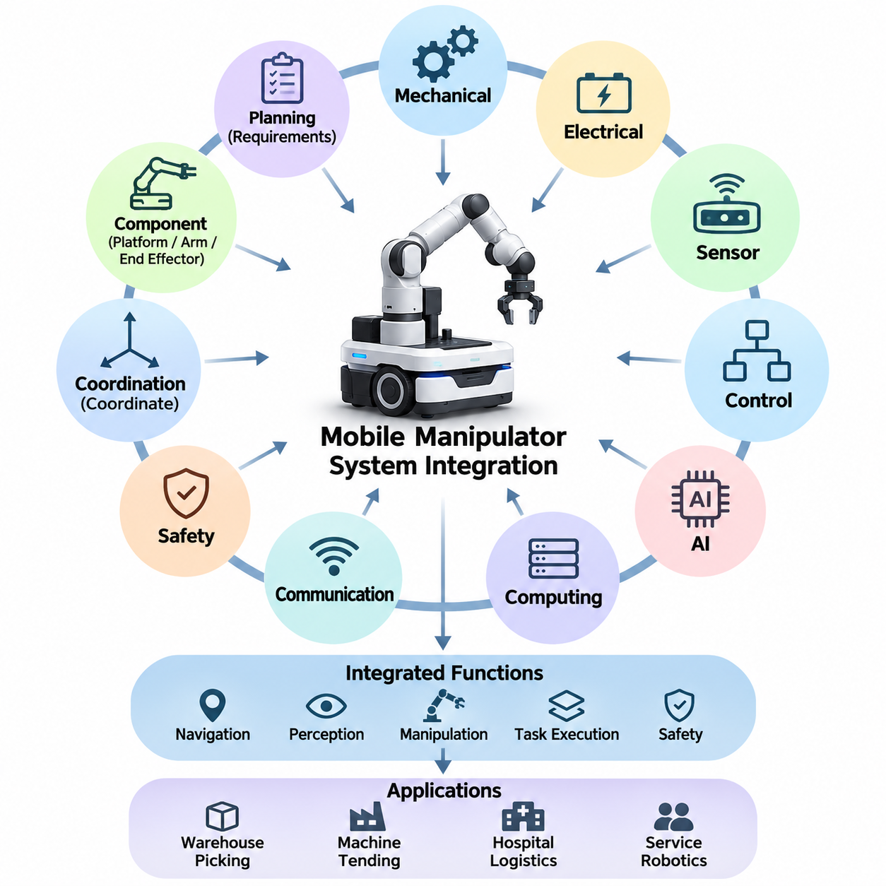
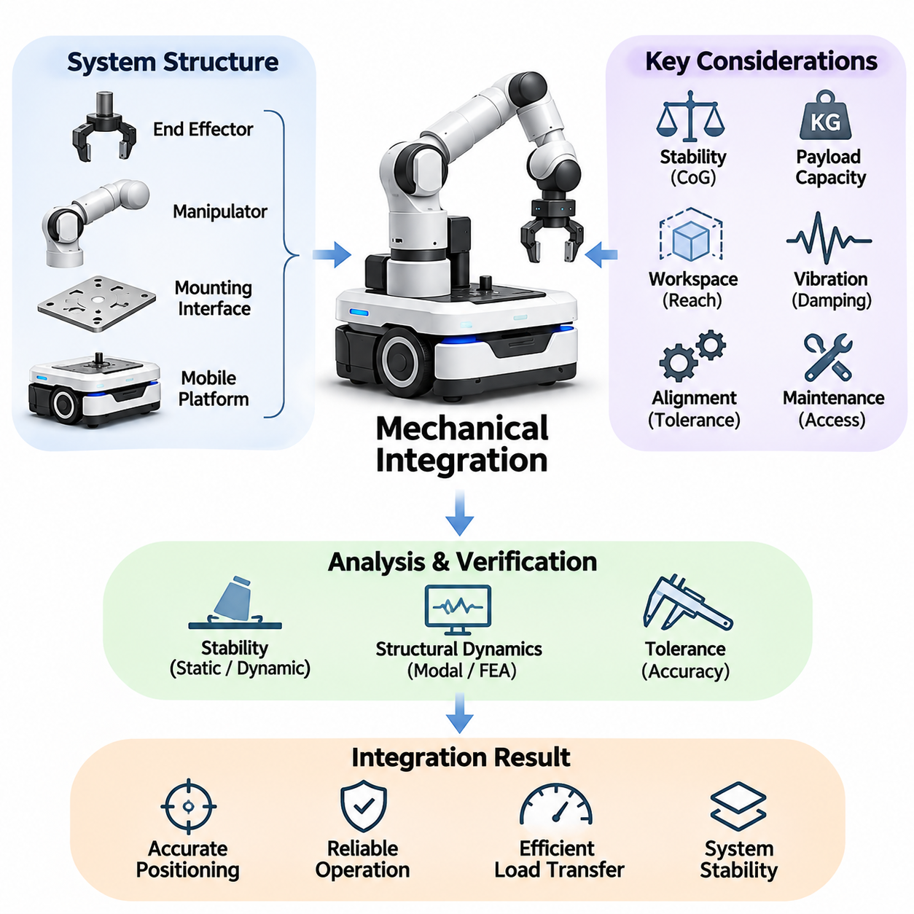
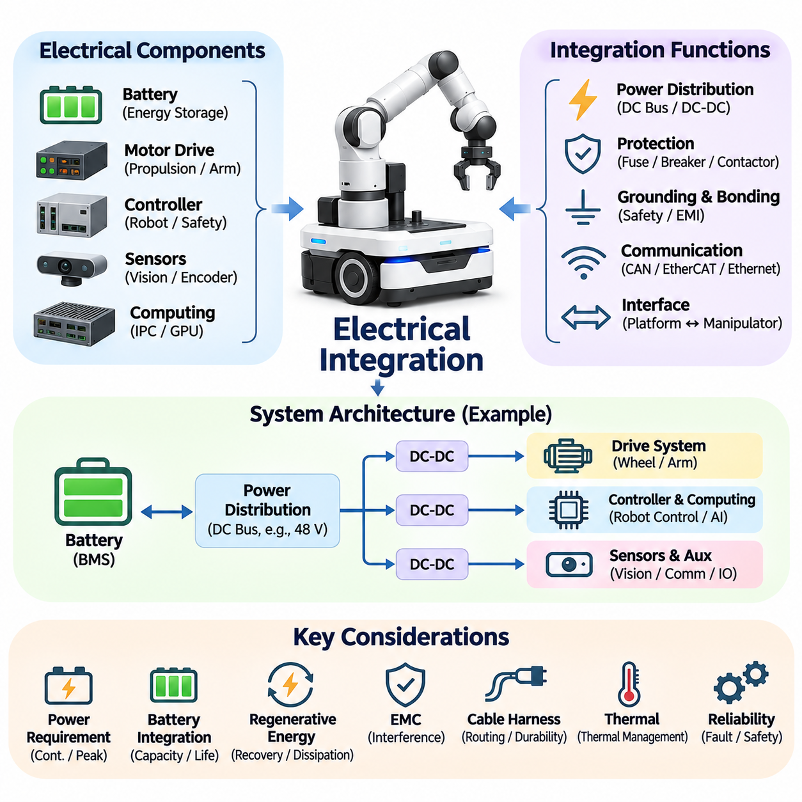
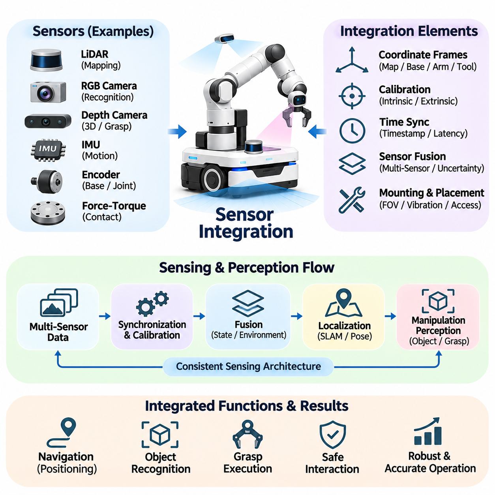
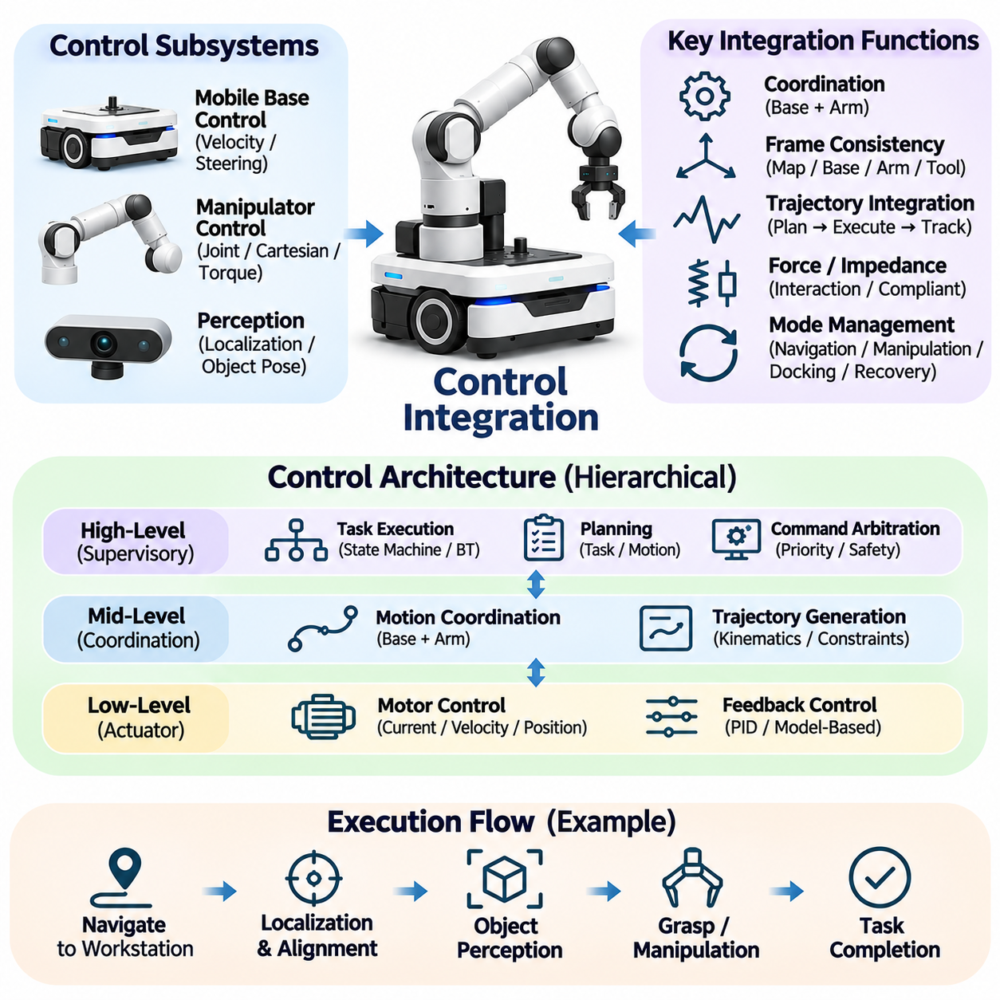
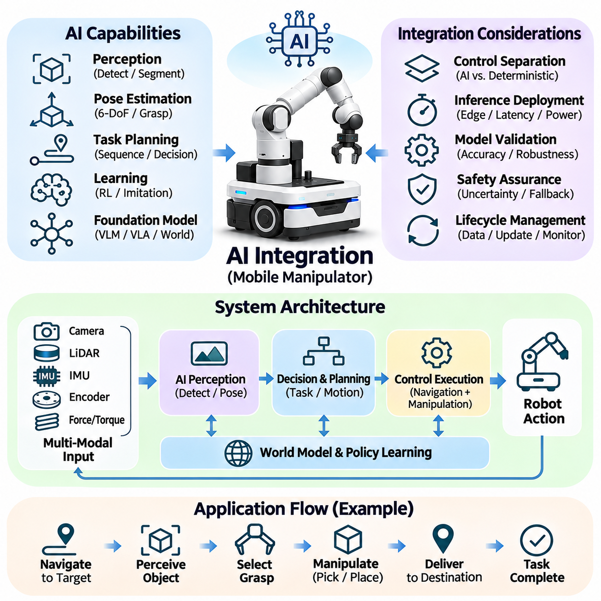
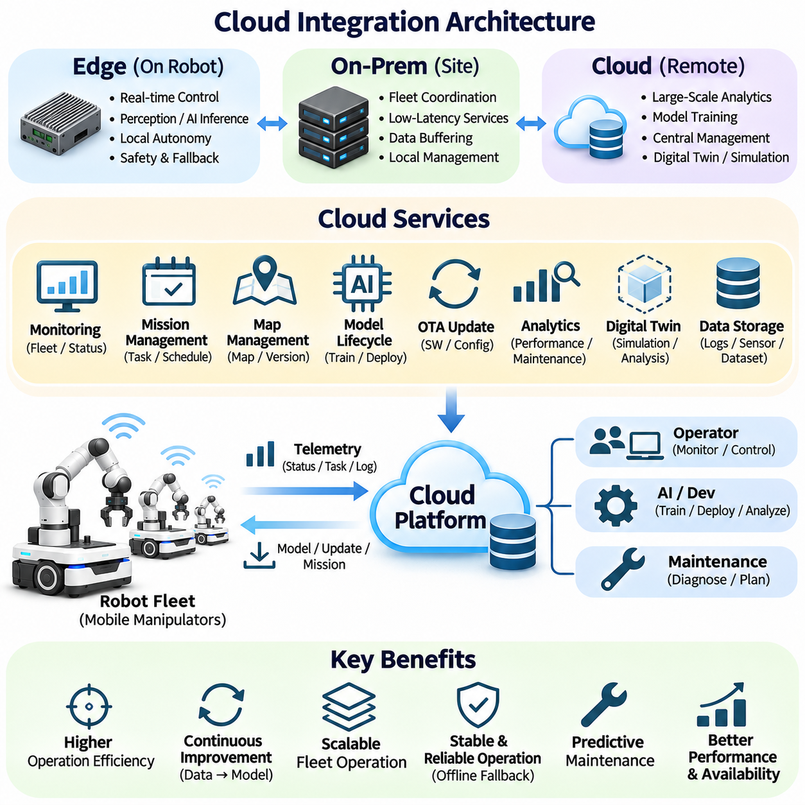
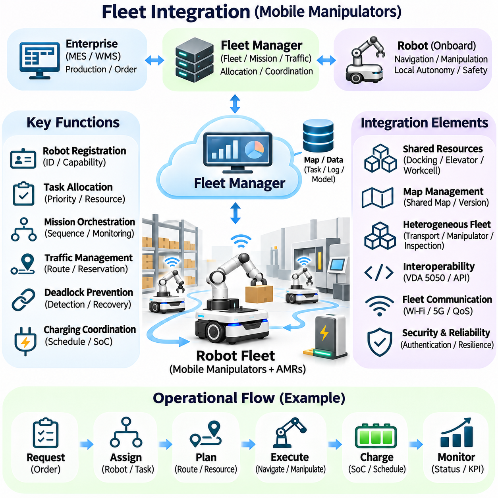
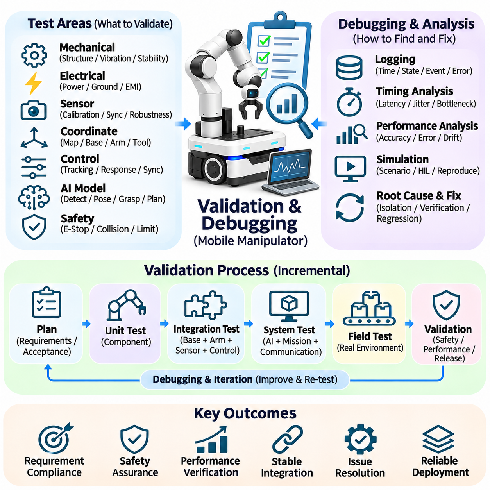

**Volume 01. Mobile Manipulator Foundations and System Architecture**

# Chapter 14. System Integration

## 01 System Integration Overview

{width="7.268055555555556in" height="7.268055555555556in"}

System integration is the engineering process of combining mechanical structures, electrical systems, sensors, controllers, artificial intelligence, and communication networks into a unified mobile manipulation platform. Unlike conventional industrial robots, mobile manipulators must coordinate locomotion and manipulation while operating in dynamic environments. Successful integration ensures that individual subsystems function together as a reliable, safe, and efficient robotic system.

A mobile manipulator typically consists of an autonomous mobile robot platform, a robotic arm, an end effector, perception sensors, computing hardware, and supporting infrastructure. Each component may operate successfully during independent testing, yet integration introduces additional dependencies. Mechanical vibrations, communication delays, power fluctuations, and inconsistent coordinate references can reduce overall performance even when individual components satisfy their specifications.

The primary objective of system integration is to transform independently developed components into a coordinated operational architecture. This requires defining subsystem responsibilities, communication interfaces, operating constraints, and shared performance requirements. Integration engineering must address both physical connectivity and functional interoperability, ensuring that navigation, perception, manipulation, and safety mechanisms operate consistently throughout the complete task lifecycle.

Integration planning begins with system-level requirements derived from intended applications. Warehouse picking, industrial machine tending, hospital logistics, and service robotics impose different demands on payload capacity, positioning accuracy, operating duration, and environmental awareness. These requirements determine component selection and integration priorities. Engineers must evaluate subsystem compatibility before finalizing the mechanical layout, electrical distribution, computing architecture, and software interfaces.

Mechanical integration establishes the physical relationship between the mobile platform and robotic manipulator. The mounting structure must withstand static loads, dynamic forces, acceleration, and manipulation-induced moments without excessive deformation. Arm placement influences the center of gravity, reachable workspace, and platform stability. Engineers must also consider maintenance accessibility, cable routing, vibration isolation, and mechanical tolerances to ensure reliable operation under realistic conditions.

Electrical integration connects batteries, power distribution units, motor drives, embedded controllers, sensors, and computing devices. Mobile manipulators frequently combine components operating at different voltage levels and power demands. Proper electrical architecture must accommodate peak motor currents, regenerative energy, grounding requirements, electromagnetic compatibility, and emergency power isolation. Electrical protection and power monitoring are essential for maintaining operational reliability and preventing cascading failures.

Sensor integration enables the robot to understand its surroundings and internal operating conditions. LiDAR, cameras, inertial measurement units, wheel encoders, force sensors, and joint feedback devices provide complementary information. Their measurements must be synchronized and transformed into consistent coordinate systems. Sensor placement, calibration, timestamp accuracy, and communication reliability directly influence localization, object recognition, grasp planning, and collision avoidance performance.

Control integration coordinates the mobile base, manipulator, and end effector through a hierarchical control architecture. Low-level controllers regulate wheel velocities, joint positions, motor torques, and actuator responses, while higher-level controllers manage navigation, trajectory generation, and task execution. Effective coordination requires predictable command execution, feedback exchange, and operating-state transitions. Control interfaces must also define how subsystems respond when commands fail or operating constraints are violated.

Mobile manipulation introduces coordination challenges because base movement changes the manipulator\'s position relative to surrounding objects. A grasp target detected before navigation may require updated localization and perception after the platform reaches its destination. The integration architecture must therefore maintain consistent spatial relationships among the map, mobile base, manipulator, sensors, and target objects. Coordinate transformations and calibration procedures are fundamental to achieving repeatable manipulation performance.

Artificial intelligence integration connects perception, decision-making, and action generation with the robot\'s physical control systems. Object detection, semantic segmentation, pose estimation, grasp prediction, and task planning may operate as independent computational modules. Their outputs must be converted into actionable commands with defined confidence thresholds and execution constraints. AI components should provide uncertainty information and failure indications rather than assuming every prediction is sufficiently reliable.

Computing architecture determines where robotic algorithms execute and how processing resources are allocated. Real-time motor control generally requires deterministic execution, while perception and learning-based inference may demand GPU acceleration. Edge computing reduces dependence on external connectivity and supports immediate decision-making. Integration engineers must balance computational throughput, memory consumption, thermal limitations, communication latency, and energy efficiency across the complete hardware platform.

Communication integration establishes reliable data exchange between embedded devices, robot controllers, edge computers, and external systems. Technologies such as CAN, industrial Ethernet, and wireless networking may serve different communication requirements. Middleware frameworks, including ROS 2, can provide standardized messaging and distributed software interfaces. However, message definitions, quality-of-service settings, network congestion, and fault recovery must be configured according to operational requirements.

Software integration organizes navigation, manipulation, perception, diagnostics, and mission management into a maintainable architecture. Modular components simplify development, but they also require clearly defined interfaces and lifecycle management. Integration teams must establish consistent software versions, configuration parameters, coordinate conventions, and communication protocols. Containerization, automated testing, and configuration management can improve reproducibility while reducing incompatibilities during deployment and maintenance.

Safety integration must address hazards arising from the combined behavior of the mobile platform and manipulator. A stationary arm may operate safely within a defined workspace, but movement of the base introduces additional collision and stability risks. Safety functions must consider simultaneous motion, obstacle proximity, payload conditions, and human interaction. Emergency stopping, protective monitoring, speed limitation, and fault detection require coordinated behavior across relevant subsystems.

Functional safety engineering also requires distinguishing ordinary software control from safety-related control functions. Navigation algorithms and AI perception may contribute to operational awareness, but they do not automatically satisfy safety integrity requirements. Safety-related sensors, controllers, and actuators must be selected and validated according to the applicable risk assessment. Integration must ensure that communication failures, controller resets, and unexpected subsystem states cannot bypass required protective functions.

Cloud integration extends robotic capabilities through centralized monitoring, data collection, analytics, and software management. Operational logs, diagnostic information, performance metrics, and selected perception data can support continuous improvement. However, essential safety and immediate motion-control functions should not depend on unpredictable cloud connectivity. A robust architecture maintains local operational authority while allowing external systems to provide supervision, optimization, and noncritical services.

Fleet integration becomes important when multiple mobile manipulators operate within a shared facility. Fleet management systems coordinate mission assignments, traffic management, charging schedules, and resource utilization. Integration must establish interfaces between individual robots and centralized orchestration services while preserving local autonomy. Shared workstations, narrow passages, and manipulation zones require explicit coordination policies to prevent congestion, interference, and unsafe interactions.

A complete operational workflow demonstrates how integration transforms subsystem capabilities into productive automation. During warehouse picking, a robot receives a mission, navigates toward a storage location, refines its position, identifies an item, calculates a grasp, and executes manipulation. The system then verifies task completion and reports its status. Each transition depends on information exchange, synchronized operating states, and reliable recovery mechanisms.

Integration testing should progress from individual components to increasingly complex subsystem combinations. Mechanical mounting, electrical connectivity, sensor calibration, and controller communication are verified before coordinated motion begins. Subsequent tests examine navigation with an installed manipulator, manipulation under different payload conditions, and complete mission execution. Incremental integration reduces debugging complexity by identifying interface problems before they propagate throughout the system.

System validation evaluates whether the integrated platform satisfies application-level requirements rather than merely confirming component functionality. Important measurements include navigation accuracy, manipulation success rate, task completion time, positioning repeatability, energy consumption, and operational availability. Tests should reproduce realistic environmental variations and workload conditions. Performance evaluation must also examine how subsystem interactions influence the reliability of the complete robot.

Debugging integrated robotic systems requires tracing failures across hardware and software boundaries. A failed grasp may originate from inaccurate perception, coordinate calibration errors, platform movement, communication delays, or insufficient actuator performance. Diagnostic tools should correlate sensor measurements, controller states, commands, and timestamps. Structured logging and repeatable test procedures help engineers distinguish root causes from secondary symptoms and prevent ineffective corrective actions.

Reliability engineering considers how individual subsystem failures influence overall system availability. A mobile manipulator may become unavailable because of battery faults, communication interruptions, sensor degradation, actuator errors, or software crashes. Fault detection, isolation, and recovery mechanisms should be designed as integrated capabilities. Where appropriate, the system may enter a reduced-function operating mode, retry a recoverable task, or transition into a controlled safe state.

Configuration management is essential because integrated robotic platforms evolve throughout development and deployment. Changes to firmware, sensor calibration, mechanical components, or AI models can alter system behavior. Engineers must maintain traceability among hardware revisions, software releases, interface specifications, and validation results. Controlled updates and regression testing reduce the risk that improvements in one subsystem unintentionally degrade another subsystem\'s performance.

Integration activities also require coordination among mechanical, electrical, controls, software, AI, and safety engineering teams. Interface control documents define responsibilities, data formats, electrical connections, timing requirements, and expected failure responses. Regular integration reviews help identify conflicting assumptions before physical implementation. Clear ownership of subsystem interfaces is particularly important when robotic arms, mobile platforms, and perception devices originate from different manufacturers.

The final objective of system integration is to deliver a mobile manipulator that performs complete tasks consistently under real operating conditions. Technical success depends not only on advanced sensors, powerful processors, or sophisticated AI algorithms, but also on the quality of their interaction. A well-integrated architecture provides predictable behavior, measurable performance, maintainable interfaces, and a foundation for scalable deployment across industrial, logistics, healthcare, and service environments.

## 02 Mechanical Integration

{width="7.268055555555556in" height="7.268055555555556in"}

Mechanical integration is the process of combining the mobile platform, robotic arm, end effector, structural frame, and supporting components into a unified physical system. In mobile manipulators, mechanical design must accommodate both locomotion and manipulation, creating challenges beyond those encountered in stationary industrial robots. Successful integration ensures structural stability, accurate positioning, efficient load transfer, and reliable operation under changing environmental conditions.

The mechanical architecture begins with defining the physical relationship between the autonomous mobile robot and its manipulator. Platform dimensions, wheel configuration, suspension characteristics, and mounting locations influence the robot\'s overall performance. Engineers must evaluate the manipulator\'s reach, payload capacity, and operating envelope while ensuring that its installation does not interfere with mobility, obstacle clearance, or access to essential maintenance components.

Structural integration requires a mounting interface capable of transferring forces and moments between the manipulator and mobile base. During acceleration, lifting, and object handling, the robotic arm generates dynamic loads that propagate through the supporting structure. Mounting plates, brackets, reinforcement members, and fastening systems must withstand these loads without excessive deformation. Structural stiffness is particularly important when precise manipulation depends on stable positioning.

The center of gravity is a fundamental consideration in mobile manipulator design because it changes with arm configuration and payload position. Extending the manipulator horizontally or lifting heavy objects can shift the combined center of gravity toward the edge of the support polygon. Engineers must evaluate these changes across representative operating configurations to prevent tipping, excessive wheel loading, and loss of traction during navigation or manipulation.

Static stability analysis examines whether the projected center of gravity remains within the support polygon formed by the robot\'s ground contact points. Dynamic stability analysis additionally considers acceleration, braking, turning, and manipulator motion. A robot that remains stable while stationary may become unstable during rapid movements or emergency stops. Conservative stability margins and appropriate motion constraints are therefore necessary for safe operation.

Payload integration requires distinguishing the manipulator\'s rated payload from the total load supported by the mobile platform. The combined system must accommodate the arm, mounting structure, end effector, carried objects, batteries, and auxiliary equipment. Payload capacity should be evaluated under the most demanding operating configurations rather than relying exclusively on nominal specifications. Uneven load distribution may also affect suspension behavior and wheel contact forces.

The manipulator mounting position determines the reachable workspace and influences the efficiency of task execution. Central mounting can provide balanced load distribution, while offset mounting may improve access to shelves, machines, or workstations. However, an offset arrangement introduces asymmetric loading and may reduce stability in certain arm configurations. Mechanical integration must balance accessibility, structural requirements, workspace coverage, and platform maneuverability.

Workspace integration considers the combined motion capabilities of the mobile base and robotic arm. The manipulator\'s reachable volume changes as the platform moves, allowing the system to access objects beyond the range of a stationary robot. Nevertheless, mechanical interference may occur between the arm, chassis, sensors, or surrounding equipment. Engineers must examine joint limits, self-collision regions, and physical clearance throughout representative motion sequences.

Vibration is an important mechanical integration challenge because mobile platforms experience disturbances from wheel rotation, uneven surfaces, acceleration, and structural resonance. These disturbances can propagate into the manipulator and degrade positioning accuracy or sensor measurements. Mechanical stiffness, damping materials, vibration isolators, and appropriate structural design can reduce unwanted motion. However, isolation mechanisms must not introduce excessive compliance that compromises manipulation precision.

Structural dynamics become particularly important when the manipulator operates at high speeds or handles variable payloads. Flexible mounting structures may exhibit oscillations after rapid joint movements, increasing settling time before precision tasks can begin. Engineers can investigate these effects through modal analysis, finite element analysis, and experimental vibration measurements. The objective is to maintain adequate stiffness and damping across the expected operating frequency range.

Mechanical alignment establishes consistent geometric relationships between the mobile platform, manipulator base, sensors, and end effector. Manufacturing tolerances and assembly deviations can introduce positioning errors that propagate through the kinematic chain. Precision locating features, machined reference surfaces, and controlled fastening procedures improve repeatability. Mechanical alignment should be verified before software calibration attempts to compensate for residual geometric errors.

Tolerance management is essential because multiple mechanical components contribute to the final positioning accuracy. Variations in mounting plate flatness, bolt-hole locations, structural deformation, and joint installation can accumulate across the system. Engineers should perform tolerance analysis to identify critical interfaces and determine acceptable manufacturing deviations. Repeatable assembly procedures and inspection criteria help maintain consistent performance across multiple production units.

Fastening and joint design must account for vibration, cyclic loading, and maintenance requirements. Bolted connections are commonly used because they support modular assembly and component replacement. However, insufficient preload, inappropriate fastener selection, or poorly designed load paths may lead to loosening and fatigue damage. Proper torque specifications, locking methods, and inspection procedures are necessary to maintain structural integrity throughout the robot\'s operating life.

Cable routing is another mechanical integration concern because the manipulator and mobile base contain moving joints, rotating mechanisms, and vibration-sensitive components. Power cables, communication lines, pneumatic tubes, and sensor connections must be protected from abrasion, excessive bending, and mechanical interference. Cable carriers, protective conduits, strain relief devices, and appropriate bend radii improve durability while preserving the required range of motion.

Thermal and environmental considerations influence mechanical packaging and component placement. Motors, batteries, power electronics, and computing devices generate heat that must be dissipated without exposing sensitive equipment to excessive temperatures. Enclosures should provide adequate airflow or thermal conduction while meeting environmental protection requirements. Dust, moisture, cleaning chemicals, and operating temperature variations may require additional sealing, protective coatings, or corrosion-resistant materials.

The integration of end effectors introduces additional mechanical requirements related to tool mass, gripping forces, and object interaction. Grippers, suction devices, and specialized tools modify the manipulator\'s inertia and load distribution. Tool-changing mechanisms may further increase complexity by introducing mechanical locking interfaces and alignment requirements. Engineers must verify that end-effector installation preserves payload limits, positioning accuracy, and operational safety.

Mobility performance must be reassessed after installing the manipulator because the additional mass changes the platform\'s dynamic characteristics. Acceleration, braking distance, turning behavior, and obstacle traversal may differ from the original mobile base specifications. Suspension deflection and tire deformation can also influence platform orientation and manipulation accuracy. Integrated testing should therefore evaluate mobility with representative arm configurations and payload conditions.

Docking and workstation interaction require precise mechanical relationships between the robot and external equipment. Even when navigation provides accurate positioning, small residual errors may prevent reliable object transfer or machine interaction. Mechanical guides, compliant interfaces, alignment features, and locating mechanisms can improve repeatability. These features should be designed to accommodate expected positioning uncertainty without creating excessive contact forces or mechanical binding.

Maintainability should be incorporated into the mechanical architecture from the beginning of development. Batteries, actuators, sensors, controllers, and fastening points must remain accessible for inspection and replacement. Modular mounting assemblies can reduce service time and simplify component upgrades. Engineers should also consider lifting points, transportation restraints, and safe procedures for removing heavy manipulators or structural components during maintenance.

Mechanical safety includes preventing tipping, uncontrolled movement, structural failure, and hazardous contact with moving components. Protective covers, mechanical stops, guarded pinch points, and secure mounting arrangements reduce exposure to foreseeable hazards. The design must also account for emergency braking and unexpected manipulator movements. Mechanical safeguards should complement electrical and software safety functions rather than depending entirely on active control systems.

Mechanical integration validation combines analytical calculations, simulation, physical inspection, and experimental testing. Static load tests verify structural strength, while dynamic tests examine vibration, deformation, and stability during representative operations. Engineers should evaluate maximum payload conditions, extended arm configurations, emergency braking, and repeated task cycles. Test results provide evidence that the integrated structure satisfies defined mechanical requirements.

Finite element analysis can support early evaluation of mounting structures, chassis reinforcements, and load-bearing components. Stress distributions, displacement patterns, and natural frequencies help identify potential weaknesses before manufacturing. However, simulation accuracy depends on realistic boundary conditions, material properties, and applied loads. Experimental measurements should be used to validate critical assumptions and refine structural models when necessary.

Reliability assessment considers long-term mechanical degradation caused by fatigue, wear, vibration, and repeated loading. Components that perform adequately during initial testing may develop looseness, cracks, or alignment changes after extended operation. Periodic inspection and condition monitoring can detect emerging problems before functional failure occurs. Mechanical design should support predictable maintenance intervals and straightforward replacement of components subject to wear.

Successful mechanical integration ultimately establishes the physical foundation for reliable mobile manipulation. Structural stiffness, stability, payload distribution, alignment, vibration control, and maintainability directly influence the performance of perception and control algorithms. A carefully engineered mechanical architecture enables accurate manipulation while preserving mobility and operational safety. It also supports repeatable manufacturing, efficient maintenance, and scalable deployment across diverse robotic applications.

## 03 Electrical Integration

{width="7.268055555555556in" height="7.268055555555556in"}

Electrical integration is the engineering process of connecting power sources, motor drives, controllers, sensors, computing devices, and safety circuits into a unified electrical architecture. In mobile manipulators, electrical systems must support simultaneous mobility and manipulation while maintaining stable power delivery. Successful integration requires coordinated power distribution, reliable communication, electrical protection, and predictable behavior under dynamic operating conditions.

The electrical architecture begins with identifying the power requirements of the autonomous mobile robot, robotic arm, end effector, perception sensors, and computing hardware. Each subsystem has distinct voltage, current, and operating characteristics. Engineers must evaluate continuous consumption, peak demand, startup transients, and regenerative energy. These requirements establish the foundation for selecting batteries, converters, protection devices, wiring, and power distribution components.

Battery integration is particularly important because mobile manipulators depend on onboard energy storage for autonomous operation. Lithium iron phosphate and other lithium-ion battery technologies are commonly considered according to energy density, cycle life, safety, and cost. Battery capacity must account for propulsion, manipulation, computation, and auxiliary loads. Engineers should also consider usable energy, discharge limitations, environmental conditions, and battery degradation throughout the expected service life.

A battery management system monitors cell voltages, temperatures, current, and operating conditions to maintain safe battery operation. It may estimate state of charge, state of health, and available power while enforcing protection limits. Integration requires reliable communication between the battery management system, main controller, and charging equipment. Fault conditions such as overcurrent, undervoltage, and excessive temperature must trigger appropriate protective responses.

Power distribution architecture determines how electrical energy reaches individual subsystems. A mobile manipulator may employ a primary 48 V DC bus with additional regulated voltage rails for sensors, controllers, and computing equipment. DC/DC converters provide the required voltage conversion and isolation where necessary. Distribution design must consider cable losses, current capacity, converter efficiency, and interactions between high-power actuators and sensitive electronic devices.

Motor drives introduce significant electrical demands because propulsion and manipulation frequently involve rapid changes in current consumption. Wheel motors, steering actuators, robotic joints, and grippers may operate simultaneously during complex tasks. Engineers must evaluate combined peak loads rather than assuming that individual maximum demands occur independently. Power budgeting should incorporate realistic duty cycles while maintaining sufficient margins for transient operating conditions.

Regenerative energy management becomes important when motors decelerate or lower gravitational loads. Regenerative drives may return energy to the DC bus, potentially increasing bus voltage when the battery cannot absorb the available power. The electrical architecture must evaluate battery charging limits, drive capabilities, and appropriate energy dissipation mechanisms. Braking resistors or other protective arrangements may be necessary depending on the selected hardware and operating conditions.

Electrical protection prevents component damage and reduces hazards associated with short circuits, overloads, insulation faults, and abnormal operating conditions. Fuses, circuit breakers, contactors, and electronic protection devices should be selected according to expected currents and fault characteristics. Protection coordination ensures that faults are isolated appropriately without unnecessarily disabling unrelated circuits. Safety-related switching functions require separate consideration from ordinary power management.

Grounding and bonding are essential for maintaining electrical safety, signal integrity, and electromagnetic compatibility. High-current motor circuits can generate voltage disturbances that affect sensors and communication interfaces. Engineers must establish appropriate reference potentials, protective bonding arrangements, and return-current paths. Grounding strategies should reflect the actual electrical topology rather than relying on simplified assumptions that may create unintended current loops.

Electromagnetic compatibility is a major integration concern because motor drives, switching converters, wireless communication devices, and high-speed processors operate within a compact platform. Conducted and radiated emissions can interfere with cameras, encoders, positioning systems, and communication networks. Shielded cables, filtering, appropriate grounding, and physical separation help reduce interference. Compliance must be verified through testing under representative operating conditions.

Cable harness design connects electrical components while accommodating vibration, mechanical movement, and environmental exposure. Wire gauge selection depends on current capacity, voltage drop, temperature, installation conditions, and applicable requirements. Harness routing should minimize interference with moving mechanisms and prevent abrasion or excessive bending. Connectors must provide adequate current ratings, environmental protection, retention strength, and maintainability.

Electrical interfaces between the mobile platform and manipulator require particular attention because the two systems may originate from different manufacturers. Differences in voltage levels, connector definitions, grounding arrangements, and communication protocols can create integration difficulties. Interface control documents should specify electrical characteristics, pin assignments, power sequencing, and fault behavior. Compatibility must be verified before connecting expensive controllers or motor drives.

Power sequencing defines the order in which electrical subsystems are energized and shut down. Computing devices, embedded controllers, sensors, and motor drives may have different initialization requirements. An uncontrolled startup sequence can generate communication errors, unexpected actuator states, or excessive inrush currents. Proper sequencing coordinates power enable signals, controller readiness, drive activation, and orderly shutdown procedures.

Emergency stop integration requires coordinated removal or limitation of hazardous motion without creating additional risks. Depending on the risk assessment, safety functions may use safe torque off, controlled stopping, contactor isolation, or combinations of these mechanisms. Emergency stopping should not be confused with routine power shutdown. The electrical architecture must preserve necessary safety monitoring and ensure that restart requires appropriate authorization.

Functional safety integration establishes electrical interfaces among emergency stop devices, safety controllers, protective sensors, and actuator safety functions. Safety-related circuits must be designed according to the required performance and applicable standards. Diagnostic coverage, fault detection, redundancy, and response time may influence circuit architecture. Engineers must validate that failures in ordinary control electronics do not compromise required protective functions.

Sensor power integration requires stable voltage regulation and protection from electrical disturbances. Cameras, LiDAR units, inertial sensors, encoders, and force sensors may exhibit different sensitivity to voltage ripple and transient interruptions. Dedicated regulators, filtering, and appropriate wiring can improve measurement reliability. Power supply quality should be evaluated while propulsion and manipulation systems operate under demanding conditions.

Computing hardware introduces additional electrical requirements because embedded processors and GPU-based systems may experience substantial changes in power consumption. High-performance inference workloads can increase current demand and thermal output. Electrical integration must accommodate these variations without affecting motion controllers or communication equipment. Power monitoring and controlled shutdown mechanisms help protect computing systems from unexpected supply interruptions.

Charging integration connects onboard energy storage with external charging infrastructure. Manual charging, docking contacts, and automated charging stations impose different mechanical and electrical interface requirements. Charging systems must coordinate voltage compatibility, current limits, communication, connection verification, and protective functions. Automatic charging should prevent hazardous energization when contacts are misaligned or required safety conditions are not satisfied.

Energy management integrates battery monitoring, power consumption estimation, and mission planning. The robot should determine whether sufficient energy remains to complete assigned tasks and reach an appropriate charging location. Manipulation-intensive operations may consume substantially different energy from navigation-only missions. Accurate energy estimation requires measurements from representative workloads rather than relying exclusively on nominal component ratings.

Thermal management is closely related to electrical integration because power electronics, converters, batteries, and motor drives generate heat during operation. Excessive temperature can reduce efficiency, accelerate degradation, and trigger protective shutdowns. Engineers must consider heat dissipation, enclosure ventilation, thermal conduction, and component spacing. Temperature monitoring should support both protective actions and long-term reliability assessment.

Electrical diagnostics provide visibility into system health through voltage, current, temperature, insulation, and fault-status measurements. Monitoring data can identify overloaded circuits, deteriorating connections, abnormal battery behavior, and unstable power supplies. Diagnostic information should be accessible to the robot controller and maintenance systems. Timestamped electrical measurements also support root-cause analysis when failures involve multiple interacting subsystems.

Electrical integration testing begins with continuity checks, polarity verification, insulation assessment, and confirmation of protective device installation. Initial energization should use controlled procedures that limit the consequences of wiring errors. Subsequent testing verifies voltage regulation, power sequencing, communication interfaces, and actuator operation. Incremental commissioning reduces the likelihood that an electrical fault will damage multiple components simultaneously.

System-level electrical validation examines behavior under realistic operating conditions, including simultaneous navigation, manipulation, perception, and computing workloads. Tests should evaluate peak current, voltage stability, regenerative events, thermal behavior, and protective responses. Engineers should also investigate abnormal conditions such as communication loss, battery limitations, and unexpected power interruptions. Validation results demonstrate whether the electrical architecture meets defined operational and safety requirements.

Long-term electrical reliability depends on appropriate component selection, environmental protection, manufacturing quality, and maintenance procedures. Repeated vibration, thermal cycling, connector wear, and moisture exposure may gradually degrade electrical connections. Periodic inspection and condition monitoring can identify developing problems before they cause system failures. Standardized harnesses, documented interfaces, and controlled component revisions improve maintainability and production consistency.

Successful electrical integration provides the energy and communication foundation required for reliable mobile manipulation. Battery systems, power distribution, motor drives, sensors, controllers, and protective circuits must operate as coordinated elements rather than isolated components. A well-engineered electrical architecture supports predictable motion, accurate perception, safe operation, and efficient energy utilization while enabling scalable manufacturing and dependable field deployment.

## 04 Sensor Integration

{width="7.268055555555556in" height="7.268055555555556in"}

Sensor integration is the engineering process of combining perception, localization, motion feedback, and environmental monitoring devices into a coordinated sensing architecture. Mobile manipulators require reliable information about both their surroundings and internal operating states. Successful integration enables accurate navigation, object recognition, grasp execution, and safe interaction while maintaining consistent measurements across multiple sensors and control systems.

The sensor architecture begins with identifying the information required for each robotic function. Navigation depends on environmental geometry and motion estimates, while manipulation requires object position, orientation, and contact information. Safety functions may require independently validated protective sensing. Engineers must define measurement range, accuracy, resolution, update frequency, and environmental limitations before selecting sensors and determining their integration interfaces.

Mobile manipulators commonly combine LiDAR, RGB cameras, depth cameras, inertial measurement units, wheel encoders, joint encoders, and force-torque sensors. These devices provide complementary observations rather than interchangeable measurements. LiDAR supports geometric mapping, cameras capture visual appearance, and encoders measure mechanical motion. Integrating these data sources improves environmental understanding and reduces dependence on any single sensing modality.

Sensor placement determines visibility, measurement quality, and susceptibility to interference. Navigation sensors require sufficient coverage around the mobile platform, while manipulation cameras must observe relevant workspaces and target objects. Mechanical structures, payloads, and moving robot joints can create occlusions. Engineers should evaluate sensor fields of view throughout representative arm configurations and operating conditions to minimize blind regions.

Mechanical mounting directly influences sensor measurement reliability. Vibrations, structural deformation, and mounting misalignment can introduce errors into perception and localization systems. Sensor brackets should maintain stable geometric relationships with the robot structure while accommodating environmental loads. Mounting arrangements must also provide accessibility for inspection, replacement, and calibration without unnecessarily disturbing adjacent components.

Coordinate frame integration establishes consistent spatial relationships among the mobile base, manipulator, sensors, and external environment. Each sensor measures information relative to its own reference frame, requiring transformations into shared coordinate systems. A typical architecture includes map, odometry, base, manipulator, camera, and tool frames. Accurate transformation management allows navigation and manipulation algorithms to interpret measurements consistently.

Extrinsic calibration determines the position and orientation of sensors relative to the robot structure or other sensors. Intrinsic calibration characterizes internal measurement properties such as camera focal length and lens distortion. Calibration errors can propagate into object localization, trajectory planning, and grasp execution. Engineers should establish repeatable calibration procedures and verify their accuracy after mechanical modifications or sensor replacement.

Time synchronization is essential because sensors operate at different frequencies and may experience different communication delays. Cameras, LiDAR units, inertial sensors, and encoders must provide measurements associated with consistent timestamps. Without synchronization, a moving robot may combine observations captured at different physical positions. Hardware synchronization, precise clock management, and timestamp correction can reduce temporal inconsistencies in sensor fusion.

Sensor fusion combines complementary measurements to estimate states that individual sensors cannot determine reliably. Wheel odometry provides continuous motion estimates but accumulates drift, while LiDAR and visual observations can provide environmental constraints. Inertial measurements improve short-term motion estimation. Fusion methods such as extended Kalman filters, factor graphs, and optimization-based estimators integrate these observations while accounting for uncertainty.

Localization integration connects sensor measurements with the robot\'s estimated position and orientation within its operating environment. Simultaneous localization and mapping enables the robot to construct or update environmental representations while estimating its pose. In structured facilities, fiducial markers or external positioning systems may provide additional references. Reliable localization requires managing sensor degradation, environmental changes, and accumulated estimation errors.

Manipulation perception requires greater local precision than many navigation tasks. A robot may navigate successfully to a workstation yet still require millimeter-scale positioning accuracy for particular assembly or insertion operations. Wrist-mounted cameras, depth sensors, and external vision systems can refine target estimates. Their integration must account for camera calibration, robot kinematics, object geometry, and uncertainty in the estimated grasp pose.

Eye-in-hand configurations mount perception sensors directly on the manipulator, allowing observations from changing viewpoints. Eye-to-hand configurations place sensors externally or on fixed robot structures to monitor the workspace. Each arrangement introduces different calibration, visibility, and mechanical integration requirements. Combining both configurations can improve object tracking and manipulation accuracy when their coordinate relationships are properly maintained.

Force and torque sensing provides information about physical interaction that visual perception alone cannot capture. Joint torque estimates, wrist force-torque sensors, and tactile devices can detect contact, resistance, and unexpected loading. These measurements support compliant manipulation, insertion, and grasp verification. Integration requires appropriate sampling rates, signal filtering, calibration, and coordination with motion controllers to prevent unstable responses.

Electrical integration must provide stable power and reliable communication for sensing devices. Cameras, LiDAR units, and embedded sensors may require different voltage levels, bandwidth capacities, and connector types. Electrical noise from motor drives and switching converters can degrade sensitive measurements. Appropriate grounding, shielding, cable routing, and regulated power supplies help preserve signal quality during simultaneous navigation and manipulation.

Communication architecture determines how sensor measurements reach perception, localization, and control modules. Ethernet, USB, CAN, and other interfaces offer different bandwidth, latency, and reliability characteristics. High-resolution cameras generate substantial data volumes, while encoders and inertial sensors often require frequent low-latency updates. Engineers must evaluate communication capacity and processing delays to prevent outdated information from influencing robotic decisions.

ROS 2 provides a common software framework for integrating distributed sensing components through standardized messages and communication interfaces. Sensor drivers publish measurements that can be consumed by localization, perception, and control modules. Quality-of-service settings influence reliability, message delivery, and buffering behavior. Consistent message definitions, timestamps, and coordinate frame identifiers are necessary for dependable interoperability.

Environmental conditions significantly affect sensor performance. Lighting variation, reflective surfaces, transparent objects, dust, moisture, and temperature changes can degrade visual and geometric measurements. LiDAR may encounter difficult reflective materials, while cameras can struggle with glare or insufficient illumination. Integration engineering should identify these limitations and incorporate complementary sensing, protective enclosures, or operational constraints where necessary.

Sensor redundancy can improve robustness when different devices provide overlapping information. However, redundant sensors do not automatically create a safety-rated sensing system. Safety-related functions require appropriate hardware, diagnostics, and validation according to applicable requirements. Engineers must distinguish sensors used for operational perception from protective devices responsible for detecting hazardous conditions and initiating required safety responses.

Sensor health monitoring detects abnormal measurements, communication interruptions, calibration drift, and degraded operating conditions. Diagnostic indicators may include missing timestamps, inconsistent sensor readings, excessive noise, and unexpected temperature changes. Monitoring systems should report faults to relevant control modules and support appropriate recovery behavior. Critical sensor failures may require the robot to reduce functionality or enter a controlled safe state.

Sensor integration testing begins with verifying electrical connections, communication interfaces, measurement availability, and basic calibration. Individual sensors should be evaluated before introducing multi-sensor fusion and coordinated robotic motion. Subsequent tests examine timestamp consistency, coordinate transformations, measurement uncertainty, and performance under dynamic conditions. Incremental validation helps isolate problems that would otherwise appear as complex system-level failures.

System-level validation evaluates sensor performance during complete mobile manipulation workflows. Tests should include navigation, workstation approach, object recognition, grasp planning, and physical interaction under representative environmental conditions. Engineers should measure localization accuracy, object pose estimation error, detection reliability, and sensor processing latency. Repeated trials reveal whether the integrated sensing architecture supports consistent task execution.

Long-term sensor reliability depends on mechanical stability, environmental protection, calibration management, and software maintenance. Vibration, thermal cycling, contamination, and component replacement can gradually change measurement characteristics. Periodic inspection and recalibration help maintain accuracy throughout the robot\'s operating life. Version-controlled calibration parameters and diagnostic records improve traceability and simplify maintenance across deployed robotic systems.

Successful sensor integration establishes the information foundation required for autonomous mobile manipulation. Accurate measurements must be spatially calibrated, temporally synchronized, electrically reliable, and accessible to perception and control algorithms. A coordinated sensing architecture supports navigation, manipulation, interaction monitoring, and operational safety. It also provides the measurement consistency necessary for reliable deployment, performance optimization, and future AI-driven robotic capabilities.

## 05 Control Integration

{width="7.268055555555556in" height="7.268055555555556in"}

Control integration combines mobile base controllers, manipulator controllers, perception modules, and supervisory software into a coordinated robotic control system. Unlike stationary robots, mobile manipulators must regulate locomotion and manipulation while responding to changing environments. Effective integration establishes consistent command interfaces, synchronized motion, predictable execution, and safe transitions between operating modes.

The control architecture typically separates low-level actuator regulation, intermediate motion coordination, and high-level task supervision. Motor controllers manage current, velocity, and position, while motion planners generate feasible trajectories. Supervisory controllers coordinate navigation, manipulation, and task execution. Clear separation of responsibilities improves modularity, fault isolation, and system maintainability.

Mobile base control manages wheel velocity, steering angles, acceleration, and braking according to platform kinematics. Differential-drive, omnidirectional, and four-wheel-steering platforms require different control models. Feedback from encoders and inertial sensors supports motion estimation and correction. Integrated control must respect traction limits, actuator constraints, and changing payload conditions.

Manipulator control regulates joint positions, velocities, and torques to achieve desired end-effector motion. Joint-space control provides direct regulation of individual actuators, while Cartesian control operates in task coordinates. Kinematic transformations connect these representations. Controllers must consider joint limits, singularities, payload variation, and interactions between arm movement and mobile platform stability.

Coordinated mobile manipulation requires planning the motion of the base and arm as a coupled system. Sequential execution can position the platform before manipulation, while simultaneous control enables continuous interaction during movement. Whole-body control treats the combined degrees of freedom within a unified optimization framework. The selected strategy depends on task precision, computational resources, and operational constraints.

Coordinate frame consistency is fundamental because navigation and manipulation controllers may operate in different reference systems. The robot must maintain transformations among map, odometry, base, manipulator, and tool frames. Localization updates can modify global pose estimates without changing physical joint positions. Controllers should distinguish continuous local feedback from corrected global references to avoid unintended motion.

Trajectory integration connects planning outputs with executable actuator commands. A planned path must satisfy velocity, acceleration, jerk, and joint constraints before execution. Base and arm trajectories may require synchronized start times and compatible motion profiles. Trajectory controllers should monitor tracking errors and respond appropriately when actual movement deviates from expected behavior.

Real-time control requirements vary across system layers. Motor current loops may operate at kilohertz frequencies, while motion coordination and supervisory decisions generally run more slowly. Communication latency, scheduling jitter, and processor contention can degrade control performance. Time-critical functions should execute on suitable deterministic controllers rather than depending entirely on general-purpose computing platforms.

Feedback control compensates for disturbances, modeling errors, and changing loads. Proportional-integral-derivative controllers remain common for actuator regulation, while model-based approaches incorporate system dynamics. Feedforward terms can improve trajectory tracking when models are sufficiently accurate. Controller tuning must consider mechanical compliance, sensor noise, and interactions between multiple control loops.

Force and impedance control enable physical interaction with uncertain environments. Force control regulates measured contact forces, while impedance control defines a relationship between motion deviations and interaction forces. These methods support insertion, surface following, and compliant grasping. Their integration requires reliable force measurements, appropriate control bandwidth, and safeguards against unstable contact behavior.

Control mode management governs transitions between navigation, docking, manipulation, recovery, and maintenance operations. Each mode has distinct actuator permissions, speed limits, and completion conditions. Transitions should verify that prerequisite states are satisfied before enabling new commands. Explicit state machines reduce ambiguity and prevent conflicting controllers from issuing incompatible motion requests.

Command arbitration determines which software component has authority over robot movement at a given moment. Navigation planners, teleoperation interfaces, manipulation controllers, and recovery modules may request control simultaneously. A defined priority and ownership mechanism prevents competing commands. Safety-related interventions must retain authority independently of ordinary task-level command selection.

ROS 2 can support control integration through standardized communication, lifecycle management, and controller interfaces. ROS 2 Control provides abstractions for hardware interfaces and controller coordination. However, communication middleware alone does not guarantee deterministic timing or functional safety. Engineers must validate controller update rates, interface compatibility, and failure behavior on the selected computing and communication architecture.

Supervisory control coordinates task execution through state machines, behavior trees, or hierarchical planning structures. A typical workflow includes navigation to a workstation, localization refinement, arm positioning, object interaction, and task verification. Each stage should expose completion criteria and failure conditions. Supervisory logic must manage retries, recovery actions, and transitions without bypassing required safety constraints.

Navigation and manipulation integration must account for the changing geometry of the robot. Extending the arm modifies the collision envelope and may shift the center of gravity. Motion planners should incorporate arm configuration, payload, and nearby obstacles when determining feasible base movement. Conservative restrictions may be necessary when the manipulator operates near its stability or reach limits.

Safety integration separates ordinary motion control from protective functions. Emergency stops, protective stops, speed monitoring, and safe torque removal may require dedicated safety-rated hardware. Standard controllers can request controlled stopping but should not replace required independent safety mechanisms. Risk assessment determines the necessary protective architecture and acceptable responses to foreseeable faults.

Fault handling requires coordinated responses when controllers, sensors, actuators, or communication links fail. A lost localization estimate may require navigation suspension, while an arm tracking fault may require stopping manipulation. Fault classification helps distinguish recoverable interruptions from conditions requiring operator intervention. Recovery procedures must verify system readiness before motion resumes.

Control validation begins with individual actuator tests and progresses toward coordinated base-arm operation. Engineers should measure tracking accuracy, response time, overshoot, settling time, and command latency. Tests must include payload changes, external disturbances, and representative motion sequences. Incremental commissioning helps identify unstable interactions before full autonomous operation.

System-level testing evaluates complete workflows under realistic environmental and operational conditions. Repeated navigation, docking, grasping, and object placement reveal timing conflicts and accumulated positioning errors. Performance assessment should include task completion rate, recovery frequency, cycle time, and safety-related interruptions. Logged control data supports diagnosis and iterative improvement.

Successful control integration transforms independently functioning robotic subsystems into a coordinated mobile manipulation platform. Consistent interfaces, synchronized trajectories, reliable feedback, and explicit supervisory logic enable predictable behavior. Robust control architecture must also accommodate uncertainty, changing payloads, communication delays, and component failures while preserving operational safety and maintainability.

## 06 AI Integration

{width="7.268055555555556in" height="7.268055555555556in"}

AI integration connects perception models, learning-based decision systems, motion planning, and robotic control within a unified mobile manipulation architecture. Unlike conventional automation, AI-enabled robots can interpret complex sensory information and adapt to changing environments. Effective integration requires reliable data exchange, predictable inference performance, and clear boundaries between learned behaviors and safety-critical control functions.

The AI architecture begins by identifying which robotic functions benefit from machine learning and which should remain under deterministic control. Object recognition, semantic understanding, grasp selection, and task planning can use learned models. Motor regulation and protective stopping generally require dedicated control mechanisms. This separation allows AI capabilities to evolve without compromising established motion and safety requirements.

Perception integration transforms camera, LiDAR, and depth measurements into meaningful representations of objects and environments. Deep learning models can perform object detection, segmentation, pose estimation, and scene classification. Their outputs must be associated with calibrated coordinate frames and timestamps. Reliable perception also requires confidence estimation and mechanisms for rejecting uncertain or inconsistent predictions.

Multimodal sensor fusion combines visual, geometric, and motion information to improve environmental understanding. RGB images provide appearance features, depth sensors estimate spatial structure, and proprioceptive measurements describe robot movement. AI models can learn relationships among these modalities. However, integration must account for missing measurements, synchronization errors, and changes in sensor quality during operation.

Object pose estimation provides the spatial information required for robotic grasping and manipulation. Learned models may estimate object position, orientation, and grasp candidates from images or point clouds. These predictions must be transformed into the robot\'s operational coordinate system. Geometric verification and collision checking remain important because plausible visual predictions do not necessarily correspond to physically executable actions.

AI-assisted grasp planning evaluates candidate contact points, gripper configurations, and expected object stability. Learning-based methods can generalize across varied shapes and materials, while analytical methods enforce geometric and mechanical constraints. Combining both approaches improves practical reliability. Grasp execution should incorporate feedback from cameras, force sensors, and joint measurements to detect unsuccessful interactions.

Task-level AI enables robots to interpret goals and select appropriate sequences of actions. A mobile manipulator may need to locate an object, navigate toward it, adjust its position, grasp the object, and deliver it elsewhere. Hierarchical planning separates task objectives from executable motion commands. Supervisory logic should verify preconditions, monitor progress, and manage failures before advancing to subsequent actions.

Vision-language models can connect visual observations with natural-language instructions and semantic reasoning. They may identify relevant objects, interpret workspace conditions, or propose task sequences. Vision-language-action models extend this approach by generating action representations from multimodal inputs. Their integration requires careful validation because generated outputs may be uncertain, inconsistent, or incompatible with physical constraints.

Robot foundation models aim to transfer learned representations across tasks, environments, and robotic platforms. Pretraining on diverse visual and action datasets can improve generalization beyond narrowly programmed behaviors. Nevertheless, differences in robot morphology, sensors, actuators, and control interfaces limit direct transfer. Adaptation and platform-specific validation are necessary before deploying learned policies on physical hardware.

World models provide predictive representations of how environments may change following robotic actions. They can support planning by estimating future observations, object motion, or interaction outcomes. In mobile manipulation, world models may help evaluate alternative navigation and grasping strategies. Their predictions remain approximations, so execution must incorporate real sensor feedback and corrections when observed outcomes differ from expectations.

Reinforcement learning can optimize robotic behaviors through interaction with simulated or physical environments. Policies may learn navigation, reaching, grasping, or coordinated base-arm movements from reward signals. Training directly on hardware can be costly and hazardous, making simulation an important development environment. Domain randomization and system identification can improve transfer, although real-world validation remains essential.

Imitation learning uses demonstrations to train models that reproduce desirable robotic behaviors. Demonstrations may originate from teleoperation, kinesthetic teaching, or recorded expert trajectories. The resulting policies can reduce manual programming for complex manipulation tasks. Dataset quality, action representation, and coverage of unusual conditions strongly influence performance, particularly when the robot encounters states absent from training.

AI inference deployment requires balancing computational capability, latency, energy consumption, and thermal limitations. Embedded processors and edge GPUs can execute perception and policy models locally, reducing dependence on network connectivity. Model compression, quantization, and optimized inference runtimes may improve efficiency. Engineers must measure actual end-to-end latency rather than relying only on isolated model benchmarks.

Integration middleware connects AI inference services with navigation, manipulation, and supervisory controllers. ROS 2 messages, service interfaces, and action protocols can transport observations, predictions, and execution requests. Each interface should define data types, timestamps, confidence values, and failure conditions. Asynchronous processing must prevent delayed predictions from being applied to robot states that have already changed.

AI safety integration requires explicit limits on the authority of learned models. AI-generated actions should pass through constraint checking, collision evaluation, and appropriate supervisory controls before reaching actuators. Independent protective functions must remain effective when inference fails or produces unsafe recommendations. The system should support rejection, fallback behaviors, and controlled stopping when model outputs cannot be trusted.

Model uncertainty becomes important when robots encounter unfamiliar objects, lighting conditions, or workspace configurations. Confidence estimates and out-of-distribution detection can help identify potentially unreliable predictions, although these methods are imperfect. Monitoring should consider both model outputs and physical execution results. When uncertainty exceeds acceptable limits, the robot may request additional observations or operator assistance.

Continuous improvement depends on collecting representative operational data and converting failures into actionable training examples. Sensor recordings, robot states, predictions, commands, and task outcomes should be synchronized for analysis. Data governance must address quality, privacy, traceability, and retention requirements. Updated models should undergo offline evaluation, simulation testing, and controlled deployment before replacing production versions.

AI validation must extend beyond conventional prediction accuracy to include physical task performance. Evaluation should measure grasp success, task completion, collision avoidance, recovery behavior, and response latency under representative conditions. Testing should include environmental variation, sensor degradation, and unfamiliar objects. Repeatable benchmarks and clearly defined acceptance criteria provide evidence of practical readiness.

Successful AI integration combines adaptive intelligence with dependable robotic engineering. Learning-based perception and decision systems expand the range of tasks that mobile manipulators can perform, while deterministic controllers and protective mechanisms preserve operational discipline. A modular architecture supports model upgrades, continuous evaluation, and scalable deployment without treating AI predictions as unquestionable commands.

## 07 Cloud Integration

{width="7.268055555555556in" height="7.268055555555556in"}

Cloud integration connects mobile manipulators with remote computing, data storage, monitoring, and management services through secure communication networks. It extends robotic capabilities beyond onboard hardware while supporting centralized coordination and continuous improvement. Effective integration requires a clear division between local autonomy and remote services, ensuring that essential motion control and protective functions remain operational during network interruptions.

The cloud architecture typically separates edge computing, on-premises infrastructure, and remote cloud services. Edge controllers execute time-sensitive perception, navigation, and manipulation functions. On-premises systems may coordinate local robots and provide low-latency data services. Cloud platforms support large-scale analytics, model training, historical storage, and centralized administration. Responsibilities should reflect latency, availability, security, and operational requirements.

Communication integration establishes reliable connections between robotic devices and remote services. Ethernet, Wi-Fi, cellular networks, and industrial communication infrastructure provide different coverage, bandwidth, and reliability characteristics. Protocols such as MQTT, HTTPS, and WebSocket can support telemetry and application-level messaging. Engineers must account for intermittent connectivity, variable latency, and network congestion when defining communication behavior.

Cloud-connected robots generate operational data describing position, battery status, task progress, sensor health, and system faults. Telemetry pipelines collect these measurements and deliver them to monitoring and analytics services. Data schemas should define units, timestamps, identifiers, and measurement quality. Consistent telemetry enables meaningful comparison across different robots, software versions, and deployment environments.

Data ingestion architecture determines how information is transferred from robots into cloud storage and processing systems. Streaming pipelines support near-real-time monitoring, while batch uploads accommodate large sensor recordings and historical logs. Local buffering prevents immediate data loss during network outages. Upload mechanisms should manage retries, duplication, ordering, and bandwidth consumption without interfering with critical onboard workloads.

Cloud storage supports the long-term preservation of operational logs, sensor datasets, maps, configuration records, and AI training information. Different data types require appropriate storage formats, indexing, and retention policies. Metadata should identify robot configuration, software version, operating conditions, and collection time. Well-organized datasets improve troubleshooting, reproducibility, and the development of future robotic capabilities.

Remote monitoring provides operators with visibility into robot status and mission execution. Dashboards can display fleet availability, battery conditions, active tasks, fault notifications, and performance trends. Monitoring systems should distinguish delayed telemetry from current robot states. Clear status definitions and event timestamps help operators avoid decisions based on outdated information or incomplete communication.

Cloud-based mission management can distribute task definitions, priorities, and operational schedules to connected robots. However, mission execution should remain governed by local controllers capable of handling immediate obstacles and safety conditions. Remote commands require validation against robot capabilities, current operating states, and authorization policies. Task acknowledgments and execution reports provide traceability across distributed operations.

Map management allows robotic systems to share environmental representations across deployments. Cloud repositories may store reference maps, semantic annotations, workstation locations, and navigation constraints. Map versions must be associated with compatible localization configurations and robot capabilities. Before deployment, updated maps should be validated to prevent inconsistencies between remote information and actual environmental conditions.

AI model lifecycle management is an important cloud integration function. Training infrastructure can process collected datasets and produce updated perception, planning, or manipulation models. Model registries maintain version histories, evaluation results, and deployment compatibility information. Robots should receive only validated models that satisfy defined acceptance criteria. Rollback mechanisms enable recovery when an update introduces unexpected behavior.

Over-the-air software updates allow operators to distribute application improvements, configuration changes, and security patches without physically accessing every robot. Update packages should be authenticated and checked for compatibility before installation. Controlled deployment strategies can limit exposure by updating selected robots first. Recovery partitions, transactional installation, and rollback procedures reduce the risk of disabling robots during unsuccessful updates.

Cloud analytics transforms operational records into information for performance improvement and maintenance planning. Historical data can reveal repeated navigation failures, excessive energy consumption, abnormal charging behavior, and declining task efficiency. Statistical analysis and machine learning may identify patterns that are difficult to detect locally. Analytics results should be validated before being converted into operational changes or maintenance recommendations.

Digital twins provide virtual representations of robotic systems, environments, and operating conditions. Cloud infrastructure can support simulation, scenario analysis, and comparison between predicted and observed behavior. Digital twins may help evaluate mission schedules, navigation changes, and equipment utilization. Their usefulness depends on accurate models, current configuration data, and clearly understood differences between simulation and physical operation.

Cloud security requires protecting robot identities, communication channels, stored information, and remote management interfaces. Mutual authentication, encryption, access control, and credential rotation reduce unauthorized access risks. Each robot should have an identifiable security identity and permissions appropriate to its role. Network segmentation and audit logging help limit the consequences of compromised components and support security investigations.

Data governance defines how operational information is collected, retained, shared, and deleted. Robotic systems operating in workplaces or public environments may capture images and other potentially sensitive information. Access policies, retention periods, and data minimization should reflect applicable legal and organizational requirements. Traceable data handling also supports compliance, incident investigation, and responsible AI development.

Latency management determines which functions can safely depend on remote computing. Cloud services may support complex analysis and nonurgent planning, but variable network delays make them unsuitable for direct high-frequency actuator control. Local systems must retain authority over collision avoidance, emergency responses, and essential motion execution. Cloud recommendations should be treated as inputs subject to local validation rather than unrestricted commands.

Offline operation is essential because network availability cannot be guaranteed in industrial or outdoor environments. Robots should continue permitted autonomous tasks using locally available maps, models, and configuration data. Buffered records can be synchronized after connectivity returns. Reconnection procedures must reconcile task states and configuration versions without duplicating commands or unexpectedly restarting interrupted operations.

Scalability becomes important as deployments expand from individual robots to large distributed fleets. Cloud infrastructure must accommodate increasing telemetry volumes, concurrent connections, storage demands, and management requests. Message brokers, distributed processing, and elastic computing resources can support growth. Capacity planning should consider peak operational periods and failure scenarios rather than relying only on average workloads.

Cloud integration validation examines connectivity, data consistency, command handling, security, and recovery behavior under realistic conditions. Tests should include network loss, delayed messages, duplicate requests, interrupted updates, and service unavailability. Engineers must verify that remote failures do not compromise essential onboard autonomy or protective functions. Measurable acceptance criteria establish confidence before production deployment.

Successful cloud integration establishes a scalable information and management layer for mobile manipulation systems. Edge controllers preserve immediate autonomy, while on-premises and cloud services provide coordination, analytics, storage, and continuous model improvement. Secure interfaces, resilient communication, and disciplined lifecycle management enable reliable distributed operation without making safety-critical robotic behavior dependent on uninterrupted cloud connectivity.

## 08 Fleet Integration

{width="7.268055555555556in" height="7.268055555555556in"}

Fleet integration connects multiple mobile manipulators into a coordinated operational system capable of executing shared objectives across industrial environments. Unlike single-robot control, fleet operation requires task allocation, traffic coordination, resource management, and centralized visibility. Effective integration preserves local robot autonomy while enabling supervisory systems to optimize collective productivity, operational safety, and equipment utilization.

A fleet architecture typically separates onboard robot control, site-level fleet management, and enterprise-level operational systems. Individual robots execute navigation, manipulation, and immediate obstacle avoidance. Fleet managers coordinate assignments, routes, and shared resources. Enterprise applications provide production orders and business priorities. Clearly defined interfaces prevent unnecessary dependencies between these architectural layers.

Robot registration establishes a consistent identity and capability description for every fleet member. Registration records may include robot type, payload capacity, manipulator reach, available tools, battery characteristics, and software compatibility. These attributes enable the fleet manager to distinguish suitable robots for different assignments. Capability information must remain synchronized with actual hardware configurations and operational restrictions.

Task allocation determines which robot should execute each requested operation. Assignment algorithms may consider distance, availability, battery level, payload capacity, tool compatibility, and task priority. Simple rule-based allocation supports predictable behavior, while optimization methods can improve fleet efficiency. Allocation decisions must also account for travel time, manipulation duration, and resource conflicts that affect overall completion time.

Mission orchestration converts production requests into executable sequences of robotic activities. A mission may include traveling to a workstation, docking, grasping an object, transporting it, and confirming delivery. Each activity requires explicit prerequisites, completion criteria, and failure responses. The fleet manager should track mission progress without replacing the robot\'s responsibility for local motion execution and immediate safety decisions.

Traffic management coordinates robot movement through shared corridors, intersections, and restricted areas. Route reservation, priority rules, and intersection scheduling can reduce congestion and prevent conflicting movements. Mobile manipulators require additional consideration because extended arms or transported objects may enlarge their occupied space. Traffic models should represent the actual operational envelope rather than relying solely on the mobile base dimensions.

Deadlock prevention becomes essential when multiple robots compete for limited passages or workstations. A deadlock can occur when robots hold resources while waiting indefinitely for resources occupied by others. Resource ordering, reservation timeouts, and coordinated replanning can reduce this risk. Recovery mechanisms should distinguish temporary congestion from persistent blocking conditions requiring intervention or revised task assignments.

Shared resource management governs access to charging stations, docking locations, elevators, doors, and specialized workcells. These resources often impose capacity limits and operational prerequisites. Reservation systems can coordinate access and reduce unnecessary waiting. Integration with facility equipment requires reliable status feedback and explicit handshakes before robots enter, manipulate, or depart from controlled operating areas.

Charging coordination balances immediate mission demands against battery availability and long-term equipment health. Fleet managers may schedule charging according to state of charge, expected task energy, charger availability, and operational priorities. Opportunity charging can reduce downtime during idle periods. Scheduling must account for charging duration, battery limitations, and the risk of assigning missions that cannot be completed safely.

Fleet navigation requires consistent map management across participating robots. Shared maps describe corridors, workstations, restricted zones, and traffic constraints. However, different robot configurations may require distinct traversability rules and localization settings. Map version control and compatibility checks prevent robots from operating with inconsistent environmental information. Local perception must continue detecting obstacles absent from shared maps.

Heterogeneous fleet integration enables different robot types to cooperate within a common operational environment. Transport AMRs, mobile manipulators, inspection robots, and specialized platforms may expose different capabilities and control interfaces. Standardized mission descriptions and adapter layers reduce integration complexity. Coordination should respect platform-specific constraints rather than assuming identical navigation, manipulation, or safety behavior.

Interoperability standards can improve communication between fleet managers and robotic platforms. Interfaces such as VDA 5050 provide a framework for exchanging orders, states, and operational information in supported applications. However, standardized messaging does not automatically guarantee compatible task semantics or safety behavior. System integrators must validate protocol versions, supported features, and manufacturer-specific implementation differences.

Fleet communication infrastructure carries mission commands, robot states, traffic reservations, and operational events. Wireless coverage, network latency, and message delivery reliability directly affect coordination quality. Communication protocols should support authentication, acknowledgment, and recovery from temporary disconnections. Time-sensitive collision avoidance must remain local because centralized communication cannot guarantee deterministic responses under all network conditions.

Fleet state management maintains a consistent representation of robot availability, assigned missions, resource ownership, and execution progress. Distributed systems must handle delayed updates, duplicate messages, and temporary disagreement between components. Unique mission identifiers and idempotent command handling reduce accidental repeated execution. State reconciliation after reconnection is necessary to prevent conflicting assignments or unexpected mission restarts.

Safety integration must distinguish fleet-level coordination from each robot\'s independent protective functions. Centralized traffic rules can reduce predictable conflicts but cannot replace onboard obstacle detection or safety-rated stopping mechanisms. Emergency conditions may require coordinated area restrictions and mission suspension. Restart procedures should verify robot readiness, environmental clearance, and authorization before normal operations resume.

Fleet monitoring provides operators with consolidated information about mission progress, robot availability, utilization, and faults. Dashboards may display active assignments, congestion areas, battery status, and maintenance alerts. Historical records support analysis of waiting time, task throughput, and repeated failures. Monitoring should identify stale information so operators do not mistake disconnected robots for available or stationary equipment.

Performance optimization evaluates the fleet as a complete production resource rather than a collection of independent robots. Important measures include completed missions per hour, resource utilization, average waiting time, and recovery frequency. Increasing robot count does not necessarily increase throughput when shared corridors or workstations become bottlenecks. Simulation and operational data can guide fleet sizing and scheduling improvements.

Fleet validation progresses from single-robot compatibility tests to coordinated multi-robot scenarios. Testing should include simultaneous assignments, narrow passages, resource contention, communication loss, and recovery after interrupted missions. Engineers must verify task consistency, traffic behavior, and safe handling of unexpected obstacles. Repeatable acceptance tests establish whether the fleet can sustain required performance under realistic operating conditions.

Successful fleet integration transforms autonomous mobile manipulators into coordinated production assets. Effective task allocation, traffic management, resource scheduling, and interoperable interfaces improve operational efficiency while preserving local autonomy. Scalable fleet architectures must accommodate heterogeneous platforms, changing workloads, communication failures, and facility constraints without compromising safety or mission traceability.

## 09 Validation and Debugging

{width="7.268055555555556in" height="7.268055555555556in"}

Validation and debugging ensure that integrated mobile manipulators operate reliably, safely, and consistently under realistic conditions. A system may contain individually functional components yet fail when navigation, manipulation, perception, and communication interact. Effective validation therefore examines both subsystem performance and complete operational workflows. Debugging identifies the causes of unexpected behavior and establishes corrective actions supported by measurable evidence.

Validation planning begins with requirements traceability and clearly defined acceptance criteria. Each functional requirement should correspond to a verification method, expected result, and recorded test outcome. Requirements may address positioning accuracy, payload capacity, cycle time, communication reliability, and protective behavior. Traceability prevents important capabilities from remaining untested and provides evidence that the integrated system satisfies its intended operational objectives.

Integration testing should progress from individual components to increasingly complex subsystem combinations. Engineers first verify sensors, actuators, controllers, and communication interfaces independently. Subsequent tests combine mobile base control, manipulator motion, perception, and supervisory execution. This incremental approach limits the number of possible failure sources and makes it easier to isolate integration defects before full autonomous operation.

Mechanical validation examines structural integrity, mounting accuracy, vibration, and stability under representative operating loads. Mobile manipulators experience changing forces as the arm extends, accelerates, or carries objects. Tests should evaluate deformation, fastener retention, center-of-gravity shifts, and tipping margins. Mechanical measurements help determine whether observed positioning errors originate from control software or physical compliance.

Electrical validation verifies power distribution, grounding, protection devices, and signal integrity. Engineers should measure supply voltage, current demand, voltage drops, and transient behavior during simultaneous base and arm operation. Electromagnetic interference can disrupt sensors or communication interfaces. Testing under peak loads and switching events helps identify electrical problems that may remain hidden during isolated component operation.

Sensor validation evaluates calibration accuracy, measurement consistency, synchronization, and environmental robustness. Cameras, LiDAR, encoders, and inertial sensors should be tested against suitable reference measurements. Calibration errors may propagate into localization, object pose estimation, and manipulation accuracy. Tests should include lighting variation, reflective surfaces, vibration, and partial sensor obstruction to reveal operational limitations.

Coordinate transformation validation is essential because errors between reference frames can affect every stage of mobile manipulation. Engineers should verify transformations among map, odometry, base, manipulator, and tool frames. Incorrect frame orientation, outdated calibration, or inconsistent timestamps can produce systematic positioning errors. Controlled reference poses and independent measurements help isolate transformation problems from perception and control errors.

Control validation measures trajectory tracking, response time, stability, and synchronization between the mobile base and manipulator. Tests should examine acceleration, braking, joint motion, and coordinated execution under different payload conditions. Overshoot, oscillation, and excessive tracking errors may indicate incorrect tuning or mechanical limitations. Recorded command and feedback signals support quantitative comparison between intended and actual motion.

Software debugging requires structured logging across distributed processes and robotic subsystems. Logs should contain timestamps, component identifiers, state transitions, command references, and relevant error conditions. Correlation identifiers can connect events belonging to the same mission or manipulation sequence. Consistent logging allows engineers to reconstruct failures that involve several controllers, middleware processes, or asynchronous communication channels.

Timing analysis investigates communication delays, scheduling jitter, and processing bottlenecks that affect coordinated execution. Distributed robotic systems may produce correct outputs too late for the current physical state. Engineers should measure sensor acquisition, inference, planning, command transmission, and actuator response latency. Time synchronization and end-to-end tracing help identify where delays accumulate and whether deadlines are consistently satisfied.

AI validation evaluates learned models under conditions representative of actual deployment. Object detection, pose estimation, grasp selection, and task planning should be assessed using independent datasets and physical experiments. Prediction accuracy alone is insufficient because small perception errors can cause failed manipulation. Evaluation should include uncertainty, unfamiliar objects, changing illumination, and the consequences of incorrect model outputs.

Simulation provides a controlled environment for evaluating complex interactions before exposing physical equipment to risk. Engineers can reproduce navigation conflicts, manipulation failures, sensor degradation, and communication interruptions. Hardware-in-the-loop testing connects selected real controllers to simulated environments. Simulation results must be interpreted carefully because simplified dynamics and sensor models may not reproduce all real-world behavior.

Safety validation verifies that protective functions respond appropriately to foreseeable hazardous conditions. Tests may examine emergency stops, protective stops, speed restrictions, obstacle detection, and loss of critical feedback. Safety-related hardware and software should be assessed against applicable requirements and documented risk controls. Validation must confirm that failures in ordinary control or AI functions do not disable required independent protections.

Fault injection deliberately introduces controlled failures to evaluate system resilience and recovery behavior. Examples include disconnecting noncritical sensors, delaying messages, interrupting network connectivity, or simulating actuator faults. Tests should verify fault detection, safe state transitions, operator notifications, and recovery authorization. Fault injection must be planned to avoid uncontrolled hazards and should begin in simulation when practical.

Root cause analysis distinguishes symptoms from the underlying mechanisms responsible for failures. A missed grasp may result from perception error, coordinate misalignment, mechanical deflection, or delayed execution. Engineers should compare synchronized sensor records, controller states, and physical measurements rather than modifying parameters without evidence. Reproducing the failure under controlled conditions strengthens confidence in the identified cause.

Regression testing ensures that software updates, calibration changes, and mechanical modifications do not reintroduce previously resolved problems. Automated tests can verify interfaces, configuration compatibility, mission transitions, and expected controller responses. Physical regression tests remain necessary for behaviors influenced by real sensors and actuators. Version-controlled test results support comparison across releases and provide a documented history of system reliability.

End-to-end validation evaluates complete missions under representative operational conditions. A typical scenario may involve navigation to a workstation, precise docking, object identification, grasp execution, transport, and delivery confirmation. Repeated trials reveal accumulated errors, intermittent failures, and interactions that isolated tests cannot expose. Measurements should include completion rate, cycle time, recovery frequency, and safety-related interruptions.

Performance debugging focuses on identifying bottlenecks that reduce system throughput or increase operational variability. Engineers should examine navigation delays, repeated localization corrections, manipulation retries, and resource contention. Profiling tools and operational telemetry can reveal excessive processor usage or communication overhead. Improvements should be evaluated against system-level performance rather than isolated subsystem benchmarks.

Acceptance testing demonstrates that the integrated robot meets agreed operational requirements before production deployment. Test procedures should specify environmental conditions, payload configurations, task sequences, performance thresholds, and allowable failure behavior. Results must be reproducible and supported by recorded evidence. Unresolved deviations should be documented with their operational impact and corrective actions before formal acceptance.

Successful validation and debugging establish confidence that mobile manipulation systems can perform reliably beyond controlled demonstrations. Structured testing, synchronized diagnostics, fault analysis, and regression verification connect engineering decisions to observable results. A disciplined validation process supports safer deployment, faster troubleshooting, and continuous improvement throughout the robot\'s operational lifecycle.
