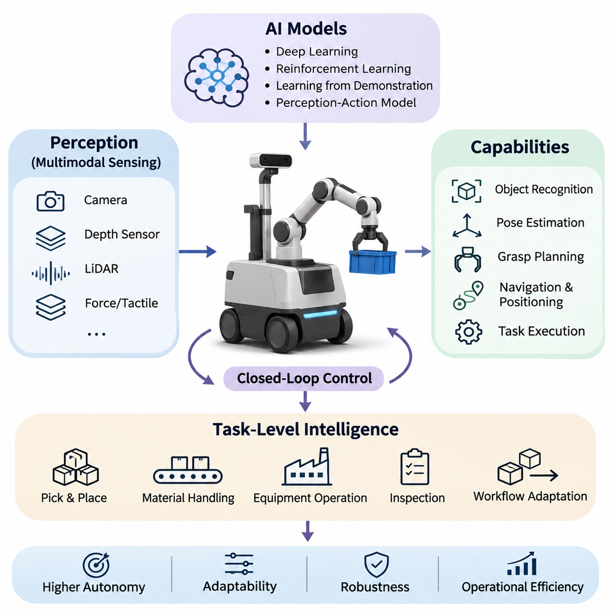
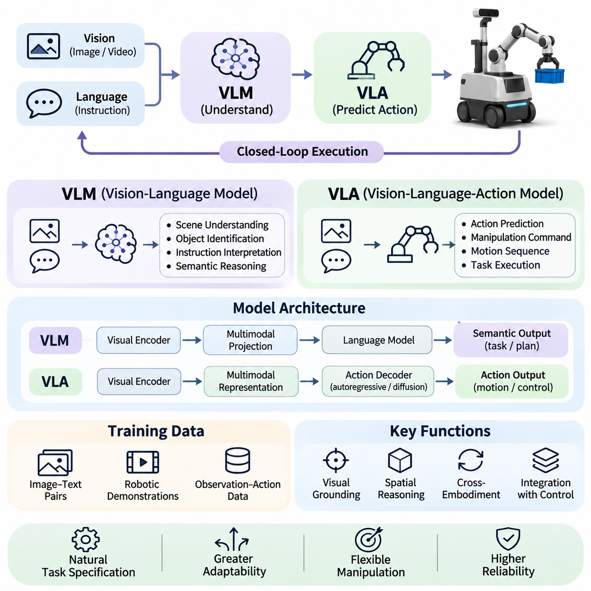
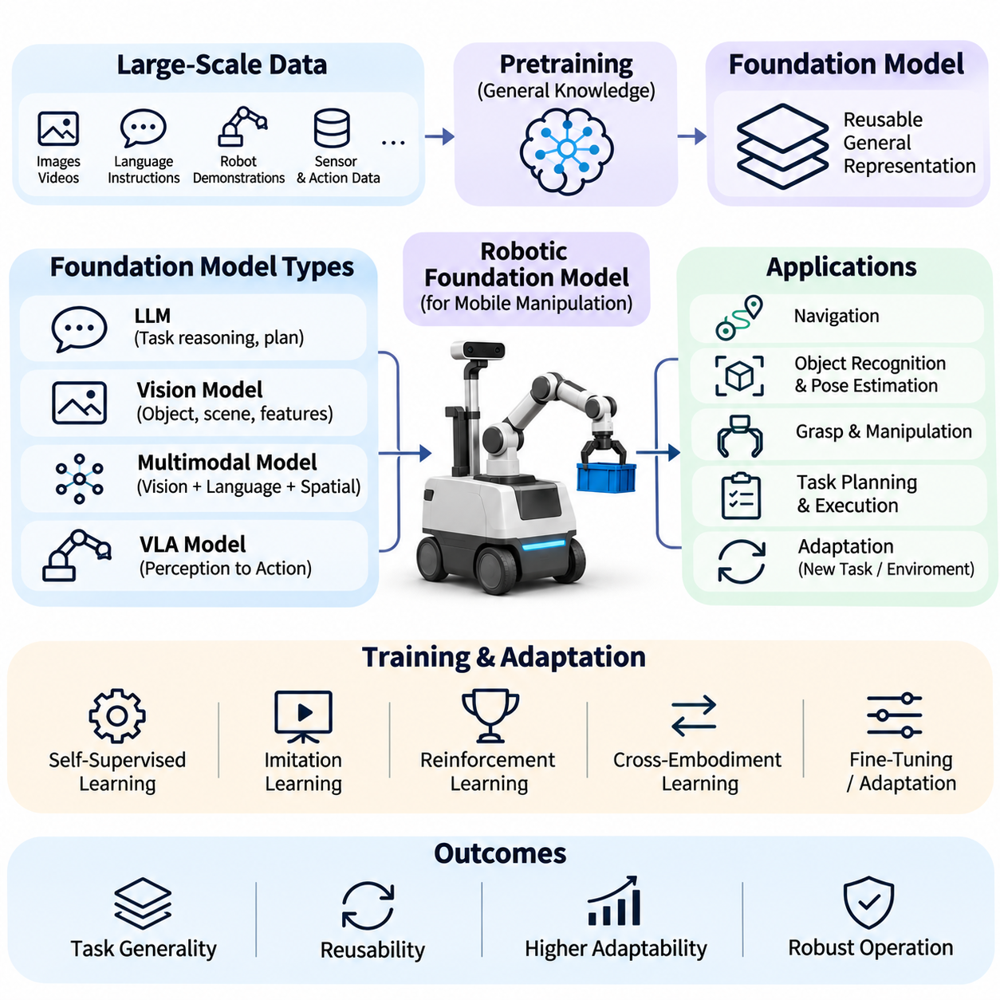
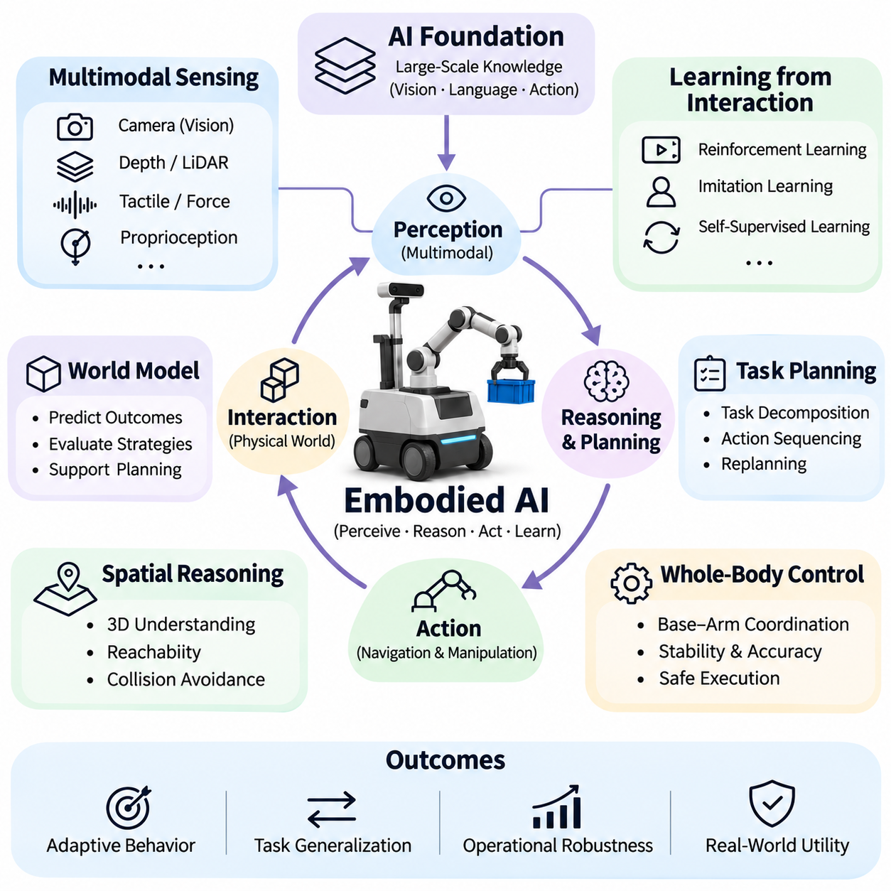
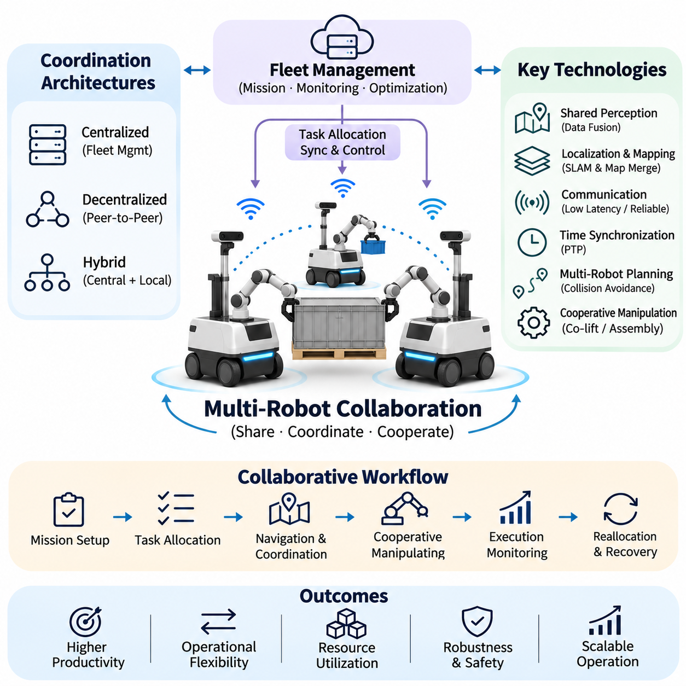
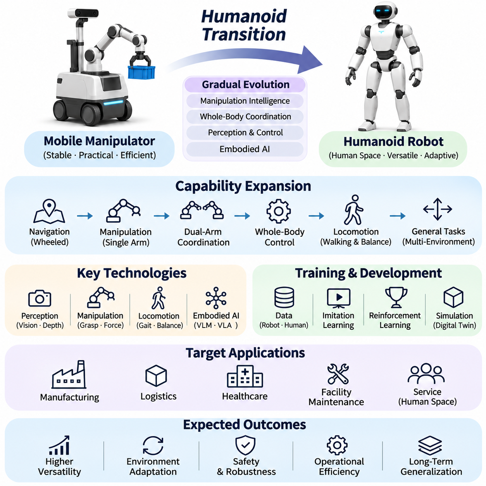
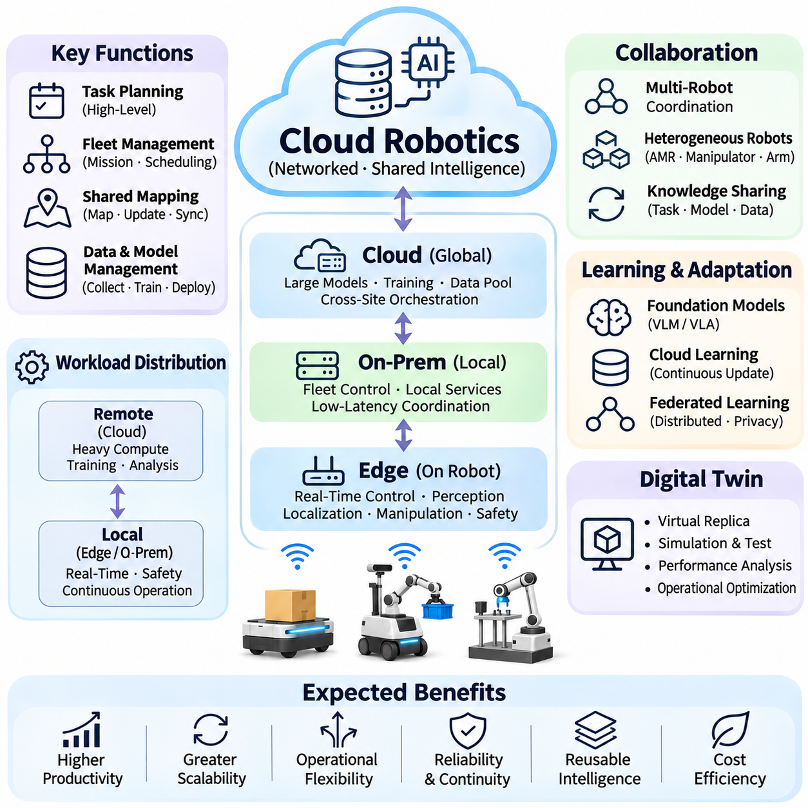
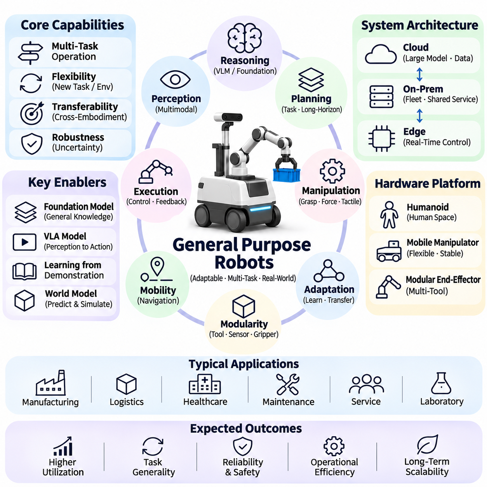
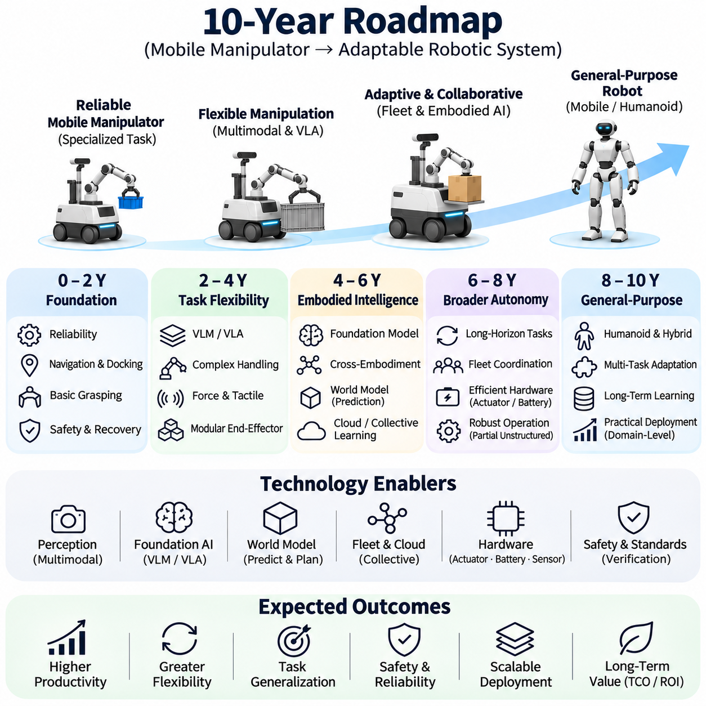

**Volume 01. Mobile Manipulator Foundations and System Architecture**

# Chapter 15. Future of Mobile Manipulators

## 01 AI Driven Manipulation

{width="7.268055555555556in" height="7.268055555555556in"}

AI-driven manipulation represents a major evolution in mobile robotics, transforming traditional programmed machines into adaptive systems capable of interpreting complex environments and executing manipulation tasks with greater autonomy. By integrating artificial intelligence with mobile platforms and robotic arms, these systems can recognize objects, estimate spatial relationships, select appropriate actions, and adjust their behavior when operating conditions change.

Traditional mobile manipulators depend heavily on predefined trajectories, calibrated workspaces, and manually configured task sequences. Although effective in structured environments, these approaches become less reliable when objects change position, obstacles appear unexpectedly, or task requirements vary. AI-driven manipulation addresses these limitations by introducing perception-based decision-making, learned control policies, and continuous adaptation to environmental uncertainty.

The fundamental architecture of AI-driven manipulation combines environmental perception, scene understanding, task planning, motion generation, and closed-loop control. Cameras, depth sensors, LiDAR, and force sensors provide observations that are processed by machine learning models. The resulting representations support object recognition, pose estimation, grasp selection, and coordinated movement between the mobile base and manipulator.

Deep learning plays a central role in interpreting visual and spatial information. Convolutional neural networks, vision transformers, and three-dimensional perception models can identify objects and estimate their geometric properties. These capabilities allow mobile manipulators to interact with unfamiliar objects without requiring an exact predefined model for every item. However, recognition confidence, occlusion, lighting conditions, and sensor calibration remain important determinants of performance.

AI-based grasp planning extends conventional geometric methods by learning relationships between object appearance, contact geometry, and successful manipulation outcomes. A trained model can evaluate candidate grasp configurations using visual observations and estimated object properties. Rather than relying exclusively on manually specified grasp points, the robot can predict feasible interactions and refine its selection using feedback from previous attempts.

Reinforcement learning provides another approach to developing adaptive manipulation behaviors. Through repeated interaction with simulated or physical environments, a robot learns control policies that maximize task success while respecting operational constraints. Reward functions may consider grasp stability, completion time, energy consumption, and collision avoidance. Practical deployment requires careful attention to exploration safety, training efficiency, and differences between simulation and reality.

Learning from demonstration enables mobile manipulators to acquire skills by observing human operators or expert robotic systems. Demonstrations may be collected through teleoperation, kinesthetic teaching, motion capture, or recorded robot trajectories. Imitation learning algorithms use these examples to estimate appropriate actions for similar situations, reducing the need to program every motion manually and supporting faster adaptation to new operational workflows.

One important development is the transition from isolated manipulation algorithms toward integrated perception-action models. Instead of independently optimizing object detection, grasp planning, and motion execution, learned architectures can connect sensory observations directly with action predictions. Such approaches may reduce interface complexity and improve coordination, although interpretability, data requirements, and safety verification remain significant engineering challenges.

Mobile manipulation introduces additional complexity because the robotic arm operates on a moving platform. Base positioning affects reachability, stability, grasp accuracy, and collision risk. AI-based coordination can jointly evaluate navigation paths, platform placement, and manipulator trajectories. This enables the system to select positions that improve task accessibility while accounting for environmental constraints and the mechanical limitations of the complete robot.

Predictive control can improve manipulation performance by anticipating future system states. Machine learning models may estimate object motion, contact forces, or disturbances affecting the mobile platform. These predictions can support model predictive control and adaptive trajectory optimization. For tasks involving moving conveyors, dynamic obstacles, or unstable objects, predictive capabilities help reduce execution errors and improve the consistency of robotic operations.

Tactile intelligence is becoming increasingly important for reliable manipulation. Visual sensing alone cannot fully determine friction, compliance, contact stability, or the onset of slipping. Tactile sensors and force-torque measurements provide complementary information during physical interaction. AI models can combine these signals to adjust gripping force, detect unexpected contact, and support manipulation of fragile, deformable, or irregularly shaped objects.

Multimodal sensor fusion strengthens robotic decision-making by integrating information from cameras, depth sensors, proprioceptive measurements, and contact sensors. Each sensing modality contributes different information about the environment and robot state. AI-based fusion architectures can estimate uncertainty and identify inconsistencies between observations, enabling more reliable decisions when individual sensors are affected by occlusion, noise, or temporary failures.

Task-level intelligence extends beyond executing individual grasps. A mobile manipulator must understand dependencies between operations, determine appropriate execution sequences, and recover when intermediate actions fail. AI-assisted task planning can combine symbolic representations with learned action models, allowing the robot to reason about object availability, workspace constraints, tool requirements, and the consequences of alternative manipulation strategies.

Natural language interaction offers a more flexible interface for specifying robotic objectives. Instead of programming detailed motion sequences, an operator may describe a task using ordinary language. Language-based AI systems can interpret the instruction, identify relevant objects, and generate candidate task plans. However, these plans must be grounded in verified environmental observations and checked against physical feasibility and safety constraints before execution.

Adaptive manipulation also depends on continuous learning from operational experience. Execution logs, failed grasps, sensor observations, and human corrections can provide valuable training information. A structured learning pipeline may use these records to improve perception models and manipulation policies. Model updates should undergo controlled validation before deployment, ensuring that improvements in one operating condition do not introduce unexpected failures elsewhere.

Simulation and digital twins provide essential infrastructure for developing AI-driven manipulation. Virtual environments allow engineers to generate training data, evaluate control strategies, and reproduce difficult operating scenarios without exposing physical equipment to unnecessary risks. Domain randomization can introduce variations in lighting, object geometry, friction, and sensor noise, helping learned policies become more robust when transferred to real robotic platforms.

Sim-to-real transfer remains a major challenge because simulated environments cannot perfectly reproduce physical contact, actuator behavior, mechanical compliance, or sensor imperfections. Successful transfer may require system identification, dynamics randomization, real-world fine-tuning, and feedback-based adaptation. Hybrid approaches combining learned policies with conventional controllers can improve reliability by preserving established control guarantees while introducing adaptive capabilities.

Computational architecture strongly influences the practical deployment of AI-driven manipulation. High-resolution perception, learned motion policies, and multimodal reasoning can require substantial processing resources. Edge computing enables low-latency inference close to the robotic hardware, while cloud infrastructure can support large-scale training and fleet-level analysis. Effective designs allocate time-critical control functions locally and reserve noncritical learning workloads for more powerful computing resources.

Safety must remain an explicit system-level requirement rather than an assumed property of trained AI models. Learned manipulation policies may produce unexpected actions when encountering unfamiliar objects or conditions outside their training distribution. Independent safety controllers, collision monitoring, workspace restrictions, emergency-stop mechanisms, and runtime action validation provide protective layers that operate separately from the AI decision-making process.

Uncertainty estimation is particularly important when robots interact with humans or operate in unstructured environments. AI models should distinguish confident predictions from ambiguous observations and recognize when additional sensing or operator assistance is necessary. A manipulation system may respond to uncertainty by repositioning its camera, selecting a safer grasp, reducing movement speed, or requesting human intervention instead of executing an unreliable action.

Industrial applications demonstrate the practical value of AI-driven manipulation in machine tending, warehouse picking, material transfer, inspection, and flexible assembly. These environments frequently contain variations in object placement, product geometry, and task sequences. AI can reduce manual reprogramming requirements and support more flexible operations, but successful adoption depends on measurable improvements in reliability, throughput, maintainability, and total operating cost.

Performance evaluation should therefore consider more than isolated grasp success rates. Important measures include complete task success, cycle time, recovery frequency, positioning accuracy, energy consumption, intervention rate, and operational availability. Evaluations should include unfamiliar objects, environmental disturbances, and extended operating periods. Such testing provides stronger evidence of practical autonomy than demonstrations performed under narrowly controlled conditions.

The long-term direction of AI-driven manipulation involves increasingly generalizable robotic skills that can transfer across objects, tasks, and environments. Advances in representation learning, multimodal models, reinforcement learning, and scalable robotic datasets may reduce dependence on application-specific programming. Nevertheless, generalization must be demonstrated through systematic testing rather than assumed from model size or training diversity alone.

Future mobile manipulators are likely to combine learned perception and reasoning with structured planning, model-based control, and independently verified safety mechanisms. This hybrid architecture offers a practical path toward adaptable robotic systems that remain predictable and maintainable. The ultimate objective is not simply to automate individual movements, but to enable reliable physical task execution across changing operational environments with progressively less human supervision.

## 02 VLM and VLA

{width="7.268055555555556in" height="7.268055555555556in"}

Vision-Language Models (VLMs) and Vision-Language-Action Models (VLAs) represent an important transition toward intelligent mobile manipulators that understand visual environments, interpret human instructions, and generate purposeful robotic behavior. These models combine perception, semantic reasoning, and action generation, reducing dependence on rigid task programming. Their development creates opportunities for more adaptable robotic systems operating across industrial, logistics, and service environments.

A Vision-Language Model integrates visual information with natural language representations to interpret objects, scenes, and relationships. Images or video observations are processed through visual encoders, while language instructions are represented through text processing components. Multimodal alignment enables the model to connect visual features with semantic concepts, supporting object identification, scene description, instruction interpretation, and contextual reasoning about physical environments.

For mobile manipulators, VLMs provide a semantic understanding layer above conventional perception algorithms. Traditional vision systems primarily identify objects, estimate positions, and classify visual features. VLMs can additionally interpret relationships such as whether an object belongs to a particular workstation or whether a requested item is accessible. This semantic capability helps robots translate high-level instructions into meaningful operational objectives.

Vision-Language-Action Models extend multimodal understanding by connecting visual observations and language instructions directly to robotic action representations. Instead of producing only textual descriptions or symbolic decisions, a VLA predicts actions that can influence physical environments. These outputs may represent end-effector movements, joint configurations, gripper commands, or sequences of control targets, depending on the robot architecture and model design.

The distinction between VLMs and VLAs is primarily related to their functional outputs. A VLM interprets what the robot observes and what an instruction means, while a VLA additionally predicts how the robot should act. In practical systems, VLM-based reasoning may generate task descriptions or plans, whereas VLA-based policies generate manipulation commands. Both approaches can be integrated with conventional planning and control systems to improve operational reliability.

A typical VLM architecture combines a visual encoder, multimodal projection mechanism, and language model. The visual encoder extracts representations from camera observations, while the projection mechanism aligns these features with the language model\'s representation space. The language model then processes combined information to generate semantic interpretations. Architecture choices influence spatial reasoning accuracy, computational requirements, and the ability to process continuously changing scenes.

VLA architectures introduce action prediction components that transform multimodal representations into robot-compatible control outputs. Action generation may use autoregressive prediction, continuous regression, diffusion-based policies, or other learned sequence-generation techniques. Some architectures predict individual actions, while others generate action chunks containing multiple future control targets. Action chunking can reduce inference frequency but requires careful handling of unexpected environmental changes.

Training VLMs typically involves large collections of image-text pairs, visual question-answering examples, and instruction-following data. These datasets help models learn semantic associations between visual observations and language descriptions. However, general visual understanding does not automatically provide accurate geometric reasoning. Robotic applications often require additional training or integration with specialized perception modules for depth estimation, object localization, and spatial relationships.

VLA training requires data that connects observations, instructions, and physical actions. Robotic demonstrations may contain synchronized camera images, proprioceptive measurements, end-effector poses, joint states, and action commands. Such datasets allow models to learn relationships between environmental conditions and successful manipulation behaviors. Dataset consistency, coordinate conventions, action frequency, and robot embodiment strongly influence training effectiveness.

Cross-embodiment learning is an important research direction because robotic platforms differ in mechanical structure, degrees of freedom, gripper design, and control interfaces. A VLA trained on one robot may not directly operate another robot with different kinematics. Shared action representations, embodiment-specific adapters, and standardized observation formats can improve transferability, although substantial validation and adaptation may still be necessary.

Natural language instructions enable operators to specify tasks without manually defining every motion. A request such as moving a selected container to an inspection station can be interpreted through visual grounding and semantic reasoning. The system must identify the intended object, determine its location, understand the destination, and evaluate manipulation feasibility. Ambiguous instructions may require clarification rather than immediate execution.

Visual grounding connects linguistic expressions to specific objects or regions within the robot\'s observed environment. For example, an instruction referring to a particular box requires the model to distinguish it from visually similar objects. Grounding may combine semantic features with object detection, segmentation, depth sensing, and tracking. Reliable grounding is essential because incorrect object selection can propagate into manipulation failures or unsafe actions.

Spatial reasoning remains a significant challenge for VLM- and VLA-based robotics. Successful manipulation requires accurate understanding of distances, orientations, reachability, collision boundaries, and physical constraints. Language-based representations may capture semantic relationships without providing sufficient geometric precision. Hybrid architectures therefore combine learned multimodal reasoning with explicit three-dimensional representations, kinematic calculations, and motion planning algorithms.

Mobile manipulation introduces additional requirements because navigation and manipulation must be coordinated. A robot may need to approach a workstation, select a suitable base position, identify an object, and execute a grasp. VLMs can support high-level task interpretation, while VLAs may generate manipulation behaviors. Navigation planners and whole-body controllers can enforce geometric and dynamic constraints throughout the complete operation.

Closed-loop execution is essential for reliable VLA deployment. A policy should repeatedly incorporate updated sensor observations rather than assuming that predicted actions will succeed exactly as expected. Visual feedback, force measurements, and robot state estimates can reveal object displacement, grasp failure, or unexpected contact. Replanning and corrective control allow the system to respond to these changes while maintaining task objectives.

The computational requirements of VLMs and VLAs create challenges for embedded robotic platforms. Large multimodal models may demand substantial memory capacity, processing throughput, and communication bandwidth. Edge deployment often requires model compression, quantization, optimized inference, or smaller task-specific models. Hierarchical architectures can assign semantic reasoning to powerful processors while maintaining time-critical control on dedicated local hardware.

Cloud-assisted architectures can provide access to larger models and shared knowledge, but network latency and connectivity limitations must be considered. Tasks involving immediate collision avoidance or contact control cannot depend on unpredictable cloud response times. A practical architecture separates noncritical semantic reasoning from safety-critical execution, allowing local controllers to maintain safe behavior when communication is interrupted.

Simulation environments support VLM and VLA development by generating visual observations, task descriptions, and robotic demonstrations. Synthetic data can introduce variations in object appearance, lighting, camera viewpoints, and workspace arrangements. However, simulated manipulation trajectories may not accurately reproduce contact dynamics or sensor imperfections. Sim-to-real transfer therefore requires careful evaluation using physical robots and representative operating conditions.

Generalization is a major objective of VLA research. A useful model should perform tasks involving unfamiliar objects, changed environments, and variations in instructions without requiring complete retraining. Achieving this capability depends on diverse training data, robust visual representations, and effective action learning. Performance must be measured on genuinely unseen situations rather than only on variations closely resembling training demonstrations.

Safety validation becomes especially important when multimodal models generate physical actions. Incorrect visual interpretation, language ambiguity, or model hallucination can produce unsuitable commands. Independent safety mechanisms should verify motion limits, collision constraints, permissible workspaces, and operational states. VLM and VLA outputs should be treated as candidate decisions subject to physical feasibility checks and established safety controls.

Human oversight remains valuable during deployment and continuous improvement. Operators can review uncertain decisions, correct object selections, and provide demonstrations when unfamiliar tasks arise. These interactions generate feedback for improving multimodal models and action policies. Controlled model updates, regression testing, and traceable operational records are necessary to prevent performance degradation after additional training.

Industrial adoption will depend on measurable improvements in task flexibility, deployment effort, and operational productivity. Relevant applications include warehouse picking, machine tending, laboratory handling, inspection, and service assistance. Evaluation should consider complete task success, instruction interpretation accuracy, manipulation reliability, inference latency, recovery performance, and human intervention frequency rather than relying exclusively on language or vision benchmarks.

The future of VLM and VLA technology lies in combining broad semantic understanding with precise, reliable physical execution. VLMs can help mobile manipulators interpret complex environments and human intentions, while VLAs can connect these interpretations to learned robotic actions. Their integration with geometric planning, feedback control, and independent safety systems provides a promising foundation for adaptable mobile manipulation across increasingly diverse real-world applications.

## 03 Foundation Models

{width="7.268055555555556in" height="7.268055555555556in"}

Foundation models represent a major advancement in artificial intelligence by providing reusable learning architectures capable of supporting multiple tasks, environments, and robotic platforms. Unlike traditional models trained for narrowly defined functions, foundation models acquire general representations from large and diverse datasets. For mobile manipulators, these capabilities create opportunities to integrate perception, reasoning, planning, and physical interaction within increasingly adaptable robotic systems.

The fundamental principle of foundation models is large-scale pretraining followed by adaptation to specific applications. During pretraining, models learn statistical patterns, semantic relationships, and structural representations from extensive datasets. These representations can subsequently support downstream tasks through fine-tuning, prompting, or specialized adaptation mechanisms. This approach reduces the need to develop completely independent models for every robotic function.

Robotic foundation models differ from conventional language or vision models because they must connect abstract representations with physical environments. A mobile manipulator must interpret sensory observations while considering object geometry, robot kinematics, contact forces, and environmental constraints. Consequently, robotic foundation models require mechanisms that connect learned semantic knowledge with spatial understanding, physical feasibility, and executable robotic actions.

Large Language Models provide important capabilities for interpreting instructions, reasoning about task sequences, and generating structured plans. In mobile manipulation, a language model may translate a human request into operations such as navigation, object identification, grasping, transportation, and placement. However, language reasoning alone cannot guarantee physically executable actions. Generated plans must therefore be validated using geometric planning, robot state estimation, and safety constraints.

Vision foundation models contribute reusable representations for object recognition, segmentation, scene understanding, and visual feature extraction. Models pretrained on extensive image collections can provide features that transfer across different visual environments. Mobile manipulators can use these representations to identify objects and understand workspaces, although specialized geometric perception remains necessary for accurate pose estimation, collision checking, and contact-sensitive manipulation.

Multimodal foundation models combine visual, linguistic, spatial, and sometimes proprioceptive information within shared representation architectures. These models can associate objects with instructions, interpret environmental context, and support decisions involving multiple sensing modalities. Their value lies in connecting semantic understanding with operational information, allowing robots to reason about tasks that cannot be described adequately through isolated sensor measurements.

Vision-Language-Action foundation models extend multimodal learning toward direct robotic behavior generation. They receive observations and task instructions and predict actions or action sequences suitable for robotic execution. Depending on the architecture, outputs may include end-effector poses, joint targets, gripper commands, or motion trajectories. Such models offer a pathway toward reusable manipulation policies, but their reliability depends strongly on training coverage and embodiment compatibility.

Data diversity is a central requirement for developing general-purpose robotic foundation models. Training datasets may include images, videos, language instructions, robotic demonstrations, joint measurements, and interaction outcomes. Each source contributes different information about the physical world. However, inconsistent coordinate systems, sensor configurations, action definitions, and sampling frequencies can complicate the integration of datasets collected from different robotic platforms.

Cross-embodiment learning seeks to transfer knowledge between robots with different mechanical structures and control interfaces. A model trained using one manipulator may contain useful representations for another, even when their joint configurations differ. Embodiment-aware encoders, normalized action spaces, and robot-specific adapters can support transfer. Nevertheless, differences in reachability, payload, dynamics, and gripper characteristics require explicit adaptation and validation.

Self-supervised learning provides a scalable approach to acquiring useful representations without requiring every training example to contain manually assigned labels. Models can learn from masked observations, temporal prediction, contrastive objectives, or relationships between consecutive actions and outcomes. For mobile manipulation, self-supervised learning can exploit large collections of operational sensor data to improve scene understanding and support adaptation to changing environments.

Imitation learning enables foundation models to acquire manipulation behaviors from demonstrations performed by humans or existing robotic systems. Recorded trajectories connect observations with successful actions, allowing models to learn reusable behavioral patterns. Demonstration quality, task diversity, and coverage of failure conditions influence generalization. Models trained primarily on successful demonstrations may require additional recovery examples to handle unexpected operational disturbances.

Reinforcement learning can complement foundation model pretraining by improving action policies through interaction and feedback. A pretrained model may provide useful initial representations or behaviors, while reinforcement learning optimizes performance for particular tasks. Simulation can reduce the cost of collecting interaction experience, but differences in contact dynamics and sensor behavior may limit direct transfer to physical robots.

World models represent another important direction for foundation model development. These models attempt to predict how environments and objects change in response to actions. For mobile manipulators, predictive representations may support planning, object interaction, and evaluation of alternative strategies. However, learned world models can produce inaccurate predictions when encountering unfamiliar dynamics, requiring uncertainty estimation and correction through real observations.

Hierarchical architectures can combine foundation models with conventional robotic control systems. A high-level model interprets instructions and proposes task sequences, while specialized planners generate feasible motions. Low-level controllers execute trajectories using sensor feedback and enforce operational limits. This separation allows broad reasoning capabilities to coexist with deterministic control, improving maintainability and reducing dependence on unconstrained model outputs.

Retrieval-augmented approaches can extend foundation models with task-specific information without requiring complete retraining. A robotic system may retrieve equipment documentation, object descriptions, operating procedures, or previously validated manipulation strategies. Retrieved information can support planning and contextual decisions, but its accuracy, relevance, and authorization must be verified before influencing physical actions.

Adaptation methods such as fine-tuning, parameter-efficient tuning, and specialized policy heads enable pretrained models to support particular robotic applications. Fine-tuning can improve performance on domain-specific objects and workflows, while lightweight adapters may reduce computational and data requirements. However, adaptation can also reduce performance on previously learned tasks, making regression testing and controlled model versioning important.

Edge deployment presents substantial engineering challenges because foundation models often require significant memory capacity and computational throughput. Mobile manipulators must simultaneously support perception, localization, navigation, manipulation, and safety monitoring. Quantization, model distillation, efficient attention mechanisms, and optimized inference runtimes can reduce resource requirements, although compression may affect accuracy and robustness.

Distributed computing architectures can separate large-scale model training from real-time robotic execution. Cloud infrastructure may support pretraining, dataset management, and fleet-wide model improvement, while edge processors execute validated inference workloads. Safety-critical control should remain independent of unreliable network connectivity. Communication latency, bandwidth consumption, cybersecurity, and model synchronization must be considered during architectural design.

Continual learning offers the possibility of improving foundation models through accumulated operational experience. Robots can collect information about unfamiliar objects, failed grasps, environmental changes, and successful recovery strategies. These observations may support periodic model updates. Nevertheless, uncontrolled online learning can introduce unpredictable behavior, so production systems require validation procedures, rollback mechanisms, and traceable training records.

Safety and reliability remain fundamental limitations of foundation model deployment in physical robotics. Models may generate plausible but incorrect interpretations, plans, or actions when operating outside their training distributions. Independent collision avoidance, workspace monitoring, force limitations, and emergency-stop systems must protect against unsafe behavior. Model confidence alone should not be treated as proof that a proposed action is physically safe.

Evaluation of robotic foundation models requires benchmarks that measure complete operational performance rather than isolated perception or language capabilities. Relevant metrics include task success, manipulation accuracy, generalization to unfamiliar objects, recovery performance, inference latency, and intervention frequency. Testing should cover environmental disturbances, unseen task configurations, extended operating periods, and interactions with conventional robotic controllers.

Industrial applications may benefit from foundation models through reduced task programming effort and improved adaptability. Warehouse picking, machine tending, laboratory automation, inspection, and service robotics frequently require interaction with changing objects and environments. Foundation models can support reusable perception and planning capabilities, but deployment decisions must consider integration complexity, operational reliability, maintenance requirements, and total cost of ownership.

The long-term development of robotic foundation models is expected to emphasize broader data coverage, improved physical reasoning, more efficient adaptation, and stronger integration with embodied control. Advances in multimodal learning and shared robotic datasets may improve transfer across tasks and platforms. However, progress toward general-purpose manipulation will depend on demonstrating reliable physical performance rather than relying exclusively on model scale or benchmark accuracy.

Foundation models should therefore be understood as enabling components within a larger mobile manipulation architecture rather than complete replacements for established robotics technologies. Their greatest potential emerges when general representations are combined with precise perception, geometric planning, feedback control, and independently verified safety mechanisms. This integration provides a practical foundation for developing increasingly flexible, scalable, and autonomous mobile manipulators.

## 04 Embodied AI

{width="7.268055555555556in" height="7.268055555555556in"}

Embodied Artificial Intelligence represents an approach to robotics in which intelligence emerges through continuous interaction between an agent\'s physical body, sensory systems, and surrounding environment. Unlike AI systems operating primarily on digital information, embodied AI must perceive physical conditions, execute actions, and interpret their consequences. Mobile manipulators provide an important platform for embodied intelligence because they combine mobility, manipulation, perception, and environmental interaction.

The central principle of embodied AI is that intelligent behavior cannot be separated completely from physical embodiment. A robot\'s mechanical structure, sensor configuration, actuator capabilities, and environmental constraints influence how it perceives and acts. Intelligence therefore develops through the relationship between computational reasoning and physical interaction, rather than through abstract information processing alone.

Mobile manipulators demonstrate embodied intelligence by integrating autonomous navigation with robotic manipulation. A mobile base provides access to different locations, while a robotic arm enables direct interaction with objects and equipment. The complete system must coordinate perception, localization, motion planning, grasping, and feedback control. These capabilities allow robots to perform tasks that require both spatial movement and physical intervention.

Perception is fundamental to embodied AI because robots must construct useful representations of their surroundings from incomplete sensory information. Cameras, depth sensors, LiDAR, tactile sensors, and proprioceptive measurements provide complementary observations. AI models integrate these signals to estimate object locations, environmental geometry, contact conditions, and robot states, enabling decisions grounded in physical reality.

Embodied intelligence requires an active perception process rather than passive observation alone. A robot may reposition its camera, move closer to an object, or change its viewing angle to reduce uncertainty. These actions improve the quality of sensory information before manipulation begins. Active perception connects sensing with action selection, allowing mobile manipulators to gather information strategically instead of relying exclusively on initial observations.

Physical interaction introduces challenges that cannot be resolved through visual recognition alone. Grasping, pushing, pulling, inserting, and transporting objects involve contact forces, friction, compliance, and dynamic responses. Embodied AI systems must account for these properties when selecting actions. Force feedback and tactile sensing help robots detect contact changes and adjust manipulation strategies during execution.

Learning through interaction is a defining characteristic of embodied AI. Robots can acquire knowledge by performing actions, observing outcomes, and updating internal representations. Reinforcement learning, imitation learning, and self-supervised learning provide complementary approaches to this process. Interaction-based learning can improve adaptability, although physical experimentation must respect safety constraints and hardware limitations.

World models support embodied reasoning by predicting how objects and environments may change following robotic actions. A mobile manipulator can use predictive representations to evaluate alternative manipulation strategies before execution. For example, a world model may estimate whether pushing an object will create sufficient clearance for grasping. Prediction accuracy remains limited by training coverage and the complexity of physical dynamics.

Spatial reasoning connects embodied perception with executable movement. Robots must understand object positions, orientations, reachable regions, obstacles, and available manipulation space. Three-dimensional representations and geometric planning help translate high-level goals into feasible actions. For mobile manipulators, spatial reasoning must consider both the robotic arm\'s workspace and the mobile platform\'s positioning constraints.

Embodied task planning involves reasoning about sequences of physical actions and their dependencies. A robot may need to navigate toward a shelf, identify a target object, reposition its base, execute a grasp, and transport the object to another location. Each action changes the environment or robot state, influencing subsequent decisions. Effective planning therefore requires continuous updates based on observed execution outcomes.

The relationship between embodiment and control is particularly important for mobile manipulation. Base motion can influence manipulator stability, positioning accuracy, and reachable workspace. Whole-body control coordinates the mobile platform and robotic arm while respecting kinematic and dynamic constraints. Learning-based methods may improve coordination, but conventional control mechanisms remain essential for predictable and safe execution.

Multimodal learning enables embodied AI systems to combine visual, linguistic, tactile, and proprioceptive information. These modalities provide complementary descriptions of the physical world. A robot may visually identify a container, interpret a language instruction, estimate its weight through force sensing, and adjust its grasp using tactile feedback. Such integration supports more flexible behavior than isolated perception or control modules.

Foundation models offer opportunities to transfer general representations into embodied robotic systems. Models pretrained on large collections of images, language, video, and robotic demonstrations may provide reusable knowledge for perception and planning. However, abstract semantic understanding does not automatically guarantee physical competence. Embodied adaptation requires connecting learned representations with robot-specific actions, dynamics, and safety requirements.

Vision-Language-Action models provide one approach to integrating perception, instruction understanding, and robotic behavior. These models receive multimodal observations and generate actions or action sequences. In embodied applications, their predictions must remain connected to real-time sensory feedback and physical constraints. Hybrid architectures can combine learned action generation with geometric planning and conventional controllers to improve operational reliability.

Simulation plays a critical role in embodied AI development by enabling repeated interaction with virtual environments. Physics-based simulators can represent robot motion, object contact, and environmental changes while reducing physical experimentation costs. Synthetic environments also support systematic variation of object properties and task conditions. Nevertheless, simulation fidelity remains a limitation when transferring learned behavior to physical robots.

Sim-to-real transfer attempts to preserve learned capabilities when moving from simulated environments to real robotic systems. Differences in friction, actuator response, sensor noise, and object dynamics can reduce performance after deployment. Domain randomization, system identification, real-world fine-tuning, and feedback adaptation help address these differences. Reliable transfer requires evaluation across representative physical operating conditions.

Embodied AI also introduces important requirements for computational architecture. Real-time perception, action prediction, motion planning, and control must operate within available processing and energy budgets. Edge computing supports low-latency execution, while cloud resources can assist with large-scale training and knowledge management. Time-critical control and safety functions should remain operational independently of external network availability.

Continual learning may allow embodied robots to improve through accumulated operational experience. Successful actions, manipulation failures, environmental changes, and operator corrections provide useful learning signals. These observations can support periodic updates to perception and action models. However, uncontrolled online adaptation may introduce unpredictable behavior, making validation, version management, and rollback mechanisms essential.

Safety is a fundamental requirement because embodied AI directly affects physical environments. Incorrect perception, uncertain predictions, or unsuitable actions may cause collisions, equipment damage, or human injury. Independent safety controllers, collision monitoring, force limitations, and emergency-stop mechanisms provide protective layers. Learned policies must operate within verified constraints rather than independently determining acceptable safety boundaries.

Human-robot interaction becomes increasingly important as embodied systems operate in shared environments. Robots must interpret human intentions, maintain appropriate separation, and respond predictably to nearby activity. Natural language interfaces and visual communication can improve usability, while human supervision supports exception handling. Successful collaboration requires both intelligent behavior and understandable operational responses.

Industrial embodied AI applications include warehouse picking, machine tending, material handling, inspection, and flexible assembly. These tasks require coordinated navigation, object interaction, and adaptation to changing conditions. Embodied intelligence may reduce manual programming and increase operational flexibility. However, practical value must be demonstrated through reliable task completion, productivity improvements, and manageable deployment costs.

Performance evaluation should measure complete embodied behavior rather than isolated model accuracy. Relevant metrics include task success rate, manipulation precision, navigation reliability, recovery performance, interaction safety, and human intervention frequency. Testing should incorporate unfamiliar objects, environmental disturbances, and extended operating periods. Such evaluations provide stronger evidence of real-world capability than demonstrations under narrowly controlled conditions.

The long-term direction of embodied AI involves increasingly generalizable robotic capabilities that transfer across tasks, environments, and mechanical platforms. Advances in multimodal foundation models, interaction learning, world models, and robotic datasets may accelerate this development. Nevertheless, general-purpose physical intelligence remains challenging because real environments contain uncertainty, complex contact dynamics, and diverse operational constraints.

Embodied AI should therefore be understood as an integrated system capability rather than a single learning algorithm. Its effectiveness depends on combining physical embodiment, perception, reasoning, planning, learning, and feedback control within a reliable architecture. For future mobile manipulators, this integration provides a foundation for progressively more autonomous, adaptable, and physically capable robotic systems operating in complex real-world environments.

## 05 Multi Robot Collaboration

{width="7.268055555555556in" height="7.268055555555556in"}

Multi-robot collaboration represents an important evolution in mobile manipulation, enabling multiple robotic systems to coordinate their actions toward shared operational objectives. Instead of performing isolated tasks, collaborative robots exchange information, allocate responsibilities, and synchronize movement. This approach can improve productivity, operational flexibility, and resource utilization across manufacturing, logistics, healthcare, and service environments.

The fundamental principle of multi-robot collaboration is coordinated decision-making among autonomous agents. Each robot possesses individual sensing, computation, mobility, and manipulation capabilities, while the collective system pursues shared goals. Collaboration requires mechanisms for communication, task allocation, conflict resolution, and execution monitoring. Effective coordination must account for differences in robot capabilities and environmental conditions.

Centralized coordination architectures rely on a supervisory system that assigns tasks and manages robot activities. A fleet management system may maintain global maps, monitor robot availability, and optimize task distribution. Centralized control simplifies operational supervision and resource management, but communication failures or supervisory system outages can affect the entire fleet. Redundancy and local autonomy help reduce these dependencies.

Decentralized architectures distribute decision-making responsibilities among participating robots. Each robot maintains local observations and exchanges relevant information with neighboring agents. Distributed coordination can improve scalability and resilience by reducing dependence on a single controller. However, achieving consistent decisions becomes more challenging when communication delays, incomplete observations, or conflicting objectives affect individual robots.

Hybrid coordination combines centralized mission management with decentralized local execution. A supervisory system defines objectives and operational priorities, while individual robots perform navigation, obstacle avoidance, and manipulation using onboard controllers. Robots may negotiate local conflicts without requiring continuous supervisory intervention. This architecture balances fleet-level optimization with responsiveness and operational resilience.

Task allocation determines which robot should perform each operation within a collaborative mission. Allocation algorithms may consider robot location, payload capacity, manipulator reach, battery level, task urgency, and estimated completion time. Market-based approaches, optimization algorithms, and distributed consensus mechanisms can support assignment decisions. Dynamic reallocation becomes necessary when robots encounter failures or operating conditions change.

Collaborative mobile manipulation extends task allocation into coordinated physical interaction. Multiple robots may transport large objects, support assembly operations, or manipulate components that exceed the capabilities of individual systems. Such activities require synchronization of motion, force distribution, and object constraints. Cooperative manipulation introduces additional complexity because the actions of one robot directly influence the mechanical behavior of others.

Shared perception enables robots to combine observations collected from different positions and sensing configurations. Cameras, LiDAR, depth sensors, and localization systems provide complementary environmental information. Data fusion can improve object visibility, obstacle detection, and workspace understanding. However, shared observations require consistent coordinate transformations, timestamp alignment, and uncertainty estimation to avoid introducing conflicting spatial information.

Multi-robot localization and mapping are essential for maintaining consistent environmental representations. Robots may construct individual maps and exchange features, landmarks, or pose estimates to establish a shared reference frame. Distributed simultaneous localization and mapping can improve coverage and reduce duplicated exploration. Map merging must address accumulated drift, inconsistent observations, and incorrect loop closures that could compromise navigation accuracy.

Communication infrastructure strongly influences collaborative performance. Wireless networks support exchanges of robot states, task assignments, map updates, and coordination messages. Communication protocols must consider bandwidth limitations, latency, packet loss, and network congestion. Time-sensitive coordination should avoid unnecessary dependence on remote infrastructure, while local fallback behaviors maintain safe operation during temporary communication interruptions.

Time synchronization is particularly important when robots coordinate physical movements or combine sensor observations. Inconsistent timestamps can produce incorrect estimates of relative motion and object position. Network time synchronization mechanisms and synchronized sensor acquisition help maintain temporal consistency. Cooperative manipulation may additionally require bounded communication delays and local control loops capable of maintaining stability independently.

Multi-robot path planning must prevent collisions while maintaining efficient movement through shared spaces. Planning algorithms consider robot dimensions, dynamic obstacles, traffic priorities, and destination constraints. Reservation-based scheduling, prioritized planning, and conflict-based search can reduce route interference. In environments with narrow passages or limited docking areas, coordinated scheduling may be as important as geometric path optimization.

Cooperative manipulation requires careful management of mechanical interaction between robots and shared objects. When two manipulators lift or transport a common payload, differences in positioning or motion can generate internal forces. Force-torque sensing, compliant control, and coordinated trajectory generation help manage these effects. Stable execution depends on accurate object models, reliable communication, and appropriate load-sharing strategies.

Heterogeneous robot collaboration allows systems with different capabilities to participate in a common workflow. Mobile manipulators may cooperate with autonomous mobile robots, fixed industrial arms, quadrupeds, or inspection platforms. Each robot contributes specialized mobility, sensing, or manipulation functions. Interoperability requires common task descriptions, compatible communication interfaces, and clear definitions of operational responsibilities.

Artificial intelligence can improve collaborative decision-making by predicting task durations, identifying resource conflicts, and adapting allocation strategies. Learning-based models may estimate congestion, equipment availability, or manipulation difficulty. Multi-agent reinforcement learning provides a framework for learning coordinated behaviors through interaction. Nevertheless, learned strategies require validation because unexpected collective behaviors may emerge outside training conditions.

Distributed intelligence introduces opportunities for robots to share learned knowledge and operational experience. A robot encountering an unfamiliar object may provide observations that improve recognition or manipulation planning for other agents. Shared model updates and collective data analysis can reduce duplicated learning effort. However, differences in hardware, sensor calibration, and operating environments must be considered before transferring learned behaviors.

Digital twins and simulation environments support the development of collaborative robotic systems. Virtual fleets can reproduce warehouse traffic, coordinated manipulation, communication failures, and equipment interruptions. Simulation enables systematic evaluation of scheduling policies and collective behaviors before physical deployment. Accurate modeling of communication delays, robot dynamics, and shared-object interactions is necessary for meaningful validation.

Fleet orchestration connects individual robot capabilities with broader operational workflows. A supervisory platform may integrate production schedules, warehouse management systems, maintenance records, and charging infrastructure. Mission execution can be monitored through task states, robot availability, and operational performance indicators. Effective orchestration must also support exception handling, task cancellation, recovery procedures, and human intervention.

Scalability becomes increasingly important as the number of collaborative robots grows. Communication traffic, coordination complexity, and computational requirements can increase rapidly with fleet size. Hierarchical scheduling, regional coordination, and distributed processing can reduce system bottlenecks. Scalability should be evaluated through realistic operating scenarios rather than assuming that algorithms successful with small fleets will perform equally well at larger scales.

Safety management must address both individual robot behavior and collective interactions. Robots operating in shared environments can create hazards through conflicting trajectories, unexpected load transfers, or simultaneous access to restricted areas. Independent safety controllers, collision monitoring, emergency-stop systems, and operational zoning provide protective mechanisms. Collaborative task execution must remain subordinate to verified safety constraints.

Fault tolerance is essential because individual robot failures should not automatically terminate an entire collaborative operation. A fleet may reassign tasks when a robot becomes unavailable, while cooperative manipulation may require controlled stopping or coordinated load stabilization. Recovery strategies must distinguish between tasks that can be transferred safely and physical interactions that cannot be interrupted without additional precautions.

Human-robot collaboration adds another dimension to multi-robot operations. Human supervisors may define mission priorities, resolve ambiguous situations, and authorize exceptional actions. Interfaces should present understandable information about robot intentions, task progress, and system limitations. Effective supervision requires clear responsibility boundaries and predictable responses when operators modify ongoing collaborative missions.

Performance evaluation should consider collective productivity rather than simply summing individual robot capabilities. Relevant metrics include mission completion time, fleet utilization, task allocation efficiency, communication reliability, collision avoidance performance, and recovery time. Cooperative manipulation additionally requires measurements of synchronization accuracy, load distribution, and object handling quality. Evaluation should include disturbances and partial system failures.

Industrial applications of multi-robot collaboration include coordinated material transport, distributed warehouse picking, flexible assembly, machine tending, and large-component handling. These applications benefit when robots can share resources and dynamically reorganize workflows. However, economic value depends on integration complexity, infrastructure requirements, operational reliability, and the cost of maintaining coordinated behavior across the fleet.

The future of multi-robot collaboration involves increasingly autonomous teams capable of sharing perception, reasoning, planning, and physical responsibilities. Advances in distributed intelligence, foundation models, cooperative control, and communication technologies may enable more flexible collective behavior. Nevertheless, dependable deployment requires architectures that combine adaptive coordination with deterministic safety mechanisms and verifiable operational performance.

## 06 Humanoid Transition

{width="7.268055555555556in" height="7.268055555555556in"}

The transition from mobile manipulators to humanoid robots represents an important direction in the evolution of embodied artificial intelligence. Mobile manipulators combine autonomous mobility with robotic arms, while humanoids extend this architecture toward human-like body structures. Both systems share fundamental requirements for perception, planning, manipulation, and control, but humanoids introduce additional challenges involving balance, locomotion, and whole-body coordination.

The motivation for humanoid development originates partly from environments designed around human physical capabilities. Factories, warehouses, hospitals, and service facilities contain stairs, narrow passages, workstations, and tools intended for human use. Humanoid robots may eventually operate within these environments without extensive infrastructure modifications. However, human-like morphology does not automatically provide superior performance or economic efficiency.

Mobile manipulators offer a practical intermediate architecture between conventional industrial robots and fully humanoid systems. A wheeled mobile platform provides stable locomotion, while one or more robotic arms enable object interaction. This configuration avoids many difficulties associated with bipedal balance and walking. Consequently, mobile manipulators can serve as platforms for developing manipulation intelligence before introducing more complex humanoid mobility.

The transition toward humanoid capabilities should be understood as a gradual expansion of functional requirements rather than a mandatory replacement of wheeled robots. Many industrial applications benefit from the stability, payload capacity, and energy efficiency of wheeled platforms. Humanoid configurations become attractive when tasks require access to human-oriented spaces, complex body positioning, or manipulation across different working heights.

Mechanical architecture is a major differentiator between mobile manipulators and humanoids. Wheeled systems typically rely on a stable base supporting one or more manipulators, whereas humanoids incorporate articulated legs, torso joints, and often two arms. These additional degrees of freedom increase movement flexibility but also introduce structural complexity, actuator demands, and control challenges. Mechanical design must balance dexterity, strength, stability, and maintainability.

Locomotion represents one of the most significant technical barriers in humanoid robotics. Wheeled mobile manipulators can achieve efficient movement across relatively smooth surfaces, while humanoids must coordinate leg movements to maintain balance during walking. Bipedal locomotion requires continuous estimation of body posture, ground contact, and dynamic stability. Uneven terrain, unexpected disturbances, and variable surface friction further complicate reliable operation.

Whole-body control becomes essential when humanoid robots coordinate locomotion, manipulation, and balance simultaneously. Reaching for an object may require changes in foot placement, torso orientation, and arm configuration. Optimization-based controllers can distribute motion across available joints while respecting contact and actuator constraints. Similar principles apply to mobile manipulators, although humanoids generally operate under more demanding dynamic conditions.

Manipulation intelligence provides a strong technological connection between mobile manipulators and humanoids. Object recognition, grasp planning, force control, and task sequencing remain important regardless of locomotion architecture. Policies developed for mobile manipulation may provide transferable representations for humanoid manipulation. Nevertheless, differences in kinematics, workspace geometry, and stability require adaptation before learned behaviors can be reused safely.

Dual-arm manipulation is particularly relevant to humanoid transition strategies. Two coordinated manipulators can support bimanual tasks such as carrying containers, assembling components, and handling flexible materials. Dual-arm mobile manipulators provide opportunities to investigate these capabilities without introducing bipedal locomotion. Coordinated force control, object constraints, and collision avoidance remain essential for reliable execution.

Perception systems must support both environmental understanding and continuous body-state estimation. Humanoid robots may combine cameras, depth sensors, inertial measurement units, joint encoders, and force-torque sensors. These measurements provide information about obstacles, contact conditions, balance, and manipulation targets. Mobile manipulators share many sensing requirements, allowing perception technologies to transfer across robotic architectures.

Embodied AI contributes to humanoid development by connecting sensory observations, physical actions, and learned representations. Foundation models may support general task understanding, while specialized policies address locomotion and manipulation. Vision-Language-Action models offer opportunities to generate behaviors from multimodal instructions. However, learned outputs must remain constrained by physical feasibility, stability requirements, and independent safety mechanisms.

Simulation is particularly important because humanoid experimentation can involve substantial hardware risks and development costs. Physics-based environments support repeated training of walking, balancing, reaching, and coordinated manipulation. Domain randomization can expose models to variations in friction, mass distribution, and actuator behavior. Nevertheless, transferring simulated skills to real humanoids remains challenging because contact dynamics and hardware limitations are difficult to reproduce precisely.

Training strategies may combine imitation learning, reinforcement learning, and supervised adaptation. Human motion demonstrations provide examples of coordinated behavior, while reinforcement learning can improve locomotion and balance through repeated interaction. Robot-specific adaptation connects learned policies with actual mechanical capabilities. Training must also address recovery from disturbances, failed grasps, and transitions between movement and manipulation.

Energy efficiency presents a significant consideration when comparing humanoids with wheeled mobile manipulators. Wheeled locomotion generally requires less energy on suitable surfaces, while bipedal movement introduces additional actuator activity and balance requirements. Battery capacity, thermal management, and continuous operating time influence practical deployment. Humanoid systems must demonstrate sufficient operational value to justify their increased energy and maintenance demands.

Payload capacity and manipulation strength also influence platform selection. A wheeled mobile manipulator can support substantial loads through a mechanically stable chassis, while a humanoid must maintain balance while carrying objects. Load placement changes the center of mass and affects available stability margins. Heavy industrial handling may therefore remain better suited to wheeled or specialized robotic platforms, even as humanoid capabilities improve.

Safety requirements become more complex when robots possess articulated legs, multiple manipulators, and dynamically changing contact conditions. Humanoid systems must manage falling risks, unexpected body movements, and collisions involving multiple moving links. Safety architectures should incorporate force limitations, collision monitoring, stability supervision, and emergency responses. Risk assessment must consider the complete robot rather than evaluating manipulation and locomotion independently.

Human-robot interaction is another important factor in humanoid deployment. Human-like structures may make certain movements and intentions easier to interpret, but appearance alone does not guarantee predictable behavior. Robots must communicate operational states, maintain safe separation, and respond appropriately to human activity. Clear interfaces and understandable motion planning remain important for both humanoid robots and mobile manipulators.

Industrial adoption depends on demonstrated performance rather than morphological similarity to humans. Relevant evaluation criteria include task completion rate, manipulation accuracy, mobility reliability, intervention frequency, energy consumption, and maintenance requirements. Humanoids must compete with established automation technologies and specialized robotic platforms. Economic assessments should compare total operating costs and productivity under equivalent working conditions.

A practical development strategy may begin with single-arm mobile manipulators and progress toward dual-arm systems, articulated torsos, and increasingly sophisticated whole-body coordination. These stages allow perception, manipulation, and task intelligence to mature independently of bipedal locomotion. Humanoid legs can subsequently be introduced when environmental requirements justify their complexity. This progression reduces integration risks and supports incremental validation.

Modular robotic architectures can facilitate the transfer of capabilities across mobile manipulators and humanoids. Shared perception modules, task planners, manipulation policies, and communication interfaces reduce duplicated development. Hardware abstraction layers help accommodate different joint structures and locomotion mechanisms. However, safety-critical control and dynamic motion policies must remain tailored to each platform\'s physical characteristics.

The future robotic ecosystem is unlikely to consist exclusively of humanoids or wheeled mobile manipulators. Different platforms offer advantages under different operating conditions, and heterogeneous fleets may combine specialized mobility and manipulation capabilities. Humanoids could perform tasks requiring human-oriented access, while wheeled robots handle efficient transportation and repetitive industrial operations. Collaborative architectures may coordinate these systems within shared workflows.

Long-term progress toward humanoid robotics will depend on advances in actuator technology, physical reasoning, multimodal learning, whole-body control, and reliable autonomous operation. Improved foundation models may increase task adaptability, while better hardware and simulation methods may reduce development barriers. Nevertheless, achieving dependable general-purpose humanoid behavior requires extensive validation across unfamiliar environments and complex physical interactions.

The transition from mobile manipulators to humanoids should therefore be viewed as a convergence of manipulation intelligence, embodied learning, and increasingly flexible mechanical architectures. Mobile manipulators provide a valuable engineering foundation for developing many of these capabilities under relatively stable operating conditions. Humanoid robots extend this foundation into more demanding forms of locomotion and coordination, expanding the range of environments and tasks that autonomous robotic systems may eventually address.

## 07 Cloud Robotics

{width="7.268055555555556in" height="7.268055555555556in"}

Cloud robotics represents an architectural approach in which robotic systems extend their capabilities through network-connected computing, storage, and shared intelligence services. Rather than relying exclusively on onboard processors, robots can access remote resources for computationally demanding operations. For mobile manipulators, cloud robotics offers opportunities to improve task planning, fleet coordination, knowledge sharing, and long-term learning while retaining essential local autonomy.

The fundamental principle of cloud robotics is the separation of robotic functions according to computational requirements, communication constraints, and operational criticality. Real-time control and immediate safety responses generally remain onboard, while large-scale data processing and model training can operate remotely. This division enables mobile manipulators to use advanced intelligence services without requiring every robot to carry extensive computing hardware.

Cloud robotics architectures commonly combine onboard edge computing, local infrastructure, and remote cloud platforms. Edge processors execute perception, localization, manipulation, and time-sensitive control. On-premises servers may coordinate fleets and provide low-latency shared services. Cloud infrastructure supports centralized data management, large-scale learning, and deployment administration. The appropriate distribution depends on application requirements and network reliability.

Edge-cloud collaboration allows robots to distribute workloads according to latency, bandwidth, and processing demands. A mobile manipulator may perform obstacle detection locally while requesting complex semantic analysis from a remote service. Task allocation between computing layers can change dynamically as network conditions or computational loads vary. Effective workload distribution must preserve operational continuity when remote services become temporarily unavailable.

Cloud-based perception services can provide computationally intensive capabilities such as large-scale object recognition, scene interpretation, and semantic mapping. Robots may upload selected sensor observations for additional analysis when local models cannot resolve uncertainty. Remote processing can improve access to sophisticated algorithms, but communication delays and data transfer requirements limit its suitability for immediate collision avoidance or high-frequency feedback control.

Shared mapping represents an important application of cloud robotics. Multiple robots can contribute environmental observations to a common map repository, allowing knowledge collected by one system to benefit others. Map updates may include geometric features, semantic annotations, and operational restrictions. Maintaining consistency requires coordinate alignment, version management, uncertainty handling, and mechanisms for resolving conflicting observations.

Cloud-supported localization can assist robots by distributing previously generated maps, reference features, and environmental updates. A newly deployed mobile manipulator may retrieve an existing facility map rather than reconstructing the environment from the beginning. However, local localization must remain functional during communication interruptions. Remote map services should complement onboard state estimation rather than become a mandatory dependency for safe movement.

Fleet management is another major application of cloud robotics. Centralized services can monitor robot availability, assign missions, coordinate charging, and analyze operational performance. Cloud-based orchestration enables supervision across multiple facilities and supports standardized fleet policies. Nevertheless, local fleet controllers may be necessary to maintain task continuity and resolve immediate traffic conflicts when external connectivity is degraded.

Cloud robotics also enables knowledge sharing between heterogeneous robotic platforms. Mobile manipulators, autonomous mobile robots, and fixed manipulators may exchange task descriptions, object models, and validated procedures through common services. Standardized interfaces and semantic representations improve interoperability. However, shared knowledge must be adapted to each robot\'s kinematics, payload limitations, sensor configuration, and operational environment.

Foundation models introduce additional opportunities for cloud robotics by providing reusable capabilities for language understanding, visual reasoning, and task planning. Large models may execute on remote accelerators when onboard resources are insufficient. Robots can request high-level interpretations or structured plans and subsequently validate them locally. Physical execution must remain constrained by robot-specific feasibility checks and independently enforced safety requirements.

Cloud-based learning supports continuous improvement through data collected from distributed robotic operations. Robots may record successful manipulations, failed grasps, navigation difficulties, and operator interventions. Centralized training pipelines can aggregate these experiences and produce updated perception or action models. Data quality assessment, dataset versioning, and validation procedures are essential before deploying newly trained models.

Federated learning offers an alternative when transferring raw operational data to centralized servers is undesirable. Participating robots or facilities can train local model updates and share selected parameters or gradients for aggregation. This approach may reduce raw-data exposure, although it does not automatically guarantee privacy or security. Differences in local datasets, hardware capabilities, and communication availability complicate distributed optimization.

Digital twins can connect cloud robotics with simulation-based development and operational analysis. Virtual representations of robots and facilities may incorporate telemetry, equipment states, and environmental information. These models support mission evaluation, maintenance planning, and testing of alternative coordination strategies. Their usefulness depends on synchronization accuracy and the extent to which simulated behavior reflects actual physical conditions.

Remote monitoring provides operators with visibility into robot health, mission progress, and operational exceptions. Cloud dashboards may display battery status, system faults, task completion rates, and maintenance indicators. Historical records support performance analysis and troubleshooting across multiple deployments. Monitoring systems should distinguish between delayed telemetry and current robot states to avoid misleading operational decisions.

Remote intervention and teleoperation can assist mobile manipulators when autonomous execution encounters unfamiliar conditions. An authorized operator may inspect sensor information, modify task instructions, or provide direct control commands. Such functions require secure communication, clear control authority, and safeguards against excessive latency. Loss of connectivity must trigger a defined local response rather than uncontrolled continuation of remote commands.

Communication reliability is a fundamental engineering constraint in cloud robotics. Wireless coverage, network congestion, packet loss, and variable latency influence the availability of remote services. Applications should establish explicit timing requirements and service-level expectations. Local caching, asynchronous messaging, communication retries, and graceful degradation help robots maintain useful functionality when network performance becomes unpredictable.

Cybersecurity becomes especially important when robots exchange operational data and receive instructions through network-connected services. Threats include unauthorized access, manipulated commands, compromised software updates, and exposure of sensitive sensor information. Secure authentication, encrypted communication, access control, and software integrity verification provide essential protections. Network segmentation and continuous security monitoring further reduce potential attack surfaces.

Data governance determines how robotic observations, operational logs, and learned models are collected, stored, accessed, and retained. Industrial environments may impose restrictions on images, facility layouts, production information, and personal data. Cloud architectures must support appropriate data classification, retention policies, and access permissions. Traceability is particularly important when shared datasets influence future robotic behavior.

Model deployment and lifecycle management are central functions of cloud robotics platforms. Updated models can be distributed to robots through controlled release procedures, compatibility checks, and staged rollouts. Performance monitoring identifies regressions after deployment, while rollback mechanisms restore previously validated versions. Robot-specific configuration and hardware dependencies must be tracked to prevent incompatible updates from affecting operational systems.

Scalability requires cloud robotics infrastructure to support increasing numbers of robots, facilities, and concurrent workloads. Centralized services may experience growing demands for telemetry ingestion, map synchronization, model inference, and mission scheduling. Distributed processing, regional services, and workload isolation can reduce bottlenecks. System design should account for peak operational loads rather than relying exclusively on average traffic estimates.

Economic considerations influence whether robotic functions should execute onboard, on-premises, or in the cloud. Remote computing can reduce some hardware requirements but introduces costs associated with connectivity, data storage, accelerator usage, and service operation. Frequent transmission of high-resolution sensor data may become expensive. Architectural decisions should compare total ownership costs while considering latency, reliability, security, and maintenance.

Safety architecture must remain independent of cloud service availability for time-critical protective functions. Emergency stopping, collision prevention, actuator limits, and immediate motion supervision should operate through appropriately validated local mechanisms. Cloud-generated instructions require local authorization and feasibility verification before execution. Remote intelligence can enhance decision-making, but it must not bypass established safety controls.

The future of cloud robotics is likely to involve closer integration between edge intelligence, on-premises coordination, and large-scale cloud learning. Shared foundation models, collective operational knowledge, and adaptive workload distribution may improve the flexibility of mobile manipulators. Successful systems will balance centralized intelligence with local independence, ensuring that greater computational capability does not compromise predictable physical operation.

Cloud robotics should therefore be understood as an extension of robotic intelligence rather than a replacement for onboard autonomy. Its value emerges when distributed computing, shared data, fleet orchestration, and continuous learning are integrated through reliable interfaces and clear operational boundaries. For future mobile manipulators, this architecture provides a scalable foundation for increasingly capable, connected, and adaptable robotic systems.

## 08 General Purpose Robots

{width="7.268055555555556in" height="7.268055555555556in"}

General-purpose robots represent a long-term objective in robotics: developing machines capable of performing diverse tasks across changing environments without requiring extensive task-specific programming. Unlike specialized robots designed for narrowly defined operations, general-purpose systems must combine perception, reasoning, mobility, and manipulation. Mobile manipulators provide a practical foundation for this development by integrating autonomous navigation with physical interaction.

The defining characteristic of a general-purpose robot is adaptability rather than the ability to perform every conceivable task. A robot should recognize unfamiliar situations, interpret new instructions, and apply previously acquired capabilities to different objectives. Generality therefore exists along a spectrum involving task diversity, environmental variation, and autonomy. Practical systems must demonstrate reliable transfer beyond their original training conditions.

Traditional industrial robots achieve high productivity through structured environments, fixed workflows, and precisely programmed movements. General-purpose robots pursue greater flexibility by reducing dependence on predetermined sequences. They must handle objects with varying shapes, operate in changing workspaces, and respond to unexpected conditions. This flexibility introduces uncertainty that requires more sophisticated perception, planning, and feedback control.

Mobile manipulation provides an important architectural pathway toward general-purpose robotic capabilities. A mobile base extends the operational workspace, while one or more manipulators enable interaction with equipment and objects. Combining these functions allows robots to perform transportation, picking, placement, inspection, and equipment operation. Effective integration requires coordinated decisions about base positioning, arm reachability, and task execution.

Perception systems must support recognition and understanding across diverse objects and environments. Cameras, depth sensors, LiDAR, and tactile sensors provide complementary information about geometry, appearance, and physical interaction. General-purpose robots need representations that remain useful when lighting, object arrangements, and environmental conditions change. Uncertainty estimation helps determine when additional sensing or human assistance is necessary.

Foundation models offer opportunities to provide reusable knowledge across multiple robotic tasks. Large-scale pretraining can produce representations for language understanding, visual interpretation, and action planning. These capabilities may reduce the amount of task-specific training required for new applications. However, semantic knowledge alone does not guarantee accurate physical execution, making robot-specific adaptation and validation essential.

Vision-Language-Action models connect multimodal observations and natural language instructions with robotic behavior. A general-purpose robot may receive a request, identify relevant objects, and generate actions needed to complete the task. Such models can support flexible task execution, but their performance depends on training diversity and physical compatibility. Closed-loop feedback and independent safety constraints remain necessary during execution.

Task planning becomes increasingly important as robots encounter objectives involving multiple dependent operations. A robot may need to locate an object, navigate to its position, move obstacles, grasp the object, and deliver it elsewhere. Each operation changes the state of the environment and influences subsequent actions. Hierarchical planning allows high-level reasoning to coordinate specialized navigation and manipulation controllers.

Manipulation versatility requires robots to interact with objects exhibiting different sizes, shapes, weights, and material properties. Grasping strategies must account for contact geometry, friction, compliance, and available gripping surfaces. Force sensing and tactile feedback can improve handling of unfamiliar objects. However, highly specialized manipulation tasks may still require dedicated end-effectors or additional mechanical capabilities.

Learning from demonstrations provides a practical method for expanding general-purpose robotic skills. Human operators or existing robotic systems can demonstrate manipulation sequences that become training examples. Imitation learning extracts reusable behavioral patterns, while reinforcement learning may refine performance through interaction. Effective generalization requires demonstrations covering varied objects, environmental conditions, and recovery situations.

World models may improve robotic reasoning by predicting the consequences of physical actions. A general-purpose robot can evaluate alternative strategies before interacting with unfamiliar objects or environments. Predictive representations support planning, recovery, and decision-making under uncertainty. Nevertheless, learned predictions may become unreliable outside their training distributions, requiring feedback-based correction and conservative action selection.

Cross-embodiment learning seeks to transfer knowledge between robots with different mechanical configurations. A manipulation policy developed for one platform may contain useful representations for another robot with different joints or grippers. Shared action representations and embodiment-specific adapters can support this transfer. Physical differences in reachability, payload capacity, and dynamics must still be addressed through platform-specific adaptation.

Modular hardware architectures can improve general-purpose functionality by allowing robots to accommodate different tools and operating conditions. Interchangeable grippers, sensing modules, and manipulation accessories extend the range of supported tasks. Standardized mechanical, electrical, and software interfaces simplify integration. However, additional modularity introduces complexity in calibration, compatibility management, and safety verification.

Software modularity is equally important because general-purpose robots must integrate diverse capabilities without rebuilding complete systems for every application. Reusable perception services, task planners, motion controllers, and hardware abstraction layers support architectural flexibility. Standard interfaces allow components to evolve independently. Reliable integration requires consistent data representations, execution monitoring, and well-defined failure handling.

Simulation and synthetic data provide scalable methods for developing broad robotic capabilities. Virtual environments can expose robots to variations in object geometry, workspace layouts, and physical conditions. Simulation also supports repeated training and evaluation without excessive hardware wear. However, differences between simulated and real contact dynamics require domain adaptation, system identification, and extensive physical validation.

Continual learning offers the possibility of expanding robotic capabilities after deployment. Robots may collect information about unfamiliar objects, unsuccessful actions, and operator corrections. These experiences can support periodic updates to perception and manipulation models. Nevertheless, uncontrolled adaptation risks degrading previously validated behaviors, making dataset governance, regression testing, and model rollback essential.

General-purpose robots must operate within practical computational and energy constraints. Large AI models can require substantial processing resources, while navigation, manipulation, and safety monitoring demand predictable response times. Edge computing supports local execution, and remote infrastructure can provide additional learning or reasoning services. Workload distribution must preserve autonomy during network interruptions.

Safety remains a fundamental challenge because flexible robots encounter conditions that cannot be exhaustively anticipated during development. Incorrect interpretations or inappropriate actions may create physical hazards. Independent collision monitoring, force limitations, workspace constraints, and emergency-stop mechanisms provide essential protection. General-purpose intelligence must operate within verified safety boundaries rather than replacing deterministic protective systems.

Human supervision remains important even as robotic autonomy improves. Operators may provide instructions, clarify ambiguous objectives, demonstrate unfamiliar tasks, and authorize exceptional actions. Natural language interfaces can improve accessibility, while structured feedback supports learning and recovery. Effective human-robot interaction requires understandable system behavior, transparent limitations, and clearly defined control authority.

Evaluation of general-purpose robots requires broader benchmarks than those used for specialized automation. Relevant criteria include task diversity, success rates, adaptability to unfamiliar objects, environmental robustness, recovery performance, and human intervention frequency. Testing should examine combinations of tasks rather than isolated demonstrations. Long-duration operation is necessary to reveal reliability limitations that short experiments may overlook.

Industrial adoption will depend on whether general-purpose robots deliver measurable value compared with specialized automation and human-operated processes. Potential applications include warehouse operations, flexible manufacturing, laboratory assistance, facility maintenance, and service tasks. Economic feasibility depends on productivity, deployment complexity, maintenance costs, and utilization across multiple workflows. Flexibility becomes valuable when it offsets the cost of additional system complexity.

General-purpose robotics does not necessarily require humanoid morphology. Wheeled mobile manipulators may offer superior efficiency and stability in structured environments, while humanoids may access spaces designed around human movement. Other platforms can provide specialized mobility or manipulation advantages. Future robotic ecosystems will likely combine different embodiments according to operational requirements rather than converge on a single mechanical configuration.

The long-term development of general-purpose robots will depend on advances in embodied AI, foundation models, world models, multimodal learning, and reliable robotic control. Larger datasets and shared learning architectures may improve adaptation across tasks and environments. However, genuine generality must be demonstrated through physical execution, uncertainty management, and consistent operational performance rather than model scale alone.

General-purpose robots should therefore be understood as integrated systems that combine transferable intelligence with dependable physical capabilities. Their development requires coordinated progress in perception, reasoning, manipulation, mobility, hardware design, and safety engineering. Mobile manipulators provide a realistic pathway toward this objective, supporting progressively broader task capabilities while preserving the reliability required for practical deployment.

## 09 10 Year Roadmap

{width="7.268055555555556in" height="7.268055555555556in"}

A ten-year roadmap for mobile manipulators describes the expected evolution from specialized autonomous machines toward adaptable robotic systems capable of operating across diverse environments. This progression depends on advances in perception, manipulation, mobility, artificial intelligence, and system integration. Rather than predicting fixed technological milestones, the roadmap identifies plausible development stages and the engineering conditions required for practical deployment.

During the first two years, development is likely to emphasize improving the reliability of existing mobile manipulation platforms. Autonomous navigation, obstacle avoidance, docking, and basic grasping must operate consistently under realistic conditions. Engineering priorities include sensor calibration, motion coordination, safety validation, and fault recovery. Successful deployment requires measurable performance improvements rather than isolated demonstrations of advanced AI capabilities.

Early-stage mobile manipulators will increasingly combine conventional robotics algorithms with learned perception and manipulation components. Localization and motion control may continue using established deterministic methods, while neural networks improve object recognition and grasp selection. Hybrid architectures allow developers to introduce machine learning without replacing proven control systems. This approach supports gradual adoption and reduces operational risks.

Between the second and fourth years, mobile manipulators may achieve greater task flexibility through improved multimodal perception and language-guided planning. Vision-Language Models can interpret instructions and identify relevant environmental information. Vision-Language-Action models may generate manipulation behaviors from demonstrations and task descriptions. Reliable execution will still require local verification, feedback control, and explicit operational constraints.

Manipulation capabilities during this period may expand from structured pick-and-place operations toward more complex object handling and equipment interaction. Dual-arm coordination, force control, and tactile sensing can improve performance in assembly and material handling. Modular end-effectors may support a broader range of objects and tasks. However, highly precise or safety-critical operations will continue to require specialized validation and carefully engineered procedures.

Fleet-level coordination is expected to become increasingly important as organizations deploy larger numbers of mobile manipulators. Shared maps, mission scheduling, traffic management, and coordinated charging can improve overall productivity. Heterogeneous fleets may combine transport robots, mobile manipulators, and inspection platforms. Interoperability standards and consistent communication interfaces will be essential for integrating equipment from different manufacturers.

Between the fourth and sixth years, advances in embodied AI may enable more transferable manipulation skills across tasks and robotic platforms. Foundation models trained on diverse visual, linguistic, and action data could reduce dependence on extensive task-specific programming. Cross-embodiment learning may support knowledge transfer between different manipulators. Nevertheless, mechanical differences and unfamiliar environments will require adaptation and physical verification.

World models may become increasingly useful for predicting action outcomes and supporting longer-horizon planning. Mobile manipulators could evaluate alternative manipulation strategies before executing them in physical environments. Predictive representations may improve recovery from failed grasps, unexpected obstacles, and changing object arrangements. Their reliability will depend on accurate physical modeling, uncertainty estimation, and continuous feedback from real-world observations.

Cloud robotics and distributed computing may provide the infrastructure required for collective robotic learning. Edge processors will continue handling time-critical perception and control, while on-premises servers coordinate local fleets. Cloud platforms may aggregate operational data, train larger models, and distribute validated updates. Effective architectures must maintain essential robot functionality during network interruptions and protect sensitive operational information.

Between the sixth and eighth years, robotic systems may demonstrate broader autonomy in environments that are only partially structured. Mobile manipulators could perform longer sequences of inspection, transport, equipment operation, and material handling with fewer operator interventions. Task planners may dynamically reorganize workflows when environmental conditions change. However, autonomy should be evaluated through sustained operational performance rather than demonstration complexity alone.

Hardware development will influence the pace of this transition. More efficient actuators, improved batteries, compact computing modules, and higher-performance sensors may expand operational capabilities. Advances in tactile sensing and compliant manipulation could improve interaction with fragile or irregular objects. Mechanical reliability, thermal management, and maintenance requirements will remain critical because intelligent software cannot compensate for inadequate physical durability.

Humanoid and wheeled mobile manipulation architectures may increasingly share perception, planning, and manipulation technologies. Wheeled systems will likely remain advantageous for efficient transportation and stable industrial handling, while humanoids may address environments requiring human-oriented mobility. Hybrid configurations with articulated torsos or multiple arms could provide intermediate solutions. Platform selection will continue to depend on task requirements and total operating costs.

Safety engineering must evolve alongside increasing robotic autonomy. Traditional protective functions will remain essential, but broader task flexibility introduces new hazards involving unfamiliar objects and unpredictable interactions. Independent safety controllers, collision monitoring, force limitations, and verified operating boundaries will remain necessary. Validation methods must address both deterministic control functions and learned behaviors operating under uncertain conditions.

Between the eighth and tenth years, some mobile manipulators may approach practical general-purpose operation within defined application domains. Such systems could perform multiple related tasks without extensive reprogramming while adapting to changing layouts and object configurations. This capability would represent domain-level generality rather than unrestricted human-equivalent intelligence. Reliable deployment will still depend on clear operating limits and structured performance verification.

Long-term learning may allow robotic fleets to improve through accumulated operational experience. Robots could share validated manipulation procedures, environmental knowledge, and recovery strategies across facilities. Continual learning pipelines may incorporate new observations while preserving previously demonstrated capabilities. Dataset governance, model versioning, regression testing, and controlled deployment will be essential to prevent performance degradation.

Simulation and digital twins will remain important throughout the roadmap. Increasingly detailed virtual environments may support training, testing, and operational optimization before physical deployment. Synthetic data can expand exposure to rare events and diverse object configurations. However, simulation cannot eliminate the need for real-world validation, particularly when contact dynamics, sensor degradation, and unexpected human interactions influence system behavior.

Human-robot collaboration will evolve from direct supervision toward higher-level task management. Operators may increasingly specify objectives, approve exceptional actions, and review performance rather than manually controlling individual movements. Natural language interfaces and explainable planning systems could improve accessibility. Clear responsibility boundaries and intervention mechanisms will remain necessary whenever robots operate around people or critical infrastructure.

Industrial applications are likely to expand incrementally as technical reliability and economic feasibility improve. Early adoption may concentrate on structured logistics, inspection, and repetitive material handling. More flexible manufacturing, laboratory automation, facility maintenance, and service operations could follow as manipulation capabilities mature. Deployment success will depend on integration with existing workflows, equipment interfaces, and organizational procedures.

Economic considerations will strongly influence the speed of adoption over the ten-year period. Hardware costs, integration effort, maintenance requirements, energy consumption, and operator intervention affect total ownership costs. General-purpose capabilities may improve utilization by allowing one robot to perform several tasks. Nevertheless, specialized automation may remain more economical when operations are repetitive, predictable, and sufficiently high-volume.

Standardization will become increasingly important as mobile manipulation systems grow more complex. Common communication protocols, safety interfaces, task descriptions, and data formats can improve interoperability and reduce integration costs. Open software ecosystems may accelerate development by enabling reusable components and shared testing practices. However, standard interfaces alone cannot guarantee equivalent behavior across platforms with different physical capabilities.

Performance evaluation should evolve from isolated task success toward comprehensive operational metrics. Relevant measures include task completion rate, mean time between failures, recovery success, human intervention frequency, energy efficiency, and fleet productivity. Long-duration testing across different environments will reveal weaknesses that short demonstrations may overlook. Reliable benchmarks must distinguish between learned adaptability and performance achieved through environmental customization.

The roadmap also depends on external factors that are difficult to predict precisely. Semiconductor availability, actuator manufacturing, battery technology, regulatory requirements, and investment conditions may accelerate or delay progress. Breakthroughs in foundation models do not necessarily translate directly into dependable physical performance. Consequently, development plans should use measurable technical readiness criteria and periodic reassessment rather than rigid calendar-based assumptions.

A practical ten-year strategy should prioritize reusable intelligence, modular hardware, validated safety mechanisms, and scalable operational infrastructure. Each development stage should establish measurable capabilities before introducing greater autonomy or mechanical complexity. Mobile manipulators can provide a stable foundation for progressively integrating embodied AI, shared learning, and advanced manipulation. The ultimate objective is not unrestricted autonomy, but dependable robotic adaptability that delivers measurable value across increasingly diverse real-world tasks.
