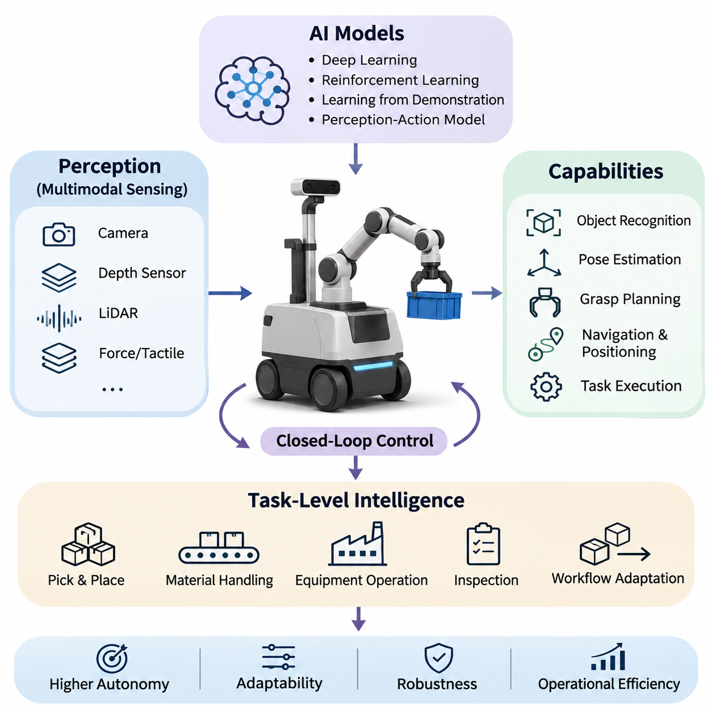
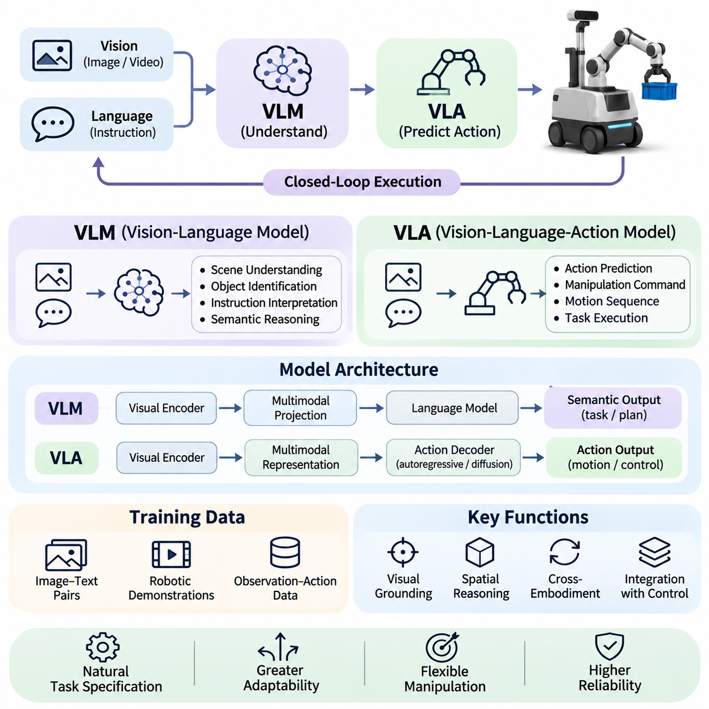
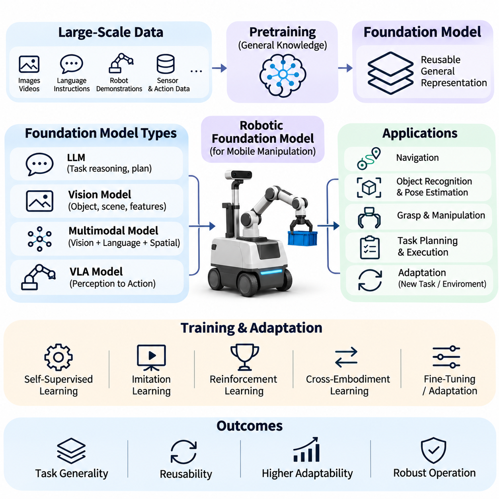
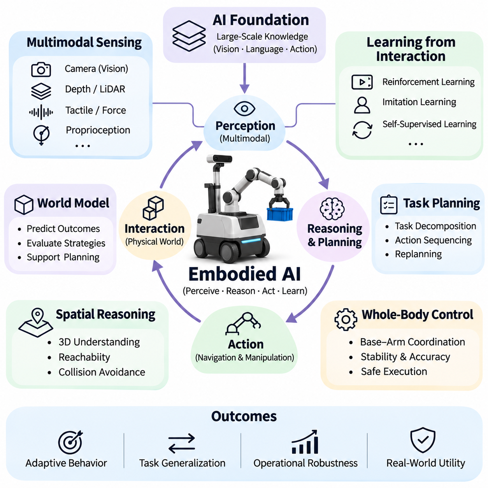
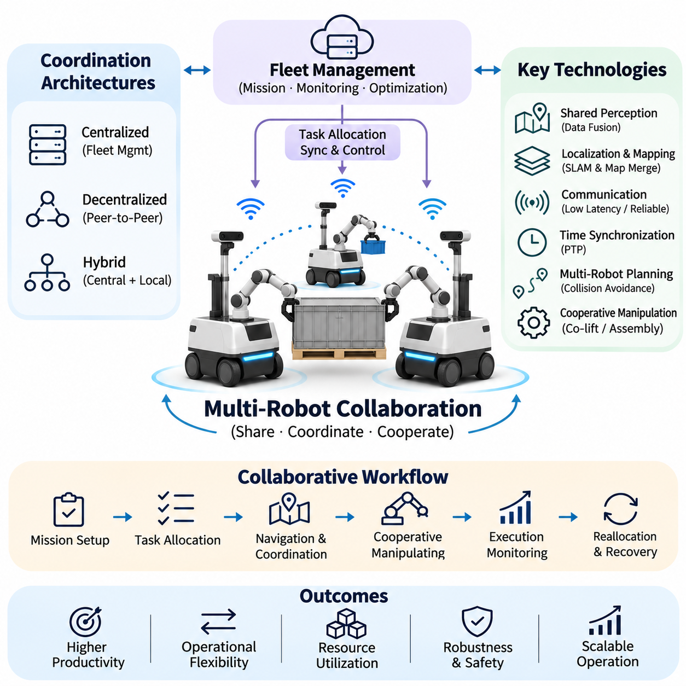
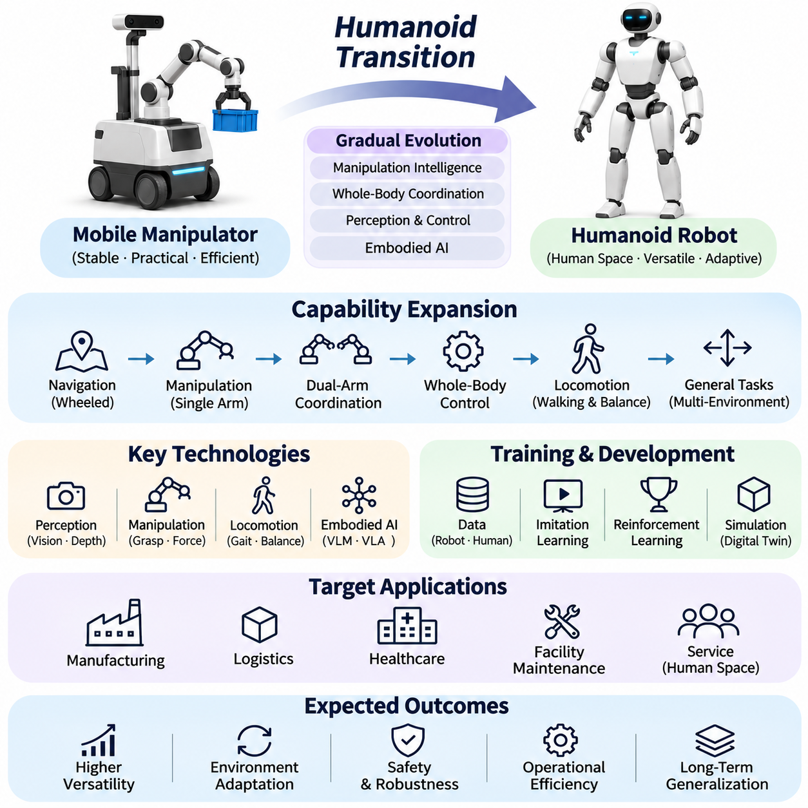
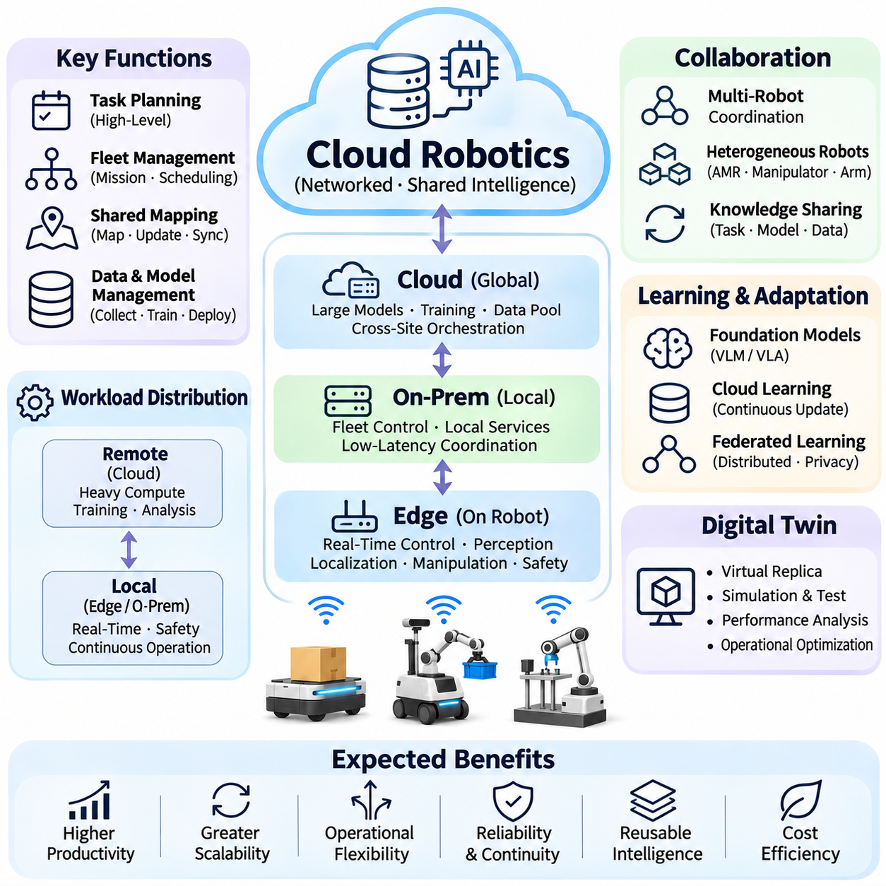
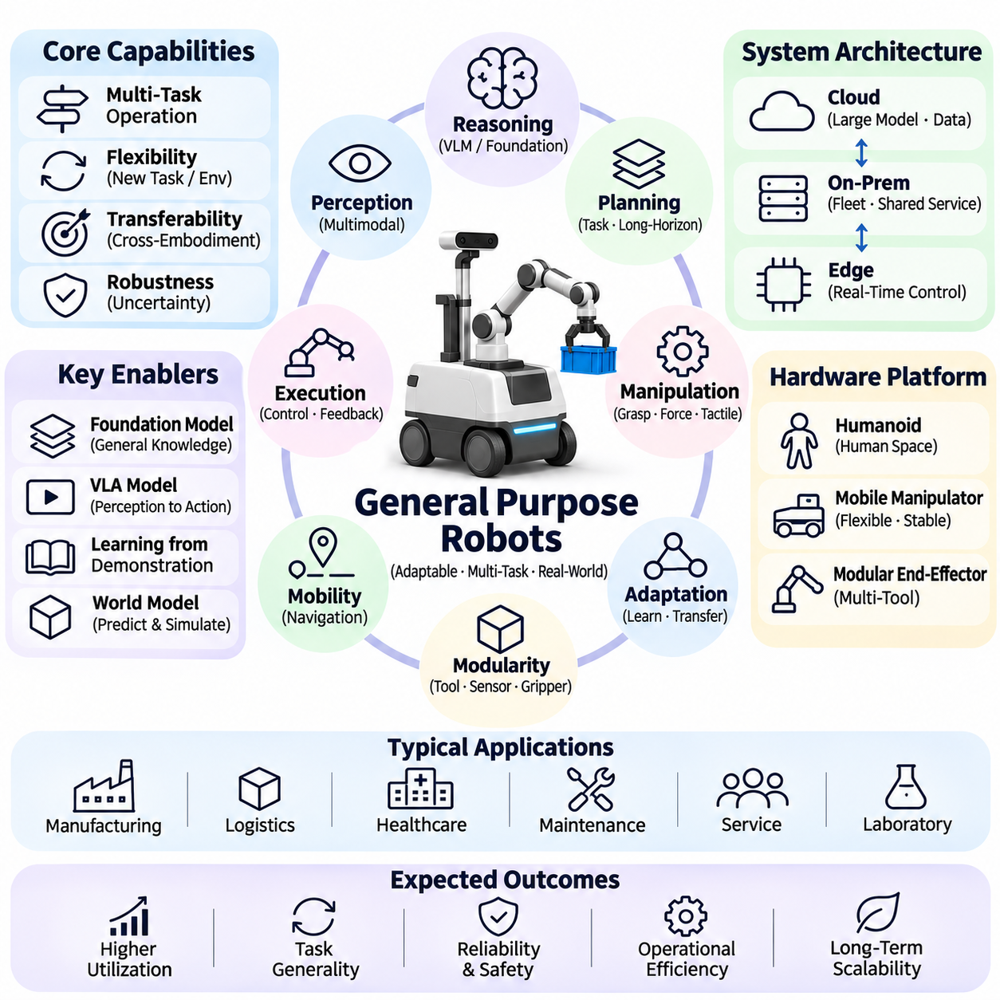
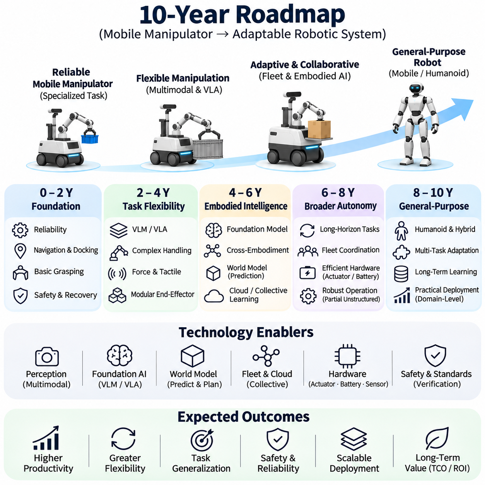

# Chapter 15. Future of Mobile Manipulators

## 01 AI Driven Manipulation

{width="7.268055555555556in" height="7.268055555555556in"}

인공지능 기반 조작(AI-Driven Manipulation)은 이동형 로보틱스(Mobile Robotics)의 중요한 발전 방향으로, 기존의 프로그래밍 중심 기계를 복잡한 환경을 해석하고 높은 자율성(Autonomy)으로 조작 작업을 수행할 수 있는 적응형 시스템(Adaptive System)으로 전환한다. 인공지능(Artificial Intelligence)을 이동 플랫폼(Mobile Platform) 및 로봇 팔(Robot Arm)과 통합하면 객체를 인식하고 공간적 관계를 추정하며 적절한 동작을 선택하고 작업 조건의 변화에 따라 행동을 조정할 수 있다.

기존 이동형 매니퓰레이터(Mobile Manipulator)는 사전에 정의된 궤적(Predefined Trajectory), 보정된 작업 공간(Calibrated Workspace), 수동으로 구성된 작업 순서(Task Sequence)에 크게 의존한다. 이러한 접근법은 구조화된 환경(Structured Environment)에서 효과적이지만 객체의 위치가 변경되거나 장애물이 예기치 않게 나타나거나 작업 요구사항이 달라지면 신뢰성이 감소한다. 인공지능 기반 조작은 인지 기반 의사결정(Perception-Based Decision-Making), 학습된 제어 정책(Learned Control Policy), 환경 불확실성(Environmental Uncertainty)에 대한 지속적인 적응을 통해 이러한 한계를 해결한다.

인공지능 기반 조작의 기본 아키텍처(Architecture)는 환경 인지(Environmental Perception), 장면 이해(Scene Understanding), 작업 계획(Task Planning), 동작 생성(Motion Generation), 폐루프 제어(Closed-Loop Control)를 결합한다. 카메라(Camera), 깊이 센서(Depth Sensor), 라이다(LiDAR), 힘 센서(Force Sensor)는 관측 정보를 제공하며, 이러한 정보는 기계학습 모델(Machine Learning Model)을 통해 처리된다. 생성된 표현 정보는 객체 인식(Object Recognition), 자세 추정(Pose Estimation), 파지 선택(Grasp Selection), 이동 플랫폼과 매니퓰레이터 사이의 협조 동작을 지원한다.

딥러닝(Deep Learning)은 시각 및 공간 정보를 해석하는 데 핵심적인 역할을 수행한다. 합성곱 신경망(Convolutional Neural Network), 비전 트랜스포머(Vision Transformer), 3차원 인지 모델(3D Perception Model)은 객체를 식별하고 기하학적 특성을 추정할 수 있다. 이러한 기능을 통해 이동형 매니퓰레이터는 모든 객체에 대해 정확하게 사전 정의된 모델이 없어도 익숙하지 않은 객체와 상호작용할 수 있다. 그러나 인식 신뢰도(Recognition Confidence), 가림 현상(Occlusion), 조명 조건(Lighting Conditions), 센서 보정(Sensor Calibration)은 여전히 성능을 결정하는 중요한 요소이다.

인공지능 기반 파지 계획(AI-Based Grasp Planning)은 객체의 외형, 접촉 기하학(Contact Geometry), 성공적인 조작 결과 사이의 관계를 학습하여 기존의 기하학적 접근법을 확장한다. 학습된 모델은 시각적 관측 정보와 추정된 객체 특성을 이용하여 후보 파지 구성(Candidate Grasp Configuration)을 평가할 수 있다. 로봇은 수동으로 지정된 파지 지점(Grasp Point)에만 의존하지 않고 실행 가능한 상호작용을 예측하며 이전 시도에서 얻은 피드백(Feedback)을 활용하여 선택 결과를 개선할 수 있다.

강화학습(Reinforcement Learning)은 적응형 조작 행동(Adaptive Manipulation Behavior)을 개발하는 또 다른 접근법을 제공한다. 로봇은 시뮬레이션(Simulation) 또는 물리적 환경과 반복적으로 상호작용하면서 작업 성공률을 높이고 운영 제약조건을 준수하는 제어 정책(Control Policy)을 학습한다. 보상 함수(Reward Function)는 파지 안정성(Grasp Stability), 작업 완료 시간(Completion Time), 에너지 소비(Energy Consumption), 충돌 회피(Collision Avoidance)를 고려할 수 있다. 실제 배포에서는 탐색 안전성(Exploration Safety), 학습 효율성(Training Efficiency), 시뮬레이션과 현실 사이의 차이를 신중하게 관리해야 한다.

시연 학습(Learning from Demonstration)은 이동형 매니퓰레이터가 인간 작업자 또는 전문 로봇 시스템의 행동을 관찰하여 기술을 습득하도록 한다. 시연 데이터(Demonstration Data)는 원격 조작(Teleoperation), 직접 교시(Kinesthetic Teaching), 동작 포착(Motion Capture), 기록된 로봇 궤적(Robot Trajectory)을 통해 수집할 수 있다. 모방학습(Imitation Learning) 알고리즘은 이러한 사례를 활용하여 유사한 상황에서 적절한 동작을 추정하며, 모든 움직임을 수동으로 프로그래밍해야 하는 부담을 줄이고 새로운 운영 작업 흐름(Operational Workflow)에 대한 적응 속도를 높인다.

중요한 발전 방향 중 하나는 개별 조작 알고리즘(Isolated Manipulation Algorithm)에서 통합된 인지-행동 모델(Integrated Perception-Action Model)로 전환하는 것이다. 객체 탐지(Object Detection), 파지 계획(Grasp Planning), 동작 실행(Motion Execution)을 독립적으로 최적화하는 대신 학습 기반 아키텍처는 센서 관측 정보를 동작 예측(Action Prediction)과 직접 연결할 수 있다. 이러한 접근법은 시스템 인터페이스(Interface)의 복잡성을 줄이고 협조 성능을 개선할 가능성이 있지만 해석 가능성(Interpretability), 데이터 요구량(Data Requirements), 안전성 검증(Safety Verification)은 여전히 중요한 엔지니어링 과제로 남아 있다.

이동형 조작(Mobile Manipulation)은 로봇 팔이 움직이는 플랫폼 위에서 작동하기 때문에 추가적인 복잡성을 가진다. 이동 플랫폼의 위치는 도달 가능성(Reachability), 안정성(Stability), 파지 정확도(Grasp Accuracy), 충돌 위험(Collision Risk)에 영향을 준다. 인공지능 기반 협조 제어(AI-Based Coordinated Control)는 주행 경로(Navigation Path), 플랫폼 배치(Base Placement), 매니퓰레이터 궤적(Manipulator Trajectory)을 공동으로 평가할 수 있다. 이를 통해 시스템은 환경 제약조건과 전체 로봇의 기계적 한계를 고려하면서 작업 접근성을 높이는 위치를 선택할 수 있다.

예측 제어(Predictive Control)는 미래 시스템 상태(Future System State)를 예상하여 조작 성능을 향상할 수 있다. 기계학습 모델은 객체의 움직임(Object Motion), 접촉력(Contact Force), 이동 플랫폼에 영향을 주는 외란(Disturbance)을 추정할 수 있다. 이러한 예측은 모델 예측 제어(Model Predictive Control)와 적응형 궤적 최적화(Adaptive Trajectory Optimization)를 지원한다. 이동하는 컨베이어(Conveyor), 동적 장애물(Dynamic Obstacle), 불안정한 객체를 다루는 작업에서 예측 기능은 실행 오류를 줄이고 로봇 작업의 일관성을 향상하는 데 기여한다.

촉각 지능(Tactile Intelligence)은 신뢰성 높은 조작을 구현하는 데 점점 더 중요해지고 있다. 시각 센싱(Visual Sensing)만으로는 마찰(Friction), 순응성(Compliance), 접촉 안정성(Contact Stability), 미끄러짐 발생(Slip Onset)을 완전히 판단할 수 없다. 촉각 센서(Tactile Sensor)와 힘-토크 측정(Force-Torque Measurement)은 물리적 상호작용 중 보완적인 정보를 제공한다. 인공지능 모델은 이러한 신호를 결합하여 파지력(Gripping Force)을 조정하고 예상하지 못한 접촉을 감지하며 깨지기 쉽거나 변형 가능하거나 불규칙한 형태의 객체를 조작하도록 지원할 수 있다.

다중모달 센서 융합(Multimodal Sensor Fusion)은 카메라, 깊이 센서, 고유수용성 측정(Proprioceptive Measurement), 접촉 센서(Contact Sensor)의 정보를 통합하여 로봇의 의사결정을 강화한다. 각 센싱 방식(Sensing Modality)은 환경과 로봇 상태에 대해 서로 다른 정보를 제공한다. 인공지능 기반 융합 아키텍처(Fusion Architecture)는 불확실성을 추정하고 관측 정보 사이의 불일치를 식별할 수 있으며, 개별 센서가 가림 현상, 잡음(Noise), 일시적인 고장(Temporary Failure)의 영향을 받더라도 더욱 신뢰성 높은 판단을 지원한다.

작업 수준 지능(Task-Level Intelligence)은 개별 파지 동작을 실행하는 범위를 넘어선다. 이동형 매니퓰레이터는 작업 사이의 의존 관계(Task Dependency)를 이해하고 적절한 실행 순서를 결정하며 중간 동작이 실패했을 때 복구해야 한다. 인공지능 지원 작업 계획(AI-Assisted Task Planning)은 기호적 표현(Symbolic Representation)과 학습된 행동 모델(Learned Action Model)을 결합할 수 있으며, 이를 통해 객체 가용성(Object Availability), 작업 공간 제약조건(Workspace Constraint), 도구 요구사항(Tool Requirement), 대체 조작 전략의 결과를 추론할 수 있다.

자연어 상호작용(Natural Language Interaction)은 로봇의 작업 목표를 지정하기 위한 더욱 유연한 인터페이스를 제공한다. 작업자는 상세한 동작 순서를 프로그래밍하는 대신 일반적인 언어로 작업을 설명할 수 있다. 언어 기반 인공지능 시스템(Language-Based AI System)은 명령을 해석하고 관련 객체를 식별하며 후보 작업 계획(Candidate Task Plan)을 생성할 수 있다. 그러나 이러한 계획은 실제 환경에서 검증된 관측 정보에 근거해야 하며 실행 전에 물리적 실현 가능성(Physical Feasibility)과 안전 제약조건(Safety Constraint)을 확인해야 한다.

적응형 조작(Adaptive Manipulation)은 운영 경험(Operational Experience)으로부터 지속적으로 학습하는 능력에도 의존한다. 실행 로그(Execution Log), 실패한 파지 기록(Failed Grasp Record), 센서 관측 정보(Sensor Observation), 인간의 수정 사항(Human Correction)은 중요한 학습 데이터를 제공할 수 있다. 체계적인 학습 파이프라인(Learning Pipeline)은 이러한 기록을 활용하여 인지 모델과 조작 정책을 개선할 수 있다. 모델 업데이트(Model Update)는 배포 전에 통제된 검증(Controlled Validation)을 거쳐야 하며, 특정 운영 조건에서의 개선이 다른 환경에서 예상하지 못한 실패를 유발하지 않도록 해야 한다.

시뮬레이션(Simulation)과 디지털 트윈(Digital Twin)은 인공지능 기반 조작을 개발하기 위한 핵심 인프라(Infrastructure)를 제공한다. 가상 환경(Virtual Environment)은 실제 장비를 불필요한 위험에 노출하지 않으면서 학습 데이터를 생성하고 제어 전략을 평가하며 어려운 운영 상황을 재현할 수 있도록 한다. 도메인 무작위화(Domain Randomization)는 조명, 객체 형상(Object Geometry), 마찰, 센서 잡음의 변화를 도입하여 학습된 정책이 실제 로봇 플랫폼으로 이전될 때 더욱 높은 강건성(Robustness)을 확보하도록 지원한다.

시뮬레이션에서 현실로의 전이(Sim-to-Real Transfer)는 가상 환경이 물리적 접촉(Physical Contact), 액추에이터 동작(Actuator Behavior), 기계적 순응성(Mechanical Compliance), 센서의 불완전성을 완벽하게 재현할 수 없기 때문에 여전히 중요한 과제이다. 성공적인 전이를 위해 시스템 식별(System Identification), 동역학 무작위화(Dynamics Randomization), 실제 환경 미세조정(Real-World Fine-Tuning), 피드백 기반 적응(Feedback-Based Adaptation)이 필요할 수 있다. 학습된 정책과 기존 제어기를 결합하는 하이브리드 접근법(Hybrid Approach)은 검증된 제어 특성을 유지하면서 적응 기능을 도입하여 신뢰성을 향상할 수 있다.

컴퓨팅 아키텍처(Computing Architecture)는 인공지능 기반 조작의 실제 배포에 큰 영향을 준다. 고해상도 인지(High-Resolution Perception), 학습된 동작 정책(Learned Motion Policy), 다중모달 추론(Multimodal Reasoning)은 상당한 연산 자원을 요구할 수 있다. 엣지 컴퓨팅(Edge Computing)은 로봇 하드웨어 가까이에서 저지연 추론(Low-Latency Inference)을 가능하게 하며, 클라우드 인프라(Cloud Infrastructure)는 대규모 학습과 로봇 군집 수준 분석(Fleet-Level Analysis)을 지원한다. 효과적인 설계는 시간 제약이 엄격한 제어 기능을 로컬에서 수행하고 비실시간 학습 작업은 더 강력한 컴퓨팅 자원에 할당한다.

안전성(Safety)은 학습된 인공지능 모델에 내재되어 있다고 가정할 수 있는 특성이 아니라 명시적인 시스템 수준 요구사항(System-Level Requirement)으로 유지되어야 한다. 학습된 조작 정책은 익숙하지 않은 객체나 학습 데이터 분포(Training Distribution)를 벗어난 조건을 만나면 예상하지 못한 동작을 생성할 수 있다. 독립적인 안전 제어기(Independent Safety Controller), 충돌 감시(Collision Monitoring), 작업 공간 제한(Workspace Restriction), 비상 정지 메커니즘(Emergency-Stop Mechanism), 실행 중 동작 검증(Runtime Action Validation)은 인공지능 의사결정 과정과 분리되어 작동하는 보호 계층(Protective Layer)을 제공한다.

불확실성 추정(Uncertainty Estimation)은 로봇이 인간과 상호작용하거나 비정형 환경(Unstructured Environment)에서 작동할 때 특히 중요하다. 인공지능 모델은 신뢰도가 높은 예측과 모호한 관측을 구별하고 추가 센싱이나 작업자 지원이 필요한 상황을 인식해야 한다. 조작 시스템은 신뢰성이 낮은 동작을 실행하는 대신 카메라 위치를 변경하거나 더 안전한 파지를 선택하거나 이동 속도를 낮추거나 인간의 개입(Human Intervention)을 요청하는 방식으로 불확실성에 대응할 수 있다.

산업 응용(Industrial Application)은 공작기계 작업 지원(Machine Tending), 창고 피킹(Warehouse Picking), 자재 이송(Material Transfer), 검사(Inspection), 유연 조립(Flexible Assembly) 분야에서 인공지능 기반 조작의 실용적 가치를 보여준다. 이러한 환경에서는 객체 배치(Object Placement), 제품 형상(Product Geometry), 작업 순서(Task Sequence)가 빈번하게 변경된다. 인공지능은 수동 재프로그래밍(Manual Reprogramming)의 필요성을 줄이고 더욱 유연한 운영을 지원할 수 있지만 성공적인 도입은 신뢰성, 처리량(Throughput), 유지보수성(Maintainability), 총운영비용(Total Operating Cost)의 측정 가능한 개선에 달려 있다.

따라서 성능 평가(Performance Evaluation)는 개별 파지 성공률(Grasp Success Rate)만을 고려해서는 안 된다. 중요한 평가 지표에는 전체 작업 성공률(Complete Task Success Rate), 사이클 시간(Cycle Time), 복구 빈도(Recovery Frequency), 위치 정확도(Positioning Accuracy), 에너지 소비(Energy Consumption), 작업자 개입률(Intervention Rate), 운영 가용성(Operational Availability)이 포함된다. 평가는 익숙하지 않은 객체, 환경 외란(Environmental Disturbance), 장시간 운영 조건을 포함해야 한다. 이러한 시험은 제한적으로 통제된 조건에서 수행한 시연보다 실제 자율성(Practical Autonomy)에 대한 더욱 강력한 근거를 제공한다.

인공지능 기반 조작의 장기적인 발전 방향은 다양한 객체, 작업, 환경 사이에서 전이할 수 있는 범용화된 로봇 기술(Generalizable Robotic Skill)을 확보하는 것이다. 표현 학습(Representation Learning), 다중모달 모델(Multimodal Model), 강화학습(Reinforcement Learning), 확장 가능한 로봇 데이터셋(Scalable Robotic Dataset)의 발전은 응용 분야별 프로그래밍(Application-Specific Programming)에 대한 의존도를 낮출 수 있다. 그러나 일반화 능력(Generalization Capability)은 모델 크기나 학습 데이터의 다양성만으로 가정해서는 안 되며 체계적인 시험을 통해 입증되어야 한다.

미래의 이동형 매니퓰레이터는 학습 기반 인지 및 추론(Learned Perception and Reasoning)을 구조화된 계획(Structured Planning), 모델 기반 제어(Model-Based Control), 독립적으로 검증된 안전 메커니즘(Independently Verified Safety Mechanism)과 결합할 가능성이 높다. 이러한 하이브리드 아키텍처(Hybrid Architecture)는 예측 가능성과 유지보수성을 유지하면서 적응할 수 있는 로봇 시스템으로 발전하기 위한 실용적인 경로를 제공한다. 궁극적인 목표는 개별 움직임을 단순히 자동화하는 것이 아니라 변화하는 운영 환경에서 인간의 감독(Human Supervision)을 점진적으로 줄이면서 신뢰성 높은 물리적 작업 수행(Reliable Physical Task Execution)을 실현하는 것이다.

## 02 VLM and VLA

{width="7.268055555555556in" height="7.268055555555556in"}

비전-언어 모델(Vision-Language Model, VLM)과 비전-언어-행동 모델(Vision-Language-Action Model, VLA)은 시각적 환경을 이해하고 인간의 명령을 해석하며 목적에 맞는 로봇 행동을 생성하는 지능형 이동형 매니퓰레이터(Intelligent Mobile Manipulator)로 발전하기 위한 중요한 전환점을 나타낸다. 이러한 모델은 인지(Perception), 의미적 추론(Semantic Reasoning), 행동 생성(Action Generation)을 결합하여 경직된 작업 프로그래밍(Task Programming)에 대한 의존도를 줄인다. 이러한 기술의 발전은 산업, 물류, 서비스 환경 전반에서 더욱 높은 적응성을 갖춘 로봇 시스템을 구현할 수 있는 가능성을 제공한다.

비전-언어 모델(Vision-Language Model)은 시각 정보(Visual Information)와 자연어 표현(Natural Language Representation)을 통합하여 객체, 장면, 관계를 해석한다. 이미지 또는 비디오 관측 정보는 시각 인코더(Visual Encoder)를 통해 처리되며, 언어 명령은 텍스트 처리 구성요소(Text Processing Component)를 통해 표현된다. 다중모달 정렬(Multimodal Alignment)은 시각적 특징(Visual Feature)을 의미적 개념(Semantic Concept)과 연결하여 객체 식별(Object Identification), 장면 설명(Scene Description), 명령 해석(Instruction Interpretation), 물리적 환경에 대한 문맥적 추론(Contextual Reasoning)을 지원한다.

이동형 매니퓰레이터(Mobile Manipulator)에서 비전-언어 모델은 기존 인지 알고리즘(Perception Algorithm)보다 상위 수준의 의미적 이해 계층(Semantic Understanding Layer)을 제공한다. 기존 비전 시스템(Vision System)은 주로 객체를 식별하고 위치를 추정하며 시각적 특징을 분류한다. 반면 비전-언어 모델은 특정 객체가 어느 작업대(Workstation)에 속하는지 또는 요청된 물품에 접근할 수 있는지와 같은 관계까지 해석할 수 있다. 이러한 의미적 기능은 로봇이 상위 수준 명령(High-Level Instruction)을 실제 운영 목표(Operational Objective)로 변환하도록 지원한다.

비전-언어-행동 모델(Vision-Language-Action Model)은 시각적 관측 정보와 언어 명령을 로봇 행동 표현(Robotic Action Representation)에 직접 연결함으로써 다중모달 이해(Multimodal Understanding)를 확장한다. 단순히 텍스트 설명이나 기호적 의사결정(Symbolic Decision)을 생성하는 대신 물리적 환경에 영향을 줄 수 있는 행동을 예측한다. 이러한 출력은 로봇 아키텍처와 모델 설계에 따라 말단효과기 이동(End-Effector Movement), 관절 구성(Joint Configuration), 그리퍼 명령(Gripper Command), 제어 목표 시퀀스(Control Target Sequence) 등으로 표현될 수 있다.

비전-언어 모델과 비전-언어-행동 모델의 주요 차이는 기능적 출력(Functional Output)에 있다. 비전-언어 모델은 로봇이 무엇을 관측하고 명령이 무엇을 의미하는지 해석하는 반면, 비전-언어-행동 모델은 로봇이 어떻게 행동해야 하는지까지 예측한다. 실제 시스템에서 비전-언어 모델 기반 추론(VLM-Based Reasoning)은 작업 설명이나 계획을 생성하고, 비전-언어-행동 모델 기반 정책(VLA-Based Policy)은 조작 명령(Manipulation Command)을 생성할 수 있다. 두 접근법 모두 기존 계획 및 제어 시스템과 통합하여 운영 신뢰성(Operational Reliability)을 향상할 수 있다.

일반적인 비전-언어 모델 아키텍처(VLM Architecture)는 시각 인코더(Visual Encoder), 다중모달 투영 메커니즘(Multimodal Projection Mechanism), 언어 모델(Language Model)을 결합한다. 시각 인코더는 카메라 관측 정보에서 특징 표현(Feature Representation)을 추출하고, 투영 메커니즘은 이러한 특징을 언어 모델의 표현 공간(Representation Space)에 정렬한다. 이후 언어 모델은 결합된 정보를 처리하여 의미적 해석(Semantic Interpretation)을 생성한다. 아키텍처 선택은 공간 추론 정확도(Spatial Reasoning Accuracy), 연산 요구사항(Computational Requirements), 지속적으로 변화하는 장면의 처리 능력에 영향을 준다.

비전-언어-행동 모델 아키텍처(VLA Architecture)는 다중모달 표현을 로봇과 호환되는 제어 출력(Control Output)으로 변환하는 행동 예측 구성요소(Action Prediction Component)를 도입한다. 행동 생성에는 자기회귀 예측(Autoregressive Prediction), 연속값 회귀(Continuous Regression), 확산 기반 정책(Diffusion-Based Policy), 기타 학습 기반 시퀀스 생성 기법(Sequence Generation Technique)이 사용될 수 있다. 일부 아키텍처는 개별 행동을 예측하고, 다른 아키텍처는 여러 미래 제어 목표를 포함하는 행동 청크(Action Chunk)를 생성한다. 행동 청크화(Action Chunking)는 추론 빈도를 줄일 수 있지만 예상하지 못한 환경 변화에 신중하게 대응해야 한다.

비전-언어 모델의 학습(Training)에는 일반적으로 대규모 이미지-텍스트 쌍(Image-Text Pair), 시각적 질의응답(Visual Question Answering) 사례, 명령 수행 데이터(Instruction-Following Data)가 사용된다. 이러한 데이터셋(Dataset)은 모델이 시각적 관측 정보와 언어 설명 사이의 의미적 연관성(Semantic Association)을 학습하도록 지원한다. 그러나 일반적인 시각적 이해 능력이 정확한 기하학적 추론(Geometric Reasoning)을 자동으로 보장하지는 않는다. 로봇 응용에서는 깊이 추정(Depth Estimation), 객체 위치 추정(Object Localization), 공간 관계(Spatial Relationship)를 위해 추가 학습이나 전문 인지 모듈(Specialized Perception Module)과의 통합이 필요한 경우가 많다.

비전-언어-행동 모델의 학습에는 관측 정보, 명령, 물리적 행동을 연결하는 데이터가 필요하다. 로봇 시연 데이터(Robotic Demonstration Data)에는 동기화된 카메라 이미지, 고유수용성 측정(Proprioceptive Measurement), 말단효과기 자세(End-Effector Pose), 관절 상태(Joint State), 행동 명령(Action Command)이 포함될 수 있다. 이러한 데이터셋은 모델이 환경 조건과 성공적인 조작 행동 사이의 관계를 학습하도록 한다. 데이터셋 일관성(Dataset Consistency), 좌표계 규약(Coordinate Convention), 행동 주파수(Action Frequency), 로봇 신체 구조(Robot Embodiment)는 학습 효과에 큰 영향을 준다.

서로 다른 로봇 신체 구조 간 학습(Cross-Embodiment Learning)은 로봇 플랫폼마다 기계적 구조(Mechanical Structure), 자유도(Degrees of Freedom), 그리퍼 설계(Gripper Design), 제어 인터페이스(Control Interface)가 다르기 때문에 중요한 연구 방향이다. 특정 로봇에서 학습한 비전-언어-행동 모델이 서로 다른 운동학(Kinematics)을 가진 다른 로봇에서 직접 작동하지 않을 수 있다. 공통 행동 표현(Shared Action Representation), 신체 구조별 어댑터(Embodiment-Specific Adapter), 표준화된 관측 형식(Standardized Observation Format)은 전이 가능성(Transferability)을 향상할 수 있지만 상당한 검증과 적응 과정이 여전히 필요할 수 있다.

자연어 명령(Natural Language Instruction)을 활용하면 작업자는 모든 동작을 수동으로 정의하지 않고도 작업을 지정할 수 있다. 예를 들어 선택한 컨테이너(Container)를 검사 스테이션(Inspection Station)으로 이동하라는 요청은 시각적 기반화(Visual Grounding)와 의미적 추론(Semantic Reasoning)을 통해 해석할 수 있다. 시스템은 대상 객체를 식별하고 위치를 확인하며 목적지를 이해하고 조작 가능성(Manipulation Feasibility)을 평가해야 한다. 모호한 명령(Ambiguous Instruction)은 즉시 실행하기보다 추가적인 확인 과정(Clarification)이 필요할 수 있다.

시각적 기반화(Visual Grounding)는 언어적 표현(Linguistic Expression)을 로봇이 관측한 환경 내의 특정 객체 또는 영역과 연결한다. 예를 들어 특정 상자를 지칭하는 명령을 수행하려면 모델은 시각적으로 유사한 다른 객체와 해당 상자를 구별해야 한다. 시각적 기반화는 의미적 특징(Semantic Feature)을 객체 탐지(Object Detection), 분할(Segmentation), 깊이 센싱(Depth Sensing), 추적(Tracking)과 결합할 수 있다. 잘못된 객체 선택은 조작 실패(Manipulation Failure)나 위험한 행동으로 이어질 수 있으므로 신뢰성 높은 시각적 기반화가 필수적이다.

공간 추론(Spatial Reasoning)은 비전-언어 모델 및 비전-언어-행동 모델 기반 로보틱스에서 여전히 중요한 과제이다. 성공적인 조작에는 거리(Distance), 방향(Orientation), 도달 가능성(Reachability), 충돌 경계(Collision Boundary), 물리적 제약조건(Physical Constraint)에 대한 정확한 이해가 필요하다. 언어 기반 표현(Language-Based Representation)은 의미적 관계를 포착할 수 있지만 충분한 기하학적 정밀도(Geometric Precision)를 제공하지 못할 수 있다. 따라서 하이브리드 아키텍처(Hybrid Architecture)는 학습 기반 다중모달 추론을 명시적인 3차원 표현(3D Representation), 운동학 계산(Kinematic Calculation), 동작 계획 알고리즘(Motion Planning Algorithm)과 결합한다.

이동형 조작(Mobile Manipulation)은 주행(Navigation)과 조작(Manipulation)을 협조시켜야 하므로 추가적인 요구사항이 발생한다. 로봇은 작업대에 접근하고 적절한 이동 플랫폼 위치(Base Position)를 선택하며 객체를 식별한 후 파지(Grasp)를 실행해야 할 수 있다. 비전-언어 모델은 상위 수준 작업 해석(High-Level Task Interpretation)을 지원하고, 비전-언어-행동 모델은 조작 행동을 생성할 수 있다. 주행 계획기(Navigation Planner)와 전신 제어기(Whole-Body Controller)는 전체 작업 과정에서 기하학적 제약조건(Geometric Constraint)과 동역학적 제약조건(Dynamic Constraint)을 적용할 수 있다.

폐루프 실행(Closed-Loop Execution)은 신뢰성 높은 비전-언어-행동 모델 배포(VLA Deployment)에 필수적이다. 정책(Policy)은 예측된 행동이 예상한 대로 정확하게 성공한다고 가정하는 대신 갱신된 센서 관측 정보를 반복적으로 반영해야 한다. 시각 피드백(Visual Feedback), 힘 측정(Force Measurement), 로봇 상태 추정(Robot State Estimation)은 객체 이동(Object Displacement), 파지 실패(Grasp Failure), 예상하지 못한 접촉(Unexpected Contact)을 감지할 수 있다. 재계획(Replanning)과 보정 제어(Corrective Control)는 시스템이 작업 목표를 유지하면서 이러한 변화에 대응하도록 지원한다.

비전-언어 모델과 비전-언어-행동 모델의 연산 요구사항(Computational Requirements)은 임베디드 로봇 플랫폼(Embedded Robotic Platform)에 새로운 과제를 제시한다. 대규모 다중모달 모델(Large Multimodal Model)은 상당한 메모리 용량(Memory Capacity), 연산 처리량(Processing Throughput), 통신 대역폭(Communication Bandwidth)을 요구할 수 있다. 엣지 배포(Edge Deployment)에는 모델 압축(Model Compression), 양자화(Quantization), 최적화된 추론(Optimized Inference), 소형 작업 특화 모델(Task-Specific Model)이 필요한 경우가 많다. 계층형 아키텍처(Hierarchical Architecture)는 의미적 추론을 고성능 프로세서에 할당하고 시간 제약이 엄격한 제어는 전용 로컬 하드웨어에서 유지할 수 있다.

클라우드 지원 아키텍처(Cloud-Assisted Architecture)는 더 큰 모델과 공유 지식(Shared Knowledge)에 접근할 수 있도록 하지만 네트워크 지연(Network Latency)과 연결성 제한(Connectivity Limitation)을 고려해야 한다. 즉각적인 충돌 회피(Collision Avoidance)나 접촉 제어(Contact Control)가 필요한 작업은 예측하기 어려운 클라우드 응답 시간(Cloud Response Time)에 의존할 수 없다. 실용적인 아키텍처는 비실시간 의미적 추론(Noncritical Semantic Reasoning)과 안전 필수 실행(Safety-Critical Execution)을 분리하여 통신이 중단되더라도 로컬 제어기(Local Controller)가 안전한 동작을 유지하도록 한다.

시뮬레이션 환경(Simulation Environment)은 시각적 관측 정보, 작업 설명, 로봇 시연 데이터를 생성하여 비전-언어 모델과 비전-언어-행동 모델의 개발을 지원한다. 합성 데이터(Synthetic Data)는 객체 외형(Object Appearance), 조명(Lighting), 카메라 시점(Camera Viewpoint), 작업 공간 배치(Workspace Arrangement)에 다양한 변화를 도입할 수 있다. 그러나 시뮬레이션된 조작 궤적(Simulated Manipulation Trajectory)은 접촉 동역학(Contact Dynamics)이나 센서의 불완전성을 정확하게 재현하지 못할 수 있다. 따라서 시뮬레이션에서 현실로의 전이(Sim-to-Real Transfer)는 실제 로봇과 대표적인 운영 조건을 이용한 신중한 평가가 필요하다.

일반화(Generalization)는 비전-언어-행동 모델 연구의 주요 목표이다. 유용한 모델은 완전한 재학습(Retraining) 없이도 익숙하지 않은 객체, 변화된 환경, 다양한 명령을 포함하는 작업을 수행할 수 있어야 한다. 이러한 능력을 확보하려면 다양한 학습 데이터(Diverse Training Data), 강건한 시각 표현(Robust Visual Representation), 효과적인 행동 학습(Action Learning)이 필요하다. 성능은 학습 시연(Training Demonstration)과 매우 유사한 변형 조건뿐만 아니라 실제로 관측하지 않은 상황(Genuinely Unseen Situation)에서도 측정해야 한다.

안전성 검증(Safety Validation)은 다중모달 모델(Multimodal Model)이 물리적 행동을 생성할 때 특히 중요해진다. 잘못된 시각적 해석(Visual Interpretation), 언어적 모호성(Language Ambiguity), 모델 환각(Model Hallucination)은 부적절한 명령을 생성할 수 있다. 독립적인 안전 메커니즘(Independent Safety Mechanism)은 동작 제한(Motion Limit), 충돌 제약조건(Collision Constraint), 허용 작업 공간(Permissible Workspace), 운영 상태(Operational State)를 검증해야 한다. 비전-언어 모델과 비전-언어-행동 모델의 출력은 물리적 실현 가능성 검사(Physical Feasibility Check)와 기존 안전 제어(Safety Control)의 검증을 받아야 하는 후보 의사결정(Candidate Decision)으로 취급해야 한다.

인간의 감독(Human Oversight)은 배포와 지속적인 개선 과정에서 여전히 중요한 가치를 가진다. 작업자는 불확실한 의사결정을 검토하고 객체 선택을 수정하며 익숙하지 않은 작업이 발생했을 때 시연을 제공할 수 있다. 이러한 상호작용은 다중모달 모델과 행동 정책(Action Policy)을 개선하기 위한 피드백(Feedback)을 생성한다. 추가 학습 이후 성능 저하(Performance Degradation)를 방지하려면 통제된 모델 업데이트(Controlled Model Update), 회귀 테스트(Regression Testing), 추적 가능한 운영 기록(Traceable Operational Record)이 필요하다.

산업적 도입(Industrial Adoption)은 작업 유연성(Task Flexibility), 배포 노력(Deployment Effort), 운영 생산성(Operational Productivity)의 측정 가능한 개선에 달려 있다. 관련 응용 분야에는 창고 피킹(Warehouse Picking), 공작기계 작업 지원(Machine Tending), 실험실 물품 취급(Laboratory Handling), 검사(Inspection), 서비스 지원(Service Assistance)이 포함된다. 평가는 언어 또는 비전 벤치마크(Benchmark)에만 의존하지 않고 전체 작업 성공률(Complete Task Success Rate), 명령 해석 정확도(Instruction Interpretation Accuracy), 조작 신뢰성(Manipulation Reliability), 추론 지연(Inference Latency), 복구 성능(Recovery Performance), 인간 개입 빈도(Human Intervention Frequency)를 고려해야 한다.

비전-언어 모델과 비전-언어-행동 모델 기술의 미래는 광범위한 의미적 이해(Broad Semantic Understanding)를 정밀하고 신뢰성 높은 물리적 실행(Physical Execution)과 결합하는 데 있다. 비전-언어 모델은 이동형 매니퓰레이터가 복잡한 환경과 인간의 의도(Human Intention)를 해석하도록 지원하며, 비전-언어-행동 모델은 이러한 해석을 학습된 로봇 행동(Learned Robotic Action)과 연결할 수 있다. 기하학적 계획(Geometric Planning), 피드백 제어(Feedback Control), 독립적인 안전 시스템(Independent Safety System)과의 통합은 점점 더 다양한 실제 응용 환경에서 적응형 이동 조작(Adaptive Mobile Manipulation)을 구현하기 위한 유망한 기반을 제공한다.

## 03 Foundation Models

{width="7.268055555555556in" height="7.268055555555556in"}

파운데이션 모델(Foundation Model)은 다양한 작업, 환경, 로봇 플랫폼을 지원할 수 있는 재사용 가능한 학습 아키텍처(Reusable Learning Architecture)를 제공함으로써 인공지능(Artificial Intelligence)의 중요한 발전을 나타낸다. 제한적으로 정의된 기능을 위해 학습하는 기존 모델과 달리 파운데이션 모델은 대규모의 다양한 데이터셋(Dataset)으로부터 범용적인 표현(General Representation)을 학습한다. 이동형 매니퓰레이터(Mobile Manipulator)에서는 이러한 기능을 통해 인지(Perception), 추론(Reasoning), 계획(Planning), 물리적 상호작용(Physical Interaction)을 더욱 적응력 높은 로봇 시스템으로 통합할 수 있다.

파운데이션 모델의 기본 원리는 대규모 사전학습(Large-Scale Pretraining)을 수행한 후 특정 응용 분야에 적응(Adaptation)시키는 것이다. 사전학습 과정에서 모델은 방대한 데이터셋으로부터 통계적 패턴(Statistical Pattern), 의미적 관계(Semantic Relationship), 구조적 표현(Structural Representation)을 학습한다. 이러한 표현은 이후 미세조정(Fine-Tuning), 프롬프팅(Prompting), 특수 적응 메커니즘(Specialized Adaptation Mechanism)을 통해 다운스트림 작업(Downstream Task)을 지원할 수 있다. 이 접근법은 모든 로봇 기능에 대해 완전히 독립적인 모델을 개발해야 하는 필요성을 줄인다.

로봇 파운데이션 모델(Robotic Foundation Model)은 추상적 표현(Abstract Representation)을 물리적 환경(Physical Environment)과 연결해야 한다는 점에서 기존 언어 모델(Language Model)이나 비전 모델(Vision Model)과 차이가 있다. 이동형 매니퓰레이터는 객체의 기하학적 형상(Object Geometry), 로봇 운동학(Robot Kinematics), 접촉력(Contact Force), 환경 제약조건(Environmental Constraint)을 고려하면서 센서 관측 정보(Sensory Observation)를 해석해야 한다. 따라서 로봇 파운데이션 모델에는 학습된 의미적 지식(Semantic Knowledge)을 공간 이해(Spatial Understanding), 물리적 실현 가능성(Physical Feasibility), 실행 가능한 로봇 행동(Executable Robotic Action)과 연결하는 메커니즘이 필요하다.

대규모 언어 모델(Large Language Model, LLM)은 명령 해석(Instruction Interpretation), 작업 순서 추론(Task Sequence Reasoning), 구조화된 계획 생성(Structured Plan Generation)에 중요한 기능을 제공한다. 이동형 조작(Mobile Manipulation)에서 언어 모델은 인간의 요청을 주행(Navigation), 객체 식별(Object Identification), 파지(Grasping), 운반(Transportation), 배치(Placement) 등의 작업으로 변환할 수 있다. 그러나 언어 기반 추론만으로는 물리적으로 실행 가능한 행동을 보장할 수 없다. 따라서 생성된 계획은 기하학적 계획(Geometric Planning), 로봇 상태 추정(Robot State Estimation), 안전 제약조건(Safety Constraint)을 통해 검증해야 한다.

비전 파운데이션 모델(Vision Foundation Model)은 객체 인식(Object Recognition), 분할(Segmentation), 장면 이해(Scene Understanding), 시각적 특징 추출(Visual Feature Extraction)을 위한 재사용 가능한 표현을 제공한다. 방대한 이미지 데이터로 사전학습된 모델은 서로 다른 시각적 환경으로 전이할 수 있는 특징을 제공한다. 이동형 매니퓰레이터는 이러한 표현을 활용하여 객체를 식별하고 작업 공간(Workspace)을 이해할 수 있지만, 정확한 자세 추정(Pose Estimation), 충돌 검사(Collision Checking), 접촉에 민감한 조작(Contact-Sensitive Manipulation)을 위해서는 전문적인 기하학적 인지(Geometric Perception)가 여전히 필요하다.

다중모달 파운데이션 모델(Multimodal Foundation Model)은 시각, 언어, 공간, 경우에 따라 고유수용성 정보(Proprioceptive Information)를 공유 표현 아키텍처(Shared Representation Architecture) 내에서 결합한다. 이러한 모델은 객체와 명령을 연관시키고 환경적 문맥(Environmental Context)을 해석하며 여러 센싱 방식(Sensing Modality)을 포함하는 의사결정을 지원할 수 있다. 핵심 가치는 의미적 이해(Semantic Understanding)를 운영 정보(Operational Information)와 연결하여 개별 센서 측정만으로 충분히 설명하기 어려운 작업을 로봇이 추론할 수 있도록 하는 데 있다.

비전-언어-행동 파운데이션 모델(Vision-Language-Action Foundation Model)은 다중모달 학습(Multimodal Learning)을 직접적인 로봇 행동 생성(Robotic Behavior Generation)으로 확장한다. 이러한 모델은 관측 정보와 작업 명령을 입력받아 로봇 실행에 적합한 행동 또는 행동 시퀀스(Action Sequence)를 예측한다. 아키텍처에 따라 출력에는 말단효과기 자세(End-Effector Pose), 관절 목표값(Joint Target), 그리퍼 명령(Gripper Command), 동작 궤적(Motion Trajectory)이 포함될 수 있다. 이러한 모델은 재사용 가능한 조작 정책(Reusable Manipulation Policy)을 구현할 가능성을 제공하지만 신뢰성은 학습 데이터의 포괄 범위(Training Coverage)와 로봇 신체 구조 호환성(Embodiment Compatibility)에 크게 좌우된다.

데이터 다양성(Data Diversity)은 범용 로봇 파운데이션 모델(General-Purpose Robotic Foundation Model)을 개발하기 위한 핵심 요구사항이다. 학습 데이터셋에는 이미지, 비디오, 언어 명령, 로봇 시연(Robotic Demonstration), 관절 측정값(Joint Measurement), 상호작용 결과(Interaction Outcome)가 포함될 수 있다. 각 데이터 소스는 물리적 세계에 대한 서로 다른 정보를 제공한다. 그러나 좌표계(Coordinate System), 센서 구성(Sensor Configuration), 행동 정의(Action Definition), 샘플링 주파수(Sampling Frequency)의 불일치는 서로 다른 로봇 플랫폼에서 수집한 데이터셋을 통합하는 과정을 복잡하게 만들 수 있다.

서로 다른 로봇 신체 구조 간 학습(Cross-Embodiment Learning)은 기계적 구조(Mechanical Structure)와 제어 인터페이스(Control Interface)가 다른 로봇 사이에서 지식을 전이하는 것을 목표로 한다. 특정 매니퓰레이터에서 학습한 모델은 관절 구성(Joint Configuration)이 다르더라도 다른 로봇에 유용한 표현을 포함할 수 있다. 신체 구조 인식 인코더(Embodiment-Aware Encoder), 정규화된 행동 공간(Normalized Action Space), 로봇별 어댑터(Robot-Specific Adapter)는 전이를 지원할 수 있다. 그러나 도달 가능성(Reachability), 가반하중(Payload), 동역학(Dynamics), 그리퍼 특성(Gripper Characteristics)의 차이는 명시적인 적응과 검증을 요구한다.

자기지도학습(Self-Supervised Learning)은 모든 학습 사례에 수동으로 지정된 레이블(Label)이 없어도 유용한 표현을 학습할 수 있는 확장성 높은 접근법을 제공한다. 모델은 마스킹된 관측(Masked Observation), 시간적 예측(Temporal Prediction), 대조 학습 목표(Contrastive Objective), 연속된 행동과 결과 사이의 관계를 통해 학습할 수 있다. 이동형 조작에서는 자기지도학습을 통해 대규모 운영 센서 데이터(Operational Sensor Data)를 활용하여 장면 이해를 개선하고 변화하는 환경에 대한 적응을 지원할 수 있다.

모방학습(Imitation Learning)은 파운데이션 모델이 인간이나 기존 로봇 시스템이 수행한 시연으로부터 조작 행동을 습득하도록 한다. 기록된 궤적(Recorded Trajectory)은 관측 정보와 성공적인 행동을 연결하여 모델이 재사용 가능한 행동 패턴(Reusable Behavioral Pattern)을 학습할 수 있도록 한다. 시연 품질(Demonstration Quality), 작업 다양성(Task Diversity), 실패 조건(Failure Condition)의 포함 범위는 일반화 성능(Generalization Performance)에 영향을 준다. 성공적인 시연 위주로 학습한 모델은 예상하지 못한 운영 외란(Operational Disturbance)에 대응하기 위해 추가적인 복구 사례(Recovery Example)가 필요할 수 있다.

강화학습(Reinforcement Learning)은 상호작용(Interaction)과 피드백(Feedback)을 통해 행동 정책(Action Policy)을 개선함으로써 파운데이션 모델의 사전학습(Pretraining)을 보완할 수 있다. 사전학습된 모델은 유용한 초기 표현(Initial Representation)이나 행동을 제공하고, 강화학습은 특정 작업에 대한 성능을 최적화한다. 시뮬레이션(Simulation)은 상호작용 경험(Interaction Experience)을 수집하는 비용을 줄일 수 있지만 접촉 동역학(Contact Dynamics)과 센서 동작(Sensor Behavior)의 차이로 인해 실제 로봇으로 직접 전이하는 데 한계가 발생할 수 있다.

월드 모델(World Model)은 파운데이션 모델 개발의 또 다른 중요한 방향이다. 이러한 모델은 행동에 따라 환경과 객체가 어떻게 변화하는지 예측하려고 한다. 이동형 매니퓰레이터에서 예측 표현(Predictive Representation)은 계획(Planning), 객체 상호작용(Object Interaction), 대체 전략 평가(Alternative Strategy Evaluation)를 지원할 수 있다. 그러나 학습된 월드 모델은 익숙하지 않은 동역학(Unfamiliar Dynamics)을 만났을 때 부정확한 예측을 생성할 수 있으므로 불확실성 추정(Uncertainty Estimation)과 실제 관측(Real Observation)을 통한 보정이 필요하다.

계층형 아키텍처(Hierarchical Architecture)는 파운데이션 모델을 기존 로봇 제어 시스템(Conventional Robotic Control System)과 결합할 수 있다. 상위 수준 모델(High-Level Model)은 명령을 해석하고 작업 순서를 제안하며, 전문 계획기(Specialized Planner)는 실행 가능한 동작을 생성한다. 하위 수준 제어기(Low-Level Controller)는 센서 피드백(Sensor Feedback)을 사용하여 궤적을 실행하고 운영 제한(Operational Limit)을 적용한다. 이러한 분리는 광범위한 추론 기능과 결정론적 제어(Deterministic Control)가 공존하도록 하여 유지보수성(Maintainability)을 높이고 제약 없는 모델 출력(Unconstrained Model Output)에 대한 의존도를 줄인다.

검색 증강 접근법(Retrieval-Augmented Approach)은 완전한 재학습 없이 작업별 정보(Task-Specific Information)를 활용하여 파운데이션 모델의 기능을 확장할 수 있다. 로봇 시스템은 장비 문서(Equipment Documentation), 객체 설명(Object Description), 운영 절차(Operating Procedure), 이전에 검증된 조작 전략(Validated Manipulation Strategy)을 검색할 수 있다. 검색된 정보는 계획과 문맥적 의사결정(Contextual Decision-Making)을 지원할 수 있지만 물리적 행동에 영향을 주기 전에 정확성(Accuracy), 관련성(Relevance), 접근 권한(Authorization)을 검증해야 한다.

미세조정(Fine-Tuning), 매개변수 효율적 미세조정(Parameter-Efficient Tuning), 특수 정책 헤드(Specialized Policy Head)와 같은 적응 방법(Adaptation Method)은 사전학습된 모델이 특정 로봇 응용을 지원하도록 한다. 미세조정은 특정 도메인의 객체와 작업 흐름(Workflow)에 대한 성능을 향상할 수 있으며, 경량 어댑터(Lightweight Adapter)는 연산 및 데이터 요구사항을 줄일 수 있다. 그러나 적응 과정은 이전에 학습한 작업의 성능을 저하시킬 수도 있으므로 회귀 테스트(Regression Testing)와 통제된 모델 버전 관리(Controlled Model Versioning)가 중요하다.

엣지 배포(Edge Deployment)는 파운데이션 모델이 상당한 메모리 용량(Memory Capacity)과 연산 처리량(Computational Throughput)을 요구하는 경우가 많기 때문에 중요한 엔지니어링 과제를 제시한다. 이동형 매니퓰레이터는 인지(Perception), 위치 추정(Localization), 주행(Navigation), 조작(Manipulation), 안전 감시(Safety Monitoring)를 동시에 지원해야 한다. 양자화(Quantization), 모델 증류(Model Distillation), 효율적인 어텐션 메커니즘(Efficient Attention Mechanism), 최적화된 추론 런타임(Optimized Inference Runtime)은 자원 요구사항을 줄일 수 있지만 모델 압축(Model Compression)은 정확도와 강건성(Robustness)에 영향을 줄 수 있다.

분산 컴퓨팅 아키텍처(Distributed Computing Architecture)는 대규모 모델 학습(Large-Scale Model Training)과 실시간 로봇 실행(Real-Time Robotic Execution)을 분리할 수 있다. 클라우드 인프라(Cloud Infrastructure)는 사전학습, 데이터셋 관리(Dataset Management), 로봇 군집 전체의 모델 개선(Fleet-Wide Model Improvement)을 지원하고, 엣지 프로세서(Edge Processor)는 검증된 추론 작업(Validated Inference Workload)을 실행할 수 있다. 안전 필수 제어(Safety-Critical Control)는 불안정한 네트워크 연결(Network Connectivity)에 의존하지 않아야 한다. 아키텍처 설계에서는 통신 지연(Communication Latency), 대역폭 소비(Bandwidth Consumption), 사이버보안(Cybersecurity), 모델 동기화(Model Synchronization)를 고려해야 한다.

지속학습(Continual Learning)은 축적된 운영 경험(Operational Experience)을 통해 파운데이션 모델을 개선할 가능성을 제공한다. 로봇은 익숙하지 않은 객체, 실패한 파지(Failed Grasp), 환경 변화(Environmental Change), 성공적인 복구 전략(Recovery Strategy)에 대한 정보를 수집할 수 있다. 이러한 관측 정보는 주기적인 모델 업데이트(Periodic Model Update)를 지원할 수 있다. 그러나 통제되지 않은 온라인 학습(Uncontrolled Online Learning)은 예측하기 어려운 행동을 유발할 수 있으므로 실제 운영 시스템(Production System)에는 검증 절차(Validation Procedure), 롤백 메커니즘(Rollback Mechanism), 추적 가능한 학습 기록(Traceable Training Record)이 필요하다.

안전성(Safety)과 신뢰성(Reliability)은 물리적 로보틱스(Physical Robotics)에서 파운데이션 모델을 배포할 때 여전히 근본적인 한계이자 핵심 요구사항이다. 모델은 학습 데이터 분포(Training Distribution)를 벗어난 환경에서 그럴듯하지만 잘못된 해석, 계획 또는 행동을 생성할 수 있다. 독립적인 충돌 회피(Independent Collision Avoidance), 작업 공간 감시(Workspace Monitoring), 힘 제한(Force Limitation), 비상 정지 시스템(Emergency-Stop System)은 위험한 행동으로부터 시스템을 보호해야 한다. 모델 신뢰도(Model Confidence)만으로 제안된 행동이 물리적으로 안전하다는 증거로 간주해서는 안 된다.

로봇 파운데이션 모델의 평가(Evaluation)에는 개별 인지 기능이나 언어 기능이 아니라 전체 운영 성능(Complete Operational Performance)을 측정하는 벤치마크(Benchmark)가 필요하다. 관련 평가 지표(Metric)에는 작업 성공률(Task Success Rate), 조작 정확도(Manipulation Accuracy), 익숙하지 않은 객체에 대한 일반화(Generalization), 복구 성능(Recovery Performance), 추론 지연(Inference Latency), 작업자 개입 빈도(Intervention Frequency)가 포함된다. 시험에는 환경 외란(Environmental Disturbance), 관측하지 않은 작업 구성(Unseen Task Configuration), 장시간 운영(Extended Operating Period), 기존 로봇 제어기와의 상호작용을 포함해야 한다.

산업 응용(Industrial Application)은 작업 프로그래밍 부담(Task Programming Effort)을 줄이고 적응성을 향상함으로써 파운데이션 모델의 이점을 얻을 수 있다. 창고 피킹(Warehouse Picking), 공작기계 작업 지원(Machine Tending), 실험실 자동화(Laboratory Automation), 검사(Inspection), 서비스 로보틱스(Service Robotics)는 변화하는 객체와 환경에 대한 상호작용을 빈번하게 요구한다. 파운데이션 모델은 재사용 가능한 인지 및 계획 기능(Reusable Perception and Planning Capability)을 지원할 수 있지만 배포 의사결정(Deployment Decision)에서는 통합 복잡성(Integration Complexity), 운영 신뢰성(Operational Reliability), 유지보수 요구사항(Maintenance Requirement), 총소유비용(Total Cost of Ownership)을 고려해야 한다.

로봇 파운데이션 모델의 장기적인 발전은 더 광범위한 데이터 범위(Broader Data Coverage), 향상된 물리적 추론(Physical Reasoning), 효율적인 적응(Efficient Adaptation), 체화된 제어(Embodied Control)와의 강화된 통합에 중점을 둘 것으로 예상된다. 다중모달 학습(Multimodal Learning)과 공유 로봇 데이터셋(Shared Robotic Dataset)의 발전은 작업과 플랫폼 사이의 전이 성능(Transfer Performance)을 향상할 수 있다. 그러나 범용 조작(General-Purpose Manipulation)을 향한 발전은 모델 규모(Model Scale)나 벤치마크 정확도(Benchmark Accuracy)에만 의존하지 않고 신뢰성 높은 물리적 성능(Reliable Physical Performance)을 입증하는 데 달려 있다.

따라서 파운데이션 모델은 기존 로보틱스 기술(Established Robotics Technology)을 완전히 대체하는 시스템이 아니라 더 큰 이동형 조작 아키텍처(Mobile Manipulation Architecture) 내에서 기능을 제공하는 핵심 구성요소(Enabling Component)로 이해해야 한다. 가장 큰 잠재력은 범용 표현(General Representation)을 정밀한 인지(Precise Perception), 기하학적 계획(Geometric Planning), 피드백 제어(Feedback Control), 독립적으로 검증된 안전 메커니즘(Independently Verified Safety Mechanism)과 결합할 때 나타난다. 이러한 통합은 더욱 유연하고 확장 가능하며 자율적인 이동형 매니퓰레이터(Autonomous Mobile Manipulator)를 개발하기 위한 실용적인 기반을 제공한다.

## 04 Embodied AI

{width="7.268055555555556in" height="7.268055555555556in"}

체화 인공지능(Embodied Artificial Intelligence)은 지능이 에이전트(Agent)의 물리적 신체(Physical Body), 감각 시스템(Sensory System), 주변 환경(Surrounding Environment) 사이의 지속적인 상호작용을 통해 형성되는 로보틱스(Robotics) 접근법을 의미한다. 주로 디지털 정보(Digital Information)를 처리하는 인공지능 시스템과 달리 체화 인공지능은 물리적 조건을 인지하고 행동을 실행하며 그 결과를 해석해야 한다. 이동형 매니퓰레이터(Mobile Manipulator)는 이동성(Mobility), 조작(Manipulation), 인지(Perception), 환경 상호작용(Environmental Interaction)을 결합하기 때문에 체화 지능(Embodied Intelligence)을 구현하기 위한 중요한 플랫폼을 제공한다.

체화 인공지능의 핵심 원리는 지능적 행동(Intelligent Behavior)을 물리적 신체 구조(Physical Embodiment)와 완전히 분리할 수 없다는 것이다. 로봇의 기계적 구조(Mechanical Structure), 센서 구성(Sensor Configuration), 액추에이터 성능(Actuator Capability), 환경 제약조건(Environmental Constraint)은 로봇이 환경을 인지하고 행동하는 방식에 영향을 준다. 따라서 지능은 추상적인 정보 처리(Abstract Information Processing)만으로 형성되는 것이 아니라 컴퓨팅 기반 추론(Computational Reasoning)과 물리적 상호작용(Physical Interaction) 사이의 관계를 통해 발전한다.

이동형 매니퓰레이터는 자율주행(Autonomous Navigation)과 로봇 조작(Robotic Manipulation)을 통합하여 체화 지능을 구현한다. 이동 플랫폼(Mobile Base)은 다양한 위치에 접근할 수 있도록 하며, 로봇 팔(Robot Arm)은 객체 및 장비와 직접 상호작용할 수 있도록 한다. 전체 시스템은 인지(Perception), 위치 추정(Localization), 동작 계획(Motion Planning), 파지(Grasping), 피드백 제어(Feedback Control)를 협조시켜야 한다. 이러한 기능을 통해 로봇은 공간 이동(Spatial Movement)과 물리적 개입(Physical Intervention)이 모두 필요한 작업을 수행할 수 있다.

인지(Perception)는 로봇이 불완전한 센서 정보(Incomplete Sensory Information)로부터 주변 환경에 대한 유용한 표현(Representation)을 구성해야 하므로 체화 인공지능의 기본 요소이다. 카메라(Camera), 깊이 센서(Depth Sensor), 라이다(LiDAR), 촉각 센서(Tactile Sensor), 고유수용성 측정(Proprioceptive Measurement)은 상호 보완적인 관측 정보를 제공한다. 인공지능 모델은 이러한 신호를 통합하여 객체 위치(Object Location), 환경 기하학(Environmental Geometry), 접촉 조건(Contact Condition), 로봇 상태(Robot State)를 추정하며 물리적 현실에 근거한 의사결정을 가능하게 한다.

체화 지능은 단순한 수동적 관측(Passive Observation)이 아니라 능동적 인지(Active Perception) 과정을 필요로 한다. 로봇은 불확실성(Uncertainty)을 줄이기 위해 카메라 위치를 변경하거나 객체에 더 가까이 접근하거나 관측 각도(Viewing Angle)를 조정할 수 있다. 이러한 행동은 조작을 시작하기 전에 센서 정보의 품질을 향상한다. 능동적 인지는 센싱(Sensing)과 행동 선택(Action Selection)을 연결하여 이동형 매니퓰레이터가 초기 관측 정보에만 의존하지 않고 전략적으로 정보를 수집하도록 한다.

물리적 상호작용(Physical Interaction)은 시각적 인식(Visual Recognition)만으로 해결할 수 없는 과제를 발생시킨다. 객체를 파지하거나 밀거나 당기거나 삽입하거나 운반하는 작업에는 접촉력(Contact Force), 마찰(Friction), 순응성(Compliance), 동적 응답(Dynamic Response)이 포함된다. 체화 인공지능 시스템은 행동을 선택할 때 이러한 물리적 특성을 고려해야 한다. 힘 피드백(Force Feedback)과 촉각 센싱(Tactile Sensing)은 로봇이 접촉 변화를 감지하고 실행 중 조작 전략(Manipulation Strategy)을 조정하도록 지원한다.

상호작용을 통한 학습(Learning Through Interaction)은 체화 인공지능을 정의하는 핵심 특성이다. 로봇은 행동을 수행하고 결과를 관측하며 내부 표현(Internal Representation)을 갱신함으로써 지식을 습득할 수 있다. 강화학습(Reinforcement Learning), 모방학습(Imitation Learning), 자기지도학습(Self-Supervised Learning)은 이러한 과정에 상호 보완적인 접근법을 제공한다. 상호작용 기반 학습(Interaction-Based Learning)은 적응성(Adaptability)을 향상할 수 있지만 물리적 실험(Physical Experimentation)은 안전 제약조건(Safety Constraint)과 하드웨어 한계(Hardware Limitation)를 준수해야 한다.

월드 모델(World Model)은 로봇의 행동 이후 객체와 환경이 어떻게 변화할 수 있는지 예측하여 체화 추론(Embodied Reasoning)을 지원한다. 이동형 매니퓰레이터는 예측 표현(Predictive Representation)을 활용하여 실행 전에 대체 조작 전략(Alternative Manipulation Strategy)을 평가할 수 있다. 예를 들어 월드 모델은 객체를 밀었을 때 파지에 필요한 충분한 공간이 확보되는지 추정할 수 있다. 그러나 예측 정확도(Prediction Accuracy)는 학습 데이터의 포괄 범위(Training Coverage)와 물리적 동역학(Physical Dynamics)의 복잡성에 따라 제한될 수 있다.

공간 추론(Spatial Reasoning)은 체화 인지(Embodied Perception)를 실행 가능한 움직임(Executable Movement)과 연결한다. 로봇은 객체 위치(Object Position), 방향(Orientation), 도달 가능한 영역(Reachable Region), 장애물(Obstacle), 사용 가능한 조작 공간(Manipulation Space)을 이해해야 한다. 3차원 표현(Three-Dimensional Representation)과 기하학적 계획(Geometric Planning)은 상위 수준 목표(High-Level Goal)를 실행 가능한 행동으로 변환하도록 지원한다. 이동형 매니퓰레이터의 공간 추론은 로봇 팔의 작업 공간(Manipulator Workspace)과 이동 플랫폼의 위치 제약조건(Base Positioning Constraint)을 모두 고려해야 한다.

체화 작업 계획(Embodied Task Planning)은 물리적 행동의 순서와 상호 의존 관계(Dependency)를 추론하는 과정을 포함한다. 로봇은 선반으로 이동하고 목표 객체(Target Object)를 식별하며 이동 플랫폼의 위치를 재조정한 후 파지를 실행하고 객체를 다른 장소로 운반해야 할 수 있다. 각 행동은 환경 또는 로봇 상태를 변화시키며 이후 의사결정에 영향을 준다. 따라서 효과적인 작업 계획은 관측된 실행 결과(Observed Execution Outcome)를 기반으로 지속적으로 갱신되어야 한다.

신체 구조(Embodiment)와 제어(Control) 사이의 관계는 이동형 조작에서 특히 중요하다. 이동 플랫폼의 움직임(Base Motion)은 매니퓰레이터의 안정성(Manipulator Stability), 위치 정확도(Positioning Accuracy), 도달 가능한 작업 공간(Reachable Workspace)에 영향을 줄 수 있다. 전신 제어(Whole-Body Control)는 운동학적 제약조건(Kinematic Constraint)과 동역학적 제약조건(Dynamic Constraint)을 준수하면서 이동 플랫폼과 로봇 팔을 협조시킨다. 학습 기반 방법(Learning-Based Method)은 협조 성능을 개선할 수 있지만 예측 가능하고 안전한 실행을 위해서는 기존 제어 메커니즘(Conventional Control Mechanism)이 여전히 필수적이다.

다중모달 학습(Multimodal Learning)은 체화 인공지능 시스템이 시각(Visual), 언어(Linguistic), 촉각(Tactile), 고유수용성 정보(Proprioceptive Information)를 결합하도록 한다. 이러한 감각 양식(Modality)은 물리적 세계에 대해 상호 보완적인 정보를 제공한다. 로봇은 시각적으로 컨테이너(Container)를 식별하고 언어 명령(Language Instruction)을 해석하며 힘 센싱(Force Sensing)을 통해 무게를 추정하고 촉각 피드백(Tactile Feedback)을 사용하여 파지를 조정할 수 있다. 이러한 통합은 개별 인지 또는 제어 모듈보다 더욱 유연한 행동을 지원한다.

파운데이션 모델(Foundation Model)은 범용 표현(General Representation)을 체화 로봇 시스템(Embodied Robotic System)에 전이할 수 있는 가능성을 제공한다. 대규모 이미지, 언어, 비디오, 로봇 시연 데이터(Robotic Demonstration Data)로 사전학습된 모델은 인지와 계획에 재사용 가능한 지식을 제공할 수 있다. 그러나 추상적인 의미적 이해(Abstract Semantic Understanding)가 물리적 수행 능력(Physical Competence)을 자동으로 보장하지는 않는다. 체화 적응(Embodied Adaptation)은 학습된 표현을 로봇별 행동(Robot-Specific Action), 동역학(Dynamics), 안전 요구사항(Safety Requirement)과 연결해야 한다.

비전-언어-행동 모델(Vision-Language-Action Model, VLA)은 인지, 명령 이해(Instruction Understanding), 로봇 행동(Robotic Behavior)을 통합하는 접근법 중 하나이다. 이러한 모델은 다중모달 관측 정보(Multimodal Observation)를 입력받아 행동 또는 행동 시퀀스(Action Sequence)를 생성한다. 체화 응용(Embodied Application)에서는 모델의 예측이 실시간 센서 피드백(Real-Time Sensory Feedback) 및 물리적 제약조건(Physical Constraint)과 지속적으로 연결되어야 한다. 하이브리드 아키텍처(Hybrid Architecture)는 학습 기반 행동 생성(Learned Action Generation)을 기하학적 계획(Geometric Planning) 및 기존 제어기(Conventional Controller)와 결합하여 운영 신뢰성(Operational Reliability)을 향상할 수 있다.

시뮬레이션(Simulation)은 가상 환경(Virtual Environment)과의 반복적인 상호작용을 가능하게 하여 체화 인공지능 개발에서 핵심적인 역할을 수행한다. 물리 기반 시뮬레이터(Physics-Based Simulator)는 로봇 움직임(Robot Motion), 객체 접촉(Object Contact), 환경 변화(Environmental Change)를 표현하면서 물리적 실험 비용을 줄일 수 있다. 합성 환경(Synthetic Environment)은 객체 특성(Object Property)과 작업 조건(Task Condition)을 체계적으로 변화시키는 데도 활용된다. 그러나 학습된 행동을 실제 로봇으로 전이할 때 시뮬레이션 충실도(Simulation Fidelity)는 여전히 중요한 한계로 남아 있다.

시뮬레이션에서 현실로의 전이(Sim-to-Real Transfer)는 가상 환경에서 학습한 기능을 실제 로봇 시스템으로 이전할 때 그 성능을 유지하는 것을 목표로 한다. 마찰(Friction), 액추에이터 응답(Actuator Response), 센서 잡음(Sensor Noise), 객체 동역학(Object Dynamics)의 차이는 배포 이후 성능을 저하시킬 수 있다. 도메인 무작위화(Domain Randomization), 시스템 식별(System Identification), 실제 환경 미세조정(Real-World Fine-Tuning), 피드백 적응(Feedback Adaptation)은 이러한 차이를 줄이는 데 기여한다. 신뢰성 높은 전이를 위해서는 대표적인 실제 운영 조건(Representative Physical Operating Condition)에서 평가해야 한다.

체화 인공지능은 컴퓨팅 아키텍처(Computing Architecture)에 대해서도 중요한 요구사항을 제시한다. 실시간 인지(Real-Time Perception), 행동 예측(Action Prediction), 동작 계획(Motion Planning), 제어(Control)는 사용 가능한 연산 자원(Processing Resource)과 에너지 예산(Energy Budget) 내에서 작동해야 한다. 엣지 컴퓨팅(Edge Computing)은 저지연 실행(Low-Latency Execution)을 지원하며 클라우드 자원(Cloud Resource)은 대규모 학습(Large-Scale Training)과 지식 관리(Knowledge Management)를 지원할 수 있다. 시간 제약이 엄격한 제어(Time-Critical Control)와 안전 기능(Safety Function)은 외부 네트워크의 가용성과 관계없이 작동해야 한다.

지속학습(Continual Learning)은 체화 로봇이 축적된 운영 경험(Operational Experience)을 통해 성능을 개선하도록 할 수 있다. 성공적인 행동(Successful Action), 조작 실패(Manipulation Failure), 환경 변화(Environmental Change), 작업자 수정(Operator Correction)은 유용한 학습 신호(Learning Signal)를 제공한다. 이러한 관측 정보는 인지 모델(Perception Model)과 행동 모델(Action Model)의 주기적인 업데이트(Periodic Update)를 지원할 수 있다. 그러나 통제되지 않은 온라인 적응(Uncontrolled Online Adaptation)은 예측하기 어려운 행동을 유발할 수 있으므로 검증(Validation), 버전 관리(Version Management), 롤백 메커니즘(Rollback Mechanism)이 필수적이다.

안전성(Safety)은 체화 인공지능이 물리적 환경에 직접 영향을 주기 때문에 근본적인 요구사항이다. 잘못된 인지(Incorrect Perception), 불확실한 예측(Uncertain Prediction), 부적절한 행동(Unsuitable Action)은 충돌(Collision), 장비 손상(Equipment Damage), 인명 피해(Human Injury)를 유발할 수 있다. 독립적인 안전 제어기(Independent Safety Controller), 충돌 감시(Collision Monitoring), 힘 제한(Force Limitation), 비상 정지 메커니즘(Emergency-Stop Mechanism)은 보호 계층(Protective Layer)을 제공한다. 학습된 정책(Learned Policy)은 허용 가능한 안전 경계(Safety Boundary)를 독립적으로 결정하는 대신 검증된 제약조건(Verified Constraint) 내에서 작동해야 한다.

인간-로봇 상호작용(Human-Robot Interaction)은 체화 시스템이 공유 환경(Shared Environment)에서 작동함에 따라 더욱 중요해진다. 로봇은 인간의 의도(Human Intention)를 해석하고 적절한 이격 거리(Separation Distance)를 유지하며 주변 활동에 예측 가능한 방식으로 대응해야 한다. 자연어 인터페이스(Natural Language Interface)와 시각적 의사소통(Visual Communication)은 사용성을 개선할 수 있으며 인간의 감독(Human Supervision)은 예외 상황 처리(Exception Handling)를 지원한다. 성공적인 협업(Collaboration)을 위해서는 지능적 행동뿐만 아니라 이해하기 쉬운 운영 반응(Understandable Operational Response)이 필요하다.

산업용 체화 인공지능(Industrial Embodied AI)의 응용 분야에는 창고 피킹(Warehouse Picking), 공작기계 작업 지원(Machine Tending), 자재 취급(Material Handling), 검사(Inspection), 유연 조립(Flexible Assembly)이 포함된다. 이러한 작업은 협조된 주행(Coordinated Navigation), 객체 상호작용(Object Interaction), 변화하는 조건에 대한 적응을 요구한다. 체화 지능은 수동 프로그래밍(Manual Programming)을 줄이고 운영 유연성(Operational Flexibility)을 향상할 수 있다. 그러나 실질적인 가치는 신뢰성 높은 작업 완료(Reliable Task Completion), 생산성 향상(Productivity Improvement), 관리 가능한 배포 비용(Manageable Deployment Cost)을 통해 입증되어야 한다.

성능 평가(Performance Evaluation)는 개별 모델 정확도(Isolated Model Accuracy)가 아니라 전체 체화 행동(Complete Embodied Behavior)을 측정해야 한다. 관련 평가 지표(Metric)에는 작업 성공률(Task Success Rate), 조작 정밀도(Manipulation Precision), 주행 신뢰성(Navigation Reliability), 복구 성능(Recovery Performance), 상호작용 안전성(Interaction Safety), 인간 개입 빈도(Human Intervention Frequency)가 포함된다. 시험에는 익숙하지 않은 객체(Unfamiliar Object), 환경 외란(Environmental Disturbance), 장시간 운영 조건(Extended Operating Period)을 포함해야 한다. 이러한 평가는 제한적으로 통제된 조건에서의 시연보다 실제 환경에서의 수행 능력(Real-World Capability)을 입증하는 더욱 강력한 근거를 제공한다.

체화 인공지능의 장기적인 발전 방향은 다양한 작업, 환경, 기계적 플랫폼 사이에서 전이할 수 있는 범용화된 로봇 능력(Generalizable Robotic Capability)을 확보하는 것이다. 다중모달 파운데이션 모델(Multimodal Foundation Model), 상호작용 학습(Interaction Learning), 월드 모델(World Model), 로봇 데이터셋(Robotic Dataset)의 발전은 이러한 개발을 가속할 수 있다. 그러나 범용 물리 지능(General-Purpose Physical Intelligence)은 실제 환경에 존재하는 불확실성(Uncertainty), 복잡한 접촉 동역학(Complex Contact Dynamics), 다양한 운영 제약조건(Operational Constraint)으로 인해 여전히 어려운 과제로 남아 있다.

따라서 체화 인공지능은 단일 학습 알고리즘(Single Learning Algorithm)이 아니라 통합된 시스템 역량(Integrated System Capability)으로 이해해야 한다. 체화 인공지능의 효과는 물리적 신체 구조(Physical Embodiment), 인지(Perception), 추론(Reasoning), 계획(Planning), 학습(Learning), 피드백 제어(Feedback Control)를 신뢰성 높은 아키텍처(Reliable Architecture) 내에서 결합하는 데 달려 있다. 미래 이동형 매니퓰레이터에서 이러한 통합은 복잡한 실제 환경에서 점진적으로 더 높은 자율성(Autonomy), 적응성(Adaptability), 물리적 작업 수행 능력(Physical Capability)을 갖춘 로봇 시스템을 개발하기 위한 기반을 제공한다.

## 05 Multi Robot Collaboration

{width="7.268055555555556in" height="7.268055555555556in"}

다중 로봇 협업(Multi-Robot Collaboration)은 여러 로봇 시스템이 공동의 운영 목표(Shared Operational Objective)를 달성하기 위해 행동을 조정하도록 하는 이동형 조작(Mobile Manipulation)의 중요한 발전 방향이다. 협업 로봇(Collaborative Robot)은 개별 작업을 독립적으로 수행하는 대신 정보를 교환하고 책임을 분담하며 움직임을 동기화한다. 이러한 접근법은 제조(Manufacturing), 물류(Logistics), 의료(Healthcare), 서비스(Service) 환경 전반에서 생산성(Productivity), 운영 유연성(Operational Flexibility), 자원 활용률(Resource Utilization)을 향상할 수 있다.

다중 로봇 협업의 기본 원리는 자율 에이전트(Autonomous Agent) 사이의 협조적 의사결정(Coordinated Decision-Making)이다. 각 로봇은 개별적인 센싱(Sensing), 컴퓨팅(Computation), 이동성(Mobility), 조작 능력(Manipulation Capability)을 보유하며, 전체 시스템은 공동의 목표를 추구한다. 협업에는 통신(Communication), 작업 할당(Task Allocation), 충돌 해결(Conflict Resolution), 실행 감시(Execution Monitoring)를 위한 메커니즘이 필요하다. 효과적인 협조 제어(Coordination)는 로봇의 능력 차이와 환경 조건을 고려해야 한다.

중앙집중형 협조 아키텍처(Centralized Coordination Architecture)는 작업을 할당하고 로봇 활동을 관리하는 상위 감독 시스템(Supervisory System)에 의존한다. 군집 관리 시스템(Fleet Management System)은 전역 지도(Global Map)를 유지하고 로봇 가용성(Robot Availability)을 감시하며 작업 분배(Task Distribution)를 최적화할 수 있다. 중앙집중형 제어(Centralized Control)는 운영 감독과 자원 관리를 단순화하지만 통신 장애(Communication Failure)나 상위 시스템 중단(Supervisory System Outage)은 전체 로봇 군집에 영향을 줄 수 있다. 이중화(Redundancy)와 로컬 자율성(Local Autonomy)은 이러한 의존성을 줄이는 데 도움이 된다.

분산형 아키텍처(Decentralized Architecture)는 참여 로봇 사이에 의사결정 책임을 분산한다. 각 로봇은 로컬 관측 정보(Local Observation)를 유지하면서 인접 에이전트(Neighboring Agent)와 관련 정보를 교환한다. 분산 협조(Distributed Coordination)는 단일 제어기에 대한 의존도를 줄여 확장성(Scalability)과 복원력(Resilience)을 향상할 수 있다. 그러나 통신 지연(Communication Delay), 불완전한 관측(Incomplete Observation), 상충하는 목표(Conflicting Objective)가 개별 로봇에 영향을 줄 때 일관된 의사결정을 달성하기는 더욱 어려워진다.

하이브리드 협조(Hybrid Coordination)는 중앙집중형 임무 관리(Centralized Mission Management)와 분산형 로컬 실행(Decentralized Local Execution)을 결합한다. 상위 감독 시스템은 목표와 운영 우선순위(Operational Priority)를 정의하고, 개별 로봇은 탑재 제어기(Onboard Controller)를 사용하여 주행(Navigation), 장애물 회피(Obstacle Avoidance), 조작(Manipulation)을 수행한다. 로봇은 지속적인 상위 시스템 개입 없이 로컬 충돌을 협의하여 해결할 수 있다. 이러한 아키텍처는 군집 수준 최적화(Fleet-Level Optimization)와 응답성(Responsiveness), 운영 복원력(Operational Resilience) 사이의 균형을 제공한다.

작업 할당(Task Allocation)은 협업 임무(Collaborative Mission)에서 각 작업을 어떤 로봇이 수행할지 결정한다. 할당 알고리즘(Allocation Algorithm)은 로봇 위치(Robot Location), 가반하중(Payload Capacity), 매니퓰레이터 도달 범위(Manipulator Reach), 배터리 잔량(Battery Level), 작업 긴급도(Task Urgency), 예상 완료 시간(Estimated Completion Time)을 고려할 수 있다. 시장 기반 접근법(Market-Based Approach), 최적화 알고리즘(Optimization Algorithm), 분산 합의 메커니즘(Distributed Consensus Mechanism)은 작업 배정을 지원한다. 로봇에 장애가 발생하거나 운영 조건이 변경되면 동적 재할당(Dynamic Reallocation)이 필요하다.

협업형 이동 조작(Collaborative Mobile Manipulation)은 작업 할당을 협조된 물리적 상호작용(Coordinated Physical Interaction)으로 확장한다. 여러 로봇은 대형 객체를 운반하거나 조립 작업을 지원하거나 개별 시스템의 능력을 초과하는 부품을 조작할 수 있다. 이러한 활동에는 동작 동기화(Motion Synchronization), 힘 분배(Force Distribution), 객체 제약조건(Object Constraint)의 조정이 필요하다. 협동 조작(Cooperative Manipulation)은 한 로봇의 행동이 다른 로봇의 기계적 거동(Mechanical Behavior)에 직접 영향을 주기 때문에 추가적인 복잡성을 발생시킨다.

공유 인지(Shared Perception)는 로봇이 서로 다른 위치와 센서 구성(Sensing Configuration)에서 수집한 관측 정보를 결합하도록 한다. 카메라(Camera), 라이다(LiDAR), 깊이 센서(Depth Sensor), 위치 추정 시스템(Localization System)은 상호 보완적인 환경 정보를 제공한다. 데이터 융합(Data Fusion)은 객체 가시성(Object Visibility), 장애물 탐지(Obstacle Detection), 작업 공간 이해(Workspace Understanding)를 향상할 수 있다. 그러나 공유 관측 정보에는 좌표 변환(Coordinate Transformation), 타임스탬프 정렬(Timestamp Alignment), 불확실성 추정(Uncertainty Estimation)의 일관성이 필요하며, 이를 통해 상충하는 공간 정보가 유입되는 것을 방지해야 한다.

다중 로봇 위치 추정 및 지도 작성(Multi-Robot Localization and Mapping)은 일관된 환경 표현(Environmental Representation)을 유지하는 데 필수적이다. 로봇은 개별 지도를 생성하고 특징(Feature), 랜드마크(Landmark), 자세 추정값(Pose Estimate)을 교환하여 공유 기준 좌표계(Shared Reference Frame)를 설정할 수 있다. 분산 동시적 위치 추정 및 지도 작성(Distributed Simultaneous Localization and Mapping, Distributed SLAM)은 탐색 범위(Coverage)를 확대하고 중복 탐색(Duplicated Exploration)을 줄일 수 있다. 지도 병합(Map Merging)은 누적 오차(Accumulated Drift), 일관되지 않은 관측(Inconsistent Observation), 잘못된 루프 폐쇄(Incorrect Loop Closure)를 해결해야 하며, 이러한 문제가 발생하면 주행 정확도(Navigation Accuracy)가 저하될 수 있다.

통신 인프라(Communication Infrastructure)는 협업 성능(Collaborative Performance)에 큰 영향을 준다. 무선 네트워크(Wireless Network)는 로봇 상태(Robot State), 작업 할당(Task Assignment), 지도 업데이트(Map Update), 협조 메시지(Coordination Message)의 교환을 지원한다. 통신 프로토콜(Communication Protocol)은 대역폭 제한(Bandwidth Limitation), 지연(Latency), 패킷 손실(Packet Loss), 네트워크 혼잡(Network Congestion)을 고려해야 한다. 시간에 민감한 협조(Time-Sensitive Coordination)는 원격 인프라에 대한 불필요한 의존을 피해야 하며, 로컬 대체 동작(Local Fallback Behavior)은 일시적인 통신 중단 상황에서도 안전한 운영을 유지해야 한다.

시간 동기화(Time Synchronization)는 로봇이 물리적 움직임을 협조하거나 센서 관측 정보를 결합할 때 특히 중요하다. 일치하지 않는 타임스탬프(Inconsistent Timestamp)는 상대 운동(Relative Motion)과 객체 위치(Object Position)에 대한 잘못된 추정으로 이어질 수 있다. 네트워크 시간 동기화 메커니즘(Network Time Synchronization Mechanism)과 동기화된 센서 데이터 취득(Synchronized Sensor Acquisition)은 시간적 일관성(Temporal Consistency)을 유지하도록 지원한다. 협동 조작(Cooperative Manipulation)에서는 제한된 통신 지연(Bounded Communication Delay)과 독립적으로 안정성을 유지할 수 있는 로컬 제어 루프(Local Control Loop)가 추가로 필요할 수 있다.

다중 로봇 경로 계획(Multi-Robot Path Planning)은 공유 공간(Shared Space)에서 효율적인 이동을 유지하면서 충돌을 방지해야 한다. 계획 알고리즘(Planning Algorithm)은 로봇 크기(Robot Dimension), 동적 장애물(Dynamic Obstacle), 교통 우선순위(Traffic Priority), 목적지 제약조건(Destination Constraint)을 고려한다. 예약 기반 스케줄링(Reservation-Based Scheduling), 우선순위 기반 계획(Prioritized Planning), 충돌 기반 탐색(Conflict-Based Search)은 경로 간섭(Route Interference)을 줄일 수 있다. 좁은 통로(Narrow Passage)나 제한된 도킹 구역(Limited Docking Area)이 존재하는 환경에서는 협조 스케줄링(Coordinated Scheduling)이 기하학적 경로 최적화(Geometric Path Optimization)만큼 중요할 수 있다.

협동 조작(Cooperative Manipulation)은 로봇과 공유 객체(Shared Object) 사이의 기계적 상호작용(Mechanical Interaction)을 신중하게 관리해야 한다. 두 매니퓰레이터가 공통 하중(Common Payload)을 들어 올리거나 운반할 때 위치나 움직임의 차이는 내부 힘(Internal Force)을 발생시킬 수 있다. 힘-토크 센싱(Force-Torque Sensing), 순응 제어(Compliant Control), 협조 궤적 생성(Coordinated Trajectory Generation)은 이러한 영향을 관리하도록 지원한다. 안정적인 실행(Stable Execution)은 정확한 객체 모델(Object Model), 신뢰성 높은 통신(Reliable Communication), 적절한 하중 분담 전략(Load-Sharing Strategy)에 달려 있다.

이기종 로봇 협업(Heterogeneous Robot Collaboration)은 서로 다른 능력을 가진 시스템이 공통 작업 흐름(Common Workflow)에 참여하도록 한다. 이동형 매니퓰레이터는 자율이동로봇(Autonomous Mobile Robot, AMR), 고정형 산업용 로봇 팔(Fixed Industrial Robot Arm), 사족보행 로봇(Quadruped Robot), 검사 플랫폼(Inspection Platform)과 협업할 수 있다. 각 로봇은 특화된 이동성(Mobility), 센싱(Sensing), 조작 기능(Manipulation Function)을 제공한다. 상호운용성(Interoperability)을 확보하려면 공통 작업 설명(Common Task Description), 호환 가능한 통신 인터페이스(Compatible Communication Interface), 명확한 운영 책임(Operational Responsibility) 정의가 필요하다.

인공지능(Artificial Intelligence)은 작업 소요 시간(Task Duration)을 예측하고 자원 충돌(Resource Conflict)을 식별하며 할당 전략(Allocation Strategy)을 조정하여 협업 의사결정(Collaborative Decision-Making)을 개선할 수 있다. 학습 기반 모델(Learning-Based Model)은 혼잡(Congestion), 장비 가용성(Equipment Availability), 조작 난이도(Manipulation Difficulty)를 추정할 수 있다. 다중 에이전트 강화학습(Multi-Agent Reinforcement Learning)은 상호작용을 통해 협조 행동(Coordinated Behavior)을 학습하는 프레임워크를 제공한다. 그러나 학습 조건을 벗어난 환경에서는 예상하지 못한 집단 행동(Collective Behavior)이 나타날 수 있으므로 학습된 전략에 대한 검증이 필요하다.

분산 지능(Distributed Intelligence)은 로봇이 학습된 지식(Learned Knowledge)과 운영 경험(Operational Experience)을 공유할 수 있는 가능성을 제공한다. 익숙하지 않은 객체를 발견한 로봇은 다른 에이전트의 인식이나 조작 계획을 개선하는 데 도움이 되는 관측 정보를 제공할 수 있다. 공유 모델 업데이트(Shared Model Update)와 집단 데이터 분석(Collective Data Analysis)은 중복 학습 노력(Duplicated Learning Effort)을 줄일 수 있다. 그러나 학습된 행동을 전이하기 전에 하드웨어(Hardware), 센서 보정(Sensor Calibration), 운영 환경(Operating Environment)의 차이를 고려해야 한다.

디지털 트윈(Digital Twin)과 시뮬레이션 환경(Simulation Environment)은 협업 로봇 시스템(Collaborative Robotic System)의 개발을 지원한다. 가상 로봇 군집(Virtual Fleet)은 창고 교통(Warehouse Traffic), 협동 조작(Cooperative Manipulation), 통신 장애(Communication Failure), 장비 중단(Equipment Interruption)을 재현할 수 있다. 시뮬레이션은 실제 배포 전에 스케줄링 정책(Scheduling Policy)과 집단 행동(Collective Behavior)을 체계적으로 평가하도록 한다. 의미 있는 검증을 위해서는 통신 지연(Communication Delay), 로봇 동역학(Robot Dynamics), 공유 객체 상호작용(Shared-Object Interaction)을 정확하게 모델링해야 한다.

군집 오케스트레이션(Fleet Orchestration)은 개별 로봇의 능력을 더 넓은 운영 작업 흐름(Operational Workflow)과 연결한다. 상위 관리 플랫폼(Supervisory Platform)은 생산 일정(Production Schedule), 창고 관리 시스템(Warehouse Management System), 유지보수 기록(Maintenance Record), 충전 인프라(Charging Infrastructure)를 통합할 수 있다. 임무 실행(Mission Execution)은 작업 상태(Task State), 로봇 가용성(Robot Availability), 운영 성과 지표(Operational Performance Indicator)를 통해 감시할 수 있다. 효과적인 오케스트레이션은 예외 상황 처리(Exception Handling), 작업 취소(Task Cancellation), 복구 절차(Recovery Procedure), 인간 개입(Human Intervention)도 지원해야 한다.

확장성(Scalability)은 협업 로봇의 수가 증가함에 따라 더욱 중요해진다. 통신 트래픽(Communication Traffic), 협조 복잡성(Coordination Complexity), 연산 요구사항(Computational Requirement)은 군집 규모(Fleet Size)가 커질수록 빠르게 증가할 수 있다. 계층형 스케줄링(Hierarchical Scheduling), 지역별 협조(Regional Coordination), 분산 처리(Distributed Processing)는 시스템 병목(System Bottleneck)을 줄일 수 있다. 확장성은 소규모 군집에서 성공한 알고리즘이 대규모에서도 동일한 성능을 보일 것이라고 가정하기보다 현실적인 운영 시나리오(Realistic Operating Scenario)를 통해 평가해야 한다.

안전 관리(Safety Management)는 개별 로봇의 행동뿐만 아니라 집단 상호작용(Collective Interaction)도 다루어야 한다. 공유 환경에서 작동하는 로봇은 상충하는 궤적(Conflicting Trajectory), 예상하지 못한 하중 전달(Unexpected Load Transfer), 제한 구역(Restricted Area)에 대한 동시 접근으로 위험을 발생시킬 수 있다. 독립적인 안전 제어기(Independent Safety Controller), 충돌 감시(Collision Monitoring), 비상 정지 시스템(Emergency-Stop System), 운영 구역 설정(Operational Zoning)은 보호 메커니즘(Protective Mechanism)을 제공한다. 협업 작업 실행(Collaborative Task Execution)은 검증된 안전 제약조건(Verified Safety Constraint)을 항상 우선적으로 준수해야 한다.

내결함성(Fault Tolerance)은 개별 로봇의 장애가 전체 협업 작업을 자동으로 중단시키지 않도록 하기 때문에 필수적이다. 로봇 군집은 특정 로봇을 사용할 수 없게 되면 작업을 재할당할 수 있으며, 협동 조작에서는 제어된 정지(Controlled Stopping)나 협조된 하중 안정화(Coordinated Load Stabilization)가 필요할 수 있다. 복구 전략(Recovery Strategy)은 안전하게 다른 로봇으로 이전할 수 있는 작업과 추가적인 예방 조치(Precaution) 없이 중단할 수 없는 물리적 상호작용을 구별해야 한다.

인간-로봇 협업(Human-Robot Collaboration)은 다중 로봇 운영(Multi-Robot Operation)에 또 다른 차원을 추가한다. 인간 감독자(Human Supervisor)는 임무 우선순위(Mission Priority)를 정의하고 모호한 상황을 해결하며 예외적인 행동(Exceptional Action)을 승인할 수 있다. 인터페이스(Interface)는 로봇의 의도(Robot Intention), 작업 진행 상태(Task Progress), 시스템 한계(System Limitation)에 대해 이해하기 쉬운 정보를 제공해야 한다. 효과적인 감독(Effective Supervision)을 위해서는 명확한 책임 경계(Responsibility Boundary)와 작업자가 진행 중인 협업 임무를 수정할 때 예측 가능한 반응(Predictable Response)이 필요하다.

성능 평가(Performance Evaluation)는 개별 로봇의 능력을 단순히 합산하는 것이 아니라 집단 생산성(Collective Productivity)을 고려해야 한다. 관련 평가 지표(Metric)에는 임무 완료 시간(Mission Completion Time), 군집 활용률(Fleet Utilization), 작업 할당 효율성(Task Allocation Efficiency), 통신 신뢰성(Communication Reliability), 충돌 회피 성능(Collision Avoidance Performance), 복구 시간(Recovery Time)이 포함된다. 협동 조작에서는 동기화 정확도(Synchronization Accuracy), 하중 분배(Load Distribution), 객체 취급 품질(Object Handling Quality)도 측정해야 한다. 평가에는 외란(Disturbance)과 부분적인 시스템 장애(Partial System Failure)를 포함해야 한다.

다중 로봇 협업의 산업 응용(Industrial Application)에는 협조 자재 운송(Coordinated Material Transport), 분산 창고 피킹(Distributed Warehouse Picking), 유연 조립(Flexible Assembly), 공작기계 작업 지원(Machine Tending), 대형 부품 취급(Large-Component Handling)이 포함된다. 이러한 응용은 로봇이 자원을 공유하고 작업 흐름을 동적으로 재구성할 수 있을 때 이점을 얻는다. 그러나 경제적 가치(Economic Value)는 통합 복잡성(Integration Complexity), 인프라 요구사항(Infrastructure Requirement), 운영 신뢰성(Operational Reliability), 군집 전체의 협조 행동을 유지하는 비용에 달려 있다.

다중 로봇 협업의 미래는 인지(Perception), 추론(Reasoning), 계획(Planning), 물리적 책임(Physical Responsibility)을 공유할 수 있는 점점 더 자율적인 로봇 팀(Autonomous Robot Team)으로 발전하는 데 있다. 분산 지능(Distributed Intelligence), 파운데이션 모델(Foundation Model), 협동 제어(Cooperative Control), 통신 기술(Communication Technology)의 발전은 더욱 유연한 집단 행동(Collective Behavior)을 가능하게 할 수 있다. 그러나 신뢰성 높은 배포(Dependable Deployment)를 위해서는 적응형 협조(Adaptive Coordination)를 결정론적 안전 메커니즘(Deterministic Safety Mechanism) 및 검증 가능한 운영 성능(Verifiable Operational Performance)과 결합하는 아키텍처가 필요하다.

## 06 Humanoid Transition

{width="7.268055555555556in" height="7.268055555555556in"}

이동형 매니퓰레이터(Mobile Manipulator)에서 휴머노이드 로봇(Humanoid Robot)으로의 전환은 체화 인공지능(Embodied Artificial Intelligence)의 발전에서 중요한 방향을 나타낸다. 이동형 매니퓰레이터는 자율 이동성(Autonomous Mobility)과 로봇 팔(Robotic Arm)을 결합하는 반면, 휴머노이드는 이러한 아키텍처를 인간과 유사한 신체 구조(Human-Like Body Structure)로 확장한다. 두 시스템 모두 인지(Perception), 계획(Planning), 조작(Manipulation), 제어(Control)에 대한 기본 요구사항을 공유하지만, 휴머노이드는 균형(Balance), 보행(Locomotion), 전신 협조(Whole-Body Coordination)와 관련된 추가적인 과제를 발생시킨다.

휴머노이드 개발의 동기는 부분적으로 인간의 신체적 능력(Human Physical Capability)을 중심으로 설계된 환경에서 비롯된다. 공장(Factory), 창고(Warehouse), 병원(Hospital), 서비스 시설(Service Facility)에는 인간이 사용하도록 설계된 계단(Stair), 좁은 통로(Narrow Passage), 작업대(Workstation), 도구(Tool)가 존재한다. 휴머노이드 로봇은 장기적으로 광범위한 인프라 변경(Infrastructure Modification) 없이 이러한 환경에서 작업할 수 있을 것으로 기대된다. 그러나 인간과 유사한 형태(Human-Like Morphology)가 자동으로 우수한 성능이나 경제적 효율성(Economic Efficiency)을 제공하는 것은 아니다.

이동형 매니퓰레이터는 기존 산업용 로봇(Conventional Industrial Robot)과 완전한 휴머노이드 시스템(Fully Humanoid System) 사이에서 실용적인 중간 아키텍처(Intermediate Architecture)를 제공한다. 바퀴 기반 이동 플랫폼(Wheeled Mobile Platform)은 안정적인 이동을 제공하며, 하나 이상의 로봇 팔은 객체와의 상호작용(Object Interaction)을 가능하게 한다. 이러한 구성은 이족보행 균형(Bipedal Balance)과 보행(Walking)에 수반되는 많은 어려움을 회피한다. 따라서 이동형 매니퓰레이터는 더욱 복잡한 휴머노이드 이동성을 도입하기 전에 조작 지능(Manipulation Intelligence)을 개발하기 위한 플랫폼으로 활용될 수 있다.

휴머노이드 능력(Humanoid Capability)으로의 전환은 바퀴 기반 로봇(Wheeled Robot)을 반드시 대체하는 과정이 아니라 기능적 요구사항(Functional Requirement)을 점진적으로 확장하는 과정으로 이해해야 한다. 많은 산업 응용(Industrial Application)은 바퀴 기반 플랫폼의 안정성(Stability), 가반하중(Payload Capacity), 에너지 효율성(Energy Efficiency)으로부터 이점을 얻는다. 휴머노이드 구성(Humanoid Configuration)은 인간 중심 공간(Human-Oriented Space)에 대한 접근, 복잡한 신체 자세(Body Positioning), 서로 다른 작업 높이(Working Height)에서의 조작이 필요한 경우 매력적인 대안이 된다.

기계적 아키텍처(Mechanical Architecture)는 이동형 매니퓰레이터와 휴머노이드를 구별하는 주요 요소이다. 바퀴 기반 시스템은 일반적으로 하나 이상의 매니퓰레이터를 지지하는 안정적인 베이스(Stable Base)에 의존하는 반면, 휴머노이드는 관절형 다리(Articulated Leg), 몸통 관절(Torso Joint), 대개 두 개의 팔을 포함한다. 이러한 추가 자유도(Degree of Freedom)는 움직임의 유연성(Movement Flexibility)을 높이지만 구조적 복잡성(Structural Complexity), 액추에이터 요구사항(Actuator Demand), 제어 과제(Control Challenge)도 증가시킨다. 기계 설계(Mechanical Design)는 민첩성(Dexterity), 힘(Strength), 안정성(Stability), 유지보수성(Maintainability) 사이의 균형을 고려해야 한다.

이동 운동(Locomotion)은 휴머노이드 로보틱스(Humanoid Robotics)에서 가장 중요한 기술적 장벽 중 하나이다. 바퀴 기반 이동형 매니퓰레이터는 비교적 평탄한 표면에서 효율적으로 이동할 수 있지만, 휴머노이드는 보행 중 균형을 유지하기 위해 다리 움직임(Leg Movement)을 협조시켜야 한다. 이족보행(Bipedal Locomotion)은 신체 자세(Body Posture), 지면 접촉(Ground Contact), 동적 안정성(Dynamic Stability)에 대한 지속적인 추정을 요구한다. 불균일한 지형(Uneven Terrain), 예상하지 못한 외란(Unexpected Disturbance), 변화하는 표면 마찰(Variable Surface Friction)은 신뢰성 높은 운영을 더욱 어렵게 만든다.

전신 제어(Whole-Body Control)는 휴머노이드 로봇이 이동 운동(Locomotion), 조작(Manipulation), 균형(Balance)을 동시에 협조시킬 때 필수적이다. 객체에 도달하기 위해서는 발 위치(Foot Placement), 몸통 방향(Torso Orientation), 팔 구성(Arm Configuration)을 변경해야 할 수 있다. 최적화 기반 제어기(Optimization-Based Controller)는 접촉 제약조건(Contact Constraint)과 액추에이터 제약조건(Actuator Constraint)을 준수하면서 사용 가능한 관절에 움직임을 분배할 수 있다. 유사한 원리는 이동형 매니퓰레이터에도 적용되지만, 휴머노이드는 일반적으로 더욱 까다로운 동적 조건(Dynamic Condition)에서 작동한다.

조작 지능(Manipulation Intelligence)은 이동형 매니퓰레이터와 휴머노이드 사이의 강력한 기술적 연결고리를 제공한다. 객체 인식(Object Recognition), 파지 계획(Grasp Planning), 힘 제어(Force Control), 작업 순서 계획(Task Sequencing)은 이동 방식과 관계없이 중요하다. 이동형 조작(Mobile Manipulation)을 위해 개발된 정책(Policy)은 휴머노이드 조작으로 전이할 수 있는 표현(Transferable Representation)을 제공할 수 있다. 그러나 운동학(Kinematics), 작업 공간 기하학(Workspace Geometry), 안정성(Stability)의 차이로 인해 학습된 행동을 안전하게 재사용하기 전에 적응(Adaptation)이 필요하다.

양팔 조작(Dual-Arm Manipulation)은 휴머노이드 전환 전략(Humanoid Transition Strategy)에서 특히 중요하다. 협조된 두 개의 매니퓰레이터는 컨테이너 운반(Container Carrying), 부품 조립(Component Assembly), 유연 소재 취급(Flexible Material Handling)과 같은 양손 작업(Bimanual Task)을 지원할 수 있다. 양팔 이동형 매니퓰레이터(Dual-Arm Mobile Manipulator)는 이족보행을 도입하지 않고도 이러한 기능을 연구할 수 있는 기회를 제공한다. 신뢰성 높은 실행을 위해서는 협조 힘 제어(Coordinated Force Control), 객체 제약조건(Object Constraint), 충돌 회피(Collision Avoidance)가 필수적이다.

인지 시스템(Perception System)은 환경 이해(Environmental Understanding)와 지속적인 신체 상태 추정(Body-State Estimation)을 모두 지원해야 한다. 휴머노이드 로봇은 카메라(Camera), 깊이 센서(Depth Sensor), 관성측정장치(Inertial Measurement Unit, IMU), 관절 엔코더(Joint Encoder), 힘-토크 센서(Force-Torque Sensor)를 결합할 수 있다. 이러한 측정값은 장애물(Obstacle), 접촉 조건(Contact Condition), 균형(Balance), 조작 목표(Manipulation Target)에 대한 정보를 제공한다. 이동형 매니퓰레이터도 많은 센싱 요구사항(Sensing Requirement)을 공유하므로 인지 기술을 서로 다른 로봇 아키텍처 사이에서 전이할 수 있다.

체화 인공지능(Embodied AI)은 센서 관측(Sensory Observation), 물리적 행동(Physical Action), 학습된 표현(Learned Representation)을 연결함으로써 휴머노이드 개발에 기여한다. 파운데이션 모델(Foundation Model)은 범용 작업 이해(General Task Understanding)를 지원할 수 있으며, 특수 정책(Specialized Policy)은 이동 운동과 조작을 담당한다. 비전-언어-행동 모델(Vision-Language-Action Model, VLA)은 다중모달 명령(Multimodal Instruction)으로부터 행동을 생성할 가능성을 제공한다. 그러나 학습된 출력(Learned Output)은 물리적 실현 가능성(Physical Feasibility), 안정성 요구사항(Stability Requirement), 독립적인 안전 메커니즘(Independent Safety Mechanism)의 제약을 준수해야 한다.

시뮬레이션(Simulation)은 휴머노이드 실험이 상당한 하드웨어 위험(Hardware Risk)과 개발 비용(Development Cost)을 수반할 수 있기 때문에 특히 중요하다. 물리 기반 환경(Physics-Based Environment)은 보행(Walking), 균형 유지(Balancing), 도달 동작(Reaching), 협조 조작(Coordinated Manipulation)을 반복적으로 학습하도록 지원한다. 도메인 무작위화(Domain Randomization)는 마찰(Friction), 질량 분포(Mass Distribution), 액추에이터 동작(Actuator Behavior)의 변화에 모델을 노출할 수 있다. 그러나 접촉 동역학(Contact Dynamics)과 하드웨어 한계(Hardware Limitation)를 정확하게 재현하기 어렵기 때문에 시뮬레이션에서 학습한 기술을 실제 휴머노이드로 전이하는 과정은 여전히 어렵다.

학습 전략(Training Strategy)은 모방학습(Imitation Learning), 강화학습(Reinforcement Learning), 지도 기반 적응(Supervised Adaptation)을 결합할 수 있다. 인간 동작 시연(Human Motion Demonstration)은 협조된 행동(Coordinated Behavior)의 사례를 제공하며, 강화학습은 반복적인 상호작용을 통해 이동 운동과 균형을 개선할 수 있다. 로봇별 적응(Robot-Specific Adaptation)은 학습된 정책을 실제 기계적 능력(Mechanical Capability)과 연결한다. 학습은 외란(Disturbance), 파지 실패(Failed Grasp), 이동과 조작 사이의 전환(Transition)에 대한 복구 능력(Recovery Capability)도 다루어야 한다.

에너지 효율성(Energy Efficiency)은 휴머노이드와 바퀴 기반 이동형 매니퓰레이터를 비교할 때 중요한 고려사항이다. 바퀴 기반 이동(Wheeled Locomotion)은 일반적으로 적합한 표면에서 더 적은 에너지를 필요로 하지만, 이족보행(Bipedal Movement)은 추가적인 액추에이터 동작(Actuator Activity)과 균형 유지 요구사항(Balance Requirement)을 발생시킨다. 배터리 용량(Battery Capacity), 열 관리(Thermal Management), 연속 운영 시간(Continuous Operating Time)은 실제 배포에 영향을 준다. 휴머노이드 시스템은 증가한 에너지 소비와 유지보수 부담을 정당화할 수 있는 충분한 운영 가치(Operational Value)를 입증해야 한다.

가반하중(Payload Capacity)과 조작력(Manipulation Strength)도 플랫폼 선택(Platform Selection)에 영향을 준다. 바퀴 기반 이동형 매니퓰레이터는 기계적으로 안정적인 섀시(Stable Chassis)를 통해 상당한 하중을 지지할 수 있지만, 휴머노이드는 객체를 운반하는 동안 균형을 유지해야 한다. 하중 배치(Load Placement)는 무게중심(Center of Mass)을 변화시키고 사용 가능한 안정성 여유(Stability Margin)에 영향을 준다. 따라서 휴머노이드의 능력이 향상되더라도 중량 산업용 취급(Heavy Industrial Handling)은 바퀴 기반 또는 특수 목적 로봇 플랫폼(Specialized Robotic Platform)에 더 적합할 수 있다.

안전 요구사항(Safety Requirement)은 로봇이 관절형 다리(Articulated Leg), 여러 매니퓰레이터(Multiple Manipulator), 동적으로 변화하는 접촉 조건(Dynamically Changing Contact Condition)을 갖추면 더욱 복잡해진다. 휴머노이드 시스템은 전도 위험(Falling Risk), 예상하지 못한 신체 움직임(Unexpected Body Movement), 여러 가동 링크(Moving Link) 사이의 충돌을 관리해야 한다. 안전 아키텍처(Safety Architecture)는 힘 제한(Force Limitation), 충돌 감시(Collision Monitoring), 안정성 감독(Stability Supervision), 비상 대응(Emergency Response)을 포함해야 한다. 위험성 평가(Risk Assessment)는 조작과 이동 운동을 독립적으로 평가하는 대신 전체 로봇을 고려해야 한다.

인간-로봇 상호작용(Human-Robot Interaction)은 휴머노이드 배포(Humanoid Deployment)에서 또 다른 중요한 요소이다. 인간과 유사한 구조(Human-Like Structure)는 특정 움직임과 의도(Intention)를 이해하기 쉽게 만들 수 있지만, 외형만으로 예측 가능한 행동(Predictable Behavior)이 보장되지는 않는다. 로봇은 운영 상태(Operational State)를 전달하고 안전한 이격 거리(Safe Separation Distance)를 유지하며 인간의 활동(Human Activity)에 적절하게 대응해야 한다. 명확한 인터페이스(Clear Interface)와 이해하기 쉬운 동작 계획(Understandable Motion Planning)은 휴머노이드 로봇과 이동형 매니퓰레이터 모두에 중요하다.

산업 도입(Industrial Adoption)은 인간과의 형태적 유사성(Morphological Similarity)이 아니라 입증된 성능(Demonstrated Performance)에 달려 있다. 관련 평가 기준(Evaluation Criteria)에는 작업 완료율(Task Completion Rate), 조작 정확도(Manipulation Accuracy), 이동 신뢰성(Mobility Reliability), 개입 빈도(Intervention Frequency), 에너지 소비(Energy Consumption), 유지보수 요구사항(Maintenance Requirement)이 포함된다. 휴머노이드는 기존 자동화 기술(Established Automation Technology) 및 특수 목적 로봇 플랫폼과 경쟁해야 한다. 경제성 평가(Economic Assessment)는 동등한 작업 조건(Equivalent Working Condition)에서 총운영비용(Total Operating Cost)과 생산성(Productivity)을 비교해야 한다.

실용적인 개발 전략(Practical Development Strategy)은 단일 팔 이동형 매니퓰레이터(Single-Arm Mobile Manipulator)에서 시작하여 양팔 시스템(Dual-Arm System), 관절형 몸통(Articulated Torso), 더욱 정교한 전신 협조(Whole-Body Coordination)로 발전할 수 있다. 이러한 단계는 이족보행과 독립적으로 인지(Perception), 조작(Manipulation), 작업 지능(Task Intelligence)을 성숙시킬 수 있도록 한다. 이후 환경 요구사항(Environmental Requirement)이 복잡성을 정당화할 때 휴머노이드 다리(Humanoid Leg)를 도입할 수 있다. 이러한 발전 과정은 통합 위험(Integration Risk)을 줄이고 점진적 검증(Incremental Validation)을 지원한다.

모듈형 로봇 아키텍처(Modular Robotic Architecture)는 이동형 매니퓰레이터와 휴머노이드 사이의 기능 전이(Capability Transfer)를 촉진할 수 있다. 공유 인지 모듈(Shared Perception Module), 작업 계획기(Task Planner), 조작 정책(Manipulation Policy), 통신 인터페이스(Communication Interface)는 중복 개발(Duplicated Development)을 줄인다. 하드웨어 추상화 계층(Hardware Abstraction Layer)은 서로 다른 관절 구조(Joint Structure)와 이동 메커니즘(Locomotion Mechanism)을 수용하도록 지원한다. 그러나 안전 필수 제어(Safety-Critical Control)와 동적 동작 정책(Dynamic Motion Policy)은 각 플랫폼의 물리적 특성(Physical Characteristic)에 맞게 설계되어야 한다.

미래 로봇 생태계(Future Robotic Ecosystem)가 휴머노이드나 바퀴 기반 이동형 매니퓰레이터만으로 구성될 가능성은 높지 않다. 서로 다른 플랫폼은 운영 조건(Operating Condition)에 따라 각기 다른 장점을 제공하며, 이기종 로봇 군집(Heterogeneous Robot Fleet)은 특화된 이동성과 조작 능력을 결합할 수 있다. 휴머노이드는 인간 중심 공간에 접근해야 하는 작업을 수행하고, 바퀴 기반 로봇은 효율적인 운송(Efficient Transportation)과 반복적인 산업 작업(Repetitive Industrial Operation)을 담당할 수 있다. 협업 아키텍처(Collaborative Architecture)는 공유 작업 흐름(Shared Workflow) 내에서 이러한 시스템을 협조시킬 수 있다.

휴머노이드 로보틱스의 장기적인 발전(Long-Term Progress)은 액추에이터 기술(Actuator Technology), 물리적 추론(Physical Reasoning), 다중모달 학습(Multimodal Learning), 전신 제어(Whole-Body Control), 신뢰성 높은 자율 운영(Reliable Autonomous Operation)의 발전에 달려 있다. 개선된 파운데이션 모델(Foundation Model)은 작업 적응성(Task Adaptability)을 높일 수 있으며, 향상된 하드웨어와 시뮬레이션 방법(Simulation Method)은 개발 장벽(Development Barrier)을 줄일 수 있다. 그러나 신뢰성 높은 범용 휴머노이드 행동(General-Purpose Humanoid Behavior)을 달성하려면 익숙하지 않은 환경(Unfamiliar Environment)과 복잡한 물리적 상호작용(Complex Physical Interaction)에 대한 광범위한 검증이 필요하다.

따라서 이동형 매니퓰레이터에서 휴머노이드로의 전환은 조작 지능(Manipulation Intelligence), 체화 학습(Embodied Learning), 점점 더 유연해지는 기계적 아키텍처(Mechanical Architecture)가 융합되는 과정으로 이해해야 한다. 이동형 매니퓰레이터는 비교적 안정적인 운영 조건(Stable Operating Condition)에서 이러한 기능을 개발할 수 있는 중요한 엔지니어링 기반(Engineering Foundation)을 제공한다. 휴머노이드 로봇은 이러한 기반을 더욱 까다로운 이동 운동(Locomotion)과 협조 제어(Coordination) 형태로 확장하여 자율 로봇 시스템(Autonomous Robotic System)이 장기적으로 대응할 수 있는 환경과 작업의 범위를 넓힌다.

## 07 Cloud Robotics

{width="7.268055555555556in" height="7.268055555555556in"}

클라우드 로보틱스(Cloud Robotics)는 로봇 시스템이 네트워크로 연결된 컴퓨팅(Network-Connected Computing), 저장소(Storage), 공유 지능 서비스(Shared Intelligence Service)를 통해 자체 기능을 확장하는 아키텍처적 접근법(Architectural Approach)을 의미한다. 로봇은 탑재 프로세서(Onboard Processor)에만 의존하는 대신 높은 연산 능력이 필요한 작업에 원격 자원(Remote Resource)을 활용할 수 있다. 이동형 매니퓰레이터(Mobile Manipulator)에서 클라우드 로보틱스는 필수적인 로컬 자율성(Local Autonomy)을 유지하면서 작업 계획(Task Planning), 군집 협조(Fleet Coordination), 지식 공유(Knowledge Sharing), 장기 학습(Long-Term Learning)을 개선할 수 있는 가능성을 제공한다.

클라우드 로보틱스의 기본 원리는 연산 요구사항(Computational Requirement), 통신 제약조건(Communication Constraint), 운영 중요도(Operational Criticality)에 따라 로봇 기능을 분리하는 것이다. 실시간 제어(Real-Time Control)와 즉각적인 안전 대응(Immediate Safety Response)은 일반적으로 로봇 내부에서 수행하며, 대규모 데이터 처리(Large-Scale Data Processing)와 모델 학습(Model Training)은 원격에서 수행할 수 있다. 이러한 기능 분리는 모든 로봇에 대규모 컴퓨팅 하드웨어(Computing Hardware)를 탑재하지 않고도 이동형 매니퓰레이터가 고급 지능 서비스(Advanced Intelligence Service)를 활용하도록 한다.

클라우드 로보틱스 아키텍처(Cloud Robotics Architecture)는 일반적으로 탑재형 엣지 컴퓨팅(Onboard Edge Computing), 로컬 인프라(Local Infrastructure), 원격 클라우드 플랫폼(Remote Cloud Platform)을 결합한다. 엣지 프로세서(Edge Processor)는 인지(Perception), 위치 추정(Localization), 조작(Manipulation), 시간에 민감한 제어(Time-Sensitive Control)를 실행한다. 온프레미스 서버(On-Premises Server)는 로봇 군집을 협조시키고 저지연 공유 서비스(Low-Latency Shared Service)를 제공할 수 있다. 클라우드 인프라(Cloud Infrastructure)는 중앙집중형 데이터 관리(Centralized Data Management), 대규모 학습(Large-Scale Learning), 배포 관리(Deployment Administration)를 지원한다. 적절한 기능 분배는 응용 요구사항(Application Requirement)과 네트워크 신뢰성(Network Reliability)에 따라 달라진다.

엣지-클라우드 협업(Edge-Cloud Collaboration)은 로봇이 지연(Latency), 대역폭(Bandwidth), 처리 요구사항(Processing Demand)에 따라 작업 부하(Workload)를 분산하도록 한다. 이동형 매니퓰레이터는 장애물 탐지(Obstacle Detection)를 로컬에서 수행하면서 복잡한 의미 분석(Semantic Analysis)은 원격 서비스에 요청할 수 있다. 컴퓨팅 계층(Computing Layer) 사이의 작업 할당(Task Allocation)은 네트워크 상태(Network Condition)나 연산 부하(Computational Load)의 변화에 따라 동적으로 변경될 수 있다. 효과적인 작업 부하 분산(Workload Distribution)은 원격 서비스를 일시적으로 사용할 수 없는 상황에서도 운영 연속성(Operational Continuity)을 유지해야 한다.

클라우드 기반 인지 서비스(Cloud-Based Perception Service)는 대규모 객체 인식(Large-Scale Object Recognition), 장면 해석(Scene Interpretation), 의미 지도 작성(Semantic Mapping)과 같이 높은 연산량을 요구하는 기능을 제공할 수 있다. 로봇은 로컬 모델(Local Model)이 불확실성을 해결하지 못할 때 선택된 센서 관측 정보(Sensor Observation)를 업로드하여 추가 분석을 수행할 수 있다. 원격 처리(Remote Processing)는 고도화된 알고리즘(Advanced Algorithm)에 대한 접근성을 향상하지만 통신 지연(Communication Delay)과 데이터 전송 요구사항(Data Transfer Requirement)으로 인해 즉각적인 충돌 회피(Immediate Collision Avoidance)나 고주파 피드백 제어(High-Frequency Feedback Control)에는 적합하지 않을 수 있다.

공유 지도 작성(Shared Mapping)은 클라우드 로보틱스의 중요한 응용 분야이다. 여러 로봇은 환경 관측 정보(Environmental Observation)를 공통 지도 저장소(Common Map Repository)에 제공하여 한 시스템이 수집한 지식을 다른 시스템에서도 활용하도록 할 수 있다. 지도 업데이트(Map Update)에는 기하학적 특징(Geometric Feature), 의미적 주석(Semantic Annotation), 운영 제한사항(Operational Restriction)이 포함될 수 있다. 일관성을 유지하려면 좌표 정렬(Coordinate Alignment), 버전 관리(Version Management), 불확실성 처리(Uncertainty Handling), 상충하는 관측 정보(Conflicting Observation)를 해결하는 메커니즘이 필요하다.

클라우드 지원 위치 추정(Cloud-Supported Localization)은 이전에 생성된 지도(Previously Generated Map), 기준 특징(Reference Feature), 환경 업데이트(Environmental Update)를 배포하여 로봇을 지원할 수 있다. 새롭게 배포된 이동형 매니퓰레이터는 처음부터 환경을 재구성하는 대신 기존 시설 지도(Existing Facility Map)를 가져올 수 있다. 그러나 로컬 위치 추정(Local Localization)은 통신 중단(Communication Interruption) 중에도 계속 작동해야 한다. 원격 지도 서비스(Remote Map Service)는 안전한 이동을 위한 필수 의존 요소가 아니라 탑재형 상태 추정(Onboard State Estimation)을 보완하는 역할을 해야 한다.

군집 관리(Fleet Management)는 클라우드 로보틱스의 또 다른 주요 응용 분야이다. 중앙집중형 서비스(Centralized Service)는 로봇 가용성(Robot Availability)을 감시하고 임무(Mission)를 할당하며 충전(Charging)을 협조시키고 운영 성능(Operational Performance)을 분석할 수 있다. 클라우드 기반 오케스트레이션(Cloud-Based Orchestration)은 여러 시설에 걸친 감독(Supervision)을 가능하게 하며 표준화된 군집 운영 정책(Standardized Fleet Policy)을 지원한다. 그러나 외부 연결성(External Connectivity)이 저하될 경우 작업 연속성(Task Continuity)을 유지하고 즉각적인 교통 충돌(Immediate Traffic Conflict)을 해결하기 위해 로컬 군집 제어기(Local Fleet Controller)가 필요할 수 있다.

클라우드 로보틱스는 이기종 로봇 플랫폼(Heterogeneous Robotic Platform) 사이의 지식 공유(Knowledge Sharing)도 가능하게 한다. 이동형 매니퓰레이터, 자율이동로봇(Autonomous Mobile Robot, AMR), 고정형 매니퓰레이터(Fixed Manipulator)는 공통 서비스(Common Service)를 통해 작업 설명(Task Description), 객체 모델(Object Model), 검증된 절차(Validated Procedure)를 교환할 수 있다. 표준화된 인터페이스(Standardized Interface)와 의미적 표현(Semantic Representation)은 상호운용성(Interoperability)을 향상한다. 그러나 공유 지식은 각 로봇의 운동학(Kinematics), 가반하중 제한(Payload Limitation), 센서 구성(Sensor Configuration), 운영 환경(Operating Environment)에 맞게 적응되어야 한다.

파운데이션 모델(Foundation Model)은 언어 이해(Language Understanding), 시각적 추론(Visual Reasoning), 작업 계획(Task Planning)을 위한 재사용 가능한 기능을 제공함으로써 클라우드 로보틱스에 추가적인 가능성을 제시한다. 탑재형 자원(Onboard Resource)이 충분하지 않을 때 대규모 모델(Large Model)은 원격 가속기(Remote Accelerator)에서 실행될 수 있다. 로봇은 상위 수준 해석(High-Level Interpretation)이나 구조화된 계획(Structured Plan)을 요청한 후 로컬에서 이를 검증할 수 있다. 물리적 실행(Physical Execution)은 로봇별 실현 가능성 검사(Robot-Specific Feasibility Check)와 독립적으로 적용되는 안전 요구사항(Safety Requirement)의 제약을 준수해야 한다.

클라우드 기반 학습(Cloud-Based Learning)은 분산된 로봇 운영(Distributed Robotic Operation)에서 수집한 데이터를 통해 지속적인 개선(Continuous Improvement)을 지원한다. 로봇은 성공적인 조작(Successful Manipulation), 파지 실패(Failed Grasp), 주행 문제(Navigation Difficulty), 작업자 개입(Operator Intervention)을 기록할 수 있다. 중앙집중형 학습 파이프라인(Centralized Training Pipeline)은 이러한 경험을 집계하여 업데이트된 인지 모델(Perception Model)이나 행동 모델(Action Model)을 생성할 수 있다. 새롭게 학습된 모델을 배포하기 전에는 데이터 품질 평가(Data Quality Assessment), 데이터셋 버전 관리(Dataset Versioning), 검증 절차(Validation Procedure)가 필수적이다.

연합학습(Federated Learning)은 원시 운영 데이터(Raw Operational Data)를 중앙 서버(Centralized Server)로 전송하는 것이 바람직하지 않을 때 사용할 수 있는 대안이다. 참여 로봇이나 시설은 로컬 모델 업데이트(Local Model Update)를 학습하고 선택된 매개변수(Parameter)나 기울기(Gradient)를 공유하여 집계(Aggregation)할 수 있다. 이러한 접근법은 원시 데이터 노출(Raw-Data Exposure)을 줄일 수 있지만 개인정보 보호(Privacy)나 보안(Security)을 자동으로 보장하지는 않는다. 로컬 데이터셋(Local Dataset), 하드웨어 성능(Hardware Capability), 통신 가용성(Communication Availability)의 차이는 분산 최적화(Distributed Optimization)를 복잡하게 만든다.

디지털 트윈(Digital Twin)은 클라우드 로보틱스를 시뮬레이션 기반 개발(Simulation-Based Development) 및 운영 분석(Operational Analysis)과 연결할 수 있다. 로봇과 시설의 가상 표현(Virtual Representation)은 원격 측정 데이터(Telemetry), 장비 상태(Equipment State), 환경 정보(Environmental Information)를 포함할 수 있다. 이러한 모델은 임무 평가(Mission Evaluation), 유지보수 계획(Maintenance Planning), 대체 협조 전략(Alternative Coordination Strategy)의 시험을 지원한다. 유용성은 동기화 정확도(Synchronization Accuracy)와 시뮬레이션된 동작(Simulated Behavior)이 실제 물리적 조건(Actual Physical Condition)을 얼마나 충실하게 반영하는지에 달려 있다.

원격 감시(Remote Monitoring)는 운영자가 로봇 상태(Robot Health), 임무 진행 상황(Mission Progress), 운영 예외 상황(Operational Exception)을 파악할 수 있도록 한다. 클라우드 대시보드(Cloud Dashboard)는 배터리 상태(Battery Status), 시스템 장애(System Fault), 작업 완료율(Task Completion Rate), 유지보수 지표(Maintenance Indicator)를 표시할 수 있다. 이력 기록(Historical Record)은 여러 배포 환경에 걸친 성능 분석(Performance Analysis)과 문제 해결(Troubleshooting)을 지원한다. 감시 시스템은 운영상 잘못된 판단을 방지하기 위해 지연된 원격 측정 데이터(Delayed Telemetry)와 현재 로봇 상태(Current Robot State)를 구별해야 한다.

원격 개입(Remote Intervention)과 원격 조작(Teleoperation)은 자율 실행(Autonomous Execution) 중 익숙하지 않은 조건에 직면한 이동형 매니퓰레이터를 지원할 수 있다. 권한이 있는 운영자(Authorized Operator)는 센서 정보(Sensor Information)를 확인하고 작업 명령(Task Instruction)을 수정하거나 직접 제어 명령(Direct Control Command)을 제공할 수 있다. 이러한 기능에는 안전한 통신(Secure Communication), 명확한 제어 권한(Control Authority), 과도한 지연(Excessive Latency)에 대한 보호 장치(Safeguard)가 필요하다. 연결이 끊어지면 원격 명령을 통제 없이 계속 실행하는 대신 사전에 정의된 로컬 대응(Defined Local Response)을 수행해야 한다.

통신 신뢰성(Communication Reliability)은 클라우드 로보틱스의 근본적인 엔지니어링 제약조건(Engineering Constraint)이다. 무선 통신 범위(Wireless Coverage), 네트워크 혼잡(Network Congestion), 패킷 손실(Packet Loss), 가변 지연(Variable Latency)은 원격 서비스(Remote Service)의 가용성에 영향을 준다. 응용 시스템은 명시적인 시간 요구사항(Timing Requirement)과 서비스 수준 기대치(Service-Level Expectation)를 설정해야 한다. 로컬 캐싱(Local Caching), 비동기 메시징(Asynchronous Messaging), 통신 재시도(Communication Retry), 단계적 성능 저하 대응(Graceful Degradation)은 네트워크 성능을 예측하기 어려운 상황에서도 로봇이 유용한 기능을 유지하도록 지원한다.

사이버보안(Cybersecurity)은 로봇이 네트워크로 연결된 서비스를 통해 운영 데이터를 교환하고 명령을 수신할 때 특히 중요해진다. 위협(Threat)에는 무단 접근(Unauthorized Access), 조작된 명령(Manipulated Command), 손상된 소프트웨어 업데이트(Compromised Software Update), 민감한 센서 정보(Sensitive Sensor Information)의 노출이 포함된다. 안전한 인증(Secure Authentication), 암호화 통신(Encrypted Communication), 접근 제어(Access Control), 소프트웨어 무결성 검증(Software Integrity Verification)은 필수적인 보호 수단이다. 네트워크 분할(Network Segmentation)과 지속적인 보안 감시(Continuous Security Monitoring)는 잠재적인 공격 표면(Attack Surface)을 추가로 줄인다.

데이터 거버넌스(Data Governance)는 로봇 관측 정보(Robotic Observation), 운영 로그(Operational Log), 학습된 모델(Learned Model)을 수집, 저장, 접근, 보존하는 방식을 결정한다. 산업 환경(Industrial Environment)에서는 이미지(Image), 시설 배치도(Facility Layout), 생산 정보(Production Information), 개인정보(Personal Data)에 대한 제한이 존재할 수 있다. 클라우드 아키텍처는 적절한 데이터 분류(Data Classification), 보존 정책(Retention Policy), 접근 권한(Access Permission)을 지원해야 한다. 공유 데이터셋(Shared Dataset)이 미래 로봇 행동(Future Robotic Behavior)에 영향을 주는 경우 추적성(Traceability)은 특히 중요하다.

모델 배포(Model Deployment)와 수명주기 관리(Lifecycle Management)는 클라우드 로보틱스 플랫폼(Cloud Robotics Platform)의 핵심 기능이다. 업데이트된 모델은 통제된 릴리스 절차(Controlled Release Procedure), 호환성 검사(Compatibility Check), 단계적 배포(Staged Rollout)를 통해 로봇에 배포할 수 있다. 성능 감시(Performance Monitoring)는 배포 이후 성능 회귀(Performance Regression)를 식별하며, 롤백 메커니즘(Rollback Mechanism)은 이전에 검증된 버전(Previously Validated Version)을 복원한다. 호환되지 않는 업데이트가 운영 시스템에 영향을 주지 않도록 로봇별 구성(Robot-Specific Configuration)과 하드웨어 의존성(Hardware Dependency)을 추적해야 한다.

확장성(Scalability)을 확보하려면 클라우드 로보틱스 인프라(Cloud Robotics Infrastructure)가 증가하는 로봇 수, 시설 수, 동시 작업 부하(Concurrent Workload)를 지원해야 한다. 중앙집중형 서비스(Centralized Service)는 원격 측정 데이터 수집(Telemetry Ingestion), 지도 동기화(Map Synchronization), 모델 추론(Model Inference), 임무 스케줄링(Mission Scheduling)에 대한 요구가 증가할 수 있다. 분산 처리(Distributed Processing), 지역별 서비스(Regional Service), 작업 부하 격리(Workload Isolation)는 병목 현상(Bottleneck)을 줄일 수 있다. 시스템 설계(System Design)는 평균 트래픽(Average Traffic)에만 의존하지 않고 최대 운영 부하(Peak Operational Load)를 고려해야 한다.

경제적 고려사항(Economic Consideration)은 로봇 기능을 탑재형(Onboard), 온프레미스(On-Premises), 클라우드(Cloud) 중 어디에서 실행할지 결정하는 데 영향을 준다. 원격 컴퓨팅(Remote Computing)은 일부 하드웨어 요구사항을 줄일 수 있지만 연결성(Connectivity), 데이터 저장(Data Storage), 가속기 사용(Accelerator Usage), 서비스 운영(Service Operation)과 관련된 비용을 발생시킨다. 고해상도 센서 데이터(High-Resolution Sensor Data)를 빈번하게 전송하면 비용이 증가할 수 있다. 아키텍처 결정(Architectural Decision)은 지연(Latency), 신뢰성(Reliability), 보안(Security), 유지보수(Maintenance)를 고려하면서 총소유비용(Total Cost of Ownership)을 비교해야 한다.

안전 아키텍처(Safety Architecture)는 시간에 민감한 보호 기능(Time-Critical Protective Function)에 대해 클라우드 서비스 가용성(Cloud Service Availability)과 독립적으로 작동해야 한다. 비상 정지(Emergency Stopping), 충돌 방지(Collision Prevention), 액추에이터 제한(Actuator Limit), 즉각적인 동작 감시(Immediate Motion Supervision)는 적절하게 검증된 로컬 메커니즘(Validated Local Mechanism)을 통해 수행되어야 한다. 클라우드에서 생성된 명령(Cloud-Generated Instruction)은 실행 전에 로컬 승인(Local Authorization)과 실현 가능성 검증(Feasibility Verification)을 거쳐야 한다. 원격 지능(Remote Intelligence)은 의사결정을 향상할 수 있지만 기존 안전 제어(Established Safety Control)를 우회해서는 안 된다.

클라우드 로보틱스의 미래는 엣지 지능(Edge Intelligence), 온프레미스 협조(On-Premises Coordination), 대규모 클라우드 학습(Large-Scale Cloud Learning) 사이의 더욱 긴밀한 통합으로 발전할 가능성이 높다. 공유 파운데이션 모델(Shared Foundation Model), 집단 운영 지식(Collective Operational Knowledge), 적응형 작업 부하 분산(Adaptive Workload Distribution)은 이동형 매니퓰레이터의 유연성(Flexibility)을 향상할 수 있다. 성공적인 시스템은 중앙집중형 지능(Centralized Intelligence)과 로컬 독립성(Local Independence) 사이의 균형을 유지하여 연산 능력의 증가가 예측 가능한 물리적 운영(Predictable Physical Operation)을 저해하지 않도록 해야 한다.

따라서 클라우드 로보틱스는 탑재형 자율성(Onboard Autonomy)을 대체하는 것이 아니라 로봇 지능(Robotic Intelligence)을 확장하는 기술로 이해해야 한다. 클라우드 로보틱스의 가치는 분산 컴퓨팅(Distributed Computing), 공유 데이터(Shared Data), 군집 오케스트레이션(Fleet Orchestration), 지속학습(Continuous Learning)을 신뢰성 높은 인터페이스(Reliable Interface)와 명확한 운영 경계(Operational Boundary)를 통해 통합할 때 나타난다. 미래 이동형 매니퓰레이터에서 이러한 아키텍처는 더욱 높은 기능성(Capability), 연결성(Connectivity), 적응성(Adaptability)을 갖춘 로봇 시스템을 위한 확장 가능한 기반(Scalable Foundation)을 제공한다.

## 08 General Purpose Robots

{width="7.268055555555556in" height="7.268055555555556in"}

범용 로봇(General-Purpose Robot)은 작업별로 광범위한 프로그래밍(Task-Specific Programming)을 수행하지 않고도 변화하는 환경에서 다양한 작업을 수행할 수 있는 기계를 개발하려는 로보틱스(Robotics)의 장기적인 목표를 나타낸다. 제한적으로 정의된 작업을 위해 설계된 특수 목적 로봇(Specialized Robot)과 달리, 범용 시스템(General-Purpose System)은 인지(Perception), 추론(Reasoning), 이동성(Mobility), 조작(Manipulation)을 결합해야 한다. 이동형 매니퓰레이터(Mobile Manipulator)는 자율 주행(Autonomous Navigation)과 물리적 상호작용(Physical Interaction)을 통합함으로써 이러한 발전을 위한 실용적인 기반을 제공한다.

범용 로봇의 핵심적인 특징은 상상할 수 있는 모든 작업을 수행하는 능력이 아니라 적응성(Adaptability)이다. 로봇은 익숙하지 않은 상황(Unfamiliar Situation)을 인식하고 새로운 명령(New Instruction)을 해석하며 이전에 습득한 능력(Acquired Capability)을 서로 다른 목표에 적용할 수 있어야 한다. 따라서 범용성(Generality)은 작업 다양성(Task Diversity), 환경 변화(Environmental Variation), 자율성(Autonomy)을 포함하는 연속적인 수준으로 존재한다. 실용적인 시스템은 최초 학습 조건(Original Training Condition)을 벗어난 상황에서도 신뢰성 높은 전이(Reliable Transfer)를 입증해야 한다.

전통적인 산업용 로봇(Traditional Industrial Robot)은 구조화된 환경(Structured Environment), 고정된 작업 흐름(Fixed Workflow), 정밀하게 프로그래밍된 움직임(Precisely Programmed Movement)을 통해 높은 생산성(Productivity)을 달성한다. 범용 로봇은 사전에 결정된 작업 순서(Predetermined Sequence)에 대한 의존도를 줄임으로써 더 높은 유연성(Flexibility)을 추구한다. 이러한 로봇은 다양한 형상의 객체를 취급하고 변화하는 작업 공간(Changing Workspace)에서 작동하며 예상하지 못한 조건에 대응해야 한다. 이러한 유연성은 더욱 정교한 인지, 계획(Planning), 피드백 제어(Feedback Control)가 필요한 불확실성(Uncertainty)을 발생시킨다.

이동형 조작(Mobile Manipulation)은 범용 로봇 능력(General-Purpose Robotic Capability)을 향한 중요한 아키텍처적 발전 경로(Architectural Pathway)를 제공한다. 이동 베이스(Mobile Base)는 운영 작업 공간(Operational Workspace)을 확장하며, 하나 이상의 매니퓰레이터(Manipulator)는 장비 및 객체와의 상호작용을 가능하게 한다. 이러한 기능을 결합하면 로봇은 운송(Transportation), 피킹(Picking), 배치(Placement), 검사(Inspection), 장비 조작(Equipment Operation)을 수행할 수 있다. 효과적인 통합을 위해서는 베이스 위치 선정(Base Positioning), 팔 도달 가능성(Arm Reachability), 작업 실행(Task Execution)에 관한 협조된 의사결정(Coordinated Decision-Making)이 필요하다.

인지 시스템(Perception System)은 다양한 객체와 환경에 대한 인식(Recognition)과 이해(Understanding)를 지원해야 한다. 카메라(Camera), 깊이 센서(Depth Sensor), 라이다(LiDAR), 촉각 센서(Tactile Sensor)는 기하학적 형상(Geometry), 외관(Appearance), 물리적 상호작용에 대한 상호 보완적인 정보를 제공한다. 범용 로봇에는 조명(Lighting), 객체 배치(Object Arrangement), 환경 조건(Environmental Condition)이 변화하더라도 유용성을 유지하는 표현(Representation)이 필요하다. 불확실성 추정(Uncertainty Estimation)은 추가적인 센싱(Additional Sensing)이나 인간 지원(Human Assistance)이 필요한 시점을 판단하는 데 도움이 된다.

파운데이션 모델(Foundation Model)은 여러 로봇 작업에 걸쳐 재사용 가능한 지식(Reusable Knowledge)을 제공할 가능성을 제시한다. 대규모 사전학습(Large-Scale Pretraining)은 언어 이해(Language Understanding), 시각적 해석(Visual Interpretation), 행동 계획(Action Planning)을 위한 표현을 생성할 수 있다. 이러한 기능은 새로운 응용 분야(New Application)에 필요한 작업별 학습(Task-Specific Training)의 양을 줄일 수 있다. 그러나 의미적 지식(Semantic Knowledge)만으로 정확한 물리적 실행(Accurate Physical Execution)이 보장되는 것은 아니므로 로봇별 적응(Robot-Specific Adaptation)과 검증(Validation)이 필수적이다.

비전-언어-행동 모델(Vision-Language-Action Model, VLA)은 다중모달 관측(Multimodal Observation)과 자연어 명령(Natural Language Instruction)을 로봇 행동(Robotic Behavior)과 연결한다. 범용 로봇은 요청을 수신하고 관련 객체를 식별하며 작업 완료에 필요한 행동을 생성할 수 있다. 이러한 모델은 유연한 작업 실행(Flexible Task Execution)을 지원할 수 있지만 성능은 학습 데이터의 다양성(Training Diversity)과 물리적 호환성(Physical Compatibility)에 달려 있다. 실행 과정에서는 폐루프 피드백(Closed-Loop Feedback)과 독립적인 안전 제약조건(Independent Safety Constraint)이 여전히 필요하다.

작업 계획(Task Planning)은 로봇이 여러 종속 작업(Dependent Operation)을 포함하는 목표를 처리할수록 더욱 중요해진다. 로봇은 객체를 찾고 해당 위치로 이동하며 장애물을 옮기고 객체를 파지한 다음 다른 위치로 운반해야 할 수 있다. 각 작업은 환경 상태(Environmental State)를 변화시키며 후속 행동(Subsequent Action)에 영향을 준다. 계층형 계획(Hierarchical Planning)은 상위 수준 추론(High-Level Reasoning)이 특화된 주행 제어기(Navigation Controller)와 조작 제어기(Manipulation Controller)를 협조시키도록 한다.

조작 범용성(Manipulation Versatility)을 확보하려면 로봇이 서로 다른 크기(Size), 형상(Shape), 무게(Weight), 재료 특성(Material Property)을 가진 객체와 상호작용할 수 있어야 한다. 파지 전략(Grasping Strategy)은 접촉 기하학(Contact Geometry), 마찰(Friction), 순응성(Compliance), 사용 가능한 파지 표면(Gripping Surface)을 고려해야 한다. 힘 센싱(Force Sensing)과 촉각 피드백(Tactile Feedback)은 익숙하지 않은 객체의 취급 성능을 향상할 수 있다. 그러나 고도로 특화된 조작 작업(Specialized Manipulation Task)에는 여전히 전용 엔드이펙터(Dedicated End-Effector)나 추가적인 기계적 능력(Mechanical Capability)이 필요할 수 있다.

시연 기반 학습(Learning from Demonstrations)은 범용 로봇의 기술(Skill)을 확장하는 실용적인 방법을 제공한다. 인간 작업자(Human Operator)나 기존 로봇 시스템(Existing Robotic System)은 학습 사례(Training Example)가 되는 조작 순서(Manipulation Sequence)를 시연할 수 있다. 모방학습(Imitation Learning)은 재사용 가능한 행동 패턴(Reusable Behavioral Pattern)을 추출하며, 강화학습(Reinforcement Learning)은 상호작용을 통해 성능을 개선할 수 있다. 효과적인 일반화(Generalization)를 위해서는 다양한 객체, 환경 조건, 복구 상황(Recovery Situation)을 포함하는 시연이 필요하다.

월드 모델(World Model)은 물리적 행동(Physical Action)의 결과를 예측함으로써 로봇의 추론(Reasoning)을 향상할 수 있다. 범용 로봇은 익숙하지 않은 객체나 환경과 상호작용하기 전에 대체 전략(Alternative Strategy)을 평가할 수 있다. 예측 표현(Predictive Representation)은 불확실한 상황에서 계획(Planning), 복구(Recovery), 의사결정(Decision-Making)을 지원한다. 그러나 학습된 예측(Learned Prediction)은 학습 분포(Training Distribution)를 벗어난 상황에서 신뢰성이 저하될 수 있으므로 피드백 기반 보정(Feedback-Based Correction)과 보수적인 행동 선택(Conservative Action Selection)이 필요하다.

서로 다른 로봇 신체 구조 간 학습(Cross-Embodiment Learning)은 기계적 구성이 다른 로봇 사이에서 지식을 전이하는 것을 목표로 한다. 한 플랫폼을 위해 개발된 조작 정책(Manipulation Policy)은 관절(Joint)이나 그리퍼(Gripper)가 다른 로봇에도 유용한 표현을 포함할 수 있다. 공유 행동 표현(Shared Action Representation)과 신체 구조별 어댑터(Embodiment-Specific Adapter)는 이러한 전이를 지원할 수 있다. 그러나 도달 가능성(Reachability), 가반하중(Payload Capacity), 동역학(Dynamics)의 물리적 차이는 플랫폼별 적응(Platform-Specific Adaptation)을 통해 해결해야 한다.

모듈형 하드웨어 아키텍처(Modular Hardware Architecture)는 로봇이 서로 다른 도구(Tool)와 운영 조건(Operating Condition)에 대응하도록 하여 범용 기능(General-Purpose Functionality)을 향상할 수 있다. 교체 가능한 그리퍼(Interchangeable Gripper), 센싱 모듈(Sensing Module), 조작 액세서리(Manipulation Accessory)는 지원 가능한 작업 범위를 확장한다. 표준화된 기계적 인터페이스(Mechanical Interface), 전기적 인터페이스(Electrical Interface), 소프트웨어 인터페이스(Software Interface)는 통합을 단순화한다. 그러나 모듈성(Modularity)이 증가하면 보정(Calibration), 호환성 관리(Compatibility Management), 안전 검증(Safety Verification)의 복잡성도 증가한다.

소프트웨어 모듈성(Software Modularity)도 중요하다. 범용 로봇은 모든 응용 분야마다 전체 시스템을 다시 구축하지 않고도 다양한 기능을 통합해야 하기 때문이다. 재사용 가능한 인지 서비스(Reusable Perception Service), 작업 계획기(Task Planner), 동작 제어기(Motion Controller), 하드웨어 추상화 계층(Hardware Abstraction Layer)은 아키텍처 유연성(Architectural Flexibility)을 지원한다. 표준 인터페이스(Standard Interface)는 구성요소가 독립적으로 발전하도록 한다. 신뢰성 높은 통합(Reliable Integration)을 위해서는 일관된 데이터 표현(Consistent Data Representation), 실행 감시(Execution Monitoring), 명확하게 정의된 장애 처리(Failure Handling)가 필요하다.

시뮬레이션(Simulation)과 합성 데이터(Synthetic Data)는 광범위한 로봇 능력을 개발하기 위한 확장 가능한 방법을 제공한다. 가상 환경(Virtual Environment)은 객체 형상(Object Geometry), 작업 공간 배치(Workspace Layout), 물리적 조건(Physical Condition)의 변화에 로봇을 노출할 수 있다. 시뮬레이션은 과도한 하드웨어 마모(Hardware Wear) 없이 반복적인 학습과 평가를 지원한다. 그러나 시뮬레이션과 실제 접촉 동역학(Real Contact Dynamics) 사이의 차이로 인해 도메인 적응(Domain Adaptation), 시스템 식별(System Identification), 광범위한 물리적 검증(Physical Validation)이 필요하다.

지속학습(Continual Learning)은 배포 이후에도 로봇의 능력을 확장할 가능성을 제공한다. 로봇은 익숙하지 않은 객체(Unfamiliar Object), 실패한 행동(Unsuccessful Action), 작업자 수정(Operator Correction)에 관한 정보를 수집할 수 있다. 이러한 경험은 인지 모델(Perception Model)과 조작 모델(Manipulation Model)의 주기적인 업데이트(Periodic Update)를 지원할 수 있다. 그러나 통제되지 않은 적응(Uncontrolled Adaptation)은 이전에 검증된 행동(Previously Validated Behavior)의 성능을 저하시킬 위험이 있으므로 데이터셋 거버넌스(Dataset Governance), 회귀 시험(Regression Testing), 모델 롤백(Model Rollback)이 필수적이다.

범용 로봇은 현실적인 연산 제약조건(Computational Constraint)과 에너지 제약조건(Energy Constraint) 내에서 작동해야 한다. 대규모 인공지능 모델(Large AI Model)은 상당한 처리 자원(Processing Resource)을 요구할 수 있지만, 주행(Navigation), 조작(Manipulation), 안전 감시(Safety Monitoring)는 예측 가능한 응답 시간(Predictable Response Time)을 필요로 한다. 엣지 컴퓨팅(Edge Computing)은 로컬 실행(Local Execution)을 지원하며 원격 인프라(Remote Infrastructure)는 추가적인 학습이나 추론 서비스(Reasoning Service)를 제공할 수 있다. 작업 부하 분산(Workload Distribution)은 네트워크 중단(Network Interruption) 중에도 자율성(Autonomy)을 유지해야 한다.

안전성(Safety)은 유연한 로봇이 개발 과정에서 모든 상황을 완전히 예측할 수 없는 조건에 직면하기 때문에 근본적인 과제로 남아 있다. 잘못된 해석(Incorrect Interpretation)이나 부적절한 행동(Inappropriate Action)은 물리적 위험(Physical Hazard)을 발생시킬 수 있다. 독립적인 충돌 감시(Independent Collision Monitoring), 힘 제한(Force Limitation), 작업 공간 제약조건(Workspace Constraint), 비상 정지 메커니즘(Emergency-Stop Mechanism)은 필수적인 보호 기능을 제공한다. 범용 지능(General-Purpose Intelligence)은 결정론적 보호 시스템(Deterministic Protective System)을 대체하는 것이 아니라 검증된 안전 경계(Verified Safety Boundary) 내에서 작동해야 한다.

로봇의 자율성(Autonomy)이 향상되더라도 인간 감독(Human Supervision)은 여전히 중요하다. 작업자(Operator)는 명령을 제공하고 모호한 목표(Ambiguous Objective)를 명확하게 하며 익숙하지 않은 작업을 시연하고 예외적인 행동(Exceptional Action)을 승인할 수 있다. 자연어 인터페이스(Natural Language Interface)는 접근성(Accessibility)을 향상하며 구조화된 피드백(Structured Feedback)은 학습과 복구를 지원한다. 효과적인 인간-로봇 상호작용(Human-Robot Interaction)을 위해서는 이해 가능한 시스템 행동(Understandable System Behavior), 투명한 한계(Transparent Limitation), 명확하게 정의된 제어 권한(Control Authority)이 필요하다.

범용 로봇의 평가(Evaluation)에는 특수 목적 자동화(Specialized Automation)에 사용되는 것보다 폭넓은 벤치마크(Benchmark)가 필요하다. 관련 평가 기준(Evaluation Criteria)에는 작업 다양성(Task Diversity), 성공률(Success Rate), 익숙하지 않은 객체에 대한 적응성(Adaptability), 환경 강건성(Environmental Robustness), 복구 성능(Recovery Performance), 인간 개입 빈도(Human Intervention Frequency)가 포함된다. 시험은 개별 시연(Isolated Demonstration)이 아니라 작업의 조합(Task Combination)을 검토해야 한다. 짧은 실험에서 드러나지 않을 수 있는 신뢰성 한계(Reliability Limitation)를 발견하려면 장시간 운영(Long-Duration Operation)이 필요하다.

산업 도입(Industrial Adoption)은 범용 로봇이 특수 목적 자동화(Specialized Automation) 및 인간 운영 공정(Human-Operated Process)과 비교하여 측정 가능한 가치(Measurable Value)를 제공하는지에 달려 있다. 잠재적인 응용 분야(Potential Application)에는 창고 운영(Warehouse Operation), 유연 제조(Flexible Manufacturing), 실험실 지원(Laboratory Assistance), 시설 유지보수(Facility Maintenance), 서비스 작업(Service Task)이 포함된다. 경제적 실현 가능성(Economic Feasibility)은 생산성(Productivity), 배포 복잡성(Deployment Complexity), 유지보수 비용(Maintenance Cost), 여러 작업 흐름에서의 활용률(Utilization)에 따라 결정된다. 유연성은 추가적인 시스템 복잡성으로 인한 비용을 상쇄할 때 가치를 갖는다.

범용 로보틱스(General-Purpose Robotics)가 반드시 휴머노이드 형태(Humanoid Morphology)를 요구하는 것은 아니다. 바퀴 기반 이동형 매니퓰레이터(Wheeled Mobile Manipulator)는 구조화된 환경(Structured Environment)에서 우수한 효율성과 안정성을 제공할 수 있으며, 휴머노이드(Humanoid)는 인간의 움직임을 중심으로 설계된 공간에 접근할 수 있다. 다른 플랫폼은 특화된 이동성(Specialized Mobility)이나 조작 능력(Manipulation Capability)에서 장점을 제공할 수 있다. 미래 로봇 생태계(Future Robotic Ecosystem)는 단일 기계적 구성(Mechanical Configuration)으로 수렴하기보다 운영 요구사항(Operational Requirement)에 따라 서로 다른 신체 구조(Embodiment)를 결합할 가능성이 높다.

범용 로봇의 장기적인 발전(Long-Term Development)은 체화 인공지능(Embodied AI), 파운데이션 모델(Foundation Model), 월드 모델(World Model), 다중모달 학습(Multimodal Learning), 신뢰성 높은 로봇 제어(Reliable Robotic Control)의 발전에 달려 있다. 더 큰 데이터셋(Larger Dataset)과 공유 학습 아키텍처(Shared Learning Architecture)는 작업과 환경 전반에 걸친 적응성을 향상할 수 있다. 그러나 진정한 범용성(Genuine Generality)은 모델 규모(Model Scale)만이 아니라 물리적 실행(Physical Execution), 불확실성 관리(Uncertainty Management), 일관된 운영 성능(Consistent Operational Performance)을 통해 입증되어야 한다.

따라서 범용 로봇은 전이 가능한 지능(Transferable Intelligence)과 신뢰할 수 있는 물리적 능력(Dependable Physical Capability)을 결합하는 통합 시스템(Integrated System)으로 이해해야 한다. 범용 로봇의 개발에는 인지(Perception), 추론(Reasoning), 조작(Manipulation), 이동성(Mobility), 하드웨어 설계(Hardware Design), 안전 엔지니어링(Safety Engineering)의 협조된 발전이 필요하다. 이동형 매니퓰레이터는 이러한 목표를 향한 현실적인 발전 경로(Realistic Pathway)를 제공하며, 실제 배포(Practical Deployment)에 필요한 신뢰성(Reliability)을 유지하면서 점진적으로 더 광범위한 작업 능력(Task Capability)을 지원한다.

## 09 10 Year Roadmap

{width="7.268055555555556in" height="7.268055555555556in"}

이동형 매니퓰레이터(Mobile Manipulator)의 10개년 로드맵(10-Year Roadmap)은 특수 목적 자율 기계(Specialized Autonomous Machine)에서 다양한 환경에서 작동할 수 있는 적응형 로봇 시스템(Adaptable Robotic System)으로의 발전 방향을 설명한다. 이러한 발전은 인지(Perception), 조작(Manipulation), 이동성(Mobility), 인공지능(Artificial Intelligence), 시스템 통합(System Integration)의 기술적 진보에 달려 있다. 이 로드맵은 고정된 기술적 이정표(Technological Milestone)를 예측하기보다 실현 가능한 개발 단계(Development Stage)와 실제 배포(Practical Deployment)에 필요한 엔지니어링 조건(Engineering Condition)을 제시한다.

초기 2년 동안의 개발은 기존 이동형 조작 플랫폼(Mobile Manipulation Platform)의 신뢰성(Reliability)을 향상하는 데 집중될 가능성이 높다. 자율 주행(Autonomous Navigation), 장애물 회피(Obstacle Avoidance), 도킹(Docking), 기본 파지(Basic Grasping)는 실제 환경 조건(Realistic Condition)에서 일관되게 작동해야 한다. 엔지니어링 우선순위(Engineering Priority)에는 센서 보정(Sensor Calibration), 동작 협조(Motion Coordination), 안전 검증(Safety Validation), 장애 복구(Fault Recovery)가 포함된다. 성공적인 배포를 위해서는 고급 인공지능 기능의 개별적인 시연보다 측정 가능한 성능 개선(Measurable Performance Improvement)이 필요하다.

초기 단계의 이동형 매니퓰레이터는 기존 로보틱스 알고리즘(Conventional Robotics Algorithm)과 학습 기반 인지(Learned Perception) 및 조작 구성요소(Manipulation Component)를 점차 결합할 것이다. 위치 추정(Localization)과 동작 제어(Motion Control)는 검증된 결정론적 방법(Deterministic Method)을 계속 사용할 수 있으며, 신경망(Neural Network)은 객체 인식(Object Recognition)과 파지 선택(Grasp Selection)을 개선할 수 있다. 하이브리드 아키텍처(Hybrid Architecture)는 개발자가 검증된 제어 시스템(Proven Control System)을 대체하지 않고도 기계학습(Machine Learning)을 도입하도록 한다. 이러한 접근법은 점진적인 도입(Gradual Adoption)을 지원하고 운영 위험(Operational Risk)을 줄인다.

2년 차부터 4년 차 사이에는 이동형 매니퓰레이터가 향상된 다중모달 인지(Multimodal Perception)와 언어 기반 계획(Language-Guided Planning)을 통해 더 높은 작업 유연성(Task Flexibility)을 확보할 수 있다. 비전-언어 모델(Vision-Language Model, VLM)은 명령을 해석하고 관련 환경 정보(Environmental Information)를 식별할 수 있다. 비전-언어-행동 모델(Vision-Language-Action Model, VLA)은 시연(Demonstration)과 작업 설명(Task Description)으로부터 조작 행동(Manipulation Behavior)을 생성할 수 있다. 신뢰성 높은 실행을 위해서는 여전히 로컬 검증(Local Verification), 피드백 제어(Feedback Control), 명시적인 운영 제약조건(Operational Constraint)이 필요하다.

이 기간의 조작 능력(Manipulation Capability)은 구조화된 픽앤플레이스 작업(Structured Pick-and-Place Operation)에서 더욱 복잡한 객체 취급(Object Handling)과 장비 상호작용(Equipment Interaction)으로 확장될 수 있다. 양팔 협조(Dual-Arm Coordination), 힘 제어(Force Control), 촉각 센싱(Tactile Sensing)은 조립(Assembly)과 자재 취급(Material Handling)의 성능을 향상할 수 있다. 모듈형 엔드이펙터(Modular End-Effector)는 더욱 다양한 객체와 작업을 지원할 수 있다. 그러나 높은 정밀도(High Precision)가 요구되거나 안전 필수(Safety-Critical) 작업에는 특화된 검증(Specialized Validation)과 신중하게 설계된 절차(Engineered Procedure)가 계속 필요할 것이다.

조직에서 더 많은 이동형 매니퓰레이터를 배포함에 따라 군집 수준 협조(Fleet-Level Coordination)의 중요성이 증가할 것으로 예상된다. 공유 지도(Shared Map), 임무 스케줄링(Mission Scheduling), 교통 관리(Traffic Management), 협조 충전(Coordinated Charging)은 전체 생산성(Overall Productivity)을 향상할 수 있다. 이기종 로봇 군집(Heterogeneous Robot Fleet)은 운송 로봇(Transport Robot), 이동형 매니퓰레이터, 검사 플랫폼(Inspection Platform)을 결합할 수 있다. 상호운용성 표준(Interoperability Standard)과 일관된 통신 인터페이스(Communication Interface)는 서로 다른 제조업체의 장비를 통합하는 데 필수적이다.

4년 차부터 6년 차 사이에는 체화 인공지능(Embodied AI)의 발전을 통해 서로 다른 작업과 로봇 플랫폼 사이에서 더욱 전이 가능한 조작 기술(Transferable Manipulation Skill)이 구현될 수 있다. 다양한 시각(Visual), 언어(Linguistic), 행동 데이터(Action Data)로 학습된 파운데이션 모델(Foundation Model)은 광범위한 작업별 프로그래밍(Task-Specific Programming)에 대한 의존도를 줄일 수 있다. 신체 구조 간 학습(Cross-Embodiment Learning)은 서로 다른 매니퓰레이터 사이의 지식 전이(Knowledge Transfer)를 지원할 수 있다. 그러나 기계적 차이(Mechanical Difference)와 익숙하지 않은 환경(Unfamiliar Environment)에 대해서는 적응(Adaptation)과 물리적 검증(Physical Verification)이 필요하다.

월드 모델(World Model)은 행동 결과(Action Outcome)를 예측하고 장기 계획(Long-Horizon Planning)을 지원하는 데 점점 더 유용해질 수 있다. 이동형 매니퓰레이터는 실제 환경에서 조작 전략(Manipulation Strategy)을 실행하기 전에 대체 전략(Alternative Strategy)을 평가할 수 있다. 예측 표현(Predictive Representation)은 파지 실패(Failed Grasp), 예상하지 못한 장애물(Unexpected Obstacle), 변화하는 객체 배치(Changing Object Arrangement)로부터의 복구 능력(Recovery Capability)을 향상할 수 있다. 이러한 기술의 신뢰성은 정확한 물리 모델링(Physical Modeling), 불확실성 추정(Uncertainty Estimation), 실제 관측(Real-World Observation)을 통한 지속적인 피드백(Continuous Feedback)에 달려 있다.

클라우드 로보틱스(Cloud Robotics)와 분산 컴퓨팅(Distributed Computing)은 집단 로봇 학습(Collective Robotic Learning)에 필요한 인프라를 제공할 수 있다. 엣지 프로세서(Edge Processor)는 시간에 민감한 인지(Time-Critical Perception)와 제어(Control)를 계속 담당하며, 온프레미스 서버(On-Premises Server)는 로컬 로봇 군집(Local Robot Fleet)을 협조시킨다. 클라우드 플랫폼(Cloud Platform)은 운영 데이터(Operational Data)를 집계하고 대규모 모델(Large Model)을 학습하며 검증된 업데이트(Validated Update)를 배포할 수 있다. 효과적인 아키텍처(Effective Architecture)는 네트워크 중단(Network Interruption) 중에도 필수적인 로봇 기능(Essential Robot Function)을 유지하고 민감한 운영 정보(Sensitive Operational Information)를 보호해야 한다.

6년 차부터 8년 차 사이에는 로봇 시스템이 부분적으로만 구조화된 환경(Partially Structured Environment)에서 더욱 폭넓은 자율성(Broader Autonomy)을 보여줄 수 있다. 이동형 매니퓰레이터는 작업자 개입(Operator Intervention)을 줄이면서 검사(Inspection), 운송(Transport), 장비 조작(Equipment Operation), 자재 취급(Material Handling)의 긴 작업 순서(Long Task Sequence)를 수행할 수 있다. 작업 계획기(Task Planner)는 환경 조건(Environmental Condition)이 변화하면 작업 흐름(Workflow)을 동적으로 재구성할 수 있다. 그러나 자율성은 시연의 복잡성(Demonstration Complexity)만이 아니라 지속적인 운영 성능(Sustained Operational Performance)을 통해 평가되어야 한다.

하드웨어 개발(Hardware Development)은 이러한 전환의 속도에 영향을 줄 것이다. 더욱 효율적인 액추에이터(Efficient Actuator), 개선된 배터리(Improved Battery), 소형 컴퓨팅 모듈(Compact Computing Module), 고성능 센서(High-Performance Sensor)는 운영 능력(Operational Capability)을 확장할 수 있다. 촉각 센싱(Tactile Sensing)과 순응형 조작(Compliant Manipulation)의 발전은 깨지기 쉬운 객체(Fragile Object)나 불규칙한 형상의 객체(Irregular Object)와의 상호작용을 개선할 수 있다. 지능형 소프트웨어(Intelligent Software)는 부족한 물리적 내구성(Physical Durability)을 보완할 수 없으므로 기계적 신뢰성(Mechanical Reliability), 열 관리(Thermal Management), 유지보수 요구사항(Maintenance Requirement)은 계속 중요한 요소로 남을 것이다.

휴머노이드(Humanoid)와 바퀴 기반 이동형 조작 아키텍처(Wheeled Mobile Manipulation Architecture)는 인지(Perception), 계획(Planning), 조작(Manipulation) 기술을 점점 더 많이 공유할 수 있다. 바퀴 기반 시스템(Wheeled System)은 효율적인 운송(Efficient Transportation)과 안정적인 산업용 취급(Stable Industrial Handling)에 계속 유리할 가능성이 높으며, 휴머노이드는 인간 중심 이동성(Human-Oriented Mobility)이 필요한 환경에 대응할 수 있다. 관절형 몸통(Articulated Torso)이나 다중 팔(Multiple Arm)을 갖춘 하이브리드 구성(Hybrid Configuration)은 중간 단계의 해결책을 제공할 수 있다. 플랫폼 선택(Platform Selection)은 계속해서 작업 요구사항(Task Requirement)과 총운영비용(Total Operating Cost)에 따라 결정될 것이다.

안전 엔지니어링(Safety Engineering)은 로봇 자율성(Robotic Autonomy)의 증가와 함께 발전해야 한다. 기존 보호 기능(Traditional Protective Function)은 계속 필수적이지만, 더욱 폭넓은 작업 유연성(Task Flexibility)은 익숙하지 않은 객체(Unfamiliar Object)와 예측하기 어려운 상호작용(Unpredictable Interaction)에 관련된 새로운 위험(Hazard)을 발생시킨다. 독립적인 안전 제어기(Independent Safety Controller), 충돌 감시(Collision Monitoring), 힘 제한(Force Limitation), 검증된 운영 경계(Verified Operating Boundary)는 계속 필요하다. 검증 방법(Validation Method)은 결정론적 제어 기능(Deterministic Control Function)과 불확실한 조건에서 작동하는 학습 기반 행동(Learned Behavior)을 모두 다루어야 한다.

8년 차부터 10년 차 사이에는 일부 이동형 매니퓰레이터가 정의된 응용 영역(Defined Application Domain) 내에서 실용적인 범용 운영(Practical General-Purpose Operation)에 접근할 수 있다. 이러한 시스템은 광범위한 재프로그래밍(Reprogramming) 없이 여러 관련 작업(Related Task)을 수행하면서 변화하는 배치(Layout)와 객체 구성(Object Configuration)에 적응할 수 있다. 이러한 능력은 제한 없는 인간 수준 지능(Unrestricted Human-Equivalent Intelligence)이 아니라 영역 수준 범용성(Domain-Level Generality)을 의미한다. 신뢰성 높은 배포(Reliable Deployment)는 여전히 명확한 운영 한계(Operating Limit)와 체계적인 성능 검증(Structured Performance Verification)에 달려 있다.

장기 학습(Long-Term Learning)은 로봇 군집(Robot Fleet)이 축적된 운영 경험(Accumulated Operational Experience)을 통해 개선되도록 할 수 있다. 로봇은 시설 간에 검증된 조작 절차(Validated Manipulation Procedure), 환경 지식(Environmental Knowledge), 복구 전략(Recovery Strategy)을 공유할 수 있다. 지속학습 파이프라인(Continual Learning Pipeline)은 이전에 입증된 능력(Previously Demonstrated Capability)을 보존하면서 새로운 관측 정보(New Observation)를 반영할 수 있다. 성능 저하(Performance Degradation)를 방지하려면 데이터셋 거버넌스(Dataset Governance), 모델 버전 관리(Model Versioning), 회귀 시험(Regression Testing), 통제된 배포(Controlled Deployment)가 필수적이다.

시뮬레이션(Simulation)과 디지털 트윈(Digital Twin)은 로드맵 전반에 걸쳐 중요한 역할을 유지할 것이다. 점점 더 정교해지는 가상 환경(Virtual Environment)은 실제 배포 전에 학습(Training), 시험(Testing), 운영 최적화(Operational Optimization)를 지원할 수 있다. 합성 데이터(Synthetic Data)는 드문 사건(Rare Event)과 다양한 객체 구성(Object Configuration)에 대한 학습 경험을 확장할 수 있다. 그러나 시뮬레이션만으로 실제 환경 검증(Real-World Validation)의 필요성을 제거할 수는 없으며, 특히 접촉 동역학(Contact Dynamics), 센서 성능 저하(Sensor Degradation), 예상하지 못한 인간 상호작용(Unexpected Human Interaction)이 시스템 행동에 영향을 주는 경우에는 더욱 그렇다.

인간-로봇 협업(Human-Robot Collaboration)은 직접적인 감독(Direct Supervision)에서 상위 수준 작업 관리(High-Level Task Management)로 발전할 것이다. 운영자(Operator)는 개별 움직임을 수동으로 제어하기보다 목표(Objective)를 지정하고 예외적인 행동(Exceptional Action)을 승인하며 성능(Performance)을 검토하는 역할을 점차 더 많이 수행할 수 있다. 자연어 인터페이스(Natural Language Interface)와 설명 가능한 계획 시스템(Explainable Planning System)은 접근성(Accessibility)을 향상할 수 있다. 로봇이 사람이나 중요 인프라(Critical Infrastructure) 주변에서 작동할 때는 명확한 책임 경계(Responsibility Boundary)와 개입 메커니즘(Intervention Mechanism)이 계속 필요하다.

산업 응용(Industrial Application)은 기술적 신뢰성(Technical Reliability)과 경제적 실현 가능성(Economic Feasibility)이 개선됨에 따라 점진적으로 확장될 가능성이 높다. 초기 도입(Early Adoption)은 구조화된 물류(Structured Logistics), 검사(Inspection), 반복적인 자재 취급(Repetitive Material Handling)에 집중될 수 있다. 조작 능력(Manipulation Capability)이 성숙함에 따라 유연 제조(Flexible Manufacturing), 실험실 자동화(Laboratory Automation), 시설 유지보수(Facility Maintenance), 서비스 운영(Service Operation)으로 확대될 수 있다. 성공적인 배포는 기존 작업 흐름(Existing Workflow), 장비 인터페이스(Equipment Interface), 조직 운영 절차(Organizational Procedure)와의 통합에 달려 있다.

경제적 고려사항(Economic Consideration)은 10년 동안의 도입 속도(Adoption Speed)에 큰 영향을 줄 것이다. 하드웨어 비용(Hardware Cost), 통합 노력(Integration Effort), 유지보수 요구사항(Maintenance Requirement), 에너지 소비(Energy Consumption), 작업자 개입(Operator Intervention)은 총소유비용(Total Cost of Ownership)에 영향을 준다. 범용 기능(General-Purpose Capability)은 하나의 로봇이 여러 작업을 수행하도록 하여 활용률(Utilization)을 높일 수 있다. 그러나 작업이 반복적(Repetitive)이고 예측 가능(Predictable)하며 충분한 처리량(High Volume)을 갖는 경우에는 특수 목적 자동화(Specialized Automation)가 여전히 경제적으로 유리할 수 있다.

표준화(Standardization)는 이동형 조작 시스템(Mobile Manipulation System)이 더욱 복잡해짐에 따라 중요성이 증가할 것이다. 공통 통신 프로토콜(Common Communication Protocol), 안전 인터페이스(Safety Interface), 작업 설명(Task Description), 데이터 형식(Data Format)은 상호운용성(Interoperability)을 향상하고 통합 비용(Integration Cost)을 줄일 수 있다. 개방형 소프트웨어 생태계(Open Software Ecosystem)는 재사용 가능한 구성요소(Reusable Component)와 공유 시험 관행(Shared Testing Practice)을 통해 개발을 가속할 수 있다. 그러나 표준 인터페이스만으로 물리적 능력(Physical Capability)이 다른 플랫폼 사이에서 동등한 행동(Equivalent Behavior)을 보장할 수는 없다.

성능 평가(Performance Evaluation)는 개별 작업 성공(Isolated Task Success)에서 종합적인 운영 지표(Comprehensive Operational Metric)로 발전해야 한다. 관련 측정 지표(Performance Metric)에는 작업 완료율(Task Completion Rate), 평균 고장 간격(Mean Time Between Failures, MTBF), 복구 성공률(Recovery Success Rate), 인간 개입 빈도(Human Intervention Frequency), 에너지 효율성(Energy Efficiency), 군집 생산성(Fleet Productivity)이 포함된다. 서로 다른 환경에서 수행하는 장시간 시험(Long-Duration Testing)은 짧은 시연에서 발견하기 어려운 약점을 드러낼 것이다. 신뢰성 높은 벤치마크(Reliable Benchmark)는 학습된 적응성(Learned Adaptability)과 환경 맞춤화(Environmental Customization)를 통해 달성한 성능을 구별해야 한다.

로드맵은 정확하게 예측하기 어려운 외부 요인(External Factor)에도 영향을 받는다. 반도체 공급(Semiconductor Availability), 액추에이터 제조(Actuator Manufacturing), 배터리 기술(Battery Technology), 규제 요구사항(Regulatory Requirement), 투자 환경(Investment Condition)은 발전을 가속하거나 지연시킬 수 있다. 파운데이션 모델(Foundation Model)의 기술적 돌파구(Breakthrough)가 반드시 신뢰성 높은 물리적 성능(Dependable Physical Performance)으로 직접 연결되는 것은 아니다. 따라서 개발 계획(Development Plan)은 경직된 일정 기반 가정(Rigid Calendar-Based Assumption)보다 측정 가능한 기술 준비도 기준(Technical Readiness Criteria)과 주기적인 재평가(Periodic Reassessment)를 활용해야 한다.

실용적인 10개년 전략(Practical Ten-Year Strategy)은 재사용 가능한 지능(Reusable Intelligence), 모듈형 하드웨어(Modular Hardware), 검증된 안전 메커니즘(Validated Safety Mechanism), 확장 가능한 운영 인프라(Scalable Operational Infrastructure)를 우선해야 한다. 각 개발 단계(Development Stage)는 더 높은 자율성(Autonomy)이나 기계적 복잡성(Mechanical Complexity)을 도입하기 전에 측정 가능한 능력(Measurable Capability)을 확립해야 한다. 이동형 매니퓰레이터는 체화 인공지능(Embodied AI), 공유 학습(Shared Learning), 고급 조작(Advanced Manipulation)을 점진적으로 통합하기 위한 안정적인 기반(Stable Foundation)을 제공할 수 있다. 궁극적인 목표는 제한 없는 자율성(Unrestricted Autonomy)이 아니라 점점 더 다양한 실제 작업(Real-World Task)에서 측정 가능한 가치(Measurable Value)를 제공하는 신뢰성 높은 로봇 적응성(Dependable Robotic Adaptability)을 확보하는 것이다.
