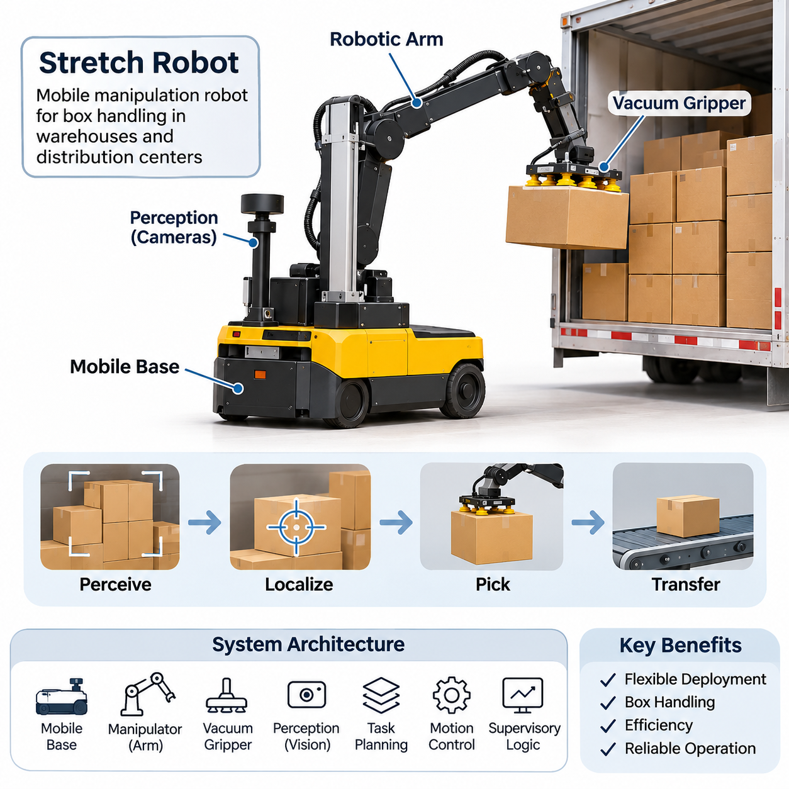
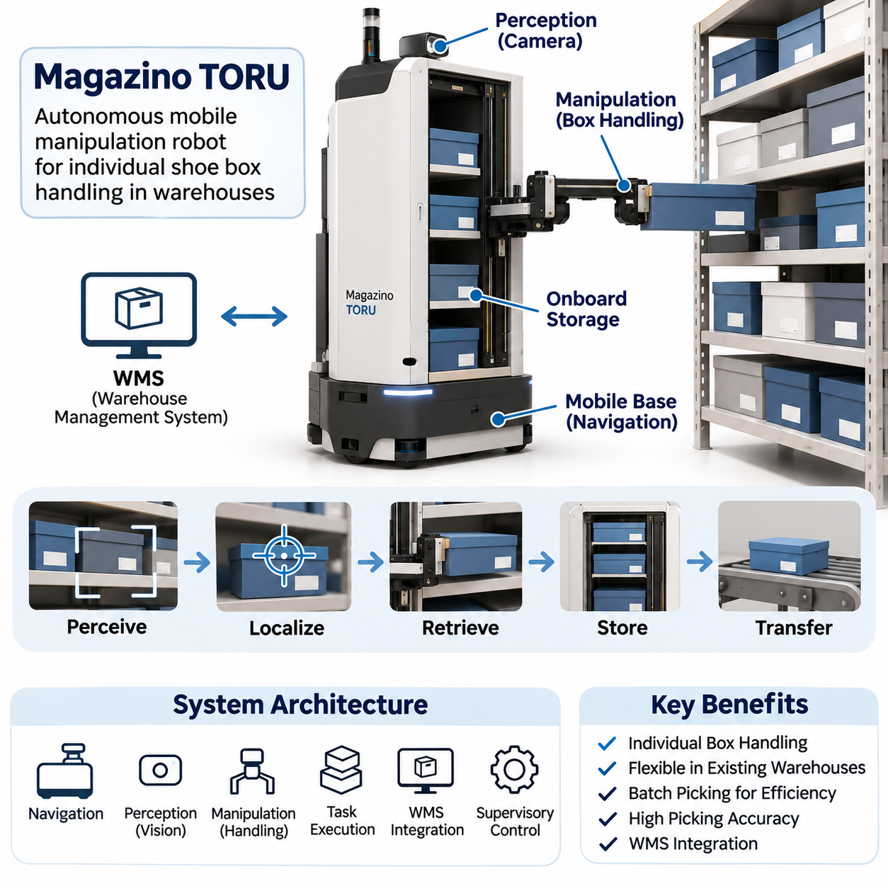
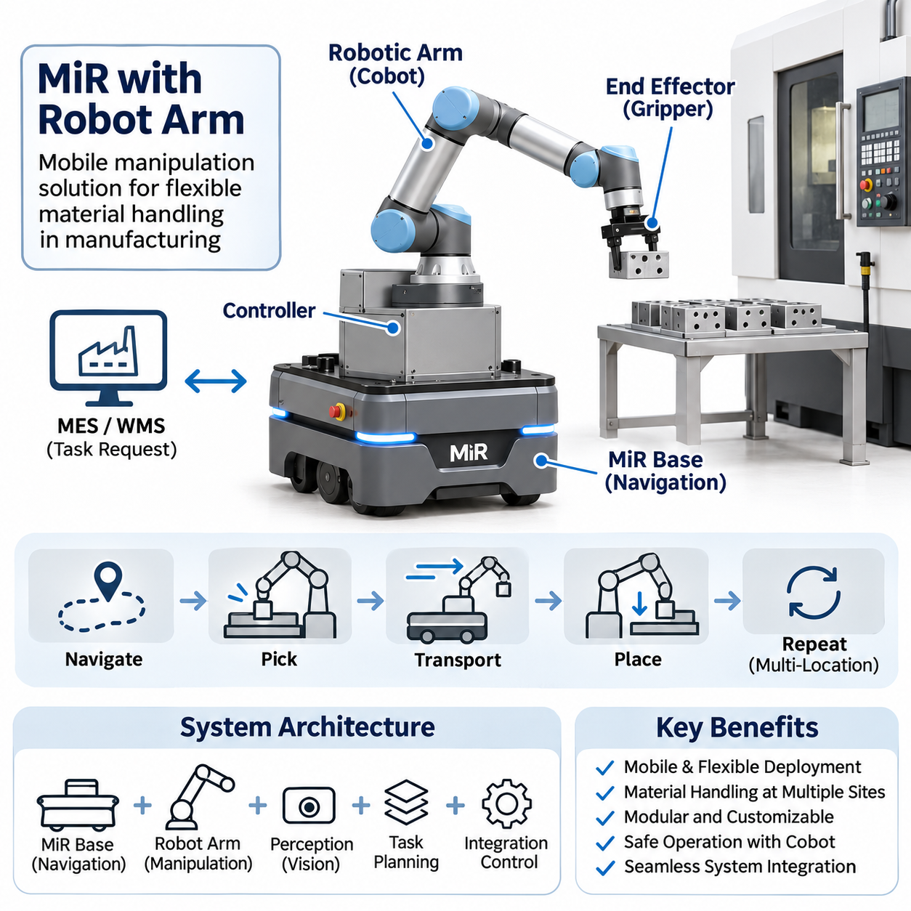
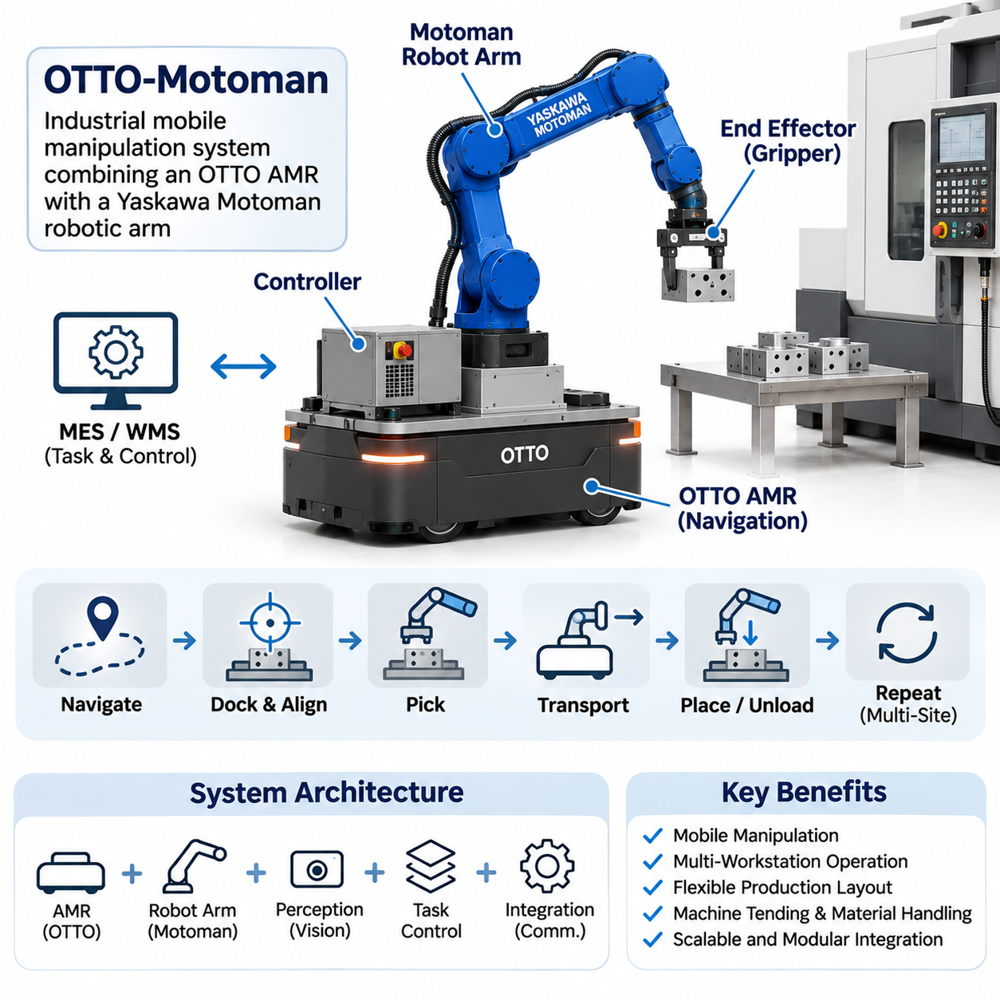
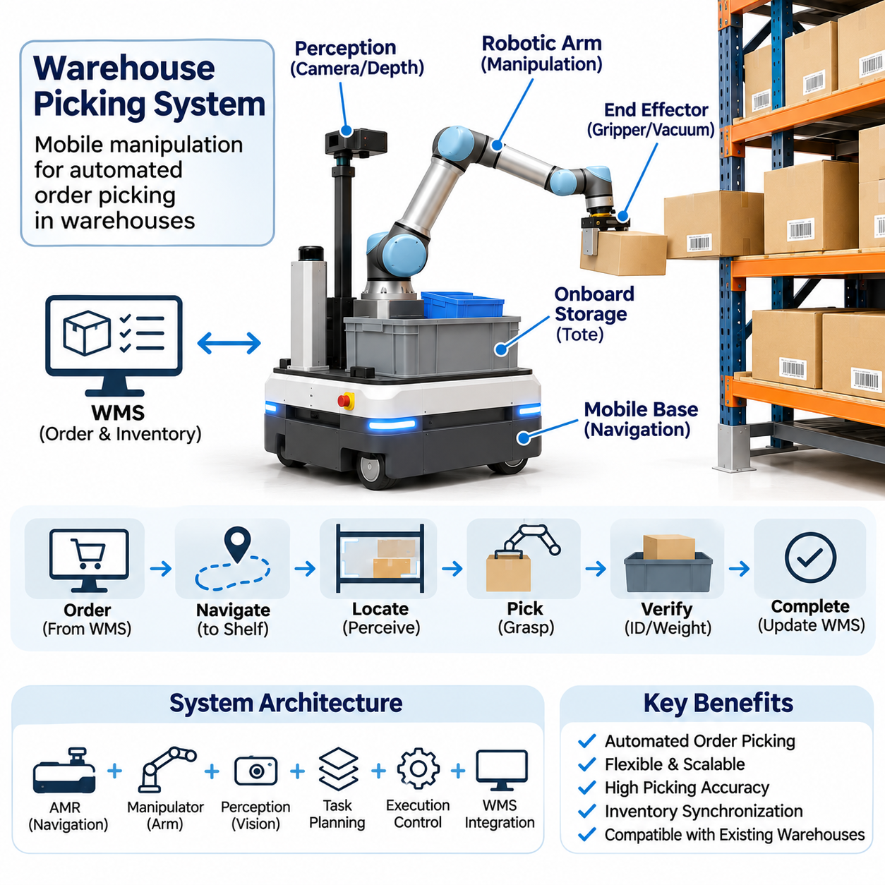
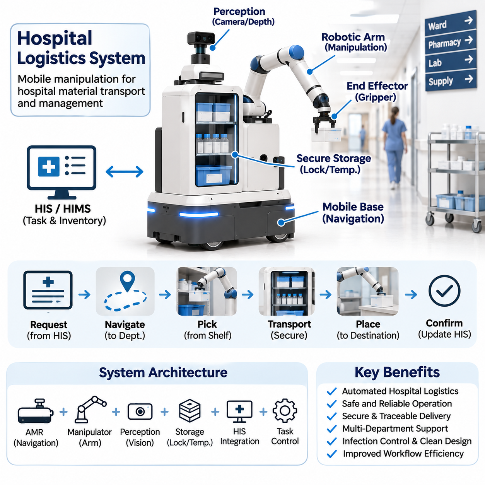
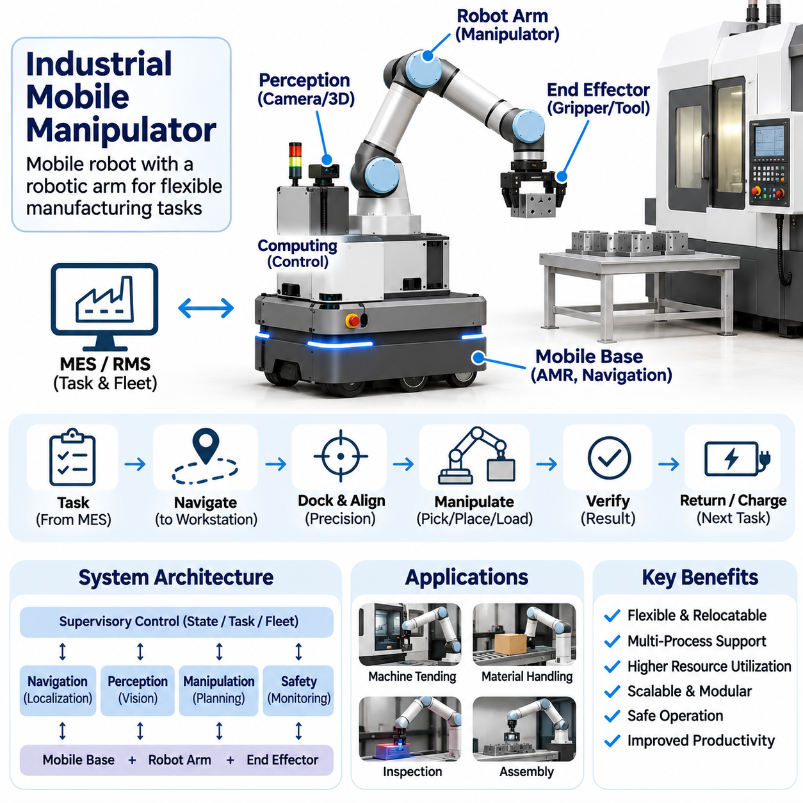

**Volume 01. Mobile Manipulator Foundations and System Architecture**

# Chapter 16. Case Studies

## 01 Stretch Robot

{width="7.268055555555556in" height="7.268055555555556in"}

Stretch is a mobile manipulation robot developed by Boston Dynamics for automated handling of boxes in warehouses and distribution centers. Unlike conventional industrial robots that remain fixed within designated workstations, Stretch combines a mobile base, robotic arm, perception system, and vacuum gripper. Its architecture enables flexible deployment across logistics environments where loading and unloading operations require repeated physical interaction with cartons.

The development of Stretch reflects a transition from stationary warehouse automation toward adaptable robotic systems. Traditional conveyor systems and fixed palletizing robots provide high throughput but require substantial infrastructure investment and carefully controlled operating conditions. Stretch addresses selected limitations by moving between workstations and performing box-handling operations without requiring a permanently installed robotic arm at every location.

A defining feature of Stretch is its integration of mobility and manipulation into a coordinated robotic platform. The mobile base positions the system near the target workspace, while the manipulator reaches toward boxes within the available operating envelope. This combination extends the practical working area beyond that of a fixed robot. However, the platform generally stabilizes its position during manipulation rather than continuously driving while handling loads.

The robotic arm is designed for repetitive carton handling, emphasizing reach, payload capacity, and operational efficiency. Its mechanical configuration supports movement through constrained spaces, including the interiors of shipping containers and trailers. Unlike general-purpose humanoid manipulators, Stretch uses a task-oriented design that prioritizes box transfer, simplified grasping, and reliable operation over dexterous manipulation of arbitrary objects.

Stretch employs a vacuum-based end effector that establishes contact with suitable carton surfaces. The suction system distributes gripping forces across multiple contact points, allowing the robot to handle boxes of different dimensions and orientations. Successful gripping depends on surface integrity, available contact area, carton weight, and vacuum conditions. Damaged packaging, porous surfaces, and irregular geometry can reduce grasp reliability.

The perception system uses computer vision and depth information to identify boxes and estimate their spatial arrangement. Cameras observe the working environment and provide geometric information for grasp planning and collision avoidance. Perception algorithms must distinguish individual cartons within densely packed stacks, where overlapping edges, shadows, inconsistent lighting, and partially hidden surfaces complicate object detection and localization.

Object localization is particularly important during trailer unloading because carton arrangements are rarely perfectly uniform. Boxes may shift during transportation, producing gaps, tilted surfaces, and unstable stacking patterns. Stretch must evaluate visible surfaces and determine suitable grasp candidates before executing manipulation commands. This process demonstrates the importance of integrating visual perception with physical constraints rather than relying exclusively on predefined trajectories.

The manipulation workflow begins with workspace observation and identification of accessible cartons. The robot estimates the position of a selected box, determines an appropriate contact region, and generates an arm trajectory. After establishing vacuum contact, the system lifts or extracts the carton and transfers it toward the receiving conveyor or designated unloading area. The sequence repeats as the accessible geometry changes.

Motion planning must account for the relationship between the mobile platform, manipulator, surrounding structures, and handled objects. Within trailers, the available workspace is restricted by walls, ceilings, floors, and adjacent cartons. Collision-aware trajectory generation helps prevent unintended contact while maintaining efficient movement. The robot must also consider reachability, joint limits, and the mechanical consequences of handling heavy or awkwardly positioned boxes.

An important system-level challenge involves coordinating the mobile base with the robotic arm. The base must provide an appropriate working position while maintaining sufficient stability during lifting and transfer operations. Changes in arm extension and payload position influence the overall center of mass and loading conditions. Consequently, mechanical design and control strategies must consider dynamic forces, tipping resistance, and the structural limits of the platform.

Stretch demonstrates how task-specific robotics can simplify the complexity of autonomous manipulation. Instead of attempting to perform every possible warehouse activity, the system concentrates on carton-handling workflows with relatively consistent object characteristics. This specialization enables the mechanical structure, gripper, perception algorithms, and task planner to be optimized together. Such optimization can improve practical reliability compared with unnecessarily generalized designs.

The robot\'s software architecture can be understood through several interacting functional layers. Perception identifies relevant objects and environmental geometry, task planning determines handling sequences, and motion control executes coordinated movements. Supervisory logic monitors task completion and abnormal conditions. Although the internal implementation is proprietary, this layered interpretation provides a useful reference for analyzing industrial mobile manipulation architectures.

Operational reliability depends on the robot\'s ability to recover from unsuccessful grasp attempts and unexpected environmental changes. A carton may slip, deform, or fail to establish sufficient vacuum pressure. The control system must recognize unsuccessful interactions and respond appropriately, potentially by releasing the object, selecting another contact region, or requesting operator assistance. Recovery behavior is essential for sustained warehouse operation.

Human interaction remains an important consideration because warehouse environments frequently contain workers, forklifts, conveyors, and other automated equipment. Safety engineering must address both mobile platform movement and manipulator operation. Hazard identification includes potential collisions, falling cartons, unexpected arm motion, and access to restricted workspaces. Protective measures must be designed according to the deployment environment and applicable safety requirements.

Stretch is especially relevant to trailer and container unloading, where manual handling can involve repetitive lifting and physically demanding working conditions. Cartons arrive in dense arrangements that require repeated extraction and transfer. By automating selected unloading activities, the robot can reduce the amount of repetitive manual handling required. Actual productivity benefits depend on carton characteristics, facility layout, operating procedures, and integration with downstream material-handling equipment.

The system also illustrates the importance of coordinating robotic manipulation with existing warehouse infrastructure. A mobile manipulator cannot deliver sustained productivity if receiving conveyors become congested or downstream sorting equipment cannot accept additional cartons. Successful deployment therefore requires attention to material flow, equipment interfaces, operational scheduling, and exception handling. Robot performance must be evaluated as part of the complete logistics process.

Performance assessment should consider more than the maximum number of boxes handled per hour. Relevant measurements include successful grasp rate, average handling cycle time, intervention frequency, system availability, and effective throughput over extended operating periods. Carton weight distribution and packing density also influence performance. A meaningful evaluation must distinguish controlled demonstration results from measurements collected during representative warehouse operations.

Energy management introduces additional constraints because the platform must supply electrical power to its mobility system, manipulator actuators, perception equipment, computing hardware, and vacuum generation components. Power demand varies throughout the handling cycle. Battery capacity, charging strategy, and operational duty cycle influence effective utilization. Energy consumption per successfully transferred carton provides a useful metric for comparing different automation approaches.

From a system integration perspective, Stretch illustrates the benefits of designing hardware and software around a clearly defined operational objective. The mechanical structure supports the required workspace, perception algorithms focus on carton geometry, and manipulation planning emphasizes reliable transfer. This alignment reduces unnecessary functional complexity while concentrating engineering resources on the factors that determine productivity and operational dependability.

Nevertheless, the approach has limitations. Vacuum gripping is not equally effective for every package material or surface condition, and highly irregular objects may require alternative end effectors. Dense stacking arrangements can create difficult extraction paths, while damaged cartons may introduce additional uncertainty. These limitations demonstrate why warehouse automation must account for the statistical diversity of real inventory rather than assuming idealized handling conditions.

The economics of deploying Stretch depend on equipment acquisition or service costs, integration expenses, maintenance requirements, labor utilization, and operational throughput. Facilities with substantial repetitive carton-handling workloads may offer stronger opportunities for automation than environments with highly variable or infrequent tasks. Return on investment should be evaluated using measured productivity, realistic operating availability, and the total cost of ownership over the expected deployment period.

Stretch also provides a useful comparison with conventional autonomous mobile robots that primarily transport materials between locations. A transportation AMR generally interacts with standardized payload interfaces, whereas Stretch performs direct physical manipulation of individual cartons. This difference substantially increases the complexity of perception, motion planning, gripping, and task execution. It also expands the range of warehouse activities that can potentially be automated.

Compared with general-purpose mobile manipulators, Stretch represents a specialized industrial architecture rather than a universal robotic assistant. Its design choices emphasize the requirements of warehouse carton handling, particularly high-repetition workflows and constrained loading environments. The case demonstrates that successful commercialization does not necessarily require humanlike morphology or unrestricted manipulation capabilities. Application-specific engineering can provide a more practical route to deployment.

The broader significance of Stretch lies in demonstrating how autonomous mobility, robotic manipulation, and perception can be combined within a commercially oriented logistics platform. Its architecture highlights the relationships among mechanical reach, grasp reliability, environmental understanding, safety, and operational integration. These relationships are relevant to future mobile manipulators intended for manufacturing, warehouse fulfillment, material transfer, and other physically demanding industrial tasks.

For engineers developing mobile manipulation systems, Stretch offers an instructive example of requirements-driven design. The application determines the necessary payload, workspace, gripping method, perception capability, and operational workflow. Each subsystem must be evaluated according to its contribution to overall task completion rather than isolated technical performance. The resulting engineering principle is that reliable mobile manipulation emerges from coordinated system design, validation, and deployment.

## 02 Magazino Toru

{width="7.268055555555556in" height="7.268055555555556in"}

Magazino TORU is an autonomous mobile manipulation robot developed by Magazino, a German robotics company specializing in intelligent warehouse automation. Unlike conventional autonomous mobile robots that transport entire shelves or containers, TORU is designed to identify, retrieve, transport, and place individual shoe boxes. Its architecture combines autonomous navigation, computer vision, robotic manipulation, and warehouse software integration within a specialized logistics platform.

The development of TORU reflects the growing demand for flexible automation in warehouses that handle large numbers of individual products. Traditional automated storage systems often depend on conveyors, fixed retrieval mechanisms, and standardized infrastructure. TORU introduces an alternative approach by navigating through existing warehouse aisles and interacting directly with stored items. This capability can reduce the need for extensive modifications to certain warehouse environments.

TORU is particularly associated with footwear logistics, where products are commonly stored in rectangular cardboard boxes. Although box dimensions and packaging conditions vary, the relatively standardized geometry creates favorable conditions for robotic manipulation. The system is designed around these operational characteristics rather than unrestricted object handling. This specialization allows its perception, gripping, and storage mechanisms to be optimized for a clearly defined inventory category.

The robot integrates a mobile base with a vertically oriented manipulation and storage system. Its mechanical architecture allows the robot to approach warehouse shelving, access suitable storage positions, and retrieve individual boxes. The integrated design supports both transportation and manipulation within a single platform. Unlike a conventional industrial robot mounted on an autonomous vehicle, TORU uses a purpose-built configuration optimized for shelf interaction and individual-item logistics.

Autonomous navigation enables TORU to move through warehouse aisles while avoiding obstacles and coordinating its movements with surrounding operations. Localization and mapping technologies help the robot determine its position relative to shelving and designated travel routes. Reliable navigation requires consideration of aisle width, turning clearance, pedestrian activity, and temporary obstructions. These factors directly influence accessibility, travel efficiency, and operational availability.

The perception system identifies target boxes and estimates their positions within storage compartments. Camera-based sensing and image-processing algorithms support object recognition and spatial localization. Accurate perception is essential because warehouse shelves may contain boxes with different colors, dimensions, orientations, and printed markings. The robot must distinguish the intended item from adjacent inventory while determining whether sufficient clearance exists for extraction.

TORU\'s manipulation mechanism is designed to extract boxes from shelving and transfer them into its onboard storage area. Rather than relying on a general-purpose anthropomorphic hand, the system uses specialized handling hardware suited to rectangular packages. The manipulation sequence requires accurate alignment between the robot and the shelf. Mechanical guidance, controlled contact, and coordinated movements help reduce the likelihood of damaging packaging or disturbing neighboring items.

A typical retrieval operation begins when the warehouse management system assigns an order or picking task. TORU navigates toward the appropriate storage location and identifies the target item. After positioning itself near the shelf, the robot verifies the box location and performs the retrieval operation. The extracted item is transferred into onboard storage, allowing the robot to continue collecting additional products before returning to a designated transfer station.

The ability to collect multiple boxes during a single warehouse journey is important for operational efficiency. Instead of traveling to a transfer station after every individual retrieval, TORU can consolidate several picking operations within one route, subject to storage capacity and task constraints. This approach reduces unnecessary travel and supports batch-oriented order fulfillment. Effective task scheduling must consider item locations, available storage positions, and delivery priorities.

Warehouse management system integration is a central element of TORU\'s operational architecture. The robot must receive picking instructions, identify inventory locations, report task completion, and communicate exceptions. Integration with a warehouse management system, or WMS, enables robotic activities to remain synchronized with inventory records and fulfillment processes. Without reliable data exchange, successful physical manipulation would not necessarily produce accurate warehouse operations.

The robot\'s control architecture can be understood as a combination of navigation, perception, manipulation, task execution, and supervisory coordination. Navigation determines how the platform reaches the target shelf, while perception identifies the desired box and its position. Manipulation control executes the physical retrieval, and task management coordinates successive operations. Supervisory functions monitor system status, task outcomes, and conditions requiring intervention.

One important engineering challenge is maintaining sufficient positioning accuracy for shelf-level manipulation. Mobile navigation may bring the robot close to a storage location, but successful extraction requires more precise alignment. Small errors in lateral position, orientation, or shelf height can affect the handling mechanism. Consequently, the system must combine global navigation with local positioning and object-relative alignment to achieve reliable retrieval.

Inventory variability introduces additional challenges. Shoe boxes may differ in dimensions, structural stiffness, surface condition, and placement orientation. Some packages may be compressed, damaged, or positioned too close to adjacent items. These variations can reduce manipulation reliability and increase recovery requirements. A practical robotic system must recognize unsuitable handling conditions rather than assuming that every detected object can be retrieved successfully.

Error recovery is therefore an essential part of the operational workflow. A retrieval attempt may fail because of inaccurate localization, insufficient clearance, mechanical resistance, or unexpected object movement. The robot must detect unsuccessful operations and determine whether another attempt is appropriate. Depending on the situation, recovery may involve repositioning, repeating perception, selecting another task, or requesting assistance from warehouse personnel.

TORU illustrates the importance of integrating mobility and manipulation without treating them as independent functions. Navigation accuracy influences manipulation success, while manipulation requirements determine acceptable positioning tolerances. The dimensions of the robot and its handling mechanism also influence accessible shelf locations and aisle requirements. Successful system design requires coordinated optimization of mechanical geometry, sensing, motion control, and warehouse layout.

The robot\'s specialized design distinguishes it from conventional autonomous mobile robots used primarily for transporting pallets or totes. Transportation-focused systems generally interact with standardized load carriers, whereas TORU performs direct retrieval of individual inventory items. This introduces additional perception and manipulation requirements but also enables automation of activities traditionally performed by human order pickers. The distinction demonstrates the expanding functional scope of mobile robotics.

Safety considerations include autonomous movement near workers, interaction with shelving, and the possibility of dropped or improperly secured boxes. The system must manage collision risks while traveling through operational warehouse environments. Safe manipulation also requires controlling mechanical forces and preventing unintended contact with storage structures. Appropriate protective functions, operational procedures, and risk assessments are necessary for reliable deployment.

TORU also demonstrates the relationship between robotic autonomy and warehouse infrastructure. Although its mobile architecture can reduce dependence on fixed automation equipment, the surrounding environment must still support reliable navigation and manipulation. Shelf geometry, storage organization, floor conditions, lighting, and item accessibility influence performance. Deployment planning should therefore evaluate the compatibility between the existing facility and the robot\'s operational requirements.

Performance evaluation should consider picking success rate, average retrieval time, travel distance, task completion rate, and intervention frequency. System availability and effective throughput are particularly important because warehouse productivity depends on sustained operation rather than isolated demonstrations. Performance should be measured across representative inventory distributions and realistic operating conditions, including variations in shelf occupancy and task complexity.

Energy management affects the productivity of autonomous picking robots because navigation, perception, manipulation, computing, and onboard storage operations consume electrical power. Battery capacity and charging strategy determine how long the system can remain available between charging periods. Energy-aware task scheduling can reduce unnecessary travel and improve operational utilization. Energy consumption per successfully retrieved item provides an additional measure of system efficiency.

The economic value of TORU depends on the relationship between automation costs and the productivity improvements achieved in actual warehouse operations. Relevant factors include equipment investment, integration expenses, maintenance, software support, labor utilization, and operational availability. Warehouses with repetitive picking requirements and compatible storage configurations may offer favorable deployment conditions. Return on investment must nevertheless be assessed using realistic operating assumptions.

A significant advantage of TORU\'s architecture is its ability to automate individual-item picking without requiring every product to be transferred into a dedicated automated storage machine. This can provide flexibility when warehouse layouts or inventory distributions change. However, the approach remains constrained by the geometry and handling characteristics of supported products. The system should therefore be understood as specialized warehouse automation rather than universal robotic manipulation.

From a product strategy perspective, TORU demonstrates how a narrowly defined application can guide the development of a commercially relevant robotic platform. Its mechanical configuration, perception capabilities, and software interfaces are organized around the requirements of shoe-box logistics. This focus reduces the complexity associated with handling arbitrary objects while supporting a practical operational objective. Application specialization can therefore accelerate the transition from robotic prototypes to deployed systems.

The case also highlights the importance of fleet-level coordination when multiple autonomous picking robots operate within the same facility. Task allocation, route planning, congestion management, and charging schedules influence collective productivity. A fleet management system can distribute retrieval assignments and coordinate robot movements to reduce unnecessary travel. The resulting performance depends on both individual robot capabilities and the efficiency of system-level orchestration.

TORU provides a useful architectural reference for future mobile manipulators intended for retail distribution, pharmaceutical logistics, spare-parts warehouses, and other structured storage environments. The underlying principles of autonomous navigation, object localization, specialized gripping, and inventory system integration can be adapted to different applications. However, changes in object geometry, payload requirements, and storage conditions may require substantial redesign of the manipulation hardware.

The broader significance of Magazino TORU lies in demonstrating that autonomous mobile manipulation can perform direct inventory interaction within operational warehouse environments. Its design connects physical manipulation with digital inventory management and logistics execution. For engineers developing industrial mobile manipulators, TORU emphasizes the value of application-specific mechanical design, accurate perception, reliable recovery behavior, and coordinated warehouse integration as foundations for practical automation.

## 03 MiR with Robot Arm

{width="7.268055555555556in" height="7.268055555555556in"}

Mobile Industrial Robots (MiR) provides autonomous mobile robot platforms that can be integrated with robotic arms to create flexible mobile manipulation systems. This configuration combines autonomous material transportation with physical interaction at workstations. Unlike fixed industrial robots, a MiR-based mobile manipulator can travel between production areas and perform selected handling operations, enabling manufacturers to distribute robotic capabilities across multiple locations.

The integration of a MiR platform with a robotic arm represents a modular approach to industrial automation. The mobile base provides navigation, localization, obstacle avoidance, and transportation capabilities, while the manipulator performs tasks such as picking, placing, loading, and unloading. System integrators can select compatible robotic arms and end effectors according to application requirements. This modularity supports customization without developing every subsystem from the beginning.

MiR-based mobile manipulation solutions are commonly associated with manufacturing environments where materials must be transferred between machines, assembly stations, and storage areas. A mobile manipulator can collect components from one location, transport them, and place them at another workstation. This approach reduces dependence on dedicated conveyor infrastructure and allows production layouts to evolve. However, the feasibility of each application depends on payload, reach, positioning accuracy, and safety constraints.

The mechanical architecture typically consists of an autonomous mobile platform supporting a robotic arm, mounting structure, control electronics, and application-specific tooling. The mounting interface must withstand static loads, acceleration forces, and moments generated during manipulation. Engineers must evaluate the combined center of gravity and ensure that arm movements do not compromise platform stability. Structural reinforcement may be necessary depending on the selected manipulator and operating conditions.

Payload engineering is particularly important because the mobile platform must support more than the weight of the objects being handled. The total supported mass includes the robotic arm, mounting hardware, controllers, grippers, auxiliary equipment, and transported materials. Manipulator payload ratings must also account for end-effector weight and operating reach. Consequently, platform capacity and arm capacity must be evaluated independently before determining the practical handling capability.

A major advantage of the MiR architecture is its autonomous navigation capability. The mobile platform can move through mapped industrial environments while detecting obstacles and adapting its route when necessary. Laser scanners and other sensing technologies support localization and collision avoidance. These capabilities allow the system to operate in facilities shared with workers and other equipment, although appropriate safety measures remain necessary during both navigation and manipulation.

Navigation accuracy alone is generally insufficient for precision manipulation. A mobile robot may arrive within an acceptable navigation tolerance while remaining misaligned with a machine fixture or component tray. Therefore, mobile manipulation applications often require additional docking, localization, or calibration mechanisms. Fiducial markers, mechanical alignment features, and vision-based corrections can improve repeatability. The selected method depends on the precision required by the manipulation task.

A typical operational sequence begins when a manufacturing execution system or supervisory controller issues a transportation and handling request. The mobile platform navigates toward the source workstation and establishes the required operating position. After verifying alignment, the manipulator retrieves the target object and secures it for transportation. The robot then travels to the destination, confirms positioning, and performs the unloading or placement operation.

Coordination between the mobile platform and robotic arm is essential for safe and reliable operation. In many industrial applications, manipulation is performed while the mobile base remains stationary. This simplifies motion planning and reduces uncertainties associated with simultaneous movement. The supervisory controller must manage transitions between navigation and manipulation states, ensuring that the robot arm remains in an appropriate configuration during transportation.

The software architecture commonly involves separate controllers for mobile navigation and robotic manipulation. The mobile platform manages route execution and localization, while the arm controller handles joint trajectories, end-effector commands, and manipulation constraints. An integration layer coordinates both systems through defined communication interfaces. Depending on the equipment configuration, industrial protocols, application programming interfaces, and robotics middleware may be used to exchange commands and status information.

Robot Operating System 2, or ROS 2, can provide a software framework for developing integrated mobile manipulation applications when supported by the selected components. Navigation software can coordinate mobile movement, while manipulation planning tools such as MoveIt 2 can support arm trajectory generation. However, compatibility depends on available drivers, interfaces, and vendor support. ROS 2 integration should therefore be treated as an engineering option rather than an inherent capability of every MiR configuration.

The manipulation subsystem may use collaborative robotic arms when the application requires compact integration and operation near human workers. Collaborative robots provide capabilities such as force monitoring and configurable safety functions, but these features do not automatically make the complete mobile manipulation system safe. The combined robot must undergo application-specific risk assessment. Safety performance depends on the mobile base, manipulator, tooling, payload, operating speed, and surrounding environment.

End-effector selection strongly influences the range of tasks supported by a MiR-based mobile manipulator. Parallel grippers can handle components with suitable contact surfaces, while vacuum grippers may be appropriate for boxes or flat objects. Specialized tools can support machine tending, inspection, and assembly operations. Each end effector introduces requirements involving gripping force, electrical power, pneumatic supply, sensing, and mechanical compatibility.

Machine tending is a representative application in which a mobile manipulator delivers raw materials to manufacturing equipment and removes completed parts. The robot may approach a CNC machine, verify its position, and coordinate with the machine controller before opening access to the workspace. The manipulator then transfers parts between storage fixtures and the machine. Reliable execution requires synchronized communication, accurate positioning, and appropriate safety interlocks.

Another application involves material transfer between production workstations. A mobile manipulator can collect parts from trays, bins, or designated fixtures and place them into receiving locations. This capability is useful when production equipment is distributed across a facility and direct conveyor connections are impractical. The robot may support multiple workstations, although task scheduling must account for travel time, manipulation duration, and equipment availability.

The integration of mobile manipulation with manufacturing execution systems enables automated coordination of production activities. A supervisory system can assign tasks according to material demand, workstation status, and operational priorities. Completion messages and exception reports allow the manufacturing system to maintain visibility into robotic operations. Effective integration requires consistent identification of materials, reliable communication, and clearly defined responsibility for task execution.

Fleet management becomes increasingly important when multiple MiR platforms operate within the same facility. Centralized coordination can distribute transportation requests, manage traffic, and reduce unnecessary movement. Mobile manipulators introduce additional scheduling constraints because each task includes both navigation and physical handling. Fleet-level optimization must therefore consider robot availability, arm capabilities, workstation accessibility, battery state, and expected task duration.

Energy management is another significant engineering consideration. The mobile platform supplies energy for driving, navigation sensors, computing equipment, and onboard control systems. An integrated robotic arm may require additional electrical power during acceleration, lifting, and gripping operations. Engineers must determine whether the arm uses the platform\'s power system or a separate supply. Battery sizing and charging strategies should reflect the complete operating duty cycle.

System reliability depends on the successful coordination of several independently complex subsystems. Navigation failures, communication interruptions, positioning errors, and unsuccessful grasps can prevent task completion. A supervisory controller should detect abnormal conditions and execute appropriate recovery procedures. These may include repeating localization, retrying a grasp, returning to a safe position, or requesting operator assistance when automated recovery is not possible.

Safety architecture must address hazards arising from both mobile movement and robotic manipulation. A mobile base may encounter pedestrians or vehicles, while the robotic arm introduces risks associated with joint motion, gripping forces, and falling objects. Safety functions must consider the complete operating envelope and interactions between subsystems. Applicable requirements may include ISO 3691-4 for driverless industrial trucks and relevant industrial robot safety standards, depending on system classification.

Performance evaluation should consider the complete task cycle rather than isolated navigation or manipulation results. Important measurements include travel time, docking accuracy, grasp success rate, placement repeatability, task completion rate, and operational availability. System throughput depends on how efficiently these activities are coordinated. A high-performance manipulator cannot compensate for excessive travel delays, and accurate navigation cannot overcome unreliable object handling.

The economic benefits of MiR-based mobile manipulation arise from the possibility of sharing robotic resources across multiple workstations. Instead of installing a dedicated manipulator at every location, one mobile system may perform tasks at several machines. This can improve equipment utilization in suitable applications. However, travel time, docking requirements, integration complexity, and production scheduling may reduce the expected benefits, making detailed workflow analysis essential.

Compared with fixed industrial automation, mobile manipulation provides greater flexibility but introduces additional uncertainty. Fixed robots operate within carefully calibrated workspaces, while mobile systems must repeatedly establish their position relative to external equipment. This creates additional requirements for localization, calibration, mechanical stability, and error recovery. The engineering challenge is to maintain acceptable manipulation performance despite the variability introduced by mobility.

MiR-based mobile manipulators also illustrate the distinction between modular integration and fully unified robotic architecture. Combining commercially available components can reduce initial development effort, but the integrator remains responsible for mechanical compatibility, electrical interfaces, communication reliability, and system-level safety. Successful integration requires careful validation of interactions between components rather than assuming that individually reliable subsystems will automatically produce a reliable complete system.

From a product strategy perspective, modular mobile manipulation offers opportunities for manufacturers seeking adaptable automation without extensive facility reconstruction. Applications with moderate handling loads, repeatable object geometries, and distributed workstations are particularly relevant. However, not every industrial process benefits from mobility. High-speed repetitive operations at a single location may remain better suited to fixed robotic cells with dedicated material-handling infrastructure.

The broader significance of integrating MiR platforms with robotic arms lies in demonstrating how autonomous transportation can evolve into physical task execution. The mobile base extends the manipulator\'s operational reach across the facility, while the robotic arm enables direct interaction with materials and equipment. For engineers developing industrial mobile manipulators, this case emphasizes modular architecture, precise docking, coordinated control, functional safety, and system-level validation as essential foundations for reliable deployment.

## 04 OTTO Motoman

{width="7.268055555555556in" height="7.268055555555556in"}

The OTTO-Motoman concept represents an industrial mobile manipulation architecture that combines an OTTO autonomous mobile robot with a Yaskawa Motoman robotic arm. This configuration integrates autonomous material transportation with robotic handling capabilities. Rather than relying exclusively on fixed automation stations, the system can potentially move between production locations and perform loading, unloading, and material transfer operations through coordinated mobility and manipulation.

OTTO Motors develops autonomous mobile robots designed for industrial material transportation, while Yaskawa Motoman provides robotic manipulators for manufacturing automation. Combining these technologies creates a modular engineering approach in which the mobile platform and manipulator retain distinct functional responsibilities. The resulting system should be understood as an integration architecture rather than a single standardized product with universally defined specifications.

The primary objective of an OTTO-Motoman integration is to extend robotic manipulation beyond fixed workstations. A mobile manipulator can transport components between production areas and interact directly with machines, fixtures, and material containers. This approach is particularly relevant to manufacturing facilities where equipment is distributed across multiple locations. Its practical value depends on balancing transportation flexibility with manipulation accuracy, operational reliability, and integration complexity.

The mechanical architecture consists of a mobile platform, robotic arm, mounting structure, and application-specific end effector. The platform must support the combined weight of the manipulator, controller, tooling, and transported payload. Engineers must evaluate structural stiffness, mounting strength, and center-of-gravity movement during arm operation. Excessive arm extension or unfavorable payload positioning can introduce tipping moments and compromise system stability.

Payload selection requires independent evaluation of the mobile platform and robotic arm. The mobile robot\'s rated capacity must accommodate all installed equipment and transported materials, while the manipulator\'s payload rating must include the gripper and handled object. Dynamic forces generated during acceleration, braking, and arm movement introduce additional loading conditions. Consequently, nominal payload ratings alone are insufficient for determining the safe operating envelope.

The OTTO mobile platform provides navigation and material transportation functions within mapped industrial environments. Localization, obstacle detection, and route planning allow the robot to move between designated workstations. Navigation performance depends on environmental geometry, floor conditions, traffic density, and operational constraints. The platform must also approach manipulation locations consistently enough to support subsequent alignment and positioning procedures.

The Motoman robotic arm provides controlled manipulation through coordinated joint movement and end-effector operation. Depending on the selected model, the manipulator may support machine tending, component transfer, inspection, or assembly-related handling. Its working envelope must be evaluated relative to the mobile platform and surrounding equipment. Joint limits, reachability, collision constraints, and payload-dependent performance determine which tasks can be executed reliably.

Precise docking is a critical requirement because autonomous navigation accuracy may not satisfy the tolerances of industrial manipulation. The mobile platform must establish a repeatable position relative to the target machine or fixture. Mechanical docking features, fiducial markers, and vision-based alignment can provide additional positioning accuracy. The appropriate method depends on the required repeatability, workstation geometry, and environmental variability.

A typical operating cycle begins when a supervisory system assigns a transportation and manipulation task. The mobile robot navigates to the source workstation and confirms its arrival. After establishing the required alignment, the robotic arm retrieves the target component and places it in a secure transport position. The platform then travels to the destination, where the manipulator performs the corresponding unloading or placement operation.

Coordination between navigation and manipulation requires a clearly defined operational state machine. The system must distinguish traveling, docking, manipulation, recovery, and emergency conditions. During transportation, the robotic arm should remain in a configuration that preserves stability and avoids collisions. Manipulation generally begins after the mobile platform reaches a verified operating position, simplifying control and reducing uncertainty associated with simultaneous movement.

The control architecture typically includes separate controllers for the autonomous mobile robot and Motoman manipulator. The mobile controller manages navigation and platform motion, while the robot controller executes joint trajectories and end-effector commands. An integration controller coordinates task execution through communication interfaces and status signals. Successful operation depends on deterministic state transitions, reliable command acknowledgment, and consistent fault handling.

Industrial communication may involve Ethernet-based interfaces, programmable logic controllers, digital input and output signals, or application-specific protocols. The selected architecture must support task commands, position confirmation, machine readiness, and safety-related coordination. Communication delays or inconsistent status information can interrupt the handling sequence. Engineers should therefore define explicit interface control specifications and validate communication behavior under abnormal operating conditions.

Machine tending provides a representative application for the OTTO-Motoman architecture. The mobile manipulator can deliver raw components to manufacturing equipment and remove completed parts after processing. Interaction with CNC machines requires coordination with machine doors, fixtures, and operating states. Accurate placement and reliable interlocks are essential because positioning errors can damage components or interfere with automated machining operations.

Material handling between assembly stations represents another potential application. A mobile manipulator can collect components from standardized trays and distribute them to multiple workstations. This approach may reduce the need for dedicated conveyors or fixed robotic cells at every location. However, task efficiency depends on transportation distance, manipulation time, workstation availability, and the number of operations completed during each visit.

End-effector design strongly influences system versatility. Parallel grippers can handle rigid mechanical components, while vacuum grippers may be suitable for flat surfaces or packaged materials. Specialized tooling can support machine loading, inspection, and component positioning. Each configuration introduces requirements for electrical power, pneumatic supply, gripping force, sensing, and tool communication. End-effector selection must therefore reflect both object characteristics and operational constraints.

Power architecture requires careful evaluation because the mobile platform and robotic arm may have different electrical requirements. The manipulator controller can demand substantial power during acceleration and lifting, while the mobile base continuously supplies navigation, sensing, and computing functions. Integration may require dedicated power conversion, auxiliary batteries, or external power connections. Energy storage and charging strategies must support the intended operating cycle.

Safety engineering must consider hazards introduced by combining a moving industrial platform with an articulated robotic arm. Mobile navigation creates collision risks involving personnel and equipment, while manipulation introduces hazards associated with joint motion, gripping forces, and falling objects. Safety functions must cover the combined operating envelope. Applicable standards and protective measures depend on the final system configuration and its intended industrial environment.

Functional safety integration requires coordination between the mobile platform\'s protective functions and the manipulator\'s safety controller. Emergency stop behavior, protective stopping, restart conditions, and safe operating states must be defined at the system level. A safety event affecting one subsystem may require coordinated action by the other. Independent component certifications do not automatically establish compliance for the complete integrated machine.

System reliability depends on the interaction of navigation, docking, manipulation, communication, and supervisory control. A failure in any subsystem can interrupt the entire task cycle. Recovery strategies may include repeated localization, docking retries, manipulation reattempts, or controlled return to a safe state. Fault information should be recorded to support diagnostics, maintenance planning, and continuous operational improvement.

Performance evaluation should measure complete task execution rather than isolated robot capabilities. Relevant indicators include navigation time, docking repeatability, manipulation cycle time, grasp success rate, task completion rate, and operational availability. System throughput depends on how efficiently transportation and handling activities are coordinated. Long travel distances or repeated alignment failures can significantly reduce productivity despite a high-performance robotic arm.

Fleet management becomes important when multiple mobile manipulators share production areas. Centralized coordination can allocate tasks, manage traffic, and schedule charging operations. Unlike transportation-only AMRs, mobile manipulators occupy workstations while performing physical handling operations. Fleet scheduling must therefore consider manipulation duration, equipment availability, and workstation access restrictions in addition to navigation requirements.

The economic justification for OTTO-Motoman integration depends on the ability to distribute robotic manipulation across multiple manufacturing locations. A single mobile system may replace selected repetitive handling activities performed at several stations. However, additional integration costs, docking infrastructure, maintenance requirements, and operational delays must be included in the analysis. Return on investment should reflect realistic utilization and the total cost of ownership.

Compared with fixed industrial robots, the OTTO-Motoman architecture offers greater deployment flexibility but introduces additional engineering complexity. Fixed manipulators operate within stable, calibrated workspaces, whereas mobile systems must repeatedly establish accurate spatial relationships with external equipment. This creates additional requirements for localization, mechanical stability, calibration, and error recovery. The resulting design must balance flexibility against precision and operational efficiency.

The broader significance of the OTTO-Motoman case lies in demonstrating how industrial autonomous mobility and robotic manipulation can be combined through modular system integration. Its engineering value is not limited to a particular mobile platform or manipulator model. The architecture emphasizes mechanical compatibility, precise docking, coordinated control, functional safety, and reliable communication as foundations for practical industrial mobile manipulation systems.

## 05 Warehouse Picking System

{width="7.268055555555556in" height="7.268055555555556in"}

A warehouse picking system based on mobile manipulation combines autonomous navigation, object recognition, robotic grasping, and inventory coordination to retrieve products from storage locations. Unlike transportation-only autonomous mobile robots, these systems interact directly with individual items. Their objective is to automate repetitive order fulfillment activities while maintaining picking accuracy, operational flexibility, and compatibility with existing warehouse infrastructure.

Warehouse picking operations involve identifying requested products, locating their storage positions, retrieving items, and transferring them to designated containers or processing stations. Mobile manipulators can execute these activities across distributed shelving areas without requiring a fixed robotic arm at every location. This architecture is particularly useful in warehouses handling diverse products, changing inventory distributions, and variable order volumes.

The mechanical architecture typically includes an autonomous mobile base, robotic arm, end effector, perception sensors, and onboard storage. The mobile platform provides transportation between storage locations, while the manipulator reaches into shelves or containers. Engineers must consider payload capacity, manipulator reach, center-of-gravity movement, and available aisle clearance. These constraints determine which storage configurations and product categories can be supported.

Perception is essential because warehouse items vary in geometry, packaging, orientation, and visibility. RGB cameras, depth sensors, and three-dimensional perception algorithms can identify objects and estimate their positions. The system must distinguish target products from neighboring inventory while accounting for occlusion and inconsistent lighting. Reliable perception provides the spatial information required for grasp planning and collision-free manipulation.

Object recognition may rely on barcode identification, visual classification, instance segmentation, or combinations of these methods. Barcode scanning provides reliable identification when labels are visible, while visual recognition supports products with partially obscured markings. Instance segmentation separates individual objects within crowded storage areas. The appropriate approach depends on inventory characteristics, labeling practices, and the accuracy required by warehouse operations.

Grasp planning translates perception results into executable manipulation actions. The robot must determine suitable contact points, approach directions, and end-effector configurations. Parallel grippers are appropriate for many rigid objects, while vacuum grippers can handle compatible packages with accessible surfaces. Grasp selection must account for object weight, surface properties, center of mass, and surrounding obstacles to reduce failed retrieval attempts.

Mobile navigation enables the robot to travel between storage locations while avoiding workers, vehicles, and temporary obstacles. Localization and mapping establish the robot\'s position within the warehouse. However, navigation accuracy alone may not satisfy manipulation requirements. Additional shelf-relative localization, fiducial markers, or vision-based alignment may be necessary to achieve repeatable positioning before the robotic arm begins its task.

A typical picking cycle begins when a warehouse management system assigns an order or retrieval task. The robot identifies the required storage location and navigates toward the corresponding shelf. After confirming its position, the perception system locates the target item and generates a grasp candidate. The manipulator retrieves the object, verifies successful acquisition, and transfers it into an onboard container or designated receiving area.

Picking verification is necessary to maintain inventory accuracy and prevent incorrect order fulfillment. The system may combine visual confirmation, barcode scanning, gripper feedback, and weight measurements to verify the retrieved product. Verification results are communicated to the warehouse management system, allowing inventory records to remain synchronized. Failed verification should trigger recovery procedures rather than silently recording an unsuccessful operation as completed.

Task planning determines the order in which products are collected and how mobile resources are allocated. Batch picking allows multiple order lines to be retrieved during a single warehouse route, reducing unnecessary travel. Route optimization must consider shelf locations, robot payload capacity, container availability, and order priorities. Effective scheduling balances transportation efficiency against manipulation time and operational deadlines.

Warehouse management system integration connects physical robot operations with digital inventory and order information. The integration layer receives task assignments, reports completion status, and communicates exceptions. Accurate product identifiers and storage coordinates are essential for consistent execution. Communication interfaces must also handle temporary network interruptions, duplicate commands, and inventory changes without creating inconsistent transaction records.

The software architecture commonly separates navigation, perception, manipulation planning, task execution, and supervisory control. Each subsystem performs specialized functions while exchanging information through defined interfaces. A supervisory state machine coordinates movement, docking, grasping, verification, and recovery. This separation supports modular development but requires careful synchronization to prevent conflicting commands or unsafe transitions between operating states.

Error recovery is a critical requirement because warehouse environments contain irregular packaging, crowded shelves, and unexpected object arrangements. A grasp may fail because of inaccurate localization, insufficient clearance, or unstable contact. The robot should detect unsuccessful retrieval and determine whether repositioning, repeated perception, or an alternative grasp is appropriate. Persistent failures may require human assistance or reassignment of the task.

Safety engineering must address hazards associated with mobile movement and robotic manipulation. The platform may encounter pedestrians and material-handling vehicles, while the arm can introduce collision, pinching, and dropped-object risks. Protective functions must account for the combined operating envelope and changing robot configurations. Risk assessment should consider normal operation, maintenance, manual intervention, and foreseeable abnormal conditions.

Performance evaluation should measure the complete picking workflow rather than isolated component capabilities. Relevant indicators include item recognition accuracy, grasp success rate, picking cycle time, travel distance, task completion rate, and intervention frequency. Effective throughput depends on both manipulation reliability and transportation efficiency. System availability and recovery time are particularly important when robots operate continuously across multiple shifts.

Energy management influences the operational capacity of warehouse picking robots. Driving, sensing, onboard computing, arm movement, and gripping mechanisms consume electrical power throughout the task cycle. Battery capacity and charging schedules must support expected workloads without excessive downtime. Energy-aware scheduling can coordinate charging with periods of lower demand, improving robot availability and reducing interruptions to order fulfillment.

Fleet coordination becomes important when multiple mobile manipulators share storage aisles and processing stations. A fleet management system can allocate picking tasks, manage traffic, and prevent congestion around frequently accessed shelves. Scheduling must account for robot capabilities, storage accessibility, battery levels, and task priorities. Effective coordination improves overall warehouse throughput rather than merely optimizing individual robot movements.

Warehouse infrastructure strongly influences deployment feasibility. Shelf dimensions, aisle widths, floor conditions, lighting, and product placement practices determine whether robots can navigate and manipulate reliably. Standardized containers and predictable storage arrangements simplify perception and grasp planning. Although mobile manipulation can reduce dependence on fixed automation, successful deployment still requires compatibility between robotic capabilities and warehouse operating procedures.

Economic evaluation must consider equipment acquisition, software integration, maintenance, charging infrastructure, and operational support. Potential benefits include reduced repetitive manual handling, improved inventory traceability, and flexible resource allocation. However, high product variability and frequent picking failures can reduce productivity gains. Return on investment should therefore be calculated using realistic task completion rates, utilization assumptions, and total ownership costs.

The broader significance of warehouse picking systems lies in integrating autonomous mobility with direct physical interaction and digital logistics coordination. These systems demonstrate how mobile manipulators can extend warehouse automation beyond transportation into item-level operations. Their successful implementation depends on reliable perception, precise positioning, adaptable grasping, robust recovery, and coordinated system integration rather than any single robotic capability.

## 06 Hospital Logistics System

{width="7.268055555555556in" height="7.268055555555556in"}

Hospital logistics systems based on mobile manipulation combine autonomous navigation, robotic handling, and hospital information systems to transport and manage medical supplies. Unlike conventional delivery robots that move entire carts or containers, mobile manipulators can interact directly with individual items and storage interfaces. Their objective is to reduce repetitive transportation tasks while improving material availability, operational traceability, and workflow efficiency.

Hospitals require continuous movement of medications, laboratory specimens, sterile instruments, linens, meals, and medical consumables between departments. These activities involve different handling requirements, delivery priorities, and environmental constraints. A mobile manipulation system can support selected logistics tasks by collecting, transporting, and depositing materials at designated locations, reducing the need for clinical personnel to perform routine transfers.

The mechanical architecture typically integrates an autonomous mobile base, robotic arm, end effector, storage compartment, and perception sensors. The mobile platform provides transportation through hospital corridors, while the manipulator interacts with shelves, cabinets, trays, or receiving stations. Engineers must consider payload capacity, manipulator reach, platform dimensions, and stability. Compact construction is particularly important in crowded corridors and confined clinical spaces.

Hospital navigation presents challenges because the operating environment contains patients, visitors, medical staff, wheelchairs, and mobile equipment. The robot must detect dynamic obstacles and adapt its motion without disrupting clinical activities. Localization and mapping support movement between departments, while obstacle avoidance maintains appropriate separation from surrounding objects. Navigation performance must remain reliable despite changing corridor conditions and temporary obstructions.

Elevator integration is often necessary because hospital logistics operations span multiple floors. The robot may require communication with elevator controllers, automated doors, and building management systems. Successful integration involves requesting elevator service, entering safely, selecting the destination floor, and resuming navigation after arrival. These operations require reliable coordination because elevator congestion or communication failures can interrupt time-sensitive deliveries.

The manipulation subsystem enables interaction with medical supply containers, storage racks, and transfer stations. Depending on the application, the robot may use parallel grippers, vacuum tools, or specialized handling mechanisms. Grasp planning must consider package geometry, object weight, and accessibility. Medical materials may require controlled handling to prevent damage, contamination, or unintended movement during retrieval and placement.

Perception systems help identify objects, locate storage positions, and verify successful transfers. RGB cameras, depth sensors, barcode scanners, and identification technologies may be combined according to operational requirements. Visual recognition supports object localization, while barcode or RFID identification can improve item traceability. Accurate verification is particularly important when handling materials with strict inventory or delivery requirements.

A typical logistics task begins when a hospital management application or supervisory system generates a transportation request. The robot identifies the collection point and navigates toward the corresponding department. After confirming its position, the manipulator retrieves the designated material and places it in a secure transport compartment. The robot then travels to the destination, verifies the receiving location, and completes the delivery operation.

Secure transport is essential for medications, laboratory samples, and other sensitive materials. Lockable compartments, access authorization, and delivery confirmation can reduce unauthorized handling. Some applications may require temperature monitoring, environmental protection, or documented chain-of-custody procedures. These requirements depend on the transported material and applicable institutional policies. A mobile manipulator must therefore support application-specific security and traceability functions.

Hospital information system integration connects robotic operations with clinical logistics workflows. Task assignments may originate from inventory management, pharmacy, laboratory, or facility management applications. The integration layer exchanges delivery requests, status updates, and completion records. Reliable communication helps maintain consistency between physical material movement and digital records, while access controls protect sensitive operational information.

Task scheduling must account for delivery urgency, department locations, robot availability, and handling constraints. Routine supply replenishment can be scheduled in batches, while urgent requests may require immediate prioritization. Route planning should consider travel distance, elevator waiting time, restricted areas, and expected congestion. Effective scheduling balances operational efficiency with the service requirements of different hospital departments.

Safety engineering is especially important because robots operate near vulnerable patients and busy clinical personnel. The mobile platform must manage collision risks, while the manipulator introduces potential hazards from joint movement, gripping forces, and dropped objects. Protective functions should cover both navigation and handling operations. Risk assessment must consider normal deliveries, unexpected human interaction, emergency situations, and manual intervention.

Infection prevention introduces requirements beyond those found in ordinary warehouse logistics. External surfaces, storage compartments, and handling tools may need to support approved cleaning and disinfection procedures. Materials intended for sterile environments require appropriate separation and handling protocols. Robot design should minimize difficult-to-clean surfaces and avoid unnecessary contact with clinical equipment. Compliance depends on hospital infection-control policies and the intended application.

Human-robot interaction is necessary because hospital personnel must understand robot status and respond to exceptional situations. Visual indicators, audible notifications, and user interfaces can communicate movement intentions, delivery progress, and fault conditions. Staff may need to authorize access, confirm receipt, or assist with failed transfers. Interaction design should remain simple enough for personnel who are not robotics specialists.

Operational reliability depends on successful coordination of navigation, manipulation, communication, and building infrastructure. A robot may encounter blocked corridors, unavailable elevators, inaccessible storage locations, or unsuccessful grasps. Recovery strategies should include route replanning, repeated localization, task retries, and controlled escalation to human operators. Critical deliveries require clear procedures when autonomous completion is not possible.

Fleet management becomes important when multiple hospital robots serve different departments. A centralized system can allocate tasks, coordinate traffic, monitor battery status, and distribute workloads. Fleet scheduling should account for elevator capacity, delivery deadlines, robot capabilities, and charging availability. Effective coordination reduces congestion and prevents several robots from competing for the same infrastructure resources.

Energy management must support continuous hospital operations, including overnight and weekend activities. Battery capacity determines available operating time, while charging schedules influence robot availability. The mobile base, robotic arm, perception sensors, and computing equipment all contribute to power consumption. Automated charging can reduce manual intervention, but charging decisions must account for pending deliveries and operational priorities.

Performance evaluation should consider delivery completion rate, transportation time, manipulation success rate, intervention frequency, and operational availability. Additional indicators may include elevator waiting time, delivery accuracy, and response time for urgent requests. Measuring complete workflows is more meaningful than evaluating navigation speed alone. Hospital logistics performance depends on reliable service delivery rather than maximum robot movement speed.

Economic evaluation includes equipment acquisition, integration with hospital systems, building interface modifications, maintenance, and staff training. Potential benefits include reduced repetitive transport work, improved supply traceability, and more consistent logistics scheduling. However, deployment costs and operational complexity may offset expected savings. Return on investment should consider realistic utilization, labor allocation, service quality, and total ownership costs.

The broader significance of hospital mobile manipulation lies in extending autonomous logistics beyond simple transportation. By combining navigation, object handling, secure delivery, and information system integration, these robots can support more complete material workflows. Successful deployment requires careful attention to safety, hygiene, reliability, human interaction, and institutional procedures. Hospital logistics therefore provides an important example of application-specific mobile manipulation in human-centered environments.

## 07 Industrial Mobile Manipulator

{width="7.268055555555556in" height="7.268055555555556in"}

Industrial mobile manipulators combine autonomous mobile platforms with robotic arms to perform physical operations across manufacturing environments. Unlike fixed industrial robots, these systems can relocate between workstations while maintaining manipulation capabilities. Their primary objective is to extend automation beyond stationary production cells, supporting flexible material handling, machine tending, inspection, and assembly operations within changing industrial layouts.

The system architecture typically consists of a mobile base, robotic manipulator, end effector, perception sensors, onboard computing, and supervisory control software. Each subsystem contributes specialized capabilities that must operate as a coordinated whole. The mobile platform provides transportation and localization, while the manipulator performs physical interactions. Effective integration requires mechanical compatibility, reliable communication, synchronized control, and comprehensive safety engineering.

Mechanical design begins with evaluating payload capacity, structural stiffness, center-of-gravity movement, and dynamic loading. The mobile platform must support the robotic arm, mounting structures, controllers, tooling, and transported materials. Arm extension and payload movement can introduce substantial overturning moments. Engineers must evaluate stability under acceleration, braking, turning, and manipulation conditions to establish a safe operating envelope.

Manipulator selection depends on reach, payload, repeatability, degrees of freedom, and compatibility with industrial processes. Six-axis articulated arms provide flexibility for complex positioning tasks, while collaborative manipulators may support applications requiring operation near personnel. However, collaborative features do not automatically establish safety for the complete mobile system. The selected arm must satisfy application requirements without exceeding platform stability or power limitations.

Autonomous navigation enables the robot to move between production stations while avoiding obstacles and adapting to environmental changes. Localization and mapping establish the platform\'s position within the facility. Industrial environments introduce challenges involving narrow aisles, moving equipment, reflective surfaces, and temporary obstructions. Reliable navigation requires suitable sensing, route planning, traffic coordination, and recovery procedures for unexpected conditions.

Precision positioning is essential because navigation accuracy alone rarely satisfies industrial manipulation tolerances. A robot may reach a workstation while remaining misaligned with its fixtures or equipment. Docking mechanisms, fiducial markers, vision-based localization, and mechanical alignment features can improve positioning repeatability. High-precision applications may require additional calibration or external measurement systems to establish accurate relationships between the robot and workstation.

Perception systems provide information about objects, workspaces, and environmental conditions. RGB cameras, depth sensors, industrial vision systems, and force sensors can support object detection, pose estimation, and contact monitoring. Sensor selection depends on required accuracy, lighting conditions, object geometry, and operating distance. Robust perception must account for occlusion, reflective materials, variable illumination, and changes in object placement.

Manipulation planning converts task requirements and perception results into executable robot motions. The system must evaluate reachability, joint limits, collision constraints, and suitable grasp configurations. Motion planning algorithms generate trajectories that avoid surrounding equipment while maintaining required tool orientations. For contact-intensive operations, force feedback and compliant control may improve interaction reliability and reduce the risk of damaging components.

A typical operating cycle begins when a supervisory controller receives a manufacturing task. The mobile platform navigates to the designated workstation and verifies its operating position. The manipulator then performs the required handling, inspection, or assembly operation. After completing the task, the robot confirms the result and either proceeds to another workstation or returns to a designated location for charging or standby.

Coordinated control requires a supervisory state machine that manages navigation, docking, manipulation, verification, and recovery. In many applications, the mobile base remains stationary while the robotic arm operates. This reduces uncertainty and simplifies safety management. More advanced systems may coordinate simultaneous base and arm motion, but such operation introduces additional challenges involving dynamic stability, trajectory synchronization, and collision avoidance.

Software integration commonly involves separate controllers for the mobile platform and robotic arm. Industrial communication protocols, application programming interfaces, and robotics middleware connect these subsystems. ROS 2 and manipulation planning frameworks may support integrated development when compatible drivers are available. Regardless of software architecture, reliable state synchronization, command acknowledgment, and fault handling are essential for continuous operation.

Industrial mobile manipulators support machine tending by transporting materials to manufacturing equipment and transferring components between fixtures. Applications may include CNC loading, unloading, and automated part exchange. Successful implementation requires accurate docking, machine-controller communication, and safety interlocks. The robot must verify machine readiness before entering the working area and confirm successful part placement before processing resumes.

Inspection applications use mobile manipulators to position cameras, scanners, or measurement probes at different locations. This approach can reduce the need for dedicated inspection equipment at every workstation. However, measurement accuracy depends on platform stability, manipulator calibration, sensor alignment, and environmental conditions. Precision inspection may require rigid docking, vibration control, and reference-based coordinate correction.

Assembly applications involve component positioning, insertion, fastening, and other controlled interactions. These tasks often require higher precision and more sophisticated force control than simple material transportation. The robot must compensate for positioning uncertainty and mechanical tolerances. Successful assembly depends on coordinated perception, compliant manipulation, accurate tooling, and verification of the completed operation.

Safety architecture must address hazards associated with both autonomous movement and robotic manipulation. Mobile platforms introduce collision risks, while robotic arms create additional hazards involving joint motion, gripping forces, and falling objects. Risk assessment must consider the complete operating envelope and foreseeable human interactions. Applicable standards and protective measures depend on system classification, intended application, and operating environment.

Functional safety integration requires coordinated emergency stopping, protective stopping, safe speed control, and controlled restart procedures. Safety events affecting the mobile platform may require corresponding responses from the manipulator. The combined system must be validated as an integrated machine rather than relying solely on individual component certifications. Safety verification should include normal operations, abnormal conditions, maintenance activities, and recovery scenarios.

Energy management is important because mobile manipulators supply power to propulsion, sensing, computing, robotic joints, and end effectors. Battery capacity and power conversion must support peak loads as well as average consumption. Charging strategies should reflect task duration, utilization, and operational priorities. Energy-aware scheduling can reduce unnecessary travel and coordinate charging with periods of lower production demand.

Fleet management becomes necessary when multiple mobile manipulators operate across shared production areas. A centralized or distributed coordination system can allocate tasks, manage traffic, and schedule charging. Unlike transportation-only robots, mobile manipulators occupy workstations during physical operations. Effective scheduling must therefore account for manipulation duration, workstation availability, robot capabilities, and task dependencies.

Reliability engineering focuses on maintaining successful operation across navigation, docking, perception, manipulation, and communication subsystems. Failures may arise from localization errors, unsuccessful grasps, unexpected obstacles, or equipment communication problems. Recovery strategies should include task retries, repositioning, recalibration, and controlled escalation to operators. Diagnostic logging supports maintenance planning and continuous performance improvement.

Performance evaluation should measure complete task execution rather than isolated subsystem capabilities. Relevant indicators include navigation time, docking accuracy, manipulation success rate, cycle time, task completion rate, and operational availability. Overall throughput depends on transportation efficiency and manipulation reliability. A technically capable robot may still deliver limited productivity if travel delays, repeated alignment failures, or recovery interruptions dominate its operating cycle.

Economic evaluation considers equipment investment, integration complexity, maintenance, facility modifications, and operational support. Mobile manipulation can improve resource utilization by allowing one robot to serve multiple workstations. However, additional travel time and positioning requirements may offset the benefits of flexibility. Return on investment should be assessed using realistic utilization, production throughput, labor allocation, and total ownership costs.

The broader significance of industrial mobile manipulators lies in combining autonomous mobility with direct physical interaction across manufacturing environments. Their development represents a transition from isolated robotic workstations toward adaptable automation systems. Successful deployment depends on coordinated mechanical design, precise localization, reliable perception, robust manipulation, functional safety, and system-level validation that addresses the complete industrial workflow.
