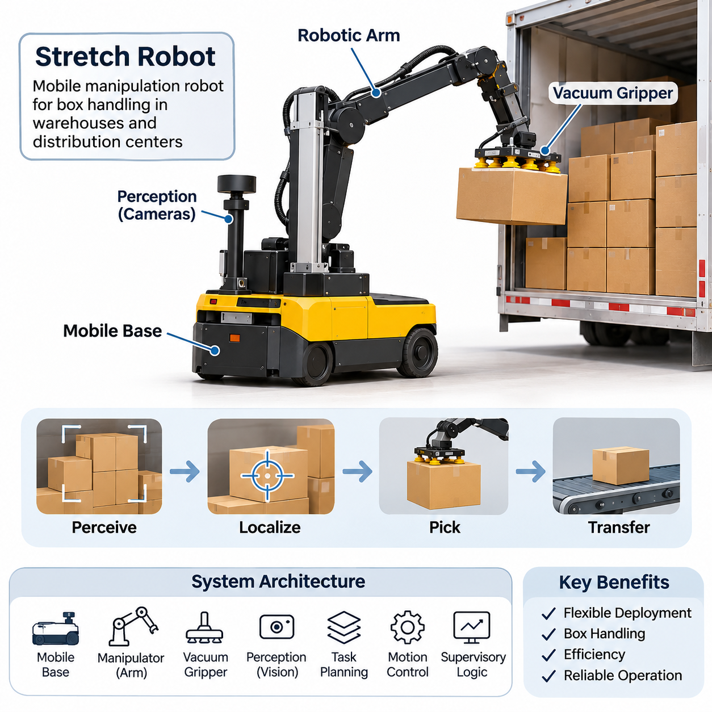
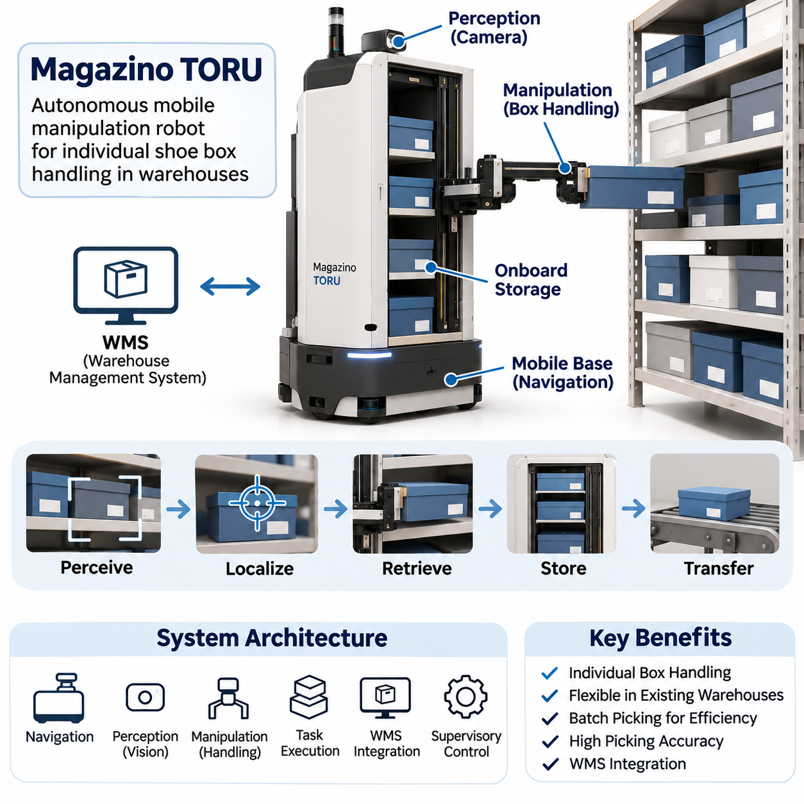
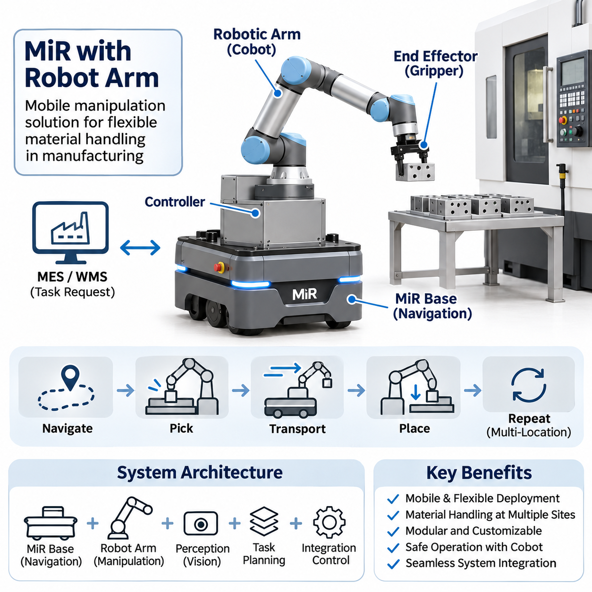
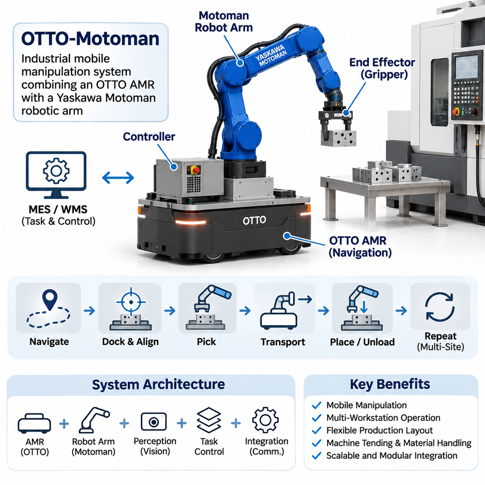
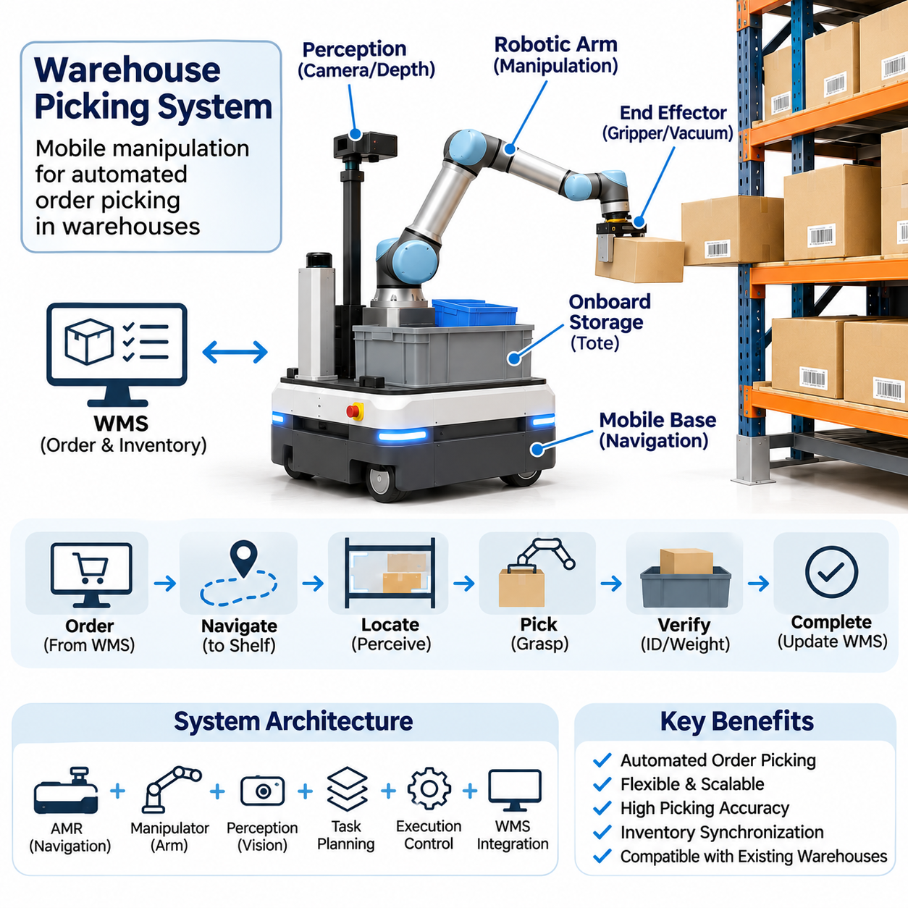
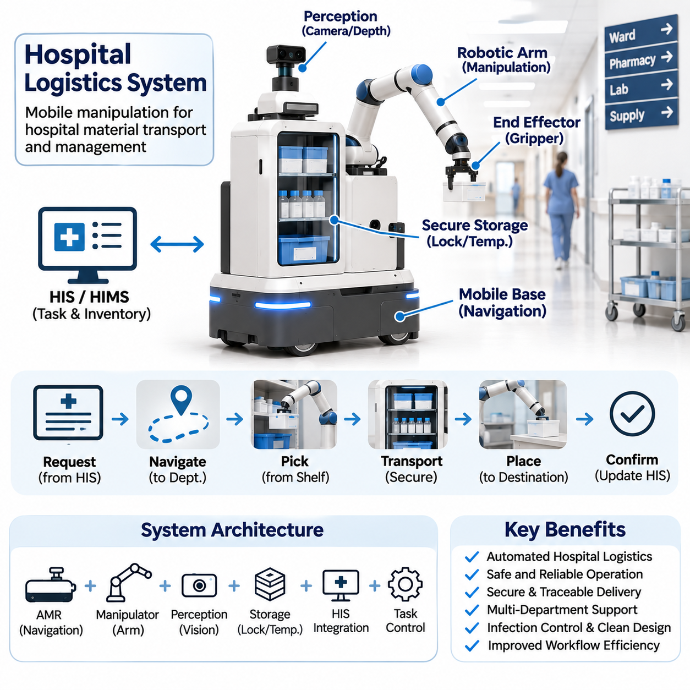
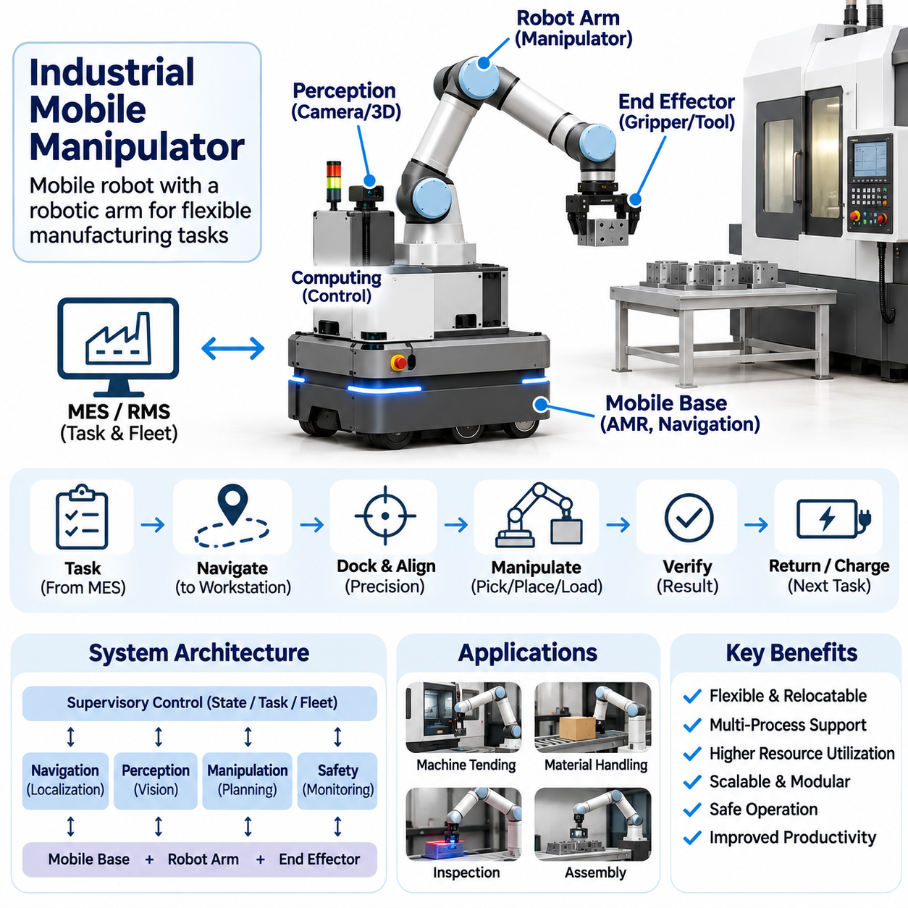

# Chapter 16. Case Studies

## 01 Stretch Robot

{width="7.268055555555556in" height="7.268055555555556in"}

스트레치(Stretch)는 보스턴 다이내믹스(Boston Dynamics)가 창고(Warehouse)와 물류센터(Distribution Center)의 상자(Box) 취급 작업을 자동화하기 위해 개발한 이동형 매니퓰레이션 로봇(Mobile Manipulation Robot)이다. 지정된 작업 위치에 고정되는 기존 산업용 로봇(Industrial Robot)과 달리, 스트레치는 이동 플랫폼(Mobile Base), 로봇 팔(Robot Arm), 인식 시스템(Perception System), 진공 그리퍼(Vacuum Gripper)를 결합한다. 이러한 구조는 반복적인 상자 적재 및 하역 작업이 필요한 물류 환경에서 유연한 배치를 가능하게 한다.

스트레치의 개발은 고정형 창고 자동화(Stationary Warehouse Automation)에서 적응형 로봇 시스템(Adaptive Robotic System)으로 전환되는 기술적 흐름을 보여준다. 기존 컨베이어 시스템(Conveyor System)과 고정형 팔레타이징 로봇(Fixed Palletizing Robot)은 높은 처리량(Throughput)을 제공하지만, 상당한 기반시설 투자와 엄격하게 통제된 운영 환경을 요구한다. 스트레치는 작업 위치 사이를 이동하고 모든 장소에 로봇 팔을 영구적으로 설치하지 않고도 상자 취급 작업을 수행함으로써 이러한 제약의 일부를 해결한다.

스트레치의 핵심 특징은 이동 기능(Mobility)과 조작 기능(Manipulation)을 하나의 통합 로봇 플랫폼(Integrated Robotic Platform)으로 결합한 것이다. 이동 플랫폼은 시스템을 목표 작업 공간(Workspace) 근처에 배치하고, 매니퓰레이터(Manipulator)는 접근 가능한 작업 범위(Operating Envelope) 내의 상자에 도달한다. 이러한 조합은 고정형 로봇보다 실질적인 작업 영역을 확장한다. 다만 스트레치는 일반적으로 물체를 취급하는 동안 계속 주행하기보다는 플랫폼의 위치를 안정화한 상태에서 조작 작업을 수행한다.

로봇 팔(Robot Arm)은 반복적인 상자 취급 작업을 위해 설계되었으며, 도달 거리(Reach), 가반하중(Payload Capacity), 운영 효율성(Operational Efficiency)을 중요하게 고려한다. 기계적 구성(Mechanical Configuration)은 운송 컨테이너(Shipping Container)와 트레일러(Trailer) 내부를 포함한 제한된 공간에서의 움직임을 지원한다. 범용 휴머노이드 매니퓰레이터(General-Purpose Humanoid Manipulator)와 달리, 스트레치는 임의의 물체를 정교하게 조작하는 능력보다 상자 이송, 단순화된 파지(Grasping), 안정적인 운영을 우선하는 작업 특화 설계(Task-Oriented Design)를 적용한다.

스트레치는 적절한 상자 표면과 접촉하여 물체를 파지하는 진공 기반 말단장치(Vacuum-Based End Effector)를 사용한다. 흡착 시스템(Suction System)은 여러 접촉 지점에 파지력(Gripping Force)을 분산하여 다양한 크기와 방향의 상자를 취급할 수 있도록 한다. 성공적인 파지는 표면 상태(Surface Integrity), 접촉 가능 면적(Contact Area), 상자 무게(Carton Weight), 진공 조건(Vacuum Conditions)에 따라 달라진다. 손상된 포장재, 다공성 표면(Porous Surface), 불규칙한 형상(Irregular Geometry)은 파지 신뢰성(Grasp Reliability)을 감소시킬 수 있다.

인식 시스템(Perception System)은 컴퓨터 비전(Computer Vision)과 깊이 정보(Depth Information)를 사용하여 상자를 식별하고 공간적 배치(Spatial Arrangement)를 추정한다. 카메라(Camera)는 작업 환경을 관찰하고 파지 계획(Grasp Planning)과 충돌 회피(Collision Avoidance)에 필요한 기하학적 정보(Geometric Information)를 제공한다. 인식 알고리즘(Perception Algorithm)은 상자가 밀집된 적재 환경에서 개별 상자를 구분해야 하며, 겹치는 모서리, 그림자, 불균일한 조명, 부분적으로 가려진 표면은 물체 검출(Object Detection)과 위치 추정(Localization)을 어렵게 만든다.

물체 위치 추정(Object Localization)은 트레일러 하역(Trailer Unloading)에서 특히 중요하다. 상자의 배치가 완전히 균일한 경우는 드물기 때문이다. 운송 중 상자가 이동하면서 틈새, 기울어진 표면, 불안정한 적재 형태가 발생할 수 있다. 스트레치는 조작 명령(Manipulation Command)을 실행하기 전에 관측 가능한 표면을 평가하고 적절한 파지 후보(Grasp Candidate)를 결정해야 한다. 이러한 과정은 사전에 정의된 궤적(Predefined Trajectory)에만 의존하지 않고 시각적 인식(Visual Perception)과 물리적 제약조건(Physical Constraints)을 통합하는 것이 중요함을 보여준다.

조작 작업 흐름(Manipulation Workflow)은 작업 공간 관찰과 접근 가능한 상자 식별에서 시작된다. 로봇은 선택된 상자의 위치를 추정하고 적절한 접촉 영역(Contact Region)을 결정한 다음 로봇 팔의 이동 궤적(Arm Trajectory)을 생성한다. 진공 접촉(Vacuum Contact)이 형성되면 상자를 들어 올리거나 적재 공간에서 꺼내어 수용 컨베이어(Receiving Conveyor) 또는 지정된 하역 영역(Unloading Area)으로 이송한다. 접근 가능한 공간의 형상이 변화함에 따라 이러한 작업 순서가 반복된다.

동작 계획(Motion Planning)은 이동 플랫폼, 매니퓰레이터, 주변 구조물, 취급 물체 사이의 관계를 고려해야 한다. 트레일러 내부에서는 벽, 천장, 바닥, 인접한 상자로 인해 사용 가능한 작업 공간이 제한된다. 충돌 인식 궤적 생성(Collision-Aware Trajectory Generation)은 효율적인 움직임을 유지하면서 의도하지 않은 접촉을 방지하는 데 도움이 된다. 로봇은 도달 가능성(Reachability), 관절 한계(Joint Limits), 무겁거나 불안정한 위치에 놓인 상자를 취급할 때 발생하는 기계적 영향도 고려해야 한다.

중요한 시스템 수준의 과제(System-Level Challenge)는 이동 플랫폼과 로봇 팔의 동작을 조정하는 것이다. 이동 플랫폼은 상자를 들어 올리고 이송하는 동안 충분한 안정성(Stability)을 유지하면서 적절한 작업 위치를 제공해야 한다. 로봇 팔의 신장 거리(Arm Extension)와 가반하중 위치(Payload Position)가 변화하면 전체 무게중심(Center of Mass)과 하중 조건(Loading Conditions)이 달라진다. 따라서 기계 설계(Mechanical Design)와 제어 전략(Control Strategy)은 동적 힘(Dynamic Forces), 전복 저항성(Tipping Resistance), 플랫폼의 구조적 한계(Structural Limits)를 고려해야 한다.

스트레치는 작업 특화 로보틱스(Task-Specific Robotics)가 자율 조작(Autonomous Manipulation)의 복잡성을 어떻게 줄일 수 있는지 보여준다. 모든 창고 작업을 수행하려 하기보다 비교적 일관된 물체 특성을 가진 상자 취급 작업에 집중한다. 이러한 전문화(Specialization)는 기계 구조, 그리퍼, 인식 알고리즘, 작업 계획기(Task Planner)를 함께 최적화할 수 있도록 한다. 이와 같은 최적화는 불필요하게 범용화된 설계보다 실제 운영 신뢰성(Operational Reliability)을 향상시킬 수 있다.

스트레치의 소프트웨어 아키텍처(Software Architecture)는 상호작용하는 여러 기능 계층(Functional Layers)으로 이해할 수 있다. 인식 계층(Perception Layer)은 관련 물체와 환경의 기하학적 구조를 식별하고, 작업 계획(Task Planning)은 취급 순서를 결정하며, 동작 제어(Motion Control)는 조정된 움직임을 실행한다. 상위 감독 로직(Supervisory Logic)은 작업 완료 상태와 비정상 조건을 감시한다. 내부 구현은 독점 기술(Proprietary Technology)이지만, 이러한 계층적 해석(Layered Interpretation)은 산업용 이동형 매니퓰레이터 아키텍처를 분석하는 유용한 기준을 제공한다.

운영 신뢰성(Operational Reliability)은 실패한 파지 시도와 예상하지 못한 환경 변화로부터 복구하는 능력에 달려 있다. 상자가 미끄러지거나 변형될 수 있으며 충분한 진공 압력(Vacuum Pressure)이 형성되지 않을 수도 있다. 제어 시스템(Control System)은 실패한 상호작용을 인식하고 적절하게 대응해야 한다. 필요한 경우 물체를 해제하거나 다른 접촉 영역을 선택하거나 작업자의 지원을 요청할 수 있다. 이러한 복구 동작(Recovery Behavior)은 지속적인 창고 운영을 위해 필수적이다.

창고 환경에는 작업자, 지게차(Forklift), 컨베이어, 기타 자동화 장비가 존재하므로 인간과 로봇의 상호작용(Human-Robot Interaction)도 중요한 고려사항이다. 안전 엔지니어링(Safety Engineering)은 이동 플랫폼의 움직임과 매니퓰레이터 작동을 모두 다루어야 한다. 위험요소 식별(Hazard Identification)에는 충돌 가능성, 상자 낙하, 예상하지 못한 로봇 팔의 움직임, 제한된 작업 공간에 대한 접근 등이 포함된다. 보호 조치(Protective Measures)는 배치 환경과 적용 가능한 안전 요구사항(Safety Requirements)에 따라 설계되어야 한다.

스트레치는 반복적인 물체 들어 올리기와 육체적으로 부담이 큰 작업이 발생하는 트레일러 및 컨테이너 하역(Container Unloading)에 특히 적합하다. 상자는 밀집된 형태로 도착하며 반복적인 인출과 이송이 필요하다. 스트레치는 이러한 하역 작업의 일부를 자동화하여 반복적인 수작업 취급(Manual Handling)의 필요성을 줄일 수 있다. 실제 생산성 향상(Productivity Improvement)은 상자의 특성, 시설 배치(Facility Layout), 운영 절차(Operating Procedures), 후속 물류 장비(Downstream Material-Handling Equipment)와의 통합 수준에 따라 달라진다.

이 시스템은 로봇 조작(Robotic Manipulation)과 기존 창고 기반시설(Warehouse Infrastructure)을 조정하는 것이 얼마나 중요한지도 보여준다. 수용 컨베이어에 물류 정체(Congestion)가 발생하거나 후속 분류 장비(Sorting Equipment)가 추가 상자를 처리할 수 없다면 이동형 매니퓰레이터는 지속적인 생산성을 제공할 수 없다. 따라서 성공적인 배치(Deployment)를 위해서는 물류 흐름(Material Flow), 장비 인터페이스(Equipment Interface), 운영 일정(Operational Scheduling), 예외 처리(Exception Handling)를 고려해야 한다. 로봇 성능은 전체 물류 프로세스(Logistics Process)의 일부로 평가되어야 한다.

성능 평가(Performance Assessment)는 시간당 최대 상자 처리량만 고려해서는 안 된다. 관련 측정 지표에는 파지 성공률(Grasp Success Rate), 평균 취급 주기 시간(Average Handling Cycle Time), 작업자 개입 빈도(Intervention Frequency), 시스템 가용성(System Availability), 장시간 운영에서의 유효 처리량(Effective Throughput)이 포함된다. 상자 무게 분포(Weight Distribution)와 적재 밀도(Packing Density)도 성능에 영향을 준다. 의미 있는 평가는 통제된 시연 결과(Demonstration Results)와 실제 창고 운영을 대표하는 환경에서 수집된 측정 결과를 구분해야 한다.

에너지 관리(Energy Management)는 이동 시스템, 매니퓰레이터 구동기(Manipulator Actuator), 인식 장비, 컴퓨팅 하드웨어(Computing Hardware), 진공 발생 장치(Vacuum Generation Component)에 전력을 공급해야 하므로 추가적인 제약조건을 발생시킨다. 전력 수요(Power Demand)는 취급 작업 주기에 따라 변화한다. 배터리 용량(Battery Capacity), 충전 전략(Charging Strategy), 운영 듀티 사이클(Operational Duty Cycle)은 실제 활용률(Effective Utilization)에 영향을 준다. 성공적으로 이송한 상자당 에너지 소비량(Energy Consumption per Carton)은 서로 다른 자동화 방식을 비교하는 유용한 지표이다.

시스템 통합(System Integration) 관점에서 스트레치는 명확하게 정의된 운영 목표(Operational Objective)를 중심으로 하드웨어와 소프트웨어를 설계하는 것의 이점을 보여준다. 기계 구조는 필요한 작업 공간을 지원하고, 인식 알고리즘은 상자의 기하학적 형상에 집중하며, 조작 계획(Manipulation Planning)은 안정적인 이송을 강조한다. 이러한 정렬(Alignment)은 불필요한 기능적 복잡성(Functional Complexity)을 줄이는 동시에 생산성과 운영 안정성을 결정하는 요소에 엔지니어링 자원(Engineering Resources)을 집중하도록 한다.

그러나 이러한 접근 방식에도 한계가 있다. 진공 파지(Vacuum Gripping)는 모든 포장 재료나 표면 조건에서 동일하게 효과적이지 않으며, 매우 불규칙한 물체에는 다른 말단장치(End Effector)가 필요할 수 있다. 밀집된 적재 구조는 어려운 인출 경로(Extraction Path)를 형성할 수 있고, 손상된 상자는 추가적인 불확실성(Uncertainty)을 발생시킨다. 이러한 한계는 창고 자동화(Warehouse Automation)가 이상적인 취급 조건을 가정하기보다 실제 재고의 통계적 다양성(Statistical Diversity)을 고려해야 한다는 점을 보여준다.

스트레치의 도입 경제성(Deployment Economics)은 장비 구매비 또는 서비스 비용(Service Costs), 통합 비용(Integration Expenses), 유지보수 요구사항(Maintenance Requirements), 인력 활용률(Labor Utilization), 운영 처리량(Operational Throughput)에 따라 결정된다. 반복적인 상자 취급 작업이 많은 시설은 작업 빈도가 낮거나 변동성이 큰 환경보다 자동화 기회가 클 수 있다. 투자수익률(Return on Investment, ROI)은 측정된 생산성, 현실적인 운영 가용성(Operating Availability), 예상 운영 기간에 걸친 총소유비용(Total Cost of Ownership, TCO)을 사용하여 평가해야 한다.

스트레치는 주로 장소 사이에서 물품을 운송하는 기존 자율이동로봇(Autonomous Mobile Robot, AMR)과 비교할 때도 유용한 사례를 제공한다. 운송용 AMR은 일반적으로 표준화된 적재물 인터페이스(Payload Interface)와 상호작용하지만, 스트레치는 개별 상자를 직접 물리적으로 조작한다. 이러한 차이는 인식, 동작 계획, 파지, 작업 실행(Task Execution)의 복잡성을 크게 증가시킨다. 동시에 자동화할 수 있는 창고 작업의 범위를 확장한다.

범용 이동형 매니퓰레이터(General-Purpose Mobile Manipulator)와 비교하면 스트레치는 범용 로봇 보조 시스템(Universal Robotic Assistant)이 아니라 특화된 산업용 아키텍처(Specialized Industrial Architecture)를 나타낸다. 설계 선택은 창고 상자 취급 요구사항, 특히 반복성이 높은 작업 흐름(High-Repetition Workflow)과 제한된 적재 환경에 초점을 맞춘다. 이 사례는 성공적인 상용화(Commercialization)에 반드시 인간형 구조(Humanlike Morphology)나 제한 없는 조작 능력이 필요한 것은 아니라는 점을 보여준다. 응용 분야에 특화된 엔지니어링(Application-Specific Engineering)이 실제 배치를 위한 더욱 실용적인 경로를 제공할 수 있다.

스트레치의 폭넓은 의의는 자율 이동(Autonomous Mobility), 로봇 조작(Robotic Manipulation), 환경 인식(Environmental Perception)을 상업적 목적의 물류 플랫폼(Commercial Logistics Platform)에 통합할 수 있음을 보여준다는 데 있다. 이 아키텍처는 기계적 도달 범위(Mechanical Reach), 파지 신뢰성, 환경 이해(Environmental Understanding), 안전성(Safety), 운영 통합(Operational Integration) 사이의 관계를 강조한다. 이러한 관계는 제조, 창고 주문 처리(Warehouse Fulfillment), 자재 이송(Material Transfer), 기타 육체적 부담이 큰 산업 작업을 위한 미래 이동형 매니퓰레이터에도 적용된다.

이동형 매니퓰레이션 시스템(Mobile Manipulation System)을 개발하는 엔지니어에게 스트레치는 요구사항 기반 설계(Requirements-Driven Design)의 유용한 사례를 제공한다. 응용 분야는 필요한 가반하중, 작업 공간, 파지 방식(Gripping Method), 인식 성능(Perception Capability), 운영 작업 흐름(Operational Workflow)을 결정한다. 각 하위 시스템(Subsystem)은 독립적인 기술 성능이 아니라 전체 작업 완료(Task Completion)에 대한 기여도를 기준으로 평가되어야 한다. 결과적으로 신뢰할 수 있는 이동형 매니퓰레이션은 조정된 시스템 설계(System Design), 검증(Validation), 현장 배치(Field Deployment)를 통해 구현된다는 엔지니어링 원칙을 도출할 수 있다.

## 02 Magazino Toru

{width="7.268055555555556in" height="7.268055555555556in"}

마가지노 토루(Magazino TORU)는 지능형 창고 자동화(Intelligent Warehouse Automation)를 전문으로 하는 독일 로봇 기업 마가지노(Magazino)가 개발한 자율 이동형 매니퓰레이션 로봇(Autonomous Mobile Manipulation Robot)이다. 선반이나 컨테이너 전체를 운송하는 기존 자율이동로봇(Autonomous Mobile Robot, AMR)과 달리, 토루(TORU)는 개별 신발 상자(Shoe Box)를 식별하고 인출하며 운송하고 배치하도록 설계되었다. 이 아키텍처는 자율 주행(Autonomous Navigation), 컴퓨터 비전(Computer Vision), 로봇 조작(Robotic Manipulation), 창고 소프트웨어 통합(Warehouse Software Integration)을 특화된 물류 플랫폼에 결합한다.

토루의 개발은 대량의 개별 제품을 취급하는 창고에서 유연한 자동화(Flexible Automation)에 대한 수요가 증가하고 있음을 보여준다. 기존 자동 보관 시스템(Automated Storage System)은 컨베이어(Conveyor), 고정형 인출 장치(Fixed Retrieval Mechanism), 표준화된 기반시설(Standardized Infrastructure)에 의존하는 경우가 많다. 토루는 기존 창고 통로를 자율적으로 이동하면서 보관된 물품과 직접 상호작용하는 대안적인 접근 방식을 제시한다. 이러한 기능은 특정 창고 환경에서 대규모 시설 변경의 필요성을 줄일 수 있다.

토루는 제품이 일반적으로 직사각형 판지 상자(Rectangular Cardboard Box)에 보관되는 신발 물류(Footwear Logistics)와 밀접하게 관련되어 있다. 상자의 크기와 포장 상태에는 차이가 있지만, 비교적 표준화된 기하학적 형상(Standardized Geometry)은 로봇 조작에 유리한 조건을 제공한다. 이 시스템은 제한 없는 물체 취급(Unrestricted Object Handling)이 아니라 이러한 운영 특성을 중심으로 설계되었다. 이러한 전문화(Specialization)는 명확하게 정의된 재고 범주(Inventory Category)에 맞추어 인식, 파지(Gripping), 보관 메커니즘(Storage Mechanism)을 최적화할 수 있도록 한다.

로봇은 이동 플랫폼(Mobile Base)과 수직 방향의 조작 및 보관 시스템(Vertically Oriented Manipulation and Storage System)을 통합한다. 기계적 아키텍처(Mechanical Architecture)는 로봇이 창고 선반(Shelving)에 접근하고 적절한 보관 위치(Storage Position)에 도달하여 개별 상자를 인출할 수 있도록 한다. 이러한 통합 설계(Integrated Design)는 하나의 플랫폼에서 운송과 조작을 모두 지원한다. 기존 산업용 로봇을 자율주행 차량 위에 장착한 구조와 달리, 토루는 선반 상호작용(Shelf Interaction)과 개별 물품 물류(Individual-Item Logistics)에 최적화된 전용 설계(Purpose-Built Configuration)를 사용한다.

자율 주행(Autonomous Navigation)은 토루가 장애물을 회피하고 주변 작업과 움직임을 조정하면서 창고 통로를 이동할 수 있도록 한다. 위치 추정(Localization)과 지도 작성(Mapping) 기술은 로봇이 선반 및 지정된 이동 경로(Travel Route)에 대한 자신의 위치를 파악하도록 지원한다. 신뢰할 수 있는 주행을 위해서는 통로 폭(Aisle Width), 회전 여유 공간(Turning Clearance), 보행자 활동(Pedestrian Activity), 일시적인 장애물(Temporary Obstruction)을 고려해야 한다. 이러한 요소는 접근성(Accessibility), 이동 효율성(Travel Efficiency), 운영 가용성(Operational Availability)에 직접적인 영향을 미친다.

인식 시스템(Perception System)은 목표 상자를 식별하고 보관 구획(Storage Compartment) 내의 위치를 추정한다. 카메라 기반 센싱(Camera-Based Sensing)과 영상 처리 알고리즘(Image-Processing Algorithm)은 물체 인식(Object Recognition)과 공간적 위치 추정(Spatial Localization)을 지원한다. 창고 선반에는 색상, 크기, 방향, 인쇄 표시가 서로 다른 상자가 존재할 수 있으므로 정확한 인식이 필수적이다. 로봇은 인접한 재고와 목표 물품을 구분하면서 인출에 필요한 충분한 여유 공간(Clearance)이 있는지 판단해야 한다.

토루의 조작 메커니즘(Manipulation Mechanism)은 선반에서 상자를 인출하여 로봇 내부의 적재 공간(Onboard Storage Area)으로 이송하도록 설계되었다. 범용 인간형 로봇 손(General-Purpose Anthropomorphic Hand)에 의존하는 대신 직사각형 포장물에 적합한 특수 취급 하드웨어(Specialized Handling Hardware)를 사용한다. 조작 순서(Manipulation Sequence)에는 로봇과 선반 사이의 정확한 정렬(Alignment)이 필요하다. 기계적 안내(Mechanical Guidance), 제어된 접촉(Controlled Contact), 조정된 움직임(Coordinated Movement)은 포장재 손상이나 인접 물품의 위치 변화를 방지하는 데 도움이 된다.

일반적인 인출 작업(Retrieval Operation)은 창고관리시스템(Warehouse Management System, WMS)이 주문 또는 피킹 작업(Picking Task)을 할당하면서 시작된다. 토루는 해당 보관 위치로 이동하여 목표 물품을 식별한다. 선반 근처에 위치한 후 상자의 위치를 확인하고 인출 작업을 수행한다. 인출된 물품은 내부 적재 공간으로 이동하며, 로봇은 지정된 이송 스테이션(Transfer Station)으로 복귀하기 전에 추가 제품을 계속 수집할 수 있다.

한 번의 창고 이동 과정에서 여러 상자를 수집하는 기능은 운영 효율성(Operational Efficiency)에 중요하다. 토루는 개별 물품을 인출할 때마다 이송 스테이션으로 이동하는 대신 적재 용량(Storage Capacity)과 작업 제약조건(Task Constraints)이 허용하는 범위에서 여러 피킹 작업을 하나의 경로로 통합할 수 있다. 이러한 접근 방식은 불필요한 이동을 줄이고 배치 기반 주문 처리(Batch-Oriented Order Fulfillment)를 지원한다. 효과적인 작업 일정 관리(Task Scheduling)를 위해서는 물품 위치, 사용 가능한 적재 공간, 배송 우선순위(Delivery Priority)를 고려해야 한다.

창고관리시스템 통합(Warehouse Management System Integration)은 토루 운영 아키텍처(Operational Architecture)의 핵심 요소이다. 로봇은 피킹 명령(Picking Instruction)을 수신하고 재고 위치(Inventory Location)를 식별하며 작업 완료를 보고하고 예외 상황(Exception)을 전달해야 한다. 창고관리시스템(WMS)과의 통합은 로봇 작업이 재고 기록(Inventory Record) 및 주문 처리 프로세스(Fulfillment Process)와 동기화되도록 한다. 신뢰할 수 있는 데이터 교환(Data Exchange)이 없다면 물리적인 조작 작업이 성공하더라도 정확한 창고 운영을 보장할 수 없다.

로봇의 제어 아키텍처(Control Architecture)는 주행(Navigation), 인식(Perception), 조작(Manipulation), 작업 실행(Task Execution), 상위 감독 조정(Supervisory Coordination)의 조합으로 이해할 수 있다. 주행 기능은 플랫폼이 목표 선반에 도달하는 방법을 결정하고, 인식 기능은 원하는 상자와 위치를 식별한다. 조작 제어(Manipulation Control)는 물리적인 인출을 실행하며, 작업 관리(Task Management)는 연속적인 작업을 조정한다. 상위 감독 기능(Supervisory Function)은 시스템 상태(System Status), 작업 결과(Task Outcome), 작업자 개입이 필요한 조건을 감시한다.

중요한 엔지니어링 과제(Engineering Challenge) 중 하나는 선반 수준의 조작(Shelf-Level Manipulation)에 필요한 충분한 위치 정확도(Positioning Accuracy)를 유지하는 것이다. 이동 주행(Mobile Navigation)은 로봇을 보관 위치 근처까지 이동시킬 수 있지만, 성공적인 인출을 위해서는 더욱 정밀한 정렬(Precise Alignment)이 필요하다. 횡방향 위치(Lateral Position), 방향(Orientation), 선반 높이(Shelf Height)의 작은 오차도 취급 메커니즘(Handling Mechanism)에 영향을 줄 수 있다. 따라서 시스템은 전역 주행(Global Navigation), 국소 위치 결정(Local Positioning), 물체 기준 정렬(Object-Relative Alignment)을 결합하여 신뢰할 수 있는 인출을 달성해야 한다.

재고의 다양성(Inventory Variability)은 추가적인 과제를 발생시킨다. 신발 상자는 크기(Dimensions), 구조적 강성(Structural Stiffness), 표면 상태(Surface Condition), 배치 방향(Placement Orientation)이 서로 다를 수 있다. 일부 포장재는 압축되거나 손상되었거나 인접 물품과 지나치게 가깝게 배치될 수 있다. 이러한 차이는 조작 신뢰성(Manipulation Reliability)을 낮추고 복구 작업(Recovery Requirements)의 필요성을 증가시킨다. 실용적인 로봇 시스템은 검출된 모든 물체를 성공적으로 인출할 수 있다고 가정하지 않고 취급하기 어려운 조건을 인식해야 한다.

따라서 오류 복구(Error Recovery)는 운영 작업 흐름(Operational Workflow)의 필수 요소이다. 부정확한 위치 추정(Inaccurate Localization), 부족한 여유 공간(Insufficient Clearance), 기계적 저항(Mechanical Resistance), 예상하지 못한 물체 이동(Unexpected Object Movement)으로 인해 인출 시도가 실패할 수 있다. 로봇은 실패한 작업을 감지하고 재시도가 적절한지 판단해야 한다. 상황에 따라 복구 과정에는 위치 재조정(Repositioning), 인식 작업 반복(Repeated Perception), 다른 작업 선택(Task Reselection), 창고 작업자의 지원 요청이 포함될 수 있다.

토루는 이동 기능(Mobility)과 조작 기능(Manipulation)을 독립적인 기능으로 취급하지 않고 통합하는 것이 중요하다는 점을 보여준다. 주행 정확도(Navigation Accuracy)는 조작 성공률(Manipulation Success Rate)에 영향을 미치며, 조작 요구사항은 허용 가능한 위치 오차(Positioning Tolerance)를 결정한다. 로봇과 취급 메커니즘의 크기는 접근 가능한 선반 위치(Accessible Shelf Location)와 통로 요구사항(Aisle Requirements)에도 영향을 준다. 성공적인 시스템 설계(System Design)를 위해서는 기계적 형상(Mechanical Geometry), 센싱(Sensing), 동작 제어(Motion Control), 창고 배치(Warehouse Layout)를 함께 최적화해야 한다.

토루의 특화된 설계(Specialized Design)는 주로 팔레트(Pallet)나 토트(Tote)를 운송하는 기존 자율이동로봇과 차별화된다. 운송 중심 시스템(Transportation-Focused System)은 일반적으로 표준화된 적재물 운반체(Standardized Load Carrier)와 상호작용하지만, 토루는 개별 재고 물품(Individual Inventory Item)을 직접 인출한다. 이는 추가적인 인식 및 조작 요구사항을 발생시키지만, 기존에 인간 주문 피킹 작업자(Human Order Picker)가 수행하던 활동의 자동화를 가능하게 한다. 이러한 차이는 이동 로보틱스(Mobile Robotics)의 기능적 범위가 확장되고 있음을 보여준다.

안전 고려사항(Safety Considerations)에는 작업자 근처에서의 자율 이동, 선반과의 상호작용, 상자 낙하 또는 부적절한 고정 가능성이 포함된다. 시스템은 실제 창고 운영 환경을 이동하면서 충돌 위험(Collision Risk)을 관리해야 한다. 안전한 조작(Safe Manipulation)을 위해서는 기계적 힘(Mechanical Force)을 제어하고 보관 구조물(Storage Structure)과의 의도하지 않은 접촉을 방지해야 한다. 신뢰할 수 있는 배치를 위해서는 적절한 보호 기능(Protective Function), 운영 절차(Operational Procedure), 위험성 평가(Risk Assessment)가 필요하다.

토루는 로봇 자율성(Robotic Autonomy)과 창고 기반시설(Warehouse Infrastructure) 사이의 관계도 보여준다. 이동형 아키텍처(Mobile Architecture)는 고정형 자동화 장비(Fixed Automation Equipment)에 대한 의존도를 줄일 수 있지만, 주변 환경은 여전히 신뢰할 수 있는 주행과 조작을 지원해야 한다. 선반 형상(Shelf Geometry), 보관 구성(Storage Organization), 바닥 상태(Floor Conditions), 조명(Lighting), 물품 접근성(Item Accessibility)은 성능에 영향을 준다. 따라서 배치 계획(Deployment Planning)에서는 기존 시설과 로봇의 운영 요구사항(Operational Requirements) 사이의 호환성(Compatibility)을 평가해야 한다.

성능 평가(Performance Evaluation)에서는 피킹 성공률(Picking Success Rate), 평균 인출 시간(Average Retrieval Time), 이동 거리(Travel Distance), 작업 완료율(Task Completion Rate), 작업자 개입 빈도(Intervention Frequency)를 고려해야 한다. 창고 생산성(Warehouse Productivity)은 개별 시연보다 지속적인 운영에 의존하므로 시스템 가용성(System Availability)과 유효 처리량(Effective Throughput)이 특히 중요하다. 성능은 선반 점유율(Shelf Occupancy)과 작업 복잡도(Task Complexity)의 변화를 포함하여 실제 재고 분포(Inventory Distribution)와 현실적인 운영 조건에서 측정해야 한다.

에너지 관리(Energy Management)는 주행, 인식, 조작, 컴퓨팅(Computing), 내부 적재 작업(Onboard Storage Operation)에 전력이 소비되므로 자율 피킹 로봇(Autonomous Picking Robot)의 생산성에 영향을 준다. 배터리 용량(Battery Capacity)과 충전 전략(Charging Strategy)은 충전 사이에 시스템을 사용할 수 있는 시간을 결정한다. 에너지 인식 작업 일정 관리(Energy-Aware Task Scheduling)는 불필요한 이동을 줄이고 운영 활용률(Operational Utilization)을 개선할 수 있다. 성공적으로 인출한 물품당 에너지 소비량(Energy Consumption per Retrieved Item)은 시스템 효율성(System Efficiency)을 측정하는 추가적인 지표를 제공한다.

토루의 경제적 가치(Economic Value)는 자동화 비용(Automation Costs)과 실제 창고 운영에서 달성한 생산성 향상(Productivity Improvement) 사이의 관계에 따라 결정된다. 관련 요소에는 장비 투자(Equipment Investment), 통합 비용(Integration Expenses), 유지보수(Maintenance), 소프트웨어 지원(Software Support), 인력 활용률(Labor Utilization), 운영 가용성(Operational Availability)이 포함된다. 반복적인 피킹 요구사항과 호환 가능한 보관 구조를 가진 창고는 유리한 배치 조건을 제공할 수 있다. 그러나 투자수익률(Return on Investment, ROI)은 현실적인 운영 가정을 바탕으로 평가해야 한다.

토루 아키텍처의 중요한 장점은 모든 제품을 전용 자동 보관 장치(Dedicated Automated Storage Machine)로 이동시키지 않고도 개별 물품 피킹(Individual-Item Picking)을 자동화할 수 있다는 것이다. 이는 창고 배치나 재고 분포가 변화할 때 유연성을 제공할 수 있다. 그러나 이러한 접근 방식은 지원되는 제품의 기하학적 형상(Geometry)과 취급 특성(Handling Characteristics)에 의해 여전히 제한된다. 따라서 이 시스템은 범용 로봇 조작(Universal Robotic Manipulation)이 아니라 특화된 창고 자동화(Specialized Warehouse Automation)로 이해해야 한다.

제품 전략(Product Strategy) 관점에서 토루는 명확하게 정의된 응용 분야(Narrowly Defined Application)가 상업적으로 의미 있는 로봇 플랫폼의 개발을 어떻게 이끌 수 있는지 보여준다. 기계적 구성(Mechanical Configuration), 인식 기능(Perception Capabilities), 소프트웨어 인터페이스(Software Interfaces)는 신발 상자 물류(Shoe-Box Logistics)의 요구사항을 중심으로 구성된다. 이러한 집중은 임의의 물체를 취급할 때 발생하는 복잡성을 줄이면서 실질적인 운영 목표(Operational Objective)를 지원한다. 따라서 응용 분야 특화(Application Specialization)는 로봇 시제품(Robotic Prototype)에서 실제 배치 시스템(Deployed System)으로의 전환을 가속할 수 있다.

이 사례는 여러 자율 피킹 로봇이 동일한 시설에서 운영될 때 로봇 군집 수준의 조정(Fleet-Level Coordination)이 중요하다는 점도 강조한다. 작업 할당(Task Allocation), 경로 계획(Route Planning), 혼잡 관리(Congestion Management), 충전 일정(Charging Schedule)은 전체 생산성(Collective Productivity)에 영향을 준다. 군집 관리 시스템(Fleet Management System)은 인출 작업을 분배하고 로봇 이동을 조정하여 불필요한 이동을 줄일 수 있다. 결과적인 성능은 개별 로봇의 기능뿐 아니라 시스템 수준의 오케스트레이션(System-Level Orchestration) 효율성에도 달려 있다.

토루는 소매 유통(Retail Distribution), 의약품 물류(Pharmaceutical Logistics), 예비 부품 창고(Spare-Parts Warehouse), 기타 구조화된 보관 환경(Structured Storage Environment)을 위한 미래 이동형 매니퓰레이터(Mobile Manipulator)의 유용한 아키텍처 참조 사례(Architectural Reference)를 제공한다. 자율 주행, 물체 위치 추정(Object Localization), 특수 파지(Specialized Gripping), 재고 시스템 통합(Inventory System Integration)의 기본 원칙은 다른 응용 분야에도 적용할 수 있다. 그러나 물체 형상, 가반하중 요구사항(Payload Requirements), 보관 조건이 달라지면 조작 하드웨어(Manipulation Hardware)의 상당한 재설계가 필요할 수 있다.

마가지노 토루의 폭넓은 의의는 자율 이동형 매니퓰레이션(Autonomous Mobile Manipulation)이 실제 창고 운영 환경에서 재고 물품과 직접 상호작용할 수 있음을 보여준다는 데 있다. 이 설계는 물리적 조작(Physical Manipulation)을 디지털 재고 관리(Digital Inventory Management) 및 물류 실행(Logistics Execution)과 연결한다. 산업용 이동형 매니퓰레이터(Industrial Mobile Manipulator)를 개발하는 엔지니어에게 토루는 실용적인 자동화(Practical Automation)의 기반으로서 응용 분야에 특화된 기계 설계(Application-Specific Mechanical Design), 정확한 인식(Accurate Perception), 신뢰할 수 있는 복구 동작(Reliable Recovery Behavior), 조정된 창고 통합(Coordinated Warehouse Integration)의 중요성을 강조한다.

## 03 MiR with Robot Arm

{width="7.268055555555556in" height="7.268055555555556in"}

모바일 인더스트리얼 로봇(Mobile Industrial Robots, MiR)은 로봇 팔(Robot Arm)과 통합하여 유연한 이동형 매니퓰레이션 시스템(Mobile Manipulation System)을 구축할 수 있는 자율이동로봇(Autonomous Mobile Robot, AMR) 플랫폼을 제공한다. 이러한 구성은 자율 자재 운송(Autonomous Material Transportation)과 작업장에서의 물리적 상호작용(Physical Interaction)을 결합한다. 고정형 산업용 로봇(Fixed Industrial Robot)과 달리, MiR 기반 이동형 매니퓰레이터(Mobile Manipulator)는 생산 구역 사이를 이동하면서 특정 취급 작업을 수행할 수 있어 여러 장소에 로봇 기능을 분산하여 활용할 수 있도록 한다.

MiR 플랫폼과 로봇 팔의 통합은 산업 자동화(Industrial Automation)에 대한 모듈형 접근 방식(Modular Approach)을 나타낸다. 이동 플랫폼(Mobile Base)은 주행(Navigation), 위치 추정(Localization), 장애물 회피(Obstacle Avoidance), 운송(Transportation) 기능을 제공하고, 매니퓰레이터(Manipulator)는 피킹(Picking), 배치(Placing), 적재(Loading), 하역(Unloading) 등의 작업을 수행한다. 시스템 통합업체(System Integrator)는 응용 요구사항(Application Requirements)에 따라 호환 가능한 로봇 팔과 말단장치(End Effector)를 선택할 수 있다. 이러한 모듈성(Modularity)은 모든 하위 시스템(Subsystem)을 처음부터 개발하지 않고도 맞춤형 구성을 지원한다.

MiR 기반 이동형 매니퓰레이션 솔루션(Mobile Manipulation Solution)은 일반적으로 기계, 조립 작업장(Assembly Station), 보관 구역(Storage Area) 사이에서 자재를 이송해야 하는 제조 환경(Manufacturing Environment)에 적용된다. 이동형 매니퓰레이터는 한 장소에서 부품을 수집하고 운송한 후 다른 작업장에 배치할 수 있다. 이러한 접근 방식은 전용 컨베이어 기반시설(Dedicated Conveyor Infrastructure)에 대한 의존도를 줄이고 생산 배치(Production Layout)의 변경을 가능하게 한다. 그러나 각 응용 분야의 실현 가능성(Feasibility)은 가반하중(Payload), 도달 범위(Reach), 위치 정확도(Positioning Accuracy), 안전 제약조건(Safety Constraints)에 따라 결정된다.

기계적 아키텍처(Mechanical Architecture)는 일반적으로 로봇 팔, 장착 구조물(Mounting Structure), 제어 전자장치(Control Electronics), 응용 분야별 도구(Application-Specific Tooling)를 지지하는 자율 이동 플랫폼으로 구성된다. 장착 인터페이스(Mounting Interface)는 조작 중 발생하는 정적 하중(Static Load), 가속력(Acceleration Force), 모멘트(Moment)를 견뎌야 한다. 엔지니어는 결합된 무게중심(Center of Gravity)을 평가하고 로봇 팔의 움직임이 플랫폼 안정성(Platform Stability)을 저해하지 않도록 해야 한다. 선택한 매니퓰레이터와 운영 조건에 따라 구조적 보강(Structural Reinforcement)이 필요할 수 있다.

가반하중 설계(Payload Engineering)는 이동 플랫폼이 취급 물체의 무게보다 더 큰 하중을 지지해야 하므로 특히 중요하다. 전체 지지 질량(Total Supported Mass)에는 로봇 팔, 장착 하드웨어(Mounting Hardware), 제어기(Controller), 그리퍼(Gripper), 보조 장비(Auxiliary Equipment), 운송 자재(Transported Materials)가 포함된다. 매니퓰레이터의 가반하중 정격(Payload Rating)은 말단장치 무게(End-Effector Weight)와 작동 도달 거리(Operating Reach)도 고려해야 한다. 따라서 실제 취급 능력(Practical Handling Capability)을 결정하기 전에 플랫폼 적재 용량(Platform Capacity)과 로봇 팔의 가반하중을 독립적으로 평가해야 한다.

MiR 아키텍처의 주요 장점은 자율 주행 기능(Autonomous Navigation Capability)이다. 이동 플랫폼은 지도화된 산업 환경(Mapped Industrial Environment)에서 장애물을 감지하고 필요에 따라 경로를 조정하면서 이동할 수 있다. 레이저 스캐너(Laser Scanner)와 기타 센싱 기술(Sensing Technology)은 위치 추정과 충돌 회피(Collision Avoidance)를 지원한다. 이러한 기능은 작업자 및 다른 장비와 공간을 공유하는 시설에서 시스템을 운영할 수 있도록 하지만, 주행과 조작 과정 모두에서 적절한 안전 조치(Safety Measures)가 필요하다.

주행 정확도(Navigation Accuracy)만으로는 일반적으로 정밀 조작(Precision Manipulation)에 충분하지 않다. 이동 로봇은 허용 가능한 주행 오차(Navigation Tolerance) 범위 내에 도착하더라도 기계 고정구(Machine Fixture)나 부품 트레이(Component Tray)와 정렬되지 않을 수 있다. 따라서 이동형 매니퓰레이션 응용 분야에서는 추가적인 도킹(Docking), 위치 추정 또는 보정 메커니즘(Calibration Mechanism)이 필요한 경우가 많다. 기준 마커(Fiducial Marker), 기계적 정렬 구조(Mechanical Alignment Feature), 비전 기반 보정(Vision-Based Correction)은 반복 정밀도(Repeatability)를 향상시킬 수 있다. 선택하는 방식은 조작 작업에 요구되는 정밀도에 따라 달라진다.

일반적인 운영 순서(Operational Sequence)는 제조실행시스템(Manufacturing Execution System, MES) 또는 상위 감독 제어기(Supervisory Controller)가 운송 및 취급 요청(Transportation and Handling Request)을 발행하면서 시작된다. 이동 플랫폼은 출발 작업장(Source Workstation)으로 이동하여 필요한 작업 위치를 확보한다. 정렬 상태를 확인한 후 매니퓰레이터는 목표 물체(Target Object)를 인출하고 운송을 위해 고정한다. 이후 로봇은 목적지(Destination)로 이동하여 위치를 확인하고 하역 또는 배치 작업(Unloading or Placement Operation)을 수행한다.

이동 플랫폼과 로봇 팔 사이의 조정(Coordination)은 안전하고 신뢰할 수 있는 운영을 위해 필수적이다. 많은 산업 응용 분야에서는 이동 플랫폼이 정지한 상태에서 조작 작업을 수행한다. 이는 동작 계획(Motion Planning)을 단순화하고 동시 이동(Simultaneous Movement)과 관련된 불확실성(Uncertainty)을 줄인다. 상위 감독 제어기(Supervisory Controller)는 주행 상태(Navigation State)와 조작 상태(Manipulation State) 사이의 전환을 관리해야 하며, 운송 중 로봇 팔이 적절한 자세(Configuration)를 유지하도록 해야 한다.

소프트웨어 아키텍처(Software Architecture)는 일반적으로 이동 주행(Mobile Navigation)과 로봇 조작(Robotic Manipulation)을 위한 별도의 제어기(Controller)를 포함한다. 이동 플랫폼은 경로 실행(Route Execution)과 위치 추정을 관리하고, 로봇 팔 제어기(Arm Controller)는 관절 궤적(Joint Trajectory), 말단장치 명령(End-Effector Command), 조작 제약조건(Manipulation Constraints)을 처리한다. 통합 계층(Integration Layer)은 정의된 통신 인터페이스(Communication Interface)를 통해 두 시스템을 조정한다. 장비 구성에 따라 산업용 통신 프로토콜(Industrial Protocol), 응용 프로그래밍 인터페이스(Application Programming Interface, API), 로봇 미들웨어(Robotics Middleware)를 사용하여 명령과 상태 정보를 교환할 수 있다.

로봇 운영체제 2(Robot Operating System 2, ROS 2)는 선택한 구성요소가 지원하는 경우 통합 이동형 매니퓰레이션 응용 프로그램(Integrated Mobile Manipulation Application)을 개발하기 위한 소프트웨어 프레임워크(Software Framework)를 제공할 수 있다. 주행 소프트웨어(Navigation Software)는 이동을 조정하고, 무브잇 2(MoveIt 2)와 같은 조작 계획 도구(Manipulation Planning Tool)는 로봇 팔 궤적 생성(Arm Trajectory Generation)을 지원할 수 있다. 그러나 호환성(Compatibility)은 사용 가능한 드라이버(Driver), 인터페이스, 제조업체 지원(Vendor Support)에 따라 달라진다. 따라서 ROS 2 통합은 모든 MiR 구성에 내재된 기능이 아니라 엔지니어링 선택사항(Engineering Option)으로 다루어야 한다.

조작 하위 시스템(Manipulation Subsystem)은 소형 통합(Compact Integration)과 작업자 근처에서의 운영이 필요한 경우 협동로봇 팔(Collaborative Robotic Arm)을 사용할 수 있다. 협동로봇(Collaborative Robot)은 힘 모니터링(Force Monitoring)과 설정 가능한 안전 기능(Configurable Safety Function)을 제공하지만, 이러한 기능이 전체 이동형 매니퓰레이션 시스템의 안전성을 자동으로 보장하지는 않는다. 결합된 로봇은 응용 분야별 위험성 평가(Application-Specific Risk Assessment)를 거쳐야 한다. 안전 성능(Safety Performance)은 이동 플랫폼, 매니퓰레이터, 도구, 가반하중, 작동 속도(Operating Speed), 주변 환경에 따라 달라진다.

말단장치 선택(End-Effector Selection)은 MiR 기반 이동형 매니퓰레이터가 지원할 수 있는 작업 범위에 큰 영향을 미친다. 평행 그리퍼(Parallel Gripper)는 적절한 접촉면(Contact Surface)을 가진 부품을 취급할 수 있으며, 진공 그리퍼(Vacuum Gripper)는 상자나 평평한 물체에 적합할 수 있다. 특수 도구(Specialized Tool)는 기계 작업 지원(Machine Tending), 검사(Inspection), 조립(Assembly) 작업을 지원할 수 있다. 각 말단장치는 파지력(Gripping Force), 전력(Electrical Power), 공압 공급(Pneumatic Supply), 센싱(Sensing), 기계적 호환성(Mechanical Compatibility)에 관한 요구사항을 발생시킨다.

기계 작업 지원(Machine Tending)은 이동형 매니퓰레이터가 제조 장비에 원자재(Raw Material)를 공급하고 완성 부품(Completed Part)을 회수하는 대표적인 응용 분야이다. 로봇은 컴퓨터 수치제어 장비(Computer Numerical Control Machine, CNC Machine)에 접근하여 위치를 확인하고 작업 공간에 접근하기 전에 기계 제어기(Machine Controller)와 동작을 조정할 수 있다. 이후 매니퓰레이터는 보관 고정구(Storage Fixture)와 기계 사이에서 부품을 이송한다. 신뢰할 수 있는 실행을 위해서는 동기화된 통신(Synchronized Communication), 정확한 위치 결정(Accurate Positioning), 적절한 안전 인터록(Safety Interlock)이 필요하다.

또 다른 응용 분야는 생산 작업장 사이의 자재 이송(Material Transfer)이다. 이동형 매니퓰레이터는 트레이(Tray), 빈(Bin), 지정된 고정구(Designated Fixture)에서 부품을 수집하여 수용 위치(Receiving Location)에 배치할 수 있다. 이러한 기능은 생산 장비가 시설 전체에 분산되어 있고 직접적인 컨베이어 연결(Conveyor Connection)이 비현실적인 경우에 유용하다. 로봇은 여러 작업장을 지원할 수 있지만, 작업 일정 관리(Task Scheduling)에서는 이동 시간(Travel Time), 조작 시간(Manipulation Duration), 장비 가용성(Equipment Availability)을 고려해야 한다.

이동형 매니퓰레이션과 제조실행시스템(MES)의 통합은 생산 활동(Production Activities)의 자동화된 조정을 가능하게 한다. 상위 감독 시스템(Supervisory System)은 자재 수요(Material Demand), 작업장 상태(Workstation Status), 운영 우선순위(Operational Priority)에 따라 작업을 할당할 수 있다. 완료 메시지(Completion Message)와 예외 보고(Exception Report)는 제조 시스템이 로봇 운영 상태를 파악할 수 있도록 한다. 효과적인 통합을 위해서는 일관된 자재 식별(Material Identification), 신뢰할 수 있는 통신(Reliable Communication), 명확하게 정의된 작업 실행 책임(Task Execution Responsibility)이 필요하다.

여러 MiR 플랫폼이 동일한 시설에서 운영될 때 군집 관리(Fleet Management)의 중요성이 더욱 커진다. 중앙 집중식 조정(Centralized Coordination)은 운송 요청을 분배하고 교통 흐름(Traffic)을 관리하며 불필요한 이동을 줄일 수 있다. 이동형 매니퓰레이터는 각 작업에 주행과 물리적 취급이 모두 포함되므로 추가적인 일정 제약조건(Scheduling Constraints)을 발생시킨다. 따라서 군집 수준 최적화(Fleet-Level Optimization)는 로봇 가용성(Robot Availability), 로봇 팔 기능(Arm Capabilities), 작업장 접근성(Workstation Accessibility), 배터리 상태(Battery State), 예상 작업 시간(Expected Task Duration)을 고려해야 한다.

에너지 관리(Energy Management)도 중요한 엔지니어링 고려사항이다. 이동 플랫폼은 주행(Driving), 주행 센서(Navigation Sensor), 컴퓨팅 장비(Computing Equipment), 탑재 제어 시스템(Onboard Control System)에 에너지를 공급한다. 통합된 로봇 팔은 가속(Acceleration), 들어 올리기(Lifting), 파지(Gripping) 작업 중 추가적인 전력을 요구할 수 있다. 엔지니어는 로봇 팔이 플랫폼의 전력 시스템(Power System)을 사용하는지 별도의 전원 공급 장치(Separate Power Supply)를 사용하는지 결정해야 한다. 배터리 용량 산정(Battery Sizing)과 충전 전략(Charging Strategy)은 전체 운영 듀티 사이클(Operating Duty Cycle)을 반영해야 한다.

시스템 신뢰성(System Reliability)은 독립적으로 복잡한 여러 하위 시스템을 성공적으로 조정하는 능력에 달려 있다. 주행 실패(Navigation Failure), 통신 중단(Communication Interruption), 위치 오차(Positioning Error), 파지 실패(Unsuccessful Grasp)는 작업 완료를 방해할 수 있다. 상위 감독 제어기는 비정상 조건(Abnormal Condition)을 감지하고 적절한 복구 절차(Recovery Procedure)를 실행해야 한다. 여기에는 위치 추정 반복(Repeated Localization), 파지 재시도(Grasp Retry), 안전 위치 복귀(Return to Safe Position), 자동 복구가 불가능한 경우 작업자 지원 요청이 포함될 수 있다.

안전 아키텍처(Safety Architecture)는 이동과 로봇 조작에서 발생하는 위험요소(Hazard)를 모두 다루어야 한다. 이동 플랫폼은 보행자나 차량과 마주칠 수 있으며, 로봇 팔은 관절 움직임(Joint Motion), 파지력, 물체 낙하(Falling Object)와 관련된 위험을 발생시킨다. 안전 기능(Safety Function)은 전체 작동 범위(Operating Envelope)와 하위 시스템 사이의 상호작용을 고려해야 한다. 시스템 분류(System Classification)에 따라 무인 산업용 트럭(Driverless Industrial Truck)에 관한 ISO 3691-4와 관련 산업용 로봇 안전 표준(Industrial Robot Safety Standards)이 적용될 수 있다.

성능 평가(Performance Evaluation)는 개별 주행 또는 조작 결과가 아니라 전체 작업 주기(Complete Task Cycle)를 고려해야 한다. 중요한 측정 지표에는 이동 시간(Travel Time), 도킹 정확도(Docking Accuracy), 파지 성공률(Grasp Success Rate), 배치 반복 정밀도(Placement Repeatability), 작업 완료율(Task Completion Rate), 운영 가용성(Operational Availability)이 포함된다. 시스템 처리량(System Throughput)은 이러한 활동이 얼마나 효율적으로 조정되는지에 따라 달라진다. 고성능 매니퓰레이터도 과도한 이동 지연을 보완할 수 없으며, 정확한 주행만으로는 불안정한 물체 취급을 해결할 수 없다.

MiR 기반 이동형 매니퓰레이션의 경제적 이점(Economic Benefits)은 여러 작업장에서 로봇 자원(Robotic Resources)을 공유할 수 있다는 가능성에서 발생한다. 모든 위치에 전용 매니퓰레이터(Dedicated Manipulator)를 설치하는 대신 하나의 이동형 시스템이 여러 기계에서 작업을 수행할 수 있다. 이는 적합한 응용 분야에서 장비 활용률(Equipment Utilization)을 향상시킬 수 있다. 그러나 이동 시간, 도킹 요구사항(Docking Requirements), 통합 복잡성(Integration Complexity), 생산 일정 관리(Production Scheduling)는 예상되는 이점을 감소시킬 수 있으므로 상세한 작업 흐름 분석(Workflow Analysis)이 필수적이다.

고정형 산업 자동화(Fixed Industrial Automation)와 비교하면 이동형 매니퓰레이션은 더 높은 유연성(Flexibility)을 제공하지만 추가적인 불확실성을 발생시킨다. 고정형 로봇은 정밀하게 보정된 작업 공간(Calibrated Workspace)에서 작동하지만, 이동형 시스템은 외부 장비에 대한 상대 위치(Relative Position)를 반복적으로 설정해야 한다. 이로 인해 위치 추정, 보정(Calibration), 기계적 안정성(Mechanical Stability), 오류 복구(Error Recovery)에 대한 추가 요구사항이 발생한다. 엔지니어링 과제는 이동으로 인해 발생하는 변동성(Variability)에도 불구하고 허용 가능한 조작 성능(Manipulation Performance)을 유지하는 것이다.

MiR 기반 이동형 매니퓰레이터는 모듈형 통합(Modular Integration)과 완전히 통합된 로봇 아키텍처(Fully Unified Robotic Architecture) 사이의 차이도 보여준다. 상용 구성요소(Commercially Available Component)를 결합하면 초기 개발 노력(Initial Development Effort)을 줄일 수 있지만, 시스템 통합업체는 기계적 호환성, 전기적 인터페이스(Electrical Interface), 통신 신뢰성(Communication Reliability), 시스템 수준 안전성(System-Level Safety)에 대한 책임을 가진다. 성공적인 통합을 위해서는 개별적으로 신뢰할 수 있는 하위 시스템이 자동으로 신뢰할 수 있는 전체 시스템을 구성한다고 가정하지 않고 구성요소 사이의 상호작용을 신중하게 검증해야 한다.

제품 전략(Product Strategy) 관점에서 모듈형 이동형 매니퓰레이션(Modular Mobile Manipulation)은 대규모 시설 재구축 없이 적응형 자동화(Adaptable Automation)를 도입하려는 제조업체에 기회를 제공한다. 중간 수준의 취급 하중(Moderate Handling Load), 반복 가능한 물체 형상(Repeatable Object Geometry), 분산된 작업장(Distributed Workstation)을 가진 응용 분야가 특히 적합하다. 그러나 모든 산업 공정(Industrial Process)이 이동성(Mobility)의 이점을 얻는 것은 아니다. 단일 위치에서 수행되는 고속 반복 작업(High-Speed Repetitive Operation)은 전용 자재 취급 기반시설(Dedicated Material-Handling Infrastructure)을 갖춘 고정형 로봇 셀(Fixed Robotic Cell)에 더 적합할 수 있다.

MiR 플랫폼과 로봇 팔 통합의 폭넓은 의의는 자율 운송(Autonomous Transportation)이 물리적 작업 실행(Physical Task Execution)으로 어떻게 발전할 수 있는지를 보여준다는 데 있다. 이동 플랫폼은 시설 전체로 매니퓰레이터의 운영 범위(Operational Reach)를 확장하고, 로봇 팔은 자재와 장비에 대한 직접적인 상호작용을 가능하게 한다. 산업용 이동형 매니퓰레이터(Industrial Mobile Manipulator)를 개발하는 엔지니어에게 이 사례는 신뢰할 수 있는 현장 배치(Reliable Deployment)를 위한 핵심 기반으로서 모듈형 아키텍처(Modular Architecture), 정밀 도킹(Precise Docking), 조정된 제어(Coordinated Control), 기능 안전(Functional Safety), 시스템 수준 검증(System-Level Validation)의 중요성을 강조한다.

## 04 OTTO Motoman

{width="7.268055555555556in" height="7.268055555555556in"}

OTTO-모토맨(OTTO-Motoman) 개념은 OTTO 자율이동로봇(Autonomous Mobile Robot, AMR)과 야스카와 모토맨(Yaskawa Motoman) 로봇 팔(Robot Arm)을 결합한 산업용 이동형 매니퓰레이션 아키텍처(Industrial Mobile Manipulation Architecture)를 나타낸다. 이러한 구성은 자율 자재 운송(Autonomous Material Transportation)과 로봇 취급 기능(Robotic Handling Capability)을 통합한다. 고정형 자동화 작업장(Fixed Automation Station)에만 의존하는 대신, 시스템은 생산 위치 사이를 이동하면서 이동 기능(Mobility)과 조작 기능(Manipulation)의 조정된 제어를 통해 적재, 하역, 자재 이송 작업을 수행할 수 있다.

OTTO 모터스(OTTO Motors)는 산업용 자재 운송(Industrial Material Transportation)을 위한 자율이동로봇을 개발하며, 야스카와 모토맨(Yaskawa Motoman)은 제조 자동화(Manufacturing Automation)를 위한 로봇 매니퓰레이터(Robotic Manipulator)를 제공한다. 이러한 기술을 결합하면 이동 플랫폼(Mobile Platform)과 매니퓰레이터가 서로 구분된 기능적 책임(Functional Responsibility)을 유지하는 모듈형 엔지니어링 접근 방식(Modular Engineering Approach)을 구현할 수 있다. 결과적으로 이 시스템은 보편적으로 정의된 사양을 가진 단일 표준 제품(Standardized Product)이 아니라 통합 아키텍처(Integration Architecture)로 이해해야 한다.

OTTO-모토맨 통합(OTTO-Motoman Integration)의 주요 목적은 로봇 조작(Robotic Manipulation)을 고정된 작업장(Fixed Workstation) 외부로 확장하는 것이다. 이동형 매니퓰레이터(Mobile Manipulator)는 생산 구역 사이에서 부품을 운송하고 기계, 고정구(Fixture), 자재 컨테이너(Material Container)와 직접 상호작용할 수 있다. 이러한 접근 방식은 장비가 여러 위치에 분산된 제조 시설(Manufacturing Facility)에 특히 적합하다. 실질적인 가치는 운송 유연성(Transportation Flexibility), 조작 정확도(Manipulation Accuracy), 운영 신뢰성(Operational Reliability), 통합 복잡성(Integration Complexity) 사이의 균형에 따라 결정된다.

기계적 아키텍처(Mechanical Architecture)는 이동 플랫폼, 로봇 팔, 장착 구조물(Mounting Structure), 응용 분야별 말단장치(Application-Specific End Effector)로 구성된다. 플랫폼은 매니퓰레이터, 제어기(Controller), 도구(Tooling), 운송 가반하중(Transported Payload)의 총중량을 지지해야 한다. 엔지니어는 구조적 강성(Structural Stiffness), 장착 강도(Mounting Strength), 로봇 팔 작동 중 무게중심(Center of Gravity)의 이동을 평가해야 한다. 로봇 팔의 과도한 신장(Arm Extension)이나 불리한 가반하중 위치(Payload Positioning)는 전복 모멘트(Tipping Moment)를 발생시켜 시스템 안정성(System Stability)을 저하시킬 수 있다.

가반하중 선정(Payload Selection)을 위해서는 이동 플랫폼과 로봇 팔을 독립적으로 평가해야 한다. 이동 로봇의 정격 적재 용량(Rated Capacity)은 설치된 모든 장비와 운송 자재를 수용해야 하며, 매니퓰레이터의 가반하중 정격(Payload Rating)에는 그리퍼(Gripper)와 취급 물체(Handled Object)가 포함되어야 한다. 가속(Acceleration), 제동(Braking), 로봇 팔 움직임 중 발생하는 동적 힘(Dynamic Force)은 추가적인 하중 조건(Loading Condition)을 발생시킨다. 따라서 공칭 가반하중 정격(Nominal Payload Rating)만으로는 안전 작동 범위(Safe Operating Envelope)를 결정하기에 충분하지 않다.

OTTO 이동 플랫폼(OTTO Mobile Platform)은 지도화된 산업 환경(Mapped Industrial Environment)에서 주행(Navigation)과 자재 운송(Material Transportation) 기능을 제공한다. 위치 추정(Localization), 장애물 감지(Obstacle Detection), 경로 계획(Route Planning)을 통해 로봇은 지정된 작업장 사이를 이동할 수 있다. 주행 성능(Navigation Performance)은 환경의 기하학적 구조(Environmental Geometry), 바닥 상태(Floor Conditions), 교통 밀도(Traffic Density), 운영 제약조건(Operational Constraints)에 따라 달라진다. 플랫폼은 이후 정렬 및 위치 결정 절차(Alignment and Positioning Procedure)를 지원할 수 있도록 조작 위치에 일관되게 접근해야 한다.

모토맨 로봇 팔(Motoman Robotic Arm)은 조정된 관절 움직임(Coordinated Joint Movement)과 말단장치 작동(End-Effector Operation)을 통해 제어된 조작(Controlled Manipulation)을 제공한다. 선택한 모델에 따라 매니퓰레이터는 기계 작업 지원(Machine Tending), 부품 이송(Component Transfer), 검사(Inspection), 조립 관련 취급(Assembly-Related Handling)을 지원할 수 있다. 작업 범위(Working Envelope)는 이동 플랫폼 및 주변 장비와의 관계를 고려하여 평가해야 한다. 관절 한계(Joint Limits), 도달 가능성(Reachability), 충돌 제약조건(Collision Constraints), 가반하중에 따른 성능(Payload-Dependent Performance)은 안정적으로 수행할 수 있는 작업을 결정한다.

정밀 도킹(Precise Docking)은 자율 주행 정확도(Autonomous Navigation Accuracy)가 산업용 조작의 허용 오차(Manipulation Tolerance)를 충족하지 못할 수 있으므로 중요한 요구사항이다. 이동 플랫폼은 목표 기계 또는 고정구에 대해 반복 가능한 위치(Repeatable Position)를 확보해야 한다. 기계적 도킹 구조(Mechanical Docking Feature), 기준 마커(Fiducial Marker), 비전 기반 정렬(Vision-Based Alignment)은 추가적인 위치 정확도(Positioning Accuracy)를 제공할 수 있다. 적절한 방법은 요구되는 반복 정밀도(Repeatability), 작업장 형상(Workstation Geometry), 환경 변동성(Environmental Variability)에 따라 결정된다.

일반적인 운영 주기(Operating Cycle)는 상위 감독 시스템(Supervisory System)이 운송 및 조작 작업(Transportation and Manipulation Task)을 할당하면서 시작된다. 이동 로봇은 출발 작업장(Source Workstation)으로 이동하고 도착 상태를 확인한다. 필요한 정렬 상태를 확보한 후 로봇 팔은 목표 부품(Target Component)을 인출하여 안전한 운송 위치(Secure Transport Position)에 배치한다. 이후 플랫폼은 목적지(Destination)로 이동하며, 매니퓰레이터는 해당 위치에서 하역 또는 배치 작업(Unloading or Placement Operation)을 수행한다.

주행과 조작 사이의 조정(Coordination)을 위해서는 명확하게 정의된 운영 상태 기계(Operational State Machine)가 필요하다. 시스템은 이동(Traveling), 도킹(Docking), 조작(Manipulation), 복구(Recovery), 비상 상태(Emergency Condition)를 구분해야 한다. 운송 중 로봇 팔은 안정성을 유지하고 충돌을 방지할 수 있는 자세(Configuration)를 유지해야 한다. 일반적으로 조작 작업은 이동 플랫폼이 검증된 작업 위치(Verified Operating Position)에 도달한 후 시작되며, 이를 통해 제어를 단순화하고 동시 이동(Simultaneous Movement)과 관련된 불확실성(Uncertainty)을 줄일 수 있다.

제어 아키텍처(Control Architecture)는 일반적으로 자율이동로봇과 모토맨 매니퓰레이터를 위한 별도의 제어기를 포함한다. 이동 제어기(Mobile Controller)는 주행과 플랫폼 움직임(Platform Motion)을 관리하고, 로봇 제어기(Robot Controller)는 관절 궤적(Joint Trajectory)과 말단장치 명령(End-Effector Command)을 실행한다. 통합 제어기(Integration Controller)는 통신 인터페이스(Communication Interface)와 상태 신호(Status Signal)를 통해 작업 실행(Task Execution)을 조정한다. 성공적인 운영은 결정론적 상태 전환(Deterministic State Transition), 신뢰할 수 있는 명령 확인(Command Acknowledgment), 일관된 오류 처리(Fault Handling)에 달려 있다.

산업용 통신(Industrial Communication)에는 이더넷 기반 인터페이스(Ethernet-Based Interface), 프로그래머블 로직 컨트롤러(Programmable Logic Controller, PLC), 디지털 입출력 신호(Digital Input and Output Signal), 응용 분야별 프로토콜(Application-Specific Protocol)이 사용될 수 있다. 선택한 아키텍처는 작업 명령(Task Command), 위치 확인(Position Confirmation), 기계 준비 상태(Machine Readiness), 안전 관련 조정(Safety-Related Coordination)을 지원해야 한다. 통신 지연(Communication Delay)이나 일관되지 않은 상태 정보(Inconsistent Status Information)는 취급 순서를 중단시킬 수 있다. 따라서 엔지니어는 명확한 인터페이스 제어 사양(Interface Control Specification)을 정의하고 비정상 운영 조건(Abnormal Operating Condition)에서 통신 동작을 검증해야 한다.

기계 작업 지원(Machine Tending)은 OTTO-모토맨 아키텍처의 대표적인 응용 분야이다. 이동형 매니퓰레이터는 제조 장비에 원자재 부품(Raw Component)을 공급하고 가공 완료 부품(Completed Part)을 회수할 수 있다. 컴퓨터 수치제어 장비(Computer Numerical Control Machine, CNC Machine)와의 상호작용에는 기계 도어(Machine Door), 고정구(Fixture), 작동 상태(Operating State)와의 조정이 필요하다. 위치 오차(Positioning Error)는 부품을 손상시키거나 자동 가공 작업(Automated Machining Operation)을 방해할 수 있으므로 정확한 배치(Accurate Placement)와 신뢰할 수 있는 인터록(Interlock)이 필수적이다.

조립 작업장(Assembly Station) 사이의 자재 취급(Material Handling)은 또 다른 잠재적 응용 분야이다. 이동형 매니퓰레이터는 표준화된 트레이(Standardized Tray)에서 부품을 수집하여 여러 작업장에 분배할 수 있다. 이러한 접근 방식은 모든 위치에 전용 컨베이어(Dedicated Conveyor)나 고정형 로봇 셀(Fixed Robotic Cell)을 설치해야 할 필요성을 줄일 수 있다. 그러나 작업 효율성(Task Efficiency)은 운송 거리(Transportation Distance), 조작 시간(Manipulation Time), 작업장 가용성(Workstation Availability), 방문당 완료 작업 수(Number of Operations per Visit)에 따라 달라진다.

말단장치 설계(End-Effector Design)는 시스템의 범용성(Versatility)에 큰 영향을 미친다. 평행 그리퍼(Parallel Gripper)는 강성이 높은 기계 부품(Rigid Mechanical Component)을 취급할 수 있으며, 진공 그리퍼(Vacuum Gripper)는 평평한 표면(Flat Surface)이나 포장 자재(Packaged Material)에 적합할 수 있다. 특수 도구(Specialized Tooling)는 기계 적재(Machine Loading), 검사, 부품 위치 결정(Component Positioning)을 지원할 수 있다. 각 구성은 전력(Electrical Power), 공압 공급(Pneumatic Supply), 파지력(Gripping Force), 센싱(Sensing), 도구 통신(Tool Communication)에 관한 요구사항을 발생시킨다. 따라서 말단장치 선정은 물체 특성(Object Characteristics)과 운영 제약조건(Operational Constraints)을 모두 반영해야 한다.

전력 아키텍처(Power Architecture)는 이동 플랫폼과 로봇 팔의 전기적 요구사항(Electrical Requirements)이 서로 다를 수 있으므로 신중한 평가가 필요하다. 매니퓰레이터 제어기(Manipulator Controller)는 가속과 들어 올리기(Lifting) 작업 중 상당한 전력을 요구할 수 있으며, 이동 플랫폼은 주행, 센싱, 컴퓨팅(Computing) 기능에 지속적으로 전력을 공급한다. 통합을 위해서는 전용 전력 변환(Dedicated Power Conversion), 보조 배터리(Auxiliary Battery), 외부 전원 연결(External Power Connection)이 필요할 수 있다. 에너지 저장(Energy Storage)과 충전 전략(Charging Strategy)은 의도한 운영 주기(Operating Cycle)를 지원해야 한다.

안전 엔지니어링(Safety Engineering)은 이동하는 산업용 플랫폼(Moving Industrial Platform)과 다관절 로봇 팔(Articulated Robotic Arm)을 결합하면서 발생하는 위험요소(Hazard)를 고려해야 한다. 이동 주행(Mobile Navigation)은 작업자 및 장비와의 충돌 위험(Collision Risk)을 발생시키고, 조작 작업은 관절 움직임(Joint Motion), 파지력(Gripping Force), 물체 낙하(Falling Object)와 관련된 위험을 발생시킨다. 안전 기능(Safety Function)은 결합된 전체 작동 범위(Combined Operating Envelope)를 포함해야 한다. 적용 가능한 표준(Applicable Standards)과 보호 조치(Protective Measures)는 최종 시스템 구성(Final System Configuration)과 사용하려는 산업 환경(Intended Industrial Environment)에 따라 결정된다.

기능 안전 통합(Functional Safety Integration)을 위해서는 이동 플랫폼의 보호 기능(Protective Function)과 매니퓰레이터의 안전 제어기(Safety Controller) 사이의 조정이 필요하다. 비상 정지 동작(Emergency Stop Behavior), 보호 정지(Protective Stop), 재시작 조건(Restart Conditions), 안전 작동 상태(Safe Operating State)는 시스템 수준에서 정의되어야 한다. 하나의 하위 시스템(Subsystem)에 영향을 주는 안전 이벤트(Safety Event)는 다른 하위 시스템의 조정된 대응을 요구할 수 있다. 개별 구성요소의 인증(Component Certification)이 전체 통합 기계(Integrated Machine)의 규정 준수(Compliance)를 자동으로 보장하지는 않는다.

시스템 신뢰성(System Reliability)은 주행(Navigation), 도킹(Docking), 조작(Manipulation), 통신(Communication), 상위 감독 제어(Supervisory Control)의 상호작용에 따라 결정된다. 어느 하나의 하위 시스템에서 발생한 실패도 전체 작업 주기(Task Cycle)를 중단시킬 수 있다. 복구 전략(Recovery Strategy)에는 위치 추정 반복(Repeated Localization), 도킹 재시도(Docking Retry), 조작 재시도(Manipulation Reattempt), 안전 상태로의 제어된 복귀(Controlled Return to Safe State)가 포함될 수 있다. 오류 정보(Fault Information)는 진단(Diagnostics), 유지보수 계획(Maintenance Planning), 지속적인 운영 개선(Continuous Operational Improvement)을 지원하기 위해 기록되어야 한다.

성능 평가(Performance Evaluation)는 개별 로봇의 기능이 아니라 전체 작업 실행(Complete Task Execution)을 측정해야 한다. 관련 지표에는 주행 시간(Navigation Time), 도킹 반복 정밀도(Docking Repeatability), 조작 주기 시간(Manipulation Cycle Time), 파지 성공률(Grasp Success Rate), 작업 완료율(Task Completion Rate), 운영 가용성(Operational Availability)이 포함된다. 시스템 처리량(System Throughput)은 운송과 취급 활동이 얼마나 효율적으로 조정되는지에 따라 결정된다. 긴 이동 거리나 반복적인 정렬 실패(Alignment Failure)는 고성능 로봇 팔을 사용하더라도 생산성을 크게 저하시킬 수 있다.

여러 이동형 매니퓰레이터가 생산 구역을 공유하는 경우 군집 관리(Fleet Management)가 중요해진다. 중앙 집중식 조정(Centralized Coordination)은 작업을 할당하고 교통 흐름(Traffic)을 관리하며 충전 작업(Charging Operation)을 계획할 수 있다. 운송 전용 자율이동로봇(Transportation-Only AMR)과 달리, 이동형 매니퓰레이터는 물리적 취급 작업을 수행하는 동안 작업장을 점유한다. 따라서 군집 일정 관리(Fleet Scheduling)는 주행 요구사항뿐 아니라 조작 시간(Manipulation Duration), 장비 가용성(Equipment Availability), 작업장 접근 제한(Workstation Access Restriction)을 고려해야 한다.

OTTO-모토맨 통합의 경제적 타당성(Economic Justification)은 여러 제조 위치에 로봇 조작 기능을 분산할 수 있는 능력에 따라 달라진다. 하나의 이동형 시스템은 여러 작업장에서 수행되는 일부 반복적인 취급 작업(Repetitive Handling Activity)을 대체할 수 있다. 그러나 추가적인 통합 비용(Integration Cost), 도킹 기반시설(Docking Infrastructure), 유지보수 요구사항(Maintenance Requirements), 운영 지연(Operational Delay)을 분석에 포함해야 한다. 투자수익률(Return on Investment, ROI)은 현실적인 활용률(Utilization)과 총소유비용(Total Cost of Ownership, TCO)을 반영해야 한다.

고정형 산업용 로봇(Fixed Industrial Robot)과 비교하면 OTTO-모토맨 아키텍처는 더 높은 배치 유연성(Deployment Flexibility)을 제공하지만 추가적인 엔지니어링 복잡성(Engineering Complexity)을 발생시킨다. 고정형 매니퓰레이터(Fixed Manipulator)는 안정적으로 보정된 작업 공간(Calibrated Workspace)에서 작동하지만, 이동형 시스템은 외부 장비와의 정확한 공간적 관계(Spatial Relationship)를 반복적으로 설정해야 한다. 이로 인해 위치 추정(Localization), 기계적 안정성(Mechanical Stability), 보정(Calibration), 오류 복구(Error Recovery)에 대한 추가 요구사항이 발생한다. 결과적으로 설계에서는 유연성(Flexibility), 정밀도(Precision), 운영 효율성(Operational Efficiency) 사이의 균형을 유지해야 한다.

OTTO-모토맨 사례의 폭넓은 의의는 산업용 자율 이동(Industrial Autonomous Mobility)과 로봇 조작(Robotic Manipulation)을 모듈형 시스템 통합(Modular System Integration)을 통해 결합할 수 있음을 보여준다는 데 있다. 이러한 엔지니어링 가치는 특정 이동 플랫폼이나 매니퓰레이터 모델에만 한정되지 않는다. 이 아키텍처는 실용적인 산업용 이동형 매니퓰레이션 시스템(Industrial Mobile Manipulation System)을 구현하기 위한 핵심 기반으로서 기계적 호환성(Mechanical Compatibility), 정밀 도킹(Precise Docking), 조정된 제어(Coordinated Control), 기능 안전(Functional Safety), 신뢰할 수 있는 통신(Reliable Communication)의 중요성을 강조한다.

## 05 Warehouse Picking System

{width="7.268055555555556in" height="7.268055555555556in"}

이동형 매니퓰레이션(Mobile Manipulation) 기반 창고 피킹 시스템(Warehouse Picking System)은 자율 주행(Autonomous Navigation), 물체 인식(Object Recognition), 로봇 파지(Robotic Grasping), 재고 관리 조정(Inventory Coordination)을 결합하여 보관 위치에서 제품을 인출한다. 운송 전용 자율이동로봇(Transportation-Only Autonomous Mobile Robot)과 달리, 이러한 시스템은 개별 물품(Individual Item)과 직접 상호작용한다. 주요 목적은 피킹 정확도(Picking Accuracy), 운영 유연성(Operational Flexibility), 기존 창고 기반시설(Warehouse Infrastructure)과의 호환성을 유지하면서 반복적인 주문 이행(Order Fulfillment) 작업을 자동화하는 것이다.

창고 피킹 작업(Warehouse Picking Operation)은 요청된 제품을 식별하고, 보관 위치(Storage Position)를 파악하며, 물품을 인출하여 지정된 컨테이너(Container) 또는 처리 작업장(Processing Station)으로 이송하는 과정을 포함한다. 이동형 매니퓰레이터(Mobile Manipulator)는 모든 위치에 고정형 로봇 팔(Fixed Robotic Arm)을 설치하지 않고도 분산된 선반 구역(Distributed Shelving Area)에서 이러한 작업을 수행할 수 있다. 이러한 아키텍처는 다양한 제품, 변화하는 재고 분포(Inventory Distribution), 가변적인 주문량(Variable Order Volume)을 처리하는 창고에서 특히 유용하다.

기계적 아키텍처(Mechanical Architecture)는 일반적으로 자율 이동 플랫폼(Autonomous Mobile Base), 로봇 팔(Robotic Arm), 말단장치(End Effector), 인식 센서(Perception Sensor), 탑재형 보관 공간(Onboard Storage)으로 구성된다. 이동 플랫폼은 보관 위치 사이의 운송 기능을 제공하고, 매니퓰레이터(Manipulator)는 선반이나 컨테이너 내부에 접근한다. 엔지니어는 가반하중(Payload Capacity), 매니퓰레이터 도달 범위(Manipulator Reach), 무게중심 이동(Center-of-Gravity Movement), 통로 여유 공간(Aisle Clearance)을 고려해야 한다. 이러한 제약조건은 지원 가능한 보관 구성(Storage Configuration)과 제품 범주(Product Category)를 결정한다.

인식(Perception)은 창고 물품의 형상(Geometry), 포장(Packaging), 방향(Orientation), 가시성(Visibility)이 서로 다르기 때문에 필수적이다. RGB 카메라(RGB Camera), 깊이 센서(Depth Sensor), 3차원 인식 알고리즘(Three-Dimensional Perception Algorithm)은 물체를 식별하고 위치를 추정할 수 있다. 시스템은 가림 현상(Occlusion)과 불균일한 조명(Inconsistent Lighting)을 고려하면서 목표 제품(Target Product)을 주변 재고(Neighboring Inventory)와 구분해야 한다. 신뢰할 수 있는 인식은 파지 계획(Grasp Planning)과 충돌 없는 조작(Collision-Free Manipulation)에 필요한 공간 정보(Spatial Information)를 제공한다.

물체 인식(Object Recognition)은 바코드 식별(Barcode Identification), 시각적 분류(Visual Classification), 인스턴스 분할(Instance Segmentation) 또는 이러한 방법의 조합을 사용할 수 있다. 바코드 스캐닝(Barcode Scanning)은 라벨(Label)이 보이는 경우 신뢰할 수 있는 식별 기능을 제공하며, 시각적 인식(Visual Recognition)은 표시가 부분적으로 가려진 제품을 지원한다. 인스턴스 분할은 밀집된 보관 구역(Crowded Storage Area)에서 개별 물체를 분리한다. 적절한 접근 방식은 재고 특성(Inventory Characteristics), 라벨링 방식(Labeling Practices), 창고 운영에서 요구되는 정확도(Accuracy)에 따라 결정된다.

파지 계획(Grasp Planning)은 인식 결과를 실행 가능한 조작 동작(Executable Manipulation Action)으로 변환한다. 로봇은 적절한 접촉점(Contact Point), 접근 방향(Approach Direction), 말단장치 구성(End-Effector Configuration)을 결정해야 한다. 평행 그리퍼(Parallel Gripper)는 강성이 높은 다양한 물체에 적합하며, 진공 그리퍼(Vacuum Gripper)는 접근 가능한 표면을 가진 호환 포장물(Compatible Package)을 취급할 수 있다. 파지 선택(Grasp Selection)은 인출 실패(Failed Retrieval Attempt)를 줄이기 위해 물체 무게(Object Weight), 표면 특성(Surface Properties), 질량중심(Center of Mass), 주변 장애물(Surrounding Obstacles)을 고려해야 한다.

자율 이동 주행(Mobile Navigation)은 로봇이 작업자, 차량, 일시적인 장애물(Temporary Obstacle)을 회피하면서 보관 위치 사이를 이동할 수 있도록 한다. 위치 추정(Localization)과 지도 작성(Mapping)은 창고 내부에서 로봇의 위치를 결정한다. 그러나 주행 정확도(Navigation Accuracy)만으로는 조작 요구사항(Manipulation Requirements)을 충족하지 못할 수 있다. 로봇 팔이 작업을 시작하기 전에 반복 가능한 위치 결정(Repeatable Positioning)을 달성하려면 추가적인 선반 기준 위치 추정(Shelf-Relative Localization), 기준 마커(Fiducial Marker), 비전 기반 정렬(Vision-Based Alignment)이 필요할 수 있다.

일반적인 피킹 주기(Picking Cycle)는 창고관리시스템(Warehouse Management System, WMS)이 주문 또는 인출 작업(Retrieval Task)을 할당하면서 시작된다. 로봇은 필요한 보관 위치를 식별하고 해당 선반으로 이동한다. 위치를 확인한 후 인식 시스템(Perception System)은 목표 물품을 찾아 파지 후보(Grasp Candidate)를 생성한다. 매니퓰레이터는 물체를 인출하고 획득 성공 여부(Successful Acquisition)를 검증한 다음, 탑재형 컨테이너(Onboard Container) 또는 지정된 수용 구역(Designated Receiving Area)으로 이송한다.

피킹 검증(Picking Verification)은 재고 정확도(Inventory Accuracy)를 유지하고 잘못된 주문 이행(Incorrect Order Fulfillment)을 방지하기 위해 필요하다. 시스템은 인출된 제품을 확인하기 위해 시각적 확인(Visual Confirmation), 바코드 스캐닝, 그리퍼 피드백(Gripper Feedback), 무게 측정(Weight Measurement)을 결합할 수 있다. 검증 결과(Verification Result)는 창고관리시스템에 전달되어 재고 기록(Inventory Record)의 동기화를 유지한다. 검증 실패(Failed Verification)가 발생하면 실패한 작업을 완료된 것으로 기록하지 않고 복구 절차(Recovery Procedure)를 실행해야 한다.

작업 계획(Task Planning)은 제품 수집 순서와 이동 로봇 자원(Mobile Robotic Resource)의 할당 방식을 결정한다. 배치 피킹(Batch Picking)은 하나의 창고 이동 경로(Warehouse Route)에서 여러 주문 항목(Order Line)을 인출할 수 있도록 하여 불필요한 이동을 줄인다. 경로 최적화(Route Optimization)는 선반 위치(Shelf Location), 로봇 가반하중, 컨테이너 가용성(Container Availability), 주문 우선순위(Order Priority)를 고려해야 한다. 효과적인 일정 관리(Scheduling)는 운송 효율성(Transportation Efficiency)과 조작 시간(Manipulation Time), 운영 마감시간(Operational Deadline) 사이의 균형을 유지한다.

창고관리시스템 통합(Warehouse Management System Integration)은 물리적인 로봇 운영(Physical Robot Operation)을 디지털 재고 정보(Digital Inventory Information) 및 주문 정보(Order Information)와 연결한다. 통합 계층(Integration Layer)은 작업 할당(Task Assignment)을 수신하고 완료 상태(Completion Status)를 보고하며 예외 상황(Exception)을 전달한다. 정확한 제품 식별자(Product Identifier)와 보관 좌표(Storage Coordinate)는 일관된 실행을 위해 필수적이다. 통신 인터페이스(Communication Interface)는 일시적인 네트워크 중단(Temporary Network Interruption), 중복 명령(Duplicate Command), 재고 변경(Inventory Change)을 처리하면서 거래 기록(Transaction Record)의 불일치를 방지해야 한다.

소프트웨어 아키텍처(Software Architecture)는 일반적으로 주행(Navigation), 인식(Perception), 조작 계획(Manipulation Planning), 작업 실행(Task Execution), 상위 감독 제어(Supervisory Control)를 분리한다. 각 하위 시스템(Subsystem)은 정의된 인터페이스(Defined Interface)를 통해 정보를 교환하면서 전문화된 기능을 수행한다. 상위 감독 상태 기계(Supervisory State Machine)는 이동(Movement), 도킹(Docking), 파지(Grasping), 검증(Verification), 복구(Recovery)를 조정한다. 이러한 분리 구조는 모듈형 개발(Modular Development)을 지원하지만, 충돌하는 명령(Conflicting Command)이나 안전하지 않은 운영 상태 전환(Unsafe Operating State Transition)을 방지하기 위해 신중한 동기화(Synchronization)가 필요하다.

오류 복구(Error Recovery)는 창고 환경에 불규칙한 포장(Irregular Packaging), 밀집된 선반(Crowded Shelf), 예상하지 못한 물체 배치(Unexpected Object Arrangement)가 존재하기 때문에 중요한 요구사항이다. 부정확한 위치 추정(Inaccurate Localization), 부족한 여유 공간(Insufficient Clearance), 불안정한 접촉(Unstable Contact)으로 인해 파지가 실패할 수 있다. 로봇은 인출 실패(Unsuccessful Retrieval)를 감지하고 위치 재조정(Repositioning), 인식 반복(Repeated Perception), 대체 파지(Alternative Grasp) 중 적절한 방법을 판단해야 한다. 지속적인 실패(Persistent Failure)가 발생하면 작업자 지원(Human Assistance)이나 작업 재할당(Task Reassignment)이 필요할 수 있다.

안전 엔지니어링(Safety Engineering)은 이동과 로봇 조작에서 발생하는 위험요소(Hazard)를 다루어야 한다. 이동 플랫폼은 보행자(Pedestrian) 및 자재 취급 차량(Material-Handling Vehicle)과 마주칠 수 있으며, 로봇 팔은 충돌(Collision), 끼임(Pinching), 물체 낙하(Dropped Object) 위험을 발생시킬 수 있다. 보호 기능(Protective Function)은 결합된 작동 범위(Combined Operating Envelope)와 변화하는 로봇 자세(Robot Configuration)를 고려해야 한다. 위험성 평가(Risk Assessment)는 정상 운영(Normal Operation), 유지보수(Maintenance), 수동 개입(Manual Intervention), 합리적으로 예측 가능한 비정상 조건(Foreseeable Abnormal Condition)을 포함해야 한다.

성능 평가(Performance Evaluation)는 개별 구성요소의 기능(Isolated Component Capability)이 아니라 전체 피킹 작업 흐름(Complete Picking Workflow)을 측정해야 한다. 관련 지표에는 물품 인식 정확도(Item Recognition Accuracy), 파지 성공률(Grasp Success Rate), 피킹 주기 시간(Picking Cycle Time), 이동 거리(Travel Distance), 작업 완료율(Task Completion Rate), 개입 빈도(Intervention Frequency)가 포함된다. 유효 처리량(Effective Throughput)은 조작 신뢰성(Manipulation Reliability)과 운송 효율성에 따라 결정된다. 시스템 가용성(System Availability)과 복구 시간(Recovery Time)은 로봇이 여러 교대조(Multiple Shift)에 걸쳐 연속적으로 운영될 때 특히 중요하다.

에너지 관리(Energy Management)는 창고 피킹 로봇(Warehouse Picking Robot)의 운영 능력(Operational Capacity)에 영향을 미친다. 주행(Driving), 센싱(Sensing), 탑재 컴퓨팅(Onboard Computing), 로봇 팔 움직임(Arm Movement), 파지 메커니즘(Gripping Mechanism)은 작업 주기 전체에서 전력을 소비한다. 배터리 용량(Battery Capacity)과 충전 일정(Charging Schedule)은 과도한 가동 중단(Downtime) 없이 예상 작업량(Expected Workload)을 지원해야 한다. 에너지 인식 일정 관리(Energy-Aware Scheduling)는 수요가 낮은 시간대에 충전을 조정하여 로봇 가용성(Robot Availability)을 향상시키고 주문 이행 작업의 중단을 줄일 수 있다.

여러 이동형 매니퓰레이터가 보관 통로(Storage Aisle)와 처리 작업장(Processing Station)을 공유할 때 군집 조정(Fleet Coordination)이 중요해진다. 군집 관리 시스템(Fleet Management System)은 피킹 작업을 할당하고 교통 흐름(Traffic)을 관리하며 접근 빈도가 높은 선반(Frequently Accessed Shelf) 주변의 혼잡(Congestion)을 방지할 수 있다. 일정 관리에서는 로봇 기능(Robot Capabilities), 보관 위치 접근성(Storage Accessibility), 배터리 잔량(Battery Level), 작업 우선순위(Task Priority)를 고려해야 한다. 효과적인 조정은 개별 로봇의 움직임만 최적화하는 것이 아니라 창고 전체 처리량(Overall Warehouse Throughput)을 향상시킨다.

창고 기반시설(Warehouse Infrastructure)은 배치 실현 가능성(Deployment Feasibility)에 큰 영향을 미친다. 선반 크기(Shelf Dimensions), 통로 폭(Aisle Width), 바닥 상태(Floor Conditions), 조명(Lighting), 제품 배치 방식(Product Placement Practices)은 로봇이 안정적으로 주행하고 조작할 수 있는지를 결정한다. 표준화된 컨테이너(Standardized Container)와 예측 가능한 보관 배치(Predictable Storage Arrangement)는 인식과 파지 계획을 단순화한다. 이동형 매니퓰레이션은 고정형 자동화(Fixed Automation)에 대한 의존도를 줄일 수 있지만, 성공적인 배치를 위해서는 로봇 기능과 창고 운영 절차(Warehouse Operating Procedure) 사이의 호환성이 여전히 필요하다.

경제성 평가(Economic Evaluation)에서는 장비 도입(Equipment Acquisition), 소프트웨어 통합(Software Integration), 유지보수(Maintenance), 충전 기반시설(Charging Infrastructure), 운영 지원(Operational Support)을 고려해야 한다. 잠재적 이점(Potential Benefit)에는 반복적인 수작업 취급(Manual Handling)의 감소, 재고 추적성(Inventory Traceability) 향상, 유연한 자원 할당(Flexible Resource Allocation)이 포함된다. 그러나 높은 제품 다양성(Product Variability)과 빈번한 피킹 실패(Frequent Picking Failure)는 생산성 향상(Productivity Gain)을 감소시킬 수 있다. 따라서 투자수익률(Return on Investment, ROI)은 현실적인 작업 완료율, 활용률 가정(Utilization Assumption), 총소유비용(Total Cost of Ownership, TCO)을 사용하여 산정해야 한다.

창고 피킹 시스템의 폭넓은 의의는 자율 이동(Autonomous Mobility)을 직접적인 물리적 상호작용(Physical Interaction) 및 디지털 물류 조정(Digital Logistics Coordination)과 통합한다는 데 있다. 이러한 시스템은 이동형 매니퓰레이터가 창고 자동화(Warehouse Automation)를 운송 중심 기능에서 개별 물품 수준의 운영(Item-Level Operation)으로 확장할 수 있음을 보여준다. 성공적인 구현은 단일 로봇 기능이 아니라 신뢰할 수 있는 인식(Reliable Perception), 정밀 위치 결정(Precise Positioning), 적응형 파지(Adaptable Grasping), 견고한 복구(Robust Recovery), 조정된 시스템 통합(Coordinated System Integration)에 달려 있다.

## 06 Hospital Logistics System

{width="7.268055555555556in" height="7.268055555555556in"}

이동형 매니퓰레이션(Mobile Manipulation) 기반 병원 물류 시스템(Hospital Logistics System)은 자율 주행(Autonomous Navigation), 로봇 취급(Robotic Handling), 병원 정보 시스템(Hospital Information System)을 결합하여 의료 물품을 운송하고 관리한다. 카트(Cart)나 컨테이너(Container) 전체를 이동시키는 기존 배송 로봇(Delivery Robot)과 달리, 이동형 매니퓰레이터(Mobile Manipulator)는 개별 물품(Individual Item) 및 보관 인터페이스(Storage Interface)와 직접 상호작용할 수 있다. 주요 목적은 반복적인 운송 작업을 줄이면서 물품 가용성(Material Availability), 운영 추적성(Operational Traceability), 작업 흐름 효율성(Workflow Efficiency)을 향상시키는 것이다.

병원에서는 의약품(Medications), 검사실 검체(Laboratory Specimens), 멸균 기구(Sterile Instruments), 린넨(Linens), 식사(Meals), 의료 소모품(Medical Consumables)을 부서 사이에서 지속적으로 이동시켜야 한다. 이러한 활동에는 서로 다른 취급 요구사항(Handling Requirements), 배송 우선순위(Delivery Priorities), 환경 제약조건(Environmental Constraints)이 적용된다. 이동형 매니퓰레이션 시스템은 지정된 위치에서 물품을 수집하고 운송하며 내려놓는 방식으로 특정 물류 작업을 지원하여 의료진(Clinical Personnel)이 일상적인 이송 작업을 직접 수행해야 할 필요성을 줄일 수 있다.

기계적 아키텍처(Mechanical Architecture)는 일반적으로 자율 이동 플랫폼(Autonomous Mobile Base), 로봇 팔(Robotic Arm), 말단장치(End Effector), 보관함(Storage Compartment), 인식 센서(Perception Sensor)를 통합한다. 이동 플랫폼은 병원 복도(Hospital Corridor)를 통한 운송 기능을 제공하고, 매니퓰레이터(Manipulator)는 선반(Shelf), 캐비닛(Cabinet), 트레이(Tray), 수령 작업장(Receiving Station)과 상호작용한다. 엔지니어는 가반하중(Payload Capacity), 매니퓰레이터 도달 범위(Manipulator Reach), 플랫폼 크기(Platform Dimensions), 안정성(Stability)을 고려해야 한다. 소형 구조(Compact Construction)는 혼잡한 복도와 제한된 임상 공간(Confined Clinical Space)에서 특히 중요하다.

병원 주행(Hospital Navigation)은 운영 환경에 환자(Patient), 방문객(Visitor), 의료진(Medical Staff), 휠체어(Wheelchair), 이동식 장비(Mobile Equipment)가 존재하기 때문에 다양한 과제를 수반한다. 로봇은 동적 장애물(Dynamic Obstacle)을 감지하고 임상 활동(Clinical Activities)을 방해하지 않으면서 움직임을 조정해야 한다. 위치 추정(Localization)과 지도 작성(Mapping)은 부서 사이의 이동을 지원하며, 장애물 회피(Obstacle Avoidance)는 주변 물체와 적절한 이격 거리(Separation Distance)를 유지하도록 한다. 주행 성능(Navigation Performance)은 변화하는 복도 상태(Corridor Conditions)와 일시적인 장애물(Temporary Obstructions)에도 안정적으로 유지되어야 한다.

병원 물류 작업은 여러 층에 걸쳐 이루어지므로 엘리베이터 통합(Elevator Integration)이 필요한 경우가 많다. 로봇은 엘리베이터 제어기(Elevator Controller), 자동문(Automated Door), 건물관리시스템(Building Management System, BMS)과 통신해야 할 수 있다. 성공적인 통합에는 엘리베이터 호출(Elevator Service Request), 안전한 탑승(Safe Entry), 목적 층 선택(Destination Floor Selection), 도착 후 주행 재개(Navigation Resumption)가 포함된다. 엘리베이터 혼잡(Elevator Congestion)이나 통신 실패(Communication Failure)는 시간에 민감한 배송(Time-Sensitive Delivery)을 중단시킬 수 있으므로 이러한 작업에는 신뢰할 수 있는 조정(Reliable Coordination)이 필요하다.

조작 하위 시스템(Manipulation Subsystem)은 의료 물품 컨테이너(Medical Supply Container), 보관 랙(Storage Rack), 이송 작업장(Transfer Station)과의 상호작용을 가능하게 한다. 응용 분야에 따라 로봇은 평행 그리퍼(Parallel Gripper), 진공 도구(Vacuum Tool), 특수 취급 메커니즘(Specialized Handling Mechanism)을 사용할 수 있다. 파지 계획(Grasp Planning)은 포장 형상(Package Geometry), 물체 무게(Object Weight), 접근성(Accessibility)을 고려해야 한다. 의료 물품(Medical Materials)은 인출과 배치 과정에서 손상(Damage), 오염(Contamination), 의도하지 않은 이동(Unintended Movement)을 방지하기 위해 제어된 취급(Controlled Handling)이 필요할 수 있다.

인식 시스템(Perception System)은 물체를 식별하고 보관 위치(Storage Position)를 파악하며 이송 성공 여부(Successful Transfer)를 검증하는 데 도움을 준다. RGB 카메라(RGB Camera), 깊이 센서(Depth Sensor), 바코드 스캐너(Barcode Scanner), 식별 기술(Identification Technology)은 운영 요구사항(Operational Requirements)에 따라 결합하여 사용할 수 있다. 시각적 인식(Visual Recognition)은 물체 위치 추정(Object Localization)을 지원하며, 바코드(Barcode) 또는 무선주파수 식별(Radio Frequency Identification, RFID)은 물품 추적성(Item Traceability)을 향상시킬 수 있다. 정확한 검증(Accurate Verification)은 엄격한 재고 관리(Inventory Management) 또는 배송 요구사항(Delivery Requirements)이 적용되는 물품을 취급할 때 특히 중요하다.

일반적인 물류 작업(Logistics Task)은 병원 관리 응용 프로그램(Hospital Management Application) 또는 상위 감독 시스템(Supervisory System)이 운송 요청(Transportation Request)을 생성하면서 시작된다. 로봇은 수거 지점(Collection Point)을 식별하고 해당 부서로 이동한다. 위치를 확인한 후 매니퓰레이터는 지정된 물품(Designated Material)을 인출하여 안전한 운송 보관함(Secure Transport Compartment)에 배치한다. 이후 로봇은 목적지(Destination)로 이동하여 수령 위치(Receiving Location)를 검증하고 배송 작업(Delivery Operation)을 완료한다.

안전한 운송(Secure Transport)은 의약품, 검사실 검체 및 기타 민감한 물품(Sensitive Materials)에 필수적이다. 잠금식 보관함(Lockable Compartment), 접근 권한 승인(Access Authorization), 배송 확인(Delivery Confirmation)은 승인되지 않은 취급(Unauthorized Handling)을 줄일 수 있다. 일부 응용 분야에서는 온도 모니터링(Temperature Monitoring), 환경 보호(Environmental Protection), 문서화된 인계 이력 관리(Chain-of-Custody Procedure)가 필요할 수 있다. 이러한 요구사항은 운송 물품과 적용되는 기관 정책(Institutional Policies)에 따라 달라진다. 따라서 이동형 매니퓰레이터는 응용 분야별 보안 기능(Security Function)과 추적 기능(Traceability Function)을 지원해야 한다.

병원 정보 시스템 통합(Hospital Information System Integration)은 로봇 운영(Robotic Operation)을 임상 물류 작업 흐름(Clinical Logistics Workflow)과 연결한다. 작업 할당(Task Assignment)은 재고 관리(Inventory Management), 약국(Pharmacy), 검사실(Laboratory), 시설 관리(Facility Management) 응용 프로그램에서 생성될 수 있다. 통합 계층(Integration Layer)은 배송 요청(Delivery Request), 상태 업데이트(Status Update), 완료 기록(Completion Record)을 교환한다. 신뢰할 수 있는 통신(Reliable Communication)은 물리적인 물품 이동(Physical Material Movement)과 디지털 기록(Digital Record) 사이의 일관성을 유지하는 데 도움이 되며, 접근 제어(Access Control)는 민감한 운영 정보(Sensitive Operational Information)를 보호한다.

작업 일정 관리(Task Scheduling)는 배송 긴급도(Delivery Urgency), 부서 위치(Department Location), 로봇 가용성(Robot Availability), 취급 제약조건(Handling Constraints)을 고려해야 한다. 일상적인 물품 보충(Routine Supply Replenishment)은 배치 단위(Batch)로 계획할 수 있지만, 긴급 요청(Urgent Request)은 즉각적인 우선순위 지정(Immediate Prioritization)이 필요할 수 있다. 경로 계획(Route Planning)은 이동 거리(Travel Distance), 엘리베이터 대기 시간(Elevator Waiting Time), 출입 제한 구역(Restricted Area), 예상 혼잡(Expected Congestion)을 고려해야 한다. 효과적인 일정 관리는 운영 효율성(Operational Efficiency)과 병원 부서별 서비스 요구사항(Service Requirements) 사이의 균형을 유지한다.

안전 엔지니어링(Safety Engineering)은 로봇이 취약한 환자(Vulnerable Patient)와 바쁜 의료진 근처에서 작동하기 때문에 특히 중요하다. 이동 플랫폼은 충돌 위험(Collision Risk)을 관리해야 하며, 매니퓰레이터는 관절 움직임(Joint Movement), 파지력(Gripping Force), 물체 낙하(Dropped Object)와 관련된 잠재적 위험요소(Potential Hazard)를 발생시킨다. 보호 기능(Protective Function)은 주행과 취급 작업을 모두 포함해야 한다. 위험성 평가(Risk Assessment)는 정상 배송(Normal Delivery), 예상하지 못한 인간과의 상호작용(Unexpected Human Interaction), 비상 상황(Emergency Situation), 수동 개입(Manual Intervention)을 고려해야 한다.

감염 예방(Infection Prevention)은 일반적인 창고 물류(Warehouse Logistics)에서 요구되지 않는 추가적인 조건을 발생시킨다. 외부 표면(External Surface), 보관함(Storage Compartment), 취급 도구(Handling Tool)는 승인된 세척 및 소독 절차(Approved Cleaning and Disinfection Procedure)를 지원해야 할 수 있다. 멸균 환경(Sterile Environment)을 위한 물품에는 적절한 분리(Separation) 및 취급 프로토콜(Handling Protocol)이 필요하다. 로봇 설계(Robot Design)는 세척하기 어려운 표면(Difficult-to-Clean Surface)을 최소화하고 임상 장비(Clinical Equipment)와의 불필요한 접촉을 방지해야 한다. 규정 준수(Compliance)는 병원 감염 관리 정책(Hospital Infection-Control Policy)과 의도한 응용 분야(Intended Application)에 따라 결정된다.

인간-로봇 상호작용(Human-Robot Interaction, HRI)은 병원 직원이 로봇 상태(Robot Status)를 이해하고 예외 상황(Exceptional Situation)에 대응해야 하므로 필수적이다. 시각적 표시기(Visual Indicator), 청각적 알림(Audible Notification), 사용자 인터페이스(User Interface)는 이동 의도(Movement Intention), 배송 진행 상황(Delivery Progress), 오류 상태(Fault Condition)를 전달할 수 있다. 직원은 접근 권한을 승인하거나 수령을 확인하고 실패한 이송 작업(Failed Transfer)을 지원해야 할 수 있다. 상호작용 설계(Interaction Design)는 로봇공학 전문가(Robotics Specialist)가 아닌 직원도 쉽게 사용할 수 있을 만큼 단순해야 한다.

운영 신뢰성(Operational Reliability)은 주행(Navigation), 조작(Manipulation), 통신(Communication), 건물 기반시설(Building Infrastructure)의 성공적인 조정에 달려 있다. 로봇은 차단된 복도(Blocked Corridor), 이용할 수 없는 엘리베이터(Unavailable Elevator), 접근할 수 없는 보관 위치(Inaccessible Storage Location), 파지 실패(Unsuccessful Grasp)와 마주칠 수 있다. 복구 전략(Recovery Strategy)에는 경로 재계획(Route Replanning), 위치 추정 반복(Repeated Localization), 작업 재시도(Task Retry), 작업자에게 단계적으로 지원을 요청하는 절차(Controlled Escalation to Human Operators)가 포함되어야 한다. 중요한 배송(Critical Delivery)은 자율적인 작업 완료(Autonomous Completion)가 불가능한 경우를 대비한 명확한 절차가 필요하다.

여러 병원 로봇(Hospital Robot)이 서로 다른 부서를 지원할 때 군집 관리(Fleet Management)가 중요해진다. 중앙 집중식 시스템(Centralized System)은 작업을 할당하고 교통 흐름(Traffic)을 조정하며 배터리 상태(Battery Status)를 모니터링하고 작업량(Workload)을 분배할 수 있다. 군집 일정 관리(Fleet Scheduling)는 엘리베이터 수용 능력(Elevator Capacity), 배송 마감시간(Delivery Deadline), 로봇 기능(Robot Capabilities), 충전 가용성(Charging Availability)을 고려해야 한다. 효과적인 조정은 혼잡(Congestion)을 줄이고 여러 로봇이 동일한 기반시설 자원(Infrastructure Resource)을 두고 경쟁하는 상황을 방지한다.

에너지 관리(Energy Management)는 야간 및 주말 활동을 포함한 병원의 연속 운영(Continuous Hospital Operation)을 지원해야 한다. 배터리 용량(Battery Capacity)은 사용 가능한 운영 시간(Operating Time)을 결정하며, 충전 일정(Charging Schedule)은 로봇 가용성에 영향을 준다. 이동 플랫폼(Mobile Base), 로봇 팔(Robotic Arm), 인식 센서(Perception Sensor), 컴퓨팅 장비(Computing Equipment)는 모두 전력 소비(Power Consumption)에 기여한다. 자동 충전(Automated Charging)은 수동 개입을 줄일 수 있지만, 충전 결정(Charging Decision)에서는 대기 중인 배송(Pending Delivery)과 운영 우선순위(Operational Priority)를 고려해야 한다.

성능 평가(Performance Evaluation)는 배송 완료율(Delivery Completion Rate), 운송 시간(Transportation Time), 조작 성공률(Manipulation Success Rate), 개입 빈도(Intervention Frequency), 운영 가용성(Operational Availability)을 고려해야 한다. 추가 지표(Additional Indicator)에는 엘리베이터 대기 시간, 배송 정확도(Delivery Accuracy), 긴급 요청 응답 시간(Response Time for Urgent Requests)이 포함될 수 있다. 전체 작업 흐름(Complete Workflow)을 측정하는 것이 주행 속도(Navigation Speed)만 평가하는 것보다 의미가 크다. 병원 물류 성능(Hospital Logistics Performance)은 로봇의 최대 이동 속도(Maximum Robot Movement Speed)가 아니라 신뢰할 수 있는 서비스 제공(Reliable Service Delivery)에 따라 결정된다.

경제성 평가(Economic Evaluation)에는 장비 도입(Equipment Acquisition), 병원 시스템 통합(Hospital System Integration), 건물 인터페이스 변경(Building Interface Modification), 유지보수(Maintenance), 직원 교육(Staff Training)이 포함된다. 잠재적 이점(Potential Benefits)에는 반복적인 운송 작업(Repetitive Transport Work)의 감소, 물품 추적성(Supply Traceability) 향상, 더욱 일관된 물류 일정 관리(Logistics Scheduling)가 포함된다. 그러나 배치 비용(Deployment Cost)과 운영 복잡성(Operational Complexity)이 예상 절감 효과(Expected Savings)를 상쇄할 수 있다. 투자수익률(Return on Investment, ROI)은 현실적인 활용률(Utilization), 인력 배분(Labor Allocation), 서비스 품질(Service Quality), 총소유비용(Total Cost of Ownership, TCO)을 고려해야 한다.

병원 이동형 매니퓰레이션(Hospital Mobile Manipulation)의 폭넓은 의의는 자율 물류(Autonomous Logistics)를 단순 운송(Simple Transportation) 이상의 영역으로 확장한다는 데 있다. 이러한 로봇은 주행, 물체 취급(Object Handling), 보안 배송(Secure Delivery), 정보 시스템 통합(Information System Integration)을 결합하여 더욱 완전한 물품 작업 흐름(Material Workflow)을 지원할 수 있다. 성공적인 배치를 위해서는 안전(Safety), 위생(Hygiene), 신뢰성(Reliability), 인간과의 상호작용(Human Interaction), 기관 운영 절차(Institutional Procedures)에 대한 세심한 고려가 필요하다. 따라서 병원 물류는 인간 중심 환경(Human-Centered Environment)에서 응용 분야에 특화된 이동형 매니퓰레이션(Application-Specific Mobile Manipulation)을 보여주는 중요한 사례이다.

## 07 Industrial Mobile Manipulator

{width="7.268055555555556in" height="7.268055555555556in"}

산업용 이동형 매니퓰레이터(Industrial Mobile Manipulator)는 자율 이동 플랫폼(Autonomous Mobile Platform)과 로봇 팔(Robotic Arm)을 결합하여 제조 환경(Manufacturing Environment) 전반에서 물리적 작업(Physical Operation)을 수행한다. 고정형 산업용 로봇(Fixed Industrial Robot)과 달리, 이러한 시스템은 조작 기능(Manipulation Capability)을 유지하면서 작업장(Workstation) 사이를 이동할 수 있다. 주요 목적은 자동화를 고정된 생산 셀(Stationary Production Cell) 외부로 확장하여 변화하는 산업 시설 배치(Industrial Layout)에서 유연한 자재 취급(Material Handling), 기계 작업 지원(Machine Tending), 검사(Inspection), 조립(Assembly) 작업을 지원하는 것이다.

시스템 아키텍처(System Architecture)는 일반적으로 이동 플랫폼(Mobile Base), 로봇 매니퓰레이터(Robotic Manipulator), 말단장치(End Effector), 인식 센서(Perception Sensor), 탑재 컴퓨팅(Onboard Computing), 상위 감독 제어 소프트웨어(Supervisory Control Software)로 구성된다. 각 하위 시스템(Subsystem)은 전체 시스템의 조정된 운영(Coordinated Operation)을 위해 전문화된 기능을 제공한다. 이동 플랫폼은 운송(Transportation)과 위치 추정(Localization)을 담당하고, 매니퓰레이터는 물리적 상호작용(Physical Interaction)을 수행한다. 효과적인 통합을 위해서는 기계적 호환성(Mechanical Compatibility), 신뢰할 수 있는 통신(Reliable Communication), 동기화된 제어(Synchronized Control), 포괄적인 안전 엔지니어링(Comprehensive Safety Engineering)이 필요하다.

기계 설계(Mechanical Design)는 가반하중(Payload Capacity), 구조적 강성(Structural Stiffness), 무게중심 이동(Center-of-Gravity Movement), 동적 하중(Dynamic Loading)을 평가하는 것에서 시작한다. 이동 플랫폼은 로봇 팔, 장착 구조물(Mounting Structure), 제어기(Controller), 도구(Tooling), 운송 자재(Transported Materials)를 지지해야 한다. 로봇 팔의 신장(Arm Extension)과 가반하중 이동(Payload Movement)은 상당한 전복 모멘트(Overturning Moment)를 발생시킬 수 있다. 엔지니어는 안전 작동 범위(Safe Operating Envelope)를 설정하기 위해 가속(Acceleration), 제동(Braking), 회전(Turning), 조작(Manipulation) 조건에서 안정성을 평가해야 한다.

매니퓰레이터 선정(Manipulator Selection)은 도달 범위(Reach), 가반하중(Payload), 반복 정밀도(Repeatability), 자유도(Degrees of Freedom), 산업 공정(Industrial Process)과의 호환성에 따라 결정된다. 6축 다관절 로봇 팔(Six-Axis Articulated Arm)은 복잡한 위치 결정 작업(Complex Positioning Task)에 유연성을 제공하며, 협동 매니퓰레이터(Collaborative Manipulator)는 작업자 근처에서의 운영이 필요한 응용 분야를 지원할 수 있다. 그러나 협동 기능(Collaborative Feature)이 전체 이동형 시스템의 안전성을 자동으로 보장하지는 않는다. 선택한 로봇 팔은 플랫폼 안정성(Platform Stability)이나 전력 제한(Power Limitation)을 초과하지 않으면서 응용 요구사항(Application Requirements)을 충족해야 한다.

자율 주행(Autonomous Navigation)은 로봇이 장애물을 회피하고 환경 변화(Environmental Change)에 적응하면서 생산 작업장 사이를 이동할 수 있도록 한다. 위치 추정(Localization)과 지도 작성(Mapping)은 시설 내부에서 플랫폼의 위치를 결정한다. 산업 환경(Industrial Environment)에서는 좁은 통로(Narrow Aisle), 이동 장비(Moving Equipment), 반사 표면(Reflective Surface), 일시적인 장애물(Temporary Obstruction)과 관련된 문제가 발생한다. 신뢰할 수 있는 주행을 위해서는 적절한 센싱(Sensing), 경로 계획(Route Planning), 교통 조정(Traffic Coordination), 예상하지 못한 상황에 대한 복구 절차(Recovery Procedure)가 필요하다.

정밀 위치 결정(Precision Positioning)은 주행 정확도(Navigation Accuracy)만으로 산업용 조작 허용 오차(Industrial Manipulation Tolerance)를 충족하기 어렵기 때문에 필수적이다. 로봇은 작업장에 도착하더라도 고정구(Fixture)나 장비와 정렬되지 않을 수 있다. 도킹 메커니즘(Docking Mechanism), 기준 마커(Fiducial Marker), 비전 기반 위치 추정(Vision-Based Localization), 기계적 정렬 구조(Mechanical Alignment Feature)는 위치 반복 정밀도(Positioning Repeatability)를 향상시킬 수 있다. 고정밀 응용 분야(High-Precision Application)에서는 로봇과 작업장 사이의 정확한 관계를 설정하기 위해 추가적인 보정(Calibration) 또는 외부 측정 시스템(External Measurement System)이 필요할 수 있다.

인식 시스템(Perception System)은 물체(Object), 작업 공간(Workspace), 환경 조건(Environmental Conditions)에 관한 정보를 제공한다. RGB 카메라(RGB Camera), 깊이 센서(Depth Sensor), 산업용 비전 시스템(Industrial Vision System), 힘 센서(Force Sensor)는 물체 감지(Object Detection), 자세 추정(Pose Estimation), 접촉 모니터링(Contact Monitoring)을 지원할 수 있다. 센서 선정(Sensor Selection)은 요구 정확도(Required Accuracy), 조명 조건(Lighting Conditions), 물체 형상(Object Geometry), 작동 거리(Operating Distance)에 따라 결정된다. 견고한 인식(Robust Perception)은 가림 현상(Occlusion), 반사성 재료(Reflective Materials), 가변 조명(Variable Illumination), 물체 배치 변화(Changes in Object Placement)를 고려해야 한다.

조작 계획(Manipulation Planning)은 작업 요구사항(Task Requirements)과 인식 결과(Perception Results)를 실행 가능한 로봇 움직임(Executable Robot Motion)으로 변환한다. 시스템은 도달 가능성(Reachability), 관절 한계(Joint Limits), 충돌 제약조건(Collision Constraints), 적절한 파지 구성(Grasp Configuration)을 평가해야 한다. 동작 계획 알고리즘(Motion Planning Algorithm)은 필요한 도구 방향(Tool Orientation)을 유지하면서 주변 장비와의 충돌을 회피하는 궤적(Trajectory)을 생성한다. 접촉 집약적 작업(Contact-Intensive Operation)에서는 힘 피드백(Force Feedback)과 유연 제어(Compliant Control)가 상호작용 신뢰성(Interaction Reliability)을 향상시키고 부품 손상 위험을 줄일 수 있다.

일반적인 운영 주기(Operating Cycle)는 상위 감독 제어기(Supervisory Controller)가 제조 작업(Manufacturing Task)을 수신하면서 시작된다. 이동 플랫폼은 지정된 작업장(Designated Workstation)으로 이동하여 작업 위치(Operating Position)를 검증한다. 이후 매니퓰레이터는 필요한 취급(Handling), 검사(Inspection), 조립(Assembly) 작업을 수행한다. 작업을 완료한 후 로봇은 결과를 확인하고 다른 작업장으로 이동하거나 충전(Charging) 또는 대기(Standby)를 위해 지정된 위치로 복귀한다.

조정된 제어(Coordinated Control)를 위해서는 주행(Navigation), 도킹(Docking), 조작(Manipulation), 검증(Verification), 복구(Recovery)를 관리하는 상위 감독 상태 기계(Supervisory State Machine)가 필요하다. 많은 응용 분야에서는 로봇 팔이 작동하는 동안 이동 플랫폼이 정지 상태를 유지한다. 이는 불확실성(Uncertainty)을 줄이고 안전 관리(Safety Management)를 단순화한다. 더욱 발전된 시스템에서는 이동 플랫폼과 로봇 팔의 동시 움직임(Simultaneous Base and Arm Motion)을 조정할 수 있지만, 이러한 운영은 동적 안정성(Dynamic Stability), 궤적 동기화(Trajectory Synchronization), 충돌 회피(Collision Avoidance)에 관한 추가적인 과제를 발생시킨다.

소프트웨어 통합(Software Integration)은 일반적으로 이동 플랫폼과 로봇 팔을 위한 별도의 제어기를 포함한다. 산업용 통신 프로토콜(Industrial Communication Protocol), 응용 프로그래밍 인터페이스(Application Programming Interface, API), 로봇 미들웨어(Robotics Middleware)는 이러한 하위 시스템을 연결한다. 호환 가능한 드라이버(Compatible Driver)가 제공되는 경우 로봇 운영체제 2(Robot Operating System 2, ROS 2)와 조작 계획 프레임워크(Manipulation Planning Framework)가 통합 개발(Integrated Development)을 지원할 수 있다. 소프트웨어 아키텍처와 관계없이 신뢰할 수 있는 상태 동기화(State Synchronization), 명령 확인(Command Acknowledgment), 오류 처리(Fault Handling)는 연속 운영(Continuous Operation)에 필수적이다.

산업용 이동형 매니퓰레이터는 제조 장비로 자재를 운송하고 고정구 사이에서 부품을 이송하는 기계 작업 지원(Machine Tending)을 수행할 수 있다. 응용 분야에는 컴퓨터 수치제어 장비(Computer Numerical Control, CNC)의 적재(Loading), 하역(Unloading), 자동 부품 교환(Automated Part Exchange)이 포함될 수 있다. 성공적인 구현을 위해서는 정확한 도킹(Accurate Docking), 기계 제어기 통신(Machine-Controller Communication), 안전 인터록(Safety Interlock)이 필요하다. 로봇은 작업 영역(Working Area)에 진입하기 전에 기계 준비 상태(Machine Readiness)를 확인하고 가공이 재개되기 전에 부품 배치 성공 여부(Successful Part Placement)를 검증해야 한다.

검사 응용 분야(Inspection Application)에서는 이동형 매니퓰레이터를 사용하여 카메라(Camera), 스캐너(Scanner), 측정 프로브(Measurement Probe)를 여러 위치에 배치한다. 이러한 접근 방식은 모든 작업장에 전용 검사 장비(Dedicated Inspection Equipment)를 설치해야 할 필요성을 줄일 수 있다. 그러나 측정 정확도(Measurement Accuracy)는 플랫폼 안정성(Platform Stability), 매니퓰레이터 보정(Manipulator Calibration), 센서 정렬(Sensor Alignment), 환경 조건(Environmental Conditions)에 따라 달라진다. 정밀 검사(Precision Inspection)에는 강성 도킹(Rigid Docking), 진동 제어(Vibration Control), 기준 기반 좌표 보정(Reference-Based Coordinate Correction)이 필요할 수 있다.

조립 응용 분야(Assembly Application)는 부품 위치 결정(Component Positioning), 삽입(Insertion), 체결(Fastening), 기타 제어된 상호작용(Controlled Interaction)을 포함한다. 이러한 작업은 단순한 자재 운송보다 높은 정밀도(Precision)와 정교한 힘 제어(Force Control)를 요구하는 경우가 많다. 로봇은 위치 불확실성(Positioning Uncertainty)과 기계적 허용 오차(Mechanical Tolerance)를 보상해야 한다. 성공적인 조립은 조정된 인식(Coordinated Perception), 유연 조작(Compliant Manipulation), 정확한 도구(Accurate Tooling), 완료된 작업에 대한 검증(Verification)에 달려 있다.

안전 아키텍처(Safety Architecture)는 자율 이동(Autonomous Movement)과 로봇 조작(Robotic Manipulation) 모두에서 발생하는 위험요소(Hazard)를 다루어야 한다. 이동 플랫폼은 충돌 위험(Collision Risk)을 발생시키며, 로봇 팔은 관절 움직임(Joint Motion), 파지력(Gripping Force), 물체 낙하(Falling Object)와 관련된 추가적인 위험을 발생시킨다. 위험성 평가(Risk Assessment)는 전체 작동 범위(Operating Envelope)와 예측 가능한 인간과의 상호작용(Foreseeable Human Interaction)을 고려해야 한다. 적용 가능한 표준(Applicable Standards)과 보호 조치(Protective Measures)는 시스템 분류(System Classification), 의도한 응용 분야(Intended Application), 운영 환경(Operating Environment)에 따라 결정된다.

기능 안전 통합(Functional Safety Integration)을 위해서는 비상 정지(Emergency Stop), 보호 정지(Protective Stop), 안전 속도 제어(Safe Speed Control), 제어된 재시작 절차(Controlled Restart Procedure)를 조정해야 한다. 이동 플랫폼에 영향을 주는 안전 이벤트(Safety Event)는 매니퓰레이터의 대응 조치(Corresponding Response)를 요구할 수 있다. 결합된 시스템은 개별 구성요소 인증(Individual Component Certification)에만 의존하지 않고 통합 기계(Integrated Machine)로서 검증되어야 한다. 안전 검증(Safety Verification)은 정상 운영(Normal Operation), 비정상 조건(Abnormal Conditions), 유지보수 활동(Maintenance Activities), 복구 시나리오(Recovery Scenario)를 포함해야 한다.

에너지 관리(Energy Management)는 이동형 매니퓰레이터가 추진 시스템(Propulsion), 센싱(Sensing), 컴퓨팅(Computing), 로봇 관절(Robotic Joint), 말단장치(End Effector)에 전력을 공급하기 때문에 중요하다. 배터리 용량(Battery Capacity)과 전력 변환(Power Conversion)은 평균 소비전력(Average Power Consumption)뿐 아니라 최대 부하(Peak Load)도 지원해야 한다. 충전 전략(Charging Strategy)은 작업 시간(Task Duration), 활용률(Utilization), 운영 우선순위(Operational Priority)를 반영해야 한다. 에너지 인식 일정 관리(Energy-Aware Scheduling)는 불필요한 이동을 줄이고 생산 수요가 낮은 시간대에 충전을 조정할 수 있다.

여러 이동형 매니퓰레이터가 공유 생산 구역(Shared Production Area)에서 운영될 때 군집 관리(Fleet Management)가 필요해진다. 중앙 집중식 또는 분산형 조정 시스템(Centralized or Distributed Coordination System)은 작업을 할당하고 교통 흐름(Traffic)을 관리하며 충전 일정을 계획할 수 있다. 운송 전용 로봇(Transportation-Only Robot)과 달리, 이동형 매니퓰레이터는 물리적 작업을 수행하는 동안 작업장을 점유한다. 따라서 효과적인 일정 관리(Effective Scheduling)는 조작 시간(Manipulation Duration), 작업장 가용성(Workstation Availability), 로봇 기능(Robot Capabilities), 작업 의존성(Task Dependencies)을 고려해야 한다.

신뢰성 엔지니어링(Reliability Engineering)은 주행, 도킹, 인식, 조작, 통신 하위 시스템 전반에서 성공적인 운영을 유지하는 데 중점을 둔다. 위치 추정 오류(Localization Error), 파지 실패(Unsuccessful Grasp), 예상하지 못한 장애물(Unexpected Obstacle), 장비 통신 문제(Equipment Communication Problem)로 인해 실패가 발생할 수 있다. 복구 전략(Recovery Strategy)에는 작업 재시도(Task Retry), 위치 재조정(Repositioning), 재보정(Recalibration), 작업자에게 단계적으로 지원을 요청하는 절차(Controlled Escalation to Operators)가 포함되어야 한다. 진단 로그(Diagnostic Logging)는 유지보수 계획(Maintenance Planning)과 지속적인 성능 개선(Continuous Performance Improvement)을 지원한다.

성능 평가(Performance Evaluation)는 개별 하위 시스템 기능(Isolated Subsystem Capability)이 아니라 전체 작업 실행(Complete Task Execution)을 측정해야 한다. 관련 지표에는 주행 시간(Navigation Time), 도킹 정확도(Docking Accuracy), 조작 성공률(Manipulation Success Rate), 주기 시간(Cycle Time), 작업 완료율(Task Completion Rate), 운영 가용성(Operational Availability)이 포함된다. 전체 처리량(Overall Throughput)은 운송 효율성(Transportation Efficiency)과 조작 신뢰성(Manipulation Reliability)에 따라 결정된다. 기술적으로 우수한 로봇이라도 이동 지연(Travel Delay), 반복적인 정렬 실패(Alignment Failure), 복구 작업 중단(Recovery Interruption)이 운영 주기의 대부분을 차지하면 생산성이 제한될 수 있다.

경제성 평가(Economic Evaluation)는 장비 투자(Equipment Investment), 통합 복잡성(Integration Complexity), 유지보수(Maintenance), 시설 변경(Facility Modification), 운영 지원(Operational Support)을 고려한다. 이동형 매니퓰레이션(Mobile Manipulation)은 하나의 로봇이 여러 작업장을 지원하도록 하여 자원 활용률(Resource Utilization)을 향상시킬 수 있다. 그러나 추가적인 이동 시간(Travel Time)과 위치 결정 요구사항(Positioning Requirements)은 유연성의 이점을 상쇄할 수 있다. 투자수익률(Return on Investment, ROI)은 현실적인 활용률(Utilization), 생산 처리량(Production Throughput), 인력 배분(Labor Allocation), 총소유비용(Total Cost of Ownership, TCO)을 바탕으로 평가해야 한다.

산업용 이동형 매니퓰레이터의 폭넓은 의의는 제조 환경 전반에서 자율 이동(Autonomous Mobility)과 직접적인 물리적 상호작용(Direct Physical Interaction)을 결합한다는 데 있다. 이러한 기술의 발전은 고립된 로봇 작업장(Isolated Robotic Workstation)에서 적응형 자동화 시스템(Adaptable Automation System)으로 전환하는 과정을 나타낸다. 성공적인 배치(Successful Deployment)는 조정된 기계 설계(Coordinated Mechanical Design), 정밀 위치 추정(Precise Localization), 신뢰할 수 있는 인식(Reliable Perception), 견고한 조작(Robust Manipulation), 기능 안전(Functional Safety), 전체 산업 작업 흐름(Complete Industrial Workflow)을 고려한 시스템 수준 검증(System-Level Validation)에 달려 있다.
