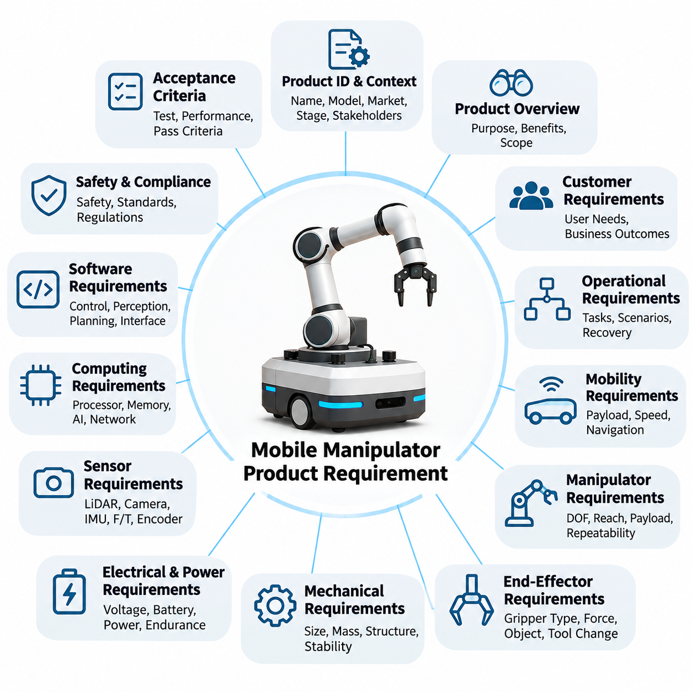
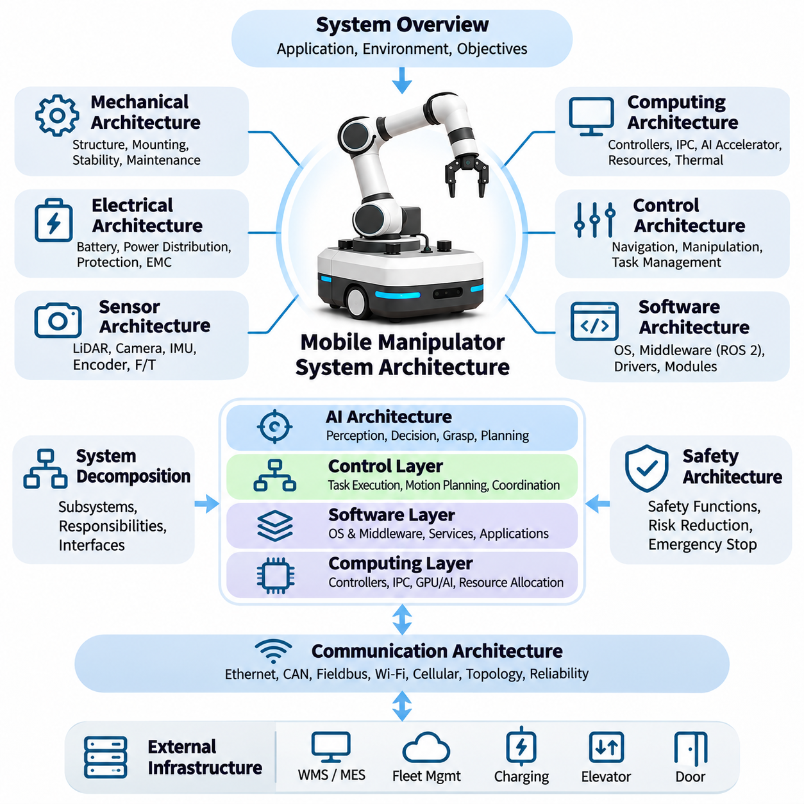
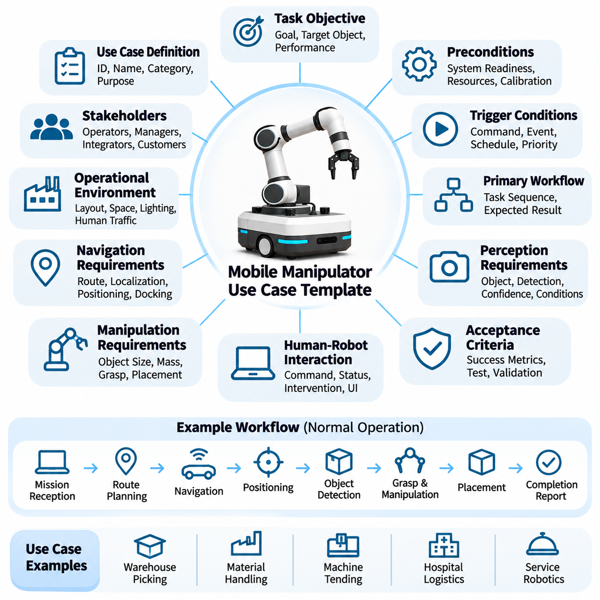
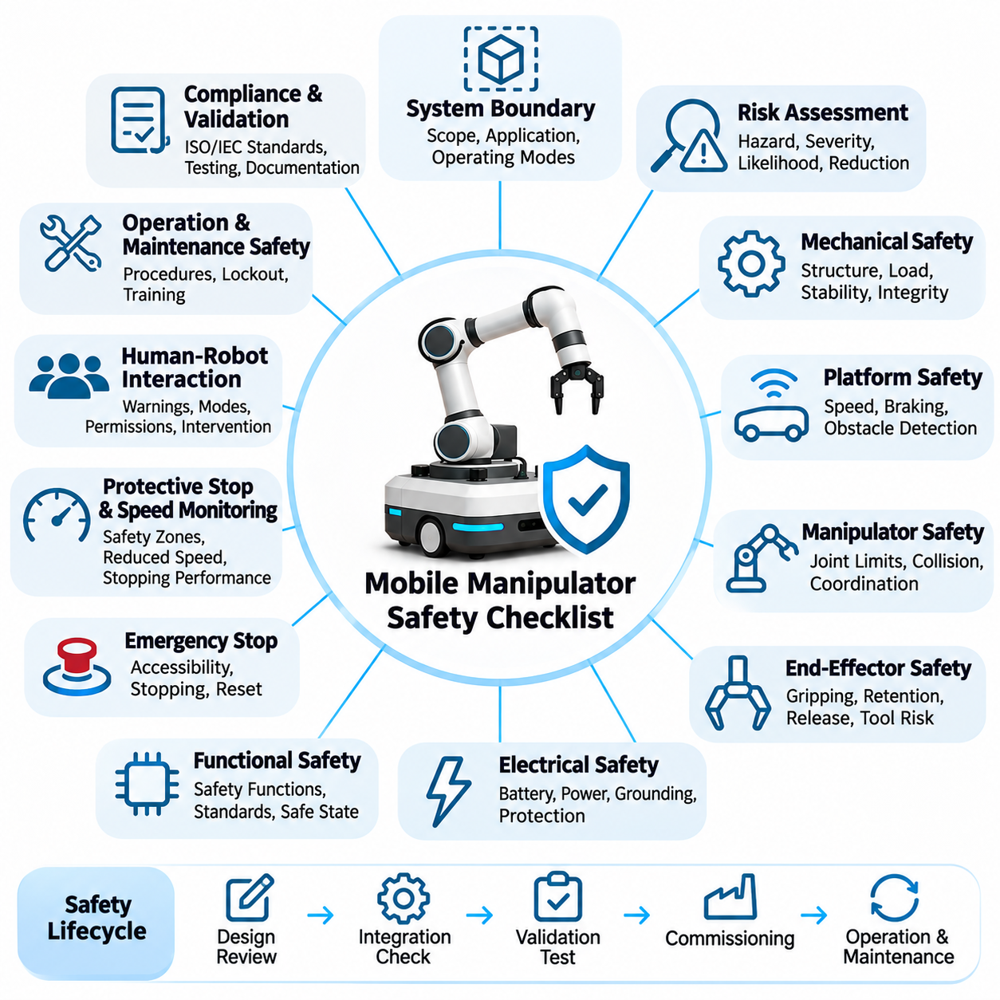
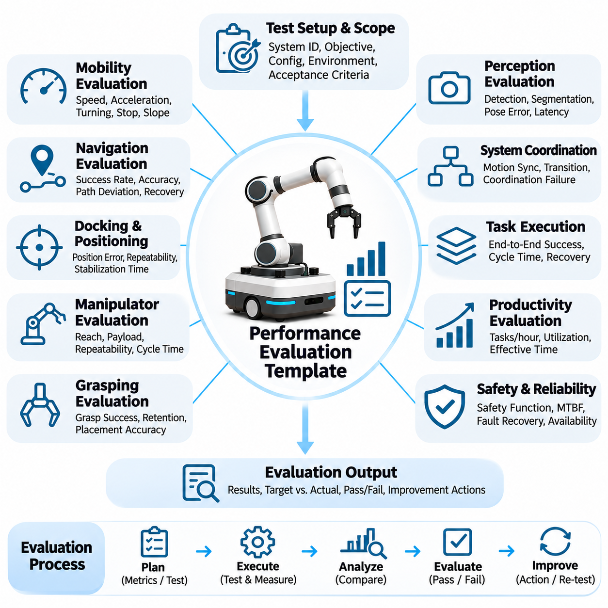
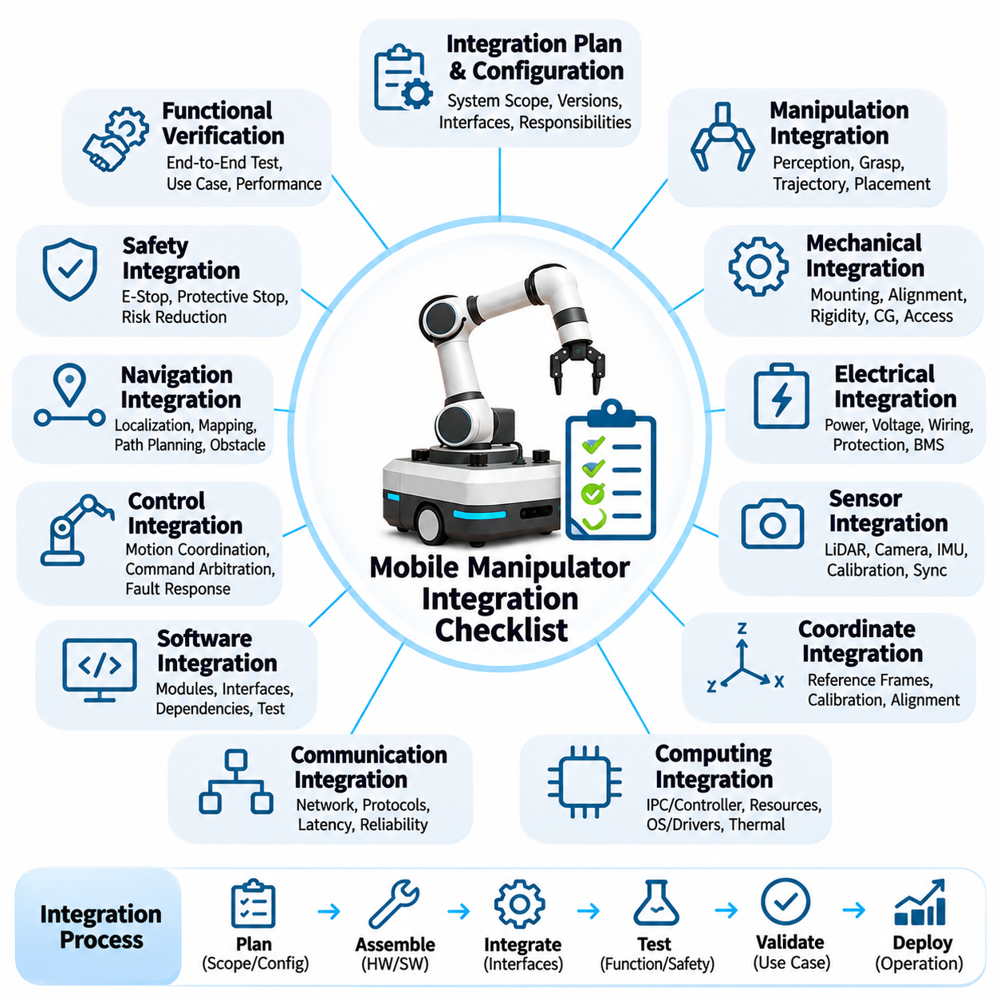
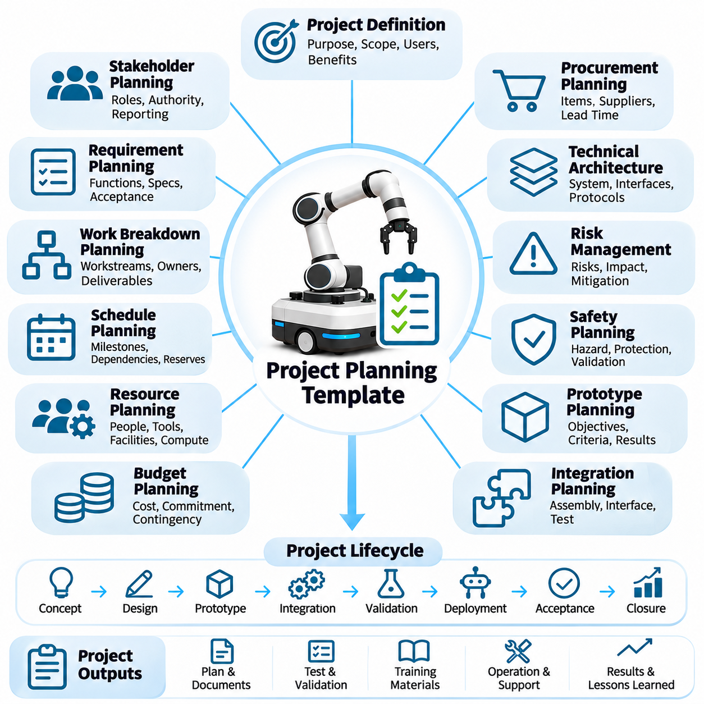

**Volume 01. Mobile Manipulator Foundations and System Architecture**


# Chapter 17. Checklists and Templates

##  

## 01 Product Requirement Template

{width="7.268055555555556in" height="7.268055555555556in"}

A Product Requirement Template provides a structured foundation for defining the objectives, capabilities, constraints, and acceptance criteria of a mobile manipulator before detailed engineering begins. It translates customer expectations and operational needs into measurable requirements that guide product strategy, system architecture, component selection, integration, and validation. A well-defined template reduces ambiguity and establishes a common reference for all development stakeholders.

The template begins with product identification and project context, including the product name, model designation, revision, development organization, intended market, and responsible stakeholders. It should describe whether the mobile manipulator targets industrial automation, warehouse operations, hospital logistics, or service robotics. The document also identifies its development stage, expected deployment environment, commercial objectives, and relationship to existing robotic platforms.

A product overview explains the fundamental purpose of combining an autonomous mobile robot with a robotic manipulator. It describes the operational problems the system addresses, the expected benefits of mobile manipulation, and the limitations of conventional fixed automation. The overview should clarify whether the product performs material transportation, autonomous picking, machine tending, inspection, or collaborative assistance, establishing the functional boundaries of the proposed system.

Customer requirements describe the expectations of operators, facility managers, system integrators, maintenance personnel, and purchasing organizations. These expectations may include productivity improvements, reduced manual handling, operational flexibility, and predictable maintenance costs. Each customer requirement should be associated with an operational scenario and measurable outcome, ensuring that engineering decisions remain connected to practical business needs rather than isolated technical capabilities.

Operational requirements define the tasks that the mobile manipulator must perform under specified environmental conditions. These include autonomous navigation, workstation approach, object recognition, grasp execution, material transfer, obstacle avoidance, and task completion reporting. The template should identify normal operating sequences, exceptional situations, recovery procedures, and operator interventions, allowing engineers to distinguish mandatory product functions from optional automation features.

Mobility requirements establish the performance expectations of the autonomous mobile base. Relevant parameters include rated payload, maximum travel speed, positioning accuracy, turning radius, obstacle negotiation capability, braking performance, and allowable floor conditions. Requirements should also describe navigation methods, localization reliability, docking accuracy, and operational restrictions. Each parameter must include a measurement unit, operating condition, and verification method to support objective evaluation.

Manipulator requirements describe the capabilities of the robotic arm and its interaction with the mobile platform. The specification should include degrees of freedom, maximum reach, rated payload, repeatability, joint speed, allowable mounting orientation, and operational workspace. Special attention must be given to payload variation across the workspace, dynamic loads during movement, and the influence of manipulator configurations on overall vehicle stability.

End-effector requirements define how the robot physically interacts with objects and equipment. The template should describe supported gripper types, gripping force, object dimensions, allowable mass, surface characteristics, and tool-changing capabilities. Requirements for vacuum gripping, parallel-jaw mechanisms, compliant grippers, or specialized tooling should reflect the intended application. Grasp reliability and object damage prevention must be evaluated under representative operating conditions.

Mechanical requirements establish the physical constraints governing the complete robotic system. These include overall dimensions, total mass, center-of-gravity limits, structural rigidity, mounting interfaces, vibration resistance, and accessibility for maintenance. The mechanical specification should account for the combined effects of arm motion, vehicle acceleration, emergency braking, and transported payloads, particularly when the manipulator operates near the boundaries of its reachable workspace.

Electrical and power requirements describe the energy infrastructure supporting mobility, manipulation, sensing, computing, and communication. The template should specify nominal operating voltage, battery chemistry, usable energy capacity, peak power demand, charging interfaces, and target operating duration. Power budgeting must consider simultaneous subsystem operation, transient actuator loads, battery aging, thermal limitations, and emergency shutdown behavior to establish realistic endurance expectations.

Sensor requirements identify the perception and measurement capabilities necessary for autonomous operation. Typical sensing technologies include LiDAR, RGB cameras, depth cameras, inertial measurement units, wheel encoders, force-torque sensors, and proximity detectors. Each sensor requirement should define measurement range, accuracy, update frequency, environmental tolerance, and communication interface. Sensor placement and synchronization must support reliable navigation, manipulation, collision detection, and system diagnostics.

Computing requirements specify the processing resources necessary for real-time control, perception, planning, and artificial intelligence. The template should define processor architecture, accelerator capabilities, memory capacity, storage requirements, operating system compatibility, and allowable computational latency. It should distinguish safety-related control functions from higher-level AI workloads and establish expectations for resource isolation, processing availability, thermal management, and future software expansion.

Software requirements define the functional organization of the robotic control system and its interfaces. The specification may include ROS 2 compatibility, navigation software, motion planning, task orchestration, device drivers, diagnostic services, and fleet management connectivity. Requirements should establish communication protocols, software lifecycle policies, configuration management, fault reporting, and recovery mechanisms while preserving modularity between the autonomous mobile base and robotic manipulator.

Artificial intelligence requirements describe the perception and decision-making functions supporting autonomous manipulation. These may include object detection, semantic segmentation, pose estimation, grasp planning, scene understanding, and adaptive task execution. Each AI function should have defined input conditions, expected outputs, inference latency, confidence handling, and evaluation datasets. Requirements must distinguish experimental AI capabilities from functions sufficiently validated for production deployment.

Communication requirements establish how the mobile manipulator exchanges information with operators, infrastructure, and external systems. The template should address Ethernet, industrial fieldbus, CAN, Wi-Fi, and applicable cellular communication technologies. It should also define interface ownership, message formats, timing constraints, connection recovery, and data security expectations. Integration with manufacturing execution systems, warehouse management systems, or robot fleet platforms should be explicitly documented.

Safety requirements define the protective functions necessary to reduce risks associated with autonomous mobility and robotic manipulation. These include emergency stopping, protective stopping, speed limitation, collision prevention, safety-zone monitoring, and controlled recovery after faults. The template should reference applicable safety standards and require documented risk assessments. Safety functions must be evaluated at the integrated system level because combining two robotic subsystems introduces additional hazards.

Human-robot interaction requirements describe how operators supervise, command, and maintain the mobile manipulator. The specification should address user interfaces, operating modes, status indicators, audible warnings, manual intervention, and maintenance access. Interaction requirements must consider operator training, environmental visibility, accessibility, and foreseeable misuse. The system should communicate its operational state clearly and provide understandable procedures for handling abnormal conditions.

Environmental requirements identify the physical conditions under which the product must operate reliably. These include ambient temperature, humidity, dust exposure, lighting variation, floor friction, slope, vibration, and electromagnetic interference. Requirements should distinguish normal operating conditions from storage, transportation, and exceptional environmental exposure. The specification must also identify restricted environments and conditions requiring additional protection, certification, or application-specific engineering.

Performance requirements translate functional expectations into measurable engineering targets. Typical indicators include navigation success rate, docking repeatability, grasp success rate, task cycle time, throughput, system availability, and energy consumption per completed task. Performance measurements should use representative workloads and clearly defined test conditions. The template must distinguish nominal performance, minimum acceptable performance, and stretch objectives to prevent unrealistic interpretations of system capability.

Reliability and maintainability requirements establish expectations for continuous operation and lifecycle support. The specification should define availability targets, mean time between failures, mean time to repair, preventive maintenance intervals, and diagnostic coverage. Replaceable components, service access, spare-part availability, and software recovery procedures should also be addressed. Reliability objectives must reflect the intended duty cycle and the operational consequences of unexpected robot downtime.

Cybersecurity and data management requirements protect the robot, its operating environment, and connected information systems. The template should describe authentication, authorization, encrypted communication, secure software updates, event logging, and access control. Data requirements should define the retention and handling of sensor recordings, operational logs, diagnostic information, and AI training data. Security provisions must remain compatible with remote maintenance and fleet-level administration.

Manufacturing and commercial requirements connect engineering specifications to product feasibility. These requirements may include target manufacturing cost, expected production volume, component availability, supplier qualification, assembly complexity, and product service life. The template should also document installation requirements, transportation constraints, warranty assumptions, and anticipated maintenance expenses. These considerations support product positioning and help balance technical performance against total cost of ownership.

Verification requirements define how compliance with each product requirement will be demonstrated. Accepted methods may include inspection, engineering analysis, simulation, functional testing, and field validation. Every requirement should have a unique identifier, assigned owner, priority, acceptance criterion, and verification reference. Traceability between customer needs, system requirements, design decisions, and test evidence enables systematic evaluation throughout the development lifecycle.

Validation requirements determine whether the completed mobile manipulator satisfies its intended operational purpose. Unlike verification, which confirms compliance with specified requirements, validation examines performance in realistic application scenarios. Representative trials should include normal task execution, changing environmental conditions, unexpected obstacles, manipulation failures, and operator intervention. Results should be evaluated against customer expectations and documented operational acceptance criteria.

Requirement prioritization provides a mechanism for managing competing technical, commercial, and scheduling constraints. Requirements may be classified as mandatory, desirable, or optional according to their contribution to safety, core functionality, and market differentiation. Dependencies between requirements should be documented because changes in payload, manipulator reach, battery capacity, or computing performance can affect several subsystems simultaneously. Prioritization supports disciplined engineering trade-offs.

Requirement change management ensures that modifications remain controlled after the initial product specification is approved. Each proposed change should include its technical justification, affected requirements, anticipated cost, schedule implications, and validation impact. Revision history and approval responsibilities must be maintained to prevent inconsistencies between engineering teams. Configuration control is particularly important when hardware, embedded software, AI models, and mechanical interfaces evolve at different rates.

The completed Product Requirement Template becomes the authoritative baseline for subsequent system architecture, integration planning, safety assessment, and performance evaluation. Its effectiveness depends on measurable language, explicit assumptions, consistent terminology, and traceable acceptance evidence. By connecting operational objectives with engineering specifications and lifecycle responsibilities, the template supports the development of mobile manipulators that are technically feasible, operationally reliable, commercially practical, and suitable for systematic product evolution.

제품 요구사항 템플릿(Product Requirement Template)은 모바일 매니퓰레이터(Mobile Manipulator)의 상세 엔지니어링(Engineering)이 시작되기 전에 제품의 목표, 기능, 제약조건 및 인수 기준(Acceptance Criteria)을 정의하기 위한 체계적인 기반을 제공한다. 고객의 기대와 운영 요구사항을 측정 가능한 요구사항으로 변환하여 제품 전략(Product Strategy), 시스템 아키텍처(System Architecture), 구성요소 선정, 시스템 통합(System Integration) 및 검증(Verification)을 지원한다. 체계적으로 정의된 템플릿은 요구사항의 모호성을 줄이고 모든 개발 이해관계자가 공유할 수 있는 공통 기준을 확립한다.

템플릿은 제품명, 모델 식별자(Model Designation), 개정 번호(Revision), 개발 조직, 목표 시장 및 책임 이해관계자를 포함하는 제품 식별 정보(Product Identification)와 프로젝트 배경(Project Context)으로 시작한다. 모바일 매니퓰레이터가 산업 자동화(Industrial Automation), 창고 운영(Warehouse Operations), 병원 물류(Hospital Logistics) 또는 서비스 로보틱스(Service Robotics) 중 어느 분야를 대상으로 하는지 설명해야 한다. 또한 개발 단계, 예상 배치 환경, 상업적 목표 및 기존 로봇 플랫폼과의 관계를 명확하게 정의한다.

제품 개요(Product Overview)는 자율이동로봇(Autonomous Mobile Robot)과 로봇 매니퓰레이터(Robotic Manipulator)를 결합하는 근본적인 목적을 설명한다. 시스템이 해결하려는 운영상의 문제, 이동형 조작(Mobile Manipulation)의 기대 효과 및 기존 고정형 자동화(Fixed Automation)의 한계를 기술한다. 또한 자재 운송(Material Transportation), 자율 피킹(Autonomous Picking), 설비 관리(Machine Tending), 검사(Inspection) 또는 협업 지원(Collaborative Assistance) 중 수행할 기능을 명확히 하여 제안된 시스템의 기능적 범위를 설정한다.

고객 요구사항(Customer Requirements)은 운영자, 시설 관리자, 시스템 통합업체(System Integrator), 유지보수 담당자 및 구매 조직의 기대사항을 설명한다. 이러한 기대사항에는 생산성 향상(Productivity Improvement), 수작업 취급 감소, 운영 유연성(Operational Flexibility) 및 예측 가능한 유지보수 비용이 포함될 수 있다. 각 고객 요구사항은 운영 시나리오(Operational Scenario) 및 측정 가능한 결과와 연결되어야 하며, 엔지니어링 의사결정이 개별 기술 기능보다 실제 비즈니스 요구에 기반하도록 해야 한다.

운영 요구사항(Operational Requirements)은 지정된 환경 조건에서 모바일 매니퓰레이터가 수행해야 하는 작업을 정의한다. 여기에는 자율주행(Autonomous Navigation), 작업 위치 접근, 객체 인식(Object Recognition), 파지 실행(Grasp Execution), 자재 이송(Material Transfer), 장애물 회피(Obstacle Avoidance) 및 작업 완료 보고가 포함된다. 템플릿은 정상 운영 절차, 예외 상황, 복구 절차(Recovery Procedures) 및 운영자 개입을 식별하여 필수 제품 기능과 선택적 자동화 기능을 구분할 수 있도록 해야 한다.

이동성 요구사항(Mobility Requirements)은 자율이동 플랫폼(Autonomous Mobile Base)의 성능 기대치를 설정한다. 주요 매개변수에는 정격 적재하중(Rated Payload), 최대 주행속도(Maximum Travel Speed), 위치 정확도(Positioning Accuracy), 회전반경(Turning Radius), 장애물 극복 능력(Obstacle Negotiation Capability), 제동 성능(Braking Performance) 및 허용 바닥 조건이 포함된다. 또한 내비게이션 방식, 위치추정 신뢰성(Localization Reliability), 도킹 정확도(Docking Accuracy) 및 운영 제한사항을 정의해야 한다. 각 매개변수에는 측정 단위, 운영 조건 및 검증 방법이 포함되어야 한다.

매니퓰레이터 요구사항(Manipulator Requirements)은 로봇 팔(Robot Arm)의 기능과 이동 플랫폼과의 상호작용을 설명한다. 사양에는 자유도(Degrees of Freedom), 최대 작업 반경(Maximum Reach), 정격 가반하중(Rated Payload), 반복정밀도(Repeatability), 관절 속도(Joint Speed), 허용 장착 방향 및 작업공간(Workspace)이 포함되어야 한다. 특히 작업공간 내 위치에 따른 가반하중 변화, 이동 중 동적 하중(Dynamic Loads), 매니퓰레이터 자세가 전체 차량 안정성(Vehicle Stability)에 미치는 영향을 고려해야 한다.

말단효과기 요구사항(End-Effector Requirements)은 로봇이 객체 및 장비와 물리적으로 상호작용하는 방식을 정의한다. 템플릿에는 지원되는 그리퍼 유형(Gripper Types), 파지력(Gripping Force), 객체 크기, 허용 질량, 표면 특성 및 도구 교환 기능(Tool-Changing Capabilities)이 포함되어야 한다. 진공 파지(Vacuum Gripping), 평행 조 그리퍼(Parallel-Jaw Gripper), 순응형 그리퍼(Compliant Gripper) 또는 특수 도구에 대한 요구사항은 목표 응용 분야를 반영해야 한다. 파지 신뢰성(Grasp Reliability)과 객체 손상 방지는 대표적인 운영 조건에서 평가되어야 한다.

기계적 요구사항(Mechanical Requirements)은 전체 로봇 시스템의 물리적 제약조건을 설정한다. 여기에는 전체 치수, 총질량, 무게중심 제한(Center-of-Gravity Limits), 구조 강성(Structural Rigidity), 장착 인터페이스(Mounting Interfaces), 진동 저항성(Vibration Resistance) 및 유지보수 접근성이 포함된다. 기계적 사양은 로봇 팔의 움직임, 차량 가속, 비상 제동 및 운반 하중의 복합적인 영향을 고려해야 하며, 특히 매니퓰레이터가 작업공간 경계 부근에서 작동할 때의 안정성을 평가해야 한다.

전기 및 전력 요구사항(Electrical and Power Requirements)은 이동, 조작, 센싱, 컴퓨팅 및 통신을 지원하는 에너지 인프라(Energy Infrastructure)를 설명한다. 템플릿에는 공칭 동작전압(Nominal Operating Voltage), 배터리 화학계(Battery Chemistry), 사용 가능한 에너지 용량(Usable Energy Capacity), 최대 전력 수요(Peak Power Demand), 충전 인터페이스 및 목표 운영시간이 포함되어야 한다. 전력 예산(Power Budgeting)은 하위 시스템의 동시 작동, 순간 구동기 부하, 배터리 노화, 열적 제한 및 비상 종료 동작을 고려하여 현실적인 연속 운용시간을 설정해야 한다.

센서 요구사항(Sensor Requirements)은 자율 운영에 필요한 인지 및 측정 기능을 식별한다. 일반적인 센싱 기술에는 라이다(LiDAR), RGB 카메라(RGB Camera), 깊이 카메라(Depth Camera), 관성측정장치(Inertial Measurement Unit), 휠 엔코더(Wheel Encoder), 힘·토크 센서(Force-Torque Sensor) 및 근접 센서(Proximity Sensor)가 포함된다. 각 센서 요구사항은 측정 범위, 정확도, 갱신 주기(Update Frequency), 환경 내성 및 통신 인터페이스를 정의해야 한다. 센서 배치와 동기화(Synchronization)는 안정적인 주행, 조작, 충돌 감지 및 시스템 진단을 지원해야 한다.

컴퓨팅 요구사항(Computing Requirements)은 실시간 제어(Real-Time Control), 인지(Perception), 계획(Planning) 및 인공지능(Artificial Intelligence)에 필요한 처리 자원을 정의한다. 템플릿에는 프로세서 아키텍처(Processor Architecture), 가속기 성능(Accelerator Capabilities), 메모리 용량, 저장장치 요구사항, 운영체제 호환성 및 허용 연산 지연시간(Computational Latency)이 포함되어야 한다. 안전 관련 제어 기능과 상위 AI 작업부하(AI Workloads)를 구분하고 자원 격리(Resource Isolation), 처리 가용성, 열 관리 및 향후 소프트웨어 확장에 대한 기대치를 설정해야 한다.

소프트웨어 요구사항(Software Requirements)은 로봇 제어 시스템의 기능적 구성과 인터페이스를 정의한다. 사양에는 ROS 2 호환성, 내비게이션 소프트웨어(Navigation Software), 동작 계획(Motion Planning), 작업 오케스트레이션(Task Orchestration), 장치 드라이버(Device Drivers), 진단 서비스(Diagnostic Services) 및 군집 관리(Fleet Management) 연결 기능이 포함될 수 있다. 요구사항은 통신 프로토콜, 소프트웨어 수명주기 정책(Software Lifecycle Policies), 형상 관리(Configuration Management), 오류 보고 및 복구 메커니즘을 설정하면서 자율이동 플랫폼과 로봇 매니퓰레이터 사이의 모듈성(Modularity)을 유지해야 한다.

인공지능 요구사항(Artificial Intelligence Requirements)은 자율 조작을 지원하는 인지 및 의사결정 기능을 설명한다. 여기에는 객체 탐지(Object Detection), 의미론적 분할(Semantic Segmentation), 자세 추정(Pose Estimation), 파지 계획(Grasp Planning), 장면 이해(Scene Understanding) 및 적응형 작업 실행(Adaptive Task Execution)이 포함될 수 있다. 각 AI 기능에는 입력 조건, 예상 출력, 추론 지연시간(Inference Latency), 신뢰도 처리(Confidence Handling) 및 평가 데이터셋(Evaluation Datasets)이 정의되어야 한다. 실험적인 AI 기능과 실제 제품 배포를 위해 충분히 검증된 기능을 구분해야 한다.

통신 요구사항(Communication Requirements)은 모바일 매니퓰레이터가 운영자, 인프라 및 외부 시스템과 정보를 교환하는 방식을 정의한다. 템플릿은 이더넷(Ethernet), 산업용 필드버스(Industrial Fieldbus), CAN, Wi-Fi 및 적용 가능한 셀룰러 통신(Cellular Communication) 기술을 다루어야 한다. 또한 인터페이스 책임 주체, 메시지 형식(Message Formats), 시간 제약조건(Timing Constraints), 연결 복구 및 데이터 보안 요구사항을 정의해야 한다. 제조실행시스템(Manufacturing Execution System), 창고관리시스템(Warehouse Management System) 또는 로봇 군집 관리 플랫폼과의 통합도 명시적으로 문서화해야 한다.

안전 요구사항(Safety Requirements)은 자율이동 및 로봇 조작과 관련된 위험을 줄이기 위한 보호 기능을 정의한다. 여기에는 비상정지(Emergency Stop), 보호정지(Protective Stop), 속도 제한(Speed Limitation), 충돌 방지(Collision Prevention), 안전구역 감시(Safety-Zone Monitoring) 및 오류 발생 후 제어된 복구가 포함된다. 템플릿은 적용 가능한 안전 표준(Safety Standards)을 참조하고 문서화된 위험성 평가(Risk Assessment)를 요구해야 한다. 두 로봇 하위 시스템을 결합하면 추가적인 위험요소가 발생하므로 안전 기능은 통합 시스템 수준에서 평가되어야 한다.

인간-로봇 상호작용 요구사항(Human-Robot Interaction Requirements)은 운영자가 모바일 매니퓰레이터를 감독하고 명령하며 유지보수하는 방식을 설명한다. 사양에는 사용자 인터페이스(User Interface), 운영 모드(Operating Modes), 상태 표시기(Status Indicators), 청각적 경고(Audible Warnings), 수동 개입 및 유지보수 접근성이 포함되어야 한다. 상호작용 요구사항은 운영자 교육, 환경 가시성, 접근성 및 예측 가능한 오사용(Foreseeable Misuse)을 고려해야 한다. 시스템은 운영 상태를 명확하게 전달하고 비정상 상황에 대응하기 위한 이해하기 쉬운 절차를 제공해야 한다.

환경 요구사항(Environmental Requirements)은 제품이 안정적으로 작동해야 하는 물리적 조건을 식별한다. 여기에는 주변 온도(Ambient Temperature), 습도(Humidity), 분진 노출(Dust Exposure), 조명 변화(Lighting Variation), 바닥 마찰계수(Floor Friction), 경사도(Slope), 진동(Vibration) 및 전자기 간섭(Electromagnetic Interference)이 포함된다. 요구사항은 정상 운영 조건과 보관, 운송 및 예외적인 환경 노출을 구분해야 한다. 또한 추가 보호, 인증 또는 응용 분야별 엔지니어링이 필요한 제한 환경과 조건을 명시해야 한다.

성능 요구사항(Performance Requirements)은 기능적 기대치를 측정 가능한 엔지니어링 목표로 변환한다. 일반적인 성능 지표에는 주행 성공률(Navigation Success Rate), 도킹 반복정밀도(Docking Repeatability), 파지 성공률(Grasp Success Rate), 작업 주기시간(Task Cycle Time), 처리량(Throughput), 시스템 가용성(System Availability) 및 작업당 에너지 소비량이 포함된다. 성능 측정에는 대표적인 작업부하(Representative Workloads)와 명확하게 정의된 시험 조건을 사용해야 한다. 템플릿은 공칭 성능(Nominal Performance), 최소 허용 성능(Minimum Acceptable Performance) 및 도전적 목표(Stretch Objectives)를 구분해야 한다.

신뢰성 및 유지보수성 요구사항(Reliability and Maintainability Requirements)은 연속 운영과 제품 수명주기 지원에 대한 기대치를 설정한다. 사양에는 가용성 목표(Availability Targets), 평균고장간격(Mean Time Between Failures), 평균수리시간(Mean Time to Repair), 예방정비 주기(Preventive Maintenance Intervals) 및 진단 범위(Diagnostic Coverage)가 포함되어야 한다. 교체 가능한 구성요소, 정비 접근성, 예비부품 가용성 및 소프트웨어 복구 절차도 다루어야 한다. 신뢰성 목표는 의도된 운용 주기(Duty Cycle)와 예상치 못한 로봇 가동 중단의 운영상 영향을 반영해야 한다.

사이버보안 및 데이터 관리 요구사항(Cybersecurity and Data Management Requirements)은 로봇, 운영 환경 및 연결된 정보시스템을 보호한다. 템플릿은 인증(Authentication), 권한 부여(Authorization), 암호화 통신(Encrypted Communication), 안전한 소프트웨어 업데이트(Secure Software Updates), 이벤트 로깅(Event Logging) 및 접근 제어(Access Control)를 설명해야 한다. 데이터 요구사항은 센서 기록, 운영 로그, 진단 정보 및 AI 학습 데이터의 보존과 처리 방식을 정의해야 한다. 보안 기능은 원격 유지보수(Remote Maintenance) 및 군집 수준 관리(Fleet-Level Administration)와 호환되어야 한다.

제조 및 상업적 요구사항(Manufacturing and Commercial Requirements)은 엔지니어링 사양과 제품 실현 가능성(Product Feasibility)을 연결한다. 여기에는 목표 제조원가(Target Manufacturing Cost), 예상 생산량(Expected Production Volume), 부품 가용성(Component Availability), 공급업체 적격성 평가(Supplier Qualification), 조립 복잡도(Assembly Complexity) 및 제품 수명(Product Service Life)이 포함될 수 있다. 또한 설치 요구사항, 운송 제약조건, 보증 조건 및 예상 유지보수 비용을 문서화해야 한다. 이러한 요소는 제품 포지셔닝(Product Positioning)을 지원하고 기술적 성능과 총소유비용(Total Cost of Ownership) 사이의 균형을 유지하는 데 기여한다.

검증 요구사항(Verification Requirements)은 각 제품 요구사항의 충족 여부를 입증하는 방법을 정의한다. 허용되는 방법에는 검사(Inspection), 엔지니어링 분석(Engineering Analysis), 시뮬레이션(Simulation), 기능 시험(Functional Testing) 및 현장 검증(Field Validation)이 포함될 수 있다. 모든 요구사항에는 고유 식별자(Unique Identifier), 담당자(Assigned Owner), 우선순위(Priority), 인수 기준(Acceptance Criterion) 및 검증 참조정보(Verification Reference)가 있어야 한다. 고객 요구, 시스템 요구사항, 설계 결정 및 시험 증거(Test Evidence) 사이의 추적성(Traceability)은 개발 수명주기 전반에 걸친 체계적인 평가를 가능하게 한다.

타당성 확인 요구사항(Validation Requirements)은 완성된 모바일 매니퓰레이터가 의도된 운영 목적을 충족하는지 판단한다. 검증(Verification)이 명시된 요구사항의 충족 여부를 확인하는 것과 달리, 타당성 확인(Validation)은 실제 응용 시나리오에서의 성능을 평가한다. 대표적인 시험에는 정상 작업 실행, 변화하는 환경 조건, 예상하지 못한 장애물, 조작 실패 및 운영자 개입이 포함되어야 한다. 결과는 고객의 기대사항과 문서화된 운영 인수 기준(Operational Acceptance Criteria)에 따라 평가되어야 한다.

요구사항 우선순위화(Requirement Prioritization)는 상충하는 기술적, 상업적 및 일정상의 제약조건을 관리하기 위한 메커니즘을 제공한다. 요구사항은 안전성, 핵심 기능 및 시장 차별화(Market Differentiation)에 대한 기여도에 따라 필수(Mandatory), 권장(Desirable) 또는 선택(Optional)으로 분류할 수 있다. 적재하중, 매니퓰레이터 작업 반경, 배터리 용량 또는 컴퓨팅 성능의 변경은 여러 하위 시스템에 동시에 영향을 줄 수 있으므로 요구사항 사이의 의존관계(Dependencies)를 문서화해야 한다. 우선순위화는 체계적인 엔지니어링 절충안(Engineering Trade-Offs)을 지원한다.

요구사항 변경 관리(Requirement Change Management)는 초기 제품 사양이 승인된 이후에도 변경사항이 통제되도록 보장한다. 각 변경 제안에는 기술적 근거(Technical Justification), 영향을 받는 요구사항, 예상 비용, 일정에 미치는 영향 및 타당성 확인에 미치는 영향이 포함되어야 한다. 엔지니어링 팀 사이의 불일치를 방지하기 위해 개정 이력(Revision History)과 승인 책임을 유지해야 한다. 하드웨어, 임베디드 소프트웨어(Embedded Software), AI 모델 및 기계적 인터페이스가 서로 다른 속도로 발전하는 경우 형상 통제(Configuration Control)는 특히 중요하다.

완성된 제품 요구사항 템플릿(Product Requirement Template)은 이후 시스템 아키텍처(System Architecture), 통합 계획(Integration Planning), 안전성 평가(Safety Assessment) 및 성능 평가(Performance Evaluation)를 위한 공식적인 기준선(Authoritative Baseline)이 된다. 템플릿의 효과는 측정 가능한 표현, 명시적인 가정, 일관된 용어 및 추적 가능한 인수 증거(Acceptance Evidence)에 달려 있다. 운영 목표를 엔지니어링 사양 및 제품 수명주기 책임과 연결함으로써 기술적으로 실현 가능하고, 운영상 신뢰할 수 있으며, 상업적으로 실용적이고, 체계적인 제품 발전을 지원할 수 있는 모바일 매니퓰레이터 개발의 기반을 제공한다.

##  

## 02 System Architecture Template

{width="7.268055555555556in" height="7.268055555555556in"}

A System Architecture Template provides a structured framework for defining the technical organization of a mobile manipulator, including its mechanical, electrical, sensing, computing, control, and software subsystems. It translates product requirements into an integrated engineering design that supports autonomous mobility and robotic manipulation. The template establishes system boundaries, component responsibilities, interface definitions, and architectural decisions required for reliable development and deployment.

The architecture documentation begins with a system overview describing the intended application, operational environment, design objectives, and principal technical constraints. It identifies the autonomous mobile base, robotic manipulator, end effector, perception system, computing platform, and communication infrastructure as interconnected subsystems. The overview explains how these elements cooperate to perform navigation, positioning, object handling, and task execution within a unified robotic platform.

System decomposition establishes a hierarchical representation of the mobile manipulator and its functional components. Each subsystem is assigned clearly defined responsibilities, inputs, outputs, and operational dependencies. Mechanical structures support mobility and manipulation, electrical systems distribute power, sensors provide environmental information, and computing resources execute control and AI algorithms. This decomposition enables independent subsystem development while maintaining system-level integration requirements.

The mechanical architecture defines the physical arrangement of the mobile base, manipulator, mounting structure, payload interfaces, and protective enclosures. It describes dimensional constraints, structural load paths, center-of-gravity considerations, vibration isolation, and maintenance accessibility. Particular attention is required when manipulator movements alter the overall stability of the vehicle, especially during acceleration, braking, extended-reach operations, and handling of heavy objects.

The electrical architecture describes power generation, storage, distribution, conversion, and protection throughout the robotic system. It identifies battery modules, battery management systems, power distribution units, DC/DC converters, motor drives, controllers, and emergency power isolation devices. The architecture must distinguish continuous and peak power requirements while considering voltage stability, electromagnetic compatibility, grounding, thermal limitations, and fault containment between interconnected electrical subsystems.

The sensor architecture establishes how the robot perceives its surroundings, estimates its internal state, and monitors physical interactions. Typical components include LiDAR, cameras, depth sensors, inertial measurement units, wheel encoders, proximity sensors, and force-torque sensors. The template should document sensor locations, measurement characteristics, coordinate frames, synchronization methods, and communication interfaces to support consistent data interpretation across navigation, perception, and manipulation functions.

The computing architecture defines the allocation of processing resources among embedded controllers, industrial computers, edge AI accelerators, and optional remote infrastructure. Real-time motion control may execute on dedicated controllers, while perception, planning, and learning-based functions operate on higher-performance processors. The architecture should specify computational workloads, memory requirements, processing latency, hardware interfaces, thermal management, and resource isolation between critical and noncritical functions.

The control architecture describes the coordination of mobile navigation, manipulator motion, end-effector operation, and system-level task execution. It typically separates low-level actuator control, intermediate motion planning, and high-level mission management. Each control layer requires defined command interfaces, feedback mechanisms, execution frequencies, and fault-handling procedures. Coordinated operation must prevent unsafe interactions between vehicle movement and manipulator configurations.

The software architecture defines the organization of operating systems, middleware, device drivers, control services, perception modules, and application software. ROS 2 may provide distributed communication and modular software integration, while specialized controllers manage deterministic hardware functions. The template should identify software components, communication mechanisms, lifecycle states, configuration dependencies, and deployment boundaries to support maintainability, extensibility, and reproducible system operation.

The artificial intelligence architecture describes how perception models, decision algorithms, and task-planning capabilities contribute to autonomous behavior. Object detection, pose estimation, scene understanding, grasp planning, and adaptive manipulation may execute through interconnected AI modules. The architecture must define model inputs, outputs, inference latency, confidence thresholds, computational dependencies, and fallback behavior when AI predictions are uncertain or inconsistent with operational constraints.

The communication architecture specifies the networks and protocols connecting robotic subsystems and external infrastructure. Ethernet, CAN, industrial fieldbus, Wi-Fi, and cellular communication may support different operational requirements. The template should describe network topology, message formats, bandwidth allocation, timing constraints, synchronization, and communication failure handling. Critical control communication must remain appropriately separated from nonessential monitoring and data-transfer traffic.

The safety architecture defines independent protective mechanisms that reduce risks arising from autonomous movement and robotic manipulation. Emergency stopping, protective stopping, speed monitoring, collision detection, safety-zone supervision, and actuator power isolation must be integrated into the overall design. Safety-related functions require explicit responsibility allocation, fault-response behavior, and verification criteria. The architecture should ensure that failures in non-safety software cannot invalidate required protective functions.

The navigation architecture describes how the mobile base performs localization, mapping, route planning, obstacle avoidance, and precise workstation approach. Localization may combine LiDAR, wheel odometry, inertial measurements, and environmental landmarks. The template should define map representations, localization confidence, navigation interfaces, recovery strategies, and docking requirements. Navigation performance must remain compatible with manipulator positioning accuracy and the spatial constraints of the target workspace.

The manipulation architecture defines the relationship between robot kinematics, motion planning, grasp execution, and environmental interaction. It should describe coordinate transformations between the mobile base, manipulator, end effector, and target objects. Motion planning must account for joint limits, reachable workspace, collision constraints, payload conditions, and base stability. The architecture should support coordinated execution when navigation and manipulation operate sequentially or simultaneously.

The task execution architecture organizes individual robotic capabilities into complete operational workflows. A typical mission may involve receiving a task, navigating to a workstation, verifying position, identifying an object, executing a grasp, transporting the object, and reporting completion. State machines or behavior trees can coordinate these operations. The template should define task transitions, preconditions, completion criteria, exception handling, and recovery procedures to ensure predictable autonomous behavior.

The cloud and edge architecture defines how processing, data storage, fleet coordination, and remote services are distributed across computational environments. Time-sensitive control and perception functions should remain close to the robot, while centralized infrastructure may support analytics, fleet optimization, model management, and historical data storage. The template should identify connectivity assumptions, synchronization requirements, data ownership, and operational behavior during network interruptions.

The fleet integration architecture describes how individual mobile manipulators interact with centralized management systems and other robotic platforms. It may include mission assignment, traffic coordination, resource scheduling, charging management, and operational monitoring. Standardized interfaces should support integration with manufacturing execution systems, warehouse management platforms, and enterprise applications. The architecture must also define responsibility boundaries between onboard autonomy and fleet-level decision-making.

The cybersecurity architecture establishes protective measures across hardware, software, communication, and remote management interfaces. Authentication, authorization, encrypted communication, secure boot, software integrity verification, and controlled updates should be considered according to operational risk. Network segmentation and access restrictions help limit the impact of compromised components. The template should document security assumptions, trust boundaries, logging mechanisms, and procedures for responding to identified vulnerabilities.

The reliability architecture addresses fault detection, fault isolation, degraded operation, and recovery across interconnected subsystems. Diagnostic monitoring should identify abnormal sensor readings, communication failures, actuator faults, battery limitations, and computing resource exhaustion. The template should define fault severity, recovery authority, safe-state transitions, and maintenance reporting. Redundancy may be introduced where justified by safety requirements, operational availability targets, or failure consequences.

Interface definitions provide the formal contracts connecting mechanical, electrical, software, and communication components. Each interface should specify ownership, physical or logical connections, signal characteristics, message structures, timing expectations, and error conditions. Interface Control Documents can preserve compatibility between independently developed modules. Clear interface definitions reduce integration uncertainty and support component replacement, supplier coordination, and future platform upgrades.

Architectural trade-off analysis evaluates alternative designs against performance, safety, cost, complexity, and scalability requirements. Decisions involving centralized versus distributed computing, sensor redundancy, communication protocols, battery capacity, and manipulator configuration should be documented with supporting assumptions. Each major architectural choice should identify expected benefits, limitations, dependencies, and technical risks. This documentation enables informed design reviews and prevents repeated evaluation of previously resolved decisions.

Verification and validation planning connects architectural elements to measurable engineering evidence. Subsystem testing, interface testing, simulation, hardware-in-the-loop evaluation, and integrated field trials should demonstrate that the proposed architecture satisfies product requirements. Traceability between requirements, architectural components, and test cases supports systematic defect identification. Validation should include nominal operations, exceptional conditions, subsystem failures, and recovery scenarios under representative workloads.

The completed System Architecture Template serves as the technical baseline for detailed design, implementation, integration, and lifecycle management. It should remain version-controlled and evolve through formal engineering reviews as requirements and technologies change. By documenting subsystem responsibilities, interfaces, dependencies, safety provisions, and verification strategies, the template enables development teams to construct mobile manipulators that are modular, reliable, maintainable, and adaptable to future operational demands.

시스템 아키텍처 템플릿(System Architecture Template)은 모바일 매니퓰레이터(Mobile Manipulator)의 기계, 전기, 센서, 컴퓨팅, 제어 및 소프트웨어 하위 시스템(Subsystem)을 포함한 기술적 구성을 정의하기 위한 체계적인 프레임워크(Framework)를 제공한다. 제품 요구사항(Product Requirements)을 자율이동(Autonomous Mobility)과 로봇 조작(Robotic Manipulation)을 지원하는 통합 엔지니어링 설계(Integrated Engineering Design)로 변환한다. 이 템플릿은 안정적인 개발과 배포에 필요한 시스템 경계(System Boundaries), 구성요소의 책임, 인터페이스 정의(Interface Definitions) 및 아키텍처 의사결정(Architectural Decisions)을 확립한다.

아키텍처 문서(Architecture Documentation)는 목표 응용 분야, 운영 환경, 설계 목표 및 주요 기술적 제약조건을 설명하는 시스템 개요(System Overview)로 시작한다. 자율이동 플랫폼(Autonomous Mobile Base), 로봇 매니퓰레이터(Robotic Manipulator), 말단효과기(End Effector), 인지 시스템(Perception System), 컴퓨팅 플랫폼(Computing Platform) 및 통신 인프라(Communication Infrastructure)를 상호 연결된 하위 시스템으로 식별한다. 개요에서는 이러한 요소들이 통합 로봇 플랫폼 내에서 주행, 위치 결정, 객체 취급 및 작업 실행을 수행하기 위해 어떻게 협력하는지 설명한다.

시스템 분해(System Decomposition)는 모바일 매니퓰레이터와 기능적 구성요소를 계층적으로 표현하는 구조를 확립한다. 각 하위 시스템에는 명확하게 정의된 책임, 입력, 출력 및 운영 의존관계(Operational Dependencies)가 할당된다. 기계 구조는 이동과 조작을 지원하고, 전기 시스템은 전력을 분배하며, 센서는 환경 정보를 제공하고, 컴퓨팅 자원은 제어 및 AI 알고리즘을 실행한다. 이러한 분해 구조는 시스템 수준의 통합 요구사항을 유지하면서 각 하위 시스템의 독립적인 개발을 가능하게 한다.

기계 아키텍처(Mechanical Architecture)는 이동 플랫폼, 매니퓰레이터, 장착 구조물(Mounting Structure), 적재물 인터페이스(Payload Interfaces) 및 보호 외함(Protective Enclosures)의 물리적 배치를 정의한다. 치수 제약조건, 구조적 하중 전달 경로(Structural Load Paths), 무게중심(Center of Gravity), 진동 절연(Vibration Isolation) 및 유지보수 접근성을 설명한다. 특히 가속, 제동, 최대 도달거리 작업(Extended-Reach Operations) 및 중량물 취급 중 매니퓰레이터의 움직임이 차량 전체의 안정성에 미치는 영향을 중요하게 고려해야 한다.

전기 아키텍처(Electrical Architecture)는 로봇 시스템 전반의 전력 생성, 저장, 분배, 변환 및 보호 구조를 설명한다. 배터리 모듈(Battery Modules), 배터리 관리 시스템(Battery Management System), 전력분배장치(Power Distribution Unit), DC/DC 컨버터(DC/DC Converter), 모터 드라이브(Motor Drives), 제어기(Controllers) 및 비상 전원 차단장치(Emergency Power Isolation Devices)를 식별한다. 또한 연속 전력 요구사항(Continuous Power Requirements)과 최대 전력 요구사항(Peak Power Requirements)을 구분하면서 전압 안정성, 전자기 적합성(Electromagnetic Compatibility), 접지(Grounding), 열적 제한 및 전기 하위 시스템 간 고장 확산 방지(Fault Containment)를 고려해야 한다.

센서 아키텍처(Sensor Architecture)는 로봇이 주변 환경을 인식하고 내부 상태를 추정하며 물리적 상호작용을 감시하는 방식을 정의한다. 일반적인 구성요소에는 라이다(LiDAR), 카메라(Camera), 깊이 센서(Depth Sensor), 관성측정장치(Inertial Measurement Unit), 휠 엔코더(Wheel Encoder), 근접 센서(Proximity Sensor) 및 힘·토크 센서(Force-Torque Sensor)가 포함된다. 템플릿은 주행, 인지 및 조작 기능 전반에서 일관된 데이터 해석을 지원하기 위해 센서 위치, 측정 특성, 좌표계(Coordinate Frames), 동기화 방법(Synchronization Methods) 및 통신 인터페이스를 문서화해야 한다.

컴퓨팅 아키텍처(Computing Architecture)는 임베디드 제어기(Embedded Controllers), 산업용 컴퓨터(Industrial Computers), 엣지 AI 가속기(Edge AI Accelerators) 및 선택적 원격 인프라(Remote Infrastructure) 사이의 처리 자원 할당을 정의한다. 실시간 동작 제어(Real-Time Motion Control)는 전용 제어기에서 실행할 수 있으며, 인지, 계획 및 학습 기반 기능은 고성능 프로세서에서 실행할 수 있다. 아키텍처에는 연산 작업부하(Computational Workloads), 메모리 요구사항, 처리 지연시간(Processing Latency), 하드웨어 인터페이스, 열 관리(Thermal Management) 및 중요 기능과 비중요 기능 사이의 자원 격리(Resource Isolation)가 명시되어야 한다.

제어 아키텍처(Control Architecture)는 이동 주행(Mobile Navigation), 매니퓰레이터 동작(Manipulator Motion), 말단효과기 작동(End-Effector Operation) 및 시스템 수준의 작업 실행(Task Execution)을 조정하는 방식을 설명한다. 일반적으로 저수준 구동기 제어(Low-Level Actuator Control), 중간 수준의 동작 계획(Motion Planning) 및 상위 수준의 임무 관리(Mission Management)를 분리한다. 각 제어 계층(Control Layer)에는 명확한 명령 인터페이스, 피드백 메커니즘(Feedback Mechanisms), 실행 주기(Execution Frequencies) 및 오류 처리 절차가 필요하다. 협조 제어(Coordinated Control)는 차량 이동과 매니퓰레이터 자세 사이에서 발생할 수 있는 위험한 상호작용을 방지해야 한다.

소프트웨어 아키텍처(Software Architecture)는 운영체제(Operating Systems), 미들웨어(Middleware), 장치 드라이버(Device Drivers), 제어 서비스(Control Services), 인지 모듈(Perception Modules) 및 응용 소프트웨어(Application Software)의 구성을 정의한다. ROS 2는 분산 통신(Distributed Communication)과 모듈형 소프트웨어 통합(Modular Software Integration)을 제공할 수 있으며, 특수 제어기는 결정론적 하드웨어 기능(Deterministic Hardware Functions)을 관리한다. 템플릿은 유지보수성(Maintainability), 확장성(Extensibility) 및 재현 가능한 시스템 운영(Reproducible System Operation)을 지원하기 위해 소프트웨어 구성요소, 통신 메커니즘, 수명주기 상태(Lifecycle States), 설정 의존관계 및 배포 경계(Deployment Boundaries)를 식별해야 한다.

인공지능 아키텍처(Artificial Intelligence Architecture)는 인지 모델(Perception Models), 의사결정 알고리즘(Decision Algorithms) 및 작업 계획(Task Planning) 기능이 자율 행동(Autonomous Behavior)에 기여하는 방식을 설명한다. 객체 탐지(Object Detection), 자세 추정(Pose Estimation), 장면 이해(Scene Understanding), 파지 계획(Grasp Planning) 및 적응형 조작(Adaptive Manipulation)은 상호 연결된 AI 모듈을 통해 실행될 수 있다. 아키텍처는 모델 입력과 출력, 추론 지연시간(Inference Latency), 신뢰도 임계값(Confidence Thresholds), 연산 의존관계 및 AI 예측이 불확실하거나 운영 제약조건과 일치하지 않을 때의 대체 동작(Fallback Behavior)을 정의해야 한다.

통신 아키텍처(Communication Architecture)는 로봇 하위 시스템과 외부 인프라를 연결하는 네트워크 및 프로토콜을 정의한다. 이더넷(Ethernet), CAN, 산업용 필드버스(Industrial Fieldbus), Wi-Fi 및 셀룰러 통신(Cellular Communication)은 서로 다른 운영 요구사항을 지원할 수 있다. 템플릿은 네트워크 토폴로지(Network Topology), 메시지 형식(Message Formats), 대역폭 할당(Bandwidth Allocation), 시간 제약조건(Timing Constraints), 동기화 및 통신 장애 처리(Communication Failure Handling)를 설명해야 한다. 중요한 제어 통신은 필수적이지 않은 모니터링 및 데이터 전송 트래픽과 적절하게 분리되어야 한다.

안전 아키텍처(Safety Architecture)는 자율이동과 로봇 조작에서 발생하는 위험을 줄이기 위한 독립적인 보호 메커니즘(Protective Mechanisms)을 정의한다. 비상정지(Emergency Stop), 보호정지(Protective Stop), 속도 감시(Speed Monitoring), 충돌 감지(Collision Detection), 안전구역 감시(Safety-Zone Supervision) 및 구동기 전원 차단(Actuator Power Isolation)은 전체 설계에 통합되어야 한다. 안전 관련 기능에는 명확한 책임 할당, 고장 대응 동작(Fault-Response Behavior) 및 검증 기준(Verification Criteria)이 필요하다. 아키텍처는 비안전 소프트웨어(Non-Safety Software)의 오류가 필수 보호 기능을 무효화하지 않도록 보장해야 한다.

주행 아키텍처(Navigation Architecture)는 이동 플랫폼이 위치추정(Localization), 지도 작성(Mapping), 경로 계획(Route Planning), 장애물 회피(Obstacle Avoidance) 및 정밀 작업 위치 접근을 수행하는 방식을 설명한다. 위치추정은 라이다(LiDAR), 휠 오도메트리(Wheel Odometry), 관성 측정(Inertial Measurements) 및 환경 랜드마크(Environmental Landmarks)를 결합할 수 있다. 템플릿은 지도 표현(Map Representations), 위치추정 신뢰도(Localization Confidence), 주행 인터페이스(Navigation Interfaces), 복구 전략(Recovery Strategies) 및 도킹 요구사항(Docking Requirements)을 정의해야 한다. 주행 성능은 매니퓰레이터 위치 정확도와 목표 작업공간의 공간적 제약조건에 부합해야 한다.

조작 아키텍처(Manipulation Architecture)는 로봇 운동학(Robot Kinematics), 동작 계획(Motion Planning), 파지 실행(Grasp Execution) 및 환경 상호작용(Environmental Interaction) 사이의 관계를 정의한다. 이동 플랫폼, 매니퓰레이터, 말단효과기 및 목표 객체 사이의 좌표 변환(Coordinate Transformations)을 설명해야 한다. 동작 계획은 관절 제한(Joint Limits), 도달 가능한 작업공간(Reachable Workspace), 충돌 제약조건(Collision Constraints), 적재 조건(Payload Conditions) 및 플랫폼 안정성을 고려해야 한다. 또한 주행과 조작이 순차적으로 또는 동시에 수행되는 경우 협조 실행(Coordinated Execution)을 지원해야 한다.

작업 실행 아키텍처(Task Execution Architecture)는 개별 로봇 기능을 완전한 운영 워크플로(Operational Workflows)로 구성한다. 일반적인 임무는 작업 수신, 작업 위치까지의 주행, 위치 확인, 객체 식별, 파지 실행, 객체 운송 및 완료 보고로 이루어질 수 있다. 상태기계(State Machines) 또는 행동트리(Behavior Trees)를 사용하여 이러한 작업을 조정할 수 있다. 템플릿은 예측 가능한 자율 행동을 보장하기 위해 작업 전이(Task Transitions), 사전조건(Preconditions), 완료 기준(Completion Criteria), 예외 처리(Exception Handling) 및 복구 절차(Recovery Procedures)를 정의해야 한다.

클라우드 및 엣지 아키텍처(Cloud and Edge Architecture)는 처리, 데이터 저장, 군집 조정(Fleet Coordination) 및 원격 서비스(Remote Services)가 컴퓨팅 환경 전반에 분산되는 방식을 정의한다. 시간에 민감한 제어 및 인지 기능은 로봇 가까이에 유지되어야 하며, 중앙집중형 인프라(Centralized Infrastructure)는 분석(Analytics), 군집 최적화(Fleet Optimization), 모델 관리(Model Management) 및 이력 데이터 저장(Historical Data Storage)을 지원할 수 있다. 템플릿은 연결성 가정(Connectivity Assumptions), 동기화 요구사항(Synchronization Requirements), 데이터 소유권(Data Ownership) 및 네트워크 중단 시 운영 동작을 식별해야 한다.

군집 통합 아키텍처(Fleet Integration Architecture)는 개별 모바일 매니퓰레이터가 중앙 관리 시스템 및 다른 로봇 플랫폼과 상호작용하는 방식을 설명한다. 여기에는 임무 할당(Mission Assignment), 교통 조정(Traffic Coordination), 자원 스케줄링(Resource Scheduling), 충전 관리(Charging Management) 및 운영 모니터링(Operational Monitoring)이 포함될 수 있다. 표준화된 인터페이스(Standardized Interfaces)는 제조실행시스템(Manufacturing Execution System), 창고관리시스템(Warehouse Management System) 및 기업용 애플리케이션(Enterprise Applications)과의 통합을 지원해야 한다. 또한 온보드 자율성(Onboard Autonomy)과 군집 수준 의사결정(Fleet-Level Decision-Making) 사이의 책임 경계를 정의해야 한다.

사이버보안 아키텍처(Cybersecurity Architecture)는 하드웨어, 소프트웨어, 통신 및 원격 관리 인터페이스 전반의 보호 조치를 확립한다. 인증(Authentication), 권한 부여(Authorization), 암호화 통신(Encrypted Communication), 보안 부팅(Secure Boot), 소프트웨어 무결성 검증(Software Integrity Verification) 및 통제된 업데이트(Controlled Updates)는 운영 위험에 따라 고려되어야 한다. 네트워크 분할(Network Segmentation)과 접근 제한(Access Restrictions)은 침해된 구성요소의 영향을 제한하는 데 도움이 된다. 템플릿은 보안 가정(Security Assumptions), 신뢰 경계(Trust Boundaries), 로깅 메커니즘(Logging Mechanisms) 및 식별된 취약점(Vulnerabilities)에 대응하는 절차를 문서화해야 한다.

신뢰성 아키텍처(Reliability Architecture)는 상호 연결된 하위 시스템 전반의 고장 감지(Fault Detection), 고장 격리(Fault Isolation), 성능 저하 상태의 운영(Degraded Operation) 및 복구(Recovery)를 다룬다. 진단 모니터링(Diagnostic Monitoring)은 비정상적인 센서 측정값, 통신 장애, 구동기 오류, 배터리 제한 및 컴퓨팅 자원 고갈을 식별해야 한다. 템플릿은 고장 심각도(Fault Severity), 복구 권한(Recovery Authority), 안전 상태 전이(Safe-State Transitions) 및 유지보수 보고(Maintenance Reporting)를 정의해야 한다. 중복성(Redundancy)은 안전 요구사항, 운영 가용성 목표 또는 고장 결과에 의해 정당화되는 경우 도입할 수 있다.

인터페이스 정의(Interface Definitions)는 기계, 전기, 소프트웨어 및 통신 구성요소를 연결하는 공식적인 계약을 제공한다. 각 인터페이스는 책임 주체, 물리적 또는 논리적 연결, 신호 특성(Signal Characteristics), 메시지 구조(Message Structures), 시간적 요구사항(Timing Expectations) 및 오류 조건(Error Conditions)을 명시해야 한다. 인터페이스 제어 문서(Interface Control Documents)는 독립적으로 개발된 모듈 사이의 호환성을 유지할 수 있다. 명확한 인터페이스 정의는 통합 과정의 불확실성을 줄이고 구성요소 교체, 공급업체 협력 및 향후 플랫폼 업그레이드를 지원한다.

아키텍처 절충 분석(Architectural Trade-Off Analysis)은 성능, 안전성, 비용, 복잡성 및 확장성(Scalability) 요구사항을 기준으로 대안 설계를 평가한다. 중앙집중형 컴퓨팅(Centralized Computing)과 분산형 컴퓨팅(Distributed Computing), 센서 중복성(Sensor Redundancy), 통신 프로토콜, 배터리 용량 및 매니퓰레이터 구성에 관한 결정은 이를 뒷받침하는 가정과 함께 문서화해야 한다. 주요 아키텍처 선택에는 예상되는 이점, 한계, 의존관계 및 기술적 위험(Technical Risks)이 명시되어야 한다. 이러한 문서화는 합리적인 설계 검토(Design Reviews)를 가능하게 하고 이미 해결된 의사결정을 반복적으로 평가하는 일을 방지한다.

검증 및 타당성 확인 계획(Verification and Validation Planning)은 아키텍처 구성요소를 측정 가능한 엔지니어링 증거(Engineering Evidence)와 연결한다. 하위 시스템 시험(Subsystem Testing), 인터페이스 시험(Interface Testing), 시뮬레이션(Simulation), 하드웨어 인 더 루프 평가(Hardware-in-the-Loop Evaluation) 및 통합 현장 시험(Integrated Field Trials)을 통해 제안된 아키텍처가 제품 요구사항을 충족함을 입증해야 한다. 요구사항, 아키텍처 구성요소 및 시험 사례(Test Cases) 사이의 추적성(Traceability)은 체계적인 결함 식별을 지원한다. 타당성 확인에는 대표적인 작업부하(Representative Workloads)에서의 정상 운영, 예외 조건, 하위 시스템 고장 및 복구 시나리오가 포함되어야 한다.

완성된 시스템 아키텍처 템플릿(System Architecture Template)은 상세 설계(Detailed Design), 구현(Implementation), 통합(Integration) 및 수명주기 관리(Lifecycle Management)를 위한 기술적 기준선(Technical Baseline)으로 활용된다. 템플릿은 버전 관리(Version Control)를 통해 유지되어야 하며, 요구사항과 기술이 변화함에 따라 공식적인 엔지니어링 검토(Formal Engineering Reviews)를 거쳐 발전해야 한다. 하위 시스템의 책임, 인터페이스, 의존관계, 안전 기능 및 검증 전략을 문서화함으로써 개발팀은 모듈성(Modularity), 신뢰성(Reliability), 유지보수성(Maintainability)을 갖추고 미래의 운영 요구에 적응할 수 있는 모바일 매니퓰레이터를 개발할 수 있다.

##  

## 03 Use Case Template

{width="7.268055555555556in" height="7.268055555555556in"}

A Use Case Template provides a structured method for describing how a mobile manipulator performs specific tasks within an operational environment. It connects customer needs, system capabilities, and measurable outcomes through realistic application scenarios. The template establishes a consistent framework for identifying operational objectives, participating actors, required resources, task sequences, environmental constraints, and acceptance criteria before system implementation begins.

The use case definition begins with a unique identifier, descriptive name, application category, and operational objective. It should specify whether the scenario involves warehouse picking, industrial material handling, machine tending, hospital logistics, or service robotics. The description identifies the business problem, expected automation benefits, and boundaries of robotic responsibility, ensuring that the proposed application remains aligned with product requirements and deployment objectives.

Stakeholder identification establishes the individuals and organizations involved in the use case. These may include operators, production supervisors, maintenance engineers, facility managers, system integrators, and end customers. Each stakeholder has distinct expectations regarding productivity, safety, usability, and operational continuity. The template should clarify stakeholder responsibilities, decision authority, and interaction requirements to prevent ambiguity during implementation and acceptance testing.

The operational environment describes the physical and organizational conditions in which the mobile manipulator operates. Relevant characteristics include facility layout, aisle dimensions, workstation locations, floor conditions, lighting, temperature, and human traffic. The template should also identify restricted areas, shared workspaces, communication infrastructure, and environmental disturbances that may influence navigation, perception, manipulation, and overall task reliability.

The task objective defines the desired outcome of the robotic operation in measurable terms. For example, a warehouse picking application may require the robot to retrieve specified items from storage shelves and place them into designated containers. The objective should identify target objects, handling conditions, required accuracy, throughput expectations, and completion criteria. Clear objectives allow engineers to distinguish successful task execution from incomplete or unacceptable performance.

Preconditions describe the circumstances that must exist before a use case can begin. These may include sufficient battery capacity, valid localization, available navigation maps, calibrated sensors, operational manipulators, and authorized task commands. The template should also verify that required workstations, containers, and external systems are ready. Explicit preconditions reduce execution uncertainty and provide a foundation for automated readiness checks.

Trigger conditions identify the events that initiate a robotic task. A trigger may originate from an operator command, warehouse management system, manufacturing execution system, scheduled workflow, or sensor-detected event. The template should define the trigger source, message content, priority, and authorization requirements. It should also explain how the system handles simultaneous requests, duplicated commands, or tasks received while the robot is unavailable.

The primary workflow describes the expected sequence of actions under normal operating conditions. A typical mobile manipulation task begins with mission reception, followed by route planning, autonomous navigation, workstation positioning, object detection, grasp planning, manipulation, and task completion reporting. Each activity should specify its expected result and transition conditions. The workflow provides a reference for software development, integration testing, and operational validation.

Navigation requirements describe how the robot travels between operational locations while maintaining safe and efficient movement. The use case should specify starting positions, destination coordinates, route constraints, obstacle conditions, and docking requirements. Localization accuracy and navigation success criteria must reflect the manipulation task that follows. Precise workstation positioning is particularly important when the manipulator operates within a limited reachable workspace.

Perception requirements define how the robot identifies relevant objects, workstations, obstacles, and environmental features. The template should describe expected object categories, appearance variations, lighting conditions, occlusion levels, and required detection confidence. Camera placement, depth sensing, and coordinate transformations may influence recognition accuracy. Perception outputs must provide sufficient information for reliable manipulation planning and task execution.

Manipulation requirements describe the physical interaction between the robotic arm, end effector, target objects, and surrounding equipment. The use case should define object dimensions, mass, material properties, grasp locations, placement tolerances, and allowable contact forces. It should also identify workspace restrictions, collision risks, and object orientation requirements. These details establish the technical conditions necessary for successful grasping, transportation, and placement.

Human-robot interaction requirements describe the circumstances in which personnel communicate with or intervene in robotic operations. Operators may initiate missions, confirm task completion, resolve exceptions, or request manual control. The template should define interface behavior, status notifications, warning signals, and intervention permissions. Interaction procedures must remain understandable and consistent with applicable safety requirements, particularly in environments shared by humans and autonomous machines.

Alternative workflows describe valid operational paths that differ from the primary sequence without necessarily indicating failure. A robot may select another route, use a different grasp strategy, or wait for workstation availability. The template should identify the conditions that activate each alternative and the expected resulting behavior. These scenarios support operational flexibility while preserving the original task objective and system safety constraints.

Exception handling defines how the mobile manipulator responds when expected operating conditions are not satisfied. Examples include failed object recognition, unsuccessful grasping, blocked navigation routes, communication interruptions, and unavailable destinations. The template should specify fault detection criteria, retry limits, recovery actions, and escalation procedures. Exception handling must prevent uncontrolled repetition and ensure that unresolved problems are communicated to responsible operators or supervisory systems.

Safety considerations identify hazards associated with the use case and the protective measures required during execution. Potential risks include collisions with personnel, dropped objects, unexpected manipulator movement, unstable payloads, and restricted workspace access. The template should connect identified hazards to operational safeguards, emergency stopping procedures, speed limitations, and recovery conditions. Safety requirements must account for interactions between mobility and manipulation rather than evaluating them independently.

Performance criteria establish quantitative measures for determining whether the use case satisfies operational expectations. Relevant metrics include task success rate, navigation completion rate, grasp success rate, cycle time, throughput, positioning accuracy, and energy consumption. Each metric should have a defined measurement method, operating condition, and acceptance threshold. Performance evaluation should consider both individual task execution and sustained operation across representative workloads.

System integration requirements identify the external platforms and infrastructure necessary to execute the use case. These may include warehouse management systems, manufacturing execution systems, fleet management platforms, automated doors, elevators, and charging stations. The template should define communication interfaces, data exchange formats, command ownership, and synchronization requirements. Integration dependencies must be documented because external system failures can directly affect task completion.

Resource requirements describe the equipment, software, infrastructure, and personnel needed to support the application. These may include mobile robots, manipulators, end effectors, charging equipment, network connectivity, workstation fixtures, and maintenance resources. The template should distinguish resources required during normal operation from those needed for deployment, testing, and recovery. Resource planning supports realistic project scheduling and cost estimation.

Operational constraints establish the limits within which the mobile manipulator must perform its assigned tasks. Constraints may involve maximum payload, battery endurance, available workspace, permissible speed, environmental conditions, and operating schedules. The template should identify assumptions regarding object placement, facility accessibility, and human activity. Clearly documented constraints prevent unrealistic performance expectations and help determine whether a use case is technically feasible.

Validation scenarios define representative tests used to confirm that the proposed use case performs as intended. Testing should include nominal execution, varying object positions, environmental disturbances, navigation obstacles, manipulation errors, and recovery operations. Each scenario requires documented initial conditions, expected behavior, measurement procedures, and acceptance criteria. Validation evidence should demonstrate that the system can complete its intended mission under realistic operating conditions.

Economic evaluation connects the use case to measurable business value and deployment feasibility. The template may consider labor savings, throughput improvements, equipment utilization, operating expenses, maintenance costs, and expected return on investment. Financial assumptions should be based on realistic operating schedules and demonstrated performance. Economic evaluation helps determine whether the proposed automation delivers sufficient value compared with manual processes or alternative robotic solutions.

The completed Use Case Template provides a traceable connection between operational needs, product requirements, system architecture, and validation activities. It should be reviewed with customers, engineering teams, safety specialists, and operational stakeholders before implementation. By documenting workflows, constraints, interfaces, exceptions, and measurable outcomes, the template supports consistent development decisions and enables mobile manipulation solutions to be evaluated against practical deployment requirements.

사용 사례 템플릿(Use Case Template)은 모바일 매니퓰레이터(Mobile Manipulator)가 운영 환경(Operational Environment)에서 특정 작업을 수행하는 방식을 설명하기 위한 체계적인 방법을 제공한다. 현실적인 응용 시나리오(Application Scenarios)를 통해 고객 요구사항(Customer Needs), 시스템 기능(System Capabilities) 및 측정 가능한 결과(Measurable Outcomes)를 연결한다. 이 템플릿은 시스템 구현이 시작되기 전에 운영 목표(Operational Objectives), 참여 주체(Participating Actors), 필요 자원(Required Resources), 작업 순서(Task Sequences), 환경 제약조건(Environmental Constraints) 및 인수 기준(Acceptance Criteria)을 식별하기 위한 일관된 프레임워크(Framework)를 확립한다.

사용 사례 정의(Use Case Definition)는 고유 식별자(Unique Identifier), 설명형 명칭(Descriptive Name), 응용 분야 분류(Application Category) 및 운영 목표(Operational Objective)로 시작한다. 해당 시나리오가 창고 피킹(Warehouse Picking), 산업용 자재 취급(Industrial Material Handling), 설비 관리(Machine Tending), 병원 물류(Hospital Logistics) 또는 서비스 로보틱스(Service Robotics) 중 어느 분야에 해당하는지 명시해야 한다. 또한 비즈니스 문제(Business Problem), 예상되는 자동화 효과(Automation Benefits) 및 로봇의 책임 범위(Responsibility Boundaries)를 식별하여 제안된 응용 분야가 제품 요구사항(Product Requirements)과 배포 목표(Deployment Objectives)에 부합하도록 해야 한다.

이해관계자 식별(Stakeholder Identification)은 사용 사례에 참여하는 개인과 조직을 정의한다. 여기에는 운영자(Operators), 생산 감독자(Production Supervisors), 유지보수 엔지니어(Maintenance Engineers), 시설 관리자(Facility Managers), 시스템 통합업체(System Integrators) 및 최종 고객(End Customers)이 포함될 수 있다. 각 이해관계자는 생산성(Productivity), 안전성(Safety), 사용성(Usability) 및 운영 연속성(Operational Continuity)에 대해 서로 다른 기대사항을 가진다. 템플릿은 구현과 인수 시험(Acceptance Testing) 과정에서 모호성을 방지하기 위해 이해관계자의 책임, 의사결정 권한(Decision Authority) 및 상호작용 요구사항(Interaction Requirements)을 명확히 해야 한다.

운영 환경(Operational Environment)은 모바일 매니퓰레이터가 작동하는 물리적 및 조직적 조건을 설명한다. 관련 특성에는 시설 배치(Facility Layout), 통로 폭(Aisle Dimensions), 작업 위치(Workstation Locations), 바닥 조건(Floor Conditions), 조명(Lighting), 온도(Temperature) 및 사람의 이동량(Human Traffic)이 포함된다. 템플릿은 주행(Navigation), 인지(Perception), 조작(Manipulation) 및 전체 작업 신뢰성(Task Reliability)에 영향을 줄 수 있는 제한구역(Restricted Areas), 공유 작업공간(Shared Workspaces), 통신 인프라(Communication Infrastructure) 및 환경적 교란(Environmental Disturbances)도 식별해야 한다.

작업 목표(Task Objective)는 로봇 작업을 통해 달성해야 하는 결과를 측정 가능한 형태로 정의한다. 예를 들어 창고 피킹(Warehouse Picking) 응용 분야에서는 로봇이 보관 선반(Storage Shelves)에서 지정된 물품을 가져와 지정된 컨테이너(Designated Containers)에 배치하도록 요구할 수 있다. 목표에는 대상 객체(Target Objects), 취급 조건(Handling Conditions), 요구 정확도(Required Accuracy), 처리량 기대치(Throughput Expectations) 및 완료 기준(Completion Criteria)이 포함되어야 한다. 명확한 목표는 엔지니어가 성공적인 작업 실행과 불완전하거나 허용할 수 없는 성능을 구분할 수 있도록 한다.

사전조건(Preconditions)은 사용 사례를 시작하기 전에 충족되어야 하는 상황을 설명한다. 여기에는 충분한 배터리 용량(Battery Capacity), 유효한 위치추정(Localization), 사용 가능한 주행 지도(Navigation Maps), 보정된 센서(Calibrated Sensors), 정상 작동하는 매니퓰레이터(Operational Manipulators) 및 승인된 작업 명령(Authorized Task Commands)이 포함될 수 있다. 템플릿은 필요한 작업 위치, 컨테이너 및 외부 시스템이 준비되었는지도 확인해야 한다. 명시적인 사전조건은 작업 실행의 불확실성을 줄이고 자동화된 준비 상태 점검(Automated Readiness Checks)의 기반을 제공한다.

트리거 조건(Trigger Conditions)은 로봇 작업을 시작하는 이벤트(Events)를 식별한다. 트리거는 운영자 명령(Operator Command), 창고관리시스템(Warehouse Management System), 제조실행시스템(Manufacturing Execution System), 예약된 작업 흐름(Scheduled Workflow) 또는 센서가 감지한 이벤트(Sensor-Detected Event)에서 발생할 수 있다. 템플릿은 트리거 발생원(Trigger Source), 메시지 내용(Message Content), 우선순위(Priority) 및 승인 요구사항(Authorization Requirements)을 정의해야 한다. 또한 동시 요청(Simultaneous Requests), 중복 명령(Duplicated Commands) 또는 로봇이 사용 불가능한 상태에서 수신된 작업을 시스템이 처리하는 방식도 설명해야 한다.

기본 작업 흐름(Primary Workflow)은 정상 운영 조건에서 예상되는 작업 순서를 설명한다. 일반적인 모바일 조작(Mobile Manipulation) 작업은 임무 수신(Mission Reception)으로 시작하여 경로 계획(Route Planning), 자율주행(Autonomous Navigation), 작업 위치 정렬(Workstation Positioning), 객체 탐지(Object Detection), 파지 계획(Grasp Planning), 조작 실행(Manipulation) 및 작업 완료 보고(Task Completion Reporting)로 이어진다. 각 활동에는 예상 결과(Expected Result)와 전이 조건(Transition Conditions)이 명시되어야 한다. 이러한 작업 흐름은 소프트웨어 개발, 통합 시험(Integration Testing) 및 운영 타당성 확인(Operational Validation)을 위한 기준을 제공한다.

주행 요구사항(Navigation Requirements)은 로봇이 안전하고 효율적인 이동을 유지하면서 운영 위치 사이를 이동하는 방식을 설명한다. 사용 사례에는 시작 위치(Starting Positions), 목적지 좌표(Destination Coordinates), 경로 제약조건(Route Constraints), 장애물 조건(Obstacle Conditions) 및 도킹 요구사항(Docking Requirements)이 명시되어야 한다. 위치추정 정확도(Localization Accuracy)와 주행 성공 기준(Navigation Success Criteria)은 이후 수행되는 조작 작업을 반영해야 한다. 특히 매니퓰레이터가 제한된 도달 가능 작업공간(Reachable Workspace) 내에서 작동하는 경우 정밀한 작업 위치 정렬이 중요하다.

인지 요구사항(Perception Requirements)은 로봇이 관련 객체, 작업 위치, 장애물 및 환경적 특징(Environmental Features)을 식별하는 방식을 정의한다. 템플릿은 예상 객체 범주(Object Categories), 외형 변화(Appearance Variations), 조명 조건(Lighting Conditions), 가림 수준(Occlusion Levels) 및 요구 탐지 신뢰도(Detection Confidence)를 설명해야 한다. 카메라 배치(Camera Placement), 깊이 센싱(Depth Sensing) 및 좌표 변환(Coordinate Transformations)은 인식 정확도(Recognition Accuracy)에 영향을 줄 수 있다. 인지 결과(Perception Outputs)는 신뢰할 수 있는 조작 계획과 작업 실행에 충분한 정보를 제공해야 한다.

조작 요구사항(Manipulation Requirements)은 로봇 팔(Robotic Arm), 말단효과기(End Effector), 대상 객체(Target Objects) 및 주변 장비 사이의 물리적 상호작용을 설명한다. 사용 사례는 객체 치수(Object Dimensions), 질량(Mass), 재료 특성(Material Properties), 파지 위치(Grasp Locations), 배치 허용오차(Placement Tolerances) 및 허용 접촉력(Allowable Contact Forces)을 정의해야 한다. 또한 작업공간 제한(Workspace Restrictions), 충돌 위험(Collision Risks) 및 객체 방향 요구사항(Object Orientation Requirements)을 식별해야 한다. 이러한 세부사항은 성공적인 파지, 운송 및 배치에 필요한 기술적 조건을 확립한다.

인간-로봇 상호작용 요구사항(Human-Robot Interaction Requirements)은 작업자가 로봇 운영과 통신하거나 개입하는 상황을 설명한다. 운영자는 임무를 시작하고, 작업 완료를 확인하며, 예외 상황을 해결하거나 수동 제어(Manual Control)를 요청할 수 있다. 템플릿은 인터페이스 동작(Interface Behavior), 상태 알림(Status Notifications), 경고 신호(Warning Signals) 및 개입 권한(Intervention Permissions)을 정의해야 한다. 상호작용 절차는 이해하기 쉬워야 하며, 특히 사람과 자율기계(Autonomous Machines)가 작업공간을 공유하는 환경에서는 적용 가능한 안전 요구사항(Safety Requirements)과 일관성을 유지해야 한다.

대체 작업 흐름(Alternative Workflows)은 반드시 실패를 의미하지 않으면서 기본 작업 순서와 다른 유효한 운영 경로를 설명한다. 로봇은 다른 경로를 선택하거나, 대체 파지 전략(Alternative Grasp Strategy)을 사용하거나, 작업 위치가 사용 가능해질 때까지 대기할 수 있다. 템플릿은 각 대체 작업 흐름을 활성화하는 조건과 예상되는 동작을 식별해야 한다. 이러한 시나리오는 원래의 작업 목표와 시스템 안전 제약조건(System Safety Constraints)을 유지하면서 운영 유연성(Operational Flexibility)을 지원한다.

예외 처리(Exception Handling)는 예상된 운영 조건이 충족되지 않을 때 모바일 매니퓰레이터가 대응하는 방식을 정의한다. 예로는 객체 인식 실패(Failed Object Recognition), 파지 실패(Unsuccessful Grasping), 주행 경로 차단(Blocked Navigation Routes), 통신 중단(Communication Interruptions) 및 목적지 사용 불가(Unavailable Destinations)가 있다. 템플릿은 오류 감지 기준(Fault Detection Criteria), 재시도 제한(Retry Limits), 복구 동작(Recovery Actions) 및 상위 보고 절차(Escalation Procedures)를 명시해야 한다. 예외 처리는 제어되지 않는 반복 실행을 방지하고 해결되지 않은 문제가 담당 운영자 또는 상위 관리 시스템(Supervisory Systems)에 전달되도록 보장해야 한다.

안전 고려사항(Safety Considerations)은 사용 사례와 관련된 위험요소(Hazards)와 작업 실행 중 필요한 보호 조치(Protective Measures)를 식별한다. 잠재적 위험에는 작업자와의 충돌(Collisions with Personnel), 객체 낙하(Dropped Objects), 예상하지 못한 매니퓰레이터 움직임(Unexpected Manipulator Movement), 불안정한 적재물(Unstable Payloads) 및 제한된 작업공간 접근(Restricted Workspace Access)이 포함된다. 템플릿은 식별된 위험요소를 운영상 안전조치(Operational Safeguards), 비상정지 절차(Emergency Stopping Procedures), 속도 제한(Speed Limitations) 및 복구 조건(Recovery Conditions)과 연결해야 한다. 안전 요구사항은 이동과 조작을 독립적으로 평가하는 대신 두 기능 사이의 상호작용을 고려해야 한다.

성능 기준(Performance Criteria)은 사용 사례가 운영 기대치를 충족하는지 판단하기 위한 정량적 측정값(Quantitative Measures)을 설정한다. 관련 지표에는 작업 성공률(Task Success Rate), 주행 완료율(Navigation Completion Rate), 파지 성공률(Grasp Success Rate), 주기시간(Cycle Time), 처리량(Throughput), 위치 정확도(Positioning Accuracy) 및 에너지 소비량(Energy Consumption)이 포함된다. 각 지표에는 정의된 측정 방법(Measurement Method), 운영 조건(Operating Condition) 및 인수 임계값(Acceptance Threshold)이 있어야 한다. 성능 평가는 개별 작업 실행뿐 아니라 대표적인 작업부하(Representative Workloads)에서의 지속적인 운영도 고려해야 한다.

시스템 통합 요구사항(System Integration Requirements)은 사용 사례 실행에 필요한 외부 플랫폼과 인프라를 식별한다. 여기에는 창고관리시스템(Warehouse Management System), 제조실행시스템(Manufacturing Execution System), 군집 관리 플랫폼(Fleet Management Platforms), 자동문(Automated Doors), 엘리베이터(Elevators) 및 충전소(Charging Stations)가 포함될 수 있다. 템플릿은 통신 인터페이스(Communication Interfaces), 데이터 교환 형식(Data Exchange Formats), 명령 소유권(Command Ownership) 및 동기화 요구사항(Synchronization Requirements)을 정의해야 한다. 외부 시스템 장애는 작업 완료에 직접적인 영향을 줄 수 있으므로 통합 의존관계(Integration Dependencies)를 문서화해야 한다.

자원 요구사항(Resource Requirements)은 응용 분야를 지원하는 데 필요한 장비, 소프트웨어, 인프라 및 인력을 설명한다. 여기에는 이동로봇(Mobile Robots), 매니퓰레이터(Manipulators), 말단효과기(End Effectors), 충전 장비(Charging Equipment), 네트워크 연결(Network Connectivity), 작업 위치 고정장치(Workstation Fixtures) 및 유지보수 자원(Maintenance Resources)이 포함될 수 있다. 템플릿은 정상 운영 중 필요한 자원과 배포, 시험 및 복구에 필요한 자원을 구분해야 한다. 자원 계획(Resource Planning)은 현실적인 프로젝트 일정 수립(Project Scheduling)과 비용 산정(Cost Estimation)을 지원한다.

운영 제약조건(Operational Constraints)은 모바일 매니퓰레이터가 할당된 작업을 수행할 수 있는 범위를 설정한다. 제약조건에는 최대 적재하중(Maximum Payload), 배터리 연속 운용시간(Battery Endurance), 사용 가능한 작업공간(Available Workspace), 허용 속도(Permissible Speed), 환경 조건(Environmental Conditions) 및 운영 일정(Operating Schedules)이 포함될 수 있다. 템플릿은 객체 배치(Object Placement), 시설 접근성(Facility Accessibility) 및 사람의 활동(Human Activity)에 관한 가정을 식별해야 한다. 명확하게 문서화된 제약조건은 비현실적인 성능 기대를 방지하고 사용 사례의 기술적 실현 가능성(Technical Feasibility)을 판단하는 데 도움이 된다.

타당성 확인 시나리오(Validation Scenarios)는 제안된 사용 사례가 의도한 대로 수행되는지 확인하기 위한 대표적인 시험을 정의한다. 시험에는 정상 실행(Nominal Execution), 다양한 객체 위치(Varying Object Positions), 환경적 교란(Environmental Disturbances), 주행 장애물(Navigation Obstacles), 조작 오류(Manipulation Errors) 및 복구 작업(Recovery Operations)이 포함되어야 한다. 각 시나리오에는 문서화된 초기 조건(Initial Conditions), 예상 동작(Expected Behavior), 측정 절차(Measurement Procedures) 및 인수 기준(Acceptance Criteria)이 필요하다. 타당성 확인 증거(Validation Evidence)는 시스템이 현실적인 운영 조건에서 의도된 임무를 완료할 수 있음을 입증해야 한다.

경제성 평가(Economic Evaluation)는 사용 사례를 측정 가능한 비즈니스 가치(Business Value) 및 배포 실현 가능성(Deployment Feasibility)과 연결한다. 템플릿은 인건비 절감(Labor Savings), 처리량 개선(Throughput Improvements), 장비 활용률(Equipment Utilization), 운영비용(Operating Expenses), 유지보수 비용(Maintenance Costs) 및 예상 투자수익률(Return on Investment)을 고려할 수 있다. 재무적 가정(Financial Assumptions)은 현실적인 운영 일정과 입증된 성능에 기반해야 한다. 경제성 평가는 제안된 자동화가 수작업 공정(Manual Processes) 또는 대체 로봇 솔루션(Alternative Robotic Solutions)과 비교하여 충분한 가치를 제공하는지 판단하는 데 도움이 된다.

완성된 사용 사례 템플릿(Use Case Template)은 운영 요구사항(Operational Needs), 제품 요구사항(Product Requirements), 시스템 아키텍처(System Architecture) 및 타당성 확인 활동(Validation Activities) 사이에 추적 가능한 연결관계(Traceable Connection)를 제공한다. 구현 전에 고객, 엔지니어링 팀(Engineering Teams), 안전 전문가(Safety Specialists) 및 운영 이해관계자(Operational Stakeholders)와 함께 검토해야 한다. 작업 흐름(Workflows), 제약조건(Constraints), 인터페이스(Interfaces), 예외 상황(Exceptions) 및 측정 가능한 결과(Measurable Outcomes)를 문서화함으로써 일관된 개발 의사결정을 지원하고 모바일 조작 솔루션(Mobile Manipulation Solutions)을 실제 배포 요구사항(Practical Deployment Requirements)에 따라 평가할 수 있도록 한다.

##  

## 04 Safety Checklist

{width="7.268055555555556in" height="7.268055555555556in"}

A Safety Checklist provides a systematic framework for identifying, evaluating, and controlling hazards associated with mobile manipulator operation. It covers autonomous navigation, robotic manipulation, electrical systems, human interaction, and integrated control functions. The checklist supports safety reviews throughout design, integration, commissioning, and operation, ensuring that protective measures are documented, verified, and maintained under realistic deployment conditions.

The safety review begins by defining the system boundaries, intended applications, operating environment, and foreseeable misuse. Engineers should identify the mobile platform, robotic arm, end effector, sensors, controllers, and external infrastructure included in the assessment. Operational modes such as autonomous execution, manual control, maintenance, and emergency recovery must be considered because each introduces different hazards and protective requirements.

Risk assessment establishes the foundation for determining necessary safety measures. Potential hazards should be identified through structured analysis of mechanical movement, electrical energy, unexpected behavior, and human exposure. Each hazardous situation requires an evaluation of potential injury severity and likelihood under the selected assessment method. Risk reduction measures should follow an appropriate hierarchy, prioritizing inherently safe design before safeguards and user information.

Mechanical safety verification examines structural integrity, moving components, payload retention, and stability during operation. The assessment should consider manipulator reach, joint motion, vehicle acceleration, emergency braking, and changes in the center of gravity. Mounting structures, fasteners, protective covers, and load-bearing components must withstand specified operating conditions. Stability must also be evaluated under foreseeable combinations of payload and manipulator configuration.

Mobile platform safety addresses hazards associated with autonomous movement through shared environments. The checklist should examine maximum speed, stopping distance, braking performance, turning behavior, and obstacle detection capabilities. Navigation must remain within defined operational boundaries, and protective functions should respond appropriately to pedestrians, vehicles, and unexpected obstacles. Floor conditions, slopes, narrow passages, and restricted visibility require particular attention.

Manipulator safety focuses on hazards caused by robotic arm movement, gripping forces, and interactions with nearby equipment. Joint limits, workspace restrictions, collision detection, and protective stopping functions should be verified. The checklist must consider crushing, trapping, impact, and shearing hazards throughout the reachable workspace. Manipulator motion should remain coordinated with mobile platform status to prevent hazardous movements during navigation or unstable positioning.

End-effector safety evaluates the mechanisms used to grasp, transport, and release objects. Gripping force, vacuum retention, mechanical locking, and payload compatibility must be assessed against expected operating conditions. The checklist should address dropped objects, accidental release, sharp edges, and unexpected tool movement. Loss of power or communication must produce a risk-assessed response that minimizes hazards to personnel, equipment, and transported materials.

Electrical safety verification examines battery systems, power distribution, grounding, insulation, and protective devices. The checklist should confirm appropriate overcurrent protection, short-circuit protection, isolation arrangements, and accessible disconnecting means. Battery charging and energy storage introduce additional thermal and electrical hazards requiring dedicated safeguards. Maintenance procedures must address residual energy and the prevention of unintended energization.

Functional safety requirements define how safety-related control functions achieve the necessary risk reduction. Applicable standards may include ISO 12100, ISO 13849, IEC 62061, and relevant robot-specific requirements, depending on the application. Safety functions should have documented performance targets, defined safe states, and validated fault responses. The assessment must distinguish safety-rated protective functions from ordinary software monitoring and operational convenience features.

Emergency stop verification confirms that emergency stopping devices are accessible, identifiable, and effective within the intended operating environment. Activation should initiate the specified stopping behavior and prevent hazardous restart. The checklist should verify emergency stop coverage across the mobile base, manipulator, and associated equipment. Resetting an emergency stop must not automatically initiate movement, and recovery should require appropriate operator authorization.

Protective stop and speed monitoring functions must be evaluated under representative operating conditions. Safety-rated sensors and controllers may supervise protective fields, reduced-speed zones, and permitted motion states. The checklist should verify stopping performance against detection distance, reaction time, and actual braking capability. Changes in payload, floor friction, manipulator position, and vehicle speed may affect the effectiveness of protective stopping.

Human-robot interaction safety addresses situations where personnel approach, supervise, or work near the mobile manipulator. The checklist should examine warning indicators, operating mode selection, access permissions, and procedures for manual intervention. Collaborative operation requires application-specific risk assessment rather than assumptions based on component labels. Personnel must understand robot status, movement intentions, emergency procedures, and the limits of protective systems.

Sensor safety verification evaluates whether sensing systems provide reliable information for required protective functions. Sensor placement, detection coverage, environmental interference, contamination, and diagnostic capabilities should be reviewed. Blind spots and occlusions must be considered during both navigation and manipulation. Sensors used for safety functions require appropriate safety characteristics, while non-safety perception systems should not be treated as substitutes for validated protective devices.

Software safety assessment examines control logic, state transitions, fault handling, and unexpected system behavior. The checklist should verify that command validation, operating mode management, and interlocks prevent hazardous actions. Software updates, configuration changes, and AI model modifications must not compromise established safety functions. Safety-critical behavior should remain deterministic where required and independent of uncertain AI predictions.

Communication safety evaluates the consequences of delayed, corrupted, interrupted, or lost messages between subsystems. The checklist should identify communication dependencies affecting motion commands, safety status, and coordinated operation. Timeouts, heartbeat monitoring, and fault responses must be defined according to their safety significance. Where safety-related communication is required, suitable safety communication mechanisms and verified failure behavior should be implemented.

Cybersecurity considerations address digital threats capable of affecting physical safety. Unauthorized commands, compromised software, altered configurations, and disrupted communications may create hazardous operating conditions. The checklist should examine authentication, access control, software integrity, secure updates, and network segmentation. Security measures should protect safety-related interfaces without preventing essential emergency responses or authorized recovery procedures.

Environmental safety verification confirms that protective functions remain effective under expected deployment conditions. Temperature, humidity, dust, lighting, vibration, electromagnetic interference, and floor conditions may influence system behavior. The checklist should identify environmental operating limits and required protective measures. Testing must include conditions that could degrade sensor performance, electrical reliability, braking effectiveness, or mechanical stability.

Maintenance safety addresses hazards arising during inspection, repair, calibration, and component replacement. Procedures should define energy isolation, lockout and tagout where applicable, mechanical support, and prevention of unintended movement. Technicians must have safe access to batteries, actuators, sensors, and control equipment. The checklist should verify maintenance instructions, required qualifications, protective equipment, and procedures for returning the system to service.

Integration safety examines hazards that emerge when individually developed subsystems operate together. Combining a mobile base with a manipulator can introduce unexpected motion interactions, altered stopping behavior, and new collision scenarios. The checklist should verify coordinated emergency responses, shared operating states, interface dependencies, and fault propagation. Integrated safety testing must address the complete robotic system rather than relying solely on individual component certifications.

Safety validation establishes evidence that implemented protective measures achieve their intended risk reduction. Testing should cover normal operation, foreseeable misuse, sensor faults, communication failures, emergency stopping, and recovery sequences. Each safety requirement should have a defined verification method, acceptance criterion, and recorded result. Unresolved deviations must be assessed and corrected before the affected operation is authorized.

Operational safety management ensures that protective measures remain effective after deployment. The checklist should address operator training, inspection schedules, incident reporting, safety configuration control, and periodic reassessment. Changes in facility layout, payload characteristics, software, or operating procedures may require renewed risk evaluation. Documented responsibilities and maintenance records support consistent safety performance throughout the product lifecycle.

The completed Safety Checklist serves as a controlled record connecting identified hazards, risk reduction measures, safety requirements, and validation evidence. It should include responsible personnel, assessment dates, applicable standards, unresolved findings, and approval status. By maintaining traceability between design decisions and operational safeguards, the checklist supports systematic safety management and responsible deployment of mobile manipulators in industrial, logistics, healthcare, and service environments.

안전 점검표(Safety Checklist)는 모바일 매니퓰레이터(Mobile Manipulator)의 운영과 관련된 위험요소(Hazards)를 식별, 평가 및 통제하기 위한 체계적인 프레임워크(Framework)를 제공한다. 자율주행(Autonomous Navigation), 로봇 조작(Robotic Manipulation), 전기 시스템(Electrical Systems), 인간과의 상호작용(Human Interaction) 및 통합 제어 기능(Integrated Control Functions)을 포함한다. 이 점검표는 설계, 통합, 시운전(Commissioning) 및 운영 전반에 걸친 안전성 검토(Safety Reviews)를 지원하며, 실제 배포 환경에서 보호 조치(Protective Measures)가 문서화되고 검증되며 지속적으로 유지되도록 한다.

안전성 검토(Safety Review)는 시스템 경계(System Boundaries), 의도된 응용 분야(Intended Applications), 운영 환경(Operating Environment) 및 예측 가능한 오사용(Foreseeable Misuse)을 정의하는 것으로 시작한다. 엔지니어는 평가에 포함되는 이동 플랫폼(Mobile Platform), 로봇 팔(Robotic Arm), 말단효과기(End Effector), 센서(Sensors), 제어기(Controllers) 및 외부 인프라(External Infrastructure)를 식별해야 한다. 자율 실행(Autonomous Execution), 수동 제어(Manual Control), 유지보수(Maintenance) 및 비상 복구(Emergency Recovery)와 같은 운영 모드는 각각 서로 다른 위험요소와 보호 요구사항을 발생시키므로 모두 고려해야 한다.

위험성 평가(Risk Assessment)는 필요한 안전 조치(Safety Measures)를 결정하기 위한 기반을 확립한다. 잠재적 위험요소는 기계적 움직임(Mechanical Movement), 전기에너지(Electrical Energy), 예상하지 못한 동작(Unexpected Behavior) 및 인체 노출(Human Exposure)에 대한 체계적인 분석을 통해 식별해야 한다. 각 위험 상황(Hazardous Situation)은 선택된 평가 방법에 따라 잠재적 상해의 심각도(Injury Severity)와 발생 가능성(Likelihood)을 평가해야 한다. 위험 감소 조치(Risk Reduction Measures)는 적절한 우선순위 체계를 따라야 하며, 보호장치(Safeguards)와 사용자 정보(User Information)에 앞서 본질적으로 안전한 설계(Inherently Safe Design)를 우선해야 한다.

기계적 안전 검증(Mechanical Safety Verification)은 구조적 무결성(Structural Integrity), 움직이는 구성요소(Moving Components), 적재물 유지(Payload Retention) 및 운영 중 안정성(Stability)을 검사한다. 평가에서는 매니퓰레이터 작업 반경(Manipulator Reach), 관절 움직임(Joint Motion), 차량 가속(Vehicle Acceleration), 비상 제동(Emergency Braking) 및 무게중심(Center of Gravity)의 변화를 고려해야 한다. 장착 구조물(Mounting Structures), 체결부품(Fasteners), 보호 덮개(Protective Covers) 및 하중 지지 구성요소(Load-Bearing Components)는 지정된 운영 조건을 견딜 수 있어야 한다. 또한 예측 가능한 적재하중과 매니퓰레이터 자세의 조합에서도 안정성을 평가해야 한다.

이동 플랫폼 안전(Mobile Platform Safety)은 공유 환경(Shared Environments)에서의 자율이동과 관련된 위험요소를 다룬다. 점검표는 최대 속도(Maximum Speed), 정지거리(Stopping Distance), 제동 성능(Braking Performance), 회전 동작(Turning Behavior) 및 장애물 탐지 기능(Obstacle Detection Capabilities)을 검사해야 한다. 주행은 정의된 운영 경계(Operational Boundaries) 내에서 유지되어야 하며, 보호 기능은 보행자(Pedestrians), 차량(Vehicles) 및 예상하지 못한 장애물에 적절하게 대응해야 한다. 바닥 상태(Floor Conditions), 경사로(Slopes), 좁은 통로(Narrow Passages) 및 제한된 가시성(Restricted Visibility)에 특히 주의해야 한다.

매니퓰레이터 안전(Manipulator Safety)은 로봇 팔의 움직임, 파지력(Gripping Forces) 및 주변 장비와의 상호작용으로 발생하는 위험요소에 중점을 둔다. 관절 제한(Joint Limits), 작업공간 제한(Workspace Restrictions), 충돌 감지(Collision Detection) 및 보호정지 기능(Protective Stopping Functions)을 검증해야 한다. 점검표는 도달 가능한 작업공간(Reachable Workspace) 전반에서 압착(Crushing), 끼임(Trapping), 충격(Impact) 및 전단(Shearing) 위험을 고려해야 한다. 매니퓰레이터의 움직임은 이동 플랫폼 상태(Mobile Platform Status)와 연계되어야 하며, 주행 중이거나 위치가 불안정한 상태에서 위험한 움직임이 발생하지 않도록 해야 한다.

말단효과기 안전(End-Effector Safety)은 객체를 파지, 운반 및 해제하는 데 사용되는 메커니즘(Mechanisms)을 평가한다. 파지력(Gripping Force), 진공 유지력(Vacuum Retention), 기계적 잠금(Mechanical Locking) 및 적재물 호환성(Payload Compatibility)은 예상 운영 조건에 따라 평가해야 한다. 점검표는 객체 낙하(Dropped Objects), 우발적 해제(Accidental Release), 날카로운 모서리(Sharp Edges) 및 예상하지 못한 도구 움직임(Unexpected Tool Movement)을 다루어야 한다. 전원 또는 통신 손실이 발생하면 위험성 평가에 근거한 대응(Risk-Assessed Response)을 수행하여 작업자, 장비 및 운반 물품에 대한 위험을 최소화해야 한다.

전기 안전 검증(Electrical Safety Verification)은 배터리 시스템(Battery Systems), 전력 분배(Power Distribution), 접지(Grounding), 절연(Insulation) 및 보호장치(Protective Devices)를 검사한다. 점검표는 적절한 과전류 보호(Overcurrent Protection), 단락 보호(Short-Circuit Protection), 절연 구성(Isolation Arrangements) 및 접근 가능한 전원 차단 수단(Disconnecting Means)을 확인해야 한다. 배터리 충전(Battery Charging)과 에너지 저장(Energy Storage)은 추가적인 열적 및 전기적 위험을 발생시키므로 전용 보호 조치가 필요하다. 유지보수 절차는 잔류 에너지(Residual Energy)와 의도하지 않은 전원 인가(Unintended Energization)의 방지를 다루어야 한다.

기능 안전 요구사항(Functional Safety Requirements)은 안전 관련 제어 기능(Safety-Related Control Functions)이 필요한 위험 감소 수준을 달성하는 방식을 정의한다. 응용 분야에 따라 ISO 12100, ISO 13849, IEC 62061 및 관련 로봇 전용 요구사항(Robot-Specific Requirements)이 적용될 수 있다. 안전 기능에는 문서화된 성능 목표(Performance Targets), 정의된 안전 상태(Safe States) 및 검증된 고장 대응(Fault Responses)이 있어야 한다. 평가에서는 안전 등급 보호 기능(Safety-Rated Protective Functions)과 일반적인 소프트웨어 모니터링(Software Monitoring) 및 운영 편의 기능(Operational Convenience Features)을 구분해야 한다.

비상정지 검증(Emergency Stop Verification)은 비상정지 장치(Emergency Stopping Devices)가 의도된 운영 환경에서 접근 가능하고 식별 가능하며 효과적으로 작동하는지 확인한다. 장치가 작동하면 지정된 정지 동작(Stopping Behavior)이 시작되고 위험한 재시작(Hazardous Restart)이 방지되어야 한다. 점검표는 이동 플랫폼, 매니퓰레이터 및 관련 장비 전반에 걸친 비상정지 적용 범위(Emergency Stop Coverage)를 검증해야 한다. 비상정지를 해제하는 것만으로 움직임이 자동으로 시작되어서는 안 되며, 복구에는 적절한 운영자 승인(Operator Authorization)이 필요하다.

보호정지 및 속도 감시 기능(Protective Stop and Speed Monitoring Functions)은 대표적인 운영 조건에서 평가해야 한다. 안전 등급 센서(Safety-Rated Sensors)와 제어기는 보호 영역(Protective Fields), 감속 구역(Reduced-Speed Zones) 및 허용된 동작 상태(Permitted Motion States)를 감시할 수 있다. 점검표는 탐지거리(Detection Distance), 반응시간(Reaction Time) 및 실제 제동 능력(Actual Braking Capability)을 기준으로 정지 성능을 검증해야 한다. 적재하중, 바닥 마찰력(Floor Friction), 매니퓰레이터 위치 및 차량 속도의 변화는 보호정지의 효과에 영향을 줄 수 있다.

인간-로봇 상호작용 안전(Human-Robot Interaction Safety)은 작업자가 모바일 매니퓰레이터에 접근하거나 감독하고 주변에서 작업하는 상황을 다룬다. 점검표는 경고 표시기(Warning Indicators), 운영 모드 선택(Operating Mode Selection), 접근 권한(Access Permissions) 및 수동 개입 절차(Manual Intervention Procedures)를 검사해야 한다. 협업 운영(Collaborative Operation)은 구성요소의 명칭이나 표시만을 근거로 안전하다고 가정하지 않고 응용 분야별 위험성 평가(Application-Specific Risk Assessment)를 수행해야 한다. 작업자는 로봇 상태(Robot Status), 이동 의도(Movement Intentions), 비상 절차(Emergency Procedures) 및 보호 시스템의 한계를 이해해야 한다.

센서 안전 검증(Sensor Safety Verification)은 센싱 시스템(Sensing Systems)이 필요한 보호 기능에 신뢰할 수 있는 정보를 제공하는지 평가한다. 센서 배치(Sensor Placement), 탐지 범위(Detection Coverage), 환경적 간섭(Environmental Interference), 오염(Contamination) 및 진단 기능(Diagnostic Capabilities)을 검토해야 한다. 주행과 조작 과정 모두에서 사각지대(Blind Spots)와 가림 현상(Occlusions)을 고려해야 한다. 안전 기능에 사용되는 센서는 적절한 안전 특성(Safety Characteristics)을 갖추어야 하며, 비안전 인지 시스템(Non-Safety Perception Systems)을 검증된 보호장치(Validated Protective Devices)의 대체 수단으로 간주해서는 안 된다.

소프트웨어 안전성 평가(Software Safety Assessment)는 제어 논리(Control Logic), 상태 전이(State Transitions), 오류 처리(Fault Handling) 및 예상하지 못한 시스템 동작(Unexpected System Behavior)을 검사한다. 점검표는 명령 검증(Command Validation), 운영 모드 관리(Operating Mode Management) 및 인터록(Interlocks)이 위험한 동작을 방지하는지 확인해야 한다. 소프트웨어 업데이트(Software Updates), 설정 변경(Configuration Changes) 및 AI 모델 수정(AI Model Modifications)은 기존 안전 기능을 손상시켜서는 안 된다. 안전 필수 동작(Safety-Critical Behavior)은 필요한 경우 결정론적(Deterministic)으로 유지되어야 하며, 불확실한 AI 예측(AI Predictions)에 의존하지 않아야 한다.

통신 안전(Communication Safety)은 하위 시스템 사이에서 메시지가 지연, 손상, 중단 또는 손실될 때 발생하는 결과를 평가한다. 점검표는 동작 명령(Motion Commands), 안전 상태(Safety Status) 및 협조 운영(Coordinated Operation)에 영향을 미치는 통신 의존관계(Communication Dependencies)를 식별해야 한다. 타임아웃(Timeouts), 하트비트 감시(Heartbeat Monitoring) 및 고장 대응(Fault Responses)은 안전상 중요도(Safety Significance)에 따라 정의되어야 한다. 안전 관련 통신(Safety-Related Communication)이 필요한 경우 적절한 안전 통신 메커니즘(Safety Communication Mechanisms)과 검증된 장애 대응 동작(Verified Failure Behavior)을 구현해야 한다.

사이버보안 고려사항(Cybersecurity Considerations)은 물리적 안전에 영향을 줄 수 있는 디지털 위협(Digital Threats)을 다룬다. 승인되지 않은 명령(Unauthorized Commands), 침해된 소프트웨어(Compromised Software), 변경된 설정(Altered Configurations) 및 통신 장애(Disrupted Communications)는 위험한 운영 조건을 발생시킬 수 있다. 점검표는 인증(Authentication), 접근 제어(Access Control), 소프트웨어 무결성(Software Integrity), 보안 업데이트(Secure Updates) 및 네트워크 분할(Network Segmentation)을 검사해야 한다. 보안 조치는 필수적인 비상 대응(Emergency Responses)이나 승인된 복구 절차(Authorized Recovery Procedures)를 방해하지 않으면서 안전 관련 인터페이스를 보호해야 한다.

환경 안전 검증(Environmental Safety Verification)은 예상 배포 조건(Expected Deployment Conditions)에서 보호 기능이 효과적으로 유지되는지 확인한다. 온도(Temperature), 습도(Humidity), 분진(Dust), 조명(Lighting), 진동(Vibration), 전자기 간섭(Electromagnetic Interference) 및 바닥 상태(Floor Conditions)는 시스템 동작에 영향을 줄 수 있다. 점검표는 환경적 운영 한계(Environmental Operating Limits)와 필요한 보호 조치를 식별해야 한다. 시험에는 센서 성능(Sensor Performance), 전기적 신뢰성(Electrical Reliability), 제동 효과(Braking Effectiveness) 또는 기계적 안정성(Mechanical Stability)을 저하시킬 수 있는 조건이 포함되어야 한다.

유지보수 안전(Maintenance Safety)은 검사(Inspection), 수리(Repair), 보정(Calibration) 및 구성요소 교체(Component Replacement) 중 발생하는 위험요소를 다룬다. 절차에는 에너지 차단(Energy Isolation), 적용 가능한 경우 잠금 및 표지(Lockout and Tagout), 기계적 지지(Mechanical Support) 및 의도하지 않은 움직임(Unintended Movement)의 방지를 정의해야 한다. 정비 기술자는 배터리, 구동기(Actuators), 센서 및 제어 장비에 안전하게 접근할 수 있어야 한다. 점검표는 유지보수 지침(Maintenance Instructions), 요구 자격(Required Qualifications), 보호장비(Protective Equipment) 및 시스템을 정상 운영 상태로 복귀시키는 절차를 검증해야 한다.

통합 안전(Integration Safety)은 개별적으로 개발된 하위 시스템이 함께 작동할 때 새롭게 발생하는 위험요소를 검사한다. 이동 플랫폼과 매니퓰레이터를 결합하면 예상하지 못한 동작 상호작용(Motion Interactions), 변경된 정지 동작(Stopping Behavior) 및 새로운 충돌 시나리오(Collision Scenarios)가 발생할 수 있다. 점검표는 협조된 비상 대응(Coordinated Emergency Responses), 공유 운영 상태(Shared Operating States), 인터페이스 의존관계(Interface Dependencies) 및 고장 전파(Fault Propagation)를 검증해야 한다. 통합 안전 시험(Integrated Safety Testing)은 개별 구성요소의 인증에만 의존하지 않고 완전한 로봇 시스템을 대상으로 수행해야 한다.

안전 타당성 확인(Safety Validation)은 구현된 보호 조치가 의도된 위험 감소 효과를 달성한다는 증거를 확립한다. 시험은 정상 운영(Normal Operation), 예측 가능한 오사용(Foreseeable Misuse), 센서 고장(Sensor Faults), 통신 장애(Communication Failures), 비상정지(Emergency Stopping) 및 복구 순서(Recovery Sequences)를 포함해야 한다. 각 안전 요구사항에는 정의된 검증 방법(Verification Method), 인수 기준(Acceptance Criterion) 및 기록된 결과(Recorded Result)가 있어야 한다. 해결되지 않은 부적합 사항(Unresolved Deviations)은 해당 작업이 승인되기 전에 평가하고 시정해야 한다.

운영 안전 관리(Operational Safety Management)는 배포 이후에도 보호 조치가 지속적으로 효과를 유지하도록 보장한다. 점검표는 운영자 교육(Operator Training), 검사 일정(Inspection Schedules), 사고 보고(Incident Reporting), 안전 설정 관리(Safety Configuration Control) 및 정기적인 재평가(Periodic Reassessment)를 다루어야 한다. 시설 배치(Facility Layout), 적재물 특성(Payload Characteristics), 소프트웨어 또는 운영 절차(Operating Procedures)의 변경은 새로운 위험성 평가를 요구할 수 있다. 문서화된 책임(Documented Responsibilities)과 유지보수 기록(Maintenance Records)은 제품 수명주기(Product Lifecycle) 전반에 걸쳐 일관된 안전 성능을 지원한다.

완성된 안전 점검표(Safety Checklist)는 식별된 위험요소(Identified Hazards), 위험 감소 조치(Risk Reduction Measures), 안전 요구사항(Safety Requirements) 및 타당성 확인 증거(Validation Evidence)를 연결하는 통제된 기록(Controlled Record)으로 활용된다. 점검표에는 책임 담당자(Responsible Personnel), 평가 날짜(Assessment Dates), 적용 표준(Applicable Standards), 미해결 사항(Unresolved Findings) 및 승인 상태(Approval Status)가 포함되어야 한다. 설계 결정(Design Decisions)과 운영상 안전조치(Operational Safeguards) 사이의 추적성(Traceability)을 유지함으로써 체계적인 안전 관리(Systematic Safety Management)를 지원하고 산업, 물류, 의료 및 서비스 환경에서 모바일 매니퓰레이터의 책임 있는 배포(Responsible Deployment)를 가능하게 한다.

##  

## 05 Performance Evaluation Template

{width="7.268055555555556in" height="7.268055555555556in"}

A Performance Evaluation Template provides a structured framework for measuring the technical and operational capabilities of a mobile manipulator. It establishes consistent methods for assessing mobility, manipulation, perception, safety, reliability, and productivity. The template connects product requirements with measurable performance indicators, enabling engineers to compare design targets against experimental results and determine whether the integrated robotic system satisfies its intended application.

The evaluation begins with system identification, test objectives, configuration details, and environmental conditions. Documentation should include the robot model, hardware revision, software version, sensor configuration, manipulator specifications, payload conditions, and test location. Each evaluation must identify responsible personnel, measurement equipment, calibration status, and applicable acceptance criteria to ensure that results remain traceable and reproducible.

Performance indicators should be derived from documented product requirements and operational use cases. Each metric requires a clear definition, measurement unit, target value, acceptance threshold, and evaluation procedure. The template should distinguish mandatory performance requirements from optimization objectives. This separation prevents experimental improvements from being confused with contractual obligations and establishes a consistent basis for engineering decisions.

Mobility performance evaluation measures the ability of the autonomous mobile base to travel safely and accurately through representative environments. Relevant metrics include maximum speed, acceleration, turning radius, stopping distance, slope capability, and obstacle negotiation performance. Testing should consider different payload conditions, floor surfaces, and movement patterns. Results must distinguish nominal operating capability from performance achieved under exceptional conditions.

Navigation performance evaluation examines route completion, localization accuracy, obstacle avoidance, and autonomous recovery. Tests should measure navigation success rate, travel time, path deviation, and frequency of operator intervention. Representative scenarios may include narrow corridors, dynamic obstacles, changing layouts, and partially obstructed routes. Evaluation procedures should record environmental conditions and identify failures caused by perception, planning, or control limitations.

Docking and positioning evaluation determines whether the mobile platform can consistently reach the locations required for manipulation. Measurements should include translational error, angular error, repeatability, and stabilization time after arrival. Multiple trials should be performed from different approach directions and initial positions. Docking accuracy must be evaluated against the manipulator workspace and the positioning tolerance required by the intended task.

Manipulator performance evaluation measures the robotic arm\'s ability to execute movements accurately, consistently, and within specified mechanical limits. Relevant parameters include reach, payload capacity, positioning repeatability, joint velocity, and motion completion time. Testing should consider different arm configurations, object masses, and operating speeds. The evaluation must also identify how vehicle compliance, vibration, and mounting rigidity influence manipulation accuracy.

Grasping performance evaluation measures the effectiveness of the end effector and associated planning algorithms. Metrics may include grasp success rate, object retention, placement accuracy, and recovery success following unsuccessful attempts. Tests should cover variations in object geometry, mass, surface material, orientation, and accessibility. Results should distinguish failures caused by perception, grasp planning, actuator limitations, and unexpected object interactions.

Perception performance evaluation examines the accuracy and reliability of environmental understanding. Object detection, segmentation, pose estimation, and depth measurement should be assessed using representative datasets and physical test scenarios. Metrics may include precision, recall, pose error, and inference latency. Evaluation conditions should account for lighting variation, reflective surfaces, occlusion, sensor contamination, and differences between training and deployment environments.

System coordination evaluation measures how effectively mobility and manipulation operate as an integrated robotic system. Testing should examine transitions between navigation, docking, arm deployment, object handling, and task completion. Relevant metrics include synchronization delay, coordination failures, and total execution time. The evaluation should identify whether subsystem interactions introduce instability, positioning errors, or unnecessary operational delays.

Task execution performance evaluation examines complete operational workflows rather than isolated subsystem capabilities. A representative task may involve receiving a mission, navigating to a workstation, identifying an object, grasping it, transporting it, and completing placement. The template should measure end-to-end success rate, cycle time, recovery frequency, and operator assistance. Results should reflect actual application conditions and realistic task complexity.

Productivity evaluation determines how efficiently the mobile manipulator converts operational time into completed work. Relevant indicators include tasks per hour, items handled per shift, utilization rate, idle time, and effective operating time. Measurements should distinguish productive execution from charging, waiting, maintenance, and recovery activities. Productivity targets must reflect the intended workflow and should not rely solely on theoretical actuator or navigation speeds.

Energy efficiency evaluation measures power consumption during navigation, manipulation, computing, sensing, and standby operation. The template should record battery state of charge, energy consumed per task, average power demand, peak power demand, and operating endurance. Testing should consider payload variations, movement frequency, environmental conditions, and charging behavior. Energy measurements support battery sizing, operational scheduling, and lifecycle cost estimation.

Reliability evaluation examines the system\'s ability to maintain required functionality over extended operation. Metrics may include task failure frequency, system availability, mean time between failures, and mean time to repair. Extended testing should capture intermittent communication faults, sensor degradation, actuator problems, and software instability. Failure records must distinguish temporary recoverable events from faults requiring maintenance or component replacement.

Safety performance evaluation verifies that protective functions operate according to documented safety requirements. Testing may examine emergency stopping, protective stopping, speed limitation, obstacle detection, and safe recovery behavior. Measurements should include response time, stopping distance, and correct transition to defined safe states. Safety acceptance must rely on applicable risk assessments and validated requirements rather than average operational performance alone.

Human-robot interaction evaluation assesses the effectiveness of operator interfaces, status communication, and intervention procedures. Relevant indicators include command completion time, operator error frequency, alarm recognition, and recovery assistance requirements. Testing should involve representative users and realistic operational scenarios. The evaluation should identify interface ambiguities, excessive intervention demands, and conditions that increase operator workload or reduce situational awareness.

Communication performance evaluation measures the reliability of data exchange between onboard controllers, sensors, computing platforms, and external management systems. Relevant metrics include message latency, packet loss, synchronization error, and communication recovery time. Tests should include normal network operation, congestion, temporary disconnection, and reconnection. Results should distinguish communication limitations affecting productivity from failures that influence safety-related functions.

Scalability evaluation determines whether system performance remains acceptable as operational demands increase. Testing may examine larger task queues, additional workstations, increased object diversity, and multiple robots sharing the same environment. Relevant metrics include throughput, scheduling delay, resource utilization, and coordination overhead. The template should identify performance bottlenecks and distinguish limitations of individual robots from those of fleet management infrastructure.

Environmental robustness evaluation examines performance under changing physical conditions. Tests should consider temperature, humidity, lighting, floor friction, vibration, dust, and electromagnetic interference where applicable. Performance degradation should be measured relative to defined baseline conditions. The evaluation must identify operational limits and determine whether environmental changes affect navigation accuracy, manipulation precision, sensing reliability, or system availability.

Statistical evaluation ensures that performance conclusions are supported by sufficient experimental evidence. The template should define trial counts, sampling methods, confidence intervals, and procedures for handling invalid measurements. Average values should be accompanied by variability measures and relevant worst-case observations. Results from different configurations should be compared using consistent conditions to avoid misleading conclusions caused by uncontrolled experimental differences.

Benchmarking compares measured performance with product targets, previous system versions, or relevant reference platforms. Comparisons should use equivalent tasks, payload conditions, environmental constraints, and measurement procedures. Differences in hardware configuration or operating assumptions must be documented. Benchmark results should identify meaningful performance advantages, remaining limitations, and opportunities for engineering improvement without overstating experimental findings.

Evaluation reporting consolidates test configurations, measured results, deviations, and engineering conclusions into a traceable record. Each metric should be associated with its requirement identifier, test procedure, acceptance threshold, and supporting evidence. Failed criteria require documented analysis, corrective actions, and retesting decisions. The completed Performance Evaluation Template supports design verification, customer acceptance, continuous optimization, and evidence-based product development throughout the mobile manipulator lifecycle.

성능 평가 템플릿(Performance Evaluation Template)은 모바일 매니퓰레이터(Mobile Manipulator)의 기술적 및 운영적 능력을 측정하기 위한 체계적인 프레임워크(Framework)를 제공한다. 이동성(Mobility), 조작(Manipulation), 인지(Perception), 안전성(Safety), 신뢰성(Reliability) 및 생산성(Productivity)을 평가하기 위한 일관된 방법을 확립한다. 이 템플릿은 제품 요구사항(Product Requirements)을 측정 가능한 성능 지표(Performance Indicators)와 연결하여 엔지니어가 설계 목표와 실험 결과를 비교하고 통합 로봇 시스템이 의도된 응용 분야의 요구사항을 충족하는지 판단할 수 있도록 한다.

평가는 시스템 식별(System Identification), 시험 목표(Test Objectives), 구성 세부사항(Configuration Details) 및 환경 조건(Environmental Conditions)을 정의하는 것으로 시작한다. 문서에는 로봇 모델(Robot Model), 하드웨어 개정 버전(Hardware Revision), 소프트웨어 버전(Software Version), 센서 구성(Sensor Configuration), 매니퓰레이터 사양(Manipulator Specifications), 적재하중 조건(Payload Conditions) 및 시험 장소(Test Location)가 포함되어야 한다. 각 평가에서는 결과의 추적성(Traceability)과 재현성(Reproducibility)을 보장하기 위해 담당자, 측정 장비(Measurement Equipment), 교정 상태(Calibration Status) 및 적용 가능한 인수 기준(Acceptance Criteria)을 명시해야 한다.

성능 지표(Performance Indicators)는 문서화된 제품 요구사항(Product Requirements)과 운영 사용 사례(Operational Use Cases)에서 도출되어야 한다. 각 지표에는 명확한 정의, 측정 단위(Measurement Unit), 목표값(Target Value), 인수 임계값(Acceptance Threshold) 및 평가 절차(Evaluation Procedure)가 필요하다. 템플릿은 필수 성능 요구사항(Mandatory Performance Requirements)과 최적화 목표(Optimization Objectives)를 구분해야 한다. 이러한 구분은 실험적 개선사항이 계약상 의무(Contractual Obligations)와 혼동되는 것을 방지하고 엔지니어링 의사결정의 일관된 기준을 확립한다.

이동성 성능 평가(Mobility Performance Evaluation)는 자율이동 플랫폼(Autonomous Mobile Base)이 대표적인 환경에서 안전하고 정확하게 이동할 수 있는 능력을 측정한다. 관련 지표에는 최대 속도(Maximum Speed), 가속도(Acceleration), 회전반경(Turning Radius), 정지거리(Stopping Distance), 경사 주행 능력(Slope Capability) 및 장애물 극복 성능(Obstacle Negotiation Performance)이 포함된다. 시험은 서로 다른 적재하중 조건(Payload Conditions), 바닥 표면(Floor Surfaces) 및 이동 패턴(Movement Patterns)을 고려해야 한다. 결과에서는 정상 운영 능력(Nominal Operating Capability)과 예외적인 조건에서 달성된 성능을 구분해야 한다.

주행 성능 평가(Navigation Performance Evaluation)는 경로 완료(Route Completion), 위치추정 정확도(Localization Accuracy), 장애물 회피(Obstacle Avoidance) 및 자율 복구(Autonomous Recovery)를 검사한다. 시험에서는 주행 성공률(Navigation Success Rate), 이동시간(Travel Time), 경로 편차(Path Deviation) 및 운영자 개입 빈도(Operator Intervention Frequency)를 측정해야 한다. 대표적인 시나리오에는 좁은 복도(Narrow Corridors), 동적 장애물(Dynamic Obstacles), 변화하는 시설 배치(Changing Layouts) 및 부분적으로 차단된 경로(Partially Obstructed Routes)가 포함될 수 있다. 평가 절차는 환경 조건을 기록하고 인지, 계획 또는 제어의 한계로 인해 발생한 실패를 식별해야 한다.

도킹 및 위치 결정 평가(Docking and Positioning Evaluation)는 이동 플랫폼이 조작 작업에 필요한 위치에 일관되게 도달할 수 있는지 판단한다. 측정 항목에는 병진 위치 오차(Translational Error), 각도 오차(Angular Error), 반복정밀도(Repeatability) 및 도착 후 안정화 시간(Stabilization Time)이 포함되어야 한다. 서로 다른 접근 방향(Approach Directions)과 초기 위치(Initial Positions)에서 반복 시험(Multiple Trials)을 수행해야 한다. 도킹 정확도(Docking Accuracy)는 매니퓰레이터 작업공간(Manipulator Workspace)과 목표 작업에 필요한 위치 허용오차(Positioning Tolerance)를 기준으로 평가해야 한다.

매니퓰레이터 성능 평가(Manipulator Performance Evaluation)는 로봇 팔(Robotic Arm)이 지정된 기계적 한계(Mechanical Limits) 내에서 정확하고 일관되게 움직임을 실행할 수 있는 능력을 측정한다. 관련 매개변수에는 작업 반경(Reach), 가반하중(Payload Capacity), 위치 반복정밀도(Positioning Repeatability), 관절 속도(Joint Velocity) 및 동작 완료시간(Motion Completion Time)이 포함된다. 시험은 서로 다른 로봇 팔 자세(Arm Configurations), 객체 질량(Object Masses) 및 운영 속도(Operating Speeds)를 고려해야 한다. 또한 차량의 탄성 변형(Vehicle Compliance), 진동(Vibration) 및 장착 강성(Mounting Rigidity)이 조작 정확도에 미치는 영향을 식별해야 한다.

파지 성능 평가(Grasping Performance Evaluation)는 말단효과기(End Effector)와 관련 계획 알고리즘(Planning Algorithms)의 효과를 측정한다. 지표에는 파지 성공률(Grasp Success Rate), 객체 유지 능력(Object Retention), 배치 정확도(Placement Accuracy) 및 실패한 시도 이후의 복구 성공률(Recovery Success Rate)이 포함될 수 있다. 시험은 객체 형상(Object Geometry), 질량(Mass), 표면 재질(Surface Material), 방향(Orientation) 및 접근성(Accessibility)의 변화를 포함해야 한다. 결과에서는 인지(Perception), 파지 계획(Grasp Planning), 구동기 한계(Actuator Limitations) 및 예상하지 못한 객체 상호작용(Object Interactions)으로 인한 실패를 구분해야 한다.

인지 성능 평가(Perception Performance Evaluation)는 환경 이해(Environmental Understanding)의 정확도와 신뢰성을 검사한다. 객체 탐지(Object Detection), 분할(Segmentation), 자세 추정(Pose Estimation) 및 깊이 측정(Depth Measurement)은 대표적인 데이터셋(Representative Datasets)과 실제 물리적 시험 시나리오(Physical Test Scenarios)를 사용하여 평가해야 한다. 지표에는 정밀도(Precision), 재현율(Recall), 자세 오차(Pose Error) 및 추론 지연시간(Inference Latency)이 포함될 수 있다. 평가 조건은 조명 변화(Lighting Variation), 반사 표면(Reflective Surfaces), 가림 현상(Occlusion), 센서 오염(Sensor Contamination) 및 학습 환경과 실제 배포 환경 사이의 차이를 고려해야 한다.

시스템 협조 평가(System Coordination Evaluation)는 이동과 조작 기능이 통합 로봇 시스템(Integrated Robotic System)으로서 얼마나 효과적으로 작동하는지 측정한다. 시험에서는 주행(Navigation), 도킹(Docking), 로봇 팔 전개(Arm Deployment), 객체 취급(Object Handling) 및 작업 완료(Task Completion) 사이의 전환을 검사해야 한다. 관련 지표에는 동기화 지연(Synchronization Delay), 협조 실패(Coordination Failures) 및 전체 실행시간(Total Execution Time)이 포함된다. 평가는 하위 시스템 사이의 상호작용이 불안정성(Instability), 위치 오차(Positioning Errors) 또는 불필요한 운영 지연(Operational Delays)을 발생시키는지 식별해야 한다.

작업 실행 성능 평가(Task Execution Performance Evaluation)는 개별 하위 시스템의 기능이 아니라 완전한 운영 작업 흐름(Operational Workflows)을 검사한다. 대표적인 작업에는 임무 수신(Mission Reception), 작업 위치까지의 주행, 객체 식별(Object Identification), 파지(Grasping), 운송(Transportation) 및 배치 완료(Placement Completion)가 포함될 수 있다. 템플릿은 종단간 성공률(End-to-End Success Rate), 주기시간(Cycle Time), 복구 빈도(Recovery Frequency) 및 운영자 지원(Operator Assistance)을 측정해야 한다. 결과는 실제 응용 조건과 현실적인 작업 복잡도(Task Complexity)를 반영해야 한다.

생산성 평가(Productivity Evaluation)는 모바일 매니퓰레이터가 운영시간(Operational Time)을 완료된 작업으로 얼마나 효율적으로 전환하는지 판단한다. 관련 지표에는 시간당 작업 수(Tasks per Hour), 교대근무당 처리 물품 수(Items Handled per Shift), 활용률(Utilization Rate), 유휴시간(Idle Time) 및 유효 운영시간(Effective Operating Time)이 포함된다. 측정에서는 생산적인 작업 실행(Productive Execution)과 충전(Charging), 대기(Waiting), 유지보수(Maintenance) 및 복구(Recovery) 활동을 구분해야 한다. 생산성 목표는 의도된 작업 흐름을 반영해야 하며, 이론적인 구동기 속도(Actuator Speed)나 주행 속도(Navigation Speed)에만 의존해서는 안 된다.

에너지 효율 평가(Energy Efficiency Evaluation)는 주행(Navigation), 조작(Manipulation), 컴퓨팅(Computing), 센싱(Sensing) 및 대기 운영(Standby Operation) 중 전력 소비량을 측정한다. 템플릿은 배터리 충전상태(State of Charge), 작업당 에너지 소비량(Energy Consumed per Task), 평균 전력 수요(Average Power Demand), 최대 전력 수요(Peak Power Demand) 및 연속 운용시간(Operating Endurance)을 기록해야 한다. 시험은 적재하중 변화(Payload Variations), 이동 빈도(Movement Frequency), 환경 조건(Environmental Conditions) 및 충전 동작(Charging Behavior)을 고려해야 한다. 에너지 측정은 배터리 용량 산정(Battery Sizing), 운영 일정 수립(Operational Scheduling) 및 수명주기 비용 추정(Lifecycle Cost Estimation)을 지원한다.

신뢰성 평가(Reliability Evaluation)는 시스템이 장시간 운영 중 필요한 기능을 유지할 수 있는 능력을 검사한다. 지표에는 작업 실패 빈도(Task Failure Frequency), 시스템 가용성(System Availability), 평균고장간격(Mean Time Between Failures) 및 평균수리시간(Mean Time to Repair)이 포함될 수 있다. 장시간 시험(Extended Testing)은 간헐적인 통신 오류(Intermittent Communication Faults), 센서 성능 저하(Sensor Degradation), 구동기 문제(Actuator Problems) 및 소프트웨어 불안정성(Software Instability)을 포착해야 한다. 고장 기록(Failure Records)은 일시적으로 복구 가능한 이벤트와 유지보수 또는 구성요소 교체가 필요한 고장을 구분해야 한다.

안전 성능 평가(Safety Performance Evaluation)는 보호 기능(Protective Functions)이 문서화된 안전 요구사항(Safety Requirements)에 따라 작동하는지 검증한다. 시험에서는 비상정지(Emergency Stopping), 보호정지(Protective Stopping), 속도 제한(Speed Limitation), 장애물 탐지(Obstacle Detection) 및 안전 복구 동작(Safe Recovery Behavior)을 검사할 수 있다. 측정 항목에는 반응시간(Response Time), 정지거리(Stopping Distance) 및 정의된 안전 상태(Safe States)로의 올바른 전환이 포함되어야 한다. 안전성 인수(Safety Acceptance)는 평균적인 운영 성능만이 아니라 적용 가능한 위험성 평가(Risk Assessments)와 검증된 요구사항(Validated Requirements)에 근거해야 한다.

인간-로봇 상호작용 평가(Human-Robot Interaction Evaluation)는 운영자 인터페이스(Operator Interfaces), 상태 전달(Status Communication) 및 개입 절차(Intervention Procedures)의 효과를 평가한다. 관련 지표에는 명령 완료시간(Command Completion Time), 운영자 오류 빈도(Operator Error Frequency), 경보 인식(Alarm Recognition) 및 복구 지원 요구사항(Recovery Assistance Requirements)이 포함된다. 시험에는 대표적인 사용자(Representative Users)와 현실적인 운영 시나리오(Realistic Operational Scenarios)가 포함되어야 한다. 평가는 인터페이스의 모호성(Interface Ambiguities), 과도한 개입 요구(Excessive Intervention Demands) 및 운영자 작업부하(Operator Workload)를 증가시키거나 상황 인식(Situational Awareness)을 저하시키는 조건을 식별해야 한다.

통신 성능 평가(Communication Performance Evaluation)는 온보드 제어기(Onboard Controllers), 센서(Sensors), 컴퓨팅 플랫폼(Computing Platforms) 및 외부 관리 시스템(External Management Systems) 사이의 데이터 교환 신뢰성을 측정한다. 관련 지표에는 메시지 지연시간(Message Latency), 패킷 손실(Packet Loss), 동기화 오차(Synchronization Error) 및 통신 복구시간(Communication Recovery Time)이 포함된다. 시험은 정상 네트워크 운영(Normal Network Operation), 혼잡(Congestion), 일시적인 연결 중단(Temporary Disconnection) 및 재연결(Reconnection)을 포함해야 한다. 결과에서는 생산성에 영향을 주는 통신 한계와 안전 관련 기능(Safety-Related Functions)에 영향을 주는 장애를 구분해야 한다.

확장성 평가(Scalability Evaluation)는 운영 요구가 증가하더라도 시스템 성능이 허용 가능한 수준으로 유지되는지 판단한다. 시험에서는 더 큰 작업 대기열(Task Queues), 추가 작업 위치(Additional Workstations), 증가된 객체 다양성(Object Diversity) 및 동일한 환경을 공유하는 다수의 로봇(Multiple Robots)을 검사할 수 있다. 관련 지표에는 처리량(Throughput), 스케줄링 지연(Scheduling Delay), 자원 활용률(Resource Utilization) 및 협조 오버헤드(Coordination Overhead)가 포함된다. 템플릿은 성능 병목현상(Performance Bottlenecks)을 식별하고 개별 로봇의 한계와 군집 관리 인프라(Fleet Management Infrastructure)의 한계를 구분해야 한다.

환경 강건성 평가(Environmental Robustness Evaluation)는 변화하는 물리적 조건에서의 성능을 검사한다. 시험은 적용 가능한 경우 온도(Temperature), 습도(Humidity), 조명(Lighting), 바닥 마찰력(Floor Friction), 진동(Vibration), 분진(Dust) 및 전자기 간섭(Electromagnetic Interference)을 고려해야 한다. 성능 저하(Performance Degradation)는 정의된 기준 조건(Baseline Conditions)과 비교하여 측정해야 한다. 평가는 운영 한계(Operational Limits)를 식별하고 환경 변화가 주행 정확도(Navigation Accuracy), 조작 정밀도(Manipulation Precision), 센싱 신뢰성(Sensing Reliability) 또는 시스템 가용성(System Availability)에 영향을 주는지 판단해야 한다.

통계적 평가(Statistical Evaluation)는 성능에 관한 결론이 충분한 실험적 증거(Experimental Evidence)에 의해 뒷받침되도록 보장한다. 템플릿은 시험 반복 횟수(Trial Counts), 표본추출 방법(Sampling Methods), 신뢰구간(Confidence Intervals) 및 유효하지 않은 측정값(Invalid Measurements)의 처리 절차를 정의해야 한다. 평균값(Average Values)은 변동성 지표(Variability Measures) 및 관련 최악 조건 관측값(Worst-Case Observations)과 함께 제시되어야 한다. 서로 다른 시스템 구성(Configuration)의 결과는 통제되지 않은 실험 조건의 차이로 인해 잘못된 결론이 도출되지 않도록 일관된 조건에서 비교해야 한다.

벤치마킹(Benchmarking)은 측정된 성능을 제품 목표(Product Targets), 이전 시스템 버전(Previous System Versions) 또는 관련 참조 플랫폼(Reference Platforms)과 비교한다. 비교에는 동등한 작업(Equivalent Tasks), 적재하중 조건(Payload Conditions), 환경 제약조건(Environmental Constraints) 및 측정 절차(Measurement Procedures)를 사용해야 한다. 하드웨어 구성(Hardware Configuration)이나 운영 가정(Operating Assumptions)의 차이는 문서화해야 한다. 벤치마크 결과(Benchmark Results)는 실험 결과를 과장하지 않으면서 의미 있는 성능상의 이점(Performance Advantages), 남아 있는 한계(Remaining Limitations) 및 엔지니어링 개선 기회(Engineering Improvement Opportunities)를 식별해야 한다.

평가 보고(Evaluation Reporting)는 시험 구성(Test Configurations), 측정 결과(Measured Results), 편차(Deviations) 및 엔지니어링 결론(Engineering Conclusions)을 추적 가능한 기록(Traceable Record)으로 통합한다. 각 지표는 요구사항 식별자(Requirement Identifier), 시험 절차(Test Procedure), 인수 임계값(Acceptance Threshold) 및 뒷받침하는 증거(Supporting Evidence)와 연결되어야 한다. 기준을 충족하지 못한 항목(Failed Criteria)에는 문서화된 분석(Documented Analysis), 시정 조치(Corrective Actions) 및 재시험 결정(Retesting Decisions)이 필요하다. 완성된 성능 평가 템플릿(Performance Evaluation Template)은 모바일 매니퓰레이터의 수명주기(Mobile Manipulator Lifecycle) 전반에 걸쳐 설계 검증(Design Verification), 고객 인수(Customer Acceptance), 지속적인 최적화(Continuous Optimization) 및 증거 기반 제품 개발(Evidence-Based Product Development)을 지원한다.

##  

## 06 Integration Checklist

{width="7.268055555555556in" height="7.268055555555556in"}

An Integration Checklist provides a systematic framework for verifying that all components of a mobile manipulator operate together as a complete robotic system. It addresses mechanical, electrical, sensing, computing, communication, control, and software interfaces. The checklist supports engineering reviews during assembly, commissioning, and deployment, ensuring that subsystem compatibility, functional dependencies, and operational requirements are verified before the robot enters service.

Integration planning begins with a documented system configuration and clearly defined subsystem boundaries. The checklist should identify the mobile base, robotic arm, end effector, sensors, computing units, power systems, and external infrastructure. Hardware revisions, software versions, interface specifications, and responsible engineering teams must be recorded. Configuration control ensures that integration results remain traceable and that modifications do not invalidate previous verification activities.

Mechanical integration verification examines mounting structures, component alignment, structural rigidity, and physical accessibility. The robotic arm must be securely attached to the mobile platform using appropriately designed mounting interfaces. Engineers should evaluate payload distribution, center-of-gravity changes, vibration transmission, and structural deformation. The checklist must also confirm that maintenance access, cable routing, and mechanical clearances remain adequate throughout the manipulator workspace.

Electrical integration verification ensures that all subsystems receive appropriate and stable power. The checklist should examine voltage compatibility, current capacity, connector specifications, grounding, insulation, and protective devices. Peak power demands during simultaneous navigation and manipulation require particular attention. Battery management, power distribution, emergency disconnection, and controlled startup sequences must be evaluated to prevent electrical faults and unintended system behavior.

Sensor integration verification confirms that perception and localization devices are correctly installed, calibrated, and synchronized. Cameras, LiDAR sensors, inertial measurement units, encoders, and proximity sensors must provide consistent measurements within their intended operating ranges. The checklist should verify mounting orientation, field of view, calibration parameters, and data quality. Sensor placement must account for occlusions introduced by manipulator movement and transported objects.

Coordinate system integration establishes consistent spatial relationships between the mobile platform, robotic arm, end effector, sensors, and surrounding environment. Transformation matrices must be defined and validated using documented reference frames. Calibration procedures should verify both static and dynamic alignment. Errors in coordinate transformations can propagate into grasp planning, object placement, and collision avoidance, making geometric consistency essential for reliable operation.

Computing integration verification examines the compatibility of onboard processors, embedded controllers, accelerators, and communication interfaces. The checklist should confirm operating system versions, device drivers, middleware dependencies, and computational resource allocation. Processing workloads must remain within available CPU, GPU, memory, and storage capacity. Thermal management and power limitations should also be evaluated during sustained operation under representative workloads.

Communication integration verification ensures reliable data exchange between robotic subsystems and external management platforms. Network topology, communication protocols, addressing, message formats, and synchronization mechanisms should be documented. The checklist should measure communication latency, packet loss, and recovery behavior under representative conditions. Interfaces must handle disconnections, delayed messages, and duplicated commands without creating uncontrolled robotic actions.

Software integration verification confirms that independently developed modules operate through consistent interfaces and shared system conventions. Navigation, perception, manipulation, task planning, and supervisory control components must exchange valid commands and status information. The checklist should verify software dependencies, interface compatibility, configuration parameters, and error handling. Version management and automated testing help prevent integration failures caused by incompatible software changes.

Control system integration examines coordination between mobile base motion, manipulator control, and end-effector actuation. The checklist should verify command arbitration, motion limits, controller update rates, and state transitions. Simultaneous or sequential movement must follow defined operational constraints. Engineers should confirm that conflicting commands are rejected and that subsystem faults trigger appropriate coordinated responses rather than uncontrolled motion.

Navigation integration verification evaluates the interaction between localization, mapping, path planning, obstacle detection, and motion control. The robot should navigate accurately while accounting for its complete physical footprint, including the manipulator and transported payload. The checklist should confirm map consistency, localization recovery, obstacle avoidance, and destination accuracy. Navigation behavior must remain compatible with workstation positioning and subsequent manipulation requirements.

Manipulation integration verification confirms that perception, grasp planning, motion planning, and end-effector control operate as a coordinated process. The checklist should evaluate object detection accuracy, grasp pose generation, trajectory execution, and placement verification. Workspace constraints and collision models must represent the complete robotic system. Manipulation tests should include different payloads, object orientations, and approach conditions to identify integration-dependent failures.

Task orchestration integration verifies that individual robotic functions execute in the correct operational sequence. A typical mission includes task reception, navigation, workstation alignment, object identification, manipulation, and completion reporting. The checklist should examine workflow transitions, task priorities, cancellation procedures, and recovery states. Supervisory software must maintain consistent mission status even when individual subsystems experience delays or recoverable failures.

Safety integration verification ensures that protective functions operate consistently across all connected subsystems. Emergency stopping, protective stopping, speed monitoring, and operating mode management must be evaluated at the integrated system level. The checklist should verify safety-related interfaces, fault propagation, and restart conditions. Individual component compliance does not establish complete system safety, making integrated risk assessment and validation essential.

Human-machine interface integration examines how operators monitor, command, and intervene in robotic operations. The checklist should verify mission displays, status indicators, alarms, manual controls, and access permissions. Interface information must accurately reflect subsystem conditions and active operating modes. Operators should receive clear feedback when tasks are accepted, rejected, interrupted, or completed, reducing confusion and supporting safe operational decisions.

External system integration evaluates connections with warehouse management systems, manufacturing execution systems, fleet management platforms, and facility equipment. The checklist should confirm command formats, task identifiers, status synchronization, and communication recovery procedures. Interactions with automated doors, elevators, charging stations, and production equipment require explicit interface definitions. External failures must not leave the robot in an undefined or hazardous operational state.

Energy management integration verifies coordination between battery monitoring, power distribution, charging systems, and mission scheduling. The checklist should examine battery state estimation, low-energy warnings, charging initiation, and task interruption policies. Simultaneous computing, navigation, and manipulation loads must remain within electrical limits. Energy management functions should support predictable mission completion and prevent uncontrolled shutdown during critical operations.

Cybersecurity integration examines the protection of software interfaces, communication channels, and operational configuration data. Authentication, authorization, software integrity, and secure update mechanisms should be verified across connected components. The checklist should identify exposed network services, unauthorized command paths, and configuration vulnerabilities. Security controls must remain compatible with safety requirements, maintenance procedures, and emergency recovery operations.

Fault management integration evaluates how the complete system detects, reports, isolates, and recovers from abnormal conditions. The checklist should verify diagnostic messages, fault classification, retry limits, and escalation procedures. Communication failures, sensor degradation, actuator faults, and software exceptions must produce defined responses. Recovery testing should confirm that restoring one subsystem does not unintentionally restart other components or invalidate operational safety conditions.

System-level performance integration evaluates whether combined subsystem behavior satisfies overall product requirements. Testing should measure end-to-end task success, cycle time, positioning accuracy, communication delays, and energy consumption. Performance bottlenecks may arise from synchronization, resource contention, or interface inefficiencies rather than individual component limitations. The checklist should connect measured results to acceptance thresholds and documented operating conditions.

Integration testing should progress from component verification to subsystem testing and complete system validation. Initial tests should confirm basic connectivity and interface correctness before introducing coordinated motion and realistic tasks. Regression testing is necessary whenever hardware, software, calibration, or configuration changes occur. Test records should include procedures, expected outcomes, measured results, unresolved defects, and corrective actions.

The completed Integration Checklist provides a traceable record of subsystem compatibility, interface verification, functional testing, and operational readiness. Each item should identify responsible personnel, verification evidence, acceptance status, and outstanding issues. Formal review and approval should precede deployment into the intended environment. By maintaining consistent integration controls, engineering teams can reduce commissioning risks and improve the reliability of mobile manipulator systems.

통합 점검표(Integration Checklist)는 모바일 매니퓰레이터(Mobile Manipulator)의 모든 구성요소가 완전한 로봇 시스템(Complete Robotic System)으로서 함께 작동하는지 검증하기 위한 체계적인 프레임워크(Framework)를 제공한다. 기계(Mechanical), 전기(Electrical), 센싱(Sensing), 컴퓨팅(Computing), 통신(Communication), 제어(Control) 및 소프트웨어 인터페이스(Software Interfaces)를 다룬다. 이 점검표는 조립(Assembly), 시운전(Commissioning) 및 배포(Deployment) 과정에서 엔지니어링 검토(Engineering Reviews)를 지원하며, 로봇이 실제 운영에 투입되기 전에 하위 시스템 호환성(Subsystem Compatibility), 기능적 의존관계(Functional Dependencies) 및 운영 요구사항(Operational Requirements)이 검증되도록 한다.

통합 계획(Integration Planning)은 문서화된 시스템 구성(System Configuration)과 명확하게 정의된 하위 시스템 경계(Subsystem Boundaries)에서 시작한다. 점검표는 이동 플랫폼(Mobile Base), 로봇 팔(Robotic Arm), 말단효과기(End Effector), 센서(Sensors), 컴퓨팅 장치(Computing Units), 전원 시스템(Power Systems) 및 외부 인프라(External Infrastructure)를 식별해야 한다. 하드웨어 개정 버전(Hardware Revisions), 소프트웨어 버전(Software Versions), 인터페이스 사양(Interface Specifications) 및 담당 엔지니어링 팀(Responsible Engineering Teams)을 기록해야 한다. 형상 관리(Configuration Control)는 통합 결과의 추적성(Traceability)을 보장하고 변경사항이 이전 검증 활동(Verification Activities)의 유효성을 손상시키지 않도록 한다.

기계적 통합 검증(Mechanical Integration Verification)은 장착 구조물(Mounting Structures), 구성요소 정렬(Component Alignment), 구조적 강성(Structural Rigidity) 및 물리적 접근성(Physical Accessibility)을 검사한다. 로봇 팔은 적절하게 설계된 장착 인터페이스(Mounting Interfaces)를 사용하여 이동 플랫폼에 견고하게 고정되어야 한다. 엔지니어는 적재하중 분포(Payload Distribution), 무게중심 변화(Center-of-Gravity Changes), 진동 전달(Vibration Transmission) 및 구조적 변형(Structural Deformation)을 평가해야 한다. 또한 점검표는 매니퓰레이터 작업공간(Manipulator Workspace) 전체에서 유지보수 접근성(Maintenance Access), 케이블 배선(Cable Routing) 및 기계적 간극(Mechanical Clearances)이 충분하게 유지되는지 확인해야 한다.

전기적 통합 검증(Electrical Integration Verification)은 모든 하위 시스템에 적절하고 안정적인 전력이 공급되는지 확인한다. 점검표는 전압 호환성(Voltage Compatibility), 전류 용량(Current Capacity), 커넥터 사양(Connector Specifications), 접지(Grounding), 절연(Insulation) 및 보호장치(Protective Devices)를 검사해야 한다. 주행과 조작이 동시에 수행될 때 발생하는 최대 전력 수요(Peak Power Demands)에 특히 주의해야 한다. 전기적 고장(Electrical Faults)과 의도하지 않은 시스템 동작(Unintended System Behavior)을 방지하기 위해 배터리 관리(Battery Management), 전력 분배(Power Distribution), 비상 전원 차단(Emergency Disconnection) 및 제어된 기동 순서(Controlled Startup Sequences)를 평가해야 한다.

센서 통합 검증(Sensor Integration Verification)은 인지 및 위치추정 장치(Perception and Localization Devices)가 올바르게 설치되고 보정되며 동기화되는지 확인한다. 카메라(Cameras), 라이다 센서(LiDAR Sensors), 관성측정장치(Inertial Measurement Units), 엔코더(Encoders) 및 근접 센서(Proximity Sensors)는 의도된 운영 범위 내에서 일관된 측정값을 제공해야 한다. 점검표는 장착 방향(Mounting Orientation), 시야각(Field of View), 보정 매개변수(Calibration Parameters) 및 데이터 품질(Data Quality)을 검증해야 한다. 센서 배치는 매니퓰레이터 움직임과 운반 객체(Transported Objects)로 인해 발생하는 가림 현상(Occlusions)을 고려해야 한다.

좌표계 통합(Coordinate System Integration)은 이동 플랫폼, 로봇 팔, 말단효과기, 센서 및 주변 환경 사이의 일관된 공간적 관계(Spatial Relationships)를 확립한다. 변환 행렬(Transformation Matrices)은 문서화된 기준 좌표계(Reference Frames)를 사용하여 정의하고 검증해야 한다. 보정 절차(Calibration Procedures)는 정적 정렬(Static Alignment)과 동적 정렬(Dynamic Alignment)을 모두 확인해야 한다. 좌표 변환(Coordinate Transformations)의 오류는 파지 계획(Grasp Planning), 객체 배치(Object Placement) 및 충돌 회피(Collision Avoidance)로 전파될 수 있으므로 기하학적 일관성(Geometric Consistency)은 신뢰할 수 있는 운영을 위해 필수적이다.

컴퓨팅 통합 검증(Computing Integration Verification)은 온보드 프로세서(Onboard Processors), 임베디드 제어기(Embedded Controllers), 가속기(Accelerators) 및 통신 인터페이스(Communication Interfaces)의 호환성을 검사한다. 점검표는 운영체제 버전(Operating System Versions), 장치 드라이버(Device Drivers), 미들웨어 의존성(Middleware Dependencies) 및 컴퓨팅 자원 할당(Computational Resource Allocation)을 확인해야 한다. 처리 작업부하(Processing Workloads)는 사용 가능한 CPU, GPU, 메모리(Memory) 및 저장장치(Storage)의 용량 내에서 유지되어야 한다. 또한 대표적인 작업부하에서 지속적으로 운영하는 동안 열 관리(Thermal Management)와 전력 제한(Power Limitations)을 평가해야 한다.

통신 통합 검증(Communication Integration Verification)은 로봇 하위 시스템과 외부 관리 플랫폼(External Management Platforms) 사이의 신뢰할 수 있는 데이터 교환(Data Exchange)을 보장한다. 네트워크 토폴로지(Network Topology), 통신 프로토콜(Communication Protocols), 주소 지정(Addressing), 메시지 형식(Message Formats) 및 동기화 메커니즘(Synchronization Mechanisms)을 문서화해야 한다. 점검표는 대표적인 조건에서 통신 지연시간(Communication Latency), 패킷 손실(Packet Loss) 및 복구 동작(Recovery Behavior)을 측정해야 한다. 인터페이스는 연결 중단(Disconnections), 지연된 메시지(Delayed Messages) 및 중복 명령(Duplicated Commands)을 제어되지 않는 로봇 동작 없이 처리할 수 있어야 한다.

소프트웨어 통합 검증(Software Integration Verification)은 독립적으로 개발된 모듈(Modules)이 일관된 인터페이스와 공통 시스템 규칙(Shared System Conventions)을 통해 작동하는지 확인한다. 주행(Navigation), 인지(Perception), 조작(Manipulation), 작업 계획(Task Planning) 및 상위 제어(Supervisory Control) 구성요소는 유효한 명령(Valid Commands)과 상태 정보(Status Information)를 교환해야 한다. 점검표는 소프트웨어 의존성(Software Dependencies), 인터페이스 호환성(Interface Compatibility), 설정 매개변수(Configuration Parameters) 및 오류 처리(Error Handling)를 검증해야 한다. 버전 관리(Version Management)와 자동화 시험(Automated Testing)은 호환되지 않는 소프트웨어 변경으로 인해 발생하는 통합 실패(Integration Failures)를 방지하는 데 도움이 된다.

제어 시스템 통합(Control System Integration)은 이동 플랫폼의 움직임(Mobile Base Motion), 매니퓰레이터 제어(Manipulator Control) 및 말단효과기 구동(End-Effector Actuation) 사이의 협조를 검사한다. 점검표는 명령 중재(Command Arbitration), 동작 제한(Motion Limits), 제어기 갱신 주기(Controller Update Rates) 및 상태 전이(State Transitions)를 검증해야 한다. 동시 또는 순차적인 움직임(Simultaneous or Sequential Movement)은 정의된 운영 제약조건(Operational Constraints)을 따라야 한다. 엔지니어는 충돌하는 명령(Conflicting Commands)이 거부되고 하위 시스템 고장이 제어되지 않는 움직임 대신 적절하게 조정된 대응(Coordinated Responses)을 유발하는지 확인해야 한다.

주행 통합 검증(Navigation Integration Verification)은 위치추정(Localization), 지도 작성(Mapping), 경로 계획(Path Planning), 장애물 탐지(Obstacle Detection) 및 동작 제어(Motion Control) 사이의 상호작용을 평가한다. 로봇은 매니퓰레이터와 운반 적재물(Transported Payload)을 포함한 전체 물리적 점유 영역(Physical Footprint)을 고려하면서 정확하게 주행해야 한다. 점검표는 지도 일관성(Map Consistency), 위치추정 복구(Localization Recovery), 장애물 회피(Obstacle Avoidance) 및 목적지 정확도(Destination Accuracy)를 확인해야 한다. 주행 동작은 작업 위치 정렬(Workstation Positioning) 및 후속 조작 요구사항(Subsequent Manipulation Requirements)과 호환되어야 한다.

조작 통합 검증(Manipulation Integration Verification)은 인지(Perception), 파지 계획(Grasp Planning), 동작 계획(Motion Planning) 및 말단효과기 제어(End-Effector Control)가 조정된 프로세스(Coordinated Process)로 작동하는지 확인한다. 점검표는 객체 탐지 정확도(Object Detection Accuracy), 파지 자세 생성(Grasp Pose Generation), 궤적 실행(Trajectory Execution) 및 배치 검증(Placement Verification)을 평가해야 한다. 작업공간 제약조건(Workspace Constraints)과 충돌 모델(Collision Models)은 완전한 로봇 시스템을 표현해야 한다. 조작 시험에는 통합 의존적 실패(Integration-Dependent Failures)를 식별하기 위해 서로 다른 적재하중(Payloads), 객체 방향(Object Orientations) 및 접근 조건(Approach Conditions)이 포함되어야 한다.

작업 오케스트레이션 통합(Task Orchestration Integration)은 개별 로봇 기능이 올바른 운영 순서(Operational Sequence)에 따라 실행되는지 검증한다. 일반적인 임무(Mission)에는 작업 수신(Task Reception), 주행(Navigation), 작업 위치 정렬(Workstation Alignment), 객체 식별(Object Identification), 조작(Manipulation) 및 완료 보고(Completion Reporting)가 포함된다. 점검표는 작업 흐름 전이(Workflow Transitions), 작업 우선순위(Task Priorities), 취소 절차(Cancellation Procedures) 및 복구 상태(Recovery States)를 검사해야 한다. 상위 관리 소프트웨어(Supervisory Software)는 개별 하위 시스템에서 지연이나 복구 가능한 고장이 발생하더라도 일관된 임무 상태(Mission Status)를 유지해야 한다.

안전 통합 검증(Safety Integration Verification)은 보호 기능(Protective Functions)이 연결된 모든 하위 시스템에서 일관되게 작동하는지 확인한다. 비상정지(Emergency Stopping), 보호정지(Protective Stopping), 속도 감시(Speed Monitoring) 및 운영 모드 관리(Operating Mode Management)는 통합 시스템 수준(Integrated System Level)에서 평가해야 한다. 점검표는 안전 관련 인터페이스(Safety-Related Interfaces), 고장 전파(Fault Propagation) 및 재시작 조건(Restart Conditions)을 검증해야 한다. 개별 구성요소의 규격 적합성(Component Compliance)만으로 전체 시스템의 안전성이 입증되는 것은 아니므로 통합 위험성 평가(Integrated Risk Assessment)와 타당성 확인(Validation)이 필수적이다.

인간-기계 인터페이스 통합(Human-Machine Interface Integration)은 운영자가 로봇 작업을 감시하고 명령하며 개입하는 방식을 검사한다. 점검표는 임무 표시(Mission Displays), 상태 표시기(Status Indicators), 경보(Alarms), 수동 제어(Manual Controls) 및 접근 권한(Access Permissions)을 검증해야 한다. 인터페이스 정보는 하위 시스템 상태(Subsystem Conditions)와 활성 운영 모드(Active Operating Modes)를 정확하게 반영해야 한다. 운영자는 작업이 수락, 거부, 중단 또는 완료되었을 때 명확한 피드백(Feedback)을 받아야 하며, 이를 통해 혼란을 줄이고 안전한 운영 의사결정(Operational Decisions)을 지원할 수 있다.

외부 시스템 통합(External System Integration)은 창고관리시스템(Warehouse Management Systems), 제조실행시스템(Manufacturing Execution Systems), 군집 관리 플랫폼(Fleet Management Platforms) 및 시설 장비(Facility Equipment)와의 연결을 평가한다. 점검표는 명령 형식(Command Formats), 작업 식별자(Task Identifiers), 상태 동기화(Status Synchronization) 및 통신 복구 절차(Communication Recovery Procedures)를 확인해야 한다. 자동문(Automated Doors), 엘리베이터(Elevators), 충전소(Charging Stations) 및 생산 장비(Production Equipment)와의 상호작용에는 명시적인 인터페이스 정의(Interface Definitions)가 필요하다. 외부 시스템 장애(External Failures)가 로봇을 정의되지 않았거나 위험한 운영 상태(Operational State)에 방치해서는 안 된다.

에너지 관리 통합(Energy Management Integration)은 배터리 감시(Battery Monitoring), 전력 분배(Power Distribution), 충전 시스템(Charging Systems) 및 임무 스케줄링(Mission Scheduling) 사이의 협조를 검증한다. 점검표는 배터리 상태 추정(Battery State Estimation), 저전력 경고(Low-Energy Warnings), 충전 시작(Charging Initiation) 및 작업 중단 정책(Task Interruption Policies)을 검사해야 한다. 컴퓨팅, 주행 및 조작이 동시에 수행될 때 발생하는 부하(Loads)는 전기적 한계(Electrical Limits) 내에서 유지되어야 한다. 에너지 관리 기능은 예측 가능한 임무 완료(Predictable Mission Completion)를 지원하고 중요한 작업 중 제어되지 않는 시스템 종료(Uncontrolled Shutdown)를 방지해야 한다.

사이버보안 통합(Cybersecurity Integration)은 소프트웨어 인터페이스(Software Interfaces), 통신 채널(Communication Channels) 및 운영 설정 데이터(Operational Configuration Data)의 보호를 검사한다. 인증(Authentication), 권한 부여(Authorization), 소프트웨어 무결성(Software Integrity) 및 보안 업데이트 메커니즘(Secure Update Mechanisms)은 연결된 구성요소 전반에서 검증해야 한다. 점검표는 노출된 네트워크 서비스(Exposed Network Services), 승인되지 않은 명령 경로(Unauthorized Command Paths) 및 설정 취약점(Configuration Vulnerabilities)을 식별해야 한다. 보안 통제(Security Controls)는 안전 요구사항(Safety Requirements), 유지보수 절차(Maintenance Procedures) 및 비상 복구 작업(Emergency Recovery Operations)과 호환되어야 한다.

고장 관리 통합(Fault Management Integration)은 완전한 시스템이 비정상 조건(Abnormal Conditions)을 탐지, 보고, 격리 및 복구하는 방식을 평가한다. 점검표는 진단 메시지(Diagnostic Messages), 고장 분류(Fault Classification), 재시도 제한(Retry Limits) 및 상위 보고 절차(Escalation Procedures)를 검증해야 한다. 통신 장애(Communication Failures), 센서 성능 저하(Sensor Degradation), 구동기 고장(Actuator Faults) 및 소프트웨어 예외(Software Exceptions)는 정의된 대응(Defined Responses)을 발생시켜야 한다. 복구 시험(Recovery Testing)은 하나의 하위 시스템을 복원하는 과정에서 다른 구성요소가 의도하지 않게 재시작되거나 운영 안전 조건(Operational Safety Conditions)이 무효화되지 않는지 확인해야 한다.

시스템 수준 성능 통합(System-Level Performance Integration)은 결합된 하위 시스템의 동작이 전체 제품 요구사항(Overall Product Requirements)을 충족하는지 평가한다. 시험에서는 종단간 작업 성공률(End-to-End Task Success), 주기시간(Cycle Time), 위치 정확도(Positioning Accuracy), 통신 지연(Communication Delays) 및 에너지 소비량(Energy Consumption)을 측정해야 한다. 성능 병목현상(Performance Bottlenecks)은 개별 구성요소의 한계가 아니라 동기화(Synchronization), 자원 경합(Resource Contention) 또는 인터페이스 비효율성(Interface Inefficiencies)에서 발생할 수 있다. 점검표는 측정 결과를 인수 임계값(Acceptance Thresholds) 및 문서화된 운영 조건(Operating Conditions)과 연결해야 한다.

통합 시험(Integration Testing)은 구성요소 검증(Component Verification)에서 하위 시스템 시험(Subsystem Testing)을 거쳐 전체 시스템 타당성 확인(Complete System Validation)으로 단계적으로 진행되어야 한다. 초기 시험에서는 협조 동작(Coordinated Motion)과 현실적인 작업(Realistic Tasks)을 도입하기 전에 기본 연결성(Basic Connectivity)과 인터페이스 정확성(Interface Correctness)을 확인해야 한다. 하드웨어, 소프트웨어, 보정(Calibration) 또는 설정(Configuration)이 변경될 때마다 회귀 시험(Regression Testing)이 필요하다. 시험 기록(Test Records)에는 절차(Procedures), 예상 결과(Expected Outcomes), 측정 결과(Measured Results), 미해결 결함(Unresolved Defects) 및 시정 조치(Corrective Actions)가 포함되어야 한다.

완성된 통합 점검표(Integration Checklist)는 하위 시스템 호환성(Subsystem Compatibility), 인터페이스 검증(Interface Verification), 기능 시험(Functional Testing) 및 운영 준비 상태(Operational Readiness)에 대한 추적 가능한 기록(Traceable Record)을 제공한다. 각 항목에는 담당자(Responsible Personnel), 검증 증거(Verification Evidence), 인수 상태(Acceptance Status) 및 미해결 문제(Outstanding Issues)가 명시되어야 한다. 의도된 환경으로 배포(Deployment)하기 전에 공식적인 검토(Formal Review)와 승인(Approval)이 이루어져야 한다. 일관된 통합 관리(Integration Controls)를 유지함으로써 엔지니어링 팀은 시운전 위험(Commissioning Risks)을 줄이고 모바일 매니퓰레이터 시스템(Mobile Manipulator Systems)의 신뢰성(Reliability)을 향상시킬 수 있다.

##  

## 07 Project Planning Template

{width="7.268055555555556in" height="7.268055555555556in"}

A Project Planning Template provides a structured framework for organizing the development, integration, validation, and deployment of mobile manipulator systems. It connects technical objectives with schedules, resources, budgets, responsibilities, and measurable deliverables. The template supports coordinated decision-making across engineering and management teams, helping projects maintain alignment between customer requirements, development activities, operational constraints, and expected business outcomes.

Project definition begins with a clear statement of purpose, application scope, intended users, and expected operational benefits. The template should identify whether the system targets industrial manufacturing, warehouse logistics, healthcare, or service environments. Project assumptions, deployment boundaries, and major technical challenges must be documented. A well-defined project scope prevents uncontrolled expansion and establishes a common understanding of expected outcomes among stakeholders.

Stakeholder planning identifies the organizations and individuals responsible for project execution and acceptance. Participants may include customers, project managers, mechanical engineers, electrical engineers, software developers, safety specialists, and system integrators. The template should define decision authority, reporting relationships, and approval responsibilities. Clear ownership reduces coordination delays and ensures that technical decisions receive appropriate review before implementation.

Requirement planning translates customer expectations into documented technical and operational specifications. Mobility, manipulation, perception, safety, communication, and reliability requirements should be linked to measurable acceptance criteria. The template must distinguish mandatory requirements from optional capabilities and future enhancements. Requirement identifiers and traceability records allow engineering teams to evaluate how design changes influence project objectives and contractual commitments.

Work breakdown planning divides the project into manageable engineering activities and deliverable packages. Typical workstreams include mechanical design, electrical architecture, sensor integration, navigation software, manipulation control, safety engineering, and system testing. Each activity should have a defined scope, responsible owner, estimated effort, and completion condition. A structured work breakdown supports scheduling, resource allocation, progress monitoring, and identification of critical dependencies.

Schedule planning establishes the sequence and duration of development activities from initial requirements analysis to operational deployment. The template should define milestones for concept approval, detailed design, prototype assembly, subsystem integration, validation, and customer acceptance. Dependencies between activities must be identified to establish realistic completion dates. Schedule reserves should account for procurement uncertainty, technical iteration, and unexpected integration problems.

Resource planning determines the personnel, equipment, facilities, and computing infrastructure required for execution. The template should estimate engineering effort across mechanical, electrical, embedded software, AI, and systems engineering disciplines. Specialized resources may include simulation platforms, robotic test environments, GPU computing systems, calibration equipment, and safety testing facilities. Resource availability must be coordinated with project milestones to avoid development bottlenecks.

Budget planning establishes expected expenditures and financial control procedures throughout the project lifecycle. Cost categories may include robotic hardware, sensors, computing devices, software licenses, engineering labor, testing equipment, and external services. The template should distinguish planned costs, committed expenditures, actual expenses, and contingency reserves. Periodic budget reviews help identify deviations and support corrective decisions before financial constraints affect delivery.

Procurement planning identifies components and external services that require purchasing, qualification, or supplier coordination. Critical items may include mobile platforms, robotic arms, end effectors, batteries, sensors, and industrial computing systems. The template should document supplier selection criteria, lead times, compatibility requirements, and delivery milestones. Alternative sourcing strategies may be necessary for components whose availability could affect the critical project schedule.

Technical architecture planning defines how the mobile base, manipulator, sensors, computing platforms, and software modules will operate as an integrated system. Interface specifications, communication protocols, coordinate systems, and control responsibilities must be established early. The template should identify architectural decisions requiring experimental verification. Documented design reviews help ensure that subsystem development remains compatible with overall performance and safety requirements.

Risk management planning identifies uncertainties that may threaten technical performance, schedule, cost, or operational acceptance. Typical risks include inadequate positioning accuracy, insufficient payload capacity, unstable perception, software incompatibility, and delayed component delivery. Each risk should have an estimated likelihood, potential impact, responsible owner, and mitigation strategy. Risk reviews must be repeated as development progresses and new information becomes available.

Safety planning integrates hazard identification, risk assessment, protective design, and validation into the project schedule. Safety requirements should be considered during architecture development rather than added after mechanical and software integration. The template should identify applicable standards, required safety functions, review responsibilities, and supporting evidence. Safety milestones must include sufficient time for corrective actions and independent assessment where required.

Prototype planning defines the objectives and configuration of experimental robotic systems used during development. Early prototypes may focus on mechanical compatibility, navigation feasibility, manipulator reachability, or perception accuracy. The template should establish measurable prototype success criteria and identify limitations that remain unresolved. Prototype results provide evidence for design refinement and help determine whether the project can proceed toward integrated system development.

Integration planning coordinates the assembly and verification of independently developed hardware and software subsystems. The template should define interface readiness criteria, integration sequences, test environments, and responsible engineering teams. Mechanical, electrical, communication, and control interfaces require verification before complete task execution begins. Integration schedules should reserve time for debugging, calibration, configuration management, and regression testing.

Verification and validation planning establishes how project requirements and operational objectives will be demonstrated. Verification confirms that implemented functions satisfy specified requirements, while validation evaluates suitability for intended use. The template should identify test procedures, measurement equipment, acceptance thresholds, and required evidence. Representative scenarios must include nominal operation, environmental variation, fault recovery, and integrated task execution.

Quality management planning defines procedures for maintaining consistency across design, manufacturing, software development, and testing. The template should address document control, design reviews, defect tracking, configuration management, and corrective actions. Quality records must connect identified problems with responsible personnel and resolution evidence. Consistent quality practices reduce repeated integration failures and support reproducible system performance.

Communication planning establishes how project information is exchanged among engineering teams, management, customers, and external partners. Regular reviews should communicate progress, technical issues, schedule changes, and decisions requiring approval. The template should define reporting frequency, meeting responsibilities, documentation repositories, and escalation procedures. Effective communication prevents unresolved dependencies from remaining hidden until they affect major milestones.

Change management planning defines how modifications to requirements, architecture, schedule, and budget are evaluated and approved. Proposed changes should include technical justification, expected benefits, implementation effort, and potential effects on existing deliverables. The template should maintain a record of change requests, decisions, and revised baselines. Controlled changes preserve project traceability and prevent conflicting subsystem configurations during development.

Deployment planning prepares the robotic system for installation and operation within the target facility. Activities may include site surveys, infrastructure preparation, network configuration, mapping, workstation calibration, and operator training. The template should identify deployment prerequisites, installation responsibilities, and operational readiness criteria. Site-specific constraints must be evaluated before final acceptance to reduce commissioning delays and unexpected operational problems.

Customer acceptance planning establishes the conditions under which the delivered mobile manipulator will be formally approved. Acceptance procedures should reference agreed requirements, measurable performance targets, safety evidence, and operational demonstrations. The template must distinguish unresolved critical defects from minor issues that may be addressed through agreed corrective plans. Acceptance records should document test results, outstanding obligations, responsible parties, and approval decisions.

Project monitoring evaluates progress against approved schedules, budgets, deliverables, and technical milestones. Relevant indicators may include milestone completion, engineering effort, defect resolution, procurement status, and validation readiness. The template should identify deviations, corrective actions, and revised forecasts. Regular monitoring enables management to address emerging problems before they threaten overall project completion.

Project closure confirms that contractual deliverables, technical documentation, training materials, and operational support arrangements have been completed. Final records should include verified requirements, acceptance results, configuration baselines, unresolved limitations, and maintenance instructions. Lessons learned should capture technical challenges and effective development practices. The completed Project Planning Template provides a reusable foundation for managing future mobile manipulator projects with greater predictability, accountability, and engineering consistency.

프로젝트 계획 템플릿(Project Planning Template)은 모바일 매니퓰레이터 시스템(Mobile Manipulator Systems)의 개발(Development), 통합(Integration), 타당성 확인(Validation) 및 배포(Deployment)를 체계적으로 구성하기 위한 프레임워크(Framework)를 제공한다. 기술적 목표(Technical Objectives)를 일정(Schedules), 자원(Resources), 예산(Budgets), 책임(Responsibilities) 및 측정 가능한 산출물(Measurable Deliverables)과 연결한다. 이 템플릿은 엔지니어링 팀(Engineering Teams)과 관리 조직(Management Teams) 사이의 조정된 의사결정(Coordinated Decision-Making)을 지원하며, 고객 요구사항(Customer Requirements), 개발 활동(Development Activities), 운영 제약조건(Operational Constraints) 및 예상 비즈니스 성과(Expected Business Outcomes) 사이의 일관성을 유지하도록 돕는다.

프로젝트 정의(Project Definition)는 목적(Purpose), 응용 범위(Application Scope), 대상 사용자(Intended Users) 및 예상 운영 효과(Expected Operational Benefits)를 명확하게 기술하는 것으로 시작한다. 템플릿은 시스템이 산업 제조(Industrial Manufacturing), 창고 물류(Warehouse Logistics), 의료(Healthcare) 또는 서비스 환경(Service Environments) 중 어느 분야를 대상으로 하는지 식별해야 한다. 프로젝트 가정(Project Assumptions), 배포 범위(Deployment Boundaries) 및 주요 기술적 과제(Major Technical Challenges)를 문서화해야 한다. 명확하게 정의된 프로젝트 범위(Project Scope)는 통제되지 않는 범위 확장(Uncontrolled Expansion)을 방지하고 이해관계자(Stakeholders) 사이에 예상 결과에 대한 공통된 이해를 확립한다.

이해관계자 계획(Stakeholder Planning)은 프로젝트 실행(Project Execution)과 인수(Acceptance)를 담당하는 조직과 개인을 식별한다. 참여자에는 고객(Customers), 프로젝트 관리자(Project Managers), 기계 엔지니어(Mechanical Engineers), 전기 엔지니어(Electrical Engineers), 소프트웨어 개발자(Software Developers), 안전 전문가(Safety Specialists) 및 시스템 통합업체(System Integrators)가 포함될 수 있다. 템플릿은 의사결정 권한(Decision Authority), 보고 관계(Reporting Relationships) 및 승인 책임(Approval Responsibilities)을 정의해야 한다. 명확한 책임 주체(Ownership)는 협업 지연(Coordination Delays)을 줄이고 기술적 결정이 구현 전에 적절한 검토를 받도록 보장한다.

요구사항 계획(Requirement Planning)은 고객의 기대사항(Customer Expectations)을 문서화된 기술 및 운영 사양(Technical and Operational Specifications)으로 변환한다. 이동성(Mobility), 조작(Manipulation), 인지(Perception), 안전성(Safety), 통신(Communication) 및 신뢰성(Reliability) 요구사항은 측정 가능한 인수 기준(Measurable Acceptance Criteria)과 연결되어야 한다. 템플릿은 필수 요구사항(Mandatory Requirements)을 선택적 기능(Optional Capabilities) 및 향후 개선사항(Future Enhancements)과 구분해야 한다. 요구사항 식별자(Requirement Identifiers)와 추적성 기록(Traceability Records)은 엔지니어링 팀이 설계 변경(Design Changes)이 프로젝트 목표와 계약상 약속(Contractual Commitments)에 미치는 영향을 평가할 수 있도록 한다.

작업 분할 계획(Work Breakdown Planning)은 프로젝트를 관리 가능한 엔지니어링 활동(Engineering Activities)과 산출물 패키지(Deliverable Packages)로 나눈다. 일반적인 작업 영역(Workstreams)에는 기계 설계(Mechanical Design), 전기 아키텍처(Electrical Architecture), 센서 통합(Sensor Integration), 주행 소프트웨어(Navigation Software), 조작 제어(Manipulation Control), 안전 엔지니어링(Safety Engineering) 및 시스템 시험(System Testing)이 포함된다. 각 활동에는 정의된 범위(Defined Scope), 책임자(Responsible Owner), 예상 작업량(Estimated Effort) 및 완료 조건(Completion Condition)이 있어야 한다. 체계적인 작업 분할(Work Breakdown)은 일정 수립(Scheduling), 자원 할당(Resource Allocation), 진행 상황 감시(Progress Monitoring) 및 주요 의존관계(Critical Dependencies)의 식별을 지원한다.

일정 계획(Schedule Planning)은 초기 요구사항 분석(Requirements Analysis)부터 운영 배포(Operational Deployment)까지 개발 활동의 순서와 기간을 설정한다. 템플릿은 개념 승인(Concept Approval), 상세 설계(Detailed Design), 시제품 조립(Prototype Assembly), 하위 시스템 통합(Subsystem Integration), 타당성 확인(Validation) 및 고객 인수(Customer Acceptance)에 대한 주요 마일스톤(Milestones)을 정의해야 한다. 현실적인 완료 일정을 수립하기 위해 활동 사이의 의존관계(Dependencies)를 식별해야 한다. 일정 여유(Schedule Reserves)는 조달 불확실성(Procurement Uncertainty), 기술적 반복 개선(Technical Iteration) 및 예상하지 못한 통합 문제(Integration Problems)를 고려해야 한다.

자원 계획(Resource Planning)은 프로젝트 실행에 필요한 인력(Personnel), 장비(Equipment), 시설(Facilities) 및 컴퓨팅 인프라(Computing Infrastructure)를 결정한다. 템플릿은 기계(Mechanical), 전기(Electrical), 임베디드 소프트웨어(Embedded Software), 인공지능(AI) 및 시스템 엔지니어링(Systems Engineering) 분야별 엔지니어링 작업량(Engineering Effort)을 추정해야 한다. 특수 자원(Specialized Resources)에는 시뮬레이션 플랫폼(Simulation Platforms), 로봇 시험 환경(Robotic Test Environments), GPU 컴퓨팅 시스템(GPU Computing Systems), 교정 장비(Calibration Equipment) 및 안전 시험 시설(Safety Testing Facilities)이 포함될 수 있다. 개발 병목현상(Development Bottlenecks)을 방지하기 위해 자원 가용성(Resource Availability)을 프로젝트 마일스톤과 조정해야 한다.

예산 계획(Budget Planning)은 프로젝트 수명주기(Project Lifecycle) 전반에 걸쳐 예상 지출(Expected Expenditures)과 재무 관리 절차(Financial Control Procedures)를 설정한다. 비용 항목(Cost Categories)에는 로봇 하드웨어(Robotic Hardware), 센서(Sensors), 컴퓨팅 장치(Computing Devices), 소프트웨어 라이선스(Software Licenses), 엔지니어링 인건비(Engineering Labor), 시험 장비(Testing Equipment) 및 외부 서비스(External Services)가 포함될 수 있다. 템플릿은 계획 비용(Planned Costs), 확정 지출(Committed Expenditures), 실제 비용(Actual Expenses) 및 예비비(Contingency Reserves)를 구분해야 한다. 정기적인 예산 검토(Periodic Budget Reviews)는 편차(Deviations)를 식별하고 재무적 제약(Financial Constraints)이 납품에 영향을 미치기 전에 시정 의사결정(Corrective Decisions)을 지원한다.

조달 계획(Procurement Planning)은 구매(Purchasing), 적격성 평가(Qualification) 또는 공급업체 협의(Supplier Coordination)가 필요한 구성요소와 외부 서비스를 식별한다. 주요 품목(Critical Items)에는 이동 플랫폼(Mobile Platforms), 로봇 팔(Robotic Arms), 말단효과기(End Effectors), 배터리(Batteries), 센서(Sensors) 및 산업용 컴퓨팅 시스템(Industrial Computing Systems)이 포함될 수 있다. 템플릿은 공급업체 선정 기준(Supplier Selection Criteria), 조달 소요기간(Lead Times), 호환성 요구사항(Compatibility Requirements) 및 납품 마일스톤(Delivery Milestones)을 문서화해야 한다. 부품 가용성(Component Availability)이 프로젝트 핵심 일정(Critical Project Schedule)에 영향을 미칠 수 있는 경우 대체 조달 전략(Alternative Sourcing Strategies)이 필요할 수 있다.

기술 아키텍처 계획(Technical Architecture Planning)은 이동 플랫폼(Mobile Base), 매니퓰레이터(Manipulator), 센서(Sensors), 컴퓨팅 플랫폼(Computing Platforms) 및 소프트웨어 모듈(Software Modules)이 통합 시스템(Integrated System)으로 작동하는 방식을 정의한다. 인터페이스 사양(Interface Specifications), 통신 프로토콜(Communication Protocols), 좌표계(Coordinate Systems) 및 제어 책임(Control Responsibilities)은 초기 단계에서 확립되어야 한다. 템플릿은 실험적 검증(Experimental Verification)이 필요한 아키텍처 결정(Architectural Decisions)을 식별해야 한다. 문서화된 설계 검토(Design Reviews)는 하위 시스템 개발이 전체 성능 및 안전 요구사항과 호환되도록 보장하는 데 도움이 된다.

위험 관리 계획(Risk Management Planning)은 기술적 성능(Technical Performance), 일정(Schedule), 비용(Cost) 또는 운영 인수(Operational Acceptance)를 위협할 수 있는 불확실성(Uncertainties)을 식별한다. 일반적인 위험에는 불충분한 위치 정확도(Inadequate Positioning Accuracy), 부족한 가반하중(Insufficient Payload Capacity), 불안정한 인지(Unstable Perception), 소프트웨어 비호환성(Software Incompatibility) 및 부품 납품 지연(Delayed Component Delivery)이 포함된다. 각 위험에는 예상 발생 가능성(Estimated Likelihood), 잠재적 영향(Potential Impact), 책임자(Responsible Owner) 및 완화 전략(Mitigation Strategy)이 있어야 한다. 개발이 진행되고 새로운 정보가 확보됨에 따라 위험 검토(Risk Reviews)를 반복해야 한다.

안전 계획(Safety Planning)은 위험요소 식별(Hazard Identification), 위험성 평가(Risk Assessment), 보호 설계(Protective Design) 및 타당성 확인(Validation)을 프로젝트 일정에 통합한다. 안전 요구사항(Safety Requirements)은 기계 및 소프트웨어 통합 이후에 추가하는 것이 아니라 아키텍처 개발 단계에서 고려해야 한다. 템플릿은 적용 표준(Applicable Standards), 필요한 안전 기능(Required Safety Functions), 검토 책임(Review Responsibilities) 및 뒷받침하는 증거(Supporting Evidence)를 식별해야 한다. 안전 마일스톤(Safety Milestones)에는 시정 조치(Corrective Actions)와 필요한 경우 독립적인 평가(Independent Assessment)를 수행할 충분한 시간이 포함되어야 한다.

시제품 계획(Prototype Planning)은 개발 과정에서 사용되는 실험용 로봇 시스템(Experimental Robotic Systems)의 목표와 구성을 정의한다. 초기 시제품(Early Prototypes)은 기계적 호환성(Mechanical Compatibility), 주행 실현 가능성(Navigation Feasibility), 매니퓰레이터 도달 가능성(Manipulator Reachability) 또는 인지 정확도(Perception Accuracy)에 중점을 둘 수 있다. 템플릿은 측정 가능한 시제품 성공 기준(Measurable Prototype Success Criteria)을 설정하고 아직 해결되지 않은 한계(Unresolved Limitations)를 식별해야 한다. 시제품 결과(Prototype Results)는 설계 개선(Design Refinement)의 근거를 제공하고 프로젝트가 통합 시스템 개발(Integrated System Development) 단계로 진행할 수 있는지 판단하는 데 도움이 된다.

통합 계획(Integration Planning)은 독립적으로 개발된 하드웨어 및 소프트웨어 하위 시스템(Hardware and Software Subsystems)의 조립과 검증을 조정한다. 템플릿은 인터페이스 준비 기준(Interface Readiness Criteria), 통합 순서(Integration Sequences), 시험 환경(Test Environments) 및 담당 엔지니어링 팀(Responsible Engineering Teams)을 정의해야 한다. 기계(Mechanical), 전기(Electrical), 통신(Communication) 및 제어 인터페이스(Control Interfaces)는 완전한 작업 실행(Complete Task Execution)이 시작되기 전에 검증되어야 한다. 통합 일정(Integration Schedules)에는 디버깅(Debugging), 보정(Calibration), 형상 관리(Configuration Management) 및 회귀 시험(Regression Testing)을 위한 시간이 확보되어야 한다.

검증 및 타당성 확인 계획(Verification and Validation Planning)은 프로젝트 요구사항(Project Requirements)과 운영 목표(Operational Objectives)가 충족되었음을 입증하는 방법을 확립한다. 검증(Verification)은 구현된 기능이 지정된 요구사항을 충족하는지 확인하고, 타당성 확인(Validation)은 의도된 사용 목적에 대한 적합성을 평가한다. 템플릿은 시험 절차(Test Procedures), 측정 장비(Measurement Equipment), 인수 임계값(Acceptance Thresholds) 및 필요한 증거(Required Evidence)를 식별해야 한다. 대표적인 시나리오(Representative Scenarios)에는 정상 운영(Nominal Operation), 환경 변화(Environmental Variation), 고장 복구(Fault Recovery) 및 통합 작업 실행(Integrated Task Execution)이 포함되어야 한다.

품질 관리 계획(Quality Management Planning)은 설계(Design), 제조(Manufacturing), 소프트웨어 개발(Software Development) 및 시험(Testing) 전반에서 일관성을 유지하기 위한 절차를 정의한다. 템플릿은 문서 관리(Document Control), 설계 검토(Design Reviews), 결함 추적(Defect Tracking), 형상 관리(Configuration Management) 및 시정 조치(Corrective Actions)를 다루어야 한다. 품질 기록(Quality Records)은 식별된 문제를 담당자와 해결 증거(Resolution Evidence)에 연결해야 한다. 일관된 품질 관리 활동(Quality Practices)은 반복적인 통합 실패(Integration Failures)를 줄이고 재현 가능한 시스템 성능(Reproducible System Performance)을 지원한다.

의사소통 계획(Communication Planning)은 엔지니어링 팀, 경영진(Management), 고객 및 외부 협력업체(External Partners) 사이에서 프로젝트 정보(Project Information)를 교환하는 방식을 확립한다. 정기적인 검토(Regular Reviews)를 통해 진행 상황(Progress), 기술적 문제(Technical Issues), 일정 변경(Schedule Changes) 및 승인이 필요한 결정(Decisions Requiring Approval)을 공유해야 한다. 템플릿은 보고 주기(Reporting Frequency), 회의 책임(Meeting Responsibilities), 문서 저장소(Documentation Repositories) 및 상위 보고 절차(Escalation Procedures)를 정의해야 한다. 효과적인 의사소통(Effective Communication)은 해결되지 않은 의존관계(Unresolved Dependencies)가 주요 마일스톤에 영향을 미칠 때까지 드러나지 않는 상황을 방지한다.

변경 관리 계획(Change Management Planning)은 요구사항(Requirements), 아키텍처(Architecture), 일정(Schedule) 및 예산(Budget)의 변경사항을 평가하고 승인하는 방식을 정의한다. 제안된 변경사항(Proposed Changes)에는 기술적 근거(Technical Justification), 예상 효과(Expected Benefits), 구현 작업량(Implementation Effort) 및 기존 산출물(Existing Deliverables)에 미치는 잠재적 영향이 포함되어야 한다. 템플릿은 변경 요청(Change Requests), 결정사항(Decisions) 및 수정된 기준선(Revised Baselines)에 대한 기록을 유지해야 한다. 통제된 변경(Controlled Changes)은 프로젝트 추적성(Project Traceability)을 보존하고 개발 중 하위 시스템 구성(Subsystem Configurations)이 서로 충돌하는 상황을 방지한다.

배포 계획(Deployment Planning)은 목표 시설(Target Facility)에서 로봇 시스템을 설치하고 운영할 수 있도록 준비한다. 활동에는 현장 조사(Site Surveys), 인프라 준비(Infrastructure Preparation), 네트워크 설정(Network Configuration), 지도 작성(Mapping), 작업 위치 보정(Workstation Calibration) 및 운영자 교육(Operator Training)이 포함될 수 있다. 템플릿은 배포 사전조건(Deployment Prerequisites), 설치 책임(Installation Responsibilities) 및 운영 준비 기준(Operational Readiness Criteria)을 식별해야 한다. 시운전 지연(Commissioning Delays)과 예상하지 못한 운영 문제(Operational Problems)를 줄이기 위해 최종 인수(Final Acceptance) 전에 현장별 제약조건(Site-Specific Constraints)을 평가해야 한다.

고객 인수 계획(Customer Acceptance Planning)은 납품된 모바일 매니퓰레이터가 공식적으로 승인되는 조건을 확립한다. 인수 절차(Acceptance Procedures)는 합의된 요구사항(Agreed Requirements), 측정 가능한 성능 목표(Measurable Performance Targets), 안전성 증거(Safety Evidence) 및 운영 시연(Operational Demonstrations)을 참조해야 한다. 템플릿은 해결되지 않은 중대 결함(Unresolved Critical Defects)과 합의된 시정 계획(Corrective Plans)에 따라 처리할 수 있는 경미한 문제(Minor Issues)를 구분해야 한다. 인수 기록(Acceptance Records)에는 시험 결과(Test Results), 미이행 의무(Outstanding Obligations), 책임 당사자(Responsible Parties) 및 승인 결정(Approval Decisions)을 문서화해야 한다.

프로젝트 모니터링(Project Monitoring)은 승인된 일정(Approved Schedules), 예산(Budgets), 산출물(Deliverables) 및 기술적 마일스톤(Technical Milestones)을 기준으로 진행 상황을 평가한다. 관련 지표에는 마일스톤 완료율(Milestone Completion), 엔지니어링 작업량(Engineering Effort), 결함 해결(Defect Resolution), 조달 상태(Procurement Status) 및 타당성 확인 준비 상태(Validation Readiness)가 포함될 수 있다. 템플릿은 편차(Deviations), 시정 조치(Corrective Actions) 및 수정된 예측(Revised Forecasts)을 식별해야 한다. 정기적인 모니터링(Regular Monitoring)은 경영진이 새롭게 발생하는 문제가 전체 프로젝트 완료(Project Completion)를 위협하기 전에 대응할 수 있도록 한다.

프로젝트 종료(Project Closure)는 계약상 산출물(Contractual Deliverables), 기술 문서(Technical Documentation), 교육 자료(Training Materials) 및 운영 지원 체계(Operational Support Arrangements)가 완료되었는지 확인한다. 최종 기록(Final Records)에는 검증된 요구사항(Verified Requirements), 인수 결과(Acceptance Results), 형상 기준선(Configuration Baselines), 미해결 한계(Unresolved Limitations) 및 유지보수 지침(Maintenance Instructions)이 포함되어야 한다. 교훈 및 개선사항(Lessons Learned)에는 기술적 과제(Technical Challenges)와 효과적인 개발 실무(Effective Development Practices)를 기록해야 한다. 완성된 프로젝트 계획 템플릿(Project Planning Template)은 향후 모바일 매니퓰레이터 프로젝트를 더욱 높은 예측 가능성(Predictability), 책임성(Accountability) 및 엔지니어링 일관성(Engineering Consistency)을 바탕으로 관리하기 위한 재사용 가능한 기반(Reusable Foundation)을 제공한다.
