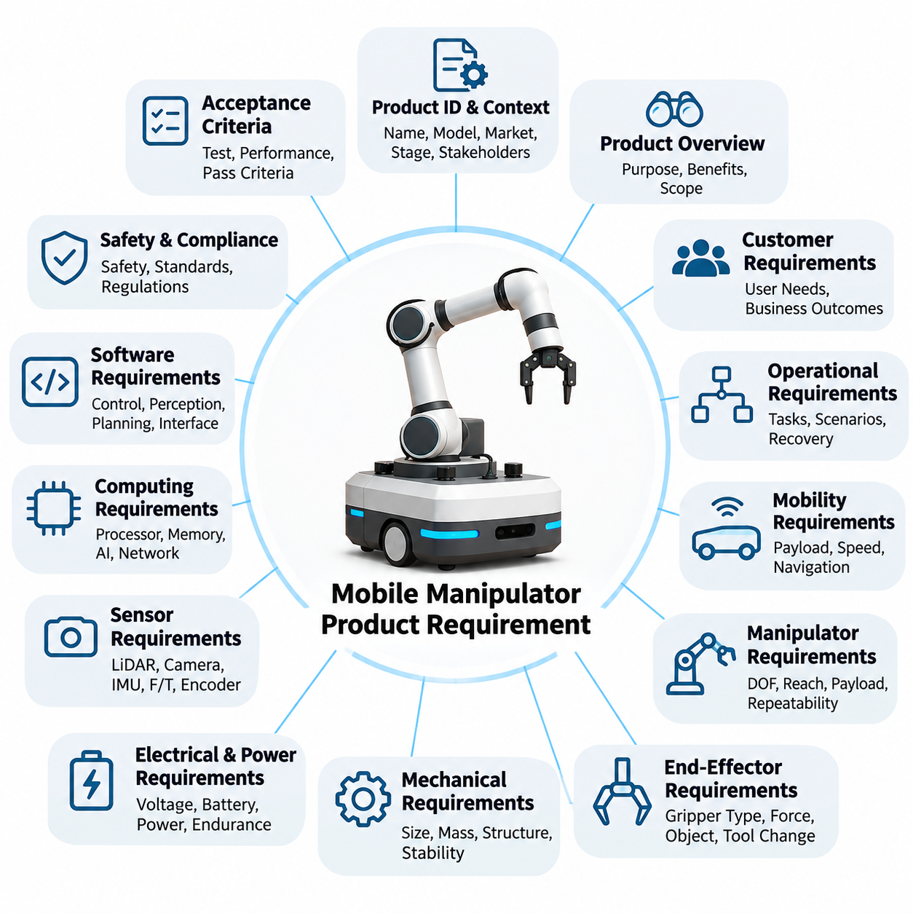
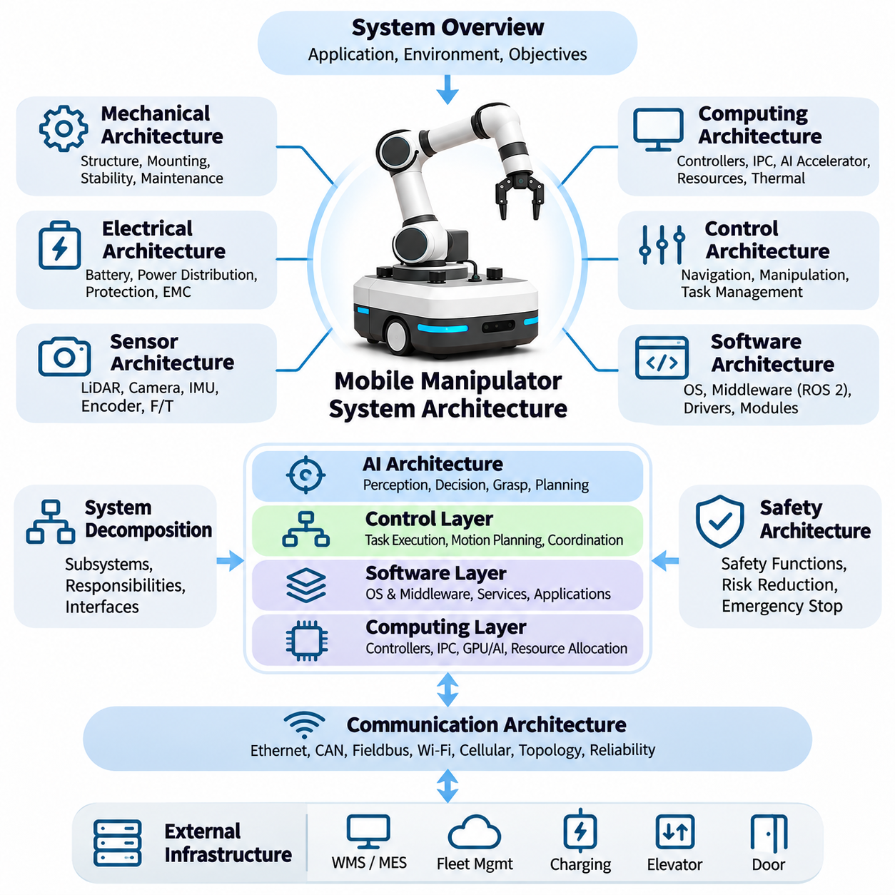
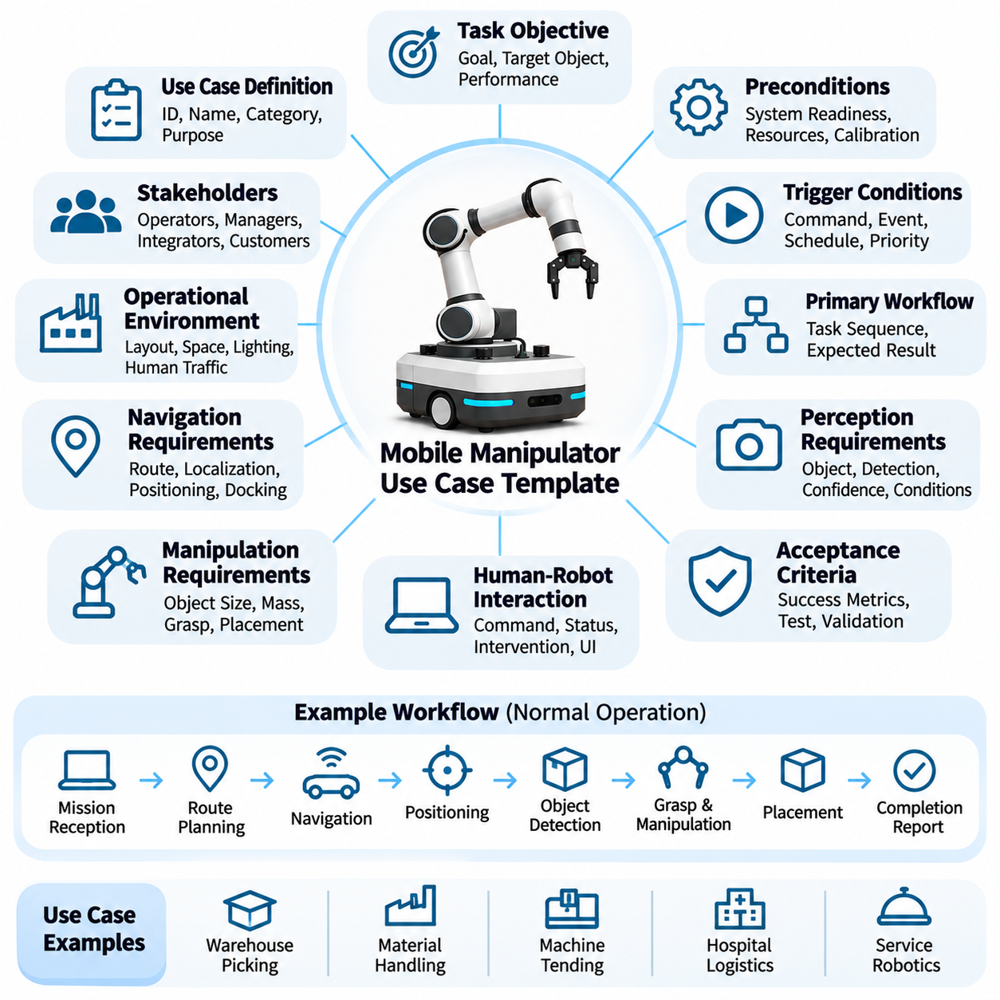
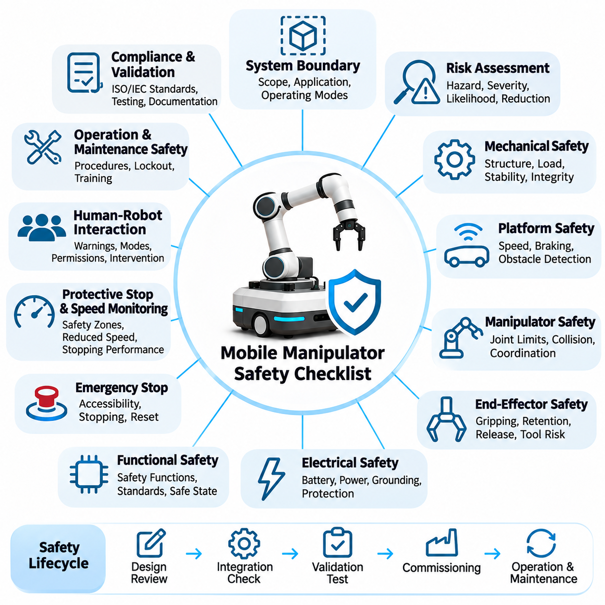
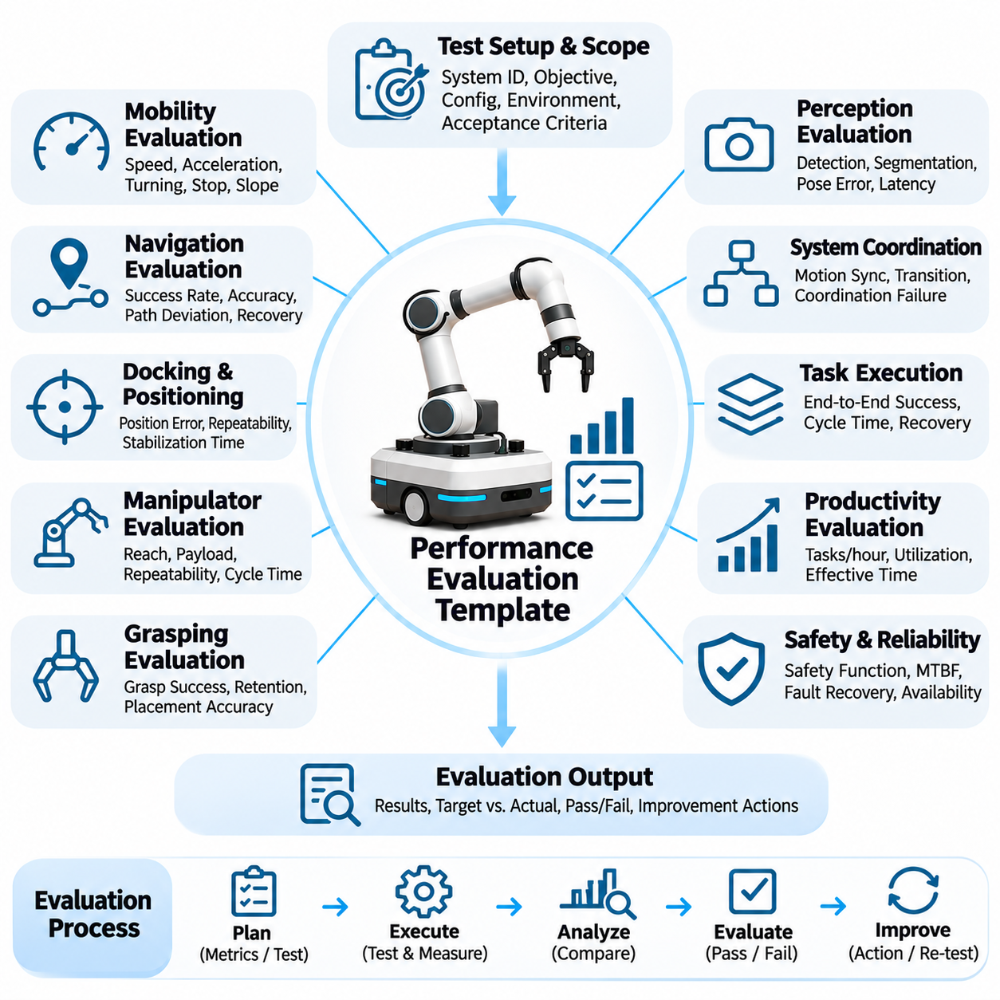
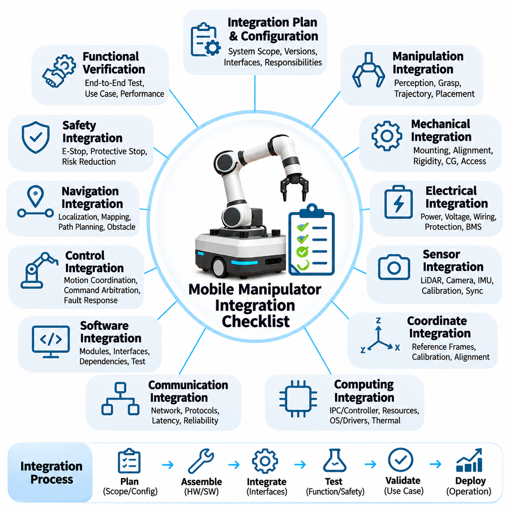
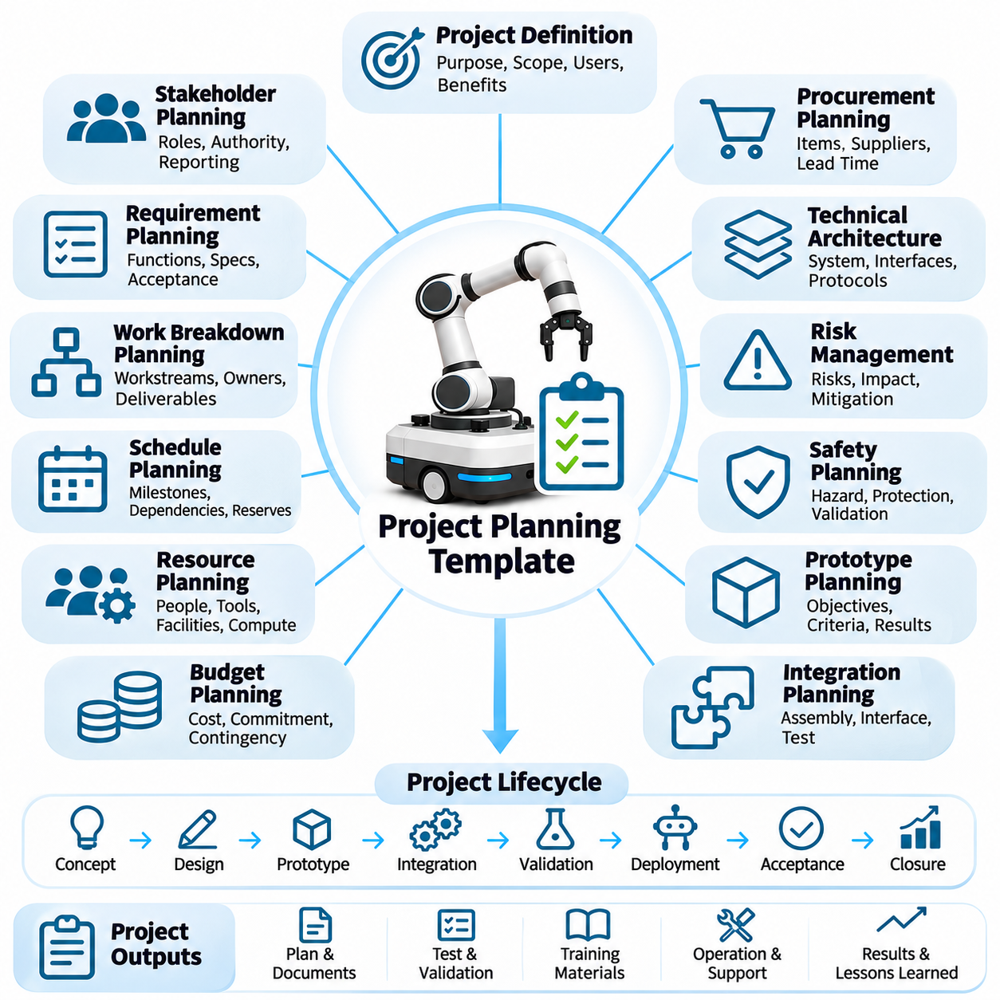

**Volume 01. Mobile Manipulator Foundations and System Architecture**

# Chapter 17. Checklists and Templates

## 01 Product Requirement Template

{width="7.268055555555556in" height="7.268055555555556in"}

A Product Requirement Template provides a structured foundation for defining the objectives, capabilities, constraints, and acceptance criteria of a mobile manipulator before detailed engineering begins. It translates customer expectations and operational needs into measurable requirements that guide product strategy, system architecture, component selection, integration, and validation. A well-defined template reduces ambiguity and establishes a common reference for all development stakeholders.

The template begins with product identification and project context, including the product name, model designation, revision, development organization, intended market, and responsible stakeholders. It should describe whether the mobile manipulator targets industrial automation, warehouse operations, hospital logistics, or service robotics. The document also identifies its development stage, expected deployment environment, commercial objectives, and relationship to existing robotic platforms.

A product overview explains the fundamental purpose of combining an autonomous mobile robot with a robotic manipulator. It describes the operational problems the system addresses, the expected benefits of mobile manipulation, and the limitations of conventional fixed automation. The overview should clarify whether the product performs material transportation, autonomous picking, machine tending, inspection, or collaborative assistance, establishing the functional boundaries of the proposed system.

Customer requirements describe the expectations of operators, facility managers, system integrators, maintenance personnel, and purchasing organizations. These expectations may include productivity improvements, reduced manual handling, operational flexibility, and predictable maintenance costs. Each customer requirement should be associated with an operational scenario and measurable outcome, ensuring that engineering decisions remain connected to practical business needs rather than isolated technical capabilities.

Operational requirements define the tasks that the mobile manipulator must perform under specified environmental conditions. These include autonomous navigation, workstation approach, object recognition, grasp execution, material transfer, obstacle avoidance, and task completion reporting. The template should identify normal operating sequences, exceptional situations, recovery procedures, and operator interventions, allowing engineers to distinguish mandatory product functions from optional automation features.

Mobility requirements establish the performance expectations of the autonomous mobile base. Relevant parameters include rated payload, maximum travel speed, positioning accuracy, turning radius, obstacle negotiation capability, braking performance, and allowable floor conditions. Requirements should also describe navigation methods, localization reliability, docking accuracy, and operational restrictions. Each parameter must include a measurement unit, operating condition, and verification method to support objective evaluation.

Manipulator requirements describe the capabilities of the robotic arm and its interaction with the mobile platform. The specification should include degrees of freedom, maximum reach, rated payload, repeatability, joint speed, allowable mounting orientation, and operational workspace. Special attention must be given to payload variation across the workspace, dynamic loads during movement, and the influence of manipulator configurations on overall vehicle stability.

End-effector requirements define how the robot physically interacts with objects and equipment. The template should describe supported gripper types, gripping force, object dimensions, allowable mass, surface characteristics, and tool-changing capabilities. Requirements for vacuum gripping, parallel-jaw mechanisms, compliant grippers, or specialized tooling should reflect the intended application. Grasp reliability and object damage prevention must be evaluated under representative operating conditions.

Mechanical requirements establish the physical constraints governing the complete robotic system. These include overall dimensions, total mass, center-of-gravity limits, structural rigidity, mounting interfaces, vibration resistance, and accessibility for maintenance. The mechanical specification should account for the combined effects of arm motion, vehicle acceleration, emergency braking, and transported payloads, particularly when the manipulator operates near the boundaries of its reachable workspace.

Electrical and power requirements describe the energy infrastructure supporting mobility, manipulation, sensing, computing, and communication. The template should specify nominal operating voltage, battery chemistry, usable energy capacity, peak power demand, charging interfaces, and target operating duration. Power budgeting must consider simultaneous subsystem operation, transient actuator loads, battery aging, thermal limitations, and emergency shutdown behavior to establish realistic endurance expectations.

Sensor requirements identify the perception and measurement capabilities necessary for autonomous operation. Typical sensing technologies include LiDAR, RGB cameras, depth cameras, inertial measurement units, wheel encoders, force-torque sensors, and proximity detectors. Each sensor requirement should define measurement range, accuracy, update frequency, environmental tolerance, and communication interface. Sensor placement and synchronization must support reliable navigation, manipulation, collision detection, and system diagnostics.

Computing requirements specify the processing resources necessary for real-time control, perception, planning, and artificial intelligence. The template should define processor architecture, accelerator capabilities, memory capacity, storage requirements, operating system compatibility, and allowable computational latency. It should distinguish safety-related control functions from higher-level AI workloads and establish expectations for resource isolation, processing availability, thermal management, and future software expansion.

Software requirements define the functional organization of the robotic control system and its interfaces. The specification may include ROS 2 compatibility, navigation software, motion planning, task orchestration, device drivers, diagnostic services, and fleet management connectivity. Requirements should establish communication protocols, software lifecycle policies, configuration management, fault reporting, and recovery mechanisms while preserving modularity between the autonomous mobile base and robotic manipulator.

Artificial intelligence requirements describe the perception and decision-making functions supporting autonomous manipulation. These may include object detection, semantic segmentation, pose estimation, grasp planning, scene understanding, and adaptive task execution. Each AI function should have defined input conditions, expected outputs, inference latency, confidence handling, and evaluation datasets. Requirements must distinguish experimental AI capabilities from functions sufficiently validated for production deployment.

Communication requirements establish how the mobile manipulator exchanges information with operators, infrastructure, and external systems. The template should address Ethernet, industrial fieldbus, CAN, Wi-Fi, and applicable cellular communication technologies. It should also define interface ownership, message formats, timing constraints, connection recovery, and data security expectations. Integration with manufacturing execution systems, warehouse management systems, or robot fleet platforms should be explicitly documented.

Safety requirements define the protective functions necessary to reduce risks associated with autonomous mobility and robotic manipulation. These include emergency stopping, protective stopping, speed limitation, collision prevention, safety-zone monitoring, and controlled recovery after faults. The template should reference applicable safety standards and require documented risk assessments. Safety functions must be evaluated at the integrated system level because combining two robotic subsystems introduces additional hazards.

Human-robot interaction requirements describe how operators supervise, command, and maintain the mobile manipulator. The specification should address user interfaces, operating modes, status indicators, audible warnings, manual intervention, and maintenance access. Interaction requirements must consider operator training, environmental visibility, accessibility, and foreseeable misuse. The system should communicate its operational state clearly and provide understandable procedures for handling abnormal conditions.

Environmental requirements identify the physical conditions under which the product must operate reliably. These include ambient temperature, humidity, dust exposure, lighting variation, floor friction, slope, vibration, and electromagnetic interference. Requirements should distinguish normal operating conditions from storage, transportation, and exceptional environmental exposure. The specification must also identify restricted environments and conditions requiring additional protection, certification, or application-specific engineering.

Performance requirements translate functional expectations into measurable engineering targets. Typical indicators include navigation success rate, docking repeatability, grasp success rate, task cycle time, throughput, system availability, and energy consumption per completed task. Performance measurements should use representative workloads and clearly defined test conditions. The template must distinguish nominal performance, minimum acceptable performance, and stretch objectives to prevent unrealistic interpretations of system capability.

Reliability and maintainability requirements establish expectations for continuous operation and lifecycle support. The specification should define availability targets, mean time between failures, mean time to repair, preventive maintenance intervals, and diagnostic coverage. Replaceable components, service access, spare-part availability, and software recovery procedures should also be addressed. Reliability objectives must reflect the intended duty cycle and the operational consequences of unexpected robot downtime.

Cybersecurity and data management requirements protect the robot, its operating environment, and connected information systems. The template should describe authentication, authorization, encrypted communication, secure software updates, event logging, and access control. Data requirements should define the retention and handling of sensor recordings, operational logs, diagnostic information, and AI training data. Security provisions must remain compatible with remote maintenance and fleet-level administration.

Manufacturing and commercial requirements connect engineering specifications to product feasibility. These requirements may include target manufacturing cost, expected production volume, component availability, supplier qualification, assembly complexity, and product service life. The template should also document installation requirements, transportation constraints, warranty assumptions, and anticipated maintenance expenses. These considerations support product positioning and help balance technical performance against total cost of ownership.

Verification requirements define how compliance with each product requirement will be demonstrated. Accepted methods may include inspection, engineering analysis, simulation, functional testing, and field validation. Every requirement should have a unique identifier, assigned owner, priority, acceptance criterion, and verification reference. Traceability between customer needs, system requirements, design decisions, and test evidence enables systematic evaluation throughout the development lifecycle.

Validation requirements determine whether the completed mobile manipulator satisfies its intended operational purpose. Unlike verification, which confirms compliance with specified requirements, validation examines performance in realistic application scenarios. Representative trials should include normal task execution, changing environmental conditions, unexpected obstacles, manipulation failures, and operator intervention. Results should be evaluated against customer expectations and documented operational acceptance criteria.

Requirement prioritization provides a mechanism for managing competing technical, commercial, and scheduling constraints. Requirements may be classified as mandatory, desirable, or optional according to their contribution to safety, core functionality, and market differentiation. Dependencies between requirements should be documented because changes in payload, manipulator reach, battery capacity, or computing performance can affect several subsystems simultaneously. Prioritization supports disciplined engineering trade-offs.

Requirement change management ensures that modifications remain controlled after the initial product specification is approved. Each proposed change should include its technical justification, affected requirements, anticipated cost, schedule implications, and validation impact. Revision history and approval responsibilities must be maintained to prevent inconsistencies between engineering teams. Configuration control is particularly important when hardware, embedded software, AI models, and mechanical interfaces evolve at different rates.

The completed Product Requirement Template becomes the authoritative baseline for subsequent system architecture, integration planning, safety assessment, and performance evaluation. Its effectiveness depends on measurable language, explicit assumptions, consistent terminology, and traceable acceptance evidence. By connecting operational objectives with engineering specifications and lifecycle responsibilities, the template supports the development of mobile manipulators that are technically feasible, operationally reliable, commercially practical, and suitable for systematic product evolution.

## 02 System Architecture Template

{width="7.268055555555556in" height="7.268055555555556in"}

A System Architecture Template provides a structured framework for defining the technical organization of a mobile manipulator, including its mechanical, electrical, sensing, computing, control, and software subsystems. It translates product requirements into an integrated engineering design that supports autonomous mobility and robotic manipulation. The template establishes system boundaries, component responsibilities, interface definitions, and architectural decisions required for reliable development and deployment.

The architecture documentation begins with a system overview describing the intended application, operational environment, design objectives, and principal technical constraints. It identifies the autonomous mobile base, robotic manipulator, end effector, perception system, computing platform, and communication infrastructure as interconnected subsystems. The overview explains how these elements cooperate to perform navigation, positioning, object handling, and task execution within a unified robotic platform.

System decomposition establishes a hierarchical representation of the mobile manipulator and its functional components. Each subsystem is assigned clearly defined responsibilities, inputs, outputs, and operational dependencies. Mechanical structures support mobility and manipulation, electrical systems distribute power, sensors provide environmental information, and computing resources execute control and AI algorithms. This decomposition enables independent subsystem development while maintaining system-level integration requirements.

The mechanical architecture defines the physical arrangement of the mobile base, manipulator, mounting structure, payload interfaces, and protective enclosures. It describes dimensional constraints, structural load paths, center-of-gravity considerations, vibration isolation, and maintenance accessibility. Particular attention is required when manipulator movements alter the overall stability of the vehicle, especially during acceleration, braking, extended-reach operations, and handling of heavy objects.

The electrical architecture describes power generation, storage, distribution, conversion, and protection throughout the robotic system. It identifies battery modules, battery management systems, power distribution units, DC/DC converters, motor drives, controllers, and emergency power isolation devices. The architecture must distinguish continuous and peak power requirements while considering voltage stability, electromagnetic compatibility, grounding, thermal limitations, and fault containment between interconnected electrical subsystems.

The sensor architecture establishes how the robot perceives its surroundings, estimates its internal state, and monitors physical interactions. Typical components include LiDAR, cameras, depth sensors, inertial measurement units, wheel encoders, proximity sensors, and force-torque sensors. The template should document sensor locations, measurement characteristics, coordinate frames, synchronization methods, and communication interfaces to support consistent data interpretation across navigation, perception, and manipulation functions.

The computing architecture defines the allocation of processing resources among embedded controllers, industrial computers, edge AI accelerators, and optional remote infrastructure. Real-time motion control may execute on dedicated controllers, while perception, planning, and learning-based functions operate on higher-performance processors. The architecture should specify computational workloads, memory requirements, processing latency, hardware interfaces, thermal management, and resource isolation between critical and noncritical functions.

The control architecture describes the coordination of mobile navigation, manipulator motion, end-effector operation, and system-level task execution. It typically separates low-level actuator control, intermediate motion planning, and high-level mission management. Each control layer requires defined command interfaces, feedback mechanisms, execution frequencies, and fault-handling procedures. Coordinated operation must prevent unsafe interactions between vehicle movement and manipulator configurations.

The software architecture defines the organization of operating systems, middleware, device drivers, control services, perception modules, and application software. ROS 2 may provide distributed communication and modular software integration, while specialized controllers manage deterministic hardware functions. The template should identify software components, communication mechanisms, lifecycle states, configuration dependencies, and deployment boundaries to support maintainability, extensibility, and reproducible system operation.

The artificial intelligence architecture describes how perception models, decision algorithms, and task-planning capabilities contribute to autonomous behavior. Object detection, pose estimation, scene understanding, grasp planning, and adaptive manipulation may execute through interconnected AI modules. The architecture must define model inputs, outputs, inference latency, confidence thresholds, computational dependencies, and fallback behavior when AI predictions are uncertain or inconsistent with operational constraints.

The communication architecture specifies the networks and protocols connecting robotic subsystems and external infrastructure. Ethernet, CAN, industrial fieldbus, Wi-Fi, and cellular communication may support different operational requirements. The template should describe network topology, message formats, bandwidth allocation, timing constraints, synchronization, and communication failure handling. Critical control communication must remain appropriately separated from nonessential monitoring and data-transfer traffic.

The safety architecture defines independent protective mechanisms that reduce risks arising from autonomous movement and robotic manipulation. Emergency stopping, protective stopping, speed monitoring, collision detection, safety-zone supervision, and actuator power isolation must be integrated into the overall design. Safety-related functions require explicit responsibility allocation, fault-response behavior, and verification criteria. The architecture should ensure that failures in non-safety software cannot invalidate required protective functions.

The navigation architecture describes how the mobile base performs localization, mapping, route planning, obstacle avoidance, and precise workstation approach. Localization may combine LiDAR, wheel odometry, inertial measurements, and environmental landmarks. The template should define map representations, localization confidence, navigation interfaces, recovery strategies, and docking requirements. Navigation performance must remain compatible with manipulator positioning accuracy and the spatial constraints of the target workspace.

The manipulation architecture defines the relationship between robot kinematics, motion planning, grasp execution, and environmental interaction. It should describe coordinate transformations between the mobile base, manipulator, end effector, and target objects. Motion planning must account for joint limits, reachable workspace, collision constraints, payload conditions, and base stability. The architecture should support coordinated execution when navigation and manipulation operate sequentially or simultaneously.

The task execution architecture organizes individual robotic capabilities into complete operational workflows. A typical mission may involve receiving a task, navigating to a workstation, verifying position, identifying an object, executing a grasp, transporting the object, and reporting completion. State machines or behavior trees can coordinate these operations. The template should define task transitions, preconditions, completion criteria, exception handling, and recovery procedures to ensure predictable autonomous behavior.

The cloud and edge architecture defines how processing, data storage, fleet coordination, and remote services are distributed across computational environments. Time-sensitive control and perception functions should remain close to the robot, while centralized infrastructure may support analytics, fleet optimization, model management, and historical data storage. The template should identify connectivity assumptions, synchronization requirements, data ownership, and operational behavior during network interruptions.

The fleet integration architecture describes how individual mobile manipulators interact with centralized management systems and other robotic platforms. It may include mission assignment, traffic coordination, resource scheduling, charging management, and operational monitoring. Standardized interfaces should support integration with manufacturing execution systems, warehouse management platforms, and enterprise applications. The architecture must also define responsibility boundaries between onboard autonomy and fleet-level decision-making.

The cybersecurity architecture establishes protective measures across hardware, software, communication, and remote management interfaces. Authentication, authorization, encrypted communication, secure boot, software integrity verification, and controlled updates should be considered according to operational risk. Network segmentation and access restrictions help limit the impact of compromised components. The template should document security assumptions, trust boundaries, logging mechanisms, and procedures for responding to identified vulnerabilities.

The reliability architecture addresses fault detection, fault isolation, degraded operation, and recovery across interconnected subsystems. Diagnostic monitoring should identify abnormal sensor readings, communication failures, actuator faults, battery limitations, and computing resource exhaustion. The template should define fault severity, recovery authority, safe-state transitions, and maintenance reporting. Redundancy may be introduced where justified by safety requirements, operational availability targets, or failure consequences.

Interface definitions provide the formal contracts connecting mechanical, electrical, software, and communication components. Each interface should specify ownership, physical or logical connections, signal characteristics, message structures, timing expectations, and error conditions. Interface Control Documents can preserve compatibility between independently developed modules. Clear interface definitions reduce integration uncertainty and support component replacement, supplier coordination, and future platform upgrades.

Architectural trade-off analysis evaluates alternative designs against performance, safety, cost, complexity, and scalability requirements. Decisions involving centralized versus distributed computing, sensor redundancy, communication protocols, battery capacity, and manipulator configuration should be documented with supporting assumptions. Each major architectural choice should identify expected benefits, limitations, dependencies, and technical risks. This documentation enables informed design reviews and prevents repeated evaluation of previously resolved decisions.

Verification and validation planning connects architectural elements to measurable engineering evidence. Subsystem testing, interface testing, simulation, hardware-in-the-loop evaluation, and integrated field trials should demonstrate that the proposed architecture satisfies product requirements. Traceability between requirements, architectural components, and test cases supports systematic defect identification. Validation should include nominal operations, exceptional conditions, subsystem failures, and recovery scenarios under representative workloads.

The completed System Architecture Template serves as the technical baseline for detailed design, implementation, integration, and lifecycle management. It should remain version-controlled and evolve through formal engineering reviews as requirements and technologies change. By documenting subsystem responsibilities, interfaces, dependencies, safety provisions, and verification strategies, the template enables development teams to construct mobile manipulators that are modular, reliable, maintainable, and adaptable to future operational demands.

## 03 Use Case Template

{width="7.268055555555556in" height="7.268055555555556in"}

A Use Case Template provides a structured method for describing how a mobile manipulator performs specific tasks within an operational environment. It connects customer needs, system capabilities, and measurable outcomes through realistic application scenarios. The template establishes a consistent framework for identifying operational objectives, participating actors, required resources, task sequences, environmental constraints, and acceptance criteria before system implementation begins.

The use case definition begins with a unique identifier, descriptive name, application category, and operational objective. It should specify whether the scenario involves warehouse picking, industrial material handling, machine tending, hospital logistics, or service robotics. The description identifies the business problem, expected automation benefits, and boundaries of robotic responsibility, ensuring that the proposed application remains aligned with product requirements and deployment objectives.

Stakeholder identification establishes the individuals and organizations involved in the use case. These may include operators, production supervisors, maintenance engineers, facility managers, system integrators, and end customers. Each stakeholder has distinct expectations regarding productivity, safety, usability, and operational continuity. The template should clarify stakeholder responsibilities, decision authority, and interaction requirements to prevent ambiguity during implementation and acceptance testing.

The operational environment describes the physical and organizational conditions in which the mobile manipulator operates. Relevant characteristics include facility layout, aisle dimensions, workstation locations, floor conditions, lighting, temperature, and human traffic. The template should also identify restricted areas, shared workspaces, communication infrastructure, and environmental disturbances that may influence navigation, perception, manipulation, and overall task reliability.

The task objective defines the desired outcome of the robotic operation in measurable terms. For example, a warehouse picking application may require the robot to retrieve specified items from storage shelves and place them into designated containers. The objective should identify target objects, handling conditions, required accuracy, throughput expectations, and completion criteria. Clear objectives allow engineers to distinguish successful task execution from incomplete or unacceptable performance.

Preconditions describe the circumstances that must exist before a use case can begin. These may include sufficient battery capacity, valid localization, available navigation maps, calibrated sensors, operational manipulators, and authorized task commands. The template should also verify that required workstations, containers, and external systems are ready. Explicit preconditions reduce execution uncertainty and provide a foundation for automated readiness checks.

Trigger conditions identify the events that initiate a robotic task. A trigger may originate from an operator command, warehouse management system, manufacturing execution system, scheduled workflow, or sensor-detected event. The template should define the trigger source, message content, priority, and authorization requirements. It should also explain how the system handles simultaneous requests, duplicated commands, or tasks received while the robot is unavailable.

The primary workflow describes the expected sequence of actions under normal operating conditions. A typical mobile manipulation task begins with mission reception, followed by route planning, autonomous navigation, workstation positioning, object detection, grasp planning, manipulation, and task completion reporting. Each activity should specify its expected result and transition conditions. The workflow provides a reference for software development, integration testing, and operational validation.

Navigation requirements describe how the robot travels between operational locations while maintaining safe and efficient movement. The use case should specify starting positions, destination coordinates, route constraints, obstacle conditions, and docking requirements. Localization accuracy and navigation success criteria must reflect the manipulation task that follows. Precise workstation positioning is particularly important when the manipulator operates within a limited reachable workspace.

Perception requirements define how the robot identifies relevant objects, workstations, obstacles, and environmental features. The template should describe expected object categories, appearance variations, lighting conditions, occlusion levels, and required detection confidence. Camera placement, depth sensing, and coordinate transformations may influence recognition accuracy. Perception outputs must provide sufficient information for reliable manipulation planning and task execution.

Manipulation requirements describe the physical interaction between the robotic arm, end effector, target objects, and surrounding equipment. The use case should define object dimensions, mass, material properties, grasp locations, placement tolerances, and allowable contact forces. It should also identify workspace restrictions, collision risks, and object orientation requirements. These details establish the technical conditions necessary for successful grasping, transportation, and placement.

Human-robot interaction requirements describe the circumstances in which personnel communicate with or intervene in robotic operations. Operators may initiate missions, confirm task completion, resolve exceptions, or request manual control. The template should define interface behavior, status notifications, warning signals, and intervention permissions. Interaction procedures must remain understandable and consistent with applicable safety requirements, particularly in environments shared by humans and autonomous machines.

Alternative workflows describe valid operational paths that differ from the primary sequence without necessarily indicating failure. A robot may select another route, use a different grasp strategy, or wait for workstation availability. The template should identify the conditions that activate each alternative and the expected resulting behavior. These scenarios support operational flexibility while preserving the original task objective and system safety constraints.

Exception handling defines how the mobile manipulator responds when expected operating conditions are not satisfied. Examples include failed object recognition, unsuccessful grasping, blocked navigation routes, communication interruptions, and unavailable destinations. The template should specify fault detection criteria, retry limits, recovery actions, and escalation procedures. Exception handling must prevent uncontrolled repetition and ensure that unresolved problems are communicated to responsible operators or supervisory systems.

Safety considerations identify hazards associated with the use case and the protective measures required during execution. Potential risks include collisions with personnel, dropped objects, unexpected manipulator movement, unstable payloads, and restricted workspace access. The template should connect identified hazards to operational safeguards, emergency stopping procedures, speed limitations, and recovery conditions. Safety requirements must account for interactions between mobility and manipulation rather than evaluating them independently.

Performance criteria establish quantitative measures for determining whether the use case satisfies operational expectations. Relevant metrics include task success rate, navigation completion rate, grasp success rate, cycle time, throughput, positioning accuracy, and energy consumption. Each metric should have a defined measurement method, operating condition, and acceptance threshold. Performance evaluation should consider both individual task execution and sustained operation across representative workloads.

System integration requirements identify the external platforms and infrastructure necessary to execute the use case. These may include warehouse management systems, manufacturing execution systems, fleet management platforms, automated doors, elevators, and charging stations. The template should define communication interfaces, data exchange formats, command ownership, and synchronization requirements. Integration dependencies must be documented because external system failures can directly affect task completion.

Resource requirements describe the equipment, software, infrastructure, and personnel needed to support the application. These may include mobile robots, manipulators, end effectors, charging equipment, network connectivity, workstation fixtures, and maintenance resources. The template should distinguish resources required during normal operation from those needed for deployment, testing, and recovery. Resource planning supports realistic project scheduling and cost estimation.

Operational constraints establish the limits within which the mobile manipulator must perform its assigned tasks. Constraints may involve maximum payload, battery endurance, available workspace, permissible speed, environmental conditions, and operating schedules. The template should identify assumptions regarding object placement, facility accessibility, and human activity. Clearly documented constraints prevent unrealistic performance expectations and help determine whether a use case is technically feasible.

Validation scenarios define representative tests used to confirm that the proposed use case performs as intended. Testing should include nominal execution, varying object positions, environmental disturbances, navigation obstacles, manipulation errors, and recovery operations. Each scenario requires documented initial conditions, expected behavior, measurement procedures, and acceptance criteria. Validation evidence should demonstrate that the system can complete its intended mission under realistic operating conditions.

Economic evaluation connects the use case to measurable business value and deployment feasibility. The template may consider labor savings, throughput improvements, equipment utilization, operating expenses, maintenance costs, and expected return on investment. Financial assumptions should be based on realistic operating schedules and demonstrated performance. Economic evaluation helps determine whether the proposed automation delivers sufficient value compared with manual processes or alternative robotic solutions.

The completed Use Case Template provides a traceable connection between operational needs, product requirements, system architecture, and validation activities. It should be reviewed with customers, engineering teams, safety specialists, and operational stakeholders before implementation. By documenting workflows, constraints, interfaces, exceptions, and measurable outcomes, the template supports consistent development decisions and enables mobile manipulation solutions to be evaluated against practical deployment requirements.

## 04 Safety Checklist

{width="7.268055555555556in" height="7.268055555555556in"}

A Safety Checklist provides a systematic framework for identifying, evaluating, and controlling hazards associated with mobile manipulator operation. It covers autonomous navigation, robotic manipulation, electrical systems, human interaction, and integrated control functions. The checklist supports safety reviews throughout design, integration, commissioning, and operation, ensuring that protective measures are documented, verified, and maintained under realistic deployment conditions.

The safety review begins by defining the system boundaries, intended applications, operating environment, and foreseeable misuse. Engineers should identify the mobile platform, robotic arm, end effector, sensors, controllers, and external infrastructure included in the assessment. Operational modes such as autonomous execution, manual control, maintenance, and emergency recovery must be considered because each introduces different hazards and protective requirements.

Risk assessment establishes the foundation for determining necessary safety measures. Potential hazards should be identified through structured analysis of mechanical movement, electrical energy, unexpected behavior, and human exposure. Each hazardous situation requires an evaluation of potential injury severity and likelihood under the selected assessment method. Risk reduction measures should follow an appropriate hierarchy, prioritizing inherently safe design before safeguards and user information.

Mechanical safety verification examines structural integrity, moving components, payload retention, and stability during operation. The assessment should consider manipulator reach, joint motion, vehicle acceleration, emergency braking, and changes in the center of gravity. Mounting structures, fasteners, protective covers, and load-bearing components must withstand specified operating conditions. Stability must also be evaluated under foreseeable combinations of payload and manipulator configuration.

Mobile platform safety addresses hazards associated with autonomous movement through shared environments. The checklist should examine maximum speed, stopping distance, braking performance, turning behavior, and obstacle detection capabilities. Navigation must remain within defined operational boundaries, and protective functions should respond appropriately to pedestrians, vehicles, and unexpected obstacles. Floor conditions, slopes, narrow passages, and restricted visibility require particular attention.

Manipulator safety focuses on hazards caused by robotic arm movement, gripping forces, and interactions with nearby equipment. Joint limits, workspace restrictions, collision detection, and protective stopping functions should be verified. The checklist must consider crushing, trapping, impact, and shearing hazards throughout the reachable workspace. Manipulator motion should remain coordinated with mobile platform status to prevent hazardous movements during navigation or unstable positioning.

End-effector safety evaluates the mechanisms used to grasp, transport, and release objects. Gripping force, vacuum retention, mechanical locking, and payload compatibility must be assessed against expected operating conditions. The checklist should address dropped objects, accidental release, sharp edges, and unexpected tool movement. Loss of power or communication must produce a risk-assessed response that minimizes hazards to personnel, equipment, and transported materials.

Electrical safety verification examines battery systems, power distribution, grounding, insulation, and protective devices. The checklist should confirm appropriate overcurrent protection, short-circuit protection, isolation arrangements, and accessible disconnecting means. Battery charging and energy storage introduce additional thermal and electrical hazards requiring dedicated safeguards. Maintenance procedures must address residual energy and the prevention of unintended energization.

Functional safety requirements define how safety-related control functions achieve the necessary risk reduction. Applicable standards may include ISO 12100, ISO 13849, IEC 62061, and relevant robot-specific requirements, depending on the application. Safety functions should have documented performance targets, defined safe states, and validated fault responses. The assessment must distinguish safety-rated protective functions from ordinary software monitoring and operational convenience features.

Emergency stop verification confirms that emergency stopping devices are accessible, identifiable, and effective within the intended operating environment. Activation should initiate the specified stopping behavior and prevent hazardous restart. The checklist should verify emergency stop coverage across the mobile base, manipulator, and associated equipment. Resetting an emergency stop must not automatically initiate movement, and recovery should require appropriate operator authorization.

Protective stop and speed monitoring functions must be evaluated under representative operating conditions. Safety-rated sensors and controllers may supervise protective fields, reduced-speed zones, and permitted motion states. The checklist should verify stopping performance against detection distance, reaction time, and actual braking capability. Changes in payload, floor friction, manipulator position, and vehicle speed may affect the effectiveness of protective stopping.

Human-robot interaction safety addresses situations where personnel approach, supervise, or work near the mobile manipulator. The checklist should examine warning indicators, operating mode selection, access permissions, and procedures for manual intervention. Collaborative operation requires application-specific risk assessment rather than assumptions based on component labels. Personnel must understand robot status, movement intentions, emergency procedures, and the limits of protective systems.

Sensor safety verification evaluates whether sensing systems provide reliable information for required protective functions. Sensor placement, detection coverage, environmental interference, contamination, and diagnostic capabilities should be reviewed. Blind spots and occlusions must be considered during both navigation and manipulation. Sensors used for safety functions require appropriate safety characteristics, while non-safety perception systems should not be treated as substitutes for validated protective devices.

Software safety assessment examines control logic, state transitions, fault handling, and unexpected system behavior. The checklist should verify that command validation, operating mode management, and interlocks prevent hazardous actions. Software updates, configuration changes, and AI model modifications must not compromise established safety functions. Safety-critical behavior should remain deterministic where required and independent of uncertain AI predictions.

Communication safety evaluates the consequences of delayed, corrupted, interrupted, or lost messages between subsystems. The checklist should identify communication dependencies affecting motion commands, safety status, and coordinated operation. Timeouts, heartbeat monitoring, and fault responses must be defined according to their safety significance. Where safety-related communication is required, suitable safety communication mechanisms and verified failure behavior should be implemented.

Cybersecurity considerations address digital threats capable of affecting physical safety. Unauthorized commands, compromised software, altered configurations, and disrupted communications may create hazardous operating conditions. The checklist should examine authentication, access control, software integrity, secure updates, and network segmentation. Security measures should protect safety-related interfaces without preventing essential emergency responses or authorized recovery procedures.

Environmental safety verification confirms that protective functions remain effective under expected deployment conditions. Temperature, humidity, dust, lighting, vibration, electromagnetic interference, and floor conditions may influence system behavior. The checklist should identify environmental operating limits and required protective measures. Testing must include conditions that could degrade sensor performance, electrical reliability, braking effectiveness, or mechanical stability.

Maintenance safety addresses hazards arising during inspection, repair, calibration, and component replacement. Procedures should define energy isolation, lockout and tagout where applicable, mechanical support, and prevention of unintended movement. Technicians must have safe access to batteries, actuators, sensors, and control equipment. The checklist should verify maintenance instructions, required qualifications, protective equipment, and procedures for returning the system to service.

Integration safety examines hazards that emerge when individually developed subsystems operate together. Combining a mobile base with a manipulator can introduce unexpected motion interactions, altered stopping behavior, and new collision scenarios. The checklist should verify coordinated emergency responses, shared operating states, interface dependencies, and fault propagation. Integrated safety testing must address the complete robotic system rather than relying solely on individual component certifications.

Safety validation establishes evidence that implemented protective measures achieve their intended risk reduction. Testing should cover normal operation, foreseeable misuse, sensor faults, communication failures, emergency stopping, and recovery sequences. Each safety requirement should have a defined verification method, acceptance criterion, and recorded result. Unresolved deviations must be assessed and corrected before the affected operation is authorized.

Operational safety management ensures that protective measures remain effective after deployment. The checklist should address operator training, inspection schedules, incident reporting, safety configuration control, and periodic reassessment. Changes in facility layout, payload characteristics, software, or operating procedures may require renewed risk evaluation. Documented responsibilities and maintenance records support consistent safety performance throughout the product lifecycle.

The completed Safety Checklist serves as a controlled record connecting identified hazards, risk reduction measures, safety requirements, and validation evidence. It should include responsible personnel, assessment dates, applicable standards, unresolved findings, and approval status. By maintaining traceability between design decisions and operational safeguards, the checklist supports systematic safety management and responsible deployment of mobile manipulators in industrial, logistics, healthcare, and service environments.

## 05 Performance Evaluation Template

{width="7.268055555555556in" height="7.268055555555556in"}

A Performance Evaluation Template provides a structured framework for measuring the technical and operational capabilities of a mobile manipulator. It establishes consistent methods for assessing mobility, manipulation, perception, safety, reliability, and productivity. The template connects product requirements with measurable performance indicators, enabling engineers to compare design targets against experimental results and determine whether the integrated robotic system satisfies its intended application.

The evaluation begins with system identification, test objectives, configuration details, and environmental conditions. Documentation should include the robot model, hardware revision, software version, sensor configuration, manipulator specifications, payload conditions, and test location. Each evaluation must identify responsible personnel, measurement equipment, calibration status, and applicable acceptance criteria to ensure that results remain traceable and reproducible.

Performance indicators should be derived from documented product requirements and operational use cases. Each metric requires a clear definition, measurement unit, target value, acceptance threshold, and evaluation procedure. The template should distinguish mandatory performance requirements from optimization objectives. This separation prevents experimental improvements from being confused with contractual obligations and establishes a consistent basis for engineering decisions.

Mobility performance evaluation measures the ability of the autonomous mobile base to travel safely and accurately through representative environments. Relevant metrics include maximum speed, acceleration, turning radius, stopping distance, slope capability, and obstacle negotiation performance. Testing should consider different payload conditions, floor surfaces, and movement patterns. Results must distinguish nominal operating capability from performance achieved under exceptional conditions.

Navigation performance evaluation examines route completion, localization accuracy, obstacle avoidance, and autonomous recovery. Tests should measure navigation success rate, travel time, path deviation, and frequency of operator intervention. Representative scenarios may include narrow corridors, dynamic obstacles, changing layouts, and partially obstructed routes. Evaluation procedures should record environmental conditions and identify failures caused by perception, planning, or control limitations.

Docking and positioning evaluation determines whether the mobile platform can consistently reach the locations required for manipulation. Measurements should include translational error, angular error, repeatability, and stabilization time after arrival. Multiple trials should be performed from different approach directions and initial positions. Docking accuracy must be evaluated against the manipulator workspace and the positioning tolerance required by the intended task.

Manipulator performance evaluation measures the robotic arm\'s ability to execute movements accurately, consistently, and within specified mechanical limits. Relevant parameters include reach, payload capacity, positioning repeatability, joint velocity, and motion completion time. Testing should consider different arm configurations, object masses, and operating speeds. The evaluation must also identify how vehicle compliance, vibration, and mounting rigidity influence manipulation accuracy.

Grasping performance evaluation measures the effectiveness of the end effector and associated planning algorithms. Metrics may include grasp success rate, object retention, placement accuracy, and recovery success following unsuccessful attempts. Tests should cover variations in object geometry, mass, surface material, orientation, and accessibility. Results should distinguish failures caused by perception, grasp planning, actuator limitations, and unexpected object interactions.

Perception performance evaluation examines the accuracy and reliability of environmental understanding. Object detection, segmentation, pose estimation, and depth measurement should be assessed using representative datasets and physical test scenarios. Metrics may include precision, recall, pose error, and inference latency. Evaluation conditions should account for lighting variation, reflective surfaces, occlusion, sensor contamination, and differences between training and deployment environments.

System coordination evaluation measures how effectively mobility and manipulation operate as an integrated robotic system. Testing should examine transitions between navigation, docking, arm deployment, object handling, and task completion. Relevant metrics include synchronization delay, coordination failures, and total execution time. The evaluation should identify whether subsystem interactions introduce instability, positioning errors, or unnecessary operational delays.

Task execution performance evaluation examines complete operational workflows rather than isolated subsystem capabilities. A representative task may involve receiving a mission, navigating to a workstation, identifying an object, grasping it, transporting it, and completing placement. The template should measure end-to-end success rate, cycle time, recovery frequency, and operator assistance. Results should reflect actual application conditions and realistic task complexity.

Productivity evaluation determines how efficiently the mobile manipulator converts operational time into completed work. Relevant indicators include tasks per hour, items handled per shift, utilization rate, idle time, and effective operating time. Measurements should distinguish productive execution from charging, waiting, maintenance, and recovery activities. Productivity targets must reflect the intended workflow and should not rely solely on theoretical actuator or navigation speeds.

Energy efficiency evaluation measures power consumption during navigation, manipulation, computing, sensing, and standby operation. The template should record battery state of charge, energy consumed per task, average power demand, peak power demand, and operating endurance. Testing should consider payload variations, movement frequency, environmental conditions, and charging behavior. Energy measurements support battery sizing, operational scheduling, and lifecycle cost estimation.

Reliability evaluation examines the system\'s ability to maintain required functionality over extended operation. Metrics may include task failure frequency, system availability, mean time between failures, and mean time to repair. Extended testing should capture intermittent communication faults, sensor degradation, actuator problems, and software instability. Failure records must distinguish temporary recoverable events from faults requiring maintenance or component replacement.

Safety performance evaluation verifies that protective functions operate according to documented safety requirements. Testing may examine emergency stopping, protective stopping, speed limitation, obstacle detection, and safe recovery behavior. Measurements should include response time, stopping distance, and correct transition to defined safe states. Safety acceptance must rely on applicable risk assessments and validated requirements rather than average operational performance alone.

Human-robot interaction evaluation assesses the effectiveness of operator interfaces, status communication, and intervention procedures. Relevant indicators include command completion time, operator error frequency, alarm recognition, and recovery assistance requirements. Testing should involve representative users and realistic operational scenarios. The evaluation should identify interface ambiguities, excessive intervention demands, and conditions that increase operator workload or reduce situational awareness.

Communication performance evaluation measures the reliability of data exchange between onboard controllers, sensors, computing platforms, and external management systems. Relevant metrics include message latency, packet loss, synchronization error, and communication recovery time. Tests should include normal network operation, congestion, temporary disconnection, and reconnection. Results should distinguish communication limitations affecting productivity from failures that influence safety-related functions.

Scalability evaluation determines whether system performance remains acceptable as operational demands increase. Testing may examine larger task queues, additional workstations, increased object diversity, and multiple robots sharing the same environment. Relevant metrics include throughput, scheduling delay, resource utilization, and coordination overhead. The template should identify performance bottlenecks and distinguish limitations of individual robots from those of fleet management infrastructure.

Environmental robustness evaluation examines performance under changing physical conditions. Tests should consider temperature, humidity, lighting, floor friction, vibration, dust, and electromagnetic interference where applicable. Performance degradation should be measured relative to defined baseline conditions. The evaluation must identify operational limits and determine whether environmental changes affect navigation accuracy, manipulation precision, sensing reliability, or system availability.

Statistical evaluation ensures that performance conclusions are supported by sufficient experimental evidence. The template should define trial counts, sampling methods, confidence intervals, and procedures for handling invalid measurements. Average values should be accompanied by variability measures and relevant worst-case observations. Results from different configurations should be compared using consistent conditions to avoid misleading conclusions caused by uncontrolled experimental differences.

Benchmarking compares measured performance with product targets, previous system versions, or relevant reference platforms. Comparisons should use equivalent tasks, payload conditions, environmental constraints, and measurement procedures. Differences in hardware configuration or operating assumptions must be documented. Benchmark results should identify meaningful performance advantages, remaining limitations, and opportunities for engineering improvement without overstating experimental findings.

Evaluation reporting consolidates test configurations, measured results, deviations, and engineering conclusions into a traceable record. Each metric should be associated with its requirement identifier, test procedure, acceptance threshold, and supporting evidence. Failed criteria require documented analysis, corrective actions, and retesting decisions. The completed Performance Evaluation Template supports design verification, customer acceptance, continuous optimization, and evidence-based product development throughout the mobile manipulator lifecycle.

## 06 Integration Checklist

{width="7.268055555555556in" height="7.268055555555556in"}

An Integration Checklist provides a systematic framework for verifying that all components of a mobile manipulator operate together as a complete robotic system. It addresses mechanical, electrical, sensing, computing, communication, control, and software interfaces. The checklist supports engineering reviews during assembly, commissioning, and deployment, ensuring that subsystem compatibility, functional dependencies, and operational requirements are verified before the robot enters service.

Integration planning begins with a documented system configuration and clearly defined subsystem boundaries. The checklist should identify the mobile base, robotic arm, end effector, sensors, computing units, power systems, and external infrastructure. Hardware revisions, software versions, interface specifications, and responsible engineering teams must be recorded. Configuration control ensures that integration results remain traceable and that modifications do not invalidate previous verification activities.

Mechanical integration verification examines mounting structures, component alignment, structural rigidity, and physical accessibility. The robotic arm must be securely attached to the mobile platform using appropriately designed mounting interfaces. Engineers should evaluate payload distribution, center-of-gravity changes, vibration transmission, and structural deformation. The checklist must also confirm that maintenance access, cable routing, and mechanical clearances remain adequate throughout the manipulator workspace.

Electrical integration verification ensures that all subsystems receive appropriate and stable power. The checklist should examine voltage compatibility, current capacity, connector specifications, grounding, insulation, and protective devices. Peak power demands during simultaneous navigation and manipulation require particular attention. Battery management, power distribution, emergency disconnection, and controlled startup sequences must be evaluated to prevent electrical faults and unintended system behavior.

Sensor integration verification confirms that perception and localization devices are correctly installed, calibrated, and synchronized. Cameras, LiDAR sensors, inertial measurement units, encoders, and proximity sensors must provide consistent measurements within their intended operating ranges. The checklist should verify mounting orientation, field of view, calibration parameters, and data quality. Sensor placement must account for occlusions introduced by manipulator movement and transported objects.

Coordinate system integration establishes consistent spatial relationships between the mobile platform, robotic arm, end effector, sensors, and surrounding environment. Transformation matrices must be defined and validated using documented reference frames. Calibration procedures should verify both static and dynamic alignment. Errors in coordinate transformations can propagate into grasp planning, object placement, and collision avoidance, making geometric consistency essential for reliable operation.

Computing integration verification examines the compatibility of onboard processors, embedded controllers, accelerators, and communication interfaces. The checklist should confirm operating system versions, device drivers, middleware dependencies, and computational resource allocation. Processing workloads must remain within available CPU, GPU, memory, and storage capacity. Thermal management and power limitations should also be evaluated during sustained operation under representative workloads.

Communication integration verification ensures reliable data exchange between robotic subsystems and external management platforms. Network topology, communication protocols, addressing, message formats, and synchronization mechanisms should be documented. The checklist should measure communication latency, packet loss, and recovery behavior under representative conditions. Interfaces must handle disconnections, delayed messages, and duplicated commands without creating uncontrolled robotic actions.

Software integration verification confirms that independently developed modules operate through consistent interfaces and shared system conventions. Navigation, perception, manipulation, task planning, and supervisory control components must exchange valid commands and status information. The checklist should verify software dependencies, interface compatibility, configuration parameters, and error handling. Version management and automated testing help prevent integration failures caused by incompatible software changes.

Control system integration examines coordination between mobile base motion, manipulator control, and end-effector actuation. The checklist should verify command arbitration, motion limits, controller update rates, and state transitions. Simultaneous or sequential movement must follow defined operational constraints. Engineers should confirm that conflicting commands are rejected and that subsystem faults trigger appropriate coordinated responses rather than uncontrolled motion.

Navigation integration verification evaluates the interaction between localization, mapping, path planning, obstacle detection, and motion control. The robot should navigate accurately while accounting for its complete physical footprint, including the manipulator and transported payload. The checklist should confirm map consistency, localization recovery, obstacle avoidance, and destination accuracy. Navigation behavior must remain compatible with workstation positioning and subsequent manipulation requirements.

Manipulation integration verification confirms that perception, grasp planning, motion planning, and end-effector control operate as a coordinated process. The checklist should evaluate object detection accuracy, grasp pose generation, trajectory execution, and placement verification. Workspace constraints and collision models must represent the complete robotic system. Manipulation tests should include different payloads, object orientations, and approach conditions to identify integration-dependent failures.

Task orchestration integration verifies that individual robotic functions execute in the correct operational sequence. A typical mission includes task reception, navigation, workstation alignment, object identification, manipulation, and completion reporting. The checklist should examine workflow transitions, task priorities, cancellation procedures, and recovery states. Supervisory software must maintain consistent mission status even when individual subsystems experience delays or recoverable failures.

Safety integration verification ensures that protective functions operate consistently across all connected subsystems. Emergency stopping, protective stopping, speed monitoring, and operating mode management must be evaluated at the integrated system level. The checklist should verify safety-related interfaces, fault propagation, and restart conditions. Individual component compliance does not establish complete system safety, making integrated risk assessment and validation essential.

Human-machine interface integration examines how operators monitor, command, and intervene in robotic operations. The checklist should verify mission displays, status indicators, alarms, manual controls, and access permissions. Interface information must accurately reflect subsystem conditions and active operating modes. Operators should receive clear feedback when tasks are accepted, rejected, interrupted, or completed, reducing confusion and supporting safe operational decisions.

External system integration evaluates connections with warehouse management systems, manufacturing execution systems, fleet management platforms, and facility equipment. The checklist should confirm command formats, task identifiers, status synchronization, and communication recovery procedures. Interactions with automated doors, elevators, charging stations, and production equipment require explicit interface definitions. External failures must not leave the robot in an undefined or hazardous operational state.

Energy management integration verifies coordination between battery monitoring, power distribution, charging systems, and mission scheduling. The checklist should examine battery state estimation, low-energy warnings, charging initiation, and task interruption policies. Simultaneous computing, navigation, and manipulation loads must remain within electrical limits. Energy management functions should support predictable mission completion and prevent uncontrolled shutdown during critical operations.

Cybersecurity integration examines the protection of software interfaces, communication channels, and operational configuration data. Authentication, authorization, software integrity, and secure update mechanisms should be verified across connected components. The checklist should identify exposed network services, unauthorized command paths, and configuration vulnerabilities. Security controls must remain compatible with safety requirements, maintenance procedures, and emergency recovery operations.

Fault management integration evaluates how the complete system detects, reports, isolates, and recovers from abnormal conditions. The checklist should verify diagnostic messages, fault classification, retry limits, and escalation procedures. Communication failures, sensor degradation, actuator faults, and software exceptions must produce defined responses. Recovery testing should confirm that restoring one subsystem does not unintentionally restart other components or invalidate operational safety conditions.

System-level performance integration evaluates whether combined subsystem behavior satisfies overall product requirements. Testing should measure end-to-end task success, cycle time, positioning accuracy, communication delays, and energy consumption. Performance bottlenecks may arise from synchronization, resource contention, or interface inefficiencies rather than individual component limitations. The checklist should connect measured results to acceptance thresholds and documented operating conditions.

Integration testing should progress from component verification to subsystem testing and complete system validation. Initial tests should confirm basic connectivity and interface correctness before introducing coordinated motion and realistic tasks. Regression testing is necessary whenever hardware, software, calibration, or configuration changes occur. Test records should include procedures, expected outcomes, measured results, unresolved defects, and corrective actions.

The completed Integration Checklist provides a traceable record of subsystem compatibility, interface verification, functional testing, and operational readiness. Each item should identify responsible personnel, verification evidence, acceptance status, and outstanding issues. Formal review and approval should precede deployment into the intended environment. By maintaining consistent integration controls, engineering teams can reduce commissioning risks and improve the reliability of mobile manipulator systems.

## 07 Project Planning Template

{width="7.268055555555556in" height="7.268055555555556in"}

A Project Planning Template provides a structured framework for organizing the development, integration, validation, and deployment of mobile manipulator systems. It connects technical objectives with schedules, resources, budgets, responsibilities, and measurable deliverables. The template supports coordinated decision-making across engineering and management teams, helping projects maintain alignment between customer requirements, development activities, operational constraints, and expected business outcomes.

Project definition begins with a clear statement of purpose, application scope, intended users, and expected operational benefits. The template should identify whether the system targets industrial manufacturing, warehouse logistics, healthcare, or service environments. Project assumptions, deployment boundaries, and major technical challenges must be documented. A well-defined project scope prevents uncontrolled expansion and establishes a common understanding of expected outcomes among stakeholders.

Stakeholder planning identifies the organizations and individuals responsible for project execution and acceptance. Participants may include customers, project managers, mechanical engineers, electrical engineers, software developers, safety specialists, and system integrators. The template should define decision authority, reporting relationships, and approval responsibilities. Clear ownership reduces coordination delays and ensures that technical decisions receive appropriate review before implementation.

Requirement planning translates customer expectations into documented technical and operational specifications. Mobility, manipulation, perception, safety, communication, and reliability requirements should be linked to measurable acceptance criteria. The template must distinguish mandatory requirements from optional capabilities and future enhancements. Requirement identifiers and traceability records allow engineering teams to evaluate how design changes influence project objectives and contractual commitments.

Work breakdown planning divides the project into manageable engineering activities and deliverable packages. Typical workstreams include mechanical design, electrical architecture, sensor integration, navigation software, manipulation control, safety engineering, and system testing. Each activity should have a defined scope, responsible owner, estimated effort, and completion condition. A structured work breakdown supports scheduling, resource allocation, progress monitoring, and identification of critical dependencies.

Schedule planning establishes the sequence and duration of development activities from initial requirements analysis to operational deployment. The template should define milestones for concept approval, detailed design, prototype assembly, subsystem integration, validation, and customer acceptance. Dependencies between activities must be identified to establish realistic completion dates. Schedule reserves should account for procurement uncertainty, technical iteration, and unexpected integration problems.

Resource planning determines the personnel, equipment, facilities, and computing infrastructure required for execution. The template should estimate engineering effort across mechanical, electrical, embedded software, AI, and systems engineering disciplines. Specialized resources may include simulation platforms, robotic test environments, GPU computing systems, calibration equipment, and safety testing facilities. Resource availability must be coordinated with project milestones to avoid development bottlenecks.

Budget planning establishes expected expenditures and financial control procedures throughout the project lifecycle. Cost categories may include robotic hardware, sensors, computing devices, software licenses, engineering labor, testing equipment, and external services. The template should distinguish planned costs, committed expenditures, actual expenses, and contingency reserves. Periodic budget reviews help identify deviations and support corrective decisions before financial constraints affect delivery.

Procurement planning identifies components and external services that require purchasing, qualification, or supplier coordination. Critical items may include mobile platforms, robotic arms, end effectors, batteries, sensors, and industrial computing systems. The template should document supplier selection criteria, lead times, compatibility requirements, and delivery milestones. Alternative sourcing strategies may be necessary for components whose availability could affect the critical project schedule.

Technical architecture planning defines how the mobile base, manipulator, sensors, computing platforms, and software modules will operate as an integrated system. Interface specifications, communication protocols, coordinate systems, and control responsibilities must be established early. The template should identify architectural decisions requiring experimental verification. Documented design reviews help ensure that subsystem development remains compatible with overall performance and safety requirements.

Risk management planning identifies uncertainties that may threaten technical performance, schedule, cost, or operational acceptance. Typical risks include inadequate positioning accuracy, insufficient payload capacity, unstable perception, software incompatibility, and delayed component delivery. Each risk should have an estimated likelihood, potential impact, responsible owner, and mitigation strategy. Risk reviews must be repeated as development progresses and new information becomes available.

Safety planning integrates hazard identification, risk assessment, protective design, and validation into the project schedule. Safety requirements should be considered during architecture development rather than added after mechanical and software integration. The template should identify applicable standards, required safety functions, review responsibilities, and supporting evidence. Safety milestones must include sufficient time for corrective actions and independent assessment where required.

Prototype planning defines the objectives and configuration of experimental robotic systems used during development. Early prototypes may focus on mechanical compatibility, navigation feasibility, manipulator reachability, or perception accuracy. The template should establish measurable prototype success criteria and identify limitations that remain unresolved. Prototype results provide evidence for design refinement and help determine whether the project can proceed toward integrated system development.

Integration planning coordinates the assembly and verification of independently developed hardware and software subsystems. The template should define interface readiness criteria, integration sequences, test environments, and responsible engineering teams. Mechanical, electrical, communication, and control interfaces require verification before complete task execution begins. Integration schedules should reserve time for debugging, calibration, configuration management, and regression testing.

Verification and validation planning establishes how project requirements and operational objectives will be demonstrated. Verification confirms that implemented functions satisfy specified requirements, while validation evaluates suitability for intended use. The template should identify test procedures, measurement equipment, acceptance thresholds, and required evidence. Representative scenarios must include nominal operation, environmental variation, fault recovery, and integrated task execution.

Quality management planning defines procedures for maintaining consistency across design, manufacturing, software development, and testing. The template should address document control, design reviews, defect tracking, configuration management, and corrective actions. Quality records must connect identified problems with responsible personnel and resolution evidence. Consistent quality practices reduce repeated integration failures and support reproducible system performance.

Communication planning establishes how project information is exchanged among engineering teams, management, customers, and external partners. Regular reviews should communicate progress, technical issues, schedule changes, and decisions requiring approval. The template should define reporting frequency, meeting responsibilities, documentation repositories, and escalation procedures. Effective communication prevents unresolved dependencies from remaining hidden until they affect major milestones.

Change management planning defines how modifications to requirements, architecture, schedule, and budget are evaluated and approved. Proposed changes should include technical justification, expected benefits, implementation effort, and potential effects on existing deliverables. The template should maintain a record of change requests, decisions, and revised baselines. Controlled changes preserve project traceability and prevent conflicting subsystem configurations during development.

Deployment planning prepares the robotic system for installation and operation within the target facility. Activities may include site surveys, infrastructure preparation, network configuration, mapping, workstation calibration, and operator training. The template should identify deployment prerequisites, installation responsibilities, and operational readiness criteria. Site-specific constraints must be evaluated before final acceptance to reduce commissioning delays and unexpected operational problems.

Customer acceptance planning establishes the conditions under which the delivered mobile manipulator will be formally approved. Acceptance procedures should reference agreed requirements, measurable performance targets, safety evidence, and operational demonstrations. The template must distinguish unresolved critical defects from minor issues that may be addressed through agreed corrective plans. Acceptance records should document test results, outstanding obligations, responsible parties, and approval decisions.

Project monitoring evaluates progress against approved schedules, budgets, deliverables, and technical milestones. Relevant indicators may include milestone completion, engineering effort, defect resolution, procurement status, and validation readiness. The template should identify deviations, corrective actions, and revised forecasts. Regular monitoring enables management to address emerging problems before they threaten overall project completion.

Project closure confirms that contractual deliverables, technical documentation, training materials, and operational support arrangements have been completed. Final records should include verified requirements, acceptance results, configuration baselines, unresolved limitations, and maintenance instructions. Lessons learned should capture technical challenges and effective development practices. The completed Project Planning Template provides a reusable foundation for managing future mobile manipulator projects with greater predictability, accountability, and engineering consistency.
